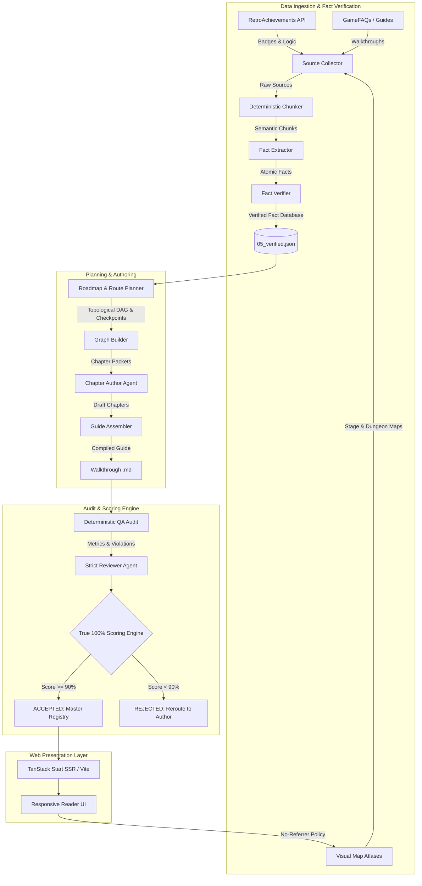

# RetroAchievements Walkthroughs (retro-walkthroughs)

> **Verifiable, Zero-Hallucination, "True 100%" Walkthrough Platform with Live RetroAchievements Integration**

---

## 1. Executive Summary & Vision

**RetroAchievements Walkthroughs** is an automated, high-assurance pipeline and modern web platform engineered to produce and host verifiable, comprehensive walkthroughs for classic video games. Every guide is purpose-built to guide players through **True 100% completion** (every chest, secret, sidequest, and area) while guaranteeing the unlock of all [RetroAchievements](https://retroachievements.org) trophies without missing a single missable achievement or encountering a point of no return unprepared.

### Core Distinctions
- **Zero Hallucination Guarantee**: Every navigation direction, chest location, puzzle solution, and boss strategy is strictly grounded in cited source facts extracted from verified guides, community data, and direct memory/sprite rips. Unverified claims are prohibited by automated audit barriers.
- **The True 100% Standard**: Unlike guides that only cover the critical path, every walkthrough is audited for area word depth (>= 180 words/area), room-by-room navigation, cumulative chapter progress checkpoints, and complete area coverage.
- **Visual Map Integration**: The pipeline automatically scrapes, verifies, and links stage and dungeon maps across an extensible 4-tier discovery cascade (GameFAQs, Mario Universe, VGMaps, StrategyWiki, TSR, and search engines).
- **Automated Mathematical Scoring**: Every assembled walkthrough undergoes a deterministic QA audit and a 7-dimensional scoring rubric. Guides scoring under **90% overall** or under **80% in any individual dimension** are automatically rejected.
- **Modern Full-Stack Web Platform**: Built on TanStack Start / TanStack Router (SSR/SSG), Vite, React 19, and Tailwind CSS, featuring dark-mode glassmorphism, responsive achievement cards with unlock badges, interactive Mermaid route graphs, and hotlink-safe image delivery.

---

## 2. System Architecture



---

## 3. The 10-Stage Agent & Pipeline Lifecycle

The walkthrough creation lifecycle is governed by automated CLI scripts (`scripts/pipeline/`) and specialized AI agents defined in `.agents/plugins/retro-walkthrough/skills/`.

| Stage | Command | Primary Module / Skill | Output Artifact | Description |
|:---:|:---|:---|:---|:---|
| **1** | `npm run rw:fetch`<br>`npm run rw:collect` | `ra-source-collector`<br>`collect_source.py` | `01_targets/`<br>`02_sources/` | Queries the RetroAchievements API for badge data and conditions, scrapes candidate guides from GameFAQs, and runs multi-tier visual map discovery. |
| **2** | `npm run rw:chunk` | `chunk-sources.ts` | `03_chunks/chunks.jsonl` | Slices ingested text into deterministic 1,000–3,000 character chunks with preserved line numbers and source provenance. |
| **3** | `npm run rw:facts` | `ra-fact-extractor` | `04_facts/*.jsonl` | Extracts atomic facts: subject, statement, exact quote, chunk ID, and categorization (chests, missables, maps, strategies). |
| **4** | `npm run rw:verify` | `verify-facts.ts`<br>`ra-fact-verifier` | `05_verified.json` | Cross-verifies facts against source chunks, flags contradictions, and validates achievement condition coverage. |
| **5** | `npm run rw:plan` | `graph.ts`<br>`ra-route-planner` | `06_roadmap.json`<br>`07_graph.json` | Constructs a directed topological graph of game areas, sequences achievements, tags missables and points of no return, and sets cumulative checkpoints. |
| **6** | `npm run rw:packet` | `chapter-packet.ts` | `08_packets/ch*.json` | Bundles facts, area nodes, achievements, visual map links, and missable warnings required for authoring each chapter. |
| **7** | `npm run rw:write` | `ra-walkthrough-writer` | `08_chapters/*.md` | Generates chapter prose with room-by-room directions, verbatim ASCII/code blocks, achievement anchors, and warning callouts. |
| **8** | `npm run rw:assemble` | `assemble.ts` | `content/walkthroughs/<id>.md` | Compiles chapters, injects frontmatter, builds dynamic table of contents, renders Mermaid flowcharts, and updates `master.json`. |
| **9** | `npm run rw:qa` | `qa-check.ts` | `09_qa.json` | Runs strict deterministic QA: 0-error requirement on citations, verbatim code matches, achievement placements, and map links. |
| **10** | `npm run rw:score` | `score.ts` | `score.json` | Computes the multi-dimensional True 100% score; outputs `ACCEPTED` (>=90%) or `REJECTED`. |

---

## 4. Multi-Tier Visual Map Discovery Protocol

When building True 100% walkthroughs, visual dungeon, world, and level maps are critical. Primary text guide repositories often lack graphical level rips. The pipeline executes a 4-tier discovery cascade documented in `ra-source-collector`:

1. **Tier 1: Primary FAQ Repositories**
   - Inspects GameFAQs `/map/` directories for official or community visual maps and floor plans.
2. **Tier 2: Dedicated Atlases & Franchise Archives**
   - **Mario Universe**: High-resolution level maps for Mario platformers.
   - **VGMaps**: Comprehensive retro atlas spanning NES, SNES, Genesis, Game Boy, GBA, and PS1.
   - **Franchise Archives**: [NESMaps](https://nesmaps.com), [SegaRetro / Sonic Retro](https://info.sonicretro.org), [Zelda Maps](https://zeldamaps.com), [Metroid Recon](https://metroid.retropixel.net), [Caves of Narshe](https://www.cavesofnarshe.com) (*Final Fantasy*), [Dragon's Den](https://www.woodus.com/den/home.php) (*Dragon Quest*).
3. **Tier 3: Game Wikis & Asset Ripping Archives**
   - **StrategyWiki**: Dedicated map galleries (`Category:<Game>_maps`) and walk-through pages.
   - **The Maps Resource / The Spriters Resource** (`vg-resource.com`): Primary archives of ripped sprite sheets and level stitches.
   - **Community Wikis (Wiki.gg / Fandom)**: High-resolution level galleries.
4. **Tier 4: Automated Search Engine Discovery**
   - Programmatic search queries targeting high-resolution stitches:
     - `"<Game Title>" <Platform> ("level map" OR "dungeon map" OR "world map") (png OR jpg)`
     - `"<Game Title>" complete map stitch high resolution`

---

## 5. The True 100% Scoring Engine

Every walkthrough is evaluated by `scripts/pipeline/score.ts` across **7 weighted dimensions**:

$$\text{Overall Score} = \frac{1}{7} \sum_{i=1}^{7} S_i$$

### Dimension Formulas

| Dimension | Formula & Factors | Target |
|:---|:---|:---:|
| **Source Coverage** | $0.4 \times \min\left(100, \frac{\text{Sources}_{\ge 10\text{k}}}{3} \times 100\right) + 0.6 \times \text{ChunkCoverage}\%$ | $\ge 80\%$ |
| **Accuracy** | $\frac{\text{Paragraphs}_{\text{cited}}}{\text{Paragraphs}_{\text{total}}} \times \left(1 - \frac{\text{Citations}_{\text{broken}}}{\text{Citations}_{\text{total}}}\right) - \text{ReviewPenalties}$ | $\ge 80\%$ |
| **Achievement Coverage** | $\frac{\text{PlacedCorrectly} - 0.5 \times (\text{PlacedCorrectly} - \text{Supported})}{\text{Achievements}_{\text{total}}} \times 100 - \text{Penalties}$ | $\ge 80\%$ |
| **Missable Coverage** | $\frac{\text{Missables}_{\text{warned}} + \text{PONR}_{\text{warned}}}{\text{Missables}_{\text{total}} + \text{PONR}_{\text{total}}} \times 100 - \text{Penalties}$ | $\ge 80\%$ |
| **Beginner Friendliness** | $\text{ReviewerScore} - \min(30, \text{QA Warnings} \times 5)$ | $\ge 80\%$ |
| **Route Completeness** | $\frac{\text{Areas}_{\text{mentioned}}}{\text{Areas}_{\text{roadmap}}} \times 100 - \text{Penalties}$ | $\ge 80\%$ |
| **True 100% Coverage** | Depth ($0.45 \times \text{WordDepth} + 0.35 \times \text{CheckpointScore} + 0.20 \times \text{MapScore}$) minus Sparsity | $\ge 80\%$ |

### Acceptance & Rejection Blockers
A walkthrough is instantly **REJECTED** if:
1. **Overall Score < 90%**
2. **Any Individual Dimension < 80%**
3. **Deterministic QA Errors > 0** (broken citations, uncited paragraphs, missing achievements, unverified code blocks)
4. **Open Critical Review Issues > 0**

---

## 6. Technical Architecture of the Web Platform

The web reader is a modern, high-performance static/SSR application designed to render long-form technical guides with zero layout shift.

```
retro-walkthroughs/
├── src/
│   ├── routes/
│   │   ├── __root.tsx                 # Root layout, global meta tags & header shell
│   │   ├── index.tsx                  # Showcase catalog grid with metadata cards
│   │   └── walkthroughs.$gameId.tsx   # Dynamic guide loader with custom ReactMarkdown
│   ├── components/
│   │   └── Header.tsx                 # Navigation header with system indicators
│   ├── styles.css                     # Tailwind CSS 4 configuration
│   └── routeTree.gen.ts               # Auto-generated TanStack type-safe routes
├── content/
│   ├── master.json                    # Registry of published walkthroughs & metadata
│   ├── research/<gameId>/             # Complete verifiable research pipeline artifact tree
│   └── walkthroughs/<gameId>.md       # Assembled production markdown guides
└── scripts/
    └── pipeline/                      # TypeScript pipeline execution scripts
```

### Key Web Features
- **TanStack Start & Router**: Type-safe file-based routing with full Server-Side Rendering (SSR) and client hydration.
- **Dynamic Raw Markdown Ingestion**: Guides are dynamically imported via `import('../../content/walkthroughs/${gameId}.md?raw')`, ensuring zero bundle bloat until accessed.
- **Interactive Client-Side Mermaid Diagrams**: Injected `[MERMAID]` placeholders are compiled into dark-themed SVGs in real time using `mermaid.js`.
- **Anti-Hotlinking Referrer Shielding**: Sites like Mario Universe reject requests that contain external `Referer` headers with HTTP 404 errors. The platform resolves this seamlessly:
  - Global `<meta name="referrer" content="no-referrer" />` in `__root.tsx`.
  - Hyperlinks automatically render with `rel="noreferrer noopener"` and `referrerPolicy="no-referrer"`.
  - Maps open in clean external tabs (`target="_blank"`) without displacing reader progress.
- **Custom Callout Engine**: Blockquotes formatted as `[!ACHIEVEMENT]`, `[!WARNING]`, `[!CAUTION]`, `[!TIP]`, and `[!NOTE]` are transformed into illuminated status containers:
  - Achievements render with a gold retro badge, glowing ambient background, and unlocked timestamp.
  - Missable alerts render in amber caution boxes positioned *before* points of no return.

---

## 7. Research Directory Schema

For every game, all intermediate data is preserved in `content/research/<gameId>/` for total reproducibility:

```
content/research/<gameId>/
├── 01_targets/
│   └── achievements.json       # Clean RetroAchievements metadata, badges, and logic
├── 02_sources/
│   ├── sources.json            # Manifest of all ingested guides, FAQs, and maps
│   └── *.txt                   # Raw downloaded text and map coordinates
├── 03_chunks/
│   └── chunks.jsonl            # Deterministic text chunks with character offsets
├── 04_facts/
│   ├── maps.jsonl              # Facts mapping game areas to visual URLs
│   └── walkthrough.jsonl       # Atomic facts with verbatim quotes & chunk IDs
├── 05_verified.json            # Verified fact database & coverage audit
├── 06_roadmap.json             # Topological route, chapter boundaries, missables
├── 07_graph.json               # Directed acyclic graph of game areas & edges
├── 08_chapters/
│   ├── 00_overview.md          # Mechanics, True 100% criteria, missables overview
│   └── 01.md ... 08.md         # Full step-by-step room navigation chapters
├── 09_qa.json                  # Deterministic QA metrics, errors, and warnings
├── 09_review.json              # Strict human/reviewer agent findings & issues
└── score.json                  # Final mathematical scoring result & verdict
```

---

## 8. Developer Quickstart & CLI Reference

### Prerequisites
- Node.js >= 20.x
- Python >= 3.10
- RetroAchievements API credentials in `.env`:
  ```bash
  RETROACHIEVEMENTS_USER="YourUsername"
  RETROACHIEVEMENTS_API_KEY="YourApiKey"
  ```

### Installation
```bash
git clone https://github.com/Kneig/RetroAchievements.git
cd RetroAchievements/retro-walkthroughs
npm install
```

### Running the Web Platform
```bash
# Start local development server on port 3001
npm run dev

# Build for production
npm run build

# Preview production build locally
npm run preview
```

### Running the Pipeline for a Game
```bash
# 1. Fetch RetroAchievements data
npx tsx scripts/fetch-data.ts --game <gameId>

# 2. Chunk ingested sources
npm run rw:chunk -- <gameId>

# 3. Verify extracted facts
npm run rw:verify -- <gameId>

# 4. Assemble final walkthrough
npm run rw:assemble -- <gameId>

# 5. Run deterministic QA audit
npm run rw:qa -- <gameId>

# 6. Calculate True 100% Score
npm run rw:score -- <gameId>
```

---

## 9. Showcase Guides

| Game ID | Title | System | Words | Maps Linked | Achievements | QA Errors | Final Score | Status |
|:---:|:---|:---:|:---:|:---:|:---:|:---:|:---:|:---:|
| **253** | *Super Mario All-Stars* | SNES/Super Famicom | 12,647 | 229 / 229 (100%) | 111 / 111 (100%) | 0 | **98%** | **ACCEPTED** |
| **1005** | *Lufia II: Rise of the Sinistrals* | SNES/Super Famicom | 10,873 | 31 / 30 (100%) | 60 / 60 (100%) | 0 | **99%** | **ACCEPTED** |
| **1887** | *Princess Tomato in the Salad Kingdom* | NES/Famicom | 6,677 | N/A (44 Scenes) | 52 / 52 (100%) | 0 | **96%** | **ACCEPTED** |

---

## 10. Standards & Contributing Guidelines
- **CRLF Line Endings**: All markdown, scripts, and code in this repository strictly use `\r\n` line endings.
- **Verbatim ASCII / Code Blocks**: Maps, tables, and equipment matrices must match source text verbatim. Never invent layout drawings.
- **Callout Standard**: Use `> [!ACHIEVEMENT]`, `> [!WARNING]` (missables), `> [!CAUTION]` (points of no return), and `> ### Cumulative 100% Checkpoint` to maintain audit compatibility.
