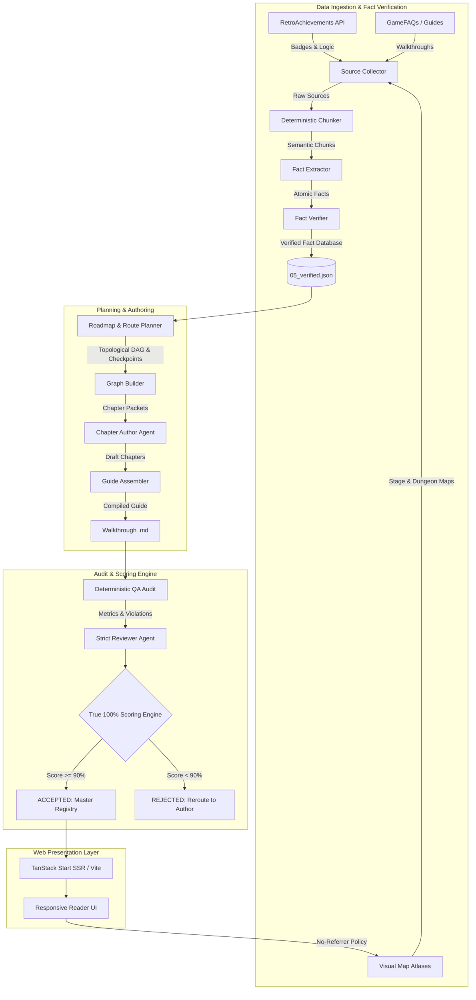

# RetroAchievements Walkthroughs (retro-walkthroughs)

> **Verifiable, Zero-Hallucination, "True 100%" Walkthrough Platform with Live RetroAchievements Integration**

---

## 1. Executive Summary & Vision

**RetroAchievements Walkthroughs** is an automated, high-assurance pipeline and modern web platform engineered to produce and host verifiable, comprehensive walkthroughs for classic video games. Every guide is purpose-built to guide players through **True 100% completion** (every chest, secret, sidequest, and area) while guaranteeing the unlock of all [RetroAchievements](https://retroachievements.org) trophies without missing a single missable achievement or encountering a point of no return unprepared.

### Core Distinctions
- **Zero Hallucination Guarantee**: Every navigation direction, chest location, puzzle solution, and boss strategy is strictly grounded in cited source facts extracted from verified guides, community data, and direct memory/sprite rips. Unverified claims are prohibited by automated audit barriers.
- **The True 100% Standard**: Unlike guides that only cover the critical path, every walkthrough is audited for area word depth (>= 180 words/area), room-by-room navigation, cumulative chapter progress checkpoints, and complete area coverage.
- **Visual Map Integration**: The pipeline automatically scrapes, verifies, and links stage and dungeon maps across an extensible 4-tier discovery cascade (GameFAQs, Mario Universe, VGMaps, StrategyWiki, TSR, and search engines).
- **Automated Mathematical Scoring**: Every assembled walkthrough undergoes a deterministic QA audit and a 7-dimensional scoring rubric. Guides scoring under **90% overall** or under **80% in any individual dimension** are automatically rejected.
- **Modern Full-Stack Web Platform**: Built on TanStack Start / TanStack Router (SSR/SSG), Vite, React 19, and Tailwind CSS, featuring dark-mode glassmorphism, responsive achievement cards with unlock badges, interactive Mermaid route graphs, and hotlink-safe image delivery.

---

## 2. System Architecture



---

## 3. The 10-Stage Agent & Pipeline Lifecycle

The walkthrough creation lifecycle is governed by automated CLI scripts (`scripts/pipeline/`) and specialized AI agent skills defined in `.agents/plugins/retro-walkthrough/skills/`. Script stages run as plain `npm run` commands. The two bulk stages (4 extraction, 8 writing) are scripts that call a model directly, one call per batch or chapter, with the stage skill as the instructions (see [Model backends](#model-backends-for-rwextract-and-rwwrite)). The judgment stages (source discovery, conflict resolution, planning, adversarial review) are performed by the coding agent following the stage skill. See [AI Agent Setup](#9-ai-agent-setup-antigravity--claude-code) for running the skills in Antigravity or Claude Code.

Run `npm run rw:status -- <gameId>` at any time to see which stages are complete and the exact next action.

| Stage | Command | Primary Module / Skill | Output Artifact | Description |
|:---:|:---|:---|:---|:---|
| **1** | `npm run rw:fetch -- <id>`<br>`npm run rw:ra-guide -- <id>` | `fetch-data.ts`, `ra-guide.ts` | `01_achievements.json`<br>`02_sources/ra-comments.txt`<br>`02_sources/ra-guide.txt`<br>`content/api-dumps/<id>.md` | Queries the RetroAchievements API for game metadata, achievements, badges and community comments, registers the game in `content/master.json`, and downloads the official achievement guide from the [RA guides wiki](https://github.com/RetroAchievements/guides/wiki) when the game has one (the API's `guideUrl`, else a wiki page linking the game). |
| **2** | `npm run rw:find-guides`<br>`npm run rw:browse -- <url>`<br>`npm run rw:maps -- <id>`<br>`npm run rw:collect -- <id> <url> ...` | `ra-source-collector` (Sonnet)<br>`search_guides.py`, `browse_page.py`, `collect_maps.py`, `collect_source.py` | `02_sources/*.txt`<br>`02_sources/sources.json` | Discovers and downloads full-text guides, checklists and visual maps (multi-tier map discovery) with author attribution. All page access goes through headless Chrome, so sites that block AI fetch tools still work. Guides must be for the RA set's console: `rw:collect` counts the consoles each guide names and holds multi-version and other-console guides for the user to approve (see [Source rules](#source-rules)). |
| **3** | `npm run rw:chunk -- <id>` | `chunk-sources.ts` | `03_chunks.jsonl` | Slices ingested text into deterministic 1,000–3,000 character chunks with preserved line numbers and source provenance. Box-drawn tables with sentences in their cells are not taken for ASCII maps, and a long table splits at its row borders (10113: 14k-character chunks cut mid-sentence before). |
| **4** | `npm run rw:extract -- <id>`<br>`npm run rw:chunks -- <id> --progress` | `extract-facts.ts`, `llm.ts`<br>`ra-fact-extractor` | `04_facts/*.jsonl` | One model call per batch of chunks extracts atomic facts (subject, statement, verbatim quote, chunk ID, category). Every fact is checked with the `rw:verify` rules before it is written. A fact whose quote is only a fragment (a number or words it states are missing) first gets its quote widened to the verbatim sentence, with the heading that holds a missing number put in front ("ROOM #02: ... text"), and is checked again; what still fails gets one repair call. Quotes from box-drawn tables, whose sentences wrap across lines between column borders, are also matched against the table read column by column (10113: 256 of 271 "not verbatim" rejects passed this way in a replay). Secondary full walkthroughs are extracted in focused mode. Guide batches run on Gemini Flash through the Antigravity CLI when it is installed (no Claude tokens); RA comment batches run on Claude Haiku (see [Model backends](#model-backends-for-rwextract-and-rwwrite)). |
| **5** | `npm run rw:verify -- <id>` | `verify-facts.ts`<br>`ra-fact-verifier` | `05_verified.json`<br>`05_aliases.json` | Cross-verifies quotes against source chunks, corroborates facts across sources, flags contradictions, and validates achievement coverage. Facts that make the same claim are merged into one that keeps every quote (status `duplicate` on the others; citations to them map to the kept fact). |
| **6–7** | `npm run rw:plan -- <id>` | `ra-route-planner`<br>`plan-check.ts`, `graph.ts` | `06_graph.json`<br>`07_roadmap.json`<br>`06_graph.md` | Agent builds the knowledge graph and roadmap (chapters, missables, points of no return, True 100% criteria, `open_questions` no source answers, `game_chapter` when the game's own chapters are split); the script validates them, warns about area labels no fact matches and about one-word generic aliases ("Cave", "Ruins"), and renders Mermaid flowcharts. |
| **8** | `npm run rw:write -- <id>`<br>`npm run rw:packet -- <id> <overview\|N>` | `write-chapters.ts`, `chapter-packet.ts`<br>`ra-walkthrough-writer` | `08_packets/*.md`<br>`08_chapters/*.md` | Builds each chapter's packet (facts, source passages, achievements, maps, warnings, checkpoint totals) and writes the chapter with one model call on Sonnet. Each draft is checked before it is saved (citations, achievement tags, checkpoint totals, drafting notes, save-state advice, `##` headings inside a chapter, blank citation cells) and repaired once; `--fix` revises chapters with QA findings. |
| **9** | `npm run rw:assemble -- <id>`<br>`npm run rw:qa -- <id>` | `assemble.ts`, `qa-check.ts`<br>`ra-qa-auditor` | `08_cited.md`<br>`content/walkthroughs/<id>.md`<br>`09_qa.json`, `09_review.json` | Compiles the overview, roadmap, missables/PONR summaries, Mermaid diagrams and chapters, runs deterministic QA, then the agent performs an adversarial review. QA does not count route logic built only from the achievement list and roadmap, or plain "Do not ..." warnings, as uncited. |
| **10** | `npm run rw:score -- <id>` | `score.ts` | `10_score.json` | Computes the multi-dimensional True 100% score; outputs `ACCEPTED` (>=90%) or `REJECTED`. |
| **11** | `npm run rw:clean -- <id>` | `cleanup.ts` | — | After acceptance and review, purges intermediate `08_packets/` and game scratch files while keeping all research artifacts. |

---

## 4. Multi-Tier Visual Map Discovery Protocol

When building True 100% walkthroughs, visual dungeon, world, and level maps are critical. Primary text guide repositories often lack graphical level rips. The pipeline executes a 4-tier discovery cascade documented in `ra-source-collector`:

1. **Tier 1: Primary FAQ Repositories**
   - Inspects GameFAQs `/map/` directories for official or community visual maps and floor plans.
2. **Tier 2: Dedicated Atlases & Franchise Archives**
   - **Mario Universe**: High-resolution level maps for Mario platformers.
   - **VGMaps**: Comprehensive retro atlas spanning NES, SNES, Genesis, Game Boy, GBA, and PS1.
   - **Franchise Archives**: [NESMaps](https://nesmaps.com), [SegaRetro / Sonic Retro](https://info.sonicretro.org), [Zelda Maps](https://zeldamaps.com), [Metroid Recon](https://metroid.retropixel.net), [Caves of Narshe](https://www.cavesofnarshe.com) (*Final Fantasy*), [Dragon's Den](https://www.woodus.com/den/home.php) (*Dragon Quest*).
3. **Tier 3: Game Wikis & Asset Ripping Archives**
   - **StrategyWiki**: Dedicated map galleries (`Category:<Game>_maps`) and walk-through pages.
   - **The Maps Resource / The Spriters Resource** (`vg-resource.com`): Primary archives of ripped sprite sheets and level stitches.
   - **Community Wikis (Wiki.gg / Fandom)**: High-resolution level galleries.
4. **Tier 4: Automated Search Engine Discovery**
   - Programmatic search queries targeting high-resolution stitches:
     - `"<Game Title>" <Platform> ("level map" OR "dungeon map" OR "world map") (png OR jpg)`
     - `"<Game Title>" complete map stitch high resolution`

---

## 5. The True 100% Scoring Engine

Every walkthrough is evaluated by `scripts/pipeline/score.ts` across **7 weighted dimensions**:

$$\text{Overall Score} = \frac{1}{7} \sum_{i=1}^{7} S_i$$

### Dimension Formulas

| Dimension | Formula & Factors | Target |
|:---|:---|:---:|
| **Source Coverage** | $0.4 \times \min\left(100, \frac{\text{Guides}_{\ge 10\text{k}}}{3} \times 100\right) + 0.6 \times \text{ChunkCoverage}\%$ | $\ge 80\%$ |
| **Accuracy** | $\frac{\text{Paragraphs}_{\text{cited}}}{\text{Paragraphs}_{\text{total}}} \times \left(1 - \frac{\text{Citations}_{\text{broken}}}{\text{Citations}_{\text{total}}}\right) - \text{ReviewPenalties}$ | $\ge 80\%$ |
| **Achievement Coverage** | $\frac{\text{PlacedCorrectly} - 0.5 \times (\text{PlacedCorrectly} - \text{Supported})}{\text{Achievements}_{\text{total}}} \times 100 - \text{Penalties}$ | $\ge 80\%$ |
| **Missable Coverage** | $\frac{\text{Missables}_{\text{warned}} + \text{PONR}_{\text{warned}}}{\text{Missables}_{\text{total}} + \text{PONR}_{\text{total}}} \times 100 - \text{Penalties}$ | $\ge 80\%$ |
| **Beginner Friendliness** | $\text{ReviewerScore} - \min(30, \text{QA Warnings} \times 5)$ | $\ge 80\%$ |
| **Route Completeness** | $\frac{\text{Areas}_{\text{mentioned}}}{\text{Areas}_{\text{roadmap}}} \times 100 - \text{Penalties}$ | $\ge 80\%$ |

| **True 100% Coverage** | Depth ($0.45 \times \text{WordDepth} + 0.35 \times \text{CheckpointScore} + 0.20 \times \text{MapScore}$) minus Sparsity | $\ge 80\%$ |

### Source rules

Guides counted for Source Coverage (and for Stage 2 in `rw:status`) are sources of 10k+ characters other than maps, `ra-comments` and `ra-guide`: the RA comments and RA guides wiki page that Stage 1 fetches are extras on top of the 3 required guides. `rw:status` and `rw:auto` block at Stage 2 until 3 are registered, unless Stage 2 recorded an exhaustive search in `02_sources/_fewer_guides.txt`. Guides must be for the console the RA set is on: `rw:collect` counts console names in each guide and holds multi-version and other-console guides (`"use": false` in `sources.json`; saved, but skipped by every stage and never counted). `rw:status` asks the user about every held multi-version guide, and about other-console guides only when fewer than 3 same-console guides exist; `rw:collect -- <id> --id <sourceId> --approve | --decline` records the answer.

### Acceptance & Rejection Blockers
A walkthrough is instantly **REJECTED** if:
1. **Overall Score < 90%**
2. **Any Individual Dimension < 80%**
3. **Deterministic QA Errors > 0** (broken citations, uncited paragraphs, missing achievements, unverified code blocks)
4. **Open Critical Review Issues > 0**

---

## 6. Technical Architecture of the Web Platform

The web reader is a modern, high-performance static/SSR application designed to render long-form technical guides with zero layout shift.

```
retro-walkthroughs/
├── src/
│   ├── routes/
│   │   ├── __root.tsx                 # Root layout, global meta tags & header shell
│   │   ├── index.tsx                  # Showcase catalog grid with metadata cards
│   │   └── walkthroughs.$gameId.tsx   # Dynamic guide loader with custom ReactMarkdown
│   ├── components/
│   │   ├── Header.tsx                 # Navigation header with system indicators
│   │   └── PlayStationButton.tsx      # Renders PlayStation button tokens as inline icons
│   ├── router.tsx / client.tsx / ssr.tsx  # TanStack Start router & entry points
│   ├── styles.css                     # Tailwind CSS 4 configuration
│   └── routeTree.gen.ts               # Auto-generated TanStack type-safe routes
├── public/buttons/                    # Controller button SVGs (cross, circle, dpad, l1, ...)
├── content/
│   ├── master.json                    # Registry of walkthroughs & metadata (written by rw:fetch)
│   ├── api-dumps/<gameId>.md          # Human-readable RetroAchievements API dump per game
│   ├── research/<gameId>/             # Complete verifiable research pipeline artifact tree
│   └── walkthroughs/<gameId>.md       # Assembled production markdown guides
├── scripts/
│   ├── fetch-data.ts                  # Stage 1: RetroAchievements API fetch
│   └── pipeline/                      # Pipeline stage scripts (TypeScript + Python)
├── .agents/
│   ├── plugins/retro-walkthrough/skills/  # Stage skills (source of truth for Antigravity & Claude Code)
│   └── rules/                         # Always-on agent rules (CRLF, no shortcuts)
├── .claude/skills/                    # Claude Code entry points that load the .agents skills
├── .claude/agents/rw-stage.md         # Opus subagent: one judgment stage (2, 5, 6–7, 9) per fresh context
├── .claude/agents/rw-worker.md        # Fallback Sonnet subagent for Stages 4/8 when no model backend runs
├── CLAUDE.md                          # Claude Code project instructions
├── archive/                           # Retired pipeline scripts & skills (reference only)
└── scratch/                           # Temporary files (purged by rw:clean)
```

### Key Web Features
- **TanStack Start & Router**: Type-safe file-based routing with full Server-Side Rendering (SSR) and client hydration.
- **Dynamic Raw Markdown Ingestion**: Guides are dynamically imported via `import('../../content/walkthroughs/${gameId}.md?raw')`, ensuring zero bundle bloat until accessed.
- **Interactive Client-Side Mermaid Diagrams**: Injected `[MERMAID]` placeholders are compiled into dark-themed SVGs in real time using `mermaid.js`.
- **Anti-Hotlinking Referrer Shielding**: Sites like Mario Universe reject requests that contain external `Referer` headers with HTTP 404 errors. The platform resolves this seamlessly:
  - Global `<meta name="referrer" content="no-referrer" />` in `__root.tsx`.
  - Hyperlinks automatically render with `rel="noreferrer noopener"` and `referrerPolicy="no-referrer"`.
  - Maps open in clean external tabs (`target="_blank"`) without displacing reader progress.
- **Custom Callout Engine**: Blockquotes formatted as `[!ACHIEVEMENT]`, `[!WARNING]`, `[!CAUTION]`, `[!TIP]`, and `[!NOTE]` are transformed into illuminated status containers:
  - Achievements render with a gold retro badge, glowing ambient background, and unlocked timestamp.
  - Missable alerts render in amber caution boxes positioned *before* points of no return.

---

## 7. Research Directory Schema

For every game, all intermediate data is preserved in `content/research/<gameId>/` for total reproducibility:

```
content/research/<gameId>/
├── 01_achievements.json        # RetroAchievements metadata, badges, types & descriptions
├── 02_sources/
│   ├── sources.json            # Manifest of all ingested guides, FAQs, and maps (with attribution)
│   ├── ra-comments.txt         # RetroAchievements community comments
│   └── *.txt                   # Raw downloaded guide text and map pages
├── 03_chunks.jsonl             # Deterministic text chunks with line numbers & provenance
├── 04_facts/
│   ├── <source>_<from>-<to>.jsonl  # Atomic facts with verbatim quotes & chunk IDs (one file per batch)
│   └── _skipped.txt            # Non-game chunks (TOC, legal, credits) with a reason
├── 05_aliases.json             # Optional: canonical names ↔ alternate spellings/translations
├── 05_resolutions.json         # Optional: agent rulings on conflicting facts
├── 05_verified.json            # Verified fact database & coverage audit (script-generated)
├── 06_graph.json               # Knowledge graph of areas, bosses, items & achievements
├── 06_graph.md                 # Mermaid flowcharts rendered by rw:plan
├── 07_roadmap.json             # Chapters, achievement placement, missables, PONRs, True 100% criteria
├── 08_packets/                 # Per-chapter writing packets (purged by rw:clean)
├── 08_chapters/
│   ├── 00_overview.md          # Mechanics, battle system, hardcore rules
│   └── 01.md ... NN.md         # Full step-by-step chapters with [[fact-id]] citations
├── 08_cited.md                 # Assembled guide with citations kept, for audit
├── 09_qa.json                  # Deterministic QA metrics, errors, and warnings (script-generated)
├── 09_review.json              # Adversarial reviewer agent findings & issues
├── 10_score.json               # Final scoring result & verdict (script-generated)
├── _usage.jsonl                # Tokens of every rw:extract / rw:write model call (rw:status totals it)
├── _activity.jsonl             # Active time of each rw:auto step and stage agent, plus agent tokens (rw:status ACTIVE line)
├── _extract_rejects.jsonl      # Facts that failed a check and why (round 1 = repaired, 2 = dropped), for tuning the rules
├── _fix_tried.json             # Warning kinds rw:write --fix already tried per chapter
└── _auto.log                   # Full output of rw:auto runs
```

Never hand-edit the script-generated files (`05_verified.json`, `09_qa.json`, `10_score.json`); fix the upstream artifact and re-run the stage.

---

## 8. Developer Quickstart & CLI Reference

### Prerequisites
- Node.js >= 20.x
- Python >= 3.10 with `html2text` and `playwright` (headless Chrome for the source collector, guide finder and page browser)
- A model backend for `rw:extract` / `rw:write`: the `claude` CLI (Claude Code, logged in) for Haiku and Sonnet, plus, optionally, the Antigravity CLI (`agy`, logged in) so guide extraction runs on Gemini Flash instead of Claude. See [Model backends](#model-backends-for-rwextract-and-rwwrite).
- RetroAchievements API credentials in `.env` (get your Web API key from your RetroAchievements settings page):
  ```bash
  RA_USERNAME="YourUsername"
  RA_API_KEY="YourWebApiKey"
  ```

### Installation
```bash
git clone https://github.com/MajinFro/retro-walkthroughs.git
cd retro-walkthroughs
npm install
pip install html2text playwright
python -m playwright install chromium
```

### Running the Web Platform
```bash
# Start local development server on port 3001
npm run dev

# Build for production
npm run build

# Preview production build locally
npm run preview
```

### Running the Pipeline for a Game
The game ID is the number in the game's RetroAchievements URL (`retroachievements.org/game/<gameId>`). Stages marked *(agent)* are performed by the AI agent following the matching skill; the easiest path is to ask the agent to run the `generate-walkthrough` skill for the game ID and let `rw:status` drive it.

```bash
# Where am I? Prints completed stages and the exact NEXT action
npm run rw:status -- <gameId>

# Run every command stage in a row (fetch, chunk, extract, verify, plan, write, --fix, qa, score) until a
# stage needs the agent, the usage limit is hit, or a step makes no progress. Never runs rw:clean.
npm run rw:auto -- <gameId>

# 1. Fetch RetroAchievements data (achievements, comments, RA guides-wiki guide, master.json entry)
npm run rw:fetch -- <gameId>
npm run rw:ra-guide -- <gameId> [--url <wiki page>]   # (re)collect only the RA guide

# 2. Find and collect guides & maps (agent: ra-source-collector)
npm run rw:find-guides -- "<game title>"
npm run rw:browse -- "<any url>" --links --grep "<game>"   # read non-GameFAQs sites/atlases
npm run rw:maps -- <gameId> --dry-run   # list the game's VGMaps maps; drop --dry-run to register them
npm run rw:collect -- <gameId> "<url>" --id gf1 --site GameFAQs --title "<guide title>" --author "<author>"
npm run rw:collect -- <gameId> --id gf2 --approve     # the user approved a held (multi-version / other-console) guide
npm run rw:collect -- <gameId> --id gf2 --decline     # keep it saved but unused
npm run rw:collect -- <gameId> --id gf2 --hold multi  # hold a guide whose intro shows it covers other versions

# 3. Chunk ingested sources
npm run rw:chunk -- <gameId>

# 4. Extract facts (model calls; rules: ra-fact-extractor). Re-run until every chunk is processed
npm run rw:extract -- <gameId>            # --dry-run, --source gf1, --max-batches N, --full, --batch
RW_LLM_EXTRACT=claude-cli npm run rw:extract -- <gameId>   # extract on Haiku instead of Gemini Flash
npm run rw:chunks -- <gameId> --progress

# 5. Verify extracted facts (agent resolves conflicts: ra-fact-verifier)
npm run rw:verify -- <gameId>

# 6-7. Validate graph & roadmap written by the agent (ra-route-planner)
npm run rw:aliases -- <gameId> [--dry-run]   # Step 0: merge version-comparison tables (FC | NES | GBC ...) into 05_aliases.json
npm run rw:plan -- <gameId>

# 8. Write every missing chapter (model calls; rules: ra-walkthrough-writer), then assemble + QA
npm run rw:write -- <gameId>              # name chapters to limit; --force rewrites
npm run rw:write -- <gameId> --fix        # revise chapters with QA findings (--note "<finding>" for review findings)
                                          # errors every pass; each kind of warning once per chapter (--force retries)
npm run rw:packet -- <gameId> 1           # inspect a packet

# 9. Assemble and run deterministic QA (agent then reviews: ra-qa-auditor)
npm run rw:assemble -- <gameId>
npm run rw:qa -- <gameId>

# 10. Calculate True 100% score
npm run rw:score -- <gameId>

# 11. After acceptance and your review, purge intermediate packets/scratch
npm run rw:clean -- <gameId>
```

---

## 9. AI Agent Setup (Antigravity & Claude Code)

The agent stages are defined once, in `.agents/plugins/retro-walkthrough/skills/`, and work in both agents:

| | Antigravity | Claude Code |
|:---|:---|:---|
| **Skills** | Loaded from `.agents/plugins/retro-walkthrough/skills/` | `.claude/skills/<name>/SKILL.md` entry points load the same `.agents` skill files |
| **Always-on rules** | `.agents/rules/*.md` | Imported by `CLAUDE.md` |
| **Start a game** | Ask: "generate a walkthrough for game 1234" | Ask the same, or type `/generate-walkthrough 1234` |
| **Judgment stages (2, 5, 6–7, 9)** | `invoke_subagent` per stage (or a new conversation) | `rw-stage` agent per stage (`.claude/agents/rw-stage.md`, Opus, fresh context) |
| **Bulk stages (4, 8)** | `npm run rw:extract` / `rw:write` (`RW_LLM=gemini` without the claude CLI) | `npm run rw:extract` / `rw:write` (guide extraction on Gemini Flash via `agy` when installed, writing on Sonnet) |
| **Fallback subagents** | `invoke_subagent` (or inline) | `rw-worker` agent (`.claude/agents/rw-worker.md`, Sonnet), only when no model backend runs |

**Cost control.** The Super Mario RPG build (game 471), done with one agent per batch and chapter and orchestrated from one long Opus session, used about 114M tokens: 70M in the main session re-reading its own growing context and 44M in 70 subagents. Four changes cut that:

1. **Bulk stages are scripts.** `rw:extract` and `rw:write` make one model call per batch or chapter (no agent loop, no re-reading the skill every turn), check the reply deterministically, and repair once. In testing on game 471, an 8-chunk extraction batch cost about 50–85k tokens on Haiku and a chapter about 115k on Sonnet.
2. **Fresh context per judgment stage.** The session you talk to is a thin coordinator: it runs the command stages and hands each judgment stage (source collection, conflict resolution, planning, review) to a fresh `rw-stage` agent (`.claude/agents/rw-stage.md`, Opus), which reads its inputs from disk and reports back in a few lines. `rw:status` prints a `WHO:` line saying which applies. No manual `/clear` is needed. See "Coordinator mode" in the `generate-walkthrough` skill.
3. **Fewer repair rounds.** Packets carry exact checkpoint totals; `rw:plan` warns about area labels that match no fact location (the cause of thin packets), about usable facts that reach no packet at all (facts with no location follow their chunk's other facts first) and about achievements planned away from their facts; `rw:qa` catches drafting notes, wrong checkpoint totals, broken cross-chapter promises, items used or achievements called earned before the chapter that gets them, and numbered collectibles ("Gold Skulltula #12") routed in a chapter other than the one `chapters[].collectibles` gives them; `rw:write --fix` repairs chapters with a model call instead of in the orchestrator's context, and tries each kind of warning only once per chapter (on StarTropics, 1985, a repeat pass spent about 500k tokens and cleared none). `rw:extract` widens fragment quotes itself before asking for a repair: on StarTropics' six worst batches that cut rejected facts from 211 to 34 and repair tokens by 69%. It also tries one sentence before the quote, and the fact check reads a stats-table row together with its header row and legend (Dragon Quest: 36 of 84 first-round rejects saved in a replay). `rw:write` turns a duplicate `[ACHIEVEMENT]` tag inside a line into the achievement's name instead of sending a repair call, and a repair call that fails with no reply (a usage limit) is recorded in `_repair_pending.json` and re-run by the next `rw:write` or `--fix`.
4. **Extraction off Claude.** Guide extraction, the largest share of script tokens on big games (5M of Spyro's 8.8M), runs on Gemini Flash through the Antigravity CLI when it is installed. On a StarTropics copy this saved ~2.4M Claude tokens; the walkthrough scored 94% against 97%, and a blind comparison of three chapters rated it as good or better. Planning, review and writing stay on Claude, where quality is decided.

Every call made by `rw:extract` / `rw:write` is logged to `content/research/<id>/_usage.jsonl` with its backend; `rw:status` prints the total and the Claude / agy split.

**Active time.** `rw:auto` logs how long each command step ran, and the coordinator logs each stage agent's run time and tokens with `npm run rw:log-agent -- <id> --stage "<N name>" --ms <ms> --tokens <n>`, both to `_activity.jsonl`. `rw:status` totals them on its `ACTIVE:` line. Only working time is recorded: waiting for the user or for a usage-limit reset falls between entries and never counts, so games can be compared as the pipeline improves. `npm run rw:analyze -- <id>` condenses all of a game's logs (usage, activity, extraction rejects, write repairs, QA warnings, review issues) and compares it with earlier games; the coordinator turns it into ranked improvement suggestions in the approval summary. StarTropics II (1984), the first game measured, took 35m active (scripts 9m, agents 26m) with 2.12M script tokens and 414k agent tokens.

### Model backends for rw:extract and rw:write

| `RW_LLM` | Needs | Default models (extract / write) | Notes |
|:---|:---|:---|:---|
| `claude-cli` (default when installed) | the `claude` CLI, logged in | `haiku` / `sonnet` | Runs `claude -p` with tools disabled and the system prompt replaced, from a temp directory (no CLAUDE.md). Uses the Claude Code login. |
| `anthropic` | `ANTHROPIC_API_KEY` | `claude-haiku-5-5` / `claude-sonnet-5-5` | Prompt caching on the system prompt; `rw:extract --batch` uses the Message Batches API (half price, results within 24h). |
| `gemini` | `GEMINI_API_KEY` | `gemini-flash-latest` / `gemini-pro-latest` | For Antigravity, or machines without the claude CLI. |
| `agy` | the Antigravity CLI (`agy`), logged in | `gemini-3.8-flash-medium` / same | Runs on Antigravity's quota, not Claude's. Sends the prompt as one stream-json message from an empty temp folder in plan mode; a reply that used tools is rejected. Adds ~12k Gemini tokens of agent overhead per call. |

**Default split (since 2026-10-19):** when `agy` is installed and `RW_LLM` is unset, guide extraction runs on `agy` (Gemini Flash) and RA comment batches stay on Claude Haiku (`RW_LLM_RA_COMMENTS`); writing stays on Sonnet. Set the backend per stage with `RW_LLM_EXTRACT` / `RW_LLM_WRITE` (`RW_LLM_EXTRACT=claude-cli` puts extraction back on Haiku). In an A/B on a StarTropics copy, Flash extraction wrote half as many facts (1,274 vs 2,731) and scored 94% vs 97%, but a blind comparison of three chapters rated the Flash-based version as good or better, and it saved ~2.4M Claude tokens. `rw:status` and `rw:analyze` split Claude and agy/gemini tokens. An agy call that sends no output for 3 minutes (`RW_AGY_IDLE_SEC`) is killed and retried: on Dragon Quest, 8 hung calls each waited out the 15-minute print timeout, about 30 of the 34 extraction minutes. After 1 stall on a batch it moves straight to Claude (Haiku), with no backoff wait, for the rest of its tries (on Final Fantasy and Lufia, 41 of 42 batches that stalled once stalled again on the agy retry) (`RW_AGY_FALLBACK=none` turns this off): on Ocarina of Time the same batches stalled 29 times over four passes (about 2 hours), and Haiku then did them in one run for 82k tokens. Writing calls on the claude CLI run without prompt caching (`RW_WRITE_CACHE=1` turns it back on): each sends a different packet, so cache writes, billed at 1.25× input, were almost never read (10113: 6.8M written, 70k read).

Override models with `--model` or `RW_MODEL_EXTRACT` / `RW_MODEL_WRITE`, and concurrency with `--concurrency` or `RW_CONCURRENCY` (default 12 parallel calls; the token cost is the same at any level, lower it if calls fail on rate limits).

The shared rule `.agents/rules/agent-tools.md` maps the generic actions used in the skills (read a file, fetch a page, web search, run a command, spawn a subagent) to the tool names of each agent. A Claude Code hook (`.claude/settings.json`) converts files written by `Write`/`Edit` to CRLF. When editing a skill, edit the file under `.agents/`; if you add, rename, or re-describe a skill, run `npm run rw:sync-skills` to regenerate the Claude Code entry points.

---

## 10. Showcase Guides

| Game ID | Title | System | Words | Maps Linked | Achievements | QA Errors | Final Score | Status |
|:---:|:---|:---:|:---:|:---:|:---:|:---:|:---:|:---:|
| **253** | *Super Mario All-Stars* | SNES/Super Famicom | 12,647 | 229 / 229 (100%) | 111 / 111 (100%) | 0 | **98%** | **ACCEPTED** |
| **1005** | *Lufia II: Rise of the Sinistrals* | SNES/Super Famicom | 10,873 | 30 / 30 (100%) | 60 / 60 (100%) | 0 | **99%** | **ACCEPTED** |
| **471** | *Super Mario RPG: Legend of the Seven Stars* | SNES/Super Famicom | 68,609 | 68 / 68 (100%) | 99 / 99 (100%) | 0 | **96%** | **ACCEPTED** |
| **23372** | *Nickelodeon Guts* | SNES/Super Famicom | 9,224 | 21 / 21 (100%) | 20 / 20 (100%) | 0 | **97%** | **ACCEPTED** |
| **593** | *NBA Jam* | SNES/Super Famicom | 10,870 | N/A (Sports) | 28 / 28 (100%) | 0 | **96%** | **ACCEPTED** |
| **1470** | *Dragon Quest II* | NES/Famicom | 31,444 | 33 / 39 (85%) | 69 / 69 (100%) | 0 | **95%** | **ACCEPTED** |
| **1985** | *StarTropics* | NES/Famicom | 21,562 | 19 / 19 (100%) | 28 / 28 (100%) | 0 | **97%** | **ACCEPTED** |
| **1984** | *StarTropics II: Zoda's Revenge* | NES/Famicom | 17,780 | 22 / 22 (100%) | 31 / 31 (100%) | 0 | **96%** | **ACCEPTED** |
| **1887** | *Princess Tomato in the Salad Kingdom* | NES/Famicom | 6,677 | N/A (44 Scenes) | 52 / 52 (100%) | 0 | **96%** | **ACCEPTED** |
| **11279** | *Spyro the Dragon* | PlayStation | 56,525 | 35 / 35 (100%) | 89 / 89 (100%) | 0 | **95%** | **ACCEPTED** |
| **11401** | *Tekken* | PlayStation | 9,267 | N/A (Fighting Game) | 43 / 43 (100%) | 0 | **97%** | **ACCEPTED** |

---

## 11. Standards & Contributing Guidelines
- **CRLF Line Endings**: All markdown, scripts, and code in this repository strictly use `\r\n` line endings.
- **No Shortcuts**: Pipelines always run against real sources and real tools. Never mock data, simulate stage output, or fill gaps from memory.
- **Verbatim ASCII / Code Blocks**: Maps, tables, and equipment matrices must match source text verbatim. Never invent layout drawings.
- **Callout Standard**: Use `> [!ACHIEVEMENT]`, `> [!WARNING]` (missables), `> [!CAUTION]` (points of no return, containing the phrase "Point of No Return"), and a `> [!IMPORTANT]` callout headed `### Chapter N Cumulative 100% Checkpoint` at the end of every chapter to maintain audit compatibility.
