# Knowledge graph — game 1004

Nodes: 149 · Edges: 156

## Progression flow

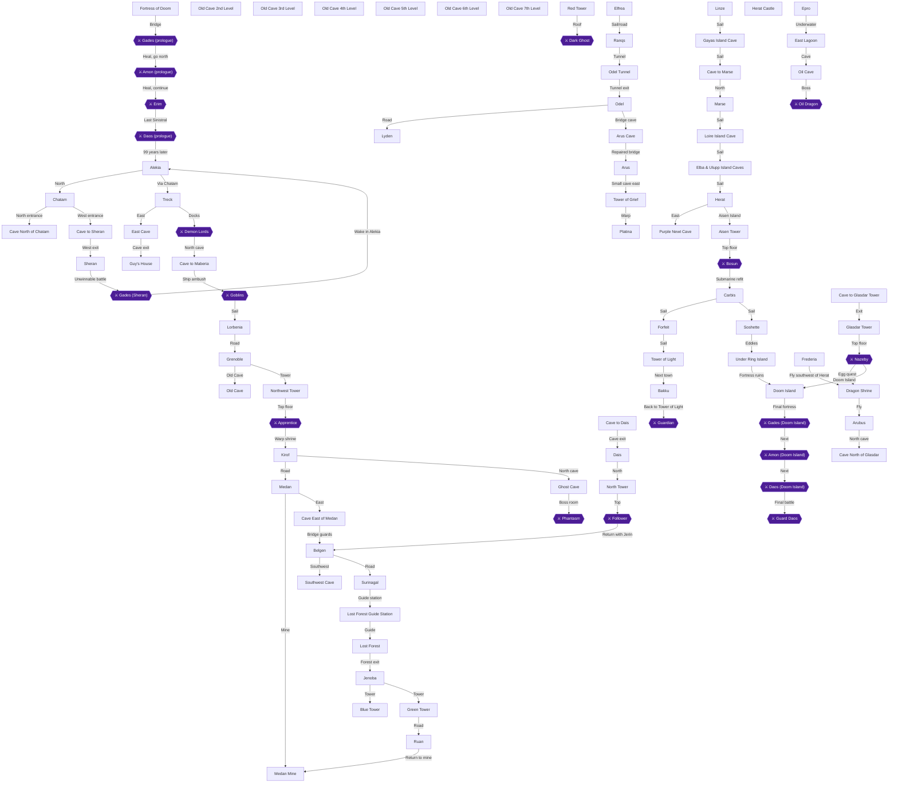

## Achievement dependencies

```mermaid
flowchart LR
  Might_Helmet(["⚠ Might Helmet (Tower of Light roof)"])
  Bakku["Bakku"]
  Fortress_of_Doom["Fortress of Doom"]
  Ach_196711(["🏆 First Encounter"])
  Daos_Prologue{{"⚔ Daos (prologue)"}}
  Ach_196718(["🏆 And So It Begins..."])
  Alekia["Alekia"]
  Ach_196717(["🏆 Lufia"])
  Sheran["Sheran"]
  Ach_196719(["🏆 Sheran Rescue"])
  Gades_Sheran{{"⚔ Gades (Sheran)"}}
  Ach_196720(["🏆 Imminent Defeat"])
  Treck["Treck"]
  Ach_196721(["🏆 Aguro"])
  Demon_Lords{{"⚔ Demon Lords"}}
  Ach_196722(["🏆 Demon Horde"])
  Goblins{{"⚔ Goblins"}}
  Ach_196723(["🏆 Goblin Horde"])
  Fairy_Kiss[/"Fairy Kiss"/]
  Ach_187954(["🏆 Fairy Kiss"])
  Apprentice{{"⚔ Apprentice"}}
  Ach_196724(["🏆 Artea's Apprentice"])
  Phantasm{{"⚔ Phantasm"}}
  Ach_196725(["🏆 The Exorcist"])
  Follower{{"⚔ Follower"}}
  Ach_196726(["🏆 Amon's Follower"])
  North_Tower["North Tower"]
  Ach_196727(["🏆 Jerin"])
  Dark_Ghost{{"⚔ Dark Ghost"}}
  Ach_196728(["🏆 Who You Gonna Call?"])
  Elfrea["Elfrea"]
  Ach_187955(["🏆 The Elven Village"])
  Arus_Cave["Arus Cave"]
  Ach_187957(["🏆 Building Bridges"])
  Falcon[/"Falcon"/]
  Ach_187958(["🏆 All Aboard!"])
  Ach_187956(["🏆 Mighty Intelligence"])
  Old_Cave_5["Old Cave 5th Level"]
  Ach_187966(["🏆 Escape Artist"])
  Old_Cave_7["Old Cave 7th Level"]
  Ach_196739(["🏆 World's Greatest"])
  Guardian{{"⚔ Guardian"}}
  Ach_196730(["🏆 Guardian"])
  Loire_Island_Cave["Loire Island Cave"]
  Ach_187967(["🏆 Holes, Holes, and a Brant"])
  Purple_Newt[/"Purple Newt"/]
  Ach_187960(["🏆 We're Off to See the Wizard... Of Taste!"])
  Aisen_Tower["Aisen Tower"]
  Ach_187968(["🏆 Riddle Me This..."])
  Bosun{{"⚔ Bosun"}}
  Ach_196732(["🏆 For Freedom!"])
  Under_Ring_Island["Under Ring Island"]
  Ach_187969(["🏆 Under the Sea, Under the Sea"])
  Dual_Blade[/"Dual Blade"/]
  Ach_196734(["🏆 Sin Slayer"])
  Oil_Dragon{{"⚔ Oil Dragon"}}
  Ach_196735(["🏆 Power the Falcon"])
  Frederia["Frederia"]
  Ach_187970(["🏆 Soaring the Skies"])
  Glasdar_Key[/"Glasdar Key"/]
  Ach_187971(["🏆 The Glasdar Key"])
  Nazeby{{"⚔ Nazeby"}}
  Ach_196736(["🏆 The Agent of Daos"])
  Guard_Daos{{"⚔ Guard Daos"}}
  Ach_196733(["🏆 One-Hundred Years"])
  Dragon_Shrine["Dragon Shrine"]
  Ach_187959(["🏆 I Feel Like Having Dragon Eggs for Breakfast"])
  East_Lagoon["East Lagoon"]
  Ach_187961(["🏆 Stronger Than the Sword of Legends"])
  Ach_187964(["🏆 Elven Warfare"])
  Ach_187962(["🏆 A Hero's Mightiest Shield"])
  Ach_187963(["🏆 Armor of Might"])
  Forfeit["Forfeit"]
  Ach_187965(["🏆 The Black Market"])
  Ach_196731(["🏆 Dragon's Wish"])
  Ach_196712(["🏆 Heavy Pockets"])
  Ach_196729(["🏆 Item Burden"])
  Ach_196713(["🏆 Better Than a Knife"])
  Ach_196714(["🏆 Level 5!"])
  Old_Cave_6["Old Cave 6th Level"]
  Ach_196715(["🏆 Level 25!"])
  Ach_196716(["🏆 Level 50!"])
  Ach_196738(["🏆 Treasure Seeker"])
  Ach_196737(["🏆 Treasure Hunter"])
  Might_Helmet -.->|missable before| Bakku
  Fortress_of_Doom -->|unlocks| Ach_196711
  Daos_Prologue -->|unlocks| Ach_196718
  Alekia -->|unlocks| Ach_196717
  Sheran -->|unlocks| Ach_196719
  Gades_Sheran -->|unlocks| Ach_196720
  Treck -->|unlocks| Ach_196721
  Demon_Lords -->|unlocks| Ach_196722
  Goblins -->|unlocks| Ach_196723
  Fairy_Kiss -->|unlocks| Ach_187954
  Apprentice -->|unlocks| Ach_196724
  Phantasm -->|unlocks| Ach_196725
  Follower -->|unlocks| Ach_196726
  North_Tower -->|unlocks| Ach_196727
  Dark_Ghost -->|unlocks| Ach_196728
  Elfrea -->|unlocks| Ach_187955
  Arus_Cave -->|unlocks| Ach_187957
  Falcon -->|unlocks| Ach_187958
  Might_Helmet -->|unlocks| Ach_187956
  Old_Cave_5 -->|unlocks| Ach_187966
  Old_Cave_7 -->|unlocks| Ach_196739
  Guardian -->|unlocks| Ach_196730
  Loire_Island_Cave -->|unlocks| Ach_187967
  Purple_Newt -->|unlocks| Ach_187960
  Aisen_Tower -->|unlocks| Ach_187968
  Bosun -->|unlocks| Ach_196732
  Under_Ring_Island -->|unlocks| Ach_187969
  Dual_Blade -->|unlocks| Ach_196734
  Oil_Dragon -->|unlocks| Ach_196735
  Frederia -->|unlocks| Ach_187970
  Glasdar_Key -->|unlocks| Ach_187971
  Nazeby -->|unlocks| Ach_196736
  Guard_Daos -->|unlocks| Ach_196733
  Dragon_Shrine -->|unlocks| Ach_187959
  East_Lagoon -->|unlocks| Ach_187961
  Dragon_Shrine -->|unlocks| Ach_187964
  Dragon_Shrine -->|unlocks| Ach_187962
  East_Lagoon -->|unlocks| Ach_187963
  Forfeit -->|unlocks| Ach_187965
  Dragon_Shrine -->|unlocks| Ach_196731
  East_Lagoon -->|unlocks| Ach_196712
  Forfeit -->|unlocks| Ach_196729
  Alekia -->|unlocks| Ach_196713
  Treck -->|unlocks| Ach_196714
  Old_Cave_6 -->|unlocks| Ach_196715
  East_Lagoon -->|unlocks| Ach_196716
  Old_Cave_5 -->|unlocks| Ach_196738
  Aisen_Tower -->|unlocks| Ach_196737
```

## Chapter 1: Prologue: The Fortress of Doom

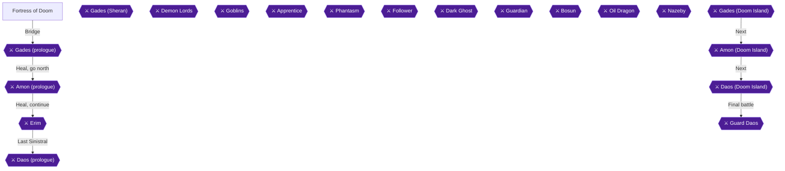

## Chapter 2: Alekia, Chatam and the Fall of Sheran

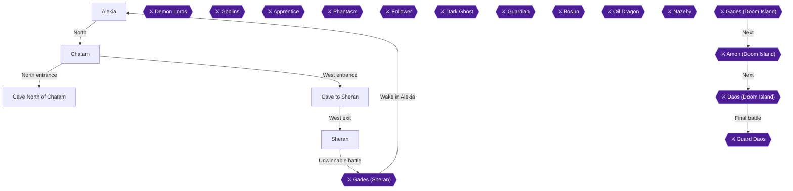

## Chapter 3: Treck, Aguro and the Goblin Pirates

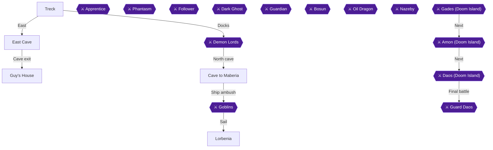

## Chapter 4: Grenoble, the Old Cave and Artea's Apprentice

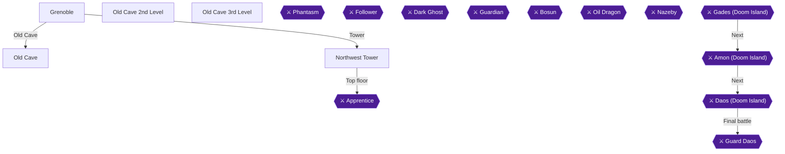

## Chapter 5: Kirof, Medan and the Phantasm

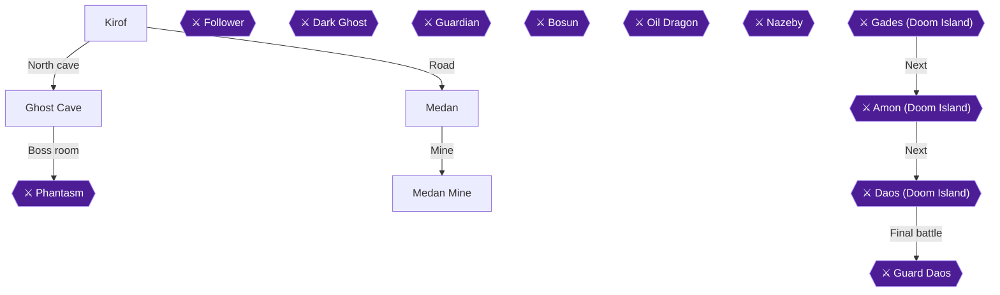

## Chapter 6: Belgen, Dais and the Rescue of Jerin

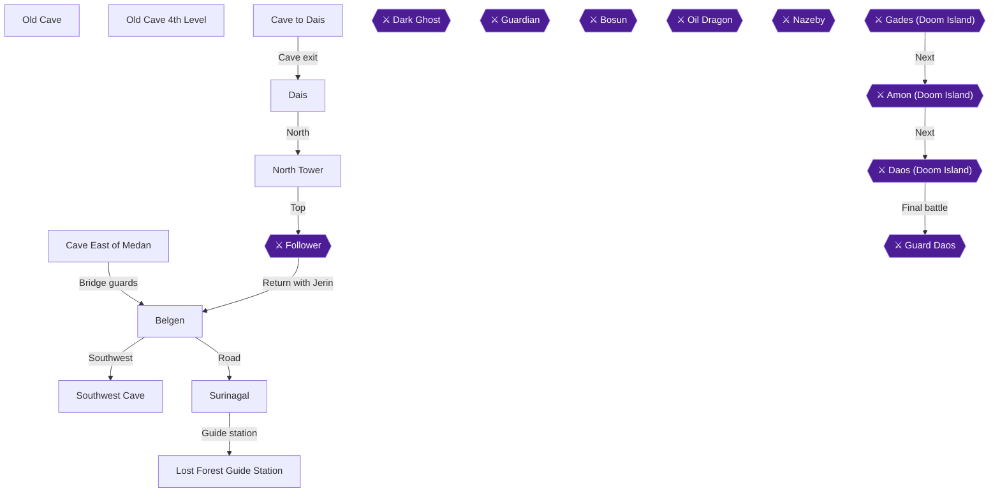

## Chapter 7: Lost Forest, the Three Towers and Elfrea

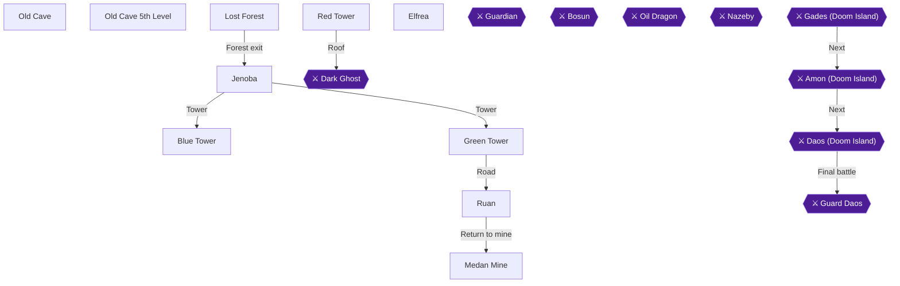

## Chapter 8: Ranqs, Odel and Piron's Bridge

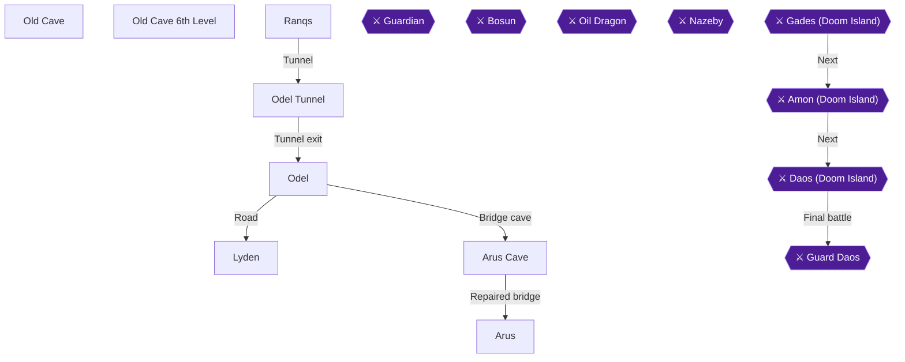

## Chapter 9: Tower of Grief, the Falcon and Forfeit

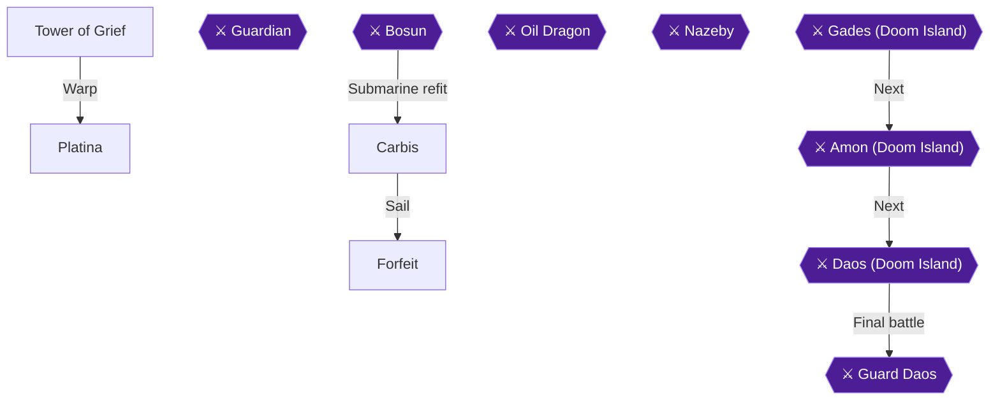

## Chapter 10: Tower of Light, Bakku and the Old Cave's Last Floor

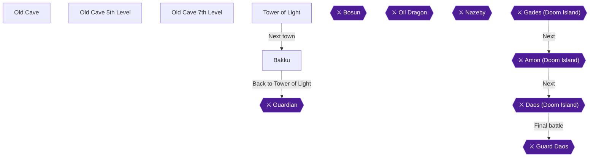

## Chapter 11: Linze, the Alumina Hunt and Brant

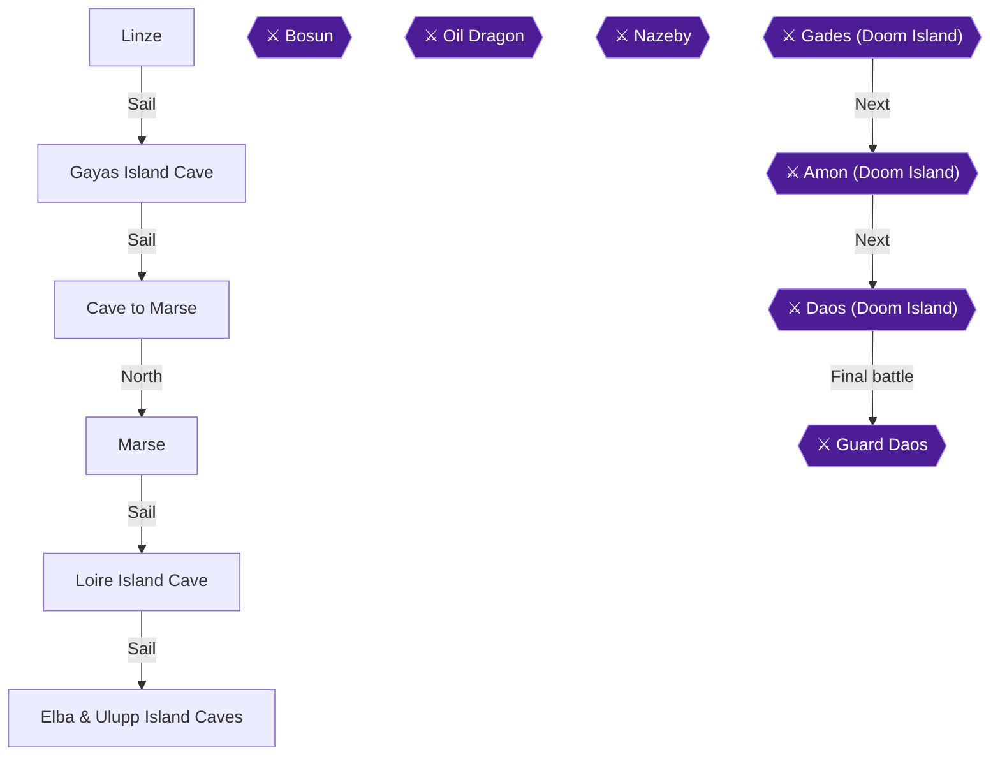

## Chapter 12: Herat, the Purple Newt and Aisen Tower

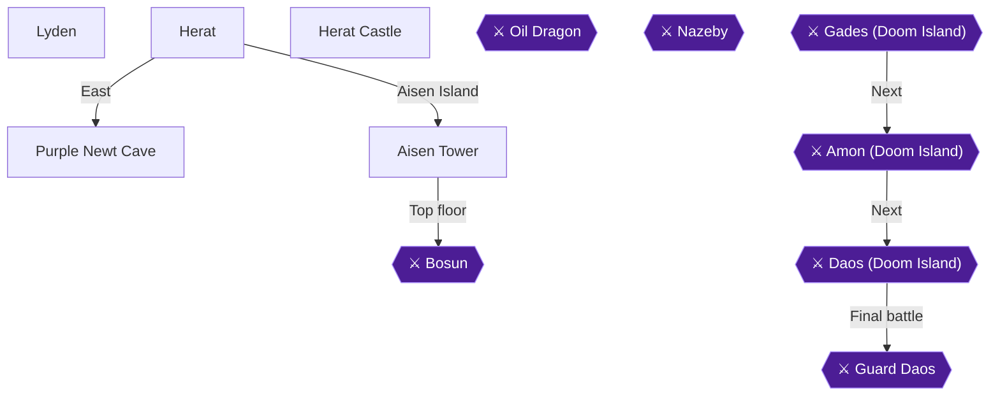

## Chapter 13: Under the Sea: Soshette and the Dual Blade

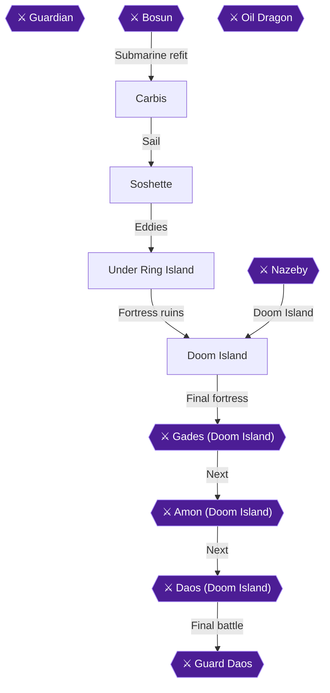

## Chapter 14: Epro, the Oil Dragon and the Might Farm

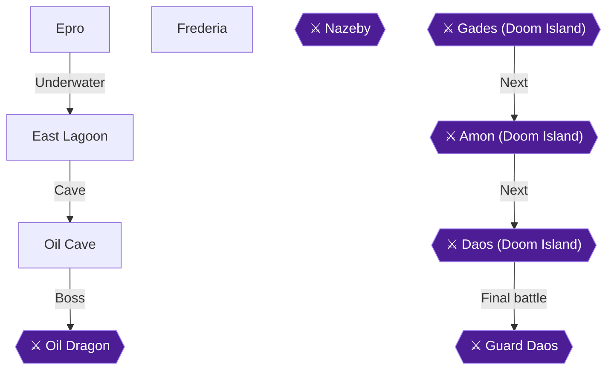

## Chapter 15: The First Dragon Wish and the Second Egg Hunt

```mermaid
flowchart TD
  Alekia["Alekia"]
  Gades_Sheran{{"⚔ Gades (Sheran)"}}
  Demon_Lords{{"⚔ Demon Lords"}}
  Goblins{{"⚔ Goblins"}}
  Northwest_Tower["Northwest Tower"]
  Apprentice{{"⚔ Apprentice"}}
  Phantasm{{"⚔ Phantasm"}}
  Belgen["Belgen"]
  Southwest_Cave["Southwest Cave"]
  Follower{{"⚔ Follower"}}
  Dark_Ghost{{"⚔ Dark Ghost"}}
  Guardian{{"⚔ Guardian"}}
  Cave_to_Marse["Cave to Marse"]
  Elba_Ulupp_Caves["Elba & Ulupp Island Caves"]
  Bosun{{"⚔ Bosun"}}
  Under_Ring_Island["Under Ring Island"]
  Oil_Cave["Oil Cave"]
  Oil_Dragon{{"⚔ Oil Dragon"}}
  Dragon_Shrine["Dragon Shrine"]
  Arubus["Arubus"]
  Nazeby{{"⚔ Nazeby"}}
  Gades_Final{{"⚔ Gades (Doom Island)"}}
  Amon_Final{{"⚔ Amon (Doom Island)"}}
  Daos_Final{{"⚔ Daos (Doom Island)"}}
  Guard_Daos{{"⚔ Guard Daos"}}
  Gades_Sheran -->|"Wake in Alekia"| Alekia
  Northwest_Tower -->|"Top floor"| Apprentice
  Belgen -->|"Southwest"| Southwest_Cave
  Follower -->|"Return with Jerin"| Belgen
  Oil_Cave -->|"Boss"| Oil_Dragon
  Dragon_Shrine -->|"Fly"| Arubus
  Nazeby -->|"Egg quest"| Dragon_Shrine
  Gades_Final -->|"Next"| Amon_Final
  Amon_Final -->|"Next"| Daos_Final
  Daos_Final -->|"Final battle"| Guard_Daos
  classDef ponr fill:#7f1d1d,stroke:#f87171,color:#fff;
  classDef boss fill:#4c1d95,stroke:#a78bfa,color:#fff;
  class Gades_Sheran,Demon_Lords,Goblins,Apprentice,Phantasm,Follower,Dark_Ghost,Guardian,Bosun,Oil_Dragon,Nazeby,Gades_Final,Amon_Final,Daos_Final,Guard_Daos boss;
```

## Chapter 16: Glasdar: the Key, the Cave and Nazeby

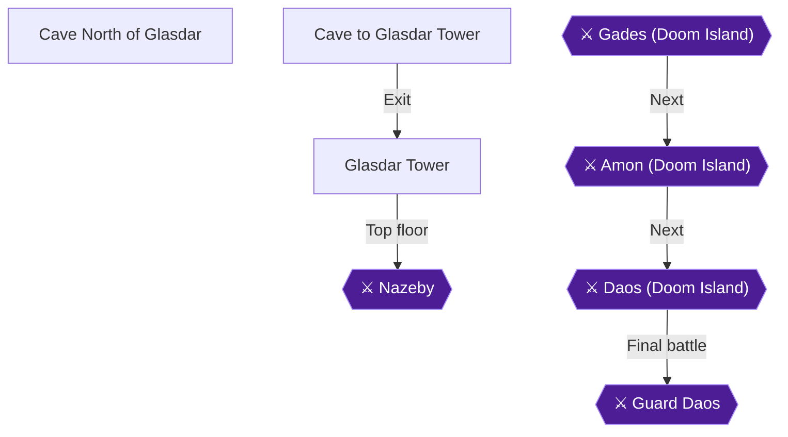

## Chapter 17: The Last Two Wishes and the Might Set

```mermaid
flowchart TD
  Sheran["Sheran"]
  Gades_Sheran{{"⚔ Gades (Sheran)"}}
  East_Cave["East Cave"]
  Demon_Lords{{"⚔ Demon Lords"}}
  Goblins{{"⚔ Goblins"}}
  Old_Cave_7["Old Cave 7th Level"]
  Apprentice{{"⚔ Apprentice"}}
  Phantasm{{"⚔ Phantasm"}}
  Follower{{"⚔ Follower"}}
  Dark_Ghost{{"⚔ Dark Ghost"}}
  Lyden["Lyden"]
  Forfeit["Forfeit"]
  Guardian{{"⚔ Guardian"}}
  Purple_Newt_Cave["Purple Newt Cave"]
  Bosun{{"⚔ Bosun"}}
  Oil_Dragon{{"⚔ Oil Dragon"}}
  Dragon_Shrine["Dragon Shrine"]
  Cave_North_of_Glasdar["Cave North of Glasdar"]
  Cave_to_Glasdar_Tower["Cave to Glasdar Tower"]
  Glasdar_Tower["Glasdar Tower"]
  Nazeby{{"⚔ Nazeby"}}
  Gades_Final{{"⚔ Gades (Doom Island)"}}
  Amon_Final{{"⚔ Amon (Doom Island)"}}
  Daos_Final{{"⚔ Daos (Doom Island)"}}
  Guard_Daos{{"⚔ Guard Daos"}}
  Sheran -->|"Unwinnable battle"| Gades_Sheran
  Cave_to_Glasdar_Tower -->|"Exit"| Glasdar_Tower
  Glasdar_Tower -->|"Top floor"| Nazeby
  Nazeby -->|"Egg quest"| Dragon_Shrine
  Gades_Final -->|"Next"| Amon_Final
  Amon_Final -->|"Next"| Daos_Final
  Daos_Final -->|"Final battle"| Guard_Daos
  classDef ponr fill:#7f1d1d,stroke:#f87171,color:#fff;
  classDef boss fill:#4c1d95,stroke:#a78bfa,color:#fff;
  class Gades_Sheran,Demon_Lords,Goblins,Apprentice,Phantasm,Follower,Dark_Ghost,Guardian,Bosun,Oil_Dragon,Nazeby,Gades_Final,Amon_Final,Daos_Final,Guard_Daos boss;
```

## Chapter 18: Doom Island: One Hundred Years Later

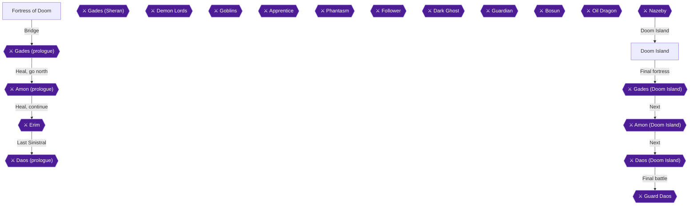
