# Lufia & The Fortress of Doom — 100% RetroAchievements Walkthrough

## Metadata

- **Platform:** SNES/Super Famicom
- **Developer:** Neverland
- **Publisher:** Taito
- **Genre:** Turn-Based RPG
- **Released:** 1993-12-01
- **Achievements:** 47 (343 points)

> [!NOTE]
> Every instruction in this guide was extracted from the sources listed at the bottom and checked against them (912 facts confirmed by 2+ sources, 3645 from a single source). Statements marked 🟡 come from only one source. Anything we could not confirm says **"Unable to verify from collected sources."**

## Game Overview

### Game Overview

This overview covers how the game plays, the rules you need before chapter 1, and how one playthrough reaches all 47 achievements (343 points). The chapters give the room-by-room routing.

#### What kind of game this is

Lufia & The Fortress of Doom is a turn-based RPG with old-fashioned combat and exploration, and its guide author describes it as a game with "a silly twist" rather than an epic western-style RPG [[gf1-2-1]]. You start in the Fortress of Doom, controlling Maxim and his party in the prologue. The guide calls this section unimportant for your final treasure count [[gf1-3-1]]. After that you control the hero in Alekia, in the later "one hundred years later" part of the story. The roadmap's 18 chapters follow that order, ending on Doom Island.

One point of confusion: the Fortress of Doom bosses are fought twice. Gades, Amon and Daos appear in the prologue and again at the end, and the final boss guide says Daos is "the same as at the beginning of the game" [[gf-boss-4-10]]. The prologue is also where the first achievements may pop (see the open question below).

#### Combat and party basics

- **Attacks are not redirected.** If you target an enemy and it dies before your character acts, the attack is not moved to another target. This slows fights down [[ra-comments-2-4]]. Expect a lot of random encounters.
- **Status effects matter.** Players report that statuses are more useful than expected [[ra-comments-4-4]]. The effects you will meet:
  - Poison deals 1 damage per step outside battle [[gf1-2-6]] and is the only status that lasts after a battle [[gf1-3-3]].
  - Confuse makes the target attack a random ally or enemy [[gf1-2-7]].
  - Sleep and paralysis stop the target from acting [[gf1-2-1]].
  - Petrify stops the target acting or taking damage [[gf1-2-8]].
  - Dead means 0 HP and no actions [[gf1-2-9]].
- **Curing statuses.** Attacking a confused or sleeping party member cures them [[gf1-3-1]]. Confuse, sleep and paralysis may also wear off on their own after a round [[gf1-3-2]].
- **Game over** happens when the whole party is petrified, dead, or a mix of both [[gf1-3-4]].

#### Stat potions

Stat potions raise a stat permanently. The effects are:

- Power Potion: HP +3-5 [[gf1-91-5]].
- Great Potion: ATP +1-3 [[gf1-91-3]].
- Mind Potion: INT +1-3 [[gf1-91-4]].
- Speed Potion: AGL +1-3 [[gf1-91-6]].
- Spell Potion: MP +3-5 [[gf1-91-7]].

The guide's suggested split: Power Potions go to whoever has the least max HP [[gf1-2-1]]. Great Potions go to Aguro, who learns no spells [[gf1-2-2]]. Spell Potions go to the Hero, who has the least MP but the costly Rally and Valor [[gf1-2-3]]. Mind Potions go to Lufia, who relies on magic [[gf1-2-4]]. Speed Potions go to Jerin [[gf1-2-5]]. This split is a recommendation, not a requirement.

#### Magic you will rely on

Each magic user learns spells as they level up [[gf1-94-1, gf2-66-12]]. The ones that shape strategy are:

- **Warp** (8 MP) takes the party to any town already visited [[gf1-94-9]]. Jerin has it at level 14 [[gf2-66-12]], and the sources advise using it [[gf3-10-5]].
- **Escape** (8 MP) leaves most dungeons [[gf1-94-4]], but it does not work inside towers except on the roof [[gf1-58-1]].
- **Float** (2 MP) lets the party cross swamps [[gf1-94-5]].
- **Mirror** deflects enemy spells for one member (3 MP) [[gf2-66-25]]. Jerin learns it at level 32 [[gf2-66-25]], and the boss guide leans on it heavily for the late-game fights [[gf-boss-4-10]].
- **Lufia's Flash Ring + Bolt/Thunder.** Lufia learns Bolt at level 21 [[gf2-65-28]] and Thunder at level 41 [[gf2-66-8]]. The boss guide tells you to equip her Flash Ring before the Nazeby fight [[gf-boss-3-6]].
- **Healing** goes up in tiers: Strong, Stronger, Champion (8 MP, full HP to one member) [[gf1-94-2]], Boost (15 MP, about 90 HP to the party) [[gf1-94-1]], and Valor (35 MP, full HP to the party) [[gf1-94-8]]. Rally (30 MP) revives one member to max HP [[gf1-94-6]].

Equipment and shop notes that come up repeatedly:

- Equip the Engage ring before buying, because it lowers shop prices [[gf4-16-6]].
- The cursed Broad Sword has 81 attack power but drains HP when it hits [[gf2-18-4]]. It costs 600 gold to remove the curse, which only reduces the drain to 1-3 damage per turn [[gf3-6-4]].
- Item drop rates vary, and better items generally drop less often [[gf1-94-11]]. Some drops are as rare as 1/256, which is where the grinding comes from [[ra-comments-4-1]].

#### Dungeon mechanics you will see everywhere

- **Warp pads and switches.** Many dungeons use a switch that redirects a nearby warp point. One example is the Gayas Island Cave center-room switch [[gf1-65-9]]. Another is the Elba switch that changes where the teleporter leads on Ullup Island [[gf4-16-1]].
- **Healing tiles.** Blue floor panels restore HP and MP [[gf2-20-20]]. Pots in Dais do the same [[gf2-24-13]]. Note their positions, because they stand in for an inn mid-dungeon.
- **Invisible bridges and walls.** These puzzles are solved with step-by-step directions in the relevant chapter. Examples include the invisible bridge in Kirof Cave [[gf3-7-24]] and the invisible wall rooms of the Cave to Odel [[gf1-47-3]].
- **Collapsing floors and hazards.** Damaging terrain exists, such as the grey area outside the East Cave [[gf3-3-6]] and the mud in some caves [[gf2-11-13]]. Floor-collapse rooms exist too [[gf2-45-37]].
- **The Old Cave.** This 7-floor optional dungeon is gated by party level [[gf1-17-5]]. Sources disagree on the exact thresholds: one says the second floor needs a level-5 character and each later floor needs 5 more levels [[gf1-17-5]], while another lists "no requirements" for the second floor and level 10 for the third [[gf4-7-6]]. One source says the Hero should be level 25 or higher for the 6th floor [[gf2-38-2]]. Chapters 4 and 10 give the floor-by-floor guidance, and where a threshold matters, treat it as approximate.

#### Hardcore Mode and RetroAchievements

Play in Hardcore Mode. Save states, rewind and cheats are all disabled, so rely on the game's own saving and on inns and shrines for healing. Use the Warp spell to get back to town quickly [[gf3-10-5]]. Do not plan any step around emulator tricks.

No difficulty setting is involved. Some achievements are reported to be sticky, because one player finished the game with five not triggering: Jerin, Level 25, Phantasm, Amon's Follower and Darkness [[ra-comments-1-2]]. Check your achievement list as you go rather than waiting until the end, so a missing unlock can be dealt with while you are still near the relevant content.

**Open questions (unconfirmed):**

- Whether **First Encounter** triggers on a prologue battle with Maxim's party or only on the young hero's first win is not confirmed by any source. Unlock counts suggest it pops in the prologue. If it has not popped by the end of the prologue, win one fight outside Alekia.
- Whether **Item Burden** counts a stack of one item as one slot, and whether the slots must hold different items, is unconfirmed. The only source, an RA commenter, says it is 5 pages of items. Fill every slot on all 5 pages with different items, buying cheap ones from town shops or the Forfeit black market.
- Whether **Heavy Pockets** checks gold on hand at any moment or whether spending first matters is unconfirmed. The description says "Have at least 200,000 Gold". Hold 200,000 Gold at one time before any big purchase.

#### The 100% plan in plain language

One playthrough covers all 47 achievements, with 637 checklist chests and 24 Dragon Eggs tracked across the world (see the treasure note below for why the game's own counter says 655) [[gf-treasure-13-16, ra-comments-1-2]]. The parts that need planning are these.

**1. The only missable: the Might Helmet.** A chest on the roof of the Tower of Light holds the Might Helmet, and it is the only one in the game [[gf1-57-12]]. Do not go to Bakku when Raile first tells you to. Doing so means permanently missing a very rare and powerful item [[gf1-55-2]]. A commenter says that visiting Bakku means the helmet disappears forever [[ra-comments-22-6]]. The Forfeit section repeats the warning: advancing the plot at the next town before the Tower of Light costs you one of the best pieces of equipment in the game [[gf1-56-5]]. If you reach the Tower of Light after missing it, the helmet is gone for good [[gf1-62-1]]. Chapter 10 handles this. Another player reportedly got it by accident while playing blind [[ra-comments-3-5]].

**2. Treasure counts.** Two numbers appear in this guide, and they count different things. Every chapter checkpoint counts toward **637**, the total of TheJuice's per-area chest checklist posted in the RA comments; this guide follows that list area by area. The game's own hidden counter tracks **655** findable chests and 136 findable "got items" [[gf-treasure-1-1]], and reads 655/655 and 136/136 in a fully cleared save [[gf-treasure-13-16]]. The gap of 18 is most likely chests the checklist does not list; its author warns it may contain errors, because a chest or two may have been missed [[ra-comments-50-26]]. That 655 was read from the game's memory with an emulator, so you will not see it during normal play. Treat 637 / 637 at the final checkpoint as the guide's tally, and open every chest you route past, listed or not. Treasure Hunter only needs 500 chests, so the achievements themselves do not need every chest in the game [[ra-comments-51-28]]. Chests in the prologue do not count toward the totals [[gf-treasure-1-1]]. Empty chests exist only in the Old Cave [[gf-treasure-12-1]].

**3. Dragon Eggs and the three wishes.** Bring 8 Dragon Eggs to the Dragon Shrine for one wish [[gf4-21-109]]. The four wishes are two levels for everyone, three of each stat potion, a Might Shield, or a Might Bow [[gf2-60-6]]. The second set of eggs only becomes obtainable after the first wish, and the third set only after the second [[gf4-21-110]]. Per the roadmap, the three wishes do not exclude each other as long as the first two are the Might Bow and a Might Shield; an RA commenter reports that three Might Shields lock out the bow. Chapters 15 and 17 route this. Note that the Might Bow is ten points weaker than the Zircon Rod but lets Jerin hit all enemies [[gf3-26-13]].

**4. Farm the Might Sword and Might Armor while Lufia is in the party.** These are random drops that can take hours, so farm them in chapter 14. After the boss Nazeby, Lufia leaves the party until the final battle [[gf4-20-1]], and the Dual Blade is lost at the same point [[gf4-20-3]]. Leveling and farming without her is described as a pain [[gf4-20-1]].

**5. Encounter-rate helpers.** Per players, buying 100 Sweet Water and equipping the Monster Ring creates a "foul water" effect of monsters appearing every step [[ra-comments-38-2]]. It does not work if Clear Silk is equipped [[ra-comments-41-4]]. Use it for the achievements that need many battles.

**6. The end of the game.** After beating Amon you can still walk out of the Fortress of Doom and save, but not after beating Daos [[gf-boss-4-6]]. Before finishing off Daos, fill the party's HP and MP, because there is no opportunity to heal before the last boss [[gf-boss-4-10]]. Treat the fight against Amon as your last safe save point before the finale.

#### How to use the chapters

Follow the chapters in order. Each one routes its town or dungeon room by room, lists every chest, and places the achievements at the moment they unlock. Warnings for the Tower of Light (chapter 10) and the Nazeby farm (chapters 14 and 16) appear before the point where they matter. Finish each area completely before moving on, and use Warp to return to earlier towns when something is missing.

> [!TIP]
> **Before you start:** Reread the Bakku warning above, because the Might Helmet is the only item in the game you can permanently lose [[gf1-55-2, gf1-57-12]].

## Achievement Roadmap

| Chapter | Achievements | Points |
|---|---|---|
| [1. Prologue: The Fortress of Doom](#chapter-1-prologue-the-fortress-of-doom) | First Encounter, And So It Begins... | 3 |
| [2. Alekia, Chatam and the Fall of Sheran](#chapter-2-alekia-chatam-and-the-fall-of-sheran) | Better Than a Knife, Imminent Defeat, Lufia, Sheran Rescue | 8 |
| [3. Treck, Aguro and the Goblin Pirates](#chapter-3-treck-aguro-and-the-goblin-pirates) | Level 5!, Aguro, Demon Horde, Goblin Horde | 17 |
| [4. Grenoble, the Old Cave and Artea's Apprentice](#chapter-4-grenoble-the-old-cave-and-arteas-apprentice) | Fairy Kiss, Artea's Apprentice | 12 |
| [5. Kirof, Medan and the Phantasm](#chapter-5-kirof-medan-and-the-phantasm) | The Exorcist | 10 |
| [6. Belgen, Dais and the Rescue of Jerin](#chapter-6-belgen-dais-and-the-rescue-of-jerin) | Amon's Follower, Jerin | 12 |
| [7. Lost Forest, the Three Towers and Elfrea](#chapter-7-lost-forest-the-three-towers-and-elfrea) | Who You Gonna Call?, The Elven Village, Treasure Seeker | 22 |
| [8. Ranqs, Odel and Piron's Bridge](#chapter-8-ranqs-odel-and-pirons-bridge) | Building Bridges, Level 25! | 13 |
| [9. Tower of Grief, the Falcon and Forfeit](#chapter-9-tower-of-grief-the-falcon-and-forfeit) | All Aboard!, The Black Market | 3 |
| [10. Tower of Light, Bakku and the Old Cave's Last Floor](#chapter-10-tower-of-light-bakku-and-the-old-caves-last-floor) | Mighty Intelligence, Escape Artist, World's Greatest, Guardian | 27 |
| [11. Linze, the Alumina Hunt and Brant](#chapter-11-linze-the-alumina-hunt-and-brant) | Holes, Holes, and a Brant | 3 |
| [12. Herat, the Purple Newt and Aisen Tower](#chapter-12-herat-the-purple-newt-and-aisen-tower) | We're Off to See the Wizard... Of Taste!, Riddle Me This..., For Freedom!, Treasure Hunter | 39 |
| [13. Under the Sea: Soshette and the Dual Blade](#chapter-13-under-the-sea-soshette-and-the-dual-blade) | Under the Sea, Under the Sea, Sin Slayer | 6 |
| [14. Epro, the Oil Dragon and the Might Farm](#chapter-14-epro-the-oil-dragon-and-the-might-farm) | Power the Falcon, Soaring the Skies, Stronger Than the Sword of Legends, Armor of Might, Level 50!, Heavy Pockets | 57 |
| [15. The First Dragon Wish and the Second Egg Hunt](#chapter-15-the-first-dragon-wish-and-the-second-egg-hunt) | Dragon's Wish, Elven Warfare | 15 |
| [16. Glasdar: the Key, the Cave and Nazeby](#chapter-16-glasdar-the-key-the-cave-and-nazeby) | The Glasdar Key, The Agent of Daos | 13 |
| [17. The Last Two Wishes and the Might Set](#chapter-17-the-last-two-wishes-and-the-might-set) | A Hero's Mightiest Shield, I Feel Like Having Dragon Eggs for Breakfast, Item Burden | 33 |
| [18. Doom Island: One Hundred Years Later](#chapter-18-doom-island-one-hundred-years-later) | One-Hundred Years | 50 |

## Playthrough Planning

**Playthroughs required:** 1

One playthrough covers all 47 achievements. The only missable is the Might Helmet (go to the Tower of Light before Bakku). The three wishes do not exclude each other as long as the first two are the Might Bow and a Might Shield (three Might Shields lock out the bow, per an RA commenter). The Might Sword and Might Armor are random drops that can take hours; farm them in chapter 14 while Lufia is still in the party. [[gf-treasure-13-16,ra-comments-50-26,ra-comments-51-28,ra-comments-3-5,gf1-17-5,gf4-21-135,gf1-2-2,gf1-2-3,gf1-2-4,gf1-2-5,ra-comments-1-2,ra-comments-4-1,ra-comments-4-3,gf1-94-11]]

**Settings:** Hardcore mode. No difficulty setting is involved. Chest counts follow TheJuice's checklist posted in the RA comments; the in-game counter (655) differs slightly.

## True 100% In-Game Completion Criteria

This guide covers complete in-game mastery in addition to all RetroAchievements:

| Category | 100% Requirement | Tracking Scope |
|---|---|---|
| **Treasure chests** | Open every treasure chest in every town and dungeon, counted with TheJuice's RA chest checklist (637 chests; the game's own counter shows 655 opened boxes and 136 hidden items in gf-treasure's 100% save, so a few chests are not on the checklist). | Per-chapter checkpoint |
| **Dragon Eggs and wishes** | Collect all 24 Dragon Eggs (three sets of 8) and make all three wishes at the Dragon Shrine. | Per-chapter checkpoint |
| **Might equipment and side tasks** | Might Helmet (missable), Might Bow and Might Shield by wish, Might Sword and Might Armor by drops; Fairy Kiss, Old Cave floors and Crown Jewels, the Purple Newt, the Black Market. | Per-chapter checkpoint |

## Missables Summary

| ⚠ Missable | Achievement | Chapter | Must be done before |
|---|---|---|---|
| Might Helmet on the Tower of Light roof [[gf1-62-1,ra-comments-22-6,ra-comments-22-4,gf1-55-2,gf1-56-5,gf1-57-12]] | Mighty Intelligence | [10](#chapter-10-tower-of-light-bakku-and-the-old-caves-last-floor) | Before entering Bakku for the first time (chapter 10). Go to the Tower of Light straight after Carbis/Forfeit. |

## Points of No Return

| ⛔ Point of No Return | Chapter | What you lose access to |
|---|---|---|
| Visiting Bakku [[ra-comments-22-6,gf1-55-2,gf1-62-1]] | [10](#chapter-10-tower-of-light-bakku-and-the-old-caves-last-floor) | Entering Bakku before taking the Might Helmet from the Tower of Light roof removes the helmet for good. |
| Defeating Nazeby [[gf4-20-1,gf4-20-3]] | [16](#chapter-16-glasdar-the-key-the-cave-and-nazeby) | Lufia leaves the party until the final battle and the Dual Blade is lost; farming the Might drops gets harder. |
| Defeating Daos on Doom Island [[gf-boss-4-6,gf-boss-4-10]] | [18](#chapter-18-doom-island-one-hundred-years-later) | After Daos you cannot leave the fortress or heal before Guard Daos, the final boss. |

## Progression Diagrams

### Game Progression

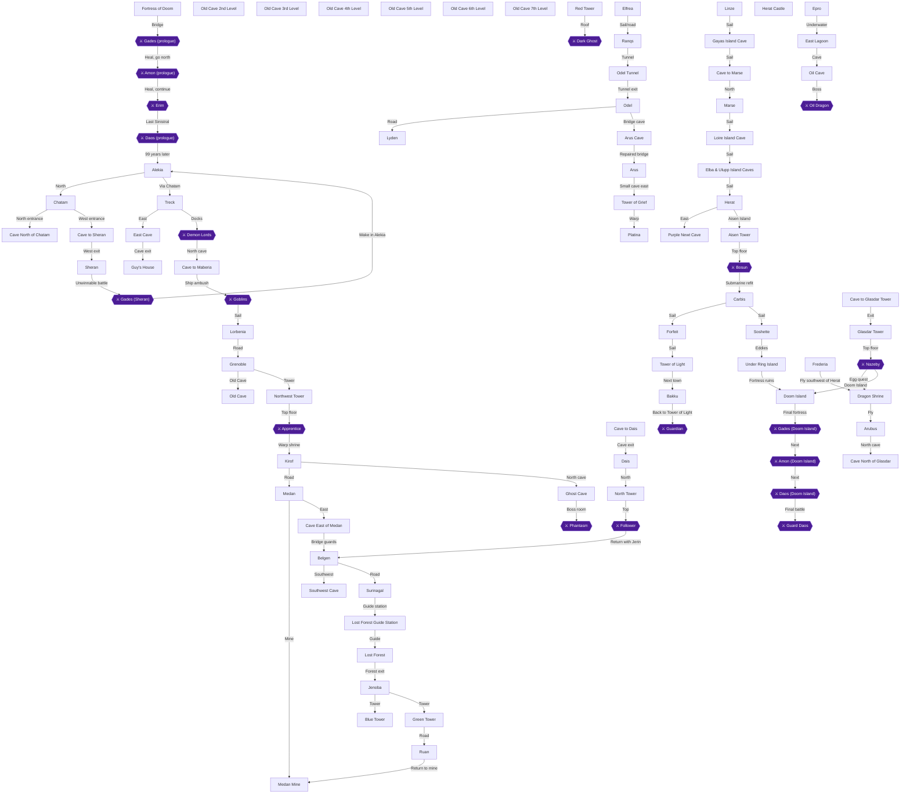

### Achievement Dependencies

```mermaid
flowchart LR
  Might_Helmet(["⚠ Might Helmet (Tower of Light roof)"])
  Bakku["Bakku"]
  Fortress_of_Doom["Fortress of Doom"]
  Ach_196711(["🏆 First Encounter"])
  Daos_Prologue{{"⚔ Daos (prologue)"}}
  Ach_196718(["🏆 And So It Begins..."])
  Alekia["Alekia"]
  Ach_196717(["🏆 Lufia"])
  Sheran["Sheran"]
  Ach_196719(["🏆 Sheran Rescue"])
  Gades_Sheran{{"⚔ Gades (Sheran)"}}
  Ach_196720(["🏆 Imminent Defeat"])
  Treck["Treck"]
  Ach_196721(["🏆 Aguro"])
  Demon_Lords{{"⚔ Demon Lords"}}
  Ach_196722(["🏆 Demon Horde"])
  Goblins{{"⚔ Goblins"}}
  Ach_196723(["🏆 Goblin Horde"])
  Fairy_Kiss[/"Fairy Kiss"/]
  Ach_187954(["🏆 Fairy Kiss"])
  Apprentice{{"⚔ Apprentice"}}
  Ach_196724(["🏆 Artea's Apprentice"])
  Phantasm{{"⚔ Phantasm"}}
  Ach_196725(["🏆 The Exorcist"])
  Follower{{"⚔ Follower"}}
  Ach_196726(["🏆 Amon's Follower"])
  North_Tower["North Tower"]
  Ach_196727(["🏆 Jerin"])
  Dark_Ghost{{"⚔ Dark Ghost"}}
  Ach_196728(["🏆 Who You Gonna Call?"])
  Elfrea["Elfrea"]
  Ach_187955(["🏆 The Elven Village"])
  Arus_Cave["Arus Cave"]
  Ach_187957(["🏆 Building Bridges"])
  Falcon[/"Falcon"/]
  Ach_187958(["🏆 All Aboard!"])
  Ach_187956(["🏆 Mighty Intelligence"])
  Old_Cave_5["Old Cave 5th Level"]
  Ach_187966(["🏆 Escape Artist"])
  Old_Cave_7["Old Cave 7th Level"]
  Ach_196739(["🏆 World's Greatest"])
  Guardian{{"⚔ Guardian"}}
  Ach_196730(["🏆 Guardian"])
  Loire_Island_Cave["Loire Island Cave"]
  Ach_187967(["🏆 Holes, Holes, and a Brant"])
  Purple_Newt[/"Purple Newt"/]
  Ach_187960(["🏆 We're Off to See the Wizard... Of Taste!"])
  Aisen_Tower["Aisen Tower"]
  Ach_187968(["🏆 Riddle Me This..."])
  Bosun{{"⚔ Bosun"}}
  Ach_196732(["🏆 For Freedom!"])
  Under_Ring_Island["Under Ring Island"]
  Ach_187969(["🏆 Under the Sea, Under the Sea"])
  Dual_Blade[/"Dual Blade"/]
  Ach_196734(["🏆 Sin Slayer"])
  Oil_Dragon{{"⚔ Oil Dragon"}}
  Ach_196735(["🏆 Power the Falcon"])
  Frederia["Frederia"]
  Ach_187970(["🏆 Soaring the Skies"])
  Glasdar_Key[/"Glasdar Key"/]
  Ach_187971(["🏆 The Glasdar Key"])
  Nazeby{{"⚔ Nazeby"}}
  Ach_196736(["🏆 The Agent of Daos"])
  Guard_Daos{{"⚔ Guard Daos"}}
  Ach_196733(["🏆 One-Hundred Years"])
  Dragon_Shrine["Dragon Shrine"]
  Ach_187959(["🏆 I Feel Like Having Dragon Eggs for Breakfast"])
  East_Lagoon["East Lagoon"]
  Ach_187961(["🏆 Stronger Than the Sword of Legends"])
  Ach_187964(["🏆 Elven Warfare"])
  Ach_187962(["🏆 A Hero's Mightiest Shield"])
  Ach_187963(["🏆 Armor of Might"])
  Forfeit["Forfeit"]
  Ach_187965(["🏆 The Black Market"])
  Ach_196731(["🏆 Dragon's Wish"])
  Ach_196712(["🏆 Heavy Pockets"])
  Ach_196729(["🏆 Item Burden"])
  Ach_196713(["🏆 Better Than a Knife"])
  Ach_196714(["🏆 Level 5!"])
  Old_Cave_6["Old Cave 6th Level"]
  Ach_196715(["🏆 Level 25!"])
  Ach_196716(["🏆 Level 50!"])
  Ach_196738(["🏆 Treasure Seeker"])
  Ach_196737(["🏆 Treasure Hunter"])
  Might_Helmet -.->|missable before| Bakku
  Fortress_of_Doom -->|unlocks| Ach_196711
  Daos_Prologue -->|unlocks| Ach_196718
  Alekia -->|unlocks| Ach_196717
  Sheran -->|unlocks| Ach_196719
  Gades_Sheran -->|unlocks| Ach_196720
  Treck -->|unlocks| Ach_196721
  Demon_Lords -->|unlocks| Ach_196722
  Goblins -->|unlocks| Ach_196723
  Fairy_Kiss -->|unlocks| Ach_187954
  Apprentice -->|unlocks| Ach_196724
  Phantasm -->|unlocks| Ach_196725
  Follower -->|unlocks| Ach_196726
  North_Tower -->|unlocks| Ach_196727
  Dark_Ghost -->|unlocks| Ach_196728
  Elfrea -->|unlocks| Ach_187955
  Arus_Cave -->|unlocks| Ach_187957
  Falcon -->|unlocks| Ach_187958
  Might_Helmet -->|unlocks| Ach_187956
  Old_Cave_5 -->|unlocks| Ach_187966
  Old_Cave_7 -->|unlocks| Ach_196739
  Guardian -->|unlocks| Ach_196730
  Loire_Island_Cave -->|unlocks| Ach_187967
  Purple_Newt -->|unlocks| Ach_187960
  Aisen_Tower -->|unlocks| Ach_187968
  Bosun -->|unlocks| Ach_196732
  Under_Ring_Island -->|unlocks| Ach_187969
  Dual_Blade -->|unlocks| Ach_196734
  Oil_Dragon -->|unlocks| Ach_196735
  Frederia -->|unlocks| Ach_187970
  Glasdar_Key -->|unlocks| Ach_187971
  Nazeby -->|unlocks| Ach_196736
  Guard_Daos -->|unlocks| Ach_196733
  Dragon_Shrine -->|unlocks| Ach_187959
  East_Lagoon -->|unlocks| Ach_187961
  Dragon_Shrine -->|unlocks| Ach_187964
  Dragon_Shrine -->|unlocks| Ach_187962
  East_Lagoon -->|unlocks| Ach_187963
  Forfeit -->|unlocks| Ach_187965
  Dragon_Shrine -->|unlocks| Ach_196731
  East_Lagoon -->|unlocks| Ach_196712
  Forfeit -->|unlocks| Ach_196729
  Alekia -->|unlocks| Ach_196713
  Treck -->|unlocks| Ach_196714
  Old_Cave_6 -->|unlocks| Ach_196715
  East_Lagoon -->|unlocks| Ach_196716
  Old_Cave_5 -->|unlocks| Ach_196738
  Aisen_Tower -->|unlocks| Ach_196737
```

## Boss Index

Full strategies are in each chapter.

| Boss | Chapter |
|---|---|
| Gades (prologue) | [1. Prologue: The Fortress of Doom](#chapter-1-prologue-the-fortress-of-doom) |
| Amon (prologue) | [1. Prologue: The Fortress of Doom](#chapter-1-prologue-the-fortress-of-doom) |
| Erim | [1. Prologue: The Fortress of Doom](#chapter-1-prologue-the-fortress-of-doom) |
| Daos (prologue) | [1. Prologue: The Fortress of Doom](#chapter-1-prologue-the-fortress-of-doom) |
| Gades (Sheran) | [2. Alekia, Chatam and the Fall of Sheran](#chapter-2-alekia-chatam-and-the-fall-of-sheran) |
| Demon Lords | [3. Treck, Aguro and the Goblin Pirates](#chapter-3-treck-aguro-and-the-goblin-pirates) |
| Goblins | [3. Treck, Aguro and the Goblin Pirates](#chapter-3-treck-aguro-and-the-goblin-pirates) |
| Apprentice | [4. Grenoble, the Old Cave and Artea's Apprentice](#chapter-4-grenoble-the-old-cave-and-arteas-apprentice) |
| Phantasm | [5. Kirof, Medan and the Phantasm](#chapter-5-kirof-medan-and-the-phantasm) |
| Follower | [6. Belgen, Dais and the Rescue of Jerin](#chapter-6-belgen-dais-and-the-rescue-of-jerin) |
| Dark Ghost | [7. Lost Forest, the Three Towers and Elfrea](#chapter-7-lost-forest-the-three-towers-and-elfrea) |
| Guardian | [10. Tower of Light, Bakku and the Old Cave's Last Floor](#chapter-10-tower-of-light-bakku-and-the-old-caves-last-floor) |
| Bosun | [9. Tower of Grief, the Falcon and Forfeit](#chapter-9-tower-of-grief-the-falcon-and-forfeit) |
| Oil Dragon | [14. Epro, the Oil Dragon and the Might Farm](#chapter-14-epro-the-oil-dragon-and-the-might-farm) |
| Nazeby | [13. Under the Sea: Soshette and the Dual Blade](#chapter-13-under-the-sea-soshette-and-the-dual-blade) |
| Gades (Doom Island) | [13. Under the Sea: Soshette and the Dual Blade](#chapter-13-under-the-sea-soshette-and-the-dual-blade) |
| Amon (Doom Island) | [18. Doom Island: One Hundred Years Later](#chapter-18-doom-island-one-hundred-years-later) |
| Daos (Doom Island) | [18. Doom Island: One Hundred Years Later](#chapter-18-doom-island-one-hundred-years-later) |
| Guard Daos | [18. Doom Island: One Hundred Years Later](#chapter-18-doom-island-one-hundred-years-later) |

## Walkthrough

## Chapter 1: Prologue: The Fortress of Doom

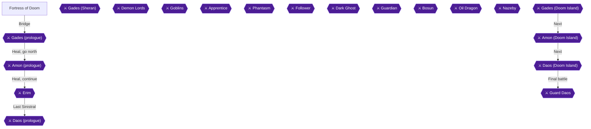

You start as Maxim, Selan, Guy and Artea at the Fortress of Doom, and you fight the four Sinistrals one at a time: Gades, Amon, Erim and Daos [[gf-boss-1-1]]. The recommended level is 78 [[gf1-3-5]]. Three of the four heroes already know numerous spells [[gf2-3-11]]. The chests here are optional and do not add to your final treasure count [[gf1-3-9]]. They are all listed below, numbered, in case you want the items for the fights.

Two achievements come from this chapter: **First Encounter** (defeat your first enemy) and **And So It Begins...** (complete the Prologue). There are no missables and no points of no return here.

> [!TIP]
> **First Encounter:** it should pop on your first battle win in this fortress. No collected source confirms that it triggers on a prologue battle. If it has not popped by the end of the prologue, win one fight outside Alekia in the next chapter, where Jellyfish are among the enemies [[gf2-4-1]].

### Fortress of Doom

🗺️ **Map:** [View Fortress Of Doom Map by FlyingArmor](https://www.vgmaps.com/Atlas/SuperNES/Lufia&TheFortressOfDoom-FortressOfDoom.png)

The fortress has 12 chests [[gf2-3-7]]. Enemies are Mad Knight, Hydra, Efreet, Mad Wolf, Mega Frog and Rock Golem [[gf2-3-1, gf2-3-2, gf2-3-3, gf2-3-4, gf2-3-5, gf2-3-6]]. Efreet is weak to Water, Mad Knight to Thunder and Mega Frog to Frost [[gf1-3-6, gf1-3-7, gf1-3-8]].
Win your first fight with any of these enemies:


> [!ACHIEVEMENT]
> **First Encounter (1 Points)**
> 
> *Defeat your first enemy*


#### 1F (start)

1. Move north from the start. You will see two gold notes. Read the one to the west. Both say the same thing: move the pointer to a spell and press X to see what it does [[gf2-3-1]]. You can look over your spells now [[gf2-3-11]].
2. Enter the door next to the west note. Open the chest for a **Power Potion** (Chest 1/12) [[gf2-3-13]].
3. Leave the room and enter the stairs to the west. They take you down to the basement [[gf2-3-14, gf-treasure-1-4]].

#### B1F (basement)

1. From the foot of the stairs, go south, then east, then north as soon as possible [[gf2-3-14]].
2. Enter the door. It leads to a room with three chests [[gf2-3-15]]:
   - Left chest: **Speed Potion** (Chest 2/12) [[gf2-3-15, gf-treasure-1-5]].
   - Middle chest: **Mind Potion** (Chest 3/12) [[gf2-3-16, gf-treasure-1-4]].
   - Right chest: **Great Potion** (Chest 4/12) [[gf2-3-17, gf-treasure-1-6]].
3. Exit the room and enter the stairs to the east [[gf2-3-20]].

#### 1F east room

1. The stairs bring you up into a room with a chest. Open it for a **Spell Potion** (Chest 5/12) [[gf2-3-20, gf-treasure-1-8]].
2. Exit through the door of this room. You are back at the beginning [[gf2-3-20]].

#### 2F

1. From the start, go north up the stairs. At the top the path splits north and east. Go east first and enter the door. Open the chest for another **Power Potion** (Chest 6/12) [[gf2-3-13, gf-treasure-1-7]].
2. Exit the room and take the north path this time. Enter another door [[gf2-3-20]].
3. You can only go left. Follow the hallway to its end and leave through the door [[gf2-3-20]].
4. Here there are stairs to the south and a door to the west. Go through the west door and open the chest for another **Spell Potion** (Chest 7/12) [[gf2-3-20, gf-treasure-1-8]].
5. Take the stairs to the south [[gf2-3-20]].

#### 3F

1. Ignore the ladders and head to the top of the room by either path. Two chests there each hold a **Miracle** (Chests 8/12 and 9/12) [[gf2-3-22, gf-treasure-1-10]].
2. Return to the beginning and take the first ladder. Stairs at the top of that floor lead to a room with floor panels that restore HP and MP when you stand on them. Use them if you like [[gf2-3-23]].
3. When ready, take the second ladder and enter the stairs at the top of that floor [[gf2-3-24]].

#### 4F

1. Go through the door into a room with three paths [[gf2-3-25]].
2. Go either west or east and follow the path all the way around. You pick up three chests that each hold a **Miracle** (Chests 10/12, 11/12 and 12/12) [[gf2-3-22, gf-treasure-1-10]].
3. With all chests open, go north to the bridge. This triggers dialogue [[gf2-3-26]].
4. When you regain control, step into the portal. Your party is transported to a room with another bridge [[gf2-3-27]].
5. Heal all your characters before crossing the bridge. Crossing triggers more dialogue [[gf2-3-29]].

### Gades (prologue)

When you regain control after the dialogue, you are in a boss fight with Gades [[gf2-3-30]].

- **Weakness:** Thunder [[gf1-4-1]].
- **Behavior:** he uses only physical attacks, one character per turn. He does not use magic [[gf2-3-31, gf-boss-1-4]].
- **Strategy:** Maxim and Guy attack. Selan casts Thunder every round. Artea casts Trick to boost Maxim and Guy, then Champion (one ally to max HP) or Valor (all allies to max HP) as needed [[gf1-4-2]].
- Watch HP and heal when needed [[gf2-3-32]].

Restore everyone's HP between battles. Heading north after this fight triggers Amon [[gf2-3-33, gf-boss-1-1]].

### Amon (prologue)

- **Weakness:** Fire [[gf1-4-3]].
- **Behavior:** he uses only Sunder, a magic attack that strikes every character [[gf2-3-34]]. Mirror is very useful against him [[gf-boss-1-4]].
- **Strategy:** Maxim and Guy attack every round. Selan and Artea cast Mirror on themselves, then the others, and keep recasting it all battle so his spells reflect back at him [[gf1-4-4]]. Selan's Thunder is also highly effective against him [[gf-boss-1-2]].
- Watch your HP and he should be no problem [[gf2-3-35]].

Heal after the fight. Proceeding triggers Erim [[gf2-3-36]].

### Erim

- **Weakness:** none [[gf1-4-5]].
- **Behavior:** she attacks with Thunder on one character [[gf2-3-37]]. She is virtually immune to magic damage and may cast Mirror on herself [[gf-boss-1-3]].
- **Strategy:** do not cast Thunder or any other magic at her. Selan's Thunder works on every Sinistral except Erim [[gf-boss-1-2, gf4-5-1]]. Use the Amon plan with Mirror up and Maxim and Guy attacking [[gf1-4-6]].
- Watch your HP and she should not be a problem [[gf2-3-38]].

Heal after defeating Erim. Then proceed to battle Daos [[gf2-3-39]].

### Daos (prologue)

- **Behavior:** he uses a couple of different magic attacks that hit all your characters. This is the easiest of the four battles [[gf2-3-40, gf2-3-41]].
- **Strategy:** Mirror is useful against him too [[gf-boss-1-4]]. Maxim and Guy attack. Selan casts Thunder. Artea attacks, casts Trick, or heals with Valor when needed [[gf4-5-1]].

When he falls, the scene plays out [[gf2-3-42]].


> [!ACHIEVEMENT]
> **And So It Begins... (2 Points)**
> 
> *Complete the Prologue*


> [!TIP]
> **Before you leave the Fortress of Doom:** check that both achievements have unlocked (see the First Encounter tip at the top of this chapter).

> [!IMPORTANT]
> ### Chapter 1 Cumulative 100% Checkpoint
> - **Treasure Chests:** 0 / 637 (prologue chests do not count) [[gf1-3-9]]
> - **Dragon Eggs:** 0 / 24
> - **RetroAchievements Unlocked:** 2 / 47 (3 / 343 points)

### Chapter Checklist

- [ ] Read the gold note and review your spells
- [ ] (Optional) Open all 12 prologue chests
- [ ] Win a first battle (First Encounter, 196711)
- [ ] Heal, cross the bridge and defeat Gades
- [ ] Heal and defeat Amon
- [ ] Heal and defeat Erim (no magic at her)
- [ ] Defeat Daos and finish the prologue (And So It Begins..., 196718)

---

## Chapter 2: Alekia, Chatam and the Fall of Sheran

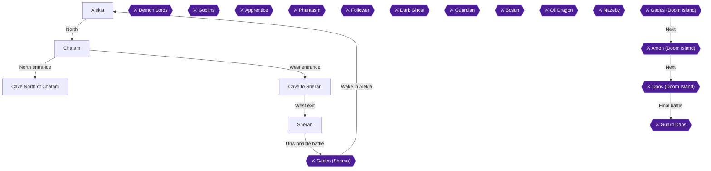

### Overview and Preparation

You now control the young hero. Alekia is a safe starting town with a recommended level of 1 [[gf1-5-2]]. Chatam is also level 1 [[gf1-6-1]], the Cave to Sheran is level 2 [[gf1-7-1]], and Sheran is level 3 [[gf1-8-1]]. Monsters outside Alekia are Jellyfish, Big Newt and Madshroom [[gf2-4-1, gf2-4-2, gf2-4-3]].

This chapter has four achievements:
- **Better Than a Knife:** buy the Dagger at Alekia's weapon shop and equip it on the hero.
- **Lufia:** leave Alekia after talking to Lufia.
- **Sheran Rescue:** free the King, Lilah and the other girl on Sheran Castle's bottom floor.
- **Imminent Defeat:** lose to Gades.

The chest counter for this chapter uses the community checklist: Alekia Castle 4, Sheran north cave 2 and Sheran Castle 12, for 18 in total [[ra-comments-50-1, ra-comments-50-2, ra-comments-50-3]].

> [!WARNING]
> **One-Time Item Warning:** The Princess's 100 Gold in Alekia Castle is permanently lost after you enter Sheran [[gf-treasure-1-22]]. Collect it on your first castle visit, before you walk into Sheran.

> [!WARNING]
> **Chest Overwrite Warning:** One of the three chests in Alekia Castle's first-floor treasure room becomes a Dragon Egg after the first egg scatter, and the item inside it is then lost [[gf-treasure-1-31]]. Open all three chests now.

#### Chests counted this chapter

| Chest | Location | Action / Requirement | Citation |
|---|---|---|---|
| Arrow | Alekia Castle, northwest room, first floor | **OPEN** | [[gf1-5-11, gf-treasure-1-27]] |
| Revive | Alekia Castle treasure room, left chest | **OPEN** | [[gf-treasure-1-29]] |
| Antidote | Alekia Castle treasure room, middle chest | **OPEN** | [[gf-treasure-1-30]] |
| Sweet Water | Alekia Castle treasure room, right chest | **OPEN** (missable) | [[gf-treasure-1-31]] |
| 200 Gold | Cave North of Chatam, room at end of path | **OPEN** | [[gf2-5-7, gf-treasure-1-36]] |
| Potion | Cave North of Chatam, same room | **OPEN** | [[gf2-5-8, gf-treasure-1-37]] |
| 4x Potion | Sheran Castle, west room, first floor | **OPEN** all four | [[gf3-2-4, gf-treasure-1-40]] |
| Sweet Water, Antidote, Foul Water, Awaken | Sheran Castle, east room, first floor | **OPEN** all four | [[gf1-8-3]] |
| 2x Arrow, Mid Arrow | Sheran Castle, second floor, east room | **OPEN** all three | [[gf1-8-5, gf-treasure-2-1, gf-treasure-2-2]] |
| 100 Gold | Sheran Castle throne room, east door | **OPEN** after getting the Sheran Key (missable) | [[gf1-8-8, gf-treasure-2-6]] |

### Alekia

🗺️ **Map:** [View Alekia Map by FlyingArmor](https://www.vgmaps.com/Atlas/SuperNES/Lufia&TheFortressOfDoom-Alekia.png)

🗺️ **Map:** [View Alekia Castle Map by FlyingArmor](https://www.vgmaps.com/Atlas/SuperNES/Lufia&TheFortressOfDoom-AlekiaCastle.png)

🗺️ **Map:** [View Shrine West Of Alekia Map by FlyingArmor](https://www.vgmaps.com/Atlas/SuperNES/Lufia&TheFortressOfDoom-ShrineWestOfAlekia.png)

A guide advises talking to everyone in town once, since townspeople may give information [[gf2-4-4]]. The inn is free and restores all your HP [[gf-shop-3-5, gf2-4-28]].

#### Alekia shops

| Shop | Stock | Citation |
|---|---|---|
| Merchant's Shop | Potion 8, Antidote 6, Sweet Water 10, Arrow 2 | [[gf-shop-3-1, gf-shop-3-2, gf-shop-3-3, gf-shop-3-4]] |
| Weapons Shop | Dagger 50, Knife 10 | [[gf-shop-3-6, gf-shop-3-7]] |
| Armorer's Shop | Dress 120, Cloth 140, Cloth Helm 120, Sandal 50 | [[gf-shop-3-8, gf-shop-3-9, gf-shop-3-10, gf-shop-3-11]] |

#### Buy and equip the Dagger

Go to the weapon shop and buy a Dagger for the hero. It costs 50 gold [[gf1-5-4, gf-shop-3-6]]. The guide also recommends buying it [[gf2-4-6]]. Open the equipment menu and equip it on the hero right away. The Dagger has 19 ATP and can be equipped by the Hero, Aguro, Lufia and Jerin [[gf1-92-2]].


> [!ACHIEVEMENT]
> **Better Than a Knife (3 Points)**
> 
> *Equip the hero with a Dagger*


#### Houses, inn and shop shelves

1. **Inn, upstairs:** Go up and search the shelf for a **Dress** [[gf1-5-3, gf-treasure-1-16]]. One guide calls it a dresser [[gf2-4-7]].
2. **Between the weapon and item shops:** Search the shelf for a **Potion** [[gf1-5-14, gf-treasure-1-14]].
3. **West house, far left past the flower-field intersection:** Climb the steps and enter the house. Search the bookshelf for a **Revive** [[gf-treasure-1-15, gf1-5-10]].
4. **Secret passage and hut chest:** Take the steps through the passage to the chest. It holds **Sweet Water** [[gf1-5-17, gf2-4-21]]. Open it, but do not add it to the checkpoint tally: this town chest is not on the community checklist, which counts only the four Alekia Castle chests below.
5. **North bridge, then left:** The flowers to the left of the house hide a **Power Potion** [[gf1-5-8, gf-treasure-1-18]].
6. **Same house:** Search the bookshelf for a **Cloth Helm** and equip it on the hero [[gf1-5-9, gf2-4-10, gf4-5-9]]. You do not need to buy one at the armor shop [[gf4-5-9]].
7. **Town talk:** Townspeople mention Chatam and Sheran to the north [[gf1-5-9]].

Sleep Powder is listed among Alekia's items, but no source says where it is hidden [[gf3-1-8]].

#### Alekia Castle (4 chests)

Enter the castle north of the first bridge [[gf1-5-9]]. Two staircases sit just inside the entrance. Ignore them for now and explore the first floor [[gf2-4-33]].

1. **Northwest room, first floor:** The commander is here. Take the **Arrow** from the chest [[gf1-5-11, gf2-4-11]] (Chest 1/4).
2. **Revive behind the commander:** Search the full shelf behind him for a **Revive** [[gf-treasure-1-21, gf1-5-10]]. Do not skip it.
3. **Room to the east:** Search the bookshelves for a **Swing Wing** and an **Escape** [[gf1-5-12, gf-treasure-1-19, gf-treasure-1-20]].
4. **Second floor:** Take either staircase up [[gf1-5-12, gf2-4-34]]. In the upper left room, search the dresser for a **Potion**. In the room to the right, search the bookshelf for another **Potion** [[gf1-5-14, gf2-4-14, gf2-4-15]].
5. **Third floor:** Talk to the Princess for **100 Gold** [[gf1-5-15, gf2-7-2]]. This is missable once you enter Sheran [[gf-treasure-1-22]].
6. **Upper left room, third floor:** Search for the **Stuffed Bear** and the **Bracelet** [[gf1-5-16, gf2-4-17, gf2-4-18]]. The guide says to save them for later [[gf1-5-16]].
7. **Treasure room:** Leave the room and walk around to the upper right steps. Take them down two floors to the first-floor treasure room [[gf1-5-17, gf2-4-19]]. Open the three chests [[gf1-5-17]]:
   - **Revive** (left chest) [[gf-treasure-1-29]] (Chest 2/4).
   - **Antidote** (middle chest) [[gf-treasure-1-30]] (Chest 3/4).
   - **Sweet Water** (right chest) [[gf-treasure-1-31]] (Chest 4/4).

Open all three chests now. After the first Dragon Shrine wish (Chapter 15), one of these three chests refills with a Dragon Egg and its old item is gone; Chapter 15 brings you back here for it [[gf1-87-2, gf-treasure-1-31]].

Finally, after exploring Alekia Castle, backtrack and exit the town to leave for Sheran [[gf2-4-36]].

#### Leveling before you leave

Leveling up a little before leaving Alekia is a good idea [[gf2-4-32]]. Return to the inn between battles to restore HP for free [[gf2-4-28]]. The guide suggests reaching level four first, because the hero learns the magic that partially heals one character's HP [[gf2-4-31]].

A warp shrine lies west of Alekia, and you have no reason to go there yet [[gf2-4-29]]. If you do, the old man there restores your HP [[gf2-4-30]].

> [!TIP]
> **Before you leave Alekia:** Make sure you have the Dagger equipped, the Cloth Helm on the hero, all four castle chests, the Princess's 100 Gold, and the Bracelet and Stuffed Bear [[gf1-5-4, gf1-5-9, gf1-5-17, gf1-5-15, gf1-5-16]]. Then head north to Chatam [[gf2-4-37]].

### Chatam

🗺️ **Map:** [View Chatam Map by FlyingArmor](https://www.vgmaps.com/Atlas/SuperNES/Lufia&TheFortressOfDoom-Chatam.png)

The Chatam inn costs 5 Gold [[gf-shop-4-4]]. The Merchant's Shop sells Potion 8, Antidote 6 and Arrow 2 [[gf-shop-4-1, gf-shop-4-2, gf-shop-4-3]].

1. **Lower left tree** (the tree with the blue circles): Search below or behind it for a **Mind Potion** [[gf1-6-2, gf2-5-5]].
2. **Middle of the left field:** Search for a hidden **Great Potion** [[gf1-6-3, gf-treasure-1-32]]. The guide says to save it for later [[gf1-6-3]].
3. **Upper right house, all the way east:** Search the bookshelf for a **Smoke Ball** [[gf1-6-4, gf2-5-6]].
4. Talk to everyone once and then head north [[gf2-5-6]]. An old man mentions that Danil is worried about his sister Lilah [[gf2-6-5]]. You can only help her later.

### Cave North of Chatam

North of Chatam are two cave entrances. Go into the northernmost one first [[gf2-5-6]].

You can only go one direction from this entrance. Follow the path to a door, and enter it to find a room with two chests [[gf2-5-7]]. Open them for **200 Gold** and a **Potion** [[gf2-5-7, gf2-5-8]] (2 chests, total 6/18). The path beyond is blocked by rocks, so backtrack and exit [[gf2-5-7]].

### Cave to Sheran

🗺️ **Map:** [View Cave To Sheran Map by FlyingArmor](https://www.vgmaps.com/Atlas/SuperNES/Lufia&TheFortressOfDoom-CaveToSheran.png)

Now enter the other (west) entrance. Spiders here are slightly tougher, and Spiders can drop an Antidote [[gf1-7-1, gf2-93-8]].

1. **Northeast path:** Follow it to its end and search the rocks for a hidden **Revive** [[gf2-5-9, gf-treasure-1-39]]. A guide describes the same dead end as the upper path [[gf1-7-3]].
2. **Back at the entrance:** Climb the rope ladder to the west and follow the path to the stairs that lead out of the cave. You emerge right next to Sheran [[gf2-5-10]]. Do not explore west yet [[gf2-5-10]].

### Sheran (first visit)

🗺️ **Map:** [View Sheran Map by FlyingArmor](https://www.vgmaps.com/Atlas/SuperNES/Lufia&TheFortressOfDoom-Sheran.png)

🗺️ **Map:** [View Sheran Castle Map by FlyingArmor](https://www.vgmaps.com/Atlas/SuperNES/Lufia&TheFortressOfDoom-SheranCastle.png)

The rumor is true. Talk around town, then go straight north to the castle [[gf2-5-10, gf1-8-1]]. Ignore the stairs for now [[gf2-5-10]].

#### Castle, first floor (8 chests)

1. **West room:** Open the four chests for **4 Potions** [[gf1-8-3, gf3-2-4, gf-treasure-1-40, gf-treasure-1-41, gf-treasure-1-42, gf-treasure-1-43]].
2. **East room:** Open the four chests for **Sweet Water, Antidote, Foul Water** and **Awaken** [[gf1-8-3, gf-treasure-1-44, gf-treasure-1-45, gf-treasure-1-46, gf-treasure-1-47]].
3. Take the stairs to the second floor [[gf1-8-3]].

#### Castle, second floor (3 chests)

1. **East room:** Search the dresser for a **Revive** [[gf2-5-13, gf-treasure-2-3]]. Open the three chests for 2 **Arrows** and a **Mid Arrow** [[gf1-8-5, gf-treasure-2-1, gf-treasure-2-2]].
2. **West room:** Search the bookshelves for **Sweet Water** and **Foul Water** [[gf1-8-3, gf-treasure-2-4, gf-treasure-2-5]]. One guide says this room has nothing [[gf2-5-13]]. The treasure list and the other guide say it does.
3. Nothing else is available yet, so return to Alekia [[gf1-8-5]].

The first-floor and second-floor chests total 11 here, and the 100 Gold throne room chest on your next visit makes the 12 [[gf1-8-8, ra-comments-50-3]].

### Alekia (return) and Lufia joins

Report to the commander in the upper left room of the castle's first floor [[gf1-8-3]]. Then return to the inn, talk to Roman and rest [[gf2-6-4]]. Go upstairs and speak with Lufia, and leaving the inn triggers more dialogue with Roman [[gf2-6-4]].

Now leave Alekia. After a long talk with Lufia, she joins your party [[gf2-6-4, gf1-8-3]].


> [!ACHIEVEMENT]
> **Lufia (2 Points)**
> 
> *Recruit a childhood friend*


Immediately re-enter town and buy her a Dagger (50) and a Cloth (140) [[gf2-6-11, gf2-6-14]]. Lufia can equip the Dagger [[gf1-92-2]]. Give her the Bracelet you took earlier [[gf1-5-16]]. Lufia starts at level 1, so level her up a little before returning to Sheran [[gf2-6-4]].

### Cave to Sheran (second pass)

Walk back north from Alekia through Chatam and enter the western Cave to Sheran entrance [[gf2-4-37, gf2-5-9]]. Inside the cave, Danil lies wounded on the floor; speak to him to receive the **Sheran Key** that unlocks the doors inside Sheran Castle [[gf2-6-5, gf1-8-7, gf-treasure-1-38]]. After taking the key, climb the rope ladder to the west and follow the path up the stairs to emerge right next to Sheran [[gf2-5-10]].

### Sheran Castle (second visit)

#### Throne room

1. Climb the first two flights of stairs and walk straight ahead into the King's throne room [[gf2-6-6]].
2. Use Danil's key. Open the west door and flip the switch on the wall [[gf2-6-6, gf1-8-9, gf4-5-40]].
3. **Behind the east door:** Open the chest for **100 Gold** [[gf2-6-7, gf1-8-8, gf-treasure-2-6]] (chest 12/12 for Sheran Castle).

> [!WARNING]
> **Chest Overwrite Warning:** This 100 Gold chest becomes a Dragon Egg after the second egg scatter [[gf-treasure-2-6]]. Open it now.

The throne room chest on the right side, reached after climbing to the roof, is the later Dragon Egg chest [[gf1-87-11]].

#### Dungeon (bottom floor)

1. Leave the throne room and head to the upper left or right room (either works). Take the stairs down until you reach the bottom floor [[gf2-6-6, gf1-8-8]].
2. Follow the hall to the steps in the middle. The switch you flipped has revealed the steps to the dungeon level [[gf1-8-9]].
3. On the bottom floor you find the King, Lilah and another girl, and they join you [[gf2-6-8]].


> [!ACHIEVEMENT]
> **Sheran Rescue (2 Points)**
> 
> *Free the King, Lilah, and... the other one*


4. Search the bookcase in the room where they were held for a **Great Potion** [[gf2-6-9, gf1-8-10, gf-treasure-2-7]].

### Gades (Sheran)

Walk out of the castle into the town area. This triggers dialogue and a battle you cannot win [[gf2-6-10]]. The enemy is Gades, the Sinistral of Destruction [[gf4-5-49]].

**Strategy:** There is none. He lets you hit him a few times and finishes you off in one blow [[gf-boss-1-5]]. The game continues as normal afterward [[gf-boss-1-5]]. Do not try to win, and just let it happen.


> [!ACHIEVEMENT]
> **Imminent Defeat (1 Points)**
> 
> *The young hero was defeated in Sheran*


You survive and are warped back to Alekia [[gf1-9-1, gf2-6-10]].

### Alekia and Chatam (Lilah)

1. After the dialogue in Alekia, go to the castle. Go up to the second floor and talk to Lilah in the middle room so she joins you [[gf1-9-3, gf2-7-1]].
2. Speak with the Princess on the third floor [[gf2-7-2]].
3. Escort Lilah to Chatam [[gf2-7-2, gf1-9-3]]. Cross the bridge to the right to reunite Danil with Lilah [[gf1-9-3]].
4. Talk to the old man in the field for a **Speed Potion** [[gf1-9-3, gf-treasure-1-35]].
5. Speak to the kid east of the inn and cross the bridge to trigger dialogue. It points you to the port town of Treck [[gf2-8-1]].

> [!TIP]
> **Before you leave Chatam:** Confirm you have the Speed Potion from the old man and the Great Potion from the Sheran dungeon bookshelf [[gf-treasure-1-35, gf-treasure-2-7]]. You can also rest at the Chatam inn for 5 Gold [[gf-shop-4-4]].

> [!IMPORTANT]
> ### Chapter 2 Cumulative 100% Checkpoint
> - **Treasure Chests:** 18 / 637
> - **Dragon Eggs:** 0 / 24
> - **RetroAchievements Unlocked:** 6 / 47 (11 / 343 points)

### Chapter Checklist

- [ ] Dagger bought (50 gold) and equipped on the hero
- [ ] Alekia Castle: Arrow chest, Revive behind the commander, and the three treasure-room chests (Revive, Antidote, Sweet Water)
- [ ] Princess's 100 Gold, Stuffed Bear and Bracelet collected
- [ ] Cloth Helm equipped on the hero, Power Potion, Revive, Dress and Potion collected in Alekia
- [ ] Chatam: Mind Potion, Great Potion and Smoke Ball
- [ ] North cave: 200 Gold and Potion chests
- [ ] West cave: Revive found
- [ ] Sheran Castle first visit: 4 Potions, east-room four chests, second-floor chests, Revive and bookshelf items
- [ ] Lufia joined after leaving Alekia
- [ ] Sheran Key from Danil, throne room switch flipped, 100 Gold chest opened
- [ ] King, Lilah and the other girl freed
- [ ] Great Potion from the dungeon bookshelf
- [ ] Defeated by Gades
- [ ] Lilah recruited in Alekia Castle, Speed Potion from the old man in Chatam

---

## Chapter 3: Treck, Aguro and the Goblin Pirates

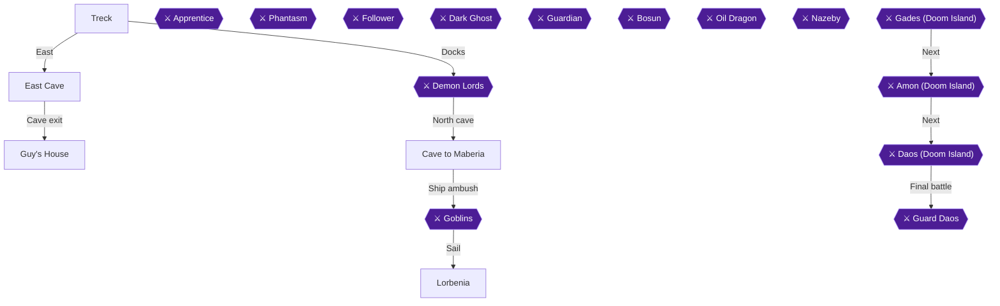

This chapter takes you from the port town of Treck, through the East Cave to Guy's House, into the first big fight against the four Demon Lords, through the cave north of Treck to the Goblin ambush, and finally to Lorbenia. Treck is recommended at Level 5 [[gf1-10-1]], and Treck is southwest of Sheran [[gf2-8-2]]. Aguro joins you after the Demon Lord fight [[gf4-6-8]]. The chest count for this chapter is Treck 3, the passage to Guy's house 2, the cave north of Treck 4 and Lorbenia 1 [[ra-comments-50-4, ra-comments-50-5, ra-comments-50-6, ra-comments-50-7]].

> [!WARNING]
> **Chest Overwrite Warning:** The first chest in East Cave (Cloth Shoes) becomes a Dragon Egg after the second egg scatter later in the game, so take it on this visit [[gf-treasure-2-15]].

> [!TIP]
> **Achievement Trigger Warning:** Level 5! only needs your hero at Level 5 [[gf1-10-1, gf1-11-1, gf1-12-1]]. Fighting on the way to Treck or in East Cave should get you there. A third fight to watch for: the Goblins are a hard fight, so enter it with a full-HP party [[gf-boss-1-9]].

### Treck

🗺️ **Map:** [View Treck Map by FlyingArmor](https://www.vgmaps.com/Atlas/SuperNES/Lufia&TheFortressOfDoom-Treck.png)

Treck is a new town where it pays to talk to everyone once and search the houses [[gf2-9-1]]. Rest at the inn if you are hurt: it costs 10 Gold [[gf-shop-4-25]].

### Chapter Items to Collect (Treck, East Cave, Guy's House, Cave North of Treck, Lorbenia)

| Item | Where Found | Action / Requirement | Citation |
|---|---|---|---|
| Hair Band | Bookshelf, house west of the exit (first house on the left) | **TAKE** (equip on Lufia) | [[gf-treasure-2-8, gf1-10-2]] |
| Dress | Chest, top floor of the same house | **TAKE** (sell) | [[gf-treasure-2-9, gf1-10-3]] |
| Power Gourd | Bookshelf, weapon and armor shop | **TAKE** | [[gf-treasure-2-14]] |
| Arrows | Chest, cider seller's basement | **TAKE** | [[gf-treasure-2-10]] |
| Smoke Ball | Chest, cider seller's basement | **TAKE** | [[gf-treasure-2-11]] |
| Escape | Crates, cider seller's basement | **TAKE** | [[gf-treasure-2-12]] |
| Swing Wing | Crates, cider seller's basement | **TAKE** | [[gf2-9-11]] |
| Cloth Shoes | First chest in East Cave | **TAKE** (missable) | [[gf-treasure-2-15]] |
| Swing Wing | Chest past the door in East Cave | **TAKE** | [[gf-treasure-2-16]] |
| Short Sword | Guy's grave | **TAKE** | [[gf-treasure-2-17]] |
| Great Potion | Bookshelf, Guy's House | **TAKE** | [[gf2-9-17]] |
| Potion | Chest, first up the stairs in the cave north of Treck | **TAKE** | [[gf-treasure-2-19]] |
| Potion | Upper floor, left chest | **TAKE** | [[gf-treasure-2-20]] |
| Power Potion | Upper floor, right chest | **TAKE** | [[gf-treasure-2-21]] |
| Miracle | Hidden in the swamp | **TAKE** | [[gf-treasure-2-22, gf1-14-5]] |
| Daze Ring | Chest through the door downstairs | **TAKE** | [[gf-treasure-2-23]] |
| Mind Potion | Behind weapon/armor shop sign, Lorbenia | **TAKE** | [[gf-treasure-2-26]] |
| Mid Arrow | Bookcase, Lorbenia weapon shop | **TAKE** | [[gf-treasure-2-25]] |
| Sweet Water | Chest, 2nd floor of the shopping center, Lorbenia | **TAKE** | [[gf-treasure-2-24]] |

#### Houses and shops

1. Enter the first house to the left of the entrance (the house west of the exit). Search the bookshelf for a **Hair Band** and equip it on Lufia [[gf1-10-2, gf-treasure-2-8]].
2. Go upstairs and open the chest for a **Dress**, which you can sell later [[gf1-10-3, gf2-9-8]].
3. A former Guy Legion knight lives in the house west of the entrance; speak to him [[gf2-11-6]].
4. Head south to the weapon and armor shops. A bookshelf there holds a **Power Gourd** [[gf1-10-4, gf-treasure-2-14]]. The Long Knife is worth buying for Lufia [[gf2-9-1]]. The Hero does not need a new weapon yet since a better one is coming [[gf1-10-4]].
5. The Treck Merchant's Shop sells Potion 8, Antidote 6, Shriek 5, Swing Wing 80, Arrow 2 and Arrows 10 Gold [[gf-shop-4-5, gf-shop-4-6, gf-shop-4-7, gf-shop-4-8, gf-shop-4-9, gf-shop-4-10]]. The Weapons Shop sells Club 120, Long Knife 180, Dagger 50 and Knife 10 Gold [[gf-shop-4-11, gf-shop-4-12, gf-shop-4-13, gf-shop-4-14]]. The Armorer's Shop sells Cloth Armor 240, Robe 260, Bracelet 90, Cloth Helm 120 and Sandal 50 Gold [[gf-shop-4-15, gf-shop-4-16, gf-shop-4-17, gf-shop-4-18, gf-shop-4-19]]. The Lodge sells Pear Cider 10, Plum Cider 30 and Lime Cider 20 Gold, and its basement sells Sour Cider 20 and Plum Cider 30 Gold [[gf-shop-4-20, gf-shop-4-21, gf-shop-4-22, gf-shop-4-23, gf-shop-4-24]].

#### Docks and the lodge basement

1. Go to the southern port and enter the secret passage to the lodge's basement. Take the left path to open the two chests for **Arrows** and a **Smoke Ball** [[gf1-10-5, gf2-9-10, gf-treasure-2-10, gf-treasure-2-11]].
2. Search the crates in the room with the stairs for an **Escape** and a **Swing Wing** [[gf2-9-11, gf1-10-6]].
3. Go to the east side of the docks and speak to the old man. He sends his niece Ainea to guide you through the East Cave [[gf1-10-6, gf2-9-1]]. Then exit Treck and walk east across the bridges to the East Cave [[gf1-10-6]].

### East Cave

🗺️ **Map:** [View Cave To Guy's House Map by FlyingArmor](https://www.vgmaps.com/Atlas/SuperNES/Lufia&TheFortressOfDoom-CaveToGuy'sHouse.png)

Walking on the grey area outside the cave causes HP damage [[gf3-3-6]]. Giant Bats here hit hard, so kill them first if you are at a low level [[gf4-6-4]]. Recommended level is 5 [[gf1-11-1]].

1. Follow the path down two rope ladders and open the chest for the **Cloth Shoes**, then equip them on Lufia [[gf1-11-2, gf2-9-12]].
2. Take the stairs down. Climb down the next rope ladder, walk to the red door and Ainea opens it [[gf1-11-3, gf2-9-13]].
3. Open the chest beyond the door for a **Swing Wing** [[gf1-11-3, gf2-9-14]].
4. Climb the rope ladder and take the stairs to exit to the house [[gf1-11-3]].

### Guy's House

🗺️ **Map:** [View Guy's House Map by FlyingArmor](https://www.vgmaps.com/Atlas/SuperNES/Lufia&TheFortressOfDoom-Guy'sHouse.png)

1. Walk into the house to trigger dialogue with the man who lives there [[gf2-9-15]]. Guy dies, and you bury him [[gf3-3-5]].
2. Search the grave east of the house for the **Short Sword** and equip it on the Hero [[gf1-12-2, gf2-9-16]].
3. Search the bookshelf in the house for a **Great Potion** [[gf1-12-3, gf2-9-17]].
4. On the way back, Lufia should learn Dew at Level 5. Then rest at the Treck inn and save [[gf1-12-3]].


> [!ACHIEVEMENT]
> **Level 5! (5 Points)**
> 
> *Reach Level 5 with your hero*


If Level 5! has not popped yet, fight on the road back until the Hero reaches Level 5 [[gf1-10-1, gf1-11-1, gf1-12-1]].

### Demon Lords

Back in Treck, buy anything you still need, rest and save [[gf4-6-8, gf-boss-1-6]]. Then talk to Aguro, the green-haired man at the docks [[gf-boss-1-6, gf2-11-7]]. Four Demon Lords attack and Aguro fights alongside you [[gf-boss-1-7]].

**Boss notes:**
- Sources disagree on HP: 48 each [[gf1-13-1]], or about 60-70 each [[gf3-3-11]]. They know Mirror, Dew and Strong [[gf-boss-1-8]].
- Magic Mirror reflects your spells back at you, so use physical attacks when several have it up [[gf2-11-7, gf3-3-11]].
- Lufia's Dew can weaken them, so cast it in the first two rounds and let Aguro finish them off while the Hero casts Strong [[gf1-13-1]].
- Keep HP above 30 [[gf4-6-8]].
- Reward: 200xp and 470gp. Beaten at Hero 6, Lufia 5, Aguro 5 [[gf4-26-1]].


> [!ACHIEVEMENT]
> **Demon Horde (5 Points)**
> 
> *Defeat the pirate 'Demon Lords'*


After the fight, Aguro permanently joins [[gf1-13-1]].


> [!ACHIEVEMENT]
> **Aguro (2 Points)**
> 
> *Team up with a fellow swordsman*


Buy Aguro a Cloth Helm and switch his and Lufia's positions in the combat order [[gf2-11-7, gf1-13-1]].

### Cave to Maberia

🗺️ **Map:** [View Cave North Of Treck Map by FlyingArmor](https://www.vgmaps.com/Atlas/SuperNES/Lufia&TheFortressOfDoom-CaveNorthOfTreck.png)

🗺️ **Map:** [View Cave East Of Ranqs Map by FlyingArmor](https://www.vgmaps.com/Atlas/SuperNES/Lufia&TheFortressOfDoom-CaveEastOfRanqs.png)

Rest, then head north from Treck around the west side of the mountains to the cave [[gf1-13-1]]. Giant Bats are weak to Dew [[gf1-14-1]]. Kobolds can drop Mid Arrows, which help against the Goblins [[gf2-92-29]]. Avoid the mud: it damages the party [[gf2-11-13]].

1. From the entrance, go east and climb the rope ladder to the upper platform. Cross the bridge and open the chest for a **Potion** [[gf1-14-3, gf2-11-9]].
2. Take the nearby steps down. Two chests here hold a **Potion** and a **Power Potion** [[gf1-14-4, gf2-11-12]].
3. Back upstairs, drop into the pit. The upper teleporter leads to HP/MP-restoring panels, and the lower one returns near the entrance [[gf1-14-3, gf2-11-10, gf4-6-13]]. Good place to train before the Goblins [[gf-boss-1-9]].
4. Return to the entrance and go under the bridge to the steps up to the next floor [[gf1-14-3]].
5. Cast Float so you can cross the swamp unharmed. A hidden **Miracle** is in the middle [[gf1-14-5, gf4-6-14]].
6. Continue down the path to a room with a chest holding the **Daze Ring** (DFP+8, MGR+4). Equip it on Aguro [[gf1-14-6, gf2-11-14]].
7. Leave the room, go left to the stairs, and go left again to exit [[gf1-14-6, gf2-11-14]]. If Lufia is not yet Level 7, finish that level so she learns Strong [[gf1-14-7]].

### Goblins

Restore everyone to full HP before approaching the ship [[gf1-14-7, gf-boss-1-9]]. Walking up to the boat triggers dialogue and then three Goblins attack [[gf2-11-15, gf-boss-1-9]].

**Boss notes:**
- HP is listed as 125 each [[gf1-15-1]], about 130 [[gf-boss-1-10]] or 130-140 [[gf3-4-4]]. No weakness [[gf1-15-1]].
- Physical hits only, up to 20 HP each; focused attacks can do about 50 [[gf-boss-1-10, gf3-4-3]]. Level 8 is recommended [[gf3-4-2]].
- Put Lufia in the back row [[gf-boss-1-9]].
- Hero and Aguro attack (Mid Arrows help) while Lufia heals; Dew hits all of them [[gf2-11-15, gf3-4-4, gf1-15-1]].
- Reward: 300xp and 551gp. Beaten at Hero 8, Aguro 8, Lufia 7 [[gf4-26-2]].


> [!ACHIEVEMENT]
> **Goblin Horde (5 Points)**
> 
> *Survive the ambush of the Goblin Pirates*


You sail back to Treck. Rest at the inn, go west to the lodge and speak to the Maberia's Captain on the second floor, then speak to him again to sail to Lorbenia [[gf2-12-1]].

### Lorbenia

🗺️ **Map:** [View Lorbenia Map by FlyingArmor](https://www.vgmaps.com/Atlas/SuperNES/Lufia&TheFortressOfDoom-Lorbenia.png)

Aguro leaves the party for a while on arrival [[gf2-14-1]]. Inn costs 20 Gold [[gf1-16-1]]. Mini Demons cast Flash, so kill them quickly [[gf1-16-5]].

1. Find the hidden **Mind Potion** behind the weapon/armor shop sign [[gf1-16-2]].
2. In the southwestern weapon shop, search the bookshelf between the equipment shops for a **Mid Arrow** [[gf1-16-3, gf2-14-2]].
3. In the shopping center, go up either flight of stairs, southeast on the second floor, and open the chest for **Sweet Water** [[gf1-16-4, gf2-14-3]].
4. Go to the third floor, talk to the blond woman, then see the inn's innkeeper. Aguro rejoins as you exit [[gf2-14-3, gf2-14-4]].
5. Shops: Weapons: Short Sword 360, Staff 360, Club 120, Long Knife 180 [[gf-shop-5-1, gf-shop-5-2, gf-shop-5-3, gf-shop-5-4]]. Armor: Tan Armor 480, Tan Robe 540, Tan Shield 180, Tan Helm 240, Glass Cap 460, Cloth Shoes 300 [[gf-shop-5-5, gf-shop-5-6, gf-shop-5-7, gf-shop-5-8, gf-shop-5-9, gf-shop-5-10]]. Item shops sell Sweet Water 10, Potion 8, Antidote 6, Swing Wing 80, Magic Guard 50, Power Gourd 100, Mind Gourd 100, Arrow 2, Arrows 10 and Bomb 100 [[gf-shop-5-11, gf-shop-5-12, gf-shop-5-13, gf-shop-5-14, gf-shop-5-15, gf-shop-5-16, gf-shop-5-17, gf-shop-5-18, gf-shop-5-19, gf-shop-5-20]]. The jeweler and toymaker are also here [[gf-shop-5-21, gf-shop-5-25]].

> [!TIP]
> **Before you leave Lorbenia:** make sure you have taken the Mind Potion, Mid Arrow and Sweet Water. When ready, exit and head southwest to Grenoble [[gf2-14-5, gf1-16-2, gf1-16-3, gf1-16-4]].

> [!IMPORTANT]
> ### Chapter 3 Cumulative 100% Checkpoint
> - **Treasure Chests Opened:** 28 / 637
> - **Dragon Eggs Collected:** 0 / 24
> - **RetroAchievements Unlocked:** 10 / 47 (28 / 343 points)

### Chapter Checklist

- [ ] Hair Band, Dress, Power Gourd, Arrows, Smoke Ball, Escape, Swing Wing in Treck
- [ ] Cloth Shoes and Swing Wing in East Cave
- [ ] Short Sword and Great Potion at Guy's House
- [ ] Level 5! unlocked
- [ ] Demon Lords defeated, Aguro in party
- [ ] Two Potions, Power Potion, Miracle, Daze Ring in the cave north of Treck
- [ ] Goblins defeated
- [ ] Mind Potion, Mid Arrow, Sweet Water in Lorbenia; Aguro rejoined

---

## Chapter 4: Grenoble, the Old Cave and Artea's Apprentice

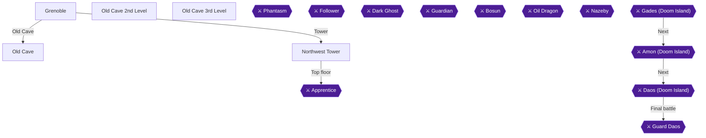

This chapter covers the town of Grenoble, the Old Cave's 2nd and 3rd floors, and the Northwest Tower, which ends with the Apprentice fight. The Old Cave unlocks one floor per 5 levels on any party member: level 5 for the 2nd floor, and 5 more levels for each floor after that [[gf1-17-5]]. Take each task from the man at the Grenoble counter and claim the reward from the woman [[gf1-17-5]]. The 2nd floor has 22 chests and the 3rd floor has 30 [[ra-comments-50-8, ra-comments-50-9]]. The Northwest Tower adds 14 more chests: 4 on the first floor, 3 on the second, 8 on the third and top-floor stretches including the two chests behind the boss room [[gf1-19-2, gf1-19-3, gf1-19-4, gf1-19-5, gf1-19-6, gf1-19-7, gf1-19-9, gf1-19-10, gf1-19-11, gf1-19-12, gf1-19-13, gf1-19-14]].

Two achievements are in this chapter: **Fairy Kiss** (deliver the Fairy Kiss to the old man) and **Artea's Apprentice** (beat the Apprentice and learn where Artea is).

> [!WARNING]
> **One-Time Item Warning (women-only room):** The Dress, Earring, Heeled Shoes and Hair Band in the women-only room on the Old Cave 2nd floor cannot be collected once you obtain Jerin [[gf-treasure-2-56, gf-treasure-2-57, gf-treasure-2-59, gf-treasure-2-60]]. Take all of them on this first visit.

> [!WARNING]
> **Chest Overwrite Warning (Northwest Tower roof):** The left chest behind the Apprentice's room holds a Mid Arrow that becomes a Dragon Egg after the first egg scatter, so grab it now [[gf-treasure-2-44]].

### Grenoble

🗺️ **Map:** [View Grenoble Map by FlyingArmor](https://www.vgmaps.com/Atlas/SuperNES/Lufia&TheFortressOfDoom-Grenoble.png)

Grenoble is southwest of Lorbenia [[gf2-14-5]]. Recommended level is about 8 [[gf1-17-1]].

**Shops** (the inn costs 40 Gold [[gf-shop-6-20]]):

| Shop | Stock | Citation |
|---|---|---|
| Weapons | Short Sword 360, Staff 360, Club 120, Long Knife 180 | [[gf-shop-6-1, gf-shop-6-2, gf-shop-6-3, gf-shop-6-4]] |
| Armorer | Tan Armor 480, Tan Robe 540, Tan Shield 180, Tan Helm 240, Glass Cap 460, Cloth Shoes 300 | [[gf-shop-6-5, gf-shop-6-6, gf-shop-6-7, gf-shop-6-8, gf-shop-6-9, gf-shop-6-10]] |
| Merchant | Potion 8, Antidote 6, Awaken 10, Stone Cure 100, Shriek 5, Smoke Ball 80, Magic Guard 50, Power Gourd 100, Mind Gourd 100 | [[gf-shop-6-11, gf-shop-6-12, gf-shop-6-13, gf-shop-6-14, gf-shop-6-15, gf-shop-6-16, gf-shop-6-17, gf-shop-6-18, gf-shop-6-19]] |

**Town items:**

1. Go west to the Weapons Shop and examine the bookshelf for a **Potion** [[gf1-17-2, gf2-15-2]].
2. Go to the upper left (northwest) house and pay the man 50 Gold [[gf1-17-3, gf2-15-3]]. Examine the bookshelf behind him for a **Speed Potion** [[gf1-17-3]].
3. Follow the secret passage to the back of town and search the flowers between the two trees for a **Spell Potion** [[gf1-17-4]].
4. Go right to the steps leading to the Old Cave shop [[gf1-17-1]]. Entering costs 50 gp [[gf4-7-5, gf3-5-1]].

In the shop, the old man wants a Fairy Kiss before he will say more about Artea [[gf3-5-1]]. Talk to the man behind the counter to receive your first task [[gf1-17-5]]. Accept the **Secret Map** treasure hunt [[gf2-15-3]]. It pays 500 Gold [[gf3-5-1]]. Then leave town and head west to the Old Cave [[gf2-15-3]].

### Old Cave

🗺️ **Map:** [View Old Cave 1st Level Map by FlyingArmor](https://www.vgmaps.com/Atlas/SuperNES/Lufia&TheFortressOfDoom-OldCave-1stLevel.png)

🗺️ **Map:** [View Old Cave 4th Level Map by FlyingArmor](https://www.vgmaps.com/Atlas/SuperNES/Lufia&TheFortressOfDoom-OldCave-4thLevel.png)

🗺️ **Map:** [View Old Cave 5th Level Map by FlyingArmor](https://www.vgmaps.com/Atlas/SuperNES/Lufia&TheFortressOfDoom-OldCave-5thLevel.png)

🗺️ **Map:** [View Old Cave 6th Level Map by FlyingArmor](https://www.vgmaps.com/Atlas/SuperNES/Lufia&TheFortressOfDoom-OldCave-6thLevel.png)

🗺️ **Map:** [View Old Cave 7th Level Map by FlyingArmor](https://www.vgmaps.com/Atlas/SuperNES/Lufia&TheFortressOfDoom-OldCave-7thLevel.png)

The 1st level is only the entrance. Speak to the man and take the elevator down to the 2nd floor [[gf2-15-4]]. Empty chests exist only in the Old Cave, and they count toward the chest total, so open every one [[gf-treasure-12-1, gf1-18-1]].

### Old Cave 2nd Level

🗺️ **Map:** [View Old Cave 2nd Level Map by FlyingArmor](https://www.vgmaps.com/Atlas/SuperNES/Lufia&TheFortressOfDoom-OldCave-2ndLevel.png)

This floor has 22 chests [[ra-comments-50-8]]. Recommended level is 8 [[gf1-18-1]].

1. Right as you leave the elevator, the right chest is empty and the left chest holds a **Hi Magic** [[gf-treasure-2-46, gf-treasure-2-63]].
2. Walk around to the next chest, southeast of the Hi Magic chest, for a **Potion** [[gf-treasure-2-47]].
3. The chest at the intersection holds an **Antidote** [[gf-treasure-2-48]].
4. Take the lower path to two empty chests [[gf1-18-4]]. Cast Float, then go straight down from the right chest to find a hidden **Ex Potion** [[gf1-18-4]]. It is about three steps below the chest between the two marshes [[gf-treasure-2-49, gf3-5-3]]. Heal soon afterward, since enemies hit here [[gf3-5-3]].
5. Down the hall, open the three remaining chests: one is empty, one has a **Potion**, and one has a **Sleep Arrow** (save it for the Apprentice) [[gf1-18-5, gf1-18-6, gf-treasure-2-51]].
6. In the door-room above them, open the chests for the **Power Ring** (ATP+10, equip on Hero) and the **Secret Map** [[gf1-18-7, gf1-18-8, gf-treasure-2-52, gf-treasure-2-53]]. Do not trust the boxed-in chests around the marsh near this door; they hold nothing [[gf3-5-3]].
7. Return to the intersection and head right to another one. Two chests are empty; the others hold **Float** and **Cloth Shoes** [[gf1-18-9, gf1-18-10, gf-treasure-2-54, gf-treasure-2-55]].
8. Head down from that intersection, use Float, and open the two marsh chests: a **Tan Shield** (for Aguro) and the **Dragon Egg** (Egg #1) [[gf1-18-11, gf-treasure-2-61, gf-treasure-2-62, gf3-5-6, gf3-5-7]].

#### Fairy Kiss room

Go up from the intersection to the room that only women can enter. Read the sign; only Lufia may go in [[gf2-15-9, gf1-18-13]]. Run from most battles inside [[gf3-5-8]]. Open all five chests: **Dress**, **Hair Band**, **Heeled Shoes**, **Earring** and the **Fairy Kiss** [[gf1-18-13, gf1-18-14, gf1-18-15, gf1-18-16, gf1-18-17, gf-treasure-2-58]]. Cloth Shoes raise Defense by 2, while Heeled Shoes raise Attack by 5 [[gf3-5-9]]. Keep the Heeled Shoes when selling extras [[gf1-18-19]].

Return to Grenoble. The Fairy Kiss achievement can be done after returning from the first Old Cave trip [[ra-comments-13-1]].

### Grenoble: Rewards

Go to the Old Cave shop. Exchange the Secret Map for 500 Gold from the woman at the counter [[gf1-18-19, gf2-16-2]]. Give the Fairy Kiss to the old man to receive a Letter [[gf1-18-18, gf4-7-23]].


> [!ACHIEVEMENT]
> **Fairy Kiss (2 Points)**
> 
> *Deliver a special treasure to an old man*


The old man also tells you to head to the Northwest Tower next [[gf1-18-18]]. Sell excess gear, buy what you lack, and rest [[gf1-18-19]].

### Northwest Tower

🗺️ **Map:** [View Northwest Tower Map by FlyingArmor](https://www.vgmaps.com/Atlas/SuperNES/Lufia&TheFortressOfDoom-NorthwestTower.png)

The tower lies northwest of Grenoble [[gf2-16-4]]. Walk around the swamp to the west, cross the bridge, then go north [[gf1-18-19]]. Recommended level is about 9 [[gf2-93-1]]. Red Magi are dangerous, so kill them fast; Lufia can one-shot them [[gf4-8-14]]. They can drop Hi Magic [[gf2-93-1]]. Kobolds drop Mid Arrows, and you want about 10 for the boss [[gf3-5-12]]. Do not fall off the tower's edge unless you want to leave [[gf2-93-1]].

#### 1st floor

1. Go to your immediate left and enter the room. Follow the path to the chest with the **Sonic Ring** [[gf3-5-10, gf2-16-5, gf1-19-2]].
2. Return to the entrance and go east through two doors to a room with two chests: **Hi Potion** and **Hi Magic** [[gf2-16-6, gf1-19-3, gf1-19-4]].

#### 2nd floor

3. Take the stairs up. Go south and open the chest for a **Smoke Ball** [[gf2-16-7, gf1-19-5]].
4. Head west and take the stairs up to an isolated part of the third floor [[gf2-16-8, gf1-19-6]]. In the first door, open two chests for a **Mind Gourd** and **Power Gourd** [[gf2-16-8]]. In the second door, a **Hi Potion**; east of that, a **Revive** [[gf2-16-6, gf2-16-10, gf1-19-9]].
5. Return to the second floor. In the southern section the western room has a **Mind Potion** and the eastern room has a **Great Potion** [[gf2-16-11, gf1-19-10, gf1-19-11]].

#### 3rd floor

6. Take the stairs to the main third floor. Go through a couple of rooms to two chests with a **Power Potion** and **Spell Potion** [[gf1-19-12, gf1-19-13]]. A wall note reads "Overcome your fear!" [[gf2-16-13, gf2-16-12]].
7. Climb the stairs to the fourth floor [[gf1-19-14]].

#### 4th floor and the Apprentice

Before the boss room, walk around the back to find two chests, each with a **Mid Arrow** [[gf1-19-14, gf2-16-14, gf-treasure-2-43, gf-treasure-2-44]]. Take both now, because the left one is missable [[gf-treasure-2-44]].

> [!TIP]
> Give Hero the Sonic Ring if useful, use a Hi Magic if low on MP, and fully heal Hero before talking to the Apprentice [[gf1-19-14, gf2-16-18]].

### Apprentice

This fight is Hero alone [[gf-boss-1-11, gf2-16-18]]. Sources differ on HP: about 250 to 313 [[gf-boss-1-12, gf1-20-1]]. He has no listed weakness [[gf1-20-2]]. He casts Fake on himself, raising his agility so he attacks very often, and he knows Jolt (up to 30 damage) [[gf2-16-16, gf-boss-1-12]]. He uses potions when low [[gf-boss-1-13]].

1. Open with the Sleep Arrow to try to put him to sleep [[gf1-20-3]].
2. Use a Power Gourd on yourself and cast Drain on him [[gf1-20-4]].
3. Attack when you can. Cast Strong when HP is below 60, or use a Hi/Ex Potion if below 40 [[gf1-20-5, gf1-20-6]]. Keep HP around 65 or higher, and be at least level 11 [[gf4-8-15]].
4. Once the buffs wear off, finish with Mid Arrows [[gf1-20-7, gf-boss-1-13]]. Regular attacks and Potions do little; rely on Mid Arrows and Hi Potions [[gf2-16-17]]. One run used nine Mid Arrows and one Hi Potion [[gf2-16-17]].

Rewards: 200 XP and 201 gp [[gf4-26-3]]. He gives a Speed Potion and says to go to Elfrea to find Artea [[gf3-5-14, gf4-8-16, gf1-20-8]].


> [!ACHIEVEMENT]
> **Artea's Apprentice (10 Points)**
> 
> *Defeat the Apprentice and discover Artea's location*


Walk north off the top of the screen to exit, then return to Grenoble [[gf2-16-18]]. The Northwest Tower roof also holds a Dragon Egg chest after the first scatter [[gf1-87-3]].

### Old Cave 3rd Level

🗺️ **Map:** [View Old Cave 3rd Level Map by FlyingArmor](https://www.vgmaps.com/Atlas/SuperNES/Lufia&TheFortressOfDoom-OldCave-3rdLevel.png)

You need a party member at level 10 [[gf1-17-5, gf1-21-1]]. Rest and sell extras in Grenoble. At the Old Cave shop, accept the **Silver Wick** task, worth 1000 Gold [[gf2-18-1, gf2-19-1]]. This floor has 30 chests [[ra-comments-50-9]]. New enemies include Frogs (cast Dew, resist Water) and Dracu Rose (poisons, drops Hi Arrows) [[gf1-21-21, gf2-92-13]].

1. Take the elevator to the 3rd level [[gf2-18-2]]. In the first room are five chests: **Hi Potion**, **Bomb**, an empty one, **Sour Cider** and **Magic Guard** (in the marsh) [[gf1-21-2, gf1-21-3, gf-treasure-2-69, gf-treasure-2-70, gf-treasure-2-71, gf-treasure-2-72]].
2. Go through the door. The first chest is empty and the north chest holds an **Escape** [[gf1-21-4, gf-treasure-2-73]]. The room above has an empty chest and a **Revive** [[gf1-21-5, gf-treasure-2-74]]. Back in the previous room, two more chests to the right are empty [[gf1-21-5]].
3. Continue to the main room. The first chest is empty. The chest to its right holds a **Smoke Ball** [[gf1-21-7, gf-treasure-2-75]].
4. Standing left of the Smoke Ball chest, cast Float and walk down two steps, then press A for a hidden **Miracle** [[gf1-21-8, gf-treasure-2-76, gf3-6-2]].
5. The plateau's lower-right chest is empty. The chest to its left holds **Sweet Water** [[gf1-21-9, gf-treasure-2-77]].
6. Climb down the ladder to two chests: **Float** and **Hi Arrows** [[gf1-21-10, gf-treasure-2-78, gf-treasure-2-79]].
7. Walk around the swamp along the straight path past two chests: **Hi Magic** and **Hi Potion** [[gf1-21-11, gf-treasure-3-1, gf-treasure-3-2]].
8. Enter the room with six chests: **Brone Breast** (Lufia), **Apron**, **Brone Helm** (Hero), **Revive**, **Broad Sword** and one empty [[gf1-21-12, gf1-21-13, gf1-21-14, gf1-21-16, gf-treasure-3-3, gf-treasure-3-4, gf-treasure-3-5, gf-treasure-3-6, gf-treasure-3-7]]. The Broad Sword is cursed; sell it instead of equipping it [[gf4-7-25, gf2-18-4]].
9. In the back room with five chests, two are empty; the others hold **Spike Shoes** (Aguro), **Water Ring** (Lufia, never sell) and the **Silver Wick** [[gf1-21-17, gf1-21-18, gf1-21-19, gf4-7-24, gf-treasure-3-8, gf-treasure-3-9, gf-treasure-3-10]].

Return to Grenoble for 1000 Gold [[gf1-21-20, gf2-19-1]]. The task is handed in at the Old Cave shop counter [[gf2-19-1]].

> [!TIP]
> **Before you leave Grenoble:** Confirm you have the Letter, the Secret Map payment, the Silver Wick payment, and both Mid Arrow chests. Then head toward Kirof, southwest of the northern tower [[gf2-19-2]].

> [!IMPORTANT]
> ### Chapter 4 Cumulative 100% Checkpoint
> - **Treasure Chests:** 94 / 637
> - **Dragon Eggs:** 1 / 24
> - **RetroAchievements Unlocked:** 12 / 47 (40 / 343 points)

### Chapter Checklist

- [ ] Potion, Speed Potion and Spell Potion collected in Grenoble
- [ ] Old Cave 2nd floor: all 22 chests, including Ex Potion and Dragon Egg #1
- [ ] Fairy Kiss obtained in the Lufia-only room; Dress, Earring, Heeled Shoes, Hair Band taken
- [ ] Fairy Kiss delivered for the Letter (Fairy Kiss achievement)
- [ ] Secret Map exchanged for 500 Gold
- [ ] Northwest Tower chests collected, including both Mid Arrow chests
- [ ] Apprentice defeated (Artea's Apprentice achievement)
- [ ] Old Cave 3rd floor chests collected, Silver Wick delivered for 1000 Gold

---

## Chapter 5: Kirof, Medan and the Phantasm

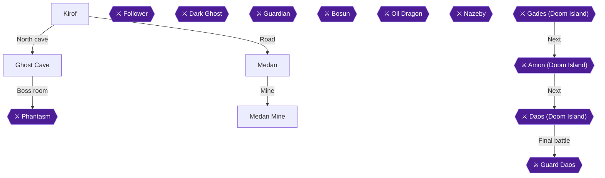

This chapter takes you from the town of Kirof, southwest of the northern tower [[gf2-19-2]], through Medan and its castle, into the 24-chest Ghost Cave north of Kirof [[ra-comments-50-11]], and through the Phantasm fight that rescues Reyna and unlocks The Exorcist. Afterwards you return to Medan for one time-limited Hi Potion and make a short first visit to the Medan Mine. Kirof and Medan are both listed at a recommended level of 11 [[gf1-22-1, gf1-23-1]], and the Ghost Cave at level 12 [[gf1-25-1]]. One guide wants level 15 before the Phantasm [[gf3-7-27]]. Another guide beat it at Hero 18, Aguro 16 and Lufia 17 [[gf4-26-4]].

> [!WARNING]
> **One-Time Item Warning (Kirof):** The Stuffed Pig and Stuffed Dog on the bookshelves by the bed can only be taken now. Take both before you enter the Ghost Cave [[gf1-22-7, gf1-22-8, gf-treasure-5-1]].

> [!WARNING]
> **One-Time Item Warning (Medan):** After the Phantasm, the Hi Potion in the Medan bookcase must be collected on that return visit. It is the only chance to get it [[gf-treasure-5-31, gf1-27-10, gf4-9-2]].

### Chapter Items to Collect

| Item | Where Found | Action / Requirement | Citation |
|---|---|---|---|
| Mid Arrow | Kirof inn, far right bookcase | **TAKE** | [[gf-treasure-4-72]] |
| Hi Arrows | Kirof inn, 2nd bookcase from left | **TAKE** | [[gf-treasure-4-73]] |
| Bomb | Kirof inn, far left bookcase | **TAKE** | [[gf-treasure-4-74]] |
| Plum Cider | Kirof, bookcase in house north of inn | **TAKE** | [[gf-treasure-4-75]] |
| Hi Potion | Kirof item shop, right bookcase | **TAKE** | [[gf-treasure-4-76]] |
| Sweet Water | Kirof item shop, left bookcase | **TAKE** | [[gf-treasure-4-77]] |
| Stuffed Dog | Kirof, left bookcase next to Reyna | **TAKE** (missable) | [[gf-treasure-4-78, gf1-22-8]] |
| Stuffed Pig | Kirof, right bookcase next to Reyna | **TAKE** (missable) | [[gf-treasure-5-1]] |
| Swing Wing | Medan, left bookcase in house east of inn | **TAKE** | [[gf-treasure-5-2]] |
| Escape | Medan, right bookcase in same house | **TAKE** | [[gf-treasure-5-3]] |
| Ex Potion | Medan, flower bed west of castle | **SEARCH** | [[gf-treasure-5-4]] |
| Ex Magic | Medan, flower bed east of castle | **SEARCH** | [[gf-treasure-5-5]] |
| Ghost Cave chests (24) | Ghost Cave | **OPEN ALL** | [[ra-comments-50-11, gf2-20-10]] |
| Power Potion | Kirof item shop owner after the Phantasm | **TALK** | [[gf-treasure-5-30, gf1-27-9]] |
| Hi Potion | Medan, north-west house bookcase, after the Phantasm | **TAKE** (missable) | [[gf-treasure-5-31]] |
| Foul Water | Medan Mine, first chest | **OPEN** | [[gf1-42-2]] |
| Sweet Water | Medan Mine, next level down | **OPEN** | [[gf1-42-3]] |
| Bomb | Medan Mine, south-east corner | **OPEN** | [[gf-treasure-6-41]] |

### Kirof

🗺️ **Map:** [View Kirof Map by FlyingArmor](https://www.vgmaps.com/Atlas/SuperNES/Lufia&TheFortressOfDoom-Kirof.png)

Residents mention a ghost haunting the cave to the north [[gf1-22-1]]. The inn here costs 20 Gold [[gf2-20-9]].

1. Go to the back of the inn and search the bookshelves. Far left holds a **Bomb**, the second from the left holds **Hi Arrows**, and far right holds a **Mid Arrow** [[gf-treasure-4-74, gf-treasure-4-73, gf-treasure-4-72, gf2-19-4]].
2. Visit the house north of the inn and search its bookshelf for **Plum Cider** [[gf-treasure-4-75, gf2-19-5]].
3. Go east into the back of the Merchant's shop to trigger dialogue, then speak to Reyna [[gf2-19-6]].
4. Search the item shop bookcases: the left one holds **Sweet Water** and the right one a **Hi Potion** [[gf-treasure-4-77, gf-treasure-4-76]].
5. Search the bookcases next to Reyna: the left one holds a **Stuffed Dog** and the right one a **Stuffed Pig**. Take both now [[gf-treasure-4-78, gf-treasure-5-1]].
6. Leave and head east to Medan [[gf2-19-8]]. Monsters outside include Dracu Rose, Spiked Newt, Fight, Zombie, Red Magi and Frog [[gf2-20-8]].

### Medan

🗺️ **Map:** [View Medan Map by FlyingArmor](https://www.vgmaps.com/Atlas/SuperNES/Lufia&TheFortressOfDoom-Medan.png)

Entering Medan triggers dialogue. The inn costs 60 Gold [[gf-shop-7-24]].

1. Go into the house east of the inn. Search the left bookcase for a **Swing Wing** and the right one for an **Escape** [[gf-treasure-5-2, gf-treasure-5-3]].
2. Shop for the party. The guide recommends a Mace for Lufia and Spears for Hero and Aguro [[gf2-20-3]]. The Spear costs 780 Gold [[gf-shop-7-1]] and the Mace 600 Gold [[gf-shop-7-2]]. The guide also lists Chain Mail for Hero and Aguro at 960 [[gf1-23-15]], Wood Shield for Hero at 360 [[gf1-23-17]] and Wood Helm for Aguro at 540 [[gf1-23-19]]. It says to buy 10 Mystery Pins at 30 each [[gf1-23-9]], since they cure paralysis [[gf1-24-8]]. It says to buy 10 Bombs at 100 each [[gf1-24-16]], which hit all enemies for about 35-40 damage [[gf1-24-7]]. It says to buy one Power Gourd at 100 [[gf1-23-12]].
3. Skip Chain Cloth for Lufia and Wood Shield for Aguro, because both are found in the Ghost Cave [[gf1-24-14]].
4. Other stock, for reference. Weapons shop: Short Sword 360, Staff 360, Mid Arrow 50, Arrows 10 [[gf-shop-7-3, gf-shop-7-4, gf-shop-7-5, gf-shop-7-6]]. Armorer: Chain Cloth 1100, Wood Wrist 480, Glass Cap 460, Cloth Shoes 300 [[gf-shop-7-9, gf-shop-7-11, gf-shop-7-13, gf-shop-7-14]]. Merchant: Sweet Water 10, Potion 8, Antidote 6, Smoke Ball 80, Magic Guard 50, Mind Gourd 100, Swing Wing 80 [[gf-shop-7-15, gf-shop-7-16, gf-shop-7-17, gf-shop-7-19, gf-shop-7-20, gf-shop-7-22, gf-shop-7-23]].
5. Walk up the middle of town to the castle. In the flower beds in front, search the top-left square of the western bed for an **Ex Potion** and the top-right square of the eastern bed for an **Ex Magic** [[gf-treasure-5-4, gf-treasure-5-5, gf1-24-11, gf1-24-12]].

#### Medan Castle

🗺️ **Map:** [View Medan Castle Map by FlyingArmor](https://www.vgmaps.com/Atlas/SuperNES/Lufia&TheFortressOfDoom-MedanCastle.png)

1. Dialogue triggers at the castle approach. Enter and go through the first two doors, then walk up to the Hope Ruby for more dialogue [[gf2-20-4, gf1-24-15]].
2. Leave the room, follow the east path to the stairs down, and follow the path to trigger more dialogue. A knight stops you from going further [[gf2-20-5]].
3. Back at the entrance, take either northern flight of stairs to the throne room and speak to the King to hear a rumor [[gf2-20-6]].
4. Leave the castle to trigger more dialogue, then exit Medan and return to Kirof [[gf2-20-7]].

> [!TIP]
> Medan has another hidden item you cannot get yet [[gf1-24-13]]. The Hi Potion in the old man's house is only available after the Phantasm; see below.

### Kirof (return)

1. Return west from Medan to Kirof and step one tile forward from the town entrance to trigger the scene with the townspeople [[gf2-20-7, gf2-20-10]].
2. Rest at the Kirof inn for 20 Gold so your party starts at full HP and MP, and stock up on a few Shrieks to cure confusion during the boss fight [[gf2-20-9, gf2-20-10, gf-boss-2-1]].
3. Exit Kirof and walk north to enter the Ghost Cave [[gf2-20-10]].

### Ghost Cave

🗺️ **Map:** [View Ghost Cave Map by FlyingArmor](https://www.vgmaps.com/Atlas/SuperNES/Lufia&TheFortressOfDoom-GhostCave.png)
🗺️ **Map:** [View Shrine North Of Kirof Map by FlyingArmor](https://www.vgmaps.com/Atlas/SuperNES/Lufia&TheFortressOfDoom-ShrineNorthOfKirof.png)

Every enemy here is a ghost type, and this is the first dungeon where creature types matter [[gf1-25-2]]. Crazy Pots cast Frost and Flamespooks cast Spark, so kill them quickly. Willowisps have high physical defense, so use Dew or a Bomb on groups [[gf1-25-23, gf1-25-24, gf1-25-25]]. Crazy Pots drop Magic Jars [[gf2-92-9]]. SwordsPooks can drop a Scimitar [[gf2-93-12]] and Ghost Mail can drop Light Armor [[gf2-92-18]]. The cave holds 24 chests [[ra-comments-50-11]]. Stock a few Shrieks before the boss [[gf-boss-2-1]].

#### First floor, east part

1. Go southeast from the entrance and open the chest for a **Hi Potion** [[gf-treasure-5-17, gf2-20-10]].
2. Ignore the first rope ladder and go east. Enter the door for a lone chest with an **Escape** [[gf3-7-22]].
3. Continue east through another door for a chest with **Chain Cloth**. Equip it on Lufia [[gf-treasure-5-8, gf2-20-15]].
4. Go down the rope ladder to your west, then southeast through the door for a **Miracle** [[gf2-20-16]].
5. Go southwest in the room to the chest with **500 Gold** [[gf-treasure-5-21]].
6. Move west, skipping the first door. The second door holds the **Ghost Ring** and the third the **Monster Ring** (the guide says to sell it) [[gf-treasure-5-20, gf-treasure-5-19, gf1-25-4]]. Equip the Ghost Ring on Hero or Aguro before the boss [[gf1-25-3, gf-boss-2-1]].

#### Down to the healing tiles

1. Go back to the very first rope ladder, climb down, and take the stairs to the two blue floor panels that restore HP and MP; remember where these healing tiles are [[gf2-20-20, gf1-25-11]]. Open the chest here for a **Revive** [[gf1-26-6]].
2. Take the southern stairs down, walk east and open the chest for a **Wood Shield** (equip on Aguro) [[gf2-20-22, gf1-25-12]]. Continue east and up the stairs for a **Hi Magic** [[gf-treasure-5-14, gf2-20-24]].
3. Return to the panels and take the other flight down, then the next flight up, for a second **Hi Magic** [[gf2-20-24]].
4. From the Hi Magic room, take the upper stairs for the **Dragon Egg** [[gf-treasure-5-13]]. This is part of the initial set of eggs [[gf-treasure-5-13]].
5. Go back two rooms and take the southern stairs, then another set down, for the **Speed Potion** in the red-walled room (the guide says to save it for later) [[gf-treasure-5-14, gf1-25-16]].
6. Return to the panels and use them to level up if needed [[gf2-20-20]].

#### Second route down

1. Go back to the very first rope ladder and follow the path next to it to a door. Open the chest for a **Revive** [[gf-treasure-5-15]].
2. Take the stairs down. Go south for a **Hi Potion**, east for another **Hi Potion**, then northeast (ignoring the rope ladder) for a third [[gf-treasure-5-17, gf1-25-21]].
3. Go down the rope ladder, head west past the stairs, and take the northeast stairs to two chests: **Spell Potion** and **Power Potion** [[gf2-20-31, gf2-20-32]].
4. Take the east door for a lone chest with a **Great Potion**. The west door holds a chest with a **Mind Potion** and a wounded knight. Helping him gets the hint "Things are not what they appear to be" [[gf-treasure-5-26, gf-treasure-5-25, gf2-20-35]].

#### The invisible bridge

1. Go back up and take the northwest stairs. Either northern stairs lead to two chests: an **Escape** and a **Smoke Ball** [[gf2-20-37, gf3-7-22]].
2. Both visible bridges collapse. Instead go down the middle southern staircase, then walk north off the front of the platform across the invisible bridge [[gf1-26-5, gf2-20-38, gf3-7-24]].
3. Open the final chest for a **Revive**, then heal everyone to full before going through the door [[gf1-26-6, gf1-26-7]].

### Phantasm

Talking to Reyna starts the fight, so heal first [[gf2-20-40]].

**Facts:** 657 HP, weak to the Ghost Ring [[gf1-27-1, gf1-27-2]]. It also takes damage from physical attacks, and a second guide calls physical attacks its only weakness [[gf3-7-26]]. Reward is 800 EXP [[gf3-7-26]].

**Strategy:**
- Round one: Hero and Aguro each use a Power Gourd, and Lufia casts Drain [[gf1-27-3, gf1-27-4]].
- After that, keep attacking with Hero and Aguro. Lufia heals with Strong [[gf1-27-5, gf2-20-44]].
- Phantasm casts Shield on itself, so rely on physical attacks. It mostly uses Spark on the whole party, casts Drowsy (which misses) and casts Confuse when low [[gf2-20-43]].
- If someone is confused, use a Shriek or attack them with Lufia [[gf-boss-2-2]]. If someone falls asleep, cast Waken [[gf1-27-7]].


> [!ACHIEVEMENT]
> **The Exorcist (10 Points)**
> 
> *Rescue Reyna from the clutches of the Phantasm*


After the fight you return to Kirof automatically [[gf1-27-8, gf2-20-44]].

### Kirof and Medan after the boss

1. Talk to the item shop owner for a **Power Potion** [[gf-treasure-5-30, gf1-27-9, gf2-21-3]]. Rest at the inn, then head to Medan [[gf2-21-4]].
2. In Medan, the Princess is apologizing and everyone is out of their houses. Search the bookcase in the north-west (upper left) house for the **Hi Potion**. It is the only chance to get it [[gf-treasure-5-31, gf1-27-10, gf4-9-2]].
3. Speak to the Princess to finish business in town [[gf2-21-20]].

> [!TIP]
> Before you leave Medan: the Cave East of Medan is the next story destination [[gf2-21-21]]. It is covered in the next chapter, though a Revive and Hi Potion lie across the marsh by the entrance [[gf2-21-22, gf2-21-23]].

### Medan Mine

🗺️ **Map:** [View Medan Mine Map by FlyingArmor](https://www.vgmaps.com/Atlas/SuperNES/Lufia&TheFortressOfDoom-MedanMine.png)

The mine is optional now. On a first visit you only get Foul Water, Sweet Water and a Bomb, because the old man will not let you into his treasure room [[gf1-42-2]]. The cave has the same enemies as the Ghost Cave [[gf1-42-1]].

1. Walk north out of Medan and enter the cave [[gf2-31-8]].
2. Go down either rope ladder at the entrance and open the chest for **Foul Water** [[gf1-42-2, gf2-31-9]].
3. Go down the next ladder and open the chest in the upper right for **Sweet Water** [[gf1-42-3, gf2-31-10]].
4. Open the chest in the south-east corner for a **Bomb** [[gf-treasure-6-41, gf2-31-11]].

The Red Sapphire, the remaining four chests (Emerald, Opal, 500 Gold, Diamond Ring) and the old man's last Ruby come later [[gf1-42-5, gf3-12-8, gf-treasure-6-46]].

> [!TIP]
> Before you leave: confirm you have both Stuffed animals, the post-boss Power Potion and the Medan Hi Potion, since the latter two are only reachable around the Phantasm fight [[gf-treasure-5-1, gf-treasure-5-31, gf-treasure-5-30]].

> [!IMPORTANT]
> ### Chapter 5 Cumulative 100% Checkpoint
> - **Treasure Chests:** 118 / 637
> - **Dragon Eggs:** 2 / 24
> - **RetroAchievements Unlocked:** 13 / 47 (50 / 343 points)

### Chapter Checklist
- [ ] Kirof: Mid Arrow, Hi Arrows, Bomb, Plum Cider, Hi Potion, Sweet Water
- [ ] Kirof: Stuffed Dog and Stuffed Pig
- [ ] Medan: Swing Wing, Escape, Ex Potion, Ex Magic
- [ ] Ghost Cave: all 24 chests, including the Dragon Egg and Ghost Ring
- [ ] Phantasm defeated, The Exorcist unlocked (196725)
- [ ] Kirof: Power Potion from the item shop owner
- [ ] Medan: Hi Potion from the north-west house
- [ ] Medan Mine: Foul Water, Sweet Water, Bomb

---

## Chapter 6: Belgen, Dais and the Rescue of Jerin

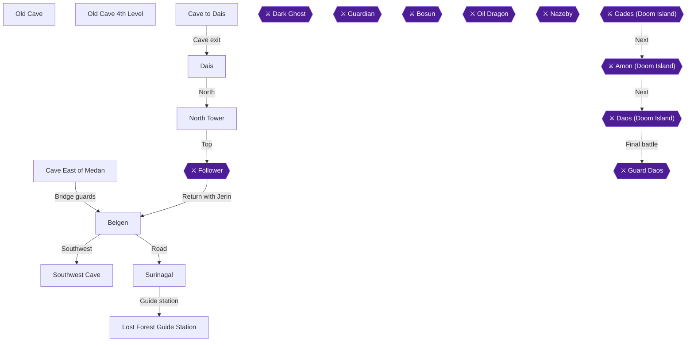

This chapter takes you from the cave east of Medan to Belgen, through the Southwest Cave for the Dais Key, up through the Cave to Dais and the North Tower, and into the fight with the Follower that rescues Jerin. You then go back through Belgen to Surinagal and the Lost Forest Guide Station, where Jerin joins, and finish with the fourth level of the Old Cave and its Crown. The recommended levels are 14 for Belgen, Surinagal and the Southwest Cave [[gf1-28-1, gf1-29-1, gf1-30-1]], 15 for Old Cave 4th Level [[gf1-31-1]], 16 for the Cave to Dais and the North Tower [[gf1-32-1, gf1-33-1]], and 17 for the Guide Station [[gf1-36-1]].

> [!WARNING]
> **One-Time Item Warning (Old Cave 2nd floor):** The Dress, Earring, Heeled Shoes and Hair Band in the Lufia-only room on the Old Cave 2nd floor cannot be collected once you obtain Jerin [[gf-treasure-2-56, gf-treasure-2-57, gf-treasure-2-59, gf-treasure-2-60]]. If you skipped them, no source describes a way to get them afterward, so treat them as lost.

> [!WARNING]
> **Chest Overwrite Warning (Dragon Egg chests):** The Float chest in the Belgen cave and the right-hand Float chest in the Southwest Cave each become a Dragon Egg after the first egg scatter [[gf-treasure-5-36, gf-treasure-5-42]]. Take both Floats now.

> [!NOTE]
> The Jerin achievement note: a commenter reports that it unlocked when Jerin was first saved, not when she joined the party [[ra-comments-1-1]]. The Jerin entry below covers both timings. Another player saw the unlock icon but the website kept the achievement blocked [[ra-comments-2-3, ra-comments-17-1]]. A manual unlock request may be possible, and a save is probably not needed [[ra-comments-2-2]].

### Cave East of Medan

From Medan, leave town and take the cave to the east [[gf2-21-21]]. Chests here: 2.

1. Walk east on entering and cross the toxic marsh. Two chests wait on the far side: the left holds a **Revive** and the right holds a **Hi Potion** [[gf2-21-22, gf2-21-23]].
2. Backtrack and cross the bridge guarded by the two knights to find the stairs out of the cave, then head south to Belgen [[gf2-21-24]].

### Belgen

🗺️ **Map:** [View Belgen Map by FlyingArmor](https://www.vgmaps.com/Atlas/SuperNES/Lufia&TheFortressOfDoom-Belgen.png)

🗺️ **Map:** [View Cave To Belgen Map by FlyingArmor](https://www.vgmaps.com/Atlas/SuperNES/Lufia&TheFortressOfDoom-CaveToBelgen.png)

Monsters outside Belgen: Ghost Mail, SwordsPook, Poison Rat, Mummy and Beetle [[gf2-22-1]]. Chests and searches: 2 chests in the cave plus bookcase items.

1. Watch the dialogue on entering, then speak to the girl walking next to the Merchant's shop [[gf2-23-2]].
2. Go east to the Weapons Shop. Buying a Long Staff for Lufia and Brone Swords for Hero and Aguro is recommended [[gf2-23-3]].
3. North of the weapons shop, enter the door west of the hut. Open the chests: **Float** (left) and **Hi Potion** (right) [[gf2-23-5, gf-treasure-5-36]]. Take the Float now; it is the missable one flagged above.
4. Take the stairs east. Search the left bookcase for a **Power Gourd** and the right for a **Mind Gourd** [[gf-treasure-5-38, gf-treasure-5-39]]. Talk to the girl next to the bookshelves and answer "yes" [[gf2-23-2]].
5. Backtrack, go up the stairs north of the entrance and west to the Armorer's shop. The building to the west has a **Revive** (northwest bookcase) and **Hi Magic** (northeast bookcase) in the big room [[gf-treasure-5-34, gf-treasure-5-35]].

Shops in Belgen. The inn costs 40 Gold [[gf-shop-8-24]].

| Shop | Stock | Citation |
|---|---|---|
| Weapons | Brone Sword 1400, Long Staff 1200, Spear 780, Mace 600, Hi Arrows 100, Bomb 100 | [[gf-shop-8-1, gf-shop-8-2, gf-shop-8-3, gf-shop-8-4, gf-shop-8-5, gf-shop-8-6]] |
| Armorer | Brone Armor 1400, Brone Robe 1500, Brone Shield 720, Brone Breast 840, Brone Helm 1200, Glass Cap 460, Tan Shoes 840 | [[gf-shop-8-7, gf-shop-8-8, gf-shop-8-9, gf-shop-8-10, gf-shop-8-11, gf-shop-8-12, gf-shop-8-13]] |
| Merchant | Sweet Water 10, Potion 8, Antidote 6, Mystery Pin 30, Shriek 5, Swing Wing 80, Smoke Ball 80, Magic Guard 50, Power Gourd 100, Mind Gourd 100 | [[gf-shop-8-14, gf-shop-8-15, gf-shop-8-16, gf-shop-8-17, gf-shop-8-18, gf-shop-8-19, gf-shop-8-20, gf-shop-8-21, gf-shop-8-22, gf-shop-8-23]] |

When ready, exit the town, head southwest and enter the southernmost cave [[gf2-23-11]].

### Southwest Cave

🗺️ **Map:** [View Cave Southwest Of Belgen Map by FlyingArmor](https://www.vgmaps.com/Atlas/SuperNES/Lufia&TheFortressOfDoom-CaveSouthwestOfBelgen.png)

🗺️ **Map:** [View Southwest Cave To Fortress Map by FlyingArmor](https://www.vgmaps.com/Atlas/SuperNES/Lufia&TheFortressOfDoom-SouthwestCaveToFortress.png)

Monsters: SwordsPook, Mummy, Ghost Mail, Beetle, Poison Rat, Blue Wolf, Mud Man [[gf2-23-12]]. Chests: 14, plus hidden items.

1. Walk west on entering and go down the stairs. Enter the southern door for a **Hi Potion** [[gf-treasure-5-48]].
2. Take the stairs east: left chest **Smoke Ball**, right chest **Float** (the missable Dragon Egg one) [[gf-treasure-5-41, gf-treasure-5-42]].
3. Go down the next stairs east and down the rope ladder. The first chest to the north is an **Escape** [[gf-treasure-5-43]]. Head west for the lower chest, **Power Potion**, and the upper chest, **Spell Potion** [[gf-treasure-5-44, gf-treasure-5-45]].
4. Cast Float and search the last square of marsh at the end of the path for a hidden **Miracle** [[gf-treasure-5-46, gf1-30-8]].
5. Go back upstairs, enter the northwest door and descend. Walk around and take another flight down. Search the middle-right corner of the marsh for a hidden **Scimitar** and equip it on Hero or Aguro [[gf-treasure-5-55, gf1-30-9]].
6. At the four-way crossroad, go east first: the right door holds **Brone Armor**, **Brone Helm** and **Brone Shield** [[gf-treasure-5-51, gf-treasure-5-52, gf-treasure-5-53]].
7. West door: **Hi Magic** and **Hi Potion** [[gf-treasure-5-47, gf-treasure-5-48]].
8. North stairs: **Revive** (upper) and **Fly Ring** (lower) [[gf-treasure-5-49, gf-treasure-5-50]].

### Dais Key

1. Backtrack to the crossroad and go south, down the stairs and into the door. Speak to the man, and when he moves open the chest for the **Dais Key** [[gf2-23-28, gf-treasure-5-54]].
2. Exit the cave and rest at the Belgen inn if you wish [[gf2-23-29]]. Dais Cave lies north of this cave [[gf2-23-29]].

> [!TIP]
> Before you leave the Southwest Cave, the chests here should total 14 per the checklist, with a second Dragon Egg-flagged Float already taken [[ra-comments-50-14, gf-treasure-11-53]].

### Cave to Dais

🗺️ **Map:** [View Cave To Dais Map by FlyingArmor](https://www.vgmaps.com/Atlas/SuperNES/Lufia&TheFortressOfDoom-CaveToDais.png)

Monsters: Mummy, Beetle, Poison Rat, Orc, Red Orb and Mimick [[gf2-24-11]]. Mimicks give a lot of experience but often flee at low HP, and magic is largely ineffective against them [[gf1-32-2]]. Beating one in the marsh area is worth 500-600 EXP [[gf3-8-22]]. Chests: 10.

1. Ignore the red door and enter the one to the south. Open the three chests: **Great Potion** (upper), **Mind Potion** (middle), **Speed Potion** (lower) [[gf-treasure-5-56, gf-treasure-5-57, gf-treasure-5-58]].
2. Unlock the red door with the Dais Key [[gf1-32-3]]. Go down the rope ladder and into the northwest door for a **Float**, then through the door south of it [[gf3-8-23]].
3. Go up the rope ladder and cross the bridge: left chest **Revive**, right chest **Hi Magic** [[gf-treasure-5-60, gf-treasure-5-61]].
4. Return to the marsh room and descend the rope ladder, then the southeast ladder: **Mind Gourd** (left) and **Power Gourd** (right) [[gf-treasure-5-62, gf-treasure-5-63]].
5. Cross the bridge west and go under the next one: **Power Potion** (upper) and **Spell Potion** (lower) [[gf-treasure-5-64, gf-treasure-5-65]].
6. Go up the ladder you passed, cross the bridge west and go down the ladder. Head west, climb two more ladders and a flight of stairs outside, then walk west into Dais [[gf2-24-11]].

### Dais

🗺️ **Map:** [View Dais Map by FlyingArmor](https://www.vgmaps.com/Atlas/SuperNES/Lufia&TheFortressOfDoom-Dais.png)

1. Climb the stairs. Two guards stop you from going to the top [[gf2-24-12]].
2. Go east or west to trigger dialogue, then search the pots at the sides to restore HP and MP [[gf2-24-13]].
3. The man on the west side can revive, lift curses or record [[gf2-24-14]].
4. Try to leave Dais to trigger dialogue, then exit and head north to the tower [[gf2-24-15]].

### North Tower

🗺️ **Map:** [View North Tower Map by FlyingArmor](https://www.vgmaps.com/Atlas/SuperNES/Lufia&TheFortressOfDoom-NorthTower.png)

Enemies: Archers hit the whole party with Hi Arrows, Nightmares inflict confuse and Straw Men inflict paralysis, so kill them first [[gf1-33-2]]. Chests: 10.

1. Step on the warp pad at the entrance and ignore the two side doors. The portal in the west room links to the east room and vice versa [[gf2-24-16]].
2. Go north past another door to the east and up the stairs. The light tiles on the second floor mark the tiles that collapse on the third floor [[gf2-24-17, gf1-33-3]].
3. On the third floor, avoid the hidden pitfalls and open seven chests. From the north stairs go one step left, two up and face right for the **Revive**; from there go all the way up and face right for **Awaken**; two left and one down for **Antidote**; left of that, walk left to the **Hi Potion**; straight down for **Shriek**; above Shriek, two right and two down for **Mystery Pin**; above that, two left and two down for **Stone Cure** [[gf-treasure-5-66, gf-treasure-5-67, gf-treasure-5-68, gf-treasure-5-69, gf-treasure-5-70, gf-treasure-5-71, gf-treasure-5-72]].
4. Backtrack to the east door, step on its warp pad and go up. Walk south to three doors and enter the west one for the **Flash Ring** [[gf-treasure-6-1]]. The middle room is empty [[gf2-24-26]].
5. The Knight in the west door warns not to step on the warp at the far end of the roof, which sends you back to the entrance [[gf2-24-26, gf4-9-30]].
6. Climb the stairs and four more staircases to the roof. The western-most warp pad leads to a **Miracle** chest [[gf-treasure-6-3]]. Go to the three pads at the top, take the western one and the two northern pads after it for another **Miracle** [[gf-treasure-6-3]].
7. Finally take the western-most pad, then the next two northern ones, to reach the platform with Jerin [[gf2-24-29]].

Equip the Flash Ring on Lufia before the fight [[gf-boss-2-3]].

### Follower

Heal fully before approaching Jerin [[gf2-24-30]]. Follower has 982 HP and no weaknesses [[gf1-35-1]].

- Turn one: Aguro and Hero use Power Gourds while Lufia casts Drain [[gf1-35-2]].
- Lufia then casts Bolt (or Flash) repeatedly [[gf-boss-2-4]]. Equipping the Flash Ring and using Flash is another listed approach [[gf4-9-31]].
- He casts Drowsy, Drain and Frost [[gf2-24-30]]. Counter with Awaken and Stronger [[gf-boss-2-5]]. When low he casts Bolt, uses Grin to confuse and Stronger on himself [[gf2-24-30]].
- Constant physical attacks from Hero and Aguro with Lufia healing also work [[gf2-24-32]].


> [!ACHIEVEMENT]
> **Amon's Follower (10 Points)**
> 
> *Rescue Jerin from Amon's Follower*


Afterwards you supposedly get a Miracle, but it is not added to your inventory [[gf1-35-3, gf-treasure-6-4]]. Speak with Jerin after the battle; when control returns you are in Belgen [[gf2-24-32]]. In Belgen Jerin gives you a Miracle in thanks [[gf2-26-2, gf3-9-5]].

### Surinagal

🗺️ **Map:** [View Surinagal Map by FlyingArmor](https://www.vgmaps.com/Atlas/SuperNES/Lufia&TheFortressOfDoom-Surinagal.png)

1. Rest at the inn, exit Belgen, cross the bridge east and another north, then go far east across the desert to Surinagal [[gf2-26-3]]. The inn costs 50 Gold [[gf-shop-9-26]].
2. Speak with the old man to the west, then the little boy to the north; answer no for directions [[gf2-27-3]].
3. The house west of the boy has **Hi Magic** and a **Miracle** in its bookshelves [[gf2-27-4, gf2-27-5, gf-treasure-6-5, gf-treasure-6-6]].
4. The chest in the Weapons shop holds a **Hi Potion** [[gf2-27-6]].
5. Shops: Weapons: Axe 3000, Rapier 2400, Scimitar 2100, Big Arrow 100, Hi Arrows 100, Bomb 100 [[gf-shop-9-1, gf-shop-9-2, gf-shop-9-3, gf-shop-9-4, gf-shop-9-5, gf-shop-9-6]]. Armorer: Brone Armor 1400, Robe 1500, Shield 720, Breast 840, Helm 1200, Glass Cap 460, Tan Shoes 840 [[gf-shop-9-7, gf-shop-9-8, gf-shop-9-9, gf-shop-9-10, gf-shop-9-11, gf-shop-9-12, gf-shop-9-13]]. Merchant: Hi Potion 400, Hi Magic 1000, Antidote 6, Awaken 10, Mystery Pin 30, Stone Cure 100, Shriek 5, Swing Wing 80, Smoke Ball 80, Magic Guard 50, Power Gourd 100, Mind Gourd 100 [[gf-shop-9-14, gf-shop-9-15, gf-shop-9-16, gf-shop-9-17, gf-shop-9-18, gf-shop-9-19, gf-shop-9-20, gf-shop-9-21, gf-shop-9-22, gf-shop-9-23, gf-shop-9-24, gf-shop-9-25]]. Buying two Axes for Hero and Aguro and a Rapier for Lufia is recommended [[gf2-27-6]].
6. Exit, walk southwest, cross the bridge and continue to the Guide Station [[gf2-27-7]].

### Lost Forest Guide Station

1. Speak to the old man on entering and answer yes; after the dialogue you have a party of four [[gf2-27-8]]. Jerin joins here [[gf1-36-5, gf4-3-2]].


> [!ACHIEVEMENT]
> **Jerin (2 Points)**
> 
> *Recruit the reliable Half-Elf*


2. Search the bookshelves: **Swing Wing** (left), **Sweet Water** (third from left), **Revive** (second from right) [[gf-treasure-6-8, gf-treasure-6-9, gf-treasure-6-10]]. The old man will let you rest for free [[gf2-27-12]].
3. Give Jerin your Speed Potions and equip her with the Heeled Shoes and Flame Ring [[gf1-36-5]].
4. A new Old Cave floor is available. Check Jerin's magic for Warp, warp to Grenoble, accept the new treasure hunt, then re-enter the Old Cave [[gf2-27-13]].

### Old Cave

🗺️ **Map:** [View Old Cave 1st Level Map by FlyingArmor](https://www.vgmaps.com/Atlas/SuperNES/Lufia&TheFortressOfDoom-OldCave-1stLevel.png)

🗺️ **Map:** [View Old Cave 2nd Level Map by FlyingArmor](https://www.vgmaps.com/Atlas/SuperNES/Lufia&TheFortressOfDoom-OldCave-2ndLevel.png)

🗺️ **Map:** [View Old Cave 3rd Level Map by FlyingArmor](https://www.vgmaps.com/Atlas/SuperNES/Lufia&TheFortressOfDoom-OldCave-3rdLevel.png)

🗺️ **Map:** [View Old Cave 5th Level Map by FlyingArmor](https://www.vgmaps.com/Atlas/SuperNES/Lufia&TheFortressOfDoom-OldCave-5thLevel.png)

🗺️ **Map:** [View Old Cave 6th Level Map by FlyingArmor](https://www.vgmaps.com/Atlas/SuperNES/Lufia&TheFortressOfDoom-OldCave-6thLevel.png)

🗺️ **Map:** [View Old Cave 7th Level Map by FlyingArmor](https://www.vgmaps.com/Atlas/SuperNES/Lufia&TheFortressOfDoom-OldCave-7thLevel.png)

🗺️ **Map:** [View Cave North Of Glasdar Tower Map by FlyingArmor](https://www.vgmaps.com/Atlas/SuperNES/Lufia&TheFortressOfDoom-CaveNorthOfGlasdarTower.png)

The Old Cave's floors unlock with character level, opening one floor per 5 levels so that the 4th floor requires a party member at level 15 [[gf1-17-5, gf4-7-6]]. In Grenoble, pay 50 Gold to enter the Old Cave shop and accept the **Crown** treasure hunt from the man behind the counter [[gf1-17-5, gf4-7-5, gf2-27-13]]. Then walk west of Grenoble into the Old Cave 1st level entrance, speak to the attendant, and ride the elevator down to the 4th floor [[gf2-15-4, gf2-27-13]].

### Old Cave 4th Level

🗺️ **Map:** [View Old Cave 4th Level Map by FlyingArmor](https://www.vgmaps.com/Atlas/SuperNES/Lufia&TheFortressOfDoom-OldCave-4thLevel.png)

Chests: 28, including empties, which count toward your total [[ra-comments-50-15, gf-treasure-12-1]].

1. Beside the elevator, chests hold a **Smoke Ball** and a **Hi Potion**; the third is empty [[gf-treasure-3-19, gf-treasure-3-20]].
2. Go north; open the three chests on the way, then enter the door: four chests, one with a **Miracle**, the rest empty [[gf-treasure-3-22]].
3. Go south to the door with an empty chest outside it. Inside are nine chests: **Light Armor**, **Wind Heels**, **Flame Ring**, **Buckler**, **Light Robe**, **Long Sword**, **Brone Helm**, and two empty [[gf-treasure-3-23, gf-treasure-3-24, gf-treasure-3-25, gf-treasure-3-26, gf-treasure-3-27, gf-treasure-3-28, gf-treasure-3-29]]. Equip the Long Sword and Buckler [[gf2-27-17]].
4. On the path south then east, a chest holds **520 Gold** [[gf-treasure-3-30]]. The upper-left path has a **Magic Guard** among empties [[gf-treasure-3-21]].
5. Along the south-east path: **Hi Magic**, **Escape**, **Long Nail** [[gf-treasure-3-31, gf-treasure-3-32, gf-treasure-3-33]], and a **Float** in front of the marsh [[gf-treasure-3-34]].
6. Cast Float and cross the marsh. Search the left side, standing below the Crown chest then 1 left and 2 down, for a hidden **Spell Potion** [[gf-treasure-3-37]]. The two chests hold the **Crown** and a cursed **Broad Rod**; do not equip the rod [[gf2-27-19, gf-treasure-3-36]].

Return to Grenoble to exchange the Crown for 2000 Gold [[gf1-31-20]].

> [!TIP]
> Before you leave the Old Cave, confirm you have the Crown, the Spell Potion and every chest on this floor.

> [!IMPORTANT]
> ### Chapter 6 Cumulative 100% Checkpoint
> - **Treasure Chests:** 184 / 637
> - **Dragon Eggs:** 2 / 24
> - **RetroAchievements Unlocked:** 15 / 47 (62 / 343 points)

### Chapter Checklist

- [ ] Cave East of Medan: Revive and Hi Potion
- [ ] Belgen: Float, Hi Potion, gourds, Revive, Hi Magic
- [ ] Southwest Cave: all chests, Miracle, Scimitar, Dais Key
- [ ] Cave to Dais: all 10 chests
- [ ] North Tower: 10 chests incl. Flash Ring; Follower defeated
- [ ] Surinagal and Guide Station bookshelves
- [ ] Old Cave 4th Level including the Crown
- [ ] Achievements 196726 and 196727

---

## Chapter 7: Lost Forest, the Three Towers and Elfrea

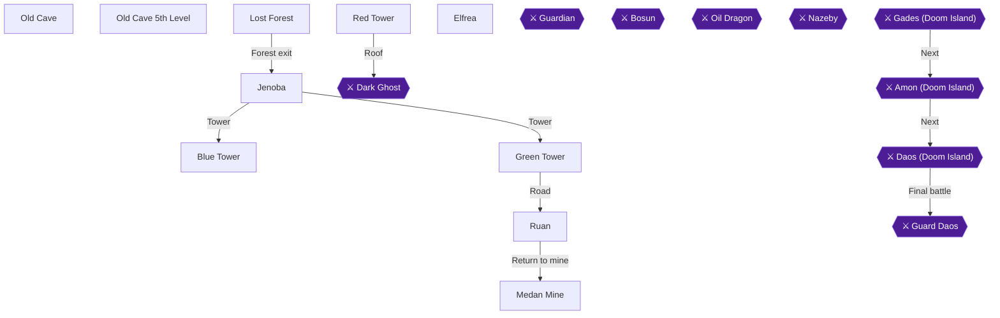

This chapter takes you from the Lost Forest Guide Station through the forest to Jenoba, then through the Blue and Green Towers, Ruan, the Medan Mine and the Red Tower, and finally into Elfrea. Afterwards you return to the Old Cave for its 5th floor. Two achievements are tied to the towers: Who You Gonna Call? for beating the Dark Ghost, and The Elven Village for placing all three gems and reaching Elfrea. Treasure Seeker (250 chests) is expected to pop by the end of the Old Cave 5th floor. [[gf1-36-5, gf1-44-1, gf1-44-8, ra-comments-50-23]]

The chest plan for the chapter is Blue Tower 7, Green Tower 8, Medan Mine 7, Red Tower 15, Elfrea 2 and Old Cave 5th floor 29. [[ra-comments-50-18, ra-comments-50-19, ra-comments-50-20, ra-comments-50-21, ra-comments-50-22, ra-comments-50-23]]

> [!WARNING]
> **One-Time Chests Warning (Red Tower):** The poison-marsh chests in the Red Tower basement (Spell Potion and Power Potion) are lost once you defeat the Dark Ghost. Collect them first. [[gf-treasure-6-49, gf-treasure-6-50, gf4-11-21]]

> [!TIP]
> Hardcore mode means no save states or rewinds. Bring healing items and Sweet Water for the random encounters. Recommended level for the Lost Forest and Jenoba is 17. [[gf1-36-1, gf1-37-1]]

### Chapter Items to Collect

| Item | Where Found | Action / Requirement | Citation |
|---|---|---|---|
| Swing Wing | Guide Station, left bookcase | **TAKE** | [[gf-treasure-6-8]] |
| Sweet Water | Guide Station, third bookcase from left | **TAKE** | [[gf-treasure-6-9]] |
| Revive | Guide Station, second bookcase from right | **TAKE** | [[gf-treasure-6-10]] |
| Hi Potion | Jenoba item shop bookcase | **TAKE** | [[gf-treasure-6-11]] |
| Bomb / Hi Arrows | Jenoba north-east house bookcases | **TAKE** | [[gf-treasure-6-12, gf-treasure-6-13]] |
| Miracle | Jenoba north-west brownish area | **SEARCH** | [[gf-treasure-6-15]] |
| Mind Potion | Jenoba, behind the house and tree on the hill | **SEARCH** | [[gf1-38-10]] |
| Green Jade | Blue Tower, chest after falling twice | **TAKE** | [[gf-treasure-6-22]] |
| Red Sapphire | Medan Mine, from the old man | **TALK** | [[gf-treasure-6-46]] |
| Blue Jade | Red Tower basement, middle chest, after Dark Ghost | **TAKE** | [[gf-treasure-6-60]] |
| Dragon Egg | Red Tower basement, left chest, after Dark Ghost | **TAKE** | [[gf-treasure-6-59]] |
| Shrine Key / Artea's Bow | Elfrea, from Artea | **TALK** | [[gf1-45-4, gf-treasure-6-65]] |
| Golden Pawn | Old Cave 5th floor back room | **TAKE** | [[gf-treasure-3-63]] |

### Lost Forest Guide Station

🗺️ **Map:** [View Lost Forest Northern Guide Map by FlyingArmor](https://www.vgmaps.com/Atlas/SuperNES/Lufia&TheFortressOfDoom-LostForestNorthernGuide.png)

🗺️ **Map:** [View Lost Forest Southern Guide Map by FlyingArmor](https://www.vgmaps.com/Atlas/SuperNES/Lufia&TheFortressOfDoom-LostForestSouthernGuide.png)

1. Enter the station and speak to the old man. Answer yes to his question; after the long dialogue you have a party of four with Jerin. [[gf2-27-8, gf4-3-2]]
2. Search the three bookshelves: Swing Wing (left), Sweet Water (third from left) and Revive (second from right). [[gf-treasure-6-8, gf-treasure-6-9, gf-treasure-6-10]]
3. Talk to the old man again and he lets you rest for free. [[gf2-27-8]]
4. Jerin joins at level 14. Give her your Speed Potions, and equip her with the Heeled Shoes and Flame Ring. [[gf4-3-3, gf1-36-5]]
5. Check Jerin's magic for Warp, which lets you warp to any town you have visited. [[gf3-10-5]]


### Lost Forest

🗺️ **Map:** [View Lost Forest Map by FlyingArmor](https://www.vgmaps.com/Atlas/SuperNES/Lufia&TheFortressOfDoom-LostForest.png)

Head south into the forest. Jerin gives directions as you walk; follow them and you come out the other side. [[gf1-36-5, gf2-28-1]] Enemies here include Sand Men (weak to water), Sand Roses (weak to fire), Killer Bees (ice) and Mummies (fire). [[gf1-36-6, gf1-36-7, gf1-36-8, gf1-36-9]]

On the far side, go west into the house and talk to the old man to rest for free. Then head east to the silver structure, go in the door and take the stairs down. Follow the path, speak with the old man, continue, go up the stairs and exit to the world map. Head north to Jenoba. [[gf2-28-2, gf2-28-3]]

### Jenoba

🗺️ **Map:** [View Jenoba Map by FlyingArmor](https://www.vgmaps.com/Atlas/SuperNES/Lufia&TheFortressOfDoom-Jenoba.png)

🗺️ **Map:** [View Tunnel To Jenoba Map by FlyingArmor](https://www.vgmaps.com/Atlas/SuperNES/Lufia&TheFortressOfDoom-TunnelToJenoba.png)

1. The inn costs 100 Gold. [[gf-shop-10-28]]
2. Search the item shop bookcase for a Hi Potion. [[gf-treasure-6-11]]
3. In the north-east house, the left bookcase holds Hi Arrows and the right holds a Bomb. [[gf-treasure-6-12, gf-treasure-6-13]]
4. Search the brownish sand in the north-west corner for a Miracle. [[gf-treasure-6-15]]
5. Walk around the left side of the house and tree on the hill to the right for a hidden Mind Potion. [[gf1-38-10]]
6. Buy one Long Sword (4800 Gold) for the Hero; you should already have one from the Old Cave. [[gf-shop-10-1, gf2-29-1]]
7. Other stock: Axe 3000, Rapier 2400, Scimitar 2100, Big Arrow 100, Bomb 100. [[gf-shop-10-2, gf-shop-10-3, gf-shop-10-4, gf-shop-10-5, gf-shop-10-7]]
8. Armor: Light Armor 3000, Light Robe 3360, Buckler 1000, Brone Shield 720, Brone Breast 840, Brone Helm 1200, Glass Cap 460. [[gf-shop-10-8, gf-shop-10-9, gf-shop-10-10, gf-shop-10-11, gf-shop-10-12, gf-shop-10-13, gf-shop-10-14]]
9. Items: Sweet Water 10, Hi Potion 400, Antidote 6, Awaken 10, Mystery Pin 30, Stone Cure 100, Shriek 5, Swing Wing 80, Smoke Ball 80, Magic Guard 50, Power Gourd 100, Mind Gourd 100. [[gf-shop-10-16, gf-shop-10-17, gf-shop-10-18, gf-shop-10-19, gf-shop-10-20, gf-shop-10-21, gf-shop-10-22, gf-shop-10-23, gf-shop-10-24, gf-shop-10-25, gf-shop-10-26, gf-shop-10-27]]
10. Buy cider for the old man (10 Gold) and the old woman (answer yes, two ciders) for information. They explain that the towers must be visited in the order blue, green, red. [[gf2-29-4, gf2-29-5, gf4-10-13]]

> [!TIP]
> Before you leave Jenoba, make sure you have the Hi Potion, Bomb, Hi Arrows, Miracle and Mind Potion. Leave town and head southeast to the Blue Tower. [[gf2-29-6]]

### Blue Tower

🗺️ **Map:** [View Blue Tower Map by FlyingArmor](https://www.vgmaps.com/Atlas/SuperNES/Lufia&TheFortressOfDoom-BlueTower.png)

Enemies are annoying here: Dark Elves, Frogs and Jellybeans have multi-target spells, Gargoyles can petrify, Horrorquins can confuse and sleep. Frogs, Gargoyles and Jellybeans are weak to fire. Falling off the sides does no damage but sends you back to the start. [[gf1-39-1, gf1-39-2, gf1-39-3, gf3-11-4]]

#### 1F

1. Left room: chest with the **Blue Ring** (ATP+10, DFP+8). The middle room is empty. [[gf1-39-4]]
2. East room: chest with a **Magic Guard**. [[gf-treasure-6-18]]

#### 2F

3. Take the stairs up, then go left and all the way down past a fork to the chest with **Sweet Water**. [[gf-treasure-6-17]]
4. A note on the wall in the north-west tells you to visit the Red Tower last. [[gf2-29-10]]

#### 3F

5. Climb the lower-right stairs to the isolated section and go left for the chest with a **Hi Potion**. [[gf-treasure-6-19]]

#### 4F and roof

6. Return and take the left stairs to the fourth floor. Follow the path to the chest with **Hi Magic**. Climb to the roof and examine the pedestal; you cannot use it yet. [[gf-treasure-6-20, gf1-39-9]]
7. Back on the third floor take the right stairs, enter the room and drop down the pit. The chest holds a **Revive**. Drop down the next pit and open the last chest for the **Green Jade**. [[gf1-39-9, gf-treasure-6-22]]

That makes the seven chests of the tower. Leave and warp back to Jenoba to rest. [[ra-comments-50-18]]

### Green Tower

🗺️ **Map:** [View Green Tower Map by FlyingArmor](https://www.vgmaps.com/Atlas/SuperNES/Lufia&TheFortressOfDoom-GreenTower.png)

🗺️ **Map:** [View Shrine Southwest Of Green Tower Map by FlyingArmor](https://www.vgmaps.com/Atlas/SuperNES/Lufia&TheFortressOfDoom-ShrineSouthwestOfGreenTower.png)

From Jenoba walk south across the bridge, then east to the tower. [[gf2-29-15]] The inn here costs 150 Gold. Dark Demons can cast Bolt for about 80 damage. [[gf2-30-2, gf3-11-8]]

1. West room: chest with the **Green Ring** (equip on Jerin). [[gf1-40-2]]
2. Go through the middle door and the next door. Take the west staircase first, lower the switch and open the chest for a **Magic Guard**. The switch down reveals stairs on the second floor. [[gf2-30-3, gf1-40-4]]
3. Take the east stairs and the next flight: three chests with an **Ex Potion**, a **Revive** and a broken red sapphire, which you do not take. [[gf2-30-4, gf-treasure-6-30]]
4. Fall down the pit and climb the stairs to three chests: **Hi Magic**, **Revive**, **Ex Potion**. [[gf2-30-5, gf-treasure-6-28]]
5. Drop down again and open the chest in the south-west corner for a **Swing Wing**. [[gf-treasure-6-25]]
6. Go back and raise the switch; the east stairs move. Go up and walk north to the man in the isolated room and pay 100 Gold for his information. [[gf2-30-7, gf1-40-11]]
7. Take the south stairs and one more flight to the green pedestal. [[gf2-33-1]]

Do not place the Green Jade yet: first place the Blue Jade at the Blue Tower. You must collect the Blue Jade at the Red Tower first, so continue to Ruan, then the mine. [[gf3-13-1, gf1-44-8]]

> [!TIP]
> Before you leave, check you have all eight chests: Green Ring, Magic Guard, Ex Potion x2, Revive x2, Hi Magic and Swing Wing. [[ra-comments-50-19, gf4-10-23, gf4-10-24]]

### Ruan

🗺️ **Map:** [View Ruan Map by FlyingArmor](https://www.vgmaps.com/Atlas/SuperNES/Lufia&TheFortressOfDoom-Ruan.png)

From the Green Tower, walk south across the bridge and northeast to Ruan, next to the Red Tower. [[gf2-30-9]]

1. The inn costs 10 Gold. Search the bookshelf at the back for a **Hi Potion**. [[gf1-41-1, gf1-41-4]]
2. In the priest's room (centre house), left bookcase is **Sweet Water**, right is **Revive**. [[gf-treasure-6-33, gf-treasure-6-34]]
3. North-west house bookcase: **Small Knife**. [[gf-treasure-6-38]]
4. In the lower right field, search the centres of the blue flower patches for a **Power Potion** and an **Empty Bottle**. [[gf1-41-8, gf1-41-9]]
5. Jeweler: right bookcase holds an **Emerald**. Emerald 200 Gold, Opal 100 Gold. [[gf-treasure-6-37, gf-shop-11-1, gf-shop-11-2]]
6. The jeweler tells you how to get the Ruby for the Red Tower. Warp to Medan and go north to the mine. [[gf2-31-8]]

### Medan Mine

🗺️ **Map:** [View Medan Mine Map by FlyingArmor](https://www.vgmaps.com/Atlas/SuperNES/Lufia&TheFortressOfDoom-MedanMine.png)

Enemies are the same as the Ghost Cave; Flamespooks are weak to frost and water. [[gf1-42-1]]

1. Go down either ladder at the entrance; the first chest has **Foul Water**. [[gf1-42-2]]
2. Down the next ladder, upper right corner chest: **Sweet Water**. [[gf1-42-3]]
3. Lower right corner chest: **Bomb**. [[gf-treasure-6-41]]
4. Enter the nearby room and talk to the old man to receive the **Red Sapphire**. [[gf1-42-5, gf-treasure-6-46]]
5. The back room now opens with four chests: **Emerald** (left), **Opal** (second from left), **500 Gold** (second from right), **Diamond Ring** (right). [[gf-treasure-6-42, gf-treasure-6-43, gf-treasure-6-44, gf-treasure-6-45]]

That is seven chests. Warp back to Ruan, rest, and walk west to the Red Tower. [[gf2-31-12, ra-comments-50-20]]

### Red Sapphire

The **Red Sapphire** is the scenario item you just received from the old man in Medan Mine after defeating the five Goblins [[gf-treasure-6-46, gf2-31-9]]. Keep it in your inventory as you head west from Ruan to the Red Tower: once you defeat the Dark Ghost on the Red Tower roof and obtain the Blue Jade, you will place the Blue Jade, Green Jade, and Red Sapphire on their three tower roof pedestals in order to open the way to Elfrea [[gf3-13-1, gf4-11-26, gf2-33-3]].

### Red Tower

🗺️ **Map:** [View Red Tower Map by FlyingArmor](https://www.vgmaps.com/Atlas/SuperNES/Lufia&TheFortressOfDoom-RedTower.png)

Flamefreaks cast Flame for 30-40 to everyone; four together deal up to 160 per turn. Big Meany and Flamefreak also have lots of HP. [[gf3-12-9, gf1-43-8]] Recommended level is 19. [[gf1-43-8]]

> [!WARNING]
> **One-Time Chests Warning:** Get the basement poison-marsh chests (Spell Potion and Power Potion) before the Dark Ghost fight, as they cannot be taken afterwards. [[gf-treasure-6-49, gf-treasure-6-50, gf4-11-21]]

#### Ground floor

There are four doors; take them left to right. [[gf1-43-8]]

1. Westernmost door: stairs up to an isolated room with **Hi Potion** and **Red Ring**. [[gf2-32-2, gf-treasure-6-48]]
2. Second door: go down to the swampy basement. Cast Float and cross to the raised platforms: left chest **Spell Potion**, right chest **Power Potion**. [[gf2-32-3, gf-treasure-6-49, gf-treasure-6-50]]

#### 2F

3. Back at the entrance take either eastern door and the stairs up. East door: chest with **Float**. [[gf2-32-4, gf-treasure-6-53]]
4. Climb the stairs north and read the wall note. West door: **Power Gourd** (right) and **Magic Guard** (left). [[gf2-32-5, gf-treasure-6-51, gf-treasure-6-52]]
5. Head south, ignore the door and go east: **Hi Potion** and **Hi Magic**. [[gf2-32-6, gf1-43-8]]
6. Up the stairs nearby: **Smoke Ball** (upper) and **Magic Guard** (lower). [[gf2-32-7, gf-treasure-6-56]]

#### 3F and up

7. Enter the ignored door and climb the stairs to the third floor; the chest above the entrance stairs holds a **Hi Potion**. [[gf2-32-8, gf1-43-12]]
8. Walk around the perimeter to the stairs up and continue to the roof. [[gf1-43-12, gf2-32-8]]

That is 12 chests before the boss, with three more in the basement afterwards. [[ra-comments-50-21]]

### Dark Ghost

Heal everyone, then speak to the monster in front of the pedestal. [[gf2-32-9]]

- **HP 934, weak to Thunder.** It is undead, not ghost or flying, so Lufia should cast Flash every round. [[gf1-44-1, gf1-44-2]]
- Opening: Hero casts Drain, Aguro attacks, Jerin uses a Power Gourd on Aguro. Round two: both fighters attack and Jerin uses a Power Gourd on the Hero. Then Jerin focuses on healing. [[gf1-44-2]]
- Another approach: Hero and Aguro attack, Lufia casts Bolt (Bolt plus the Flash Ring does big damage), Jerin heals. [[gf2-32-10, gf-boss-2-7]]
- Do not equip the Ghost Ring; it is ineffective here. Its Water spell hits for roughly 40 (another guide says 50-60), so use Magic Guards, Shield or Protect. Ectoplasm drains most of a character's MP. [[gf-boss-2-6, gf3-12-14, gf-boss-2-7]]
- It is vulnerable to fire magic. Characters should be at least level 20; another guide suggests 25 or more because the fight is hard. [[gf-boss-2-8, gf4-11-25]]
- Reward: 2300 XP and 2198 Gold (beaten at Hero 21, Aguro 19, Lufia 20, Jerin 19). [[gf4-26-6]]


> [!ACHIEVEMENT]
> **Who You Gonna Call? (10 Points)**
> 
> *Defeat the Dark Ghost and save the Water Fairy*


After the fight, fall off the tower and re-enter, then go down to the basement through the second path from the left. Three new chests: left **Dragon Egg**, middle **Blue Jade**, right **Miracle**. [[gf1-44-3, gf-treasure-6-59, gf-treasure-6-60, gf-treasure-6-61]]

The Dragon Egg here counts toward the initial set. [[gf-treasure-6-59]]

### Placing the Jades and Elfrea

Place them in order: Blue, Green, then Red. [[gf3-13-1, gf4-11-26]]

1. Walk to Jenoba, rest, and go southeast to the Blue Tower. Take the right path to the second floor, walk clockwise past the first stairs to the other flight to the third floor, take the left stairs to the fourth and go to the roof. Place the **Blue Jade** on the pedestal. [[gf1-44-3, gf2-32-12]]
2. Warp to Jenoba, rest, and go to the Green Tower. Take the middle door, another door, the east stairs, the next staircase, walk south to another staircase and take it and the next. Place the **Green Jade** and fall off the side. [[gf2-33-1, gf2-33-2]]
3. Warp to Ruan, rest, and enter the Red Tower. Take an eastern door and stairs up, go south through the door, climb, walk around to the next staircase, and take it and the next. Place the **Red Sapphire**. Jerin learns the Elf spell and you are transported to Elfrea. [[gf2-33-3, gf2-33-4, gf1-44-8]]


> [!ACHIEVEMENT]
> **The Elven Village (2 Points)**
> 
> *Conquer the Red, Blue, and Green Tower and find your way into Elfrea*


### Elfrea

🗺️ **Map:** [View Elfrea Map by FlyingArmor](https://www.vgmaps.com/Atlas/SuperNES/Lufia&TheFortressOfDoom-Elfrea.png)

1. The inn is free. [[gf-shop-11-19]]
2. Walk north and search the flower bed to the west for a hidden **Spell Potion**. [[gf-treasure-6-62]]
3. In the northern house, open the two chests: **Mind Potion** (left) and **Speed Potion** (right). [[gf-treasure-6-64, gf1-45-2]]
4. Take the left stairs to Artea. He gives you the **Shrine Key** and Artea's Bow; equip the bow on Jerin and keep the Elven Bow. [[gf1-45-4, gf2-34-3, gf-treasure-6-65]]
5. Shops (General): Rod 4800, Trident 7800, Quilted Silk 4800, Glass Beret 1000, Heeled Shoes 3000, Big Arrow 100, Hi Arrows 100, Hi Bomb 250. Merchant: Hi Potion 400, Hi Magic 1000, Swing Wing 80, Smoke Ball 80, Magic Guard 50, Power Gourd 100, Mind Gourd 100. [[gf-shop-11-4, gf-shop-11-5, gf-shop-11-6, gf-shop-11-7, gf2-102-5, gf-shop-11-9, gf2-102-7, gf-shop-11-11, gf-shop-11-12, gf-shop-11-13, gf-shop-11-14, gf-shop-11-15, gf-shop-11-16, gf-shop-11-17, gf-shop-11-18]]

Elfrea has two chests. [[ra-comments-50-22]] You are expected to be level 20 here. Warp to Grenoble and take the Golden Pawn task from the Old Cave shop before returning to the cave. [[gf1-45-2, gf2-31-13]]

### Old Cave

🗺️ **Map:** [View Old Cave 1st Level Map by FlyingArmor](https://www.vgmaps.com/Atlas/SuperNES/Lufia&TheFortressOfDoom-OldCave-1stLevel.png)
🗺️ **Map:** [View Old Cave 2nd Level Map by FlyingArmor](https://www.vgmaps.com/Atlas/SuperNES/Lufia&TheFortressOfDoom-OldCave-2ndLevel.png)
🗺️ **Map:** [View Old Cave 3rd Level Map by FlyingArmor](https://www.vgmaps.com/Atlas/SuperNES/Lufia&TheFortressOfDoom-OldCave-3rdLevel.png)
🗺️ **Map:** [View Old Cave 4th Level Map by FlyingArmor](https://www.vgmaps.com/Atlas/SuperNES/Lufia&TheFortressOfDoom-OldCave-4thLevel.png)
🗺️ **Map:** [View Old Cave 6th Level Map by FlyingArmor](https://www.vgmaps.com/Atlas/SuperNES/Lufia&TheFortressOfDoom-OldCave-6thLevel.png)
🗺️ **Map:** [View Old Cave 7th Level Map by FlyingArmor](https://www.vgmaps.com/Atlas/SuperNES/Lufia&TheFortressOfDoom-OldCave-7thLevel.png)

Warp to Grenoble with Jerin, pay the 50 Gold entry fee at the Old Cave treasure hunters shop, and speak to the man behind the counter to accept the **Golden Pawn** task before entering the cave [[gf2-31-13, gf4-7-5]]. Each floor of the Old Cave opens at 5-level intervals, so the 5th floor requires a party member at level 20 [[gf1-17-5, gf4-7-6]]. Walk west of Grenoble into the Old Cave 1st level entrance and take the elevator straight down to the 5th floor [[gf2-15-4, gf2-31-13]].

### Old Cave 5th Level

🗺️ **Map:** [View Old Cave 5th Level Map by FlyingArmor](https://www.vgmaps.com/Atlas/SuperNES/Lufia&TheFortressOfDoom-OldCave-5thLevel.png)

Empty chests exist only in the Old Cave and still count toward your chest total, so open every chest. [[gf-treasure-2-63, gf-treasure-12-1]] The floor has 29 chests. Enemies: Gold Orc, Rok, Mace Man, Sting. [[ra-comments-50-23, gf2-42-10]]

1. From the elevator, walk south: the first chest holds a **Smoke Ball**, the other is empty. [[gf-treasure-3-45]]
2. Enter the south door to a room with five chests: cursed **Luck Blade** (do not equip), **Opal Ring**, **Ex Potion**, and two empty. [[gf1-46-2, gf2-31-15]]
3. Back in the first room, cast Float and search the top square of the lower marsh for a hidden **Ex Potion**. [[gf-treasure-3-49]]
4. Go right and up to the chest with a **Kite Shield** and equip it on the Hero. [[gf-treasure-3-50]]
5. Go through the north door; three chests: **Hi Bomb**, **Hi Potion**, one empty. [[gf-treasure-3-51, gf-treasure-3-52]]
6. Take the middle door to the marsh chests: **Spell Potion**, **Revive** and one empty. [[gf-treasure-3-53, gf-treasure-3-55]]
7. Continue down to the room with four visible chests: **500 Gold**, **Float**, two empty. [[gf-treasure-3-56, gf-treasure-3-57]]
8. Standing in front of the south door, walk two squares south in the marsh and press A for a hidden **Revive**. [[gf-treasure-3-55]]
9. Walk down: **Power Potion** and an empty chest. [[gf-treasure-3-58]]
10. East door: three chests including the **Battle Axe** (equip on Aguro); the other two are empty. [[gf-treasure-3-59]]
11. Head up to the room with a single **Hi Bomb**. [[gf-treasure-3-51]]
12. Float across the swamp to the back room with five chests: **Miracle**, **Frost Ring**, **Golden Pawn**, and two empty. [[gf1-46-17, gf-treasure-3-62, gf-treasure-3-63]]

Cooper is also found in the final room later in the story; you do not need him now. [[gf1-59-2]]

> [!TIP]
> Before you leave, make sure you have opened every chest, including empty ones. The checklist running total reaches 252 at the end of this floor, so Treasure Seeker should pop by then. Note that the checklist may contain small errors. [[ra-comments-50-23, ra-comments-50-26]]


> [!ACHIEVEMENT]
> **Treasure Seeker (10 Points)**
> 
> *Open 250 Treasure Chests*


Return to Grenoble to turn in the Golden Pawn for 3000 Gold. [[gf2-31-13, gf-treasure-3-63]] Then warp to Elfrea, rest, and use the shrine route onward. [[gf2-34-4]]

> [!IMPORTANT]
> ### Chapter 7 Cumulative 100% Checkpoint
> - **Treasure Chests Opened:** 252 / 637
> - **Dragon Eggs Collected:** 3 / 24
> - **Sidequests Completed:** Golden Pawn task done
> - **RetroAchievements Unlocked:** 18 / 47 (84 / 343 points)

### Chapter Checklist

- [ ] Jerin joined at the Guide Station and Guide Station bookshelves searched
- [ ] Jenoba items collected
- [ ] Blue Tower: 7 chests, Green Jade
- [ ] Green Tower: 8 chests
- [ ] Ruan items collected
- [ ] Medan Mine: 7 chests, Red Sapphire
- [ ] Red Tower: basement marsh chests taken before the boss
- [ ] Dark Ghost defeated (Who You Gonna Call?)
- [ ] Dragon Egg, Blue Jade and Miracle taken from the basement
- [ ] Jades placed Blue, Green, Red (The Elven Village)
- [ ] Elfrea: 2 chests, Shrine Key, Artea's Bow
- [ ] Old Cave 5th floor: 29 chests, Golden Pawn turned in
- [ ] Treasure Seeker unlocked

---

## Chapter 8: Ranqs, Odel and Piron's Bridge

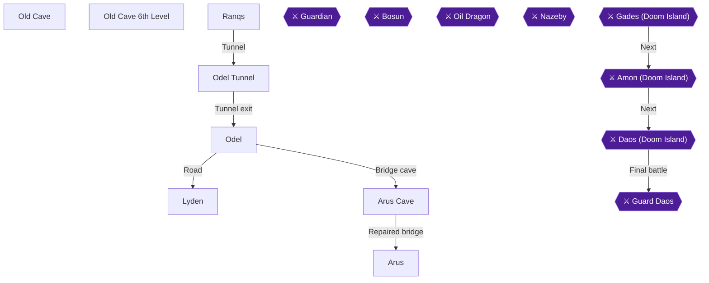

This chapter takes you across the desert town of Ranqs, through the invisible-wall Odel Tunnel, and into Odel, where Piron the architect sets the main quest. You will clear Lyden, fix the Arus Cave bridge to earn **Building Bridges**, and walk into Arus [[gf2-34-5, gf2-35-3, gf2-36-10, gf2-39-7]]. You will also reach Hero level 25 for **Level 25!** and clear the Old Cave 6th floor [[gf2-38-2]]. The chest budget for this chapter is 1 (the cave east of Ranqs), 2 (Odel), 18 (Arus Cave) and 35 (Old Cave 6th floor), which is 56 in total [[ra-comments-51-1, ra-comments-51-30, ra-comments-51-2, ra-comments-51-3]].

> [!TIP]
> **Order matters for the bridge.** Piron will not move until you have done the steps in sequence: inspect the broken bridge, talk to his partner in Lyden, report to Piron in Odel, talk to Piron at the bridge, then step onto the cliff he points you to [[gf4-12-22, gf1-51-15, gf2-39-7]]. If a step seems to do nothing, you have probably skipped one earlier in the chain.

> [!WARNING]
> **Achievement Trigger Warning:** **Building Bridges** only unlocks once Piron actually repairs the bridge, so follow the Arus Cave section in order. The same applies to **Level 25!** **Level 25!**. Hero must reach level 25, and the Old Cave 6th floor will not open for you before that [[gf2-38-2]].

### Ranqs

🗺️ **Map:** [View Ranqs Map by FlyingArmor](https://www.vgmaps.com/Atlas/SuperNES/Lufia&TheFortressOfDoom-Ranqs.png)

🗺️ **Map:** [View Shrine Northwest Of Ranqs Map by FlyingArmor](https://www.vgmaps.com/Atlas/SuperNES/Lufia&TheFortressOfDoom-ShrineNorthwestOfRanqs.png)

🗺️ **Map:** [View Cave East Of Ranqs Map by FlyingArmor](https://www.vgmaps.com/Atlas/SuperNES/Lufia&TheFortressOfDoom-CaveEastOfRanqs.png)

1. Walk southeast and east until you reach two bridges, then cross the **southern** one to enter Ranqs [[gf2-34-5]].
2. In the northeast corner of town, search the single flower bed north of the northeast house (the one with the old woman). It holds a hidden **Power Potion** [[gf-treasure-6-67, gf2-35-2]].
3. Shop and rest as needed. The inn costs 100 Gold [[gf-shop-12-21]].

| Shop | Stock (Gold) | Citation |
|---|---|---|
| General Shop | Morning Star 9600; Rod 4800; Trident 7800 | [[gf-shop-12-1, gf-shop-12-2, gf-shop-12-3]] |
| General Shop | Half Mail 4200; Quilted Silk 4800 | [[gf-shop-12-4, gf-shop-12-5]] |
| General Shop | Buckler 1000; Iron Helm 2500; Glass Beret 1000; Spike Shoes 2000 | [[gf-shop-12-6, gf-shop-12-7, gf-shop-12-8, gf2-103-9]] |
| Merchant's Shop | Sweet Water 10; Hi Potion 400; Antidote 6; Awaken 10 | [[gf-shop-12-10, gf-shop-12-11, gf-shop-12-12, gf-shop-12-13]] |
| Merchant's Shop | Mystery Pin 30; Stone Cure 100; Shriek 5; Smoke Ball 80 | [[gf-shop-12-14, gf-shop-12-15, gf-shop-12-16, gf-shop-12-17]] |
| Merchant's Shop | Magic Guard 50; Power Gourd 100; Mind Gourd 100 | [[gf-shop-12-18, gf-shop-12-19, gf-shop-12-20]] |

An old man in Ranqs gives you an **Escape** and a tip for the tunnel puzzle, but only if you have already walked through the tunnel in the west cave once [[gf4-11-32]]. Treat that as a bonus to pick up on a later visit if you skip it now.

#### Cave East of Ranqs (1 chest)

4. Leave town and walk clockwise around the mountains to the Cave East of Ranqs [[gf1-47-2]].
5. Open the single chest for an **Escape** [[gf1-47-2, gf-treasure-6-68]]. Chest 1 / 56 for this chapter.
6. Walk back to Ranqs and head west to the Odel Tunnel [[gf2-35-3]].

### Odel Tunnel

🗺️ **Map:** [View Cave To Odel Map by FlyingArmor](https://www.vgmaps.com/Atlas/SuperNES/Lufia&TheFortressOfDoom-CaveToOdel.png)

The second room of the tunnel is a maze of invisible walls. The map below is the one given by one guide: walk the points in numerical order (0 through 9), then alphabetical order (A through P) [[gf1-47-3]].

```
   _|P|_
 _|MNO  |_
| KL  CBA9|
| J*FED* 8|
| IHG    7|
|        6|
|_     345|
  |_ 012|
    | |
```

If you prefer step-by-step directions, start from the small hallway between the front room and the room with the four stones, and move: Up 1, Right 2, Up 1, Right 2, Up 4, Left 3, Down 1, Left 2, Down 1, Left 2, Up 2, Right 1, Up 1, Right 2. Then head straight up the steps [[gf3-13-4]]. Another guide gives the same route from the point of entering the room: two east, one north, two east, four north, three west, one south, two west, one south, two west, two north, one east, one north, two east, then north [[gf2-35-4]].

Go up the stairs to leave the tunnel, then walk southwest to Odel [[gf2-35-5]].

### Odel

🗺️ **Map:** [View Odel Map by FlyingArmor](https://www.vgmaps.com/Atlas/SuperNES/Lufia&TheFortressOfDoom-Odel.png)

🗺️ **Map:** [View Odel Castle Map by FlyingArmor](https://www.vgmaps.com/Atlas/SuperNES/Lufia&TheFortressOfDoom-OdelCastle.png)

The inn costs 80 Gold [[gf-shop-13-30]]. Odel sells the best gear you can buy for now [[gf2-104-2, gf2-104-7]].

| Shop | Stock (Gold) | Citation |
|---|---|---|
| Weapons Shop | Battle Axe 12000; Glass Robe 7200; Morning Star 9600; Rod 4800 | [[gf2-104-2, gf2-104-3, gf2-104-4, gf2-104-25]] |
| Weapons Shop | Mid Arrows 50; Hi Arrows 100; Hi Bomb 250 | [[gf2-104-5, gf2-104-6, gf2-104-26]] |
| Armorer's Shop | Half Mail 4200; Quilted Silk 4800; Kite Shield 1400; Brone Breast 840 | [[gf2-104-7, gf2-104-8, gf2-104-9, gf2-104-10]] |
| Armorer's Shop | Iron Helm 2500; Glass Beret 1000; Spike Shoes 2000 | [[gf2-104-11, gf2-104-12, gf2-104-13]] |
| Armorer's Shop | Wind Shoes 3900; Heeled Shoes 3000; Wind Heels 4900 | [[gf2-104-14, gf2-104-15, gf2-104-16]] |
| Merchant's Shop | Sweet Water 10; Hi Potion 400; Antidote 6; Awaken 10 | [[gf2-104-17, gf2-104-18, gf2-104-27, gf2-104-28]] |
| Merchant's Shop | Mystery Pin 30; Stone Cure 100; Shriek 5; Swing Wing 80 | [[gf2-104-19, gf2-104-20, gf2-104-29, gf2-104-21]] |
| Merchant's Shop | Smoke Ball 80; Magic Guard 50; Power Gourd 100; Mind Gourd 100 | [[gf2-104-22, gf2-104-23, gf2-104-24, gf2-105-2]] |

#### Town houses (2 chests)

1. Walk north until you see the castle entrance, then go west into the house and open the chest for an **Ex Potion** [[gf2-36-2, gf1-48-1]]. Chest 2 / 56.
2. Go downstairs in that house and open the chest for an **Ex Magic** [[gf2-36-3, gf1-48-3]]. Chest 3 / 56.
3. Examine the bookshelf down there for a **Miracle** [[gf2-36-4, gf1-48-2]]. This is a bookshelf item, not a chest.

#### Castle grounds

5. Enter the castle area but not the castle itself. To the right of the entrance are three flower groves. Search the **center** of each one: northern for a **Great Potion**, middle for a **Mind Potion**, lower for a **Speed Potion** [[gf1-48-4, gf1-48-5, gf-treasure-6-72]].
6. Go into the castle and take the back room instead of the stairs. Examine the four dressers for two **Hi Magic**, a **Power Potion** and a **Spell Potion** [[gf1-48-7, gf2-36-9]]. The Power Potion is in the left dresser on the eastern side of the room and the Spell Potion is in the right one [[gf-treasure-6-77, gf-treasure-7-1]].
7. Return to the stairs and climb to the throne room, which you can also reach through either of the two back-to-back staircases. Speak to the knight (Piron) standing next to the princess and agree to help him [[gf2-36-10]].

#### Shaia Lab 2 and the Yellow Ring

8. Go back outside and take the stairs down on the west side of the castle entrance into Shaia Lab 2. In the lower right corner, search the lockers for a **Power Gourd** and a **Mind Gourd** [[gf1-48-10, gf1-48-11, gf3-14-1]]. One guide describes the lockers as holding a Hi Magic and a Hi Gourd instead, which conflicts with the two sources above [[gf2-36-6]].
9. Take another flight of stairs down, follow the path and step on the warp pad. At the four-way intersection go north and step on the next warp pad [[gf2-36-6, gf2-36-7]].
10. Open the two chests: the left holds a **Yellow Ring** and the right a **Stone Cure** [[gf2-36-7, gf-treasure-7-20, gf1-51-7]]. The Yellow Ring is a very good defensive ring, so equip it [[gf2-36-8]]. These two chests count toward the 18 chests of the Arus Cave total [[gf-treasure-7-20, ra-comments-51-2]]. Chests 4 and 5 / 56.

When you are done, leave Odel and head southeast to Lyden [[gf2-36-11]].

### Lyden

🗺️ **Map:** [View Lyden Map by FlyingArmor](https://www.vgmaps.com/Atlas/SuperNES/Lufia&TheFortressOfDoom-Lyden.png)

The recommended level is 22 [[gf1-50-17]]. Enemies here are Frogula, which is weak to Ice, and Yeoman, which is weak to Thunder [[gf1-50-15, gf1-50-16]]. Battles around Lyden give around 700 to 800 EXP each, which helps toward level 25 [[gf3-13-7]].

1. Find Piron's partner. One guide has him in the house to the left and another in the building west of the entrance; a third calls it the restaurant [[gf1-50-8, gf2-37-11, gf4-12-22]]. Talk to him, and he will head to Odel [[gf4-12-22]].
2. Go to the inn on the east side and search the bookshelf for a **Swing Wing** [[gf1-50-1, gf2-37-8]].
3. Go south, then walk counter-clockwise around the hill until you can climb the steps to the building with an old man and two chefs. Search the left bookshelf for a **Grilled Newt** and the northwest bookshelf for a **Stone Cure** [[gf-treasure-7-9, gf-treasure-7-10, gf2-37-9]].
4. Go down the steps in the kitchen and open the four chests [[gf2-37-10]]:
   - top: **Fry Pan** [[gf-treasure-7-14]]
   - middle: **Small Knife** [[gf-treasure-7-13]]
   - bottom left: **Miracle** [[gf-treasure-7-12]]
   - right: **Chop Block** [[gf-treasure-7-11]]
   
   Chests 6 to 9 / 56. The Chop Block chest later becomes a Dragon Egg chest when the eggs scatter the second time, so you will return here during the Dragon Egg quest [[gf-treasure-7-11, gf-treasure-11-61]].

| Shop | Stock (Gold) | Citation |
|---|---|---|
| General Shop | Fry Pan 50; Small Knife 70; Pot 60 | [[gf-shop-14-1, gf-shop-14-2, gf-shop-14-3]] |
| General Shop | Chop Block 30; Apron 60; Goblet 10 | [[gf-shop-14-4, gf-shop-14-5, gf-shop-14-6]] |
| Inn | 100 Gold | [[gf-shop-14-7]] |

Return to Odel.

### Arus Cave

🗺️ **Map:** [View Arus Cave Map by FlyingArmor](https://www.vgmaps.com/Atlas/SuperNES/Lufia&TheFortressOfDoom-ArusCave.png)

Arus Cave is reached by walking west of Odel across a bridge and entering the first cave entrance you see [[gf2-38-15]]. It has several entrances, and guides number them differently. Rely on what each one contains rather than on its number. Enemies include Armor Lord (weak to Thunder), Ice Snakes (weak to Ice, and they can put you to sleep), Blue Wisps (high defense, so use Bang) and Crazy Jars (they can petrify and confuse, so carry Shrieks) [[gf1-51-1, gf1-51-2, gf1-51-3, gf1-51-4]]. Mimickers here give about 3000 XP each, so focus attacks on them [[gf4-12-23]]. This is your best chance to level toward 25.

#### First visit: north entrance (5 chests)

1. Go down the first rope ladder and keep descending to a chest with a **Half Mail** [[gf1-51-5, gf2-39-2]].
2. Climb back up and open the nearby chest to the west for a **Glass Robe** [[gf2-39-3, gf-treasure-7-16]].
3. Continue west and climb down the ladder, then continue to a chest with a **Stone Cure** [[gf1-51-7, gf2-39-4]].
4. Walk south of that chest, go down the next ladder and keep walking south to two chests: **Quilted Silk** (right) and **Miracle** (left) [[gf2-39-5, gf-treasure-7-18, gf1-51-18]].

Chests 10 to 14 / 56.

#### Dragon Egg entrance and the broken bridge (2 chests)

5. Leave the cave and cross the bridge east. Walk around the lake clockwise (south, then west) to another bridge, cross it heading north and enter the cave [[gf2-39-6, gf1-51-5]].
6. Go down both rope ladders and walk around the east side to two chests. The left holds a **Dragon Egg** and the right an **Ex Potion** [[gf2-39-6, gf-treasure-7-22, gf-treasure-7-23]]. Chests 15 and 16 / 56. This is the first Dragon Egg of the chapter (Dragon Eggs 4 / 24 after it).
7. Inspect the broken bridge from this side [[gf3-14-4, gf4-12-22]].

#### The bridge sequence

8. Return to Odel, go to the throne room and speak to Piron again [[gf2-39-7, gf2-38-1]].
9. Go back to the broken bridge and speak to Piron there. One guide adds that you must also talk to his assistant, and that you then have to go around and view the bridge from the other side [[gf3-14-5, gf1-51-15]].
10. Take the **center** cave entrance, go down the first rope ladder and walk around to the fork. Head down first along the long path and open the three chests: **Glass Cap**, **Iron Helm** and **Wind Shoes** [[gf1-51-12, gf1-51-13, gf1-51-14, gf-treasure-7-22]]. Chests 17 to 19 / 56. One guide puts these chests off the first entrance, so if you do not find them in the north cave, this center entrance is the route to use [[gf2-39-1]].
11. Walk to the end of the south path and step on the left side of the cliff. This triggers dialogue and Piron finally repairs the bridge [[gf1-51-15, gf2-39-7]].


> [!ACHIEVEMENT]
> **Building Bridges (3 Points)**
> 
> *Help the lazy Piron repair the bridge in Arus Cave*


#### After the bridge (5 chests)

12. Return to the fixed bridge and cross it. Walk west, then follow the north path around to two chests: **Escape** on the left and **Hi Arrows** on the right [[gf2-39-8, gf-treasure-7-27, gf-treasure-7-28]]. Chests 20 and 21 / 56.
13. Take the south path all the way around, go down the stairs and through the door. Open the chest for a **Miracle** [[gf2-39-9, gf1-51-18]]. This chest is behind the marsh after the bridge [[gf-treasure-7-18]]. Examine the door to trigger dialogue [[gf2-39-9]]. Chest 22 / 56.
14. Go through the door, walk around to the stairs and climb them. Go up the rope ladder and open the chest to the east for a **Revive** [[gf2-39-10, gf-treasure-7-32]]. Chest 23 / 56.
15. Walk west past the rope ladder, then take the south path to a chest with an **Ex Potion** [[gf2-39-11, gf1-51-18]]. Chest 24 / 56.
16. Go up the next rope ladder and open another chest for a second **Revive** [[gf2-39-12]]. Chest 25 / 56.
17. Climb the following rope ladder and the stairs to exit the cave, then enter Arus [[gf2-39-12]].

Including the two Yellow Ring and Stone Cure chests from Odel, that is 18 chests for Arus Cave [[ra-comments-51-2]].

### Arus

🗺️ **Map:** [View Arus Map by FlyingArmor](https://www.vgmaps.com/Atlas/SuperNES/Lufia&TheFortressOfDoom-Arus.png)

The recommended level for Arus is 28. Enemies include Giant Oaks (weak to Fire) and Pin Lizards (weak to Ice) [[gf1-52-1, gf1-52-16, gf1-52-17]]. The inn costs 50 Gold [[gf1-52-1, gf2-40-11]].

1. In the house to the left of the entrance, search the bookshelf for a **Hi Magic** [[gf1-52-14, gf2-40-12]].
2. Follow the path up to the house on the hill. Walk around to its northeast corner and search the yellow flower in the upper right behind it for a hidden **Mind Potion** [[gf1-52-15, gf2-40-13, gf3-14-11]].

| General Shop item | Gold | Citation |
|---|---|---|
| Battle Axe | 12000 | [[gf1-52-2, gf-shop-14-8]] |
| Glass Robe | 7200 | [[gf1-52-3, gf-shop-14-9]] |
| Morning Star | 9600 | [[gf1-52-4, gf-shop-14-10]] |
| Rod | 4800 | [[gf1-52-5, gf-shop-14-11]] |
| Half Mail | 4200 | [[gf1-52-6, gf-shop-14-12]] |
| Quilted Silk | 4800 | [[gf1-52-7, gf-shop-14-13]] |
| Kite Shield | 1400 | [[gf1-52-8, gf-shop-14-14]] |
| Red Beret | 2200 | [[gf1-52-9, gf-shop-14-15]] |
| Wind Shoes | 3900 | [[gf1-52-10, gf-shop-14-16]] |
| Heeled Shoes | 3000 | [[gf1-52-11, gf-shop-14-17]] |
| Hi Potion | 400 | [[gf1-52-12, gf-shop-14-18]] |
| Swing Wing | 80 | [[gf1-52-13, gf-shop-14-19]] |

The Red Beret is the one to buy for Lufia and Jerin [[gf1-52-9]]. Rest at the inn, then warp back to Grenoble using Warp magic from the new party member [[gf2-27-13, gf1-52-1]].

### Old Cave

🗺️ **Map:** [View Old Cave 1st Level Map by FlyingArmor](https://www.vgmaps.com/Atlas/SuperNES/Lufia&TheFortressOfDoom-OldCave-1stLevel.png)

🗺️ **Map:** [View Old Cave 2nd Level Map by FlyingArmor](https://www.vgmaps.com/Atlas/SuperNES/Lufia&TheFortressOfDoom-OldCave-2ndLevel.png)

🗺️ **Map:** [View Old Cave 3rd Level Map by FlyingArmor](https://www.vgmaps.com/Atlas/SuperNES/Lufia&TheFortressOfDoom-OldCave-3rdLevel.png)

🗺️ **Map:** [View Old Cave 4th Level Map by FlyingArmor](https://www.vgmaps.com/Atlas/SuperNES/Lufia&TheFortressOfDoom-OldCave-4thLevel.png)

🗺️ **Map:** [View Old Cave 5th Level Map by FlyingArmor](https://www.vgmaps.com/Atlas/SuperNES/Lufia&TheFortressOfDoom-OldCave-5thLevel.png)

🗺️ **Map:** [View Old Cave 7th Level Map by FlyingArmor](https://www.vgmaps.com/Atlas/SuperNES/Lufia&TheFortressOfDoom-OldCave-7thLevel.png)

Each Old Cave floor needs a party member five levels higher than the one before it, so the 6th floor is where Hero must be level 25 [[gf1-17-5, gf4-7-6, gf2-38-2]]. The deeper 7th floor needs level 30 and belongs to a later chapter [[ra-comments-24-1]].

**Getting to level 25.** If Hero is below 25, grind Mimickers: the cave west of Odel gives roughly 2500 EXP per Mimicker and Arus Cave about 3000 [[gf3-14-3, gf4-12-23]]. One guide says you will have gained plenty of experience from Mimickers by the time you reach this point [[gf4-13-1]]. Your Lyden fights also give 700 to 800 EXP each [[gf3-13-7]].


> [!ACHIEVEMENT]
> **Level 25! (10 Points)**
> 
> *Reach Level 25 with your hero*


Once Hero reaches level 25, the Old Cave 6th floor is accessible [[gf2-38-2]]. Warp to Grenoble and enter the Old Cave [[gf2-27-13]]. The Miracle Gem found on the 6th floor is a treasure worth 5000 gold at Grenoble [[gf4-21-71]].

### Old Cave 6th Level

🗺️ **Map:** [View Old Cave 6th Level Map by FlyingArmor](https://www.vgmaps.com/Atlas/SuperNES/Lufia&TheFortressOfDoom-OldCave-6thLevel.png)

This floor has 35 chests [[ra-comments-51-3]]. Enemies are Axe Knights (weak to Thunder), Frogula (weak to Ice), Harpies and Trap Harps [[gf1-53-2, gf4-12-24]]. Trap Harps poison and have a lot of HP, so equip Jerin with a Flame Ring and use fire against them [[gf1-53-1]]. Equip each new piece of gear immediately [[gf2-38-5]].

#### First room (6 chests)

1. Open the six chests in the first room. Three hold **Hi Bombs** and three are empty [[gf1-53-3, gf2-38-4]]. Chests 26 to 31 / 56.

#### West door: the narrow plateau (7 chests)

2. Enter the west door and follow the narrow plateau, opening the seven chests along the way. The first is empty. The rest contain a **Gladius** (equip on Aguro), **Plate Cloth** (Lufia), **Plate Mail** (Hero), **Power Potion**, **Speed Potion** and **Spell Potion** [[gf1-53-4, gf2-38-5]].
3. The Plate Cloth is the 3rd chest and the Plate Mail the 4th [[gf-treasure-4-1, gf-treasure-4-2]]. The Power, Speed and Spell Potions are the left, middle and right chests at the end of the path [[gf-treasure-4-3, gf-treasure-4-4, gf-treasure-4-5]].

Chests 32 to 38 / 56.

#### East door, marsh and ladder

4. Backtrack to the first room and take the east door. Open the first chest for an **Escape** [[gf-treasure-4-6, gf2-38-6]]. Chest 39 / 56.
5. Go down the rope ladder and cast Float. Open the two chests in the marsh: **Ex Magic** (left) and **Ex Potion** (right) [[gf-treasure-4-7, gf-treasure-4-8, gf2-38-7]]. Chests 40 and 41 / 56.
6. Search for a hidden **Miracle**: one guide says one space east and two spaces north of the eastern chest [[gf2-38-8]]. Another says from the right chest, two spaces up on the right [[gf3-15-2]].
7. Follow the east path to four chests. The top east chest holds a **Plate Helm** and the chest north of it a **Revive**, and the other two are empty. Equip the Plate Helm on Hero [[gf-treasure-4-10, gf-treasure-4-11, gf2-38-9]]. Chests 42 to 45 / 56.
8. Backtrack to the two chests north of the rope ladder, to the left of the fork. One holds a **Hammer Rod**, which Lufia should equip, and the other is empty [[gf1-53-16, gf2-38-10]]. Chests 46 and 47 / 56.

#### Basement (6 chests)

9. Go down the nearby stairs, follow the path and open the six chests. They contain a **Power Gourd**, **Ex Magic**, **Ex Potion**, **Knife Shoes** (ATP+10, DFP+5, for Aguro), **Needle Heels/Shoes** (ATP+10, DFP+2, for Jerin), and one empty chest [[gf1-53-18, gf1-53-19, gf2-38-11, gf-treasure-4-17]]. The Needle Heels are the 6th chest, just before the second stairs [[gf-treasure-4-17]]. Chests 48 to 53 / 56.

#### Final area (7 chests + hidden Miracle)

10. Take the stairs back up. The first chest after the second stairs holds a **Mind Gourd**. Head west and open six more chests along the way [[gf-treasure-4-18, gf2-38-12]]. Chests 54 to 60 are counted in the 35 total for this floor [[ra-comments-51-3]].
11. In the last marsh the first chest holds a **Power Gourd**. At the end of the path, four chests include the **Miracle Gem** and the **Blast Ring**, and two of them are empty [[gf-treasure-4-19, gf-treasure-4-20, gf-treasure-4-21, gf-treasure-4-32]]. Save the Blast Ring for Lufia once she learns Blast [[gf-treasure-4-21]].
12. Stand below the Blast Ring chest, walk 3 steps south and press A in the marsh for a hidden **Miracle** [[gf-treasure-4-22]].
13. Return to Grenoble and hand in the Miracle Gem for 5000 gold [[gf4-21-71]].

> [!TIP]
> **Before you leave the Old Cave:** use the checklist below to confirm that you have the Escape and the four hidden Miracles. Each floor's chest total includes empty chests, so count them too. Old Cave empty chests exist only in the Old Cave, which is why Old Cave totals look higher than the item lists suggest [[gf-treasure-12-1]].

> [!IMPORTANT]
> ### Chapter 8 Cumulative 100% Checkpoint
> - **Treasure Chests:** 308 / 637 (this chapter: 1 + 2 + 18 + 35 = 56 chests) [[ra-comments-51-1, ra-comments-51-2, ra-comments-51-3, ra-comments-51-30]]
> - **Dragon Eggs:** 4 / 24 (Arus Cave) [[gf-treasure-7-22]]
> - **Sidequests Completed:** Building Bridges done [[gf2-39-7]]
> - **RetroAchievements Unlocked:** 20 / 47 (97 / 343 points)

### Chapter Checklist

- [ ] Power Potion from the northeast flower bed in Ranqs
- [ ] Escape from the chest in the Cave East of Ranqs
- [ ] Odel Tunnel invisible maze cleared
- [ ] Odel: Ex Potion chest, Ex Magic chest, Miracle bookshelf
- [ ] Odel castle flowers: Great, Mind and Speed Potions
- [ ] Odel castle dressers: 2 Hi Magic, Power Potion, Spell Potion
- [ ] Shaia Lab 2: Power Gourd and Mind Gourd
- [ ] Yellow Ring and Stone Cure from the warp-pad chests
- [ ] Lyden: Swing Wing, Grilled Newt, Stone Cure and the four basement chests
- [ ] Arus Cave: Dragon Egg and Ex Potion
- [ ] Arus Cave: all chests collected (18 total)
- [ ] Building Bridges (187957) unlocked
- [ ] Arus: Hi Magic bookshelf and Mind Potion flower
- [ ] Hero at level 25 and Level 25! (196715) unlocked
- [ ] Old Cave 6th floor: all 35 chests, plus both hidden Miracles
- [ ] Miracle Gem turned in at Grenoble for 5000 gold

---

## Chapter 9: Tower of Grief, the Falcon and Forfeit

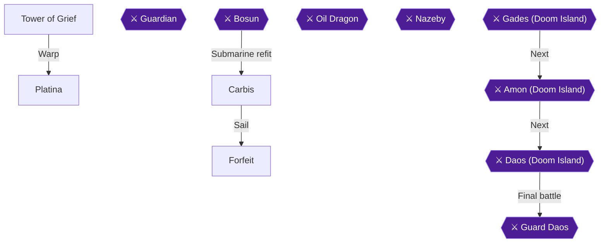

This chapter covers the Tower of Grief (9 chests, one of them a Dragon Egg), the warp to Platina where you meet Professor Raile Shaia and receive the Falcon, the trip west to Carbis, and the oddball island of Forfeit with its hidden trade shop [[ra-comments-51-4, gf1-54-2, gf1-54-9, gf1-56-3]]. Forfeit holds 1 chest [[ra-comments-51-6]]. Two achievements are available here: All Aboard! for obtaining the Falcon, and The Black Market for finding the hidden trade shop in Forfeit.

The big warning of this stretch: when Raile in Carbis sends you to Bakku, do not go there yet. Going immediately costs you a very rare and powerful item [[gf1-55-2]]. The same applies to advancing the plot at the next town before visiting the Tower of Light: you would lose one of the best pieces of equipment in the game [[gf1-56-5]]. That item is the Might Helmet, which is covered in the next chapter [[gf-treasure-7-77]].

> [!WARNING]
> **Route Order Warning (Might Helmet):** After Raile tells you to go to Bakku, do NOT go there first. Visiting Bakku immediately will cause you to permanently lose a rare and powerful item [[gf1-55-2]]. The Might Helmet in the Tower of Light chest is lost if you enter Bakku first [[gf-treasure-7-77]]. Finish Forfeit first, as this chapter does.

### Tower of Grief

🗺️ **Map:** [View Cave To Tower Of Grief Map by FlyingArmor](https://www.vgmaps.com/Atlas/SuperNES/Lufia&TheFortressOfDoom-CaveToTowerOfGrief.png)

🗺️ **Map:** [View Tower Of Grief Map by FlyingArmor](https://www.vgmaps.com/Atlas/SuperNES/Lufia&TheFortressOfDoom-TowerOfGrief.png)

The tower is very easy and straightforward [[gf1-54-1]]. Enemies here are Blue Wisp, Crazy Jar, Ghoul, Halloween, Ice Snake and Yeoman [[gf1-54-1]]. The tower is reached from Arus by walking west into the cave and going up the stairs to exit [[gf2-40-14]].

> [!WARNING]
> **Dragon Egg Warning:** The egg in this tower is part of the initial set of eggs, and the planner notes that it sits behind the middle path. Take it now rather than leaving it [[gf1-54-2]].

#### Entrance and the middle room

1. From the intersection at the entrance, go right (east, walking around the outside) to a chest holding the **Purple Ring** (ATP+10, DFP+11, INT+4, AGL+2, MGR+5; equip on Hero) [[gf1-54-1, gf2-40-14]].
2. Back at the intersection, enter the middle door/room above and climb the stairs. Three chests wait there: a **Dragon Egg** (left), a **Revive** (middle) and a **Stone Cure** (right) [[gf1-54-2, gf-treasure-7-39, gf2-40-15]].
3. Drop down the pitfall, leave the room, and head left (west) to the stairs to the second floor. Follow the path, then walk around the pitfall to the stairs to the third floor [[gf1-54-2, gf2-40-14]].

#### Third floor: the four staircases

The room has four staircases [[gf2-40-16]].

1. Take the northeast (upper-right) stairs. Two chests: **Revive** (left) and **Stone Cure** (right) [[gf-treasure-7-39, gf-treasure-7-40, gf2-40-16]].
2. Take the southwest (lower-left) stairs. Two chests: **Hi Magic** (left) and **Ex Potion** (right) [[gf-treasure-7-41, gf-treasure-7-42, gf2-40-17]].
3. Take either of the remaining two staircases. Both lead to the same hallway on the fifth floor [[gf3-15-7, gf1-54-1]].

#### Fifth floor and roof

1. The fifth floor has HP and MP restoration tiles. You do not need them, as the enemies are weak [[gf3-15-8, gf1-54-1]].
2. Climb the stairs between the panels to the roof and open the chest for a **Miracle** [[gf2-40-18, gf1-54-7]].
3. Talk to the old man. He raises Lufia's MP by 10 and tells you the man you seek has returned to the lab [[gf1-54-8, gf-treasure-7-44, gf4-13-13]].
4. Fall off the edge of the tower to warp to Platina [[gf1-54-8]].

That makes 9 chests in the tower: Purple Ring, Dragon Egg, Revive, Stone Cure, Revive, Stone Cure, Hi Magic, Ex Potion, Miracle [[gf1-54-1, gf1-54-2, gf1-54-7, ra-comments-51-4]].

> [!TIP]
> **Before you leave the tower:** Check that you have all 9 chests, especially the Dragon Egg, before dropping off the roof [[gf1-54-2, ra-comments-51-4]].

### Platina

🗺️ **Map:** [View Platina Map by FlyingArmor](https://www.vgmaps.com/Atlas/SuperNES/Lufia&TheFortressOfDoom-Platina.png)

If you did not come in via the tower fall, Platina (Shaia Lab 1) lies along the west path from the four-way intersection reached via Odel [[gf2-40-14, gf4-13-13]].

#### The isolated cave section (if not yet visited)

At the four-way intersection, the lower path just leads to the world map. Take the upper path to an isolated part of the Cave to Arus and open the two chests for a **Yellow Ring** (DFP+20, MDF+20; equip on Aguro) and a **Stone Cure**. Those stairs lead to the world map, so return to the intersection and head left to reach the main lab [[gf1-49-1, gf1-49-2]]. Watch for Mimickers: high DFP and MDF, but huge experience. Have Jerin cast Confuse on them to keep them from running away [[gf1-49-7]].

#### The lab

1. Enter the lab and go to the stairs on the right/east side. Check the four unusual lockers: **Hi Magic**, **Ex Arrows**, **Gloom Arrow** and **Hi Bomb** [[gf1-49-3, gf3-16-1, gf2-40-19]].
2. Specific lockers: Gloom Arrow in the left locker of the north-west quad, Hi Bomb in the left locker of the north-east quad, Ex Arrows in the right locker of the south-west quad [[gf-treasure-7-2, gf-treasure-7-3, gf-treasure-7-4]].
3. Speak to the girl next to the lockers and answer "no" to her question [[gf2-40-20]].
4. Go upstairs to the right and speak with Professor Raile Shaia. After a lengthy scene you receive your own ship, the Falcon [[gf1-54-9, gf4-13-14, gf2-40-20]].


> [!ACHIEVEMENT]
> **All Aboard! (2 Points)**
> 
> *Obtain the Falcon*


Raile tests the Falcon in the basement, but it is a leaky ship that cannot travel underwater. You can at least explore the surface sea [[gf3-16-2]].

### Falcon

Before sailing, equip Jerin with the Flame Ring, because every enemy in the ocean is weak to fire [[gf1-54-10]]. Ocean enemies include Harpie, Jelly Bolt, Killer Eel, Lobsteron, Psychoclam and Red Star, all weak to Fire except the Harpie [[gf1-55-3, gf1-55-4, gf1-55-5, gf1-55-6, gf1-55-7]]. Sail directly west of Platina to the next island [[gf1-54-10, gf2-40-20]].

### Carbis

🗺️ **Map:** [View Carbis Map by FlyingArmor](https://www.vgmaps.com/Atlas/SuperNES/Lufia&TheFortressOfDoom-Carbis.png)

Enemies outside: Ghoul, Crazy Jar, Giant Oak, Ice Snake and Blue Wisp [[gf2-42-11]].

1. In the building, search the locker for a **Mind Potion** [[gf1-55-1, gf2-41-1]].
2. Go downstairs and down the hallway to find Raile. Step on the warp pad, then speak to the girl, who lets you rest for free [[gf2-41-2, gf2-55-1]].
3. Talk to Raile again. He tells you to find someone in Bakku, to the west. Do not go there yet [[gf1-55-2, gf2-42-13]].

That is all you can do in Carbis for now [[gf2-42-13]].

4. **Register Soshette for Warp now.** Board the Falcon, sail slightly east and then north from Carbis to Ring Island, and enter the town of Soshette at its northernmost part [[gf2-55-2]]. You only need to walk in once so Warp can take you back; the route to the Tower of Light at the end of this chapter starts from Soshette [[gf1-56-5]]. Chapter 13 covers Soshette in full.

> [!TIP]
> **Before you leave Carbis:** The Mind Potion is the only item here. Collect it before moving on [[gf1-55-1]].

### Forfeit

🗺️ **Map:** [View Forfeit Map by FlyingArmor](https://www.vgmaps.com/Atlas/SuperNES/Lufia&TheFortressOfDoom-Forfeit.png)

Exit Carbis and warp to Surignal, then board the Falcon and sail to the island a few spaces north to enter Forfeit [[gf2-42-12, gf2-42-14]]. Monsters outside: Blue Wisp, Crazy Jar, Ice Snake and Giant Oak [[gf2-42-15]].

#### The Mind Ring chest

1. From the entrance, walk between the trees and the wall, going all the way around the outside of the walls, and take the stairs down [[gf2-43-2, gf1-56-2]].
2. Go south and up the stairs to a chest containing the **Mind Ring** (INT+30, MGR+10) [[gf2-43-2, gf-treasure-7-50]]. This is the town's one chest [[ra-comments-51-6]].
3. The secret stairwell behind the building: going south leads to the back of the item shop and the Mind Ring. North leads to the House of Magic [[gf3-16-4]].

#### House of Magic

The man behind the counter makes one Gloom Voice for every Long Nail and Straw Doll you give him [[gf2-43-3, gf2-109-2]].

#### Merchant's Shop (Item shop)

1. Search the left bookcase for a **Hi Potion** and the right bookcase for a **Hi Magic** [[gf-treasure-7-51, gf-treasure-7-52, gf1-56-2]].
2. Stock: Hi Potion 400, Hi Magic 1000, Magic Guard 50, Power Gourd 100, Mind Gourd 100, Dragon Arrow 200, Sleep Arrow 5, Puzzle Arrow 8, Stun Arrow 15, Gloom Arrow 80, Float 50, Smoke Ball 80 [[gf-shop-16-14, gf2-42-32, gf2-42-33, gf2-42-34, gf2-42-35, gf2-42-36, gf2-42-37, gf2-42-38, gf2-42-39, gf2-42-40, gf-shop-16-24, gf2-42-41]].

#### Weapons and Armorer's Shops

- Weapons: Morning Star 9600, Gloom Pick 4800, Hammer Rod 9600, Trident 7800, Glass Robe 7200, Scimitar 2100, Gladius 15300 [[gf2-42-19, gf2-42-20, gf2-42-21, gf2-42-22, gf2-42-23, gf2-42-24, gf2-42-25]].
- Armor: Quilted Silk 4800, Kite Shield 1400, Hair Band 210, Glass Beret 1000, Knife Shoes 6000, Heeled Shoes 3000 [[gf2-42-26, gf2-42-27, gf2-42-28, gf2-42-29, gf2-42-30, gf2-42-31]].

#### The Black Market (second floor)

1. Climb the stairs on the upper wall (east of the Merchant's shop) to the second floor [[gf1-56-3, gf2-43-1]].
2. The shop to the left sells everything you have ever sold in the game [[gf1-56-3, gf2-43-1, gf4-13-16]]. Items marked with an asterisk in the item list can only be bought at Forfeit, and previously sold Might equipment can only be bought here [[gf4-22-2, gf4-23-1]]. Visiting is enough: no first-time visit is required [[ra-comments-1-10]].


> [!ACHIEVEMENT]
> **The Black Market (1 Points)**
> 
> *Found the hidden trade shop somewhere in Forfeit*


3. Examples of things only Forfeit sells: Long Nail (4) and Strall Doll (10), traded for Gloom Voice here [[gf4-22-3, gf4-22-4]].

> [!TIP]
> This shop is also the easiest way to buy the many different items Item Burden needs later. That achievement requires filling every item slot across 5 pages of items [[ra-comments-45-1, gf4-22-2]].

#### The checked-floor shop (Lodge)

> [!WARNING]
> **Achievement Trigger Warning:** The shop with the purple-and-green checked floor on the second floor forces you to buy something to leave. Items cost as little as 2 and 5 Gold [[gf3-16-3, gf1-56-4]].

1. Enter the Lodge to the south of the shops; dialogue triggers [[gf2-43-11]].
2. Buy something cheap: Empty Bottle 2, Ear Tip 5, Goblet 10, Gown 100 [[gf-shop-16-28, gf-shop-16-27, gf-shop-16-26, gf-shop-16-29]].
3. Search the bookshelves for a **Ribbon** and a **Gown** [[gf1-56-4, gf-treasure-7-53, gf-treasure-7-54, gf2-43-10]].

When ready, exit and warp onward. Do not advance the plot at the next town yet [[gf1-56-5]]. The next stop is the Tower of Light. Do **not** warp to Bakku to reach it, even though one guide routes that way [[gf2-43-12]]: entering Bakku first loses the Might Helmet. Instead, warp back to Soshette, sail straight west from the southern edge of the island to a shrine, and walk straight west of the shrine to the tower in a canyon across a bridge (Chapter 10 picks up from the Tower of Light) [[gf1-56-5]].

> [!TIP]
> **Before you leave Forfeit:** Make sure you have the Mind Ring, Hi Potion, Hi Magic, Ribbon and Gown, and have found the second-floor sell-back shop [[gf1-56-2, gf1-56-3, gf1-56-4, gf2-43-2]].

> [!IMPORTANT]
> ### Chapter 9 Cumulative 100% Checkpoint
> - **Treasure Chests:** 318 / 637 (Tower of Grief 9, Forfeit 1) [[ra-comments-51-4, ra-comments-51-6]]
> - **Dragon Eggs:** 5 / 24 (Tower of Grief) [[gf1-54-2]]
> - **RetroAchievements Unlocked:** 22 / 47 (100 / 343 points)

### Chapter Checklist

- [ ] Tower of Grief: Purple Ring, Dragon Egg, Revive, Stone Cure, Revive, Stone Cure, Hi Magic, Ex Potion, Miracle
- [ ] Talked to the old man (Lufia MP +10)
- [ ] Platina lockers: Hi Magic, Ex Arrows, Gloom Arrow, Hi Bomb
- [ ] Met Raile and got the Falcon (All Aboard!)
- [ ] Carbis Mind Potion; did NOT go to Bakku
- [ ] Forfeit: Mind Ring, Hi Potion, Hi Magic, Ribbon, Gown
- [ ] Visited the sell-back shop (The Black Market)

---

## Chapter 10: Tower of Light, Bakku and the Old Cave's Last Floor

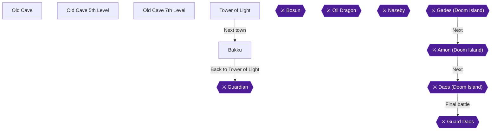

This chapter has four jobs, and the order matters. First climb the Tower of Light to the roof for the Might Helmet, before you set foot in Bakku [[gf1-62-1, ra-comments-22-6, gf1-55-2]]. Then visit Bakku and rescue Cooper on the Old Cave 5th level. Next clear the Old Cave 7th level for the Crown Jewels. Finally return to the Tower of Light to beat the Guardian and take the Light Key [[gf1-63-3, gf4-14-4]]. The checklist counts 22 chests in the Tower of Light, 41 on the Old Cave 7th level and 1 for the Guardian's chest [[ra-comments-51-5, ra-comments-51-9, ra-comments-51-7]].

Older guides give different chest totals (18 for the tower, 43 for the 7th level), so follow the checklist numbers [[gf2-43-15, gf2-44-2]].

> [!WARNING]
> **Missable Achievement Warning:** Do NOT enter Bakku until you have taken the Might Helmet from the chest on the Tower of Light roof. Carbis's Raile tells you to go to Bakku, but one guide says you "should most definitely not go there first" or you lose a very rare and powerful item [[gf1-55-2]]. Another guide warns that advancing the plot at the next town before the tower costs you one of the best pieces of equipment in the game [[gf1-56-5]]. A player reports that visiting Bakku makes the helmet disappear forever [[ra-comments-22-6]]. Go straight to the tower as soon as you have the ship [[ra-comments-22-1, ra-comments-22-5]]. Do not rest or save in Bakku first [[ra-comments-22-4]].

### Tower of Light

🗺️ **Map:** [View Tower Of Light Map by FlyingArmor](https://www.vgmaps.com/Atlas/SuperNES/Lufia&TheFortressOfDoom-TowerOfLight.png)

Reach the tower from Forfeit. The guide has you warp back to Soshette, sail west to a shrine, then walk west to a tower in a canyon across a bridge [[gf1-56-5]]. Enemies here are Mad Lily, Werewolf, Zooster, Trap Harp, Terrorquin and Axe Knight [[gf2-43-14]]. Terrorquin can confuse you and Zooster can petrify you [[gf1-57-1]]. Mad Lillies and Trap Harps have a lot of HP, so have Jerin cast Flame against groups of them [[gf1-57-1]].

One commenter says Sweet Water avoids almost every random encounter in the tower, even at level 25, so rushing the helmet is low risk [[ra-comments-22-8]]. Escape does not work inside towers except on the roof [[gf1-58-1]].

#### Chapter Items to Collect (22 Items Total in the Tower of Light)

| Item | Where Found | Action / Requirement | Citation |
|---|---|---|---|
| Hi Bomb, 2 Ex Potion, Stone Cure, Power Potion, Spell Potion | Six chests in the basement room, reached by dropping through the pitfall near the entrance | **TAKE** all six | [[gf1-57-2]] |
| Undead Ring | Lower left room, two stairs to a dead end, then fall through the floor | **TAKE** (sell) | [[gf2-43-18, gf-treasure-7-55]] |
| Sea Ring | Lower right room, two stairs to a dead end, then fall through the floor | **TAKE** (sell) | [[gf2-43-16, gf-treasure-7-56]] |
| Stone Cure | Second floor, south room | **TAKE** | [[gf2-43-19, gf-treasure-7-63]] |
| Revive | Third floor, chest straight down after the stairs | **TAKE** | [[gf-treasure-7-65, gf2-43-20]] |
| Ex Magic + Ex Potion | Third floor, two chests in the trapped east room | **TAKE** | [[gf1-57-7]] |
| Revive | Third floor, tiny room | **TAKE** | [[gf2-43-20]] |
| Ex Potion | Fourth floor, left path at the fork | **TAKE** | [[gf1-57-9]] |
| Miracle | Fourth floor, lone chest opened from the left | **TAKE** | [[gf1-57-10]] |
| Gloom Voice | Floor where the east and south sides collapse | **TAKE** | [[gf2-43-26]] |
| Power Gourd | Room in the lower right of the tower, opened from the left | **TAKE** | [[gf1-57-13]] |
| Great Axe, Large Shield, Plate Cap, Silver Robe | Four chests in the isolated room below the Power Gourd | **TAKE** all four | [[gf1-57-14]] |
| Might Helmet | Chest on the roof | **TAKE before Bakku** | [[gf1-57-12, gf-treasure-7-77]] |

#### First floor and basement

1. From the entrance, walk straight up into the pitfall and drop to the basement. Open the six chests there for a Hi Bomb, two Ex Potions, a Stone Cure, a Power Potion and a Spell Potion [[gf1-57-2]].
2. Take the stairs in the centre of the basement back up to the first floor [[gf1-57-2]].
3. Enter the lower left room and climb two sets of stairs to a dead end. Walk around until you fall through a hidden pitfall to a chest holding the **Undead Ring** [[gf1-57-14, gf2-43-18]]. The pitfall in the upper right corner of that area drops you back to the basement, so work back to the entrance [[gf2-43-18]].
4. Enter the lower right room, climb two sets of stairs to a dead end and walk around until you fall. The chest below holds the **Sea Ring** [[gf2-43-16]].

#### Second and third floors

5. Return to the first floor and take either staircase in the upper left or upper right corner to the second floor [[gf2-43-18]].
6. Go down to the room on the lower end of the floor and open the chest for a **Stone Cure**. Take the nearby stairs to the third floor [[gf2-43-19]].
7. Walk north along the east side of the wall (unless you want to fall) and enter the door for a chest with a **Revive** [[gf2-43-20]].
8. Go to the room on the right. Do not walk straight up to the chests: the floor under the east chest collapses. Sidestep one tile to the left, then go up to the two chests holding an **Ex Magic** and an **Ex Potion** [[gf1-57-7, gf2-43-22]].
9. Return to the stairs and go up to the tiny room, where a chest holds another **Revive** [[gf2-43-20]]. Then climb the stairs in the upper right corner to the fourth floor [[gf1-57-7]].

#### Fourth to sixth floors

10. Go down to the next room and take the first stairs you see. Head right to the fork and take the left path to a chest with an **Ex Potion** [[gf1-57-9]].
11. Go back to the room by the fork and climb those stairs. Follow the straight path to a room with one chest, and open it from the left for a **Miracle** [[gf1-57-10]].
12. Walk up from above the chest to drop through a pitfall to the previous floor, then climb down the steps below [[gf1-57-10]].
13. Enter the room above you, continue to the next room and take the stairs to the fifth floor. You cannot reach the four centre chests yet, so climb the nearby stairs to the sixth floor [[gf1-57-10]].
14. On the floor where the east and south sides collapse, walk around those sides and open the chest from the upper side for a **Gloom Voice** [[gf2-43-26, gf1-57-10]].

Another guide also places an Ex Potion on the right side of the fifth floor before a hole, and a Miracle at the end of a long path [[gf3-17-9, gf3-17-10]]. The floor numbering differs between guides, so take whatever chest you pass on these floors.

#### Might Helmet (Tower of Light roof)

At the top of the sixth-floor area the stairs eventually lead to the roof, where a chest holds the Might Helmet [[gf1-57-12, ra-comments-22-3]]. The guide says this is the only one in the game and you can never get it if you wait [[gf1-57-12]]. The chest is the one that normally holds the Light Key. Visiting early puts the helmet there instead [[gf4-13-17]].

Walk up to the chest and open it.


> [!ACHIEVEMENT]
> **Mighty Intelligence (5 Points)**
> 
> *Find the Might Helmet in the Tower of Light*


The guide lists the helmet as DFP+35, INT+25 and MGR+19, and Jerin can equip it despite its being a men's helmet [[gf1-57-12]]. Another guide's equipment table lists 35 DEF, +19 MGR and +24 INT [[gf4-24-2]]. Equip it on Jerin.

If the Guardian blocks the chest on this trip, the strategy is in the Guardian section below. One guide has you fight him on the first visit and take the Light Key then [[gf2-43-28, gf2-43-35]]. The route for this chapter defers the Guardian until after the Old Cave [[gf1-63-3]]. Whichever applies, the helmet is the thing you must not skip.

#### The bottom-left rooms

Go back three floors and enter the room in the lower right corner. Climb the stairs and open the chest from the left for a **Power Gourd**. Drop through the hidden pitfall above the chest into an isolated room, then walk around until you find another hidden pitfall. It drops you to four chests holding the **Great Axe** (Hero), **Large Shield**, **Plate Cap** and **Silver Robe** (Jerin) [[gf1-57-13, gf1-57-14]].

Escape does not work inside the tower, so walk out [[gf1-58-1]]. From the tower, walk south through the desert and across the bridge to the last village you have not visited, Bakku [[gf1-58-1]].

### Bakku

🗺️ **Map:** [View Bakku Map by FlyingArmor](https://www.vgmaps.com/Atlas/SuperNES/Lufia&TheFortressOfDoom-Bakku.png)

> [!CAUTION]
> **Point of No Return:** Entering Bakku before taking the Might Helmet from the Tower of Light roof removes the helmet for good [[ra-comments-22-6, gf1-55-2, gf1-62-1]]. If you already hold the helmet, continue.

Monsters outside are Axe Knight, Frogula, Trap Harp and Harpie [[gf2-41-3]].

1. Enter the house directly north of the entrance and search the bookshelves for an **Ex Potion**, an **Ex Magic** and a **Revive** [[gf1-59-1, gf2-42-3, gf2-42-4, gf2-42-5, gf-treasure-7-46, gf-treasure-7-47, gf-treasure-7-48]].
2. Talk to everyone once. They all mention the Tower of Light, and one guide recommends doing so [[gf2-42-2]].
3. Climb down the steps left of the entrance and walk clockwise around the wall to find the town cleric. He tells you Cooper is on the 5th level of the Old Cave [[gf2-42-1]].
4. Shop if you want. Prices are in the table below. The inn costs 100 Gold [[gf-shop-15-28]].
5. When ready, exit Bakku, warp to Grenoble, and enter the Old Cave [[gf2-42-6]].

A chest in the cave north of Bakku holds a Power Potion that turns into a Dragon Egg after the first egg scatter [[gf-treasure-7-49]]. That quest belongs to a later chapter.

| Shop | Stock and price (Gold) | Citation |
|---|---|---|
| Weapons | Gladius 15300, Hammer Rod 9600, Battle Axe 12000, Glass Robe 7200 | [[gf-shop-15-1, gf-shop-15-2, gf-shop-15-3, gf-shop-15-4]] |
| Weapons | Mid Arrow 50, Hi Arrows 100, Bomb 100 | [[gf-shop-15-5, gf-shop-15-6, gf-shop-15-7]] |
| Armorer | Plate Mail 5800, Plate Cloth 5700, Round Shield 1920, Plate Helm 4900, Plate Cap 3800 | [[gf-shop-15-8, gf-shop-15-9, gf-shop-15-10, gf-shop-15-11, gf-shop-15-12]] |
| Armorer | Wind Shoes 3900, Wind Heels 4900, Spike Shoes 2000, Heeled Shoes 3000 | [[gf-shop-15-13, gf-shop-15-14, gf-shop-15-15, gf-shop-15-16]] |
| Merchant | Sweet Water 10, Hi Potion 400, Antidote 6, Awaken 10, Mystery Pin 30 | [[gf-shop-15-17, gf-shop-15-18, gf-shop-15-19, gf-shop-15-20, gf-shop-15-21]] |
| Merchant | Stone Cure 100, Shriek 5, Smoke Ball 80, Magic Guard 50, Power Gourd 100, Mind Gourd 100 | [[gf-shop-15-22, gf-shop-15-23, gf-shop-15-24, gf-shop-15-25, gf-shop-15-26, gf-shop-15-27]] |

### Old Cave

🗺️ **Map:** [View Old Cave 1st Level Map by FlyingArmor](https://www.vgmaps.com/Atlas/SuperNES/Lufia&TheFortressOfDoom-OldCave-1stLevel.png)
🗺️ **Map:** [View Old Cave 2nd Level Map by FlyingArmor](https://www.vgmaps.com/Atlas/SuperNES/Lufia&TheFortressOfDoom-OldCave-2ndLevel.png)
🗺️ **Map:** [View Old Cave 3rd Level Map by FlyingArmor](https://www.vgmaps.com/Atlas/SuperNES/Lufia&TheFortressOfDoom-OldCave-3rdLevel.png)
🗺️ **Map:** [View Old Cave 4th Level Map by FlyingArmor](https://www.vgmaps.com/Atlas/SuperNES/Lufia&TheFortressOfDoom-OldCave-4thLevel.png)
🗺️ **Map:** [View Old Cave 6th Level Map by FlyingArmor](https://www.vgmaps.com/Atlas/SuperNES/Lufia&TheFortressOfDoom-OldCave-6thLevel.png)

The cave has seven floors, and deeper floors need higher character levels. The 5th floor needs level 20, the 6th level 25 and the 7th level 30 [[gf4-7-6]]. Each floor above the 2nd requires a character 5 levels higher than the one before [[gf1-17-5]]. You only need to pass through the earlier floors by elevator in this chapter. Their chests belong to earlier stages.

#### Old Cave 5th level: Cooper

🗺️ **Map:** [View Old Cave 5th Level Map by FlyingArmor](https://www.vgmaps.com/Atlas/SuperNES/Lufia&TheFortressOfDoom-OldCave-5thLevel.png)

Monsters here are Gold Orc, Rok, Mace Man and Sting [[gf2-42-10]]. If you are past level 30, choose "next window" at the elevator to reach the 5th floor [[gf4-14-3]].

1. After exiting the elevator, walk east over the toxic marsh and enter the door [[gf2-42-9]].
2. In that room, take the easternmost door [[gf2-42-8]].
3. Cross the toxic marsh and enter another door. Cooper is in this final room, the one where the Golden Pawn chest was [[gf2-42-8, gf1-59-2, gf3-16-6]].
4. Speak to Cooper. After his escape fails, Jerin casts Escape and you warp to Carbis [[gf2-42-7, gf3-16-6]].


> [!ACHIEVEMENT]
> **Escape Artist (2 Points)**
> 
> *Cooper is always prepared!*


At Carbis go downstairs and talk to Raile again. Raile sends you for Alumina, a quest covered in the next chapter [[gf2-42-7]]. Then warp back to Grenoble and rest.

#### Old Cave 7th level

🗺️ **Map:** [View Old Cave 7th Level Map by FlyingArmor](https://www.vgmaps.com/Atlas/SuperNES/Lufia&TheFortressOfDoom-OldCave-7thLevel.png)

> [!TIP]
> Before entering, warp to Grenoble and accept the Crown Jewels task at the treasure hunters shop. It pays 10,000 Gold when you hand in the jewels [[gf3-19-1, gf2-44-1]]. The last floor opens at level 30 [[ra-comments-24-1]]. Enemies hit hard, so keep everyone within about 30 HP of full and use Ex Magics or Miracles when needed [[gf1-60-1]].

Monsters are Mega Frog, Mad Wolf, Griffon and Megaturtle [[gf2-44-1]]. Mega Frogs can cast Champion to restore their HP fully, and Lufia can stop that with Deflect [[gf1-60-2]]. Hydras can drop Might Swords and Mega Frogs can drop Miracles [[gf1-60-1]].

Take the elevator to the 7th floor and exit.

1. **Start area.** Walk right to two chests: a **Sweet Water** and an empty one [[gf1-60-3, gf2-44-4]].
2. Cast Float and continue right through the swamp to two chests: a **Gloom Pick** and an empty one. The Gloom Pick is cursed, so do not equip it [[gf1-60-4, gf2-44-5]].
3. On the right wall are two more chests: an **Ex Potion** and an empty one [[gf1-60-4, gf-treasure-4-43]].
4. Enter the room, cast Float and search the upper right corner of the swamp for a hidden **Gloom Voice**. Climb down the nearby stairs [[gf1-60-6, gf2-44-21]].
5. Take the upper path first: three chests with an **Ex Magic**, a **Power Potion** and an empty one [[gf1-60-7]].
6. In the upper left corner by the stairs are two chests: a **Spell Potion** and an empty one [[gf1-60-8]].
7. Climb the stairs to two chests: a **Buster Sword** for Hero or Aguro, and an empty one [[gf1-60-9, gf2-44-25]].
8. Enter the back room with four chests: the **Crown Jewels**, **two Miracles**, and an empty one [[gf1-60-10, gf-treasure-4-54, gf-treasure-4-55]]. Take them all.
9. Head back down the steps and take the lower path to two chests: a **Hi Magic** and an empty one [[gf1-60-11]].
10. Climb back to the main area and climb the nearby ladder to three chests: an **Ex Potion**, a **Float** and an empty one [[gf1-60-12]].
11. Enter the door to the wide open area. Go right to a chest with a **Great Potion** [[gf1-60-13]].
12. Take the right path down to three chests: a **Spell Potion**, a **Power Potion** and an empty one [[gf1-60-14]].
13. Climb down the ladder to the right and around to two chests: an **Ex Magic** and an empty one [[gf1-60-15]].
14. Use Float and cross the swamp to the left for a **Miracle**, then take the stairs down to the basement area [[gf3-19-14]].
15. Open the two nearby chests: an **Ex Potion** and an empty one [[gf1-60-17]].
16. Enter the room above the fork for a chest with the **Wind Flute**. It restores about 50 HP to everyone and can be used for free as often as you like [[gf1-60-18]].
17. Back at the fork, head to the upper right corner for a chest with **Clear Silk** for Jerin [[gf1-60-19]]. Climb the ladder for a **Miracle**, then walk left to the stairs back to the main area [[gf3-19-17]].
18. In the main area, open the nearby empty chest. Climb down the ladder for a **Mind Potion** [[gf1-60-21]].
19. Finally walk left for the last three chests: an **Escape** and two empty ones [[gf1-60-22]].

One chest south of the Clear Silk starts empty and becomes a Dragon Egg after the second egg scatter, so it is not needed now [[gf-treasure-4-63]].

The sources do not state exactly which pickup fires the achievement. It is tied to finding the Crown Jewels and finishing the last floor, so complete the floor before leaving [[gf3-19-9, ra-comments-24-1]].


> [!ACHIEVEMENT]
> **World's Greatest (10 Points)**
> 
> *Find the Crown Jewels and conquer the last floor of the Old Cave*


Leave the cave and return to Grenoble to turn in the Crown Jewels for 10,000 Gold [[gf3-19-1]]. Rest, then warp to Bakku and walk north to the tower, or take the route you used before.

### Guardian

Return to the Tower of Light, which has no more chests to find except the Guardian's [[gf1-62-1, ra-comments-51-7]]. Use the Wind Flute to keep HP up on the way [[gf1-62-1]]. Reach the roof as before and equip Lufia's Flash Ring temporarily for the man you are looking for [[gf1-62-2]].

**Preparation:** be fully healed and give Lufia plenty of MP [[gf2-43-28]]. The party fought him at roughly Hero 30, Aguro 27, Lufia 29 and Jerin 26 [[gf4-26-7]].

**Guardian:** one guide gives him 1489 HP and no elemental weakness [[gf1-63-1]], and another says around 2000 HP, so expect a long fight [[gf3-17-1]]. He casts party-wide magic that can do more than 70 per person, and Flame and Blizzard hit for 50 to 80 each [[gf2-43-29, gf3-17-2]]. He also casts Absorb a lot and has used Dread [[gf-boss-2-9]].

Strategy options from the guides:

- Aguro and Hero attack every round. Lufia casts Drain in round one, then Bolt each round. Jerin uses Power Gourds on Aguro and Hero for her first two rounds, then the Wind Flute to heal [[gf1-63-2]].
- Boost heals about 90 HP to everyone and works well if you can afford it every turn. Have Jerin refill Lufia's MP with items [[gf2-43-30, gf2-43-31, gf2-43-33]].
- Jerin's spells and attacks do almost no damage to him [[gf2-43-34]].
- Cast Mirror if you know it, and Lufia's Protect against Flame or Blizzard [[gf-boss-2-9, gf4-14-5]].
- Repeated Drain from Hero and Lufia over several rounds lowers his defence [[gf4-14-5]].
- Keep HP above 100 for the girls and 150 for the boys [[gf4-14-5]].

Victory gives 5000 XP and 5073 Gold [[gf4-26-7]]. Amos and Gades then appear and beat you down. Afterwards, open the chest for the **Light Key** [[gf3-17-4, gf1-63-3]].


> [!ACHIEVEMENT]
> **Guardian (10 Points)**
> 
> *Defeat the Guardian and obtain the Light Key*


Drop off the edge of the tower and re-enter. Walk all the way around to the door in the upper wall, then pass through to the other side and follow the path to Linze [[gf1-63-3]]. The red door is now unlocked [[gf2-43-36]].

> [!TIP]
> **Before you leave:** Make sure every Tower of Light chest and the Old Cave 7th level chests are open. Both dungeons are done once you leave for Linze. Linze is covered in the next chapter.

> [!IMPORTANT]
> ### Chapter 10 Cumulative 100% Checkpoint
> - **Treasure Chests Opened:** 382 / 637
> - **Dragon Eggs Collected:** 5 / 24
> - **RetroAchievements Unlocked:** 26 / 47 (127 / 343 points)

### Chapter Checklist

- [ ] Tower of Light chests opened, including the Might Helmet on the roof, before entering Bakku
- [ ] Mighty Intelligence unlocked
- [ ] Bakku bookshelves searched (Ex Potion, Ex Magic, Revive); cleric talked to
- [ ] Cooper found on the Old Cave 5th level; Escape Artist unlocked
- [ ] Crown Jewels task accepted at Grenoble before entering the 7th level
- [ ] Old Cave 7th level cleared (41 chests); Crown Jewels turned in for 10,000 Gold; World's Greatest unlocked
- [ ] Guardian defeated and Light Key taken; Guardian achievement unlocked

---

## Chapter 11: Linze, the Alumina Hunt and Brant

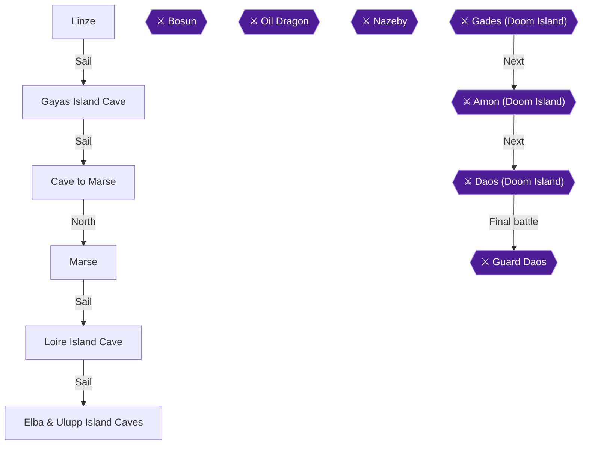

This chapter clears Linze, Gayas Island Cave, the small cave to Marse, Marse itself, Loire Island Cave and the Elba and Ulupp caves. Brant is on the third floor of Loire Island Cave, and you help him there for the achievement. Along the way you collect the first six pieces of Alumina and three of the initial-set Dragon Eggs. The chest counts are 3 for Linze, 26 for Gayas, 1 for the cave to Marse, 30 for Loire, 14 for Elba and 10 for Ulupp [[ra-comments-51-31, ra-comments-51-8, ra-comments-51-10, ra-comments-51-13, ra-comments-51-11]]. One guide counts only 23 chests in Gayas Island Cave [[gf2-45-36]]. Use the 26 total as your target. Suggested levels run from 34 in Linze and Gayas to 36 in the Elba and Ulupp caves [[gf1-64-1, gf1-65-1, gf1-68-1, gf1-69-1]].

> [!WARNING]
> **Chest Overwrite Warning (Dragon Shrine wish):** Do not cash in the first set of 8 Dragon Eggs at the Dragon Shrine yet. The wish scatters 8 more eggs into chests around the world, some of which you have not opened, and the items inside are lost [[gf4-16-2]].

> [!WARNING]
> **One-Time Chests Warning (three chests in this chapter):**
> - The Power Potion in the cave to Marse becomes a Dragon Egg after the first wish, so open it now [[gf4-15-4, gf3-26-18]].
> - The Mind Potion in the south-west corner of the big room in Elba cave becomes a Dragon Egg after the first egg scatter [[gf-treasure-8-76]].
> - The Revive in the north room of Loire Island Cave's bottom floor must be taken before you talk to Brant [[gf1-68-28, gf-treasure-8-61]].

### Linze

🗺️ **Map:** [View Linze Map by FlyingArmor](https://www.vgmaps.com/Atlas/SuperNES/Lufia&TheFortressOfDoom-Linze.png)

The inn costs 75 Gold [[gf-shop-17-29]]. The townspeople say Brant went to Gayas Island Cave, and to get there you go through the tunnel under his house [[gf1-64-2]]. The shop stock is below.

| Shop | Stock (Gold) | Citation |
|---|---|---|
| Weapons | Great Axe 18600, Gladius 15300, Hammer Rod 9600, Big Arrows 100, Ex Arrows 200, Hi Bomb 250 | [[gf-shop-17-1, gf-shop-17-2, gf-shop-17-3, gf-shop-17-4, gf-shop-17-5, gf-shop-17-6]] |
| Armorer | Plate Mail 5800, Plate Cloth 5700, Large Shield 3400, Round Shield 1920, Round Wrist 2600, Plate Helm 4900, Plate Cap 3800 | [[gf-shop-17-7, gf-shop-17-8, gf-shop-17-9, gf-shop-17-10, gf-shop-17-11, gf-shop-17-12, gf-shop-17-13]] |
| Armorer (feet) | Knife Shoes 6000, Needle Heels 7200, Wind Shoes 3900, Wind Heels 4900 | [[gf-shop-17-14, gf-shop-17-15, gf-shop-17-16, gf-shop-17-17]] |
| Merchant | Sweet Water 10, Hi Potion 400, Antidote 6, Awaken 10, Mystery Pin 30, Stone Cure 100 | [[gf-shop-17-18, gf-shop-17-19, gf-shop-17-20, gf-shop-17-21, gf-shop-17-22, gf-shop-17-23]] |
| Merchant | Shriek 5, Smoke Ball 80, Magic Guard 50, Power Gourd 100, Mind Gourd 100 | [[gf-shop-17-24, gf-shop-17-25, gf-shop-17-26, gf-shop-17-27, gf-shop-17-28]] |

One walkthrough suggests buying two Great Axes and two Large Shields for Hero and Aguro here [[gf2-44-31]]. Another says the Great Axe suits Aguro better than his Luck Blade [[gf3-18-1]].

1. Walk north from the entrance and climb the steps to the upper plateau [[gf1-64-3]].
2. Go west to the weapons shop area. Between the equipment shops, examine the bookshelf for an **Escape** [[gf1-64-3, gf-treasure-7-78]].
3. Go to Brant's house at the far right, take the stairs down to the basement, and search the lower-right corner of the basement for a hidden **Ex Magic** [[gf1-64-3, gf1-64-4, gf-treasure-8-2]].
5. Take the next stairs down, until you reach a fork with a red path and a green path [[gf3-18-1]].
6. Take the red path to three chests [[gf3-18-1]]:
   - The left chest holds a **Swing Wing** [[gf-treasure-7-79]].
   - The middle chest holds a **Dragon Egg** (initial set) [[gf-treasure-7-80]].
   - The right chest holds **Sweet Water** [[gf-treasure-8-1]].
7. Take the green path. It leads up a flight of stairs to the outside, just west of Gayas Island Cave [[gf2-44-36, gf2-45-25]].

> [!TIP]
> Before you leave Linze: you need the Escape, the Ex Magic and all three red-path chests (Swing Wing, Dragon Egg, Sweet Water). Linze counts 3 chests in the checklist [[ra-comments-51-31]]. Spend money on the equipment you want now.

### Gayas Island Cave

🗺️ **Map:** [View Gayas Island Cave Map by FlyingArmor](https://www.vgmaps.com/Atlas/SuperNES/Lufia&TheFortressOfDoom-GayasIslandCave.png)

Enemies are SabresPook, Cave Rok, Werefrog, Mad Lily, Werewolf and Zaurus [[gf2-45-30, gf2-45-31, gf2-45-32, gf2-45-33, gf2-45-34, gf2-45-35]]. Werefrogs are the dangerous ones, so kill them as quickly as you can [[gf4-15-3]]. The first floor is full of collapsing floor panels, so follow the directions carefully [[gf2-45-37]]. The source's own map of the first plateau is below.

```text
     ---
    |   |
   | CC  ------
  |            |
   |   X        |
   |             ---------      LEGEND
   |  X               |     X = Pitfall
   |      S     X  CC |     C = Chest
 --      S       X    |     S = Stairs
|                 X   |     L = Ladder
|                    |      * = Inaccessible (temporarily)
|       **         L|
|      *****      |L|
|      *****  X   |
|      **S**      |
|       C***      |
| XXX   ***    X  |
|        X   CC  |
|CC    ----      |
|     |    ------
 |   |
  ---
```

*ASCII map reproduced from the source guide* [[gf1-65-2]].

#### Entrance floor

1. Walk as far north as you can, then directly west. Open the two chests for an **Escape** and a **Stone Cure** [[gf2-45-1, gf-treasure-8-15, gf-treasure-8-3]].
2. Two chests lie to the south with collapsing panels in front of them. Walk south along the wall until you reach them. They hold an **Ex Bomb** and an **Ex Potion** [[gf-treasure-8-11, gf-treasure-8-20]].
3. Two chests lie directly east. Do not walk straight at them or you fall. Walk around to them for an **Ex Bomb** and a **Revive** [[gf-treasure-8-11, gf-treasure-8-17]].
4. Head directly west and fall through the floor on purpose. Climb the stairs you land by and open the chest for **Alumina** (#1) [[gf-treasure-8-14, gf1-65-4]].
5. Three chests are scattered on the bottom level. Walk around and open them for a **Dragon Egg**, a **Hi Magic** and another **Ex Bomb** [[gf2-45-42]].
6. Go back upstairs. Take two steps north, then walk east to two chests holding an **Ex Potion** and a **Hi Magic** [[gf-treasure-8-20, gf-treasure-8-10]].
7. Go down the rope ladder and ignore the three doors for now. Head northeast and climb the rope ladder. Enter the door and follow the path to two chests with an **Escape** and a **Magic Guard** [[gf-treasure-8-15, gf-treasure-8-16]].

#### The three doors

1. East door: climb the stairs to two chests with an **Ex Magic** and an **Ex Potion** [[gf-treasure-8-18, gf-treasure-8-20]].
2. West door: step on the warp pad and exit the room it takes you to. A chest there holds a **Revive** [[gf2-45-46, gf-treasure-8-17]].
3. Middle door: enter and move the switch down [[gf2-45-47, gf1-65-9]]. Nothing visibly happens, but the warp pad in the left room now sends you somewhere new [[gf1-65-9]].
4. Go back into the west room and step on the pad. Open the chest for an **Ex Potion**, then leave by the door [[gf-treasure-8-20]].
5. Go down the stairs and open the chest for **Ex Arrows** [[gf-treasure-8-21]].
6. Walk east. At the choice between east and north, go slightly north for a **Revive**, then take the east path [[gf-treasure-8-17]].
7. Enter the door for an **Ex Potion** [[gf-treasure-8-20]].
8. Climb the ladder, step on the warp pad and exit the room. Open the chest for a **Silver Sword** and equip it on Hero or Aguro immediately [[gf-treasure-8-23, gf2-45-53]].
9. Go north of the warp-pad room for an **Opal** [[gf-treasure-8-24]].
10. Enter the door to the north, follow the path around, walk south and take the stairs down.

#### Lower floor and Clank

1. Go down the first two rope ladders and open the chest for a **Power Gourd** [[gf-treasure-8-26]].
2. Go down the rope ladder directly south and walk east to a chest with a **Mind Gourd** [[gf-treasure-8-27]].
3. Walk west and go down the long rope ladder. Head east for a **Revive** [[gf-treasure-8-17]].
4. Cross the bridge and enter the door on the southern path to find an HP-restoring panel [[gf2-45-58]].
5. Take the north path and speak to the man at the fork. Ask him about everything. He tells you Brant is in Marse, a port north of Linze reached by following the shoreline by boat [[gf1-65-18, gf2-45-59]].
6. Walk away from him. More dialogue triggers and he gives you the **Wave Ring**. Equip it on Hero right away [[gf1-65-18, gf2-45-60, gf4-15-3]].

> [!TIP]
> Before you leave Gayas Island Cave: you should have 26 chests including Alumina and the Dragon Egg, plus the Wave Ring [[ra-comments-51-8, gf4-15-3]]. Escape out or leave on foot. Then warp to Linze and go back across the Tower of Light for the cave to Marse. You could also sail, but the cave route has a chest [[gf3-19-19]].

### Cave to Marse

🗺️ **Map:** [View Cave To Marse Map by FlyingArmor](https://www.vgmaps.com/Atlas/SuperNES/Lufia&TheFortressOfDoom-CaveToMarse.png)

🗺️ **Map:** [View Shrine South Of Linze Map by FlyingArmor](https://www.vgmaps.com/Atlas/SuperNES/Lufia&TheFortressOfDoom-ShrineSouthOfLinze.png)

East of the Tower of Light, cross the northern bridge to this cave. It is a hallway, and the chest on the right holds a **Power Potion** [[gf1-65-19, gf3-19-19]]. This is the chest that turns into a Dragon Egg after the first wish, so take the Power Potion now [[gf4-15-4]]. The enemies here are Green Magi, Red Wolf, Troll, Demon Mace and Manticore [[gf3-19-19]]. After the first scatter, this chest holds one of the 2nd-set Dragon Eggs [[gf-treasure-11-54]]. To continue, exit the hallway to the north and walk to Marse; the Cave To Marse map above shows the exit [[gf1-65-19]].

### Marse

🗺️ **Map:** [View Marse Map by FlyingArmor](https://www.vgmaps.com/Atlas/SuperNES/Lufia&TheFortressOfDoom-Marse.png)

Marse is a bunch of islands joined by an underwater tunnel. There are no chests or items in town, and the recommended level is 35 [[gf3-19-19, gf1-66-1]]. The inn costs 120 Gold [[gf-shop-18-29]].

1. Take the lower-left stairs to the inn [[gf1-55-8]].
2. Take the lower-right stairs to the basement equipment shop. It sits down the stairs, right at the fork, then down [[gf1-55-8]]. Buy 2 Silver Wrists for Lufia and Jerin [[gf1-55-8]]. Silver Wrist costs 2800 [[gf-shop-18-11]].
3. Silver Helm costs 7400 and is a good upgrade for Aguro [[gf1-67-1, gf-shop-18-12]].
4. Other armorer stock includes Silver Armor 7200, Silver Robe 8400, Silver Plate 3800, Plate Cap 3800, Knife Shoes 6000, Needle Heels 7200, Wind Shoes 3900 and Wind Heels 4900 [[gf-shop-18-8, gf-shop-18-9, gf-shop-18-10, gf-shop-18-13, gf-shop-18-14, gf-shop-18-15, gf-shop-18-16, gf-shop-18-17]].
5. The weapons shop sells Silver Sword 24000, Silver Rod 12000, Great Axe 18600 and Hammer Rod 9600 [[gf-shop-18-1, gf-shop-18-2, gf-shop-18-3, gf-shop-18-4]].
6. The merchant sells Sweet Water 10, Stone Cure 100, Smoke Ball 80, Magic Guard 50, Power Gourd 100 and Mind Gourd 100 [[gf-shop-18-18, gf-shop-18-23, gf-shop-18-25, gf-shop-18-26, gf-shop-18-27, gf-shop-18-28]].
7. One walkthrough suggests buying a Silver Rod for each girl, plus Silver Armor, Silver Plate and Silver Helm for Hero and Aguro [[gf3-19-20]].
8. Talk to the girl in the hut, who tells you Brant went to Loire Island [[gf2-47-4, gf1-67-1]].
9. Optionally, take the cruise for 20 gold. It shows four future destinations, including Loire Island [[gf2-47-5, gf2-47-6]].
10. Leave town and warp anywhere, then warp back to Marse. This makes the Falcon appear next to the town [[gf2-47-7]]. Sail east to Loire Island [[gf2-47-7]].

### Loire Island Cave

🗺️ **Map:** [View Loire Island Cave Map by FlyingArmor](https://www.vgmaps.com/Atlas/SuperNES/Lufia&TheFortressOfDoom-LoireIslandCave.png)

There are 30 chests here, so explore the first floor fully before taking either staircase down [[gf2-47-17, gf4-16-4]]. Enemies are Zaurus, Blue Skull, Manticore, Troll, Red Core, Were Frog, Demon Mace and Vampire [[gf2-47-9, gf2-47-10, gf2-47-11, gf2-47-12, gf2-47-13, gf2-47-14, gf2-47-15, gf2-47-16]]. Demon Mace casts Blizzard, so kill them first. Have Jerin cast Confuse on Red Cores to keep them from running away [[gf1-68-2, gf1-68-3]].

#### First floor, west and north sections

1. Walk east from the entrance and open the chest for a **Miracle** [[gf-treasure-8-53]].
2. Continue east, go down the rope ladder and open the chest for a **Hi Magic** [[gf-treasure-8-46]].
3. Go back up and around to the plateau by the Mach Ring ladder. Open the chest for a **Mach Ring** [[gf-treasure-8-39, gf2-47-21]].
4. Take the chest with a **Revive** [[gf-treasure-8-61]].
5. Head up the lower ladder to the lowest level and go right. Take the **Gloom Arrow** [[gf-treasure-8-49]].
6. Walk west for a **Power Potion** [[gf-treasure-8-36]].
7. Go up the ladder south of that chest. Follow the east path, go down the rope ladder and open the chest for a **Hi Bomb** [[gf-treasure-8-56]].
8. Enter the upper-right room (the door west of that ladder) and open the chest for **Alumina** (#2) [[gf1-68-9, gf2-47-48]].
9. Go back to the fork on the lower level and climb down the ladder to a visible chest on the left holding a **Power Potion** [[gf1-68-10]]. Right of the ladder is a chest with a **Gloom Arrow** [[gf1-68-11]].
10. Walk west to the rope ladder and staircase. Ignore the bridge and go up the rope ladder to two chests with a **Revive** and a **Power Potion** [[gf-treasure-8-61, gf-treasure-8-36]].
11. Cross the bridge and walk south along the west path for a **Great Potion** [[gf-treasure-8-45]].
12. Search the toxic marsh to the south for a hidden **Mind Potion**. Walk three steps into the small puddle [[gf2-47-28, gf3-20-7]].
13. Go up the rope ladder and walk around for a chest with an **Ex Potion** [[gf-treasure-8-42]].

#### Upper-east plateau

1. Cross back over the bridge and take the stairs you passed earlier. On the first plateau, open the chest for **Foul Water** [[gf-treasure-8-55]].
2. Go west for a **Gloom Arrow** [[gf-treasure-8-49]].
3. Cross the bridge south for a **Miracle** [[gf-treasure-8-53]].
4. Return across the bridge, walk east and open the chest for a **Power Potion** [[gf-treasure-8-36]].
5. Continue east to four chests: **1000 Gold**, a **Spell Potion**, a **Gloom Arrow** and an **Escape** [[gf-treasure-8-51, gf-treasure-8-50, gf-treasure-8-49, gf-treasure-8-48]].
6. Take the stairs down and leave through the door to the lower level.

#### Lower level and the trap-floor room

1. Walk west and enter the door for an **Ex Potion** [[gf-treasure-8-42]].
2. Walk west, then all the way north and east to another door. Enter it and open two chests for a **Hi Magic** and an **Ex Magic** [[gf-treasure-8-46, gf-treasure-8-59]].
3. Continue east to the chest with a **Great Potion** [[gf-treasure-8-45]].
4. Walk south and west to a chest with a **Hi Bomb** [[gf-treasure-8-56]].
5. Go south and west to a door and a chest. Open it for a **Revive**, then enter the door [[gf-treasure-8-61]].
6. In the room beyond, a lone chest sits among collapsing floor panels. Walk along the wall until you are directly west or east of it, then walk over [[gf2-47-44]]. Standing below the door, step two left, four down and two right to reach the **Hi Bomb** chest [[gf-treasure-8-56]].
7. Walk up and fall through the floor to the third floor [[gf1-68-25]].

#### Third floor and Brant

1. Open the two chests for a **Float** (left) and **Sweet Water** (right) [[gf-treasure-8-57, gf-treasure-8-58]].
2. Stand left of the Float chest and walk straight up into the marsh for a hidden **Ex Magic** [[gf-treasure-8-59, gf1-68-27]].
3. Enter the north room (upper-right room on this floor) for a **Revive**. Take it before you speak to Brant [[gf-treasure-8-61, gf1-68-28]].

> [!WARNING]
> **One-Time Chest Warning:** Take the Revive in the north room first. If you speak to Brant first, that chest is replaced by an exit warp point [[gf1-68-28, gf-treasure-8-61]]. Talking to Brant also warps the party out of the cave immediately [[gf3-20-26]].

4. Talk to Brant (the man in the upper-left corner), say yes to help him, and accept the Alumina (#3). Jerin casts Escape automatically [[gf1-68-29, gf4-16-4, gf3-20-26]]. Speak to him again after the first dialogue if the Alumina has not been given yet [[gf2-47-48]].


> [!ACHIEVEMENT]
> **Holes, Holes, and a Brant (3 Points)**
> 
> *Keep falling down and find your way to Brant. Help the poor guy out!*


> [!WARNING]
> **Achievement Trigger Warning:** Once everyone is teleported outside the cave, talk to Brant at once. Warping to Marse straight away leaves him behind. You then have to go back into the cave to fetch him [[ra-comments-26-1, ra-comments-26-2, gf-treasure-8-62]]. The achievement is normal story progression, so you cannot miss it by following the story [[ra-comments-26-3]].

5. After Brant, go to Marse and rest. Brant waits in the hut and sends you on to Elba and Ulupp [[gf4-16-4, gf2-50-3]].

> [!TIP]
> Before you leave Loire Island Cave: confirm you have the 30 chests, the Revive in the north room and both hidden marsh items [[ra-comments-51-13]].

### Elba & Ulupp Island Caves

🗺️ **Map:** [View Ulupp Island Cave Map by FlyingArmor](https://www.vgmaps.com/Atlas/SuperNES/Lufia&TheFortressOfDoom-UluppIslandCave.png)

🗺️ **Map:** [View Elba Island Cave Map by FlyingArmor](https://www.vgmaps.com/Atlas/SuperNES/Lufia&TheFortressOfDoom-ElbaIslandCave.png)

Ulupp Island lies just south of Loire Island [[gf2-48-1]]. Enemies include Blue Skull, Cave Rok, Nail Man, Red Core, Vampire, Mud Ghoul, Eye Curse, Green Magi and Red Wolf [[gf1-69-1]]. Eye Curse casts Blast, Green Magi casts Bolt and Flame, and Red Wolf casts Inferno [[gf1-69-1]]. Jerin should use the Wind Flute to keep up with them [[gf1-69-1]]. The Elba and Ulupp caves are linked by warp pads and switches, so do them in the order below. There are 14 chests in Elba and 10 in Ulupp [[ra-comments-51-11]].

#### Ulupp Island, first visit

1. Enter the cave and ignore the warp pad for now. Go down the rope ladder [[gf2-48-2]].
2. Head south and open the chest in the south-east corner for a **Dragon Egg** (initial set) [[gf2-48-2, gf-treasure-8-65]].
3. Walk west and flip the switch at the bottom of the floor to open a door [[gf2-48-2, gf4-15-3]].
4. Continue west, then north, to two chests holding a **Speed Potion** and an **Ex Potion** [[gf-treasure-8-65, gf-treasure-8-70]].
5. Continue north, then east, to a chest holding a **HiPower Ring** [[gf-treasure-8-66, gf2-48-6]]. Equip it on a character.
6. Go back to the entrance and step on the warp pad. It takes you to Elba Island cave [[gf2-48-7]].

#### Elba Island cave

1. Enter the door to your left for a **Mind Potion** (south-west corner of the big room) [[gf-treasure-8-76]]. Take it now, because it becomes a Dragon Egg after the first scatter [[gf-treasure-8-76]].
2. Go down the rope ladder to a chest with a **Smoke Ball** [[gf-treasure-8-68]].
3. Go down the next rope ladder for the **HiDaze Ring** [[gf3-21-8, gf2-48-10]].
4. Four doors are on this level. Enter the east door, flip the switch and cross the bridge west for an **Ex Potion** [[gf2-48-27, gf-treasure-8-70]].
5. Exit by the door west to the middle door. Enter the east door of the three west doors for a **Spell Potion** [[gf2-48-13, gf-treasure-8-71]].
6. Enter the westernmost door and go down the rope ladder. Open two chests for an **Ex Magic** and a **Miracle** [[gf-treasure-8-73, gf-treasure-8-72]].
7. Head east to a bridge, then south, for a **Hi Bomb** [[gf-treasure-8-74]].
8. Continue east, enter the door and step on the warp pad to find **Alumina** (#4) [[gf-treasure-8-75]].
9. Take the western rope ladder down for a **Mind Potion** [[gf2-48-18]].
10. Walk east past the door and open a chest for a **Silver Rod** [[gf-treasure-8-77, gf2-48-19]].
11. Enter the door you passed to rest at the inn for 100 Gold [[gf2-48-30]].
12. Walk east, ignore the door for now, and go up the rope ladder. The chest at the top holds a **Spell Potion** [[gf-treasure-9-1]].
13. Walk north, enter the door and step on the warp pad. This takes you to Ulupp cave [[gf2-48-21]].

#### Ulupp Island upper plateau

Four chests hold a **Silver Wrist**, **Alumina** (#5), a **Silver Plate** and a **Miracle** [[gf1-69-18, gf-treasure-9-2, gf-treasure-9-3, gf-treasure-9-4, gf-treasure-9-5]].

#### Back in Elba and the switch trick

1. Return to the door you ignored earlier, at the bottom of the long ladders. Open its two chests for an **Ex Potion** and **Silver Armor** [[gf1-69-23, gf2-48-26]].
2. Flip the switch to the left. It changes the destination of the warp point at the top of the long ladders [[gf3-21-19, gf2-48-27, gf4-16-1]].
3. Go back up the rope ladder and step on the warp pad. You arrive in a different section of Ulupp cave [[gf2-48-28]].
4. Cross the bridge and go south to a door. Enter and open the chest for **Alumina** (#6) [[gf2-48-28]].
5. Walk east and open the last chest for an **Ex Potion** [[gf-treasure-9-9]].

This makes six pieces of Alumina, from Gayas, Elba, two in Ulupp, Loire, and the one Brant gives you [[gf4-16-4]]. Escape out and warp to Marse. Brant is in the hut and sends you to Herat, which you can sail to along the coast and up the river [[gf2-50-3, gf2-50-4]].

> [!TIP]
> Before you leave the Elba and Ulupp caves: check that the south-west-corner Mind Potion, the Dragon Egg in Ulupp, and all six Alumina are in your inventory. Do not cash in the Dragon Eggs yet [[gf-treasure-8-76, gf4-16-2]].

> [!IMPORTANT]
> ### Chapter 11 Cumulative 100% Checkpoint
> - **Treasure Chests:** 466 / 637 (this chapter: Linze 3, Gayas 26, cave to Marse 1, Loire 30, Elba 14, Ulupp 10 [[ra-comments-51-31, ra-comments-51-8, ra-comments-51-10, ra-comments-51-13, ra-comments-51-11]])
> - **Dragon Eggs:** 8 / 24 (Linze, Gayas, Ulupp in this chapter [[gf-treasure-7-80, gf2-45-42, gf2-48-2]])
> - **RetroAchievements Unlocked:** 27 / 47 (130 / 343 points)

### Chapter Checklist

- [ ] Linze: Escape bookshelf, Ex Magic, and the three red-path chests (Swing Wing, Dragon Egg, Sweet Water).
- [ ] Gayas Island Cave: all chests, including Alumina, Dragon Egg and Silver Sword.
- [ ] Wave Ring from Clank, equipped on Hero.
- [ ] Power Potion in the cave to Marse (before any Dragon Shrine wish).
- [ ] Marse: shopping done and Silver Wrists bought.
- [ ] Loire Island Cave: all 30 chests, including the north-room Revive before talking to Brant.
- [ ] Brant helped, talked to immediately outside the cave, and Alumina received.
- [ ] Ulupp Island: Dragon Egg, Speed Potion, Ex Potion and HiPower Ring.
- [ ] Elba cave: Mind Potion, Smoke Ball, HiDaze Ring, Alumina and the remaining chests.
- [ ] Six Alumina in total, Dragon Eggs not yet turned in.

---

## Chapter 12: Herat, the Purple Newt and Aisen Tower

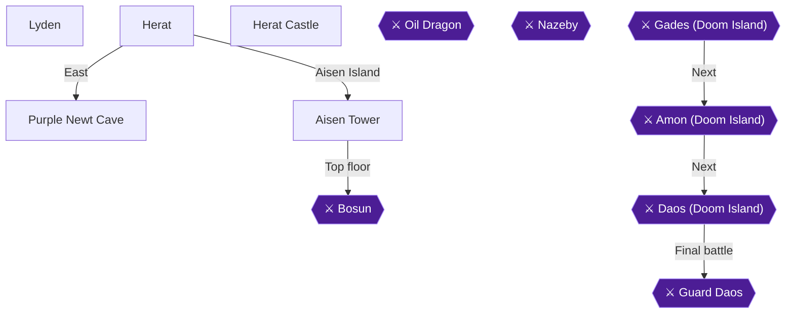

This chapter takes you from the town of Herat to the Purple Newt Cave, back to Lyden for the Magic Flavor, into the Herat treasury, and finally up Aisen Tower to rescue Raile and Lou. Recommended levels are 37 for Herat, 38 for the Purple Newt Cave and 38 for Aisen Tower [[gf1-70-1, gf1-71-1, gf1-72-1]]. The chest tally is Herat Castle 14, Purple Newt Cave 14, Lyden 4 and Aisen Tower 15, which takes the running count to 513 and pops Treasure Hunter [[ra-comments-51-15, ra-comments-51-16, ra-comments-51-17, ra-comments-51-14]].

> [!WARNING]
> **One-Time Chest Warning (Heavy Ring):** The Heavy Ring chest sits in the cell next to Raile. Take it BEFORE you speak to Raile [[gf-treasure-9-62, gf3-23-18]]. After freeing Lou, open the cell chest first, then unlock Raile's cell [[gf1-73-3, gf2-54-22]].

> [!WARNING]
> **Chest Overwrite Warning (Lyden Dragon Egg):** The Chop Block chest in Lyden's basement becomes a Dragon Egg after the 2nd egg scatter, so take it now while it is still a Chop Block [[gf-treasure-7-11]]. Do not turn in your 8 Dragon Eggs at the Dragon Shrine yet, because they scatter into chests you have not opened [[gf1-70-10, gf2-51-5]].

### Chapter Items to Collect (Chests and Pickups)

| Location | Chests | Citation |
|---|---|---|
| Herat Castle (treasury) | 14 | [[ra-comments-51-16, gf2-54-4]] |
| Purple Newt Cave | 14 | [[ra-comments-51-15]] |
| Lyden | 4 | [[ra-comments-51-14]] |
| Aisen Tower | 15 | [[ra-comments-51-17]] |

### Herat

🗺️ **Map:** [View Herat Map by FlyingArmor](https://www.vgmaps.com/Atlas/SuperNES/Lufia&TheFortressOfDoom-Herat.png)

Sail west along the coast to a river and follow it to Herat [[gf2-50-4]]. Outside enemies include Eye Curse, Manticore, Red Wolf, Demon Mace and Green Magi [[gf2-53-9]].

1. Go east to the inn. Search the left bookcase for **Plum Cider** and the right bookcase for a **Hi Potion** [[gf1-70-2, gf-treasure-9-11, gf2-51-3]]. Resting costs 90 Gold [[gf-shop-19-30]].
2. Enter the house north of the inn. Search the left bookcase for a **Rod** and the right one for an **Apron** [[gf-treasure-9-12, gf-treasure-9-13, gf2-51-6]].
3. West of the entrance, search the flowerbeds between the two equipment shops: the right one holds a **Great Potion**, the left one a **Mind Potion** [[gf-treasure-9-14, gf-treasure-9-15, gf2-51-8]].
4. The Dragon Shrine knight explains the eggs. Do not trade them in yet [[gf2-51-5]].

Shops: the Weapon Shop sells the Buster Sword (28000), Silver Sword (24000), Silver Rod (12000), Big Arrow (100), Ex Arrows (200) and Hi Bomb (250) [[gf-shop-19-1, gf-shop-19-2, gf-shop-19-3, gf-shop-19-4, gf-shop-19-5, gf-shop-19-6]]. The Armorer sells Carbo Plate (10800), Clear Silk (10000), Tower Shield (4600), Silver Armor (7200), Silver Plate (3800), Silver Wrist (2800), Silver Helm (7400), Sakret (6200), Sonic Shoes (8600), Sonic Heels (10200), Knife Shoes (6000) and Needle Heels (7200) [[gf-shop-19-7, gf-shop-19-8, gf-shop-19-9, gf-shop-19-10, gf-shop-19-11, gf-shop-19-12, gf-shop-19-13, gf-shop-19-14, gf-shop-19-15, gf-shop-19-16, gf-shop-19-17, gf-shop-19-18]]. The Merchant sells Sweet Water (10), Hi Potion (400), Antidote (6), Awaken (10), Mystery Pin (30), Stone Cure (100), Shriek (5), Smoke Ball (80), Magic Guard (50), Power Gourd (100) and Mind Gourd (100) [[gf-shop-19-19, gf-shop-19-20, gf-shop-19-21, gf-shop-19-22, gf-shop-19-23, gf-shop-19-24, gf-shop-19-25, gf-shop-19-26, gf-shop-19-27, gf-shop-19-28, gf-shop-19-29]]. A guide suggests a Buster Sword for Aguro [[gf3-21-27]].

### Herat Castle (first visit)

🗺️ **Map:** [View Herat Castle Map by FlyingArmor](https://www.vgmaps.com/Atlas/SuperNES/Lufia&TheFortressOfDoom-HeratCastle.png)

1. Enter the castle and climb to the second floor. In the upper left (northwest) room, search the dresser for an **Ex Bomb**, and in the kitchen to the east talk to the chef to learn that the king wants tasty food [[gf1-70-8, gf-treasure-9-16, gf2-51-10]].
3. Go up to the third floor. In the old man's room, talk to him, then search the dresser for a **Power Potion** [[gf2-51-11, gf-treasure-9-17]].
4. Climb to the throne room and speak with the King and Princess. Then exit and warp to Lyden [[gf2-51-12]].

### Lyden

🗺️ **Map:** [View Lyden Map by FlyingArmor](https://www.vgmaps.com/Atlas/SuperNES/Lufia&TheFortressOfDoom-Lyden.png)

Recommended level for Lyden is 22, and enemies around it give about 700 to 800 EXP per battle [[gf1-50-17, gf3-13-7]]. Frogula is weak to Ice and Yeoman to Thunder [[gf1-50-15, gf1-50-16]].

1. Head to the building with the stairs and go down to the bottom floor to find the Wizard of Taste. He needs a purple newt as the last ingredient [[gf2-52-8, gf3-22-1]]. He is only reachable in the basement of the cook's house [[gf3-22-1]].
2. Inn: the bookshelf holds a **Swing Wing**. Resting costs 100 Gold [[gf1-50-1, gf1-50-8]].
3. In the building above the steps, the left bookcase holds a **Grilled Newt** and the northwest bookcase a **Stone Cure** [[gf-treasure-7-9, gf-treasure-7-10]].
4. Downstairs in the kitchen are four chests: the top one has a **Fry Pan**, the middle a **Small Knife**, the bottom left a **Miracle**, and the right one a **Chop Block** [[gf-treasure-7-14, gf-treasure-7-13, gf-treasure-7-12, gf-treasure-7-11]].

The General Shop sells Fry Pan (50), Small Knife (70), Pot (60), Chop Block (30), Apron (60) and Goblet (10) [[gf-shop-14-1, gf-shop-14-2, gf-shop-14-3, gf-shop-14-4, gf-shop-14-5, gf-shop-14-6]].

### Purple Newt Cave

🗺️ **Map:** [View Purple Newt Cave Map by FlyingArmor](https://www.vgmaps.com/Atlas/SuperNES/Lufia&TheFortressOfDoom-PurpleNewtCave.png)

Warp to Herat, sail the Falcon north and land west after the mountain ends. Walk south and cross the bridge, then northeast across another bridge and north into the cave [[gf2-52-9]]. Enemies cast a lot of stone and poison, so carry at least five Stone Cures [[gf3-22-2]]. Basilisks petrify and Salamanders cast Flame [[gf1-71-1]]. Cast Float to search the swamp later [[gf1-71-9]].

1. First chest on entering: **Revive** [[gf1-71-11, gf-treasure-9-25]].
2. Go down past the fork and across the wooden bridge: **Chain Mail** [[gf1-71-3, gf2-52-11]].
3. From the fork, go right and down the ladders to three chests: **Swing Wing**, **Ex Potion** and **Hi Bomb** [[gf1-71-4, gf-treasure-9-26, gf-treasure-9-27, gf-treasure-9-28]].
4. Walk all the way left to the room with two chests: **Great Potion** and **Miracle** [[gf1-71-7, gf-treasure-9-29, gf-treasure-9-30]].
5. Go to the far right, down the ladder and left to two doors. Search the swamp's bottom row for **3 Grilled Newts** and a **Miracle** [[gf1-71-9, gf-treasure-9-24]].
6. Left room: follow the path up the stairs to a chest with a **Revive** [[gf1-71-11, gf2-52-21]].
7. Exit and go left to a chest with a **Stone Cure** [[gf1-71-12, gf-treasure-9-22]].
8. Go to the far right and up the ladder to the **Stun Arrow** chest. It becomes a Dragon Egg after the 2nd scatter, so take it now [[gf1-71-13, gf-treasure-9-31]].
9. Climb back down and take the narrow path up to the intersection. Continue straight up to what looks like a dead end to find a hidden room with the **Engage Ring** [[gf1-71-14, gf3-22-10, gf-treasure-9-21]]. It reduces item cost by 25%, so equip it before buying [[gf1-93-3]].

10. Back at the intersection, take the right path to a room with a switch and flip it down [[gf1-71-18, gf2-52-24, gf4-16-5]].
11. Return to the intersection, climb the left ladder to the **Gloom Arrow** chest [[gf1-71-15, gf-treasure-9-20]].
12. Enter the east door and step on the warp pad. With the switch down, it now leads to the final room [[gf3-22-11, gf2-52-22]].

### Purple Newt

Open the right chest for a **Power Gourd** and the left chest for the **Purple Newt** [[gf-treasure-9-32, gf-treasure-9-33, gf1-71-16]].


> [!ACHIEVEMENT]
> **We're Off to See the Wizard... Of Taste! (3 Points)**
> 
> *Find the Purple Newt*


Cast Escape, warp to Lyden, and give the Purple Newt to the Wizard of Taste for the **Magic Flavor** [[gf4-16-7, gf3-22-19, gf-treasure-9-34]]. Then warp back to Herat.

### Herat Castle (treasury)

Give the Magic Flavor to the cook on the second floor, not to the king. Then talk to the king for permission to take his jewels [[gf3-22-20, gf1-71-18]]. Leave the castle, walk right just outside the gate to another entrance, and speak to the guard to reach the 14 chests [[gf2-54-3, gf1-71-19]].

Contents: **Carbo Sword**, **Silver Robe**, **Tower Shield**, **Carbo Helm**, **Mach Heels**, two **Miracles**, **Alumina**, **Gloom Voice**, **Ex Potion**, **Plum Cider**, **Royal Statue**, **Fry Pan** and **Pot** [[gf-treasure-9-35, gf-treasure-9-36, gf-treasure-9-37, gf-treasure-9-38, gf-treasure-9-39, gf-treasure-9-40, gf-treasure-9-41, gf-treasure-9-42, gf-treasure-9-43, gf-treasure-9-44, gf-treasure-9-45, gf-treasure-9-46, gf-treasure-9-47]]. Equip the Carbo Sword and Carbo Helm right away [[gf2-54-4, gf3-22-22, gf3-22-23]]. That gives seven pieces of Alumina; warp to Carbis [[gf2-54-5]].

### Aisen Tower

🗺️ **Map:** [View Aisen Tower Map by FlyingArmor](https://www.vgmaps.com/Atlas/SuperNES/Lufia&TheFortressOfDoom-AisenTower.png)

At Carbis, try to enter the lab to trigger dialogue. Then warp to Marse, board the Falcon, sail north to Elba Island and head west to Aisen Tower [[gf2-54-7]]. Enemies include Fire Plate, Blue Skull, Berserker, Dark Spook, Steel Lord and Vampire [[gf2-54-8]]. Fire Plates rarely drop Might Armor, and Steel Lords drop a Grand Blade [[gf3-23-1, gf3-23-2]]. Dark Spooks can cast Perish [[gf1-72-1]].

#### Ground floor and 2F

1. Take the **Sour Cider** in front of you [[gf3-23-3]].
2. Left room: **750 Gold** [[gf3-23-4]].
3. Next room: **Hi Potion**, then climb the stairs [[gf3-23-5]].
4. On the second floor take the left door for a **Power Gourd**, then go through two doors to the stairs up [[gf3-23-6]].

#### 3rd floor

Raile is in a cell and needs the key. The two upper right rooms hold a **Speed Potion** and a **Hi Bomb** [[gf1-72-7, gf1-72-8]]. The Heavy Ring is in the cell chest beside Raile, so take it before speaking to him (see warning above) [[gf-treasure-9-62]]. Take the south path to a **Revive** [[gf1-72-9]]. From the fork go right to the dead end and fall through a hidden pitfall to an **Ex Potion** [[gf1-72-10]]. Walk around to the pitfall back down and return to the second floor [[gf2-54-16]].

Take the lower right door: the outer two rooms hold a **Big Arrow** and an **Ex Potion**. Go through the middle room to the stairs [[gf1-72-11, gf2-54-17]].

Head up from the fork for a **Swing Wing** and a **Smoke Ball**, then return and take the left path to the next stairs [[gf1-72-13, gf1-72-14]].

#### The button puzzle

Step on the switches in this order: upper left, lower right, lower left, upper right, then the top one [[gf1-72-15, gf3-23-14]]. Any other order brings the pirates [[gf-boss-3-1]].


> [!ACHIEVEMENT]
> **Riddle Me This... (1 Points)**
> 
> *Solve the button puzzle in Aisen Tower*


### Bosun

Temporarily equip Lufia with her Flash Ring before going up [[gf1-72-15]]. Another guide advises a Blast Ring for Lufia instead [[gf4-17-30]].

Bosun has around 1250 HP; kill him first [[gf-boss-3-2]]. He and the Pirates use items and Dubious, and the Pirates cast Roar and Foul [[gf-boss-3-3]]. Bosun is weak against physical attacks, and the Pirates are weak against magic like Blast [[gf3-23-15, gf3-23-16]].

- Hero and Aguro attack constantly, focused on Bosun first [[gf2-54-20, gf4-17-30]].
- Lufia casts Blast each round [[gf2-54-20, gf4-17-30]].
- Jerin casts Blizzard, or Boost when healing; she learns Boost at level 32 [[gf2-54-20, gf-boss-3-4]].
- The reward is 27032 XP and 4737 gold [[gf4-26-8]].


> [!ACHIEVEMENT]
> **For Freedom! (10 Points)**
> 
> *Defeat Bosun and rescue Lou*


Lou joins you [[gf3-23-17]]. Open the two chests: **Silver Tarot** and **Pirate Key** [[gf-treasure-9-60, gf-treasure-9-61]]. Then return to the cell next to Raile, open the **Heavy Ring** chest, and unlock Raile's cell [[gf2-54-22]].

Opening Aisen Tower's chests takes the count to 513 and Treasure Hunter unlocks [[ra-comments-51-17, gf-treasure-13-16]].


> [!ACHIEVEMENT]
> **Treasure Hunter (25 Points)**
> 
> *Open 500 Treasure Chests*


> [!TIP]
> **Before you leave Aisen Tower:** Check the Herat, Purple Newt Cave, Lyden and Aisen chest lists above, and keep your Dragon Eggs unspent. Then warp to Carbis and talk to Raile so Cooper and he fix the submarine [[gf1-73-6]].

> [!IMPORTANT]
> ### Chapter 12 Cumulative 100% Checkpoint
> - **Treasure Chests:** 513 / 637
> - **Dragon Eggs:** 8 / 24
> - **RetroAchievements Unlocked:** 31 / 47 (169 / 343 points)

### Chapter Checklist

- [ ] Herat inn, restaurant and flowerbed items collected
- [ ] Herat Castle Ex Bomb and Power Potion collected
- [ ] Lyden's four basement chests opened
- [ ] Purple Newt Cave: 14 chests plus Engage Ring
- [ ] Purple Newt found (We're Off to See the Wizard...)
- [ ] Magic Flavor obtained and treasury's 14 chests opened
- [ ] Riddle Me This... solved
- [ ] Bosun defeated and Lou rescued (For Freedom!)
- [ ] Heavy Ring taken before talking to Raile
- [ ] Treasure Hunter unlocked

---

## Chapter 13: Under the Sea: Soshette and the Dual Blade

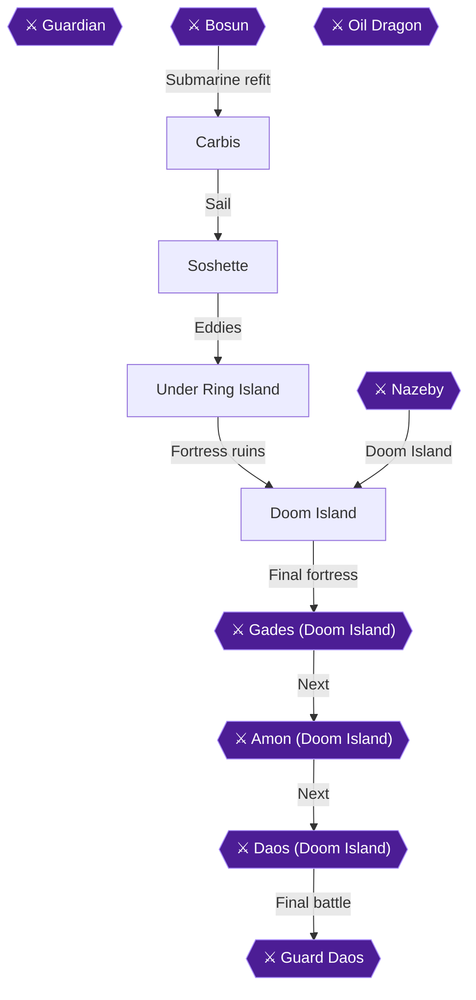

This chapter refits the Falcon so it can dive, then takes you through Soshette and the underwater caves beneath Ring Island to the risen Fortress of Doom, where you pick up the Dual Blade. Raile and Cooper fix the ship so it can go underwater through the eddies (whirlpools) on the world map [[gf1-73-6, gf4-17-31]]. The route is Carbis, Soshette, the caves under Ring Island, then the Fortress of Doom ruins and the Dual Blade [[gf2-56-16, gf2-56-21, gf2-56-23]]. This visit to Doom Island is not the final dungeon.

> [!TIP]
> **Recommended level:** The guide lists level 39 for Soshette and Under Ring Island [[gf1-74-1, gf1-75-9]]. The underwater enemies Jelly Bolt, Killer Eel, Lobsteron, Psychoclam and Red Star are weak to Fire [[gf1-55-3, gf1-55-4, gf1-55-5, gf1-55-6, gf1-55-7]].

### Chapter Items to Collect (7 Fixed Pickups Plus 19 Cave Chests)

Soshette has 1 chest, the north and southeast caves have 12, and the southwest cave has 7 [[ra-comments-51-18, ra-comments-51-20]]. The table lists the non-cave pickups. Each cave's chests are routed below.

| Item | Where Found | Action / Requirement | Citation |
|---|---|---|---|
| Mind Potion | Locker in the Carbis building | **TAKE** (examine the locker) | [[gf1-55-1]] |
| Miracle | Chest in the cave to the left in Soshette | **TAKE** | [[gf1-74-16]] |
| Straw Doll | Left bookcase downstairs in the Soshette tunnel | **TAKE** | [[gf-treasure-9-64]] |
| Gloom Arrow | Middle bookcase downstairs in the Soshette tunnel | **TAKE** | [[gf-treasure-9-65]] |
| Revive | Hidden to the right of the cleric | **TAKE** | [[gf-treasure-9-66]] |
| Sweet Water | Hidden to the left of the cleric | **TAKE** | [[gf-treasure-9-67]] |
| Dual Blade | Throne room of the Fortress of Doom | **TAKE** (handed over automatically) | [[gf-treasure-10-11]] |

### Carbis

🗺️ **Map:** [View Carbis Map by FlyingArmor](https://www.vgmaps.com/Atlas/SuperNES/Lufia&TheFortressOfDoom-Carbis.png)

Monsters outside Carbis are Ghoul, Crazy Jar, Giant Oak, Ice Snake and Blue Wisp [[gf2-42-11]].

If you have not yet taken the Mind Potion from the locker in the Carbis building, examine it now [[gf1-55-1]]. You can rest for free by speaking to the girl on the west side of the bottom floor of Shai Lab 3 [[gf2-55-1]].

Go downstairs and talk to Raile. Cooper and he will fix the submarine so you can go underwater via an eddy on the world map [[gf1-73-6]].


> [!ACHIEVEMENT]
> **Under the Sea, Under the Sea (1 Points)**
> 
> *Darling it's better, down where it's wetter, take it from me*


The achievement is tied to this refit and the dive that follows [[gf1-73-6, gf2-56-16, gf4-17-31]]. The Falcon can only go underwater at whirlpools [[gf4-17-31]].

### Soshette

🗺️ **Map:** [View Soshette Map by FlyingArmor](https://www.vgmaps.com/Atlas/SuperNES/Lufia&TheFortressOfDoom-Soshette.png)

Sail slightly east and then a good distance north to reach Ring Island. Ignore all the eddies for now and enter the town of Soshette at the northernmost section of the island [[gf2-55-2]]. Monsters outside are Mega Frog, Megaturtle, Griffon and Mad Wolf [[gf2-55-3]].

Work through the town in this order:

1. The inn is on the hill to the left of the entrance and costs 40 Gold [[gf1-74-1, gf-shop-20-12]].
2. Enter the door north of the inn (the cave to the left) and open the chest for a **Miracle** [[gf2-56-13, gf1-74-16]].
3. Go downstairs and search the bookshelves for a **Straw Doll** and a **Gloom Arrow** [[gf2-56-14, gf1-74-17, gf1-74-18]].
4. Enter the hut and search to the west and east of the cleric for a hidden **Sweet Water** and **Revive** [[gf2-56-15, gf-treasure-9-66, gf-treasure-9-67]].

The General Shop sells the following [[gf-shop-20-1]]:

| Item | Price (Gold) | Citation |
|---|---|---|
| Carbo Sword | 33600 | [[gf-shop-20-1]] |
| Carbo Plate | 10800 | [[gf-shop-20-2]] |
| Carbo Shield | 6000 | [[gf-shop-20-3]] |
| Carbo Helm | 8900 | [[gf-shop-20-4]] |
| Carbo Cap | 8500 | [[gf-shop-20-5]] |
| Catwhip | 15600 | [[gf-shop-20-6]] |
| Sonic Shoes | 8600 | [[gf-shop-20-7]] |
| Sonic Heels | 10200 | [[gf1-74-9]] |
| Float | 50 | [[gf-shop-20-8]] |
| Hi Potion | 400 | [[gf-shop-20-9]] |
| Big Arrow | 100 | [[gf-shop-20-10]] |
| Ex Arrows | 200 | [[gf-shop-20-11]] |

One guide suggests Catwhips for the girls, a Carbo Shield for the Hero, a Carbo Shield and Carbo Helm for Aguro, and two Carbo Caps for the girls [[gf3-23-20]].

> [!TIP]
> **Before you leave Soshette:** Rest at the 40 Gold inn [[gf-shop-20-12]] and stock up on Hi Potions at 400 Gold each [[gf-shop-20-9]]. Check that you have taken the Miracle, Straw Doll, Gloom Arrow, Sweet Water and Revive [[gf2-56-13, gf2-56-14, gf2-56-15]]. When ready, exit town and go down one of the eddies [[gf2-56-16]]. You can return to Soshette to rest between caves [[gf1-75-9]].

### Under Ring Island

🗺️ **Map:** [View Ring Island Underwater Cave Map by FlyingArmor](https://www.vgmaps.com/Atlas/SuperNES/Lufia&TheFortressOfDoom-RingIslandUnderwaterCave.png)

🗺️ **Map:** [View North&Southeast Cave To Fortress Map by FlyingArmor](https://www.vgmaps.com/Atlas/SuperNES/Lufia&TheFortressOfDoom-North&SoutheastCaveToFortress.png)

🗺️ **Map:** [View Southwest Cave To Fortress Map by FlyingArmor](https://www.vgmaps.com/Atlas/SuperNES/Lufia&TheFortressOfDoom-SouthwestCaveToFortress.png)

Monsters here are Magura, Fire Plate, Sea Snake and Evil Clam [[gf2-56-17]]. Magura have about 270 HP and deal around 100 damage per attack [[gf3-24-1]]. There are currents in these caves that force you along a path. Only take them when told to, or you may pass a chest [[gf1-75-9]]. The southwest entrance is not connected to the others, so explore it first [[gf4-17-40]].

Flame Armors can spawn underwater at Ring Island and can drop the Might Armor [[ra-comments-41-1]]. One commenter suggests buying 100 Sweet Water and equipping the Monster Ring for this method [[ra-comments-41-2]]. Another got it on the 3rd encounter while looking for the Dragon Egg underwater [[ra-comments-41-6]].

#### Southwest (West) Cave: 7 chests

Take the lower current to the eddy to the main area. Take the current up to a four-way intersection, then follow the path left to a chest with a **Hi Potion** [[gf1-75-9, gf-treasure-10-2]]. From the intersection, go right for **Arrows** [[gf-treasure-10-5]]. Continue right, avoiding the current, and down for a **Power Potion** [[gf-treasure-10-6]].

Go back to the intersection, walk up a little, then left, avoiding the current, for a **Mystery Pin** [[gf-treasure-10-7]]. Then head up for a **Potion** [[gf-treasure-10-8]]. Hug the wall to your right until you can walk into a current that takes you to the last two chests: an **Ex Potion** and a **Spell Potion** [[gf-treasure-10-9, gf-treasure-10-10]]. You can then take the current back to the entrance [[gf-treasure-10-10]].

> [!TIP]
> **Dragon Egg:** After the first egg scatter, the Ex Potion chest becomes a Dragon Egg chest in the northeast corner of this cave [[gf-treasure-10-9, gf1-87-8]]. The guide's route is to go up past the first intersection, up to the next, then head northeast and ride the current to the chest [[gf1-87-8]]. In the second set the egg sits near the north exit of the left cave, by the pair of chests holding the Ex Potion and Spell Potion [[gf3-26-20]].

#### Northern and Eastern caves: 12 chests

Return to Soshette to rest, then take the same eddy but head east to that cave [[gf1-75-9]].

1. Head along the current to a chest with an **Empty Bottle**, then take the eddy to the main area [[gf-treasure-9-68]].
2. Avoid the currents. Go down, slightly left, down, slightly right, and down for a **Magic Guard** [[gf1-75-9]].
3. Ride the current to the end, then walk back around it for a **Hi Potion** [[gf-treasure-10-2]].
4. Ride the nearby current back and walk into the upper right current for a **Miracle** [[gf-treasure-10-3]].
5. Go down the lower current to the lower area and walk northeast for an **Opal Ring** [[gf1-75-12]].
6. Continue right to an eddy leading to a hall. Walk right and down around the current to see two chests holding a **Miracle** and **Hi Potion** [[gf-treasure-10-2, gf-treasure-10-3]].
7. Continue down to the eddy to the last cave. Walk up to the current and hug the left wall for a **Zircon Wrist**, which Jerin equips [[gf-treasure-10-1]].
8. Take the current above, then walk right and up, around the upper current, for **800 Gold** [[gf1-75-16]].
9. Ride the lower current to the end and walk northwest for a **Hi Magic** [[gf1-75-17]].
10. Walk clockwise around the wall and current to reach a **Foul Water** and a **Gloom Arrow** [[gf1-75-18, gf-treasure-9-74]].

From below the chests, walk left to the middle current and the eddy to the center of Ring Island, where the Fortress of Doom ruins stand [[gf1-75-18]].

> [!TIP]
> **Before you leave the caves:** The checklist counts 7 chests in the southwest cave and 12 in the north and southeast caves, 19 in all [[ra-comments-51-20]]. Open all of them before entering the fortress [[gf2-56-21]].

### Doom Island

🗺️ **Map:** [View Fortress Of Doom Ruins Map by FlyingArmor](https://www.vgmaps.com/Atlas/SuperNES/Lufia&TheFortressOfDoom-FortressOfDoomRuins.png)

🗺️ **Map:** [View Underwater Cave To Oil Cave Map by FlyingArmor](https://www.vgmaps.com/Atlas/SuperNES/Lufia&TheFortressOfDoom-UnderwaterCaveToOilCave.png)

🗺️ **Map:** [View Doom Island Map by FlyingArmor](https://www.vgmaps.com/Atlas/SuperNES/Lufia&TheFortressOfDoom-DoomIsland.png)

🗺️ **Map:** [View Doom Island Shrine Map by FlyingArmor](https://www.vgmaps.com/Atlas/SuperNES/Lufia&TheFortressOfDoom-DoomIslandShrine.png)

🗺️ **Map:** [View Fortress Of Doom Map by FlyingArmor](https://www.vgmaps.com/Atlas/SuperNES/Lufia&TheFortressOfDoom-FortressOfDoom.png)

Monsters in the fortress are Megaturtle, Mad Wolf, Mega Frog, Rock Golem and Griffon [[gf2-56-22]]. The guide suggests equipping Jerin with the Frost Ring for her Blizzard spell [[gf1-76-1]]. The guide says all the treasure chests in this ruin are empty, so do not detour for them [[gf3-24-21]].

Walk north and go up the stairs, continue north and enter the door, walk east and enter the next door, then walk south and go up the stairs [[gf2-56-23]]. Go up to the second floor, around the balcony, and straight down and up to the throne room [[gf3-24-21]]. Climb the stairs to the third floor and walk up to the Dual Blade, which triggers a lot of dialogue [[gf1-76-1, gf2-56-23]].

### Dual Blade

The Dual Blade lies where the ancient battle with the Sinistrals took place [[gf3-24-21]]. It is handed over automatically at the end of the path [[gf-treasure-10-11]].


> [!ACHIEVEMENT]
> **Sin Slayer (5 Points)**
> 
> *Acquire the Dual Blade*


It gives 300 ATP and 0 WGT, is equippable only by the Hero, and cannot be sold [[gf2-71-3, gf4-23-3]]. Afterwards you are automatically back at Soshette; warp to Carbis to continue [[gf1-76-1, gf2-56-23]].

Do not plan on keeping the Dual Blade for the endgame: it is lost when you beat Nazeby in Chapter 16 [[gf4-20-3]]. The guide notes that Hydras drop the Might Sword, which is better than the Dual Blade [[gf4-17-54]].

> [!IMPORTANT]
> ### Chapter 13 Cumulative 100% Checkpoint
> - **Treasure Chests:** 533 / 637 (Soshette 1, southwest cave 7, north and southeast caves 12) [[ra-comments-51-18, ra-comments-51-20]]
> - **Dragon Eggs:** 8 / 24
> - **RetroAchievements Unlocked:** 33 / 47 (175 / 343 points)

### Chapter Checklist

- [ ] Talk to Raile in Carbis (Falcon dives at eddies)
- [ ] Mind Potion from the Carbis locker
- [ ] Soshette: Miracle chest, Straw Doll, Gloom Arrow, Revive, Sweet Water
- [ ] Southwest cave: 7 chests
- [ ] North and southeast caves: 12 chests
- [ ] Dual Blade from the throne room
- [ ] Achievements 187969 and 196734

---

## Chapter 14: Epro, the Oil Dragon and the Might Farm

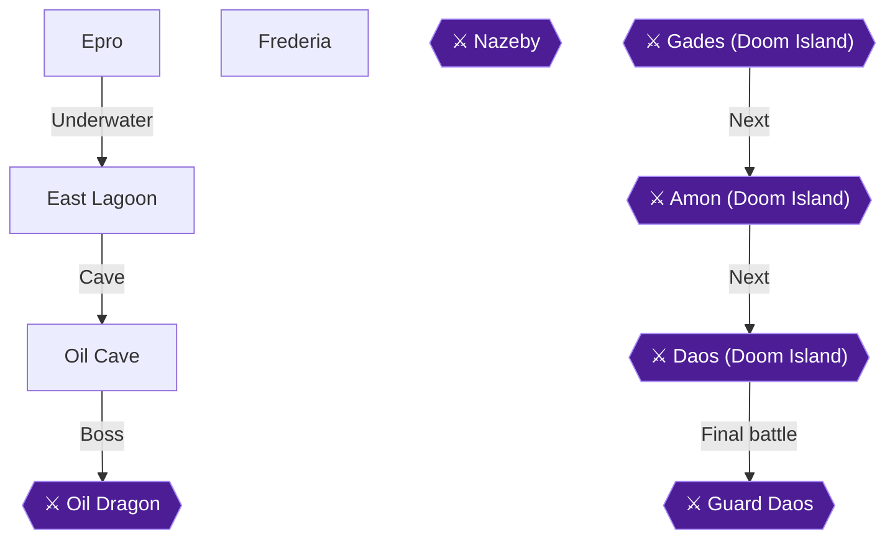

This chapter takes you from the town of Epro, through the underwater East Lagoon and the Oil Cave, to the Oil Dragon and the Power Oil. After that you carry the Power Oil to Raile in Frederia so the Falcon can fly. The recommended levels are 41 for Epro, 42 for the lagoon and the cave, and 43 for Frederia [[gf1-77-1, gf1-78-1, gf1-79-1, gf1-81-1]]. The chapter also holds the big grinding job of the set. Hydras and Fire/Flame Plates sit just outside the Oil Cave, and they carry the Might Sword and the Might Armor [[ra-comments-38-5, ra-comments-41-5]].

### Overview and preparation

- **Chests:** The underwater cave has 10 chests and the Oil Cave has 17 [[ra-comments-51-21, ra-comments-51-22]].
- **Power Oil:** It sits in a chest that opens only after you beat the Oil Dragon [[gf-treasure-10-43]].
- **Party:** Lufia is still with you in this chapter. She leaves after Nazeby, which is two chapters ahead. That makes farming harder later [[gf4-18-34]].
- **Dragon Eggs:** One chest in the Oil Cave (the Ex Bomb chest on the upper level) turns into a Dragon Egg after the first egg scatter [[gf-treasure-10-41, gf1-87-9]]. If you have already made that wish, treat that chest as an egg chest.
- **Gear for the dive:** The guide equips Jerin with the Flame Ring before the underwater trip. Before the Oil Cave it has you swap Jerin back to the Frost Ring and give Lufia the Flash Ring [[gf1-77-17, gf1-78-1]].

> [!TIP]
> **Before you leave each area:** Finish every chest, so you do not have to come back. The one chest at risk is the Oil Cave Ex Bomb chest noted above, which becomes a Dragon Egg after the first wish.

### Epro

🗺️ **Map:** [View Epro Map by FlyingArmor](https://www.vgmaps.com/Atlas/SuperNES/Lufia&TheFortressOfDoom-Epro.png)

Epro lies north of Marse. Warp to Marse and sail north [[gf2-55-1, gf2-58-4]]. Outside the town you can meet Mega Frogs, Megaturtles, Mad Wolves and Griffons [[gf2-57-3]]. Hydras also roam around Epro [[gf4-4-7]].

**Town items (3):**

1. Search the bookshelf in the house to the east (the lower right house) for an **Ex Bomb** [[gf1-77-14, gf-treasure-10-13]].
2. Go left past the weapon shop, up the hill and into the house. Search the bookshelf for an **Ex Magic** [[gf1-77-15, gf-treasure-10-12]].
3. Search the flowers above the house on the left for a hidden **Power Potion**. The same flowerbed sits behind the Item Shop [[gf1-77-16, gf-treasure-10-14, gf2-58-2]].

**The Oil Key:** Visit the closed item shop in the northeast and talk to its owner. He points you to Hedge in the north [[gf1-77-17]]. Leave town and walk northwest to the bridge. Hedge stands to the northeast of it, in a small valley. Talk to him to get the **Oil Key**, which unlocks the Oil Cave [[gf1-77-17, gf3-25-2, gf4-18-9]].

The road to the Oil Cave is blocked, so you reach it through the whirlpool to the north [[gf1-77-17]].

**Shops:** The inn costs 100 Gold [[gf-shop-21-25]].

| Shop | Stock | Citation |
|---|---|---|
| Weapon Shop | Grand Blade 38000, Carbo Sword 33600, Catwhip 15600, Big Arrow 100, Ex Arrows 200, Ex Bomb 500 | [[gf-shop-21-1, gf-shop-21-2, gf-shop-21-3, gf-shop-21-4, gf-shop-21-5, gf-shop-21-6]] |
| Armor Shop | Carbo Plate 10800, Carbo Shield 6000, Carbo Helm 8900, Carbo Cap 8500, Silver Robe 8400, Silver Wrist 2800, Sonic Shoes 8600, Sonic Heels 10200, Sword Shoes 11000, Cat Heels 11400 | [[gf-shop-21-7, gf-shop-21-8, gf-shop-21-9, gf-shop-21-10, gf-shop-21-11, gf-shop-21-12, gf-shop-21-13, gf-shop-21-14, gf-shop-21-15, gf-shop-21-16]] |
| Item Shop | Float 50, Hi Potion 400, Hi Magic 1000, Magic Guard 50, Power Gourd 100, Mind Gourd 100, Smoke Ball 80, Stone Cure 100 | [[gf-shop-21-17, gf-shop-21-18, gf-shop-21-19, gf-shop-21-20, gf-shop-21-21, gf-shop-21-22, gf-shop-21-23, gf-shop-21-24]] |

A walkthrough author suggests Sword Shoes and Cat Heels from the armor shop [[gf3-25-1]].

> [!WARNING]
> **Spend carefully:** Heavy Pockets needs 200,000 Gold in hand at one time [[gf1-91-1, gf4-6-15]]. Do not buy the expensive gear here until you read the Heavy Pockets section below.

### East Lagoon (the underwater cave from Epro)

🗺️ **Map:** [View East Lagoon Map by FlyingArmor](https://www.vgmaps.com/Atlas/SuperNES/Lufia&TheFortressOfDoom-EastLagoon.png)

🗺️ **Map:** [View Underwater Cave To Oil Cave Map by FlyingArmor](https://www.vgmaps.com/Atlas/SuperNES/Lufia&TheFortressOfDoom-UnderwaterCaveToOilCave.png)

**Getting there:** Board the Falcon outside Epro. Sail east along the coast and pass through the opening between the mountains. Head north into the eddy, then sail around to the east and enter the cave [[gf2-58-4, gf3-25-2]]. Equip Jerin with the Flame Ring first [[gf1-77-17]].

**Enemies:** The underwater area outside the Oil Cave has Hydras and Flame Plates [[ra-comments-38-5]]. The Hydras here are the Might Sword droppers you farm later in this chapter [[ra-comments-38-6]].

There are two paths heading north and one heading west from the entrance [[gf2-58-4]]. The 10 chests are listed below in a sensible order, with the fork where each branches off.

#### Chests (10)

1. **Upper path, first north path:** Take it all the way around. Two chests hold a **Big Arrow** and a **Power Potion** [[gf1-78-1, gf-treasure-10-17, gf2-58-5]].
2. **West path, through the door:** Go all the way to the end of the west path and enter the door. Open two chests: an **Ex Bomb** and an **Ex Potion** [[gf-treasure-10-18, gf-treasure-10-19, gf2-58-7]].
3. **Other north path:** Take it to a chest with a **Mystery Pin** [[gf1-78-3, gf2-58-9]].
4. **North door:** Enter the door to the north and open the chest for a **Miracle** [[gf-treasure-10-21, gf2-58-10]].
5. **Current below the door:** Ride the water current below the door and open the chest for a **Hi Magic** [[gf1-78-5, gf2-58-11]].
6. **West path below the current:** Backtrack outside the door and take the west path below the water current. Do not ride the current. At the end are two chests, a **Magic Guard** and a **Power Gourd** [[gf1-78-8, gf-treasure-10-23, gf2-58-12]].
7. **North path to the exit:** Take the north path and open the chest for a **Grand Blade**. The guide calls it "way too late" [[gf1-78-10, gf2-58-14]].


**Exit:** Step on the nearby eddy. It takes you to the other side of the lagoon. Head left to another eddy, which brings you back to the overworld [[gf1-78-10, gf2-58-15]]. Sail north to dock. Then equip Jerin with her old Frost Ring and Lufia with her Flash Ring. Walk around the mountains and through the swamp to reach the Oil Cave [[gf1-78-10]]. The route crosses the toxic marsh to the south and enters the cave [[gf2-58-15]].

### Oil Cave

🗺️ **Map:** [View Oil Cave Map by FlyingArmor](https://www.vgmaps.com/Atlas/SuperNES/Lufia&TheFortressOfDoom-OilCave.png)

**Enemies:** Efreet, Rock Golem, Mega Frog, Mad Knight, Hydra and Mad Wolf [[gf1-79-1]]. Efreets cast Blaze, so have Lufia cast Flood against them. Mad Knights are weak. Lufia's Thunder can kill Rock Golems in one hit [[gf1-79-1]]. Rock Golems use Stone Arm to petrify, and only the Hero and Aguro do enough damage to them [[gf3-25-16]]. Mad Knights have over 400 HP and cast Boost on each other [[gf3-25-17]].

There are 17 chests including the one behind the dragon. Cast Float for the swamp tiles [[gf1-79-1]].

#### First floor

1. Cast Float, cross the swamp, and unlock the door with the Oil Key. Open the chest for **850 Gold** [[gf1-79-1, gf-treasure-10-26, gf3-25-13]].
2. Go through the next door. The chest to the right holds a **Dragon Arrow** [[gf1-79-2, gf3-25-14]].
3. Climb down the rope ladder, walk right, cast Float and cross the swamp to a chest with a **Hi Bomb** [[gf1-79-3, gf3-25-15]].
4. Go straight down a ladder, then left, to a chest with a **Dragon Tooth** [[gf1-79-9]].
5. Climb down the next ladder and head right to a fork. Climb down that ladder. Cast Float and search the right side of the swamp for a hidden **Hi Magic** [[gf1-79-5, gf-treasure-10-32]].
6. Open the nearby chest for a **Dragon Ring**. The guide says to sell it, since it does nothing against the boss [[gf-treasure-10-32, gf1-79-1]].
7. From the fork, walk up to a chest with a **Big Arrow** [[gf1-79-7]].
8. Climb the ladder for a chest with a **Miracle** [[gf1-79-14]].
9. Return to the fork and go left to another ladder down. The steps lead to the second floor [[gf1-79-14]].

#### Second floor

1. Follow the path to a ladder and take it to the lower level. In the upper left corner is a chest with a **Dragon Tooth** [[gf1-79-9, gf3-25-23]].
2. Walk back, but go under the bridge to the right and up at the fork. A chest holds a **Hi Potion** [[gf1-79-10, gf3-25-24]].
3. Ignore the stairs to your right. Head down and right to a chest with a **Swing Wing** [[gf1-79-11, gf3-25-25]].
4. Go left under the first bridge and back up the ladder. The upper path is straightforward, with two chests: an **Ex Bomb** and a **Hi Magic** [[gf-treasure-10-41, gf1-79-16, gf3-25-26]].
5. Follow the path to the steps down to the third floor.

> [!WARNING]
> **Dragon Egg chest:** This Ex Bomb chest turns into a Dragon Egg after the first egg scatter. If you have not yet made the first wish, take the Ex Bomb now. Otherwise the chest holds an egg [[gf-treasure-10-41, gf1-81-9]].

#### Third floor

1. Head right, down the ladder, and along the path to a chest with a **Miracle** [[gf1-79-14]].
2. Return to the stairs, go right to a fork, and take the upper path down a ladder to a chest with a **Dragon Tooth** [[gf1-79-9]].
3. Back at the fork, climb down the right ladder and walk to the right side of the floor. A chest holds a **Hi Magic** [[gf1-79-16]].
4. Go up to the ladder further north and climb down to a chest with a **Great Potion**. This is the last chest before the dragon [[gf1-79-17, gf3-25-31]].

The route is not hard. Explore each floor fully before you take the stairs [[gf4-18-14]]. The cave also holds a Dragon Egg for the second set, found in the large room. Climb down all the ladders to the steps in the lower left corner, stay on the upper plateau and cross the bridge [[gf1-87-9]].

### Oil Dragon

Heal HP and MP to full before you inspect the dragon [[gf3-25-31, gf2-58-32]].

**Stats:** 4,700 HP. The main guide lists no elemental weakness [[gf1-80-1, gf1-80-2]]. A second guide recommends Lufia's Sunder and Jerin's Glacier [[gf3-25-32]]. It gives 31,000 XP and 4,031 Gold [[gf4-26-9]].

**Before the fight:** Equip the Flash Ring if Lufia already has Thunder. If not, the Blast Ring will do, with Sunder [[gf4-18-34]]. Thunder is learned at level 41 [[gf-boss-3-6]]. One player beat it at Hero 42, Aguro 38, Lufia 41 and Jerin 36 [[gf4-26-9]]. Make sure Jerin and Lufia have plenty of MP [[gf-boss-3-5]].

**Do not use these:** The Dragon Ring, Dragon Tooth and Dragon Arrow do nothing against it [[gf-boss-3-7, gf4-18-34]].

**Plan:**

1. Hero and Aguro attack each round [[gf1-80-2, gf2-58-33]].
2. Cast Mirror on all characters, starting with whoever has the lowest MGR [[gf-boss-3-5]].
3. Jerin uses Power Gourds on the fighters, then the Wind Flute each round after that. She can also cast Boost or Valor [[gf1-80-2, gf-boss-3-5]]. When everyone has high HP and Mirror is up, she can cast Glacier [[gf-boss-3-7]].
4. Lufia casts Drain in round one, then Thunder (or Sunder) each round [[gf1-80-2, gf4-18-34]].
5. The dragon can cast Mirror, which reflects your spells. Lufia should then switch to healing until it fades [[gf1-80-2, gf-boss-3-6]]. It likes to cast Mirror right after Sunder [[gf4-18-34]].
6. Keep everyone's HP very high in case it casts Mirror after you already picked a spell. Then use Champion on whoever was hit by their own spell [[gf4-18-34]].
7. When its HP drops, it uses Dash (about 120-140 to one character) and a stronger Fire Air (about 90-140 to everyone) [[gf4-18-34]]. If you are in trouble, Lufia and Jerin both cast Boost. The fighters can use the Wind Flute [[gf4-18-34]].


> [!ACHIEVEMENT]
> **Power the Falcon (10 Points)**
> 
> *Defeat the Oil Dragon guarding the Power Oil*


### Power Oil

After defeating the Oil Dragon on the 3rd floor of the Oil Cave, open the chest behind it to obtain the **Power Oil** (chest 17/17 for the Oil Cave) [[gf-treasure-10-43, gf2-58-34, gf3-25-34, gf1-79-1]]. Once the Power Oil is in your inventory, have Jerin cast Escape to exit the dungeon, and then either Warp directly to Frederia or Warp to Carbis and sail far south to deliver the Power Oil to Professor Raile in Shaia Lab 4 [[gf1-80-2, gf4-18-34, gf1-81-7]].

### The Might farm (Hydras and Fire Plates)

> [!WARNING]
> **Achievement Grinding Note:** The community notes that completing the full Might set requires dedicated RNG farming [[ra-comments-1-7]]. Both drops here are random. Do this farm before you move on to Frederia's next steps, since it is easiest now.

The recommended spot is the underwater area just outside the Oil Cave. It has both Hydras and Flame Plates and is moments from the overworld [[ra-comments-38-5, ra-comments-41-5]].

**Targets:**

- **Hydra:** drops the **Might Sword** (380 ATP, 30 WGT) [[gf1-95-65, gf4-23-5, gf4-17-54]]. The listed drop rate is about 1/256, according to one commenter [[ra-comments-38-4]]. Hydras give 1,850 XP each [[ra-comments-38-5]].
- **Fire Plate / Flame Plate:** rarely drops the **Might Armor** (100 DEF, 80 WGT, +10 MGR) [[gf2-92-16, gf3-23-1, gf3-29-12, gf4-23-6]]. A Fire Plate gives 1,100 XP and about 460 Gold per fight [[gf2-92-16]].

**Time needed varies:**

- One player got the Might Sword in 5 minutes, another in 25 minutes [[ra-comments-38-6, ra-comments-38-8]].
- One player went from level 44 to 84 over six hours, with 6 Might Armor drops before the sword appeared [[ra-comments-38-12]]. Another saw the sword drop as they hit level 60 [[ra-comments-38-12]].
- Another player waited a couple of days [[ra-comments-3-4]]. One said it took about an hour [[ra-comments-3-8]].
- For the armor, one player needed about 20 minutes and another 4 hours [[ra-comments-41-8]].
- Both achievements depend on RNG and can take minutes or hours [[ra-comments-2-12]].

**Encounter tricks:** One commenter reports that Sweet Water plus the Monster Ring gives a Foul Water effect, so monsters appear every step. It does not work if Clear Silk is equipped [[ra-comments-41-2, ra-comments-41-3, ra-comments-41-4, ra-comments-38-2, ra-comments-38-3]]. A commenter also says to keep Foul Waters for grinding if you have not got the sword yet [[ra-comments-2-11]].


> [!ACHIEVEMENT]
> **Stronger Than the Sword of Legends (5 Points)**
> 
> *Obtain a Might Sword*


> [!ACHIEVEMENT]
> **Armor of Might (5 Points)**
> 
> *Obtain a Might Armor*


#### Level 50!

Hydras and Plates give lots of XP. Players reached level 60 to 84 during this farm [[ra-comments-38-12, ra-comments-2-6]]. The Hero reaching level 50 unlocks the next achievement.


> [!ACHIEVEMENT]
> **Level 50! (25 Points)**
> 
> *Reach Level 50 with your hero*


#### Heavy Pockets (200,000 Gold)

Fire Plates pay about 460 Gold each fight [[gf2-92-16]]. No source says whether Heavy Pockets checks gold on hand at any moment or whether spending first matters, so hold 200,000 Gold at one time before any big purchase.

Ways to raise gold:

- Sell a **Miracle** for 2,500 Gold [[gf4-6-15]]. Miracles can be bought again in Frederia for 2,500 [[gf4-4-9]].
- Sell a **Royal Statue** for 2,500 Gold [[gf1-91-1]].
- Sell the **Dragon Ring** from the Oil Cave 1st floor chest near the 850 Gold chest [[gf-treasure-10-32, gf1-79-1]].
- Green Core gives 65,000 EXP and 8,400 Gold, but drops no item [[gf1-95-32]].

Only after you hold 200,000 Gold should you shop.


> [!ACHIEVEMENT]
> **Heavy Pockets (10 Points)**
> 
> *Have at least 200,000 Gold*


### Frederia

🗺️ **Map:** [View Frederia Map by FlyingArmor](https://www.vgmaps.com/Atlas/SuperNES/Lufia&TheFortressOfDoom-Frederia.png)

Frederia (Shaia Lab 4) is far south of Carbis. Warp to Carbis, board the Falcon and sail far south [[gf2-59-1]]. You can warp there directly from the Oil Cave if Jerin has added it to her list [[gf1-80-2]].

**Town items (4):**

1. The inn is to the left of the entrance. Search the center of the 3x3 flower bed below it for a hidden **Grilled Newt** [[gf1-81-3, gf-treasure-10-44]].
2. In the lower right corner of town is a matching flower bed. Search its center for a hidden **Miracle** [[gf1-81-4, gf-treasure-10-45]].
3. From the entrance, go straight up across the bridge. Climb the hill to the right, enter the northeast building (Shaia Lab 4) and go down the stairs [[gf1-81-5, gf2-60-3]].
4. Examine the lockers on the left. One holds a **Revive** (middle locker) and one a **Stone Cure** (left locker) [[gf1-81-5, gf-treasure-10-46, gf-treasure-10-47]].

**The Falcon:** Talk to Raile with the Power Oil in hand. He refits the Falcon so it can fly [[gf1-81-7, gf4-18-35]]. You can then travel the world map without monster attacks [[gf3-26-5]].


> [!ACHIEVEMENT]
> **Soaring the Skies (2 Points)**
> 
> *Upgrade the Falcon with the ability to take flight*


**Shops:** The inn costs 50 Gold [[gf-shop-22-27]]. The shops sell the following [[gf-shop-22-1, gf-shop-22-2, gf-shop-22-3, gf-shop-22-7, gf-shop-22-8, gf-shop-22-9, gf-shop-22-10, gf-shop-22-12, gf-shop-22-13, gf-shop-22-14, gf-shop-22-15, gf-shop-22-16, gf-shop-22-17, gf-shop-22-18, gf-shop-22-19, gf-shop-22-20, gf-shop-22-21, gf-shop-22-22, gf-shop-22-23, gf-shop-22-24, gf-shop-22-25, gf-shop-22-26]]:

| Shop | Stock | Citation |
|---|---|---|
| Weapon Shop | Grand Blade 38000, Carbo Sword 33600, Catwhip 15600, Big Arrow 100, Ex Arrows 200, Ex Bomb 500 | [[gf-shop-22-1, gf-shop-22-2, gf-shop-22-3, gf-shop-22-4, gf-shop-22-5, gf-shop-22-6]] |
| Armorer's Shop | Carbo Plate 10800, Carbo Shield 6000, Carbo Helm 8900, Carbo Cap 8500, Catwhip 15600, Clear Silk 10000, Sonic Shoes 8600, Sonic Heels 10200, Sword Shoes 11000, Cat Heels 11400, Gown 100, Ribbon 50 | [[gf-shop-22-7, gf-shop-22-8, gf-shop-22-9, gf-shop-22-10, gf-shop-22-11, gf-shop-22-12, gf-shop-22-13, gf-shop-22-14, gf-shop-22-15, gf-shop-22-16, gf-shop-22-17, gf-shop-22-18]] |
| Merchant's Shop | Hi Potion 400, Hi Magic 1000, Magic Guard 50, Power Gourd 100, Mind Gourd 100, Float 50, Smoke Ball 80, Stone Cure 100 | [[gf-shop-22-19, gf-shop-22-20, gf-shop-22-21, gf-shop-22-22, gf-shop-22-23, gf-shop-22-24, gf-shop-22-25, gf-shop-22-26]] |

> [!TIP]
> **Before you leave Frederia:** Confirm the Grilled Newt, Miracle, Revive and Stone Cure are in your bag. Make sure you have seen the Might Sword and Might Armor drop (or plan to keep farming), and that you held 200,000 Gold at one time.

The next step is the Dragon Shrine southwest of Herat. At the shrine, 8 Dragon Eggs can be traded for one wish: 2 levels each, 3 of each stat potion, a Might Shield or a Might Bow [[gf1-81-8]]. Making a wish scatters the eggs and erases the original contents of those chests if you have not opened them [[gf1-81-9]]. The next chapter covers the wish.

> [!IMPORTANT]
> ### Chapter 14 Cumulative 100% Checkpoint
> - **Treasure Chests:** 560 / 637 (10 underwater + 17 Oil Cave) [[ra-comments-51-21, ra-comments-51-22]]
> - **Dragon Eggs:** 8 / 24
> - **Might Sword / Might Armor:** obtain via the Hydra and Plate farm
> - **RetroAchievements Unlocked:** 39 / 47 (232 / 343 points)

### Chapter checklist

- [ ] Ex Bomb, Ex Magic and Power Potion collected in Epro
- [ ] Oil Key received from Hedge
- [ ] All 10 East Lagoon chests opened, including the Grand Blade
- [ ] All 17 Oil Cave chests opened, including the Power Oil
- [ ] Oil Dragon defeated (Power the Falcon)
- [ ] Might Sword obtained (Stronger Than the Sword of Legends)
- [ ] Might Armor obtained (Armor of Might)
- [ ] Level 50 reached (Level 50!)
- [ ] 200,000 Gold held at one time (Heavy Pockets)
- [ ] Grilled Newt, Miracle, Revive and Stone Cure collected in Frederia
- [ ] Raile refit the Falcon (Soaring the Skies)

---

## Chapter 15: The First Dragon Wish and the Second Egg Hunt

```mermaid
flowchart TD
  Alekia["Alekia"]
  Gades_Sheran{{"⚔ Gades (Sheran)"}}
  Demon_Lords{{"⚔ Demon Lords"}}
  Goblins{{"⚔ Goblins"}}
  Northwest_Tower["Northwest Tower"]
  Apprentice{{"⚔ Apprentice"}}
  Phantasm{{"⚔ Phantasm"}}
  Belgen["Belgen"]
  Southwest_Cave["Southwest Cave"]
  Follower{{"⚔ Follower"}}
  Dark_Ghost{{"⚔ Dark Ghost"}}
  Guardian{{"⚔ Guardian"}}
  Cave_to_Marse["Cave to Marse"]
  Elba_Ulupp_Caves["Elba & Ulupp Island Caves"]
  Bosun{{"⚔ Bosun"}}
  Under_Ring_Island["Under Ring Island"]
  Oil_Cave["Oil Cave"]
  Oil_Dragon{{"⚔ Oil Dragon"}}
  Dragon_Shrine["Dragon Shrine"]
  Arubus["Arubus"]
  Nazeby{{"⚔ Nazeby"}}
  Gades_Final{{"⚔ Gades (Doom Island)"}}
  Amon_Final{{"⚔ Amon (Doom Island)"}}
  Daos_Final{{"⚔ Daos (Doom Island)"}}
  Guard_Daos{{"⚔ Guard Daos"}}
  Gades_Sheran -->|"Wake in Alekia"| Alekia
  Northwest_Tower -->|"Top floor"| Apprentice
  Belgen -->|"Southwest"| Southwest_Cave
  Follower -->|"Return with Jerin"| Belgen
  Oil_Cave -->|"Boss"| Oil_Dragon
  Dragon_Shrine -->|"Fly"| Arubus
  Nazeby -->|"Egg quest"| Dragon_Shrine
  Gades_Final -->|"Next"| Amon_Final
  Amon_Final -->|"Next"| Daos_Final
  Daos_Final -->|"Final battle"| Guard_Daos
  classDef ponr fill:#7f1d1d,stroke:#f87171,color:#fff;
  classDef boss fill:#4c1d95,stroke:#a78bfa,color:#fff;
  class Gades_Sheran,Demon_Lords,Goblins,Apprentice,Phantasm,Follower,Dark_Ghost,Guardian,Bosun,Oil_Dragon,Nazeby,Gades_Final,Amon_Final,Daos_Final,Guard_Daos boss;
```

This chapter has two jobs. First you cash in the eight Dragon Eggs you already hold for the Might Bow. Then you collect the second set of eight eggs, which the wish scatters into eight chests around the world. The wish is the one irreversible step here, so the first section is a checklist of what to open beforehand. The shrine, the second-set egg hunt and Arubus are described in that order [[gf1-81-8, gf2-64-1, gf4-21-110]].

### Chapter Overview and Preparation

Each wish turns eight chests into Dragon Egg chests. If a chest has not been opened by then, its original contents are gone for good [[gf1-81-9, gf4-21-112]]. The second set of eggs can only be found after the first wish is made. The third set can only be found after the second wish [[gf4-21-110]]. The Dragon Shrine's recommended level is 48 [[gf1-87-1]].

The four wishes on offer are [[gf1-81-8, gf2-60-6, gf4-21-135]]:

1. Raise everyone two levels.
2. Three of each stat-boosting potion.
3. A Might Shield.
4. A Might Bow.

This route takes the **Might Bow** first [[gf2-60-7, gf4-22-1]].

The eight eggs you hold now came from these places [[gf4-21-109]]:

- Ghost Cave [[gf-treasure-5-13]]
- Old Cave 2nd floor [[gf3-5-7, gf4-7-21, gf4-21-16]]
- Red Tower basement, opened after the Dark Ghost [[gf-treasure-6-59, gf2-32-11, gf1-44-4]]
- Arus Cave [[gf-treasure-7-22]]
- Tower of Grief [[gf1-54-2]]
- Linze [[gf-treasure-7-80]]
- Gayas Island Cave [[gf2-45-42]]
- Ulupp Island [[gf2-48-2]]

#### The eight chests at risk

These are the original chests the wish will overwrite. Open every one of them before you speak to the Dragon.

| Chest | Where | Original contents | Citation |
|---|---|---|---|
| Alekia Castle | First-floor treasure room, three chests | Sweet Water in the right chest | [[gf-treasure-1-31, gf1-5-17]] |
| Belgen | Left chest in the cave | Float | [[gf-treasure-5-36, gf1-28-2]] |
| Northwest Tower | Top floor, left of the two chests behind the room | Mid Arrow | [[gf-treasure-2-44, gf1-19-14]] |
| Cave Southwest of Belgen | Right chest after the stairs east of the Hi Potion room | Float | [[gf-treasure-5-42, gf1-30-4]] |
| Cave to Marse | The hallway's only chest, on the right | Power Potion | [[gf1-65-19, gf4-15-4]] |
| Elba Island Cave | Southwest corner of the big room | Mind Potion | [[gf-treasure-8-76]] |
| Under Ring Island | West cave, upper chest after the torrent from the northeast corner | Ex Potion | [[gf-treasure-10-9]] |
| Oil Cave | Second chest upstairs from the bottom floor | Ex Bomb | [[gf-treasure-10-41]] |

> [!WARNING]
> **Chest Overwrite Warning:** Do not speak to the Dragon until all eight chests above are opened. A wish scatters the eggs into eight chests, and anything you left unopened is lost forever [[gf1-81-9, gf4-21-112]]. The Cave to Marse Power Potion is called out specifically as lost if you wish first [[gf4-15-4]].

> [!WARNING]
> **Dragon Wish Warning:** You cannot obtain both the Might Bow and Might Shield unless you use your wishes on them. Wishing for three Might Shields locks you out of the bow [[ra-comments-1-3, ra-comments-1-4, ra-comments-1-7]]. Take the bow with the first wish. Do not take three shields. The recommended plan is bow first, then shields on the second and third wishes [[gf4-22-1]].

### Chapter Items to Collect (8 Items Total)

These are the second-set Dragon Eggs. Collect all eight, but do not make the next wish yet.

| Item | Where Found | Action / Requirement | Citation |
|---|---|---|---|
| Dragon Egg 1 | Alekia Castle, first-floor treasure room | **TAKE** after the first wish | [[gf1-87-2, gf3-26-14]] |
| Dragon Egg 2 | Belgen, back cave | **TAKE** | [[gf-treasure-11-51, gf3-26-15]] |
| Dragon Egg 3 | Northwest Tower, top floor | **TAKE** | [[gf1-87-3, gf3-26-16]] |
| Dragon Egg 4 | Cave Southwest of Belgen | **TAKE** | [[gf-treasure-11-53, gf3-26-17]] |
| Dragon Egg 5 | Cave to Marse | **TAKE** | [[gf-treasure-11-54, gf3-26-18]] |
| Dragon Egg 6 | Elba Island Cave, lowest left corner | **TAKE** | [[gf-treasure-11-55, gf3-26-19]] |
| Dragon Egg 7 | Under Ring Island, west cave | **TAKE** | [[gf1-87-8, gf3-26-20]] |
| Dragon Egg 8 | Oil Cave, second floor | **TAKE** | [[gf1-87-9, gf3-26-21]] |

### Dragon Shrine

🗺️ **Map:** [View Dragon Shrine Map by FlyingArmor](https://www.vgmaps.com/Atlas/SuperNES/Lufia&TheFortressOfDoom-DragonShrine.png)

#### Getting there

Raile in Frederia refits the Falcon so it can fly. Warp to Herat, board the Falcon, lift off and fly southwest to the Dragon Shrine [[gf1-81-8, gf2-60-5]]. If you reach this point without having opened every chest in the table above, stop here and finish them first. Several of them are in this chapter's own egg-hunt areas, and you can do them before you come back.

#### Making the first wish

1. Speak to the Dragon with all 8 eggs in hand. He offers the four choices listed above [[gf2-60-6, gf4-21-109]].
2. Choose option 4, "We want a Might bow." This is Jerin's best weapon [[gf2-60-6, gf2-60-7]].
3. The Might Bow has 148 ATP, 62 WGT and is priced at 30000 [[gf4-23-4]]. It is ten points weaker than the Zircon Rod, but it lets Jerin attack all enemies [[gf3-26-13]].


> [!ACHIEVEMENT]
> **Dragon's Wish (10 Points)**
> 
> *Collect 8 Dragon Eggs and make a wish*


> [!ACHIEVEMENT]
> **Elven Warfare (5 Points)**
> 
> *Obtain the Might Bow*


The eggs now scatter across eight chests worldwide [[gf1-81-8, gf1-81-9]]. The second set is available only because you made this wish [[gf4-21-110]].

> [!TIP]
> The Dragon disappears after the third wish [[gf4-21-111]]. For the later wishes, the recommended plan is shields on the second and third [[gf4-22-1]]. The Might Shield and the other Might gear are covered in later chapters [[gf2-60-8, gf3-29-10]].

### Alekia

🗺️ **Map:** [View Alekia Map by FlyingArmor](https://www.vgmaps.com/Atlas/SuperNES/Lufia&TheFortressOfDoom-Alekia.png)

🗺️ **Map:** [View Alekia Castle Map by FlyingArmor](https://www.vgmaps.com/Atlas/SuperNES/Lufia&TheFortressOfDoom-AlekiaCastle.png)

🗺️ **Map:** [View Shrine West Of Alekia Map by FlyingArmor](https://www.vgmaps.com/Atlas/SuperNES/Lufia&TheFortressOfDoom-ShrineWestOfAlekia.png)

The inn here is free [[gf-shop-3-5, gf2-6-3]]. The old man in the warp shrine west of town restores your HP [[gf2-4-30]]. The Alekia shops sell Potion for 8, Antidote for 6, Sweet Water for 10 and Arrow for 2 [[gf-shop-3-1, gf-shop-3-2, gf-shop-3-3, gf-shop-3-4]]. The Weapons Shop sells Dagger for 50 and Knife for 10 [[gf-shop-3-6, gf-shop-3-7]]. The Armorer sells Dress for 120, Cloth for 140, Cloth Helm for 120 and Sandal for 50 [[gf-shop-3-8, gf-shop-3-9, gf-shop-3-10, gf-shop-3-11]].

#### Alekia Castle: the egg

1. Enter the castle and go up two flights of stairs to the roof. Walk around to the upper right corner and go down two flights of stairs [[gf1-87-2]].
2. This is the first-floor treasure room with three chests. Before the wish they held Sweet Water, an Antidote and a Revive [[gf1-5-17, gf-treasure-1-29, gf-treasure-1-30]].
3. The treasure list says the Sweet Water chest, the right one, becomes the egg [[gf-treasure-1-31]]. Another guide says the egg is in the chest where the Revive was [[gf3-26-14]]. The sources disagree on which chest it is, so check all three and take the Dragon Egg [[gf1-87-2]].

Skipped items in Alekia are all still takeable now:

- Potion in the bookshelf between the weapon and item shops [[gf-treasure-1-14]]
- Revive in the west house bookshelf [[gf-treasure-1-15]]
- Dress in the inn's upstairs bookshelf [[gf-treasure-1-16]]
- Cloth Helm in the northwest house [[gf-treasure-1-17]]
- Power Potion in the flowers behind that house [[gf-treasure-1-18]]
- Arrow in the northwest room chest and the Revive bookshelf there [[gf1-5-10, gf1-5-11]]
- Escape and Swing Wing in the first-floor bookshelves [[gf1-5-12]]
- Potions on the second floor [[gf1-5-14]]
- Stuffed Bear and Bracelet in the third-floor room [[gf1-5-16]]

The princess's 100 Gold in Alekia Castle is permanently lost after you enter Sheran [[gf-treasure-1-22]].

### Belgen

🗺️ **Map:** [View Cave To Belgen Map by FlyingArmor](https://www.vgmaps.com/Atlas/SuperNES/Lufia&TheFortressOfDoom-CaveToBelgen.png)

🗺️ **Map:** [View Belgen Map by FlyingArmor](https://www.vgmaps.com/Atlas/SuperNES/Lufia&TheFortressOfDoom-Belgen.png)

Warp to Belgen [[gf3-26-15]]. The inn costs 40 Gold [[gf-shop-8-24]].

#### The back cave: the egg

1. Go into the cave in the upper-left corner outside the town, northeast of the entrance, as described for the egg [[gf1-28-2, gf-treasure-11-51]].
2. The first-set chest here held Float on the left, with a Hi Potion in the right chest [[gf-treasure-5-36, gf2-23-5]]. The left chest is now the Dragon Egg chest. The egg is in the back cave [[gf-treasure-11-51, gf3-26-15]].
3. At the back of the cave, the bookshelves hold a Power Gourd and a Mind Gourd [[gf-treasure-5-38, gf-treasure-5-39, gf1-28-4, gf1-28-5]].

In the village hall, the bookshelves hold a Revive and a Hi Magic [[gf-treasure-5-34, gf-treasure-5-35, gf1-28-6, gf1-28-7]].

| Shop | Stock and price (Gold) | Citation |
|---|---|---|
| Weapons Shop | Brone Sword 1400, Long Staff 1200, Spear 780, Mace 600, Hi Arrows 100, Bomb 100 | [[gf-shop-8-1, gf-shop-8-2, gf-shop-8-3, gf-shop-8-4, gf-shop-8-5, gf-shop-8-6]] |
| Armorer's Shop | Brone Armor 1400, Brone Robe 1500, Brone Shield 720, Brone Breast 840, Brone Helm 1200, Glass Cap 460, Tan Shoes 840 | [[gf-shop-8-7, gf-shop-8-8, gf-shop-8-9, gf-shop-8-10, gf-shop-8-11, gf-shop-8-12, gf-shop-8-13]] |
| Merchant's Shop | Sweet Water 10, Potion 8, Antidote 6, Mystery Pin 30, Shriek 5, Swing Wing 80, Smoke Ball 80, Magic Guard 50, Power Gourd 100, Mind Gourd 100 | [[gf-shop-8-14, gf-shop-8-15, gf-shop-8-16, gf-shop-8-17, gf-shop-8-18, gf-shop-8-19, gf-shop-8-20, gf-shop-8-21, gf-shop-8-22, gf-shop-8-23]] |

### Northwest Tower

🗺️ **Map:** [View Northwest Tower Map by FlyingArmor](https://www.vgmaps.com/Atlas/SuperNES/Lufia&TheFortressOfDoom-NorthwestTower.png)

The tower stands northwest of Grenoble, by the Old Cave [[gf2-16-4, gf3-26-16]]. Red Magi are the dangerous enemies here. Kill them quickly, because their Spark hurts, and Lufia can finish them in one hit [[gf4-8-14]].

#### Reaching the egg

1. Walk clockwise around the perimeter of the floor and take the stairs [[gf1-87-3]].
2. Enter the right door, then the next right door, and climb the stairs [[gf1-87-3]].
3. Go left to the stairs up to the roof. The chest is at the top [[gf1-87-3]].
4. The Dragon Egg is on the top floor, behind the man's room, in a group of two chests [[gf3-26-16]]. The two chests used to hold a Mid Arrow each, and the left one is now the egg chest [[gf-treasure-2-43, gf-treasure-2-44, gf1-19-14]].

If you skipped any other chest in the tower, these are still available:

- Sonic Ring in the room on the left of the entrance [[gf1-19-2]]
- Hi Potion and Hi Magic in the room to the right [[gf1-19-3, gf1-19-4]]
- Smoke Ball on the second floor [[gf1-19-5]]
- Mind Gourd, Power Gourd, Hi Potion and Revive in the isolated third-floor section [[gf1-19-6, gf1-19-7, gf1-19-9]]
- Mind Potion and Great Potion on the second floor [[gf1-19-10, gf1-19-11]]
- Power Potion and Spell Potion on the third floor [[gf1-19-12, gf1-19-13]]

To leave, walk north off the top of the screen [[gf2-16-18]].

### Southwest Cave

🗺️ **Map:** [View Cave Southwest Of Belgen Map by FlyingArmor](https://www.vgmaps.com/Atlas/SuperNES/Lufia&TheFortressOfDoom-CaveSouthwestOfBelgen.png)

From Belgen, exit the town and head southwest to the southernmost cave [[gf2-23-11]].

#### The egg

1. The egg is down the middle staircase of the first room [[gf3-26-17]].
2. Take the steps down, then left, then down to the stairs to the chest [[gf-treasure-11-53]].
3. The two chests here held a Smoke Ball on the left and a Float on the right [[gf-treasure-5-41, gf-treasure-5-42, gf1-30-3]]. The egg takes the place of the Float [[gf-treasure-11-53, gf3-26-17]].

If any of the cave's other chests were skipped, they are still available:

- Hi Potion in the lower-left room [[gf-treasure-5-48, gf1-30-13]]
- Escape [[gf-treasure-5-43]]
- Power Potion and Spell Potion [[gf-treasure-5-44, gf-treasure-5-45]]
- Miracle hidden in the marsh [[gf-treasure-5-46, gf1-30-8]]
- Hi Magic and Hi Potion in the left room [[gf-treasure-5-47]]
- Revive and Fly Ring through the upper stairs [[gf-treasure-5-49, gf-treasure-5-50]]
- Brone Armor, Brone Helm and Brone Shield in the right room [[gf-treasure-5-51, gf-treasure-5-52, gf-treasure-5-53]]
- Dais Key in the chest at the end of the lower stairs [[gf-treasure-5-54]]
- Hidden Scimitar in the marsh [[gf-treasure-5-55, gf1-30-9]]

Enemies in the cave are SwordsPook, Mummy, Ghost Mail, Beetle, Poison Rat, Blue Wolf and Mud Man [[gf2-23-12]].

### Cave to Marse

🗺️ **Map:** [View Cave To Marse Map by FlyingArmor](https://www.vgmaps.com/Atlas/SuperNES/Lufia&TheFortressOfDoom-CaveToMarse.png)

This is the small cave east of the Tower of Light. Cross the northern bridge to reach it. It is simply a hallway with a single chest on the right [[gf1-65-19, gf-treasure-11-54]]. The chest used to hold a Power Potion, and it now holds the Dragon Egg [[gf3-26-18, gf4-15-4]]. Other sources place this cave northwest of the Tower of Light, near Linze [[gf4-21-124]], or south of Linze [[gf3-26-18]]. It is the one-chest cave, however you label its position.

### Elba & Ulupp Island Caves

🗺️ **Map:** [View Elba Island Cave Map by FlyingArmor](https://www.vgmaps.com/Atlas/SuperNES/Lufia&TheFortressOfDoom-ElbaIslandCave.png)

🗺️ **Map:** [View Ulupp Island Cave Map by FlyingArmor](https://www.vgmaps.com/Atlas/SuperNES/Lufia&TheFortressOfDoom-UluppIslandCave.png)

The recommended level is 36 [[gf1-69-1]]. Warp to Marse, and the Elba Island cave is due north [[gf-treasure-11-55]]. The inn on Elba costs 100 Gold [[gf2-48-30]].

#### The egg

1. Climb down all the ladders. The egg chest is on the left of the lowest level [[gf-treasure-11-55]].
2. This is the southwest corner of the big room [[gf-treasure-11-55]]. It is the lowest left corner [[gf3-26-19]].
3. Before the wish this chest held a Mind Potion [[gf-treasure-8-76]].

#### Switches and warp pads

Stepping on the warp pad at the Ulupp cave entrance takes you to the cave on Elba Island [[gf2-48-7]]. A switch on Elba changes where the teleporter sends you, so you can reach two separate areas of Ulupp [[gf4-16-1, gf3-21-19]]. A floor switch opens the door above it [[gf3-21-2]]. A switch also sits inside the Ex Potion and Silver Armor room [[gf2-48-27]].

Chests you may have skipped:

- HiPower Ring, Speed Potion, Ex Potion [[gf-treasure-8-65, gf-treasure-8-66, gf-treasure-8-70]]
- Smoke Ball [[gf-treasure-8-68]]
- HiDaze Ring [[gf1-69-8, gf3-21-8]]
- Spell Potion [[gf-treasure-8-71]]
- Miracle and Ex Magic through the first door [[gf-treasure-8-72, gf-treasure-8-73]]
- Hi Bomb [[gf-treasure-8-74]]
- Alumina [[gf-treasure-8-75]]
- Silver Rod [[gf-treasure-8-77]]
- Spell Potion at the top of the last ladder [[gf-treasure-9-1]]
- Silver Wrist, a second Alumina, Silver Plate and Miracle on the upper plateau [[gf1-69-18, gf-treasure-9-2, gf-treasure-9-3, gf-treasure-9-4, gf-treasure-9-5]]
- Silver Armor in the last room of Elba [[gf1-69-23, gf-treasure-9-7]]
- Ex Potion at the east end of the Ulupp room [[gf-treasure-9-9]]

The checklist counts 14 chests for Elba Cave [[ra-comments-51-11]].

### Under Ring Island

🗺️ **Map:** [View Ring Island Underwater Cave Map by FlyingArmor](https://www.vgmaps.com/Atlas/SuperNES/Lufia&TheFortressOfDoom-RingIslandUnderwaterCave.png)

🗺️ **Map:** [View North&Southeast Cave To Fortress Map by FlyingArmor](https://www.vgmaps.com/Atlas/SuperNES/Lufia&TheFortressOfDoom-North&SoutheastCaveToFortress.png)

🗺️ **Map:** [View Southwest Cave To Fortress Map by FlyingArmor](https://www.vgmaps.com/Atlas/SuperNES/Lufia&TheFortressOfDoom-SouthwestCaveToFortress.png)

The Falcon can go underwater at whirlpools only after Raile has refitted the submarine [[gf1-73-6, gf4-17-31]]. Exit Soshette and go down one of the eddies [[gf2-56-16]]. Magura are the enemy to respect here, with about 270 HP and roughly 100 damage per hit [[gf3-24-1]].

#### The egg

1. Warp to Soshette and enter the southwest cave. Ride the current to the main area [[gf1-87-8]].
2. Go up past the first intersection, then up to the next one [[gf1-87-8]].
3. Head northeast and ride the current to the chest [[gf1-87-8]].
4. The egg is near the north exit of the left cave, by the pair of boxes that held the Ex Potion and Spell Potion [[gf3-26-20]].
5. The upper chest used to hold the Ex Potion [[gf-treasure-10-9]]. The lower chest holds the Spell Potion [[gf-treasure-10-10]]. Open the Spell Potion chest first if you have not.

Chests in the three caves that you may have skipped:

- **West cave:** Hi Potion, Arrows, Power Potion, Mystery Pin and Potion [[gf-treasure-10-2, gf-treasure-10-5, gf-treasure-10-6, gf-treasure-10-7, gf-treasure-10-8]]
- **North cave:** Empty Bottle, Opal, Magic Guard, and a Miracle and Hi Potion pair [[gf-treasure-9-68, gf-treasure-9-69, gf1-75-9, gf-treasure-10-3]]
- **East cave:** Foul Water and Gloom Arrow, 800 Gold, Hi Magic and Zircon Wrist [[gf-treasure-9-74, gf1-75-18, gf-treasure-9-75, gf1-75-17, gf-treasure-10-1]]

After the three caves, the fortress is reached by the eddy to the center of Ring Island [[gf2-56-21]].

### Oil Cave

🗺️ **Map:** [View Underwater Cave To Oil Cave Map by FlyingArmor](https://www.vgmaps.com/Atlas/SuperNES/Lufia&TheFortressOfDoom-UnderwaterCaveToOilCave.png)

🗺️ **Map:** [View Oil Cave Map by FlyingArmor](https://www.vgmaps.com/Atlas/SuperNES/Lufia&TheFortressOfDoom-OilCave.png)

From the underwater cave, take the eddies out to the world map. Sail north, land, cross the toxic marsh to the south and enter the Oil Cave [[gf2-58-15]]. The recommended level is 42 [[gf1-79-1]]. The Oil Dragon is already beaten at this point, and the Power Oil chest is behind it [[gf-treasure-10-43]].

#### The egg

1. Follow the path to the large room. Climb down all the ladders to the steps in the lower-left corner [[gf1-87-9]].
2. Stay on the upper plateau and cross the bridge to the chest [[gf1-87-9]].
3. This is on the second floor, where the Ex Bomb chest was [[gf3-26-21, gf-treasure-10-41]].

Chests on this route that you may have skipped:

- The first chest holds 850 Gold, and the next holds a Dragon Arrow [[gf-treasure-10-26, gf1-79-2]]
- Hi Bomb [[gf1-79-3]]
- Dragon Tooth chests [[gf1-79-9]]
- Dragon Ring in the southeast corner [[gf-treasure-10-32]]
- Hidden Hi Magic, found with Float active [[gf1-79-5]]
- Big Arrow [[gf1-79-7]]
- Hi Potion and Swing Wing [[gf1-79-10, gf1-79-11]]
- Miracle [[gf1-79-14]]
- Hi Magic at the right side of the floor [[gf1-79-16]]
- Great Potion before the dragon [[gf1-79-17]]

The checklist counts 17 chests for the Oil Cave [[ra-comments-51-22]].

### Arubus

🗺️ **Map:** [View Arubus Map by FlyingArmor](https://www.vgmaps.com/Atlas/SuperNES/Lufia&TheFortressOfDoom-Arubus.png)

From Frederia, board the Falcon and fly slightly west to Arubus [[gf2-60-9]]. The recommended level is 43 [[gf1-82-1]]. The inn is right at the entrance and costs 150 Gold [[gf1-82-2, gf-shop-23-27]].

#### Chests

1. Examine the bookshelf in the upper-left corner of the inn for a **Spell Potion** [[gf1-82-3, gf-treasure-10-48]].
2. Speak to the man next to the Weapon shop and answer yes [[gf2-61-8]]. Enter the cave to the left and climb down the steps to two chests: **Pear Cider** on the left and **Plum Cider** on the right [[gf1-82-4, gf1-82-5, gf-treasure-10-49, gf-treasure-10-50]].
3. The checklist counts 2 chests in Arubus [[ra-comments-51-23]].

#### Glasdar Key lead and shopping

A man outside wants Apple Cider before he will tell you where the Glasdar Key is. Apple Cider costs 1000 Gold at the bottom level of the cave [[gf1-82-7, gf-shop-23-26]]. Give it to the man and he says the key is in the northern cave [[gf1-82-6]]. The old man in the basement talks about plum cider, but what he sells is Apple Cider [[gf3-26-8]]. The cave itself is the start of the next chapter.

| Shop | Stock and price (Gold) | Citation |
|---|---|---|
| Weapon Shop | Zircon Sword 42000, Zircon Axe 48000, Zircon Rod 19200, Big Arrows 100, Ex Arrows 200, Ex Bomb 500 | [[gf-shop-23-1, gf-shop-23-2, gf-shop-23-3, gf-shop-23-4, gf-shop-23-5, gf-shop-23-6]] |
| Armorer's Shop | Zircon Armor 12000, Zircon Robe 12000, Zircon Plate 8400, Zircon Wrist 8400, Zircon Helm 10200, Zircon Beret 9600, Mach Shoes 11600, Mach Heels 12200 | [[gf-shop-23-7, gf-shop-23-8, gf-shop-23-9, gf-shop-23-10, gf-shop-23-11, gf-shop-23-12, gf-shop-23-13, gf-shop-23-14]] |
| Merchant's Shop | Sweet Water 10, Ex Potion 3000, Ex Magic 6000, Power Gourd 100, Mind Gourd 100, Float 50, Smoke Ball 80 | [[gf-shop-23-15, gf-shop-23-16, gf-shop-23-17, gf-shop-23-18, gf-shop-23-19, gf-shop-23-20, gf-shop-23-21]] |
| Lodge 1 | Pear Cider 10, Sour Cider 20, Lime Cider 20, Plum Cider 30 | [[gf-shop-23-22, gf-shop-23-23, gf-shop-23-24, gf-shop-23-25]] |

One guide suggests buying a Zircon Axe for Aguro and a Zircon Rod for Jerin here [[gf3-26-6]]. Be aware that the Might Bow is ten points weaker than the Zircon Rod [[gf3-26-13]].

> [!TIP]
> Before you leave Arubus, make sure you hold all eight second-set eggs. Do not wish yet. The third set of eggs lands in Sheran Castle, East Cave, Old Cave 7th floor, Lyden, the Cave East of Herat, the Cave North of Glasdar Tower, the Cave to Glasdar Tower and Glasdar Tower itself, partly in the Glasdar dungeons [[gf2-64-1, gf1-87-11, gf1-87-16, gf1-87-17, gf1-87-18]].

> [!IMPORTANT]
> ### Chapter 15 Cumulative 100% Checkpoint
> - **Treasure Chests:** 562 / 637
> - **Dragon Eggs:** 16 / 24 (the first set is turned in; the second set is in hand) [[gf2-64-1]]
> - **Wishes Made:** 1 (Might Bow) [[gf2-60-7]]
> - **RetroAchievements Unlocked:** 41 / 47 (247 / 343 points)

### Chapter Checklist

- [ ] All 8 at-risk chests opened before the wish: Alekia Castle, Belgen, Northwest Tower, Cave Southwest of Belgen, Cave to Marse, Elba Island Cave, Under Ring Island and Oil Cave
- [ ] First wish made at the Dragon Shrine: the Might Bow (option 4), not three shields
- [ ] Dragon's Wish (196731) unlocked
- [ ] Elven Warfare (187964) unlocked
- [ ] Second-set egg collected in Alekia Castle
- [ ] Second-set egg collected in Belgen
- [ ] Second-set egg collected in the Northwest Tower
- [ ] Second-set egg collected in the Cave Southwest of Belgen
- [ ] Second-set egg collected in the Cave to Marse
- [ ] Second-set egg collected in Elba Island Cave
- [ ] Second-set egg collected under Ring Island
- [ ] Second-set egg collected in the Oil Cave
- [ ] Arubus: Spell Potion, Pear Cider and Plum Cider collected
- [ ] No second wish made yet

---

## Chapter 16: Glasdar: the Key, the Cave and Nazeby

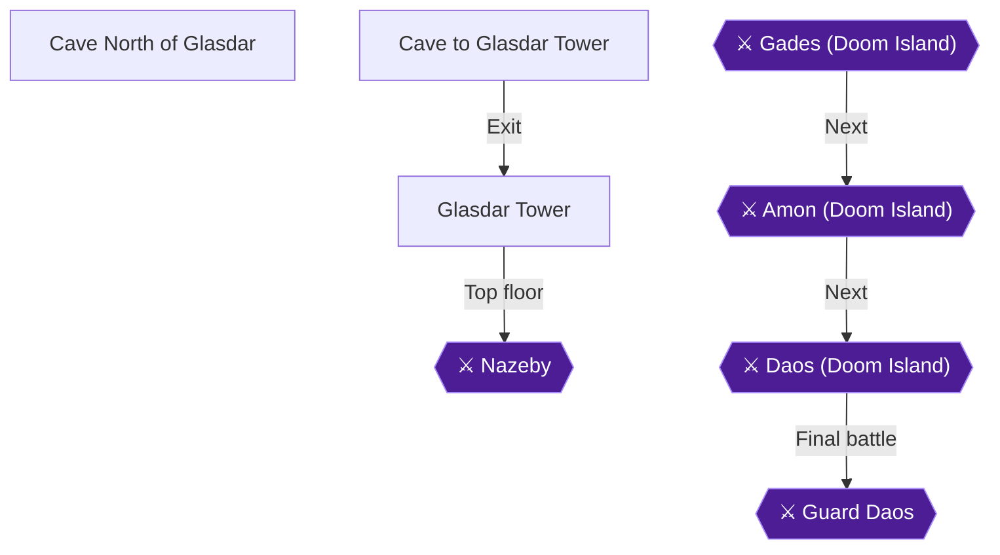

This chapter covers three dungeons in a row: the cave north of Glasdar Tower (17 chests, ending in the Glasdar Key), the cave to Glasdar Tower (20 chests) and Glasdar Tower itself (26 chests, ending with Nazeby on the top floor) [[ra-comments-51-24, ra-comments-51-25, ra-comments-51-26]]. The Glasdar Key opens both the tower and the fourth warp shrine [[gf3-27-13]]. Beating Nazeby costs you Lufia and the Dual Blade until the final battle, so clear every chest first [[gf4-20-1, gf4-20-3]].

| Area | Chests (checklist count) | Citation |
|---|---|---|
| Cave North of Glasdar Tower | 17 | [[ra-comments-51-24]] |
| Cave to Glasdar Tower | 20 | [[ra-comments-51-25]] |
| Glasdar Tower | 26 | [[ra-comments-51-26]] |

### Preparation

> [!WARNING]
> **Stone Cures:** The cave north of the tower is full of Gorgons. Their Iron Air skill (used over 75% of the time) turns characters to stone, and the guide that reports this recommends a large pack of Stone Cures [[gf3-27-1]]. Gorgons can be killed with Thunder [[gf1-83-3]].

The recommended levels are 43 for the north cave, 45 for the cave to the tower and 46 for the tower [[gf1-83-1, gf1-84-1, gf1-85-1]]. Barients here have high HP, so a Bolt spell helps. Zaurus Rex dies to Vulcan [[gf1-83-2, gf1-83-4]]. Barients can also drop the Might Helmet [[gf2-92-4]].

Arubus is your base for this chapter. Its inn has a bookshelf with a Spell Potion in the upper left corner, and the cave to the left holds a Pear Cider chest and a Plum Cider chest [[gf1-82-3, gf1-82-4, gf1-82-5]]. The weapon shop sells the Zircon Sword for 42000 Gold, the Zircon Axe for 48000 and the Zircon Rod for 19200 [[gf-shop-23-1, gf-shop-23-2, gf-shop-23-3]].

> [!WARNING]
> **Chest Contents Warning:** Making a Dragon Shrine wish scatters the eggs into chests worldwide, and any original contents you had not collected are lost [[gf1-81-9]]. Three chests in this chapter turn into Dragon Eggs after the second scatter. They are the Mind Potion chest in the north cave, the Smoke Ball chest in the cave to the tower and one Miracle chest in the tower's ten-chest room [[gf-treasure-10-60, gf-treasure-10-73, gf-treasure-11-30]]. Check each of these chests carefully.

### Cave North of Glasdar

🗺️ **Map:** [View Cave North Of Glasdar Tower Map by FlyingArmor](https://www.vgmaps.com/Atlas/SuperNES/Lufia&TheFortressOfDoom-CaveNorthOfGlasdarTower.png)

Board the Falcon and fly northwest to Glasdar Tower. Three caves surround it. Enter the one north of the tower [[gf2-61-10]]. There are no bosses inside [[gf4-19-20]].

#### Upper level

1. Follow the straight path, cross two bridges and open the chest for a **Hi Potion** [[gf2-61-11, gf1-83-5, gf-treasure-10-51]].
2. Cross the next bridge. You reach a staircase down and a rope ladder. Ignore the stairs for now, because you need them later, and take the rope ladder down [[gf2-61-12, gf1-83-1]].
3. Open the chest to the west for a **Hi Bomb**, then the chest to the south for a **Gloom Arrow** [[gf2-61-12, gf2-61-13, gf-treasure-10-52, gf-treasure-10-53]].
4. Go down the next rope ladder. Open the chest to the east for a **Smoke Ball**, then head west for a **Magic Guard** [[gf2-61-14, gf2-61-15, gf-treasure-10-54, gf-treasure-10-55]].
5. Walk northwest and climb the rope ladder. Go south for a **Mystery Pin**, then west for a **Zircon Sword** [[gf2-61-16, gf2-61-17, gf-treasure-10-56, gf-treasure-10-57]]. Keep this sword, because it is useful later [[gf1-83-11]].
6. Go north through the door for a **White Ring** (ATP+40, DFP+21, AGL+4), which one guide suggests equipping on the Hero [[gf2-61-18, gf1-83-13, gf-treasure-10-58]].
7. Walk east for a **Great Potion** [[gf2-61-19, gf4-19-11, gf-treasure-10-59]].

#### Basement

Return to the stairs you ignored and go down. Two doors lie ahead [[gf2-61-20, gf1-83-14]].

1. **Mind Potion (switch up):** Take the east door and follow the path around to another door. Step on the warp pad and open the chest for a **Mind Potion** [[gf2-61-20, gf-treasure-10-60]]. This chest only works with the switch in the up position, which is its default state [[gf-treasure-10-60]]. It becomes a Dragon Egg after the second scatter [[gf1-87-16]].
2. **Three Miracles:** Go back and take the west door. Go down all three rope ladders, enter the door and flip the switch down. Open the chest to the west for a **Miracle** [[gf2-61-21, gf1-83-17]]. The Miracle in the south-western corner, the one on the northern side and the one on the north-western side of the room make three in total [[gf-treasure-10-61]]. Go back up one rope ladder and walk around to a chest with another Miracle. Then go down two rope ladders for the third [[gf2-61-21]]. One guide words the final route as back up two ladders, down the ladder to the right, then to the chest in the lower left corner [[gf1-83-17]].
3. **Spell Potion (switch down):** Return to the warp pad and step on it again. With the switch now down, it takes you to a chest with a **Spell Potion**. Then take the stairs down [[gf2-61-24, gf1-83-18, gf1-83-19, gf-treasure-10-62]].

> [!NOTE]
> The switch changes where the warp pad sends you. Up leads to the Mind Potion chest, and down leads to the Spell Potion chest and the way to the Glasdar Key [[gf4-19-20]]. If you want the Mind Potion chest after flipping the switch, flip it back up [[gf-treasure-10-60]].

### Glasdar Key

Down the stairs is a room with three chests. Open them for a **Power Potion** (the top chest), the **Glasdar Key** (the middle chest) and a **Gloom Guard** (the lower chest) [[gf2-61-25, gf2-61-26, gf2-61-27, gf1-83-20, gf1-83-21, gf1-83-22, gf-treasure-10-63, gf-treasure-10-64, gf-treasure-10-65]].


> [!ACHIEVEMENT]
> **The Glasdar Key (3 Points)**
> 
> *Explore the Cave North of Glasdar and find the Glasdar Key*


The key unlocks Glasdar Tower and the fourth warp shrine [[gf3-27-13]]. That is the whole cave: 17 chests [[ra-comments-51-24]]. Leave, warp back to Arubus and rest. One guide advises stocking up on Ex Magic before the next dungeon [[gf4-19-20, gf1-83-1]].

### Cave to Glasdar Tower

🗺️ **Map:** [View Cave To Glasdar Tower Map by FlyingArmor](https://www.vgmaps.com/Atlas/SuperNES/Lufia&TheFortressOfDoom-CaveToGlasdarTower.png)

Rest at the inn in Arubus, then enter the cave southwest of Glasdar Tower [[gf2-62-1, gf1-83-1]]. Dragons here have very high HP, so use Thunder and your strongest single-target attacks. Red Skulls can confuse you and cast Mirror [[gf1-84-2]].

#### Lower section

1. Go down the first rope ladder and open the chest for an **Ex Bomb** [[gf2-62-1, gf1-84-3, gf-treasure-10-66]].
2. Go down the next rope ladder and enter the west door for the **Black Ring** (ATP+10, DFP+7, AGL+10, MGR+40) [[gf2-62-2, gf1-84-4, gf-treasure-10-69]].
3. Back outside, open the chest to the east for **Ex Arrows** [[gf-treasure-10-67, gf3-27-14]].
4. **Hidden Power Potion:** Cast Float and search the swamp for a hidden **Power Potion**. From the Ex Arrows chest it is 3 down, 3 left, then down [[gf2-62-4, gf1-84-5, gf-treasure-10-68]].
5. Head east to two doors. The south door has floor panels that restore HP and MP. The north door has stairs up [[gf2-62-5, gf1-84-5]].

#### Middle ladders

1. Go up the rope ladder and open the chest to the east for a **Stone Cure** [[gf2-62-6, gf1-84-7, gf-treasure-10-70]].
2. Climb the next rope ladder and enter the next two doors. You reach a spot with a door and a ladder. Take the door for a **Hi Magic** [[gf2-62-7, gf1-84-8, gf-treasure-10-71]].
3. Go up the rope ladder and through the door for **Sonic Heels** [[gf2-62-8, gf1-84-9, gf-treasure-10-72]].
4. Go through the next door for a **Smoke Ball** [[gf2-62-9, gf1-84-10, gf-treasure-10-73]]. This chest becomes a Dragon Egg after the second scatter [[gf-treasure-10-73]].
5. Go through the next door for a **Hi Potion** [[gf2-62-10, gf-treasure-11-1]].
6. Go down the next two rope ladders for an **Antidote** [[gf2-62-11, gf-treasure-11-2]].

#### Upper section

1. Go down the next rope ladder and walk east. Climb the really long rope ladder and the next one. Enter the door to the east for a **Great Potion**, then open the chest east of the door for a **Miracle** [[gf2-62-12, gf2-62-13, gf-treasure-11-5, gf-treasure-11-14]].
2. Go down the rope ladder here for a **Gloom Arrow** [[gf2-62-14, gf-treasure-11-4]].
3. Go back up, walk west and take the westernmost rope ladder for a **Mind Gourd** [[gf2-62-15, gf-treasure-11-6]].
4. Walk west and climb the next rope ladder for a **Dragon Arrow** [[gf2-62-16, gf1-84-19]].
5. Go up the east rope ladder and enter the door. Either of the two doors leads to two chests, an **Ex Potion** (left) and a **Big Arrow** (right) [[gf2-62-17, gf-treasure-11-8, gf-treasure-11-9]].
6. Go up the west rope ladder for a second **Ex Bomb** [[gf1-84-3]].
7. Walk east and ignore the rope ladder that leads to a door for now. Go up the ladder east of it and continue east for a second **Ex Arrows** [[gf2-62-19, gf1-84-21]].
8. Go up the rope ladder and enter the door. Open the two chests for two **Miracles** and search the toxic marsh (Float again) for a hidden **Miracle** [[gf2-62-20, gf-treasure-11-14]].

#### Exit

Return to the ladder you ignored, climb it and enter the door. Use the Glasdar Key on the locked door, step on the warp pad, climb the rope ladder and take the stairs. You come out right outside Glasdar Tower [[gf2-62-21, gf1-84-24]].

A Dragon Egg chest also sits on the left side of the second-floor plateaus [[gf1-87-17]]. A guide's route to it is down two ladders, right past the swamp and up to the main area. Then go left past the first two ladders and up two more [[gf1-87-17]]. The chest you reach this way is the **Smoke Ball** chest above, since the treasure list records it as becoming an egg [[gf-treasure-10-73]]. That is all 20 chests [[ra-comments-51-25]].

### Glasdar Tower

🗺️ **Map:** [View Glasdar Tower Map by FlyingArmor](https://www.vgmaps.com/Atlas/SuperNES/Lufia&TheFortressOfDoom-GlasdarTower.png)

Enemies here are Electromaz, Fire Wave, Waterspout and Whirlwind. They have high-damage elemental spells, and Lufia's Thunder and Jerin's physical attack work best [[gf1-85-2]]. Glooms also cast Succumb, an instant-death spell [[gf3-28-1]].

#### 1F

Take the west door for a **Hi Potion** and the east door for an **Ex Bomb**. Then go through the north door and take the stairs up [[gf2-63-1, gf1-85-3, gf1-85-4]].

#### 2F

Enter the east door for a **Big Arrow** [[gf2-63-3, gf-treasure-11-17]]. Head north through the door, walk east through the next door, then east again to the door with **Ex Arrows** [[gf2-63-4, gf-treasure-11-18]]. Follow the south path and go up the stairs [[gf2-63-5]].

#### 3F

1. Enter the east door and open both chests: a **Power Gourd** (left) and a **Mind Gourd** (right) [[gf2-63-5, gf-treasure-11-20, gf-treasure-11-21]].
2. Enter the west door for a **Revive** [[gf2-63-7, gf-treasure-11-22]].
3. Enter the north door, walk either way, take the next door and open the chest to the east for another **Revive** [[gf2-63-7]].
4. Go through the south door, up the stairs and through the next door for an **Ex Bomb** [[gf2-63-8, gf1-85-4]].

#### 4F

1. The north door here leads nowhere. Do not take the east door to the next floor yet. First enter the door south of it for a **Gloom Arrow** [[gf2-63-9, gf-treasure-11-24]].
2. Enter the door south of that and the next door for two chests: a **Gloom Ring** and a **Miracle** [[gf2-63-10, gf-treasure-11-26]].
3. Backtrack, enter the east door and the next two doors, then walk south for an **Antidote** [[gf2-63-11, gf-treasure-11-27]].
4. Continue south and take the stairs up [[gf2-63-11]].

#### 5F

Enter the north door, then the door east of it. Walk south to two doors. The east door has a warp pad to HP and MP restoring floor panels, so use it to heal. The west door has the stairs up [[gf2-63-12]]. Read the note on the east or west wall to learn what the switches are for [[gf2-63-12]].

#### 6F: the switch room

Four switches sit on this floor. The one on the red carpet resets the other three, and the other three set where the warp pad leads [[gf3-28-7, gf2-63-16]].

> [!TIP]
> One guide notes OXX leads to 5F for 11 chests, and OXO is the correct way to the boss, with O meaning pressed [[gf4-19-57]]. The other guides describe the switches by position, as below.

| Switch setting | Where the warp pad leads | Citation |
|---|---|---|
| Middle and right | A Miracle chest, then a path to the treasure trove of ten chests | [[gf2-63-13, gf3-28-9, gf1-85-16]] |
| Right only | A Stun Arrow chest | [[gf2-63-18, gf3-28-8]] |
| None | A Miracle chest | [[gf2-63-17, gf3-28-17]] |
| Middle only | The way to the top floor | [[gf2-63-19, gf3-28-10]] |

Work through them in this order:

1. **Treasure trove:** Step on the middle and right switches and take the warp pad to a chest with a **Miracle** [[gf1-85-16, gf2-63-13]]. Leave the room, but do not drop into the hole yet. Go through the next rooms and a hallway to the room with ten chests [[gf3-28-9, gf1-85-16]]. Open them for a **Spell Potion**, **Power Potion**, **Mind Potion**, **Great Potion**, **Speed Potion**, **Revive** and **4 Miracles** [[gf2-63-13, gf-treasure-11-29, gf-treasure-11-31, gf-treasure-11-32, gf-treasure-11-33, gf-treasure-11-34]]. One of the Miracle chests becomes a Dragon Egg after the second scatter, and it only appears after you have collected the eggs from the earlier sets [[gf-treasure-11-30, gf1-87-18, ra-comments-37-1]]. You cannot warp back to the switches. Drop down the pit and climb back up, then step on the red carpet switch to reset [[gf2-63-13, gf2-63-16, gf1-85-16]].
2. **Stun Arrow (optional):** Step on the right switch only for a **Stun Arrow** chest [[gf1-85-16, gf2-63-18, gf-treasure-11-36]]. You then have to work your way back up from the first floor [[gf2-63-18]]. The tower's checklist count of 26 includes it [[ra-comments-51-26]].
3. **Last Miracle (optional):** Step on no switch for a chest with a **Miracle**. This also sends you back to the first floor [[gf2-63-17, gf1-85-16]]. A guide says to get it only if you want it [[gf2-63-17]].
4. **To the boss:** Reset the switches and step on only the middle switch. Follow the path through the next two doors and take the stairs up to the roof [[gf2-63-19, gf1-85-16]].

### Nazeby

#### Before you step on the circle

Equip Lufia with the Flash Ring as soon as you reach the top, before taking another step. This matters for the fight and for later in the game [[gf-boss-3-8, gf1-85-16]]. Fully heal everyone before stepping on the southern circle [[gf2-63-14]]. The reported levels used were Hero 43, Aguro 40, Lufia 42, Jerin 37 [[gf2-63-14]].

> [!CAUTION]
> **Point of No Return:** Defeating Nazeby makes Lufia leave the party until the final battle, and the Dual Blade is lost [[gf4-20-1, gf4-20-3]]. Gaining levels and farming Might equipment drops gets harder without her [[gf4-20-1]]. Finish every chest in the three dungeons, including the Dragon Egg chests, before the fight.

#### The fight

Nazeby is the boss on the seventh floor [[gf3-28-11]]. Sources disagree on his HP: one guide says 4980 and another says 5600, so plan for a long battle [[gf1-86-1, gf-boss-3-8]]. He has no elemental weakness [[gf1-86-1]].

His spell tiers change as he takes damage:

- At the start he casts Blast, Spark, Frost, Bolt and Dew [[gf-boss-3-9]].
- After some damage he moves to Flame, Blizzard and Water [[gf-boss-3-9]].
- Late in the fight he casts Vulcan, Flood, Glacier and Succumb [[gf-boss-3-9]].
- Near the end Vulcan deals 70-100 damage [[gf3-28-15]].
- His Spark does about 30 damage to each character [[gf3-28-12]].
- Mace instantly kills one character if it works, but it hardly ever does. Revive the target with a Miracle or Revive [[gf-boss-3-10, gf3-28-18, gf4-20-1]].
- He rarely casts Sunder [[gf3-28-13]].

Suggested plan:

1. Hero and Aguro attack every round [[gf1-86-2, gf2-63-14]]. Power Gourds on the Hero help [[gf3-28-14]].
2. Lufia casts Drain in round one and Thunder after that, if everyone already has Mirror. Otherwise she heals first so Jerin can cast Mirror [[gf1-86-2, gf-boss-3-11]].
3. Jerin casts Mirror on everyone and keeps recasting it all fight. She uses Power Gourds and Trick on the fighters when Mirror is up [[gf-boss-3-11, gf1-86-2]].
4. When HP gets low, use the Wind Flute or Boost, or have the Hero cast Valor [[gf1-86-2, gf-boss-3-11]]. If Jerin falls, revive her immediately [[gf-boss-3-11]].
5. If Nazeby casts Mirror (rare), Lufia heals or uses Power Gourds on the attackers until it fades [[gf-boss-3-12]].
6. Another guide says the silence he casts on magic users usually wears off by the time you need to heal. Then Lufia or Jerin cast Boost while the others keep attacking [[gf2-63-14]].

> [!NOTE]
> Sources disagree on how well magic works here. One says it does little and physical attacks are best [[gf3-28-14]]. Others have Lufia casting Thunder every round [[gf1-86-2, gf-boss-3-11]]. If Thunder is doing poorly, shift Lufia to healing.


> [!ACHIEVEMENT]
> **The Agent of Daos (10 Points)**
> 
> *Defeat Nazeby at the Glasdar Tower*


#### After the fight

A long cutscene follows, and then Lufia is gone with the Dual Blade [[gf3-28-16, gf4-20-3]]. Warping out of the tower is not possible, so drop down to the bottom [[gf3-28-16]].

> [!TIP]
> **Before you leave Glasdar Tower:** If you were behind on chests, any Dragon Egg chests you left behind are still in these dungeons, and the last wishes are in the next chapter [[gf1-87-16, gf1-87-17, gf1-87-18]].

> [!IMPORTANT]
> ### Chapter 16 Cumulative 100% Checkpoint
> - **Treasure Chests:** 625 / 637 (17 + 20 + 26 chests from this chapter's three dungeons) [[ra-comments-51-24, ra-comments-51-25, ra-comments-51-26]]
> - **Dragon Eggs:** 16 / 24
> - **RetroAchievements Unlocked:** 43 / 47 (260 / 343 points)

### Chapter Checklist

- [ ] Stone Cures stocked before entering the cave north of the tower
- [ ] North cave: all 17 chests opened, including the Mind Potion chest with the switch up
- [ ] Glasdar Key obtained from the middle chest in the basement room
- [ ] Achievement: The Glasdar Key
- [ ] Cave to the tower: all 20 chests opened, including the hidden marsh items
- [ ] Glasdar Tower: all 26 chests opened, including the ten-chest trove
- [ ] Optional Stun Arrow and last Miracle chests from the switch room opened
- [ ] Lufia equipped with the Flash Ring before the boss circle
- [ ] Party fully healed before stepping on the circle
- [ ] Achievement: The Agent of Daos
- [ ] Warned: Lufia is gone and the Dual Blade is lost after this fight

---

## Chapter 17: The Last Two Wishes and the Might Set

```mermaid
flowchart TD
  Sheran["Sheran"]
  Gades_Sheran{{"⚔ Gades (Sheran)"}}
  East_Cave["East Cave"]
  Demon_Lords{{"⚔ Demon Lords"}}
  Goblins{{"⚔ Goblins"}}
  Old_Cave_7["Old Cave 7th Level"]
  Apprentice{{"⚔ Apprentice"}}
  Phantasm{{"⚔ Phantasm"}}
  Follower{{"⚔ Follower"}}
  Dark_Ghost{{"⚔ Dark Ghost"}}
  Lyden["Lyden"]
  Forfeit["Forfeit"]
  Guardian{{"⚔ Guardian"}}
  Purple_Newt_Cave["Purple Newt Cave"]
  Bosun{{"⚔ Bosun"}}
  Oil_Dragon{{"⚔ Oil Dragon"}}
  Dragon_Shrine["Dragon Shrine"]
  Cave_North_of_Glasdar["Cave North of Glasdar"]
  Cave_to_Glasdar_Tower["Cave to Glasdar Tower"]
  Glasdar_Tower["Glasdar Tower"]
  Nazeby{{"⚔ Nazeby"}}
  Gades_Final{{"⚔ Gades (Doom Island)"}}
  Amon_Final{{"⚔ Amon (Doom Island)"}}
  Daos_Final{{"⚔ Daos (Doom Island)"}}
  Guard_Daos{{"⚔ Guard Daos"}}
  Sheran -->|"Unwinnable battle"| Gades_Sheran
  Cave_to_Glasdar_Tower -->|"Exit"| Glasdar_Tower
  Glasdar_Tower -->|"Top floor"| Nazeby
  Nazeby -->|"Egg quest"| Dragon_Shrine
  Gades_Final -->|"Next"| Amon_Final
  Amon_Final -->|"Next"| Daos_Final
  Daos_Final -->|"Final battle"| Guard_Daos
  classDef ponr fill:#7f1d1d,stroke:#f87171,color:#fff;
  classDef boss fill:#4c1d95,stroke:#a78bfa,color:#fff;
  class Gades_Sheran,Demon_Lords,Goblins,Apprentice,Phantasm,Follower,Dark_Ghost,Guardian,Bosun,Oil_Dragon,Nazeby,Gades_Final,Amon_Final,Daos_Final,Guard_Daos boss;
```

This chapter spends the second and third Dragon Egg sets and ends with the last Might Shield. The Dragon accepts 8 eggs per wish [[gf4-21-109]], and the second and third sets only exist after you turn in the set before them [[gf4-21-110]]. After the third wish the Dragon disappears, so every wish counts [[gf4-21-111]]. The route is: wish at the Dragon Shrine for a Might Shield, collect the third set from eight chests, return for the final wish, then fill your item list at Forfeit.

Three achievements are in play:
- **A Hero's Mightiest Shield** (obtain a Might Shield) [[gf1-87-10, gf2-60-8]].
- **I Feel Like Having Dragon Eggs for Breakfast** (make 3 wishes) [[gf-treasure-5-13, gf3-21-30]].
- **Item Burden** (occupy every item slot) [[ra-comments-45-1]].

> [!WARNING]
> **Chest Overwrite Warning (chest contents):** Making a wish scatters the eggs into eight chests worldwide. Any original contents of those chests you have not already taken are gone forever [[gf1-81-9]]. The chests that change after this wish are:
> - Sheran Castle's 100 Gold chest [[gf-treasure-2-6]].
> - East Cave's Cloth Shoes chest [[gf-treasure-2-15]].
> - Lyden's Chop Block chest [[gf-treasure-7-11]].
> - The Old Cave 7th floor chest south of the Clear Silk chest [[gf-treasure-4-63]].
> - The Stun Arrow chest in the cave east of Herat [[gf-treasure-9-31]].
> - The Mind Potion chest in the cave north of Glasdar Tower [[gf-treasure-10-60]].
> - The Smoke Ball chest in the cave to Glasdar Tower [[gf-treasure-10-73]].
> - A Miracle chest in Glasdar Tower's ten-chest room [[gf-treasure-11-30]].
>
> Take those contents before you make the wish.

> [!WARNING]
> **Dragon Wish Warning (Might gear):** You cannot obtain the Might Bow and Might Shield if you do not spend wishes on them [[ra-comments-1-3, ra-comments-1-7]]. The Might Sword and Might Armor are RNG drops, and grinding for them can take minutes or hours [[ra-comments-2-12]]. If either has not dropped yet, farm it before the finale.

### Chapter Items to Collect (8 Items Total)

These are the eight third-set Dragon Eggs scattered by the second wish [[gf1-87-10]].

| Item | Where Found | Action / Requirement | Citation |
|---|---|---|---|
| Dragon Egg 1 | Sheran Castle, throne room, chest on the right | **TAKE** | [[gf1-87-11]] |
| Dragon Egg 2 | East Cave, first chest you see | **TAKE** | [[gf-treasure-11-59]] |
| Dragon Egg 3 | Old Cave 7th floor, near the Wind Flute room | **TAKE** | [[gf-treasure-11-60]] |
| Dragon Egg 4 | Lyden, center house basement | **TAKE** | [[gf-treasure-11-61]] |
| Dragon Egg 5 | Cave east of Herat (Purple Newt Cave), first floor, southeast corner, left of the teleport | **TAKE** | [[gf-treasure-11-62]] |
| Dragon Egg 6 | Cave north of Glasdar Tower, warp point reached with the switch UP | **TAKE** | [[gf1-87-16]] |
| Dragon Egg 7 | Cave to Glasdar Tower, up two ladders on the left side of the plateaus | **TAKE** | [[gf1-87-17]] |
| Dragon Egg 8 | Glasdar Tower, ten-chest treasure room | **TAKE** (appears only after the other 7) | [[gf1-87-18, ra-comments-37-1]] |

### Dragon Shrine

🗺️ **Map:** [View Dragon Shrine Map by FlyingArmor](https://www.vgmaps.com/Atlas/SuperNES/Lufia&TheFortressOfDoom-DragonShrine.png)

#### The second wish

1. Warp to Herat, board the Falcon, lift off, and fly southwest to the Dragon Shrine [[gf2-60-5, gf1-81-8]].
2. Make sure you are carrying the second set of 8 eggs. Their locations were Alekia's Castle, Belgen, the top floor of Northwest Tower, the cave southwest of Belgen, the cave northeast of the Tower of Light, the Elba Island cave, Under Ring Island and the Oil Cave [[gf2-64-1]].
3. Speak to the Dragon. The four wishes are 2 levels for everyone, 3 of each stat-boosting potion, a Might Shield, or a Might Bow [[gf2-60-6, gf4-21-135]].
4. Choose the third option, the **Might Shield**. Hero, Aguro and Jerin can all equip it [[gf2-60-8]]. It has 65 DEF, 45 WGT and +32 MGR [[gf4-24-1]].


> [!ACHIEVEMENT]
> **A Hero's Mightiest Shield (5 Points)**
> 
> *Obtain a Might Shield*


5. The eggs now scatter for the last time into 8 chests [[gf1-87-10]]. Your second wish is spent.

> [!TIP]
> Equip the shield on Hero first. Later sources recommend putting the next shield on Aguro [[gf1-87-10]].

### Sheran

🗺️ **Map:** [View Cave To Sheran Map by FlyingArmor](https://www.vgmaps.com/Atlas/SuperNES/Lufia&TheFortressOfDoom-CaveToSheran.png)

🗺️ **Map:** [View Sheran Map by FlyingArmor](https://www.vgmaps.com/Atlas/SuperNES/Lufia&TheFortressOfDoom-Sheran.png)

🗺️ **Map:** [View Sheran Castle Map by FlyingArmor](https://www.vgmaps.com/Atlas/SuperNES/Lufia&TheFortressOfDoom-SheranCastle.png)

Have Jerin cast Warp and pick Sheran; Warp reaches any town you have visited [[gf3-10-5]].

#### Sheran Castle throne room

1. Enter the castle, climb the stairs to the roof, and enter the throne room [[gf1-87-11]].
2. The chest on the **right** now holds a **Dragon Egg** (Egg 1/8) [[gf1-87-11]].

The throne room's right door used to hold a chest with 100 Gold [[gf1-8-8, gf2-6-7]]. That chest is now the egg, which is why the earlier warning mattered [[gf-treasure-2-6]].

### East Cave

🗺️ **Map:** [View Cave To Guy's House Map by FlyingArmor](https://www.vgmaps.com/Atlas/SuperNES/Lufia&TheFortressOfDoom-CaveToGuy'sHouse.png)

The East Cave is the cave east of Treck, beside Guy's House [[gf-treasure-11-59]].

1. Walk the path down the two rope ladders [[gf1-11-2]].
2. The first chest you see is the egg, and you cannot miss it [[gf-treasure-11-59]]. Take the **Dragon Egg** (Egg 2/8). It replaces the Cloth Shoes that used to be here [[gf-treasure-2-15]].

The grey area outside the cave damages your HP if you walk on it [[gf3-3-6]]. Low-level parties should kill Giant Bats first [[gf4-6-4]].

### Old Cave 7th Level

🗺️ **Map:** [View Old Cave 7th Level Map by FlyingArmor](https://www.vgmaps.com/Atlas/SuperNES/Lufia&TheFortressOfDoom-OldCave-7thLevel.png)

Monsters on this floor are Mega Frog, Mad Wolf, Griffon and Megaturtle [[gf2-44-1]]. You cleared this floor in Chapter 10 (41 checklist chests; one older guide counts 43), so only the egg chest is new [[gf2-44-2]].

1. Climb the ladder to the door into the main area. Walk around to the stairs in the upper right corner and climb down the ladder to the chest below [[gf-treasure-11-60]].
2. This chest is near the Wind Flute room [[gf-treasure-11-60]]. The Clear Silk chest sits at the bottom of a ladder [[gf-treasure-4-41]]. The Wind Flute chest is reached by going east at the split and into the door, then returning to the split and going west [[gf-treasure-4-42]].
3. The empty chest south of the Clear Silk chest becomes the egg after the second scatter [[gf-treasure-4-63]]. Take the **Dragon Egg** (Egg 3/8).

### Lyden

🗺️ **Map:** [View Lyden Map by FlyingArmor](https://www.vgmaps.com/Atlas/SuperNES/Lufia&TheFortressOfDoom-Lyden.png)

From Odel, exit and head southeast to reach Lyden [[gf2-36-11]].

1. Walk counter-clockwise around the hill to reach the kitchen in the center house [[gf-treasure-11-61]].
2. Head down the steps into the Wizard of Cookery's basement and open the chest [[gf-treasure-11-61]]. This is the right-hand chest of the four underground chests, which used to hold the Chop Block [[gf-treasure-7-11]]. Take the **Dragon Egg** (Egg 4/8).

**Shopping for Item Burden.** The Lyden General Shop sells cheap, distinct items [[gf2-37-2]]:

| Item | Price | Citation |
|---|---|---|
| Fry Pan | 50 Gold | [[gf-shop-14-1]] |
| Small Knife | 70 Gold | [[gf-shop-14-2]] |
| Pot | 60 Gold | [[gf-shop-14-3]] |
| Chop Block | 30 Gold | [[gf-shop-14-4]] |
| Apron | 60 Gold | [[gf-shop-14-5]] |
| Goblet | 10 Gold | [[gf-shop-14-6]] |

A night at the inn costs 100 Gold [[gf-shop-14-7]]. Enemies near Lyden give roughly 700 to 800 EXP per battle [[gf3-13-7]].

### Purple Newt Cave

🗺️ **Map:** [View Purple Newt Cave Map by FlyingArmor](https://www.vgmaps.com/Atlas/SuperNES/Lufia&TheFortressOfDoom-PurpleNewtCave.png)

🗺️ **Map:** [View Cave East Of Ranqs Map by FlyingArmor](https://www.vgmaps.com/Atlas/SuperNES/Lufia&TheFortressOfDoom-CaveEastOfRanqs.png)

This cave is east of Herat. From Herat, sail the Falcon north and exit west after the mountain ends. Walk south and cross a bridge, then northeast and cross another, then continue north into the cave [[gf2-52-9]]. Enemies here cast stone and poison often, so carry at least five Stone Cures [[gf3-22-2]].

1. From the entrance, go right, down the ladder, right, down the next ladder, then right and down. The chest is in the **southeast corner of the first floor, left of the teleport** [[gf-treasure-11-62]].
2. This is the chest that used to hold the Stun Arrow [[gf-treasure-9-31]]. Take the **Dragon Egg** (Egg 5/8).

### Cave North of Glasdar

🗺️ **Map:** [View Cave North Of Glasdar Tower Map by FlyingArmor](https://www.vgmaps.com/Atlas/SuperNES/Lufia&TheFortressOfDoom-CaveNorthOfGlasdarTower.png)

This is the northernmost of three caves around Glasdar Tower [[gf2-61-10]]. The switch controls where the teleport goes. Up leads to a chest, and down leads to the way to the Glasdar Key [[gf4-19-20]]. For the egg, the switch must be **UP**.

1. Follow the path to the steps to the basement [[gf1-87-16]].
2. Enter the left door and climb down three ladders to the switch room [[gf1-87-16]].
3. Flip the switch **up**, then walk back to the room with two doors [[gf1-87-16]].
4. Take the right door and follow the path around to the warp point, which leads to the chest [[gf1-87-16]].
5. Take the **Dragon Egg** (Egg 6/8). It replaces the Mind Potion that used to be here [[gf-treasure-10-60]].

### Cave to Glasdar Tower

🗺️ **Map:** [View Cave To Glasdar Tower Map by FlyingArmor](https://www.vgmaps.com/Atlas/SuperNES/Lufia&TheFortressOfDoom-CaveToGlasdarTower.png)

1. Climb down two ladders, go right past the swamp, and go up to the stairs to the main area [[gf1-87-17]].
2. Go left, past the first two ladders, then up two ladders to the chest [[gf1-87-17]]. It sits on the left side of the plateaus on the second floor [[gf1-87-17]].
3. Take the **Dragon Egg** (Egg 7/8). It replaces the Smoke Ball [[gf-treasure-10-73]].
4. Use the unlocked door, step on the warp pad, climb the rope ladder, and take the stairs up. You come out right outside Glasdar Tower [[gf2-62-21, gf1-84-24]].

### Glasdar Tower

🗺️ **Map:** [View Glasdar Tower Map by FlyingArmor](https://www.vgmaps.com/Atlas/SuperNES/Lufia&TheFortressOfDoom-GlasdarTower.png)

> [!TIP]
> Lufia left the party when you beat Nazeby in Chapter 16 and only rejoins for the final battle, so this climb is with Hero, Aguro and Jerin [[gf4-20-1, gf3-28-16]].

The egg is in the hidden treasure room. Per an RA commenter, it only appears once the other 7 eggs are collected [[ra-comments-37-1]]. The recommended level for the tower is 46 [[gf1-85-1]].

#### 1F to 5F

1. **1F.** The left room holds a Hi Potion and the right room an Ex Bomb [[gf1-85-3, gf1-85-4]]. Take the center door up to the stairs [[gf1-85-3]].
2. **2F.** Enter the right room for a Big Arrow [[gf-treasure-11-17]]. Go through the hallway door, then east and onward for the Ex Arrows [[gf-treasure-11-18]]. Take the stairs up.
3. **3F.** The east room has a Power Gourd and a Mind Gourd [[gf-treasure-11-20, gf-treasure-11-21]]. A Revive is in the southeast after the hallway [[gf-treasure-11-22]].
4. **4F.** There is a chest in the main area with an Ex Bomb [[gf1-85-4]]. The south-east door leads to a Gloom Arrow [[gf-treasure-11-24]]. Further on, a Gloom Ring chest sits beside a Miracle chest [[gf-treasure-11-26]]. An Antidote is after the hallway [[gf-treasure-11-27]].
5. **5F.** The east door's warp pad leads to HP and MP restoring floor panels [[gf2-63-12]]. The other room has the stairs up [[gf1-85-1]].

#### 6F switch room

There are four switches. The one on the red carpet resets the other three, and the three change the warp point's destination [[gf3-28-7, gf2-63-16]].

| Switches stepped on | Destination | Citation |
|---|---|---|
| Middle and right | Miracle chest, then a path to the treasure room with 10 chests | [[gf3-28-9, gf1-85-16]] |
| Right only | Stun Arrow chest | [[gf3-28-8]] |
| None | Miracle chest | [[gf3-28-17]] |
| Middle only | Route to the boss | [[gf3-28-10, gf2-63-19]] |

1. Step on the **middle and right switches** and take the warp point. Take the Miracle chest first [[gf1-85-16]].
2. Leave that room but do not drop in the hole. Go through the room, and a secret room full of treasure appears [[gf3-28-9]]. It holds ten chests: a spell potion, power potion, mind potion, great potion, speed potion, revive and 4 miracles [[gf2-63-13]].
3. One of these chests now contains the final **Dragon Egg** (Egg 8/8) [[gf1-87-18]]. It replaces a Miracle [[gf-treasure-11-30]].
4. The Stun Arrow and the no-switch Miracle are optional. Reaching either one means working back up from the first floor [[gf2-63-17, gf2-63-18]]. Their chests were collected earlier.

> [!TIP]
> Before you leave Glasdar Tower, confirm that you hold all 8 third-set Dragon Eggs from the eight locations above before flying back to the Dragon Shrine [[gf1-87-10, gf1-87-18]].

### Dragon Shrine — the final wish

Fly back to the Dragon Shrine with all 8 eggs [[gf1-87-10]].

1. Speak to the Dragon and wish for another Might Shield. A guide recommends equipping it on Aguro [[gf1-87-10, gf2-64-4]].
2. The Might Bow is the alternative, and Jerin's best weapon [[gf2-60-7]]. If you have not yet claimed it, take it now. The Dragon vanishes after this wish [[gf4-21-111]].
3. Make the wish.


> [!ACHIEVEMENT]
> **I Feel Like Having Dragon Eggs for Breakfast (25 Points)**
> 
> *Make 3 wishes with the Dragon*


### Forfeit

🗺️ **Map:** [View Forfeit Map by FlyingArmor](https://www.vgmaps.com/Atlas/SuperNES/Lufia&TheFortressOfDoom-Forfeit.png)

To reach Forfeit, board the Falcon at Surignal and sail to the island a few spaces north [[gf2-42-14]]. Monsters outside are Blue Wisp, Crazy Jar, Ice Snake and Giant Oak [[gf2-42-15]].

This section covers **Item Burden**. The only source says the item list has 5 pages [[ra-comments-45-1]]. Whether a stack of one item counts as one slot is unconfirmed, and so is whether every slot must hold a different item. Fill every slot on all 5 pages with different items, buying cheap ones from the town shops and the Forfeit black market.

> [!WARNING]
> **Achievement Trigger Warning:** The shop with the purple-and-green checked floor on the second floor forces you to buy something before you leave. The cheapest items there cost 2 and 5 Gold [[gf3-16-3]].

#### What Forfeit sells

| Shop | Item | Price | Citation |
|---|---|---|---|
| Lodge | Empty Bottle | 2 Gold | [[gf-shop-16-28]] |
| Lodge | Ear Tip | 5 Gold | [[gf-shop-16-27]] |
| Lodge | Goblet | 10 Gold | [[gf-shop-16-26]] |
| Lodge | Gown | 100 Gold | [[gf-shop-16-29]] |
| Merchant | Sleep Arrow | 5 Gold | [[gf2-42-37]] |
| Merchant | Puzzle Arrow | 8 Gold | [[gf2-42-38]] |
| Merchant | Stun Arrow | 15 Gold | [[gf2-42-39]] |
| Merchant | Magic Guard | 50 Gold | [[gf2-42-33]] |
| Merchant | Float | 50 Gold | [[gf-shop-16-24]] |
| Merchant | Gloom Arrow | 80 Gold | [[gf2-42-40]] |
| Merchant | Smoke Ball | 80 Gold | [[gf2-42-41]] |
| Merchant | Power Gourd | 100 Gold | [[gf2-42-34]] |
| Merchant | Mind Gourd | 100 Gold | [[gf2-42-35]] |
| Merchant | Dragon Arrow | 200 Gold | [[gf2-42-36]] |
| Merchant | Hi Potion | 400 Gold | [[gf-shop-16-14]] |
| Merchant | Hi Magic | 1000 Gold | [[gf2-42-32]] |

The general shop sells everything you have ever sold [[gf1-56-3, gf2-43-1]]. That is a quick way to fill the list with items you already know [[gf4-13-16]]. The House of Magic man makes one Gloom Voice for every Long Nail and Straw Doll [[gf2-43-3]].

The town's other free pickups are these:
- A Mind Ring chest, reached by going down the stairs outside the town's north end and south [[gf-treasure-7-50, gf2-43-2]].
- A Hi Potion and a Hi Magic in the upper left room's bookshelves [[gf1-56-2]].
- A Ribbon and a Gown on the second floor [[gf1-56-4]].

Sources do not say whether the Item Burden requirement is met after a given number of purchases. Check the item list after each batch of purchases and keep filling until every slot on all 5 pages is occupied [[ra-comments-45-1]].


> [!ACHIEVEMENT]
> **Item Burden (3 Points)**
> 
> *Occupy every item slot*


> [!TIP]
> Before you leave Forfeit, open the item list and page through all 5 pages. If any slot is still empty, buy another cheap item from the shops above [[ra-comments-45-1, gf3-16-3]].

> [!IMPORTANT]
> ### Chapter 17 Cumulative 100% Checkpoint
> - **Treasure Chests:** 625 / 637 [[ra-comments-51-26]]
> - **Dragon Eggs:** 24 / 24 [[gf3-21-30]]
> - **RetroAchievements Unlocked:** 46 / 47 (293 / 343 points)

### Chapter Checklist

- [ ] Original contents of the 8 third-set chests collected before the second wish
- [ ] Second wish made for a Might Shield [ACHIEVEMENT:187962 earned]
- [ ] Egg 1: Sheran Castle throne room
- [ ] Egg 2: East Cave, first chest
- [ ] Egg 3: Old Cave 7th floor
- [ ] Egg 4: Lyden, center house basement
- [ ] Egg 5: Cave east of Herat, first floor southeast corner
- [ ] Egg 6: Cave north of Glasdar Tower, switch UP
- [ ] Egg 7: Cave to Glasdar Tower, left plateaus
- [ ] Egg 8: Glasdar Tower ten-chest room
- [ ] Third wish made [ACHIEVEMENT:187959 earned]
- [ ] All 5 item pages filled [ACHIEVEMENT:196729 earned]

---

## Chapter 18: Doom Island: One Hundred Years Later

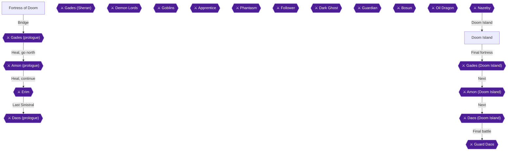

### Area Overview & Preparation

The finale takes place on Doom Island, inside the Fortress of Doom. You fight Gades, Amon and Daos in turn, then Guard Daos, the final boss [[gf2-64-5, gf2-64-17]]. Finish every other achievement first. Beating Daos locks you in, and defeating Guard Daos earns **One-Hundred Years**, the last achievement of the set [[gf-boss-4-6, gf-boss-4-16]].

- **Level:** The recommended level for Doom Island is 48 [[gf1-88-1]]. A commenter says a casual playthrough is already at the right level [[ra-comments-36-2]].
- **Hero's weapon:** Hydras on Doom Island drop the Might Sword, which a guide calls the best sword for both fighters [[gf4-17-54]]. Equip it on the Hero (and Aguro) if you have it. Otherwise use your strongest sword.
- **Jerin's bow:** Equip Jerin with her original Elven Bow before facing Daos. It does little damage to your own party. If you sold it, you can get it back at the Isle of Forfeit [[gf-boss-4-13]].
- **Lufia's gear:** Lufia rejoins for the last fight, and you cannot change her equipment beforehand [[gf-boss-4-14]]. Hopefully she is still wearing the Flash Ring from Glasdar Tower, which makes her Thunder far stronger [[gf-boss-3-8, gf-boss-4-15]].
- **Shrieks:** Bring Shrieks to cure confusion on a single character [[gf-boss-4-5, gf1-90-4]].
- **Chests:** The fortress has 12 chests holding 2 Power Potions, 1 Speed Potion, 1 Mind Potion, 1 Great Potion, 2 Spell Potions and 5 Miracles [[gf2-3-7, gf2-3-8, gf2-3-9, gf2-3-10, gf4-20-4, gf4-20-5, gf4-20-6, gf4-20-7, gf4-20-8, gf4-20-9, ra-comments-51-27]].
- **Layout:** The fortress layout is the same as in the prologue [[gf1-88-1]].

### Chapter Items to Collect (12 Items Total)

| Item | Where Found | Action / Requirement | Citation |
|---|---|---|---|
| Power Potion | Room through the west door at the start | **TAKE** | [[gf-treasure-11-38, gf2-64-9]] |
| Speed Potion | Three-chest room, left chest | **TAKE** | [[gf-treasure-11-39, gf2-64-7]] |
| Mind Potion | Three-chest room, middle chest | **TAKE** | [[gf-treasure-11-40, gf2-64-7]] |
| Great Potion | Three-chest room, right chest | **TAKE** | [[gf-treasure-11-41, gf2-64-7]] |
| Spell Potion | Room up the stairs to the east of the three-chest room | **TAKE** | [[gf-treasure-11-44, gf2-64-10]] |
| Power Potion | Room through the east door after the next staircase | **TAKE** | [[gf-treasure-11-38, gf2-64-9]] |
| Spell Potion | Room through the west door after the far-east door | **TAKE** | [[gf-treasure-11-44, gf2-64-10]] |
| Miracle x2 | Two chests around the north side before the first steps | **TAKE** | [[gf-treasure-11-49, gf2-64-13]] |
| Miracle x3 | Three chests around the room before the glass bridge | **TAKE** | [[gf-treasure-11-49, gf2-64-13]] |

### Doom Island

🗺️ **Map:** [View Doom Island Map by FlyingArmor](https://www.vgmaps.com/Atlas/SuperNES/Lufia&TheFortressOfDoom-DoomIsland.png)

🗺️ **Map:** [View Doom Island Shrine Map by FlyingArmor](https://www.vgmaps.com/Atlas/SuperNES/Lufia&TheFortressOfDoom-DoomIslandShrine.png)

1. Warp to Arus and fly northwest into Doom Island. Land on the circle [[gf2-64-5]].
2. Enter the door to the north and then the next door [[gf2-64-5]].
3. Walk north and speak to the old man. He heals you for free and lets you save [[gf2-64-5, gf3-29-11]].
4. Enter the door to the north, continue north, climb the steps and enter the Fortress [[gf2-64-5]].

Enemies on the island include Act Demon, Act Dragon, Act Hydra, Electromaz, Fire Wave, Gold Golem, Green Core, Mega Atlas, Waterspout and Whirlwind [[gf1-88-1, gf2-64-4]]. Hydras drop the Might Sword, so kill a few if you still lack one [[gf4-17-54]].

### Fortress of Doom

🗺️ **Map:** [View Fortress Of Doom Map by FlyingArmor](https://www.vgmaps.com/Atlas/SuperNES/Lufia&TheFortressOfDoom-FortressOfDoom.png)

🗺️ **Map:** [View Fortress Of Doom Ruins Map by FlyingArmor](https://www.vgmaps.com/Atlas/SuperNES/Lufia&TheFortressOfDoom-FortressOfDoomRuins.png)

#### Entrance and the first chests

1. Enter the door to the west and open the chest for a **Power Potion** (✅ Chest 1/12) [[gf-treasure-11-38, gf2-64-9]].
2. Follow the path and enter the door to find three chests: left **Speed Potion** (✅ 2/12), middle **Mind Potion** (✅ 3/12), right **Great Potion** (✅ 4/12) [[gf-treasure-11-39, gf-treasure-11-40, gf-treasure-11-41, gf2-64-7]].
3. Walk around to the east and go up the stairs. Open the chest for a **Spell Potion** (✅ 5/12), then go through the door [[gf-treasure-11-44, gf2-64-10]].

#### Second floor rooms

1. Head north and take the stairs up. Enter the door to the east and open the chest for a **Power Potion** (✅ 6/12) [[gf-treasure-11-38, gf2-64-9]].
2. Enter the door to the north. Walk east and enter the door when you reach the end [[gf2-64-10]].
3. Enter the door to the west and open the chest for a **Spell Potion** (✅ 7/12) [[gf-treasure-11-44, gf2-64-10]].
4. Go up the stairs to the south [[gf2-64-10]].

#### Platforms and recovery panels

1. Do not go up the steps yet. First walk around to the north and open the two chests for two **Miracles** (✅ 8/12 and 9/12) [[gf-treasure-11-49, gf2-64-13]].
2. Go up the first steps. If you want, walk around and take the steps on that level to reach floor panels that restore HP and MP [[gf2-64-12]].
3. Go up the second set of steps [[gf2-64-13]].

#### Glass bridge room

1. Walk north and go up the flight of stairs. Enter the door but do not cross the bridge yet [[gf2-64-13]].
2. Walk around the room and open the three chests for three **Miracles** (✅ 10/12, 11/12 and 12/12) [[gf-treasure-11-49, gf2-64-13]]. That empties all 12 chests [[gf2-3-7, ra-comments-51-27]].
3. Cross the bridge and step on the warp pad. Cross another bridge and keep walking north until dialogue triggers [[gf2-64-13, gf2-3-26, gf2-3-27]].

> [!TIP]
> Heal fully after the dialogue, because walking forward again starts the battle with Gades [[gf2-3-29, gf2-64-14]].

### Gades (Doom Island)

Gades has 4200 HP and is weak to Thunder [[gf1-89-1]]. He uses only physical-type attacks against one character at a time: a normal attack, Destroy (a stronger version of it, roughly 200-300 damage), or Undead, which raises his attack power [[gf-boss-4-1, gf2-3-31, gf3-29-19, gf3-29-20]].

- Keep everyone's HP above 300 so Destroy cannot kill anyone. Jerin's Champion is good for healing [[gf1-89-1, gf4-20-10]].
- When he uses Undead, have the Hero cast Courage to raise defense [[gf-boss-4-2, gf4-20-10]].
- Hero and Aguro attack. Jerin casts Trick on them, heals with Champion or Valor, or revives with Rally if someone falls [[gf-boss-4-3, gf2-64-14]].
- Restore HP, and MP if needed, after the fight [[gf-boss-4-3]].

### Amon (Doom Island)

Walking further triggers the Amon fight [[gf2-64-14]]. He has 4000 HP and is weak to Fire, but the guide advises not relying on that [[gf1-89-3, gf1-89-4]]. He casts Sunder (about 100 damage to the whole party) and Chaos (confusion). Mirror blocks both [[gf-boss-4-4, gf3-29-21]].

- Jerin casts Mirror every round on each character in a cycle, even on those who still have it, so no spell gets through [[gf1-89-4, gf4-20-10]].
- The Hero casts Drain first and then attacks with Aguro every round [[gf1-89-4]].
- If someone is confused, use a Shriek on that character. If Jerin needs to keep casting Mirror, the Hero can heal with Valor [[gf-boss-4-5, gf-boss-4-4]].
- If someone loses Mirror and gets hit, the Hero can heal them with Champion [[gf4-20-10]].

> [!TIP]
> After beating Amon you can still walk away from the fortress to save, but not after beating Daos [[gf-boss-4-6]]. Heal everyone after Amon [[gf2-64-15]].

### Daos (Doom Island)

Daos has 4200 HP (another guide says around 4400) and no elemental weakness [[gf1-90-1, gf-boss-4-9, gf1-5-1]]. He casts party-wide spells such as Flood, Glacier and Thunder, plus Dread and Amnesia, which paralyzes. Mirror reflects them [[gf-boss-4-7, gf2-3-40, gf3-29-22]]. When he is low on HP he casts Stronger to heal, which costs him a turn [[gf-boss-4-8]].

Use exactly the same strategy as against Amon [[gf4-20-12]]. Jerin cycles Mirror while Hero and Aguro attack. Be ready to cure paralysis [[gf2-64-14, gf4-20-12]]. Defeating him gives 65000 XP and 0 GP [[gf4-26-13]].

> [!CAUTION]
> **Point of No Return:** After Daos you cannot leave the fortress or heal before Guard Daos, the final boss [[gf-boss-4-6, gf-boss-4-10]]. Before you finish Daos, make sure the party has high HP and MP, and use Miracles on everyone if needed [[gf-boss-4-10, gf1-90-4]]. Have Jerin's Elven Bow equipped [[gf-boss-4-13]].

### Guard Daos

After Daos you go directly into the final battle. Lufia joins you, and you cannot change her equipment [[gf2-64-17, gf-boss-4-14]].

Guard Daos has 6500 HP and is weak to Thunder [[gf1-90-3]]. Each turn he casts either Flood or Figual. Figual hits the whole party and either misses or confuses. Mirror blocks both [[gf-boss-4-11, gf-boss-4-12]]. A commenter says the confuse attack is deflected by casting Mirror on the entire party [[ra-comments-36-1]].

- **Jerin:** She casts Mirror on herself first, since a confused Jerin cannot cast it on others. Then she casts it on everyone else, even confused characters [[gf-boss-4-12, gf1-90-4, gf4-20-10]].
- **Lufia:** She casts Thunder, up to 500 damage with the Flash Ring. Aguro and the Hero attack [[gf-boss-4-15, gf1-90-4]].
- **Confusion:** For one confused character, use a Shriek. If many are confused and HP is fine, have Jerin attack the party with her Elven Bow to cure them all at once [[gf-boss-4-13, gf1-90-4]].
- **Healing:** Use Miracles if needed. They also revive [[gf4-20-10]].
- **Alternative:** Another guide has Lufia and Jerin casting Boost while Hero and Aguro attack [[gf2-64-17]].

Keep this up until about 6600 damage has been dealt. Then Guard Daos falls and the game is beaten [[gf-boss-4-16]].


> [!ACHIEVEMENT]
> **One-Hundred Years (50 Points)**
> 
> *End Daos' reign of terror and bring back peace to the world*


> [!IMPORTANT]
> ### Chapter 18 Cumulative 100% Checkpoint
> - **Treasure Chests:** 637 / 637 [[ra-comments-51-27]]
> - **Dragon Eggs:** 24 / 24
> - **RetroAchievements Unlocked:** 47 / 47 (343 / 343 points)

### Chapter Checklist

- [ ] Landed on Doom Island, healed and saved with the old man
- [ ] Equipped the Might Sword if available, and Jerin's Elven Bow
- [ ] Opened all 12 chests (2 Power Potions, Speed, Mind, Great, 2 Spell Potions, 5 Miracles)
- [ ] Beat Gades (Courage against Undead)
- [ ] Beat Amon (Mirror cycle)
- [ ] Healed fully before finishing Daos
- [ ] Beat Daos
- [ ] Beat Guard Daos and unlocked **One-Hundred Years**

---

## Final Checklist

**1. Prologue: The Fortress of Doom**

- [ ] 🏆 First Encounter
- [ ] 🏆 And So It Begins...

**2. Alekia, Chatam and the Fall of Sheran**

- [ ] 🏆 Better Than a Knife
- [ ] 🏆 Imminent Defeat
- [ ] 🏆 Lufia
- [ ] 🏆 Sheran Rescue

**3. Treck, Aguro and the Goblin Pirates**

- [ ] 🏆 Level 5!
- [ ] 🏆 Aguro
- [ ] 🏆 Demon Horde
- [ ] 🏆 Goblin Horde

**4. Grenoble, the Old Cave and Artea's Apprentice**

- [ ] 🏆 Fairy Kiss
- [ ] 🏆 Artea's Apprentice

**5. Kirof, Medan and the Phantasm**

- [ ] 🏆 The Exorcist

**6. Belgen, Dais and the Rescue of Jerin**

- [ ] 🏆 Amon's Follower
- [ ] 🏆 Jerin

**7. Lost Forest, the Three Towers and Elfrea**

- [ ] 🏆 Who You Gonna Call?
- [ ] 🏆 The Elven Village
- [ ] 🏆 Treasure Seeker

**8. Ranqs, Odel and Piron's Bridge**

- [ ] 🏆 Building Bridges
- [ ] 🏆 Level 25!

**9. Tower of Grief, the Falcon and Forfeit**

- [ ] 🏆 All Aboard!
- [ ] 🏆 The Black Market

**10. Tower of Light, Bakku and the Old Cave's Last Floor**

- [ ] ⚠ Might Helmet on the Tower of Light roof (before: Before entering Bakku for the first time (chapter 10). Go to the Tower of Light straight after Carbis/Forfeit.)
- [ ] 🏆 Mighty Intelligence
- [ ] 🏆 Escape Artist
- [ ] 🏆 World's Greatest
- [ ] 🏆 Guardian
- [ ] ⛔ Everything above is done before: Visiting Bakku

**11. Linze, the Alumina Hunt and Brant**

- [ ] 🏆 Holes, Holes, and a Brant

**12. Herat, the Purple Newt and Aisen Tower**

- [ ] 🏆 We're Off to See the Wizard... Of Taste!
- [ ] 🏆 Riddle Me This...
- [ ] 🏆 For Freedom!
- [ ] 🏆 Treasure Hunter

**13. Under the Sea: Soshette and the Dual Blade**

- [ ] 🏆 Under the Sea, Under the Sea
- [ ] 🏆 Sin Slayer

**14. Epro, the Oil Dragon and the Might Farm**

- [ ] 🏆 Power the Falcon
- [ ] 🏆 Soaring the Skies
- [ ] 🏆 Stronger Than the Sword of Legends
- [ ] 🏆 Armor of Might
- [ ] 🏆 Level 50!
- [ ] 🏆 Heavy Pockets

**15. The First Dragon Wish and the Second Egg Hunt**

- [ ] 🏆 Dragon's Wish
- [ ] 🏆 Elven Warfare

**16. Glasdar: the Key, the Cave and Nazeby**

- [ ] 🏆 The Glasdar Key
- [ ] 🏆 The Agent of Daos
- [ ] ⛔ Everything above is done before: Defeating Nazeby

**17. The Last Two Wishes and the Might Set**

- [ ] 🏆 A Hero's Mightiest Shield
- [ ] 🏆 I Feel Like Having Dragon Eggs for Breakfast
- [ ] 🏆 Item Burden

**18. Doom Island: One Hundred Years Later**

- [ ] 🏆 One-Hundred Years
- [ ] ⛔ Everything above is done before: Defeating Daos on Doom Island

## 100% Completion Verification Checklist

All 47 achievements (343 points).

| ✔ | Achievement | Points | Type | Chapter |
|---|---|---|---|---|
| ☐ | **First Encounter** — Defeat your first enemy | 1 |  | [1](#chapter-1-prologue-the-fortress-of-doom) |
| ☐ | **And So It Begins...** — Complete the Prologue | 2 | progression | [1](#chapter-1-prologue-the-fortress-of-doom) |
| ☐ | **Lufia** — Recruit a childhood friend | 2 | progression | [2](#chapter-2-alekia-chatam-and-the-fall-of-sheran) |
| ☐ | **Sheran Rescue** — Free the King, Lilah, and... the other one | 2 | progression | [2](#chapter-2-alekia-chatam-and-the-fall-of-sheran) |
| ☐ | **Imminent Defeat** — The young hero was defeated in Sheran | 1 | progression | [2](#chapter-2-alekia-chatam-and-the-fall-of-sheran) |
| ☐ | **Aguro** — Team up with a fellow swordsman | 2 | progression | [3](#chapter-3-treck-aguro-and-the-goblin-pirates) |
| ☐ | **Demon Horde** — Defeat the pirate 'Demon Lords' | 5 | progression | [3](#chapter-3-treck-aguro-and-the-goblin-pirates) |
| ☐ | **Goblin Horde** — Survive the ambush of the Goblin Pirates | 5 | progression | [3](#chapter-3-treck-aguro-and-the-goblin-pirates) |
| ☐ | **Fairy Kiss** — Deliver a special treasure to an old man | 2 | progression | [4](#chapter-4-grenoble-the-old-cave-and-arteas-apprentice) |
| ☐ | **Artea's Apprentice** — Defeat the Apprentice and discover Artea's location | 10 | progression | [4](#chapter-4-grenoble-the-old-cave-and-arteas-apprentice) |
| ☐ | **The Exorcist** — Rescue Reyna from the clutches of the Phantasm | 10 | progression | [5](#chapter-5-kirof-medan-and-the-phantasm) |
| ☐ | **Amon's Follower** — Rescue Jerin from Amon's Follower | 10 | progression | [6](#chapter-6-belgen-dais-and-the-rescue-of-jerin) |
| ☐ | **Jerin** — Recruit the reliable Half-Elf | 2 | progression | [6](#chapter-6-belgen-dais-and-the-rescue-of-jerin) |
| ☐ | **Who You Gonna Call?** — Defeat the Dark Ghost and save the Water Fairy | 10 | progression | [7](#chapter-7-lost-forest-the-three-towers-and-elfrea) |
| ☐ | **The Elven Village** — Conquer the Red, Blue, and Green Tower and find your way into Elfrea | 2 | progression | [7](#chapter-7-lost-forest-the-three-towers-and-elfrea) |
| ☐ | **Building Bridges** — Help the lazy Piron repair the bridge in Arus Cave | 3 | progression | [8](#chapter-8-ranqs-odel-and-pirons-bridge) |
| ☐ | **All Aboard!** — Obtain the Falcon | 2 | progression | [9](#chapter-9-tower-of-grief-the-falcon-and-forfeit) |
| ☐ | **Mighty Intelligence** — Find the Might Helmet in the Tower of Light | 5 | missable | [10](#chapter-10-tower-of-light-bakku-and-the-old-caves-last-floor) |
| ☐ | **Escape Artist** — Cooper is always prepared! | 2 | progression | [10](#chapter-10-tower-of-light-bakku-and-the-old-caves-last-floor) |
| ☐ | **World's Greatest** — Find the Crown Jewels and conquer the last floor of the Old Cave | 10 |  | [10](#chapter-10-tower-of-light-bakku-and-the-old-caves-last-floor) |
| ☐ | **Guardian** — Defeat the Guardian and obtain the Light Key | 10 | progression | [10](#chapter-10-tower-of-light-bakku-and-the-old-caves-last-floor) |
| ☐ | **Holes, Holes, and a Brant** — Keep falling down and find your way to Brant. Help the poor guy out! | 3 | progression | [11](#chapter-11-linze-the-alumina-hunt-and-brant) |
| ☐ | **We're Off to See the Wizard... Of Taste!** — Find the Purple Newt | 3 | progression | [12](#chapter-12-herat-the-purple-newt-and-aisen-tower) |
| ☐ | **Riddle Me This...** — Solve the button puzzle in Aisen Tower | 1 | progression | [12](#chapter-12-herat-the-purple-newt-and-aisen-tower) |
| ☐ | **For Freedom!** — Defeat Bosun and rescue Lou | 10 | progression | [12](#chapter-12-herat-the-purple-newt-and-aisen-tower) |
| ☐ | **Under the Sea, Under the Sea** — Darling it's better, down where it's wetter, take it from me | 1 | progression | [13](#chapter-13-under-the-sea-soshette-and-the-dual-blade) |
| ☐ | **Sin Slayer** — Acquire the Dual Blade | 5 | progression | [13](#chapter-13-under-the-sea-soshette-and-the-dual-blade) |
| ☐ | **Power the Falcon** — Defeat the Oil Dragon guarding the Power Oil | 10 | progression | [14](#chapter-14-epro-the-oil-dragon-and-the-might-farm) |
| ☐ | **Soaring the Skies** — Upgrade the Falcon with the ability to take flight | 2 | progression | [14](#chapter-14-epro-the-oil-dragon-and-the-might-farm) |
| ☐ | **The Glasdar Key** — Explore the Cave North of Glasdar and find the Glasdar Key | 3 | progression | [16](#chapter-16-glasdar-the-key-the-cave-and-nazeby) |
| ☐ | **The Agent of Daos** — Defeat Nazeby at the Glasdar Tower | 10 | progression | [16](#chapter-16-glasdar-the-key-the-cave-and-nazeby) |
| ☐ | **One-Hundred Years** — End Daos' reign of terror and bring back peace to the world | 50 | win_condition | [18](#chapter-18-doom-island-one-hundred-years-later) |
| ☐ | **I Feel Like Having Dragon Eggs for Breakfast** — Make 3 wishes with the Dragon | 25 |  | [17](#chapter-17-the-last-two-wishes-and-the-might-set) |
| ☐ | **Stronger Than the Sword of Legends** — Obtain a Might Sword | 5 |  | [14](#chapter-14-epro-the-oil-dragon-and-the-might-farm) |
| ☐ | **Elven Warfare** — Obtain the Might Bow | 5 |  | [15](#chapter-15-the-first-dragon-wish-and-the-second-egg-hunt) |
| ☐ | **A Hero's Mightiest Shield** — Obtain a Might Shield | 5 |  | [17](#chapter-17-the-last-two-wishes-and-the-might-set) |
| ☐ | **Armor of Might** — Obtain a Might Armor | 5 |  | [14](#chapter-14-epro-the-oil-dragon-and-the-might-farm) |
| ☐ | **The Black Market** — Found the hidden trade shop somewhere in Forfeit | 1 |  | [9](#chapter-9-tower-of-grief-the-falcon-and-forfeit) |
| ☐ | **Dragon's Wish** — Collect 8 Dragon Eggs and make a wish | 10 |  | [15](#chapter-15-the-first-dragon-wish-and-the-second-egg-hunt) |
| ☐ | **Heavy Pockets** — Have at least 200,000 Gold | 10 |  | [14](#chapter-14-epro-the-oil-dragon-and-the-might-farm) |
| ☐ | **Item Burden** — Occupy every item slot | 3 |  | [17](#chapter-17-the-last-two-wishes-and-the-might-set) |
| ☐ | **Better Than a Knife** — Equip the hero with a Dagger | 3 |  | [2](#chapter-2-alekia-chatam-and-the-fall-of-sheran) |
| ☐ | **Level 5!** — Reach Level 5 with your hero | 5 |  | [3](#chapter-3-treck-aguro-and-the-goblin-pirates) |
| ☐ | **Level 25!** — Reach Level 25 with your hero | 10 |  | [8](#chapter-8-ranqs-odel-and-pirons-bridge) |
| ☐ | **Level 50!** — Reach Level 50 with your hero | 25 |  | [14](#chapter-14-epro-the-oil-dragon-and-the-might-farm) |
| ☐ | **Treasure Seeker** — Open 250 Treasure Chests | 10 |  | [7](#chapter-7-lost-forest-the-three-towers-and-elfrea) |
| ☐ | **Treasure Hunter** — Open 500 Treasure Chests | 25 |  | [12](#chapter-12-herat-the-purple-newt-and-aisen-tower) |

## Sources

This guide was built only from these sources:

- **RetroAchievements** — Lufia & The Fortress of Doom — RetroAchievements community comments: [link](https://retroachievements.org/game/1004)
- **GameFAQs** — Guide and Walkthrough by Sleipnir2000: [link](https://gamefaqs.gamespot.com/snes/588452-lufia-and-the-fortress-of-doom/faqs/60795)
- **GameFAQs** — Guide and Walkthrough by Dinob0t: [link](https://gamefaqs.gamespot.com/snes/588452-lufia-and-the-fortress-of-doom/faqs/37003)
- **GameFAQs** — Guide and Walkthrough by Molokidan: [link](https://gamefaqs.gamespot.com/snes/588452-lufia-and-the-fortress-of-doom/faqs/15040)
- **GameFAQs** — Guide and Walkthrough by Leandreus: [link](https://gamefaqs.gamespot.com/snes/588452-lufia-and-the-fortress-of-doom/faqs/9480)
- **GameFAQs** — Treasure Guide by jvh147: [link](https://gamefaqs.gamespot.com/snes/588452-lufia-and-the-fortress-of-doom/faqs/54944)
- **GameFAQs** — Boss Guide by Blair: [link](https://gamefaqs.gamespot.com/snes/588452-lufia-and-the-fortress-of-doom/faqs/11491)
- **GameFAQs** — Shop FAQ by Dinob0t: [link](https://gamefaqs.gamespot.com/snes/588452-lufia-and-the-fortress-of-doom/faqs/36909)
- **VGMaps** — World Map by FlyingArmor: [link](https://www.vgmaps.com/Atlas/SuperNES/Lufia&TheFortressOfDoom-World.png)
- **VGMaps** — Alekia Map by FlyingArmor: [link](https://www.vgmaps.com/Atlas/SuperNES/Lufia&TheFortressOfDoom-Alekia.png)
- **VGMaps** — Alekia Castle Map by FlyingArmor: [link](https://www.vgmaps.com/Atlas/SuperNES/Lufia&TheFortressOfDoom-AlekiaCastle.png)
- **VGMaps** — Shrine West Of Alekia Map by FlyingArmor: [link](https://www.vgmaps.com/Atlas/SuperNES/Lufia&TheFortressOfDoom-ShrineWestOfAlekia.png)
- **VGMaps** — Chatam Map by FlyingArmor: [link](https://www.vgmaps.com/Atlas/SuperNES/Lufia&TheFortressOfDoom-Chatam.png)
- **VGMaps** — Cave To Sheran Map by FlyingArmor: [link](https://www.vgmaps.com/Atlas/SuperNES/Lufia&TheFortressOfDoom-CaveToSheran.png)
- **VGMaps** — Sheran Map by FlyingArmor: [link](https://www.vgmaps.com/Atlas/SuperNES/Lufia&TheFortressOfDoom-Sheran.png)
- **VGMaps** — Sheran Castle Map by FlyingArmor: [link](https://www.vgmaps.com/Atlas/SuperNES/Lufia&TheFortressOfDoom-SheranCastle.png)
- **VGMaps** — Treck Map by FlyingArmor: [link](https://www.vgmaps.com/Atlas/SuperNES/Lufia&TheFortressOfDoom-Treck.png)
- **VGMaps** — Cave To Guy's House Map by FlyingArmor: [link](https://www.vgmaps.com/Atlas/SuperNES/Lufia&TheFortressOfDoom-CaveToGuy'sHouse.png)
- **VGMaps** — Guy's House Map by FlyingArmor: [link](https://www.vgmaps.com/Atlas/SuperNES/Lufia&TheFortressOfDoom-Guy'sHouse.png)
- **VGMaps** — Cave North Of Treck Map by FlyingArmor: [link](https://www.vgmaps.com/Atlas/SuperNES/Lufia&TheFortressOfDoom-CaveNorthOfTreck.png)
- **VGMaps** — Lorbenia Map by FlyingArmor: [link](https://www.vgmaps.com/Atlas/SuperNES/Lufia&TheFortressOfDoom-Lorbenia.png)
- **VGMaps** — Grenoble Map by FlyingArmor: [link](https://www.vgmaps.com/Atlas/SuperNES/Lufia&TheFortressOfDoom-Grenoble.png)
- **VGMaps** — Old Cave 1st Level Map by FlyingArmor: [link](https://www.vgmaps.com/Atlas/SuperNES/Lufia&TheFortressOfDoom-OldCave-1stLevel.png)
- **VGMaps** — Old Cave 2nd Level Map by FlyingArmor: [link](https://www.vgmaps.com/Atlas/SuperNES/Lufia&TheFortressOfDoom-OldCave-2ndLevel.png)
- **VGMaps** — Old Cave 3rd Level Map by FlyingArmor: [link](https://www.vgmaps.com/Atlas/SuperNES/Lufia&TheFortressOfDoom-OldCave-3rdLevel.png)
- **VGMaps** — Old Cave 4th Level Map by FlyingArmor: [link](https://www.vgmaps.com/Atlas/SuperNES/Lufia&TheFortressOfDoom-OldCave-4thLevel.png)
- **VGMaps** — Old Cave 5th Level Map by FlyingArmor: [link](https://www.vgmaps.com/Atlas/SuperNES/Lufia&TheFortressOfDoom-OldCave-5thLevel.png)
- **VGMaps** — Old Cave 6th Level Map by FlyingArmor: [link](https://www.vgmaps.com/Atlas/SuperNES/Lufia&TheFortressOfDoom-OldCave-6thLevel.png)
- **VGMaps** — Old Cave 7th Level Map by FlyingArmor: [link](https://www.vgmaps.com/Atlas/SuperNES/Lufia&TheFortressOfDoom-OldCave-7thLevel.png)
- **VGMaps** — Northwest Tower Map by FlyingArmor: [link](https://www.vgmaps.com/Atlas/SuperNES/Lufia&TheFortressOfDoom-NorthwestTower.png)
- **VGMaps** — Shrine North Of Kirof Map by FlyingArmor: [link](https://www.vgmaps.com/Atlas/SuperNES/Lufia&TheFortressOfDoom-ShrineNorthOfKirof.png)
- **VGMaps** — Kirof Map by FlyingArmor: [link](https://www.vgmaps.com/Atlas/SuperNES/Lufia&TheFortressOfDoom-Kirof.png)
- **VGMaps** — Medan Map by FlyingArmor: [link](https://www.vgmaps.com/Atlas/SuperNES/Lufia&TheFortressOfDoom-Medan.png)
- **VGMaps** — Medan Castle Map by FlyingArmor: [link](https://www.vgmaps.com/Atlas/SuperNES/Lufia&TheFortressOfDoom-MedanCastle.png)
- **VGMaps** — Ghost Cave Map by FlyingArmor: [link](https://www.vgmaps.com/Atlas/SuperNES/Lufia&TheFortressOfDoom-GhostCave.png)
- **VGMaps** — Medan Mine Map by FlyingArmor: [link](https://www.vgmaps.com/Atlas/SuperNES/Lufia&TheFortressOfDoom-MedanMine.png)
- **VGMaps** — Cave To Belgen Map by FlyingArmor: [link](https://www.vgmaps.com/Atlas/SuperNES/Lufia&TheFortressOfDoom-CaveToBelgen.png)
- **VGMaps** — Belgen Map by FlyingArmor: [link](https://www.vgmaps.com/Atlas/SuperNES/Lufia&TheFortressOfDoom-Belgen.png)
- **VGMaps** — Cave Southwest Of Belgen Map by FlyingArmor: [link](https://www.vgmaps.com/Atlas/SuperNES/Lufia&TheFortressOfDoom-CaveSouthwestOfBelgen.png)
- **VGMaps** — Cave To Dais Map by FlyingArmor: [link](https://www.vgmaps.com/Atlas/SuperNES/Lufia&TheFortressOfDoom-CaveToDais.png)
- **VGMaps** — Dais Map by FlyingArmor: [link](https://www.vgmaps.com/Atlas/SuperNES/Lufia&TheFortressOfDoom-Dais.png)
- **VGMaps** — North Tower Map by FlyingArmor: [link](https://www.vgmaps.com/Atlas/SuperNES/Lufia&TheFortressOfDoom-NorthTower.png)
- **VGMaps** — Surinagal Map by FlyingArmor: [link](https://www.vgmaps.com/Atlas/SuperNES/Lufia&TheFortressOfDoom-Surinagal.png)
- **VGMaps** — Lost Forest Northern Guide Map by FlyingArmor: [link](https://www.vgmaps.com/Atlas/SuperNES/Lufia&TheFortressOfDoom-LostForestNorthernGuide.png)
- **VGMaps** — Lost Forest Map by FlyingArmor: [link](https://www.vgmaps.com/Atlas/SuperNES/Lufia&TheFortressOfDoom-LostForest.png)
- **VGMaps** — Lost Forest Southern Guide Map by FlyingArmor: [link](https://www.vgmaps.com/Atlas/SuperNES/Lufia&TheFortressOfDoom-LostForestSouthernGuide.png)
- **VGMaps** — Tunnel To Jenoba Map by FlyingArmor: [link](https://www.vgmaps.com/Atlas/SuperNES/Lufia&TheFortressOfDoom-TunnelToJenoba.png)
- **VGMaps** — Jenoba Map by FlyingArmor: [link](https://www.vgmaps.com/Atlas/SuperNES/Lufia&TheFortressOfDoom-Jenoba.png)
- **VGMaps** — Blue Tower Map by FlyingArmor: [link](https://www.vgmaps.com/Atlas/SuperNES/Lufia&TheFortressOfDoom-BlueTower.png)
- **VGMaps** — Green Tower Map by FlyingArmor: [link](https://www.vgmaps.com/Atlas/SuperNES/Lufia&TheFortressOfDoom-GreenTower.png)
- **VGMaps** — Ruan Map by FlyingArmor: [link](https://www.vgmaps.com/Atlas/SuperNES/Lufia&TheFortressOfDoom-Ruan.png)
- **VGMaps** — Red Tower Map by FlyingArmor: [link](https://www.vgmaps.com/Atlas/SuperNES/Lufia&TheFortressOfDoom-RedTower.png)
- **VGMaps** — Elfrea Map by FlyingArmor: [link](https://www.vgmaps.com/Atlas/SuperNES/Lufia&TheFortressOfDoom-Elfrea.png)
- **VGMaps** — Shrine Southwest Of Green Tower Map by FlyingArmor: [link](https://www.vgmaps.com/Atlas/SuperNES/Lufia&TheFortressOfDoom-ShrineSouthwestOfGreenTower.png)
- **VGMaps** — Shrine Northwest Of Ranqs Map by FlyingArmor: [link](https://www.vgmaps.com/Atlas/SuperNES/Lufia&TheFortressOfDoom-ShrineNorthwestOfRanqs.png)
- **VGMaps** — Ranqs Map by FlyingArmor: [link](https://www.vgmaps.com/Atlas/SuperNES/Lufia&TheFortressOfDoom-Ranqs.png)
- **VGMaps** — Cave East Of Ranqs Map by FlyingArmor: [link](https://www.vgmaps.com/Atlas/SuperNES/Lufia&TheFortressOfDoom-CaveEastOfRanqs.png)
- **VGMaps** — Cave To Odel Map by FlyingArmor: [link](https://www.vgmaps.com/Atlas/SuperNES/Lufia&TheFortressOfDoom-CaveToOdel.png)
- **VGMaps** — Odel Map by FlyingArmor: [link](https://www.vgmaps.com/Atlas/SuperNES/Lufia&TheFortressOfDoom-Odel.png)
- **VGMaps** — Odel Castle Map by FlyingArmor: [link](https://www.vgmaps.com/Atlas/SuperNES/Lufia&TheFortressOfDoom-OdelCastle.png)
- **VGMaps** — Lyden Map by FlyingArmor: [link](https://www.vgmaps.com/Atlas/SuperNES/Lufia&TheFortressOfDoom-Lyden.png)
- **VGMaps** — Arus Cave Map by FlyingArmor: [link](https://www.vgmaps.com/Atlas/SuperNES/Lufia&TheFortressOfDoom-ArusCave.png)
- **VGMaps** — Arus Map by FlyingArmor: [link](https://www.vgmaps.com/Atlas/SuperNES/Lufia&TheFortressOfDoom-Arus.png)
- **VGMaps** — Cave To Tower Of Grief Map by FlyingArmor: [link](https://www.vgmaps.com/Atlas/SuperNES/Lufia&TheFortressOfDoom-CaveToTowerOfGrief.png)
- **VGMaps** — Tower Of Grief Map by FlyingArmor: [link](https://www.vgmaps.com/Atlas/SuperNES/Lufia&TheFortressOfDoom-TowerOfGrief.png)
- **VGMaps** — Platina Map by FlyingArmor: [link](https://www.vgmaps.com/Atlas/SuperNES/Lufia&TheFortressOfDoom-Platina.png)
- **VGMaps** — Forfeit Map by FlyingArmor: [link](https://www.vgmaps.com/Atlas/SuperNES/Lufia&TheFortressOfDoom-Forfeit.png)
- **VGMaps** — Carbis Map by FlyingArmor: [link](https://www.vgmaps.com/Atlas/SuperNES/Lufia&TheFortressOfDoom-Carbis.png)
- **VGMaps** — Bakku Map by FlyingArmor: [link](https://www.vgmaps.com/Atlas/SuperNES/Lufia&TheFortressOfDoom-Bakku.png)
- **VGMaps** — Tower Of Light Map by FlyingArmor: [link](https://www.vgmaps.com/Atlas/SuperNES/Lufia&TheFortressOfDoom-TowerOfLight.png)
- **VGMaps** — Shrine South Of Linze Map by FlyingArmor: [link](https://www.vgmaps.com/Atlas/SuperNES/Lufia&TheFortressOfDoom-ShrineSouthOfLinze.png)
- **VGMaps** — Linze Map by FlyingArmor: [link](https://www.vgmaps.com/Atlas/SuperNES/Lufia&TheFortressOfDoom-Linze.png)
- **VGMaps** — Gayas Island Cave Map by FlyingArmor: [link](https://www.vgmaps.com/Atlas/SuperNES/Lufia&TheFortressOfDoom-GayasIslandCave.png)
- **VGMaps** — Cave To Marse Map by FlyingArmor: [link](https://www.vgmaps.com/Atlas/SuperNES/Lufia&TheFortressOfDoom-CaveToMarse.png)
- **VGMaps** — Marse Map by FlyingArmor: [link](https://www.vgmaps.com/Atlas/SuperNES/Lufia&TheFortressOfDoom-Marse.png)
- **VGMaps** — Loire Island Cave Map by FlyingArmor: [link](https://www.vgmaps.com/Atlas/SuperNES/Lufia&TheFortressOfDoom-LoireIslandCave.png)
- **VGMaps** — Elba Island Cave Map by FlyingArmor: [link](https://www.vgmaps.com/Atlas/SuperNES/Lufia&TheFortressOfDoom-ElbaIslandCave.png)
- **VGMaps** — Ulupp Island Cave Map by FlyingArmor: [link](https://www.vgmaps.com/Atlas/SuperNES/Lufia&TheFortressOfDoom-UluppIslandCave.png)
- **VGMaps** — Herat Map by FlyingArmor: [link](https://www.vgmaps.com/Atlas/SuperNES/Lufia&TheFortressOfDoom-Herat.png)
- **VGMaps** — Herat Castle Map by FlyingArmor: [link](https://www.vgmaps.com/Atlas/SuperNES/Lufia&TheFortressOfDoom-HeratCastle.png)
- **VGMaps** — Dragon Shrine Map by FlyingArmor: [link](https://www.vgmaps.com/Atlas/SuperNES/Lufia&TheFortressOfDoom-DragonShrine.png)
- **VGMaps** — Purple Newt Cave Map by FlyingArmor: [link](https://www.vgmaps.com/Atlas/SuperNES/Lufia&TheFortressOfDoom-PurpleNewtCave.png)
- **VGMaps** — Aisen Tower Map by FlyingArmor: [link](https://www.vgmaps.com/Atlas/SuperNES/Lufia&TheFortressOfDoom-AisenTower.png)
- **VGMaps** — Soshette Map by FlyingArmor: [link](https://www.vgmaps.com/Atlas/SuperNES/Lufia&TheFortressOfDoom-Soshette.png)
- **VGMaps** — Ring Island Underwater Cave Map by FlyingArmor: [link](https://www.vgmaps.com/Atlas/SuperNES/Lufia&TheFortressOfDoom-RingIslandUnderwaterCave.png)
- **VGMaps** — North&Southeast Cave To Fortress Map by FlyingArmor: [link](https://www.vgmaps.com/Atlas/SuperNES/Lufia&TheFortressOfDoom-North&SoutheastCaveToFortress.png)
- **VGMaps** — Southwest Cave To Fortress Map by FlyingArmor: [link](https://www.vgmaps.com/Atlas/SuperNES/Lufia&TheFortressOfDoom-SouthwestCaveToFortress.png)
- **VGMaps** — Fortress Of Doom Ruins Map by FlyingArmor: [link](https://www.vgmaps.com/Atlas/SuperNES/Lufia&TheFortressOfDoom-FortressOfDoomRuins.png)
- **VGMaps** — Epro Map by FlyingArmor: [link](https://www.vgmaps.com/Atlas/SuperNES/Lufia&TheFortressOfDoom-Epro.png)
- **VGMaps** — East Lagoon Map by FlyingArmor: [link](https://www.vgmaps.com/Atlas/SuperNES/Lufia&TheFortressOfDoom-EastLagoon.png)
- **VGMaps** — Underwater Cave To Oil Cave Map by FlyingArmor: [link](https://www.vgmaps.com/Atlas/SuperNES/Lufia&TheFortressOfDoom-UnderwaterCaveToOilCave.png)
- **VGMaps** — Oil Cave Map by FlyingArmor: [link](https://www.vgmaps.com/Atlas/SuperNES/Lufia&TheFortressOfDoom-OilCave.png)
- **VGMaps** — Frederia Map by FlyingArmor: [link](https://www.vgmaps.com/Atlas/SuperNES/Lufia&TheFortressOfDoom-Frederia.png)
- **VGMaps** — Arubus Map by FlyingArmor: [link](https://www.vgmaps.com/Atlas/SuperNES/Lufia&TheFortressOfDoom-Arubus.png)
- **VGMaps** — Cave North Of Glasdar Tower Map by FlyingArmor: [link](https://www.vgmaps.com/Atlas/SuperNES/Lufia&TheFortressOfDoom-CaveNorthOfGlasdarTower.png)
- **VGMaps** — Cave To Glasdar Tower Map by FlyingArmor: [link](https://www.vgmaps.com/Atlas/SuperNES/Lufia&TheFortressOfDoom-CaveToGlasdarTower.png)
- **VGMaps** — Glasdar Tower Map by FlyingArmor: [link](https://www.vgmaps.com/Atlas/SuperNES/Lufia&TheFortressOfDoom-GlasdarTower.png)
- **VGMaps** — Doom Island Map by FlyingArmor: [link](https://www.vgmaps.com/Atlas/SuperNES/Lufia&TheFortressOfDoom-DoomIsland.png)
- **VGMaps** — Doom Island Shrine Map by FlyingArmor: [link](https://www.vgmaps.com/Atlas/SuperNES/Lufia&TheFortressOfDoom-DoomIslandShrine.png)
- **VGMaps** — Fortress Of Doom Map by FlyingArmor: [link](https://www.vgmaps.com/Atlas/SuperNES/Lufia&TheFortressOfDoom-FortressOfDoom.png)
- **VGMaps** — Locations Of Second Set Of Dragon Eggs Map by FlyingArmor: [link](https://www.vgmaps.com/Atlas/SuperNES/Lufia&TheFortressOfDoom-LocationsOfSecondSetOfDragonEggs.png)
- **VGMaps** — Locations Of Third Set Of Dragon Eggs Map by FlyingArmor: [link](https://www.vgmaps.com/Atlas/SuperNES/Lufia&TheFortressOfDoom-LocationsOfThirdSetOfDragonEggs.png)

Verification: 912 verified · 3645 single-source · 0 resolved conflicts · 2 rejected facts.
