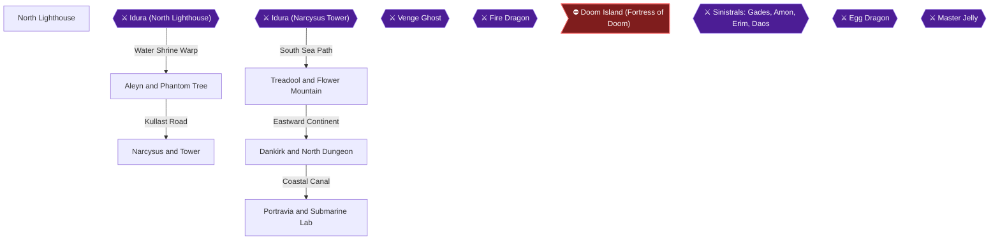
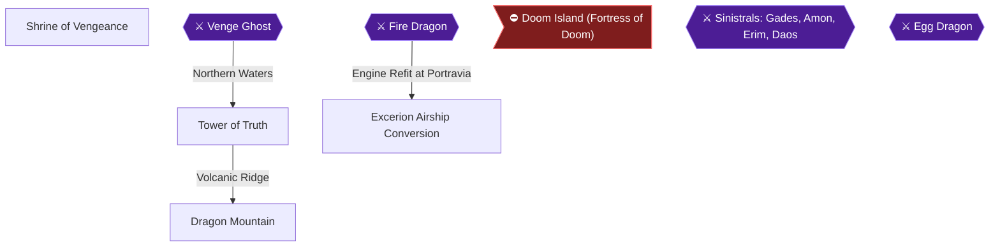
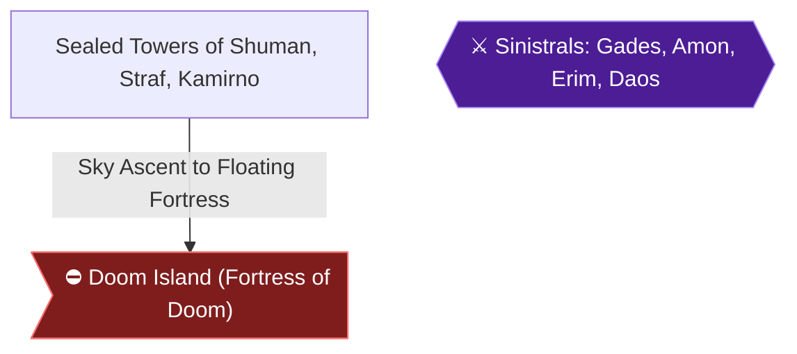
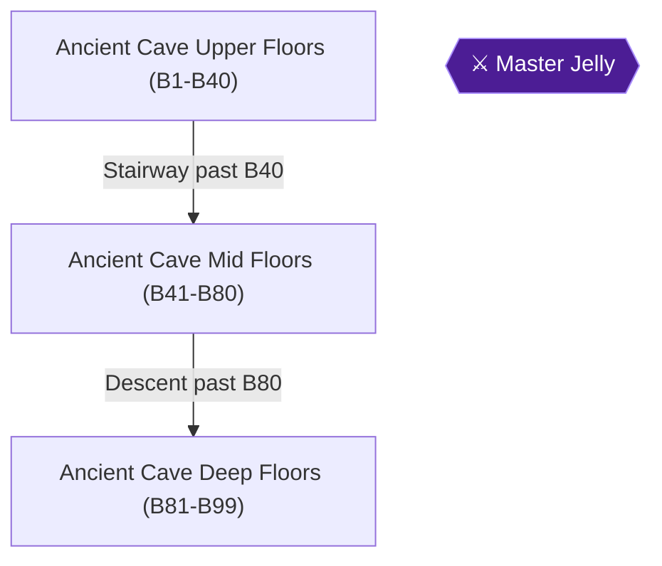

# Knowledge graph — game 1005

Nodes: 41 · Edges: 40

## Progression flow

```mermaid
flowchart TD
  Elcid["Elcid and Training Cave"]
  Sundletan["Sundletan and Lake Cave"]
  Big_Catfish{{"⚔ Big Catfish"}}
  Alunze_Kingdom["Alunze Kingdom and Castle Basement"]
  Regal_Goblin{{"⚔ Regal Goblin"}}
  Tanbel_Region["Tanbel and Southeast Tower"]
  Camu{{"⚔ Camu"}}
  Ruby_Cave["Ruby Cave and Clamento"]
  Tarantula{{"⚔ Tarantula"}}
  Treasure_Sword_Shrine["Treasure Sword Shrine"]
  Pierre_Danielle{{"⚔ Pierre and Danielle"}}
  Gordovan_Tower["Gordovan and Gordovan Tower"]
  Gades_Gordovan{{"⚔ Gades (Gordovan Tower)"}}
  Bound_Kingdom["Bound Kingdom and North Labyrinth"]
  Ancient_Tower["Ancient Tower"]
  North_Lighthouse["North Lighthouse"]
  Idura_Lighthouse{{"⚔ Idura (North Lighthouse)"}}
  Aleyn_Region["Aleyn and Phantom Tree"]
  Narcysus["Narcysus and Tower"]
  Idura_Narcysus{{"⚔ Idura (Narcysus Tower)"}}
  Treadool_Region["Treadool and Flower Mountain"]
  Dankirk_Kingdom["Dankirk and North Dungeon"]
  Portravia_Lab["Portravia and Submarine Lab"]
  Shrine_of_Vengeance["Shrine of Vengeance"]
  Venge_Ghost{{"⚔ Venge Ghost"}}
  Tower_of_Truth["Tower of Truth"]
  Dragon_Mountain["Dragon Mountain"]
  Fire_Dragon{{"⚔ Fire Dragon"}}
  Excerion_Airship["Excerion Airship Conversion"]
  Sealed_Towers["Sealed Towers of Shuman, Straf, Kamirno"]
  Doom_Island>"⛔ Doom Island (Fortress of Doom)"]
  Sinistrals_Final{{"⚔ Sinistrals: Gades, Amon, Erim, Daos"}}
  Capsule_Sanctuaries["Capsule Monster Sanctuaries"]
  Forfeit_Casino["Forfeit Island Casino"]
  Divine_Shrine["Divine Shrine"]
  Egg_Dragon_Island["Egg Dragon Island and Lair"]
  Egg_Dragon{{"⚔ Egg Dragon"}}
  Ancient_Cave_Upper["Ancient Cave Upper Floors (B1-B40)"]
  Ancient_Cave_Mid["Ancient Cave Mid Floors (B41-B80)"]
  Ancient_Cave_Deep["Ancient Cave Deep Floors (B81-B99)"]
  Master_Jelly{{"⚔ Master Jelly"}}
  Elcid -->|Passage Cave| Sundletan
  Big_Catfish -->|Northwest Ferry| Alunze_Kingdom
  Regal_Goblin -->|East Gate Passage| Tanbel_Region
  Camu -->|Clamento Road| Ruby_Cave
  Tarantula -->|Passage of Clamento| Treasure_Sword_Shrine
  Pierre_Danielle -->|Highway to Gordovan| Gordovan_Tower
  Gades_Gordovan -->|Merac Highway| Bound_Kingdom
  Bound_Kingdom -->|South Path| Ancient_Tower
  Ancient_Tower -->|Parcelyte Road| North_Lighthouse
  Idura_Lighthouse -->|Water Shrine Warp| Aleyn_Region
  Aleyn_Region -->|Kullast Road| Narcysus
  Idura_Narcysus -->|South Sea Path| Treadool_Region
  Treadool_Region -->|Eastward Continent| Dankirk_Kingdom
  Dankirk_Kingdom -->|Coastal Canal| Portravia_Lab
  Portravia_Lab -->|Submarine Trench| Shrine_of_Vengeance
  Venge_Ghost -->|Northern Waters| Tower_of_Truth
  Tower_of_Truth -->|Volcanic Ridge| Dragon_Mountain
  Fire_Dragon -->|Engine Refit at Portravia| Excerion_Airship
  Excerion_Airship -->|Airship Flight to Narvick| Sealed_Towers
  Sealed_Towers -->|Sky Ascent to Floating Fortress| Doom_Island
  Portravia_Lab -->|Global Shrines and Caves| Capsule_Sanctuaries
  Portravia_Lab -->|Ship Voyage to Forfeit Island| Forfeit_Casino
  Excerion_Airship -->|Airship Landing| Divine_Shrine
  Excerion_Airship -->|Secret Island Volcano| Egg_Dragon_Island
  Portravia_Lab -->|Submarine to Gruberik Wharf| Ancient_Cave_Upper
  Ancient_Cave_Upper -->|Stairway past B40| Ancient_Cave_Mid
  Ancient_Cave_Mid -->|Descent past B80| Ancient_Cave_Deep
  classDef ponr fill:#7f1d1d,stroke:#f87171,color:#fff;
  classDef boss fill:#4c1d95,stroke:#a78bfa,color:#fff;
  class Doom_Island ponr;
  class Big_Catfish,Regal_Goblin,Camu,Tarantula,Pierre_Danielle,Gades_Gordovan,Idura_Lighthouse,Idura_Narcysus,Venge_Ghost,Fire_Dragon,Sinistrals_Final,Egg_Dragon,Master_Jelly boss;
```

## Chapter 1: The Journey Begins — Elcid to Alunze

```mermaid
flowchart TD
  Elcid["Elcid and Training Cave"]
  Sundletan["Sundletan and Lake Cave"]
  Big_Catfish{{"⚔ Big Catfish"}}
  Alunze_Kingdom["Alunze Kingdom and Castle Basement"]
  Regal_Goblin{{"⚔ Regal Goblin"}}
  Camu{{"⚔ Camu"}}
  Tarantula{{"⚔ Tarantula"}}
  Pierre_Danielle{{"⚔ Pierre and Danielle"}}
  Gades_Gordovan{{"⚔ Gades (Gordovan Tower)"}}
  Idura_Lighthouse{{"⚔ Idura (North Lighthouse)"}}
  Idura_Narcysus{{"⚔ Idura (Narcysus Tower)"}}
  Venge_Ghost{{"⚔ Venge Ghost"}}
  Fire_Dragon{{"⚔ Fire Dragon"}}
  Doom_Island>"⛔ Doom Island (Fortress of Doom)"]
  Sinistrals_Final{{"⚔ Sinistrals: Gades, Amon, Erim, Daos"}}
  Egg_Dragon{{"⚔ Egg Dragon"}}
  Master_Jelly{{"⚔ Master Jelly"}}
  Elcid -->|Passage Cave| Sundletan
  Big_Catfish -->|Northwest Ferry| Alunze_Kingdom
  classDef ponr fill:#7f1d1d,stroke:#f87171,color:#fff;
  classDef boss fill:#4c1d95,stroke:#a78bfa,color:#fff;
  class Doom_Island ponr;
  class Big_Catfish,Regal_Goblin,Camu,Tarantula,Pierre_Danielle,Gades_Gordovan,Idura_Lighthouse,Idura_Narcysus,Venge_Ghost,Fire_Dragon,Sinistrals_Final,Egg_Dragon,Master_Jelly boss;
```

## Chapter 2: Tanbel to Bound Kingdom and Ancient Tower

```mermaid
flowchart TD
  Tanbel_Region["Tanbel and Southeast Tower"]
  Camu{{"⚔ Camu"}}
  Ruby_Cave["Ruby Cave and Clamento"]
  Tarantula{{"⚔ Tarantula"}}
  Treasure_Sword_Shrine["Treasure Sword Shrine"]
  Pierre_Danielle{{"⚔ Pierre and Danielle"}}
  Gordovan_Tower["Gordovan and Gordovan Tower"]
  Gades_Gordovan{{"⚔ Gades (Gordovan Tower)"}}
  Bound_Kingdom["Bound Kingdom and North Labyrinth"]
  Ancient_Tower["Ancient Tower"]
  Idura_Lighthouse{{"⚔ Idura (North Lighthouse)"}}
  Idura_Narcysus{{"⚔ Idura (Narcysus Tower)"}}
  Venge_Ghost{{"⚔ Venge Ghost"}}
  Fire_Dragon{{"⚔ Fire Dragon"}}
  Doom_Island>"⛔ Doom Island (Fortress of Doom)"]
  Sinistrals_Final{{"⚔ Sinistrals: Gades, Amon, Erim, Daos"}}
  Egg_Dragon{{"⚔ Egg Dragon"}}
  Master_Jelly{{"⚔ Master Jelly"}}
  Camu -->|Clamento Road| Ruby_Cave
  Tarantula -->|Passage of Clamento| Treasure_Sword_Shrine
  Pierre_Danielle -->|Highway to Gordovan| Gordovan_Tower
  Gades_Gordovan -->|Merac Highway| Bound_Kingdom
  Bound_Kingdom -->|South Path| Ancient_Tower
  classDef ponr fill:#7f1d1d,stroke:#f87171,color:#fff;
  classDef boss fill:#4c1d95,stroke:#a78bfa,color:#fff;
  class Doom_Island ponr;
  class Camu,Tarantula,Pierre_Danielle,Gades_Gordovan,Idura_Lighthouse,Idura_Narcysus,Venge_Ghost,Fire_Dragon,Sinistrals_Final,Egg_Dragon,Master_Jelly boss;
```

## Chapter 3: The High Seas and Submarine Depths

## Chapter 4: Northern Shrines, Dragon Mountain and Airship Conversion

## Chapter 5: Endgame — Sealed Towers and Doom Island

## Chapter 6: Capsule Monsters, Casino Wealth and the Egg Dragon

## Chapter 7: The Ancient Cave Descent

