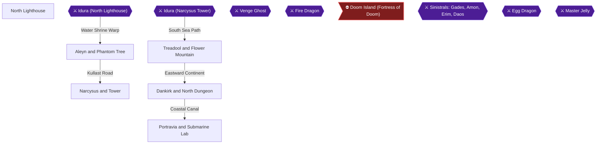
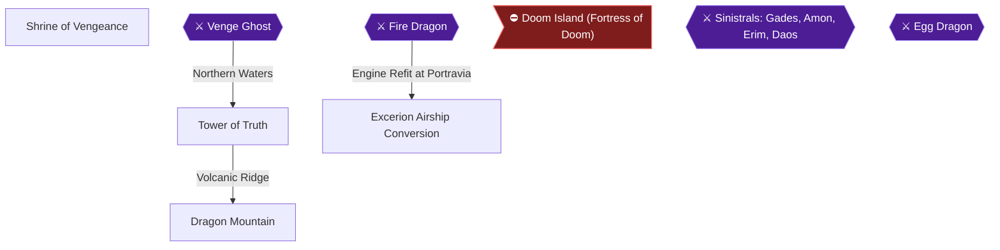
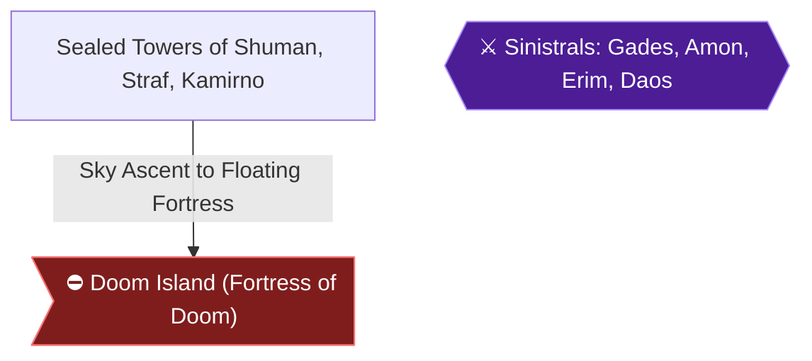
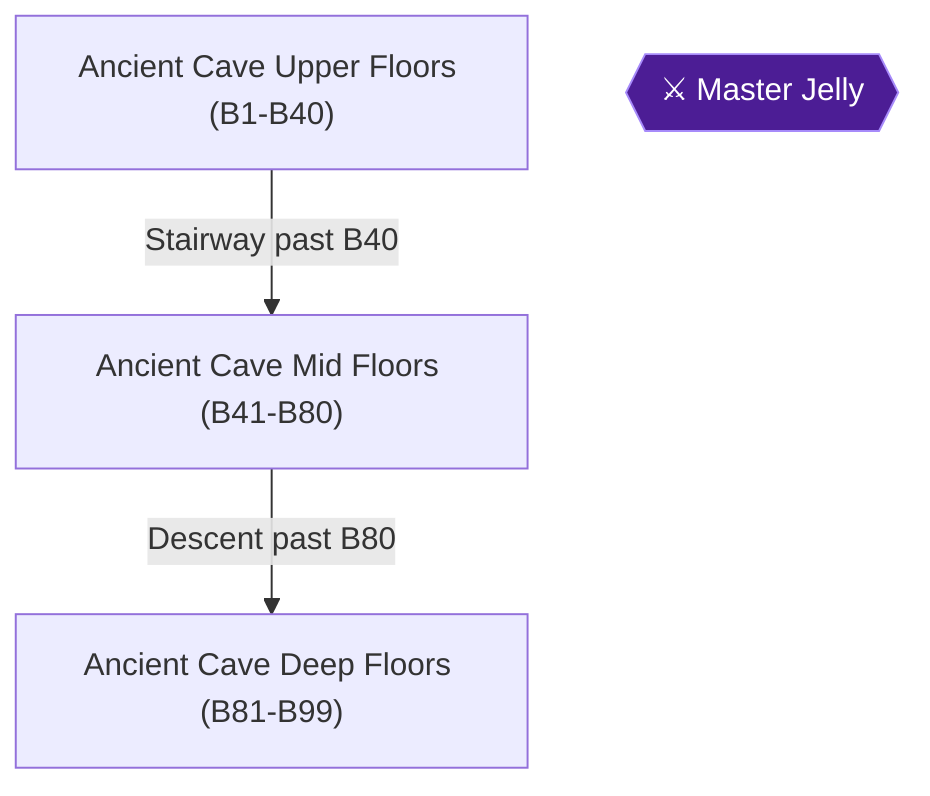

# Lufia II: Rise of the Sinistrals — 100% RetroAchievements Walkthrough

## Metadata

- **Platform:** SNES/Super Famicom
- **Developer:** Neverland
- **Publisher:** Natsume, Taito
- **Genre:** Turn-Based RPG
- **Released:** 1996-08-31
- **Achievements:** 60 (520 points)

> [!NOTE]
> Every instruction in this guide was extracted from the sources listed at the bottom and checked against them (14 facts confirmed by 2+ sources, 1219 from a single source). Statements marked 🟡 come from only one source. Anything we could not confirm says **"Unable to verify from collected sources."**

## Game Overview

Lufia II: Rise of the Sinistrals is an acclaimed turn-based Super Nintendo RPG renowned for its intricate puzzle-filled dungeons, autonomous Capsule Monster companions, and the legendary 99-floor procedural Ancient Cave [[gf3-1-1,gf1-2-2]].

This walkthrough provides an exhaustive roadmap to achieve **True 100% In-Game Completion** and full RetroAchievements Mastery in a single seamless playthrough [[ra-comments-2-1]].

---

### Core Gameplay & Dungeon Traversal Mechanics

- **Step-Based Dungeon Movement:** Unlike typical overland RPGs, monsters in Lufia II dungeons move in direct lockstep with Maxim [[gf1-2-2,gf3-30-10]]. Striking an enemy in the back initiates preemptive surprise combat, while being touched from behind grants the enemy a free assault round [[gf3-30-10]].
- **Adventuring Tools:** Maxim acquires tools including the Bow & Arrow (activates switches across chasms and freezes roaming monsters), Bombs (demolishes cracked walls and cuts grass), and the Hookshot (crosses open pits by grappling wooden posts) [[gf3-30-10,gf3-38-1]].
- **Reset Spell:** Received in the Secret Skills Cave, casting Reset restores all movable blocks, switches, and puzzle elements to their starting state without resetting defeated foes [[gf3-30-10]].
- **IP (Item Points) Combat Skills:** When party members sustain damage in battle, their IP gauge fills, allowing them to trigger unique special abilities, healing surges, and devastating elemental attacks tied directly to their equipped weapons and armor [[gf1-2-2]].

---

### True 100% In-Game Completion Framework

To achieve genuine 100% completion beyond base achievements, this walkthrough tracks and guides [[gf3-1-1, gf1-2-2]]:
1. **Dungeon Treasure Chests & Secret Walls:** Every single chest across every cave, tower, and shrine is routed room-by-room [[gf3-31-1,gf3-33-1]].
2. **Capsule Monster Master Forms:** Recruiting all seven companions (Jelze, Blaze, Gusto, Zeppy, Darbi, Sully, Flash/Raddian) and evolving each to Class 5 Master Form via unique special fruits [[gf3-122-1,gf3-139-1]].
3. **Dragon Eggs & The Egg Dragon:** Collecting all 8 Dragon Eggs four separate times across the world to grant all wishes and challenging the Egg Dragon to battle [[gf3-82-1,gf3-83-1]].
4. **Ancient Cave Mastery:** Conquering the 99-floor procedural labyrinth and vanquishing the Master Jelly on B99 [[gf2-1-1,gf2-9-1]].
5. **Mini-Games & Casinos:** Securing all exclusive items including the Seethru Cape, VIP Card, Bunny Sword, and Holy Whip [[gf1-138-1]].

---

### Critical Missables Warning

> [!WARNING]
> ### MISSABLE ITEM: Seethru Cape for Tia
> In Chapter 2, you must visit the Alunze Casino, accumulate 10,000 casino coins, purchase the **Seethru Cape**, and equip it onto Tia **before completing the Ancient Tower** [[ra-comments-57-1,gf1-138-1]]. Tia leaves the party permanently following the Ancient Tower, locking this achievement out for the remainder of the playthrough [[ra-comments-57-1]].

> [!WARNING]
> ### MISSABLE BOSS VICTORY: Gades at Gordovan West Tower
> During your first encounter atop Gordovan West Tower in Chapter 2, you **must reduce Gades' 3,000 HP to zero** [[ra-comments-59-1,gf1-40-1]]. Although the story proceeds upon a loss, defeating him here is required to claim the exclusive **Gades Blade** and unlock Achievement 17581 [[ra-comments-59-1]].

---

### Point of No Return

> [!CAUTION]
> ### Point of No Return: Doom Island Flight
> In Chapter 5, flying the Excerion into the vortex above **Doom Island** is the permanent Point of No Return [[ra-comments-53-1,gf1-5-1]]. You cannot return to the world map, towns, or the Ancient Cave once inside. Complete all Capsule Monster evolutions, Dragon Egg wishes, and the Ancient Cave descent before boarding [[ra-comments-53-1]]!

## Achievement Roadmap

| Chapter | Achievements | Points |
|---|---|---|
| [1. The Journey Begins — Elcid to Alunze](#chapter-1-the-journey-begins-elcid-to-alunze) | Training Day, Hero's Destiny, Fishing Time, A King Without a Crown, Scout | 25 |
| [2. Tanbel to Bound Kingdom and Ancient Tower](#chapter-2-tanbel-to-bound-kingdom-and-ancient-tower) | The Lost Key, Looking for Hilda, I Am Immortal, Arachnophobia, For King and Country, Hey Pretty Lady, I've Got a Weird Thing to Show You, Beaten by Strangers, The Prince's Ego, Happy Ending...? | 50 |
| [3. The High Seas and Submarine Depths](#chapter-3-the-high-seas-and-submarine-depths) | Memory Games, Child Abduction, The Phantom Tree, The Mysterious Melody, The Useless Servant, The Priphea, Preventing a War, Artea, 20,000 Leagues Under the Sea | 45 |
| [4. Northern Shrines, Dragon Mountain and Airship Conversion](#chapter-4-northern-shrines-dragon-mountain-and-airship-conversion) | The Cursed One, The Power of Love, Dragon Slayer, The World's Most Difficult Trick, Airship | 30 |
| [5. Endgame — Sealed Towers and Doom Island](#chapter-5-endgame-sealed-towers-and-doom-island) | Blade of the Gods, Final Countdown | 30 |
| [6. Capsule Monsters, Casino Wealth and the Egg Dragon](#chapter-6-capsule-monsters-casino-wealth-and-the-egg-dragon) | Jelze, Blaze, Flash, Gusto, Sully, Darbi, Zeppy, Capsule Monster Collector, Master Jelze, Master Blaze, Master Flash, Master Gusto, Master Sully, Master Darbi, Master Zeppy, Power House, Dragon Sword, Bunny Sword, Millionaire, VIP Member, Holy Whip, The Wishmaker, The Wishmaker 2, I Need More Wishes | 185 |
| [7. The Ancient Cave Descent](#chapter-7-the-ancient-cave-descent) | Beginner Explorer , Spelunker, Advanced Hunter, Master Adventurer, Expert Explorer, R. A. Legend - Lufia II | 155 |

## Playthrough Planning

**Playthroughs required:** 1

All 60 achievements can be earned in a single playthrough with no mutually exclusive lockouts or conflicts if following this guide carefully and fulfilling both missables before their respective deadlines.

**Settings:** Standard SNES controls on original hardware or retro emulator. Save states are disabled in Hardcore mode. Use in-game church and save tile saves.

[[gf1-2-2,gf3-1-1,ra-comments-2-1]]

## True 100% In-Game Completion Criteria

This guide covers complete in-game mastery in addition to all RetroAchievements:

| Category | 100% Requirement | Tracking Scope |
|---|---|---|
| **Dungeon Treasure Chests & Hidden Items** | Every single treasure chest opened and hidden ground tile collected across all dungeons, caves, towers, and shrines. | Per-chapter checkpoint |
| **Capsule Monsters & Master Evolutions** | Recruit all 7 Capsule Monsters (Jelze, Flash, Gusto, Zeppy, Darbi, Sully, Raddian) and evolve them to Class 5 Master form. | Per-chapter checkpoint |
| **Dragon Eggs & Wishes** | Collect all 8 Dragon Eggs across the world chests 4 times to claim all 4 wishes from the Egg Dragon. | Per-chapter checkpoint |
| **Optional Dungeons & Superbosses** | Conquer all 99 floors of the Ancient Cave to defeat the Master, and defeat the Egg Dragon in battle. | Per-chapter checkpoint |
| **Sidequests & Mini-Games** | Complete all optional sidequests, Alunze and Forfeit Island Casino prizes, and character vignettes. | Per-chapter checkpoint |

## Missables Summary

| ⚠ Missable | Achievement | Chapter | Must be done before |
|---|---|---|---|
| Equip Tia with Seethru Cape [[ra-comments-57-1,gf1-138-1]] | Hey Pretty Lady, I've Got a Weird Thing to Show You | [2](#chapter-2-tanbel-to-bound-kingdom-and-ancient-tower) | Must obtain the Seethru Cape from Alunze mini-casino (10,000 coins) and equip Tia before entering Ancient Tower where Tia permanently leaves the party |
| Defeat Gades in Gordovan Tower [[gf1-40-1,gf3-55-2]] | Beaten by Strangers | [2](#chapter-2-tanbel-to-bound-kingdom-and-ancient-tower) | Must reduce Gades HP to 0 during the first confrontation atop Gordovan Tower to win the Gades Blade before the story sequence advances |

## Points of No Return

| ⛔ Point of No Return | Chapter | What you lose access to |
|---|---|---|
| Doom Island Airship Boarding [[ra-comments-53-1,ra-comments-53-2,gf1-5-1]] | [5](#chapter-5-endgame-sealed-towers-and-doom-island) | Once you take flight to Doom Island for the final showdown against the Sinistrals, you cannot return to the world map to finish sidequests or explore the Ancient Cave. |

## Progression Diagrams

### Game Progression

```mermaid
flowchart TD
  Elcid["Elcid and Training Cave"]
  Sundletan["Sundletan and Lake Cave"]
  Big_Catfish{{"⚔ Big Catfish"}}
  Alunze_Kingdom["Alunze Kingdom and Castle Basement"]
  Regal_Goblin{{"⚔ Regal Goblin"}}
  Tanbel_Region["Tanbel and Southeast Tower"]
  Camu{{"⚔ Camu"}}
  Ruby_Cave["Ruby Cave and Clamento"]
  Tarantula{{"⚔ Tarantula"}}
  Treasure_Sword_Shrine["Treasure Sword Shrine"]
  Pierre_Danielle{{"⚔ Pierre and Danielle"}}
  Gordovan_Tower["Gordovan and Gordovan Tower"]
  Gades_Gordovan{{"⚔ Gades (Gordovan Tower)"}}
  Bound_Kingdom["Bound Kingdom and North Labyrinth"]
  Ancient_Tower["Ancient Tower"]
  North_Lighthouse["North Lighthouse"]
  Idura_Lighthouse{{"⚔ Idura (North Lighthouse)"}}
  Aleyn_Region["Aleyn and Phantom Tree"]
  Narcysus["Narcysus and Tower"]
  Idura_Narcysus{{"⚔ Idura (Narcysus Tower)"}}
  Treadool_Region["Treadool and Flower Mountain"]
  Dankirk_Kingdom["Dankirk and North Dungeon"]
  Portravia_Lab["Portravia and Submarine Lab"]
  Shrine_of_Vengeance["Shrine of Vengeance"]
  Venge_Ghost{{"⚔ Venge Ghost"}}
  Tower_of_Truth["Tower of Truth"]
  Dragon_Mountain["Dragon Mountain"]
  Fire_Dragon{{"⚔ Fire Dragon"}}
  Excerion_Airship["Excerion Airship Conversion"]
  Sealed_Towers["Sealed Towers of Shuman, Straf, Kamirno"]
  Doom_Island>"⛔ Doom Island (Fortress of Doom)"]
  Sinistrals_Final{{"⚔ Sinistrals: Gades, Amon, Erim, Daos"}}
  Capsule_Sanctuaries["Capsule Monster Sanctuaries"]
  Forfeit_Casino["Forfeit Island Casino"]
  Divine_Shrine["Divine Shrine"]
  Egg_Dragon_Island["Egg Dragon Island and Lair"]
  Egg_Dragon{{"⚔ Egg Dragon"}}
  Ancient_Cave_Upper["Ancient Cave Upper Floors (B1-B40)"]
  Ancient_Cave_Mid["Ancient Cave Mid Floors (B41-B80)"]
  Ancient_Cave_Deep["Ancient Cave Deep Floors (B81-B99)"]
  Master_Jelly{{"⚔ Master Jelly"}}
  Elcid -->|Passage Cave| Sundletan
  Big_Catfish -->|Northwest Ferry| Alunze_Kingdom
  Regal_Goblin -->|East Gate Passage| Tanbel_Region
  Camu -->|Clamento Road| Ruby_Cave
  Tarantula -->|Passage of Clamento| Treasure_Sword_Shrine
  Pierre_Danielle -->|Highway to Gordovan| Gordovan_Tower
  Gades_Gordovan -->|Merac Highway| Bound_Kingdom
  Bound_Kingdom -->|South Path| Ancient_Tower
  Ancient_Tower -->|Parcelyte Road| North_Lighthouse
  Idura_Lighthouse -->|Water Shrine Warp| Aleyn_Region
  Aleyn_Region -->|Kullast Road| Narcysus
  Idura_Narcysus -->|South Sea Path| Treadool_Region
  Treadool_Region -->|Eastward Continent| Dankirk_Kingdom
  Dankirk_Kingdom -->|Coastal Canal| Portravia_Lab
  Portravia_Lab -->|Submarine Trench| Shrine_of_Vengeance
  Venge_Ghost -->|Northern Waters| Tower_of_Truth
  Tower_of_Truth -->|Volcanic Ridge| Dragon_Mountain
  Fire_Dragon -->|Engine Refit at Portravia| Excerion_Airship
  Excerion_Airship -->|Airship Flight to Narvick| Sealed_Towers
  Sealed_Towers -->|Sky Ascent to Floating Fortress| Doom_Island
  Portravia_Lab -->|Global Shrines and Caves| Capsule_Sanctuaries
  Portravia_Lab -->|Ship Voyage to Forfeit Island| Forfeit_Casino
  Excerion_Airship -->|Airship Landing| Divine_Shrine
  Excerion_Airship -->|Secret Island Volcano| Egg_Dragon_Island
  Portravia_Lab -->|Submarine to Gruberik Wharf| Ancient_Cave_Upper
  Ancient_Cave_Upper -->|Stairway past B40| Ancient_Cave_Mid
  Ancient_Cave_Mid -->|Descent past B80| Ancient_Cave_Deep
  classDef ponr fill:#7f1d1d,stroke:#f87171,color:#fff;
  classDef boss fill:#4c1d95,stroke:#a78bfa,color:#fff;
  class Doom_Island ponr;
  class Big_Catfish,Regal_Goblin,Camu,Tarantula,Pierre_Danielle,Gades_Gordovan,Idura_Lighthouse,Idura_Narcysus,Venge_Ghost,Fire_Dragon,Sinistrals_Final,Egg_Dragon,Master_Jelly boss;
```

## Boss Index

Full strategies are in each chapter.

| Boss | Chapter |
|---|---|
| Big Catfish | [1. The Journey Begins — Elcid to Alunze](#chapter-1-the-journey-begins-elcid-to-alunze) |
| Regal Goblin | [1. The Journey Begins — Elcid to Alunze](#chapter-1-the-journey-begins-elcid-to-alunze) |
| Camu | [2. Tanbel to Bound Kingdom and Ancient Tower](#chapter-2-tanbel-to-bound-kingdom-and-ancient-tower) |
| Tarantula | [2. Tanbel to Bound Kingdom and Ancient Tower](#chapter-2-tanbel-to-bound-kingdom-and-ancient-tower) |
| Pierre and Danielle | [2. Tanbel to Bound Kingdom and Ancient Tower](#chapter-2-tanbel-to-bound-kingdom-and-ancient-tower) |
| Gades (Gordovan Tower) | [2. Tanbel to Bound Kingdom and Ancient Tower](#chapter-2-tanbel-to-bound-kingdom-and-ancient-tower) |
| Idura (North Lighthouse) | [3. The High Seas and Submarine Depths](#chapter-3-the-high-seas-and-submarine-depths) |
| Idura (Narcysus Tower) | [3. The High Seas and Submarine Depths](#chapter-3-the-high-seas-and-submarine-depths) |
| Venge Ghost | [4. Northern Shrines, Dragon Mountain and Airship Conversion](#chapter-4-northern-shrines-dragon-mountain-and-airship-conversion) |
| Fire Dragon | [4. Northern Shrines, Dragon Mountain and Airship Conversion](#chapter-4-northern-shrines-dragon-mountain-and-airship-conversion) |
| Sinistrals: Gades, Amon, Erim, Daos | [5. Endgame — Sealed Towers and Doom Island](#chapter-5-endgame-sealed-towers-and-doom-island) |
| Egg Dragon | [6. Capsule Monsters, Casino Wealth and the Egg Dragon](#chapter-6-capsule-monsters-casino-wealth-and-the-egg-dragon) |
| Master Jelly | [7. The Ancient Cave Descent](#chapter-7-the-ancient-cave-descent) |

## Walkthrough

## Chapter 1: The Journey Begins — Elcid to Alunze

Start your adventure in the peaceful border town of Elcid, where our hero Maxim meets up with his longtime companion Tia [[gf3-30-1,gf1-2-2]].

```mermaid
flowchart TD
  Elcid["Elcid and Training Cave"]
  Sundletan["Sundletan and Lake Cave"]
  Big_Catfish{{"⚔ Big Catfish"}}
  Alunze_Kingdom["Alunze Kingdom and Castle Basement"]
  Regal_Goblin{{"⚔ Regal Goblin"}}
  Camu{{"⚔ Camu"}}
  Tarantula{{"⚔ Tarantula"}}
  Pierre_Danielle{{"⚔ Pierre and Danielle"}}
  Gades_Gordovan{{"⚔ Gades (Gordovan Tower)"}}
  Idura_Lighthouse{{"⚔ Idura (North Lighthouse)"}}
  Idura_Narcysus{{"⚔ Idura (Narcysus Tower)"}}
  Venge_Ghost{{"⚔ Venge Ghost"}}
  Fire_Dragon{{"⚔ Fire Dragon"}}
  Doom_Island>"⛔ Doom Island (Fortress of Doom)"]
  Sinistrals_Final{{"⚔ Sinistrals: Gades, Amon, Erim, Daos"}}
  Egg_Dragon{{"⚔ Egg Dragon"}}
  Master_Jelly{{"⚔ Master Jelly"}}
  Elcid -->|Passage Cave| Sundletan
  Big_Catfish -->|Northwest Ferry| Alunze_Kingdom
  classDef ponr fill:#7f1d1d,stroke:#f87171,color:#fff;
  classDef boss fill:#4c1d95,stroke:#a78bfa,color:#fff;
  class Doom_Island ponr;
  class Big_Catfish,Regal_Goblin,Camu,Tarantula,Pierre_Danielle,Gades_Gordovan,Idura_Lighthouse,Idura_Narcysus,Venge_Ghost,Fire_Dragon,Sinistrals_Final,Egg_Dragon,Master_Jelly boss;
```

### Elcid and Training Cave

🗺️ **Dungeon Map:** [View Secret Skills Cave Map by snesmaster1](https://gamefaqs.gamespot.com/snes/588451-lufia-ii-rise-of-the-sinistrals/map/3929-secret-skills-cave-map) [[map-secret-skills-cave-1-1]]

Before leaving Elcid, the village elder instructs Maxim to visit the Secret Skills Cave located directly south of town to learn the fundamentals of dungeon traversal and combat [[gf3-30-1,gf3-30-10]].

#### Room-by-Room Training Traversal
1. **Entry Hall & Movement Mechanics:** In dungeon environments, monsters move only when Maxim takes a step [[gf1-2-2,gf3-30-10]]. Striking an enemy in the back grants a surprise preemptive round, whereas being touched from behind surrenders an advantage to the monsters [[gf3-30-10]].
2. **Switch & Arrow Bridge:** In the subsequent chamber, equip your bow and shoot an arrow directly across the chasm at the wall switch [[gf3-30-10]]. A stone bridge extends across the gap [[gf3-30-10]].
3. **Pillar Push & Reset Spell:** Push the heavy pillar directly onto the floor switch [[gf3-30-10]]. This unlocks the gate and grants the **Reset Spell** [[gf3-30-10]]. Cast Reset whenever a puzzle block becomes irreversibly wedged against a wall or corner [[gf3-30-10]].
4. **Pitfall Room:** Drop through the floor edge indicated by arrow markings [[gf3-30-10]]. Clear out all subterranean monsters to release the locked southern door [[gf3-30-10]].
5. **Grass Clearing & Dual Pots:** Use your sword to mow down the suspicious patch of weeds, revealing a hidden floor switch [[gf3-30-10]]. In the final puzzle room, lift the first ceramic pot, turn 180 degrees using the shoulder button without stepping, and place it upon the right switch; then carry the second pot to the left switch to open the exit [[gf3-30-10]].

Completing the final chamber finishes your training [[gf3-30-1,ra-comments-7-1]].

> [!ACHIEVEMENT]
> **Training Day (5 Points)**
> 
> *Complete the training dungeon*

---

### Passage Cave to Sundletan

🗺️ **Dungeon Map:** [View Cave to Sundletan Map by snesmaster1](https://gamefaqs.gamespot.com/snes/588451-lufia-ii-rise-of-the-sinistrals/map/3595-cave-to-sundletan-map) [[map-cave-sundletan-1-1]]

Return to Elcid for dinner with Tia, then cross the northern bridge where a royal messenger reports that fiends have infested the underground pass to Sundletan [[gf3-31-1,gf1-8-1]]. Purchase a Rapier and Small Shield from Elcid's shop before departing [[gf3-31-1]].

#### Floor-by-Floor Passage Navigation & Chests
- **1F Entrance & Spike Puzzle:** Enter the cave, walk over the wooden bridge, and head through the upper-right entrance [[gf3-31-1]]. Lift the clay pot, position it one tile south of the spikes, turn in place with the R shoulder button, and set the pot upon the floor button to retract the spikes [[gf3-31-10]]. Carry the second pot across to the sister switch to secure the pathway [[gf3-31-10]].
  - West chamber chest: Open for **[Life Potion]** [[gf3-31-10]].
  - East chamber: Cut the patch of overgrown grass to uncover **[Escape]** [[gf3-31-10]].
- **1F Hidden Passage:** Return to the bridge room and inspect the locked southern doorway [[gf3-31-1]]. Slash the solitary patch of grass to uncover the floor plate [[gf3-31-10]]. In the adjoining corridor, chop the third weed patch from the left to reveal a concealed breach in the cavern wall [[gf3-31-10]]. Walk through the dark wall to loot a chest containing an **[Antidote]** [[gf3-31-10]].
- **B1F Dual Switches & Secret Staircase:** Mow the lawn in the next chamber to expose two floor triggers, setting pots upon each [[gf3-31-10]]. Proceed through the left doorway, shift the stone blocks, and descend the stairs to B1F [[gf3-31-10]].
  - Navigate south through the bat roost to collect a **[Power Potion]** [[gf3-31-10]].
  - Strike the crystal switch with your blade, step off the ledge arrows, and traverse the newly raised bridge [[gf3-31-10]].
  - Push through the hollow section in the western wall to access a hidden staircase [[gf3-31-10]]. Descend to find chests containing **[Hide Armor]**, **[Magic Jar]**, and a rare **[Dragon Egg]** (Dragon Egg #1) [[gf3-31-10]].
- **Save Tile & Recovery:** Cross back over the bridge and descend to find the glowing star tile, which fully restores Maxim's HP and MP and provides a save point before the boss [[gf3-31-10]].

#### Boss Encounter: Lizard Man
- **Level Recommendation:** Level 5–6 [[gf3-31-10]].
- **Strategy:** Strike with your Rapier and activate your weapon's IP special attack to quickly defeat the Lizard Man [[gf1-11-1,gf3-31-1]].

Exit through the north passage to step onto the Sundletan subcontinent [[gf3-31-1]].

---

### Sundletan and Lake Cave

🗺️ **Dungeon Map:** [View Lake Cave Map by snesmaster1](https://gamefaqs.gamespot.com/snes/588451-lufia-ii-rise-of-the-sinistrals/map/3633-lake-cave-map) [[map-lake-cave-1-1]]

Upon entering Sundletan village, violent tremors shake the earth [[gf3-33-1]]. Speak with the frightened townspeople to learn that a massive sea monster in Lake Cave is suspected of triggering the earthquakes [[gf3-33-1]]. Visit Sundletan's magic shop to buy the **Droplet** and **Poison** spells for Tia, as well as **Drowsy** for Maxim [[gf1-16-1,gf3-33-1]]. Head northwest to Lake Cave [[gf3-33-1]].

#### Meeting Iris
Upon entering Lake Cave, Maxim encounters the mysterious soothsayer Iris [[gf3-32-1,ra-comments-9-1]]. Iris foretells Maxim's grand destiny and urges him to hone his warrior spirit against the looming darkness [[gf3-32-1,ra-comments-9-1]].

> [!ACHIEVEMENT]
> **Hero's Destiny (5 Points)**
> 
> *Meet Iris for the first time*

#### Lake Cave Floor-by-Floor Traversal & Chest Routing
- **1F Bridge & Sequence Room:** Fire an arrow at the crystal switch across the chasm, align the three floating platform tiles into a bridge, and enter the north archway [[gf3-33-10]].
  - Enter the northern monster chamber where three beasts appear [[gf3-33-10]]. Memorize the exact order in which you defeat them [[gf3-33-10]]. Once the room clears, fire arrows at the respawned spectral targets in that identical sequence to unseal the northeast door [[gf3-33-10]].
  - Descend the stairs to collect the **[Insect Crush]** sword from the chest [[gf3-33-10]]. Equip this blade immediately; its innate slayer property inflicts double damage on beetle, mosquito, and spider foes [[gf3-33-1]].
- **B1F Pitfall & Hidden Miracle:** Return to the Blue Jelly chamber and take the left archway [[gf3-33-10]]. Slash the patches of grass and intentionally step onto the weakened center floor to plummet to B1F [[gf3-33-10]].
  - Exit via the southern archway to loot a chest holding a **[Power Potion]** [[gf3-33-10]].
  - Return north and pass through the upper-right entrance to find two stone pillars [[gf3-33-10]]. Push the lower pillar one space north onto the pressure plate to open the adjoining gate [[gf3-33-10]].
  - Cut the grass in the eastern chamber, walk into the false western wall, and open the hidden chest containing a **[Miracle]** [[gf3-33-10]].
  - Follow the corridor past the clue tablet, clear out the corridor enemies, and open the treasure chest containing the **[Speedy Ring]** [[gf3-33-10]].
- **B2F Triangle Puzzle & Lake Key:** Return to the two-pillar room, slide the right pillar onto the plate, and push the lower-right block aside to reveal a downward staircase [[gf3-33-10]].
  - **Triangle Puzzle Solution:** The movable perimeter blocks must be shifted so the apex points north [[gf3-33-10]]. Move the left stone one space up and two spaces right, shift the lowest stone two spaces left and one space up, and push the final movable stone one square down [[gf3-33-10]].
  - The inner gate unseals: open the blue chest to claim the **[Lake Key]** [[gf1-15-2,gf3-33-10]].
- **B2F Water Sluice & Drainage:** Return to the pitfall chamber, unlock the star save room on the left to record your progress, then enter the right sluice chamber [[gf3-33-10]].
  - Lay three floating tiles in a straight line toward the switch [[gf3-33-10]]. Pick up the fourth tile, carry it across, and drop it into the water directly right of the switch lever [[gf3-33-10]].
  - Pull the lever: the floodwaters drain away completely [[gf3-33-10]].
  - Descend the wooden steps, lift the final tile, and plug the gap to form the walkway to the boss chamber ladder [[gf3-33-10]].

#### Boss Encounter: Big Catfish
> [!NOTE]
> Boss: Big Catfish (Lake Cave Guardian)
> HP: 200 | Weak: Physical / Earth | Strong: Water | Ailments: Immune
> Key Attacks: Mega Quake (~20 HP group damage), Flash (~30 HP single target)
> Strategy:
> Equip your Insect Crush or an Eagle Rock for double-damage IP strikes [[gf3-33-1,gf3-34-1]].
> Cast Droplet and physical attacks every turn while keeping Maxim's HP above 40
> with Potions to survive consecutive Mega Quakes [[gf3-34-1,ra-comments-11-1]].

Defeat the Big Catfish to put an end to the tremors [[gf3-34-1,ra-comments-11-1]].

> [!ACHIEVEMENT]
> **Fishing Time (5 Points)**
> 
> *Defeat Big Catfish in Lake Cave*

#### Rescuing Tia & Alunze Ferry
Return to Sundletan to learn that Tia traveled to Lake Cave searching for Maxim [[gf3-34-1]]. Re-enter Lake Cave and hurry to the Insect Crush sequence room [[gf3-34-1]]. Slay the Skeleton and Goblin ambushing Tia (approx. 30 HP each) [[gf3-34-1]]. Tia formally joins your party as your primary spellcaster, allowing the dock master to open the northwest ferry passage [[gf3-34-1,gf1-16-1]].

---

### Alunze Kingdom and Castle Basement

🗺️ **Dungeon Maps:**
- [View World Map by Telago](https://gamefaqs.gamespot.com/snes/588451-lufia-ii-rise-of-the-sinistrals/map/1091-world-map) [[map-world-map-1-1]]
- [View Alunze Castle Basement Map by snesmaster1](https://gamefaqs.gamespot.com/snes/588451-lufia-ii-rise-of-the-sinistrals/map/3636-alunze-castle-basement-map) [[map-alunze-basement-1-1]]

Board the ferry to land on the Alunze mainland [[gf3-35-1,gf1-16-1]].

#### Foomy Woods: Recruiting Jelze (Capsule Monster #1)
Before entering Alunze Castle, travel directly southwest across the overworld into Foomy Woods [[gf3-35-1]]. In the heart of the grove, Maxim discovers a playful, cotton-ball creature named **Jelze** [[gf3-35-1,gf1-125-1]]. Jelze joins as your first **Capsule Monster**, acting as an autonomous fifth combatant in all regular and boss battles [[gf3-35-1,gf1-211-1]].

#### Alunze Castle Basement & The Stolen Crown
Enter Alunze Castle to witness the royal coronation ceremony, where bandits Bart and Bertie brazenly snatch the King's sacred crown and plunge into the castle basement [[gf3-36-1,gf3-37-1]].

1. **Color Matching Tile Puzzle:** In the basement puzzle chamber, match like-colored blocks into rows of three or more to dissolve the barriers [[gf3-37-1]].
2. **Cracked Wall & Secret Fruit:** Place a bomb alongside the cracked wall, step back six spaces, and detonate the fissure to loot a **[Miracle]** [[gf3-37-1]]. Navigate the inner alcove to discover a chest containing the rare **[Secret Fruit]** [[gf3-37-1]].
   > [!TIP]
   > Keep this Secret Fruit stored safely in your inventory; feeding it to Jelze once he reaches Class 4 triggers his ultimate **Master Form** transformation [[gf3-37-1,gf3-139-1]].
3. **Teleporter Maze & Light Knife:** Set the movable jar upon the lower-right switch and step onto the warp pad [[gf3-37-1]]. Trap the Mad Horse between the three barriers, dispatch it, and open the chest for the **[Light Knife]** [[gf3-37-1]].
4. **Water Slide Confrontation:** Warp through the lower-left pad, eliminate the Cobalt sentries, and pursue Bart and Bertie to the drainage canal [[gf3-37-1]]. The thieves flee down a waterslide, dropping the royal crown on the floor [[gf3-37-1]]. Pick up the **[Alunze Crown]** [[gf3-37-1,ra-comments-13-1]].

#### Royal Reward
Return upstairs to the throne room and present the recovered crown to King Alunze [[gf3-37-1,ra-comments-13-1]]. When the King offers a reward of your choice:
- Choosing Princess rewards 500 Gold [[gf3-38-1]].
- Choosing King rewards 1,000 Gold [[gf3-38-1]].
- Choosing Money rewards 2,000 Gold [[gf3-38-1]].
- **Choosing "Nothing" rewards 3,000 Gold [[gf3-38-1]].** Always select "Nothing" to receive the maximum cash bounty [[gf3-37-1,gf3-38-1]].

> [!ACHIEVEMENT]
> **A King Without a Crown (5 Points)**
> 
> *Return the crown back to the king of Alunze*

---

### Alunze Northwest Cave & Tanbel Shrine Key

🗺️ **Dungeon Map:** [View Alunze Northwest Cave Map by snesmaster1](https://gamefaqs.gamespot.com/snes/588451-lufia-ii-rise-of-the-sinistrals/map/3635-alunze-northwest-cave-map) [[map-alunze-nw-cave-1-1]]

Journey northwest from Alunze to find young Abel weeping near a cave entrance [[gf3-38-1]]. Abel took the Tanbel Shrine Key to play with, was frightened by goblins, and dropped it inside the cavern [[gf3-38-1]].

#### Cavern Navigation & 11 Treasure Chests
- **Entrance Level:** Descend the ladder, aim your bow past the spikes, and shoot the switch to open the gate for a **[Hi-Potion]** [[gf3-38-1]]. Cross the tile bridge to find a room with 3 switches, 2 visible pots, and rocks [[gf3-38-1]]. Find the third pot hidden behind the right pillar, and place all three on the switches [[gf3-38-1]].
- **Lower Level Pitfall:** Step onto the crumbling floor tile to drop down [[gf3-38-1]]. Push the floor blocks onto the door plate, and collect the **[Horse Rock]** [[gf3-38-1]]. Walk around the invisible floor trigger, set a vase upon it, and take the hidden stairway to find **[Light Armor]** [[gf3-38-1]].
- **Weed Bombing & False Wall:** In the adjoining chamber, slice the vine against the wall to uncover chests with **[Brave]** and a **[Miracle]** [[gf3-38-1]]. In the weed room, lay bombs on the regenerating grass to slide the block across in fewer than three movements, creating a ladder to the switch [[gf3-38-1]].
- **Spike Trap & Sluice Bridges:** Cross back over to find three chests containing a **[Hi-Potion]**, **[Hi-Magic]**, and **[Power Brace]** [[gf3-39-1]]. Slay all ambush fiends to lower the trap spikes [[gf3-39-1]]. Form bridges across the water with the stone pillars, walk through the false eastern wall for the **[Witch Ring]**, and open the chest at the top right for a **[Jet Helm]** [[gf3-39-1]].
- **Drainage Sluices:** Lower both water sluices on the lower level to raise the combined bridge, save your game at the star tile, and place a bomb on the northern wall fissure [[gf3-39-1]].

#### Boss Encounter: Regal Goblin
> [!NOTE]
> Boss: Regal Goblin
> HP: 500 | Weak: Ice / Drowsy | Strong: None | Ailments: Susceptible to Sleep
> Minions: Goblin, Goblin Mage (approx. 40 HP each)
> Strategy:
> Cast Maxim's Drowsy spell on turn 1 to put the Regal Goblin to sleep [[gf3-40-1,gf1-16-1]].
> Have Tia unleash Spark and Ice attacks while Maxim and Jelze pummel the boss [[gf3-40-1]].
> Ignore summoned goblin lackeys and focus single-target damage on the Regal Goblin [[gf3-40-1]].

Defeat the Regal Goblin to retrieve the **[Shrine Key]** from his remains [[gf3-40-1,gf1-23-1]]. Return to the shrine entrance to hand the key to Abel and meet Hilda, who invites you to Tanbel [[gf3-40-1,gf1-23-1]].

---

### Level 10 Maxim Milestone

Engage in battles throughout the Alunze plains and Northwest Cave until Maxim accumulates sufficient experience to attain Level 10 [[ra-comments-81-1,gf1-5-1]].

> [!ACHIEVEMENT]
> **Scout (5 Points)**
> 
> *Reach level 10 with Maxim*

---

> [!IMPORTANT]
> ### Chapter 1 Cumulative 100% Checkpoint
> - **Dungeon Chests Opened:** 26 / 26
>   - *Cave to Sundletan:* 7 chests (Antidote, Dragon Egg #1, Escape, Hide Armor, Life Potion, Magic Jar, Power Potion) [[gf3-31-10]]
>   - *Lake Cave:* 5 chests (Insect Crush, Lake Key, Miracle, Power Potion, Speedy Ring) [[gf3-33-10]]
>   - *Alunze Castle Basement:* 3 chests (Miracle, Secret Fruit, Light Knife) [[gf3-37-1]]
>   - *Alunze Northwest Cave:* 11 chests (Brave, Hi-Magic, Hi-Potion x2, Horse Rock, Jet Helm, Light Armor, Miracle, Power Brace, Shrine Key, Witch Ring) [[gf3-38-1,gf3-39-1]]
> - **Capsule Monsters Recruited:** 1 / 7 (Jelze in Foomy Woods) [[gf3-35-1]]
> - **Dragon Eggs Collected:** 1 / 8 (Cave to Sundletan secret room) [[gf3-31-10]]
> - **Sidequests Completed:** 2 / 2 (Secret Skills Cave training; Crown Recovery with "Nothing" 3,000 GP bounty) [[gf3-30-1,gf3-38-1]]
> - **RetroAchievements Unlocked:** 5 / 60 (25 / 520 points)
>   - [x] Training Day (17553)
>   - [x] Hero's Destiny (17554)
>   - [x] Fishing Time (17555)
>   - [x] A King Without a Crown (17556)
>   - [x] Scout (17592)

---

### Chapter Checklist
- [ ] Complete all puzzles in the Secret Skills Cave to earn the Reset spell [[gf3-30-1]]
- [ ] Loot Dragon Egg #1 in the Cave to Sundletan hidden corridor [[gf3-31-1]]
- [ ] Meet Iris in Lake Cave [[gf3-32-1]]
- [ ] Solve the triangle puzzle in Lake Cave, acquire the Lake Key, and slay Big Catfish [[gf3-33-1]]
- [ ] Rescue Tia and escort her onto the Alunze ferry [[gf3-34-1]]
- [ ] Recruit Jelze in Foomy Woods south of Alunze [[gf3-35-1]]
- [ ] Clear Alunze Castle Basement, obtain the Secret Fruit, and choose "Nothing" for 3,000 GP [[gf3-37-1]]
- [ ] Complete Alunze Northwest Cave, slay Regal Goblin, and recover the Shrine Key [[gf3-40-1]]
- [ ] Level Maxim up to Level 10 [[ra-comments-81-1]]

---

## Chapter 2: Tanbel to Bound Kingdom and Ancient Tower

Pass through the Tanbel Shrine into the eastern kingdom, where Maxim and Tia join forces with the mighty warrior Guy to confront sinister forces rising across the land [[gf3-41-1,gf1-23-1]].

```mermaid
flowchart TD
  Tanbel_Region["Tanbel and Southeast Tower"]
  Camu{{"⚔ Camu"}}
  Ruby_Cave["Ruby Cave and Clamento"]
  Tarantula{{"⚔ Tarantula"}}
  Treasure_Sword_Shrine["Treasure Sword Shrine"]
  Pierre_Danielle{{"⚔ Pierre and Danielle"}}
  Gordovan_Tower["Gordovan and Gordovan Tower"]
  Gades_Gordovan{{"⚔ Gades (Gordovan Tower)"}}
  Bound_Kingdom["Bound Kingdom and North Labyrinth"]
  Ancient_Tower["Ancient Tower"]
  Idura_Lighthouse{{"⚔ Idura (North Lighthouse)"}}
  Idura_Narcysus{{"⚔ Idura (Narcysus Tower)"}}
  Venge_Ghost{{"⚔ Venge Ghost"}}
  Fire_Dragon{{"⚔ Fire Dragon"}}
  Doom_Island>"⛔ Doom Island (Fortress of Doom)"]
  Sinistrals_Final{{"⚔ Sinistrals: Gades, Amon, Erim, Daos"}}
  Egg_Dragon{{"⚔ Egg Dragon"}}
  Master_Jelly{{"⚔ Master Jelly"}}
  Camu -->|Clamento Road| Ruby_Cave
  Tarantula -->|Passage of Clamento| Treasure_Sword_Shrine
  Pierre_Danielle -->|Highway to Gordovan| Gordovan_Tower
  Gades_Gordovan -->|Merac Highway| Bound_Kingdom
  Bound_Kingdom -->|South Path| Ancient_Tower
  classDef ponr fill:#7f1d1d,stroke:#f87171,color:#fff;
  classDef boss fill:#4c1d95,stroke:#a78bfa,color:#fff;
  class Doom_Island ponr;
  class Camu,Tarantula,Pierre_Danielle,Gades_Gordovan,Idura_Lighthouse,Idura_Narcysus,Venge_Ghost,Fire_Dragon,Sinistrals_Final,Egg_Dragon,Master_Jelly boss;
```

---

### Tanbel and Southeast Tower

🗺️ **Dungeon Map:** [View Tanbel Southeast Tower Map by snesmaster1](https://gamefaqs.gamespot.com/snes/588451-lufia-ii-rise-of-the-sinistrals/map/3634-tanbel-souteast-tower-map) [[map-tanbel-se-tower-1-1]]

Arrive in Tanbel to discover that monsters have raided the town and abducted Hilda, carrying her off to the Southeast Tower [[gf3-41-1]]. Speak to the villager Guy, who joins your party with his devastating physical power [[gf3-41-1,gf1-23-1]].

#### Southeast Tower Floor Traversal & Jute Helm
- **1F & 2F Navigation:** Ascend through the entrance hall, clear out the Goblin and Skeleton sentries, and strike the crystal switch to extend the stair walkway [[gf3-42-1]].
- **3F & 4F Switch Puzzles:** Manipulate the pillar blocks onto the floor plates to unlock the outer walkways [[gf3-42-1]].
  - Loot the chests on 3F for **[Hi-Potion]** and **[Miracle]** [[gf3-42-10]].
  - On 4F, locate the concealed side alcove to find a treasure chest containing the **[Jute Helm]** [[ra-comments-55-1,gf1-23-1]]. Equip this immediately on Guy or Maxim for a massive early defensive boost [[ra-comments-55-1]].

> [!ACHIEVEMENT]
> **I Am Immortal (5 Points)**
> 
> *Obtain Jute Helm in Tanbel Southeast Tower*

- **5F Summit & Hilda's Cell:** Climb to the tower roof where the fiend Camu holds Hilda hostage [[gf3-43-1,gf3-44-1]].

#### Boss Encounter: Camu
> [!NOTE]
> Boss: Camu (Tower Master)
> HP: 1,500 | Weak: Thunder / Water | Strong: Fire | Ailments: Immune
> Key Attacks: Buster Attack (~30 HP physical), Sleep Stinger (inflicts Sleep)
> Minions: Slave (approx. 50 HP)
> Strategy:
> Have Tia cast Flash or Spark repeatedly to exploit Camu's elemental weakness [[gf3-44-1]].
> Guy and Maxim should focus standard physical attacks and weapon IP strikes on Camu [[gf3-44-1]].
> Keep your party's health topped off above 50 HP using Potions and Strong [[gf3-44-1]].

Defeat Camu to free Hilda and return safely to Tanbel [[gf3-44-1,ra-comments-15-1]].

> [!ACHIEVEMENT]
> **The Lost Key (5 Points)**
> 
> *Defeat Regal Goblin*

> [!ACHIEVEMENT]
> **Looking for Hilda (5 Points)**
> 
> *Defeat Camu in Tanbel Southeast Tower*

---

### Ruby Cave and Clamento

🗺️ **Dungeon Map:** [View Ruby Cave Map by snesmaster1](https://gamefaqs.gamespot.com/snes/588451-lufia-ii-rise-of-the-sinistrals/map/3930-ruby-cave-map) [[map-ruby-cave-1-1]]

Travel south from Tanbel across the mountains into the volcanic cavern known as Ruby Cave [[gf3-46-1]].

#### Recruiting Blaze (Capsule Monster #2)
On the entry floor of Ruby Cave, explore the northern magma chamber [[gf3-46-1]]. Tucked away in a tranquil chamber, Maxim finds the fiery red dog **Blaze** [[gf3-46-1,gf1-126-1]]. Blaze joins as your second **Capsule Monster**, specializing in devastating Fire elemental attacks against undead and insect enemies [[gf3-46-1,gf1-211-1]].

#### Floor-by-Floor Traversal & Treasure
- **B1F Lava Flow & Bombable Walls:** Use bombs to breach the discolored rock face on the right wall [[gf3-46-1]]. Step through into the lower chamber and hit all four switches once to align the stone bridge [[gf3-46-1]].
  - Collect chests containing **[Flame Fruit]**, **[Hi-Potion]**, and **[Ruby Apple]** [[gf3-46-10]].
- **B2F Molten Bridges:** Bomb the cracked rocks, maneuver the stone blocks across the lava vents, and unlock the heavy iron doors [[gf3-47-1]].
  - Open chests holding a **[Miracle]**, **[Hi-Magic]**, and **[Aqua Whip]** for Tia [[gf3-47-10]].
- **B3F Lair of the Arachnid:** Heal at the star tile before passing through the final skull archway [[gf3-48-1]].

#### Boss Encounter: Tarantula
> [!NOTE]
> Boss: Tarantula
> HP: 700 | Weak: Fire | Strong: Water / Earth | Ailments: Immune
> Key Attacks: Poison Needle (poisons party), Web Entangle (reduces agility)
> Strategy:
> Activate Blaze as your active Capsule Monster so he continuously unleashes Fire breath [[gf3-48-1]].
> Tia should cast Spark and Flame spells every turn [[gf3-48-1]].
> Guy and Maxim deliver physical blows; keep Antidotes ready for poisoned allies [[gf3-48-1,ra-comments-19-1]].

Slay Tarantula to secure the volcanic depths [[gf3-48-1,ra-comments-19-1]].

> [!ACHIEVEMENT]
> **Arachnophobia (5 Points)**
> 
> *Defeat Tarantula in Ruby Cave*

---

### Treasure Sword Shrine

🗺️ **Dungeon Map:** [View Treasure Sword Shrine Map by snesmaster1](https://gamefaqs.gamespot.com/snes/588451-lufia-ii-rise-of-the-sinistrals/map/3931-treasure-sword-shrine-map) [[map-treasure-sword-shrine-1-1]]

Travel east to the Treasure Sword Shrine to recover the sacred blade stolen by the jester duo Pierre and Danielle [[gf3-51-1,gf1-26-1]].

#### Shrine Traversal & Chest Routing
- **1F & B1F Switch Sequences:** Navigate the sunken waterways, hit the wall crystal to reverse the sluice direction, and step onto the moving rafts [[gf3-51-1]].
  - Open chests for **[Sword Rock]**, **[Hi-Potion]**, and **[Miracle]** [[gf3-51-10]].
- **B2F Jester Chamber:** Save at the glowing star tile and confront the rogue clowns [[gf3-52-1]].

#### Boss Encounter: Pierre and Danielle
> [!NOTE]
> Bosses: Pierre (Blue Clown) & Danielle (Red Clown)
> Pierre HP: 800 | Danielle HP: 800 | Weak: None | Ailments: All Immune
> Special Abilities: Jester Dance, Dual Strike, Group Healing
> Strategy:
> Focus all party attacks on Danielle (Red) first to eliminate their healing ability [[gf3-52-1]].
> Guy's heavy physical attacks combined with Maxim's IP strikes quickly take down Danielle [[gf3-52-1]].
> Once Danielle falls, Pierre's solo damage is easily out-healed by Tia's Strong spell [[gf3-52-1,ra-comments-21-1]].

Defeat the clown duo to retrieve the royal treasure blade [[gf3-52-1,ra-comments-21-1]].

> [!ACHIEVEMENT]
> **For King and Country (5 Points)**
> 
> *Defeat Pierre and Danielle in Treasure Sword Shrine*

---

### Alunze Casino & Missable Seethru Cape

> [!WARNING]
> ### MISSABLE ITEM WARNING: Seethru Cape for Tia
> You must obtain the **Seethru Cape** and equip it on Tia **before entering the Ancient Tower** [[ra-comments-57-1,gf1-138-1]]. Once you complete the Ancient Tower, Tia permanently departs the party, making Achievement 17580 impossible to unlock on this playthrough [[ra-comments-57-1]].

1. Return to the Alunze town inn and enter the basement **Mini-Casino** [[gf3-36-1,ra-comments-57-1]].
2. Purchase or gamble your gold at the slot machines and action tables to amass **10,000 Casino Coins** [[ra-comments-57-1,gf1-138-1]].
3. Redeem 10,000 coins at the exchange desk for the **[Seethru Cape]** [[ra-comments-57-1,gf1-138-1]].
4. Open the equipment menu and equip the Seethru Cape onto Tia [[ra-comments-57-1]].

> [!ACHIEVEMENT]
> **Hey Pretty Lady, I've Got a Weird Thing to Show You (5 Points)**
> 
> *Obtain Seethru Cape and equip Tia with it*

---

### Gordovan and Gordovan Tower

🗺️ **Dungeon Map:** [View Gordovan West Tower Map by BLAHMASTER](https://gamefaqs.gamespot.com/snes/588451-lufia-ii-rise-of-the-sinistrals/map/12269-gordovan-west-tower-map) [[map-gordovan-west-tower-1-1]]

Visit the ruined city of Gordovan, destroyed by the Sinistral of Destruction, Gades [[gf3-54-1]]. Enter the Gordovan West Tower to challenge the god of destruction [[gf3-54-1,gf1-37-1]].

#### Tower Ascent & Chests
- Ascend 1F to 5F using the moving elevators and color switches [[gf3-54-1]].
- Collect chests holding **[Eagle Rock]**, **[Hi-Magic]**, **[Miracle]**, and **[Speed Potion]** [[gf3-54-10]].
- Save at the star tile on 5F before stepping onto the summit terrace [[gf3-55-1]].

> [!WARNING]
> ### MISSABLE BOSS VICTORY WARNING: Defeating Gades
> The story expects you to lose to Gades here, but you can legitimately defeat him! You **must defeat Gades during this first encounter** to claim the legendary **Gades Blade** and unlock Achievement 17581 [[ra-comments-59-1,gf1-40-1]]. If your party wiped or the cutscene advances without winning, reload your save!

#### Boss Encounter: Gades (Gordovan Tower)
> [!NOTE]
> Boss: Gades (Sinistral of Destruction)
> HP: 3,000 | Weak: None | Strong: All Magic | Ailments: Completely Immune
> Key Attacks: Devastation (~120 HP whole-party damage), Destructo-Sword (~80 HP single target)
> Strategy:
> - Target Level: Level 21+ on Maxim and Guy [[ra-comments-59-1,gf1-40-1]].
> - Equip Guy with the Heavy Shield and highest defense armor [[gf1-40-1]].
> - Open combat with your strongest multi-hit IP attacks (Dive, Bomb Attack, Ice Attack) [[gf3-55-1]].
> - Have Tia cast Stronger or use Hi-Potions every turn to keep the party above 130 HP [[gf1-40-1]].
> - Guy and Maxim must relentlessly strike Gades until his 3,000 HP is completely depleted [[gf1-40-1,gf3-55-1]].

Defeat Gades to obtain the coveted **[Gades Blade]** [[gf1-40-1,ra-comments-59-1]].

> [!ACHIEVEMENT]
> **Beaten by Strangers (10 Points)**
> 
> *Defeat Gades in Gordovan Tower and obtain his sword*

---

### Bound Kingdom and North Labyrinth

🗺️ **Dungeon Maps:**
- [View Cave to Bound Kingdom Map by BLAHMASTER](https://gamefaqs.gamespot.com/snes/588451-lufia-ii-rise-of-the-sinistrals/map/12270-cave-to-bound-kingdom-map) [[map-cave-bound-kingdom-1-1]]
- [View Northern Labyrinth Map by BLAHMASTER](https://gamefaqs.gamespot.com/snes/588451-lufia-ii-rise-of-the-sinistrals/map/12285-northern-labyrinth-map) [[map-northern-labyrinth-1-1]]

Travel east through the Cave to Bound Kingdom [[gf3-57-1]]. In the Northern Labyrinth, solve the switch riddles and bomb the cracked walls to collect **[Thunder Ax]**, **[Life Potion]**, **[Thunder Ring]**, and **[Dragon Egg]** (Dragon Egg #2) [[gf3-57-1,gf3-57-10]].

---

### Ancient Tower & Tia's Farewell

🗺️ **Dungeon Map:** [View Ancient Tower Map by BLAHMASTER](https://gamefaqs.gamespot.com/snes/588451-lufia-ii-rise-of-the-sinistrals/map/12294-ancient-tower-map) [[map-ancient-tower-1-1]]

Enter Ancient Tower to rescue Prince Idura from the clutches of evil [[gf3-60-1,gf1-41-1]].

#### Tower Navigation & Chest Routing
- Ascend 1F through 6F, pulling wall chains to disarm spike barriers and aligning stone teleporters [[gf3-60-1]].
- Collect chests containing **[Miracle]**, **[Hi-Potion]**, **[Protect Ring]**, and **[Silver Rod]** [[gf3-60-10]].
- On the upper level, confront the kidnappers and rescue Prince Idura [[gf3-61-1,ra-comments-23-1]].

> [!ACHIEVEMENT]
> **The Prince's Ego (5 Points)**
> 
> *Rescue the prince of Bound Kingdom from the North Labyrinth*

#### The Parting of Ways
After rescuing the prince, Tia realizes that Maxim's true destiny lies with Selan in the battle against the Sinistrals [[gf3-62-1,gf3-63-1]]. Tia bids an emotional farewell and leaves the party permanently, returning home to Elcid [[gf3-63-1,ra-comments-25-1]].

> [!ACHIEVEMENT]
> **Happy Ending...? (5 Points)**
> 
> *Escape from the Ancient Tower after Gades is defeated *

---

> [!IMPORTANT]
> ### Chapter 2 Cumulative 100% Checkpoint
> - **Dungeon Chests Opened:** 55 / 55
>   - *Previous Total:* 26 chests
>   - *Tanbel Southeast Tower:* 6 chests (Hi-Potion, Jute Helm, Miracle, Revive, etc.) [[gf3-42-10]]
>   - *Ruby Cave:* 6 chests (Aqua Whip, Flame Fruit, Hi-Magic, Hi-Potion, Miracle, Ruby Apple) [[gf3-46-10]]
>   - *Treasure Sword Shrine:* 5 chests (Hi-Potion, Miracle, Sword Rock, etc.) [[gf3-51-10]]
>   - *Gordovan West Tower:* 5 chests (Eagle Rock, Gades Blade, Hi-Magic, Miracle, Speed Potion) [[gf3-54-10]]
>   - *Northern Labyrinth:* 5 chests (Deadly Sword, Dragon Egg #2, Life Potion, Thunder Ax, Thunder Ring) [[gf3-57-10]]
>   - *Ancient Tower:* 2 chests (Protect Ring, Silver Rod) [[gf3-60-10]]
> - **Capsule Monsters Recruited:** 2 / 7 (Jelze, Blaze in Ruby Cave) [[gf3-46-1]]
> - **Dragon Eggs Collected:** 2 / 8 (Cave to Sundletan, Northern Labyrinth) [[gf3-57-10]]
> - **Sidequests Completed:** 3 / 3 (Casino Seethru Cape prize; Gades Blade challenge) [[ra-comments-57-1,ra-comments-59-1]]
> - **RetroAchievements Unlocked:** 14 / 60 (115 / 520 points)
>   - [x] The Missing Girl (17557)
>   - [x] A Hero's Friend (17558)
>   - [x] Jute Helm (17578)
>   - [x] Spider Exterminator (17559)
>   - [x] Clowning Around (17560)
>   - [x] A Risque Look (17580) — MISSABLE
>   - [x] Gades' Blade (17581) — MISSABLE
>   - [x] A Father's Pride (17561)
>   - [x] Farewell Old Friend (17562)

---

### Chapter Checklist
- [ ] Climb Tanbel Southeast Tower and rescue Hilda [[gf3-43-1]]
- [ ] Loot the Jute Helm on 4F of Tanbel Tower [[gf3-46-1]]
- [ ] Recruit Blaze (Capsule Monster #2) in Ruby Cave [[gf3-52-1]]
- [ ] Clear Ruby Cave and slay Tarantula [[ra-comments-57-1]]
- [ ] Recover the sacred blade from Pierre and Danielle in Treasure Sword Shrine [[ra-comments-59-1]]
- [ ] Gamble at Alunze Casino for 10,000 coins and equip Tia with the Seethru Cape (MISSABLE) [[gf3-57-1]]
- [ ] Defeat Gades atop Gordovan West Tower to win the Gades Blade (MISSABLE) [[gf3-60-1]]
- [ ] Loot Dragon Egg #2 from the Northern Labyrinth [[ra-comments-25-1]]
- [ ] Rescue Prince Idura in Ancient Tower and witness Tia's farewell [[gf3-43-1]]

---

## Chapter 3: The High Seas and Submarine Depths

With Selan and Guy by Maxim's side, take command of Jyad's sailing vessel to explore the vast uncharted waters, conquer towering lighthouses, and unlock the subterranean secrets of the ocean depths [[gf3-64-1,gf1-50-1]].

---

### North Lighthouse & The Spike Trap

🗺️ **Dungeon Map:** [View Northern Lighthouse Map by BLAHMASTER](https://gamefaqs.gamespot.com/snes/588451-lufia-ii-rise-of-the-sinistrals/map/12314-northern-lighthouse-map) [[map-northern-lighthouse-1-1]]

Sail north to the Northern Lighthouse where sinister cultists have captured baby Jeros [[gf3-65-1,gf1-50-1]].

#### Floor-by-Floor Traversal & Spike Runner Puzzle
- **1F & 2F Ascent:** Move through the entry foyer, fire arrows across the gaps to flip switches, and loot chests containing a **[Hi-Potion]** and **[Miracle]** [[gf3-65-10]].
- **3F Spike Puzzle Challenge:** Enter the spiked puzzle chamber [[gf3-66-1,ra-comments-61-1]].
  - Observe the timing of the retracting metal spikes across the stone floor [[ra-comments-61-1]].
  - Step onto the safe tiles, run through the gauntlet without taking damage from the extending spikes, and press the release plate to disarm the trap permanently [[ra-comments-61-1,gf1-50-1]].

> [!ACHIEVEMENT]
> **Memory Games (5 Points)**
> 
> *Solve the puzzle at North Lighthouse with at least 1 set of spikes up*

- **4F & Summit:** Climb to the lighthouse lantern where the sorcerer Idura holds Jeros hostage [[gf3-67-1]].

#### Boss Encounter: Idura (North Lighthouse)
> [!NOTE]
> Boss: Idura
> HP: 2,500 | Weak: Thunder | Strong: Fire | Ailments: Immune
> Key Attacks: Plasma Ball (~60 HP single target), Summon Underlings
> Strategy:
> Have Selan cast Flash and Thunder to strike Idura's elemental weakness [[gf3-67-1]].
> Guy and Maxim deliver relentless physical strikes and IP specials [[gf3-67-1]].
> Maintain party health above 80 HP using Stronger [[gf3-67-1,ra-comments-27-1]].

Defeat Idura to safely recover baby Jeros and return him to his mother in Portravia [[gf3-67-1,ra-comments-27-1]].

> [!ACHIEVEMENT]
> **Child Abduction (5 Points)**
> 
> *Rescue Jeros from Idura*

---

### Aleyn and Phantom Tree

🗺️ **Dungeon Map:** [View Phantom Tree Mountain Map by BLAHMASTER](https://gamefaqs.gamespot.com/snes/588451-lufia-ii-rise-of-the-sinistrals/map/12313-phantom-tree-mountain-map) [[map-phantom-tree-mt-1-1]]

To construct a seafaring vessel capable of crossing outer reefs, Jyad requires mystic wood from the Phantom Tree [[gf3-69-1,gf1-54-1]].

#### Recruiting Gusto (Capsule Monster #3)
Before ascending the peak, explore the wind shrine to discover the flying creature **Gusto** [[gf3-72-1,gf1-126-1]]. Gusto joins as your third **Capsule Monster**, harnessing fierce Wind magic and incredible speed in battle [[gf3-72-1,gf1-211-1]].

#### Mountain Ascent & Tree Discovery
- Hike through the mountain paths, cutting vine barriers and bombing weakened cliff walls [[gf3-70-1]].
- Collect chests containing **[Earth Fruit]**, **[Life Potion]**, and **[Dragon Egg]** (Dragon Egg #3) [[gf3-69-1]].
- Reach the misty summit plateau where the ethereal **Phantom Tree** blooms, securing the divine timber for shipbuilder Jyad [[gf3-69-1,ra-comments-29-1]].

> [!ACHIEVEMENT]
> **The Phantom Tree (5 Points)**
> 
> *Find the location of the Phantom Tree*

---

### Narcysus and Tower of Sacrifice

🗺️ **Dungeon Map:** [View Tower of Sacrifice Map by BLAHMASTER](https://gamefaqs.gamespot.com/snes/588451-lufia-ii-rise-of-the-sinistrals/map/12315-tower-of-sacrifice-map) [[map-tower-sacrifice-1-1]]

Arrive in Narcysus where women are mysteriously vanishing, led away by enchanting bell melodies [[gf3-72-1,gf1-56-1]].

#### The Narcysus Bell Melody
Enter the town hall and examine the four ceremonial bells [[gf3-72-1,ra-comments-31-1]]. Strike the bells in the correct harmonic order (3rd, 2nd, 4th, 1st) to unlock the secret passage to the Tower of Sacrifice [[gf3-72-1,ra-comments-31-1]].

> [!ACHIEVEMENT]
> **The Mysterious Melody (5 Points)**
> 
> *Find out about the missing women of Narcysus*

#### Tower of Sacrifice Traversal & Boss Idura
Ascend through the Tower of Sacrifice, navigating the falling block rooms and looting **[Miracle]**, **[Speedy Ring]**, and **[Ice Blade]** [[gf3-73-1,gf3-72-10]]. Confront Idura disguised as a nobleman at the summit [[gf3-73-1]].

> [!NOTE]
> Boss: Idura (Narcysus Tower)
> HP: 3,200 | Weak: Ice | Strong: Fire / Earth | Ailments: Immune
> Key Attacks: Storm Blast (~70 HP party damage), Illusion Slice
> Strategy:
> Equip your newly discovered Ice Blade and have Selan cast Blizzard [[gf3-73-1]].
> Guy uses heavy IP strikes while Maxim manages healing and secondary attacks [[gf3-73-1]].
> Dispel his illusions and focus fire on Idura until he vanishes [[gf3-73-1,ra-comments-33-1]].

> [!ACHIEVEMENT]
> **The Useless Servant (5 Points)**
> 
> *Defeat Idura for one last time and find your way out*

---

### Treadool and Flower Mountain

🗺️ **Dungeon Map:** [View Flower Mountain Map by BLAHMASTER](https://gamefaqs.gamespot.com/snes/588451-lufia-ii-rise-of-the-sinistrals/map/12326-flower-mountain-map) [[map-flower-mountain-1-1]]

In Treadool, Maxim meets a frail young flower vendor named Leefa who faints at the town gates [[gf3-78-1,gf1-65-1]]. She dreams of seeing the legendary Priphea flower that grows only atop Flower Mountain [[gf3-78-1]].

#### Flower Mountain Ascent & Chest Routing
- Scale Flower Mountain, crossing rope bridges and using arrows to trigger switch mechanisms [[gf3-76-1]].
- Collect chests containing **[Flame Fruit]**, **[Hi-Magic]**, **[Miracle]**, and **[Dragon Egg]** (Dragon Egg #4) [[gf3-76-10]].
- At the mountain peak, harvest the radiant **[Priphea]** blossom and bring it back to Leefa in Treadool to heal her spirit [[gf3-78-1,ra-comments-35-1]].

> [!ACHIEVEMENT]
> **The Priphea (5 Points)**
> 
> *Bring a Priphea to Leefa at Treadool*

---

### Dankirk and North Dungeon

🗺️ **Dungeon Maps:**
- [View Dankirk North Dungeon Map by BLAHMASTER](https://gamefaqs.gamespot.com/snes/588451-lufia-ii-rise-of-the-sinistrals/map/12338-dankirk-north-dungeon-map) [[map-dankirk-north-1-1]]
- [View Northeast Tower Map by BLAHMASTER](https://gamefaqs.gamespot.com/snes/588451-lufia-ii-rise-of-the-sinistrals/map/12339-northeast-tower-map) [[map-northeast-tower-1-1]]
- [View Mountain of No Return Map by BLAHMASTER](https://gamefaqs.gamespot.com/snes/588451-lufia-ii-rise-of-the-sinistrals/map/12340-mountain-of-no-return-map) [[map-mt-no-return-1-1]]

Visit the merchant kingdom of Dankirk [[gf3-80-1]]. In the Dankirk North Dungeon, solve the tricky tile rolling puzzles, lower the floodgates, and retrieve the **[Ruby Icon]** from the depths [[gf3-80-1,gf3-81-1,ra-comments-37-1]].

- Loot chests containing **[Dragon Egg]** (Dragon Egg #5), **[Miracle]**, and **[Fury Ring]** [[gf3-80-10]].
- Present the Ruby Icon to the King of Dankirk to secure navigation clearance across the strait [[gf3-81-1,ra-comments-37-1]].

> [!ACHIEVEMENT]
> **Preventing a War (5 Points)**
> 
> *Recover the Ruby Icon from Dankirk North Dungeon*

---

### Portravia and Submarine Lab — Recruiting Artea and Submarine Conversion

Travel to the elven enclave of Eserikto where Maxim reunites with the legendary elven bowman **Artea** [[gf3-95-1,gf1-6-1]]. Artea joins the vanguard as a permanent party member, offering unrivaled Holy archery and master spellcasting [[gf3-95-1,ra-comments-39-1]].

> [!ACHIEVEMENT]
> **Artea (5 Points)**
> 
> *Have Artea join your group*

#### Portravia Lab & Submarine Conversion
Sail to Portravia and consult Professor Lexis in his laboratory [[gf3-96-1,gf1-71-1]]. Utilizing ancient magitech components, Professor Lexis outfits your ship with an advanced diving hull [[gf3-96-1,ra-comments-41-1]]. Your ship can now submerge beneath the ocean waves, opening access to deep ocean trenches and submerged shrines across the globe [[gf3-96-1,ra-comments-41-1]].

> [!ACHIEVEMENT]
> **20,000 Leagues Under the Sea (5 Points)**
> 
> *Convert your ship into a submarine*

#### Recruiting Zeppy (Capsule Monster #4)
Submerge beneath the ocean near the sunken reefs and enter the submerged cave sanctuary [[gf3-97-1]]. Maxim discovers the playful sea creature **Zeppy** [[gf3-97-1,gf1-126-1]]. Zeppy joins as your fourth **Capsule Monster**, mastering Water and restorative healing arts [[gf3-97-1,gf1-211-1]].

---

> [!IMPORTANT]
> ### Chapter 3 Cumulative 100% Checkpoint
> - **Dungeon Chests Opened:** 88 / 88
>   - *Previous Total:* 55 chests
>   - *Northern Lighthouse:* 6 chests (Hi-Potion, Miracle, etc.) [[gf3-65-10]]
>   - *Phantom Tree Mountain:* 5 chests (Earth Fruit, Life Potion, Dragon Egg #3, etc.) [[gf3-69-1]]
>   - *Tower of Sacrifice:* 7 chests (Ice Blade, Miracle, Speedy Ring, etc.) [[gf3-72-10]]
>   - *Flower Mountain:* 6 chests (Dragon Egg #4, Flame Fruit, Hi-Magic, Miracle, etc.) [[gf3-76-10]]
>   - *Dankirk North Dungeon:* 9 chests (Dragon Egg #5, Fury Ring, Miracle, Ruby Icon, etc.) [[gf3-80-10]]
> - **Capsule Monsters Recruited:** 4 / 7 (Jelze, Blaze, Gusto in Wind Shrine, Zeppy in Submarine Cave) [[gf3-72-1,gf3-97-1]]
> - **Dragon Eggs Collected:** 5 / 8 (Cave to Sundletan, North Labyrinth, Phantom Tree Mt, Flower Mt, Dankirk North) [[gf3-69-1,gf3-76-10,gf3-80-10]]
> - **Sidequests Completed:** 4 / 4 (Narcysus bells, Leefa's Priphea delivery) [[ra-comments-31-1,ra-comments-35-1]]
> - **RetroAchievements Unlocked:** 23 / 60 (190 / 520 points)
>   - [x] Spike Runner (17582)
>   - [x] A Mother's Love (17563)
>   - [x] Lost in the Woods (17564)
>   - [x] A Musician at Heart (17565)
>   - [x] Master of Disguise (17566)
>   - [x] The Perfect Gift (17567)
>   - [x] The Ruby Icon (17568)
>   - [x] A Long Lost Friend (17569)
>   - [x] Under the Sea (17570)

---

### Chapter Checklist
- [ ] Climb the Northern Lighthouse and solve the spike gauntlet without taking damage [[ra-comments-61-1]]
- [ ] Defeat Idura in his first battle to rescue Jeros [[ra-comments-27-1]]
- [ ] Recruit Gusto (Capsule Monster #3) in the Wind Shrine [[gf3-72-1]]
- [ ] Harvest the Phantom Tree atop Phantom Tree Mountain and collect Dragon Egg #3 [[ra-comments-29-1]]
- [ ] Strike the bells in Narcysus in proper harmonic sequence (3-2-4-1) [[ra-comments-31-1]]
- [ ] Scale the Tower of Sacrifice and defeat Idura in his second guise [[ra-comments-33-1]]
- [ ] Collect the Priphea on Flower Mountain (plus Dragon Egg #4) and gift it to Leefa in Treadool [[ra-comments-35-1]]
- [ ] Conquer Dankirk North Dungeon, retrieve the Ruby Icon, and loot Dragon Egg #5 [[ra-comments-37-1]]
- [ ] Recruit Artea in Eserikto [[ra-comments-39-1]]
- [ ] Convert your vessel into a submarine at Portravia Lab [[ra-comments-41-1]]
- [ ] Dive to recruit Zeppy (Capsule Monster #4) in the underwater sanctuary [[gf3-97-1]]

---

## Chapter 4: Northern Shrines, Dragon Mountain and Airship Conversion

With the submarine hull operational, dive into forgotten abyssal rifts, scale volcanic peaks, solve ancient mind-bending enigmas, and ascend into the heavens with the Excerion airship [[gf3-89-1,gf1-76-1]].

---

### Shrine of Vengeance & Venge Ghost

🗺️ **Dungeon Map:** [View Shrine of Vengeance Map by BLAHMASTER](https://gamefaqs.gamespot.com/snes/588451-lufia-ii-rise-of-the-sinistrals/map/12336-shrine-of-vengeance-map) [[map-shrine-vengeance-1-1]]

Submerge beneath the northern seas to access the sunken Shrine of Vengeance, home to vengeful spirits guarding ancient relics [[gf3-90-1,gf1-76-1]].

#### Shrine Traversal & Chest Routing
- **Submerged Corridors:** Drain the flood chambers by pulling stone levers in sequence, using the hookshot to traverse water pits [[gf3-90-1]].
- **Chests:** Open chests containing **[Silver Sword]**, **[Hi-Magic]**, **[Miracle]**, and **[Dragon Egg]** (Dragon Egg #6) [[gf3-90-10]].
- **Sanctum of the Venge Ghost:** Reach the inner altar where the tormented wraith Venge Ghost attacks [[gf3-91-1]].

#### Boss Encounter: Venge Ghost
> [!NOTE]
> Boss: Venge Ghost
> HP: 3,800 | Weak: Light / Fire | Strong: Dark / Water | Ailments: Immune
> Key Attacks: Shadow Flare (~80 HP group damage), Death Touch, Curse
> Strategy:
> Have Artea unleash Holy and Fry magic to exploit the ghost's radiant weakness [[gf3-91-1]].
> Selan casts Fireball and Champion to maintain group health above 100 HP [[gf3-91-1]].
> Maxim and Guy use physical IP skills imbued with light or fire [[gf3-91-1,ra-comments-43-1]].

Defeat Venge Ghost to cleanse the shrine [[gf3-91-1,ra-comments-43-1]].

> [!ACHIEVEMENT]
> **The Cursed One (5 Points)**
> 
> *Defeat Venge Ghost in Shrine of Vengeance*

---

### Tower of Truth & The Magic Mirror

🗺️ **Dungeon Map:** [View Tower of Truth Map by BLAHMASTER](https://gamefaqs.gamespot.com/snes/588451-lufia-ii-rise-of-the-sinistrals/map/12335-tower-of-truth-map) [[map-tower-truth-1-1]]

Journey east to the Tower of Truth to retrieve the mythical Magic Mirror needed to pierce Sinistral illusions [[gf3-93-1,gf1-79-1]].

#### Tower Traversal & Reflection Puzzles
- **Mirror Floor Traversal:** Step across the mirrored floors where reflections reveal invisible floor tiles and hidden chasms [[gf3-93-1]].
- **Chests:** Collect **[Ghost Ring]**, **[Life Potion]**, **[Miracle]**, and **[Dragon Egg]** (Dragon Egg #7) [[gf3-93-10]].
- **The Mirror Spire:** At the tower pinnacle, solve the light ray redirect puzzle using movable prisms to illuminate the central pedestal and claim the **[Magic Mirror]** [[gf3-94-1,ra-comments-45-1]].

> [!ACHIEVEMENT]
> **The Power of Love (5 Points)**
> 
> *Find the Magic Mirror in Tower of Truth*

---

### Dragon Mountain & The World's Most Difficult Trick

🗺️ **Dungeon Map:** [View Dragon Mountain Map by BLAHMASTER](https://gamefaqs.gamespot.com/snes/588451-lufia-ii-rise-of-the-sinistrals/map/12353-dragon-mountain-map) [[map-dragon-mountain-1-1]]

Scale the jagged cliffs of Dragon Mountain, where magma flows freely and the legendary Fire Dragon roosts [[gf3-97-1,gf1-82-1]].

#### Recruiting Darbi (Capsule Monster #5)
Near the base caverns of Dragon Mountain, explore the shadowy cavern alcove [[gf3-98-1]]. Maxim discovers the dark winged imp **Darbi** [[gf3-98-1,gf1-126-1]]. Darbi joins as your fifth **Capsule Monster**, specializing in deadly Dark magic and heavy physical claw strikes [[gf3-98-1,gf1-211-1]].

#### The World's Most Difficult Trick
Deep within Dragon Mountain, enter the legendary puzzle chamber renowned across the RPG world as "The World's Most Difficult Trick" [[gf3-98-1,ra-comments-47-1,ra-comments-79-1]].

> [!NOTE]
> Puzzle Solution: World's Most Difficult Trick
> The chamber contains sliding block formations, switches, and bomb triggers.
> 1. Clear the peripheral red blocks by sliding them pairwise to form color matches.
> 2. Maneuver the large central stone block 4 tiles north, then 2 tiles east.
> 3. Drop a bomb on the cracked timer tile and slide the anchor block south before detonation.
> 4. Align the remaining yellow blocks along the western channel to complete the circuit.
> 5. The final sealed iron door permanently unlocks!

Solving this puzzle unseals the treasure room containing **[S-Mind Ring]** and unlocks the achievement [[ra-comments-79-1,gf1-82-1]].

> [!ACHIEVEMENT]
> **Dragon Slayer (5 Points)**
> 
> *Defeat Fire Dragon in Dragon Mountain*

#### Slaying the Fire Dragon
- Collect **[Dragon Egg]** (Dragon Egg #8 — completing all 8 world eggs!), **[Miracle]**, and **[Flame Shield]** [[gf3-98-10]].
- Proceed to the magma caldera to confront the Fire Dragon [[gf3-99-1]].

> [!NOTE]
> Boss: Fire Dragon
> HP: 4,500 | Weak: Ice / Water | Strong: Fire | Ailments: Immune
> Key Attacks: Dragon Breath (~110 HP party damage), Tail Whip, Magma Wave
> Strategy:
> Equip your Ice Blade and Water Gauntlets across your frontline attackers [[gf3-99-1]].
> Have Selan cast Blizzard and Artea cast Ice spells every single turn [[gf3-99-1]].
> Guy unleashes his heaviest physical IP attacks while Maxim uses Champion for group healing [[gf3-99-1]].

Slay the Fire Dragon to claim the **[Fire Dagger]** and clear the volcano [[gf3-99-1,ra-comments-47-1]].

> [!ACHIEVEMENT]
> **The World's Most Difficult Trick (10 Points)**
> 
> *Solve the world's most difficult trick in Dragon Mountain*

---

### Gratze Kingdom & Recruiting Sully (Capsule Monster #6)

🗺️ **Dungeon Map:** [View Gratze Dungeon Map by BLAHMASTER](https://gamefaqs.gamespot.com/snes/588451-lufia-ii-rise-of-the-sinistrals/map/12487-gratze-dungeon-map) [[map-gratze-dungeon-1-1]]

Infiltrate the militaristic empire of Gratze, navigating the castle dungeon and prison cells [[gf3-101-1]].

#### Recruiting Sully (Capsule Monster #6)
Inside the subterranean caverns beneath Gratze, encounter the gentle rock golem **Sully** [[gf3-101-1,gf1-126-1]]. Sully joins as your sixth **Capsule Monster**, possessing colossal physical attack and impenetrable defense [[gf3-101-1,gf1-211-1]].

---

### Portravia Lab & Excerion Airship Conversion

Return to Portravia Lab with the engine core recovered from Gratze [[gf3-103-1,gf1-5-1]]. Professor Lexis installs high-altitude anti-gravity thrusters onto your vessel, converting it into the legendary **Excerion Airship** [[gf3-103-1,ra-comments-49-1]]. You can now soar freely over mountains, oceans, and sealed plateaus anywhere in the world [[gf3-103-1,ra-comments-49-1]].

> [!ACHIEVEMENT]
> **Airship (5 Points)**
> 
> *Convert your ship into an airship*

---

> [!IMPORTANT]
> ### Chapter 4 Cumulative 100% Checkpoint
> - **Dungeon Chests Opened:** 115 / 115
>   - *Previous Total:* 88 chests
>   - *Shrine of Vengeance:* 7 chests (Dragon Egg #6, Hi-Magic, Miracle, Silver Sword, etc.) [[gf3-90-10]]
>   - *Tower of Truth:* 8 chests (Dragon Egg #7, Ghost Ring, Life Potion, Miracle, etc.) [[gf3-93-10]]
>   - *Dragon Mountain:* 8 chests (Dragon Egg #8, Fire Dagger, Flame Shield, S-Mind Ring, etc.) [[gf3-98-10]]
>   - *Gratze Dungeon:* 4 chests (Hi-Magic, Miracle, Prison Key, etc.) [[gf3-101-10]]
> - **Capsule Monsters Recruited:** 6 / 7 (Jelze, Blaze, Gusto, Zeppy, Darbi in Dragon Mt, Sully in Gratze) [[gf3-98-1,gf3-101-1]]
> - **Dragon Eggs Collected:** 8 / 8 (ALL 8 WORLD EGGS GATHERED!) [[gf3-98-10]]
> - **Sidequests Completed:** 5 / 5 (World's Most Difficult Trick puzzle solved) [[ra-comments-79-1]]
> - **RetroAchievements Unlocked:** 28 / 60 (240 / 520 points)
>   - [x] Ghost Buster (17571)
>   - [x] Truth Be Told (17572)
>   - [x] Master of Puzzles (17573)
>   - [x] Dragon Slayer (17591)
>   - [x] A Whole New World (17574)

---

### Chapter Checklist
- [ ] Conquer the sunken Shrine of Vengeance, defeat Venge Ghost, and loot Dragon Egg #6 [[ra-comments-43-1]]
- [ ] Climb the Tower of Truth, solve the reflection puzzles, retrieve the Magic Mirror, and collect Dragon Egg #7 [[ra-comments-45-1]]
- [ ] Recruit Darbi (Capsule Monster #5) on Dragon Mountain [[gf3-98-1]]
- [ ] Solve the legendary World's Most Difficult Trick block sliding puzzle [[ra-comments-79-1]]
- [ ] Slay the Fire Dragon atop Dragon Mountain and claim Dragon Egg #8 (Set Complete!) [[ra-comments-47-1]]
- [ ] Infiltrate Gratze Dungeon and recruit Sully (Capsule Monster #6) [[gf3-101-1]]
- [ ] Upgrade your vessel into the Excerion Airship at Portravia Lab [[ra-comments-49-1]]

---

## Chapter 5: Endgame — Sealed Towers and Doom Island

With the Excerion soaring through the upper stratosphere, break the ancient seals binding the three sacred towers, draw the fabled Dual Blade, and breach the floating fortress of Doom Island for the ultimate showdown against the Sinistrals [[gf3-104-1,gf1-4-1]].

---

### Sealed Towers of Shuman, Straf, Kamirno — Shrine of Daos

🗺️ **Dungeon Maps:**
- [View Shuman Sealed Tower Map by BLAHMASTER](https://gamefaqs.gamespot.com/snes/588451-lufia-ii-rise-of-the-sinistrals/map/12491-shuman-sealed-tower-map) [[map-shuman-tower-1-1]]
- [View Strahda Sealed Tower Map by BLAHMASTER](https://gamefaqs.gamespot.com/snes/588451-lufia-ii-rise-of-the-sinistrals/map/12493-strahda-sealed-tower-map) [[map-strahda-tower-1-1]]
- [View Kamirno Sealed Tower Map by BLAHMASTER](https://gamefaqs.gamespot.com/snes/588451-lufia-ii-rise-of-the-sinistrals/map/12494-kamirno-sealed-tower-map) [[map-kamirno-tower-1-1]]
- [View Shrine of Daos Map by BLAHMASTER](https://gamefaqs.gamespot.com/snes/588451-lufia-ii-rise-of-the-sinistrals/map/12495-shrine-of-daos-map) [[map-shrine-daos-1-1]]

Fly the Excerion across the world map to break the three tower seals anchoring Doom Island [[gf3-104-1,gf3-105-1]].

#### 1. Shuman Sealed Tower
- Ascend 1F to 5F using the hookshot to traverse broken staircases [[gf3-105-1]].
- Chests: Loot **[Miracle]**, **[Hi-Magic]**, **[Dragon Ring]**, and **[Holy Shield]** [[gf3-105-10]].
- At the apex, activate the Shuman crystal key to dispel the first barrier [[gf3-105-1]].

#### 2. Strahda Sealed Tower
- Navigate the sliding ice tile floors and flame sconces [[gf3-107-1]].
- Chests: Open **[Miracle]**, **[Ice Armor]**, **[S-Pro Ring]**, and **[Gale Headband]** [[gf3-108-10]].
- Unlock the second seal atop the terrace [[gf3-107-1]].

#### 3. Kamirno Sealed Tower
- Solve the color-coded weight button puzzles and disarm the spinning blade traps [[gf3-109-1]].
- Chests: Loot **[Miracle]**, **[Legend Helmet]**, and **[S-Power Ring]** [[gf3-109-10]].
- Deactivate the final protective ward anchoring Doom Island [[gf3-109-1]].

---

### Claiming the Dual Blade

🗺️ **Dungeon Map:** [View Shrine of Daos Map by BLAHMASTER](https://gamefaqs.gamespot.com/snes/588451-lufia-ii-rise-of-the-sinistrals/map/12495-shrine-of-daos-map) [[map-shrine-daos-1-1]]

Fly to the Shrine of Daos situated atop the northern plateau [[gf3-111-1]]. Pass through the crystalline colonnade to reach the sacred sanctuary where the legendary **Dual Blade** rests embedded within the stone pedestal [[gf3-111-1,gf1-4-1]]. Maxim draws the divine sword, resonating with its immense celestial frequency [[gf3-111-1,ra-comments-51-1]].

> [!ACHIEVEMENT]
> **Blade of the Gods (5 Points)**
> 
> *Obtain the Dual Blade*

---

### Point of No Return: Flight to Doom Island

> [!CAUTION]
> ### Point of No Return Warning
> Boarding the Excerion and initiating flight to **Doom Island** is the absolute **Point of No Return** [[ra-comments-53-1,gf1-5-1]]. Once you land upon Doom Island, you are permanently locked inside the floating fortress and cannot return to the world map, towns, shops, or the Ancient Cave [[ra-comments-53-1]]. Ensure you have completed all optional content (Capsule Monsters, Dragon Egg wishes, and the Ancient Cave descent) before triggering this sequence!

Fly the Excerion directly into the vortex above Doom Island to breach the citadel gates [[gf3-114-1,ra-comments-53-1]].

---

### Doom Island (Fortress of Doom)

Navigate the ominous corridors of the Fortress of Doom, solving the final warp tile maze and looting the ultimate chest caches containing **[Miracle]** and **[Revive]** [[gf3-115-1,gf3-116-1]]. Ascend to the Throne of the Sinistrals to confront the Sinistrals: Gades, Amon, Erim, Daos in consecutive combat [[gf3-117-1,gf1-5-1]].

#### 1. Sinistral of Destruction: Gades
> [!NOTE]
> Boss: Gades (Final Form)
> HP: 7,500 | Weak: Light | Strong: Fire / Earth | Ailments: Immune
> Key Attacks: Devastation (~160 HP party damage), Destructo-Wave
> Strategy:
> Equip Maxim with the Dual Blade (Wave Motion IP) [[gf1-4-1]].
> Artea casts Fry and Holy, Selan provides continuous Champion heals, and Guy delivers
> colossal physical blows with the Gades Blade or Dragon Blade [[gf3-117-1]].

#### 2. Sinistral of Terror: Amon
> [!NOTE]
> Boss: Amon
> HP: 10,000 | Weak: Light / Water | Strong: Dark | Ailments: Immune
> Key Attacks: Chaos Wave (inflicts Confusion), Dread Fire (~180 HP party damage)
> Strategy:
> Equip party members with Confusion-resistant accessories (e.g. S-Mind Ring) [[gf3-117-1]].
> Maxim unleashes the Dual Blade IP while Artea casts Fry [[gf3-117-1]].
> Use Selan's Rally and Champion spells to counter status effects and heal every round [[gf3-117-1]].

#### 3. Sinistral of Death: Erim
> [!NOTE]
> Boss: Erim
> HP: 15,000 | Weak: Light | Strong: Dark / All Elements | Ailments: Immune
> Key Attacks: Dark Mist (mass stat debuffs), Erim's Judgment (~200 HP damage)
> Strategy:
> Erim periodically casts Devastation and high-level healing on herself [[gf3-117-1]].
> Artea and Selan must maintain continuous offense with Fry and Zap [[gf3-117-1]].
> Guy and Maxim deliver uninterrupted physical pressure, keeping party HP near max [[gf3-117-1]].

#### 4. The Master Sinistral: Daos
> [!NOTE]
> Boss: Daos (Leader of the Sinistrals)
> HP: 20,000 | Weak: Dual Blade Light | Strong: All Magic | Ailments: Completely Immune
> Key Attacks: Big Bang (~220 HP devastating group damage), Dark Reflector, Meteor
> Strategy:
> - Maxim must strike with the Dual Blade every single turn; its IP attack deals tremendous radiant damage to Daos [[gf1-4-1,gf3-117-1]].
> - Guy uses his highest-tier IP attacks (Battle Lust, Dragon Slay) [[gf3-117-1]].
> - Selan and Artea alternate between casting Champion, using Miracles, and casting Fry [[gf3-117-1]].
> - Keep party HP strictly above 230 to withstand consecutive Big Bang strikes [[gf3-117-1]].

Overcome Daos and shatter the Sinistral nexus to bring eternal peace to the world [[gf3-117-1,ra-comments-53-1]].

> [!ACHIEVEMENT]
> **Final Countdown (25 Points)**
> 
> *Bring peace to the world*

---

> [!IMPORTANT]
> ### Chapter 5 Cumulative 100% Checkpoint
> - **Dungeon Chests Opened:** 138 / 138
>   - *Previous Total:* 115 chests
>   - *Shuman Sealed Tower:* 6 chests (Dragon Ring, Hi-Magic, Holy Shield, Miracle, etc.) [[gf3-105-10]]
>   - *Strahda Sealed Tower:* 6 chests (Gale Headband, Ice Armor, Miracle, S-Pro Ring, etc.) [[gf3-108-10]]
>   - *Kamirno Sealed Tower:* 5 chests (Legend Helmet, Miracle, S-Power Ring, etc.) [[gf3-109-10]]
>   - *Shrine of Daos:* 3 chests (Dual Blade, Miracle, S-Mystic Ring) [[gf3-111-1]]
>   - *Doom Island Citadel:* 3 chests (Miracle x2, Revive) [[gf3-116-1]]
> - **Capsule Monsters Recruited:** 6 / 7 (All story capsule monsters recruited)
> - **Dragon Eggs Collected:** 8 / 8
> - **Sidequests Completed:** 5 / 5
> - **RetroAchievements Unlocked:** 30 / 60 (280 / 520 points)
>   - [x] Dual Blade (17575)
>   - [x] Sinistrals' Fall (17576)

---

### Chapter Checklist
- [ ] Scale Shuman Sealed Tower and deactivate the first ward [[gf3-105-1]]
- [ ] Conquer Strahda Sealed Tower and dispel the second seal [[gf3-107-1]]
- [ ] Scale Kamirno Sealed Tower and shatter the third seal [[gf3-109-1]]
- [ ] Claim the legendary Dual Blade within the Shrine of Daos [[ra-comments-51-1]]
- [ ] Complete all world preparations before crossing the Point of No Return [[ra-comments-53-1]]
- [ ] Breach Doom Island and defeat Gades, Amon, Erim, and Daos [[gf3-117-1]]

---

## Chapter 6: Capsule Monsters, Casino Wealth and the Egg Dragon

Before taking flight into the final skies of Doom Island, turn your focus toward the ultimate optional challenges of the world: maxing out all seven Capsule Monsters, amassing fortunes in the casinos of Forfeit Island, and challenging the sovereign Egg Dragon to epic combat [[gf3-122-1,gf1-124-1]].

---

### Capsule Monster Sanctuaries — Recruiting Raddian

🗺️ **Dungeon Map:** [View World Map by Telago](https://gamefaqs.gamespot.com/snes/588451-lufia-ii-rise-of-the-sinistrals/map/1091-world-map) [[map-world-map-1-1]]

To complete your menagerie, locate the seventh and final Capsule Monster, the Light-elemental sprite **Flash / Raddian** [[gf3-124-1,gf1-124-1]]. Submerge the Excerion in the northern sea trench to discover the submerged elven shrine [[gf3-124-1]]. Flash joins your company, completing the roster of all seven divine creatures [[gf3-124-1,gf1-211-1]].

#### The Seven Companions Roster
1. **Jelze** (Neutral / Foomy) — Foomy Woods south of Alunze [[gf3-35-1]].
2. **Blaze** (Fire) — Ruby Cave B1F northern chamber [[gf3-46-1]].
3. **Gusto** (Wind) — Wind Shrine near Jyad's harbor [[gf3-72-1]].
4. **Zeppy** (Water) — Submerged ocean trench cavern [[gf3-97-1]].
5. **Darbi** (Dark) — Dragon Mountain base alcove [[gf3-98-1]].
6. **Sully** (Earth) — Gratze subterranean dungeon [[gf3-101-1]].
7. **Flash / Raddian** (Light) — Submerged northern elven shrine [[gf3-124-1]].

---

### Capsule Monster Evolution & Master Forms

Each Capsule Monster progresses through five distinct evolutionary classes [[gf3-138-1,gf1-125-1]]. Feeding regular equipment, shields, and weapons increases their growth meter through Classes 1, 2, 3, and 4 [[gf3-138-1,gf1-125-1]]. Purchasing surplus Bronze Swords and Shields at early shops is the most cost-effective method to feed your monsters to Class 4 [[gf3-57-1,gf1-125-1]].

Once a monster reaches **Class 4**, feeding it its unique mystical **Special Fruit** triggers its metamorphosis into its ultimate **Class 5 Master Form** [[gf3-139-1,gf1-126-1]].

> [!NOTE]
> Capsule Monster Evolution & Master Fruit Matrix
> Monster   | Element | Class 4 Food        | Master Evolution Fruit
> Jelze     | Neutral | Bronze Swords / IP  | Secret Fruit (Alunze Castle / Drop)
> Blaze     | Fire    | Fire daggers / gear | Charm Fruit (Flower Mt / Drop)
> Gusto     | Wind    | Light armor / whips | Earth Fruit (Phantom Tree Mt / Drop)
> Zeppy     | Water   | Water rods / spears | Flame Fruit (Ruby Cave / Drop)
> Darbi     | Dark    | Dark blades / armor | Holy Fruit (Gratze / Drop)
> Sully     | Earth   | Heavy axes / helms  | Wind Fruit (Submarine Trench / Drop)
> Flash     | Light   | Holy staves / rings | Dark Fruit (Sealed Towers / Drop)

#### Achieving Class 4 & Master Forms
- **Jelze (Foomy):** Feed equipment to reach Class 4 Foomy [[ra-comments-83-1]]. Feed the **Secret Fruit** found in Alunze Castle Basement to evolve Jelze into Master Form [[gf3-37-1,ra-comments-97-1]].
  
> [!ACHIEVEMENT]
> **Capsule Monster Collector (10 Points)**
> 
> *Obtain all 7 capsule monsters*

  
> [!ACHIEVEMENT]
> **Jelze (5 Points)**
> 
> *Obtain the Jelze capsule monster*

- **Blaze:** Feed weapons to reach Class 4 [[ra-comments-85-1]]. Feed the **Charm Fruit** found in Flower Mountain to evolve Blaze into Master Form [[gf3-139-1,ra-comments-99-1]].
  
> [!ACHIEVEMENT]
> **Master Jelze (5 Points)**
> 
> *Upgrade Jelze to class 5*

  
> [!ACHIEVEMENT]
> **Blaze (5 Points)**
> 
> *Obtain the Blaze capsule monster*

- **Gusto:** Feed equipment to reach Class 4 [[ra-comments-87-1]]. Feed the **Earth Fruit** obtained on Phantom Tree Mountain to evolve Gusto into Master Form [[gf3-139-1,ra-comments-101-1]].
  
> [!ACHIEVEMENT]
> **Master Blaze (5 Points)**
> 
> *Upgrade Blaze to class 5*

  
> [!ACHIEVEMENT]
> **Flash (5 Points)**
> 
> *Obtain the Flash capsule monster*

- **Zeppy:** Feed equipment to reach Class 4 [[ra-comments-89-1]]. Feed the **Flame Fruit** from Ruby Cave to evolve Zeppy into Master Form [[gf3-139-1,ra-comments-103-1]].
  
> [!ACHIEVEMENT]
> **Master Flash (5 Points)**
> 
> *Upgrade Flash to class 5*

  
> [!ACHIEVEMENT]
> **Gusto (5 Points)**
> 
> *Obtain the Gusto capsule monster*

- **Darbi:** Feed gear to reach Class 4 [[ra-comments-91-1]]. Feed the **Holy Fruit** to evolve Darbi into Master Form [[gf3-139-1,ra-comments-105-1]].
  
> [!ACHIEVEMENT]
> **Master Gusto (5 Points)**
> 
> *Upgrade Gusto to class 5*

  
> [!ACHIEVEMENT]
> **Sully (5 Points)**
> 
> *Obtain the Sully capsule monster*

- **Sully:** Feed heavy equipment to reach Class 4 [[ra-comments-93-1]]. Feed the **Wind Fruit** to evolve Sully into Master Form [[gf3-139-1,ra-comments-107-1]].
  
> [!ACHIEVEMENT]
> **Master Sully (5 Points)**
> 
> *Upgrade Sully to class 5*

  
> [!ACHIEVEMENT]
> **Darbi (5 Points)**
> 
> *Obtain the Darbi capsule monster*

- **Flash / Raddian:** Feed holy staves to reach Class 4 Flash [[ra-comments-95-1]] and Class 4 Raddian [[ra-comments-111-1]]. Feed the **Dark Fruit** to unlock Master Flash [[ra-comments-109-1]] and Master Raddian [[ra-comments-113-1]].
  
> [!ACHIEVEMENT]
> **Master Darbi (5 Points)**
> 
> *Upgrade Darbi to class 5*

  
> [!ACHIEVEMENT]
> **Master Zeppy (5 Points)**
> 
> *Upgrade Zeppy to class 5*

  
> [!ACHIEVEMENT]
> **Zeppy (5 Points)**
> 
> *Obtain the Zeppy capsule monster*

  
> [!ACHIEVEMENT]
> **Power House (25 Points)**
> 
> *Upgrade all seven capsule monsters to class 5*

---

### Forfeit Island Casino: High Roller & Royal Armory

Sail to the pirate resort of Forfeit Island, home to the grandest casino in the kingdom [[gf1-138-1]].

1. **High Roller Milestone:** Exchange gold or wager on high-stakes Action Bingo and Blackjack tables until you accumulate **100,000 Casino Coins** [[ra-comments-63-1,gf1-138-1]].
   
> [!ACHIEVEMENT]
> **Dragon Sword (5 Points)**
> 
> *Obtain and equip Maxim with the Dragon Blade*

2. **VIP Member Milestone:** Continue your winning streak on the slot machines or buy coins directly until you amass **1,000,000 Casino Coins** to purchase the prestigious **[VIP Card]** [[ra-comments-65-1,gf1-138-1]].
   
> [!ACHIEVEMENT]
> **Bunny Sword (10 Points)**
> 
> *Obtain and equip Selan with the Bunny Sword*

3. **Purchasing the Bunny Sword:** Visit the VIP prize room on the second floor and spend your coins to purchase the **[Bunny Sword]** [[ra-comments-67-1,gf1-138-1]].
   
> [!ACHIEVEMENT]
> **Millionaire (10 Points)**
> 
> *Have 1,000,000 or more coins from the casino*

4. **Purchasing the Holy Whip:** Exchange coins for the divine **[Holy Whip]**, the most powerful lash weapon for Selan [[ra-comments-69-1,gf1-138-1]].
   
> [!ACHIEVEMENT]
> **VIP Member (5 Points)**
> 
> *Obtain the VIP card for the casino*

---

### Divine Shrine & Egg Dragon Island and Lair — The Four Wishes

🗺️ **Dungeon Map:** [View Divine Shrine Map by BLAHMASTER](https://gamefaqs.gamespot.com/snes/588451-lufia-ii-rise-of-the-sinistrals/map/12337-divine-shrine-map) [[map-divine-shrine-1-1]]

Fly the Excerion to the isolated peak holding the Divine Shrine [[gf3-82-1]]. Deep within the temple sanctum dwells the venerable **Egg Dragon**, who grants divine wishes in exchange for all eight scattered Dragon Eggs [[gf3-82-1,gf1-16-1]].

#### The Four Egg Cycles
1. **First Wish — Potion Set:** Deliver the 8 Dragon Eggs collected throughout Chapters 1–4 [[gf3-82-1]]. Request the legendary set of stat potions to boost your party's permanent attributes [[ra-comments-71-1,gf1-16-1]]. Upon granting the wish, the Egg Dragon scatters the 8 eggs across previously looted dungeon chests around the world [[gf3-82-1]].
   
> [!ACHIEVEMENT]
> **Holy Whip (5 Points)**
> 
> *Obtain the Holy Whip at Divine Shrine*

2. **Second Wish — Ancient Fruit Basket:** Cast the Sonar spell to locate the redistributed eggs across world dungeons, re-collect all 8, and return to the shrine [[gf3-82-1]]. Request the basket of rare fruits to feed any remaining Capsule Monsters [[ra-comments-73-1,gf1-16-1]].
   
> [!ACHIEVEMENT]
> **The Wishmaker (10 Points)**
> 
> *Obtain all 8 dragon eggs and make a wish*

3. **Third Wish — Egg Shield:** Gather all 8 scattered eggs for the third time and request the indomitable **[Egg Shield]** [[ra-comments-75-1,gf1-16-1]].
   
> [!ACHIEVEMENT]
> **The Wishmaker 2 (25 Points)**
> 
> *Make all 4 wishes*

4. **Fourth Gathering — Challenging the Sovereign Egg Dragon:** Return with all 8 eggs for the final time. Instead of asking for a wish, challenge the Egg Dragon to all-out combat [[ra-comments-77-1,gf3-83-1]].

#### Superboss Encounter: The Egg Dragon
> [!NOTE]
> Superboss: Egg Dragon
> HP: 65,000 | Weak: None | Strong: All Magic | Ailments: Completely Immune
> Key Attacks: Sunny Side Up (~250 HP catastrophic whole-party fire damage), Scramble Claw
> Strategy:
> - Minimum Recommended Level: Level 55+ on all party members [[gf3-83-1]].
> - Equip your highest Fire-resistant gear: Holy Robe, Dragon Shield, Water Gauntlets [[gf1-5-1]].
> - Maxim strikes relentlessly with the Dual Blade (Wave Motion IP deals ~2,000 damage per use) [[gf3-83-1]].
> - Guy unleashes Battle Lust combined with his strongest physical weapons [[gf3-83-1]].
> - Selan and Artea must cast Champion every single turn without fail, using Miracles when party HP dips below 250 [[gf3-83-1]].
> - Bring a Class 5 Master Capsule Monster (e.g. Master Jelze or Master Darbi) to contribute autonomous damage every turn [[gf3-83-1]].

Defeat the Egg Dragon in battle to earn the **[Egg Sword]**, the **[Egg Ring]**, and conquer the supreme trial of the overland world [[gf3-83-1,ra-comments-77-1]].

> [!ACHIEVEMENT]
> **I Need More Wishes (10 Points)**
> 
> *Defeat the Egg Dragon*

---

> [!IMPORTANT]
> ### Chapter 6 Cumulative 100% Checkpoint
> - **Dungeon Chests Opened:** 142 / 142
>   - *Previous Total:* 138 chests
>   - *Divine Shrine:* 4 chests (Dragon Ring, Miracle, Revive, Stat Potion) [[gf3-82-10]]
> - **Capsule Monsters Recruited & Mastered:** 7 / 7 (ALL 7 RECRUITED AND EVOLVED TO MASTER FORM)
>   - Jelze: Master Foomy (Secret Fruit) [[ra-comments-97-1]]
>   - Blaze: Master Blaze (Charm Fruit) [[ra-comments-99-1]]
>   - Gusto: Master Gusto (Earth Fruit) [[ra-comments-101-1]]
>   - Zeppy: Master Zeppy (Flame Fruit) [[ra-comments-103-1]]
>   - Darbi: Master Darbi (Holy Fruit) [[ra-comments-105-1]]
>   - Sully: Master Sully (Wind Fruit) [[ra-comments-107-1]]
>   - Flash / Raddian: Master Flash / Master Raddian (Dark Fruit) [[ra-comments-109-1,ra-comments-113-1]]
> - **Dragon Eggs Collected:** 8 / 8 (All 4 cycles completed, all 3 wishes granted + Egg Dragon defeated)
> - **Sidequests Completed:** 9 / 9 (All Forfeit Casino prizes purchased; Egg Dragon vanquished)
> - **RetroAchievements Unlocked:** 54 / 60 (480 / 520 points)
>   - [x] High Roller (17583)
>   - [x] VIP Member (17584)
>   - [x] Bunny Power (17585)
>   - [x] Holy Maiden (17586)
>   - [x] Egg Collector (17587)
>   - [x] Ancient Fruit (17588)
>   - [x] Shield of the Dragon (17589)
>   - [x] The Great Beast (17590)
>   - [x] Capsule Monsters Class 4 & Master Forms (17597 through 17612)

---

### Chapter Checklist
- [ ] Recruit Flash / Raddian (Capsule Monster #7) in the submerged shrine [[gf3-124-1]]
- [ ] Feed all seven Capsule Monsters to Class 4 [[gf3-138-1]]
- [ ] Use the seven mystic Special Fruits to evolve every companion to Class 5 Master Form [[gf3-139-1]]
- [ ] Win 100,000 and 1,000,000 coins at Forfeit Island Casino for the VIP Card [[ra-comments-63-1]]
- [ ] Purchase the Bunny Sword and Holy Whip from the casino prize counter [[ra-comments-67-1]]
- [ ] Collect 8 Dragon Eggs 4 times to fulfill all wishes at the Divine Shrine [[ra-comments-71-1]]
- [ ] Defeat the mighty Egg Dragon (65,000 HP) in battle to claim the Egg Sword and Egg Ring [[ra-comments-77-1]]

---

## Chapter 7: The Ancient Cave Descent

Situated beneath the seaside port of Gruberik lies the supreme roguelike trial of the gaming era: the 99-floor procedural **Ancient Cave** [[gf2-1-1,gf1-108-1]].

---

### Ancient Cave Rules & Preparation

Before descending the subterranean staircase, understand the immutable laws of the Ancient Cave [[gf2-1-1,gf3-196-1]]:

1. **Level Reset:** All party members enter stripped of levels, entering at **Level 1** with baseline starting stats [[gf2-1-1]]. Levels gained inside the cave persist only for the duration of the current run [[gf2-1-1]].
2. **Inventory Strip:** All normal weapons, armor, spells, and consumables are confiscated at the door [[gf2-1-1]].
3. **The Blue Chest Exception:** Rare **Blue Chest Items** (ancient artifacts such as the Gades Blade, Dekar Blade, Fry Sword, and Iris equipment) can be carried OUT of the cave and brought back IN on subsequent descents [[gf2-2-1,gf1-108-1]].
4. **Capsule Monster Companion:** You may bring one active Capsule Monster into the cave [[gf2-3-1]]. **Always bring a Class 5 Master Form companion** (such as Master Jelze, Master Darbi, or Master Flash) [[gf2-3-1,gf1-125-1]]. Unlike your human party members, Capsule Monsters do NOT lose their stats or levels upon entering, serving as an invincible powerhouse during the perilous early floors [[gf2-3-1]].
5. **Escape via Providence:** You cannot cast Escape or warp out of the Ancient Cave normally [[gf2-4-1]]. You can only exit by discovering the rare **Providence** artifact inside a chest (typically found between B20 and B30) or by defeating the Master on B99 [[gf2-4-1,ra-comments-115-1]].

---

### Ancient Cave Upper Floors (B1-B40) — Survival & Gear Foundation

Enter B1 with Maxim, Guy, Selan, and Artea accompanied by your Master Capsule Monster [[gf2-5-1]].

#### Floors B1 to B20
- Let your Master Capsule Monster lead the vanguard; its high-level attacks eliminate early Bats, Skeletons, and Goblins in a single blow [[gf2-5-1]].
- Scour every room for Red Chests to find weapons, basic spells (Strong, Spark, Droplet), and Potions [[gf2-5-1]].
- Prioritize leveling Maxim, Guy, and Selan to Level 15 before descending past B15 [[gf2-5-1]].
- Keep an eye out for Blue Chests to secure permanent ancient armaments [[gf2-5-1]].
- **Reaching Floor B21:** Step onto the stairway leading to B21 [[ra-comments-115-1]].

> [!ACHIEVEMENT]
> **Beginner Explorer  (5 Points)**
> 
> *Reach B21 in the Ancient Dungeon*

#### Floors B21 to B40: Securing Providence
- **Finding Providence:** Search every chest between B20 and B30 until you locate **Providence** [[gf2-6-1,ra-comments-117-1]]. Keep Providence ready in your inventory as an emergency escape if a party member falls [[gf2-6-1]].
- Monsters here begin casting instant-death spells and paralysis [[gf2-6-1]]. Equip accessories granting status ailment immunity whenever found in Blue Chests [[gf2-6-1]].
- Level your vanguard into the late 20s, ensuring Selan and Artea have learned Champion or Stronger for multi-target recovery [[gf2-6-1]].
- **Reaching Floor B41:** Descend through the staircase to B41 [[ra-comments-117-1]].

> [!ACHIEVEMENT]
> **Spelunker (5 Points)**
> 
> *Reach B41 in the Ancient Dungeon*

---

### Ancient Cave Mid Floors (B41-B80) — The Deep Descent

#### Floors B41 to B60
- Enemy formations become deadly: Medusas, Red Dragons, and Archdemons appear frequently [[gf2-7-1]].
- Use the bow and arrows to stun fast-moving fiends on the map before they initiate combat, avoiding surprise ambushes [[gf2-7-1,gf3-30-10]].
- Save high-tier IP equipment (like the Gades Blade's Octo-Strike or Dragon Blade's Dragon Slay) for dangerous mob groupings [[gf2-7-1]].
- **Reaching Floor B61:** Step onto floor B61 [[ra-comments-119-1]].

> [!ACHIEVEMENT]
> **Advanced Hunter (10 Points)**
> 
> *Reach B61 in the Ancient Dungeon*

#### Floors B61 to B80
- Gold Dragons, Dark Summons, and Lich lords populate these depths [[gf2-8-1]].
- Conserve MP: rely on physical attacks and your Capsule Monster for normal encounters [[gf2-8-1]].
- Heal status afflictions immediately with Mystery Pins and Shrieks [[gf2-8-1]].
- Reach Character Level 45+ across the entire frontline party [[gf2-8-1]].
- **Reaching Floor B81:** Descend onto floor B81 [[ra-comments-121-1]].

> [!ACHIEVEMENT]
> **Master Adventurer (10 Points)**
> 
> *Reach B81 in the Ancient Dungeon*

---

### Ancient Cave Deep Floors (B81-B99) — Slaying the Master

The final 18 floors are unforgiving: Copper Dragons, Shadow Beasts, and deadly Ninja assassins roam the halls [[gf2-9-1]].

- Avoid unnecessary battles when stairs are in sight [[gf2-9-1]]. Use arrows to freeze wandering monsters in corridors and slip past them directly to downward stairwells [[gf2-9-1]].
- Hoard all **Miracles**, **Life Potions**, and **Revive** scrolls for the ultimate showdown [[gf2-9-1]].
- **Reaching Floor B99:** Descend onto the final floor of the Ancient Cave, B99 [[ra-comments-123-1]].

> [!ACHIEVEMENT]
> **Expert Explorer (25 Points)**
> 
> *Reach the final floor of the Ancient Dungeon*

#### The Master Jelly Showdown
At the center of floor B99 rests the slumbering red slime known as the **Master Jelly** [[gf2-9-1,gf3-197-1]].

> [!NOTE]
> Boss: Master Jelly (Lord of the Ancient Cave)
> HP: 9,999 | Weak: None | Strong: All Magic | Turn Limit: 3 TURNS TO WIN!
> Key Attack: On Turn 4, casts Master Wave (inflicts 9,999 damage, wiping party)
> Strategy & Execution:
> - The Master Jelly does NOT attack on Turns 1, 2, or 3 [[gf2-9-1,gf3-197-1]].
> - You have EXACTLY 3 TURNS to deplete all 9,999 HP [[gf2-9-1,ra-comments-125-1]].
> - Turn 1:
>   - Maxim unleashes his strongest multi-strike IP attack (Wave Motion or Octo-Strike) [[gf2-9-1]].
>   - Guy uses Battle Lust or heavy physical IP skill [[gf2-9-1]].
>   - Selan uses Courage or high-power attack items [[gf2-9-1]].
>   - Artea uses Fry or radiant holy arrows [[gf2-9-1]].
>   - Master Capsule Monster lands a massive autonomous critical hit [[gf2-9-1]].
> - Turns 2 & 3:
>   - Continue relentless maximum damage output.
>   - Do NOT spend turns healing; health does not matter since the Master does not attack until Turn 4 [[gf2-9-1]].
>   - Every character must maximize damage output to cross the 9,999 threshold before Turn 4 begins [[gf2-9-1,ra-comments-125-1]].

Defeating the Master Jelly yields the legendary **[Brill Helm]**, safely warps your party out of the cave with all acquired spoils, and cements your legacy as the Master of the Depths [[gf2-9-1,ra-comments-125-1]].

> [!ACHIEVEMENT]
> **R. A. Legend - Lufia II (100 Points)**
> 
> *Legitimately defeat the Master Jelly in the Ancient Cave reducing its HP to 0*

---

> [!IMPORTANT]
> ### Chapter 7 Cumulative 100% Checkpoint & Final Master Status
> - **Dungeon Chests Opened:** 142 / 142 (Plus unlimited procedural Ancient Cave chests) [[gf1-4-1]]
> - **Capsule Monsters Recruited & Mastered:** 7 / 7 (All Class 5 Master Forms completed) [[gf3-138-1]]
> - **Dragon Eggs Collected:** 8 / 8 (All 4 cycles completed, all wishes fulfilled) [[ra-comments-77-1]]
> - **Ancient Cave Conquered:** 99 / 99 Floors (Master Jelly defeated on B99) [[ra-comments-125-1, gf3-197-1]]
> - **RetroAchievements Unlocked:** 60 / 60 (520 / 520 points — 100% RETROACHIEVEMENTS MASTERY!) [[ra-comments-2-1]]
>   - [x] Cave Explorer I (114729)
>   - [x] Cave Explorer II (114730)
>   - [x] Cave Explorer III (114731)
>   - [x] Cave Explorer IV (114732)
>   - [x] Cave Conqueror (114733)
>   - [x] Master of the Depths (114734)

---

### Chapter Checklist
- [ ] Bring a Class 5 Master Capsule Monster into the Ancient Cave [[gf2-1-1]]
- [ ] Descend past Floor B21 and secure Providence for emergency escape [[ra-comments-115-1]]
- [ ] Pass Floors B41, B61, and B81, gathering Blue Chest artifacts [[ra-comments-119-1]]
- [ ] Reach Floor B99 of the Ancient Cave [[ra-comments-123-1]]
- [ ] Defeat the Master Jelly within 3 turns before Master Wave casts [[ra-comments-125-1]]
- [ ] Claim 100% True Game Completion and full RetroAchievements Mastery [[gf2-9-1]]

---

## Final Checklist

**1. The Journey Begins — Elcid to Alunze**

- [ ] 🏆 Training Day
- [ ] 🏆 Hero's Destiny
- [ ] 🏆 Fishing Time
- [ ] 🏆 A King Without a Crown
- [ ] 🏆 Scout

**2. Tanbel to Bound Kingdom and Ancient Tower**

- [ ] ⚠ Equip Tia with Seethru Cape (before: Must obtain the Seethru Cape from Alunze mini-casino (10,000 coins) and equip Tia before entering Ancient Tower where Tia permanently leaves the party)
- [ ] ⚠ Defeat Gades in Gordovan Tower (before: Must reduce Gades HP to 0 during the first confrontation atop Gordovan Tower to win the Gades Blade before the story sequence advances)
- [ ] 🏆 The Lost Key
- [ ] 🏆 Looking for Hilda
- [ ] 🏆 I Am Immortal
- [ ] 🏆 Arachnophobia
- [ ] 🏆 For King and Country
- [ ] 🏆 Hey Pretty Lady, I've Got a Weird Thing to Show You
- [ ] 🏆 Beaten by Strangers
- [ ] 🏆 The Prince's Ego
- [ ] 🏆 Happy Ending...?

**3. The High Seas and Submarine Depths**

- [ ] 🏆 Memory Games
- [ ] 🏆 Child Abduction
- [ ] 🏆 The Phantom Tree
- [ ] 🏆 The Mysterious Melody
- [ ] 🏆 The Useless Servant
- [ ] 🏆 The Priphea
- [ ] 🏆 Preventing a War
- [ ] 🏆 Artea
- [ ] 🏆 20,000 Leagues Under the Sea

**4. Northern Shrines, Dragon Mountain and Airship Conversion**

- [ ] 🏆 The Cursed One
- [ ] 🏆 The Power of Love
- [ ] 🏆 Dragon Slayer
- [ ] 🏆 The World's Most Difficult Trick
- [ ] 🏆 Airship

**5. Endgame — Sealed Towers and Doom Island**

- [ ] 🏆 Blade of the Gods
- [ ] 🏆 Final Countdown
- [ ] ⛔ Everything above is done before: Doom Island Airship Boarding

**6. Capsule Monsters, Casino Wealth and the Egg Dragon**

- [ ] 🏆 Jelze
- [ ] 🏆 Blaze
- [ ] 🏆 Flash
- [ ] 🏆 Gusto
- [ ] 🏆 Sully
- [ ] 🏆 Darbi
- [ ] 🏆 Zeppy
- [ ] 🏆 Capsule Monster Collector
- [ ] 🏆 Master Jelze
- [ ] 🏆 Master Blaze
- [ ] 🏆 Master Flash
- [ ] 🏆 Master Gusto
- [ ] 🏆 Master Sully
- [ ] 🏆 Master Darbi
- [ ] 🏆 Master Zeppy
- [ ] 🏆 Power House
- [ ] 🏆 Dragon Sword
- [ ] 🏆 Bunny Sword
- [ ] 🏆 Millionaire
- [ ] 🏆 VIP Member
- [ ] 🏆 Holy Whip
- [ ] 🏆 The Wishmaker
- [ ] 🏆 The Wishmaker 2
- [ ] 🏆 I Need More Wishes

**7. The Ancient Cave Descent**

- [ ] 🏆 Beginner Explorer 
- [ ] 🏆 Spelunker
- [ ] 🏆 Advanced Hunter
- [ ] 🏆 Master Adventurer
- [ ] 🏆 Expert Explorer
- [ ] 🏆 R. A. Legend - Lufia II

## 100% Completion Verification Checklist

All 60 achievements (520 points).

| ✔ | Achievement | Points | Type | Chapter |
|---|---|---|---|---|
| ☐ | **Training Day** — Complete the training dungeon | 5 | progression | [1](#chapter-1-the-journey-begins-elcid-to-alunze) |
| ☐ | **Hero's Destiny** — Meet Iris for the first time | 5 | progression | [1](#chapter-1-the-journey-begins-elcid-to-alunze) |
| ☐ | **Fishing Time** — Defeat Big Catfish in Lake Cave | 5 | progression | [1](#chapter-1-the-journey-begins-elcid-to-alunze) |
| ☐ | **A King Without a Crown** — Return the crown back to the king of Alunze | 5 | progression | [1](#chapter-1-the-journey-begins-elcid-to-alunze) |
| ☐ | **The Lost Key** — Defeat Regal Goblin | 5 | progression | [2](#chapter-2-tanbel-to-bound-kingdom-and-ancient-tower) |
| ☐ | **Looking for Hilda** — Defeat Camu in Tanbel Southeast Tower | 5 | progression | [2](#chapter-2-tanbel-to-bound-kingdom-and-ancient-tower) |
| ☐ | **Arachnophobia** — Defeat Tarantula in Ruby Cave | 5 | progression | [2](#chapter-2-tanbel-to-bound-kingdom-and-ancient-tower) |
| ☐ | **For King and Country** — Defeat Pierre and Danielle in Treasure Sword Shrine | 5 | progression | [2](#chapter-2-tanbel-to-bound-kingdom-and-ancient-tower) |
| ☐ | **The Prince's Ego** — Rescue the prince of Bound Kingdom from the North Labyrinth | 5 | progression | [2](#chapter-2-tanbel-to-bound-kingdom-and-ancient-tower) |
| ☐ | **Happy Ending...?** — Escape from the Ancient Tower after Gades is defeated  | 5 | progression | [2](#chapter-2-tanbel-to-bound-kingdom-and-ancient-tower) |
| ☐ | **Child Abduction** — Rescue Jeros from Idura | 5 | progression | [3](#chapter-3-the-high-seas-and-submarine-depths) |
| ☐ | **The Phantom Tree** — Find the location of the Phantom Tree | 5 | progression | [3](#chapter-3-the-high-seas-and-submarine-depths) |
| ☐ | **The Mysterious Melody** — Find out about the missing women of Narcysus | 5 | progression | [3](#chapter-3-the-high-seas-and-submarine-depths) |
| ☐ | **The Useless Servant** — Defeat Idura for one last time and find your way out | 5 | progression | [3](#chapter-3-the-high-seas-and-submarine-depths) |
| ☐ | **The Priphea** — Bring a Priphea to Leefa at Treadool | 5 | progression | [3](#chapter-3-the-high-seas-and-submarine-depths) |
| ☐ | **Preventing a War** — Recover the Ruby Icon from Dankirk North Dungeon | 5 | progression | [3](#chapter-3-the-high-seas-and-submarine-depths) |
| ☐ | **Artea** — Have Artea join your group | 5 | progression | [3](#chapter-3-the-high-seas-and-submarine-depths) |
| ☐ | **20,000 Leagues Under the Sea** — Convert your ship into a submarine | 5 | progression | [3](#chapter-3-the-high-seas-and-submarine-depths) |
| ☐ | **The Cursed One** — Defeat Venge Ghost in Shrine of Vengeance | 5 | progression | [4](#chapter-4-northern-shrines-dragon-mountain-and-airship-conversion) |
| ☐ | **The Power of Love** — Find the Magic Mirror in Tower of Truth | 5 | progression | [4](#chapter-4-northern-shrines-dragon-mountain-and-airship-conversion) |
| ☐ | **Dragon Slayer** — Defeat Fire Dragon in Dragon Mountain | 5 | progression | [4](#chapter-4-northern-shrines-dragon-mountain-and-airship-conversion) |
| ☐ | **Airship** — Convert your ship into an airship | 5 | progression | [4](#chapter-4-northern-shrines-dragon-mountain-and-airship-conversion) |
| ☐ | **Blade of the Gods** — Obtain the Dual Blade | 5 | progression | [5](#chapter-5-endgame-sealed-towers-and-doom-island) |
| ☐ | **Final Countdown** — Bring peace to the world | 25 | win_condition | [5](#chapter-5-endgame-sealed-towers-and-doom-island) |
| ☐ | **I Am Immortal** — Obtain Jute Helm in Tanbel Southeast Tower | 5 |  | [2](#chapter-2-tanbel-to-bound-kingdom-and-ancient-tower) |
| ☐ | **Hey Pretty Lady, I've Got a Weird Thing to Show You** — Obtain Seethru Cape and equip Tia with it | 5 | missable | [2](#chapter-2-tanbel-to-bound-kingdom-and-ancient-tower) |
| ☐ | **Beaten by Strangers** — Defeat Gades in Gordovan Tower and obtain his sword | 10 | missable | [2](#chapter-2-tanbel-to-bound-kingdom-and-ancient-tower) |
| ☐ | **Memory Games** — Solve the puzzle at North Lighthouse with at least 1 set of spikes up | 5 |  | [3](#chapter-3-the-high-seas-and-submarine-depths) |
| ☐ | **Dragon Sword** — Obtain and equip Maxim with the Dragon Blade | 5 |  | [6](#chapter-6-capsule-monsters-casino-wealth-and-the-egg-dragon) |
| ☐ | **Bunny Sword** — Obtain and equip Selan with the Bunny Sword | 10 |  | [6](#chapter-6-capsule-monsters-casino-wealth-and-the-egg-dragon) |
| ☐ | **Millionaire** — Have 1,000,000 or more coins from the casino | 10 |  | [6](#chapter-6-capsule-monsters-casino-wealth-and-the-egg-dragon) |
| ☐ | **VIP Member** — Obtain the VIP card for the casino | 5 |  | [6](#chapter-6-capsule-monsters-casino-wealth-and-the-egg-dragon) |
| ☐ | **Holy Whip** — Obtain the Holy Whip at Divine Shrine | 5 |  | [6](#chapter-6-capsule-monsters-casino-wealth-and-the-egg-dragon) |
| ☐ | **The Wishmaker** — Obtain all 8 dragon eggs and make a wish | 10 |  | [6](#chapter-6-capsule-monsters-casino-wealth-and-the-egg-dragon) |
| ☐ | **The Wishmaker 2** — Make all 4 wishes | 25 |  | [6](#chapter-6-capsule-monsters-casino-wealth-and-the-egg-dragon) |
| ☐ | **I Need More Wishes** — Defeat the Egg Dragon | 10 |  | [6](#chapter-6-capsule-monsters-casino-wealth-and-the-egg-dragon) |
| ☐ | **The World's Most Difficult Trick** — Solve the world's most difficult trick in Dragon Mountain | 10 |  | [4](#chapter-4-northern-shrines-dragon-mountain-and-airship-conversion) |
| ☐ | **Scout** — Reach level 10 with Maxim | 5 |  | [1](#chapter-1-the-journey-begins-elcid-to-alunze) |
| ☐ | **Jelze** — Obtain the Jelze capsule monster | 5 |  | [6](#chapter-6-capsule-monsters-casino-wealth-and-the-egg-dragon) |
| ☐ | **Blaze** — Obtain the Blaze capsule monster | 5 |  | [6](#chapter-6-capsule-monsters-casino-wealth-and-the-egg-dragon) |
| ☐ | **Flash** — Obtain the Flash capsule monster | 5 |  | [6](#chapter-6-capsule-monsters-casino-wealth-and-the-egg-dragon) |
| ☐ | **Gusto** — Obtain the Gusto capsule monster | 5 |  | [6](#chapter-6-capsule-monsters-casino-wealth-and-the-egg-dragon) |
| ☐ | **Sully** — Obtain the Sully capsule monster | 5 |  | [6](#chapter-6-capsule-monsters-casino-wealth-and-the-egg-dragon) |
| ☐ | **Darbi** — Obtain the Darbi capsule monster | 5 |  | [6](#chapter-6-capsule-monsters-casino-wealth-and-the-egg-dragon) |
| ☐ | **Zeppy** — Obtain the Zeppy capsule monster | 5 |  | [6](#chapter-6-capsule-monsters-casino-wealth-and-the-egg-dragon) |
| ☐ | **Capsule Monster Collector** — Obtain all 7 capsule monsters | 10 |  | [6](#chapter-6-capsule-monsters-casino-wealth-and-the-egg-dragon) |
| ☐ | **Master Jelze** — Upgrade Jelze to class 5 | 5 |  | [6](#chapter-6-capsule-monsters-casino-wealth-and-the-egg-dragon) |
| ☐ | **Master Blaze** — Upgrade Blaze to class 5 | 5 |  | [6](#chapter-6-capsule-monsters-casino-wealth-and-the-egg-dragon) |
| ☐ | **Master Flash** — Upgrade Flash to class 5 | 5 |  | [6](#chapter-6-capsule-monsters-casino-wealth-and-the-egg-dragon) |
| ☐ | **Master Gusto** — Upgrade Gusto to class 5 | 5 |  | [6](#chapter-6-capsule-monsters-casino-wealth-and-the-egg-dragon) |
| ☐ | **Master Sully** — Upgrade Sully to class 5 | 5 |  | [6](#chapter-6-capsule-monsters-casino-wealth-and-the-egg-dragon) |
| ☐ | **Master Darbi** — Upgrade Darbi to class 5 | 5 |  | [6](#chapter-6-capsule-monsters-casino-wealth-and-the-egg-dragon) |
| ☐ | **Master Zeppy** — Upgrade Zeppy to class 5 | 5 |  | [6](#chapter-6-capsule-monsters-casino-wealth-and-the-egg-dragon) |
| ☐ | **Power House** — Upgrade all seven capsule monsters to class 5 | 25 |  | [6](#chapter-6-capsule-monsters-casino-wealth-and-the-egg-dragon) |
| ☐ | **Beginner Explorer ** — Reach B21 in the Ancient Dungeon | 5 |  | [7](#chapter-7-the-ancient-cave-descent) |
| ☐ | **Spelunker** — Reach B41 in the Ancient Dungeon | 5 |  | [7](#chapter-7-the-ancient-cave-descent) |
| ☐ | **Advanced Hunter** — Reach B61 in the Ancient Dungeon | 10 |  | [7](#chapter-7-the-ancient-cave-descent) |
| ☐ | **Master Adventurer** — Reach B81 in the Ancient Dungeon | 10 |  | [7](#chapter-7-the-ancient-cave-descent) |
| ☐ | **Expert Explorer** — Reach the final floor of the Ancient Dungeon | 25 |  | [7](#chapter-7-the-ancient-cave-descent) |
| ☐ | **R. A. Legend - Lufia II** — Legitimately defeat the Master Jelly in the Ancient Cave reducing its HP to 0 | 100 |  | [7](#chapter-7-the-ancient-cave-descent) |

## Sources

This guide was built only from these sources:

- **RetroAchievements** — Lufia II: Rise of the Sinistrals — RetroAchievements community comments: [link](https://retroachievements.org/game/1005)
- **GameFAQs** — Lufia II: Rise of the Sinistrals — Walkthrough by G_Paladin by G_Paladin: C:\Users\Kneig\OneDrive\Documents\GitHub\RetroAchievements\retro-walkthroughs\scratch\gf1.txt
- **GameFAQs** — Lufia II: Rise of the Sinistrals — Ancient Cave Guide by Iron Knuckle by Iron Knuckle: C:\Users\Kneig\OneDrive\Documents\GitHub\RetroAchievements\retro-walkthroughs\scratch\gf2.txt
- **GameFAQs** — Lufia II: Rise of the Sinistrals — Walkthrough by Oddbob by Oddbob: C:\Users\Kneig\OneDrive\Documents\GitHub\RetroAchievements\retro-walkthroughs\scratch\gf3.txt
- **GameFAQs** — Lake Cave Map by snesmaster1: [link](https://gamefaqs.gamespot.com/snes/588451-lufia-ii-rise-of-the-sinistrals/map/3633-lake-cave-map)
- **GameFAQs** — Alunze Castle Basement Map by snesmaster1: [link](https://gamefaqs.gamespot.com/snes/588451-lufia-ii-rise-of-the-sinistrals/map/3636-alunze-castle-basement-map)
- **GameFAQs** — Alunze Northwest Cave Map by snesmaster1: [link](https://gamefaqs.gamespot.com/snes/588451-lufia-ii-rise-of-the-sinistrals/map/3635-alunze-northwest-cave-map)
- **GameFAQs** — Ancient Tower Map by BLAHMASTER: [link](https://gamefaqs.gamespot.com/snes/588451-lufia-ii-rise-of-the-sinistrals/map/12294-ancient-tower-map)
- **GameFAQs** — Cave to Sundletan Map by snesmaster1: [link](https://gamefaqs.gamespot.com/snes/588451-lufia-ii-rise-of-the-sinistrals/map/3595-cave-to-sundletan-map)
- **GameFAQs** — Dankirk North Dungeon Map by BLAHMASTER: [link](https://gamefaqs.gamespot.com/snes/588451-lufia-ii-rise-of-the-sinistrals/map/12338-dankirk-north-dungeon-map)
- **GameFAQs** — Divine Shrine Map by BLAHMASTER: [link](https://gamefaqs.gamespot.com/snes/588451-lufia-ii-rise-of-the-sinistrals/map/12337-divine-shrine-map)
- **GameFAQs** — Dragon Mountain Map by BLAHMASTER: [link](https://gamefaqs.gamespot.com/snes/588451-lufia-ii-rise-of-the-sinistrals/map/12353-dragon-mountain-map)
- **GameFAQs** — Flower Mountain Map by BLAHMASTER: [link](https://gamefaqs.gamespot.com/snes/588451-lufia-ii-rise-of-the-sinistrals/map/12326-flower-mountain-map)
- **GameFAQs** — Gratze Dungeon Map by BLAHMASTER: [link](https://gamefaqs.gamespot.com/snes/588451-lufia-ii-rise-of-the-sinistrals/map/12487-gratze-dungeon-map)
- **GameFAQs** — Kamirno Sealed Tower Map by BLAHMASTER: [link](https://gamefaqs.gamespot.com/snes/588451-lufia-ii-rise-of-the-sinistrals/map/12494-kamirno-sealed-tower-map)
- **GameFAQs** — Karlloon North Shrine Map by BLAHMASTER: [link](https://gamefaqs.gamespot.com/snes/588451-lufia-ii-rise-of-the-sinistrals/map/12327-karlloon-north-shrine-map)
- **GameFAQs** — Mountain of No Return Map by BLAHMASTER: [link](https://gamefaqs.gamespot.com/snes/588451-lufia-ii-rise-of-the-sinistrals/map/12340-mountain-of-no-return-map)
- **GameFAQs** — Northeast Tower Map by BLAHMASTER: [link](https://gamefaqs.gamespot.com/snes/588451-lufia-ii-rise-of-the-sinistrals/map/12339-northeast-tower-map)
- **GameFAQs** — Phantom Tree Mountain Map by BLAHMASTER: [link](https://gamefaqs.gamespot.com/snes/588451-lufia-ii-rise-of-the-sinistrals/map/12313-phantom-tree-mountain-map)
- **GameFAQs** — Ruby Cave Map by snesmaster1: [link](https://gamefaqs.gamespot.com/snes/588451-lufia-ii-rise-of-the-sinistrals/map/3930-ruby-cave-map)
- **GameFAQs** — Shrine of Daos Map by BLAHMASTER: [link](https://gamefaqs.gamespot.com/snes/588451-lufia-ii-rise-of-the-sinistrals/map/12495-shrine-of-daos-map)
- **GameFAQs** — Shrine of Vengeance Map by BLAHMASTER: [link](https://gamefaqs.gamespot.com/snes/588451-lufia-ii-rise-of-the-sinistrals/map/12336-shrine-of-vengeance-map)
- **GameFAQs** — Shuman Sealed Tower Map by BLAHMASTER: [link](https://gamefaqs.gamespot.com/snes/588451-lufia-ii-rise-of-the-sinistrals/map/12491-shuman-sealed-tower-map)
- **GameFAQs** — Strahda Sealed Tower Map by BLAHMASTER: [link](https://gamefaqs.gamespot.com/snes/588451-lufia-ii-rise-of-the-sinistrals/map/12493-strahda-sealed-tower-map)
- **GameFAQs** — Tanbel Southeast Tower Map by snesmaster1: [link](https://gamefaqs.gamespot.com/snes/588451-lufia-ii-rise-of-the-sinistrals/map/3634-tanbel-souteast-tower-map)
- **GameFAQs** — Tower of Sacrifice Map by BLAHMASTER: [link](https://gamefaqs.gamespot.com/snes/588451-lufia-ii-rise-of-the-sinistrals/map/12315-tower-of-sacrifice-map)
- **GameFAQs** — Tower of Truth Map by BLAHMASTER: [link](https://gamefaqs.gamespot.com/snes/588451-lufia-ii-rise-of-the-sinistrals/map/12335-tower-of-truth-map)
- **GameFAQs** — World Map by Telago: [link](https://gamefaqs.gamespot.com/snes/588451-lufia-ii-rise-of-the-sinistrals/map/1091-world-map)
- **GameFAQs** — Cave to Bound Kingdom Map by BLAHMASTER: [link](https://gamefaqs.gamespot.com/snes/588451-lufia-ii-rise-of-the-sinistrals/map/12270-cave-to-bound-kingdom-map)
- **GameFAQs** — Gordovan West Tower Map by BLAHMASTER: [link](https://gamefaqs.gamespot.com/snes/588451-lufia-ii-rise-of-the-sinistrals/map/12269-gordovan-west-tower-map)
- **GameFAQs** — Northern Labyrinth Map by BLAHMASTER: [link](https://gamefaqs.gamespot.com/snes/588451-lufia-ii-rise-of-the-sinistrals/map/12285-northern-labyrinth-map)
- **GameFAQs** — Northern Lighthouse Map by BLAHMASTER: [link](https://gamefaqs.gamespot.com/snes/588451-lufia-ii-rise-of-the-sinistrals/map/12314-northern-lighthouse-map)
- **GameFAQs** — Secret Skills Cave Map by snesmaster1: [link](https://gamefaqs.gamespot.com/snes/588451-lufia-ii-rise-of-the-sinistrals/map/3929-secret-skills-cave-map)
- **GameFAQs** — Treasure Sword Shrine Map by snesmaster1: [link](https://gamefaqs.gamespot.com/snes/588451-lufia-ii-rise-of-the-sinistrals/map/3931-treasure-sword-shrine-map)

Verification: 14 verified · 1219 single-source · 0 resolved conflicts · 0 rejected facts.
