# Writer packet — Chapter 1: The Journey Begins — Elcid to Alunze

Write `08_chapters/01.md`. Previous chapter: (start of game). Next chapter: 2. Tanbel to Bound Kingdom and Ancient Tower.
Planner notes: Complete Training Cave, meet Iris, defeat Big Catfish, recover King Alunze crown, and reach Maxim Level 10.

## Areas in this chapter (in order)

- `Elcid` — Elcid and Training Cave
- `Sundletan` — Sundletan and Lake Cave
- `Big_Catfish` — Big Catfish
- `Alunze_Kingdom` — Alunze Kingdom and Castle Basement
- `Regal_Goblin` — Regal Goblin

## Achievements to place in this chapter (each EXACTLY once as `[ACHIEVEMENT:<id>]`)

- **17553** — Training Day (5 pts, progression): Complete the training dungeon  
  supporting facts: ra-comments-7-1, ra-comments-7-2, gf1-4-1, gf1-4-2, gf1-8-1, gf1-8-2, gf1-9-1, gf1-9-2, gf1-11-1, gf1-11-2, gf1-15-1, gf1-15-2, gf1-16-1, gf1-16-2, gf1-23-1, gf1-23-2, gf1-41-1, gf1-41-2, gf1-114-1, gf1-114-2, gf1-123-1, gf1-123-2, gf1-125-1, gf1-125-2, gf1-126-1, gf1-126-2, gf3-2-1, gf3-2-2, gf3-15-1, gf3-15-2, gf3-19-1, gf3-19-2, gf3-20-1, gf3-20-2, gf3-30-1, gf3-30-2, gf3-31-1, gf3-31-2, gf3-32-1, gf3-32-2, gf3-33-1, gf3-33-2, gf3-34-1, gf3-34-2, gf3-35-1, gf3-35-2, gf3-36-1, gf3-36-2, gf3-56-1, gf3-56-2, gf3-97-1, gf3-97-2, gf3-100-1, gf3-100-2, gf3-138-1, gf3-138-2, gf3-143-1, gf3-143-2, gf3-164-1, gf3-187-1, gf3-187-2, gf3-193-1, gf3-193-2, gf3-204-1, gf3-204-2, gf3-217-1, gf3-217-2, gf3-218-1, gf3-218-2, gf3-219-1, gf3-219-2, gf3-220-1, gf3-220-2, gf3-221-1, gf3-221-2, gf3-226-1, gf3-226-2
- **17554** — Hero's Destiny (5 pts, progression): Meet Iris for the first time  
  supporting facts: ra-comments-9-1, ra-comments-9-2, gf1-4-1, gf1-4-2, gf1-25-1, gf1-25-2, gf3-2-1, gf3-2-2, gf3-4-1, gf3-4-2, gf3-19-1, gf3-19-2, gf3-27-1, gf3-27-2, gf3-28-1, gf3-28-2, gf3-29-1, gf3-29-2, gf3-32-1, gf3-32-2, gf3-33-1, gf3-33-2, gf3-44-1, gf3-44-2, gf3-56-1, gf3-56-2, gf3-63-1, gf3-63-2, gf3-100-1, gf3-100-2, gf3-101-1, gf3-101-2, gf3-278-1, gf3-278-2
- **17555** — Fishing Time (5 pts, progression): Defeat Big Catfish in Lake Cave  
  supporting facts: ra-comments-11-1, ra-comments-11-2, gf1-11-1, gf1-11-2, gf1-15-1, gf1-15-2, gf1-144-1, gf1-144-2, gf2-2-1, gf2-2-2, gf2-7-1, gf2-7-2, gf3-33-1, gf3-33-2, gf3-34-1, gf3-34-2, gf3-44-1, gf3-44-2, gf3-52-1, gf3-52-2, gf3-189-1, gf3-189-2, gf3-199-1, gf3-199-2, gf3-224-1, gf3-224-2, gf3-278-1, gf3-278-2
- **17556** — A King Without a Crown (5 pts, progression): Return the crown back to the king of Alunze  
  supporting facts: ra-comments-13-1, ra-comments-13-2, gf1-16-1, gf1-16-2, gf1-21-1, gf1-21-2, gf1-41-1, gf1-41-2, gf1-95-1, gf1-95-2, gf1-114-1, gf1-114-2, gf3-5-1, gf3-5-2, gf3-15-1, gf3-15-2, gf3-35-1, gf3-35-2, gf3-36-1, gf3-36-2, gf3-37-1, gf3-37-2, gf3-38-1, gf3-38-2, gf3-46-1, gf3-46-2, gf3-56-1, gf3-56-2, gf3-78-1, gf3-78-2, gf3-97-1, gf3-97-2, gf3-111-1, gf3-111-2, gf3-143-1, gf3-143-2, gf3-211-1, gf3-211-2, gf3-216-1, gf3-216-2, gf3-255-1, gf3-255-2, gf3-278-1, gf3-278-2
- **17592** — Scout (5 pts): Reach level 10 with Maxim  
  supporting facts: ra-comments-81-1, ra-comments-81-2, gf1-5-1, gf1-5-2, gf1-9-1, gf1-9-2, gf1-11-1, gf1-11-2, gf1-15-1, gf1-15-2, gf1-16-1, gf1-16-2, gf1-22-1, gf1-22-2, gf1-29-1, gf1-29-2, gf1-35-1, gf1-35-2, gf1-36-1, gf1-36-2, gf1-41-1, gf1-41-2, gf1-46-1, gf1-46-2, gf1-49-1, gf1-49-2, gf1-68-1, gf1-68-2, gf1-69-1, gf1-69-2, gf1-71-1, gf1-71-2, gf1-73-1, gf1-73-2, gf1-78-1, gf1-78-2, gf1-82-1, gf1-82-2, gf1-93-1, gf1-93-2, gf1-97-1, gf1-97-2, gf1-100-1, gf1-100-2, gf1-104-1, gf1-104-2, gf1-106-1, gf1-106-2, gf1-108-1, gf1-108-2, gf1-109-1, gf1-109-2, gf1-112-1, gf1-112-2, gf1-123-1, gf1-123-2, gf1-211-1, gf1-211-2, gf1-212-1, gf1-212-2, gf1-215-1, gf1-215-2, gf2-4-1, gf2-4-2, gf3-6-1, gf3-6-2, gf3-18-1, gf3-18-2, gf3-30-1, gf3-30-2, gf3-32-1, gf3-32-2, gf3-34-1, gf3-34-2, gf3-52-1, gf3-52-2, gf3-62-1, gf3-62-2, gf3-72-1, gf3-72-2, gf3-95-1, gf3-95-2, gf3-99-1, gf3-99-2, gf3-178-1, gf3-178-2, gf3-180-1, gf3-180-2, gf3-204-1, gf3-204-2, gf3-205-1, gf3-205-2, gf3-206-1, gf3-206-2, gf3-207-1, gf3-207-2, gf3-231-1, gf3-231-2, gf3-235-1, gf3-235-2, gf3-258-1, gf3-258-2, gf3-277-1, gf3-277-2

## Route diagram (inserted automatically where you write `[MERMAID]`)

```mermaid
flowchart TD
  Elcid["Elcid and Training Cave"]
  Sundletan["Sundletan and Lake Cave"]
  Big_Catfish{{"⚔ Big Catfish"}}
  Alunze_Kingdom["Alunze Kingdom and Castle Basement"]
  Regal_Goblin{{"⚔ Regal Goblin"}}
  Camu{{"⚔ Camu"}}
  Tarantula{{"⚔ Tarantula"}}
  Pierre_Danielle{{"⚔ Pierre and Danielle"}}
  Gades_Gordovan{{"⚔ Gades (Gordovan Tower)"}}
  Idura_Lighthouse{{"⚔ Idura (North Lighthouse)"}}
  Idura_Narcysus{{"⚔ Idura (Narcysus Tower)"}}
  Venge_Ghost{{"⚔ Venge Ghost"}}
  Fire_Dragon{{"⚔ Fire Dragon"}}
  Doom_Island>"⛔ Doom Island (Fortress of Doom)"]
  Sinistrals_Final{{"⚔ Sinistrals: Gades, Amon, Erim, Daos"}}
  Egg_Dragon{{"⚔ Egg Dragon"}}
  Master_Jelly{{"⚔ Master Jelly"}}
  Elcid -->|Passage Cave| Sundletan
  Big_Catfish -->|Northwest Ferry| Alunze_Kingdom
  classDef ponr fill:#7f1d1d,stroke:#f87171,color:#fff;
  classDef boss fill:#4c1d95,stroke:#a78bfa,color:#fff;
  class Doom_Island ponr;
  class Big_Catfish,Regal_Goblin,Camu,Tarantula,Pierre_Danielle,Gades_Gordovan,Idura_Lighthouse,Idura_Narcysus,Venge_Ghost,Fire_Dragon,Sinistrals_Final,Egg_Dragon,Master_Jelly boss;
```



## Usable facts (223) — cite as [[fact-id]]

Legend: ✅ verified (2+ sources) · ✔ conflict resolved · 🟡 single source

- 🟡 **gf1-4-1** (location) Here's an intro to all the Brave Heroes and Charmin' Heroines, some intro and — @The Heroes # · ach: 17553,17554,17563,17575,114729  
  evidence: gf1#4: "Here's an intro to all the Brave Heroes and Charmin' Heroines, some intro and"
- 🟡 **gf1-4-2** (location) some comments on their statistics to be exact. I've also included some FINAL — @The Heroes # · ach: 17553,17554,17563,17575,114729  
  evidence: gf1#4: "some comments on their statistics to be exact. I've also included some FINAL"
- 🟡 **gf1-5-1** (location) Final Equipment: Dragon Spear, Water Gaunt, Boom Turban, Holy Robe, Dia Ring & — @The Heroes # · ach: 17574,17576,17592  
  evidence: gf1#5: "Final Equipment: Dragon Spear, Water Gaunt, Boom Turban, Holy Robe, Dia Ring &"
- 🟡 **gf1-5-2** (location) Strong as Rock for Soul Calibur, a loyal as a terrior and the MOST powerful — @The Heroes # · ach: 17574,17576,17592  
  evidence: gf1#5: "Strong as Rock for Soul Calibur, a loyal as a terrior and the MOST powerful"
- 🟡 **gf1-8-1** (location) After looking through your old junk in your attic; you should find various Snes — @Controls # · ach: 17553  
  evidence: gf1#8: "After looking through your old junk in your attic; you should find various Snes"
- 🟡 **gf1-8-2** (location) games and a console to play them on. Out of all your games, select Lufia II and — @Controls # · ach: 17553  
  evidence: gf1#8: "games and a console to play them on. Out of all your games, select Lufia II and"
- 🟡 **gf1-9-1** (location) « Remember -> In certain situations, switches can only be activated by large — @Main Walkthrough # · ach: 17553,17580,17592  
  evidence: gf1#9: "« Remember -> In certain situations, switches can only be activated by large"
- 🟡 **gf1-9-2** (location) obstacles; in other words, something heavier than yourself! — @Main Walkthrough # · ach: 17553,17580,17592  
  evidence: gf1#9: "obstacles; in other words, something heavier than yourself!"
- 🟡 **gf1-11-1** (location) ¥ Lizard Man, do you need a strategy for this lame creature, tis' simple, you — @Main Walkthrough # · ach: 17553,17555,17580,17592  
  evidence: gf1#11: "¥ Lizard Man, do you need a strategy for this lame creature, tis' simple, you"
- 🟡 **gf1-11-2** (location) are around levels 3-5 and you have a Small Knife or Rapier equipped, you need — @Main Walkthrough # · ach: 17553,17555,17580,17592  
  evidence: gf1#11: "are around levels 3-5 and you have a Small Knife or Rapier equipped, you need"
- 🟡 **gf1-15-1** (transition) ¤ Next, you can proceed through the opened door; this time you will find only a — @GF1 Dungeon Guide · ach: 17553,17555,17592,17599,17604,17607,17612  
  evidence: gf1#15: "¤ Next, you can proceed through the opened door; this time you will find only a"
- 🟡 **gf1-15-2** (boss) Blue chest; which contains the "Lake Key". You now have the key to the boss — @GF1 Dungeon Guide · ach: 17553,17555,17592,17599,17604,17607,17612  
  evidence: gf1#15: "Blue chest; which contains the "Lake Key". You now have the key to the boss"
- 🟡 **gf1-16-1** (location) ¤ After Tia has joined, head back to Sundletan and purchase the "Droplet" and — @GF1 Dungeon Guide · ach: 17553,17556,17585,17586,17588,17589,17590,17592  
  evidence: gf1#16: "¤ After Tia has joined, head back to Sundletan and purchase the "Droplet" and"
- 🟡 **gf1-16-2** (location) "Poison" spells for Tia. If needed you can buy the "Drowsy" spell for Maxim; — @GF1 Dungeon Guide · ach: 17553,17556,17585,17586,17588,17589,17590,17592  
  evidence: gf1#16: ""Poison" spells for Tia. If needed you can buy the "Drowsy" spell for Maxim;"
- 🟡 **gf1-21-1** (location) ¤ Claim your reward for snatching the Crown! — @¥ ¦ ¥ ¦ · ach: 17556,17557,17597,17604,17605,17612  
  evidence: gf1#21: "¤ Claim your reward for snatching the Crown!"
- 🟡 **gf1-21-2** (location) ¤ Don't pick the Princess as you reward! *You have Tia anyway!* — @¥ ¦ ¥ ¦ · ach: 17556,17557,17597,17604,17605,17612  
  evidence: gf1#21: "¤ Don't pick the Princess as you reward! *You have Tia anyway!*"
- 🟡 **gf1-22-1** (location) ¤ Move in the eastern direction and avoid the "Big Bat" unless you are in need — @¥ ¦ ¥ ¦ · ach: 17557,17592,17597,17604,17605,17612  
  evidence: gf1#22: "¤ Move in the eastern direction and avoid the "Big Bat" unless you are in need"
- 🟡 **gf1-22-2** (location) of some extra cash, or experience points...make sure you push the block in — @¥ ¦ ¥ ¦ · ach: 17557,17592,17597,17604,17605,17612  
  evidence: gf1#22: "of some extra cash, or experience points...make sure you push the block in"
- 🟡 **gf1-23-1** (location) ¤ Regal Gobbo' is dead, so take the damn key, and move to the shrine leading to — @¥ ¦ ¥ ¦ · ach: 17553,17558,17578,17599,17604,17607,17612  
  evidence: gf1#23: "¤ Regal Gobbo' is dead, so take the damn key, and move to the shrine leading to"
- 🟡 **gf1-23-2** (location) Tanbel, meet up with Hilda and follow her to Tanbel; and read on for the next — @¥ ¦ ¥ ¦ · ach: 17553,17558,17578,17599,17604,17607,17612  
  evidence: gf1#23: "Tanbel, meet up with Hilda and follow her to Tanbel; and read on for the next"
- 🟡 **gf1-25-1** (location) ¤ The puzzle is based on a 12 hour clock; First off the block represents the — @¥ ¦ ¥ ¦ · ach: 17554,17558,17578,17599,17604,17607,17612  
  evidence: gf1#25: "¤ The puzzle is based on a 12 hour clock; First off the block represents the"
- 🟡 **gf1-25-2** (location) hours and the statue represents the minutes. The time currently shown is 6:15 — @¥ ¦ ¥ ¦ · ach: 17554,17558,17578,17599,17604,17607,17612  
  evidence: gf1#25: "hours and the statue represents the minutes. The time currently shown is 6:15"
- 🟡 **gf1-29-1** (location) ¤ After the events in Clamento; you should be looking for a small shrine, which — @¥ ¦ ¥ ¦ · ach: 17560,17592  
  evidence: gf1#29: "¤ After the events in Clamento; you should be looking for a small shrine, which"
- 🟡 **gf1-29-2** (location) I mentioned several paragraphs ago. But I'm still going to tell you; so first — @¥ ¦ ¥ ¦ · ach: 17560,17592  
  evidence: gf1#29: "I mentioned several paragraphs ago. But I'm still going to tell you; so first"
- 🟡 **gf1-35-1** (transition) ¤ After solving all the puzzles, and soon after you enter the door after Puzzle — @R | | Y | <- M · ach: 17560,17592  
  evidence: gf1#35: "¤ After solving all the puzzles, and soon after you enter the door after Puzzle"
- 🟡 **gf1-35-2** (location) Three, you will find some healing pads as well as a save point; which you may — @R | | Y | <- M · ach: 17560,17592  
  evidence: gf1#35: "Three, you will find some healing pads as well as a save point; which you may"
- 🟡 **gf1-36-1** (boss) ¥ This battle is slightly harder than Pierre, as Selan doesn't have a weapon to — @Y | Y | Y | Y | · ach: 17560,17580,17592,17598,17604,17606,17612  
  evidence: gf1#36: "¥ This battle is slightly harder than Pierre, as Selan doesn't have a weapon to"
- 🟡 **gf1-36-2** (location) do any Major Fire Damage, but on the other side, Guy makes up for that, while — @Y | Y | Y | Y | · ach: 17560,17580,17592,17598,17604,17606,17612  
  evidence: gf1#36: "do any Major Fire Damage, but on the other side, Guy makes up for that, while"
- 🟡 **gf1-41-1** (location) ¤ While you've got the Hook skill, you might as well get your hands on some — @GF1 Dungeon Guide · ach: 17553,17556,17561,17581,17588,17589,17590,17592  
  evidence: gf1#41: "¤ While you've got the Hook skill, you might as well get your hands on some"
- 🟡 **gf1-41-2** (transition) bonus treasures. First of all, warp back to Alunze and enter the basement of — @GF1 Dungeon Guide · ach: 17553,17556,17561,17581,17588,17589,17590,17592  
  evidence: gf1#41: "bonus treasures. First of all, warp back to Alunze and enter the basement of"
- 🟡 **gf1-46-1** (boss) ¤ It seems that Gades came to the castle while you were at the Labyrinth; and — @S'W| S |S'E| · ach: 17561,17562,17581,17592  
  evidence: gf1#46: "¤ It seems that Gades came to the castle while you were at the Labyrinth; and"
- 🟡 **gf1-46-2** (location) he only spoke to the King, which is pretty understandable. The King will tell — @S'W| S |S'E| · ach: 17561,17562,17581,17592  
  evidence: gf1#46: "he only spoke to the King, which is pretty understandable. The King will tell"
- 🟡 **gf1-49-1** (boss) # Sinistral Boss: GADES #  HP: 2,500       Weakness: no weaknesses — @GF1 Dungeon Guide · ach: 17558,17592,17599,17604,17607,17612  
  evidence: gf1#49: "# Sinistral Boss: GADES #  HP: 2,500       Weakness: no weaknesses"
- 🟡 **gf1-49-2** (boss) ¥ This is the Giant of Destruction, he is known as Gades; and he wants to kill — @GF1 Dungeon Guide · ach: 17558,17592,17599,17604,17607,17612  
  evidence: gf1#49: "¥ This is the Giant of Destruction, he is known as Gades; and he wants to kill"
- 🟡 **gf1-68-1** (location) ¤ More Monsters! In fact there's a whole load of monsters in rooms which follow — @GF1 Dungeon Guide · ach: 17561,17562,17568,17592  
  evidence: gf1#68: "¤ More Monsters! In fact there's a whole load of monsters in rooms which follow"
- 🟡 **gf1-68-2** (location) and that means loads o' battles. When you reach the final room, there's some — @GF1 Dungeon Guide · ach: 17561,17562,17568,17592  
  evidence: gf1#68: "and that means loads o' battles. When you reach the final room, there's some"
- 🟡 **gf1-69-1** (location) ¤ Follow Hans, and run into the Sinistral of Chaos! — @GF1 Dungeon Guide · ach: 17592  
  evidence: gf1#69: "¤ Follow Hans, and run into the Sinistral of Chaos!"
- 🟡 **gf1-69-2** (location) ¤ Get your mitts on the Trial Key, so you can get the stone! — @GF1 Dungeon Guide · ach: 17592  
  evidence: gf1#69: "¤ Get your mitts on the Trial Key, so you can get the stone!"
- 🟡 **gf1-71-1** (location) ¤ Bury the residents of this town! — @GF1 Dungeon Guide · ach: 17564,17570,17575,17592  
  evidence: gf1#71: "¤ Bury the residents of this town!"
- 🟡 **gf1-71-2** (location) ¤ Speak to Iris and find out what happened! — @GF1 Dungeon Guide · ach: 17564,17570,17575,17592  
  evidence: gf1#71: "¤ Speak to Iris and find out what happened!"
- 🟡 **gf1-73-1** (location) ¤ Phew...the little elf is safe, she isn't at all happy though, maybe she's a — @GF1 Dungeon Guide · ach: 17569,17587,17588,17589,17590,17592  
  evidence: gf1#73: "¤ Phew...the little elf is safe, she isn't at all happy though, maybe she's a"
- 🟡 **gf1-73-2** (location) little embarrassed because she was outsmarted for once. The girl is a little — @GF1 Dungeon Guide · ach: 17569,17587,17588,17589,17590,17592  
  evidence: gf1#73: "little embarrassed because she was outsmarted for once. The girl is a little"
- 🟡 **gf1-78-1** (boss) ¤ With the Ghost Key in your possession you managed to enter the boss door; and — @GF1 Dungeon Guide · ach: 17592,17602,17604,17610,17612,17603,17611  
  evidence: gf1#78: "¤ With the Ghost Key in your possession you managed to enter the boss door; and"
- 🟡 **gf1-78-2** (transition) you have entered a large room with an elevating platform; so head in the — @GF1 Dungeon Guide · ach: 17592,17602,17604,17610,17612,17603,17611  
  evidence: gf1#78: "you have entered a large room with an elevating platform; so head in the"
- 🟡 **gf1-82-1** (location) ¤ Reach the town of Chead, using the Sub! — @GF1 Dungeon Guide · ach: 17570,17573,17591,17592  
  evidence: gf1#82: "¤ Reach the town of Chead, using the Sub!"
- 🟡 **gf1-82-2** (location) ¤ Purchase older spells from previous towns! — @GF1 Dungeon Guide · ach: 17570,17573,17591,17592  
  evidence: gf1#82: "¤ Purchase older spells from previous towns!"
- 🟡 **gf1-93-1** (location) ¥ Artea has the Ice.Valk Spell, and I hope Selan has the spell too...you will — @!:::::::::! · ach: 17570,17573,17575,17580,17592,114729  
  evidence: gf1#93: "¥ Artea has the Ice.Valk Spell, and I hope Selan has the spell too...you will"
- 🟡 **gf1-93-2** (location) have Valor and Champion to use as well, so Magic should not be a Problem; I — @!:::::::::! · ach: 17570,17573,17575,17580,17592,114729  
  evidence: gf1#93: "have Valor and Champion to use as well, so Magic should not be a Problem; I"
- 🟡 **gf1-95-1** (boss) ¤ Daos, the Sinistral of Terror, hates the fact that a Human could be stronger — @!:::::::::! · ach: 17556,17564,17570,17576  
  evidence: gf1#95: "¤ Daos, the Sinistral of Terror, hates the fact that a Human could be stronger"
- 🟡 **gf1-95-2** (location) than most Sinistrals, so just to spite Maxim, Selan, Guy and Artea; he wants — @!:::::::::! · ach: 17556,17564,17570,17576  
  evidence: gf1#95: "than most Sinistrals, so just to spite Maxim, Selan, Guy and Artea; he wants"
- 🟡 **gf1-97-1** (location) ¥ Pretty Tough I would say, but only when your on a lower level, this tank is — @!:::::::::! · ach: 17564,17569,17574,17592  
  evidence: gf1#97: "¥ Pretty Tough I would say, but only when your on a lower level, this tank is"
- 🟡 **gf1-97-2** (location) strong against magical attacks, so make sure all magic spells used here are — @!:::::::::! · ach: 17564,17569,17574,17592  
  evidence: gf1#97: "strong against magical attacks, so make sure all magic spells used here are"
- 🟡 **gf1-100-1** (boss) ¥ Amon is much stronger than Gades, although his HP isn't too high, he sure can — @GF1 Dungeon Guide · ach: 17562,17575,17576,17592  
  evidence: gf1#100: "¥ Amon is much stronger than Gades, although his HP isn't too high, he sure can"
- 🟡 **gf1-100-2** (location) kick some ass! He uses some level three magic spells such as Ice.Valk and — @GF1 Dungeon Guide · ach: 17562,17575,17576,17592  
  evidence: gf1#100: "kick some ass! He uses some level three magic spells such as Ice.Valk and"
- 🟡 **gf1-104-1** (location) ¥ Chaos wave can cause confusion, and he's got a nice assortment of Level three — @GF1 Dungeon Guide · ach: 17569,17575,17576,17592  
  evidence: gf1#104: "¥ Chaos wave can cause confusion, and he's got a nice assortment of Level three"
- 🟡 **gf1-104-2** (location) magic spells, and of course the horrible Galactic Lancer technique...like the — @GF1 Dungeon Guide · ach: 17569,17575,17576,17592  
  evidence: gf1#104: "magic spells, and of course the horrible Galactic Lancer technique...like the"
- 🟡 **gf1-106-1** (boss) ¥ Daos, is Terror itself, he uses some devastating attacks which can cause some — @GF1 Dungeon Guide · ach: 17569,17575,17576,17592  
  evidence: gf1#106: "¥ Daos, is Terror itself, he uses some devastating attacks which can cause some"
- 🟡 **gf1-106-2** (location) Random Status effects! First of all, he's got an attack called Terror Wave; — @GF1 Dungeon Guide · ach: 17569,17575,17576,17592  
  evidence: gf1#106: "Random Status effects! First of all, he's got an attack called Terror Wave;"
- 🟡 **gf1-108-1** (location) Isn't the game enough for ya' or do you need to know of a few side quests; so — @Side Quests # · ach: 17562,17581,17592,17604,17612,114733,114734,114729  
  evidence: gf1#108: "Isn't the game enough for ya' or do you need to know of a few side quests; so"
- 🟡 **gf1-108-2** (location) you can complete this game within a longer time period. Yes! This is indeed the — @Side Quests # · ach: 17562,17581,17592,17604,17612,114733,114734,114729  
  evidence: gf1#108: "you can complete this game within a longer time period. Yes! This is indeed the"
- 🟡 **gf1-109-1** (location) ¤ Before you read the strategy, you should know that this place can take over — @Side Quests # · ach: 17562,17581,17583,17585,17586,17588,17589,17590,17592,114733,114734,114729  
  evidence: gf1#109: "¤ Before you read the strategy, you should know that this place can take over"
- 🟡 **gf1-109-2** (location) six hours to complete, and ages if you fight against all the monsters. If you — @Side Quests # · ach: 17562,17581,17583,17585,17586,17588,17589,17590,17592,114733,114734,114729  
  evidence: gf1#109: "six hours to complete, and ages if you fight against all the monsters. If you"
- 🟡 **gf1-112-1** (item) :Weapon: Zirco Sword:::Weapon: Zirco Flail:::Weapon: Arty's Bow:::: — @GF1 Dungeon Guide · ach: 17588,17589,17590,17592,114733,114734,114729  
  evidence: gf1#112: ":Weapon: Zirco Sword:::Weapon: Zirco Flail:::Weapon: Arty's Bow::::"
- 🟡 **gf1-112-2** (location) :Armour: Bright Armor::Armour: Revive Armor::Armour: Magic Scale::: — @GF1 Dungeon Guide · ach: 17588,17589,17590,17592,114733,114734,114729  
  evidence: gf1#112: ":Armour: Bright Armor::Armour: Revive Armor::Armour: Magic Scale:::"
- 🟡 **gf1-114-1** (location) This is the Gold Exchange Section of my Lufia II FAQ; I have decided to include — @Shops/Finances # · ach: 17553,17556,17580  
  evidence: gf1#114: "This is the Gold Exchange Section of my Lufia II FAQ; I have decided to include"
- 🟡 **gf1-114-2** (location) a full list of all the shops in the game. This section is here for fun only; It — @Shops/Finances # · ach: 17553,17556,17580  
  evidence: gf1#114: "a full list of all the shops in the game. This section is here for fun only; It"
- 🟡 **gf1-123-1** (location) Monsters, some of them Kill us, some help us...the ones who scrap with us are — @Capsule Monsters # · ach: 17553,17560,17592,17597,17604,17605,17612,17598,17606,17600,17608  
  evidence: gf1#123: "Monsters, some of them Kill us, some help us...the ones who scrap with us are"
- 🟡 **gf1-123-2** (location) our enemies, however....we have an exception to this rule...you know! the one — @Capsule Monsters # · ach: 17553,17560,17592,17597,17604,17605,17612,17598,17606,17600,17608  
  evidence: gf1#123: "our enemies, however....we have an exception to this rule...you know! the one"
- 🟡 **gf1-125-1** (location) Homer Simpson likes Beer and Doughnuts, I like Curries and Bacon Butties; and — @Capsule Monsters # · ach: 17553,17578,17581,17597,17604,17605,17612,17598,17606  
  evidence: gf1#125: "Homer Simpson likes Beer and Doughnuts, I like Curries and Bacon Butties; and"
- 🟡 **gf1-125-2** (item) Capsule monsters like sharper foods such as swords and spears; we all LIKE to — @Capsule Monsters # · ach: 17553,17578,17581,17597,17604,17605,17612,17598,17606  
  evidence: gf1#125: "Capsule monsters like sharper foods such as swords and spears; we all LIKE to"
- 🟡 **gf1-126-1** (location) @ Changing to a monsters THIRD form! — @Capsule Monsters # · ach: 17553,17588,17589,17590,17597,17604,17605,17612,17598,17606,17599,17607,17600,17608,17601,17609,17602,17610,17603,17611  
  evidence: gf1#126: "@ Changing to a monsters THIRD form!"
- 🟡 **gf1-126-2** (location) Within the town of Sundletan, you will come across a standard version of a BACK — @Capsule Monsters # · ach: 17553,17588,17589,17590,17597,17604,17605,17612,17598,17606,17599,17607,17600,17608,17601,17609,17602,17610,17603,17611  
  evidence: gf1#126: "Within the town of Sundletan, you will come across a standard version of a BACK"
- 🟡 **gf1-144-1** (location) The "Engage Ring" can lower the prices of all shops in the game...use this to — @GF1 Dungeon Guide · ach: 17555,17558,17583  
  evidence: gf1#144: "The "Engage Ring" can lower the prices of all shops in the game...use this to"
- 🟡 **gf1-144-2** (item) get the "Dragon Blade" for a discount price! — @GF1 Dungeon Guide · ach: 17555,17558,17583  
  evidence: gf1#144: "get the "Dragon Blade" for a discount price!"
- 🟡 **gf1-211-1** (location) the questions that have been asked, you will find some useful questions in this — @Freq.Asked ?'s # · ach: 17588,17589,17590,17592,17597,17604,17605,17612,17598,17606,17599,17607,17600,17608,17601,17609,17602,17610,17603,17611,114729  
  evidence: gf1#211: "the questions that have been asked, you will find some useful questions in this"
- 🟡 **gf1-211-2** (location) guide, and of course this is a place where questions are "Frequently asked" so — @Freq.Asked ?'s # · ach: 17588,17589,17590,17592,17597,17604,17605,17612,17598,17606,17599,17607,17600,17608,17601,17609,17602,17610,17603,17611,114729  
  evidence: gf1#211: "guide, and of course this is a place where questions are "Frequently asked" so"
- 🟡 **gf1-212-1** (location) I like to mess around with games, so I decided to make an "Other Notes" section — @Other Notes # · ach: 17592  
  evidence: gf1#212: "I like to mess around with games, so I decided to make an "Other Notes" section"
- 🟡 **gf1-212-2** (location) in this guide; you will find some interesting things regarding strange things — @Other Notes # · ach: 17592  
  evidence: gf1#212: "in this guide; you will find some interesting things regarding strange things"
- 🟡 **gf1-215-1** (location) : Character : WEAPONS : ARMOURS : Usefulness : — @GF1 Dungeon Guide · ach: 17592  
  evidence: gf1#215: ": Character : WEAPONS : ARMOURS : Usefulness :"
- 🟡 **gf1-215-2** (location) The Results show that Selan is the MOST equippable person by far, she has "17" — @GF1 Dungeon Guide · ach: 17592  
  evidence: gf1#215: "The Results show that Selan is the MOST equippable person by far, she has "17""
- 🟡 **gf2-2-1** (item) :You should use one of the following capsule monsters.  Earth or — @(start) · ach: 17555,17604,17612,114729  
  evidence: gf2#2: ":You should use one of the following capsule monsters.  Earth or"
- ✅ **gf2-2-2** (location) advantage of Earth is that you have a monster that can pack a — @(start) · ach: 17555,17604,17612,114729  
  evidence: gf2#2: "advantage of Earth is that you have a monster that can pack a"
- ✅ **gf2-4-1** (location) Monsters that look like birdmen:  Even though they always face the — @(start) · ach: 17581,17592,114729  
  evidence: gf2#4: "Monsters that look like birdmen:  Even though they always face the"
- 🟡 **gf2-4-2** (transition) they only way to first strike them is come through a door — @(start) · ach: 17581,17592,114729  
  evidence: gf2#4: "they only way to first strike them is come through a door"
- 🟡 **gf2-7-1** (achievement) Description: If wearing when you shop, merchants will charge less — @(start) · ach: 17555,17558,17559,17587,114729  
  evidence: gf2#7: "Description: If wearing when you shop, merchants will charge less"
- ✅ **gf2-7-2** (location) IP: Increases Dfp by large amounts during battle — @(start) · ach: 17555,17558,17559,17587,114729  
  evidence: gf2#7: "IP: Increases Dfp by large amounts during battle"
- 🟡 **gf3-2-1** (location) Important word on combining elemental attacks — @GameFAQ Status: 100% · ach: 17553,17554,17558,17561,17562,17563,17565,17567,17568,17570,17571,17575,17581,17585,17586,17588,17589,17590,17591,17597,17604,17605,17612,17598,17606,17599,17607,17600,17608,17601,17609,17602,17610,17603,17611,114733,114734,114729  
  evidence: gf3#2: "Important word on combining elemental attacks"
- 🟡 **gf3-2-2** (location) 1. The request of the old man — @GameFAQ Status: 100% · ach: 17553,17554,17558,17561,17562,17563,17565,17567,17568,17570,17571,17575,17581,17585,17586,17588,17589,17590,17591,17597,17604,17605,17612,17598,17606,17599,17607,17600,17608,17601,17609,17602,17610,17603,17611,114733,114734,114729  
  evidence: gf3#2: "1. The request of the old man"
- 🟡 **gf3-4-1** (location) 10 March 2001: Worked a bit on the layout to make the walkthrough easier to — @Version updates: · ach: 17554,17560,17562,17581,17585,17586,17588,17589,17590,17591,17600,17604,17608,17612,17601,17609,114733,114734,114729  
  evidence: gf3#4: "10 March 2001: Worked a bit on the layout to make the walkthrough easier to"
- 🟡 **gf3-4-2** (location) read and easier to find a specific part. Also added Gusto's Air attack and — @Version updates: · ach: 17554,17560,17562,17581,17585,17586,17588,17589,17590,17591,17600,17604,17608,17612,17601,17609,114733,114734,114729  
  evidence: gf3#4: "read and easier to find a specific part. Also added Gusto's Air attack and"
- 🟡 **gf3-5-1** (location) 25 September 2003: I've been working on the Enemy Chart table again, added — @Version updates: · ach: 17556,17560,17585,17586,17588,17589,17590,17604,17612,114729  
  evidence: gf3#5: "25 September 2003: I've been working on the Enemy Chart table again, added"
- 🟡 **gf3-5-2** (location) some extra attacks. In chart tables I added an extra section for the — @Version updates: · ach: 17556,17560,17585,17586,17588,17589,17590,17604,17612,114729  
  evidence: gf3#5: "some extra attacks. In chart tables I added an extra section for the"
- 🟡 **gf3-6-1** (location) 4 November 2018: After a long hiatus decided to update the document with — @Version updates: · ach: 17558,17560,17592,17598,17604,17606,17612,17599,17607,17600,17608,17602,17610,114729  
  evidence: gf3#6: "4 November 2018: After a long hiatus decided to update the document with"
- 🟡 **gf3-6-2** (location) some mails that were received in between. This update is mostly corrections — @Version updates: · ach: 17558,17560,17592,17598,17604,17606,17612,17599,17607,17600,17608,17602,17610,114729  
  evidence: gf3#6: "some mails that were received in between. This update is mostly corrections"
- 🟡 **gf3-15-1** (location) If a person receives more damage than his/her HP can bear, he/she will be — @Diseases · ach: 17553,17556,17564,17604,17612,114729  
  evidence: gf3#15: "If a person receives more damage than his/her HP can bear, he/she will be"
- 🟡 **gf3-15-2** (item) defeated. Be careful, because if all party members die (Capsule monster — @Diseases · ach: 17553,17556,17564,17604,17612,114729  
  evidence: gf3#15: "defeated. Be careful, because if all party members die (Capsule monster"
- 🟡 **gf3-18-1** (location) * = Level 99 statistics are the minimum base statistics a character will reach — @Battle system · ach: 17587,17592,114729  
  evidence: gf3#18: "* = Level 99 statistics are the minimum base statistics a character will reach"
- 🟡 **gf3-18-2** (location) through leveling up, due to random level ups these statistics may end up 5 or — @Battle system · ach: 17587,17592,114729  
  evidence: gf3#18: "through leveling up, due to random level ups these statistics may end up 5 or"
- 🟡 **gf3-19-1** (location) The main character of this game, he lives in Elcid and he hunts monsters down — @Battle system · ach: 17553,17554,17575  
  evidence: gf3#19: "The main character of this game, he lives in Elcid and he hunts monsters down"
- 🟡 **gf3-19-2** (location) for a living. After meeting Iris in the cave to Sundletan he starts his quest — @Battle system · ach: 17553,17554,17575  
  evidence: gf3#19: "for a living. After meeting Iris in the cave to Sundletan he starts his quest"
- 🟡 **gf3-20-1** (location) Tia - Shop owner in Elcid: — @Initial Equipment · ach: 17553,17561  
  evidence: gf3#20: "Tia - Shop owner in Elcid:"
- 🟡 **gf3-20-2** (location) She is secretly in love with Maxim, and even follows him to the cave of — @Initial Equipment · ach: 17553,17561  
  evidence: gf3#20: "She is secretly in love with Maxim, and even follows him to the cave of"
- 🟡 **gf3-27-1** (location) You will meet this character various times in the game, she will usually come — @Iris - The Enigma: · ach: 17554,17558,17561,17563,17565,17575  
  evidence: gf3#27: "You will meet this character various times in the game, she will usually come"
- 🟡 **gf3-27-2** (location) in a nick of time to save your butt in critical times. She tells about - the — @Iris - The Enigma: · ach: 17554,17558,17561,17563,17565,17575  
  evidence: gf3#27: "in a nick of time to save your butt in critical times. She tells about - the"
- 🟡 **gf3-28-1** (location) This is the normal option of playing the game in story mode. — @Iris - The Enigma: · ach: 17554,114729  
  evidence: gf3#28: "This is the normal option of playing the game in story mode."
- 🟡 **gf3-28-2** (boss) This is also the game in story mode, but all your enemies (incl. Bosses) drop — @Iris - The Enigma: · ach: 17554,114729  
  evidence: gf3#28: "This is also the game in story mode, but all your enemies (incl. Bosses) drop"
- 🟡 **gf3-29-1** (location) War knows many causes: greed, hate or desire for power. The Sinistrals began a — @Iris - The Enigma: · ach: 17554,17575  
  evidence: gf3#29: "War knows many causes: greed, hate or desire for power. The Sinistrals began a"
- 🟡 **gf3-29-2** (location) war for the most selfish reason of all; they wanted the land of Lufia for them — @Iris - The Enigma: · ach: 17554,17575  
  evidence: gf3#29: "war for the most selfish reason of all; they wanted the land of Lufia for them"
- 🟡 **gf3-30-1** (location) 1. The request of the old man — @Iris - The Enigma: · ach: 17553,17592  
  evidence: gf3#30: "1. The request of the old man"
- 🟡 **gf3-30-2** (location) Here in Elcid the story begins about Maxim and his fight against the four — @Iris - The Enigma: · ach: 17553,17592  
  evidence: gf3#30: "Here in Elcid the story begins about Maxim and his fight against the four"
- 🟡 **gf3-31-1** (location) 2. Monsters in the cave to Sundletan — @Iris - The Enigma: · ach: 17553,17580,17588,17589,17590  
  evidence: gf3#31: "2. Monsters in the cave to Sundletan"
- 🟡 **gf3-31-2** (location) Head back to Elcid, because dinner is served by Tia. After some more talking — @Iris - The Enigma: · ach: 17553,17580,17588,17589,17590  
  evidence: gf3#31: "Head back to Elcid, because dinner is served by Tia. After some more talking"
- 🟡 **gf3-32-1** (boss) Boss: Lizard man (Look at Appendix D, to find all statistics for bosses) — @Iris - The Enigma: · ach: 17553,17554,17588,17589,17590,17592  
  evidence: gf3#32: "Boss: Lizard man (Look at Appendix D, to find all statistics for bosses)"
- 🟡 **gf3-32-2** (location) On level 6 it took me 6 rounds to beat him, without having to heal. Since this — @Iris - The Enigma: · ach: 17553,17554,17588,17589,17590,17592  
  evidence: gf3#32: "On level 6 it took me 6 rounds to beat him, without having to heal. Since this"
- 🟡 **gf3-33-1** (location) 3. Earthquakes in Sundletan — @Iris - The Enigma: · ach: 17553,17554,17555  
  evidence: gf3#33: "3. Earthquakes in Sundletan"
- 🟡 **gf3-33-2** (transition) Upon entering the village he's welcomed by an earthquake and a villager. — @Iris - The Enigma: · ach: 17553,17554,17555  
  evidence: gf3#33: "Upon entering the village he's welcomed by an earthquake and a villager."
- 🟡 **gf3-34-1** (boss) Boss: Big Catfish (Can drop catfish jewel) — @3. Earthquakes in Sundletan · ach: 17553,17555,17592,17599,17604,17607,17612,114729  
  evidence: gf3#34: "Boss: Big Catfish (Can drop catfish jewel)"
- 🟡 **gf3-34-2** (location) Protection: All Ailments, not Instant — @3. Earthquakes in Sundletan · ach: 17553,17555,17592,17599,17604,17607,17612,114729  
  evidence: gf3#34: "Protection: All Ailments, not Instant"
- 🟡 **gf3-35-1** (transition) Walk to the left on the world map after passing through the portal and then — @3. Earthquakes in Sundletan · ach: 17553,17556,17597,17604,17605,17612  
  evidence: gf3#35: "Walk to the left on the world map after passing through the portal and then"
- 🟡 **gf3-35-2** (item) head south to find the first capsule monster in the Foomy woods. He is a Foomy — @3. Earthquakes in Sundletan · ach: 17553,17556,17597,17604,17605,17612  
  evidence: gf3#35: "head south to find the first capsule monster in the Foomy woods. He is a Foomy"
- 🟡 **gf3-36-1** (location) 4. The coronation of the king — @3. Earthquakes in Sundletan · ach: 17553,17556,17559,17580,17585,17586,17588,17589,17590  
  evidence: gf3#36: "4. The coronation of the king"
- 🟡 **gf3-36-2** (location) You can go to village to gamble in the "Mini-Casino" at the inn, but the — @3. Earthquakes in Sundletan · ach: 17553,17556,17559,17580,17585,17586,17588,17589,17590  
  evidence: gf3#36: "You can go to village to gamble in the "Mini-Casino" at the inn, but the"
- 🟡 **gf3-37-1** (location) -Here you will find a puzzle with colored blocks. There are multiple ways of — @4. The coronation of the king · ach: 17556,17588,17589,17590,17597,17604,17605,17612  
  evidence: gf3#37: "-Here you will find a puzzle with colored blocks. There are multiple ways of"
- 🟡 **gf3-37-2** (location) solving this puzzle, if you form three or more of the same color on a row they — @4. The coronation of the king · ach: 17556,17588,17589,17590,17597,17604,17605,17612  
  evidence: gf3#37: "solving this puzzle, if you form three or more of the same color on a row they"
- 🟡 **gf3-38-1** (location) Princess;  500 gold pieces — @The options are: · ach: 17556,17557,17578  
  evidence: gf3#38: "Princess;  500 gold pieces"
- 🟡 **gf3-38-2** (location) Money;    2000 gold pieces — @The options are: · ach: 17556,17557,17578  
  evidence: gf3#38: "Money;    2000 gold pieces"
- 🟡 **gf3-44-1** (boss) Boss: Camu (Rarely drops Camu jewel) — @GF3 Dungeon Guide · ach: 17554,17555,17558,17560,17597,17604,17605,17612,17599,17607  
  evidence: gf3#44: "Boss: Camu (Rarely drops Camu jewel)"
- 🟡 **gf3-44-2** (location) Specials:   Buster attack, Calling companions (Slave), Sleep stinger — @GF3 Dungeon Guide · ach: 17554,17555,17558,17560,17597,17604,17605,17612,17599,17607  
  evidence: gf3#44: "Specials:   Buster attack, Calling companions (Slave), Sleep stinger"
- 🟡 **gf3-46-1** (transition) Go right, blow up the darker looking wall, through the door, down the — @GF3 Dungeon Guide · ach: 17556,17559,17585,17586,17598,17604,17606,17612,17603,17611  
  evidence: gf3#46: "Go right, blow up the darker looking wall, through the door, down the"
- 🟡 **gf3-46-2** (transition) stairway. Then you will see 4 switches, push them all four once, and you will — @GF3 Dungeon Guide · ach: 17556,17559,17585,17586,17598,17604,17606,17612,17603,17611  
  evidence: gf3#46: "stairway. Then you will see 4 switches, push them all four once, and you will"
- 🟡 **gf3-52-1** (boss) Pierre (blue clown)            Danielle (red clown) — @8. The King's treasure sword · ach: 17555,17558,17560,17592,17599,17604,17607,17612  
  evidence: gf3#52: "Pierre (blue clown)            Danielle (red clown)"
- 🟡 **gf3-52-2** (location) Protection: All Ailments       Protection: All Ailments — @8. The King's treasure sword · ach: 17555,17558,17560,17592,17599,17604,17607,17612  
  evidence: gf3#52: "Protection: All Ailments       Protection: All Ailments"
- 🟡 **gf3-56-1** (location) well, you can't win 'em all. — @well, you can't win 'em all. · ach: 17553,17554,17556,17561,17588,17589,17590  
  evidence: gf3#56: "well, you can't win 'em all."
- 🟡 **gf3-56-2** (location) -After this Iris will appear and heal your entire alliance and leaves again. — @well, you can't win 'em all. · ach: 17553,17554,17556,17561,17588,17589,17590  
  evidence: gf3#56: "-After this Iris will appear and heal your entire alliance and leaves again."
- 🟡 **gf3-62-1** (location) 12.1 Defeat the Sinistral! — @12. Evil threats · ach: 17562,17592,17598,17604,17606,17612  
  evidence: gf3#62: "12.1 Defeat the Sinistral!"
- 🟡 **gf3-62-2** (location) --Ancient tower - continued-- — @12. Evil threats · ach: 17562,17592,17598,17604,17606,17612  
  evidence: gf3#62: "--Ancient tower - continued--"
- 🟡 **gf3-63-1** (boss) Even with Gades' high base AGL of 400 it is possible to bridge the speed gap. — @GF3 Dungeon Guide · ach: 17554,17562  
  evidence: gf3#63: "Even with Gades' high base AGL of 400 it is possible to bridge the speed gap."
- 🟡 **gf3-63-2** (location) --Ancient tower - again-- — @GF3 Dungeon Guide · ach: 17554,17562  
  evidence: gf3#63: "--Ancient tower - again--"
- 🟡 **gf3-72-1** (transition) Walk down the door in the middle of this room to find Gusto. His element is — @14. Jyad the ship builder · ach: 17565,17592,17600,17604,17608,17612  
  evidence: gf3#72: "Walk down the door in the middle of this room to find Gusto. His element is"
- 🟡 **gf3-72-2** (location) wind, which explains why he is so incredibly fast. Use the earth fruit on him — @14. Jyad the ship builder · ach: 17565,17592,17600,17604,17608,17612  
  evidence: gf3#72: "wind, which explains why he is so incredibly fast. Use the earth fruit on him"
- 🟡 **gf3-78-1** (transition) When Maxim enters Treadool again he will see a girl at the entrance of town — @GF3 Dungeon Guide · ach: 17556,17567,17588,17589,17590  
  evidence: gf3#78: "When Maxim enters Treadool again he will see a girl at the entrance of town"
- 🟡 **gf3-78-2** (location) who sells flowers. Talk to her and she will faint. Upon recovering, Leefa — @GF3 Dungeon Guide · ach: 17556,17567,17588,17589,17590  
  evidence: gf3#78: "who sells flowers. Talk to her and she will faint. Upon recovering, Leefa"
- 🟡 **gf3-95-1** (location) are at a reasonable level. — @are at a reasonable level. · ach: 17569,17585,17586,17587,17588,17589,17590,17592  
  evidence: gf3#95: "are at a reasonable level."
- 🟡 **gf3-95-2** (location) Once they are annihilated, you will meet up with another elf named Artea or — @are at a reasonable level. · ach: 17569,17585,17586,17587,17588,17589,17590,17592  
  evidence: gf3#95: "Once they are annihilated, you will meet up with another elf named Artea or"
- 🟡 **gf3-97-1** (location) --Underwater cave, near Parcelyte-- — @23. Milka's mother is gone · ach: 17553,17556,17570,17585,17586,17587,17588,17589,17590,17603,17604,17611,17612  
  evidence: gf3#97: "--Underwater cave, near Parcelyte--"
- 🟡 **gf3-97-2** (location) If you go underwater you can move around and get to a cave where you will find — @23. Milka's mother is gone · ach: 17553,17556,17570,17585,17586,17587,17588,17589,17590,17603,17604,17611,17612  
  evidence: gf3#97: "If you go underwater you can move around and get to a cave where you will find"
- 🟡 **gf3-99-1** (transition) -Ascend the stairs again to find the (cursed) evil jewel. Go down all stairs — @GF3 Dungeon Guide · ach: 17571,17592,17598,17604,17606,17612  
  evidence: gf3#99: "-Ascend the stairs again to find the (cursed) evil jewel. Go down all stairs"
- 🟡 **gf3-99-2** (location) then go to the right. Use the hammer to bring down the small bridge and walk — @GF3 Dungeon Guide · ach: 17571,17592,17598,17604,17606,17612  
  evidence: gf3#99: "then go to the right. Use the hammer to bring down the small bridge and walk"
- 🟡 **gf3-100-1** (location) -After he's defeated, you can go up a room to collect the cursed bow. Uncurse — @The ghost is gone..." · ach: 17553,17554,17572  
  evidence: gf3#100: "-After he's defeated, you can go up a room to collect the cursed bow. Uncurse"
- 🟡 **gf3-100-2** (location) this weapon and Arty will be able to use the bow to attack all enemies. Now — @The ghost is gone..." · ach: 17553,17554,17572  
  evidence: gf3#100: "this weapon and Arty will be able to use the bow to attack all enemies. Now"
- 🟡 **gf3-101-1** (location) -Afterwards, go outside again and go to the uppermost floor. Go through the — @25. The test of Iris · ach: 17554  
  evidence: gf3#101: "-Afterwards, go outside again and go to the uppermost floor. Go through the"
- 🟡 **gf3-101-2** (transition) door, ascend the stairs, go up a room to find save tile, down to get outside — @25. The test of Iris · ach: 17554  
  evidence: gf3#101: "door, ascend the stairs, go up a room to find save tile, down to get outside"
- 🟡 **gf3-111-1** (location) Lexis will explain that he and the others can convert the Excerion for air — @D = move one space down · ach: 17556,17568,17570  
  evidence: gf3#111: "Lexis will explain that he and the others can convert the Excerion for air"
- 🟡 **gf3-111-2** (transition) traveling. But in order to do so they need a stronger motor. Lexis has heard — @D = move one space down · ach: 17556,17568,17570  
  evidence: gf3#111: "traveling. But in order to do so they need a stronger motor. Lexis has heard"
- 🟡 **gf3-138-1** (item) 3. Feeding Capsule monsters — @GF3 Dungeon Guide · ach: 17553,17561,17604,17612  
  evidence: gf3#138: "3. Feeding Capsule monsters"
- 🟡 **gf3-138-2** (location) During Regular Story Mode — @GF3 Dungeon Guide · ach: 17553,17561,17604,17612  
  evidence: gf3#138: "During Regular Story Mode"
- 🟡 **gf3-143-1** (location) 1. IV. Items - Scenario objects and keys — @GF3 Dungeon Guide · ach: 17553,17556,17560,17565,17567,17568,17571,17587,114729  
  evidence: gf3#143: "1. IV. Items - Scenario objects and keys"
- 🟡 **gf3-143-2** (transition) Door key          Key of the cave to Sundletan — @GF3 Dungeon Guide · ach: 17553,17556,17560,17565,17567,17568,17571,17587,114729  
  evidence: gf3#143: "Door key          Key of the cave to Sundletan"
- 🟡 **gf3-164-1** (item) Hi-potion      Short Sword    Cloth Armor    Zap charm — @Tar(target) Column · ach: 17553,17580,17585,17586  
  evidence: gf3#164: "Hi-potion      Short Sword    Cloth Armor    Zap charm"
- 🟡 **gf3-178-1** (boss) 1. It's easier to defeat Gades in RETRY mode, because you can level up — @Preparation · ach: 17558,17559,17560,17578,17581,17592,17598,17604,17606,17612  
  evidence: gf3#178: "1. It's easier to defeat Gades in RETRY mode, because you can level up"
- 🟡 **gf3-178-2** (location) 2. The minimum level required to make a winning chance is LV~25. You have — @Preparation · ach: 17558,17559,17560,17578,17581,17592,17598,17604,17606,17612  
  evidence: gf3#178: "2. The minimum level required to make a winning chance is LV~25. You have"
- 🟡 **gf3-180-1** (boss) This new tactic by Bahamut makes it easier to defeat Gades and best of all you — @The Battle · ach: 17592  
  evidence: gf3#180: "This new tactic by Bahamut makes it easier to defeat Gades and best of all you"
- 🟡 **gf3-180-2** (location) don't need to spend hours to level up: — @The Battle · ach: 17592  
  evidence: gf3#180: "don't need to spend hours to level up:"
- 🟡 **gf3-187-1** (location) 1.Everybody needs high levels ( Recommended if you want to survive his — @The Battle · ach: 17553,17571,17583,17584,17585,17586,17588,17589,17590,17591,17604,17612,114729  
  evidence: gf3#187: "1.Everybody needs high levels ( Recommended if you want to survive his"
- 🟡 **gf3-187-2** (item) 'Scrambled Eggs' attack. ) — @The Battle · ach: 17553,17571,17583,17584,17585,17586,17588,17589,17590,17591,17604,17612,114729  
  evidence: gf3#187: "'Scrambled Eggs' attack. )"
- 🟡 **gf3-189-1** (location) Appendix D: The Ancient Cave — @The battle · ach: 17555,17558,17559,17581,114729  
  evidence: gf3#189: "Appendix D: The Ancient Cave"
- 🟡 **gf3-189-2** (location) This is the biggest dungeon I've ever encountered; it took me almost 70 hours — @The battle · ach: 17555,17558,17559,17581,114729  
  evidence: gf3#189: "This is the biggest dungeon I've ever encountered; it took me almost 70 hours"
- 🟡 **gf3-193-1** (location) Patience is a good virtue — @Patience is a good virtue · ach: 17553  
  evidence: gf3#193: "Patience is a good virtue"
- 🟡 **gf3-193-2** (location) The first couple of times you play, you will be unable to get to B99, so — @Patience is a good virtue · ach: 17553  
  evidence: gf3#193: "The first couple of times you play, you will be unable to get to B99, so"
- 🟡 **gf3-199-1** (boss) Sizzle sword     Fry sword     Snow sword     Gades blade      Sky sword — @Blue chest items · ach: 17555,17558,17581  
  evidence: gf3#199: "Sizzle sword     Fry sword     Snow sword     Gades blade      Sky sword"
- 🟡 **gf3-199-2** (item) Spark staff      Air whip      Water spear    Dragon spear     Mega ax — @Blue chest items · ach: 17555,17558,17581  
  evidence: gf3#199: "Spark staff      Air whip      Water spear    Dragon spear     Mega ax"
- 🟡 **gf3-204-1** (location) Start a battle against enemies who can call companions. Now the idea is to — @Harvesting Techniques · ach: 17553,17592  
  evidence: gf3#204: "Start a battle against enemies who can call companions. Now the idea is to"
- 🟡 **gf3-204-2** (location) kill all but one or two of those enemies, wait for them to call companions and — @Harvesting Techniques · ach: 17553,17592  
  evidence: gf3#204: "kill all but one or two of those enemies, wait for them to call companions and"
- 🟡 **gf3-205-1** (location) Necromancers on level B25 — @Harvesting Techniques · ach: 17592,17598,17604,17606,17612  
  evidence: gf3#205: "Necromancers on level B25"
- 🟡 **gf3-205-2** (location) Estimation: Less Than 100,000 EXP per hour. (Which sucks) — @Harvesting Techniques · ach: 17592,17598,17604,17606,17612  
  evidence: gf3#205: "Estimation: Less Than 100,000 EXP per hour. (Which sucks)"
- 🟡 **gf3-206-1** (location) Estimation: 200,000 EXP per hour. (Still not much) — @Harvesting Techniques · ach: 17585,17586,17592,17598,17604,17606,17612  
  evidence: gf3#206: "Estimation: 200,000 EXP per hour. (Still not much)"
- 🟡 **gf3-206-2** (item) -Best way to harvest them: Equip Dragon / Water spears or Snow Swords on Selan — @Harvesting Techniques · ach: 17585,17586,17592,17598,17604,17606,17612  
  evidence: gf3#206: "-Best way to harvest them: Equip Dragon / Water spears or Snow Swords on Selan"
- 🟡 **gf3-207-1** (location) Estimation: If you can kill them all in one hit; LV 98 in less than 2 hours, — @Harvesting Techniques · ach: 17592  
  evidence: gf3#207: "Estimation: If you can kill them all in one hit; LV 98 in less than 2 hours,"
- 🟡 **gf3-207-2** (location) but don't count on surviving a battle against a Dark sum'ner that long. — @Harvesting Techniques · ach: 17592  
  evidence: gf3#207: "but don't count on surviving a battle against a Dark sum'ner that long."
- 🟡 **gf3-211-1** (location) Thunder, Hard, (All not Neutral) — @GF3 Dungeon Guide · ach: 17556,17587  
  evidence: gf3#211: "Thunder, Hard, (All not Neutral)"
- 🟡 **gf3-211-2** (location) P: 'attacks 2x' / Intensity punch — @GF3 Dungeon Guide · ach: 17556,17587  
  evidence: gf3#211: "P: 'attacks 2x' / Intensity punch"
- 🟡 **gf3-216-1** (location) P: Destructor beam / Triple attack / 'Attack all'/'thunder' — @GF3 Dungeon Guide · ach: 17556  
  evidence: gf3#216: "P: Destructor beam / Triple attack / 'Attack all'/'thunder'"
- 🟡 **gf3-216-2** (location) Light, Heal, (Neutral), (Ice), (Hard), {Shadow} — @GF3 Dungeon Guide · ach: 17556  
  evidence: gf3#216: "Light, Heal, (Neutral), (Ice), (Hard), {Shadow}"
- 🟡 **gf3-217-1** (location) Water, Ice, (All but Neutral) — @GF3 Dungeon Guide · ach: 17553  
  evidence: gf3#217: "Water, Ice, (All but Neutral)"
- 🟡 **gf3-217-2** (location) P: Magma fist / Magma blast — @GF3 Dungeon Guide · ach: 17553  
  evidence: gf3#217: "P: Magma fist / Magma blast"
- 🟡 **gf3-218-1** (location) O: Calls "Skeleton" / "Zombie" / "Ghoul" / "Specter" — @GF3 Dungeon Guide · ach: 17553,17560,17571,17578  
  evidence: gf3#218: "O: Calls "Skeleton" / "Zombie" / "Ghoul" / "Specter""
- 🟡 **gf3-218-2** (location) P: 'attacks 2x' / Ninja / Guillotine (60% Instant) / — @GF3 Dungeon Guide · ach: 17553,17560,17571,17578  
  evidence: gf3#218: "P: 'attacks 2x' / Ninja / Guillotine (60% Instant) /"
- 🟡 **gf3-219-1** (location) Fire, Hard, Insect, (Ice) — @GF3 Dungeon Guide · ach: 17553,17557,17560,17587  
  evidence: gf3#219: "Fire, Hard, Insect, (Ice)"
- 🟡 **gf3-219-2** (location) P: Poison spit / 'poison'(10%) — @GF3 Dungeon Guide · ach: 17553,17557,17560,17587  
  evidence: gf3#219: "P: Poison spit / 'poison'(10%)"
- 🟡 **gf3-220-1** (location) O: Calls "Hound" / 'Ailment (not Instant) Protected' — @GF3 Dungeon Guide · ach: 17553,17587  
  evidence: gf3#220: "O: Calls "Hound" / 'Ailment (not Instant) Protected'"
- 🟡 **gf3-220-2** (location) Ice, Water, Flying, (Fire), (Thunder), {Earth} — @GF3 Dungeon Guide · ach: 17553,17587  
  evidence: gf3#220: "Ice, Water, Flying, (Fire), (Thunder), {Earth}"
- 🟡 **gf3-221-1** (location) Shadow, Flying, Dragon, (Fire), (Water), (Thunder), — @GF3 Dungeon Guide · ach: 17553,17572,17578  
  evidence: gf3#221: "Shadow, Flying, Dragon, (Fire), (Water), (Thunder),"
- 🟡 **gf3-221-2** (boss) P: Diamond dust / 'ice' / 'attacks 2x' — @GF3 Dungeon Guide · ach: 17553,17572,17578  
  evidence: gf3#221: "P: Diamond dust / 'ice' / 'attacks 2x'"
- 🟡 **gf3-224-1** (location) Light, Fire, Heal, (Ice), {Shadow} — @GF3 Dungeon Guide · ach: 17555,17558,17560,17573,17576,17588,17589,17590,17599,17604,17607,17612  
  evidence: gf3#224: "Light, Fire, Heal, (Ice), {Shadow}"
- 🟡 **gf3-224-2** (location) * = full list of abbreviations see begin of table. — @GF3 Dungeon Guide · ach: 17555,17558,17560,17573,17576,17588,17589,17590,17599,17604,17607,17612  
  evidence: gf3#224: "* = full list of abbreviations see begin of table."
- 🟡 **gf3-226-1** (boss) P: Plasma Blaster / Idura Thunder — @GF3 Dungeon Guide · ach: 17553,17557,17560,114733,114734,114729  
  evidence: gf3#226: "P: Plasma Blaster / Idura Thunder"
- 🟡 **gf3-226-2** (location) 'Silence, Inst. Death, Paralysis & Confusion Protected' — @GF3 Dungeon Guide · ach: 17553,17557,17560,114733,114734,114729  
  evidence: gf3#226: "'Silence, Inst. Death, Paralysis & Confusion Protected'"
- 🟡 **gf3-231-1** (location) Even at maximum HP Maxim dies after saving — @GF3 Dungeon Guide · ach: 17592  
  evidence: gf3#231: "Even at maximum HP Maxim dies after saving"
- 🟡 **gf3-231-2** (location) If you save the game when the HP of _all_ your party members is greater than — @GF3 Dungeon Guide · ach: 17592  
  evidence: gf3#231: "If you save the game when the HP of _all_ your party members is greater than"
- 🟡 **gf3-235-1** (location) If you don't have enough money to stay at an inn the innkeeper will let you — @Staying in Inn for free · ach: 17588,17589,17590,17592  
  evidence: gf3#235: "If you don't have enough money to stay at an inn the innkeeper will let you"
- 🟡 **gf3-235-2** (location) At the end of a battle you usually see a list of what you gained. By pressing — @Staying in Inn for free · ach: 17588,17589,17590,17592  
  evidence: gf3#235: "At the end of a battle you usually see a list of what you gained. By pressing"
- 🟡 **gf3-255-1** (location) Fruit on small islands in Lufia — @GF3 Dungeon Guide · ach: 17556,17557,17604,17612  
  evidence: gf3#255: "Fruit on small islands in Lufia"
- 🟡 **gf3-255-2** (location) There are 5 of these islands to be found in Lufia, where you can find enemies — @GF3 Dungeon Guide · ach: 17556,17557,17604,17612  
  evidence: gf3#255: "There are 5 of these islands to be found in Lufia, where you can find enemies"
- 🟡 **gf3-258-1** (location) These are a set of challenges I've come up with. They're quite hard to — @Lucky Blade for Tia? · ach: 17562,17575,17580,17581,17583,17584,17585,17586,17588,17589,17590,17592,114733,114734,114729  
  evidence: gf3#258: "These are a set of challenges I've come up with. They're quite hard to"
- 🟡 **gf3-258-2** (location) complete, but there all possible with some practice. — @Lucky Blade for Tia? · ach: 17562,17575,17580,17581,17583,17584,17585,17586,17588,17589,17590,17592,114733,114734,114729  
  evidence: gf3#258: "complete, but there all possible with some practice."
- 🟡 **gf3-277-1** (location) Select a Bxx Ancient Cave level — @Gordovan's Holy Cross Puzzle · ach: 17585,17586,17592,114729  
  evidence: gf3#277: "Select a Bxx Ancient Cave level"
- 🟡 **gf3-277-2** (location) Use the following PAR code to select a level you wish to go to next, while — @Gordovan's Holy Cross Puzzle · ach: 17585,17586,17592,114729  
  evidence: gf3#277: "Use the following PAR code to select a level you wish to go to next, while"
- 🟡 **gf3-278-1** (location) Neverland Company / Natsume / Taito: — @Gordovan's Holy Cross Puzzle · ach: 17554,17555,17556,17559,17566,17569,17573,17581,17584,17585,17586,17588,17589,17590,17591,17599,17604,17607,17612,17602,17610,17603,17611,114733,114734,114729  
  evidence: gf3#278: "Neverland Company / Natsume / Taito:"
- 🟡 **gf3-278-2** (location) For making a great RPG game, and publishing it in all the regions. — @Gordovan's Holy Cross Puzzle · ach: 17554,17555,17556,17559,17566,17569,17573,17581,17584,17585,17586,17588,17589,17590,17591,17599,17604,17607,17612,17602,17610,17603,17611,114733,114734,114729  
  evidence: gf3#278: "For making a great RPG game, and publishing it in all the regions."
- 🟡 **ra-comments-7-1** (achievement) [Server] Enddox edited this achievement. — ach: 17553  
  evidence: ra-comments#7: "[Server] Enddox edited this achievement."
- 🟡 **ra-comments-7-2** (achievement) [Server] Enddox edited this achievement. — ach: 17553  
  evidence: ra-comments#7: "[Server] Enddox edited this achievement."
- 🟡 **ra-comments-9-1** (achievement) [Server] Enddox edited this achievement. — ach: 17554  
  evidence: ra-comments#9: "[Server] Enddox edited this achievement."
- 🟡 **ra-comments-9-2** (achievement) [Server] Enddox edited this achievement. — ach: 17554  
  evidence: ra-comments#9: "[Server] Enddox edited this achievement."
- 🟡 **ra-comments-11-1** (achievement) [Server] Enddox edited this achievement. — ach: 17555  
  evidence: ra-comments#11: "[Server] Enddox edited this achievement."
- 🟡 **ra-comments-11-2** (achievement) [Server] Enddox edited this achievement. — ach: 17555  
  evidence: ra-comments#11: "[Server] Enddox edited this achievement."
- 🟡 **ra-comments-13-1** (achievement) [Server] Enddox edited this achievement. — ach: 17556  
  evidence: ra-comments#13: "[Server] Enddox edited this achievement."
- 🟡 **ra-comments-13-2** (achievement) [Server] Enddox edited this achievement. — ach: 17556  
  evidence: ra-comments#13: "[Server] Enddox edited this achievement."
- 🟡 **ra-comments-15-1** (achievement) [Server] Enddox edited this achievement. — ach: 17557  
  evidence: ra-comments#15: "[Server] Enddox edited this achievement."
- 🟡 **ra-comments-15-2** (achievement) [Server] Enddox edited this achievement. — ach: 17557  
  evidence: ra-comments#15: "[Server] Enddox edited this achievement."
- 🟡 **ra-comments-17-1** (achievement) [Server] Enddox edited this achievement. — ach: 17558  
  evidence: ra-comments#17: "[Server] Enddox edited this achievement."
- 🟡 **ra-comments-17-2** (achievement) [Server] Enddox edited this achievement. — ach: 17558  
  evidence: ra-comments#17: "[Server] Enddox edited this achievement."
- 🟡 **ra-comments-81-1** (achievement) [Server] Enddox edited this achievement. — ach: 17592  
  evidence: ra-comments#81: "[Server] Enddox edited this achievement."
- 🟡 **ra-comments-81-2** (achievement) [Server] Enddox edited this achievement. — ach: 17592  
  evidence: ra-comments#81: "[Server] Enddox edited this achievement."

## Source passages (45 chunks, 194 omitted for size — use `npm run rw:chunks -- 1005 --id <chunk>`)

Use these for detail (directions, chest contents, enemy names, boss patterns, ASCII maps). Every statement you take from a passage must cite a fact id; if no fact covers a detail you need, add a fact to `04_facts/` first (with a verbatim quote) and re-run `rw:verify`.

### gf1#4 — GameFAQs: Lufia II: Rise of the Sinistrals — Walkthrough by G_Paladin — [The Heroes #]

```text
# The Heroes #
-=-=-=-=-=-=-=
Here's an intro to all the Brave Heroes and Charmin' Heroines, some intro and
some comments on their statistics to be exact. I've also included some FINAL
EQUIPMENT for each character, that's an ideal way to equip them for the games
Final events, and the ancient cave if you mess around with the games coding!
«««««««««««««
± M A X I M ±
°°°°°°°°°°°°°
The Red Haired Hero, master swordsman and monster hunter is quite a character;
he can use various swords and magic spells, hence allowing him to cause severe
amounts of pain to his foes. Like all RPG Heroes, Maxim has a specific task in
Life, he has to rid the world of evil, and obliterate the four sinistrals who
appear to be against humans ruling the world. On his adventure he'll find lots
of treasures and befriend various people to aid him in this struggle. One will
become his wife, the two will have a child; and name him Jeros. The main cause
of going on this adventure is a woman named Iris, she helps guide him on his
travels, and assists him in certain cases, NOT in battle!

Although his skills are average, some are above normal, his Strength and Health
stats are quite reliable and despite him being the Hero, he is unable to equip
HEAVY swords and axes, he is limited to Light Swords and Rapiers. He will be in
the team forever, if you don't like him, i'm afraid you've got a problem! Also
he can't use Fire Magic spells, which would be a MASSIVE problem...still, give
him Champion and Valor and he's cool!

Final Equipment:- Dual Blade, Pearl Shield, Pearl Helmet, Pearl Armor, Dragon
                  Ring & Evil Jewel (Uncursed).
«««««««««
± T I A ±
°°°°°°°°°
The Humble Shopkeeper, amateur magician and childhood friend of Maxim. She is
one of the most equippable characters in the game, she is able to use rods and
whips to cause damage, including a few spears and knives. Being Humble is her
major role, she needs protecting due to her carelessness. She assists Maxim a
little, and she buggers off back to Elcid never to be seen again. I suppose I
can like her skills?

She has as much strength and endurance as a new-born child, and her magic stats
are above average. She is almost as quick as Artea, and she can use near enough
the same spells as Selan! She uses Whips and Rods more than Knives, and those
come with some useful IP Techniques, overall I would call her one of the good
characters, I still prefer Selan!

Final Equipment:- Snow Sword, Dark Mirror (Uncursed), Brill Helm, Ruse Armor,
                  Dia Ring & Gold Eye.
«««««««««««««
± S E L A N ±
°°°°°°°°°°°°°
The Magical Heroine, Maxim's beloved and Mother of Jeros, she meets Maxim when
she training the soldiers of Parcelyte. Selan appears to be a Royal Guard, she
is looking after her King, whom she holds in high regard....and she appears to
be VERY attractive; so beautiful that Dekar tries to charm her as soon as the
two meet the FIRST time. She has been living with her aunt, until Maxim comes
along, gets her pregnant and she wants to help him obliterate the Sinistrals!
Selan feels challenged with Guys jokes, she always thinks he's been insulting
so she tends to argue her ideas!

Selan has more Strength and Endurance than Tia, and she's got more brains; even
if Tia is an economical lass. Also she seems to be able to equip more weapons
and Armours than everyone, making her the MOST equippable person....for those
of you who moan because Tia never returns, well I kind of wonder "What the hell
are you all thinkin'?" Selan is the BEST character in the game without a doubt!
```

### gf1#5 — GameFAQs: Lufia II: Rise of the Sinistrals — Walkthrough by G_Paladin — [The Heroes #]

```text
Final Equipment: Dragon Spear, Water Gaunt, Boom Turban, Holy Robe, Dia Ring &
                 Silver Eye.
«««««««««««««
± D E K A R ±
°°°°°°°°°°°°°
Strong as Rock for Soul Calibur, a loyal as a terrior and the MOST powerful
warrior in existance. He is NOT known to be intelligent, however he makes up
with this while putting Muscle in the place of his brains. Dekar deep down is
quite a sensitive bloke, he would be the perfect match for Tia but this does
not happen, which means I could have made the game more exciting...if it had
been a 32 meg cartridge who knows how wonderful the game could have been! He
is quite dumb, so he ends up chasing Idura to the ends of the Earth....like
a dumb person he falls for every trap set up by Idura, but brute strength tends
to save his ass in the end! It's fair to say that Guy could never replace him
when it comes to Strength, but he's VERY unagile compared to the others. Like
he says, his love is his sword, so in the end he ends up with no woman, which
is a shame because he's second best in the league of characters, well some of
you love him to death, so I can't be too cruel here!

The Strongest warrior, he has more endurance, strength and HP than all warriors
in this game, think of him as an upgrade for GUY! Despite his brute strengh, he
is far too dumb to use spells, like Kain from FF4 his MP value is "ZERO" making
his unable to cast spells not matter what happens, he can be given spells if
the game is hacked, however he will also need MP to use them...which means more
game hacking!

Final Equipment: Fry Sword, Apron Shield, Legend Helm, Old Armor, Rocket Ring &
                 Black Eye.

«««««««««
± G U Y ±
°°°°°°°°°
The Best friend of Maxim, always supporting him and occasianly tries to rival
Dekar. He has Blond hair, a cute girlfriend named Jessy, and a fit sister named
Hilda, who is taken ill near the start of the game. He dares to challenge one
of the sinistrals before anyone else, but loses and it should also be known
that he will always be in the team near the games ending, along with Artea and
Selan. He is more agile and brainier than Dekar, but he's always cracking sad
jokes; which make Selan fell pissed; because of this, him and Selan have some
petty squabbles, usually stopped by Maxim. He can equip Heavy Swords and Axes
like the "Almighty" Dekar, a true ally of the Doom island team!

Second strongest warrior, suppasses Maxim in strength and HP, like Dekar he is
unable to use Magic spells, hence we would be expected to use IP Techs instead!
Like Dekar, the game can be hacked to give him spells as well as some MP, which
he doesn't have either, still he is one of my prefered characters!

Final Equipment: Sky Sword, Bolt Shield, Legend Helm, Old Armor, Rocket Ring &
                 Black Eye.
«««««««««««««
± L E X I S ±
°°°°°°°°°°°°°
Genius of the Century, one of the BEST inventors in existance, and also a good
magician; thanks to being so clever. Lexis appears to be an Old man, he is more
responsible for building the ships engine, and improving the vessels skill, in
and out of the seven seas. Along with some of his scientist friends, Lexis will
turn an ordinary sea vessel into an Airship, similar to the ships we see in
Final Fantasy games. He also promises Milka that he will get rid of the Ooze
which pollutes the terrains. His Lab is near Treadool, and it's FULL of traps;
after all, this bloke is a Mad scientist.

Lexis rules in Intelligence, this gift allows him to cause more damage with
his spells; at level 99 he has the second best stats....he is quite a strong
bloke, he beats Artea, Selan and Tia in the STR value; and he even beats the
three of them in Life! Lexis although not loved by all, is quite a reliable
character, despite his crap choice of weapons, mainly tools...these will not
be the FIRST choice of weapon after all.
```

### gf1#8 — GameFAQs: Lufia II: Rise of the Sinistrals — Walkthrough by G_Paladin — [Controls #]

```text
-=-=-=-=-=-=-=-=-=-=
# Main Walkthrough #
-=-=-=-=-=-=-=-=-=-=
After looking through your old junk in your attic; you should find various Snes
games and a console to play them on. Out of all your games, select Lufia II and
shove it inside your Super nintendo. Watch the short intro, regarding all main
characters in the game; then start a new adventure. Inside this FAQ; I will use
the default names for the characters, so I suggest you name the Hero, Maxim!

The "Heroic" Monster Hunter!
¬¬¬¬¬¬¬¬¬¬¬¬¬¬¬¬¬¬¬¬¬¬¬¬¬¬¬¬
After a taxing days work, Maxim will show his 'would be lover' Six Jellies and
he is hoping to receive a grand total of 180 Gold coins for his large haul; the
Girl offers him less than what he was expecting, but Maxim accepts this like an
ordinary bloke. Tia, the shop keeper suggests that Maxim should be doing a nice
safe job like Shopkeeping rather than monster hunting, however Maxim laughs at
her, so she gets a little agitated, causing her to slap him across the face and
now the adventure does infact begin....

¤¤¤¤¤¤¤¤¤
± Elcid ±
°°°°°°°°°
MAIN GOALS
¤ Get Acquainted, check out shops and ask around!
¤ Head for the "Training Dungeon" south of Elcid!

¤ Well, this is Elcid a peaceful humble village...home of Maxim and Tia, and a
  place to get acquainted with the game's basic moves! All you will find here
  is a mass of conversations and some nice spells within the magic store; I
  recommend the "Strong" Spell when you get enough cash. Attempt to leave town
  as of now and an old man will invite you to his training dungeon, accept the
  invitation, this means you have to exit the village! Once your on the MAP
  screen, enter the dungeon south of Elcid.

¤¤¤¤¤¤¤¤¤¤¤¤¤¤¤¤¤¤¤¤¤¤¤¤
± The Training Dungeon ±
°°°°°°°°°°°°°°°°°°°°°°°°
MAIN GOALS
¤ Complete all training tasks!
¤ Gain the Reset Spell!

¤ The first lesson is to watch enemy movements, it is known that monsters will
  only move when you do; because they will feel provoked. Practice sizing up a
  monster, by using the arrow buttons on your control pad; when your ready, go
  get that Jelly. Maxim, only has normal attacks, and no spells at this moment
  in time, but you should win this battle with ease.

  « Remember -> When in a monster saturated room, don't allow the monsters to
                surround you; or you'll be sorry!

  When the instructor has said his piece, follow him into the next room; ready
  for the second lesson.

¤ The second lesson involves firing arrows to stun enemies, to shoot an arrow,
  press the "Y" Button on your control pad. Enemies can't draw you into battle
  when you've stunned them, currently, Maxim only possesses the Skill Arrow.
  Shoot the arrow at the Jelly to stop its movement for a while, when you've
  stunned it, you might as well kill it off too.

  « Remember -> Once an enemy is paralyzed by an arrow; you can bump into it,
                without it drawing you into battle.

  Once you've dealt with the Jelly, you can freely progress into the next room;
  ready for your third lesson.

¤ The third lesson involves firing arrows once again, but this time, the arrows
  are used to trigger a switch. Inside this room, you will notice a switch near
  a broken bridge; which needs to be activated. After firing an arrow, into the
  switch; you will be able to proceed across the bridge, that you've repaired.
  After crossing the bridge, progress through the door and keep going till the
  instructor halts you once again.

¤ Lesson four involves moving large obstacles onto switches, which can in most
  cases, activate them. You can move these obstacles, using the "A" button and
  Arrow Buttons, on your Controller. You can see a statue, and a switch, which
  means you can practice, by activating it.
```

### gf1#9 — GameFAQs: Lufia II: Rise of the Sinistrals — Walkthrough by G_Paladin — [Main Walkthrough #]

```text
« Remember -> In certain situations, switches can only be activated by large
                obstacles; in other words, something heavier than yourself!

  After activating the switch, you can now proceed through the door; but as you
  go through the door, the instructor will halt you. He wants to teach you some
  spell, which is called the "Reset" spell; this will allow you to set all the
  obstacles in a room, to their default locations, pretty cool, huh!

¤ That last few things that you need to know, are that you can jump off cliffs;
  that have arrows on the edge. Which you should do in this room, in order to
  make it over to the door; soon after that you will come to a room with more
  than one monster inside. First of all, you must destroy all the monsters; you
  should do this in a few seconds. Once the monsters are dead and buried; the
  locked door will open, you can now proceed to your next lesson.

¤ Lesson Five, involves chopping down bushes with your sword; you can sometimes
  find switches under bushes and tall grass. Inside those bushes, you will find
  a switch, which will open the door to the next room. To swing your sword, you
  must press the "B" button; when you've had enough practice, proceed through
  the door and be prepared for the next lesson.

¤ The sixth lesson, involves throwing obstacles; which can be done by pressing
  the "A" button. You may pick up items, such as pots and vases; then put them
  onto switches to activate them. To change your throwing direction, hold the
  "R" button, and use the arrow buttons to point in the right direction. This
  will become very useful through the game; so by all means remember what you
  learnt' in this lesson. Anyway, to complete this task, put the first pot on
  the right switch, to open a sliding wall. Then grab the other one, and place
  it on the left switch; the door to the left side of the room will open, and
  you may safely exit the training dungeon!

¤¤¤¤¤¤¤¤¤¤¤¤¤¤¤¤
± Story Events ±
°°°°°°°°°°°°°°°°
MAIN GOALS
¤ Have a romantic meal with Tia!
¤ Find out about monsters!
¤ Raise Maxim's Level up to 3/4!

¤ So that concludes the training, head back to Elcid and go see Tia, if needed;
  you could even kill off a few monsters to begin with; she is inside her shop
  as always, go see her, and watch her do her plain ol' housewife routine!

¤ Tia has been waiting for you, she has been slaving in the kitchen; in order
  to cook you and her, a romantic meal. It won't be long before, both Maxim and
  Tia, decide to stuff their faces; soon Maxim and Tia will both agree on how
  bad, this Phantom Fish tastes. Maxim, will decide to mix a bit of Lemon, with
  the fish, it is now finally, edible. Tia will make some Tea, and Maxim will
  soon be on his way; but outside, a disturbance among the villagers, is taking
  place. It seems that the cave leading to Sundletan, is saturated by a hoard
  of monsters; which means that no-one can get there. Well, you can guess whats
  going to happen next; Maxim, is a monster hunter, this means that its his Job
  the clear out the cave. Which will make the journey to Sundletan, much easier
  for the villagers; so exit Elcid and proceed to the cave to the North.

¤¤¤¤¤¤¤¤¤¤¤¤¤¤¤¤¤¤¤¤¤¤¤¤¤¤¤¤¤
± Cave Leading to Sundletan ±
°°°°°°°°°°°°°°°°°°°°°°°°°°°°°
MAIN GOALS
¤ Retrieve the Key to Sundletan!
¤ Defeat the Lizard Man! *EASY*
¤ Have a conversation with Iris!

ITEMS -> Life Potion, Escape, Antidote, Power Potion, Hide Armour, Magic Jar
```

### gf1#11 — GameFAQs: Lufia II: Rise of the Sinistrals — Walkthrough by G_Paladin — [Main Walkthrough #]

```text
Boss: Lizard Man
  ¤¤¤¤¤¤¤¤¤¤¤¤¤¤¤¤
  HP: 80

¥ Lizard Man, do you need a strategy for this lame creature, tis' simple, you
  are around levels 3-5 and you have a Small Knife or Rapier equipped, you need
  to kill him, so use normal physical attacks and use a Potion when Maxim's HPs
  drop below fifteen. Keep repeating this, watch him drop dead and take 100GP
  and 125 experience points...this is fairly O.K for such a Simple Boss.

¤ One Dead Lizard Man equals a nice new key, you can go to Sundletan now..after
  your cozy chat with the lovely Iris...some Oracle Chick who is able to see
  the Future. Watch this scene, Maxim will learn that he is some kind of Hero
  who is going to save the world, could this have something to do with this Red
  Light that appeared...or is this some strange girl wanting a little adventure
  in her sad life...looks like it's up to you...!

¤ Sundletan, is the next stop for our Hero, so lets go use the escape item. In
  an instance you will be outside the cave; now would be a good time to get the
  "Strong" spell! However, this is can be purchased in Sundletan..to reach your
  next destination, re-enter the cave, enter the first door, walk across the
  bridge and enter the door above you; inside, avoid the Mushroom, use your Key
  and head for Sundletan!

¤¤¤¤¤¤¤¤¤¤¤¤¤
± Sundletan ±
°°°°°°°°°°°°°
MAIN GOALS
¤ Purchase new equipment!
¤ Get caught up in an earthquake!
¤ Raise Maxim's Level up to 5/6!

¤ When you arrive in Sundletan, you will get caught up in an earthquake, which
  doesn't actually cause any harm to you, or the man standing by. Sundletan has
  had these earthquakes frequently; but the only clue you get to the cause, is
  from the old man in the Northern part of town.

¤ The General store, sells some good equipment, you should purchase a Dagger &
  some boomerangs. The Magic shops sells a couple of spells that can be used by
  Maxim; for some reason, Maxim cannot use any Fire elemental spells; which is
  not too cool. Still, you should buy, the Strong and Droplet spells; so Maxim
  now has some useable magic.

¤ Last of all, you should gather some information from the people around town;
  and if you need to, you can go to the inn; if your skint; you can still rest
  for free, which is strange, infact the inn keeper doesn't even say anything,
  about your poverty; it's a good deal I must say. When you leave the village,
  you may want to gain a few levels; Maxim would be able to cope, if he was at
  about, level 5. This shouldn't take too long, considering the experience pts
  available around the area. After gaining a few levels, you should head a few
  steps to the North, from Sundletan; where you will find the Lake Cave.

¤¤¤¤¤¤¤¤¤¤¤¤¤
± Lake Cave ±
°°°°°°°°°°°°°
MAIN GOALS
¤ Negotiate with the Catfish!
¤ Collect the Insect Crush weapon!
¤ Obtain the Lake Key!

ITEMS -> Insect Crush, Power Potion, Lake Key, Speed Ring, Miracle

¤ First of all, hit the switch to your left with an arrow, then throw the all
  the crates into the risen water to create a bridge, and proceed through the
  door, into the next room. Inside you will find two doors, first you must take
  the one to your right, which leads you into a room containing a few monsters.
  This room is infested with monsters, but to get any further in this cave, you
  should kill them all; and you will soon notice three monsters, hiding behind
  the spikes. This is a puzzle, to succeed, you must fire arrows at them in the
  correct order; the correct order is -> Frog, Beetle, Eagle..!
```

### gf1#15 — GameFAQs: Lufia II: Rise of the Sinistrals — Walkthrough by G_Paladin — [----- ¦ ¦ ¦ ¦]

```text
-----                            ¦   ¦   ¦   ¦
                                       ---------------------
                                       ¦ × ¦   ¦   ¦   ¦ × ¦
                                       ---------------------

¤ Next, you can proceed through the opened door; this time you will find only a
  Blue chest; which contains the "Lake Key". You now have the key to the boss
  chamber, so why not use it; from your current position, backtrack all the way
  to the room with the door you ignored. This time enter that door; then make a
  bridge using only three of the log crates. Next, pick up the other log crate
  and cross the new bridge; dump the log crate onto some water and activate the
  switch by pushing the lever to the left. Upon pressing the switch, the water
  level will rise; if everything was done to plan, you should be able to pick
  up the log crate once again; and use it to make a very small bridge in order
  to reach the ladder. Up the ladder, you will see the boss door; but just to
  gain a little more experience; you might as well kill the baby frog nearby.

¤ Inside the boss room, you will see the Catfish; he will pop out of the water;
  and will laugh at Maxim, when he asks for the Earthquakes to stop. The battle
  will start, and you can now start fighting for real...!

  Boss: Catfish
  ¤¤¤¤¤¤¤¤¤¤¤¤¤
  HP: 200

¥ First of all, the Catfish attacks with two spells; mainly "Flash" and "Mega
  Quake", of which Flash really hurts. When your HP gets below 50; you should
  always heal, that nasty Flash spell can do 40+ points of damage. If you are
  going to win this battle, don't bother with the "Droplet" spell; it seems the
  Catfish has good defense against that type of Magic. First of all, you should
  keep attacking with Physical attacks; when he uses that horrid "Flash" spell,
  you should cast "Strong"; which should heal around 30-40 HP. After around 8
  normal hits, the Catfish will be "Cat food". When the Catfish is defeated you
  will receive; 500 experience and 500 Gold, which isn't too bad.

¤ The Catfish has decided to stay underwater for a while; so I guess Sundletan
  won't have any more Earthquake troubles. All you need to do in this area, is
  complete a few story events; but first of all, find your way out of this cave
  and head back to the village of Sundletan!

¤¤¤¤¤¤¤¤¤¤¤¤¤¤¤¤
± Story Events ±
°°°°°°°°°°°°°°°°
MAIN GOALS
¤ Find out the whereabouts of Tia!
¤ Rescue Tia from Lake Cave!
¤ Buy new equipment for Tia!

¤ Back in the village of Sundletan; you can now rest at the inn, and save your
  game at the church if you wish. After preparations have been made; speak to
  the blue haired dude, near the village entrance; so you can find out that a
  pretty young girl went looking for you at Lake cave, and you should know by
  now, that Lake Cave is home to a hoard of Monsters.

¤ First of all, you need to find this young girl; she can be found in the Lake
  Cave, in the room where you solved the archery puzzle; when you had to fire
  arrows at some monsters behind spikes. When you arrive in that room; you can
  see some monsters attacking a girl; who just happens to be Tia, and Maxim's
  would be "Girlfriend". Still you must perform your heroic duty, and kill the
  monsters, which in this case are a Goblin and a Skeleton. After you demolish
  the monsters; Tia will explain why she came looking for you.

¤ It seems that Tia thought you were going away from her; and by the looks of
  it, Tia is really upset about this. Maxim explains about the Red Light, and
  how he's known swordsman ship ever since he was born. Tia at the end decides
  to come with you, but this reckless wench runs straight into another battle.
  When Tia joins your party, she will be at Level 7; which should be about two
  levels below Maxim. She can use the "Spark" spell, and she also comes with
  the "Drowsy" and "Strong" spells too.
```

### gf1#16 — GameFAQs: Lufia II: Rise of the Sinistrals — Walkthrough by G_Paladin — [¦ × ¦ ¦ ¦ ¦ × ¦]

```text
¤ After Tia has joined, head back to Sundletan and purchase the "Droplet" and
  "Poison" spells for Tia. If needed you can buy the "Drowsy" spell for Maxim;
  but at the moment 1000G is a large chunk of your money. Why you've got the
  chance, you should buy Tia a new weapon; the Whip is the best choice, as its
  got the "Flame Blast" Ikari technique, and Tia will take a lot of damage in
  battle, because of her weak defense.

¤ The next part of your quest, requires a journey to the Alunze Kingdom; still
  you might as well gain a few levels, before making tracks. When you do gain
  a few levels; head in the North-west direction, and you will come to a small
  shrine; which will lead you over the mountains. To reach Alunze, head across
  the patches of desert area; till you finally come to a small bridge, you can
  then head east a little, which will take you to the Alunze Kingdom.

¤¤¤¤¤¤¤¤¤¤¤¤¤¤¤¤¤¤
± Alunze Kingdom ±
°°°°°°°°°°°°°°°°°°
MAIN GOALS
¤ Purchase new equipment!
¤ Gain some info on the King's Coronation!
¤ Play about in the casino! *NOT ESSENTIAL*
¤ Raise Maxim and Tia's Levels up to 10/11!

¤ This village has quite a few things to keep you occupied; first of all, you
  should buy some new equipment. This shop offers some good stuff; you should
  purchase all the cloth stuff and a short sword for Maxim; as well as a Mini
  Shield and Long Knife for Tia. When you've finished shopping; equip all your
  new armour and weapons, and head for the Inn. You should rest to restore all
  your HP and MP, then you should go down the stairs. Down here, you will find
  a Casino; you might as well have a little go on the slot machine; coz unlike
  games like Pokémon, you will actually win quite often. When you've finished
  wasting your money; you should proceed to Alunze Castle.

¤ Before you head for Alunze Castle, you may want to gain a few level; Maxim
  should be around Lv12 and Tia will be fine at Lv10/11. This will also give
  you the chance to gain more Gold, and one of the Eagles you fight, may drop
  an Eagle Stone. When you've reached your desired level, head for the Castle
  of Alunze; and prepare for the Kings Coronation!

¤¤¤¤¤¤¤¤¤¤¤¤¤¤¤¤¤
± Alunze Castle ±
°°°°°°°°°°°°°°°°°
MAIN GOALS
¤ Locate the Castle Basement!
¤ Watch some Clowns in action!

¤ Alunze Castle, is home to a pathetic army of soldiers; who by the looks of it
  cannot do their job properly. First of all, just keep on heading forward, you
  should reach the Throne room, very soon. Inside you will find the king, and a
  few other people; including the Prince and Princess.

¤ The crown seems to be a fraud, so one of the soldiers attempts to take it for
  examination; but he is soon halted in his tracks. The guys with the crown are
  thieves, they will put on a little show; and it won't take long for them to
  steal the crown. After the thieves have left, you can talk to the King; he is
  not from the same planet as normal people; so he doesn't have a clue what you
  need to do, when your crown gets nicked.

¤ The clowns have disappeared into the basement, so look for a balcony with two
  girls walking around; and head though the Right door, until you reach a Guard
  who appears to be Ko'ed. Keep going and head into the basement; you will find
  a useful tool here, which can help you to blow things up!

¤¤¤¤¤¤¤¤¤¤¤¤¤¤¤¤
± The Basement ±
°°°°°°°°°°°°°°°°
MAIN GOALS
¤ Obtain an Explosive Surprise!
¤ Catch up with the Weirdos!
¤ Obtain the Crown!

ITEMS -> Bomb, Headband, Coat, Light Knife, Secret Fruit, Miracle, Dragon Egg,
         Crown
```

### gf1#21 — GameFAQs: Lufia II: Rise of the Sinistrals — Walkthrough by G_Paladin — [¦ ¥ ¦ ¥ ¦]

```text
¤¤¤¤¤¤¤¤¤¤¤¤¤¤¤¤
± Story Events ±
°°°°°°°°°°°°°°°°
MAIN GOALS
¤ Claim your reward for snatching the Crown!
¤ Don't pick the Princess as you reward! *You have Tia anyway!*
¤ Get "Foomy" a Capsule Monster!

ITEMS -> 3000GP

¤ After trailing back to the King, he will offer you a reward, all rewards seem
  to be fair, apart from the King himself; which really doesn't come into it. I
  would personally choose nothing, coz its pays off much better. It will also
  make you 3000GP richer, but if you pick the other rewards, you do tend to get
  lower amounts of money!

  The options are Princess, King, Money and Nothing;-

  Princess =  500GP + Tia Glaring at you! <- Don't be tempted!
      King = 1000GP + Sad joke from King!
     Money = 2000GP
   Nothing = 3000GP <- Please pick this one!

¤ You've certainly done a hard days work, so you should retire at Alunze's very
  own Inn, for as little as 20GP. When you've regained all your lost health and
  magic points, buy all the latest weapons and armours; you should also buy a
  spare Long Knife, coz it will come in useful soon. Upon leaving Alunze, you
  should head back to the Shrine, but stop at the last patch of desert area. On
  this trail, head left around the mountains and into the small tree, this will
  take you into an area with a lone girl; this area appears to be Foomy woods,
  home of a capsule monster called, um, FOOMY!

¤ Inside Foomy woods, the girl says something about you fighting Foomy, but for
  some weird reason; you don't actually get to. Foomy accepts you and he joins
  your party as a capsule monster; this is when you should give him some food.
  In this case give him a Long Knife, its exactly what food he requests, and it
  would be a good idea, to keep him in a hearty mood.

¤¤¤¤¤¤¤¤¤¤¤¤¤¤¤¤¤¤¤¤¤¤¤
± Alunze North Shrine ±
°°°°°°°°°°°°°°°°°°°°°°°
MAIN GOALS
¤ Find out about the key to Tanbel!
¤ Meet up with a girl called Hilda!

¤ The North Shrine is located North of the Alunze Kingdom; when you arrive, you
  will hear that the key to Tanbel has been stolen. The thief seems to be a boy
  named Abel; you can find this lad at the cave west of this shrine; where some
  monsters also lurk. Here you also meet up with a girl named Hilda, who does
  appear to be rather distressed by all this, she also has a brother who gets
  really worried when she disappears for large periods of time. After summing
  up the events here, you should head west, till you reach the south-west cave!

¤¤¤¤¤¤¤¤¤¤¤¤¤¤¤¤¤¤¤
± North West Cave ±
°°°°°°°°°°°°°°°°°°°
MAIN GOALS
¤ Who Stole the Key? Meet Abel!
¤ Tear the Regal Goblin to Shreds!
¤ The Key! Get the damn Key!

ITEMS -> 2 × Hi-Potion, Horse Rock, Light Armor, Brave, Miracle, Hi-Magic,
         Power Brace, Witch Ring, Shrine Key

¤ Abel has nicked the Key, however he has lost the damn thing, while he was in
  a sudden panic over some weird monster; whatever happens, Tia manages to calm
  the poor lad down, and we can be on our way, into the cave! Once inside, head
  down the ladder and walk forwards, can you see a lever? Fire an arrow at the
  lever and open the chest to receive a Hi-Potion! Now, head back a little and
  head up the second ladder, and use one of the planks to repair the bridge. Go
  across this new bridge and walk past the monster, or kill him; enter the door
  and place the three vases onto the switches...one of the vases is hiding
  behind the eastern pillar. Once all three switches are covered, you can enter
  the Northern door, inside walk in a clockwise direction and head through the
  upcoming door, move downwards and avoid the monsters, there's a weak patch
  on the floor so by all means "Fall Down" and break a leg or two!
```

### gf1#22 — GameFAQs: Lufia II: Rise of the Sinistrals — Walkthrough by G_Paladin — [¦ ¥ ¦ ¥ ¦]

```text
¤ Move in the eastern direction and avoid the "Big Bat" unless you are in need
  of some extra cash, or experience points...make sure you push the block in
  the eastern direction to gain access to a switch...when you've done this, be
  sure to move the block just above you, one pace upwards. Last of all, face
  the door and do a 180° Turn, move the block onto the switch and proceed! In
  the treasure box, there be a Horse Rock, get the rock equipped on Tia for
  some extra muscle.

¤ Now! Move the western blocks, enter the door...grab the vase and drop em' on
  a hidden switch, which should make some stairs on an opposite platform reveal
  themselves. Head back outside and proceed in a western direction, keep going
  and enter the upcoming door, move into the centre of the room and walk south;
  enter the staircase and grab the "Light Armor" from another treasure box!

¤ Go back upstairs, enter the previous room and enter the western door, you now
  find a hell load of battles in your path; so kill all five monsters in this
  chamber and be happy with the experience points! Don't bother with the stairs
  to your north; these will lead back to the very first chamber, instead, you
  should enter the southern door.../\/...Inside there's some stairs and another
  door, go inside the door, cut down the vines on the wall and enter a secret
  area...open the treasure boxes to receive a "Brave" Potion and a Miracle!

¤ You can get your hands on even more treasures, so head back into the previous
  room, and enter the Staircase this time. Walk forwards, go up the ladder and
  head right, now open all three chests to obtain a Power Brace, a Hi-Potion
  and a Hi-Magic; and make sure all the monsters die! After breaking free of
  the monster trap, head upwards, move the statues to form a bridge across the
  small lake, and move the second lot of statues as close to the eastern wall
  as possible; if you form a bridge here, you can get hold of a "Witch Ring" a
  nice treasure which can only be equipped by Girls; Tia is the only Girl you
  have right now, so give her the new ring!

¤ When you have the Witch Ring, head downstairs, you should be in a room with
  two doors and a staircase....to begin with head down the stairs in the lower
  left corner of the room, follow the path into a room with enemies, enter the
  door, walk over to the switch, and activate! Water levels will drop, so head
  back into the room with two doors and a staircase, the one you entered! This
  time, try the door eastern door, go inside walk past the two enemies, enter
  the door and stomp on the switch, and once again the water levels will drop!

¤ Head back into the previous room, and take the Northern door; go down the
  stairs and use the healing tiles at your own disposal, make sure you save
  the game too! After gaining lost HP and MP's, head up the steps and place a
  bomb in front of the weakened wall; it should blow leaving you with a clean
  entrance to the boss chamber. Go inside speak to the Goblin and take him on!

  Boss: Regal Goblin
  ¤¤¤¤¤¤¤¤¤¤¤¤¤¤¤¤¤¤
  HP: 500

¥ The Regal Goblin is hard! He will summon enemies to kill of unguarded team
  members, even though he has no spells, this battle can be tough. Let's begin
  with a simple attacking strategy, I assume Maxim has a "Short Sword" equipped
  so use the "Ice Attack" Ikari Technique to inflict a little extra damage; let
  Tia do the healing and use the Horse Rock to attack with "Frenzy" and Jelze
  will use normal attacks, or "Foomy Punch" whenever he gets a turn! This Regal
  Goblin will summon Goblins and Goblin Mages, these can be hard to kill in one
  blow, so you will need to hit them more than once! Tia should not use "Spark"
  unless she's equipped with a really bad weapon, such as the "Frying Pan" or
  "Small Knife" otherwise, stick to Frenzy, Ice attack and Tia's "Strong" spell
  for this strategy, when he falls, Maxim and Tia will get 1,800 exp. and 500GP
  for their troubles..and access to the Shrine Key of course!
```

### gf1#23 — GameFAQs: Lufia II: Rise of the Sinistrals — Walkthrough by G_Paladin — [¦ ¥ ¦ ¥ ¦]

```text
¤ Regal Gobbo' is dead, so take the damn key, and move to the shrine leading to
  Tanbel, meet up with Hilda and follow her to Tanbel; and read on for the next
  set of events, you should also be prepared for a few battles included on this
  small journey!

¤¤¤¤¤¤¤¤¤¤
± Tanbel ±
°°°°°°°°°°
MAIN GOALS
¤ Stock up on some new spells!
¤ Meet Guy and allow him to join your party!
¤ Watch the little scene involving Guy!
¤ Upgrade your equipment!

¤ Upon entering Tanbel, you will meet up with Hilda, she will ask your names;
  then her brother comes along. Her brother is a master swordsman, who appears
  to be called, GUY. Hilda says shes also going to cook something, to welcome
  Maxim and Tia; while Guy would rather go to his usual training spot which is
  pretty normal for a swordsman. After gaining control of your team, head into
  the northern part of the village, and speak to Guy. Its time for a match, so
  Guy struts all his stuff, and some Dude comes along before Maxim even gets a
  chance to move; it seems that monsters are in town, and by the looks of it;
  Maxim, Guy and Tia are first on the list. In an instance, you will be drawn
  into a boss battle with two Followers!

  Boss: 2 × Follower
  ¤¤¤¤¤¤¤¤¤¤¤¤¤¤¤¤¤¤
  HP: 150 each!              Weakness: Water

¥ The Two Followers seem to have a severe weakness against water; which means
  you should use Water elemental spells. When the battle begins, have Tia use
  her Droplet spell, and have Maxim and Guy attack normally; considering this
  battle won't last long, you won't need to bother with healing spells. After
  your victory, you will receive, 200 experience and 500GP; which isn't bad.

¤ After you've hammered the followers, Camu will leave, and someone will report
  Guy's sister missing. Before you go and rescue her, you should buy some stuff
  from the equipment store; first of all, get two Kukri swords for Maxim & Guy;
  then upgrade their armours; as well as this, you should buy a Wire and Light
  Dress for Tia; because her defense needs to be at its highest, with her being
  a weak person. Meaning she cannot take very much damage without falling into
  the cleft of dimensions; this is also a great time to obtain some new spells.
  You should buy, all the elemental spells; which are Flash, Gale, Droplet and
  Spark, all but the Spark spell, can be used by Maxim. When you've finished in
  the shopping district; you may now head for the South East Tower, where Hilda
  is being held hostage.

¤¤¤¤¤¤¤¤¤¤¤¤¤¤¤¤¤¤¤¤
± South East Tower ±
°°°°°°°°°°°°°°°°°°°°
MAIN GOALS
¤ Rescue Hilda and Defeat Camu!
¤ Grab all the cool treasures!

Items -> Sky Key, Jute Helmet

¤ The first room of the tower, contains two doors and a monster; First off kill
  the monster, and secondly, head through the left door, as the right door will
  lead to a dead end. Inside the new room, you will come across various tiles;
  the middle tile appears to be decorated by a monsters face. First of all, you
  should stand on the middle tile, to reveal four switches, to show how all the
  switches are arranged, I've prepared a simple ascii diagram.

                 _
                (@)
               -----
               ¦   ¦                "As you can see, we have four switches and
               -----                 three blocks; First of all, you must push
                                     the Northern block, five paces south, and
    _  -----    ___    -----  _      onto the Southern switch. Next move the
   (@) ¦   ¦   |0^0|   ¦   ¦ (@)     other blocks, so that they activate the
       -----    ¯¯¯    -----         left and right switches; the final switch
                                     needs to be activated by a vase which can
                                     be found somewhere in this room; tell you
                 _                   what, I will explain, you will find three
                (@)                  more blocks in the room; if you push them
                                     out of the way, you will find a vase, the
                                     vase will need to be placed onto the last
                                     switch, so you can finally enter the next
                                     door, and continue you rescue mission!
```

### gf1#25 — GameFAQs: Lufia II: Rise of the Sinistrals — Walkthrough by G_Paladin — [¦ ¥ ¦ ¥ ¦]

```text
¤ The puzzle is based on a 12 hour clock; First off the block represents the
  hours and the statue represents the minutes. The time currently shown is 6:15
  which doesn't appear to be having any effect on the door in this room. On the
  clock, you must show two different times, first of all, set the clock onto
  12:00; this will reveal a secret door, where you can find a treasure; that is
  cool, because treasures are very scarce here for some reason. The treasure is
  a Jute Helmet, which will come in handy for Maxim or Guy; after obtaining the
  treasure, set the clock to 9:00; this will open the next door, where you will
  come across what looks like a dead end, but in this room you will come across
  a switch to activate. After you've activated the switch, you should head back
  to the room before the clock puzzle, then head outside; out of no where, some
  ladder has appeared, so you can now get on the top floor of the tower; anyway
  you might as well head up the ladder, and enter the final room of this tower.

¤ The final room to great surprise has a boss door, which can be unlocked with
  the Sky Key. When you enter the room you will see Camu, and behind him, you
  can see Hilda and three chests; by the looks of it, he seems to be prepared
  with you offering, but right now the chests aren't available for you; so you
  may want to destroy Camu and come back when you've exited the tower. Anyway;
  you should, have a little chat with Camu; he explains hes looking for strong
  men, who appear to be a threat to him. Guy is one of those men he seeks; so
  you will be drawn into battle!

  Boss: Camu
  ¤¤¤¤¤¤¤¤¤¤
  HP: 1,500HP                Weakness: Lightning

¥ This is the coolest boss yet, and you probably have Maxim and Guy equipped
  with the Kukri swords; which have Lightning element IP attacks. So Camu has
  plenty of HP's, which will take a while to drain; but he does seem to have
  one major weakness, and that's Lightning. Camu is quite tough if you don't
  defeat him quickly, he uses standard physical attacks most of the time, as
  well as Buster attack and Sleep Sting which are used randomly, but not too
  often; first of all, Camu's Buster attack is the main threat because it can
  damage all party members. Camu may also call on some slaves, these monsters
  will cast a low powered healing spell, which would mean their intelligence
  is very low, considering it only heals 30HP on one enemy. Anyway, to start
  off the battle, have Maxim and Guy use their Thunder Blast, IP techniques;
  to do around 400 damage in total, then have Tia cast Flash, to do even more
  damage, when Maxim and Guy run out of IP; Guy should attack normally, Maxim
  on the other hand should join Tia by casting the Flash spell; which you may
  have; when Camu pops his clogs, you will receive a cool 3,000 experience as
  well as 5000GP; and you also get 100 exp and 250G for each slave you killed
  during your battle!

¤ When Camu has been defeated, he decides to destroy the tower, with you inside
  it; so its obvious he wants you to die. The tower will start to rumble, Maxim
  will try to open the door, but its locked, and he cannot get to it because of
  some magic barrier. Anyway, it doesn't matter, because Iris comes to save you
  and she also warps you back to Tanbel.

¤¤¤¤¤¤¤¤¤¤¤¤¤¤¤¤
± Story Events ±
°°°°°°°°°°°°°°°°
MAIN GOALS
¤ Meet Guy's Girlfriend, Jessy!
¤ Obtain Camu's Treasure!

Items -> Fire Dagger, Camu Armour, Pearl Brace

¤ Upon entering Tanbel once again, Hilda will need some rest; and Guy will want
  to help Maxim destroy the Super Beings known as the Sinistrals. In this scene
  you will meet up with Jessy, who is no other than Guy's Girlfriend, and for
  some reason, Tia takes a liking to her, simply because, well I don't know coz
  its a girls thing. Anyway, Guy decides to join you in your fight against evil
  or should I say, the Sinistrals.
```

### gf1#29 — GameFAQs: Lufia II: Rise of the Sinistrals — Walkthrough by G_Paladin — [¦ ¥ ¦ ¥ ¦]

```text
¤ After the events in Clamento; you should be looking for a small shrine, which
  I mentioned several paragraphs ago. But I'm still going to tell you; so first
  of all, head out of Clamento and head North till you reach the mountains; the
  small shrine as you may already know leads to Parcelyte; and you can get to
  the shrine by taking the western path around the mountain. Upon entering this
  shrine, you will notice that the gate is now opened, so you are free to enter
  the warp portal; which will lead you to the village of Parcelyte!

¤¤¤¤¤¤¤¤¤¤¤¤¤
± Parcelyte ±
°°°°°°°°°°°°°
MAIN GOALS
¤ Follow all scenes involving Selan!
¤ Upgrade everyones weapons and armour!
¤ Purchase some of the older spells! -> From the previous towns!
¤ Get Selan to join your party!

¤ Upon entering the village of Parcelyte, you will come across a little lassie
  named Lemmy; who at the moment is being teased by two idiotic kids. Lemmy is
  upset and she starts to cry; but suddenly some chick named Selan comes to
  her rescue. Selan calms her down, and manages to stop her crying; she soon
  walks off, an explains that shes got duties at the castle. Anyway, when you
  gain control of Maxim and his friends, you should upgrade your equipment.

¤ The equipment store sells some good stuff, first of all, you should buy some
  new weapons. The best weapon available right now is the Franshiska; a strong
  axe that only Guy can equip, you should also get two chain whips and a Chain
  Mail armour. Maxim should be equipped with the Chain Mail, and Tia should be
  equipped with a chain whip; as the Aqua whip has a severe weakness to the
  nearby enemies. After obtaining all the needed equipment; you should head
  for the castle, to see yet another scene with Selan; this time she's in a
  fight with one of the soldiers. Selan will win the little battle, and she
  will enter Parcelyte castle; and the entrance seems to be right in front
  of your nose, so why not pay a little visit!

¤ Inside the castle, you will find a few people, if you talk to them, you will
  probably get a little summary on how tough "Commander Selan" is; and that is
  rather boring. Upon entering; head up the stairs, and follow the path up the
  steps to the left; to reach the throne room. Inside the Throne room, speak
  to the King; and agree to go on his little mission; The King will call for
  his finest soldier, who appears to be that chick who beat that soldier up;
  in the courtyard of the castle. Selan is one hell of a magic user, but her
  agility at this moment in time is fairly low; but don't be fooled; she's one
  cute girl, with a hell load of uses. Still, you may want to warp back to the
  previous towns, and get her some new spells; such as "Gale" and "Droplet"!

¤ The mission that stands before you, involves locating a treasure, which seems
  to be called the Treasure Sword. In this mission, Selan must cooperate, under
  another leaders command; which is a little bit of a Hard Task for her; as she
  does everything under her own will. She cooperates; but only as a fighter, it
  is after all, hard to trust someone who you don't know anything about. If you
  have some new equipment for Selan; like a Chain Whip or a Tight Dress, then
  now is the time to equip her for battle; she will start out at Level 16; in
  this case, you should have a team, around level 20-22, so she will need a few
  minutes of battling to gain some levels. When your all set, you should move
  out to the Treasure Sword Shrine; to the North of Parcelyte.
```

### gf1#35 — GameFAQs: Lufia II: Rise of the Sinistrals — Walkthrough by G_Paladin — [| R | | Y | <- M]

```text
-----------------
  | Y | Y | Y | Y |
  -----------------

¤ After solving all the puzzles, and soon after you enter the door after Puzzle
  Three, you will find some healing pads as well as a save point; which you may
  want to use before attempting the boss of this shrine. From here, you should
  keep going through doors until you come to the boss door, where Maxim and his
  friends will meet some weird clowns named "Pierre" and "Daniele", which will
  appear when you attempt to open the next boss door in the boss room. First of
  all, you must take them both out using your party of four allies; after you
  defeat each of the two clowns once, Selan will finally come up with a little
  strategy; which will actually work. The clowns are so easy to defeat, that I
  will only give a boss strategy for when you stuff them for the second time.
  Now would be a good time to equip your characters with certain IP equipment;
  to make this boss easier; so equip each of your characters with the weapons
  I have stated below.....

  MAXIM -> Cold Rapier -> Its IP attack does 3 times normal damage, and the
                          clown which Maxim and Tia will fight, is vulnerable
                          to Ice elemental attacks. Which means it can do six
                          times normal damage to Pierre!!

    TIA -> ..Aqua Whip -> Its IP attack does 3 times normal damage, and the
                          clown which Maxim and Tia will fight, is vulnerable
                          to Water elemental attacks. Which means it does six
                          times normal damage to Pierre!!

    GUY -> Fire Dagger -> Its IP attack does 3 times normal damage, and the
                          clown which Selan and Guy will fight, is vulnerable
                          to Fire elemental attacks. This means it can do six
                          times normal damage to Daniele!

  SELAN -> ........... -> Its no use equipping Selan with any IP weapons for
                          this battle, as shes your strongest magic user, and
                          she knows a fire element spell, which can do light
                          damage (140-160 damage)!

¤ The first clown on your Hit List is Pierre, and you will have to destroy it
  using Maxim and Tia. Remember to equip your Cold Rapier on Maxim and the Aqua
  whip on Tia; without those items you will have to rely solely on your water
  and Ice magic, which both Maxim and Tia can use. The second battle is harder,
  as Selan has no IP weapon, but she will be able to sort her foe out with some
  fire magic; and shes always there for healing, so lets begin!!!

  Boss: Pierre
  ¤¤¤¤¤¤¤¤¤¤¤¤
  HP: 1,200HP                Weakness: Water & Ice

¥ This battle is too easy, because Pierre can't really do enough damage to kill
  you off quickly. He uses level 2 magic spells such as Bolt and Fireball, of
  which none of them really hurt; he also does a pose technique, which is known
  as his Ha, Ha, Ha attack; and again it is no threat, as this technique cannot
  even be called an attack. When it comes to kicking his butt, you should start
  this battle off with some Ikari Techniques such as "Glacial Blast" and "Aqua
  Attack" which combined will do 800-1000 damage in one round of attacking. If
  your low on IP after that, all you need to do is attack with some spells such
  as "Droplet" and "Gale". Soon after the battle you will need to fight another
  boss, which is Pierre's mate, who seems to be called "Daniele"; Plus you will
  also gain 2,300 experience points and 4,000GP!!!
```

### gf1#36 — GameFAQs: Lufia II: Rise of the Sinistrals — Walkthrough by G_Paladin — [| Y | Y | Y | Y |]

```text
Boss: Daniele
  ¤¤¤¤¤¤¤¤¤¤¤¤¤
  HP: 1,200HP                Weakness: Fire & Lightning

¥ This battle is slightly harder than Pierre, as Selan doesn't have a weapon to
  do any Major Fire Damage, but on the other side, Guy makes up for that, while
  having a slightly higher strength advantage over Maxim. Daniele uses "Vortex"
  and "Blizzard" which are level 2 magic spells; that will do small amounts of
  damage to Selan and Guy. He also seems to attack normally; which tends to be
  effective on the ladies, in this case its Selan. To win this battle, you need
  to start off by doing some major damage, so have Guy use his "Blaze Attack"
  Ikari technique, and have Selan follow with a blast of the "Spark" Spell, to
  do around 700-800 damage on the whole. After Guy uses up his IP; you should
  make him attack normally and have Selan cast Spark once again, if Daniele's
  still living then attack him normally once again with Guy, or use the Spark
  Spell, and he's finished. After a short battle, you will receive 2,300 Exp &
  4,000GP, and you will also have the pleasure of watching Selan get flattered
  by Maxim and his friends.

¤ Before casting the "Escape" spell, you may actually want to obtain the item
  that you came for. Not that you have to worry about this, as Maxim and his
  friends, will actually get the treasure sword for you; leaving you with the
  only job left to do; which is escaping the shrine via the "Escape" spell.

¤¤¤¤¤¤¤¤¤¤¤¤¤¤¤¤
± Story Events ±
°°°°°°°°°°°°°°°°
MAIN GOALS
¤ Report you success to the King!
¤ Obtain your reward inside the Basement!
¤ Make tracks for Gordovan!

Items -> Holy Wings

¤ After obtaining the Treasure Sword; and escaping the Shrine to the North; you
  must head back to Parcelyte Castle. When you enter, you should go straight to
  the Throne room; where the King awaits your presence. When you speak with the
  King, he mentions something about a reward; and suddenly a soldier barges in;
  while baring news of a disaster which has just taken place in the city of
  Gordovan. It seems that some dude has lets just say, completely demolished
  the town; and has been wrecking havoc on the homes of many innocent people.
  Still, the people won't need to worry for much longer, as Selan is willing to
  look into this problem. Maxim has also decided to help her out; so Maxim will
  go with Selan; with Tia and Guy right behind him. Also, Selan will let slip
  the fact, that shes starting to trust Maxim; and you may drag your party off
  to Gordovan, but first of all, why not get your reward from the basement of
  the castle; and believe me, this treasure is well worth your trouble.

¤ When you reach the basement of the castle, you will meet up with the treasure
  room guard; who seems to have been guarding the treasure for a long period of
  time. After putting the poor guy out of his misery, by taking the contents of
  the chest; you will get some Holy Wings, which should be equipped on Selan or
  Tia. It may be a good idea to give Tia this armour, because she appears to
  have the weaker defense, and she could use some new armour. When you've taken
  your reward, you should purchase any essential items and weapons at the shops
  of Parcelyte Village, then you should head for the western direction, where
  you will soon come to the shrine leading to Gordovan.

¤ Upon entering the shrine, you will come across a warp portal; which will lead
  you across what seems to be a small river between the two land masses. On the
  western continent, you should be able to reach Gordovan; and when you finally
  come to the town; your in for quite a surprise!
```

### gf1#41 — GameFAQs: Lufia II: Rise of the Sinistrals — Walkthrough by G_Paladin — [# Sinistral Boss: GADES # HP: ???? Weakness: ????]

```text
¤ While you've got the Hook skill, you might as well get your hands on some
  bonus treasures. First of all, warp back to Alunze and enter the basement of
  the castle; you should have noticed a chest which you couldn't reach. If you
  find the chest, you will find a water jewel; that can increase your INT stat
  by 20 points as well as a few other things. I highly recommend you give this
  Jewel to either Selan or Tia; and the Maxim when Tia leaves your party later
  in the game.

¤ To Obtain the second treasure, you need to warp all the way back to Elcid;
  while your here, you might as well stock up on some low level potions and
  antidotes from Tia's Weapon store. The treasure can be located in the cave
  to Sundletan; when you enter, head across the bridge, and keep going till
  you reach a room with two pots and a Mushroom; you should remember that a
  switch is hidden under the three bushes to the right. You should also know
  that this switch can be activated with the weight of a pot; when the door
  opens, by all means enter and kill the two moths. You will come across two
  more doors, and the one to the right is the door leading to the treasure.
  Inside that particular door, you will come across some pillars, which can
  be grabbed with the Hook skill; so hook onto the northern pillar and grab
  the Dragon Egg from the room which follows. When you've finally collected
  the second of eight Dragon Eggs; you should head for Merix Village.

¤ Okay, you thought you had finished at Gordovan's Tower, but it seems within
  the walls of that building, you will find the path to Merix Village. To begin
  with, you need to head through the locked door, and then over to the mushroom
  in the next room. Fight the monster, and take advantage of the fallen pillars
  right in front of you; in other words, head through the next door, and head
  North, until you reach a small village called Merix!

¤¤¤¤¤¤¤¤¤¤¤¤¤¤¤¤¤
± Merix Village ±
°°°°°°°°°°°°°°°°°
MAIN GOALS
¤ Get some new spells for Tia and Selan!
¤ Find out where Gades fled too!

¤ Merix looks like a cute little village; but what you may fail to realise at
  first, is the fact that it has some very poor shops. If you actually "WANT"
  to buy new equipment, I would recommend the "Gladius" sword for Maxim; and
  maybe a Toga for either Selan or Tia. Although the equipment here is bad; the
  magic store does sell the "Fireball" spell, but it costs 6,000GP; which seems
  to be rather expensive at this moment in time; but this spell is a must have;
  and I think it is affordable, so your main desire, should be to hand the cash
  over to the lousy shopkeeper. Apart from the shops, this town is eventless;
  and you will NOT, find anything else here to keep you occupied; so its time
  to leave for the Northern Cave - Which leads to the "Bound Kingdom"!

¤¤¤¤¤¤¤¤¤¤¤¤¤¤¤¤¤
± Northern Cave ±
°°°°°°°°°°°°°°°°°
MAIN GOALS
¤ Destroy the Nest of Monsters!
¤ Get the Bridge repaired!

Items -> Regain, Hi-Magic

¤ Upon entering the cave, head down the staircase to the right; and through the
  door which follows. Inside the next room, you should find another door, and a
  weak wall; to begin with, you should obtain the Regain potion from the small
  room behind the door. Then to continue on your desired path, you should blow
  up the weak wall, after trimming the bushes blocking your way. After blowing
  up the wall, you will find a switch; which should be activated; when you have
  activated the switch, you should backtrack to the second room of the cave; in
  this case its the room, before the previous room. When you arrive, you should
  notice an extra pillar; so you can now reach the other side of the room.
```

### gf1#46 — GameFAQs: Lufia II: Rise of the Sinistrals — Walkthrough by G_Paladin — [|S'W| S |S'E|]

```text
¤ It seems that Gades came to the castle while you were at the Labyrinth; and
  he only spoke to the King, which is pretty understandable. The King will tell
  you some bad news, by the looks of it; Gades has decided to destroy Parcelyte
  and the Bound Kingdom; this is not good, as you may have already guessed. The
  girls aren't in your party for this mission; so it looks like its up to Maxim
  and Dekar. Whats this? its your ol' friend GUY; his sister has recovered and
  he wants to help you slaughter Gades, which means you now have three warriors
  to play with. When the Girl's leave for Parcelyte, be sure to purchase some
  new equipment for Guy especially, and I suppose Dekar could also use another
  weapon, probably the Thunder Ax which you obtained from the Labyrinth; also
  you may want to give Guy the Deadly sword, when its been uncursed. When you
  have the desired equipment, its time to attack Gades, so get prepared for a
  real battle, make sure you have loads of cool equipment equipped, and build
  Dekar up to level 25 or so; on the monsters outside the castle. When you have
  reached the desired levels; you should head for the ancient tower, which is
  located east of the Bound Kingdom.

¤¤¤¤¤¤¤¤¤¤¤¤¤¤¤¤¤
± Ancient Tower ±
°°°°°°°°°°°°°°°°°
MAIN GOALS
¤ Defeat "GADES" the Sinistral of Destruction!
¤ Save Selan's Hometown! (Parcelyte!)
¤ Escape from the Tower! (Maxim!)

Items -> Pumkin Jewel, Muscle Ring, Protect Ring, Miracle, Cloud Key,
         Fayza Shield,

¤ Well, your main goal is to stop Gades, because he seems to have a passion for
  destroying things; such as towns and villages. When you enter this place; you
  should look around for a statue; when you see the statue, it should be moved
  into the middle of the Red carpet. After completing that part of the task; I
  would advise you to push the statue against the Northern wall; where you will
  reveal a path leading to a door; which you should enter. Through the door you
  should find a monster, which likes to warp around the place; its a Pumpkin
  head, and they drop Pumpkin Jewels when you defeat them; which can up your
  intelligence stats. When you take out the Pumpkin Heads; you should continue
  along the one way path; so proceed through the door, and kill the monsters
  which follow; then head through another door; this time you are not supposed
  to kill the monster, the idea of this task is to trap the monster within the
  four statues, so you can get through the door; you should use arrows to stun
  the creature if needed. When the door opens, proceed into the next room; and
  you will have to solve another puzzle. This ones easier than it looks, first
  of all, move the statue to the lower left corner of the spikes; this should
  allow you to grab it with your Hook; and you may head down the stairs, and
  into the next room; where you will find, another MONSTER!

¤ The monster should be destroyed, but you might as well enter the door which
  follows, so you can fight another monster; and to be honest, you might as
  well keep going through doors until your outside the tower; and again you
  are advised to progress through the door which follows. When you reach that
  room, you should pull the Lever switch, and kill all of the monsters, so you
  can make life less awkward for yourself. When the room is clear, you should
  blow up the weak wall near the lever; this will take you into another small
  room with a Pumpkin Head; plus you will also find that the door upcoming door
  is locked; and to tell you the truth, theirs nothing inside this room to open
  it with, not even a puzzle to solve. In this case you need to find another
  door, so why not check the northern wall, near the white monster tile. This
  will make the wall corrode and on top of this, you will have revealed another
  door; so head through the door and down the stairs; then skip another room;
  and you should get to a room with some monsters, and four warp tiles. Again
  kill off the monsters to make life easier, then take the time to explore each
  warp tile individually; you never know what treasures you will find....???
```

### gf1#49 — GameFAQs: Lufia II: Rise of the Sinistrals — Walkthrough by G_Paladin — [# Sinistral Boss: GADES # HP: 2,500 Weakness: no weaknesses]

```text
# Sinistral Boss: GADES #  HP: 2,500       Weakness: no weaknesses
  -=-=-=-=-=-=-=-=-=-=-=-=-

¥ This is the Giant of Destruction, he is known as Gades; and he wants to kill
  you this time. You are going to have a long battle, and you will most likely
  need to do loads of healing; you team should have Dekar in the front; and Guy
  second, and good ol' Maxim at the back. In this battle, Gades will be faster
  than you, so he will probably get a Destructo-wave in, which isn't too much
  of a threat. If he ever uses "DEVASTATION" you should heal immediately, coz
  that attack does 100-150 damage to a single party member; and the attack does
  actually live up to it's name, if I hadn't told you about this, you wouldn't
  be prepared, and you would probably be Devastated yourself. That's it for the
  attacks of Gades, now what attacks can you use to kill him off quickly, now
  you should have full Ikari points for Dekar and Guy in particular, and Dekar
  should be equipped with the Thunder Ax; someone is bound to have the Eagle
  Jewel as well, and Maxim has some weak magic. First of all, lets have Maxim
  cast Trick on every party member, because standard magic is fairly poor when
  fighting a strong warrior like Gades. Dekar should then use the "Thunderball"
  IP technique, from his Thunder Ax; leaving him with very little IP's, if Guy
  or Maxim is equipped with the Eagle Rock, then you should use "Dive", which
  will cause 100 odd damage to Gades. When you lose all your IP's, just have
  Dekar and Guy attack normally, and use Maxim to heal any lost HP's, if Guy
  still has the Camu armor equipped when your IP's are regenerated, you should
  use it's IP technique "Divine Cure" because it should be 3 time stronger than
  Maxim's Strong spell; which works a treat, last of all, you should only use
  Miracle potions for Major healing purposes, and I wouldn't advise leaving a
  character below 150HP, unattended, coz it only takes Devastation to live up
  to it's name. When you've killed Gades, you will receive 10,000 exp! and
  20,000 GP!, and that has to be the Greatest reward you've had yet, on top of
  this, one of your characters, may actually gain a level, coz thats a load o'
  experience for this point in the game....'.'

¤ Well, Gades did give away loads of experience points, as well as a good bit
  of spending money. Sadly, you do not get the "Gades" Blade for winning this
  battle, and it's not even in my inventory at this point. It doesn't really
  matter, coz you get loads more cool weapons in the future; after defeating
  Gades he will be astonished at your fighting skills, while he attempts to
  leave, Maxim will follow him, and the Ground will fall, making it impossible
  for Guy and Dekar to help the poor bloke. Gades, is really upset about you
  defeating him, and he does intend to have the last laugh, so he decides to
  blow up Seim island. Gades will activate his destruction controls, the Girls
  will be on their way too, Selan and Tia have come because they are both
  worried about Maxim; so we have a bit of a love triangle here. Anyway, it's
  up to Maxim to shut of the controls, and he could possibly be killed in the
  process, so your mission with Maxim alone, is to save Parcelyte...!

¤ Around this place we can see three staircases; the one to the North leads to
  the first statue in this puzzle, so head down those stairs, kill the Deadly
  armour with your magic "Flash" or "Gale" and proceed through the door which
  follows, you should see some stairs, down those stairs you will find the Blue
  statue; this one can be activated by arrows, so fire an arrow at the statue
  to make it disappear; then head through the door nearby to obtain a Magic
  Bikini, which you should give to Selan when she rejoins your party. That's
  the first statue out of the way, so lets head back to the very first room;
  with the three staircases, this time you should head down the stairs to the
  right. downstairs, you will immediately come across the Red Statue, and if
  you read the hint tile in the previous room, you should know that it can be
  destroyed by Bombs, apart from the statue, there's another door in this room;
  which takes you to another save point, the door inside the save room leads
  you to a dead end; so head back to the very first room and take the stairs to
  the left. This time you will come into a small room, with a Deadly armour and
  an MP healing pod. In this case, you should heal your MP's and kill off the
  monster with some of your Ice magic; such as the "Gale" spell; because that
  seems to be the monsters weakness. Now proceed through the door and down the
  staircase in next room, you should be in a room with some monsters tiles, and
  I would strongly advise that you stand on all of them, and the same goes for
  the room which follows. When you've stood on all eight monster tiles, you can
  finally head through the next door; through the door, it's a pretty straight
  forward path to the final room; and the final room starts of a whole hoard of
  interesting scenes; so if you need a summary, then you are welcomed to read
  on, but if you want to watch the scene like normal, then stop reading for the
  time being, and enjoy the massive chunk of the storyline held within the next
  ten minutes of events, anyway, here we go with the short summary.....
```

### gf1#68 — GameFAQs: Lufia II: Rise of the Sinistrals — Walkthrough by G_Paladin — [| |]

```text
¤ More Monsters! In fact there's a whole load of monsters in rooms which follow
  and that means loads o' battles. When you reach the final room, there's some
  guy named Prince Klaus and another man known as James. Guy will introduce the
  who party, we have Guy as the "Invincible and Mighty warrior"..Maxim is known
  as the warrior of justice, Lexis is the Genius of the century, and Selan is
  the magical wife! Selan feels offended at Guy giving her a lame name; it does
  sound a little lame to me too, so I don't blame her; anyway, the lousy guards
  feel insulted, so you have a fight against four of the Prince's Pawns!

  Boss: 4 × Soldiers
  ¤¤¤¤¤¤¤¤¤¤¤¤¤¤¤¤¤¤
  HP: 400 each

¥ The Boss is a joke, okay, so there's four soldiers, but each one of them will
  go down in two or three hits; just have your whole party use physical attacks
  because Magic isn't too effective here; and most of you team will have some
  good weapons; if you want to end their lives even quicker, have someone use
  some Ikari techniques such as Dive and Frenzy, preferably Guy and Maxim. Soon
  after the soldiers are dispatched, you can claim 10,000 experience points and
  4,000 GP......'.'

¤ Oh! your not going to get a way with this, or so that's what Klaus reckons; I
  might as well say that you won't need to use the escape spells, as you will
  automatically be take to the castle; with James following closely behind; the
  King is a little cross with him and he has decided to lock him up for a while
  and the Queen Finally gets her mitts on the Ruby Icon; while the King and
  Queen are happy, outside we have a love scene involving Prince Leon and
  Princess Thea; or that's what it looks like, she does want to give Leon the
  ruby icon back, but he turns down her offer; true love...!

¤ Well! There's not much left to do here, but if you couldn't afford the stuff
  at the weapon shop before, now would be a good time to buy some; when your
  done with this area, leave town and jump in your ship! Now..the next place
  of interest is a town called the Ferim Kingdom; so speak to Leon in his home
  town and allow him to assist you, now go through the Water Gate, and sail to
  the closest Southern land mass available, on the nearest Land mass is another
  castle, enter the place and your here, you've now arrived at the castle of
  the Ferim Kingdom...'.'

¤¤¤¤¤¤¤¤¤¤¤¤¤¤¤¤¤
± Ferim Kingdom ±
°°°°°°°°°°°°°°°°°
MAIN GOALS
¤ Get some Level 3 spells for Maxim-Selan-Lexis!
¤ Hear about an uneasy force in the Northern Tower!

¤ Ferim is another indoor town; with only a castle to show for it's buildings;
  yeah, this place is a lot like the Bound Kingdom and the weapons shops are a
  bit of a let down. The main shop in this place has to be the Magic store; go
  inside and check their spells, we have some level 3 magic spells here, and
  we can also get hold of the Champion spell; a great spell for healing! Lexis
  is not going to be in your team for the final stages of the game, so don't
  spend all your hard earned cash on him alone; try to make sure Maxim and his
  wife, Selan, get the Ice.Valk and Champion spells; in addition to this you
  should buy the Firebird spell too; all the spells are costly, but that's not
  much to worry about, you should be pretty well off at this time in the game!

¤ Weapons are next, we ain't got much of a choice due to the poor stock of the
  weapon store, you should get Selan and Maxim a Silvo Rapier each, and i would
  make sure Guy gets a spear....'.'..The armours are not too much to care about
  but if you need to have the latest armour, get Selan some Quilted Silk! While
  your in this place, you should look for a man named Hans; he should be fairly
  easy to find, after you begin the conversation with this dude, he will start
  talking about Gades and the Sinistrals, he feels kinda' lucky because he has
  met Maxim and co. Hans wants to get his mits on a strange Gem from the tower;
  but he has a major sinistral problem, if you speak to the prince and his mate
  you will learn that Hans may have a horrible time in that tower, and by all
  accounts, he's only a common soldier; let's head for the Northern Tower; just
  walk out of Ferim and head across the bridge, now head in the North-East
  Direction and enter the tower..'.'..
```

### gf1#69 — GameFAQs: Lufia II: Rise of the Sinistrals — Walkthrough by G_Paladin — [| |]

```text
¤¤¤¤¤¤¤¤¤¤¤¤¤¤¤¤¤¤¤¤
± North-East Tower ±
°°°°°°°°°°°°°°°°°°°°
MAIN GOALS
¤ Follow Hans, and run into the Sinistral of Chaos!
¤ Get your mitts on the Trial Key, so you can get the stone!

Items -> Stun Gun, Trial Key, Samu Jewel, Mysto Jewel,

¤ Hans, the swordsman you met five minutes ago, has decided to find the Jewel
  for his friend, the Prince! Maxim on the other hand, has much more important
  matters to attend to. Upon entering this tower, go through the door and kill
  the Dark spirits; there's a weak wall, so get out the hammer and smash it to
  pieces. Go inside the new hole you just created, and follow the one way path
  until you find a statue and some pillars. Use the hammer to push the statue;
  and take out the hook from your bag o' tricks; make your way across the pit
  and head outside. Now climb the ladder and enter the Left door, there's a
  lever switch to move the platform backwards and forwards; before you pull
  the lever, whack the arrow switches; the lever will move the platform on the
  right side of the room; so exit through the way you came, go through the door
  to the right this time, and proceed through the Northern door, into a small
  chamber with some Hidora's; this monster can cause a great deal of physical
  damage to all party members, so it would be better if you used some level 3
  magic spells in this situation!

¤ When the Hidora loses all it's heads, go through the door which follows and
  kill the Ninja's; these are much faster than your party, so be prepared for a
  little damage before you can start a full force attack; the Samurai's are the
  same, the only difference is the fact that you will be faster than them; when
  you've defeated the monsters; go to the left side of this room, open the
  treasure box to receive the Stun Gun for Lexis, and be sure to get this tool
  equipped, it's way better than the Superdriver. There's a door near the chest
  so go inside, head upstairs and take out the Ninja, now follow the path
  outside the tower; and go down the ladder, go through the door and take a
  look at the puzzle; it is fairly tricky to work out at first; but it's no
  different to the puzzles you solved in the past; if you follow my solution
  for this puzzle; you should end up on the right track....'.'

  Start from the rear end of this puzzle, or should I say the end nearest the
  Northern door...'.'

  Solution = D-D-D-D-D-L-L-U-U-R-U-U-L-L-D-R-D-L-D-D-R-D

  Now you can enter the door, do not cross the puzzle area, unless you want to
  reset the puzzle you've just solved!

¤ After a fun puzzle, you should be inside a room with some stairs, if you go
  downstairs, be sure to kill the Mad head and take the Trial Key from the blue
  treasure box. You won't find anything else to do inside this room, so go back
  several doors and make sure you end up in the room with the moving platform
  as well as some arrow switches to strike! On the right side of the room, you
  will have to hit the arrows so you can actually use the lever properly, when
  both arrow switches are activated; pull the lever and enter the door to the
  left; walk up the stairs and go inside another chamber; be prepared for a
  hard puzzle this time, so put your thinking cap on if you don't wish to cheat
  using my solution...'.'

  There's a few treasures to obtain here, so let's begin with the Samu Jewel; I
  will give you the proper directions. Walk onto the first tile and don't even
  think about whacking the switch, you will be taken to another platform, so go
  onto the second platform and get off at another platform with a Samu jewel in
  a Red Treasure Box...'.'
```

### gf1#71 — GameFAQs: Lufia II: Rise of the Sinistrals — Walkthrough by G_Paladin — [| |]

```text
¤¤¤¤¤¤¤¤¤¤
± Agurio ±
°°°°°°°°°°
MAIN GOALS
¤ Bury the residents of this town!
¤ Speak to Iris and find out what happened!

¤ What the Hell!!!! Amon really has done a number in this town, and who is on
  the scene, it's Iris....Does this woman have anything to do with this, she is
  looking rather suspicious don't you think? Iris looks upset, or she isn't too
  proud of herself for not reaching the village in time to stop Amon; she wants
  Maxim to quit his journey, and to be fair she suggests he should live a
  peaceful life in the town of Parcelyte. The conversation turns into a lecture
  on energy waves, and according to the Legend there's a sword that can amplify
  these waves; the legendary DUAL BLADE. Iris goes on some more about this Dual
  Blade, and finally the villagers get sent to the ground, and they can Rest in
  Peace along with any other souls out there...'.'

¤ After the Funeral, Maxim and Co. will decide to find the Dual Blade, and Iris
  will leave with a strange remark to Maxim's question; we find out who she
  really is later in the game, but it doesn't matter right now; so head out of
  this town and head for Treble, which just happens to be a small village South
  of the Ferim Kingdom.

¤¤¤¤¤¤¤¤¤¤
± Treble ±
°°°°°°°°°°
MAIN GOALS
¤ Purchase a "Circlet" for Lexis and Selan!
¤ Find out about Professor Kirmo, a friend of Lexis!

¤ Well this is a small village with no main errands to run, you can purchase a
  circlet from the equipment store; and you can speak to a little boy when you
  enter this town. He speaks of a bloke named Kirmo, and it seems that the guy
  he mentions is a friend of Lexis; the man he mentions is also working on a
  submarine; and he's in the town of Portravia to the south, and to give you
  another reason to head south, the villagers have seen a strange light, South
  of Treble, and near the town of Portravia, so walk south of Treble and go to
  the large town below, it is fairly easy to find after all...'.'

¤¤¤¤¤¤¤¤¤¤¤¤¤
± Portravia ±
°°°°°°°°°°°°°
MAIN GOALS
¤ Check out the Kirmo Lab, and learn about Submarines!
¤ Get the latest Level three spells, Thunder, Valor and Dragon!

¤ This is a Larger town with some cool spells on offer; and the weapons in this
  place are pretty good too; to begin with, let's go to the magic shop; while
  your in town, make sure you get Maxim the Valor spell, he is the main warrior
  after all and he can do some major healing with this spell; although Maxim is
  your first priority, every spell in this store would be useful for Selan, she
  would be best suited for every spell available! Lexis on the other hand, will
  not need to have any level three spells, because you are going to lose him in
  a few hours time; if you have the cash you could buy him some of the spells;
  but again this is not essential.

¤ Weapons are another delicacy in this place, you sure could use a Rainy Ax for
  Guy, well...it's an Ax just like the description says, but it has good attack
  power advantage over a Spear. Lexis would be better off with a Battledriver;
  and Selan would feel loved with a Pounder rod in her possession. Don't bother
  upgrading your armours, you have good enough equipment already; when you've
  finished shopping, put your skates on an head for Kirmo's Laboratory in the
  Northern area of Town!

¤ Prof.Kirmo's Lab isn't full of traps and in this case, he has staff to work
  for him, in this place you will find a green haired man, standing in front of
  some water. Go over and speak to this dude and he will explain how far he has
  gone with the Submarine project; Lexis opens his big gob, and Kirmo wants to
  remodel Excerion, your beloved vessel, say yes when he asks, because you will
  need a submarine later; when he asks for the blue prints however, some little
  elf child nicks them, causing the scientist to make a fool of himself, just
  because the Elven Thief is too quick for him....we need those plans, so let's
  go find the elf girl...'.'
```

### gf1#73 — GameFAQs: Lufia II: Rise of the Sinistrals — Walkthrough by G_Paladin — [| |]

```text
¤ Phew...the little elf is safe, she isn't at all happy though, maybe she's a
  little embarrassed because she was outsmarted for once. The girl is a little
  ungrateful, and another elf comes on the scene, this is Artea, and he is mad
  at Milka because of her thieving! Milka explains why she nicked the plans and
  Lexis promises a few things to her. Lexis says he will plant flowers in every
  open area of the town, and he will modify the machines to stop ooze leaking
  out; and when all the flowers grow, he will bring Milka a large bunch of
  flowers. Milka is taken in by this, and Lexis walks off so he can start his
  research, soon after this, two elves come, it seems that a ball of light has
  come to the Elven village of Eserikto; Artea will warp Maxim and co. to that
  place, only to find that an elf lady named Karyn has been kidnapped; we have
  a good idea who the Kidnapper is too; it can only be Amon, the Sinistral of
  Chaos; After a little bit of thought, Artea decides to join your party, when
  it comes to the status screen, this Elf is known as Arty. He starts out at
  level 38 with some of the best spells available; such as Firebird, Ice.Valk;
  Dragon, Thunder and Valor...'.'

¤¤¤¤¤¤¤¤¤¤¤¤
± Eserikto ±
°°°°°°°°°°°°
MAIN GOALS
¤ Get your mitts on the Fry Spell!
¤ Amon, the sinistral of Chaos...Gain Information!
¤ Upgrade your weapons and purchase some Ex-Arrows!

¤ Eserikto, the Elven village, a nice little place with some good gear on offer
  and not to mention, Artea's hometown. The first area of interest is the Magic
  Shop, this sells a useful Holy elemental spell "FRY" it costs exactly 40,000
  Gold coins, but you have to get this, save your pennies up and you will have
  the first Holy magic spell, which is as strong as Firebird and Thunder, the
  only difference is the fact that it's HOLY magic!

¤ After the spell shop, we have a weapon store, Maxim and Artea should be given
  a Crazy Blade each and Guy should have a Trident. When it comes to armours; I
  wouldn't bother giving anything to Artea, he does have all the latest gear
  after all, but if it's any constellation; Maxim and Guy should be given Plate
  Armor's and Selan would look good in an evening robe, as for helmets, Selan
  would suit a Gold Band; and as far as shields go, the Gold Shield would be a
  fair choice for Guy and Maxim. When you have the equipment, you should go to
  some of the previous towns to pick up some of those older spells for Artea; I
  would also get a few Ex-Arrows too, never know when you'll need them...'.'

¤ After the shopping trip is over, their's not much to do in this town, but you
  may want to gain some information on Amon, and what the people of this town
  saw with their own eyes. When you are finished in this place, go out of the
  village, and head south-west; you will come to a tower, where Karyn is being
  held captive, so make sure you have a rest at the free inn while your in
  Eserikto...Let's be on our way, equip your stuff, and enter the Shrine!!

¤¤¤¤¤¤¤¤¤¤¤¤¤¤¤¤¤
± Divine Shrine ±
°°°°°°°°°°°°°°°°°
MAIN GOALS
¤ Hunt' down Amon and save Milka's Mother, Karyn!
¤ Search for a status boosting portal!

Items -> Heart Key, Revive Armour, Rocket Ring, Dragon Egg, Holy Whip

¤ Amon is the Sinistral of Chaos, he has Karyn captive on the top floor of this
  shrine; and reaching her will be a challenging task; which Maxim, Guy, Selan
  and Artea will take! Upon entering, head through the door and dispose of the
  monsters here; the Brinz Lizard is fairly easy, but the Red Plant's can be
  tough, with their ability to attack one of your characters, three time in a
  row; this can be devastating for Selan, so be careful. When both monsters hit
  the ground, head up the stairs and take a look around the room. Yes! we can
  see several pillars to grab, but most importantly, these pillars allow you to
  get your mitts on some cool treasures; now follow the instructions I give you
  and collect all the treasures available...'.'
```

### gf1#78 — GameFAQs: Lufia II: Rise of the Sinistrals — Walkthrough by G_Paladin — [| |]

```text
¤ With the Ghost Key in your possession you managed to enter the boss door; and
  you have entered a large room with an elevating platform; so head in the
  southern direction and you should walk onto the platform, it will take you to
  the eastern part of this room, and when you arrive on the eastern platform; I
  recommend you go up the stairs and into the next chamber. Now head through
  the proceeding door and kill of the Hades Skull; blow up the broken pillars
  and blow up the skull which follows, now stand on the area where the skull
  used to be; you should fall down into the room below. This time you can see
  a ladder and a large wall which will not stand for much longer; so dispose of
  the wall by using bombs as a Catalyst to speed up the falling reaction, and
  head up the falling ladder; and up the stairs; in the next chamber head up
  some more stairs and enter the door in the following room; now head in the
  western direction, blow up the small crack on the wall, and keep going up the
  staircases until you find an Evil Jewel; you can break the curse on this a
  little later, for now head back into the previous room and blow up another
  wall to reveal a Bright armour! The armour is very strong, so give it to Guy
  or Maxim. Now! go back down a few staircases, and enter the hole...this time
  head in the eastern direction and get out the hammer, you can make the pillar
  smash so it forms a platform; one good bash from your hammer should solve the
  problem in no time. The platform falls and you will most likely have to fight
  a Hades Chariot, so turn him into dust and continue in the eastern direction;
  head through the door....now kill the wizard, and move the block around onto
  the carpet to flatten the wrinkles; you should have opened another door. Now
  go inside, Heal and Save; so you are prepared for the forthcoming boss, make
  sure you have your Holy weapons ready and go inside the door....now you have
  to face....VENGEANCE GHOST!!!

  Boss: Vengeance Ghost
  ¤¤¤¤¤¤¤¤¤¤¤¤¤¤¤¤¤¤¤¤¤
  HP: 7,500                  Weakness: Holy

¥ Scary..huh! This big bad ghostie can cause some nice damage with his Level 3
  magic spells such as Firebird and Thunder; these can do 100 or more damage to
  a badly equipped party member, to avoid this try to take him out quickly, the
  attacks used in this battle are strange, but these will do justice. Let's do
  some serious damage to begin with, try using the IP technique of Artea's new
  Power Robe to do a whopping 2,745 damage and follow with the IP technique of
  the Heal armour to do a further 3,660 damage, what a laugh; if you have to
  cause even more hassle for him, you could get the remaining two characters to
  cast Valor for another 925 damage each....if Guy is one of those remaining 2
  characters, he should attack as normal....After a simple, yet fun battle, you
  can claim a cool 20,000 experience and 50,000 Gold Coins...easy day or WHAT??

¤ Jokes over now, the Vengeance Ghost has gone; so allow Artea to put the poor
  thing to rest and enter the Northern door. In this room you can get a Cursed
  Bow from the chest, and this will become "ARTY's BOW" when the curse is
  removed by a preacher from a church. Now cast "ESCAPE" and head back to
  Barnan, where you can deliver the good news to the villagers.

¤¤¤¤¤¤¤¤¤¤¤¤¤¤¤¤
± Story Events ±
°°°°°°°°°°°°°°°°
MAIN GOALS
¤ Speak to Iris and take up her challenge!
¤ Get the Capsule monster known as "Zeppy"!
¤ Get the Capsule monster known as "Darbi"!
```

### gf1#82 — GameFAQs: Lufia II: Rise of the Sinistrals — Walkthrough by G_Paladin — [| |]

```text
¤¤¤¤¤¤¤¤¤¤¤¤¤¤¤¤
± Story Events ±
°°°°°°°°°°°°°°°°
MAIN GOALS
¤ Reach the town of Chead, using the Sub!
¤ Purchase older spells from previous towns!

¤ When you exit the Tower of Truth, you should warp back to Durale, just so you
  don't have to fight any monsters. Back in Durale, you should gain all your
  strength back at the Inn for a measly 20GP and you can even get some of the
  spells which you don't own right now...you will have loads o' dosh, so why
  not visit previous towns and get all the older spells, if you haven't already
  done so! Then head out of town, jump in your ship and dive underwater, you
  should find another island if you head in the western direction, which is no
  other than the town of Chead...but you must head through one of the narrow
  gaps into a small lake surrounded by some mountains, when your on the surface
  again, gain a few levels and enter the village!

¤¤¤¤¤¤¤¤¤
± Chead ±
°°°°°°°°°
MAIN GOALS
¤ The Normal Deal, Weapons and Armours for Sale!
¤ Find out the whereabouts of the Elder!

¤ Chead is a small town, which can only be accessed underwater; by the use of a
  Submarine. Now! Let's begin with the usual practice...let us go to a weapon &
  armour store; if you go inside, you will find some cool weapons for everyone
  to equip; Let's purchase a Buster Sword for Maxim, a Great Ax for Guy and two
  Zirco Rod's for Selan and Artea. Any of the armours would be fitting, and if
  you are looking for a problem, then you might want to know that the armours
  provided in this town, can not be equipped by MAXIM!

¤ Apart from the usual weapon store, you could try visiting the Inn, just to
  gain a few HP's here and there, you may also want to purchase some new items
  such as Ex-Boomers, Ex-Potions and some Mind Gourds; although you these will
  make very little difference to battling stronger monsters, this late in the
  game, when you've obtained all the latest items; you should head South-West
  until you come across a mountain, called "Dragon Mountain" and this place is
  home to a scorching surprise.

¤¤¤¤¤¤¤¤¤¤¤¤¤¤¤¤¤¤¤
± Dragon Mountain ±
°°°°°°°°°°°°°°°°°°°
MAIN GOALS
¤ Solve the world's most Difficult Trick!
¤ Dispose of the "Fire Dragon" and rescue the elder!

Items -> Lizard Blow::::Legend Helm::::Holy Robe::::::Mega Shield::::
         Magic Scale::::S.Mind Ring::::Kraken Rock::::Sonic Ring:::::
         S.Pro Ring:::::Hi.Power Ring::S.Witch Ring:::Angry Ring:::::
         Miracle × 2::::Gorgon Rock::::S.Power Ring:::S.Myst Ring::::

¤ Being the most complex dungeon in the game, this place is home of the Fire
  Dragon, some rather upsetting Fire breathing Lizard who likes to cause severe
  pain to his victims...however the treasures scattered around this place seem
  to be quite useful! Upon arriving you will come across a door, do NOT enter
  the damn place, inside there's a lame warp tile which is unaccessible. Just
  head right of the first door, go around the mountain a little and take the
  second entrance...well, you will now be greeted by some powerful monsters; If
  you're feeling uneasy...give them a slap, otherwise ignore them and enter the
  door...so you wind up inside a room with some bushes arranged in an arrow
  shape..this is a puzzle and here is the solution!
```

### gf1#93 — GameFAQs: Lufia II: Rise of the Sinistrals — Walkthrough by G_Paladin — [!:::::::::!]

```text
Boss: Fire Dragon
  ¤¤¤¤¤¤¤¤¤¤¤¤¤¤¤¤¤
  HP: 7,500                  Weakness: Ice

¥ Artea has the Ice.Valk Spell, and I hope Selan has the spell too...you will
  have Valor and Champion to use as well, so Magic should not be a Problem; I
  would keep Selan and Artea alive, these two are essential in this battle; you
  don't want to rely on Maxim for his magic spells....if he even has Ice.Valk
  that would be a miracle! Weapons are another problem in this battle, you need
  to have "Guy" equipped with the Lizard Blow; if he's stronger than Maxim..I
  would equip Maxim with an Ice-Elemental weapon as well, the Freeze Sword is
  a good choice...I have the Sky Sword equipped!

  I assume Guy is in the front position, so allow him to smash out a Dragon
  Rush attack to do well over a thousand damage...that's the Ikari Technique of
  his Lizard Blow Weapon....Allow Maxim to perform a Normal attack and use both
  Selan and Artea...so you can blast the Dragon with Ice.Valk, twice! He should
  be down 3000HP as of now...even on Low-Levels...the Dragon has some dangerous
  attacks, the "Bite" Technique caused around 300 damage to even Guy on levels
  35-40...which is bad....he can also use "Incendiary" this would be a horrible
  Flame attack causing 120-150 damage to the whole team....he can even use the
  Level three Magic spell....Firebird...which will do 100 or more damage to all
  party members, and finally...the Dragon has "Drowsy" his version of the spell
  causes damage as well as the sleep status, so you can see how dangerous this
  Dragon really is, after executing you first line of attack, have Artea use
  "Valor" to heal the whole team...if any of you character went down to a Bite
  attack; use either "Rally" or "Valor" on them alone! Remember...he is very
  weak against Ice...stick to Ice Magic and Dragon weapons....he should die in
  an instance, and he will leave 30,000 Exp. and 40,000 Gold in his will!

¤ After slowing down the breathing process of a hideous Dragon, the old man
  will notice your energy waves, he speaks of a place called Preamarl, and he
  soon shuts up when it comes to the subject of Human's entering that place; If
  you wish to hear more about this village, cast the escape spell, and head for
  Chead, when you arrive, speak to the elder and allow him to hand over the
  Jade of Mermaids, and on top of this, he will give you some guidance on the
  whereabouts of Dual Blade; this means you have to visit a Crescent shaped
  Island...so head North-East of Chead until you reach your destination, sink
  your ship, and head inside the Whirlpool; now follow the simple path while
  sailing in the submarine, and enter the village of Preamarl...!

¤¤¤¤¤¤¤¤¤¤¤¤
± Preamarl ±
°°°°°°°°°°°°
MAIN GOALS
¤ Zircon Gear! You want the sword and flail! *Trust Me!*
¤ Meet Queen Marla and all those mermaid/merman people!
¤ Ar' me hearties, sink me' ship! (GHOST SHIP!)

¤ Underwater villages always look beautiful, and this place is no exception; if
  you want a gorgeous place to visit, then this is the area to be, you can even
  get some of that Lovely Zircon Gear in this town, there's a sword and flail;
  so make sure Maxim gets the sword, and Guy receives a Flail; there's some new
  armours too, the Royal Dress will make Selan a Queen, and the Full Mail comes
  in handy for Guy, as he is the strong one in your team...make sure you have
  all this gear, unless some how you've managed to grab loads of cool treasures
  from the ancient cave, all the way, this armour is pretty good, and all those
  prices aren't too bad; because you should be loaded round about now.
```

### gf1#95 — GameFAQs: Lufia II: Rise of the Sinistrals — Walkthrough by G_Paladin — [!:::::::::!]

```text
¤ Daos, the Sinistral of Terror, hates the fact that a Human could be stronger
  than most Sinistrals, so just to spite Maxim, Selan, Guy and Artea; he wants
  to destroy the town of Chead; and that's what he does...then G*Paladin gets
  kind of depressed and starts to weep at the dead people; nah but you will be
  kind of depressed at these kind of scenes, Maxim wants to cause some pain
  on Daos, so he is going to kill this fiend in cold blood; but hey! how can
  we reach him, he's on a "Floating" Island. Let's see if Lexis can help us in
  this situation, you can find him in Portravia, and when you look around the
  town, you will find that he hasn't delivered his promise to Milka yet!

¤¤¤¤¤¤¤¤¤¤¤¤¤¤¤¤
± Story Events ±
°°°°°°°°°°°°°°°°
MAIN GOALS
¤ Visit Lexis at Kirmo's Lab in Portravia!
¤ Locate the 3y Kingdom/Gratze!

¤ We have to speak to Lexis, he's inside Kirmo's Lab, so speak to him and he
  will start rambling on about Doom Island, he also mention something about his
  needs to remodel Excerion, the wonderful ship you are sailing in. A strong
  super powered engine will be required, but it is too hard to create....thanks
  to the limited time those annoying Sinistrals have provided; we need this new
  engine real bad, so let's head for Gratze, a Kingdom with no allies, and a
  messed up ruler; yes, this is the "3y Kingdom" known as Gratze. Stealing is
  one option for obtaining such a powerful engine; or you could try the other
  option, a Five-Fingered Discount! Either way, Guy is determined to get the
  engine, so lets be on our way to Gratze, the 3y Kingdom...

¤ Gratze is a hard place to find, so I am going to give you directions; first
  of all, you need to sail to Dankirk; then you should head underwater, so you
  can see a hole in the Sea Bed...this hole appears to be unaccessible, so use
  the submarine to maneuver in a clock-wise direction around the Northern Land
  Mass, soon you will see some miniature rocks, these mark out a cut between 2
  islands, so head south when you approach the rocks, and as if by Magic, you
  will reach a hole in the sea bed, the same hole you looked at before; which
  was unaccessible; so go inside and sail into the whirlpool which follows on
  from this path...you should now be in Dankirk's Northern Cave, so maneuver
  your submarine so you can get out of the water, head through the door, and
  head up four staircases, you will end up in the 3y Kingdom. Now head outside
  the room and get caught by some lame guards, these are a little cooler than
  the average guards, as they can use the Drowsy spell to make you go to your
  most loved place in the whole world...The Nick!

¤¤¤¤¤¤¤¤¤¤¤¤¤
± The Nick! ±
°°°°°°°°°°°°°
MAIN GOALS
¤ Escape from Prison!
¤ Avoid Loss of HP and MP During Battles!

Items -> Basement Key, Miracle

¤ Prison it is! Thieves are getting popular among the population of this lame
  castle, with lousy soldiers. You are stuck in a cell with those two thieves
  you came across during the Crown stealing uprise at the castle of Alunze; in
  this place these fools are here to help you, one of them opens the locked
  door, so you can get out of the cell, and from here on theirs various new
  monsters for you to face and lots of Guards!!

¤ From the Cell which you were imprisoned inside, head in the western direction
  so you can find a door and some healing tiles inside the western cell, there
  is also a save tile, so don't hesitate to save the game if you need to. Now!
  Enter the door which follows and you will have to fight some soldiers, with a
  boss battle tune...and no! I will not give you a strategy for such a simple
  battle, these Guys are the same as before, Feeble like Kittens! no disrespect
  to cats in intended, so do not send me e-mails on how insulting I was. After
  an easy battle, Berty and Bart will make themselves scarce once again, so go
  up the stairs and try to keep away from the Gold Gorem, if he gets hold of
  you, he will perform a horrible attack, which will leave you team in a rather
  sorry state, but whatever happens, you need to be in the next room with some
  weird Jelly Fish and a Sphinx. Now, let's cut down some vines on the wall and
  place a bomb near the messed up area, this reveals a simple path, go up the
  stairs which follow and you will arrive in a room with some monsters, these
  should all be killed if you want to reach the statue which follows...give the
  statue a push to reveal a secret staircase. Go downstairs and fire an arrow
  at the switch...this will make the platform complete and you can take the
  Basement Key from the treasure box!
```

### gf1#97 — GameFAQs: Lufia II: Rise of the Sinistrals — Walkthrough by G_Paladin — [!:::::::::!]

```text
Boss: Tank
  ¤¤¤¤¤¤¤¤¤¤
  HP: 10,000

¥ Pretty Tough I would say, but only when your on a lower level, this tank is
  strong against magical attacks, so make sure all magic spells used here are
  for healing the whole team and for raising stats such as attack power; and
  Defense I suppose. Make sure everyone apart from Selan attacks the Tank; it
  can be a pain without someone to do the healing, follow the simple strategy
  of Normal attacks with Maxim, Artea and Guy, and make sure Selan is the one
  casting "Valor" or "Champion" on the whole team; keep on following such a
  simple strategy, and he will be in pieces pretty soon, and this tank will
  drop 40,000 experience points and because Klaus really is Lame, this tank
  will only hand over 1 Gold Coin....Not too good for a tough battle!

¤ Taking the engine was kind of tough...but how far will Klaus go, he is in
  such a home-wrecking mood, that he wants to destroy the castle and himself in
  the process, kinda like a Kamikaze Bomber. Magical Selan warps the whole team
  to Portravia to avoid the explosion; however, Berty and Bart were in this
  explosion too, but we can stop worrying about them thanks to the scene which
  soon follows...They've finally done it; they've nicked the Crown! Well, thats
  one thing out of the way, now let's take care of a few story events...'.'

¤¤¤¤¤¤¤¤¤¤¤¤¤¤¤¤
± Story Events ±
°°°°°°°°°°°°°°°°
MAIN GOALS
¤ Get Lexis to remodel the Excerion, with the new engine!
¤ Reach Narvick using your new Airship!

¤ Looks like your in Portravia, so check out Kirmo's Lab and speak to Lexis, he
  wants to begin his work straight away; we hear strange noises during the ship
  upgrade, when it is all done, Lexis wants you to give the new vessel a quick
  test, so he can see it in working order...so test the ship, use it to reach a
  town on the Tri-force group of islands you seen earlier, remember the islands
  are located a little further in the western direction of Portravia..and North
  of Preamarl...head for the bottom island with a Town; enter this town and you
  will notice that this place is called Narvick...and if you have anything more
  to do outside of this place, the now would be a good time to do some of those
  things...you are approaching the ending stages of the game as from now!

¤¤¤¤¤¤¤¤¤¤¤
± Narvick ±
°°°°°°°°°°°
MAIN GOALS
¤ Purchase all Zircon Gear, weapons and armours!
¤ Visit the elder and meet up with three ladies!
¤ Learn about the three towers, and the Divine armours!
¤ Equip your team once and for all, give them Zircon Gear!

¤ Narvick...change of music, and the final town in Lufia, this place is kind of
  isolated from the rest of the world, so everyone is surprised to see you; the
  shop here is cool, every weapon and armour is made of Zircon; this place will
  sell you some ultimate gear, which will be needed for the rest of the game;
  so lets get shopping...your characters should be equipped as follows, these
  are how my characters had their gear sorted....!

 :::::::::::::::::::::::::::::::::::::::::::::::::::::::::::::::::::
 :MAXIM:::::::::::::::::GUY:::::::::::::::::::ARTEA:::::::::::@*%:::
 :::::::::::::::::::::::::::::::::::::::::::::::::::::::::::::::::::
 :Weapon: Zirco Sword:::Weapon: Zirco Ax::::::Weapon: Zirco Rod:::::
 :Armour: Zircon Armor::Armour: Zircon Armor::Armour: Zircon Plate::
 :Shield: Zirco Shield::Shield: Zirco Shield::Shield: Zirco Gloves::
 :Helmet: Zirco Helmet::Helmet: Zirco Helmet::Helmet: Zirco Band::::
 :::Ring: Dragon Ring:::::Ring: Rocket Ring:::::Ring: Power Ring::::
 ::Jewel: Light Jewel::::Jewel: Gloom Jewel::::Jewel: Mysto Jewel:::
 :::::::::::::::::::::::::::::::::::::::::::::::::::::::::::::::::::
                      ::SELAN:::::::::::::::::
                      ::::::::::::::::::::::::
                      ::Weapon: Zirco Whip::::
                      ::Armour: Zircon Plate::
                      ::Shield: Zirco Gloves::
                      ::Helmet: Zirco Band::::
                      ::::Ring: Mind Ring:::::
                      :::Jewel: Silver Eye::::
                      ::::::::::::::::::::::::
```

### gf1#100 — GameFAQs: Lufia II: Rise of the Sinistrals — Walkthrough by G_Paladin — [# Sinistral Boss: GADES # HP: 7,500 Weakness: Holy]

```text
-=-=-=-=-=-=-=-=-=-=-=-=
  # Sinistral Boss: AMON #   HP: 10,000        Weakness: Holy
  -=-=-=-=-=-=-=-=-=-=-=-=

¥ Amon is much stronger than Gades, although his HP isn't too high, he sure can
  kick some ass! He uses some level three magic spells such as Ice.Valk and
  Thunder, Amon can even use an attack known as Galactic lancer, which will
  cause over a Hundred damage to the whole team...and he may even throw in the
  odd Chaos wave to cause minimum amounts of damage to the whole team; if your
  party has low levels, make sure you think before you chuck your turns away on
  normal attacks, follow this simple pattern to succeed; Maxim should attack as
  normal, Guy should use the Beserker IP technique from his Zirco Shield to
  enhance everyones attack power, and he should keep on attacking after he's
  done this twice, Artea should use either Zap or Fry to cause some nice Holy
  damage, and Selan should be casting Valor and Champion when needed, and the
  odd Thunder/Firebird/Ice.Valk spell when shes got a free turn...Amon can be
  quite hard for a low-leveled team..if you are having a low-leveled game for
  fun! Still, when he's gone...you get 50,000 experience, and 50,000 Gold coins
  and the wonderful "Pearl Helmet" for Maxim...get you new headgear equipped
  and head back to Narvick!

¤ It's almost time for the final tower, so make sure all the Divine Gear is
  equipped on Maxim...then head for the elders house once again. This time you
  have one more girl left, she is Clare and she needs to reach the final tower
  located on the North-Western Island, this is the tower of Kamirno...and this
  needs to be activated fast, thanks to the movement of Doom island...let's go!

¤¤¤¤¤¤¤¤¤¤¤
± Kamirno ±
°°°°°°°°°°°
MAIN GOALS
¤ Obtain the Pearl Shield!
¤ Escort Clare to the peak of this tower!
¤ Dual Blade...you will get it here!

Items -> S.Fire Ring, Pearl Shield, Dual Blade

¤ This is the last of the three towers, and you do NOT have to fight one of the
  four Sinistrals here...it is strictly a challenging tower without a Boss. To
  begin, head forwards and through the only door in site, kill off the Black
  Dragons and head upstairs, head right and up some steps..you will find a door
  with a treasure box inside..you might as well get this treasure, for those of
  you who care...the treasure is a S.Fire Ring! Head outside, and follow the
  path while walking in a western direction...make sure you find a door, and go
  inside, avoid all the enemies here and go up the stairs. Head in the eastern
  direction and head North at the first turn, and up some steps, keep on going
  and enter the door...fight both monsters if you want, and continue up some
  more stairs...your back on the road once again!

¤ Okay, if you want to respect scenery, you will see a small statue of Cupid to
  your right...but you need to go in the Left direction and down some steps, go
  left again and enter the next chamber. Inside, avoid the monsters and head
  upstairs...walk forwards, then east and enter another door, go up the stairs
  and exterminate the Gorgon to reveal some hidden stairs...head up those new
  stairs, and go outside...walk in the eastern direction and then North because
  of the long steps...when you reach the top of these steps, go down the stairs
  and head outside of the small room...both paths lead to the same place, that
  place is a room with a Leech; for an easy escape, you should take the lower
  path...and I will give you directions so read carefully!
```

### gf1#104 — GameFAQs: Lufia II: Rise of the Sinistrals — Walkthrough by G_Paladin — [# Sinistral Boss: AMON # HP: 10,000 Weakness: Holy]

```text
# Sinistral Boss: AMON #  HP: 10,000        Weakness: Holy
  -=-=-=-=-=-=-=-=-=-=-=-=

¥ Chaos wave can cause confusion, and he's got a nice assortment of Level three
  magic spells, and of course the horrible Galactic Lancer technique...like the
  weakest Sinistral he hate your sacred magic spells such as Zap and Fry..begin
  this battle with "Wave Motion" and have Artea use his Zap spell...Selan could
  be used as a Healer...or an attacker if she's got the Super Sword equipped;
  on the Super Sword, you will get an Ikari Tech called "Holy Energy" even when
  she's standing on the back row this will do 800 or more damage! Guy should do
  some normal attacks and Maxim should be attacking with his Dual Blade, if HPs
  get low, let Selan or Artea use Valor...Maxim should always use Normal hits
  to cause loads of damage...at level 77 I managed to cause 1,200 damage with
  each hit from the Dual Blade; so I killed Amon in a few rounds! The reward
  for killing Amon....is the same as the reward for killing Gades...50,000 Exp.
  and 50,000 Gold Coins!

¤ Amon should now be dead...so go upstairs and walk forwards; you hear a voice
  from far above, it seems to be Daos...Cross the bridge he says, Selan thinks
  this is a trap and you can understand why, Meanwhile Artea and Guy have both
  crossed the bridge...soon after, Maxim and Selan join them, as you approach
  the stairs, the Female Sinistral appears, she gives her little intro and gets
  ready to attack, tis' Erim the Mistress of Death...perhaps the wife of the
  reaper, shes very strong compared to Gades and Amon too!

  -=-=-=-=-=-=-=-=-=-=-=-=
```

### gf1#106 — GameFAQs: Lufia II: Rise of the Sinistrals — Walkthrough by G_Paladin — [# Final Boss: DAOS # HP: 20,000 Weakness: Holy]

```text
# Final Boss: DAOS #       HP: 20,000        Weakness: Holy
  -=-=-=-=-=-=-=-=-=-=

¥ Daos, is Terror itself, he uses some devastating attacks which can cause some
  Random Status effects! First of all, he's got an attack called Terror Wave;
  it causes a little damage and it can inflict Poison/Confuse status ailments
  which ain't too pretty. He also uses Dark Fry...this is better than Erim's
  version of the spell thanks to his higher intelligence status...Level three
  magic spells such as Firebird will be used here too, and he can do 150-200
  damage with those too...This is the Final Battle so don't worry about your
  MP's, just give it all you've got...try to follow this strategy while your
  on with this battle...!!!!

º Maxim! The Hero should begin with "Wave Motion" to up his status, his Magical
  wife should use Holy Energy, Artea should use Zap; and Guy should give Daos a
  taste of Zircon weaponry....(Normal attacks!) When Daos finishes his attack;
  Magical Selan should cast Valor, Artea should repeat the Zap spell to the end
  of this battle, and Maxim should join Guy in Normal attacks, if Selan can use
  one of her Ikari techniques within a turn without the whole team getting
  annihilated, then use Holy Energy once again...otherwise keep up the Valor
  spells and allow Maxim and Guy do the main attacks...Daos should be killed
  within ten minutes on a low level game...he even drops some experience and
  cash for you to spend....perhaps it's time Selan got some new jewelry from
  her loving husband...Now, what has Daos got up his sleeve...watch and learn!!

» The end has finally come, what's gonna happen; looks as though Daos is going
  to have the last laugh after all, he is using the energy waves from his three
  deceased companions, Gades, Amon and Erim...Maxim tries to stop the waves
  alone, but he is not strong enough, he asks for Artea, Guy and Selan to help
  him, and once again it's red vs blue...success happens here...Maxim and his
  friends manage to destroy Daos with Maxim still standing..He checks on the
  two lads, and then walks over to his beloved wife, she looks as though shes
  still standing, but shes on her way out I believe; the Girl falls to the
  ground in severe pain...and if you've got a heart now is the time to feel
  sorry for her; or Cry! the choice is yours, soon after...Doom island starts
  to crumble, Artea and Guy make it across the bridge, however, Artea's Warp
  spell isn't strong enough to reach Selan and Maxim...she looks as though
  shes dead...and all could now be lost...but soon, Daos shows up, not only has
  he killed Maxim's wife, he wants to drop Doom Island onto Parcelyte, where
  Maxim's Child is living....How does Maxim stop this? Perhaps Iris will give
  some answers when she shows up! Its simple! Just destroy 3 mystical stones
  at the basement of Doom Island...so jump in the warp tile and start causing
  destruction....and NO! Gades is not here to help!

« It's almost the end, you need to destroy three mystical stone, these are in
  different rooms, for the first one, move upwards and take a right turn, keep
  going along the path and destroy....head in the eastern direction, then move
  upwards again, go through the door into the second chamber! Enter the door
  which follows, head right and upwards, destroy the second stone, move in the
  eastern direction and move upwards again, access the door into the third and
  final chamber...! Head upwards, follow this long path to wind up at the final
  stone, looks as though Maxim cannot break this, Dual Blade helps you, and it
  finally shatters...that's the game over with, now watch the cool ending
  without me spoiling it for you...this ends the main walkthrough...so be
  amazed and try to make sense of this ending!
```

### gf1#108 — GameFAQs: Lufia II: Rise of the Sinistrals — Walkthrough by G_Paladin — [Side Quests #]

```text
# Side Quests #
-=-=-=-=-=-=-=-
Isn't the game enough for ya' or do you need to know of a few side quests; so
you can complete this game within a longer time period. Yes! This is indeed the
Sidequests section of my guide, and it will explain about events which will not
under any circumstances, fit in with the normal storyline. You should find this
section useful, as it is as complete as it needs to be; but thats just my lousy
opinion. Please read on' for more garbage......'.'

¤¤¤¤¤¤¤¤¤¤¤¤¤¤¤¤¤¤¤¤
± The Ancient Cave ±
°°°°°°°°°°°°°°°°°°°°
MAIN GOALS
¤ Obtain all Ten Iris treasures!
¤ Defeat the Ancient Jelly!

Items -> Brill Helm, Light Jewel, Dragon Ring

¤ The Ancient Cave, is a "Gades" sized dungeon, famous for having 99 floors; in
  this cave, you will find various red and blue chests, as well as a whole load
  of enemies. If you decide to draw a map of this place; then your not in look;
  as this cave changes its layout, everytime you enter the damn place. You will
  also be relegated back to level one, upon entering this cave; which doesn't
  pay off if you don't find any decent equipment straight away. This could be
  the hardest dungeon in the game; you must find items to survive; but to start
  off with, you will be given ten potions - which are the ones that heal around
  30 Health points. You should also know; that the ancient cave has some strict
  rules for you to follow, these are listed below......'.'

  ººººººººººººººººººººººººººººº
  ± Rules of the Ancient Cave ±
  ººººººººººººººººººººººººººººº

» You are NOT allowed to take items into the cave; you will be given 10 potions
  to start you off; after the potions are in your fair hands, you are expected
  to survive on the items scattered around inside the cave!

» You ARE allowed to take the items retrieved from "BLUE CHESTS" out of the
  cave; red chest items will be sent to the 'Cleft of Dimension' never to be
  seen again!

» You can only escape this dungeon by using the "Providence" Item; found on the
  20th floor. You will only receive one of this item, everytime you take a look
  around the cave; so I wouldn't advise feeding this to a capsule monster!

» You ARE allowed to Keep, all the Iris treasures found inside the cave, you
  will have no use for these; so why not take them to a proper museum; found
  in the town of Gruberik!

¤ Have you read the rules? Well, when you have, you might as well read the next
  few paragraphs; I have included a simple boss strategy for the Ancient Jelly;
  as well as a few helpful survival tips. Okay; first of all; potions are like
  Gold Dust; you may not be able to find a healing spell; such as "stronger" or
  Champion. Look out for any treasure chests, you should explore each of the
  floors completely; and hope for a Blue Chest occasionally. The Blue chests
  may contain items such as the "Sizzle Sword" or the "Ruse Armour", so you may
  find some useful gear; and you should also remember that Blue items can be
  taken in and out of the cave.

¤ To keep you levels high; you should attempt to defeat every single monster
  in your path; avoiding them will waste valuable experience points; and you
  may not be as prepared for the monsters on the upper floors of the cave. I
  personally would kill every monster in site; so I end up with a team the
  same level as the number of the current floor, so when you reach the final
  floor; you should be at level 99.

¤ You should enter the cave with a suitable team; e.g. Maxim, Guy, Selan and
  Dekar. As you can see, you have two magic users and two blokes with really
  high attacking stats; still, if you have Artea in your team; you will be
  even more prepared, as you do manage to get the "Fry" spell pretty quickly
  inside this cave. When you've obtained the "Providence" Item; you should
  avoid feeding your capsule monster, you wouldn't want to give him caviar
  on an empty stomach now' would you?
```

### gf1#109 — GameFAQs: Lufia II: Rise of the Sinistrals — Walkthrough by G_Paladin — [Side Quests #]

```text
¤ Before you read the strategy, you should know that this place can take over
  six hours to complete, and ages if you fight against all the monsters. If you
  manage to reach the Final Floor, a.k.a. the 99th floor, then you are obliged
  to kill the Ancient Jelly, it's going to be a short battle. This boss can be
  hard, you'll need to defeat him within three rounds of attacking; you should
  be able to do this if you have the Myth Blade equipped, in this case have it
  equipped on Maxim...! LETS BEGIN!

  -=-=-=-=-=-=-=-=-=-=-=-=-=-=-
  # Elite Boss: ANCIENT JELLY #  HP: 10,000      Weakness: Nothing!!!
  -=-=-=-=-=-=-=-=-=-=-=-=-=-=-

¥ This is one HARD battle, and I suggest all characters have their IP on 100%
  or you will regret this. Guy should be equipped with the Gades Blade, and
  Maxim should have the Myth Blade; Selan or Artea should have something that
  increases attack power, if needed equip a Mini Shield for it's Battle Lust
  Ikari technique. As long as Guy and Maxim have the desired weapons, you can
  cope with this battle, now lets concentrate on winning. To begin, have Maxim
  use the "Battlefury" attack to cause over 2,000 damage, Guy should use the
  "Octostrike" from his Gades Blade, and Artea should use Battle Lust, or some
  other attack boosting spell or item on Guy. Selan should cast the Thunder
  spell, and that's the first turn over. On average you should have done over
  6,000 damage, and that's a good start; on the next turn, have Guy and Maxim
  use normal attacks, and the two magic users Artea and Selan should use some
  level 3 magic spells, of which Thunder seems to be the most effective. This
  should be repeated on the last turn, and if your lucky, the Jelly will die;
  leaving you satisfied, and worthy of taking the Key to your next destination
  the "ANCIENT CAVE" where you will find a few treasures that can be of use to
  you, now lets use the Providence item to continue, also, I failed to mention
  the cool music on this floor, it's just like the music from the Prologue of
  Lufia: The Fortress of Doom; although this has a very different style, so I
  have to admit the tune's are pretty different, but who cares, I personally
  prefer the Lufia 2 version of this tune.....!

¤ Alas, the Ancient Jelly has been defeated, and we have used the Providence
  item; so it's now time to claim some treasures; behind the reception desk is
  a locked door, the key you just obtained will open that door, inside you can
  take three new treasures, there's a Brill Helm, a Dragon Ring and a Light
  Jewel, that's pretty cool and you may revisit the ancient cave again, if you
  need more treasures, if you are interested, here are some of the items which
  I found in Blue chests, this is not a complete list of every item, but it is
  giving you some idea about what's on offer in this place, and I found the
  Engage Ring too; so I can get the Dragon Blade without paying 500,000 coins;
  and that just about covers this Sidequest for the time being; good look with
  the rest of the game, plus the other Sidequests; and make sure you manage to
  kill the Egg Dragon too!!!

¤¤¤¤¤¤¤¤¤¤¤¤¤¤¤¤¤¤
± Forfeit Island ±
°°°°°°°°°°°°°°°°°°
MAIN GOALS
¤ Get your mitts on the DRAGON SWORD!
¤ Find the Casino known as MARKAO!
¤ Gain access to the VIP Room!

¤ Woahhh! Lets get our hands on a serious weapon, and lets make it a one that
  hurts dragons. Okay, this is one of my favourite places in the game, it's a
  place called Forfeit Island, and it's home of a casino called "Markao" where
  you can obtain the strongest sword in the game. Markao, is full of Minigames
  and most importantly people and prizes. You may want to know how to find the
  casino, so I will just say it can be found inside the Bar/Pub where you can
  buy some of those healing drinks. Upon entering this place, you'll notice a
  lot of girls, the guys are mostly people who run the slot machines, so if
  there's any ladies out there, then you can feel at home...'.'
```

### gf1#112 — GameFAQs: Lufia II: Rise of the Sinistrals — Walkthrough by G_Paladin — [# Elite Boss: ANCIENT JELLY # HP: 10,000 Weakness: Nothing!!!]

```text
:::::::::::::::::::::::::::::::::::::::::::::::::::::::::::::::::::
 :MAXIM - Level 66::::::GUY - Level 65::::::::ARTEA - Level 65::::::
 :::::::::::::::::::::::::::::::::::::::::::::::::::::::::::::::::::
 :Weapon: Zirco Sword:::Weapon: Zirco Flail:::Weapon: Arty's Bow::::
 :Armour: Bright Armor::Armour: Revive Armor::Armour: Magic Scale:::
 :Shield: Holy Shield:::Shield: Old Shield::::Shield: Rune Gloves:::
 :Helmet: Crysto Helm:::Helmet: Crysto Helm:::Helmet: Holy Cap::::::
 :::Ring: S-Myst Ring:::::Ring: S-Power Ring::::Ring: Hi-Power Ring:
 ::Jewel: Gorgon Rock::::Jewel: Evil Jewel:::::Jewel: Kraken Rock:::
 :::::::::::::::::::::::::::::::::::::::::::::::::::::::::::::::::::
 :SELAN - Level 65::::::
 :::::::::::::::::::::::  Those Items are "NOT" what I would recommend, I have
 :Weapon: Super Sword:::  to say these must be the bare minimum gear to be used
 :Armour: Royal Dress:::  in such a complex battle; do not have your characters
 :Shield: Gauntlet::::::  equipped this badly unless you can't be bothered to
 :Helmet: Holy Cap::::::  raid the "Ancient Cave" so you can get hold of some
 :::Ring: S-Witch Ring::  cool items....!
 ::Jewel: Mysto Jewel:::
 :::::::::::::::::::::::

¤ Don't bother going anywhere near the Dragon unless you have a Gorgon Rock and
  an Old sword to use in battle; those items both have IP techniques which can
  cause severe damage to the Egg Dragon, and one more thing...you should bring
  some fire protection gear to this battle; plus you should also make sure all
  party members, apart from GUY have the Valor/Courage/Shield/Trick spells; you
  will need these just to up your stats a little. Now! on with the strategy, so
  read carefully and enjoy fighting this Boss, despite it's difficulty!

  -=-=-=-=-=-=-=-=-=-=-=-=-=
```

### gf1#114 — GameFAQs: Lufia II: Rise of the Sinistrals — Walkthrough by G_Paladin — [Shops/Finances #]

```text
# Shops/Finances #
-=-=-=-=-=-=-=-=-=
This is the Gold Exchange Section of my Lufia II FAQ; I have decided to include
a full list of all the shops in the game. This section is here for fun only; It
has no real meaning, and will probably never need to be read; but it is here if
you want to take a peak; and it does make my guide a little more complete. So
be amazed by my neatness of writing lists, and keep on reading; and last of all
please enjoy the pointless stuff provided here!

¤¤¤¤¤¤¤¤¤
± Elcid ±
°°°°°°°°°
Room Cost: Free!
Useful Items: "Strong" Spell
«««««««««««««««««««««««
± Tia's General Store ±
°°°°°°°°°°°°°°°°°°°°°°°
Items
-=-=-
¤ Potion           -       8G
¤ Antidote         -       6G
¤ Warp             -     120G
¤ Escape           -     100G
¤ Boomerang        -      20G

Weapons
-=-=-=-
¤ Frying Pan       -      10G
¤ Knife            -      13G
¤ Small Knife      -      20G
¤ Rapier           -     100G

Armours
-=-=-=-
¤ Apron            -      60G
¤ Dress            -      90G
¤ Cloth            -     140G
¤ Pot              -      30G
¤ Chop Board       -      30G
¤ Small Shield     -     100G

«««««««««««««««
± Magic Store ±
°°°°°°°°°°°°°°°
Spells
-=-=-=
¤ Strong           -     200G - 3mp
¤ Poison           -     300G - 2mp
¤ Spark            -     300G - 3mp

¤¤¤¤¤¤¤¤¤¤¤¤¤
± Sundletan ±
°°°°°°°°°°°°°
Room Cost: 10G
Useful Items: Battle Knife from the General Store!
«««««««««««««««««
± General Store ±
°°°°°°°°°°°°°°°°°
Items
-=-=-
¤ Potion           -       8G
¤ Antidote         -       6G
¤ Awake            -      10G
¤ Shriek           -       5G
¤ Warp             -     120G
¤ Escape           -     100G
¤ Boomerang        -      20G

Weapons
-=-=-=-
¤ Rapier           -     100G
¤ Battle Knife     -     200G - %IP%....Thunder Blast
¤ Dagger           -     400G
¤ Whip             -     300G - %IP%......Flame Blast

Armours
-=-=-=-
¤ Dress            -      90G
¤ Cloth            -     140G
¤ Hide Armor       -     250G
¤ Frock            -     400G - %IP%..........Healing
¤ Beret            -     150G - %IP%.........Sluggish
¤ Cap              -     240G
¤ Headband         -     600G - %IP%........Forgetful
¤ Small Shield     -     100G

«««««««««««««««««««««««
± Granny's Spell Shop ±
°°°°°°°°°°°°°°°°°°°°°°°
Spells
-=-=-=
¤ Strong           -     200G - 3mp
¤ Poison           -     300G - 2mp
¤ Spark            -     300G - 3mp
¤ Drowsy           -   1,000G - 3mp
¤ Droplet          -     400G - 4mp

««««««««
± Café ±
°°°°°°°°
Beverages
-=-=-=-=-
¤ Green Tea        -      10G - Used for?......
¤ Pear Cider       -      10G - Restores....8HP  # These items will not restore
¤ Sour Cider       -      20G - Restores...10HP    health when used in battle;
¤ Lime Cider       -      40G - Restores...15HP    instead these will increase
¤ Plum Cider       -      80G - Restores...20HP    the attack power of one team
¤ Apple Cider      -   1,000G - Restores..165HP    member.../\/

¤¤¤¤¤¤¤¤¤¤¤¤¤¤¤¤¤¤
± Alunze Kingdom ±
°°°°°°°°°°°°°°°°°°
Room Cost: 20G
Useful Items: Mini Shield and Short Sword
«««««««««««««««««
± General Store ±
°°°°°°°°°°°°°°°°°
Items
-=-=-
¤ Potion           -       8G
¤ Antidote         -       6G
¤ Hi-Potion        -     100G
¤ Awake            -      10G
¤ Shriek           -       5G
¤ Mystery Pin      -      30G
¤ Warp             -     120G
¤ Escape           -     100G
¤ Boomerang        -      20G

Weapons
-=-=-=-
¤ Mace             -     600G
¤ Long Knife       -     800G
¤ Short Sword      -     900G - %IP%.......Ice Attack
```

### gf1#123 — GameFAQs: Lufia II: Rise of the Sinistrals — Walkthrough by G_Paladin — [Capsule Monsters #]

```text
# Capsule Monsters #
-=-=-=-=-=-=-=-=-=-=
Monsters, some of them Kill us, some help us...the ones who scrap with us are
our enemies, however....we have an exception to this rule...you know! the one
where "All" Monsters are "Bad" and the game which strikes to mind is, Lufia II;
hiding within the colourful landscape we call "Lufia World" there are several
"Capsule Monsters" who are here to aid Maxim and Co throughout the adventure!
This section, which involved loads of work is also thanks to Phoenix 1911, he
had some nice content within his guide on feeding monsters, and his FAQ also
gave me some ideas on the stats of the monsters too, useful FAQ to have around
if you don't mind me saying, if you desire an experts opinion, then read the
guide by Phoenix 1911, he has played this game for longer than me, SO! he is
the "BRAINY" one here! The techniques list was all my work, so this should be
a useful source for information while researching Capsule monsters, please sit
back and enjoy....here goes.../\/

@ Brief Lecture!

Many of us would be confused at the term "Capsule Monsters" although if you are
a Pokémon Fan, then these type of creatures will be familiar to you! With these
fiends in your team, you are most likely going to fell better, it's like having
a fifth ally, which CANNOT be controlled by YOU! As these creatures level up;
techniques will be gained, feeding them will help them grow into larger forms
and battle experience will increase their status. Let me introduce the little
buggers to you....starting with....

@@@@@
JELZE     Neutral (Non-Elemental)
@@@@@
The Normal Standard ball of cotton wool; Jelze is a fairly average capsule
monster with some strong Physical attacks, to begin with, Jelze has a high
Guts rating; so he will run away only on RARE occasions.....his offensive and
defensive stats are good, and he is fair when it comes to magic resistance; I
would have him at a high level; you will get him as a lump of fluff, but when
he reaches his master level, he will become a Gold Fox; which has some really
cool physical attacks...give him a shot on your team, he's worth a go!

Location: When you have completed the tasks around Sundletan, enter the small
          shrine leading to Alunze and move anti-clockwise around the mountain
          range; keep going and you should find a lone tree, enter this tree;
          walk over to the water and claim "Jelze" for your collection!

@@@@@
BLAZE     Fire
@@@@@
Blaze can engulf his enemies in flames, he is strong in some places and weak
in others, his main weakness is Guts! Blaze will run when things get hard and
dangerous; but he is both offensive Physically and Magically which is always
a Bonus....keep feeding Blaze so he evolves into his awesome "Fire Bird" form
which is real cool! He is quite Defensive and he has average magic resistance
compared to some monsters; he's a good choice however!

Location: During the tasks of Clamento, enter Ruby Cave and find an armoured
          Dog in a hidden place, that's Blaze and he will join the team when
          you find him! Do NOT miss him..this monster is valuable!

@@@@@
GUSTO     Wind
@@@@@
Gusto is capable of travelling the winds with high velocity, he is the Capsule
monster of Wind! His main status would be his Intelligence and Speed, he is the
fastest of all capsule monsters and he has some "Blow Away" attacks...like his
Cyclone wave and Electro Bolt techniques! I would have him around for the quick
battles where speed plays a large role...if you are fighting Daos...Gusto is a
bad choice as he will die within one blow of Daos's "DARK FRY"...However; he is
useful and should not be missed!
```

### gf1#125 — GameFAQs: Lufia II: Rise of the Sinistrals — Walkthrough by G_Paladin — [Capsule Monsters #]

```text
¤¤¤¤¤¤¤¤¤¤¤¤¤¤¤¤¤¤¤¤¤¤¤¤
± The "ART" of Feeding ±
°°°°°°°°°°°°°°°°°°°°°°°°
Homer Simpson likes Beer and Doughnuts, I like Curries and Bacon Butties; and
Capsule monsters like sharper foods such as swords and spears; we all LIKE to
scran FOOD; but getting back onto the Lufia topic; why the hell would Capsule
Monsters give a toss! SIMPLE! You need to Feed your monsters to evolve them; so
to begin with, let's explain things in more detail. Give a monster the foods of
the Peasants menu, and he or she will be smiling; and will be grateful for a
bowl of rice or a slice of bread; BUT feed you monsters an expensive item such
as the "Gades Blade" and you will have bullet holes in your purse, because the
little buggers will DEMAND the items of the Upper-Class menu...SO! What do we
do? thats a good question, we feed them the bargain items...How do we know how
much to feed a monster? another good question, we take a look at something on
the status screen called a FEEDING BAR!

Your Capsule Feeding Bar has 32 spaces; each item donated will knock of some of
those spaces; these items will be worth less as a monster evolves and some will
be worthless, making them fit for selling and not for eating. The rule is valid
for all but ONE item in Lufia 2; the item is known as a "MAGIC FRUIT" and this
special item will eliminate EIGHT spaces on the feeding bar...making your
capsule monsters evolve MUCH faster. Whenever a monster is FED; a response will
be given, these will be determined by the number of spaces eliminated.

0 Space(s) = Ughh - Yuk!
1 Space(s) = Mmmm - Good!
2 Space(s) = Yummy!
4 Space(s) = Yummy, Yummy!
6 Space(s) = Thank you!!
8 Space(s) = Incredible!

SO, as you can see, monsters have certain moods towards their food, but that is
only half of the equation, monsters appear to request a certain weapon or armor
once they've been fed ONCE; someone called RedEyedBlckFlame introduced a little
information which could be quite helpful on this subject, he said that capsule
monsters do appreciate a weapon known as the SILVER ROD...it's strange and it's
true in most respects; all capsule monsters who are fed EXPENSIVE items will be
happy to take in a SILVER ROD for their food; there's something in this I have
the feeling their's a special kind of menu for each monster. I had Jelze and
Blaze in their Level 2 Forms; no bars were eliminated on each of them and both
of them were fed an item known as the JUTE HELMET. I got two DIFFERENT requests
from the monsters, Jelze wanted a SIZZLE SWORD and Blaze requested a SECRET
FRUIT...which turned out to be rather strange; but I then fed Jelze and Blaze
an item known as the SCIMITAR; and for some reason, both monsters requested a
not so cool DEADLY SWORD as their next meal...and this backs up the theories of
RedEyedBlckFlame; monsters will appreciate certain weapons, the SILVER ROD and
the DEADLY SWORD are two of them...I think monsters have strange effects with
elemental weapons too...BUT I will NOT look into this too soon, it has no major
importance after all; I suppose you like to feed monsters CHEAPLY; rather than
blowing your hard earned cash on weapons and armours, so i've prepared a plan
of feeding...all you need to do is BUY all the weapons recommended to you and
feed them to your capsule monsters...the little buggers will be so pleased that
all seven monsters will grow strong in an instance!

@ Changing to a monsters SECOND form!

Warp to Sundletan, the second town of the game and purchase 224 Battle knives
for 44,800 Gold coins, this is near enough cash to purchase a ZIRCO ROD in the
two of Narvick; each monster should be fed a total of 32 battle knives to get
rid of their bars, when each monster is stuffed with all 32 bars eliminated;
the monsters will evolve into their SECOND forms.
```

### gf1#126 — GameFAQs: Lufia II: Rise of the Sinistrals — Walkthrough by G_Paladin — [Capsule Monsters #]

```text
@ Changing to a monsters THIRD form!

Within the town of Sundletan, you will come across a standard version of a BACK
STREET Café...beware of the drunks and purchase a whopping 224 Apple Ciders and
allow you monsters to guzzle 32 of them each, after getting their stomachs
pumped, all of your monsters will be in their THIRD forms; and new attacks will
be learned depending on the monster. The COST of this, would be a cool 224,000
Gold Coins, because Apple Ciders are 1,000 Gold Coins per ration.

@ Changing to a monsters FORTH form!

This time Gruberik's on the cards...you need to be in the weapon store and you
need 77 War Rapiers and 210 shrieks, these are essential for knocking down the
monsters feeding requirements. Feed a monster one of those War Rapiers and give
him/her 3 shrieks so he/she goes back to demanding War Rapiers again...you can
now eliminate three more bars....so keep repeating this feeding plan and all 7
monsters can be evolved into their FORTH forms!

@ Oh Crap! How much cash did I Spend?

You have burned a HOLE in your purse, the exchange rate for a class of vigorous
capsule monsters was 855,050 Gold coins, if you had used Bronze Swords for the
THIRD to FORTH form evolution, you would have handed over 1,388,800 in cash; I
would call such a total "PAINFUL" and we have no reason to suffer such PAIN!

@ MASTER FORMS and the fruits of Evolution!

After feeding your monsters a whole hoard of expensive items such as Apple
Ciders and War Rapiers, you will be in a financial hole...and because of this
the game has provided an EASIER way to make your capsule monsters even harder
than before; these buggers cannot be fed WEAPONS and ITEMS, and their feeding
habits change due to their elemental types. SO! Here's the deal....go see the
EGG DRAGON while holding EIGHT Dragon eggs; and ask him for the fruits, he is
going to present you with a grand total of 160 Fruits, 20 of each, and you will
be surprised when I tell you this...A monster needs ONE of these magical fruits
to evolve into their master form....In the Table below I have used three column
headings, one of them is called "FORM of Evolution" you can change your capsule
monsters into their previous forms from 1st to 4th, and some monsters will need
to anti-evolve into one of their previous forms before the fruits can be used
to evolve your monsters into master forms...the "FORM of Evolution" Column will
give you the name of the form required, and the "What to Feed Him/Her?" heading
should tell you which fruits is need to trigger and evolution...the information
provided here, is essential for capsule monster trainers...(so ASH KETCHUM is a
little dead in the water here!)

 o----------------------o--------------------o-----------------------o
 | Capsule Monster Name | FORM of Evolution  | What to Feed Him/Her? |
 o----------------------o--------------------o-----------------------o
 | Jelze                | FOURTH FORM        | SECRET FRUIT          |
 o----------------------o--------------------o-----------------------o
 | Blaze                |  THIRD FORM        |  CHARM FRUIT          |
 o----------------------o--------------------o-----------------------o
 | Zeppy                |  THIRD FORM        |  FLAME FRUIT          |
 o----------------------o--------------------o-----------------------o
 | Sully                | FOURTH FORM        | BREEZE FRUIT          |
 o----------------------o--------------------o-----------------------o
 | Flash                | SECOND FORM        |   DARK FRUIT          |
 o----------------------o--------------------o-----------------------o
 | Gusto                | FOURTH FORM        |  EARTH FRUIT          |
 o----------------------o--------------------o-----------------------o
 | Darbi                | SECOND FORM        |   HOLY FRUIT          |
 o----------------------o--------------------o-----------------------o
```

### gf1#144 — GameFAQs: Lufia II: Rise of the Sinistrals — Walkthrough by G_Paladin — [Best Helmets: PEARL HELMET (Maxim) BRILL HELM (Selan & Friends!)]

```text
¡¡ S-Ice Ring     ¡¡  10 ¡¡ /\/ALL\/\ ¡¡ "IP: Ice....."      (I) AGL+20      ¡¡
¡¡----------------¡¡-----¡¡-----------¡¡-------------------------------------¡¡
¡¡ S-Mind Ring    ¡¡   0 ¡¡ /\/ALL\/\ ¡¡ "IP: Champion"          INT+40      ¡¡
¡¡----------------¡¡-----¡¡-----------¡¡-------------------------------------¡¡
¡¡ S-Myst Ring    ¡¡  20 ¡¡ /\/ALL\/\ ¡¡ "IP: Mirror"            ATP+20      ¡¡
¡¡----------------¡¡-----¡¡-----------¡¡-------------------------------------¡¡
¡¡ S-Power Ring   ¡¡   0 ¡¡ /\/ALL\/\ ¡¡ "IP: Bravery"           ATP+40      ¡¡
¡¡----------------¡¡-----¡¡-----------¡¡-------------------------------------¡¡
¡¡ S-Pro Ring     ¡¡  40 ¡¡ /\/ALL\/\ ¡¡ "IP: Courage"                       ¡¡
¡¡----------------¡¡-----¡¡-----------¡¡-------------------------------------¡¡
¡¡ S-Thun Ring    ¡¡  10 ¡¡ /\/ALL\/\ ¡¡ "IP: Thunder"       (T) STR+20      ¡¡
¡¡----------------¡¡-----¡¡-----------¡¡-------------------------------------¡¡
¡¡ S-Water Ring   ¡¡  20 ¡¡ /\/ALL\/\ ¡¡ "IP: Dragon"        (W)             ¡¡
¡¡----------------¡¡-----¡¡-----------¡¡-------------------------------------¡¡
¡¡ S-Witch Ring   ¡¡   0 ¡¡ TS        ¡¡ "IP: Deflect"           INT+20      ¡¡
¡¡                ¡¡     ¡¡           ¡¡  MGR+40                             ¡¡
¡¡----------------¡¡-----¡¡-----------¡¡-------------------------------------¡¡
¡¡ Sea Ring       ¡¡  25 ¡¡ /\/ALL\/\ ¡¡ "IP: Vortex"            AGL+10      ¡¡
¡¡                ¡¡     ¡¡           ¡¡  INT+10'MGR+20                      ¡¡
¡¡----------------¡¡-----¡¡-----------¡¡-------------------------------------¡¡
¡¡ Sonic Ring     ¡¡  10 ¡¡ /\/ALL\/\ ¡¡ "IP: Fake"              AGL+20      ¡¡
¡¡----------------¡¡-----¡¡-----------¡¡-------------------------------------¡¡
¡¡ Speedy Ring    ¡¡   5 ¡¡ /\/ALL\/\ ¡¡ "IP: Fake"              AGL+10      ¡¡
¡¡----------------¡¡-----¡¡-----------¡¡-------------------------------------¡¡
¡¡ Thunder Ring   ¡¡   5 ¡¡ /\/ALL\/\ ¡¡ "IP: Bolt"          (T) STR+10      ¡¡
¡¡----------------¡¡-----¡¡-----------¡¡-------------------------------------¡¡
¡¡ Trick Ring     ¡¡   0 ¡¡ /\/ALL\/\ ¡¡ "IP: Trick"             ATP+10      ¡¡
¡¡----------------¡¡-----¡¡-----------¡¡-------------------------------------¡¡
¡¡ Undead Ring    ¡¡   0 ¡¡ /\/ALL\/\ ¡¡ "IP: Perish"            MGR+25      ¡¡
¡¡----------------¡¡-----¡¡-----------¡¡-------------------------------------¡¡
¡¡ Water Ring     ¡¡  10 ¡¡ /\/ALL\/\ ¡¡ "IP: Vortex"        (W)             ¡¡
¡¡----------------¡¡-----¡¡-----------¡¡-------------------------------------¡¡
¡¡ Witch Ring     ¡¡   0 ¡¡ TS        ¡¡ "IP: Deflect"           INT+10      ¡¡
¡¡                ¡¡     ¡¡           ¡¡  MGR+20                             ¡¡
<>----------------<>-----<>-----------<>-------------------------------------<>

The "Engage Ring" can lower the prices of all shops in the game...use this to
get the "Dragon Blade" for a discount price!

ººººººººººººººººººººººººººººººººººººººººººººººººººººººººººººººººººººººººººººººº
º ±/\±/\±/\±/\±/\±/\±/\±/\±/\±/\± °  ROCKS  ° ±/\±/\±/\±/\±/\±/\±/\±/\±/\±/\± º
ººººººººººººººººººººººººººººººººººººººººººººººººººººººººººººººººººººººººººººººº
Like the above Rings, a Rock is designed to increase certain statistics of a
character, and to add certain IP techniques to their arsenal, some will even
increase the power of elemental spells. These are equipped in addition to the
Ring, armour, helmet, weapon and shield, think of these as a second relic!

Best Rocks: Evil Jewel (Uncursed); Gorgan Rock & the Gold Eye!
<>----------------<>-----<>-----------<>-------------------------------------<>
¡¡ Rock/Jewel     ¡¡ DFP ¡¡ Equip O.K ¡¡              Attributes             ¡¡
<>----------------<>-----<>-----------<>-------------------------------------<>
¡¡ Bat Rock       ¡¡   2 ¡¡ /\/ALL\/\ ¡¡ "IP: Vampire"           ATP+10      ¡¡
¡¡                ¡¡     ¡¡           ¡¡  AGL+5                              ¡¡
¡¡----------------¡¡-----¡¡-----------¡¡-------------------------------------¡¡
¡¡ Bee Rock       ¡¡  10 ¡¡ /\/ALL\/\ ¡¡ "IP: Immobilize"        AGL+20      ¡¡
¡¡----------------¡¡-----¡¡-----------¡¡-------------------------------------¡¡
¡¡ Black Eye      ¡¡  20 ¡¡ /\/ALL\/\ ¡¡ "IP: Gloomsplash"       STR+20      ¡¡
¡¡                ¡¡     ¡¡           ¡¡  GUT+20'MGR+20'AGL+20               ¡¡
¡¡----------------¡¡-----¡¡-----------¡¡-------------------------------------¡¡
¡¡ Camu Jewel     ¡¡   0 ¡¡ /\/ALL\/\ ¡¡ "IP: Buster Attack"     ATP+20      ¡¡
¡¡                ¡¡     ¡¡           ¡¡  MGR+20'INT+20                      ¡¡
¡¡----------------¡¡-----¡¡-----------¡¡-------------------------------------¡¡
¡¡ Cancer Rock    ¡¡  20 ¡¡ /\/ALL\/\ ¡¡ "IP: Scissor Slash"                 ¡¡
¡¡----------------¡¡-----¡¡-----------¡¡-------------------------------------¡¡
¡¡ Catfish jwl.   ¡¡   0 ¡¡ /\/ALL\/\ ¡¡ "IP: Megaquake"         GUT+20      ¡¡
¡¡                ¡¡     ¡¡           ¡¡  MGR+20                             ¡¡
¡¡----------------¡¡-----¡¡-----------¡¡-------------------------------------¡¡
¡¡ Eagle Rock     ¡¡   7 ¡¡ /\/ALL\/\ ¡¡ "IP: Dive"              AGL+15      ¡¡
¡¡                ¡¡     ¡¡           ¡¡  ATP+5                              ¡¡
¡¡----------------¡¡-----¡¡-----------¡¡-------------------------------------¡¡
¡¡ Earth Jewel    ¡¡  20 ¡¡ /\/ALL\/\ ¡¡ "IP: Groundshock"       MGR+20      ¡¡
¡¡----------------¡¡-----¡¡-----------¡¡-------------------------------------¡¡
¡¡ Evil Jewel     ¡¡   0 ¡¡ /\/ALL\/\ ¡¡ "IP: Perish"            ATP+120     ¡¡
¡¡                ¡¡     ¡¡           ¡¡ "This Jewel is Cursed!"             ¡¡
¡¡----------------¡¡-----¡¡-----------¡¡-------------------------------------¡¡
¡¡ Evil Jewel     ¡¡   0 ¡¡ /\/ALL\/\ ¡¡ "IP: Gloomy"            ATP+80      ¡¡
¡¡----------------¡¡-----¡¡-----------¡¡-------------------------------------¡¡
¡¡ Flame Jewel    ¡¡   0 ¡¡ /\/ALL\/\ ¡¡ "IP: Incendiary"    (F) ATP+10      ¡¡
¡¡                ¡¡     ¡¡           ¡¡  INT+10'MGR+5                       ¡¡
¡¡----------------¡¡-----¡¡-----------¡¡-------------------------------------¡¡
¡¡ Gloom Jewel    ¡¡   0 ¡¡ /\/ALL\/\ ¡¡ "IP: Dark Force"        MGR+50      ¡¡
¡¡----------------¡¡-----¡¡-----------¡¡-------------------------------------¡¡
¡¡ Gold Eye       ¡¡  30 ¡¡ /\/ALL\/\ ¡¡ "IP: Stardust Blow"     ATP+20      ¡¡
¡¡                ¡¡     ¡¡           ¡¡  STR+20'MGR+20                      ¡¡
¡¡----------------¡¡-----¡¡-----------¡¡-------------------------------------¡¡
¡¡ Gorgan Rock    ¡¡  50 ¡¡ /\/ALL\/\ ¡¡ "IP: Combo Attack"      STR+20      ¡¡
¡¡                ¡¡     ¡¡           ¡¡  MGR+20                             ¡¡
¡¡----------------¡¡-----¡¡-----------¡¡-------------------------------------¡¡
¡¡ Gorgon Rock    ¡¡  25 ¡¡ /\/ALL\/\ ¡¡ "IP: Ax Attack"         ATP+25      ¡¡
¡¡----------------¡¡-----¡¡-----------¡¡-------------------------------------¡¡
¡¡ Hidora Rock    ¡¡  10 ¡¡ /\/ALL\/\ ¡¡ "IP: Triple Attack"     ATP+20      ¡¡
¡¡                ¡¡     ¡¡           ¡¡  AGL+20'MGR+10                      ¡¡
```

### gf1#211 — GameFAQs: Lufia II: Rise of the Sinistrals — Walkthrough by G_Paladin — [Freq.Asked ?'s #]

```text
# Freq.Asked ?'s #
-=-=-=-=-=-=-=-=-=
The questioners will be listed when I sort the e-mails, right now this is all
the questions that have been asked, you will find some useful questions in this
guide, and of course this is a place where questions are "Frequently asked" so
read what people have said...you can even answer some your self too! Please be
kind to me, and keep the questions coming, this section needs to be larger with
over 20 questions by next Christmas, or so I hope!

Q: Who are Capsule Monsters, what do they do and what do I feed them?

A: Capsule Monsters are like a fifth ally in battle, but you cannot control
   them...as someone has used some kind of "Berserk" spell on them! In total
   seven of these monsters exist, these are Jelze, Blaze, Zeppy, Sully, Flash;
   Gusto and Darbi. To make these monsters grow....you should feed them all
   kinds of items...check the Capsule Monsters Section for more details!

Q: How do I defeat Gades first time round?

A: This is always on the Gamefaqs messageboards, people give them a simple
   answer, like build you team up to Level 40 or so...however all you need
   to win this battle is a little speed...Jet Helm's are a good choice and
   the Speedy Ring! Check the strategy! Levels 22-24 would be fine!

Q: Does Tia ever rejoin the team?

A: Hell, it's a shame she does NOT re-join the team, she was quite a Magician
   after all. Luckily we have Selan to fill in the Gap, she is stronger, more
   defensive and much cuter, so she's the BEST character in one persons mind!
   Tia can be used in GIFT MODE, this is a "Gift" given to Lufia veterans who
   beat the Game twice in a row; this also gives Dekar and Lexis back to your
   team, so all characters used in the game can be used in the Ancient Cave.

Q: I've found 7 Dragon Eggs, so where is the Eighth one?

A: Well, that is a fair enough question, the 8th Dragon Egg can be found inside
   the Dungeon North of Dankirk, it's hidden in an area with three chests, each
   chest contains a treasure and one of those treasures is a Dragon Egg.....you
   had better check my walkthrough for more information!

Q: Will Maxim ever return in new Lufia games?

A: I'm not quite sure, i've played the two super nes lufia game, and Maxim was
   in Lufia II; and Lufia I for the intro; but the Gameboy Advance version; the
   Ruins of Lore I have NEVER played, one reason being i'm a little skint right
   now and I cannot afford a Gameboy Advance, and the other being, i'd be more
   suited to buying a new PS2 game like Dynasty warriors 4 or Final Fantasy X-2
   in the near future! But from what i've heard he will NOT be returning!

-=-=-=-=-=-=-=-
```

### gf1#212 — GameFAQs: Lufia II: Rise of the Sinistrals — Walkthrough by G_Paladin — [Other Notes #]

```text
# Other Notes #
-=-=-=-=-=-=-=-
I like to mess around with games, so I decided to make an "Other Notes" section
in this guide; you will find some interesting things regarding strange things
within Lufia II; I hope this can be enjoyed...read this section if you wish; be
reminded, this section is NOT essential information to the games completion!

Whats up with the Level 99 stats...???
--------------------------------------
Your characters gain stats at random values, because this happens, a character
will NEVER have the same stats at level 99 when if you beat the game more than
once...BUT your characters will always have stats which are similar to the
previous game. If Maxim has an intelligence stat of 150, within the next game;
this stat could be 148 or 153 or even 155; which is nearly the same, but being
a few numbers out, this stat is NOT the same within each time you gain the
Maximum Level of 99...Still, I can give you some rough values, and if you were
ever interested in which character has the BEST stats, start reading as of now
and stop if I'm driving you insane!

The stats which COUNT in this equation are HP - MP - STR - DFP - MGR - INT and
AGL...all of these change as your characters levels increase, and these will be
the stats which determine the actual usefulness of the characters...please note
I have tested these a little and I used a PAR code to reach level 99 after one
battle, hence I managed to get some values for Tia and Dekar.../\/
```

### gf1#215 — GameFAQs: Lufia II: Rise of the Sinistrals — Walkthrough by G_Paladin — [Who is the MOST equipable person???]

```text
----------------------------------------------
: Character : WEAPONS : ARMOURS : Usefulness :
----------------------------------------------
: Maxim     :      47 :     127 :        174 :
::::::::::::::::::::::::::::::::::::::::::::::
: Dekar     :      46 :     140 :        186 :
::::::::::::::::::::::::::::::::::::::::::::::
: Guy       :      46 :     136 :        182 :
::::::::::::::::::::::::::::::::::::::::::::::
: Selan     :      57 :     153 :        210 : <BEST!>  (Gotta Luv' her!)
::::::::::::::::::::::::::::::::::::::::::::::
: Tia       :      42 :     151 :        193 :
::::::::::::::::::::::::::::::::::::::::::::::
: Lexis     :      26 :     111 :        137 : <SUCKS!> (He's useless!)
::::::::::::::::::::::::::::::::::::::::::::::
: Artea     :      49 :     122 :        171 :
::::::::::::::::::::::::::::::::::::::::::::::

The Results show that Selan is the MOST equippable person by far, she has "17"
more points than her nearest rival (Tia) and by surprise, we find that ARTEA
is kind of useless here, the two most useful in the level 99 stats test are
the two most unequippable characters in the game, this is quite strange don't
you think?

I ain't sure what this proves, but it was fun testing these things, I hope the
data provided has entertained you for a few minutes at least, this is NOT in
anyone elses FAQ yet, I wanted to have something different to other Lufia II
FAQs so I came up with this rubbish!

-=-=-=-=-=-=-=-=-=
```

### gf2#2 — GameFAQs: Lufia II: Rise of the Sinistrals — Ancient Cave Guide by Iron Knuckle — [(start)]

```text
:You should use one of the following capsule monsters.  Earth or 
Light.  The 
   advantage of Earth is that you have a monster that can pack a 
powerful punch to
   some of the monsters when you get it to level four.  I always use 
Light, though.
   This is because it has the ability to heal my characters at all 
levels, a real 
   advantage when there is a limited supply of magic.  It is really 
great at level 
   four, because it can cure all my characters of all ailments at once, 
heal all my
   characters of 150 hp at once and cast lightning bolts on all enemies 
for about
   300 damage each on average.  There is also another advantage to 
Light.  If you
   are lucky, a Black Dragon will drop a Dark Fruit.  After you reach 
level four with
   the light capsule monster, put it back to level 2 and feed it the 
fruit.  It will
   then advance to level five, and has a few killer multi-monster 
attacks.


  :Kill all the monsters you find.  You must keep your levels as close 
to the cave 
   level you are on.  Killing everything helps, but you will still fall 
behind.  
   There are a few tricks to make up for lost levels.  HARVEST!  
Harvesting means
   that you will need patience.  You will notice that some monsters call 
friends
   in to help them fight you when you kill some of them.  This is good.  
What you do
   is wait until there are about four monsters.  Kill one or two of them 
and wait
   for them to call friends.  Kill the friends, and wait again.  Keep 
this up, and
   you will kill hundreds of monsters and gain the experience from all 
of them.  The
   best place to start this is with the Pugs in the twenties levels.  
Fight for about
   two hours and you will gain 10-12 levels.  You can also do this with 
Gnomes, 
   Necromancers, Wizards, Ghost Ships and a few others.


  :When you get to level 85, RUN!  You have now entered the domain of 
the Gold 
   Dragons.  AVOID THEM AT ALL COSTS!  They are real bad asses, and have 
attacks 
   that can kill your entire party.  My advice is to just find the 
stairs and only go for 
   chests that are free and clear.  There are only a few ways to even 
start to defeat
   them, at it requires that you have a Dark Mirror shield.  This 
protects the wearer
   from fatal attacks and magic.  Even so, I still recommend avoiding 
them.  If you decide 
   to go against my advice, I have listed a few ways to battle them at 
the end of the  
  General Strategies section.


  :A note about Gold Dragons.  If you opt to fight them, a pair yield 
50,000 exp. for each
   party member.


  :There are no secret passages in the walls of the Ancient Cave, so 
don't waste time
   looking for them.


  :Go to the library and borrow a book on tape or get a radio to listen 
to while you
   fight in the Ancient Cave.  It makes the time go much faster.


  :There are one or two items you can collect before you go in the 
Ancient Cave that
   you can bring with you.  Sometimes the Catfish that causes 
earthquakes will drop
   a Catfish Jewel when you beat him.  This you can bring with you into 
the cave.  
   Also, items that can be found in the blue chests can be found 
somewhere in the
   outside world.  Any of these can be brought in.  An interesting fact 
brought to my
   attention was that if you find a blue chest item by defeating a 
monster in the cave, such
   as a Thundo Jewel from a Thundobeast, you can take it out of the cave 
with you as if
   you had found it in a chest, and bring it back in.
```

### gf2#4 — GameFAQs: Lufia II: Rise of the Sinistrals — Ancient Cave Guide by Iron Knuckle — [(start)]

```text
Monsters that look like birdmen:  Even though they always face the 
same direction,
              they only way to first strike them is come through a door 
that they are
              standing in front of.

   Monsters that look like goblins:  It is pretty much only luck that 
lets you first
              strike them.  They wander around, and sometimes you can 
sneak up on 
              them.  

   Monsters that look like dinosaurs:  Use the same strategies that you 
use with the
              dragons.

   Monsters that look like chariots:  This is also a creature where a 
first strike is
              luck.  You can increase your chances by attacking the back 
half of the
              creature on the top or bottom.  Sometimes you can attack 
from behind,
              but not often.

   Monsters that look like lions:  Use the same strategy as with the 
chariots.

   Monsters that move opposite to your moves:  This is another case 
where a first 
              strike is usually wishful thinking.

   Monsters that teleport:  These guys usually face the same direction 
all the time.
              You can figure out which direction they are facing, then 
stand in one
              place and swing your sword.  Sooner or later, they will 
teleport near 
              you and you can come up on them from behind.
 
   These strategies can be used wherever you find these monsters around 
the world.  If   
   Arty is in your party and you have the right equipment on him, he may 
be fast enough to 
   run from most enemies, even bees and dragons and so on.  If not 
running, then he 
   might be able to get in a first strike or heal before the enemy 
attacks.


  :Fighting Gold Dragons 101.  Equip items on Artie and Selan that 
increase their agility.  
   If they have learned the spells of `Trick', `Absorb', and `Destroy', 
then you're in luck.  
   Have Artie cast Trick, and then Selan should cast Destroy on the 
dragon in the front 
   position or closest to you.  Follow this, or other strategies to 
destroy the others.  Other 
   monster bane's are:

   Archfiend - Zap, Celestial, Trick, and Stardust
   Blue Dragon - Destroy
   Black Dragon - Zap
   Brokion - Dragon Spear
   Copper Dragon - Gloomsplash, Trick, Skysplitter, Absorb, and Destroy
   Genies - Destroy, Trick
   Green Dragon - Gloomsplash
   Hades - Trick, Absorb
   Mega Cyclops - Destroy, Trick (might give you Old Armor)
   Silver Dragon - Skysplitter, Absorb then Champion
   Sly Fox - Thunder
   Sphinx - Destroy, Trick
  


  THE FINAL BOSS:

  The final boss of the Ancient Cave is the Ancient, (or in some 
references the Juggernaut), Slime.  He is waiting for you on level 99.  
Level 99 is glitched, which means that the graphics are screwed up.  
That doesn't really matter though.  When you get to level 99, walk 
straight up and you will find him.  As bosses go, he is pretty easy.  
What makes him a bitch to beat is the shear time needed to reach him and 
you have to do things just right.  He will not attack, he just sits 
there and gets hit.  The trick behind it is that you only have three 
rounds in which to kill him, then he will run away.  He has 7000 HPs, 
and drastically reduces your attack power at the beginning of the fight.
  Don't use spells!  They don't really have that much effect on him.  
The key is to use normal and high powered IP attacks, so make sure your 
IP meters are full before going to level 99.  The only spell you should 
use is to have Selen, (since she should be the first person to attack by 
now), cast attack up spells on the first and maybe second round.  
  There are a couple good weapons to use against him.  If you find the 
Myth Sword 
in a red chest, keep it.  It's IP will take away 1/4 of the slime's HP's 
and has a naturally high attack anyway.  Make sure it is equipped on the 
first person to actually attack, probably Maxim, so that you get the 
maximum amount of damage out of the attack.
  Another good weapon is the Dekar Blade, another red chest item.  This 
IP attack is the best, even though the sword is weaker that some of the 
other weapons you will find.  The IP will remove 1/2 of the HP of the 
slime and won't miss!
  Another amazing weapon against him is the Gades Blade.  The IP attack 
lets the person using it attack EIGHT times that round.  If you had 
Selen cast atp up spells, you can hit for 400 damage each hit making it 
3200 HP of damage!
  After that, try and equip weapons on the remaining people that have 
double IP attacks like the Sky Sword, which hits for a nice amount of 
damage, then casts the Thunder spell for another 300 points of damage or 
so.
  When you manage to beat him, you will receive the key to the door 
behind the guy at the entrance to the Ancient Cave.  There are three 
treasures in there for your taking.
```

### gf2#7 — GameFAQs: Lufia II: Rise of the Sinistrals — Ancient Cave Guide by Iron Knuckle — [(start)]

```text
Engage Ring:
    Attributes: None
    Description: If wearing when you shop, merchants will charge less
    IP: Increases Dfp by large amounts during battle
    Notes: If you only go into the Ancient Cave to look for cool stuff, 
go for this.
           With this, shops will charge you less for stuff


  JEWELS:
  
  Earth Jewel:
    Attributes: Dfp 20  Mgr 20
    Description: A mysterious jewel with earth power trapped inside it
    IP: Shakes ground and damages all enemies
    World Location: Can be won from Tartonas in the Divine Shrine or 
Tower of
                               Truth

  Thundo Jewel:
    Attributes: Atp 30  Dfp 5  Str 10  Int 10
    Description: A mysterious jewel with thunder power trapped inside it
    IP: Blow thunder power all enemies
    World Location: Can be won from Thunderbeasts 

  Spido Jewel:
    Attributes: Atp 10  Gut 20  
    Description: Lets you do Tarantula attacks
    IP: Tangles enemy in spider web
    World Location: Can be won from the Tarantula Boss

  Catfish Jewel:
    Attributes: Gut 20  Mgr 20
    Description: Causes a huge earthquake
    IP: Big earthquake that damages all enemies
    World Location: Can be won from the Giant Catfish Boss

  Gloom Jewel:
    Attributes: Mgr 50
    Description: Lets you do dark attacks
    IP: Defeats all enemies (effective most of the time)
    World Location: South Barnan Shrine or can be won from Glooms.  I 
think they are
                               located in the Dankrik North Cave.  Can 
anyone double check me 
                               here?

  Tidal Jewel:
    Attributes: Gut 20  
    Description: Causes a tidal wave
    IP: Tidal wave crashes into all enemies
    World Location: ???

  Twist Jewel:
    Attributes: Dfp 35  Agl 40
    Description: Calls up a twister attack
    IP: Slashes all enemies
    World Location: ???

  Camu Jewel:
    Attributes: Atp 20  Int 20  Mgr 20
    Description: Lets you do Camu attacks
    IP: Camu's special attack.  Flame attack hits all enemies
    World Location: Southeast Tower after defeating Camu.  I think you 
have to beat 
                               him in one turn to get it.  It can also 
be found randomly after defeating
                               any enemy that does not have it's own 
jewel, but this is rare

  Water Jewel:
    Attributes: Dfp 10  Int 20  Gut 10
    Description: A mysterious jewel with water power trapped inside it
    IP: Blow frost over enemies
    World Location: Alzune Kingdom Basement.  You need to use the hook 
to get it

  Gorgon Rock:
    Attributes: Atp 20  Dfp 50  Str 20  Mgr 20
    Description: Lets you do Orky attacks
    IP: Blow fire, water, thunder and ice at all enemies
    World Location: In the last three towers, you can fight Gorgons and 
win the rock

  Gold Eye:
    Attributes: Atp 40  Dfp 30  Str 20  Mgr 30
    Description: The bracelet of the Golden Dragon
    IP: Attack all enemies with thunder and light attacks
    World Location: Can sometimes be obtained by defeating a Gold Dragon

  Black Eye:
    Attributes: Atp 20  Dfp 20  Str 20  Agl 20  Gut 20  Mgr 20
    Description: The bracelet of the Black Dragon
    IP: Attacks all enemies with darkness and fire attacks
    World Location: Can sometimes be obtained by defeating a Black 
Dragon

  Silver Eye:
    Attributes: Dfp 10  Agl 20  Int 20  Gut 20  Mgr 20
    Description: The bracelet of the Silver Dragon
    IP: Attacks all enemies with water and ice attacks
    World Location: Can sometimes be obtained by fighting a Silver 
Dragon
```

### gf3#18 — GameFAQs: Lufia II: Rise of the Sinistrals — Walkthrough by Oddbob — [Battle system]

```text
==============================================================================
Main Characters
==============================================================================

* = Level 99 statistics are the minimum base statistics a character will reach 
through leveling up, due to random level ups these statistics may end up 5 or 
so points higher than the indicated values. Also take note that using potions 
(and the statistic boost you get from the Divine Shrine) won't affect the 
level ups, therefore the statistics will always end up higher when you near 
the end of the game. In the Ancient Cave all characters get a small boost at 
level 1 as well; that is why Maxim Initial statistics (level 1) that are 
listed here are not the same as the stats when you start in the Ancient Cave.
```

### ra-comments#15 — RetroAchievements: Lufia II: Rise of the Sinistrals — RetroAchievements community comments — [[Altomar] this set is based on Lufia II - Rise of the Sinistrals (U)]

```text
============================================================
Description: Defeat Regal Goblin

[Server] Enddox edited this achievement.

[Server] Enddox edited this achievement.

[Server] Altomar edited this achievement.

[Server] DanielARP edited this achievement.

[Server] Altomar edited this achievement's description.

[Server] Altomar set this achievement's type to Progression.
```
