# Writer packet — Chapter 2: Tanbel to Bound Kingdom and Ancient Tower

Write `08_chapters/02.md`. Previous chapter: 1. The Journey Begins — Elcid to Alunze. Next chapter: 3. The High Seas and Submarine Depths.
Planner notes: Rescue Hilda, obtain Jute Helm, defeat Tarantula and Pierre & Danielle, obtain Seethru Cape for Tia (MISSABLE), defeat Gades at Gordovan Tower (MISSABLE), rescue Prince Idura, and escape Ancient Tower.

## Areas in this chapter (in order)

- `Tanbel_Region` — Tanbel and Southeast Tower
- `Camu` — Camu
- `Ruby_Cave` — Ruby Cave and Clamento
- `Tarantula` — Tarantula
- `Treasure_Sword_Shrine` — Treasure Sword Shrine
- `Pierre_Danielle` — Pierre and Danielle
- `Gordovan_Tower` — Gordovan and Gordovan Tower
- `Gades_Gordovan` — Gades (Gordovan Tower)
- `Bound_Kingdom` — Bound Kingdom and North Labyrinth
- `Ancient_Tower` — Ancient Tower

## Achievements to place in this chapter (each EXACTLY once as `[ACHIEVEMENT:<id>]`)

- **17557** — The Lost Key (5 pts, progression): Defeat Regal Goblin  
  supporting facts: ra-comments-15-1, ra-comments-15-2, gf1-21-1, gf1-21-2, gf1-22-1, gf1-22-2, gf3-38-1, gf3-38-2, gf3-40-1, gf3-40-2, gf3-49-1, gf3-49-2, gf3-53-1, gf3-53-2, gf3-219-1, gf3-219-2, gf3-226-1, gf3-226-2, gf3-255-1, gf3-255-2
- **17558** — Looking for Hilda (5 pts, progression): Defeat Camu in Tanbel Southeast Tower  
  supporting facts: ra-comments-17-1, ra-comments-17-2, gf1-23-1, gf1-23-2, gf1-24-1, gf1-24-2, gf1-25-1, gf1-25-2, gf1-26-1, gf1-26-2, gf1-49-1, gf1-49-2, gf1-138-1, gf1-144-1, gf1-144-2, gf2-7-1, gf2-7-2, gf2-9-1, gf2-9-2, gf3-2-1, gf3-2-2, gf3-6-1, gf3-6-2, gf3-21-1, gf3-21-2, gf3-27-1, gf3-27-2, gf3-41-1, gf3-41-2, gf3-42-1, gf3-42-2, gf3-43-1, gf3-43-2, gf3-44-1, gf3-44-2, gf3-49-1, gf3-49-2, gf3-52-1, gf3-52-2, gf3-150-1, gf3-150-2, gf3-178-1, gf3-178-2, gf3-189-1, gf3-189-2, gf3-199-1, gf3-199-2, gf3-224-1, gf3-224-2, gf3-274-1, gf3-274-2
- **17578** — I Am Immortal (5 pts): Obtain Jute Helm in Tanbel Southeast Tower  
  supporting facts: ra-comments-55-1, ra-comments-55-2, gf1-23-1, gf1-23-2, gf1-25-1, gf1-25-2, gf1-115-1, gf1-115-2, gf1-125-1, gf1-125-2, gf1-142-1, gf3-21-1, gf3-21-2, gf3-38-1, gf3-38-2, gf3-42-1, gf3-42-2, gf3-71-1, gf3-71-2, gf3-152-1, gf3-152-2, gf3-165-1, gf3-165-2, gf3-178-1, gf3-178-2, gf3-218-1, gf3-218-2, gf3-221-1, gf3-221-2
- **17559** — Arachnophobia (5 pts, progression): Defeat Tarantula in Ruby Cave  
  supporting facts: ra-comments-19-1, ra-comments-19-2, gf1-26-1, gf1-26-2, gf1-28-1, gf1-28-2, gf2-7-1, gf2-7-2, gf3-36-1, gf3-36-2, gf3-45-1, gf3-45-2, gf3-46-1, gf3-46-2, gf3-47-1, gf3-47-2, gf3-178-1, gf3-178-2, gf3-189-1, gf3-189-2, gf3-227-1, gf3-227-2, gf3-278-1, gf3-278-2
- **17560** — For King and Country (5 pts, progression): Defeat Pierre and Danielle in Treasure Sword Shrine  
  supporting facts: ra-comments-21-1, ra-comments-21-2, gf1-26-1, gf1-26-2, gf1-28-1, gf1-28-2, gf1-29-1, gf1-29-2, gf1-30-1, gf1-30-2, gf1-35-1, gf1-35-2, gf1-36-1, gf1-36-2, gf1-65-1, gf1-65-2, gf1-66-1, gf1-66-2, gf1-115-1, gf1-115-2, gf1-123-1, gf1-123-2, gf1-210-1, gf1-210-2, gf3-4-1, gf3-4-2, gf3-5-1, gf3-5-2, gf3-6-1, gf3-6-2, gf3-44-1, gf3-44-2, gf3-45-1, gf3-45-2, gf3-48-1, gf3-48-2, gf3-49-1, gf3-49-2, gf3-51-1, gf3-51-2, gf3-52-1, gf3-52-2, gf3-71-1, gf3-71-2, gf3-87-1, gf3-87-2, gf3-125-1, gf3-125-2, gf3-143-1, gf3-143-2, gf3-165-1, gf3-165-2, gf3-178-1, gf3-178-2, gf3-214-1, gf3-214-2, gf3-218-1, gf3-218-2, gf3-219-1, gf3-219-2, gf3-223-1, gf3-223-2, gf3-224-1, gf3-224-2, gf3-226-1, gf3-226-2, gf3-272-1, gf3-272-2
- **17580** — Hey Pretty Lady, I've Got a Weird Thing to Show You (5 pts, missable): Obtain Seethru Cape and equip Tia with it  
  supporting facts: ra-comments-57-1, ra-comments-57-2, gf1-9-1, gf1-9-2, gf1-11-1, gf1-11-2, gf1-26-1, gf1-26-2, gf1-28-1, gf1-28-2, gf1-36-1, gf1-36-2, gf1-45-1, gf1-45-2, gf1-93-1, gf1-93-2, gf1-114-1, gf1-114-2, gf1-115-1, gf1-115-2, gf1-150-1, gf1-150-2, gf3-31-1, gf3-31-2, gf3-36-1, gf3-36-2, gf3-40-1, gf3-40-2, gf3-142-1, gf3-142-2, gf3-150-1, gf3-150-2, gf3-158-1, gf3-158-2, gf3-164-1, gf3-258-1, gf3-258-2
- **17581** — Beaten by Strangers (10 pts, missable): Defeat Gades in Gordovan Tower and obtain his sword  
  supporting facts: ra-comments-59-1, ra-comments-59-2, gf1-37-1, gf1-37-2, gf1-40-1, gf1-40-2, gf1-41-1, gf1-41-2, gf1-44-1, gf1-44-2, gf1-46-1, gf1-46-2, gf1-47-1, gf1-47-2, gf1-70-1, gf1-70-2, gf1-108-1, gf1-108-2, gf1-109-1, gf1-109-2, gf1-116-1, gf1-116-2, gf1-120-1, gf1-120-2, gf1-125-1, gf1-125-2, gf2-4-1, gf2-4-2, gf2-5-1, gf2-5-2, gf3-2-1, gf3-2-2, gf3-4-1, gf3-4-2, gf3-17-1, gf3-17-2, gf3-23-1, gf3-23-2, gf3-49-1, gf3-49-2, gf3-53-1, gf3-53-2, gf3-54-1, gf3-54-2, gf3-55-1, gf3-55-2, gf3-73-1, gf3-73-2, gf3-75-1, gf3-75-2, gf3-114-1, gf3-114-2, gf3-115-1, gf3-115-2, gf3-116-1, gf3-116-2, gf3-144-1, gf3-144-2, gf3-177-1, gf3-177-2, gf3-178-1, gf3-178-2, gf3-179-1, gf3-179-2, gf3-183-1, gf3-183-2, gf3-189-1, gf3-189-2, gf3-191-1, gf3-191-2, gf3-199-1, gf3-199-2, gf3-225-1, gf3-225-2, gf3-258-1, gf3-258-2, gf3-260-1, gf3-260-2, gf3-278-1, gf3-278-2
- **17561** — The Prince's Ego (5 pts, progression): Rescue the prince of Bound Kingdom from the North Labyrinth  
  supporting facts: ra-comments-23-1, ra-comments-23-2, gf1-41-1, gf1-41-2, gf1-42-1, gf1-42-2, gf1-43-1, gf1-43-2, gf1-46-1, gf1-46-2, gf1-53-1, gf1-53-2, gf1-65-1, gf1-65-2, gf1-68-1, gf1-68-2, gf1-116-1, gf1-116-2, gf1-124-1, gf1-124-2, gf3-2-1, gf3-2-2, gf3-20-1, gf3-20-2, gf3-27-1, gf3-27-2, gf3-56-1, gf3-56-2, gf3-57-1, gf3-57-2, gf3-58-1, gf3-58-2, gf3-59-1, gf3-59-2, gf3-60-1, gf3-60-2, gf3-127-1, gf3-127-2, gf3-138-1, gf3-138-2, gf3-167-1, gf3-167-2
- **17562** — Happy Ending...? (5 pts, progression): Escape from the Ancient Tower after Gades is defeated   
  supporting facts: ra-comments-25-1, ra-comments-25-2, gf1-40-1, gf1-40-2, gf1-44-1, gf1-44-2, gf1-45-1, gf1-45-2, gf1-46-1, gf1-46-2, gf1-53-1, gf1-53-2, gf1-59-1, gf1-59-2, gf1-68-1, gf1-68-2, gf1-70-1, gf1-70-2, gf1-75-1, gf1-75-2, gf1-99-1, gf1-99-2, gf1-100-1, gf1-100-2, gf1-108-1, gf1-108-2, gf1-109-1, gf1-109-2, gf1-116-1, gf1-116-2, gf1-120-1, gf1-120-2, gf3-2-1, gf3-2-2, gf3-4-1, gf3-4-2, gf3-23-1, gf3-23-2, gf3-49-1, gf3-49-2, gf3-53-1, gf3-53-2, gf3-54-1, gf3-54-2, gf3-55-1, gf3-55-2, gf3-60-1, gf3-60-2, gf3-62-1, gf3-62-2, gf3-63-1, gf3-63-2, gf3-64-1, gf3-64-2, gf3-73-1, gf3-73-2, gf3-75-1, gf3-75-2, gf3-115-1, gf3-115-2, gf3-118-1, gf3-118-2, gf3-203-1, gf3-203-2, gf3-225-1, gf3-225-2, gf3-258-1, gf3-258-2

## ⚠ Missables in this chapter (each needs a `> [!WARNING]` BEFORE the point it can be missed)

- Equip Tia with Seethru Cape (achievement 17580) — deadline: Must obtain the Seethru Cape from Alunze mini-casino (10,000 coins) and equip Tia before entering Ancient Tower where Tia permanently leaves the party [ra-comments-57-1, gf1-138-1]
- Defeat Gades in Gordovan Tower (achievement 17581) — deadline: Must reduce Gades HP to 0 during the first confrontation atop Gordovan Tower to win the Gades Blade before the story sequence advances [gf1-40-1, gf3-55-2]

## Route diagram (inserted automatically where you write `[MERMAID]`)

```mermaid
flowchart TD
  Tanbel_Region["Tanbel and Southeast Tower"]
  Camu{{"⚔ Camu"}}
  Ruby_Cave["Ruby Cave and Clamento"]
  Tarantula{{"⚔ Tarantula"}}
  Treasure_Sword_Shrine["Treasure Sword Shrine"]
  Pierre_Danielle{{"⚔ Pierre and Danielle"}}
  Gordovan_Tower["Gordovan and Gordovan Tower"]
  Gades_Gordovan{{"⚔ Gades (Gordovan Tower)"}}
  Bound_Kingdom["Bound Kingdom and North Labyrinth"]
  Ancient_Tower["Ancient Tower"]
  Idura_Lighthouse{{"⚔ Idura (North Lighthouse)"}}
  Idura_Narcysus{{"⚔ Idura (Narcysus Tower)"}}
  Venge_Ghost{{"⚔ Venge Ghost"}}
  Fire_Dragon{{"⚔ Fire Dragon"}}
  Doom_Island>"⛔ Doom Island (Fortress of Doom)"]
  Sinistrals_Final{{"⚔ Sinistrals: Gades, Amon, Erim, Daos"}}
  Egg_Dragon{{"⚔ Egg Dragon"}}
  Master_Jelly{{"⚔ Master Jelly"}}
  Camu -->|Clamento Road| Ruby_Cave
  Tarantula -->|Passage of Clamento| Treasure_Sword_Shrine
  Pierre_Danielle -->|Highway to Gordovan| Gordovan_Tower
  Gades_Gordovan -->|Merac Highway| Bound_Kingdom
  Bound_Kingdom -->|South Path| Ancient_Tower
  classDef ponr fill:#7f1d1d,stroke:#f87171,color:#fff;
  classDef boss fill:#4c1d95,stroke:#a78bfa,color:#fff;
  class Doom_Island ponr;
  class Camu,Tarantula,Pierre_Danielle,Gades_Gordovan,Idura_Lighthouse,Idura_Narcysus,Venge_Ghost,Fire_Dragon,Sinistrals_Final,Egg_Dragon,Master_Jelly boss;
```



## Usable facts (299) — cite as [[fact-id]]

Legend: ✅ verified (2+ sources) · ✔ conflict resolved · 🟡 single source

- 🟡 **gf1-9-1** (location) « Remember -> In certain situations, switches can only be activated by large — @Main Walkthrough # · ach: 17553,17580,17592  
  evidence: gf1#9: "« Remember -> In certain situations, switches can only be activated by large"
- 🟡 **gf1-9-2** (location) obstacles; in other words, something heavier than yourself! — @Main Walkthrough # · ach: 17553,17580,17592  
  evidence: gf1#9: "obstacles; in other words, something heavier than yourself!"
- 🟡 **gf1-11-1** (location) ¥ Lizard Man, do you need a strategy for this lame creature, tis' simple, you — @Main Walkthrough # · ach: 17553,17555,17580,17592  
  evidence: gf1#11: "¥ Lizard Man, do you need a strategy for this lame creature, tis' simple, you"
- 🟡 **gf1-11-2** (location) are around levels 3-5 and you have a Small Knife or Rapier equipped, you need — @Main Walkthrough # · ach: 17553,17555,17580,17592  
  evidence: gf1#11: "are around levels 3-5 and you have a Small Knife or Rapier equipped, you need"
- 🟡 **gf1-21-1** (location) ¤ Claim your reward for snatching the Crown! — @¥ ¦ ¥ ¦ · ach: 17556,17557,17597,17604,17605,17612  
  evidence: gf1#21: "¤ Claim your reward for snatching the Crown!"
- 🟡 **gf1-21-2** (location) ¤ Don't pick the Princess as you reward! *You have Tia anyway!* — @¥ ¦ ¥ ¦ · ach: 17556,17557,17597,17604,17605,17612  
  evidence: gf1#21: "¤ Don't pick the Princess as you reward! *You have Tia anyway!*"
- 🟡 **gf1-22-1** (location) ¤ Move in the eastern direction and avoid the "Big Bat" unless you are in need — @¥ ¦ ¥ ¦ · ach: 17557,17592,17597,17604,17605,17612  
  evidence: gf1#22: "¤ Move in the eastern direction and avoid the "Big Bat" unless you are in need"
- 🟡 **gf1-22-2** (location) of some extra cash, or experience points...make sure you push the block in — @¥ ¦ ¥ ¦ · ach: 17557,17592,17597,17604,17605,17612  
  evidence: gf1#22: "of some extra cash, or experience points...make sure you push the block in"
- 🟡 **gf1-23-1** (location) ¤ Regal Gobbo' is dead, so take the damn key, and move to the shrine leading to — @¥ ¦ ¥ ¦ · ach: 17553,17558,17578,17599,17604,17607,17612  
  evidence: gf1#23: "¤ Regal Gobbo' is dead, so take the damn key, and move to the shrine leading to"
- 🟡 **gf1-23-2** (location) Tanbel, meet up with Hilda and follow her to Tanbel; and read on for the next — @¥ ¦ ¥ ¦ · ach: 17553,17558,17578,17599,17604,17607,17612  
  evidence: gf1#23: "Tanbel, meet up with Hilda and follow her to Tanbel; and read on for the next"
- 🟡 **gf1-24-1** (transition) ¤ Inside the Upcoming room, you will find some stairs, and a monster; so kill — @¥ ¦ ¥ ¦ · ach: 17558  
  evidence: gf1#24: "¤ Inside the Upcoming room, you will find some stairs, and a monster; so kill"
- 🟡 **gf1-24-2** (transition) off the monster, and take the stairs into the next room; keep going till you — @¥ ¦ ¥ ¦ · ach: 17558  
  evidence: gf1#24: "off the monster, and take the stairs into the next room; keep going till you"
- 🟡 **gf1-25-1** (location) ¤ The puzzle is based on a 12 hour clock; First off the block represents the — @¥ ¦ ¥ ¦ · ach: 17554,17558,17578,17599,17604,17607,17612  
  evidence: gf1#25: "¤ The puzzle is based on a 12 hour clock; First off the block represents the"
- 🟡 **gf1-25-2** (location) hours and the statue represents the minutes. The time currently shown is 6:15 — @¥ ¦ ¥ ¦ · ach: 17554,17558,17578,17599,17604,17607,17612  
  evidence: gf1#25: "hours and the statue represents the minutes. The time currently shown is 6:15"
- 🟡 **gf1-26-1** (location) ¤ When Guy finally joins, head back to the tower where you rescued Hilda. First — @¥ ¦ ¥ ¦ · ach: 17558,17559,17560,17580,17598,17604,17606,17612  
  evidence: gf1#26: "¤ When Guy finally joins, head back to the tower where you rescued Hilda. First"
- 🟡 **gf1-26-2** (boss) of all, progress to the top floor, and into the boss room; where you defeated — @¥ ¦ ¥ ¦ · ach: 17558,17559,17560,17580,17598,17604,17606,17612  
  evidence: gf1#26: "of all, progress to the top floor, and into the boss room; where you defeated"
- 🟡 **gf1-28-1** (transition) ¤ When the platform rises, head down the nearest staircase and proceed down the — @¥ ¦ ¥ ¦ · ach: 17559,17560,17580,17598,17604,17606,17612  
  evidence: gf1#28: "¤ When the platform rises, head down the nearest staircase and proceed down the"
- 🟡 **gf1-28-2** (transition) left stairs, so you land on the platform that has just risen. On the platform — @¥ ¦ ¥ ¦ · ach: 17559,17560,17580,17598,17604,17606,17612  
  evidence: gf1#28: "left stairs, so you land on the platform that has just risen. On the platform"
- 🟡 **gf1-29-1** (location) ¤ After the events in Clamento; you should be looking for a small shrine, which — @¥ ¦ ¥ ¦ · ach: 17560,17592  
  evidence: gf1#29: "¤ After the events in Clamento; you should be looking for a small shrine, which"
- 🟡 **gf1-29-2** (location) I mentioned several paragraphs ago. But I'm still going to tell you; so first — @¥ ¦ ¥ ¦ · ach: 17560,17592  
  evidence: gf1#29: "I mentioned several paragraphs ago. But I'm still going to tell you; so first"
- 🟡 **gf1-30-1** (item) ± Treasure Sword Shrine ± — @¥ ¦ ¥ ¦ · ach: 17560  
  evidence: gf1#30: "± Treasure Sword Shrine ±"
- 🟡 **gf1-30-2** (item) ¤ Obtain the Treasure Sword! — @¥ ¦ ¥ ¦ · ach: 17560  
  evidence: gf1#30: "¤ Obtain the Treasure Sword!"
- 🟡 **gf1-35-1** (transition) ¤ After solving all the puzzles, and soon after you enter the door after Puzzle — @R | | Y | <- M · ach: 17560,17592  
  evidence: gf1#35: "¤ After solving all the puzzles, and soon after you enter the door after Puzzle"
- 🟡 **gf1-35-2** (location) Three, you will find some healing pads as well as a save point; which you may — @R | | Y | <- M · ach: 17560,17592  
  evidence: gf1#35: "Three, you will find some healing pads as well as a save point; which you may"
- 🟡 **gf1-36-1** (boss) ¥ This battle is slightly harder than Pierre, as Selan doesn't have a weapon to — @Y | Y | Y | Y | · ach: 17560,17580,17592,17598,17604,17606,17612  
  evidence: gf1#36: "¥ This battle is slightly harder than Pierre, as Selan doesn't have a weapon to"
- 🟡 **gf1-36-2** (location) do any Major Fire Damage, but on the other side, Guy makes up for that, while — @Y | Y | Y | Y | · ach: 17560,17580,17592,17598,17604,17606,17612  
  evidence: gf1#36: "do any Major Fire Damage, but on the other side, Guy makes up for that, while"
- 🟡 **gf1-37-1** (location) ¤ Speak to the distressed villagers! — @Y | Y | Y | Y | · ach: 17581  
  evidence: gf1#37: "¤ Speak to the distressed villagers!"
- 🟡 **gf1-37-2** (location) ¤ Take a Break and regain lost HP's! — @Y | Y | Y | Y | · ach: 17581  
  evidence: gf1#37: "¤ Take a Break and regain lost HP's!"
- 🟡 **gf1-40-1** (boss) ¥ Gades is the Sinistral of destruction; he can use two devastating attacks and — @GF1 Dungeon Guide · ach: 17562,17581,17588,17589,17590  
  evidence: gf1#40: "¥ Gades is the Sinistral of destruction; he can use two devastating attacks and"
- 🟡 **gf1-40-2** (location) these tend to be his "Destructo Wave" and "Devastation" techniques, both of — @GF1 Dungeon Guide · ach: 17562,17581,17588,17589,17590  
  evidence: gf1#40: "these tend to be his "Destructo Wave" and "Devastation" techniques, both of"
- 🟡 **gf1-41-1** (location) ¤ While you've got the Hook skill, you might as well get your hands on some — @GF1 Dungeon Guide · ach: 17553,17556,17561,17581,17588,17589,17590,17592  
  evidence: gf1#41: "¤ While you've got the Hook skill, you might as well get your hands on some"
- 🟡 **gf1-41-2** (transition) bonus treasures. First of all, warp back to Alunze and enter the basement of — @GF1 Dungeon Guide · ach: 17553,17556,17561,17581,17588,17589,17590,17592  
  evidence: gf1#41: "bonus treasures. First of all, warp back to Alunze and enter the basement of"
- 🟡 **gf1-42-1** (location) ¤ When you reach the Northern area of the room; you should continue through the — @GF1 Dungeon Guide · ach: 17561,17588,17589,17590  
  evidence: gf1#42: "¤ When you reach the Northern area of the room; you should continue through the"
- 🟡 **gf1-42-2** (transition) upcoming door; and keep on going till you reach a decent sized room with two — @GF1 Dungeon Guide · ach: 17561,17588,17589,17590  
  evidence: gf1#42: "upcoming door; and keep on going till you reach a decent sized room with two"
- 🟡 **gf1-43-1** (location) ¤ The prince will go into the castle, and Maxim confronts Dekar; and they have — @GF1 Dungeon Guide · ach: 17561,17588,17589,17590,17604,17612  
  evidence: gf1#43: "¤ The prince will go into the castle, and Maxim confronts Dekar; and they have"
- 🟡 **gf1-43-2** (location) an interesting conversation; where Dekar challenges Maxim to a duel; and the — @GF1 Dungeon Guide · ach: 17561,17588,17589,17590,17604,17612  
  evidence: gf1#43: "an interesting conversation; where Dekar challenges Maxim to a duel; and the"
- 🟡 **gf1-44-1** (location) ¤ After taking the Thunder Ax; you should once again head back to the first — @GF1 Dungeon Guide · ach: 17562,17581,17588,17589,17590,17604,17612  
  evidence: gf1#44: "¤ After taking the Thunder Ax; you should once again head back to the first"
- 🟡 **gf1-44-2** (transition) room of the Labyrinth. This time you must head through the unexplored door to — @GF1 Dungeon Guide · ach: 17562,17581,17588,17589,17590,17604,17612  
  evidence: gf1#44: "room of the Labyrinth. This time you must head through the unexplored door to"
- 🟡 **gf1-45-1** (transition) ¤ Upon successfully completing the puzzle, you are obliged to enter the next — @GF1 Dungeon Guide · ach: 17562,17580  
  evidence: gf1#45: "¤ Upon successfully completing the puzzle, you are obliged to enter the next"
- 🟡 **gf1-45-2** (transition) door; which takes you into a room with another puzzle. Which to be honest is — @GF1 Dungeon Guide · ach: 17562,17580  
  evidence: gf1#45: "door; which takes you into a room with another puzzle. Which to be honest is"
- 🟡 **gf1-46-1** (boss) ¤ It seems that Gades came to the castle while you were at the Labyrinth; and — @S'W| S |S'E| · ach: 17561,17562,17581,17592  
  evidence: gf1#46: "¤ It seems that Gades came to the castle while you were at the Labyrinth; and"
- 🟡 **gf1-46-2** (location) he only spoke to the King, which is pretty understandable. The King will tell — @S'W| S |S'E| · ach: 17561,17562,17581,17592  
  evidence: gf1#46: "he only spoke to the King, which is pretty understandable. The King will tell"
- 🟡 **gf1-47-1** (transition) ¤ It seems that you can enter this warp tile in three different directions, one — @S'W| S |S'E| · ach: 17581  
  evidence: gf1#47: "¤ It seems that you can enter this warp tile in three different directions, one"
- 🟡 **gf1-47-2** (transition) of them leads you to nowhere of importance, and the others lead you to some — @S'W| S |S'E| · ach: 17581  
  evidence: gf1#47: "of them leads you to nowhere of importance, and the others lead you to some"
- 🟡 **gf1-49-1** (boss) # Sinistral Boss: GADES #  HP: 2,500       Weakness: no weaknesses — @GF1 Dungeon Guide · ach: 17558,17592,17599,17604,17607,17612  
  evidence: gf1#49: "# Sinistral Boss: GADES #  HP: 2,500       Weakness: no weaknesses"
- 🟡 **gf1-49-2** (boss) ¥ This is the Giant of Destruction, he is known as Gades; and he wants to kill — @GF1 Dungeon Guide · ach: 17558,17592,17599,17604,17607,17612  
  evidence: gf1#49: "¥ This is the Giant of Destruction, he is known as Gades; and he wants to kill"
- 🟡 **gf1-50-1** (location) ¤ Feel sorry for Tia! -> This is a Physical Task.... — @GF1 Dungeon Guide · ach: 17563,17582,17588,17589,17590  
  evidence: gf1#50: "¤ Feel sorry for Tia! -> This is a Physical Task...."
- 🟡 **gf1-53-1** (item) ¤ Okay, you have another treasure, but you still don't have your most important — @7 | 4 | 3 | 6 | · ach: 17561,17562,17563,17599,17604,17607,17612  
  evidence: gf1#53: "¤ Okay, you have another treasure, but you still don't have your most important"
- 🟡 **gf1-53-2** (item) treasure, your son (Jeros). This is what needs to be done, so listen up; head — @7 | 4 | 3 | 6 | · ach: 17561,17562,17563,17599,17604,17607,17612  
  evidence: gf1#53: "treasure, your son (Jeros). This is what needs to be done, so listen up; head"
- 🟡 **gf1-59-1** (location) ¤ After operation Blitzkrieg, you should be able to access all three southern — @GF1 Dungeon Guide · ach: 17562,17565,17566,17600,17604,17608,17612  
  evidence: gf1#59: "¤ After operation Blitzkrieg, you should be able to access all three southern"
- 🟡 **gf1-59-2** (transition) doors inside this room; simply because all the statues have moved out of the — @GF1 Dungeon Guide · ach: 17562,17565,17566,17600,17604,17608,17612  
  evidence: gf1#59: "doors inside this room; simply because all the statues have moved out of the"
- 🟡 **gf1-65-1** (location) ¤ Okay, the Rogue Flower is all burned up, so there's one last thing to do in — @GF1 Dungeon Guide · ach: 17560,17561,17567,17568,17585,17586  
  evidence: gf1#65: "¤ Okay, the Rogue Flower is all burned up, so there's one last thing to do in"
- 🟡 **gf1-65-2** (location) this place, get the flowers you came for I suppose. Now walk over and pick up — @GF1 Dungeon Guide · ach: 17560,17561,17567,17568,17585,17586  
  evidence: gf1#65: "this place, get the flowers you came for I suppose. Now walk over and pick up"
- 🟡 **gf1-66-1** (location) ¤ Clamento once again, it's been a while since you last visited this town, and — @GF1 Dungeon Guide · ach: 17560,17568,17588,17589,17590  
  evidence: gf1#66: "¤ Clamento once again, it's been a while since you last visited this town, and"
- 🟡 **gf1-66-2** (location) Jaffy still runs a steady business; so let's give him a bell; speak to Jaffy — @GF1 Dungeon Guide · ach: 17560,17568,17588,17589,17590  
  evidence: gf1#66: "Jaffy still runs a steady business; so let's give him a bell; speak to Jaffy"
- 🟡 **gf1-68-1** (location) ¤ More Monsters! In fact there's a whole load of monsters in rooms which follow — @GF1 Dungeon Guide · ach: 17561,17562,17568,17592  
  evidence: gf1#68: "¤ More Monsters! In fact there's a whole load of monsters in rooms which follow"
- 🟡 **gf1-68-2** (location) and that means loads o' battles. When you reach the final room, there's some — @GF1 Dungeon Guide · ach: 17561,17562,17568,17592  
  evidence: gf1#68: "and that means loads o' battles. When you reach the final room, there's some"
- 🟡 **gf1-70-1** (location) Next we will get hold of the Mysto Jewel, this is fairly simple, from the — @GF1 Dungeon Guide · ach: 17562,17581  
  evidence: gf1#70: "Next we will get hold of the Mysto Jewel, this is fairly simple, from the"
- 🟡 **gf1-70-2** (location) Samu Jewel platform, jump on the tile and whack the switch on the platform — @GF1 Dungeon Guide · ach: 17562,17581  
  evidence: gf1#70: "Samu Jewel platform, jump on the tile and whack the switch on the platform"
- 🟡 **gf1-75-1** (transition) ¤ Funs Over, so go through the door and follow the spooky passage until a wall — @GF1 Dungeon Guide · ach: 17562,17564,17569,17570,17575,17576,17587,17588,17589,17590  
  evidence: gf1#75: "¤ Funs Over, so go through the door and follow the spooky passage until a wall"
- 🟡 **gf1-75-2** (transition) collapses; now keep on going and head up the stairs, you will find some more — @GF1 Dungeon Guide · ach: 17562,17564,17569,17570,17575,17576,17587,17588,17589,17590  
  evidence: gf1#75: "collapses; now keep on going and head up the stairs, you will find some more"
- 🟡 **gf1-93-1** (location) ¥ Artea has the Ice.Valk Spell, and I hope Selan has the spell too...you will — @!:::::::::! · ach: 17570,17573,17575,17580,17592,114729  
  evidence: gf1#93: "¥ Artea has the Ice.Valk Spell, and I hope Selan has the spell too...you will"
- 🟡 **gf1-93-2** (location) have Valor and Champion to use as well, so Magic should not be a Problem; I — @!:::::::::! · ach: 17570,17573,17575,17580,17592,114729  
  evidence: gf1#93: "have Valor and Champion to use as well, so Magic should not be a Problem; I"
- 🟡 **gf1-99-1** (boss) # Sinistral Boss: GADES #  HP: 7,500        Weakness: Holy — @!:::::::::! · ach: 17562  
  evidence: gf1#99: "# Sinistral Boss: GADES #  HP: 7,500        Weakness: Holy"
- 🟡 **gf1-99-2** (boss) ¥ Gades is back thanks to Erim...but he is a pushover at such a late stage in — @!:::::::::! · ach: 17562  
  evidence: gf1#99: "¥ Gades is back thanks to Erim...but he is a pushover at such a late stage in"
- 🟡 **gf1-100-1** (boss) ¥ Amon is much stronger than Gades, although his HP isn't too high, he sure can — @GF1 Dungeon Guide · ach: 17562,17575,17576,17592  
  evidence: gf1#100: "¥ Amon is much stronger than Gades, although his HP isn't too high, he sure can"
- 🟡 **gf1-100-2** (location) kick some ass! He uses some level three magic spells such as Ice.Valk and — @GF1 Dungeon Guide · ach: 17562,17575,17576,17592  
  evidence: gf1#100: "kick some ass! He uses some level three magic spells such as Ice.Valk and"
- 🟡 **gf1-108-1** (location) Isn't the game enough for ya' or do you need to know of a few side quests; so — @Side Quests # · ach: 17562,17581,17592,17604,17612,114733,114734,114729  
  evidence: gf1#108: "Isn't the game enough for ya' or do you need to know of a few side quests; so"
- 🟡 **gf1-108-2** (location) you can complete this game within a longer time period. Yes! This is indeed the — @Side Quests # · ach: 17562,17581,17592,17604,17612,114733,114734,114729  
  evidence: gf1#108: "you can complete this game within a longer time period. Yes! This is indeed the"
- 🟡 **gf1-109-1** (location) ¤ Before you read the strategy, you should know that this place can take over — @Side Quests # · ach: 17562,17581,17583,17585,17586,17588,17589,17590,17592,114733,114734,114729  
  evidence: gf1#109: "¤ Before you read the strategy, you should know that this place can take over"
- 🟡 **gf1-109-2** (location) six hours to complete, and ages if you fight against all the monsters. If you — @Side Quests # · ach: 17562,17581,17583,17585,17586,17588,17589,17590,17592,114733,114734,114729  
  evidence: gf1#109: "six hours to complete, and ages if you fight against all the monsters. If you"
- 🟡 **gf1-114-1** (location) This is the Gold Exchange Section of my Lufia II FAQ; I have decided to include — @Shops/Finances # · ach: 17553,17556,17580  
  evidence: gf1#114: "This is the Gold Exchange Section of my Lufia II FAQ; I have decided to include"
- 🟡 **gf1-114-2** (location) a full list of all the shops in the game. This section is here for fun only; It — @Shops/Finances # · ach: 17553,17556,17580  
  evidence: gf1#114: "a full list of all the shops in the game. This section is here for fun only; It"
- 🟡 **gf1-115-1** (location) Useful Items: Kukri for the Weapon Store! — @Shops/Finances # · ach: 17560,17578,17580,17585,17586,17599,17604,17607,17612  
  evidence: gf1#115: "Useful Items: Kukri for the Weapon Store!"
- 🟡 **gf1-115-2** (item) Useful Items: "Spark"..."Flash"..."Gale"..."Escape" Spells! — @Shops/Finances # · ach: 17560,17578,17580,17585,17586,17599,17604,17607,17612  
  evidence: gf1#115: "Useful Items: "Spark"..."Flash"..."Gale"..."Escape" Spells!"
- 🟡 **gf1-116-1** (boss) This town is blown to pieces by Gades (One of the Sinistrals); so what makes — @Shops/Finances # · ach: 17561,17562,17581,17604,17612  
  evidence: gf1#116: "This town is blown to pieces by Gades (One of the Sinistrals); so what makes"
- 🟡 **gf1-116-2** (location) you think that you will find anyone doing business here. The only person making — @Shops/Finances # · ach: 17561,17562,17581,17604,17612  
  evidence: gf1#116: "you think that you will find anyone doing business here. The only person making"
- 🟡 **gf1-120-1** (boss) Well, this place has no shops...Why you ask? coz Amon the Sinistral of Chaos — @Shops/Finances # · ach: 17562,17576,17581,17604,17612  
  evidence: gf1#120: "Well, this place has no shops...Why you ask? coz Amon the Sinistral of Chaos"
- 🟡 **gf1-120-2** (location) did everyone in; he completely destroyed this village, so it's total population — @Shops/Finances # · ach: 17562,17576,17581,17604,17612  
  evidence: gf1#120: "did everyone in; he completely destroyed this village, so it's total population"
- 🟡 **gf1-123-1** (location) Monsters, some of them Kill us, some help us...the ones who scrap with us are — @Capsule Monsters # · ach: 17553,17560,17592,17597,17604,17605,17612,17598,17606,17600,17608  
  evidence: gf1#123: "Monsters, some of them Kill us, some help us...the ones who scrap with us are"
- 🟡 **gf1-123-2** (location) our enemies, however....we have an exception to this rule...you know! the one — @Capsule Monsters # · ach: 17553,17560,17592,17597,17604,17605,17612,17598,17606,17600,17608  
  evidence: gf1#123: "our enemies, however....we have an exception to this rule...you know! the one"
- 🟡 **gf1-124-1** (transition) Location: Inside the Tower of Sacrifice, when you get a choice of three doors; — @Capsule Monsters # · ach: 17561,17570,17599,17604,17607,17612,17600,17608,17601,17609,17602,17610,17603,17611  
  evidence: gf1#124: "Location: Inside the Tower of Sacrifice, when you get a choice of three doors;"
- 🟡 **gf1-124-2** (transition) take a peak inside the middle door and Gusto will be waiting for the — @Capsule Monsters # · ach: 17561,17570,17599,17604,17607,17612,17600,17608,17601,17609,17602,17610,17603,17611  
  evidence: gf1#124: "take a peak inside the middle door and Gusto will be waiting for the"
- 🟡 **gf1-125-1** (location) Homer Simpson likes Beer and Doughnuts, I like Curries and Bacon Butties; and — @Capsule Monsters # · ach: 17553,17578,17581,17597,17604,17605,17612,17598,17606  
  evidence: gf1#125: "Homer Simpson likes Beer and Doughnuts, I like Curries and Bacon Butties; and"
- 🟡 **gf1-125-2** (item) Capsule monsters like sharper foods such as swords and spears; we all LIKE to — @Capsule Monsters # · ach: 17553,17578,17581,17597,17604,17605,17612,17598,17606  
  evidence: gf1#125: "Capsule monsters like sharper foods such as swords and spears; we all LIKE to"
- 🟡 **gf1-138-1** (location) Best Armours: RUSE ARMOR (Selan/Tia) PEARL ARMOR (Maxim) OLD ARMOR (Guy/Dekar) — @GF1 Dungeon Guide · ach: 17558,17584  
  evidence: gf1#138: "Best Armours: RUSE ARMOR (Selan/Tia) PEARL ARMOR (Maxim) OLD ARMOR (Guy/Dekar)"
- 🟡 **gf1-142-1** (item) Best Helmets: PEARL HELMET (Maxim) BRILL HELM (Selan & Friends!) — @GF1 Dungeon Guide · ach: 17578,17584  
  evidence: gf1#142: "Best Helmets: PEARL HELMET (Maxim) BRILL HELM (Selan & Friends!)"
- 🟡 **gf1-144-1** (location) The "Engage Ring" can lower the prices of all shops in the game...use this to — @GF1 Dungeon Guide · ach: 17555,17558,17583  
  evidence: gf1#144: "The "Engage Ring" can lower the prices of all shops in the game...use this to"
- 🟡 **gf1-144-2** (item) get the "Dragon Blade" for a discount price! — @GF1 Dungeon Guide · ach: 17555,17558,17583  
  evidence: gf1#144: "get the "Dragon Blade" for a discount price!"
- 🟡 **gf1-150-1** (location) All sorts of items will be listed here, because I can't think of anywhere else — @» Miscellaneous Items » · ach: 17580,17588,17589,17590,114729  
  evidence: gf1#150: "All sorts of items will be listed here, because I can't think of anywhere else"
- 🟡 **gf1-150-2** (location) to mention them, hence this here table is called Miscellaneous Items! — @» Miscellaneous Items » · ach: 17580,17588,17589,17590,114729  
  evidence: gf1#150: "to mention them, hence this here table is called Miscellaneous Items!"
- 🟡 **gf1-210-1** (location) Notes: 1)The Win column contains only objects that can be randomly won and — @None · ach: 17560,114729  
  evidence: gf1#210: "Notes: 1)The Win column contains only objects that can be randomly won and"
- 🟡 **gf1-210-2** (location) not those that are given automatically. — @None · ach: 17560,114729  
  evidence: gf1#210: "not those that are given automatically."
- ✅ **gf2-4-1** (location) Monsters that look like birdmen:  Even though they always face the — @(start) · ach: 17581,17592,114729  
  evidence: gf2#4: "Monsters that look like birdmen:  Even though they always face the"
- 🟡 **gf2-4-2** (transition) they only way to first strike them is come through a door — @(start) · ach: 17581,17592,114729  
  evidence: gf2#4: "they only way to first strike them is come through a door"
- ✅ **gf2-5-1** (location) A rather unorthodox method of beating the Ancient Slime has been — @(start) · ach: 17581,17598,17604,17606,17612,114729  
  evidence: gf2#5: "A rather unorthodox method of beating the Ancient Slime has been"
- ✅ **gf2-5-2** (location) brought to my attention.  I don't know who tried this first after — @(start) · ach: 17581,17598,17604,17606,17612,114729  
  evidence: gf2#5: "brought to my attention.  I don't know who tried this first after"
- 🟡 **gf2-7-1** (achievement) Description: If wearing when you shop, merchants will charge less — @(start) · ach: 17555,17558,17559,17587,114729  
  evidence: gf2#7: "Description: If wearing when you shop, merchants will charge less"
- ✅ **gf2-7-2** (location) IP: Increases Dfp by large amounts during battle — @(start) · ach: 17555,17558,17559,17587,114729  
  evidence: gf2#7: "IP: Increases Dfp by large amounts during battle"
- ✅ **gf2-9-1** (location) Erik Ylvisaker for the exp. count on defeating a pair of Gold — @(start) · ach: 17558,114729  
  evidence: gf2#9: "Erik Ylvisaker for the exp. count on defeating a pair of Gold"
- ✅ **gf2-9-2** (location) To Masamune7 and especially Sister Jeri for supplying me with Gold — @(start) · ach: 17558,114729  
  evidence: gf2#9: "To Masamune7 and especially Sister Jeri for supplying me with Gold"
- 🟡 **gf3-2-1** (location) Important word on combining elemental attacks — @GameFAQ Status: 100% · ach: 17553,17554,17558,17561,17562,17563,17565,17567,17568,17570,17571,17575,17581,17585,17586,17588,17589,17590,17591,17597,17604,17605,17612,17598,17606,17599,17607,17600,17608,17601,17609,17602,17610,17603,17611,114733,114734,114729  
  evidence: gf3#2: "Important word on combining elemental attacks"
- 🟡 **gf3-2-2** (location) 1. The request of the old man — @GameFAQ Status: 100% · ach: 17553,17554,17558,17561,17562,17563,17565,17567,17568,17570,17571,17575,17581,17585,17586,17588,17589,17590,17591,17597,17604,17605,17612,17598,17606,17599,17607,17600,17608,17601,17609,17602,17610,17603,17611,114733,114734,114729  
  evidence: gf3#2: "1. The request of the old man"
- 🟡 **gf3-4-1** (location) 10 March 2001: Worked a bit on the layout to make the walkthrough easier to — @Version updates: · ach: 17554,17560,17562,17581,17585,17586,17588,17589,17590,17591,17600,17604,17608,17612,17601,17609,114733,114734,114729  
  evidence: gf3#4: "10 March 2001: Worked a bit on the layout to make the walkthrough easier to"
- 🟡 **gf3-4-2** (location) read and easier to find a specific part. Also added Gusto's Air attack and — @Version updates: · ach: 17554,17560,17562,17581,17585,17586,17588,17589,17590,17591,17600,17604,17608,17612,17601,17609,114733,114734,114729  
  evidence: gf3#4: "read and easier to find a specific part. Also added Gusto's Air attack and"
- 🟡 **gf3-5-1** (location) 25 September 2003: I've been working on the Enemy Chart table again, added — @Version updates: · ach: 17556,17560,17585,17586,17588,17589,17590,17604,17612,114729  
  evidence: gf3#5: "25 September 2003: I've been working on the Enemy Chart table again, added"
- 🟡 **gf3-5-2** (location) some extra attacks. In chart tables I added an extra section for the — @Version updates: · ach: 17556,17560,17585,17586,17588,17589,17590,17604,17612,114729  
  evidence: gf3#5: "some extra attacks. In chart tables I added an extra section for the"
- 🟡 **gf3-6-1** (location) 4 November 2018: After a long hiatus decided to update the document with — @Version updates: · ach: 17558,17560,17592,17598,17604,17606,17612,17599,17607,17600,17608,17602,17610,114729  
  evidence: gf3#6: "4 November 2018: After a long hiatus decided to update the document with"
- 🟡 **gf3-6-2** (location) some mails that were received in between. This update is mostly corrections — @Version updates: · ach: 17558,17560,17592,17598,17604,17606,17612,17599,17607,17600,17608,17602,17610,114729  
  evidence: gf3#6: "some mails that were received in between. This update is mostly corrections"
- 🟡 **gf3-17-1** (location) Combinable        NOT Combinable (With anything other than Neutral) — @Battle system · ach: 17581  
  evidence: gf3#17: "Combinable        NOT Combinable (With anything other than Neutral)"
- 🟡 **gf3-17-2** (location) This means that these attacks will only be effective if used on its own. So — @Battle system · ach: 17581  
  evidence: gf3#17: "This means that these attacks will only be effective if used on its own. So"
- 🟡 **gf3-20-1** (location) Tia - Shop owner in Elcid: — @Initial Equipment · ach: 17553,17561  
  evidence: gf3#20: "Tia - Shop owner in Elcid:"
- 🟡 **gf3-20-2** (location) She is secretly in love with Maxim, and even follows him to the cave of — @Initial Equipment · ach: 17553,17561  
  evidence: gf3#20: "She is secretly in love with Maxim, and even follows him to the cave of"
- 🟡 **gf3-21-1** (location) You will meet him in Tanbel, after a brief introduction he will join your — @Initial Equipment · ach: 17558,17578  
  evidence: gf3#21: "You will meet him in Tanbel, after a brief introduction he will join your"
- 🟡 **gf3-21-2** (boss) alliance to get his sister Hilda back from Camu, who has kidnapped her. He has — @Initial Equipment · ach: 17558,17578  
  evidence: gf3#21: "alliance to get his sister Hilda back from Camu, who has kidnapped her. He has"
- 🟡 **gf3-23-1** (item) The strongest warrior in the world of Lufia. His sword skills are unmatched, — @Initial Equipment · ach: 17562,17581  
  evidence: gf3#23: "The strongest warrior in the world of Lufia. His sword skills are unmatched,"
- 🟡 **gf3-23-2** (location) and he is always very confident about himself. Dekar lives in the Bound — @Initial Equipment · ach: 17562,17581  
  evidence: gf3#23: "and he is always very confident about himself. Dekar lives in the Bound"
- 🟡 **gf3-27-1** (location) You will meet this character various times in the game, she will usually come — @Iris - The Enigma: · ach: 17554,17558,17561,17563,17565,17575  
  evidence: gf3#27: "You will meet this character various times in the game, she will usually come"
- 🟡 **gf3-27-2** (location) in a nick of time to save your butt in critical times. She tells about - the — @Iris - The Enigma: · ach: 17554,17558,17561,17563,17565,17575  
  evidence: gf3#27: "in a nick of time to save your butt in critical times. She tells about - the"
- 🟡 **gf3-31-1** (location) 2. Monsters in the cave to Sundletan — @Iris - The Enigma: · ach: 17553,17580,17588,17589,17590  
  evidence: gf3#31: "2. Monsters in the cave to Sundletan"
- 🟡 **gf3-31-2** (location) Head back to Elcid, because dinner is served by Tia. After some more talking — @Iris - The Enigma: · ach: 17553,17580,17588,17589,17590  
  evidence: gf3#31: "Head back to Elcid, because dinner is served by Tia. After some more talking"
- 🟡 **gf3-36-1** (location) 4. The coronation of the king — @3. Earthquakes in Sundletan · ach: 17553,17556,17559,17580,17585,17586,17588,17589,17590  
  evidence: gf3#36: "4. The coronation of the king"
- 🟡 **gf3-36-2** (location) You can go to village to gamble in the "Mini-Casino" at the inn, but the — @3. Earthquakes in Sundletan · ach: 17553,17556,17559,17580,17585,17586,17588,17589,17590  
  evidence: gf3#36: "You can go to village to gamble in the "Mini-Casino" at the inn, but the"
- 🟡 **gf3-38-1** (location) Princess;  500 gold pieces — @The options are: · ach: 17556,17557,17578  
  evidence: gf3#38: "Princess;  500 gold pieces"
- 🟡 **gf3-38-2** (location) Money;    2000 gold pieces — @The options are: · ach: 17556,17557,17578  
  evidence: gf3#38: "Money;    2000 gold pieces"
- 🟡 **gf3-40-1** (location) Specials:   Calling Companions (Goblin/Goblin Mage) + an Attack — @5. Abel and the key · ach: 17557,17580,17597,17604,17605,17612  
  evidence: gf3#40: "Specials:   Calling Companions (Goblin/Goblin Mage) + an Attack"
- 🟡 **gf3-40-2** (location) His attacks cause about 20-25 HP damage, when you are at level 13. A couple of — @5. Abel and the key · ach: 17557,17580,17597,17604,17605,17612  
  evidence: gf3#40: "His attacks cause about 20-25 HP damage, when you are at level 13. A couple of"
- 🟡 **gf3-41-1** (boss) Note: You can get the Fire Dagger, Camu Armor and Pearl Brace right away — @5. Abel and the key · ach: 17558  
  evidence: gf3#41: "Note: You can get the Fire Dagger, Camu Armor and Pearl Brace right away"
- 🟡 **gf3-41-2** (location) if you go to the top of Tanbel East Tower before you meet Guy in — @5. Abel and the key · ach: 17558  
  evidence: gf3#41: "if you go to the top of Tanbel East Tower before you meet Guy in"
- 🟡 **gf3-42-1** (location) Guy will also be on your side in this battle. The followers are not so strong — @5. Abel and the key · ach: 17558,17578  
  evidence: gf3#42: "Guy will also be on your side in this battle. The followers are not so strong"
- 🟡 **gf3-42-2** (location) they only have 150 HP each. You can take care of these goons without too much — @5. Abel and the key · ach: 17558,17578  
  evidence: gf3#42: "they only have 150 HP each. You can take care of these goons without too much"
- 🟡 **gf3-43-1** (transition) Go outside, move up the final ladder and then open the last door with the key — @GF3 Dungeon Guide · ach: 17558  
  evidence: gf3#43: "Go outside, move up the final ladder and then open the last door with the key"
- 🟡 **gf3-43-2** (boss) to meet up with Camu. You might want to save first, because he is harder than — @GF3 Dungeon Guide · ach: 17558  
  evidence: gf3#43: "to meet up with Camu. You might want to save first, because he is harder than"
- 🟡 **gf3-44-1** (boss) Boss: Camu (Rarely drops Camu jewel) — @GF3 Dungeon Guide · ach: 17554,17555,17558,17560,17597,17604,17605,17612,17599,17607  
  evidence: gf3#44: "Boss: Camu (Rarely drops Camu jewel)"
- 🟡 **gf3-44-2** (location) Specials:   Buster attack, Calling companions (Slave), Sleep stinger — @GF3 Dungeon Guide · ach: 17554,17555,17558,17560,17597,17604,17605,17612,17599,17607  
  evidence: gf3#44: "Specials:   Buster attack, Calling companions (Slave), Sleep stinger"
- 🟡 **gf3-45-1** (location) 7. The legend of the Ruby apple — @GF3 Dungeon Guide · ach: 17559,17560,17598,17604,17606,17612  
  evidence: gf3#45: "7. The legend of the Ruby apple"
- 🟡 **gf3-45-2** (location) In this little village the super-rich Rochy owns every house. He's willing to — @GF3 Dungeon Guide · ach: 17559,17560,17598,17604,17606,17612  
  evidence: gf3#45: "In this little village the super-rich Rochy owns every house. He's willing to"
- 🟡 **gf3-46-1** (transition) Go right, blow up the darker looking wall, through the door, down the — @GF3 Dungeon Guide · ach: 17556,17559,17585,17586,17598,17604,17606,17612,17603,17611  
  evidence: gf3#46: "Go right, blow up the darker looking wall, through the door, down the"
- 🟡 **gf3-46-2** (transition) stairway. Then you will see 4 switches, push them all four once, and you will — @GF3 Dungeon Guide · ach: 17556,17559,17585,17586,17598,17604,17606,17612,17603,17611  
  evidence: gf3#46: "stairway. Then you will see 4 switches, push them all four once, and you will"
- 🟡 **gf3-47-1** (boss) Boss: Tarantula (He can drop Spido jewel) — @GF3 Dungeon Guide · ach: 17559,17604,17612  
  evidence: gf3#47: "Boss: Tarantula (He can drop Spido jewel)"
- 🟡 **gf3-47-2** (location) Specials:   Calling companions (Web spider), Poison shower, Spider web, — @GF3 Dungeon Guide · ach: 17559,17604,17612  
  evidence: gf3#47: "Specials:   Calling companions (Web spider), Poison shower, Spider web,"
- 🟡 **gf3-48-1** (location) not your biggest worry. It will usually take several rounds to beat him. — @GF3 Dungeon Guide · ach: 17560  
  evidence: gf3#48: "not your biggest worry. It will usually take several rounds to beat him."
- 🟡 **gf3-48-2** (location) -After you defeat this fiend, you will find out that the ruby apple was a — @GF3 Dungeon Guide · ach: 17560  
  evidence: gf3#48: "-After you defeat this fiend, you will find out that the ruby apple was a"
- 🟡 **gf3-49-1** (item) 8. The King's treasure sword — @GF3 Dungeon Guide · ach: 17557,17558,17560,17562,17581  
  evidence: gf3#49: "8. The King's treasure sword"
- 🟡 **gf3-49-2** (location) Sometimes the game spells Parcelyte as Percelyte, but I will call it — @GF3 Dungeon Guide · ach: 17557,17558,17560,17562,17581  
  evidence: gf3#49: "Sometimes the game spells Parcelyte as Percelyte, but I will call it"
- 🟡 **gf3-49-14** (item) Contains Anger brace. — @Treasure sword Shrine  
  evidence: gf3#49: "Anger brace, Bat rock, Cold-rapier, Mind ring, Round shield, Sword key,"
- 🟡 **gf3-49-15** (item) Contains Bat rock. — @Treasure sword Shrine  
  evidence: gf3#49: "Anger brace, Bat rock, Cold-rapier, Mind ring, Round shield, Sword key,"
- 🟡 **gf3-49-16** (item) Contains Cold-rapier. — @Treasure sword Shrine  
  evidence: gf3#49: "Anger brace, Bat rock, Cold-rapier, Mind ring, Round shield, Sword key,"
- 🟡 **gf3-49-17** (item) Contains Mind ring. — @Treasure sword Shrine  
  evidence: gf3#49: "Anger brace, Bat rock, Cold-rapier, Mind ring, Round shield, Sword key,"
- 🟡 **gf3-49-18** (item) Contains Round shield. — @Treasure sword Shrine  
  evidence: gf3#49: "Anger brace, Bat rock, Cold-rapier, Mind ring, Round shield, Sword key,"
- 🟡 **gf3-49-19** (item) Contains Sword key. — @Treasure sword Shrine  
  evidence: gf3#49: "Anger brace, Bat rock, Cold-rapier, Mind ring, Round shield, Sword key,"
- 🟡 **gf3-49-20** (item) Contains Treasure sword. — @Treasure sword Shrine  
  evidence: gf3#49: "Treasure sword, Undead ring"
- 🟡 **gf3-49-21** (item) Contains Undead ring. — @Treasure sword Shrine  
  evidence: gf3#49: "Treasure sword, Undead ring"
- 🟡 **gf3-49-22** (mechanic) Go through the left door first, through the next r. — @Treasure sword Shrine  
  evidence: gf3#49: "Go through the left door first, through the next r"
- 🟡 **gf3-49-23** (mechanic) Return to the entrance and take the right door. Ta. — @Treasure sword Shrine  
  evidence: gf3#49: "Return to the entrance and take the right door. Ta"
- 🟡 **gf3-49-24** (mechanic) Walk off and on the platform again, walk to the le. — @Treasure sword Shrine  
  evidence: gf3#49: "Walk off and on the platform again, walk to the le"
- 🟡 **gf3-51-1** (location) Anyway, that was the last puzzle of this shrine. Proceed on to the Healing / — @8. The King's treasure sword · ach: 17560  
  evidence: gf3#51: "Anyway, that was the last puzzle of this shrine. Proceed on to the Healing /"
- 🟡 **gf3-51-2** (transition) Save tiles. After another room, some stairs go north to the last door. Two — @8. The King's treasure sword · ach: 17560  
  evidence: gf3#51: "Save tiles. After another room, some stairs go north to the last door. Two"
- 🟡 **gf3-52-1** (boss) Pierre (blue clown)            Danielle (red clown) — @8. The King's treasure sword · ach: 17555,17558,17560,17592,17599,17604,17607,17612  
  evidence: gf3#52: "Pierre (blue clown)            Danielle (red clown)"
- 🟡 **gf3-52-2** (location) Protection: All Ailments       Protection: All Ailments — @8. The King's treasure sword · ach: 17555,17558,17560,17592,17599,17604,17607,17612  
  evidence: gf3#52: "Protection: All Ailments       Protection: All Ailments"
- 🟡 **gf3-53-1** (location) 'Buster attack' to cause nice amounts of damage. — @GF3 Dungeon Guide · ach: 17557,17562,17581,17588,17589,17590  
  evidence: gf3#53: "'Buster attack' to cause nice amounts of damage."
- 🟡 **gf3-53-2** (location) -After you finished both clowns at the same time. They will be defeated once — @GF3 Dungeon Guide · ach: 17557,17562,17581,17588,17589,17590  
  evidence: gf3#53: "-After you finished both clowns at the same time. They will be defeated once"
- 🟡 **gf3-54-1** (location) -Here you will find the elevator of this tower. First go to the first floor — @9. Gordovan destroyed by whom? · ach: 17562,17581  
  evidence: gf3#54: "-Here you will find the elevator of this tower. First go to the first floor"
- 🟡 **gf3-54-2** (location) and then walk up and seek a section in the wall that can be destroyed with a — @9. Gordovan destroyed by whom? · ach: 17562,17581  
  evidence: gf3#54: "and then walk up and seek a section in the wall that can be destroyed with a"
- 🟡 **gf3-55-1** (boss) 9.1 Gades... The Invincible? — @9. Gordovan destroyed by whom? · ach: 17562,17581  
  evidence: gf3#55: "9.1 Gades... The Invincible?"
- 🟡 **gf3-55-2** (boss) Boss: Sinistral; Gades - Master of destruction — @9. Gordovan destroyed by whom? · ach: 17562,17581  
  evidence: gf3#55: "Boss: Sinistral; Gades - Master of destruction"
- 🟡 **gf3-56-1** (location) well, you can't win 'em all. — @well, you can't win 'em all. · ach: 17553,17554,17556,17561,17588,17589,17590  
  evidence: gf3#56: "well, you can't win 'em all."
- 🟡 **gf3-56-2** (location) -After this Iris will appear and heal your entire alliance and leaves again. — @well, you can't win 'em all. · ach: 17553,17554,17556,17561,17588,17589,17590  
  evidence: gf3#56: "-After this Iris will appear and heal your entire alliance and leaves again."
- 🟡 **gf3-57-1** (transition) Upon entering Bound Castle you will meet Dekar, and then another henchman of — @well, you can't win 'em all. · ach: 17561,17588,17589,17590,17597,17604,17605,17612  
  evidence: gf3#57: "Upon entering Bound Castle you will meet Dekar, and then another henchman of"
- 🟡 **gf3-57-2** (boss) the Sinistrals appears: Idura. He attacks Dekar with some monsters, but they — @well, you can't win 'em all. · ach: 17561,17588,17589,17590,17597,17604,17605,17612  
  evidence: gf3#57: "the Sinistrals appears: Idura. He attacks Dekar with some monsters, but they"
- 🟡 **gf3-58-1** (transition) From the puzzle with the moveable platforms you can take the lower right door — @11. The prince's ego · ach: 17561,17599,17604,17607,17612  
  evidence: gf3#58: "From the puzzle with the moveable platforms you can take the lower right door"
- 🟡 **gf3-58-2** (item) to reach a mini (one-way) labyrinth with capsule monster Flash at the end. — @11. The prince's ego · ach: 17561,17599,17604,17607,17612  
  evidence: gf3#58: "to reach a mini (one-way) labyrinth with capsule monster Flash at the end."
- 🟡 **gf3-59-1** (boss) Bosses: Mummy (4x) & Troll (3x) — @11. The prince's ego · ach: 17561  
  evidence: gf3#59: "Bosses: Mummy (4x) & Troll (3x)"
- 🟡 **gf3-59-2** (location) Protection: All Ailments               Protection: Paralysis — @11. The prince's ego · ach: 17561  
  evidence: gf3#59: "Protection: All Ailments               Protection: Paralysis"
- 🟡 **gf3-60-1** (location) --Bound kingdom - continued-- — @11. The prince's ego · ach: 17561,17562  
  evidence: gf3#60: "--Bound kingdom - continued--"
- 🟡 **gf3-60-2** (boss) You will hear from the king that Gades has left a message. It was more like a — @11. The prince's ego · ach: 17561,17562  
  evidence: gf3#60: "You will hear from the king that Gades has left a message. It was more like a"
- 🟡 **gf3-60-10** (item) Contains Cloud key. — @Ancient tower  
  evidence: gf3#60: "Cloud key, Fayza shield, Magic bikini, Miracle, Muscle ring, Protect ring,"
- 🟡 **gf3-60-11** (item) Contains Fayza shield. — @Ancient tower  
  evidence: gf3#60: "Cloud key, Fayza shield, Magic bikini, Miracle, Muscle ring, Protect ring,"
- 🟡 **gf3-60-12** (item) Contains Magic bikini. — @Ancient tower  
  evidence: gf3#60: "Cloud key, Fayza shield, Magic bikini, Miracle, Muscle ring, Protect ring,"
- 🟡 **gf3-60-13** (item) Contains Miracle. — @Ancient tower  
  evidence: gf3#60: "Cloud key, Fayza shield, Magic bikini, Miracle, Muscle ring, Protect ring,"
- 🟡 **gf3-60-14** (item) Contains Muscle ring. — @Ancient tower  
  evidence: gf3#60: "Cloud key, Fayza shield, Magic bikini, Miracle, Muscle ring, Protect ring,"
- 🟡 **gf3-60-15** (item) Contains Protect ring. — @Ancient tower  
  evidence: gf3#60: "Cloud key, Fayza shield, Magic bikini, Miracle, Muscle ring, Protect ring,"
- 🟡 **gf3-60-16** (mechanic) At the start push the pillar to the right, when it. — @Ancient tower  
  evidence: gf3#60: "At the start push the pillar to the right, when it"
- 🟡 **gf3-60-17** (mechanic) On the next floor walk down until you reach outsid. — @Ancient tower  
  evidence: gf3#60: "On the next floor walk down until you reach outsid"
- 🟡 **gf3-60-18** (mechanic) Head to the exit and enter the doorway directly ab. — @Ancient tower  
  evidence: gf3#60: "Head to the exit and enter the doorway directly ab"
- 🟡 **gf3-60-19** (mechanic) Go on to the outside of this floor level and take. — @Ancient tower  
  evidence: gf3#60: "Go on to the outside of this floor level and take"
- 🟡 **gf3-62-1** (location) 12.1 Defeat the Sinistral! — @12. Evil threats · ach: 17562,17592,17598,17604,17606,17612  
  evidence: gf3#62: "12.1 Defeat the Sinistral!"
- 🟡 **gf3-62-2** (location) --Ancient tower - continued-- — @12. Evil threats · ach: 17562,17592,17598,17604,17606,17612  
  evidence: gf3#62: "--Ancient tower - continued--"
- 🟡 **gf3-63-1** (boss) Even with Gades' high base AGL of 400 it is possible to bridge the speed gap. — @GF3 Dungeon Guide · ach: 17554,17562  
  evidence: gf3#63: "Even with Gades' high base AGL of 400 it is possible to bridge the speed gap."
- 🟡 **gf3-63-2** (location) --Ancient tower - again-- — @GF3 Dungeon Guide · ach: 17554,17562  
  evidence: gf3#63: "--Ancient tower - again--"
- 🟡 **gf3-64-1** (location) 12.3 All's well that ends well? — @GF3 Dungeon Guide · ach: 17562,17563,17582,17588,17589,17590  
  evidence: gf3#64: "12.3 All's well that ends well?"
- 🟡 **gf3-64-2** (boss) There is not much to be done here since Gades is defeated it seems to be — @GF3 Dungeon Guide · ach: 17562,17563,17582,17588,17589,17590  
  evidence: gf3#64: "There is not much to be done here since Gades is defeated it seems to be"
- 🟡 **gf3-71-1** (transition) Once you arrive here you can try to walk up the stairway on the right side, — @14. Jyad the ship builder · ach: 17560,17565,17578,17598,17604,17606,17612  
  evidence: gf3#71: "Once you arrive here you can try to walk up the stairway on the right side,"
- 🟡 **gf3-71-2** (location) but suddenly you will hear a mysterious melody. For some reason all young and — @14. Jyad the ship builder · ach: 17560,17565,17578,17598,17604,17606,17612  
  evidence: gf3#71: "but suddenly you will hear a mysterious melody. For some reason all young and"
- 🟡 **gf3-73-1** (location) Protection: Silence, Instant Death, Paralysis and Confusion — @14. Jyad the ship builder · ach: 17562,17581  
  evidence: gf3#73: "Protection: Silence, Instant Death, Paralysis and Confusion"
- 🟡 **gf3-73-2** (boss) Specials:   Calling Companions(Follower*), Idura thunder, Plasma blaster — @14. Jyad the ship builder · ach: 17562,17581  
  evidence: gf3#73: "Specials:   Calling Companions(Follower*), Idura thunder, Plasma blaster"
- 🟡 **gf3-75-1** (location) Protection: Silence, Instant Death, Paralysis and Confusion — @GF3 Dungeon Guide · ach: 17562,17581  
  evidence: gf3#75: "Protection: Silence, Instant Death, Paralysis and Confusion"
- 🟡 **gf3-75-2** (boss) Specials:   "confusion", Calls for Companions (Groupie), Idura thunder, — @GF3 Dungeon Guide · ach: 17562,17581  
  evidence: gf3#75: "Specials:   "confusion", Calls for Companions (Groupie), Idura thunder,"
- 🟡 **gf3-87-1** (location) Example: Say you have a full house of 3 8's and 2 6's. Your opponent has 3 7's — @Full House · ach: 17560,17568,17588,17589,17590  
  evidence: gf3#87: "Example: Say you have a full house of 3 8's and 2 6's. Your opponent has 3 7's"
- 🟡 **gf3-87-2** (location) and 2 6's. You will win because your 8's have more power than your opponents — @Full House · ach: 17560,17568,17588,17589,17590  
  evidence: gf3#87: "and 2 6's. You will win because your 8's have more power than your opponents"
- 🟡 **gf3-114-1** (boss) Boss: Sinistral; Gades - Master of Destruction — @28. Engine needed · ach: 17581,17598,17604,17606,17612  
  evidence: gf3#114: "Boss: Sinistral; Gades - Master of Destruction"
- 🟡 **gf3-114-2** (location) Like I said this is the third round and he shouldn't be too much of a — @28. Engine needed · ach: 17581,17598,17604,17606,17612  
  evidence: gf3#114: "Like I said this is the third round and he shouldn't be too much of a"
- 🟡 **gf3-115-1** (boss) Boss: Sinistral; Amon - Master of Chaos — @28. Engine needed · ach: 17562,17575,17581  
  evidence: gf3#115: "Boss: Sinistral; Amon - Master of Chaos"
- 🟡 **gf3-115-2** (location) Specials:   Chaos wave, Galactic Lancer, Thunder, Ice Valk — @28. Engine needed · ach: 17562,17575,17581  
  evidence: gf3#115: "Specials:   Chaos wave, Galactic Lancer, Thunder, Ice Valk"
- 🟡 **gf3-116-1** (location) --Kamirno sealed tower - continued-- — @28. Engine needed · ach: 17575,17576,17581  
  evidence: gf3#116: "--Kamirno sealed tower - continued--"
- 🟡 **gf3-116-2** (location) A conversation with the last maiden starts and you will find out that the — @28. Engine needed · ach: 17575,17576,17581  
  evidence: gf3#116: "A conversation with the last maiden starts and you will find out that the"
- 🟡 **gf3-118-1** (boss) Gades - Master of Destruction — @28. Engine needed · ach: 17562,17575,17599,17604,17607,17612  
  evidence: gf3#118: "Gades - Master of Destruction"
- 🟡 **gf3-118-2** (location) Here's how I defeated this goon easily, since you know the weapons / armors / — @28. Engine needed · ach: 17562,17575,17599,17604,17607,17612  
  evidence: gf3#118: "Here's how I defeated this goon easily, since you know the weapons / armors /"
- 🟡 **gf3-125-1** (location) Base DMG = ATP * 9 (Neutral) — @Base DMG = ATP * 9 (Neutral) · ach: 17560,17598,17604,17606,17612  
  evidence: gf3#125: "Base DMG = ATP * 9 (Neutral)"
- 🟡 **gf3-125-2** (location) Location:   Ruby Cavern, to the north of Clamento — @Base DMG = ATP * 9 (Neutral) · ach: 17560,17598,17604,17606,17612  
  evidence: gf3#125: "Location:   Ruby Cavern, to the north of Clamento"
- 🟡 **gf3-127-1** (location) Base DMG = INT * 4 (Fire) — @Base DMG = INT * 4 (Fire) · ach: 17561,17599,17604,17607,17612,114729  
  evidence: gf3#127: "Base DMG = INT * 4 (Fire)"
- 🟡 **gf3-127-2** (location) Location:   Northern Labyrinth, to the north of Bound Kingdom — @Base DMG = INT * 4 (Fire) · ach: 17561,17599,17604,17607,17612,114729  
  evidence: gf3#127: "Location:   Northern Labyrinth, to the north of Bound Kingdom"
- 🟡 **gf3-138-1** (item) 3. Feeding Capsule monsters — @GF3 Dungeon Guide · ach: 17553,17561,17604,17612  
  evidence: gf3#138: "3. Feeding Capsule monsters"
- 🟡 **gf3-138-2** (location) During Regular Story Mode — @GF3 Dungeon Guide · ach: 17553,17561,17604,17612  
  evidence: gf3#138: "During Regular Story Mode"
- 🟡 **gf3-142-1** (location) 1. III. Items - Miscellaneous — @GF3 Dungeon Guide · ach: 17580,17588,17589,17590,17597,17604,17605,17612,17598,17606,17599,17607,17600,17608,17601,17609,17603,17611  
  evidence: gf3#142: "1. III. Items - Miscellaneous"
- 🟡 **gf3-142-2** (location) Name         Value  What it is / does — @GF3 Dungeon Guide · ach: 17580,17588,17589,17590,17597,17604,17605,17612,17598,17606,17599,17607,17600,17608,17601,17609,17603,17611  
  evidence: gf3#142: "Name         Value  What it is / does"
- 🟡 **gf3-143-1** (location) 1. IV. Items - Scenario objects and keys — @GF3 Dungeon Guide · ach: 17553,17556,17560,17565,17567,17568,17571,17587,114729  
  evidence: gf3#143: "1. IV. Items - Scenario objects and keys"
- 🟡 **gf3-143-2** (transition) Door key          Key of the cave to Sundletan — @GF3 Dungeon Guide · ach: 17553,17556,17560,17565,17567,17568,17571,17587,114729  
  evidence: gf3#143: "Door key          Key of the cave to Sundletan"
- 🟡 **gf3-144-1** (location) For information about all the contents of each column see at the bottom. — @GF3 Dungeon Guide · ach: 17575,17581,17583,17584,17598,17604,17606,17612,114729  
  evidence: gf3#144: "For information about all the contents of each column see at the bottom."
- 🟡 **gf3-144-2** (location) Name          Used by ATP  Value  IP            Element Increases + Other — @GF3 Dungeon Guide · ach: 17575,17581,17583,17584,17598,17604,17606,17612,114729  
  evidence: gf3#144: "Name          Used by ATP  Value  IP            Element Increases + Other"
- 🟡 **gf3-150-1** (location) -See list at the end of the tables for abbreviations of the protection column. — @2. I. Weapons - Swords · ach: 17558,17580,114729  
  evidence: gf3#150: "-See list at the end of the tables for abbreviations of the protection column."
- 🟡 **gf3-150-2** (location) Ghostclothes  All     100  35000  Rejuvenation    Co — @2. I. Weapons - Swords · ach: 17558,17580,114729  
  evidence: gf3#150: "Ghostclothes  All     100  35000  Rejuvenation    Co"
- 🟡 **gf3-152-1** (item) 3. III. Armor - Hats and Helmets — @3. I. Armor - Body · ach: 17578,114729  
  evidence: gf3#152: "3. III. Armor - Hats and Helmets"
- 🟡 **gf3-152-2** (location) Name          Used by DFP  Value  IP              Protect Add. Increasements — @3. I. Armor - Body · ach: 17578,114729  
  evidence: gf3#152: "Name          Used by DFP  Value  IP              Protect Add. Increasements"
- 🟡 **gf3-158-1** (location) -Note 1: Some PAR codes where used to complete the chart tables for Tia, Dekar — @GF3 Dungeon Guide · ach: 17580,17599,17604,17607,17612,114729  
  evidence: gf3#158: "-Note 1: Some PAR codes where used to complete the chart tables for Tia, Dekar"
- 🟡 **gf3-158-2** (item) & Lexis. For they are usually unable to use weapons like the egg — @GF3 Dungeon Guide · ach: 17580,17599,17604,17607,17612,114729  
  evidence: gf3#158: "& Lexis. For they are usually unable to use weapons like the egg"
- 🟡 **gf3-164-1** (item) Hi-potion      Short Sword    Cloth Armor    Zap charm — @Tar(target) Column · ach: 17553,17580,17585,17586  
  evidence: gf3#164: "Hi-potion      Short Sword    Cloth Armor    Zap charm"
- 🟡 **gf3-165-1** (item) Hi-potion      Long knife     Though hide    Spark — @Tar(target) Column · ach: 17560,17578,17599,17604,17607,17612  
  evidence: gf3#165: "Hi-potion      Long knife     Though hide    Spark"
- 🟡 **gf3-165-2** (item) Shriek         Short Sword    Light armor    Storm — @Tar(target) Column · ach: 17560,17578,17599,17604,17607,17612  
  evidence: gf3#165: "Shriek         Short Sword    Light armor    Storm"
- 🟡 **gf3-167-1** (item) Hi-potion      Scimitar       Chain armor — @Tar(target) Column · ach: 17561  
  evidence: gf3#167: "Hi-potion      Scimitar       Chain armor"
- 🟡 **gf3-167-2** (item) Regain         Bronze sword   Thick cloth — @Tar(target) Column · ach: 17561  
  evidence: gf3#167: "Regain         Bronze sword   Thick cloth"
- 🟡 **gf3-177-1** (boss) Appendix C: Defeat the three most difficult bosses — @99 9999999 9999999 · ach: 17581  
  evidence: gf3#177: "Appendix C: Defeat the three most difficult bosses"
- 🟡 **gf3-177-2** (boss) 1. Gades - First confrontation, Gordovan west tower — @99 9999999 9999999 · ach: 17581  
  evidence: gf3#177: "1. Gades - First confrontation, Gordovan west tower"
- 🟡 **gf3-178-1** (boss) 1. It's easier to defeat Gades in RETRY mode, because you can level up — @Preparation · ach: 17558,17559,17560,17578,17581,17592,17598,17604,17606,17612  
  evidence: gf3#178: "1. It's easier to defeat Gades in RETRY mode, because you can level up"
- 🟡 **gf3-178-2** (location) 2. The minimum level required to make a winning chance is LV~25. You have — @Preparation · ach: 17558,17559,17560,17578,17581,17592,17598,17604,17606,17612  
  evidence: gf3#178: "2. The minimum level required to make a winning chance is LV~25. You have"
- 🟡 **gf3-179-1** (location) In the battle use the Spido jewels IP: Spiderweb and cast fake on your team to — @The Battle · ach: 17581,114729  
  evidence: gf3#179: "In the battle use the Spido jewels IP: Spiderweb and cast fake on your team to"
- 🟡 **gf3-179-2** (boss) end up faster than Gades. Now make sure Tia and Selan HPs stay above 200. If — @The Battle · ach: 17581,114729  
  evidence: gf3#179: "end up faster than Gades. Now make sure Tia and Selan HPs stay above 200. If"
- 🟡 **gf3-183-1** (item) 1. First you need to be completely equipped with blue chest items for every — @Preparation · ach: 17581,17599,17604,17607,17612,114733,114734,114729  
  evidence: gf3#183: "1. First you need to be completely equipped with blue chest items for every"
- 🟡 **gf3-183-2** (location) character in order to survive the cave itself. — @Preparation · ach: 17581,17599,17604,17607,17612,114733,114734,114729  
  evidence: gf3#183: "character in order to survive the cave itself."
- 🟡 **gf3-189-1** (location) Appendix D: The Ancient Cave — @The battle · ach: 17555,17558,17559,17581,114729  
  evidence: gf3#189: "Appendix D: The Ancient Cave"
- 🟡 **gf3-189-2** (location) This is the biggest dungeon I've ever encountered; it took me almost 70 hours — @The battle · ach: 17555,17558,17559,17581,114729  
  evidence: gf3#189: "This is the biggest dungeon I've ever encountered; it took me almost 70 hours"
- 🟡 **gf3-191-1** (location) Some combinations of the elemental weaknesses do not always work, especially — @Preserve some slots · ach: 17581  
  evidence: gf3#191: "Some combinations of the elemental weaknesses do not always work, especially"
- 🟡 **gf3-191-2** (location) if you are wearing a Sea / Undead / Dragon Ring. If you have been wondering — @Preserve some slots · ach: 17581  
  evidence: gf3#191: "if you are wearing a Sea / Undead / Dragon Ring. If you have been wondering"
- 🟡 **gf3-199-1** (boss) Sizzle sword     Fry sword     Snow sword     Gades blade      Sky sword — @Blue chest items · ach: 17555,17558,17581  
  evidence: gf3#199: "Sizzle sword     Fry sword     Snow sword     Gades blade      Sky sword"
- 🟡 **gf3-199-2** (item) Spark staff      Air whip      Water spear    Dragon spear     Mega ax — @Blue chest items · ach: 17555,17558,17581  
  evidence: gf3#199: "Spark staff      Air whip      Water spear    Dragon spear     Mega ax"
- 🟡 **gf3-203-1** (location) Archfiends are also very tuff. They look like the fiend from earlier on in — @GF3 Dungeon Guide · ach: 17562,114729  
  evidence: gf3#203: "Archfiends are also very tuff. They look like the fiend from earlier on in"
- 🟡 **gf3-203-2** (location) the dungeon, but these guys are even harder. Their AGL is 165 and to make it — @GF3 Dungeon Guide · ach: 17562,114729  
  evidence: gf3#203: "the dungeon, but these guys are even harder. Their AGL is 165 and to make it"
- 🟡 **gf3-214-1** (location) Fire, Light, Heal, (Ice), {Shadow} — @GF3 Dungeon Guide · ach: 17560,17599,17604,17607,17612  
  evidence: gf3#214: "Fire, Light, Heal, (Ice), {Shadow}"
- 🟡 **gf3-214-2** (item) O: Calls "Dark skull" / "Hades skull" / "Deadly sword" — @GF3 Dungeon Guide · ach: 17560,17599,17604,17607,17612  
  evidence: gf3#214: "O: Calls "Dark skull" / "Hades skull" / "Deadly sword""
- 🟡 **gf3-218-1** (location) O: Calls "Skeleton" / "Zombie" / "Ghoul" / "Specter" — @GF3 Dungeon Guide · ach: 17553,17560,17571,17578  
  evidence: gf3#218: "O: Calls "Skeleton" / "Zombie" / "Ghoul" / "Specter""
- 🟡 **gf3-218-2** (location) P: 'attacks 2x' / Ninja / Guillotine (60% Instant) / — @GF3 Dungeon Guide · ach: 17553,17560,17571,17578  
  evidence: gf3#218: "P: 'attacks 2x' / Ninja / Guillotine (60% Instant) /"
- 🟡 **gf3-219-1** (location) Fire, Hard, Insect, (Ice) — @GF3 Dungeon Guide · ach: 17553,17557,17560,17587  
  evidence: gf3#219: "Fire, Hard, Insect, (Ice)"
- 🟡 **gf3-219-2** (location) P: Poison spit / 'poison'(10%) — @GF3 Dungeon Guide · ach: 17553,17557,17560,17587  
  evidence: gf3#219: "P: Poison spit / 'poison'(10%)"
- 🟡 **gf3-221-1** (location) Shadow, Flying, Dragon, (Fire), (Water), (Thunder), — @GF3 Dungeon Guide · ach: 17553,17572,17578  
  evidence: gf3#221: "Shadow, Flying, Dragon, (Fire), (Water), (Thunder),"
- 🟡 **gf3-221-2** (boss) P: Diamond dust / 'ice' / 'attacks 2x' — @GF3 Dungeon Guide · ach: 17553,17572,17578  
  evidence: gf3#221: "P: Diamond dust / 'ice' / 'attacks 2x'"
- 🟡 **gf3-223-1** (location) P: 'attacks 2x' / Hold gaze — @GF3 Dungeon Guide · ach: 17560,17571,17599,17604,17607,17612  
  evidence: gf3#223: "P: 'attacks 2x' / Hold gaze"
- 🟡 **gf3-223-2** (location) O: 'Ailment (not Instant) Protected' / Defends — @GF3 Dungeon Guide · ach: 17560,17571,17599,17604,17607,17612  
  evidence: gf3#223: "O: 'Ailment (not Instant) Protected' / Defends"
- 🟡 **gf3-224-1** (location) Light, Fire, Heal, (Ice), {Shadow} — @GF3 Dungeon Guide · ach: 17555,17558,17560,17573,17576,17588,17589,17590,17599,17604,17607,17612  
  evidence: gf3#224: "Light, Fire, Heal, (Ice), {Shadow}"
- 🟡 **gf3-224-2** (location) * = full list of abbreviations see begin of table. — @GF3 Dungeon Guide · ach: 17555,17558,17560,17573,17576,17588,17589,17590,17599,17604,17607,17612  
  evidence: gf3#224: "* = full list of abbreviations see begin of table."
- 🟡 **gf3-225-1** (location) Henohman(Aus)  -               - North. Lighth. / Karlloon North Shrine — @GF3 Dungeon Guide · ach: 17562,17575,17581  
  evidence: gf3#225: "Henohman(Aus)  -               - North. Lighth. / Karlloon North Shrine"
- 🟡 **gf3-225-2** (location) P: Destructo-wave / Devastation — @GF3 Dungeon Guide · ach: 17562,17575,17581  
  evidence: gf3#225: "P: Destructo-wave / Devastation"
- 🟡 **gf3-226-1** (boss) P: Plasma Blaster / Idura Thunder — @GF3 Dungeon Guide · ach: 17553,17557,17560,114733,114734,114729  
  evidence: gf3#226: "P: Plasma Blaster / Idura Thunder"
- 🟡 **gf3-226-2** (location) 'Silence, Inst. Death, Paralysis & Confusion Protected' — @GF3 Dungeon Guide · ach: 17553,17557,17560,114733,114734,114729  
  evidence: gf3#226: "'Silence, Inst. Death, Paralysis & Confusion Protected'"
- 🟡 **gf3-227-1** (location) Hard, (Fire), (Water), (Ice), (Thunder) — @GF3 Dungeon Guide · ach: 17559,17568,17571  
  evidence: gf3#227: "Hard, (Fire), (Water), (Ice), (Thunder)"
- 🟡 **gf3-227-2** (location) P: Piercer / Magic gale bullet / Incendiary bomb — @GF3 Dungeon Guide · ach: 17559,17568,17571  
  evidence: gf3#227: "P: Piercer / Magic gale bullet / Incendiary bomb"
- 🟡 **gf3-255-1** (location) Fruit on small islands in Lufia — @GF3 Dungeon Guide · ach: 17556,17557,17604,17612  
  evidence: gf3#255: "Fruit on small islands in Lufia"
- 🟡 **gf3-255-2** (location) There are 5 of these islands to be found in Lufia, where you can find enemies — @GF3 Dungeon Guide · ach: 17556,17557,17604,17612  
  evidence: gf3#255: "There are 5 of these islands to be found in Lufia, where you can find enemies"
- 🟡 **gf3-258-1** (location) These are a set of challenges I've come up with. They're quite hard to — @Lucky Blade for Tia? · ach: 17562,17575,17580,17581,17583,17584,17585,17586,17588,17589,17590,17592,114733,114734,114729  
  evidence: gf3#258: "These are a set of challenges I've come up with. They're quite hard to"
- 🟡 **gf3-258-2** (location) complete, but there all possible with some practice. — @Lucky Blade for Tia? · ach: 17562,17575,17580,17581,17583,17584,17585,17586,17588,17589,17590,17592,114733,114734,114729  
  evidence: gf3#258: "complete, but there all possible with some practice."
- 🟡 **gf3-260-1** (location) Japanese Name (in Romanji) — @English(US) Name · ach: 17581,17598,17604,17606,17612  
  evidence: gf3#260: "Japanese Name (in Romanji)"
- 🟡 **gf3-260-2** (location) Japanese Name Literary translated into plain English — @English(US) Name · ach: 17581,17598,17604,17606,17612  
  evidence: gf3#260: "Japanese Name Literary translated into plain English"
- 🟡 **gf3-272-1** (location) In every church there is a priest to be found, however in the original — @Priests · ach: 17560  
  evidence: gf3#272: "In every church there is a priest to be found, however in the original"
- 🟡 **gf3-272-2** (location) Japanese version the priest had a cross instead of a vertical line on his — @Priests · ach: 17560  
  evidence: gf3#272: "Japanese version the priest had a cross instead of a vertical line on his"
- 🟡 **gf3-274-1** (location) Battle Background Music Test — @Gordovan's Holy Cross Puzzle · ach: 17558,17564,17565,17570,17576,17585,17586,17588,17589,17590,17591,17597,17604,17605,17612  
  evidence: gf3#274: "Battle Background Music Test"
- 🟡 **gf3-274-2** (transition) Use the following code to test all the music in the game, enter the code with — @Gordovan's Holy Cross Puzzle · ach: 17558,17564,17565,17570,17576,17585,17586,17588,17589,17590,17591,17597,17604,17605,17612  
  evidence: gf3#274: "Use the following code to test all the music in the game, enter the code with"
- 🟡 **gf3-278-1** (location) Neverland Company / Natsume / Taito: — @Gordovan's Holy Cross Puzzle · ach: 17554,17555,17556,17559,17566,17569,17573,17581,17584,17585,17586,17588,17589,17590,17591,17599,17604,17607,17612,17602,17610,17603,17611,114733,114734,114729  
  evidence: gf3#278: "Neverland Company / Natsume / Taito:"
- 🟡 **gf3-278-2** (location) For making a great RPG game, and publishing it in all the regions. — @Gordovan's Holy Cross Puzzle · ach: 17554,17555,17556,17559,17566,17569,17573,17581,17584,17585,17586,17588,17589,17590,17591,17599,17604,17607,17612,17602,17610,17603,17611,114733,114734,114729  
  evidence: gf3#278: "For making a great RPG game, and publishing it in all the regions."
- 🟡 **map-ancient-tower-1-1** (map) Map for Ancient Tower by author BLAHMASTER. — @Ancient Tower  
  evidence: map-ancient-tower#1: "Map: Ancient Tower Map...Author: BLAHMASTER"
- 🟡 **map-treasure-sword-shrine-1-1** (map) Map for Treasure Sword Shrine by author snesmaster1. — @Treasure Sword Shrine  
  evidence: map-treasure-sword-shrine#1: "Map: Treasure Sword Shrine Map...Author: snesmaster1"
- 🟡 **ra-comments-15-1** (achievement) [Server] Enddox edited this achievement. — ach: 17557  
  evidence: ra-comments#15: "[Server] Enddox edited this achievement."
- 🟡 **ra-comments-15-2** (achievement) [Server] Enddox edited this achievement. — ach: 17557  
  evidence: ra-comments#15: "[Server] Enddox edited this achievement."
- 🟡 **ra-comments-17-1** (achievement) [Server] Enddox edited this achievement. — ach: 17558  
  evidence: ra-comments#17: "[Server] Enddox edited this achievement."
- 🟡 **ra-comments-17-2** (achievement) [Server] Enddox edited this achievement. — ach: 17558  
  evidence: ra-comments#17: "[Server] Enddox edited this achievement."
- 🟡 **ra-comments-19-1** (achievement) [DongyJammin] rest in fuckin pieces dude — ach: 17559  
  evidence: ra-comments#19: "[DongyJammin] rest in fuckin pieces dude"
- 🟡 **ra-comments-19-2** (achievement) [Server] Enddox edited this achievement. — ach: 17559  
  evidence: ra-comments#19: "[Server] Enddox edited this achievement."
- 🟡 **ra-comments-21-1** (achievement) [Server] Enddox edited this achievement. — ach: 17560  
  evidence: ra-comments#21: "[Server] Enddox edited this achievement."
- 🟡 **ra-comments-21-2** (achievement) [Server] Enddox edited this achievement. — ach: 17560  
  evidence: ra-comments#21: "[Server] Enddox edited this achievement."
- 🟡 **ra-comments-23-1** (achievement) [Server] Enddox edited this achievement. — ach: 17561  
  evidence: ra-comments#23: "[Server] Enddox edited this achievement."
- 🟡 **ra-comments-23-2** (achievement) [Server] Enddox edited this achievement. — ach: 17561  
  evidence: ra-comments#23: "[Server] Enddox edited this achievement."
- 🟡 **ra-comments-25-1** (achievement) [Server] Enddox edited this achievement. — ach: 17562  
  evidence: ra-comments#25: "[Server] Enddox edited this achievement."
- 🟡 **ra-comments-25-2** (achievement) [Server] Enddox edited this achievement. — ach: 17562  
  evidence: ra-comments#25: "[Server] Enddox edited this achievement."
- 🟡 **ra-comments-55-1** (achievement) [Server] Enddox edited this achievement. — ach: 17578  
  evidence: ra-comments#55: "[Server] Enddox edited this achievement."
- 🟡 **ra-comments-55-2** (achievement) [Server] DanielARP edited this achievement. — ach: 17578  
  evidence: ra-comments#55: "[Server] DanielARP edited this achievement."
- 🟡 **ra-comments-57-1** (achievement) [Protoblubb] You must do this before going to Bound Kingdom. The item can be gotten in the mini casino in Alunze (Inn upstairs) for 10,000 coins = 100,000 gold. — ach: 17580  
  evidence: ra-comments#57: "[Protoblubb] You must do this before going to Bound Kingdom. The item can be gotten in the mini casino in Alunze (Inn upstairs) for 10,000 coins = 100,000 gold."
- 🟡 **ra-comments-57-2** (achievement) [Server] DanielARP edited this achievement. — ach: 17580  
  evidence: ra-comments#57: "[Server] DanielARP edited this achievement."
- 🟡 **ra-comments-59-1** (achievement) [Server] Enddox edited this achievement. — ach: 17581  
  evidence: ra-comments#59: "[Server] Enddox edited this achievement."
- 🟡 **ra-comments-59-2** (achievement) [Godeki] Can you get this one during NG+ or is it only during the default new game? — ach: 17581  
  evidence: ra-comments#59: "[Godeki] Can you get this one during NG+ or is it only during the default new game?"
- 🟡 **ra-comments-61-1** (achievement) [HippopotamusRex] This one seems to be miscategorized.  It triggered after solving the puzzle for the Jet Helmet in the Regal Gob cave — ach: 17582  
  evidence: ra-comments#61: "[HippopotamusRex] This one seems to be miscategorized.  It triggered after solving the puzzle for the Jet Helmet in the Regal Gob cave"
- 🟡 **ra-comments-61-2** (achievement) [Kallios] yeah I solved the puzzle in the alunze cave and I received it — ach: 17582  
  evidence: ra-comments#61: "[Kallios] yeah I solved the puzzle in the alunze cave and I received it"

## Source passages (45 chunks, 223 omitted for size — use `npm run rw:chunks -- 1005 --id <chunk>`)

Use these for detail (directions, chest contents, enemy names, boss patterns, ASCII maps). Every statement you take from a passage must cite a fact id; if no fact covers a detail you need, add a fact to `04_facts/` first (with a verbatim quote) and re-run `rw:verify`.

### gf1#9 — GameFAQs: Lufia II: Rise of the Sinistrals — Walkthrough by G_Paladin — [Main Walkthrough #]

```text
« Remember -> In certain situations, switches can only be activated by large
                obstacles; in other words, something heavier than yourself!

  After activating the switch, you can now proceed through the door; but as you
  go through the door, the instructor will halt you. He wants to teach you some
  spell, which is called the "Reset" spell; this will allow you to set all the
  obstacles in a room, to their default locations, pretty cool, huh!

¤ That last few things that you need to know, are that you can jump off cliffs;
  that have arrows on the edge. Which you should do in this room, in order to
  make it over to the door; soon after that you will come to a room with more
  than one monster inside. First of all, you must destroy all the monsters; you
  should do this in a few seconds. Once the monsters are dead and buried; the
  locked door will open, you can now proceed to your next lesson.

¤ Lesson Five, involves chopping down bushes with your sword; you can sometimes
  find switches under bushes and tall grass. Inside those bushes, you will find
  a switch, which will open the door to the next room. To swing your sword, you
  must press the "B" button; when you've had enough practice, proceed through
  the door and be prepared for the next lesson.

¤ The sixth lesson, involves throwing obstacles; which can be done by pressing
  the "A" button. You may pick up items, such as pots and vases; then put them
  onto switches to activate them. To change your throwing direction, hold the
  "R" button, and use the arrow buttons to point in the right direction. This
  will become very useful through the game; so by all means remember what you
  learnt' in this lesson. Anyway, to complete this task, put the first pot on
  the right switch, to open a sliding wall. Then grab the other one, and place
  it on the left switch; the door to the left side of the room will open, and
  you may safely exit the training dungeon!

¤¤¤¤¤¤¤¤¤¤¤¤¤¤¤¤
± Story Events ±
°°°°°°°°°°°°°°°°
MAIN GOALS
¤ Have a romantic meal with Tia!
¤ Find out about monsters!
¤ Raise Maxim's Level up to 3/4!

¤ So that concludes the training, head back to Elcid and go see Tia, if needed;
  you could even kill off a few monsters to begin with; she is inside her shop
  as always, go see her, and watch her do her plain ol' housewife routine!

¤ Tia has been waiting for you, she has been slaving in the kitchen; in order
  to cook you and her, a romantic meal. It won't be long before, both Maxim and
  Tia, decide to stuff their faces; soon Maxim and Tia will both agree on how
  bad, this Phantom Fish tastes. Maxim, will decide to mix a bit of Lemon, with
  the fish, it is now finally, edible. Tia will make some Tea, and Maxim will
  soon be on his way; but outside, a disturbance among the villagers, is taking
  place. It seems that the cave leading to Sundletan, is saturated by a hoard
  of monsters; which means that no-one can get there. Well, you can guess whats
  going to happen next; Maxim, is a monster hunter, this means that its his Job
  the clear out the cave. Which will make the journey to Sundletan, much easier
  for the villagers; so exit Elcid and proceed to the cave to the North.

¤¤¤¤¤¤¤¤¤¤¤¤¤¤¤¤¤¤¤¤¤¤¤¤¤¤¤¤¤
± Cave Leading to Sundletan ±
°°°°°°°°°°°°°°°°°°°°°°°°°°°°°
MAIN GOALS
¤ Retrieve the Key to Sundletan!
¤ Defeat the Lizard Man! *EASY*
¤ Have a conversation with Iris!

ITEMS -> Life Potion, Escape, Antidote, Power Potion, Hide Armour, Magic Jar
```

### gf1#11 — GameFAQs: Lufia II: Rise of the Sinistrals — Walkthrough by G_Paladin — [Main Walkthrough #]

```text
Boss: Lizard Man
  ¤¤¤¤¤¤¤¤¤¤¤¤¤¤¤¤
  HP: 80

¥ Lizard Man, do you need a strategy for this lame creature, tis' simple, you
  are around levels 3-5 and you have a Small Knife or Rapier equipped, you need
  to kill him, so use normal physical attacks and use a Potion when Maxim's HPs
  drop below fifteen. Keep repeating this, watch him drop dead and take 100GP
  and 125 experience points...this is fairly O.K for such a Simple Boss.

¤ One Dead Lizard Man equals a nice new key, you can go to Sundletan now..after
  your cozy chat with the lovely Iris...some Oracle Chick who is able to see
  the Future. Watch this scene, Maxim will learn that he is some kind of Hero
  who is going to save the world, could this have something to do with this Red
  Light that appeared...or is this some strange girl wanting a little adventure
  in her sad life...looks like it's up to you...!

¤ Sundletan, is the next stop for our Hero, so lets go use the escape item. In
  an instance you will be outside the cave; now would be a good time to get the
  "Strong" spell! However, this is can be purchased in Sundletan..to reach your
  next destination, re-enter the cave, enter the first door, walk across the
  bridge and enter the door above you; inside, avoid the Mushroom, use your Key
  and head for Sundletan!

¤¤¤¤¤¤¤¤¤¤¤¤¤
± Sundletan ±
°°°°°°°°°°°°°
MAIN GOALS
¤ Purchase new equipment!
¤ Get caught up in an earthquake!
¤ Raise Maxim's Level up to 5/6!

¤ When you arrive in Sundletan, you will get caught up in an earthquake, which
  doesn't actually cause any harm to you, or the man standing by. Sundletan has
  had these earthquakes frequently; but the only clue you get to the cause, is
  from the old man in the Northern part of town.

¤ The General store, sells some good equipment, you should purchase a Dagger &
  some boomerangs. The Magic shops sells a couple of spells that can be used by
  Maxim; for some reason, Maxim cannot use any Fire elemental spells; which is
  not too cool. Still, you should buy, the Strong and Droplet spells; so Maxim
  now has some useable magic.

¤ Last of all, you should gather some information from the people around town;
  and if you need to, you can go to the inn; if your skint; you can still rest
  for free, which is strange, infact the inn keeper doesn't even say anything,
  about your poverty; it's a good deal I must say. When you leave the village,
  you may want to gain a few levels; Maxim would be able to cope, if he was at
  about, level 5. This shouldn't take too long, considering the experience pts
  available around the area. After gaining a few levels, you should head a few
  steps to the North, from Sundletan; where you will find the Lake Cave.

¤¤¤¤¤¤¤¤¤¤¤¤¤
± Lake Cave ±
°°°°°°°°°°°°°
MAIN GOALS
¤ Negotiate with the Catfish!
¤ Collect the Insect Crush weapon!
¤ Obtain the Lake Key!

ITEMS -> Insect Crush, Power Potion, Lake Key, Speed Ring, Miracle

¤ First of all, hit the switch to your left with an arrow, then throw the all
  the crates into the risen water to create a bridge, and proceed through the
  door, into the next room. Inside you will find two doors, first you must take
  the one to your right, which leads you into a room containing a few monsters.
  This room is infested with monsters, but to get any further in this cave, you
  should kill them all; and you will soon notice three monsters, hiding behind
  the spikes. This is a puzzle, to succeed, you must fire arrows at them in the
  correct order; the correct order is -> Frog, Beetle, Eagle..!
```

### gf1#21 — GameFAQs: Lufia II: Rise of the Sinistrals — Walkthrough by G_Paladin — [¦ ¥ ¦ ¥ ¦]

```text
¤¤¤¤¤¤¤¤¤¤¤¤¤¤¤¤
± Story Events ±
°°°°°°°°°°°°°°°°
MAIN GOALS
¤ Claim your reward for snatching the Crown!
¤ Don't pick the Princess as you reward! *You have Tia anyway!*
¤ Get "Foomy" a Capsule Monster!

ITEMS -> 3000GP

¤ After trailing back to the King, he will offer you a reward, all rewards seem
  to be fair, apart from the King himself; which really doesn't come into it. I
  would personally choose nothing, coz its pays off much better. It will also
  make you 3000GP richer, but if you pick the other rewards, you do tend to get
  lower amounts of money!

  The options are Princess, King, Money and Nothing;-

  Princess =  500GP + Tia Glaring at you! <- Don't be tempted!
      King = 1000GP + Sad joke from King!
     Money = 2000GP
   Nothing = 3000GP <- Please pick this one!

¤ You've certainly done a hard days work, so you should retire at Alunze's very
  own Inn, for as little as 20GP. When you've regained all your lost health and
  magic points, buy all the latest weapons and armours; you should also buy a
  spare Long Knife, coz it will come in useful soon. Upon leaving Alunze, you
  should head back to the Shrine, but stop at the last patch of desert area. On
  this trail, head left around the mountains and into the small tree, this will
  take you into an area with a lone girl; this area appears to be Foomy woods,
  home of a capsule monster called, um, FOOMY!

¤ Inside Foomy woods, the girl says something about you fighting Foomy, but for
  some weird reason; you don't actually get to. Foomy accepts you and he joins
  your party as a capsule monster; this is when you should give him some food.
  In this case give him a Long Knife, its exactly what food he requests, and it
  would be a good idea, to keep him in a hearty mood.

¤¤¤¤¤¤¤¤¤¤¤¤¤¤¤¤¤¤¤¤¤¤¤
± Alunze North Shrine ±
°°°°°°°°°°°°°°°°°°°°°°°
MAIN GOALS
¤ Find out about the key to Tanbel!
¤ Meet up with a girl called Hilda!

¤ The North Shrine is located North of the Alunze Kingdom; when you arrive, you
  will hear that the key to Tanbel has been stolen. The thief seems to be a boy
  named Abel; you can find this lad at the cave west of this shrine; where some
  monsters also lurk. Here you also meet up with a girl named Hilda, who does
  appear to be rather distressed by all this, she also has a brother who gets
  really worried when she disappears for large periods of time. After summing
  up the events here, you should head west, till you reach the south-west cave!

¤¤¤¤¤¤¤¤¤¤¤¤¤¤¤¤¤¤¤
± North West Cave ±
°°°°°°°°°°°°°°°°°°°
MAIN GOALS
¤ Who Stole the Key? Meet Abel!
¤ Tear the Regal Goblin to Shreds!
¤ The Key! Get the damn Key!

ITEMS -> 2 × Hi-Potion, Horse Rock, Light Armor, Brave, Miracle, Hi-Magic,
         Power Brace, Witch Ring, Shrine Key

¤ Abel has nicked the Key, however he has lost the damn thing, while he was in
  a sudden panic over some weird monster; whatever happens, Tia manages to calm
  the poor lad down, and we can be on our way, into the cave! Once inside, head
  down the ladder and walk forwards, can you see a lever? Fire an arrow at the
  lever and open the chest to receive a Hi-Potion! Now, head back a little and
  head up the second ladder, and use one of the planks to repair the bridge. Go
  across this new bridge and walk past the monster, or kill him; enter the door
  and place the three vases onto the switches...one of the vases is hiding
  behind the eastern pillar. Once all three switches are covered, you can enter
  the Northern door, inside walk in a clockwise direction and head through the
  upcoming door, move downwards and avoid the monsters, there's a weak patch
  on the floor so by all means "Fall Down" and break a leg or two!
```

### gf1#22 — GameFAQs: Lufia II: Rise of the Sinistrals — Walkthrough by G_Paladin — [¦ ¥ ¦ ¥ ¦]

```text
¤ Move in the eastern direction and avoid the "Big Bat" unless you are in need
  of some extra cash, or experience points...make sure you push the block in
  the eastern direction to gain access to a switch...when you've done this, be
  sure to move the block just above you, one pace upwards. Last of all, face
  the door and do a 180° Turn, move the block onto the switch and proceed! In
  the treasure box, there be a Horse Rock, get the rock equipped on Tia for
  some extra muscle.

¤ Now! Move the western blocks, enter the door...grab the vase and drop em' on
  a hidden switch, which should make some stairs on an opposite platform reveal
  themselves. Head back outside and proceed in a western direction, keep going
  and enter the upcoming door, move into the centre of the room and walk south;
  enter the staircase and grab the "Light Armor" from another treasure box!

¤ Go back upstairs, enter the previous room and enter the western door, you now
  find a hell load of battles in your path; so kill all five monsters in this
  chamber and be happy with the experience points! Don't bother with the stairs
  to your north; these will lead back to the very first chamber, instead, you
  should enter the southern door.../\/...Inside there's some stairs and another
  door, go inside the door, cut down the vines on the wall and enter a secret
  area...open the treasure boxes to receive a "Brave" Potion and a Miracle!

¤ You can get your hands on even more treasures, so head back into the previous
  room, and enter the Staircase this time. Walk forwards, go up the ladder and
  head right, now open all three chests to obtain a Power Brace, a Hi-Potion
  and a Hi-Magic; and make sure all the monsters die! After breaking free of
  the monster trap, head upwards, move the statues to form a bridge across the
  small lake, and move the second lot of statues as close to the eastern wall
  as possible; if you form a bridge here, you can get hold of a "Witch Ring" a
  nice treasure which can only be equipped by Girls; Tia is the only Girl you
  have right now, so give her the new ring!

¤ When you have the Witch Ring, head downstairs, you should be in a room with
  two doors and a staircase....to begin with head down the stairs in the lower
  left corner of the room, follow the path into a room with enemies, enter the
  door, walk over to the switch, and activate! Water levels will drop, so head
  back into the room with two doors and a staircase, the one you entered! This
  time, try the door eastern door, go inside walk past the two enemies, enter
  the door and stomp on the switch, and once again the water levels will drop!

¤ Head back into the previous room, and take the Northern door; go down the
  stairs and use the healing tiles at your own disposal, make sure you save
  the game too! After gaining lost HP and MP's, head up the steps and place a
  bomb in front of the weakened wall; it should blow leaving you with a clean
  entrance to the boss chamber. Go inside speak to the Goblin and take him on!

  Boss: Regal Goblin
  ¤¤¤¤¤¤¤¤¤¤¤¤¤¤¤¤¤¤
  HP: 500

¥ The Regal Goblin is hard! He will summon enemies to kill of unguarded team
  members, even though he has no spells, this battle can be tough. Let's begin
  with a simple attacking strategy, I assume Maxim has a "Short Sword" equipped
  so use the "Ice Attack" Ikari Technique to inflict a little extra damage; let
  Tia do the healing and use the Horse Rock to attack with "Frenzy" and Jelze
  will use normal attacks, or "Foomy Punch" whenever he gets a turn! This Regal
  Goblin will summon Goblins and Goblin Mages, these can be hard to kill in one
  blow, so you will need to hit them more than once! Tia should not use "Spark"
  unless she's equipped with a really bad weapon, such as the "Frying Pan" or
  "Small Knife" otherwise, stick to Frenzy, Ice attack and Tia's "Strong" spell
  for this strategy, when he falls, Maxim and Tia will get 1,800 exp. and 500GP
  for their troubles..and access to the Shrine Key of course!
```

### gf1#23 — GameFAQs: Lufia II: Rise of the Sinistrals — Walkthrough by G_Paladin — [¦ ¥ ¦ ¥ ¦]

```text
¤ Regal Gobbo' is dead, so take the damn key, and move to the shrine leading to
  Tanbel, meet up with Hilda and follow her to Tanbel; and read on for the next
  set of events, you should also be prepared for a few battles included on this
  small journey!

¤¤¤¤¤¤¤¤¤¤
± Tanbel ±
°°°°°°°°°°
MAIN GOALS
¤ Stock up on some new spells!
¤ Meet Guy and allow him to join your party!
¤ Watch the little scene involving Guy!
¤ Upgrade your equipment!

¤ Upon entering Tanbel, you will meet up with Hilda, she will ask your names;
  then her brother comes along. Her brother is a master swordsman, who appears
  to be called, GUY. Hilda says shes also going to cook something, to welcome
  Maxim and Tia; while Guy would rather go to his usual training spot which is
  pretty normal for a swordsman. After gaining control of your team, head into
  the northern part of the village, and speak to Guy. Its time for a match, so
  Guy struts all his stuff, and some Dude comes along before Maxim even gets a
  chance to move; it seems that monsters are in town, and by the looks of it;
  Maxim, Guy and Tia are first on the list. In an instance, you will be drawn
  into a boss battle with two Followers!

  Boss: 2 × Follower
  ¤¤¤¤¤¤¤¤¤¤¤¤¤¤¤¤¤¤
  HP: 150 each!              Weakness: Water

¥ The Two Followers seem to have a severe weakness against water; which means
  you should use Water elemental spells. When the battle begins, have Tia use
  her Droplet spell, and have Maxim and Guy attack normally; considering this
  battle won't last long, you won't need to bother with healing spells. After
  your victory, you will receive, 200 experience and 500GP; which isn't bad.

¤ After you've hammered the followers, Camu will leave, and someone will report
  Guy's sister missing. Before you go and rescue her, you should buy some stuff
  from the equipment store; first of all, get two Kukri swords for Maxim & Guy;
  then upgrade their armours; as well as this, you should buy a Wire and Light
  Dress for Tia; because her defense needs to be at its highest, with her being
  a weak person. Meaning she cannot take very much damage without falling into
  the cleft of dimensions; this is also a great time to obtain some new spells.
  You should buy, all the elemental spells; which are Flash, Gale, Droplet and
  Spark, all but the Spark spell, can be used by Maxim. When you've finished in
  the shopping district; you may now head for the South East Tower, where Hilda
  is being held hostage.

¤¤¤¤¤¤¤¤¤¤¤¤¤¤¤¤¤¤¤¤
± South East Tower ±
°°°°°°°°°°°°°°°°°°°°
MAIN GOALS
¤ Rescue Hilda and Defeat Camu!
¤ Grab all the cool treasures!

Items -> Sky Key, Jute Helmet

¤ The first room of the tower, contains two doors and a monster; First off kill
  the monster, and secondly, head through the left door, as the right door will
  lead to a dead end. Inside the new room, you will come across various tiles;
  the middle tile appears to be decorated by a monsters face. First of all, you
  should stand on the middle tile, to reveal four switches, to show how all the
  switches are arranged, I've prepared a simple ascii diagram.

                 _
                (@)
               -----
               ¦   ¦                "As you can see, we have four switches and
               -----                 three blocks; First of all, you must push
                                     the Northern block, five paces south, and
    _  -----    ___    -----  _      onto the Southern switch. Next move the
   (@) ¦   ¦   |0^0|   ¦   ¦ (@)     other blocks, so that they activate the
       -----    ¯¯¯    -----         left and right switches; the final switch
                                     needs to be activated by a vase which can
                                     be found somewhere in this room; tell you
                 _                   what, I will explain, you will find three
                (@)                  more blocks in the room; if you push them
                                     out of the way, you will find a vase, the
                                     vase will need to be placed onto the last
                                     switch, so you can finally enter the next
                                     door, and continue you rescue mission!
```

### gf1#24 — GameFAQs: Lufia II: Rise of the Sinistrals — Walkthrough by G_Paladin — [¦ ¥ ¦ ¥ ¦]

```text
¤ Inside the Upcoming room, you will find some stairs, and a monster; so kill
  off the monster, and take the stairs into the next room; keep going till you
  come across a room with two goblins inside. One of those Goblins is guarding
  the switch; to gain access to the switch, you must dispose of it first; then
  you may activate the switch, and proceed into the next room. The door in the
  next room, leads outside, where you will find another door; which takes you
  into a room with some tiles, as well as a statue. First of all, you need to
  push the Statue onto the black tile; which will open all available paths in
  this area. Head into the new cut in the wall, and keep going till you reach
  some stairs; head up the stairs and follow the path; you will soon come to a
  room, with a skeleton and two doors.

¤ First of all, enter the lower door; you will see a crab, which will probably
  need to be killed, you will also see a switch, to stop the switch from being
  barricaded by blocks, head two paces left of the door, and head upwards onto
  the switch; and the door will finally open. Keep going till you end up at a
  ladder, which should be outside the tower; if you go up the ladder, you will
  find a lever, which you should activate, in order to make the platform above
  lower itself, a little. After activating the lever, you should backtrack to
  the room with the skeleton.

¤ You've already explored the lower door, so this time you should try going in
  the upper door; where you will come across some vases and a statue. First of
  all, move the statue onto the tile in the left part of this room. After the
  statue is in place, surround it with vases, this will trigger the opening of
  the lower right door; which you should enter. The next room has some stairs
  and some monsters, you may find it easier to kill the monsters first, if you
  head down, you will find a skeleton, and the remains of his friend, who for
  some reason; appears to come in more than one piece. First off, blow up the
  shattered pile of bones, and stand on the switch, to make the wall in front
  of you disappear. After pressing the switch, proceed into the new area with
  the Goblins, then through the door, and keep on going till you reach another
  room, with some more monsters.

¤ The next room contains some kind of music puzzle, in this particular area you
  will need the arrow, bomb and your sword. First of all, you will come across
  three pillars, you need to use a certain tool on each of the pillars in order
  to activate them. To activate the lowest pillar, you need to hit it with your
  sword, this will make the red light on top of it turn blue. The second pillar
  needs to be hit by an arrow, and the upper pillar needs to be blown up by one
  of your bombs; soon after the puzzle is completed, the upper door will open.

¤ Inside the door, you will find a blue chest, as well as a monster, which you
  should dispose of. Inside the blue chest, you will find the Sky Key, this is
  the key to finding Hilda, so you can probably guess you haven't got long to
  go, till the showdown with Camu. Anyway, head out of this room, and go back
  to the room with the pile of bones; this time head down the stairs, and head
  through the door, and gain all your HP's and MP's on the healing tiles, and
  I think you had better save your progress too. After healing, you should go
  through the next door, when you do, destroy the monster, keep on this path;
  until you finally come to a room with some monsters; in here you will see a
  door, go through it to enter another room containing a puzzle.
```

### gf1#25 — GameFAQs: Lufia II: Rise of the Sinistrals — Walkthrough by G_Paladin — [¦ ¥ ¦ ¥ ¦]

```text
¤ The puzzle is based on a 12 hour clock; First off the block represents the
  hours and the statue represents the minutes. The time currently shown is 6:15
  which doesn't appear to be having any effect on the door in this room. On the
  clock, you must show two different times, first of all, set the clock onto
  12:00; this will reveal a secret door, where you can find a treasure; that is
  cool, because treasures are very scarce here for some reason. The treasure is
  a Jute Helmet, which will come in handy for Maxim or Guy; after obtaining the
  treasure, set the clock to 9:00; this will open the next door, where you will
  come across what looks like a dead end, but in this room you will come across
  a switch to activate. After you've activated the switch, you should head back
  to the room before the clock puzzle, then head outside; out of no where, some
  ladder has appeared, so you can now get on the top floor of the tower; anyway
  you might as well head up the ladder, and enter the final room of this tower.

¤ The final room to great surprise has a boss door, which can be unlocked with
  the Sky Key. When you enter the room you will see Camu, and behind him, you
  can see Hilda and three chests; by the looks of it, he seems to be prepared
  with you offering, but right now the chests aren't available for you; so you
  may want to destroy Camu and come back when you've exited the tower. Anyway;
  you should, have a little chat with Camu; he explains hes looking for strong
  men, who appear to be a threat to him. Guy is one of those men he seeks; so
  you will be drawn into battle!

  Boss: Camu
  ¤¤¤¤¤¤¤¤¤¤
  HP: 1,500HP                Weakness: Lightning

¥ This is the coolest boss yet, and you probably have Maxim and Guy equipped
  with the Kukri swords; which have Lightning element IP attacks. So Camu has
  plenty of HP's, which will take a while to drain; but he does seem to have
  one major weakness, and that's Lightning. Camu is quite tough if you don't
  defeat him quickly, he uses standard physical attacks most of the time, as
  well as Buster attack and Sleep Sting which are used randomly, but not too
  often; first of all, Camu's Buster attack is the main threat because it can
  damage all party members. Camu may also call on some slaves, these monsters
  will cast a low powered healing spell, which would mean their intelligence
  is very low, considering it only heals 30HP on one enemy. Anyway, to start
  off the battle, have Maxim and Guy use their Thunder Blast, IP techniques;
  to do around 400 damage in total, then have Tia cast Flash, to do even more
  damage, when Maxim and Guy run out of IP; Guy should attack normally, Maxim
  on the other hand should join Tia by casting the Flash spell; which you may
  have; when Camu pops his clogs, you will receive a cool 3,000 experience as
  well as 5000GP; and you also get 100 exp and 250G for each slave you killed
  during your battle!

¤ When Camu has been defeated, he decides to destroy the tower, with you inside
  it; so its obvious he wants you to die. The tower will start to rumble, Maxim
  will try to open the door, but its locked, and he cannot get to it because of
  some magic barrier. Anyway, it doesn't matter, because Iris comes to save you
  and she also warps you back to Tanbel.

¤¤¤¤¤¤¤¤¤¤¤¤¤¤¤¤
± Story Events ±
°°°°°°°°°°°°°°°°
MAIN GOALS
¤ Meet Guy's Girlfriend, Jessy!
¤ Obtain Camu's Treasure!

Items -> Fire Dagger, Camu Armour, Pearl Brace

¤ Upon entering Tanbel once again, Hilda will need some rest; and Guy will want
  to help Maxim destroy the Super Beings known as the Sinistrals. In this scene
  you will meet up with Jessy, who is no other than Guy's Girlfriend, and for
  some reason, Tia takes a liking to her, simply because, well I don't know coz
  its a girls thing. Anyway, Guy decides to join you in your fight against evil
  or should I say, the Sinistrals.
```

### gf1#26 — GameFAQs: Lufia II: Rise of the Sinistrals — Walkthrough by G_Paladin — [¦ ¥ ¦ ¥ ¦]

```text
¤ When Guy finally joins, head back to the tower where you rescued Hilda. First
  of all, progress to the top floor, and into the boss room; where you defeated
  Camu. This room appears to contain three chests, which hold some really cool
  treasures; the first treasure is a Fire Dagger; this should be equipped by a
  swordsman, so this time, let Maxim have this treasure, as Guy is the only one
  who can equip the second treasure, which is the Camu Armour. The last of the
  treasures, is a Pearl Brace Shield, this should only be equipped by Tia. When
  you've obtained the treasures, head back to the bottom floor. You will find a
  door, which you never visited before, as it used to lead to a dead end. This
  time the pillars seem to have fallen, this will give you the chance to visit
  a pretty little village named Clamento; which is a few paces North, from what
  seems to be the towers main exit!

¤¤¤¤¤¤¤¤¤¤¤¤
± Clamento ±
°°°°°°°°°°°°
MAIN GOALS
¤ Purchase new Equipment!
¤ Purchase the "Escape" Spell!
¤ Get some info on the Ruby Apple!
¤ Listen to Rochy's short lecture!

¤ Clamento is a nice little village, which seems to have some decent equipment
  stores, as well as a good shop for buying spells. First of all, you should be
  talking to people around town, you will stumble among a few people who speak
  of a treasure called the ruby apple. Anyway, that isn't as important yet, if
  you check the big house, in the Northern area of Clamento, you will meet some
  rich dude named Rochy; who is on the look out for warriors to locate the Ruby
  Apple for him, and on top of this, he's going to give loads of cash to anyone
  who will find this treasure. Which makes the hunt more sweet for you, as most
  people listen when cash is involved!

¤ After your conversation with Rochy, you should go to the equipment store, and
  purchase some new equipment. I highly recommend purchasing some new stuff for
  Tia; you should by a rod, some baggy clothes and a Red beret, which should be
  a good selection, and it will all provide, well needed better defense for her
  too. After buying some new equipment, you should visit the spell shop and buy
  the newest spells, or some of the older ones which you don't have, especially
  the "Escape" spell as its one of the most important spells in the game, its
  also going to save you 100G everytime you buy an escape potion, but without
  any MP, you've got some problems. After buying the necessary equipment, you
  should rest at the inn, and make a save at the church. Then you may proceed
  to your next destination, which is Ruby Cave, home of the treasure known as
  the Ruby Apple.

¤¤¤¤¤¤¤¤¤¤¤¤¤
± Ruby Cave ±
°°°°°°°°°°°°°
MAIN GOALS
¤ Locate and obtain the Ruby Apple!
¤ Find another Capsule Monster (Blaze)!
¤ Obtain the Aqua Whip and Fury Helmet! -> Some cool treasures!

Items -> Aqua Whip, Fury Helmet, Flame Fruit, Ruby Key, Ruby Apple

¤ First of all, head North of Clamento till you come to a mountain; which seems
  to split the area into two different paths. If you take the western path, you
  will come across a small shrine, which you will need to enter later. So for
  now, take the eastern path, and you will come to Ruby Cave, which under the
  Circumstances, must be entered!

¤ Upon entering Ruby Cave, you will notice some Lava, and a dog like monster on
  a floating platform. To begin with, dispose of the spider and proceed through
  the very first door; this takes you into a room with some big bees, and you
  should also notice, some stairs, another door as well as a weak wall; which
  should be bombed. Through the weak wall, you come to a room with a few more
  monsters; and some more stairs; from here on you should keep going till you
  finally reach four switches. The switches must be activated in a certain way;
  so start with the Upper Left switch; and move clockwise around all the of the
  switches, but activate each one you pass one by one. After pressing all the
  switches correctly, proceed by bombing the weak wall nearby, and follow the
  path to Blaze, your next capsule monster; who seems to breath FIRE!!!
```

### gf1#28 — GameFAQs: Lufia II: Rise of the Sinistrals — Walkthrough by G_Paladin — [¦ ¥ ¦ ¥ ¦]

```text
¤ When the platform rises, head down the nearest staircase and proceed down the
  left stairs, so you land on the platform that has just risen. On the platform
  you will find a bat and some more stairs, you might as well kill the bat, as
  it provides you with an easy kill, because they are so damn weak. When You've
  killed the bat, you should head down the stairs and kill of the skeleton, in
  order to gain access to the door behind him; but you must also cut the plants
  on the wall. Inside the door, you will find the Ruby Key; so you may now head
  off to the boss room. To reach the boss room, go back up the right staircase;
  which took you to a room with all those ice blocks, and head for the healing
  room you found earlier; while your here gain any lost HP and save progress if
  needed. On the healing room corridor, head left till you reach another door;
  and make your way over to the boss door by crossing the bridge. Upon entering
  the boss room you will see what looks to be the Ruby Apple; the treasure that
  you have been looking for; but no treasure comes cheap, coz a giant tarantula
  jumps you from above, and thats what your going to fight round about now....!

  Boss: Tarantula
  ¤¤¤¤¤¤¤¤¤¤¤¤¤¤¤
  HP: 1,600HP                Weakness: Fire

¥ This boss is a bit of a push over, if you've got someone equipped with the
  Fire dagger, and they've got full IP. The IP technique Blaze Attack will be
  enough to knock 400HP off him in one go, and if you get to do this twice it
  will surely wound him with ease. This super-sized spider has around 1,600HP
  and he can do some major damage with his Poison Shower attack; he can also
  call for help from his allies; which seem to be spiders as well. His normal
  attacks can cause paralysis, and he also keeps casting "Stronger" as soon
  as his HP's run low. To make easy work of this spider, use the Fire daggers
  Ikari technique, which is blaze attack, it should do around 400 damage. Tia
  should use the Spark spell, so she can do some damage at least, and Guy may
  need to perform some Ikari techniques as well, the Eagle rocks dive IP tech
  works good here, if he has no IP just attack normally; when this spider is
  squashed, you will receive 4000 experience points and 5000GP!

¤ After your "Spider Squashing" experience, Maxim, Tia and Guy notice something
  odd about the Ruby Apple; it seems to have smashed. Most of you probably know
  that Ruby is a Hard Rock, and theirs no way it would smash like that; anyway,
  head into the upcoming door, and speak to the Glass maker. You get to have a
  short conversation about the Ruby Apple and its Decoy; Maxim comes up with a
  bright idea, he is going to sell the Ruby Apple Decoy, to Rochy, as for what
  Maxim will receive in return; I guess that makes him a bit of a crook. Before
  you can actually sell this apple, you need to get back to Clamento; so allow
  Tia to work some magic and cast the "Escape" spell to exit the cave!

¤¤¤¤¤¤¤¤¤¤¤¤¤¤¤¤
± Story Events ±
°°°°°°°°°°°°°°°°
MAIN GOALS
¤ Sell the "FAKE" Ruby apple to Rochy!
¤ Give your money to Jaffy at the Glass Store!
¤ Watch Maxim give Tia a glass earring! -> Ain't that sweet!

Items -> Ear Jewel

¤ When you arrive back in Clamento, you should head straight for Rochy's House;
  and claim what hes offering for the Ruby Apple. When you start to talk, Tia
  will see how much money he is handing over, and will nearly let the cat out
  of the bag; but luckily Maxim manages to keep her quiet, and Rochy hands over
  enough money to feed Jabba the Hut for a good few years; that's a lot of dosh
  I must say. Anyway, when you have the money, you should hand it over to Jaffy
  and his wife at the Glass Shop; when it comes to handing all that lovely cash
  over, Jaffy will give you a Glass Earring. When Maxim, Guy and Tia leave this
  humble little shop; Maxim decides to give Tia the Glass Earring, which will
  make her so happy that she starts to jump around like a little Girl. Guy will
  start talking with Maxim, until Tia decides to come back; when she does you
  get full control of your party once again.
```

### gf1#29 — GameFAQs: Lufia II: Rise of the Sinistrals — Walkthrough by G_Paladin — [¦ ¥ ¦ ¥ ¦]

```text
¤ After the events in Clamento; you should be looking for a small shrine, which
  I mentioned several paragraphs ago. But I'm still going to tell you; so first
  of all, head out of Clamento and head North till you reach the mountains; the
  small shrine as you may already know leads to Parcelyte; and you can get to
  the shrine by taking the western path around the mountain. Upon entering this
  shrine, you will notice that the gate is now opened, so you are free to enter
  the warp portal; which will lead you to the village of Parcelyte!

¤¤¤¤¤¤¤¤¤¤¤¤¤
± Parcelyte ±
°°°°°°°°°°°°°
MAIN GOALS
¤ Follow all scenes involving Selan!
¤ Upgrade everyones weapons and armour!
¤ Purchase some of the older spells! -> From the previous towns!
¤ Get Selan to join your party!

¤ Upon entering the village of Parcelyte, you will come across a little lassie
  named Lemmy; who at the moment is being teased by two idiotic kids. Lemmy is
  upset and she starts to cry; but suddenly some chick named Selan comes to
  her rescue. Selan calms her down, and manages to stop her crying; she soon
  walks off, an explains that shes got duties at the castle. Anyway, when you
  gain control of Maxim and his friends, you should upgrade your equipment.

¤ The equipment store sells some good stuff, first of all, you should buy some
  new weapons. The best weapon available right now is the Franshiska; a strong
  axe that only Guy can equip, you should also get two chain whips and a Chain
  Mail armour. Maxim should be equipped with the Chain Mail, and Tia should be
  equipped with a chain whip; as the Aqua whip has a severe weakness to the
  nearby enemies. After obtaining all the needed equipment; you should head
  for the castle, to see yet another scene with Selan; this time she's in a
  fight with one of the soldiers. Selan will win the little battle, and she
  will enter Parcelyte castle; and the entrance seems to be right in front
  of your nose, so why not pay a little visit!

¤ Inside the castle, you will find a few people, if you talk to them, you will
  probably get a little summary on how tough "Commander Selan" is; and that is
  rather boring. Upon entering; head up the stairs, and follow the path up the
  steps to the left; to reach the throne room. Inside the Throne room, speak
  to the King; and agree to go on his little mission; The King will call for
  his finest soldier, who appears to be that chick who beat that soldier up;
  in the courtyard of the castle. Selan is one hell of a magic user, but her
  agility at this moment in time is fairly low; but don't be fooled; she's one
  cute girl, with a hell load of uses. Still, you may want to warp back to the
  previous towns, and get her some new spells; such as "Gale" and "Droplet"!

¤ The mission that stands before you, involves locating a treasure, which seems
  to be called the Treasure Sword. In this mission, Selan must cooperate, under
  another leaders command; which is a little bit of a Hard Task for her; as she
  does everything under her own will. She cooperates; but only as a fighter, it
  is after all, hard to trust someone who you don't know anything about. If you
  have some new equipment for Selan; like a Chain Whip or a Tight Dress, then
  now is the time to equip her for battle; she will start out at Level 16; in
  this case, you should have a team, around level 20-22, so she will need a few
  minutes of battling to gain some levels. When your all set, you should move
  out to the Treasure Sword Shrine; to the North of Parcelyte.
```

### gf1#30 — GameFAQs: Lufia II: Rise of the Sinistrals — Walkthrough by G_Paladin — [¦ ¥ ¦ ¥ ¦]

```text
¤¤¤¤¤¤¤¤¤¤¤¤¤¤¤¤¤¤¤¤¤¤¤¤¤
± Treasure Sword Shrine ±
°°°°°°°°°°°°°°°°°°°°°°°°°
MAIN GOALS
¤ Obtain the Treasure Sword!
¤ Obtain the Undead Ring! -> INCREASES MGR by 25!!!
¤ Defeat the Invincible Clowns! -> EASY!!!
¤ Obtain the Sword Key!

Items -> Undead Ring, Sword Key, Cold Rapier, Anger Brace, Round Shield,
         Bat Rock, Treasure Sword

¤ Upon entering the first room, you will come across three doors. It seems the
  middle door is locked; and can only be opened by the Sword Key; which can be
  obtained in this tower. First of all, head through the door to the right;
  and kill off all the monsters in the upcoming room. From here, you should go
  through the next door, and up the nearest staircase, which you will see right
  in front of your nose. The stairs lead into another room with more monsters;
  as well as a nice collection of treasures, which can be obtained by solving a
  small puzzle. To make the upcoming puzzle easier, you may want to dispose of
  the monsters; which seem to be in your way. This is one of the hardest of all
  the puzzles in the game; so please, do me and you a favor, and understand my
  rambling on, if its in the language you desire.

¤ First of all, this puzzle involves four moving platforms; by walking onto a
  platform, you will activate it, and it will move in a certain direction; but
  when a moving platform hits another platform, it will simply stop moving. If
  it stops moving, it will mean that you may access another platform, which in
  some instances may have a chest onboard. Anyway, I will explain how to get
  all four chests; and you may have already guessed that one of these chests
  contains the Sword Key!

  -> UNDEAD RING!!! <-

This one is easy to obtain, just walk on the nearest platform to the stairs and
watch as it takes you to the first treasure; which in this case, is a valuable,
Undead Ring, which you should equip on Maxim or Guy, because of their low Magic
Resistance or "MGR" in the terms of the status screen!

  -> COLD RAPIER!!! <-

Again, by starting on the platform near the stairs, you will find a chest, with
no treasure as you've already taken the contents. But this time, jump onto the
next moving platform, and use the remaining platforms to guide you back to the
stairs. Your next move is to step on the second nearest platform to the stairs;
if your were to stand on this platform, you would be able to get to another
chest, which contains a Cold Rapier; which should not be equipped, YET!

  -> TWO MORE CHESTS!! <-

The last two chests are the hardest to obtain, but if you think a little, they
are possible to reach. First of all, you should have already obtained the other
treasures, so you should hopefully be on the platform with a chest, which will
formally have contained a Cold Rapier, which I told you not to equip. When you
get the chance, head upwards, then left, and the downwards; until you come to a
choice between a normal platform and a moving platform. In this case, you will
need to keep on moving, so head right and then upwards to reach the next still
platform, once again you will find yourself back at the stairs. Again use what
I would call the second nearest, moving platform to the stairs, and then keep
going till you finally reach the last two treasures, which are, the Sword Key
and the Anger Brace!

¤ After obtaining all the treasures, in particular the Sword Key, you should go
  back to the first room of the shrine; where you seen a locked door. After you
  have arrived, you should ignore the locked door and head through the left one
  instead; when you enter, you will see another door, if you want to get to it
  with ease and gain some experience points, then you should dispose of all the
  monsters in this small room. Upon entering the next room, you will notice a
  switch and a staircase, and if you look around for a while longer; you should
  find a vase. The puzzle is so hard that only a real brain box can do this; so
  solve the rock solid puzzle, by putting the vase on the switch; by lifting it
  of course; the switch will make the spikes fall; and you can then blow up the
  weak wall, and proceed into the next room. The next room has a weak floor, in
  this situation, you need to fall through the floor boards, so why not have a
  good laugh, and "Fall Through the Floor boards"!
```

### gf1#35 — GameFAQs: Lufia II: Rise of the Sinistrals — Walkthrough by G_Paladin — [| R | | Y | <- M]

```text
-----------------
  | Y | Y | Y | Y |
  -----------------

¤ After solving all the puzzles, and soon after you enter the door after Puzzle
  Three, you will find some healing pads as well as a save point; which you may
  want to use before attempting the boss of this shrine. From here, you should
  keep going through doors until you come to the boss door, where Maxim and his
  friends will meet some weird clowns named "Pierre" and "Daniele", which will
  appear when you attempt to open the next boss door in the boss room. First of
  all, you must take them both out using your party of four allies; after you
  defeat each of the two clowns once, Selan will finally come up with a little
  strategy; which will actually work. The clowns are so easy to defeat, that I
  will only give a boss strategy for when you stuff them for the second time.
  Now would be a good time to equip your characters with certain IP equipment;
  to make this boss easier; so equip each of your characters with the weapons
  I have stated below.....

  MAXIM -> Cold Rapier -> Its IP attack does 3 times normal damage, and the
                          clown which Maxim and Tia will fight, is vulnerable
                          to Ice elemental attacks. Which means it can do six
                          times normal damage to Pierre!!

    TIA -> ..Aqua Whip -> Its IP attack does 3 times normal damage, and the
                          clown which Maxim and Tia will fight, is vulnerable
                          to Water elemental attacks. Which means it does six
                          times normal damage to Pierre!!

    GUY -> Fire Dagger -> Its IP attack does 3 times normal damage, and the
                          clown which Selan and Guy will fight, is vulnerable
                          to Fire elemental attacks. This means it can do six
                          times normal damage to Daniele!

  SELAN -> ........... -> Its no use equipping Selan with any IP weapons for
                          this battle, as shes your strongest magic user, and
                          she knows a fire element spell, which can do light
                          damage (140-160 damage)!

¤ The first clown on your Hit List is Pierre, and you will have to destroy it
  using Maxim and Tia. Remember to equip your Cold Rapier on Maxim and the Aqua
  whip on Tia; without those items you will have to rely solely on your water
  and Ice magic, which both Maxim and Tia can use. The second battle is harder,
  as Selan has no IP weapon, but she will be able to sort her foe out with some
  fire magic; and shes always there for healing, so lets begin!!!

  Boss: Pierre
  ¤¤¤¤¤¤¤¤¤¤¤¤
  HP: 1,200HP                Weakness: Water & Ice

¥ This battle is too easy, because Pierre can't really do enough damage to kill
  you off quickly. He uses level 2 magic spells such as Bolt and Fireball, of
  which none of them really hurt; he also does a pose technique, which is known
  as his Ha, Ha, Ha attack; and again it is no threat, as this technique cannot
  even be called an attack. When it comes to kicking his butt, you should start
  this battle off with some Ikari Techniques such as "Glacial Blast" and "Aqua
  Attack" which combined will do 800-1000 damage in one round of attacking. If
  your low on IP after that, all you need to do is attack with some spells such
  as "Droplet" and "Gale". Soon after the battle you will need to fight another
  boss, which is Pierre's mate, who seems to be called "Daniele"; Plus you will
  also gain 2,300 experience points and 4,000GP!!!
```

### gf1#36 — GameFAQs: Lufia II: Rise of the Sinistrals — Walkthrough by G_Paladin — [| Y | Y | Y | Y |]

```text
Boss: Daniele
  ¤¤¤¤¤¤¤¤¤¤¤¤¤
  HP: 1,200HP                Weakness: Fire & Lightning

¥ This battle is slightly harder than Pierre, as Selan doesn't have a weapon to
  do any Major Fire Damage, but on the other side, Guy makes up for that, while
  having a slightly higher strength advantage over Maxim. Daniele uses "Vortex"
  and "Blizzard" which are level 2 magic spells; that will do small amounts of
  damage to Selan and Guy. He also seems to attack normally; which tends to be
  effective on the ladies, in this case its Selan. To win this battle, you need
  to start off by doing some major damage, so have Guy use his "Blaze Attack"
  Ikari technique, and have Selan follow with a blast of the "Spark" Spell, to
  do around 700-800 damage on the whole. After Guy uses up his IP; you should
  make him attack normally and have Selan cast Spark once again, if Daniele's
  still living then attack him normally once again with Guy, or use the Spark
  Spell, and he's finished. After a short battle, you will receive 2,300 Exp &
  4,000GP, and you will also have the pleasure of watching Selan get flattered
  by Maxim and his friends.

¤ Before casting the "Escape" spell, you may actually want to obtain the item
  that you came for. Not that you have to worry about this, as Maxim and his
  friends, will actually get the treasure sword for you; leaving you with the
  only job left to do; which is escaping the shrine via the "Escape" spell.

¤¤¤¤¤¤¤¤¤¤¤¤¤¤¤¤
± Story Events ±
°°°°°°°°°°°°°°°°
MAIN GOALS
¤ Report you success to the King!
¤ Obtain your reward inside the Basement!
¤ Make tracks for Gordovan!

Items -> Holy Wings

¤ After obtaining the Treasure Sword; and escaping the Shrine to the North; you
  must head back to Parcelyte Castle. When you enter, you should go straight to
  the Throne room; where the King awaits your presence. When you speak with the
  King, he mentions something about a reward; and suddenly a soldier barges in;
  while baring news of a disaster which has just taken place in the city of
  Gordovan. It seems that some dude has lets just say, completely demolished
  the town; and has been wrecking havoc on the homes of many innocent people.
  Still, the people won't need to worry for much longer, as Selan is willing to
  look into this problem. Maxim has also decided to help her out; so Maxim will
  go with Selan; with Tia and Guy right behind him. Also, Selan will let slip
  the fact, that shes starting to trust Maxim; and you may drag your party off
  to Gordovan, but first of all, why not get your reward from the basement of
  the castle; and believe me, this treasure is well worth your trouble.

¤ When you reach the basement of the castle, you will meet up with the treasure
  room guard; who seems to have been guarding the treasure for a long period of
  time. After putting the poor guy out of his misery, by taking the contents of
  the chest; you will get some Holy Wings, which should be equipped on Selan or
  Tia. It may be a good idea to give Tia this armour, because she appears to
  have the weaker defense, and she could use some new armour. When you've taken
  your reward, you should purchase any essential items and weapons at the shops
  of Parcelyte Village, then you should head for the western direction, where
  you will soon come to the shrine leading to Gordovan.

¤ Upon entering the shrine, you will come across a warp portal; which will lead
  you across what seems to be a small river between the two land masses. On the
  western continent, you should be able to reach Gordovan; and when you finally
  come to the town; your in for quite a surprise!
```

### gf1#37 — GameFAQs: Lufia II: Rise of the Sinistrals — Walkthrough by G_Paladin — [| Y | Y | Y | Y |]

```text
¤¤¤¤¤¤¤¤¤¤¤¤
± Gordovan ±
°°°°°°°°°°°°
MAIN GOALS
¤ Speak to the distressed villagers!
¤ Take a Break and regain lost HP's!

¤ Looks like a wreck, although everyone's alive! Perhaps this is the work of a
  Sinistral friend of yours....um, Gades I believe, the Inn Keeper is still in
  Business...he charges 20G per sleep over, for such a battered room; infact I
  am in most respects confused...does this room even have a "Bed" and a "Roof"
  intact, whatever happens this place does heal your HP's and MP's to Max, and
  there's no church to revive deceased team members! If you've had a good look
  around, please by all means check out the western tower....and find the damn
  destroyer...he is expecting a good scrap after all.../\/

¤¤¤¤¤¤¤¤¤¤¤¤¤¤¤¤¤¤
± Gordovan Tower ±
°°°°°°°°°°°°°°°°°°
MAIN GOALS
¤ Obtain the Hook! (Hookshot from Zelda?)
¤ Defeat the Sinistral of Destruction *GADES*! -> Hard!

Items -> Hook, Eagle Rock, Speed Potion, Miracle, Wind Key, Gades Sword???,
         Scimitar, Block Shield

¤ Upon entering the tower, you will come across some monsters, you should also
  notice two doors; one of which is locked. The first door for you to enter in
  this case, is the left door; which can be found far left of the entrance.
  Inside the next room, you will be battled by a simple puzzle, to open the
  upper left door, you must get the caged monster to stand on the switch; and
  under the circumstances, this may be pretty tough; but it is possible. This
  monster moves a lot, so when he does stand on the switch, you should stun him
  with an arrow; so the poor beggar will be paralyzed for a few seconds. While
  the monster is stunned, you can slip through the upper left door, and proceed
  into the next chamber of Gordovan's western tower.

¤ The next room has some stairs to reach the next floor, so head up the stairs
  and then proceed through the southern door inside the room which follows. The
  next room contains a small puzzle, but to start off, you must hit the switch
  with your sword. After activating the switch, the red barrier will fall; so
  you may now access the blocks, which can be moved around. First of all, this
  should be an easy puzzle, so first of all, you must move the block located,
  left of the lower tile; one pace to the right. Secondly, you need to move the
  upper block, one pace to the right too; leaving you with a small gap; so you
  can now move the first block to the south, and if you've done this right, the
  switch should be on the lowest part of the cross. Last of all, you must hit
  the switch with an arrow, in order to get rid of the blue barrier; first of
  all, you must NOT stand on any tiles; so if you were to head two paces to the
  left and two pace upwards, you should be in an O.K position; providing you've
  turned to the left direction; when you get the chance, fire an arrow, so that
  it lands on the switch, causing the blue barrier to fall.

¤ When the blue barrier falls, you can now access a nearby switch; in this case
  the switch can be activated by your bare hands, and for some pointless reason
  we have another colour changing switch nearby. When you activate the standard
  switch, or lever style switch, the corridor outside of this tower will fall;
  leaving you with the easy task of crossing the bridge; but first of all, you
  must head outside, so proceed through the upcoming door, and then through
  the door which follows. The next note worthy area, contains an Orc monster
  as well as another door; if you were to fight the Orc, you would come across
  some "Fighter Orc" monsters, which can do some serious damage when they fell
  the need to harm you. I would just ignore the Orc, and head into the upcoming
  room, to find some stairs and another door. If you head into the door, you
  will come to what seems to be the elevator hall; where no elevator currently
  exists, or at least not on this floor. So your only option is to take the
  stairs, and solve the puzzle in the upcoming room.
```

### gf1#40 — GameFAQs: Lufia II: Rise of the Sinistrals — Walkthrough by G_Paladin — [# Sinistral Boss: GADES # HP: ???? Weakness: ????]

```text
# Sinistral Boss: GADES #  HP: ????         Weakness: ????
  -=-=-=-=-=-=-=-=-=-=-=-=-

¥ Gades is the Sinistral of destruction; he can use two devastating attacks and
  these tend to be his "Destructo Wave" and "Devastation" techniques, both of
  those attacks will wreck havoc on your party, because of your lack of Defense
  and Magic Resistance. The main key to winning this battle, has to be speed
  and choice equipment; let's begin with the "Jet Helm" it uses an IP Technique
  called "Sluggish" which lowers your enemies speed, in particular this will
  help against Gades. You should also have some strong healing spells, so if
  you use the "Mind Ring" you can cast an unaccessible healing spell called
  "Stronger" and if this is equipped on Selan, she will gain enough IP to
  perform this spell for every turn; and it's in your interest to keep all
  allies alive just incase something goes wrong. Now, it's time for a small
  strategy, I have derived this from the ideas given at the Gamefaqs message
  boards...most people on that board are very helpful; warlock even sent me
  an e-mail to explain what he would do in this battle.

  Now! Have Selan equipped with the Mind Ring, and make sure Guy and Maxim both
  have Eagle Rock's in their Jewel slots; and someone has to have a Jet Helm; I
  would give that item to Guy because he's got the most HP's. Let's begin with
  the Sluggish IP technique to slow down Gades, and make sure Selan uses the
  "Stronger" spell to heal the whole team...start using some spells to increase
  your Agility, Fake would do nicely if it gets used on the whole team; and be
  prepared for some Killer attacks, repeat the simple strategy, and after a few
  10 minute intervals, you should have defeated Gades!

¤ If Gades was humiliated by you, then you can use the newly acquired "Gades"
  Sword to up Guy's attack power. The sword is very strong, and will probably
  not be replaceable until later. After your encounter with the true powers
  of Gades, Iris will come to your rescue. Soon after she restores your party
  to breathing status, she will make her self scarce, so I guess Maxim and co
  are on their own again. Before you leave the tower; you should grab all the
  treasures from the locked room to the North; inside you will find 2 chests
  which contain a Block Shield and a Scimitar. You've taken the last of the
  treasure, so lets get out of here, first of all, cast the escape spell, to
  land outside the tower, next cast the "WARP" spell, so you can reach Selan's
  Home town on the Fly; which is um....PARCELYTE!!!!!

¤¤¤¤¤¤¤¤¤¤¤¤¤
± Parcelyte ±
°°°°°°°°°°°°°
MAIN GOALS
¤ Report your "BAD" news to the King!
¤ Sign up for another mission!
¤ Obtain some bonus treasures!

Items -> Water Jewel, Dragon Egg

¤ When you arrive in Parcelyte once again, you should head straight for the
  castle throne room; where you can explain all problems to the King. He will
  be a little surprised at your loss, but he won't hesitate to allow Selan go
  after Gades, once again. Soon after Selan's announcement; a messenger comes
  with some bad news for a man named GUY. It seems that his sister, Hilda has
  taken ill and she wants him by her bedside; so he can watch her suffer. Guy
  decides to leave your party, and Maxim will be rather pushy about the whole
  situation, on top of this he will also ask for Selan's help; so you will be
  down to three party members. Still, you are starting to gain Selan's Trust;
  although, she doesn't completely Trust you, yet...!
```

### gf1#41 — GameFAQs: Lufia II: Rise of the Sinistrals — Walkthrough by G_Paladin — [# Sinistral Boss: GADES # HP: ???? Weakness: ????]

```text
¤ While you've got the Hook skill, you might as well get your hands on some
  bonus treasures. First of all, warp back to Alunze and enter the basement of
  the castle; you should have noticed a chest which you couldn't reach. If you
  find the chest, you will find a water jewel; that can increase your INT stat
  by 20 points as well as a few other things. I highly recommend you give this
  Jewel to either Selan or Tia; and the Maxim when Tia leaves your party later
  in the game.

¤ To Obtain the second treasure, you need to warp all the way back to Elcid;
  while your here, you might as well stock up on some low level potions and
  antidotes from Tia's Weapon store. The treasure can be located in the cave
  to Sundletan; when you enter, head across the bridge, and keep going till
  you reach a room with two pots and a Mushroom; you should remember that a
  switch is hidden under the three bushes to the right. You should also know
  that this switch can be activated with the weight of a pot; when the door
  opens, by all means enter and kill the two moths. You will come across two
  more doors, and the one to the right is the door leading to the treasure.
  Inside that particular door, you will come across some pillars, which can
  be grabbed with the Hook skill; so hook onto the northern pillar and grab
  the Dragon Egg from the room which follows. When you've finally collected
  the second of eight Dragon Eggs; you should head for Merix Village.

¤ Okay, you thought you had finished at Gordovan's Tower, but it seems within
  the walls of that building, you will find the path to Merix Village. To begin
  with, you need to head through the locked door, and then over to the mushroom
  in the next room. Fight the monster, and take advantage of the fallen pillars
  right in front of you; in other words, head through the next door, and head
  North, until you reach a small village called Merix!

¤¤¤¤¤¤¤¤¤¤¤¤¤¤¤¤¤
± Merix Village ±
°°°°°°°°°°°°°°°°°
MAIN GOALS
¤ Get some new spells for Tia and Selan!
¤ Find out where Gades fled too!

¤ Merix looks like a cute little village; but what you may fail to realise at
  first, is the fact that it has some very poor shops. If you actually "WANT"
  to buy new equipment, I would recommend the "Gladius" sword for Maxim; and
  maybe a Toga for either Selan or Tia. Although the equipment here is bad; the
  magic store does sell the "Fireball" spell, but it costs 6,000GP; which seems
  to be rather expensive at this moment in time; but this spell is a must have;
  and I think it is affordable, so your main desire, should be to hand the cash
  over to the lousy shopkeeper. Apart from the shops, this town is eventless;
  and you will NOT, find anything else here to keep you occupied; so its time
  to leave for the Northern Cave - Which leads to the "Bound Kingdom"!

¤¤¤¤¤¤¤¤¤¤¤¤¤¤¤¤¤
± Northern Cave ±
°°°°°°°°°°°°°°°°°
MAIN GOALS
¤ Destroy the Nest of Monsters!
¤ Get the Bridge repaired!

Items -> Regain, Hi-Magic

¤ Upon entering the cave, head down the staircase to the right; and through the
  door which follows. Inside the next room, you should find another door, and a
  weak wall; to begin with, you should obtain the Regain potion from the small
  room behind the door. Then to continue on your desired path, you should blow
  up the weak wall, after trimming the bushes blocking your way. After blowing
  up the wall, you will find a switch; which should be activated; when you have
  activated the switch, you should backtrack to the second room of the cave; in
  this case its the room, before the previous room. When you arrive, you should
  notice an extra pillar; so you can now reach the other side of the room.
```

### gf1#42 — GameFAQs: Lufia II: Rise of the Sinistrals — Walkthrough by G_Paladin — [# Sinistral Boss: GADES # HP: ???? Weakness: ????]

```text
¤ When you reach the Northern area of the room; you should continue through the
  upcoming door; and keep on going till you reach a decent sized room with two
  doors. Through the door to the right; you will find a Hi-Magic potion; which
  is a small yet valuable treasure. The door to the left leads you to an empty
  room; but it is rather strange, it seems you have come to a dead end. Tia has
  decided to walk about carelessly; and has fallen into a hole, Selan will jump
  down after her, and she will take care of an attacking monster. Maxim scolds
  Selan for been careless, and out of pure irony; Selan falls down a pit; and
  to your amazement; Maxim is the first to jump down after her. Selan had won
  the argument; and Tia has a nasty little thought, because shes jealous of
  Selan and Maxim, showing signs of affection to each other; or so she thinks!

¤ After the short scene, you can finally go through the upcoming door; which is
  a monster saturated room. The task provided, involves breaking the Glass Orb
  with your sword; this turns out to be rather easy; as you should only need to
  fight one monster while crossing the ranks. After smashing the Orb; you might
  as well head through the final door; and head down a few flights of stairs.
  When you reach the 1st floor; the bloke you ignored earlier will notice you;
  as well as noticing you, he will notice the absence of the monsters inside
  the cave. The bloke repairs the bridge, and goes back to Merix village, to be
  with his "PRECIOUS" daughter. If you desire another treasure for your small
  collection; then now is a good time to head for Merix Village, once again, it
  is indeed optional; but it is needed if you wish to have a fight with the Egg
  Dragon later in the game!

¤¤¤¤¤¤¤¤¤¤¤¤¤¤¤¤
± Story Events ±
°°°°°°°°°°°°°°°°
MAIN GOALS
¤ Obtain another Dragon Egg!
¤ Make tracks for the Bound Kingdom!

Items -> Dragon Egg

¤ When you enter Merix once again, you should know of a Girl named Ugene; who
  was on the look out for her father; which is the bloke who repaired the small
  bridge, that leads to the Bound Kingdom. You will find this girl in the South
  eastern house of the village, and she will give you a Dragon Egg, but only if
  you speak to her father. After taking the Girl's treasure, you should buy the
  excess spells, which you couldn't afford before. Then you should head off to
  the "Bound Kingdom"!

¤ The Bound Kingdom is located North-East of Merix, and you will need to visit
  the Northern cave once again. Upon entering, you should head straight across
  the bridge, and up the unexplored staircase to the North. When you've been
  thrown onto the map screen once again; you should head for the castle to the
  North; that particular castle is no other than the "Bound Kingdom"!

¤¤¤¤¤¤¤¤¤¤¤¤¤¤¤¤¤
± Bound Kingdom ±
°°°°°°°°°°°°°°°°°
MAIN GOALS
¤ Meet up with a bloke named Dekar!
¤ Talk to the King; and follow Alex!
¤ Please! Stock up on new equipment!

¤ Upon entering the castle of the Bound Kingdom; you will come across a bloke
  named Idura; who has decided to cause a commotion. The defender will come and
  put an end to the problem, by destroying Idura's Monsters. The warrior does
  indeed have a punk hairdo; and incredible strength; but his intelligence is
  a different story. Dekar is as dumb as can be, if you need some proof of this
  then watch the scene with Idura; watch how this guy has no common sense; and
  be amazed by his strength as he takes down those monsters. After taking out
  the monsters; the Prince comes and he destroys the only monster left in the
  grounds of this castle; the monster is no other than a "Red Jelly", and you
  might want to laugh at this fight even though the prince does actually win.
```

### gf1#43 — GameFAQs: Lufia II: Rise of the Sinistrals — Walkthrough by G_Paladin — [# Sinistral Boss: GADES # HP: ???? Weakness: ????]

```text
¤ The prince will go into the castle, and Maxim confronts Dekar; and they have
  an interesting conversation; where Dekar challenges Maxim to a duel; and the
  punk guy decides to flirt with Selan a little. After the conversation; Dekar
  will also retreat into the castle, and you will have the chance to do some
  seriously needed shopping, for some new weapons and armours; as well as the
  odd few items here and there. When it comes to shopping, I would recommend
  the Bronze Sword for Maxim; and a staff for Tia, and perhaps Selan may need
  to equip a Scimitar. Last of all; you may want to purchase a Chain Armor for
  Maxim, as he could use some extra defense power.

¤ After your little shopping trip, you should head for the Throne room. Inside
  you should hear some news about the whereabouts of Idura; and Prince Alex is
  so brave, that he has decided to take on the mission himself; Dekar will try
  to talk the prince out of it, but it seems that the prince wants Idura's
  blood. Well, Dekar is obviously going to follow the prince, which means that
  both of them are in big trouble; after all, this Idura character is no wimp!
  This leaves you with only one option; you should follow Dekar and Alex to the
  North Labyrinth. Before leaving the castle, rest at the Inn, to restore your
  health. When your fit and healthy; you should head North; until you come to a
  cave, known as the North Labyrinth.

¤¤¤¤¤¤¤¤¤¤¤¤¤¤¤¤¤¤¤
± North Labyrinth ±
°°°°°°°°°°°°°°°°°°°
MAIN GOALS
¤ Locate "Shaggy" the Capsule Monster!
¤ Take on Idura's Monsters!
¤ Catch up with Alex and Dekar!

Items -> Thunder Ring, Deadly Sword, Thunder Ax, Dragon Egg, Life Potion

¤ Loads of monsters are roaming in this place, but your main goal is to help
  Alex and Dekar, in their battle against Idura. The mission begins with the
  choice of three doors, so first of all, you should enter the door to your
  right. Through the upcoming door, you will find a staircase, and some bushes
  which need trimming; if you hug the wall to the left, you will find a hidden
  passage which leads you to a Thunder Ring. Down the stairs, is more bushes
  and another monster; so cut down the bushes in order to reveal a switch; the
  switch will open the southern door, and you might as well kill the monster
  while your here. To continue; bring out the Hook, and grab the pillar to the
  left side of the room, then proceed through the door which follows. The room
  which follows has a small puzzle, you need to fire an arrow at the switch so
  the spikes will warp to the southern area of the room. This is easy, and you
  won't need my help with this one; so complete this little puzzle, but make
  sure that you are in a position to go back the way you came.

¤ After the small puzzle, you should backtrack to the first room; and take the
  middle door this time. Inside, you will come across a Zombie as well as what
  seems to be another door; and through that particular door, you will find a
  staircase leading you into the small room, where you previously hit a switch
  with an arrow, but the only difference is the fact that, you are now standing
  inside the Northern area of the room. Through the door which follows, you can
  see a lever switch and another door; so you should now pull the lever, then
  enter the northern door, so you get the chance to fight another monster; in
  the room which follows; you are welcomed to take another treasure, which is
  called a "Deadly Sword", and cannot be unequiped unless you uncurse the damn
  thing. After taking the sword, you must head back to the right door in the
  first room, once again. When you arrive, you must head into the southern area
  of the switch room, where the spikes are blocking your path; again, you need
  to fire an arrow at the switch; this will make the spike disappear and you
  can now reach the next room, which can be accessed via the door to the left
  of the room. When you enter the next room; you will notice a bridge, if you
  cross that particular bridge, a door will be right in front of you; through
  the door you will find a zombie and a weak wall, blow up the wall and take
  the Thunder Ax within the room which follows.
```

### gf1#44 — GameFAQs: Lufia II: Rise of the Sinistrals — Walkthrough by G_Paladin — [# Sinistral Boss: GADES # HP: ???? Weakness: ????]

```text
¤ After taking the Thunder Ax; you should once again head back to the first
  room of the Labyrinth. This time you must head through the unexplored door to
  the left of the room, when you enter, you should keep going till you reach a
  room with a moving staircase. This is another puzzle, as the staircase moves
  away from you, everytime you try to enter the lousy thing. All you have to do
  here is trap the staircase; and that can be done if you try to constantly
  enter the staircase from its left four times. When the staircase is trapped;
  you should enter and dispose of the sand gorem within the room which follows.
  The door in this room leads you into an area, with another small puzzle, this
  time it involves a pillar and a vase. This is easy, all you have to do is
  move the pillar to the right, deal out the hook and grab the pillar; then
  place a vase on a switch which you are currently standing on; and last of all
  move the pillar to the left so you can reach the next door, leading you a tad
  further into this dungeon.

¤ When you've entered the next door, you are most likely going to fight four
  deadly swords, these are quite tough, but they drop bag loads of experience
  points once defeated. After killing the monsters here; you are welcomed to
  continue, so why not go down the stairs which follow. The main surprise in
  this area is the monsters, but it you should really fight them all, if you
  don't want to then try to avoid them; and head through the next door into a
  strange puzzle room. This is one of the tougher puzzles in my opinion; but
  you should be able to cope. First off, you have some moving platforms, each
  one of these platforms has some arrows pointing in the directions, North,
  South, East and West.

¤ To reach the upper right room, head for the center platform on the top row;
  and step on the arrow pointing to the eastern direction. When you're on the
  desired platform, head through the door, and move all the pillars onto some
  tiles so you can obtain the Dragon egg from the chest to the right. When you
  have the treasure, head back to the room with those moving tiles and keep on
  heading South, you should be moved onto the lower right platform this time;
  go through the door to find some more pillars and use the Hook to reach your
  next capsule monster. This monster is called "SHAGGY" and I would consider
  this one to be the weakest monster of all, in terms of Capsule monsters. The
  good thing about this monster, is the fact it can heal your party, but that
  is no excuse for its low attacking power. When you have obtained the monster
  you should once again head back to the moving tiles room, but this time you
  are advised to cast the reset spell!

¤ The last puzzle is what I would call complicated, so it would be a good idea
  to follow my instructions; I am going to do them in a list form to help you
  even more, and to save me from writing a meaningless paragraph, that is too
  complicated for even myself to understand....!

  1.) To begin, head east on the first platform.
  2.) Skip the platform to the North and head east once again.
  3.) Head South on the next platform.
  4.) Skip the next platform and head North.
  5.) Head South on the next platform.
  6.) Skip the next platform and head North.
  7.) Head East and then onto the platform with three arrows
  8.) On the triple arrow platform, head North, and then west; so you can
      finally reach the last of the doors in this room!
```

### gf1#45 — GameFAQs: Lufia II: Rise of the Sinistrals — Walkthrough by G_Paladin — [# Sinistral Boss: GADES # HP: ???? Weakness: ????]

```text
¤ Upon successfully completing the puzzle, you are obliged to enter the next
  door; which takes you into a room with another puzzle. Which to be honest is
  starting to bore me; anyway, the puzzle involves your bombs; so I suggest you
  bring them out, so you can crack this puzzle as soon as possible. First of
  all, think of the tiles in as compass points; like this...!!!

  -------------
  |N'W| N |N'E|   Can you see what I mean?
  -------------
  | W | * | E |   By the way, I must say that the * tile is known as the
  -------------   center tile during my solution for this puzzle!
  |S'W| S |S'E|
  -------------

  Okay, to solve this puzzle, place bombs on the tiles in the same order as
  they are mentioned in this solution:- EAST - N.EAST - CENTRE - N.WEST - and
  last of all, S.EAST.

¤ After solving the puzzle, head across the bridge to your left, and grab the
  Life Potion from the chest. You ought to use the potion on Maxim, as he is
  in need of extra HP; even though he has more than Selan and Tia. When your
  happy with the state of the room; head down the stairs, and through the door
  which follows, leading you into another area, containing a save point. It is
  essential that you save the game after coming so far, so do just that, and
  proceed through the door which follows. The final puzzle room, contains some
  switches and a statue, to gain access to the eastern door; you must move the
  statue onto the eastern switch; when your done, walk through the door, and
  meet up with Dekar and Alex. The only problem is that you get trapped by the
  guy whom you were chasing; IDURA! Still, he has prepared some monsters for
  you to fight, so lets begin???

  Boss: 4 × Mummy
  ¤¤¤¤¤¤¤¤¤¤¤¤¤¤¤
  HP: 150 each!

¥ Lets have some fun! You are going to fight 4 mummies, and I think they have
  around 150 HP each. They seem to be weak against fire, so cast "Fireball" on
  all of them twice and their history; still these guys may have got a couple
  of hits in before Selan is able to attack! And you prize is 400 exp. and
  2000GP; not great but at least you go something!!!

  You won that easy huh! Well heres some more......

  Boss: 3 × Troll
  ¤¤¤¤¤¤¤¤¤¤¤¤¤¤¤
  HP: 250 each!

¥ Lets have some more fun! You are going to take out 3 trolls this time, and
  they have 250 HP each. They are also weak against fire, and two or three
  rounds of the "Fireball" spell will most likely kill them. Once again, not
  much of a boss battle, but at least you get the cool boss music as well as
  300 exp and 1500GP; its Okay, I guess!!!

¤ Idura's Monsters were easy! and he does actually mention that he cannot be
  destroyed, the main problem being, that he can send unlimited monsters after
  you; still Dekar does come in and destroy some more monsters; this will make
  Idura leave, and Dekar will take Alex and Josef back to the castle. Before
  Dekar can continue, he wants to know how to solve the previous puzzle; the
  comment Selan makes seems to be completely wrong; because Dekar is after all
  the dumbest person in the Human Race; after putting Dekar on track, you will
  be able to exit the Labyrinth via the escape spell. When you reach the Bound
  Castle; you should once again head straight for the throne room, and you had
  better be ready for some shocking news...!

¤¤¤¤¤¤¤¤¤¤¤¤¤¤¤¤
± Story Events ±
°°°°°°°°°°°°°°°°
MAIN GOALS
¤ Receive some shocking news, regarding Selan's Hometown!
¤ Get Dekar and Guy to Join your party!
¤ Get Prepared for battle! -> Uncurse the "Deadly Sword" - '1,250G'
```

### gf1#46 — GameFAQs: Lufia II: Rise of the Sinistrals — Walkthrough by G_Paladin — [|S'W| S |S'E|]

```text
¤ It seems that Gades came to the castle while you were at the Labyrinth; and
  he only spoke to the King, which is pretty understandable. The King will tell
  you some bad news, by the looks of it; Gades has decided to destroy Parcelyte
  and the Bound Kingdom; this is not good, as you may have already guessed. The
  girls aren't in your party for this mission; so it looks like its up to Maxim
  and Dekar. Whats this? its your ol' friend GUY; his sister has recovered and
  he wants to help you slaughter Gades, which means you now have three warriors
  to play with. When the Girl's leave for Parcelyte, be sure to purchase some
  new equipment for Guy especially, and I suppose Dekar could also use another
  weapon, probably the Thunder Ax which you obtained from the Labyrinth; also
  you may want to give Guy the Deadly sword, when its been uncursed. When you
  have the desired equipment, its time to attack Gades, so get prepared for a
  real battle, make sure you have loads of cool equipment equipped, and build
  Dekar up to level 25 or so; on the monsters outside the castle. When you have
  reached the desired levels; you should head for the ancient tower, which is
  located east of the Bound Kingdom.

¤¤¤¤¤¤¤¤¤¤¤¤¤¤¤¤¤
± Ancient Tower ±
°°°°°°°°°°°°°°°°°
MAIN GOALS
¤ Defeat "GADES" the Sinistral of Destruction!
¤ Save Selan's Hometown! (Parcelyte!)
¤ Escape from the Tower! (Maxim!)

Items -> Pumkin Jewel, Muscle Ring, Protect Ring, Miracle, Cloud Key,
         Fayza Shield,

¤ Well, your main goal is to stop Gades, because he seems to have a passion for
  destroying things; such as towns and villages. When you enter this place; you
  should look around for a statue; when you see the statue, it should be moved
  into the middle of the Red carpet. After completing that part of the task; I
  would advise you to push the statue against the Northern wall; where you will
  reveal a path leading to a door; which you should enter. Through the door you
  should find a monster, which likes to warp around the place; its a Pumpkin
  head, and they drop Pumpkin Jewels when you defeat them; which can up your
  intelligence stats. When you take out the Pumpkin Heads; you should continue
  along the one way path; so proceed through the door, and kill the monsters
  which follow; then head through another door; this time you are not supposed
  to kill the monster, the idea of this task is to trap the monster within the
  four statues, so you can get through the door; you should use arrows to stun
  the creature if needed. When the door opens, proceed into the next room; and
  you will have to solve another puzzle. This ones easier than it looks, first
  of all, move the statue to the lower left corner of the spikes; this should
  allow you to grab it with your Hook; and you may head down the stairs, and
  into the next room; where you will find, another MONSTER!

¤ The monster should be destroyed, but you might as well enter the door which
  follows, so you can fight another monster; and to be honest, you might as
  well keep going through doors until your outside the tower; and again you
  are advised to progress through the door which follows. When you reach that
  room, you should pull the Lever switch, and kill all of the monsters, so you
  can make life less awkward for yourself. When the room is clear, you should
  blow up the weak wall near the lever; this will take you into another small
  room with a Pumpkin Head; plus you will also find that the door upcoming door
  is locked; and to tell you the truth, theirs nothing inside this room to open
  it with, not even a puzzle to solve. In this case you need to find another
  door, so why not check the northern wall, near the white monster tile. This
  will make the wall corrode and on top of this, you will have revealed another
  door; so head through the door and down the stairs; then skip another room;
  and you should get to a room with some monsters, and four warp tiles. Again
  kill off the monsters to make life easier, then take the time to explore each
  warp tile individually; you never know what treasures you will find....???
```

### gf1#47 — GameFAQs: Lufia II: Rise of the Sinistrals — Walkthrough by G_Paladin — [|S'W| S |S'E|]

```text
¤ It seems that you can enter this warp tile in three different directions, one
  of them leads you to nowhere of importance, and the others lead you to some
  treasures, and they will eventually allow you to continue. To begin with, try
  entering the warp tile from it's right side; this will lead you into a large
  room with "THREE" treasure chests, so you are guaranteed to get your hands on
  something of High quality. Open each of the chests to receive a Pumkin Jewel;
  a Muscle ring and a Protect ring; and yes, for some reason the programmers of
  this game couldn't spell the word "Pumpkin" properly. Okay, so you have the
  treasures; so you will most likely encounter some monsters; in total I think
  you will end up in five or six battle within this small room. When you have
  taken all treasures, you should head through the Southern door, so you will
  find a ladder leading to two more doors. The door to the Right should be
  explored first, when you enter the door; you will find a pumpkin head monster
  and another door; which leads to a small puzzle, to solve this puzzle, just
  push the blocks onto the white tiles and be on your way through the next door
  and over to the switch that follows. The switch can be used to get rid of the
  blue pillars in the northern area of this room; so smack the damn thing with
  your sword, and head back to the ladder outside the tower.

¤ This time, you should take the door to the LEFT of the ladder, inside you
  will encounter some more monsters; you have to defeat all of them, so you can
  head through the door which follows, where you will find the Cloud Key inside
  a blue chest; and you will also come across a weak wall; which you should
  blow up; through the wall is a chest containing a Miracle Potion. When you've
  got the Miracle and Cloud Key; you need to head all the way back to the room
  with those Warp Tiles. Upon reaching the room, you must stand in the warp, so
  you can get back to the main tile. When you are in the right place, you need
  to enter the warp tile from it's left side; this takes you to the right side
  of the room, so you can continue your adventure.

¤ Okay, lads and lasses, we are getting close to Gades, down the stairs which
  follows the right warp tile, you will come across two more doors. The lower
  door contains a Fayza Shield, which you will need for Dekar, so his agility
  will be increased a little; and you should avoid the Deadly armour, which is
  lurking around, waiting for you to make a wrong move. Just get the treasure
  and exit the room as soon as possible, then head through the upper door, so
  you will end up in the room with the blue pillars, which you got rid of a
  few minutes ago; when you arrive, stamp on the switch to dispose of the red
  pillars and head through the door to the left, pull the lever switch, and
  head back into the pillar room. You will now be able to reach the top floor
  of this tower, so proceed through the Southern door; and keep going through
  doors until you're outside the tower, with two ladders, in this case, you
  need to head down the ladder to your left; and through the door. As if by
  magic, you will be inside another puzzle room, this time you need to push
  all four pillars onto their switches, one of the pillars is obvious; but for
  the other three, you will find the switches, one pace north of each statue;
  so push each of those statues one pace upwards, and the one to the left, one
  pace downwards, then proceed into the next room.
```

### gf1#49 — GameFAQs: Lufia II: Rise of the Sinistrals — Walkthrough by G_Paladin — [# Sinistral Boss: GADES # HP: 2,500 Weakness: no weaknesses]

```text
# Sinistral Boss: GADES #  HP: 2,500       Weakness: no weaknesses
  -=-=-=-=-=-=-=-=-=-=-=-=-

¥ This is the Giant of Destruction, he is known as Gades; and he wants to kill
  you this time. You are going to have a long battle, and you will most likely
  need to do loads of healing; you team should have Dekar in the front; and Guy
  second, and good ol' Maxim at the back. In this battle, Gades will be faster
  than you, so he will probably get a Destructo-wave in, which isn't too much
  of a threat. If he ever uses "DEVASTATION" you should heal immediately, coz
  that attack does 100-150 damage to a single party member; and the attack does
  actually live up to it's name, if I hadn't told you about this, you wouldn't
  be prepared, and you would probably be Devastated yourself. That's it for the
  attacks of Gades, now what attacks can you use to kill him off quickly, now
  you should have full Ikari points for Dekar and Guy in particular, and Dekar
  should be equipped with the Thunder Ax; someone is bound to have the Eagle
  Jewel as well, and Maxim has some weak magic. First of all, lets have Maxim
  cast Trick on every party member, because standard magic is fairly poor when
  fighting a strong warrior like Gades. Dekar should then use the "Thunderball"
  IP technique, from his Thunder Ax; leaving him with very little IP's, if Guy
  or Maxim is equipped with the Eagle Rock, then you should use "Dive", which
  will cause 100 odd damage to Gades. When you lose all your IP's, just have
  Dekar and Guy attack normally, and use Maxim to heal any lost HP's, if Guy
  still has the Camu armor equipped when your IP's are regenerated, you should
  use it's IP technique "Divine Cure" because it should be 3 time stronger than
  Maxim's Strong spell; which works a treat, last of all, you should only use
  Miracle potions for Major healing purposes, and I wouldn't advise leaving a
  character below 150HP, unattended, coz it only takes Devastation to live up
  to it's name. When you've killed Gades, you will receive 10,000 exp! and
  20,000 GP!, and that has to be the Greatest reward you've had yet, on top of
  this, one of your characters, may actually gain a level, coz thats a load o'
  experience for this point in the game....'.'

¤ Well, Gades did give away loads of experience points, as well as a good bit
  of spending money. Sadly, you do not get the "Gades" Blade for winning this
  battle, and it's not even in my inventory at this point. It doesn't really
  matter, coz you get loads more cool weapons in the future; after defeating
  Gades he will be astonished at your fighting skills, while he attempts to
  leave, Maxim will follow him, and the Ground will fall, making it impossible
  for Guy and Dekar to help the poor bloke. Gades, is really upset about you
  defeating him, and he does intend to have the last laugh, so he decides to
  blow up Seim island. Gades will activate his destruction controls, the Girls
  will be on their way too, Selan and Tia have come because they are both
  worried about Maxim; so we have a bit of a love triangle here. Anyway, it's
  up to Maxim to shut of the controls, and he could possibly be killed in the
  process, so your mission with Maxim alone, is to save Parcelyte...!

¤ Around this place we can see three staircases; the one to the North leads to
  the first statue in this puzzle, so head down those stairs, kill the Deadly
  armour with your magic "Flash" or "Gale" and proceed through the door which
  follows, you should see some stairs, down those stairs you will find the Blue
  statue; this one can be activated by arrows, so fire an arrow at the statue
  to make it disappear; then head through the door nearby to obtain a Magic
  Bikini, which you should give to Selan when she rejoins your party. That's
  the first statue out of the way, so lets head back to the very first room;
  with the three staircases, this time you should head down the stairs to the
  right. downstairs, you will immediately come across the Red Statue, and if
  you read the hint tile in the previous room, you should know that it can be
  destroyed by Bombs, apart from the statue, there's another door in this room;
  which takes you to another save point, the door inside the save room leads
  you to a dead end; so head back to the very first room and take the stairs to
  the left. This time you will come into a small room, with a Deadly armour and
  an MP healing pod. In this case, you should heal your MP's and kill off the
  monster with some of your Ice magic; such as the "Gale" spell; because that
  seems to be the monsters weakness. Now proceed through the door and down the
  staircase in next room, you should be in a room with some monsters tiles, and
  I would strongly advise that you stand on all of them, and the same goes for
  the room which follows. When you've stood on all eight monster tiles, you can
  finally head through the next door; through the door, it's a pretty straight
  forward path to the final room; and the final room starts of a whole hoard of
  interesting scenes; so if you need a summary, then you are welcomed to read
  on, but if you want to watch the scene like normal, then stop reading for the
  time being, and enjoy the massive chunk of the storyline held within the next
  ten minutes of events, anyway, here we go with the short summary.....
```

### gf1#50 — GameFAQs: Lufia II: Rise of the Sinistrals — Walkthrough by G_Paladin — [# Sinistral Boss: GADES # HP: 2,500 Weakness: no weaknesses]

```text
¤¤¤¤¤¤¤¤¤¤¤¤¤¤¤¤
± Story Events ±
°°°°°°°°°°°°°°°°
MAIN GOALS
¤ Watch all the scenes!
¤ Feel sorry for Tia! -> This is a Physical Task....

¤ No, Nooooo; Maxim can't die here, all does infact seem to be lost, but whats
  this? who has come, could it be Gades here to finish him? or could it be some
  green haired chick, who has decided to rescue him? The answer is yes, it's no
  other than Iris, she is going to teleport the poor lad back to Parcelyte, and
  she will make herself scarce for a short while.

¤ Back in Parcelyte, what a beautiful day, and it must be great to be out of
  that horrible tower; whats this? is it Selan, she welcomes him with opened
  arms, she is soooo... pleased to have him back. Girls shouldn't cry says
  Lemmy, sometimes it's okay though, in the background we can see Tia, the
  girl is really upset, but for some reason, she cannot cry, and that's coz
  her name sounds like "Tear", which means the kids used to call her crybaby
  when she was young. Tia doesn't win Maxim's heart, but Dekar is nearby, she
  would be better off with him I suppose, he maybe dumb, but perhaps he's kind
  hearted, Okay, Tia walks of for good; leaving her friends..and this is where
  you feel sorry for the poor lass. Goodbye Tia, whats Maxim and Selan up to,
  oh, look it's a wedding, Maxim and Tia's wedding, that's nice, but I still
  think it should have been Tia there, not that Selan is not an nice girl. Now
  what happened during the four seasons, lets think, we have Selan wearing a
  two piece swimsuit, and she's willing to settle for the one piece this time.
  We also have a little advertiser, in the form of a jelly fried in olive oil;
  and not to much surprise, we see the happy couple in firing range at the
  castle, and finally we have a new born baby, who will be named Jeros; only
  problem here is the fact that Idura has something to get at Maxim and Selan;
  a baby. Now, Idura wants to kidnap the little nipper, and he succeeds, but he
  also mentions some guy from high above, but sadly not his name, and it is not
  actually Gades this time; who could it be? could there really be someone who
  could put up more of a fight than Gades, who knows? but one things true, your
  next destination is to the Northern Lighthouse in pursuit of Idura, and in
  your team you have, Selan and Maxim, but no-one else for the time being. Okay
  off you go, and don't forget to stock up on some items such as Hi-Potions and
  Regains; with only two party members, life can be much harder, and you should
  also equip Selan with the Magic Bikini too, and I wouldn't waste my time on
  the deadly armour, if you keep it in it's cursed condition, it can be sold
  for a cool 10,000GP, which is a lot of money at this point in the game. So
  head off to the Northern Lighthouse like I said, and prepare to storm Idura!

¤¤¤¤¤¤¤¤¤¤¤¤¤¤¤¤¤¤¤¤
± North Lighthouse ±
°°°°°°°°°°°°°°°°°°°°
MAIN GOALS
¤ Rescue Jeros from Idura!
¤ Obtain the Light Key!
¤ Defeat Idura!

Items -> Mystery Ring, Dragon Egg, Big Shield, Light Key, Bee Rock, Fire Ring

¤ Lil' Jeros is in the clutches of the wicked Idura, what will we do? okay, so
  we need to get Maxim and Selan's Kid back from this lighthouse; but of course
  they will be monster's involved. Upon entering the tower, you are required to
  ignore the bloke standing at the door; he doesn't have anything to say, that
  you don't already know. Okay, you have four blocks, now arrange them so they
  make an arrow, that points to the right door, if you do this properly, you
  can proceed through the right door; where you will encounter a Goblin; and
  some switches, first of all, place a crate on the two upper switches, this
  will completely open the door, next place the last crate right outside of
  the door, and remove both crates from the switches, now place a crate on the
  last switch, this will cause the spikes to drop guard, so you can now place
  the final crate onto the monster tile, and you may also head through the
  door to continue; and I've missed the other door in this room because it
  doesn't hold any bonuses for your benefit, for the time being, so lets get
  our hands on some more treasures...!
```

### gf1#53 — GameFAQs: Lufia II: Rise of the Sinistrals — Walkthrough by G_Paladin — [| 7 | 4 | 3 | 6 |]

```text
¤ Okay, you have another treasure, but you still don't have your most important
  treasure, your son (Jeros). This is what needs to be done, so listen up; head
  back to the room where you found the statue a few minutes ago; head through
  the southern door, and keep going through doors until you come to a small
  room with a block puzzle. Now, push three of the blocks onto the switches and
  walk on the final switch, some stairs will appear, and you will be able to go
  up them, and finally on the sixth floor, you will find Jeros, and not to
  mention, his kidnapper, Idura...!

¤ Idura enters the arena, he has Jeros captive, and sadly, his master doesn't
  want Maxim's bloodline to continue. This leaves Idura with only one option;
  KILLING JEROS, and he also mentions that the babies death will be grim. He
  will lose the baby from captivity, by the hand of Iris; so Maxim and Selan
  decide to teach him a lesson, (One that he will never forget?)!!!

  Boss: Idura
  ¤¤¤¤¤¤¤¤¤¤¤
  HP: 1,500                  Weakness: Ice

¥ Mam and Dad vs the Kiddy Snatcher...what has this game come to? This should
  be a nice challenging battle, and because you only have two team members in
  your arsenal, you will have a slight problem. I would make sure you have a
  Cold Rapier handy for Maxim...Selan also needs to have the Mind Ring..she's
  going to do some major healing...Maxim might as well keep his Thunder Ring
  equipped too, we will need the "Bolt" Spell for the Groupies, summoned with
  Idura's strange powers...Still, we need strategy for such a battle, to give
  yourself a slight advantage...make sure Maxim uses the "Glacial Blast" IP
  Technique, from the Cold Rapier, if Selan sticks to her "Gale" spell, then
  she will do some more severe Ice damage to follow...when Idura uses Idura
  Thunder, or Plasma Blaster, your IP's will be bumped up a little, Selan in
  most cases should now be able to use the "Stronger" IP Technique from her
  Mind Ring; this will heal both Maxim and Selan for around 100HP; which is
  always useful, whenever a Groupie is summoned, Maxim should cast "Bolt" or
  his Flash Spell, and on top of this, you might want Selan to follow, using
  "Gale" or an Ice Elemental Ikari Technique, in most respects this battle is
  simple, with two characters, but if Selan is wounded (Dead!) you have a big
  problem...if you managed to win this battle, 5,000 experience points and
  1,000 Gold Coins will be awarded...!

¤ With Idura out of the way for the time being, it is now possible to escape
  from this tower. Iris mentions that Maxim was mean't to die within the tower
  and because he married Selan and produced a child, he has caused chaos once
  again. This seems a little on the harsh side, but who cares, you are going
  to put this problem right after all, so why worry.....???

¤¤¤¤¤¤¤¤¤¤¤¤¤¤¤¤
± Story Events ±
°°°°°°°°°°°°°°°°
MAIN GOALS
¤ Acquire Dekar and Guy! (Hmmmph...Like you have a choice!)
¤ Make a journey to the Port Town known as ALEYN!

¤ Okay, so you've beaten Idura, but sadly he is still roaming the place; you
  need to reach a port town called Aleyn; and that town can only be reached via
  the shrine, east of the Bound Kingdom, as well as being pretty near the tower
  where you destroyed Gades. Inside, you will find two familiar blokes, one has
  a Radical Haircut, and the other is a Blonde haired Lad. Congratulations, you
  get the cookie, it is indeed Guy and Dekar; and they don't want to be left
  alone, they want some action, so lets get them to join your party, and the
  choice is not yours, because your stuck with Guy till the end of the game.
  With the "BIG" boys in your team, you can do some enormous amounts of damage
  to your foes, this is cool, but that means you are stuck with only two magic
  users at this time in the game. You have to reach Aleyn, so proceed into the
  Warp Portal, and get going....!
```

### gf1#59 — GameFAQs: Lufia II: Rise of the Sinistrals — Walkthrough by G_Paladin — [| * | | | * | |]

```text
| * |   |   | * |   |
  ---------------------
      |   | * |   | * |
      -----------------
          |   |
          -----

¤ After operation Blitzkrieg, you should be able to access all three southern
  doors inside this room; simply because all the statues have moved out of the
  way, and there's nothing blocking the doors. If you wish to acquire the Hard
  Hat capsule monster, a.k.a. Gusto; you should check the middle door. The door
  to your right on the other hand, lets you continue, inside you will see the
  unthreatening monster, called an Ochi warrior, kill him if needed, and skip
  the monsters in the next room; then head through the door; there's a lever
  in this place. Pull the lever, to notice a falling ladder; which means you
  can now continue. Okay, you've pulled the lever, now get back to the other
  side of the platform; you can get there via the left door, and that's inside
  the previous puzzle room; where you blew up some tiles. Again, evade two lots
  of monsters, and head outside, but this time you end up near a ladder. Up the
  ladder there's a door; and another one to follow as well as somewhere to save
  your game. Now there's a simple puzzle, lets begin; stand near the left side
  of the western column; now head up and down; inside the small gaps between
  the columns, the door will open if your walking is accurate. Let's be on our
  way, there's an open door, so head inside, you'll find a staircase inside and
  not to mention, another Ochi warrior, upstairs there's a door, and inside the
  door, there's our good friend Idura; and the girls.....!

¤ Idura, what a guy, he manages to imprison your party once again, or should I
  say, 75% of your party, Dekar doesn't appear to be trapped. The girls will be
  used to revive Gades; and we don't want that to happen, we also learn of more
  Sinistrals, and there's four in total, he doesn't mention their names but you
  will find out later. Idura, pretends to run like a coward and Dekar gets into
  the cage, he then reappears leaving Dekar trapped as well as the others. Damn
  it, Dekar is slow, why does he fall for simple tricks all the time; I guess
  Maxim and co. ask that question all the time. Now Dekar, may be dumb, but he
  turns the tables onto Idura, he breaks open the cage, and a boss battle takes
  place, it's Idura for the Second Time!

  Boss: Idura
  ¤¤¤¤¤¤¤¤¤¤¤
  HP: 2,550                  Weakness: Ice

¥ Same as the last time, but you have the Blizzard spell, he ain't too hard
  either; let's begin with the "Blizzard" spell, you should allow both Selan
  and Maxim to cast this, as it seems to be more effective than the Physical
  attacks used by any characters, Guy and Dekar have no choice, normal hits
  will be just fine for those lads. Idura can summon Followers, they have a
  small amount of HP and they can be killed within a few hits; the Plasma
  Blaster technique he uses is weak too; and you should finish him quickly;
  without hesitation!

¤ Now wasn't that a brave thing to do, and it's now time for the Hero's Reward;
  looks like a girl named Marsa wants to be the first girl to kiss Dekar; or is
  that her BOYFRIEND calling, Kreg's the name. Then we have the others, oh Dear
  they also have partners too; it's a shame, their's the younger girl left; but
  dear me, she's only a child. Even she's got a Boyfriend, but hey; perhaps the
  big Punk guy will find himself a missus some day! Whatever happens, you need
  to cast the "Escape" spell to exit the tower; when your done, go back to the
  town of Narcysus, this will give you a little time to heal and chat with the
  villagers if needed, when your done in that place, head east till you reach a
  somewhat small village, known as Karlloon!
```

### gf1#65 — GameFAQs: Lufia II: Rise of the Sinistrals — Walkthrough by G_Paladin — [| |]

```text
¤ Okay, the Rogue Flower is all burned up, so there's one last thing to do in
  this place, get the flowers you came for I suppose. Now walk over and pick up
  the beautiful flower, this has just got to be the one Leefa was after; its so
  big and it must be worth a fortune, when you have the flower, feel free to
  use the warp spell, but only if you need to get back to Treadool in a hurry;
  otherwise, take the long way, and gain a few mind potions on the way...!!!!

¤¤¤¤¤¤¤¤¤¤¤¤¤¤¤¤
± Story Events ±
°°°°°°°°°°°°°°°°
MAIN GOALS
¤ Present the flower to Leefa!
¤ Get Lexis to Join your team!
¤ Receive Jyad's new vessel!

¤ Rare and Beautiful, this is the most wonderful flower in existence, and how
  will the Lovely Leefa react to your discovery. When Leefa wakes up; she will
  be so amazed by the flower, that she will offer you some money; but Selan is
  so kind and gentle, that she wishes to give the flower away, as a present.
  Leefa is so happy and promises Selan a flower when the plants grow, so you
  can be sure of something in return. Now Leefa has your flower, you should be
  looking for Lexis, he can be found near the docks and he's waiting for Jyad;
  when the Ship Builder arrives, Lexis will join your team.

¤ Now, sail to Dankirk; it can be found south of Treadool, there's another area
  called Auralio, and a place called Forfeit island in the same region. Dankirk
  is simply a castle with an in-built town, just like Dekar's Hometown, the
  Bound Kingdom. I am also going to give you more directions, Forfeit island is
  far west of Dankirk, and Auralio is a few waves south; it would be a good
  idea to remember this as you need to visit one of these places pretty soon!

¤¤¤¤¤¤¤¤¤¤¤
± Dankirk ±
°°°°°°°°°°°
MAIN GOALS
¤ The Full Deal, upgrade spells, weapons, et cetera!
¤ What's up with the Ruby Icon? Gain Information!
¤ Get Jaffy the Glass Maker to produce a Fake Icon!

¤ Like the Bound Kingdom, Dankirk is an indoor town; there's some good weapons
  and some cool spells to by here, so I suggest you go to the equipment store
  to begin with. Let's get a Broad Sword for Guy, an Estok for Maxim and Selan
  and last of all, a Superdriver for Lexis. The latest armour is the Silver
  equipment, this would be perfect for warriors like Maxim and Guy, Selan and
  Lexis on the other hand need to have Shade Hat's. You may also want to give
  Selan a Metal Coat as it provides good defense, after the equipment, we need
  the latest spells, there's a staircase in the equipment store. Go downstairs
  to reach the Magic store, and purchase the cheaper spells such as Courage and
  Shield, wait until you've got a fat wallet if you want the other spells.

¤ Fitting in with the storyline is never a problem, so head for the Throne room
  and have a short conversation with the King and Queen. Auralio have decided
  to hand over the Ruby Icon, and on top of this, Prince Leon is going to do
  this personally at the Ceremony! He hopes that the treasure will bring peace
  between the two countries, so it's obvious; Prince Leon is a good guy, and he
  doesn't like wars. The Ruby Icon does actually get stolen, I think if you do
  manage to speak to Leon, this will happen; and if you go down the stairs near
  Dankirk's Princess, a.k.a. Princess Thea, two men will be rushing about, this
  isn't good, without the Ruby Icon, peace is a long shot, the ceremony will be
  ruined and everyone will look foolish. Your mission here is to avoid the two
  countries going to war, and to do this we need a Ruby Icon; or we could have
  a Fake Ruby Icon made out of Red Glass; now it's time to call on one of our
  friends, do you remember a man named Jaffy from the town of Clamento; maybe
  he can help us!
```

### gf1#66 — GameFAQs: Lufia II: Rise of the Sinistrals — Walkthrough by G_Paladin — [| |]

```text
¤ Clamento once again, it's been a while since you last visited this town, and
  Jaffy still runs a steady business; so let's give him a bell; speak to Jaffy
  and he will agree to help you, he can make you a Ruby Icon clone out of Red
  Glass. When it's made, warp back to Dankirk and show it to Prince Leon, he is
  willing to try his luck with the King and Queen, but when it's in the Throne
  room, there's no fooling the Queen, she discovers that it's a fake an she's
  not amused; WHAT WILL WE DO! Prince Leon really is a fraud, why else would he
  be called Prince Alex...Hey! i'm only joking, just another one of those Typo
  errors I guess, Natsume do it again....! Well this is fairly close but we all
  find out that a man named James is missing, and apparently he's been gone for
  a few days; how Ironic! Let's just head for the Northern Dungeon, but before
  you leave it may be a good idea to gain any lost HP/MP's!

¤¤¤¤¤¤¤¤¤¤¤¤¤¤¤¤¤¤¤¤
± Northern Dungeon ±
°°°°°°°°°°°°°°°°°°°°
MAIN GOALS
¤ Take back the Ruby Icon, and catch the Traitor!
¤ Locate all four switches and the Dankirk Key!

Items -> Hi-Magic, Earth Fruit, Fury Ribbon, Flame Jewel, Figgoru, Dankirk Key,
         Dragon Egg

¤ First bits simple, kill off the Garbost and cut down the bushes, place the
  vase on the switch and head through the door. Now, there's a monster called
  a Ramia; it can hurt if you run into it; don't be fooled by how cute those
  fiends are! Ignore all the monsters and head through the upper right door;
  inside follow along with a short path, kill the mummy and jump on the switch;
  this will make a bridge appear, now head back into the second room of this
  dungeon, once again avoid those monsters, but this time, pull the lever and
  use the arrow tile to jump down a floor. Head up the steps, and get the hook
  prepared; use the hook to reach the southern pillar; and head inside another
  door, dispose of the Garbost, head down stairs and go through the door, kill
  the mummie, follow this passageway along to a door, head inside and go across
  a small bridge. Let's use the arrow to drop down, there's a pile o' bones in
  this area, so blow them up to reveal a hidden switch, jump on the switch and
  head through where the walls have just separated. Now dispose of the Ramia
  and whack the switch, trim the vines and blow up the Northern wall, twice!
  This will reveal a secret room with two chests, a switch and some blocks; in
  the chests you will find a Hi-Potion and an Earth Fruit. Now! Jump on the
  switch and push one of the blocks upwards, and the other one two paces in the
  left direction; Then go up the stairs and through the door; we're back in the
  second chamber!

¤ Back in the Second Chamber once again...hmmm! Let's try out the upper-left
  door this time. There's a Desert rose inside; and another door; go through
  the door, then slay the Garbost; when your done head downstairs and move the
  statue so it blocks the eye on the wall from seeing you; this means that the
  door will not close, so you may now continue into the next chamber. There's
  some spike and another switch in this room; and not to mention another Lamia
  waiting to harm you. First things first, give the switch a good whack using
  your sword, kill off the Lamia using some magic spells; and finally enter the
  southern door. Now head downstairs and kill the monster, follow the short
  passage and get out the arrows; make sure you hit all of the levers, and if
  you do; the platforms will join together to make the floor more stable. The
  door which follows has some more monsters, the place is so small that keeping
  away from them would be a difficult task; so dispose of them in the only way
  possible, then head through the door which follows to find a chest containing
  a Fury Ribbon!
```

### gf1#68 — GameFAQs: Lufia II: Rise of the Sinistrals — Walkthrough by G_Paladin — [| |]

```text
¤ More Monsters! In fact there's a whole load of monsters in rooms which follow
  and that means loads o' battles. When you reach the final room, there's some
  guy named Prince Klaus and another man known as James. Guy will introduce the
  who party, we have Guy as the "Invincible and Mighty warrior"..Maxim is known
  as the warrior of justice, Lexis is the Genius of the century, and Selan is
  the magical wife! Selan feels offended at Guy giving her a lame name; it does
  sound a little lame to me too, so I don't blame her; anyway, the lousy guards
  feel insulted, so you have a fight against four of the Prince's Pawns!

  Boss: 4 × Soldiers
  ¤¤¤¤¤¤¤¤¤¤¤¤¤¤¤¤¤¤
  HP: 400 each

¥ The Boss is a joke, okay, so there's four soldiers, but each one of them will
  go down in two or three hits; just have your whole party use physical attacks
  because Magic isn't too effective here; and most of you team will have some
  good weapons; if you want to end their lives even quicker, have someone use
  some Ikari techniques such as Dive and Frenzy, preferably Guy and Maxim. Soon
  after the soldiers are dispatched, you can claim 10,000 experience points and
  4,000 GP......'.'

¤ Oh! your not going to get a way with this, or so that's what Klaus reckons; I
  might as well say that you won't need to use the escape spells, as you will
  automatically be take to the castle; with James following closely behind; the
  King is a little cross with him and he has decided to lock him up for a while
  and the Queen Finally gets her mitts on the Ruby Icon; while the King and
  Queen are happy, outside we have a love scene involving Prince Leon and
  Princess Thea; or that's what it looks like, she does want to give Leon the
  ruby icon back, but he turns down her offer; true love...!

¤ Well! There's not much left to do here, but if you couldn't afford the stuff
  at the weapon shop before, now would be a good time to buy some; when your
  done with this area, leave town and jump in your ship! Now..the next place
  of interest is a town called the Ferim Kingdom; so speak to Leon in his home
  town and allow him to assist you, now go through the Water Gate, and sail to
  the closest Southern land mass available, on the nearest Land mass is another
  castle, enter the place and your here, you've now arrived at the castle of
  the Ferim Kingdom...'.'

¤¤¤¤¤¤¤¤¤¤¤¤¤¤¤¤¤
± Ferim Kingdom ±
°°°°°°°°°°°°°°°°°
MAIN GOALS
¤ Get some Level 3 spells for Maxim-Selan-Lexis!
¤ Hear about an uneasy force in the Northern Tower!

¤ Ferim is another indoor town; with only a castle to show for it's buildings;
  yeah, this place is a lot like the Bound Kingdom and the weapons shops are a
  bit of a let down. The main shop in this place has to be the Magic store; go
  inside and check their spells, we have some level 3 magic spells here, and
  we can also get hold of the Champion spell; a great spell for healing! Lexis
  is not going to be in your team for the final stages of the game, so don't
  spend all your hard earned cash on him alone; try to make sure Maxim and his
  wife, Selan, get the Ice.Valk and Champion spells; in addition to this you
  should buy the Firebird spell too; all the spells are costly, but that's not
  much to worry about, you should be pretty well off at this time in the game!

¤ Weapons are next, we ain't got much of a choice due to the poor stock of the
  weapon store, you should get Selan and Maxim a Silvo Rapier each, and i would
  make sure Guy gets a spear....'.'..The armours are not too much to care about
  but if you need to have the latest armour, get Selan some Quilted Silk! While
  your in this place, you should look for a man named Hans; he should be fairly
  easy to find, after you begin the conversation with this dude, he will start
  talking about Gades and the Sinistrals, he feels kinda' lucky because he has
  met Maxim and co. Hans wants to get his mits on a strange Gem from the tower;
  but he has a major sinistral problem, if you speak to the prince and his mate
  you will learn that Hans may have a horrible time in that tower, and by all
  accounts, he's only a common soldier; let's head for the Northern Tower; just
  walk out of Ferim and head across the bridge, now head in the North-East
  Direction and enter the tower..'.'..
```

### gf1#70 — GameFAQs: Lufia II: Rise of the Sinistrals — Walkthrough by G_Paladin — [| |]

```text
Next we will get hold of the Mysto Jewel, this is fairly simple, from the
  Samu Jewel platform, jump on the tile and whack the switch on the platform
  which follows, leap onto another tile and allow it to take you to another
  platform with two switches, hit the southern switch and jump on the tile
  nearby, it should move Maxim and co. onto the platform with a Mysto Jewel!

  When it comes to reaching the exit, you need to start off on the Northern
  Platform with the stairs; make sure the arrow switch is pointing south and
  jump onto the tile, when the tile reaches the desired destination, do not
  go on the platform; instead, turn Maxim around so he's facing North and give
  the switch a slap with your trusty blade, you will be taken backwards; so you
  can reach the Southern door. Now head inside, and be prepared to take on a
  few monsters; and beware of the Ninja, I sorta over-looked this before but
  the Ninja's can use an attack called Knife-Thrower, and it cause at least 70
  points of damage to all party members!

¤ After taking out the Ninja's and ripping apart the samurai's go through the
  southern door and up the ladder outside this tower, there's a door here, so
  go inside and use the Trial Key to enter the boss door; before you can fight
  a boss, you always have to solve a puzzle! This one can be tricky, because
  you need to have both monsters standing on the switches, of course you can
  actually stun them, but it takes a little time and patience to get them on
  the switches; if you manage to succeed, try entering the door in as few steps
  a humanly possible, if you don't the monsters will move, and you will have
  to trap them a second time..'.'

¤ In the door which follows the previous puzzle room, you will find Hans, he
  seems to be paralyzed by a strange force, Maxim and the other have an idea
  what the force might be; it's much stronger than Gades! Suddenly a sinistral
  comes, and it just happens to be AMON the Sinistral of Chaos, and to our
  interest, Amon is a fairly honorable Guy, he doesn't want Hans to be ashamed
  with himself because it's normal for people to not move in such a powerful
  form of waves, but he takes one look at Maxim, and I would say he's impressed
  by his powers! Guy being a bit of a hard head wants to have a go at Amon, he
  attacks with all his might, Amon smashes him into a corner and says nothing
  to mock him; he only says "Don't throw your lives away" he wants to show you
  true terror later..! When Amon leaves, Guy will get up and the party will
  follow Hans into the last room, the stone is here; but it is no more than a
  simple blue stone with no decent value whatsoever. Hans believe that this is
  what he is looking for and he nicks off back to the castle, so cast "Escape"
  and follow him...'.'

¤ Back in the castle of Ferim, you can see an interesting scene in the Throne
  Room, Hans give the stone to the prince; the stone is just a miserable pebble
  says the Prince, and just when a moment of trouble occurs, there's some one
  to bail him out; oh, dear what shall we do, let's fob the Princess off with a
  quality sapphire instead! The Princess is not impressed, she wants the real
  deal, and just to give this story a happy ending, here comes Hans with his
  miserable pebble; the Princess is shocked and it seems that it's a relic of
  their childhood. Looks as though Hans won the heart of the Princess, she is
  really happy and once again it's all thanks to Maxim and co. When all is said
  to be over a soldier barges in, it seems that the town of Agurio has been
  demolished by a Golden Man; could be Amon I suppose! You need directions too
  I suppose, okay, head for the small shrine North of the previous tower, and
  jump in the warp portal, head out of the shrine and into the beaten up town
  of Agurio, and be prepared for something a little more drastic than Gordovan!
```

### gf1#75 — GameFAQs: Lufia II: Rise of the Sinistrals — Walkthrough by G_Paladin — [| |]

```text
¤ Funs Over, so go through the door and follow the spooky passage until a wall
  collapses; now keep on going and head up the stairs, you will find some more
  monsters and a weak wall, as well as another door. Use your instincts here
  and blow up the wall, go through the new hole and prepare to solve a music
  puzzle, this is fairly simple and you won't need me to solve this; but for
  those of you who want to solve this with ease..I will help you! To make life
  a tad easier, I have given each tile a number, and these numbers will be
  arranged from Left to Right. The order of these tiles is 3-2-4-1-5; and that
  will make all the spikes vanish; it will also allows you to reach a treasure
  box, which contains the seventh dragon egg; and I've found there's another
  little secret in this place, why don't you smash the wall above using your
  hammer, you never know..it may reveal a hidden treasure; it's a Holy Whip!
  Just a nice little gift for the lovely lady, so equip this on Selan; and see
  how much her attack power rises; you won't need another weapon for a while
  now, so be pleased with your discovery...!

¤ Selan should be happy with the new weapon, and you can freely kill some of
  the enemies back in the room before the music puzzle; as you can recall there
  is a door, so go inside and prepare to fight two lots of Gargoyles; and Rogue
  shapes which seem to be always with them. When the monsters die, go inside
  the door at the end of this passageway; as you can see this is a boss door
  and inside you will face a simple puzzle. Just get the Hammer out and move
  the statues onto the tiles, when both tiles are covered, be prepared for a
  shocking scene; enter the door and meet up with "AMON" The sinistral of Chaos
  and the most dangerous sinistral around for the time being.

¤ AMON has got Karyn trapped, he wants her to open the door so he can gain some
  more power; and because she's a brave elf like Artea, the Girl will not give
  into Amon's demands. Karyn will unleash her power and it looks as though she
  did manage to wound Amon; she was strong but she couldn't control the powers
  within her, and this ended up costing her own life. Karyn manages to tell her
  friend to look after Milka when she's gone, and the thought of Karyn being
  killed by the likes of Amon makes Artea really angry, and because of this;
  the young elf wants a piece of the Sinistrals; so he'll join your Doom Island
  team in search of the Dual Blade and the Four Sinistrals, Gades, Amon, Erim
  and Daos. Karyn is gone, but she has left the Northern door wide opened. In
  this room you will find a strange portal; and in this case, it will boost all
  your stats a little; that's good, and when you get this bonus, you should use
  the Escape spell and then you should use the "Warp" spell to get back to the
  Elven Village of Eserikto in the space of a few seconds!!

¤¤¤¤¤¤¤¤¤¤¤¤¤¤¤¤
± Story Events ±
°°°°°°°°°°°°°°°°
MAIN GOALS
¤ Return to Eserikto and give Milka the Tragic News!
¤ Acquire your new Submarine from Lexis in Portravia!

¤ When you get back to Eserikto, you will run into Milka, Artea delivers the
  news to her and it looks as though she takes it quite well. Again, we have a
  stupid typo..Instead of Guy's name being GUY, Selan calls him GAI! Milka will
  run off so she can grieve in peace; so you can now control your party, if you
  don't have the spells available in this place, then now is the time to get
  them..otherwise exit this town and head back to Portravia; by using the warp
  spell. When you reach Portravia, enter Kirmo's Lab and speak to Lexis. After
  he gives the Submarine to you he will get onto the Sinistral Subject, and you
  will find out the whereabouts of Amon..It seems he has gone under the sea and
  he's heading for a town called Barnan; so let's get to that town as soon as
  possible. To reach Barnan, sail in the southern direction, until you hit the
  deep waters; which will be represented with the Darker Blue Colour; then sail
  in the western direction, you should see a large town; this is Barnan!
```

### gf1#93 — GameFAQs: Lufia II: Rise of the Sinistrals — Walkthrough by G_Paladin — [!:::::::::!]

```text
Boss: Fire Dragon
  ¤¤¤¤¤¤¤¤¤¤¤¤¤¤¤¤¤
  HP: 7,500                  Weakness: Ice

¥ Artea has the Ice.Valk Spell, and I hope Selan has the spell too...you will
  have Valor and Champion to use as well, so Magic should not be a Problem; I
  would keep Selan and Artea alive, these two are essential in this battle; you
  don't want to rely on Maxim for his magic spells....if he even has Ice.Valk
  that would be a miracle! Weapons are another problem in this battle, you need
  to have "Guy" equipped with the Lizard Blow; if he's stronger than Maxim..I
  would equip Maxim with an Ice-Elemental weapon as well, the Freeze Sword is
  a good choice...I have the Sky Sword equipped!

  I assume Guy is in the front position, so allow him to smash out a Dragon
  Rush attack to do well over a thousand damage...that's the Ikari Technique of
  his Lizard Blow Weapon....Allow Maxim to perform a Normal attack and use both
  Selan and Artea...so you can blast the Dragon with Ice.Valk, twice! He should
  be down 3000HP as of now...even on Low-Levels...the Dragon has some dangerous
  attacks, the "Bite" Technique caused around 300 damage to even Guy on levels
  35-40...which is bad....he can also use "Incendiary" this would be a horrible
  Flame attack causing 120-150 damage to the whole team....he can even use the
  Level three Magic spell....Firebird...which will do 100 or more damage to all
  party members, and finally...the Dragon has "Drowsy" his version of the spell
  causes damage as well as the sleep status, so you can see how dangerous this
  Dragon really is, after executing you first line of attack, have Artea use
  "Valor" to heal the whole team...if any of you character went down to a Bite
  attack; use either "Rally" or "Valor" on them alone! Remember...he is very
  weak against Ice...stick to Ice Magic and Dragon weapons....he should die in
  an instance, and he will leave 30,000 Exp. and 40,000 Gold in his will!

¤ After slowing down the breathing process of a hideous Dragon, the old man
  will notice your energy waves, he speaks of a place called Preamarl, and he
  soon shuts up when it comes to the subject of Human's entering that place; If
  you wish to hear more about this village, cast the escape spell, and head for
  Chead, when you arrive, speak to the elder and allow him to hand over the
  Jade of Mermaids, and on top of this, he will give you some guidance on the
  whereabouts of Dual Blade; this means you have to visit a Crescent shaped
  Island...so head North-East of Chead until you reach your destination, sink
  your ship, and head inside the Whirlpool; now follow the simple path while
  sailing in the submarine, and enter the village of Preamarl...!

¤¤¤¤¤¤¤¤¤¤¤¤
± Preamarl ±
°°°°°°°°°°°°
MAIN GOALS
¤ Zircon Gear! You want the sword and flail! *Trust Me!*
¤ Meet Queen Marla and all those mermaid/merman people!
¤ Ar' me hearties, sink me' ship! (GHOST SHIP!)

¤ Underwater villages always look beautiful, and this place is no exception; if
  you want a gorgeous place to visit, then this is the area to be, you can even
  get some of that Lovely Zircon Gear in this town, there's a sword and flail;
  so make sure Maxim gets the sword, and Guy receives a Flail; there's some new
  armours too, the Royal Dress will make Selan a Queen, and the Full Mail comes
  in handy for Guy, as he is the strong one in your team...make sure you have
  all this gear, unless some how you've managed to grab loads of cool treasures
  from the ancient cave, all the way, this armour is pretty good, and all those
  prices aren't too bad; because you should be loaded round about now.
```

### gf1#99 — GameFAQs: Lufia II: Rise of the Sinistrals — Walkthrough by G_Paladin — [!:::::::::!]

```text
-=-=-=-=-=-=-=-=-=-=-=-=-
  # Sinistral Boss: GADES #  HP: 7,500        Weakness: Holy
  -=-=-=-=-=-=-=-=-=-=-=-=-

¥ Gades is back thanks to Erim...but he is a pushover at such a late stage in
  the game..he is weak against Holy magic spells and weapons, so give him a few
  blasts of Zap..and he will die soon! He does still cast "Destructo Wave" this
  is his weak spell, and I doubt he will ever use "Devastation" so he is the
  easiest boss of the games ending! If he gets murdered by your Zircon weapons;
  which is pretty normal, the he will drop 50,000 experience and 50,000 Gold
  Coins...not a bad little bonus for such an easy battle, and you will even be
  able to grab your Pearl Armour from the tombstone..Sweeeeeet!

¤ Life is so simple...you will get the Divine armour, which is worth equipping
  because of the cool IP technique; called Phoenix...It can restore everyones
  lives, HP and MP..what a BONUS! When you have the armour, Lisa will stay at
  the tower, if you want you can cast the escape spell to reach Narvick quicker
  and you can even stock up on some more potions and visit the elder of course!

¤ Time to get the second girl; she is waiting at the elders house, her name is
  Marie and she needs to be taken to the North-Eastern island..and to the tower
  of Strahda...this will be another place where you can find another piece of
  the Divine Gear, for Maxim, the Hero!

¤¤¤¤¤¤¤¤¤¤¤
± Strahda ±
°°°°°°°°°°°
MAIN GOALS
¤ Obtain the Pearl Helmet!
¤ Defeat the Sinistral of Chaos!
¤ Escort Marie to the peak of this tower!

Items -> Pearl Helmet

¤ This tower is similar to Shuman; you have the same type of mission too, you
  have to drop off the girl, kill a sinistral and obtain a piece of the Divine
  Gear. This tower is a nice challenge...first of all, head left and ignore the
  door, go up the steps and head forwards, then right and run up even more
  steps...you should be on a one way path leading to a door, with a Blue Dragon
  inside; now kill him, go up the stairs and follow on through the next door;
  you should be in a small room with an unavoidable Mega Cyclops, try using an
  instant death spell like Destroy or Dark Force on these monsters, most of the
  time those spells can be rather successful when you fight any type of Cyclops
  monster, when he bites the dust...by all means go upstairs, so your back on
  the road...ready to find another door!

¤ These doors are too easy to find, head along this path, enter the door and
  head up some more stairs while avoiding the Leech...and another leech will be
  lurking around in the next chamber, he needs to be killed so you can take the
  stairs into the next room, so this battle has some importance, do away with
  this fiend, go upstairs and up the staircase which follows. There's another
  door nearby...ignore the door, and head up the steps, keep going along this
  path, go left, down, left and up Three lots of steps, and finally enter the
  door; go upstairs...kill the Black Dragons, go upstairs again and you will be
  on the road once again!

¤ Very straight Forward from here, just head upwards and enter the door..save
  the game if needed and head up the stairs which follow and head for the next
  tombstone...a sinistral will appear. This is Amon, the sinistral of chaos, he
  is pretty straight forward with you too, hes annoyed by the likes of you, so
  he's going to kill you all; he even looks cool when you fight him, just check
  out his Lance and his Golden Armour, and the "Grey Hair"..!
```

### gf1#100 — GameFAQs: Lufia II: Rise of the Sinistrals — Walkthrough by G_Paladin — [# Sinistral Boss: GADES # HP: 7,500 Weakness: Holy]

```text
-=-=-=-=-=-=-=-=-=-=-=-=
  # Sinistral Boss: AMON #   HP: 10,000        Weakness: Holy
  -=-=-=-=-=-=-=-=-=-=-=-=

¥ Amon is much stronger than Gades, although his HP isn't too high, he sure can
  kick some ass! He uses some level three magic spells such as Ice.Valk and
  Thunder, Amon can even use an attack known as Galactic lancer, which will
  cause over a Hundred damage to the whole team...and he may even throw in the
  odd Chaos wave to cause minimum amounts of damage to the whole team; if your
  party has low levels, make sure you think before you chuck your turns away on
  normal attacks, follow this simple pattern to succeed; Maxim should attack as
  normal, Guy should use the Beserker IP technique from his Zirco Shield to
  enhance everyones attack power, and he should keep on attacking after he's
  done this twice, Artea should use either Zap or Fry to cause some nice Holy
  damage, and Selan should be casting Valor and Champion when needed, and the
  odd Thunder/Firebird/Ice.Valk spell when shes got a free turn...Amon can be
  quite hard for a low-leveled team..if you are having a low-leveled game for
  fun! Still, when he's gone...you get 50,000 experience, and 50,000 Gold coins
  and the wonderful "Pearl Helmet" for Maxim...get you new headgear equipped
  and head back to Narvick!

¤ It's almost time for the final tower, so make sure all the Divine Gear is
  equipped on Maxim...then head for the elders house once again. This time you
  have one more girl left, she is Clare and she needs to reach the final tower
  located on the North-Western Island, this is the tower of Kamirno...and this
  needs to be activated fast, thanks to the movement of Doom island...let's go!

¤¤¤¤¤¤¤¤¤¤¤
± Kamirno ±
°°°°°°°°°°°
MAIN GOALS
¤ Obtain the Pearl Shield!
¤ Escort Clare to the peak of this tower!
¤ Dual Blade...you will get it here!

Items -> S.Fire Ring, Pearl Shield, Dual Blade

¤ This is the last of the three towers, and you do NOT have to fight one of the
  four Sinistrals here...it is strictly a challenging tower without a Boss. To
  begin, head forwards and through the only door in site, kill off the Black
  Dragons and head upstairs, head right and up some steps..you will find a door
  with a treasure box inside..you might as well get this treasure, for those of
  you who care...the treasure is a S.Fire Ring! Head outside, and follow the
  path while walking in a western direction...make sure you find a door, and go
  inside, avoid all the enemies here and go up the stairs. Head in the eastern
  direction and head North at the first turn, and up some steps, keep on going
  and enter the door...fight both monsters if you want, and continue up some
  more stairs...your back on the road once again!

¤ Okay, if you want to respect scenery, you will see a small statue of Cupid to
  your right...but you need to go in the Left direction and down some steps, go
  left again and enter the next chamber. Inside, avoid the monsters and head
  upstairs...walk forwards, then east and enter another door, go up the stairs
  and exterminate the Gorgon to reveal some hidden stairs...head up those new
  stairs, and go outside...walk in the eastern direction and then North because
  of the long steps...when you reach the top of these steps, go down the stairs
  and head outside of the small room...both paths lead to the same place, that
  place is a room with a Leech; for an easy escape, you should take the lower
  path...and I will give you directions so read carefully!
```

### gf1#108 — GameFAQs: Lufia II: Rise of the Sinistrals — Walkthrough by G_Paladin — [Side Quests #]

```text
# Side Quests #
-=-=-=-=-=-=-=-
Isn't the game enough for ya' or do you need to know of a few side quests; so
you can complete this game within a longer time period. Yes! This is indeed the
Sidequests section of my guide, and it will explain about events which will not
under any circumstances, fit in with the normal storyline. You should find this
section useful, as it is as complete as it needs to be; but thats just my lousy
opinion. Please read on' for more garbage......'.'

¤¤¤¤¤¤¤¤¤¤¤¤¤¤¤¤¤¤¤¤
± The Ancient Cave ±
°°°°°°°°°°°°°°°°°°°°
MAIN GOALS
¤ Obtain all Ten Iris treasures!
¤ Defeat the Ancient Jelly!

Items -> Brill Helm, Light Jewel, Dragon Ring

¤ The Ancient Cave, is a "Gades" sized dungeon, famous for having 99 floors; in
  this cave, you will find various red and blue chests, as well as a whole load
  of enemies. If you decide to draw a map of this place; then your not in look;
  as this cave changes its layout, everytime you enter the damn place. You will
  also be relegated back to level one, upon entering this cave; which doesn't
  pay off if you don't find any decent equipment straight away. This could be
  the hardest dungeon in the game; you must find items to survive; but to start
  off with, you will be given ten potions - which are the ones that heal around
  30 Health points. You should also know; that the ancient cave has some strict
  rules for you to follow, these are listed below......'.'

  ººººººººººººººººººººººººººººº
  ± Rules of the Ancient Cave ±
  ººººººººººººººººººººººººººººº

» You are NOT allowed to take items into the cave; you will be given 10 potions
  to start you off; after the potions are in your fair hands, you are expected
  to survive on the items scattered around inside the cave!

» You ARE allowed to take the items retrieved from "BLUE CHESTS" out of the
  cave; red chest items will be sent to the 'Cleft of Dimension' never to be
  seen again!

» You can only escape this dungeon by using the "Providence" Item; found on the
  20th floor. You will only receive one of this item, everytime you take a look
  around the cave; so I wouldn't advise feeding this to a capsule monster!

» You ARE allowed to Keep, all the Iris treasures found inside the cave, you
  will have no use for these; so why not take them to a proper museum; found
  in the town of Gruberik!

¤ Have you read the rules? Well, when you have, you might as well read the next
  few paragraphs; I have included a simple boss strategy for the Ancient Jelly;
  as well as a few helpful survival tips. Okay; first of all; potions are like
  Gold Dust; you may not be able to find a healing spell; such as "stronger" or
  Champion. Look out for any treasure chests, you should explore each of the
  floors completely; and hope for a Blue Chest occasionally. The Blue chests
  may contain items such as the "Sizzle Sword" or the "Ruse Armour", so you may
  find some useful gear; and you should also remember that Blue items can be
  taken in and out of the cave.

¤ To keep you levels high; you should attempt to defeat every single monster
  in your path; avoiding them will waste valuable experience points; and you
  may not be as prepared for the monsters on the upper floors of the cave. I
  personally would kill every monster in site; so I end up with a team the
  same level as the number of the current floor, so when you reach the final
  floor; you should be at level 99.

¤ You should enter the cave with a suitable team; e.g. Maxim, Guy, Selan and
  Dekar. As you can see, you have two magic users and two blokes with really
  high attacking stats; still, if you have Artea in your team; you will be
  even more prepared, as you do manage to get the "Fry" spell pretty quickly
  inside this cave. When you've obtained the "Providence" Item; you should
  avoid feeding your capsule monster, you wouldn't want to give him caviar
  on an empty stomach now' would you?
```

### gf1#109 — GameFAQs: Lufia II: Rise of the Sinistrals — Walkthrough by G_Paladin — [Side Quests #]

```text
¤ Before you read the strategy, you should know that this place can take over
  six hours to complete, and ages if you fight against all the monsters. If you
  manage to reach the Final Floor, a.k.a. the 99th floor, then you are obliged
  to kill the Ancient Jelly, it's going to be a short battle. This boss can be
  hard, you'll need to defeat him within three rounds of attacking; you should
  be able to do this if you have the Myth Blade equipped, in this case have it
  equipped on Maxim...! LETS BEGIN!

  -=-=-=-=-=-=-=-=-=-=-=-=-=-=-
  # Elite Boss: ANCIENT JELLY #  HP: 10,000      Weakness: Nothing!!!
  -=-=-=-=-=-=-=-=-=-=-=-=-=-=-

¥ This is one HARD battle, and I suggest all characters have their IP on 100%
  or you will regret this. Guy should be equipped with the Gades Blade, and
  Maxim should have the Myth Blade; Selan or Artea should have something that
  increases attack power, if needed equip a Mini Shield for it's Battle Lust
  Ikari technique. As long as Guy and Maxim have the desired weapons, you can
  cope with this battle, now lets concentrate on winning. To begin, have Maxim
  use the "Battlefury" attack to cause over 2,000 damage, Guy should use the
  "Octostrike" from his Gades Blade, and Artea should use Battle Lust, or some
  other attack boosting spell or item on Guy. Selan should cast the Thunder
  spell, and that's the first turn over. On average you should have done over
  6,000 damage, and that's a good start; on the next turn, have Guy and Maxim
  use normal attacks, and the two magic users Artea and Selan should use some
  level 3 magic spells, of which Thunder seems to be the most effective. This
  should be repeated on the last turn, and if your lucky, the Jelly will die;
  leaving you satisfied, and worthy of taking the Key to your next destination
  the "ANCIENT CAVE" where you will find a few treasures that can be of use to
  you, now lets use the Providence item to continue, also, I failed to mention
  the cool music on this floor, it's just like the music from the Prologue of
  Lufia: The Fortress of Doom; although this has a very different style, so I
  have to admit the tune's are pretty different, but who cares, I personally
  prefer the Lufia 2 version of this tune.....!

¤ Alas, the Ancient Jelly has been defeated, and we have used the Providence
  item; so it's now time to claim some treasures; behind the reception desk is
  a locked door, the key you just obtained will open that door, inside you can
  take three new treasures, there's a Brill Helm, a Dragon Ring and a Light
  Jewel, that's pretty cool and you may revisit the ancient cave again, if you
  need more treasures, if you are interested, here are some of the items which
  I found in Blue chests, this is not a complete list of every item, but it is
  giving you some idea about what's on offer in this place, and I found the
  Engage Ring too; so I can get the Dragon Blade without paying 500,000 coins;
  and that just about covers this Sidequest for the time being; good look with
  the rest of the game, plus the other Sidequests; and make sure you manage to
  kill the Egg Dragon too!!!

¤¤¤¤¤¤¤¤¤¤¤¤¤¤¤¤¤¤
± Forfeit Island ±
°°°°°°°°°°°°°°°°°°
MAIN GOALS
¤ Get your mitts on the DRAGON SWORD!
¤ Find the Casino known as MARKAO!
¤ Gain access to the VIP Room!

¤ Woahhh! Lets get our hands on a serious weapon, and lets make it a one that
  hurts dragons. Okay, this is one of my favourite places in the game, it's a
  place called Forfeit Island, and it's home of a casino called "Markao" where
  you can obtain the strongest sword in the game. Markao, is full of Minigames
  and most importantly people and prizes. You may want to know how to find the
  casino, so I will just say it can be found inside the Bar/Pub where you can
  buy some of those healing drinks. Upon entering this place, you'll notice a
  lot of girls, the guys are mostly people who run the slot machines, so if
  there's any ladies out there, then you can feel at home...'.'
```

### gf1#114 — GameFAQs: Lufia II: Rise of the Sinistrals — Walkthrough by G_Paladin — [Shops/Finances #]

```text
# Shops/Finances #
-=-=-=-=-=-=-=-=-=
This is the Gold Exchange Section of my Lufia II FAQ; I have decided to include
a full list of all the shops in the game. This section is here for fun only; It
has no real meaning, and will probably never need to be read; but it is here if
you want to take a peak; and it does make my guide a little more complete. So
be amazed by my neatness of writing lists, and keep on reading; and last of all
please enjoy the pointless stuff provided here!

¤¤¤¤¤¤¤¤¤
± Elcid ±
°°°°°°°°°
Room Cost: Free!
Useful Items: "Strong" Spell
«««««««««««««««««««««««
± Tia's General Store ±
°°°°°°°°°°°°°°°°°°°°°°°
Items
-=-=-
¤ Potion           -       8G
¤ Antidote         -       6G
¤ Warp             -     120G
¤ Escape           -     100G
¤ Boomerang        -      20G

Weapons
-=-=-=-
¤ Frying Pan       -      10G
¤ Knife            -      13G
¤ Small Knife      -      20G
¤ Rapier           -     100G

Armours
-=-=-=-
¤ Apron            -      60G
¤ Dress            -      90G
¤ Cloth            -     140G
¤ Pot              -      30G
¤ Chop Board       -      30G
¤ Small Shield     -     100G

«««««««««««««««
± Magic Store ±
°°°°°°°°°°°°°°°
Spells
-=-=-=
¤ Strong           -     200G - 3mp
¤ Poison           -     300G - 2mp
¤ Spark            -     300G - 3mp

¤¤¤¤¤¤¤¤¤¤¤¤¤
± Sundletan ±
°°°°°°°°°°°°°
Room Cost: 10G
Useful Items: Battle Knife from the General Store!
«««««««««««««««««
± General Store ±
°°°°°°°°°°°°°°°°°
Items
-=-=-
¤ Potion           -       8G
¤ Antidote         -       6G
¤ Awake            -      10G
¤ Shriek           -       5G
¤ Warp             -     120G
¤ Escape           -     100G
¤ Boomerang        -      20G

Weapons
-=-=-=-
¤ Rapier           -     100G
¤ Battle Knife     -     200G - %IP%....Thunder Blast
¤ Dagger           -     400G
¤ Whip             -     300G - %IP%......Flame Blast

Armours
-=-=-=-
¤ Dress            -      90G
¤ Cloth            -     140G
¤ Hide Armor       -     250G
¤ Frock            -     400G - %IP%..........Healing
¤ Beret            -     150G - %IP%.........Sluggish
¤ Cap              -     240G
¤ Headband         -     600G - %IP%........Forgetful
¤ Small Shield     -     100G

«««««««««««««««««««««««
± Granny's Spell Shop ±
°°°°°°°°°°°°°°°°°°°°°°°
Spells
-=-=-=
¤ Strong           -     200G - 3mp
¤ Poison           -     300G - 2mp
¤ Spark            -     300G - 3mp
¤ Drowsy           -   1,000G - 3mp
¤ Droplet          -     400G - 4mp

««««««««
± Café ±
°°°°°°°°
Beverages
-=-=-=-=-
¤ Green Tea        -      10G - Used for?......
¤ Pear Cider       -      10G - Restores....8HP  # These items will not restore
¤ Sour Cider       -      20G - Restores...10HP    health when used in battle;
¤ Lime Cider       -      40G - Restores...15HP    instead these will increase
¤ Plum Cider       -      80G - Restores...20HP    the attack power of one team
¤ Apple Cider      -   1,000G - Restores..165HP    member.../\/

¤¤¤¤¤¤¤¤¤¤¤¤¤¤¤¤¤¤
± Alunze Kingdom ±
°°°°°°°°°°°°°°°°°°
Room Cost: 20G
Useful Items: Mini Shield and Short Sword
«««««««««««««««««
± General Store ±
°°°°°°°°°°°°°°°°°
Items
-=-=-
¤ Potion           -       8G
¤ Antidote         -       6G
¤ Hi-Potion        -     100G
¤ Awake            -      10G
¤ Shriek           -       5G
¤ Mystery Pin      -      30G
¤ Warp             -     120G
¤ Escape           -     100G
¤ Boomerang        -      20G

Weapons
-=-=-=-
¤ Mace             -     600G
¤ Long Knife       -     800G
¤ Short Sword      -     900G - %IP%.......Ice Attack
```

### gf1#115 — GameFAQs: Lufia II: Rise of the Sinistrals — Walkthrough by G_Paladin — [Shops/Finances #]

```text
Armours
-=-=-=-
¤ Frock            -     400G - %IP%..........Healing
¤ Robe             -     450G
¤ Cloth Armor      -     600G - %IP%.........Antidote
¤ Headband         -     600G - %IP%........Forgetful
¤ Cloth Helmet     -     450G
¤ Hide Shield      -     400G
¤ Buckler          -     600G
¤ Mini Shield      -     800G - %IP%......Battle Lust

««««««««««
± Casino ±
°°°°°°°°°°
Coins
-=-=-
¤ 1 Coin           -      10G
¤ 10 Coins         -     100G
¤ 50 Coins         -     500G
¤ 100 Coins        -   1,000G

Items
-=-=-
¤ Flame Charm      -    400 Coins
¤ Statue           -    200 Coins
¤ Zap Charm        -    400 Coins
¤ Rage Knife       -  1,000 Coins - %IP%..Bomb Attack
¤ Seethru Cape     - 10,000 Coins - %IP%......Miracle

¤¤¤¤¤¤¤¤¤¤
± Tanbel ±
°°°°°°°°°°
Room Cost: Free!
Useful Items: Kukri for the Weapon Store!
«««««««««««««««««««
± Equipment Store ±
°°°°°°°°°°°°°°°°°°°
Weapons
-=-=-=-
¤ Long Knife       -     800G
¤ Wire             -   1,200G - %IP%.....Water Attack
¤ Short Sword      -     900G - %IP%.......Ice Attack
¤ Kukri            -   1,500G - %IP%....Thunder Blast

Armours
-=-=-=-
¤ Tough Hide       -     800G - %IP%......Re-energize
¤ Light Dress      -   1,000G - %IP%......Re-energize
¤ Light Armor      -   1,200G - %IP%.......Free Magic
¤ Hide Helmet      -     800G
¤ Wood Shield      -   1,200G
¤ Bracelet         -   1,400G - %IP%.........Ironclad

«««««««««««««««
± Magic Store ±
°°°°°°°°°°°°°°°
Spells
-=-=-=
¤ Spark            -     300G - 3mp
¤ Droplet          -     400G - 4mp
¤ Gale             -     500G - 4mp
¤ Flash            -     600G - 5mp
¤ Strong           -     200G - 3mp
¤ Poison           -     300G - 2mp
¤ Drowsy           -   1,000G - 3mp
¤ Confuse          -   1,000G - 3mp

««««««««««««««
± Item Store ±
°°°°°°°°°°°°°°
Items
-=-=-
¤ Hi-Potion        -     100G
¤ Awake            -      10G
¤ Shriek           -       5G
¤ Mystery Pin      -      30G
¤ Warp             -     120G
¤ Escape           -     100G
¤ Magic Guard      -      50G
¤ Big Boomer       -     500G

¤¤¤¤¤¤¤¤¤¤¤¤
± Clamento ±
°°°°°°°°°°°°
Room Cost: 20G
Useful Items: "Spark"..."Flash"..."Gale"..."Escape" Spells!
«««««««««««««««««
± General Store ±
°°°°°°°°°°°°°°°°°
Items
-=-=-
¤ Hi-Potion        -     100G
¤ Awake            -      10G
¤ Shriek           -       5G
¤ Mystery Pin      -      30G
¤ Warp             -     120G
¤ Escape           -     100G
¤ Power Gourd      -     100G
¤ Big Boomer       -     500G

Weapons
-=-=-=-
¤ Kukri            -   1,500G - %IP%....Thunder Blast
¤ Rod              -   1,800G

Armours
-=-=-=-
¤ Light Armor      -   1,200G - %IP%.......Free Magic
¤ Baggy            -   1,600G
¤ Red Beret        -   1,000G - %IP%......SpellStruck
¤ Wood Helmet      -   1,400G
¤ Wood Shield      -   1,200G
¤ Bracelet         -   1,400G - %IP%.........Ironclad

«««««««««««««««
± Magic Store ±
°°°°°°°°°°°°°°°
Spells
-=-=-=
¤ Spark            -     300G - 3mp
¤ Droplet          -     400G - 4mp
¤ Gale             -     500G - 4mp
¤ Flash            -     600G - 5mp
¤ Strong           -     200G - 3mp
¤ Bravery          -   1,000G - 3mp
¤ Release          -     800G - 2mp
¤ Escape           -   1,000G - 8mp

«««««««««««««««
± Glass Store ±
°°°°°°°°°°°°°°°
Items
-=-=-
¤ Ear Jewel        -     500G
¤ Glass Ring       -   1,000G - %IP%..........Confuse
¤ Glass Brace      -     800G

¤¤¤¤¤¤¤¤¤¤¤¤¤
± Parcelyte ±
°°°°°°°°°°°°°
Room Cost: 50G
Useful Items: Franshiska Axe and the Chainmail from the Equipment Store!
«««««««««««««««««««
± Equipment Store ±
°°°°°°°°°°°°°°°°°°°
Weapons
-=-=-=-
¤ Chain            -   2,200G - %IP%......Dive Bomber
¤ Franshiska       -   2,600G
```

### gf1#116 — GameFAQs: Lufia II: Rise of the Sinistrals — Walkthrough by G_Paladin — [Shops/Finances #]

```text
Armours
-=-=-=-
¤ Chainmail        -   3,000G
¤ Tight Dress      -   2,850G - %IP%.........Reawaken
¤ Iron Mail        -   3,500G - %IP%...Paralysis Cure
¤ Glass Cap        -   1,300G
¤ Blue Beret       -   2,300G
¤ Brone Helmet     -   2,500G - %IP%...........Menace
¤ Stone Helmet     -   2,900G - %IP%........Weakpoint
¤ Kite Shield      -   2,200G - %IP%............Fleet
¤ Tough Gloves     -   2,600G

««««««««««««««
± Item Store ±
°°°°°°°°°°°°°°
Items
-=-=-
¤ Hi-Potion        -     100G
¤ Regain           -     500G
¤ Awake            -      10G
¤ Shriek           -       5G
¤ Mystery Pin      -      30G
¤ Warp             -     120G
¤ Escape           -     100G
¤ Mind Gourd       -     100G
¤ Big Boomer       -     500G

¤¤¤¤¤¤¤¤¤¤¤¤
± Gordovan ±
°°°°°°°°°°°°
Room Cost: 20G
This town is blown to pieces by Gades (One of the Sinistrals); so what makes
you think that you will find anyone doing business here. The only person making
any money here is the Inn Keeper, who seems to be renting rooms to people for a
cool 20G.

¤¤¤¤¤¤¤¤¤¤¤¤¤¤¤¤¤
± Merix Village ±
°°°°°°°°°°°°°°°°°
Room Cost: 20G
Useful Items: Gladius Sword from General Store!
«««««««««««««««««
± General Store ±
°°°°°°°°°°°°°°°°°
Items
-=-=-
¤ Hi-Potion        -     100G
¤ Escape           -     100G
¤ Warp             -     120G
¤ Big Boomer       -     500G

Weapons
-=-=-=-
¤ Gladius          -   2,400G - %IP%......Holy Energy

Armours
-=-=-=-
¤ Toga             -   3,600G
¤ Cloche           -   3,000G

«««««««««««««««
± Magic Store ±
°°°°°°°°°°°°°°°
Spells
-=-=-=
¤ Fireball         -   6,000G - 6mp
¤ Fake             -   2,000G - 4mp
¤ Trick            -   2,000G - 5mp
¤ Escape           -   1,000G - 8mp
¤ Warp             -   2,000G - 8mp

¤¤¤¤¤¤¤¤¤¤¤¤¤¤¤¤¤
± Bound Kingdom ±
°°°°°°°°°°°°°°°°°
Room cost: 30G
Useful Items: Bronze Sword, Stone Plate and some Fire/Ice Balls!
«««««««««««««««««««
± Equipment Store ±
°°°°°°°°°°°°°°°°°°°
Weapons
-=-=-=-
¤ Staff            -   3,600G
¤ Scimitar         -   4,400G - %IP%.......Ice Attack
¤ Bronze Sword     -   5,000G - %IP%.....Water Attack

Armours
-=-=-=-
¤ Chain Armor      -   4,500G
¤ Thick Cloth      -   4,700G - %IP%...Paralysis Cure
¤ Stone Plate      -   4,850G - %IP%..........Reviver
¤ Iron Helmet      -   3,600G - %IP%.............Slow
¤ Tight Helmet     -   3,800G
¤ Round Shield     -   4,600G

««««««««««««««
± Item Store ±
°°°°°°°°°°°°°°
Items
-=-=-
¤ Hi-Potion        -     100G
¤ Regain           -     500G
¤ Warp             -     120G
¤ Escape           -     100G
¤ Ice Ball         -     200G <- Could be fed to Level one Capsule Monsters!
¤ Fire Ball        -     200G <- Could be fed to Level one Capsule Monsters!
¤ Big Boomer       -     500G

¤¤¤¤¤¤¤¤¤
± Aleyn ±
°°°°°°°°°
Room Cost: 10G
Useful Items: "Stronger" and "Rally" Spells!
«««««««««««««««««
± General Store ±
°°°°°°°°°°°°°°°°°
Items
-=-=-
¤ Hi-Potion        -     100G
¤ Regain           -     500G
¤ Warp             -     120G
¤ Escape           -     100G
¤ Ice Ball         -     200G
¤ Fire Ball        -     200G
¤ Big Boomer       -     500G

Weapons
-=-=-=-
¤ Hand Ax          -   6,000G - %IP%......Bomb Attack
¤ Long Staff       -   6,200G

Armours
-=-=-=-
¤ Thick Cloth      -   4,700G - %IP%...Paralysis Cure
¤ Stone Plate      -   4,850G - %IP%..........Reviver
¤ Long Robe        -   5,000G - %IP%....Power Healing
¤ Turban           -   4,100G - %IP%...........Dimwit
¤ Plate Cap        -   4,500G
¤ Round Shield     -   4,600G
¤ Tecto Gloves     -   4,300G - %IP%........Lightbulb
```

### gf1#120 — GameFAQs: Lufia II: Rise of the Sinistrals — Walkthrough by G_Paladin — [Shops/Finances #]

```text
Armours
-=-=-=-
¤ Quilted Silk     -   9,200G - %IP%..........Reviver
¤ Eron Hat         -   8,800G - %IP%.........Meltdown
¤ Tuff Buckler     -   8,200G

«««««««««««««««
± Magic Store ±
°°°°°°°°°°°°°°°
Spells
-=-=-=
¤ Champion         -  20,000G - 16mp
¤ Firebird         -  20,000G - 20mp
¤ Ice Valk         -  25,000G - 22mp

¤¤¤¤¤¤¤¤¤¤
± Agurio ±
°°°°°°°°°°
Well, this place has no shops...Why you ask? coz Amon the Sinistral of Chaos
did everyone in; he completely destroyed this village, so it's total population
is Zero, Zilch, Nothing....! Their a slight pattern to this, Gades demolished
Gordovan and now Amon has destroyed Agurio; so what kind of power does Erim &
Daos have then!

¤¤¤¤¤¤¤¤¤¤
± Treble ±
°°°°°°°°°°
Room Cost: 20G
Useful Items: Terror Balls and Ex-Potions from the item store!
«««««««««««««««««««
± Equipment Store ±
°°°°°°°°°°°°°°°°°°°
Weapons
-=-=-=-
¤ Royal Whip       -  13,000G - %IP%.......Ice Attack
¤ Spear            -  13,500G - %IP%......Dive Bomber
¤ Silvo Rapier     -  13,200G - %IP%......Holy energy
¤ Pounder Rod      -  15,500G

Armours
-=-=-=-
¤ Quilted Silk     -   9,200G - %IP%..........Reviver
¤ Eron Hat         -   8,800G - %IP%.........Meltdown
¤ Tuff Buckler     -   8,200G
¤ Circlet          -   9,000G

««««««««««««««
± Item Store ±
°°°°°°°°°°°°°°
Items
-=-=-
¤ Ex-Potion        -     500G
¤ Confuse Ball     -     100G
¤ Fire Ball        -     200G
¤ Ice Ball         -     200G
¤ Sleep Ball       -     100G
¤ Terror Ball      -   1,000G - Could be fed to Level two capsule monsters!
¤ Smoke Ball       -     100G
¤ Freeze Ball      -     100G
¤ Big Boomer       -     500G

¤¤¤¤¤¤¤¤¤¤¤¤¤
± Portravia ±
°°°°°°°°°°°°°
Room Cost: 30G
Useful Items: The "Valor" Spell (Selan!)
«««««««««««««««««
± General Store ±
°°°°°°°°°°°°°°°°°
Items
-=-=-
¤ Potion           -       8G
¤ Hi-Potion        -     100G
¤ Ex-Potion        -     500G
¤ Antidote         -       6G
¤ Warp             -     120G
¤ Escape           -     100G
¤ Regain           -     500G
¤ Awake            -      10G
¤ Shriek           -       5G
¤ Mystery Pin      -      30G
¤ Magic Guard      -      50G
¤ Boomerang        -      20G
¤ Big Boomer       -     500G
¤ Ice Ball         -     200G
¤ Fire Ball        -     200G
¤ Sleep Ball       -     100G
¤ Confuse Ball     -     100G
¤ Power Gourd      -     100G
¤ Mind Gourd       -     100G

Weapons
-=-=-=-
¤ Launcher         -  13,000G - %IP%............Swoop
¤ Pounder Rod      -  15,500G
¤ Battledriver     -  18,200G
¤ Rainy Ax         -  18,500G - %IP%......Bomb Attack

Armours
-=-=-=-
¤ Metal Armor      -   9,300G - %IP%...Paralysis Cure
¤ Power Cape       -  10,000G
¤ Circlet          -   9,000G
¤ Golden Helm      -   9,200G - %IP%.............Slow
¤ Tect Buckler     -   8,500G - %IP%......Quicksilver

«««««««««««««««
± Magic Store ±
°°°°°°°°°°°°°°°
Spells
-=-=-=
¤ Thunder          -  30,000G - 24mp
¤ Dragon           -  25,000G - 22mp
¤ Valor            -  30,000G - 30mp -> Best Healing spell!

¤¤¤¤¤¤¤¤¤¤¤¤
± Eserikto ±
°°°°°°°°°°°°
Room Cost: Free
Useful Items: The "Thunder"..."Firebird"..."Ice.Valk"..."Dragon" Spells, these
              are level three magic spells, get all them for Selan! You should
              also purchase an Evening Gown...the Gown has a nice IP Technique
              which will severely damage undead fiends!
«««««««««««««««««
± General Store ±
°°°°°°°°°°°°°°°°°
Items
-=-=-
¤ Ex-Potion        -     500G
¤ Confuse Ball     -     100G
¤ Fire Ball        -     200G
¤ Ice Ball         -     200G
¤ Sleep Ball       -     100G
¤ Terror Ball      -   1,000G
¤ Smoke Ball       -     100G
¤ Freeze Ball      -     100G
¤ Ex-Boomer        -   2,000G
```

### gf1#123 — GameFAQs: Lufia II: Rise of the Sinistrals — Walkthrough by G_Paladin — [Capsule Monsters #]

```text
# Capsule Monsters #
-=-=-=-=-=-=-=-=-=-=
Monsters, some of them Kill us, some help us...the ones who scrap with us are
our enemies, however....we have an exception to this rule...you know! the one
where "All" Monsters are "Bad" and the game which strikes to mind is, Lufia II;
hiding within the colourful landscape we call "Lufia World" there are several
"Capsule Monsters" who are here to aid Maxim and Co throughout the adventure!
This section, which involved loads of work is also thanks to Phoenix 1911, he
had some nice content within his guide on feeding monsters, and his FAQ also
gave me some ideas on the stats of the monsters too, useful FAQ to have around
if you don't mind me saying, if you desire an experts opinion, then read the
guide by Phoenix 1911, he has played this game for longer than me, SO! he is
the "BRAINY" one here! The techniques list was all my work, so this should be
a useful source for information while researching Capsule monsters, please sit
back and enjoy....here goes.../\/

@ Brief Lecture!

Many of us would be confused at the term "Capsule Monsters" although if you are
a Pokémon Fan, then these type of creatures will be familiar to you! With these
fiends in your team, you are most likely going to fell better, it's like having
a fifth ally, which CANNOT be controlled by YOU! As these creatures level up;
techniques will be gained, feeding them will help them grow into larger forms
and battle experience will increase their status. Let me introduce the little
buggers to you....starting with....

@@@@@
JELZE     Neutral (Non-Elemental)
@@@@@
The Normal Standard ball of cotton wool; Jelze is a fairly average capsule
monster with some strong Physical attacks, to begin with, Jelze has a high
Guts rating; so he will run away only on RARE occasions.....his offensive and
defensive stats are good, and he is fair when it comes to magic resistance; I
would have him at a high level; you will get him as a lump of fluff, but when
he reaches his master level, he will become a Gold Fox; which has some really
cool physical attacks...give him a shot on your team, he's worth a go!

Location: When you have completed the tasks around Sundletan, enter the small
          shrine leading to Alunze and move anti-clockwise around the mountain
          range; keep going and you should find a lone tree, enter this tree;
          walk over to the water and claim "Jelze" for your collection!

@@@@@
BLAZE     Fire
@@@@@
Blaze can engulf his enemies in flames, he is strong in some places and weak
in others, his main weakness is Guts! Blaze will run when things get hard and
dangerous; but he is both offensive Physically and Magically which is always
a Bonus....keep feeding Blaze so he evolves into his awesome "Fire Bird" form
which is real cool! He is quite Defensive and he has average magic resistance
compared to some monsters; he's a good choice however!

Location: During the tasks of Clamento, enter Ruby Cave and find an armoured
          Dog in a hidden place, that's Blaze and he will join the team when
          you find him! Do NOT miss him..this monster is valuable!

@@@@@
GUSTO     Wind
@@@@@
Gusto is capable of travelling the winds with high velocity, he is the Capsule
monster of Wind! His main status would be his Intelligence and Speed, he is the
fastest of all capsule monsters and he has some "Blow Away" attacks...like his
Cyclone wave and Electro Bolt techniques! I would have him around for the quick
battles where speed plays a large role...if you are fighting Daos...Gusto is a
bad choice as he will die within one blow of Daos's "DARK FRY"...However; he is
useful and should not be missed!
```

### gf1#150 — GameFAQs: Lufia II: Rise of the Sinistrals — Walkthrough by G_Paladin — [» Miscellaneous Items »]

```text
» Miscellaneous Items »
~~~~~~~~~~~~~~~~~~~~~~~
All sorts of items will be listed here, because I can't think of anywhere else
to mention them, hence this here table is called Miscellaneous Items!
»»»»»»»»»»»»»»»»»»»»»»»»»»»»»»»»»»»»»»»»»»»»»»»»»»»»»»»»»»»»»»»»»»»»»»»»»»»»»»»
» Item           » Purchase » Description                                     »
»»»»»»»»»»»»»»»»»»»»»»»»»»»»»»»»»»»»»»»»»»»»»»»»»»»»»»»»»»»»»»»»»»»»»»»»»»»»»»»
» Warp           »     120G » Warp to Previous Villages and Towns!            »
» Escape         »     100G » Escape from Towers and Dungeons!                »
» Providence     »      N/A » Escape from The Ancient Cave!                   »
» Curselifter    »      N/A » Uncurses various weapons and armors!            »
» Jewel Sonar    »      N/A » Helps locate unopened chests within a Dungeon!  »
» Dragon Egg     »      N/A » Give 8 to the Egg Dragon! (Eating them is bad)  »
»»»»»»»»»»»»»»»»»»»»»»»»»»»»»»»»»»»»»»»»»»»»»»»»»»»»»»»»»»»»»»»»»»»»»»»»»»»»»»»
» Iris Sword     »      N/A » Cannot be equipped, one of the Iris Treasures!  »
» Iris Shield    »      N/A » Cannot be equipped, one of the Iris Treasures!  »
» Iris Armor     »      N/A » Cannot be equipped, one of the Iris Treasures!  »
» Iris Helmet    »      N/A » Cannot be equipped, one of the Iris Treasures!  »
» Iris Ring      »      N/A » Cannot be equipped, one of the Iris Treasures!  »
» Iris Jewel     »      N/A » Cannot be equipped, one of the Iris Treasures!  »
» Iris Staff     »      N/A » Cannot be equipped, one of the Iris Treasures!  »
» Iris Tiara     »      N/A » Cannot be equipped, one of the Iris Treasures!  »
» Iris Pot       »      N/A » Cannot be equipped, one of the Iris Treasures!  »
»»»»»»»»»»»»»»»»»»»»»»»»»»»»»»»»»»»»»»»»»»»»»»»»»»»»»»»»»»»»»»»»»»»»»»»»»»»»»»»

»»»»»»»»»»»»»»»»»»»»»»
```

### map-ancient-tower#1 — GameFAQs: Ancient Tower Map — [(start)]

```text
Map: Ancient Tower Map
Author: BLAHMASTER
Page URL: https://gamefaqs.gamespot.com/snes/588451-lufia-ii-rise-of-the-sinistrals/map/12294-ancient-tower-map
Image URL: https://gamefaqs.gamespot.com/snes/588451-lufia-ii-rise-of-the-sinistrals/map/12294?raw=1
```

### ra-comments#14 — RetroAchievements: Lufia II: Rise of the Sinistrals — RetroAchievements community comments — [[Altomar] this set is based on Lufia II - Rise of the Sinistrals (U)] (context neighbour)

```text
============================================================
ACHIEVEMENT 17557 - The Lost Key
```

### ra-comments#16 — RetroAchievements: Lufia II: Rise of the Sinistrals — RetroAchievements community comments — [[Altomar] this set is based on Lufia II - Rise of the Sinistrals (U)] (context neighbour)

```text
============================================================
ACHIEVEMENT 17558 - Looking for Hilda
```
