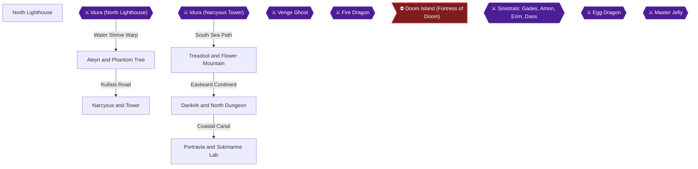

# Writer packet — Chapter 3: The High Seas and Submarine Depths

Write `08_chapters/03.md`. Previous chapter: 2. Tanbel to Bound Kingdom and Ancient Tower. Next chapter: 4. Northern Shrines, Dragon Mountain and Airship Conversion.
Planner notes: Solve North Lighthouse spike puzzle, defeat Idura to rescue Jeros, locate Phantom Tree, solve Narcysus melody, defeat Idura for the final time, deliver Priphea to Leefa, retrieve Ruby Icon in Dankirk, recruit Artea, and convert ship to submarine.

## Areas in this chapter (in order)

- `North_Lighthouse` — North Lighthouse
- `Idura_Lighthouse` — Idura (North Lighthouse)
- `Aleyn_Region` — Aleyn and Phantom Tree
- `Narcysus` — Narcysus and Tower
- `Idura_Narcysus` — Idura (Narcysus Tower)
- `Treadool_Region` — Treadool and Flower Mountain
- `Dankirk_Kingdom` — Dankirk and North Dungeon
- `Portravia_Lab` — Portravia and Submarine Lab

## Achievements to place in this chapter (each EXACTLY once as `[ACHIEVEMENT:<id>]`)

- **17582** — Memory Games (5 pts): Solve the puzzle at North Lighthouse with at least 1 set of spikes up  
  supporting facts: ra-comments-61-1, ra-comments-61-2, gf1-50-1, gf1-50-2, gf3-64-1, gf3-64-2
- **17563** — Child Abduction (5 pts, progression): Rescue Jeros from Idura  
  supporting facts: ra-comments-27-1, ra-comments-27-2, gf1-4-1, gf1-4-2, gf1-50-1, gf1-50-2, gf1-53-1, gf1-53-2, gf1-101-1, gf1-101-2, gf3-2-1, gf3-2-2, gf3-22-1, gf3-22-2, gf3-27-1, gf3-27-2, gf3-64-1, gf3-64-2, gf3-65-1, gf3-65-2
- **17564** — The Phantom Tree (5 pts, progression): Find the location of the Phantom Tree  
  supporting facts: ra-comments-29-1, ra-comments-29-2, gf1-54-1, gf1-54-2, gf1-56-1, gf1-56-2, gf1-71-1, gf1-71-2, gf1-75-1, gf1-75-2, gf1-95-1, gf1-95-2, gf1-97-1, gf1-97-2, gf3-15-1, gf3-15-2, gf3-69-1, gf3-69-2, gf3-77-1, gf3-77-2, gf3-93-1, gf3-93-2, gf3-274-1, gf3-274-2
- **17565** — The Mysterious Melody (5 pts, progression): Find out about the missing women of Narcysus  
  supporting facts: ra-comments-31-1, ra-comments-31-2, gf1-56-1, gf1-56-2, gf1-57-1, gf1-57-2, gf1-59-1, gf1-59-2, gf1-117-1, gf1-117-2, gf3-2-1, gf3-2-2, gf3-27-1, gf3-27-2, gf3-69-1, gf3-69-2, gf3-71-1, gf3-71-2, gf3-72-1, gf3-72-2, gf3-74-1, gf3-74-2, gf3-129-1, gf3-129-2, gf3-143-1, gf3-143-2, gf3-168-1, gf3-168-2, gf3-274-1, gf3-274-2
- **17566** — The Useless Servant (5 pts, progression): Defeat Idura for one last time and find your way out  
  supporting facts: ra-comments-33-1, ra-comments-33-2, gf1-59-1, gf1-59-2, gf1-60-1, gf1-60-2, gf3-278-1, gf3-278-2
- **17567** — The Priphea (5 pts, progression): Bring a Priphea to Leefa at Treadool  
  supporting facts: ra-comments-35-1, ra-comments-35-2, gf1-65-1, gf1-65-2, gf3-2-1, gf3-2-2, gf3-78-1, gf3-78-2, gf3-80-1, gf3-80-2, gf3-143-1, gf3-143-2
- **17568** — Preventing a War (5 pts, progression): Recover the Ruby Icon from Dankirk North Dungeon  
  supporting facts: ra-comments-37-1, ra-comments-37-2, gf1-65-1, gf1-65-2, gf1-66-1, gf1-66-2, gf1-68-1, gf1-68-2, gf1-119-1, gf1-119-2, gf3-2-1, gf3-2-2, gf3-87-1, gf3-87-2, gf3-88-1, gf3-88-2, gf3-89-1, gf3-89-2, gf3-90-1, gf3-90-2, gf3-111-1, gf3-111-2, gf3-143-1, gf3-143-2, gf3-171-1, gf3-171-2, gf3-227-1, gf3-227-2, gf3-237-1, gf3-237-2
- **17569** — Artea (5 pts, progression): Have Artea join your group  
  supporting facts: ra-comments-39-1, ra-comments-39-2, gf1-6-1, gf1-6-2, gf1-73-1, gf1-73-2, gf1-74-1, gf1-74-2, gf1-75-1, gf1-75-2, gf1-77-1, gf1-77-2, gf1-79-1, gf1-79-2, gf1-97-1, gf1-97-2, gf1-101-1, gf1-101-2, gf1-104-1, gf1-104-2, gf1-106-1, gf1-106-2, gf1-110-1, gf1-110-2, gf3-25-1, gf3-25-2, gf3-95-1, gf3-95-2, gf3-96-1, gf3-96-2, gf3-182-1, gf3-182-2, gf3-194-1, gf3-194-2, gf3-236-1, gf3-236-2, gf3-278-1, gf3-278-2
- **17570** — 20,000 Leagues Under the Sea (5 pts, progression): Convert your ship into a submarine  
  supporting facts: ra-comments-41-1, ra-comments-41-2, gf1-71-1, gf1-71-2, gf1-75-1, gf1-75-2, gf1-76-1, gf1-76-2, gf1-82-1, gf1-82-2, gf1-93-1, gf1-93-2, gf1-94-1, gf1-94-2, gf1-95-1, gf1-95-2, gf1-124-1, gf1-124-2, gf3-2-1, gf3-2-2, gf3-24-1, gf3-24-2, gf3-93-1, gf3-93-2, gf3-96-1, gf3-96-2, gf3-97-1, gf3-97-2, gf3-111-1, gf3-111-2, gf3-274-1, gf3-274-2

## Route diagram (inserted automatically where you write `[MERMAID]`)



## Usable facts (163) — cite as [[fact-id]]

Legend: ✅ verified (2+ sources) · ✔ conflict resolved · 🟡 single source

- 🟡 **gf1-4-1** (location) Here's an intro to all the Brave Heroes and Charmin' Heroines, some intro and — @The Heroes # · ach: 17553,17554,17563,17575,114729  
  evidence: gf1#4: "Here's an intro to all the Brave Heroes and Charmin' Heroines, some intro and"
- 🟡 **gf1-4-2** (location) some comments on their statistics to be exact. I've also included some FINAL — @The Heroes # · ach: 17553,17554,17563,17575,114729  
  evidence: gf1#4: "some comments on their statistics to be exact. I've also included some FINAL"
- 🟡 **gf1-6-1** (location) Final Equipment: Lizard Blow, Water Gaunt, Safety Hat, Bright Armor, — @The Heroes # · ach: 17569,114729  
  evidence: gf1#6: "Final Equipment: Lizard Blow, Water Gaunt, Safety Hat, Bright Armor,"
- 🟡 **gf1-6-2** (item) Elven Swordmaster, and wielder of Luminous Magic Spells; he joins Maxim and his — @The Heroes # · ach: 17569,114729  
  evidence: gf1#6: "Elven Swordmaster, and wielder of Luminous Magic Spells; he joins Maxim and his"
- 🟡 **gf1-15-1** (transition) ¤ Next, you can proceed through the opened door; this time you will find only a — @GF1 Dungeon Guide · ach: 17553,17555,17592,17599,17604,17607,17612  
  evidence: gf1#15: "¤ Next, you can proceed through the opened door; this time you will find only a"
- 🟡 **gf1-16-1** (location) ¤ After Tia has joined, head back to Sundletan and purchase the "Droplet" and — @GF1 Dungeon Guide · ach: 17553,17556,17585,17586,17588,17589,17590,17592  
  evidence: gf1#16: "¤ After Tia has joined, head back to Sundletan and purchase the "Droplet" and"
- 🟡 **gf1-40-1** (boss) ¥ Gades is the Sinistral of destruction; he can use two devastating attacks and — @GF1 Dungeon Guide · ach: 17562,17581,17588,17589,17590  
  evidence: gf1#40: "¥ Gades is the Sinistral of destruction; he can use two devastating attacks and"
- 🟡 **gf1-50-1** (location) ¤ Feel sorry for Tia! -> This is a Physical Task.... — @GF1 Dungeon Guide · ach: 17563,17582,17588,17589,17590  
  evidence: gf1#50: "¤ Feel sorry for Tia! -> This is a Physical Task...."
- 🟡 **gf1-50-2** (location) ¤ No, Nooooo; Maxim can't die here, all does infact seem to be lost, but whats — @GF1 Dungeon Guide · ach: 17563,17582,17588,17589,17590  
  evidence: gf1#50: "¤ No, Nooooo; Maxim can't die here, all does infact seem to be lost, but whats"
- 🟡 **gf1-53-1** (item) ¤ Okay, you have another treasure, but you still don't have your most important — @7 | 4 | 3 | 6 | · ach: 17561,17562,17563,17599,17604,17607,17612  
  evidence: gf1#53: "¤ Okay, you have another treasure, but you still don't have your most important"
- 🟡 **gf1-53-2** (item) treasure, your son (Jeros). This is what needs to be done, so listen up; head — @7 | 4 | 3 | 6 | · ach: 17561,17562,17563,17599,17604,17607,17612  
  evidence: gf1#53: "treasure, your son (Jeros). This is what needs to be done, so listen up; head"
- 🟡 **gf1-54-1** (transition) ¤ On the eastern landmass, you should keep on heading east, enter the town when — @7 | 4 | 3 | 6 | · ach: 17564  
  evidence: gf1#54: "¤ On the eastern landmass, you should keep on heading east, enter the town when"
- 🟡 **gf1-54-2** (location) you reach it, and prepare for a little change in the music. The music is now — @7 | 4 | 3 | 6 | · ach: 17564  
  evidence: gf1#54: "you reach it, and prepare for a little change in the music. The music is now"
- 🟡 **gf1-56-1** (transition) ¤ Upon entering the door you just opened, you will encounter a Mad Gorem, but — @7 | 4 | 3 | 6 | · ach: 17564,17565,114729  
  evidence: gf1#56: "¤ Upon entering the door you just opened, you will encounter a Mad Gorem, but"
- 🟡 **gf1-56-2** (location) instead of destroying it at first, you should lower it onto the weak area in — @7 | 4 | 3 | 6 | · ach: 17564,17565,114729  
  evidence: gf1#56: "instead of destroying it at first, you should lower it onto the weak area in"
- 🟡 **gf1-57-1** (boss) ¤ Rescue the unmarried girls! (From Idura....AGAIN!) — @7 | 4 | 3 | 6 | · ach: 17565  
  evidence: gf1#57: "¤ Rescue the unmarried girls! (From Idura....AGAIN!)"
- 🟡 **gf1-57-2** (boss) ¤ Defeat Idura once again! — @7 | 4 | 3 | 6 | · ach: 17565  
  evidence: gf1#57: "¤ Defeat Idura once again!"
- 🟡 **gf1-59-1** (location) ¤ After operation Blitzkrieg, you should be able to access all three southern — @GF1 Dungeon Guide · ach: 17562,17565,17566,17600,17604,17608,17612  
  evidence: gf1#59: "¤ After operation Blitzkrieg, you should be able to access all three southern"
- 🟡 **gf1-59-2** (transition) doors inside this room; simply because all the statues have moved out of the — @GF1 Dungeon Guide · ach: 17562,17565,17566,17600,17604,17608,17612  
  evidence: gf1#59: "doors inside this room; simply because all the statues have moved out of the"
- 🟡 **gf1-60-1** (location) ¤ Raid the Stores, Buy weapons, armours and spells! — @GF1 Dungeon Guide · ach: 17566  
  evidence: gf1#60: "¤ Raid the Stores, Buy weapons, armours and spells!"
- 🟡 **gf1-60-2** (location) ¤ Here the Villagers speak of a super being to the NORTH! — @GF1 Dungeon Guide · ach: 17566  
  evidence: gf1#60: "¤ Here the Villagers speak of a super being to the NORTH!"
- 🟡 **gf1-65-1** (location) ¤ Okay, the Rogue Flower is all burned up, so there's one last thing to do in — @GF1 Dungeon Guide · ach: 17560,17561,17567,17568,17585,17586  
  evidence: gf1#65: "¤ Okay, the Rogue Flower is all burned up, so there's one last thing to do in"
- 🟡 **gf1-65-2** (location) this place, get the flowers you came for I suppose. Now walk over and pick up — @GF1 Dungeon Guide · ach: 17560,17561,17567,17568,17585,17586  
  evidence: gf1#65: "this place, get the flowers you came for I suppose. Now walk over and pick up"
- 🟡 **gf1-66-1** (location) ¤ Clamento once again, it's been a while since you last visited this town, and — @GF1 Dungeon Guide · ach: 17560,17568,17588,17589,17590  
  evidence: gf1#66: "¤ Clamento once again, it's been a while since you last visited this town, and"
- 🟡 **gf1-66-2** (location) Jaffy still runs a steady business; so let's give him a bell; speak to Jaffy — @GF1 Dungeon Guide · ach: 17560,17568,17588,17589,17590  
  evidence: gf1#66: "Jaffy still runs a steady business; so let's give him a bell; speak to Jaffy"
- 🟡 **gf1-68-1** (location) ¤ More Monsters! In fact there's a whole load of monsters in rooms which follow — @GF1 Dungeon Guide · ach: 17561,17562,17568,17592  
  evidence: gf1#68: "¤ More Monsters! In fact there's a whole load of monsters in rooms which follow"
- 🟡 **gf1-68-2** (location) and that means loads o' battles. When you reach the final room, there's some — @GF1 Dungeon Guide · ach: 17561,17562,17568,17592  
  evidence: gf1#68: "and that means loads o' battles. When you reach the final room, there's some"
- 🟡 **gf1-71-1** (location) ¤ Bury the residents of this town! — @GF1 Dungeon Guide · ach: 17564,17570,17575,17592  
  evidence: gf1#71: "¤ Bury the residents of this town!"
- 🟡 **gf1-71-2** (location) ¤ Speak to Iris and find out what happened! — @GF1 Dungeon Guide · ach: 17564,17570,17575,17592  
  evidence: gf1#71: "¤ Speak to Iris and find out what happened!"
- 🟡 **gf1-73-1** (location) ¤ Phew...the little elf is safe, she isn't at all happy though, maybe she's a — @GF1 Dungeon Guide · ach: 17569,17587,17588,17589,17590,17592  
  evidence: gf1#73: "¤ Phew...the little elf is safe, she isn't at all happy though, maybe she's a"
- 🟡 **gf1-73-2** (location) little embarrassed because she was outsmarted for once. The girl is a little — @GF1 Dungeon Guide · ach: 17569,17587,17588,17589,17590,17592  
  evidence: gf1#73: "little embarrassed because she was outsmarted for once. The girl is a little"
- 🟡 **gf1-74-1** (item) » The First treasure to be acquired is the Heart Key; so get out the hook and — @GF1 Dungeon Guide · ach: 17569  
  evidence: gf1#74: "» The First treasure to be acquired is the Heart Key; so get out the hook and"
- 🟡 **gf1-74-2** (location) aim for the upper-right pillar, then grab the pillar to the right, then the — @GF1 Dungeon Guide · ach: 17569  
  evidence: gf1#74: "aim for the upper-right pillar, then grab the pillar to the right, then the"
- 🟡 **gf1-75-1** (transition) ¤ Funs Over, so go through the door and follow the spooky passage until a wall — @GF1 Dungeon Guide · ach: 17562,17564,17569,17570,17575,17576,17587,17588,17589,17590  
  evidence: gf1#75: "¤ Funs Over, so go through the door and follow the spooky passage until a wall"
- 🟡 **gf1-75-2** (transition) collapses; now keep on going and head up the stairs, you will find some more — @GF1 Dungeon Guide · ach: 17562,17564,17569,17570,17575,17576,17587,17588,17589,17590  
  evidence: gf1#75: "collapses; now keep on going and head up the stairs, you will find some more"
- 🟡 **gf1-76-1** (location) ¤ The usual stuff, upgrade your weapons and armours! — @GF1 Dungeon Guide · ach: 17570,17571,17587  
  evidence: gf1#76: "¤ The usual stuff, upgrade your weapons and armours!"
- 🟡 **gf1-76-2** (location) ¤ Learn about the undersea shrine, a.k.a the Shrine of Vengeance! — @GF1 Dungeon Guide · ach: 17570,17571,17587  
  evidence: gf1#76: "¤ Learn about the undersea shrine, a.k.a the Shrine of Vengeance!"
- 🟡 **gf1-77-1** (location) ¤ The next room has a pot and a switch with a monster standing in the eastern — @GF1 Dungeon Guide · ach: 17569  
  evidence: gf1#77: "¤ The next room has a pot and a switch with a monster standing in the eastern"
- 🟡 **gf1-77-2** (location) area of the room; here you must trap the monster within the spikes; as you — @GF1 Dungeon Guide · ach: 17569  
  evidence: gf1#77: "area of the room; here you must trap the monster within the spikes; as you"
- 🟡 **gf1-79-1** (location) Items -> 2 × Secret Fruit — @GF1 Dungeon Guide · ach: 17569,17572,17602,17604,17610,17612,17603,17611  
  evidence: gf1#79: "Items -> 2 × Secret Fruit"
- 🟡 **gf1-79-2** (location) ¤ Battle has made you tired, but when you do get back to the town of Barnan; a — @GF1 Dungeon Guide · ach: 17569,17572,17602,17604,17610,17612,17603,17611  
  evidence: gf1#79: "¤ Battle has made you tired, but when you do get back to the town of Barnan; a"
- 🟡 **gf1-82-1** (location) ¤ Reach the town of Chead, using the Sub! — @GF1 Dungeon Guide · ach: 17570,17573,17591,17592  
  evidence: gf1#82: "¤ Reach the town of Chead, using the Sub!"
- 🟡 **gf1-82-2** (location) ¤ Purchase older spells from previous towns! — @GF1 Dungeon Guide · ach: 17570,17573,17591,17592  
  evidence: gf1#82: "¤ Purchase older spells from previous towns!"
- 🟡 **gf1-93-1** (location) ¥ Artea has the Ice.Valk Spell, and I hope Selan has the spell too...you will — @!:::::::::! · ach: 17570,17573,17575,17580,17592,114729  
  evidence: gf1#93: "¥ Artea has the Ice.Valk Spell, and I hope Selan has the spell too...you will"
- 🟡 **gf1-93-2** (location) have Valor and Champion to use as well, so Magic should not be a Problem; I — @!:::::::::! · ach: 17570,17573,17575,17580,17592,114729  
  evidence: gf1#93: "have Valor and Champion to use as well, so Magic should not be a Problem; I"
- 🟡 **gf1-94-1** (location) ¤ Apart from those lovely armours, there's a queen called Marla, she is waiting — @!:::::::::! · ach: 17570,17575  
  evidence: gf1#94: "¤ Apart from those lovely armours, there's a queen called Marla, she is waiting"
- 🟡 **gf1-94-2** (location) for you in the palace, this means you have to go there. Marla wonders how you — @!:::::::::! · ach: 17570,17575  
  evidence: gf1#94: "for you in the palace, this means you have to go there. Marla wonders how you"
- 🟡 **gf1-95-1** (boss) ¤ Daos, the Sinistral of Terror, hates the fact that a Human could be stronger — @!:::::::::! · ach: 17556,17564,17570,17576  
  evidence: gf1#95: "¤ Daos, the Sinistral of Terror, hates the fact that a Human could be stronger"
- 🟡 **gf1-95-2** (location) than most Sinistrals, so just to spite Maxim, Selan, Guy and Artea; he wants — @!:::::::::! · ach: 17556,17564,17570,17576  
  evidence: gf1#95: "than most Sinistrals, so just to spite Maxim, Selan, Guy and Artea; he wants"
- 🟡 **gf1-97-1** (location) ¥ Pretty Tough I would say, but only when your on a lower level, this tank is — @!:::::::::! · ach: 17564,17569,17574,17592  
  evidence: gf1#97: "¥ Pretty Tough I would say, but only when your on a lower level, this tank is"
- 🟡 **gf1-97-2** (location) strong against magical attacks, so make sure all magic spells used here are — @!:::::::::! · ach: 17564,17569,17574,17592  
  evidence: gf1#97: "strong against magical attacks, so make sure all magic spells used here are"
- 🟡 **gf1-101-1** (transition) ¤ I assume you took the lower door, well here goes...! Your inside a small room — @GF1 Dungeon Guide · ach: 17563,17569,17575,17576  
  evidence: gf1#101: "¤ I assume you took the lower door, well here goes...! Your inside a small room"
- 🟡 **gf1-101-2** (location) with a Mega Cyclops, I think you had better kill him...when he rots, head up — @GF1 Dungeon Guide · ach: 17563,17569,17575,17576  
  evidence: gf1#101: "with a Mega Cyclops, I think you had better kill him...when he rots, head up"
- 🟡 **gf1-104-1** (location) ¥ Chaos wave can cause confusion, and he's got a nice assortment of Level three — @GF1 Dungeon Guide · ach: 17569,17575,17576,17592  
  evidence: gf1#104: "¥ Chaos wave can cause confusion, and he's got a nice assortment of Level three"
- 🟡 **gf1-104-2** (location) magic spells, and of course the horrible Galactic Lancer technique...like the — @GF1 Dungeon Guide · ach: 17569,17575,17576,17592  
  evidence: gf1#104: "magic spells, and of course the horrible Galactic Lancer technique...like the"
- 🟡 **gf1-106-1** (boss) ¥ Daos, is Terror itself, he uses some devastating attacks which can cause some — @GF1 Dungeon Guide · ach: 17569,17575,17576,17592  
  evidence: gf1#106: "¥ Daos, is Terror itself, he uses some devastating attacks which can cause some"
- 🟡 **gf1-106-2** (location) Random Status effects! First of all, he's got an attack called Terror Wave; — @GF1 Dungeon Guide · ach: 17569,17575,17576,17592  
  evidence: gf1#106: "Random Status effects! First of all, he's got an attack called Terror Wave;"
- 🟡 **gf1-110-1** (location) ¤ The blonde haired chick near the entrance says she likes "STRONG" gambling — @GF1 Dungeon Guide · ach: 17569,17583,17585,17586  
  evidence: gf1#110: "¤ The blonde haired chick near the entrance says she likes "STRONG" gambling"
- 🟡 **gf1-110-2** (location) men. Heh, she looks like one of those elf people, perhaps shes from the same — @GF1 Dungeon Guide · ach: 17569,17583,17585,17586  
  evidence: gf1#110: "men. Heh, she looks like one of those elf people, perhaps shes from the same"
- 🟡 **gf1-117-1** (location) ¤ Pear Cider       -      10G - Restores....8HP  # These items will not restore — @Shops/Finances # · ach: 17565,114729  
  evidence: gf1#117: "¤ Pear Cider       -      10G - Restores....8HP  # These items will not restore"
- 🟡 **gf1-117-2** (location) ¤ Lime Cider       -      40G - Restores...15HP    instead these will increase — @Shops/Finances # · ach: 17565,114729  
  evidence: gf1#117: "¤ Lime Cider       -      40G - Restores...15HP    instead these will increase"
- 🟡 **gf1-119-1** (location) ¤ Pear Cider       -      10G - Restores....8HP  # These items will not restore — @Shops/Finances # · ach: 17568,17583,17584  
  evidence: gf1#119: "¤ Pear Cider       -      10G - Restores....8HP  # These items will not restore"
- 🟡 **gf1-119-2** (location) ¤ Lime Cider       -      40G - Restores...15HP    instead these will increase — @Shops/Finances # · ach: 17568,17583,17584  
  evidence: gf1#119: "¤ Lime Cider       -      40G - Restores...15HP    instead these will increase"
- 🟡 **gf1-124-1** (transition) Location: Inside the Tower of Sacrifice, when you get a choice of three doors; — @Capsule Monsters # · ach: 17561,17570,17599,17604,17607,17612,17600,17608,17601,17609,17602,17610,17603,17611  
  evidence: gf1#124: "Location: Inside the Tower of Sacrifice, when you get a choice of three doors;"
- 🟡 **gf1-124-2** (transition) take a peak inside the middle door and Gusto will be waiting for the — @Capsule Monsters # · ach: 17561,17570,17599,17604,17607,17612,17600,17608,17601,17609,17602,17610,17603,17611  
  evidence: gf1#124: "take a peak inside the middle door and Gusto will be waiting for the"
- 🟡 **gf3-2-1** (location) Important word on combining elemental attacks — @GameFAQ Status: 100% · ach: 17553,17554,17558,17561,17562,17563,17565,17567,17568,17570,17571,17575,17581,17585,17586,17588,17589,17590,17591,17597,17604,17605,17612,17598,17606,17599,17607,17600,17608,17601,17609,17602,17610,17603,17611,114733,114734,114729  
  evidence: gf3#2: "Important word on combining elemental attacks"
- 🟡 **gf3-2-2** (location) 1. The request of the old man — @GameFAQ Status: 100% · ach: 17553,17554,17558,17561,17562,17563,17565,17567,17568,17570,17571,17575,17581,17585,17586,17588,17589,17590,17591,17597,17604,17605,17612,17598,17606,17599,17607,17600,17608,17601,17609,17602,17610,17603,17611,114733,114734,114729  
  evidence: gf3#2: "1. The request of the old man"
- 🟡 **gf3-15-1** (location) If a person receives more damage than his/her HP can bear, he/she will be — @Diseases · ach: 17553,17556,17564,17604,17612,114729  
  evidence: gf3#15: "If a person receives more damage than his/her HP can bear, he/she will be"
- 🟡 **gf3-15-2** (item) defeated. Be careful, because if all party members die (Capsule monster — @Diseases · ach: 17553,17556,17564,17604,17612,114729  
  evidence: gf3#15: "defeated. Be careful, because if all party members die (Capsule monster"
- 🟡 **gf3-22-1** (location) She lives in Parcelyte with her auntie. After the king sends you on the — @Initial Equipment · ach: 17563  
  evidence: gf3#22: "She lives in Parcelyte with her auntie. After the king sends you on the"
- 🟡 **gf3-22-2** (item) mission to retrieve the treasure sword she is forced to join you. At first she — @Initial Equipment · ach: 17563  
  evidence: gf3#22: "mission to retrieve the treasure sword she is forced to join you. At first she"
- 🟡 **gf3-24-1** (location) Lexis - Genius and inventor of the Century: — @Statistics · ach: 17570  
  evidence: gf3#24: "Lexis - Genius and inventor of the Century:"
- 🟡 **gf3-24-2** (location) Dr. Lexis Shaia lives in his own cave to the north east of Treadool. His — @Statistics · ach: 17570  
  evidence: gf3#24: "Dr. Lexis Shaia lives in his own cave to the north east of Treadool. His"
- 🟡 **gf3-25-1** (location) Artea - Archer of the Elves: — @Statistics · ach: 17569,17587  
  evidence: gf3#25: "Artea - Archer of the Elves:"
- 🟡 **gf3-25-2** (location) After meeting Arty / Artea on the mountain of no return, you will hear that — @Statistics · ach: 17569,17587  
  evidence: gf3#25: "After meeting Arty / Artea on the mountain of no return, you will hear that"
- 🟡 **gf3-27-1** (location) You will meet this character various times in the game, she will usually come — @Iris - The Enigma: · ach: 17554,17558,17561,17563,17565,17575  
  evidence: gf3#27: "You will meet this character various times in the game, she will usually come"
- 🟡 **gf3-27-2** (location) in a nick of time to save your butt in critical times. She tells about - the — @Iris - The Enigma: · ach: 17554,17558,17561,17563,17565,17575  
  evidence: gf3#27: "in a nick of time to save your butt in critical times. She tells about - the"
- 🟡 **gf3-64-1** (location) 12.3 All's well that ends well? — @GF3 Dungeon Guide · ach: 17562,17563,17582,17588,17589,17590  
  evidence: gf3#64: "12.3 All's well that ends well?"
- 🟡 **gf3-64-2** (boss) There is not much to be done here since Gades is defeated it seems to be — @GF3 Dungeon Guide · ach: 17562,17563,17582,17588,17589,17590  
  evidence: gf3#64: "There is not much to be done here since Gades is defeated it seems to be"
- 🟡 **gf3-65-1** (location) -At the start form an arrow that points to the left, proceed to the next — @13. Idura is back · ach: 17563  
  evidence: gf3#65: "-At the start form an arrow that points to the left, proceed to the next"
- 🟡 **gf3-65-2** (transition) rooms, and ascend four stairways up. Here are two doors in the first room of — @13. Idura is back · ach: 17563  
  evidence: gf3#65: "rooms, and ascend four stairways up. Here are two doors in the first room of"
- 🟡 **gf3-69-1** (location) The best way to deal with them is by casting trick and brave so they won't be — @14. Jyad the ship builder · ach: 17564,17565  
  evidence: gf3#69: "The best way to deal with them is by casting trick and brave so they won't be"
- 🟡 **gf3-69-2** (location) able to cause too much damage, use IP that are either multi-attacks (Octo- — @14. Jyad the ship builder · ach: 17564,17565  
  evidence: gf3#69: "able to cause too much damage, use IP that are either multi-attacks (Octo-"
- 🟡 **gf3-71-1** (transition) Once you arrive here you can try to walk up the stairway on the right side, — @14. Jyad the ship builder · ach: 17560,17565,17578,17598,17604,17606,17612  
  evidence: gf3#71: "Once you arrive here you can try to walk up the stairway on the right side,"
- 🟡 **gf3-71-2** (location) but suddenly you will hear a mysterious melody. For some reason all young and — @14. Jyad the ship builder · ach: 17560,17565,17578,17598,17604,17606,17612  
  evidence: gf3#71: "but suddenly you will hear a mysterious melody. For some reason all young and"
- 🟡 **gf3-72-1** (transition) Walk down the door in the middle of this room to find Gusto. His element is — @14. Jyad the ship builder · ach: 17565,17592,17600,17604,17608,17612  
  evidence: gf3#72: "Walk down the door in the middle of this room to find Gusto. His element is"
- 🟡 **gf3-72-2** (location) wind, which explains why he is so incredibly fast. Use the earth fruit on him — @14. Jyad the ship builder · ach: 17565,17592,17600,17604,17608,17612  
  evidence: gf3#72: "wind, which explains why he is so incredibly fast. Use the earth fruit on him"
- 🟡 **gf3-74-1** (location) MP is depleted or drained. Check Appendix F for more information. — @GF3 Dungeon Guide · ach: 17565  
  evidence: gf3#74: "MP is depleted or drained. Check Appendix F for more information."
- 🟡 **gf3-74-2** (boss) -The defeated Idura will flee again, and the women are freed. They will go — @GF3 Dungeon Guide · ach: 17565  
  evidence: gf3#74: "-The defeated Idura will flee again, and the women are freed. They will go"
- 🟡 **gf3-77-1** (location) Talk to one of the guys with blue hair and follow him to the boat that is for — @GF3 Dungeon Guide · ach: 17564  
  evidence: gf3#77: "Talk to one of the guys with blue hair and follow him to the boat that is for"
- 🟡 **gf3-77-2** (location) sale. That boat turns out to be owned by the genius called Dr. Lexis Shaia. — @GF3 Dungeon Guide · ach: 17564  
  evidence: gf3#77: "sale. That boat turns out to be owned by the genius called Dr. Lexis Shaia."
- 🟡 **gf3-78-1** (transition) When Maxim enters Treadool again he will see a girl at the entrance of town — @GF3 Dungeon Guide · ach: 17556,17567,17588,17589,17590  
  evidence: gf3#78: "When Maxim enters Treadool again he will see a girl at the entrance of town"
- 🟡 **gf3-78-2** (location) who sells flowers. Talk to her and she will faint. Upon recovering, Leefa — @GF3 Dungeon Guide · ach: 17556,17567,17588,17589,17590  
  evidence: gf3#78: "who sells flowers. Talk to her and she will faint. Upon recovering, Leefa"
- 🟡 **gf3-80-1** (location) Specials:   Sneeze spreader, Thorn — @GF3 Dungeon Guide · ach: 17567,17585,17586,114729  
  evidence: gf3#80: "Specials:   Sneeze spreader, Thorn"
- 🟡 **gf3-80-2** (item) When you equip weapons like the Spark staff, Sizzle sword (both from blue — @GF3 Dungeon Guide · ach: 17567,17585,17586,114729  
  evidence: gf3#80: "When you equip weapons like the Spark staff, Sizzle sword (both from blue"
- 🟡 **gf3-87-1** (location) Example: Say you have a full house of 3 8's and 2 6's. Your opponent has 3 7's — @Full House · ach: 17560,17568,17588,17589,17590  
  evidence: gf3#87: "Example: Say you have a full house of 3 8's and 2 6's. Your opponent has 3 7's"
- 🟡 **gf3-87-2** (location) and 2 6's. You will win because your 8's have more power than your opponents — @Full House · ach: 17560,17568,17588,17589,17590  
  evidence: gf3#87: "and 2 6's. You will win because your 8's have more power than your opponents"
- 🟡 **gf3-88-1** (transition) -Take the stairs and use the door, now open the only door you haven't opened — @19. The Ruby Icon · ach: 17568,17588,17589,17590  
  evidence: gf3#88: "-Take the stairs and use the door, now open the only door you haven't opened"
- 🟡 **gf3-88-2** (transition) in this room. Walk on, descend stairs again and place the pillar so you can — @19. The Ruby Icon · ach: 17568,17588,17589,17590  
  evidence: gf3#88: "in this room. Walk on, descend stairs again and place the pillar so you can"
- 🟡 **gf3-89-1** (location) These four are just plain amateurs compared with the other monsters of this — @19. The Ruby Icon · ach: 17568,17585,17586  
  evidence: gf3#89: "These four are just plain amateurs compared with the other monsters of this"
- 🟡 **gf3-89-2** (location) dungeon; with an HP of 400 they will probably be gone if you use dragon — @19. The Ruby Icon · ach: 17568,17585,17586  
  evidence: gf3#89: "dungeon; with an HP of 400 they will probably be gone if you use dragon"
- 🟡 **gf3-90-1** (location) You can get to him by sailing to the moon shaped isle to the west of Shrine — @19. The Ruby Icon · ach: 17568,17602,17604,17610,17612  
  evidence: gf3#90: "You can get to him by sailing to the moon shaped isle to the west of Shrine"
- 🟡 **gf3-90-2** (location) of Vengeance that is to the north of Chaed. Here you will find him on top of a — @19. The Ruby Icon · ach: 17568,17602,17604,17610,17612  
  evidence: gf3#90: "of Vengeance that is to the north of Chaed. Here you will find him on top of a"
- 🟡 **gf3-93-1** (location) 22. Transforming Excerion into a submarine — @GF3 Dungeon Guide · ach: 17564,17570  
  evidence: gf3#93: "22. Transforming Excerion into a submarine"
- 🟡 **gf3-93-2** (location) The people here are talking about a light ball hitting the water somewhere to — @GF3 Dungeon Guide · ach: 17564,17570  
  evidence: gf3#93: "The people here are talking about a light ball hitting the water somewhere to"
- 🟡 **gf3-95-1** (location) are at a reasonable level. — @are at a reasonable level. · ach: 17569,17585,17586,17587,17588,17589,17590,17592  
  evidence: gf3#95: "are at a reasonable level."
- 🟡 **gf3-95-2** (location) Once they are annihilated, you will meet up with another elf named Artea or — @are at a reasonable level. · ach: 17569,17585,17586,17587,17588,17589,17590,17592  
  evidence: gf3#95: "Once they are annihilated, you will meet up with another elf named Artea or"
- 🟡 **gf3-96-1** (location) -Walk through the next three rooms (you will ignite the candles when you walk — @23. Milka's mother is gone · ach: 17569,17570,17587,17588,17589,17590,17604,17612  
  evidence: gf3#96: "-Walk through the next three rooms (you will ignite the candles when you walk"
- 🟡 **gf3-96-2** (location) past them). Use the hook on the switch in the wall to get the platform to move — @23. Milka's mother is gone · ach: 17569,17570,17587,17588,17589,17590,17604,17612  
  evidence: gf3#96: "past them). Use the hook on the switch in the wall to get the platform to move"
- 🟡 **gf3-97-1** (location) --Underwater cave, near Parcelyte-- — @23. Milka's mother is gone · ach: 17553,17556,17570,17585,17586,17587,17588,17589,17590,17603,17604,17611,17612  
  evidence: gf3#97: "--Underwater cave, near Parcelyte--"
- 🟡 **gf3-97-2** (location) If you go underwater you can move around and get to a cave where you will find — @23. Milka's mother is gone · ach: 17553,17556,17570,17585,17586,17587,17588,17589,17590,17603,17604,17611,17612  
  evidence: gf3#97: "If you go underwater you can move around and get to a cave where you will find"
- 🟡 **gf3-111-1** (location) Lexis will explain that he and the others can convert the Excerion for air — @D = move one space down · ach: 17556,17568,17570  
  evidence: gf3#111: "Lexis will explain that he and the others can convert the Excerion for air"
- 🟡 **gf3-111-2** (transition) traveling. But in order to do so they need a stronger motor. Lexis has heard — @D = move one space down · ach: 17556,17568,17570  
  evidence: gf3#111: "traveling. But in order to do so they need a stronger motor. Lexis has heard"
- 🟡 **gf3-129-1** (location) Increases ATP of one party member by 40 % — @GF3 Dungeon Guide · ach: 17565,17600,17604,17608,17612  
  evidence: gf3#129: "Increases ATP of one party member by 40 %"
- 🟡 **gf3-129-2** (location) Location:   Tower of Sacrifice, to the north of Narcysus — @GF3 Dungeon Guide · ach: 17565,17600,17604,17608,17612  
  evidence: gf3#129: "Location:   Tower of Sacrifice, to the north of Narcysus"
- 🟡 **gf3-143-1** (location) 1. IV. Items - Scenario objects and keys — @GF3 Dungeon Guide · ach: 17553,17556,17560,17565,17567,17568,17571,17587,114729  
  evidence: gf3#143: "1. IV. Items - Scenario objects and keys"
- 🟡 **gf3-143-2** (transition) Door key          Key of the cave to Sundletan — @GF3 Dungeon Guide · ach: 17553,17556,17560,17565,17567,17568,17571,17587,114729  
  evidence: gf3#143: "Door key          Key of the cave to Sundletan"
- 🟡 **gf3-168-1** (item) Hi-potion      War rapier     Long robe — @Tar(target) Column · ach: 17565  
  evidence: gf3#168: "Hi-potion      War rapier     Long robe"
- 🟡 **gf3-168-2** (item) Regain         Long sword     Plated cloth — @Tar(target) Column · ach: 17565  
  evidence: gf3#168: "Regain         Long sword     Plated cloth"
- 🟡 **gf3-171-1** (item) Hi-potion      Broadsword     Metalcoat      Shield — @Tar(target) Column · ach: 17568  
  evidence: gf3#171: "Hi-potion      Broadsword     Metalcoat      Shield"
- 🟡 **gf3-171-2** (location) Magic guard    Superdriver    Power jacket   Mirror — @Tar(target) Column · ach: 17568  
  evidence: gf3#171: "Magic guard    Superdriver    Power jacket   Mirror"
- 🟡 **gf3-182-1** (boss) This Tactic by ArchmageMagus, has made him the easiest boss in the entire — @The Battle · ach: 17569,17598,17604,17606,17612,114733,114734,114729  
  evidence: gf3#182: "This Tactic by ArchmageMagus, has made him the easiest boss in the entire"
- 🟡 **gf3-182-2** (location) game; Simply annihilate your own party, while battling him!! This may sound — @The Battle · ach: 17569,17598,17604,17606,17612,114733,114734,114729  
  evidence: gf3#182: "game; Simply annihilate your own party, while battling him!! This may sound"
- 🟡 **gf3-194-1** (location) Only use magic if you really need to, because Magic-restoring items are not so — @Patience is a good virtue · ach: 17569  
  evidence: gf3#194: "Only use magic if you really need to, because Magic-restoring items are not so"
- 🟡 **gf3-194-2** (location) common in the cave. Unless you're lucky enough to find the "Absorb" spell, if — @Patience is a good virtue · ach: 17569  
  evidence: gf3#194: "common in the cave. Unless you're lucky enough to find the "Absorb" spell, if"
- 🟡 **gf3-227-1** (location) Hard, (Fire), (Water), (Ice), (Thunder) — @GF3 Dungeon Guide · ach: 17559,17568,17571  
  evidence: gf3#227: "Hard, (Fire), (Water), (Ice), (Thunder)"
- 🟡 **gf3-227-2** (location) P: Piercer / Magic gale bullet / Incendiary bomb — @GF3 Dungeon Guide · ach: 17559,17568,17571  
  evidence: gf3#227: "P: Piercer / Magic gale bullet / Incendiary bomb"
- 🟡 **gf3-236-1** (item) At the chart table at the end of the game you will see the "Eggs brought" — @99 eggs brought · ach: 17569,17588,17589,17590  
  evidence: gf3#236: "At the chart table at the end of the game you will see the "Eggs brought""
- 🟡 **gf3-236-2** (boss) stat. This doesn't indicate the number of eggs brought to the Egg dragon, but — @99 eggs brought · ach: 17569,17588,17589,17590  
  evidence: gf3#236: "stat. This doesn't indicate the number of eggs brought to the Egg dragon, but"
- 🟡 **gf3-237-1** (location) In the game you will come across the prince of Auralio; his name is Leon, but — @99 eggs brought · ach: 17568,17588,17589,17590  
  evidence: gf3#237: "In the game you will come across the prince of Auralio; his name is Leon, but"
- 🟡 **gf3-237-2** (location) later on when the ceremony of the ruby icon begins his name suddenly changes — @99 eggs brought · ach: 17568,17588,17589,17590  
  evidence: gf3#237: "later on when the ceremony of the ruby icon begins his name suddenly changes"
- 🟡 **gf3-274-1** (location) Battle Background Music Test — @Gordovan's Holy Cross Puzzle · ach: 17558,17564,17565,17570,17576,17585,17586,17588,17589,17590,17591,17597,17604,17605,17612  
  evidence: gf3#274: "Battle Background Music Test"
- 🟡 **gf3-274-2** (transition) Use the following code to test all the music in the game, enter the code with — @Gordovan's Holy Cross Puzzle · ach: 17558,17564,17565,17570,17576,17585,17586,17588,17589,17590,17591,17597,17604,17605,17612  
  evidence: gf3#274: "Use the following code to test all the music in the game, enter the code with"
- 🟡 **gf3-278-1** (location) Neverland Company / Natsume / Taito: — @Gordovan's Holy Cross Puzzle · ach: 17554,17555,17556,17559,17566,17569,17573,17581,17584,17585,17586,17588,17589,17590,17591,17599,17604,17607,17612,17602,17610,17603,17611,114733,114734,114729  
  evidence: gf3#278: "Neverland Company / Natsume / Taito:"
- 🟡 **gf3-278-2** (location) For making a great RPG game, and publishing it in all the regions. — @Gordovan's Holy Cross Puzzle · ach: 17554,17555,17556,17559,17566,17569,17573,17581,17584,17585,17586,17588,17589,17590,17591,17599,17604,17607,17612,17602,17610,17603,17611,114733,114734,114729  
  evidence: gf3#278: "For making a great RPG game, and publishing it in all the regions."
- 🟡 **ra-comments-25-1** (achievement) [Server] Enddox edited this achievement. — ach: 17562  
  evidence: ra-comments#25: "[Server] Enddox edited this achievement."
- 🟡 **ra-comments-25-2** (achievement) [Server] Enddox edited this achievement. — ach: 17562  
  evidence: ra-comments#25: "[Server] Enddox edited this achievement."
- 🟡 **ra-comments-27-1** (achievement) [Server] Enddox edited this achievement. — ach: 17563  
  evidence: ra-comments#27: "[Server] Enddox edited this achievement."
- 🟡 **ra-comments-27-2** (achievement) [Server] Enddox edited this achievement. — ach: 17563  
  evidence: ra-comments#27: "[Server] Enddox edited this achievement."
- 🟡 **ra-comments-29-1** (achievement) [Server] Enddox edited this achievement. — ach: 17564  
  evidence: ra-comments#29: "[Server] Enddox edited this achievement."
- 🟡 **ra-comments-29-2** (achievement) [Server] Enddox edited this achievement. — ach: 17564  
  evidence: ra-comments#29: "[Server] Enddox edited this achievement."
- 🟡 **ra-comments-31-1** (achievement) [Server] Enddox edited this achievement. — ach: 17565  
  evidence: ra-comments#31: "[Server] Enddox edited this achievement."
- 🟡 **ra-comments-31-2** (achievement) [Server] Enddox edited this achievement. — ach: 17565  
  evidence: ra-comments#31: "[Server] Enddox edited this achievement."
- 🟡 **ra-comments-33-1** (achievement) [Server] Enddox edited this achievement. — ach: 17566  
  evidence: ra-comments#33: "[Server] Enddox edited this achievement."
- 🟡 **ra-comments-33-2** (achievement) [Server] Enddox edited this achievement. — ach: 17566  
  evidence: ra-comments#33: "[Server] Enddox edited this achievement."
- 🟡 **ra-comments-35-1** (achievement) [Server] Enddox edited this achievement. — ach: 17567  
  evidence: ra-comments#35: "[Server] Enddox edited this achievement."
- 🟡 **ra-comments-35-2** (achievement) [Server] Enddox edited this achievement. — ach: 17567  
  evidence: ra-comments#35: "[Server] Enddox edited this achievement."
- 🟡 **ra-comments-37-1** (achievement) [Server] Enddox edited this achievement. — ach: 17568  
  evidence: ra-comments#37: "[Server] Enddox edited this achievement."
- 🟡 **ra-comments-37-2** (achievement) [Server] Altomar edited this achievement. — ach: 17568  
  evidence: ra-comments#37: "[Server] Altomar edited this achievement."
- 🟡 **ra-comments-39-1** (achievement) [Server] Enddox edited this achievement. — ach: 17569  
  evidence: ra-comments#39: "[Server] Enddox edited this achievement."
- 🟡 **ra-comments-39-2** (achievement) [Server] DanielARP edited this achievement. — ach: 17569  
  evidence: ra-comments#39: "[Server] DanielARP edited this achievement."
- 🟡 **ra-comments-41-1** (achievement) [Server] Enddox edited this achievement. — ach: 17570  
  evidence: ra-comments#41: "[Server] Enddox edited this achievement."
- 🟡 **ra-comments-41-2** (achievement) [Server] DanielARP edited this achievement. — ach: 17570  
  evidence: ra-comments#41: "[Server] DanielARP edited this achievement."
- 🟡 **ra-comments-43-1** (achievement) [Server] Enddox edited this achievement. — ach: 17571  
  evidence: ra-comments#43: "[Server] Enddox edited this achievement."
- 🟡 **ra-comments-43-2** (achievement) [Server] DanielARP edited this achievement. — ach: 17571  
  evidence: ra-comments#43: "[Server] DanielARP edited this achievement."
- 🟡 **ra-comments-61-1** (achievement) [HippopotamusRex] This one seems to be miscategorized.  It triggered after solving the puzzle for the Jet Helmet in the Regal Gob cave — ach: 17582  
  evidence: ra-comments#61: "[HippopotamusRex] This one seems to be miscategorized.  It triggered after solving the puzzle for the Jet Helmet in the Regal Gob cave"
- 🟡 **ra-comments-61-2** (achievement) [Kallios] yeah I solved the puzzle in the alunze cave and I received it — ach: 17582  
  evidence: ra-comments#61: "[Kallios] yeah I solved the puzzle in the alunze cave and I received it"
- 🟡 **ra-comments-67-1** (achievement) [Agrahnax] FYI although the achievment states you have to win the coins you can just buy them and the achievment will still pop. You just need to have 1.000.000 coins. — ach: 17585  
  evidence: ra-comments#67: "[Agrahnax] FYI although the achievment states you have to win the coins you can just buy them and the achievment will still pop. You just need to have 1.000.000 coins."
- 🟡 **ra-comments-67-2** (achievement) [Server] Enddox edited this achievement. — ach: 17585  
  evidence: ra-comments#67: "[Server] Enddox edited this achievement."
- 🟡 **ra-comments-97-1** (achievement) [Server] Enddox edited this achievement. — ach: 17604  
  evidence: ra-comments#97: "[Server] Enddox edited this achievement."
- 🟡 **ra-comments-97-2** (achievement) [Server] Enddox edited this achievement. — ach: 17604  
  evidence: ra-comments#97: "[Server] Enddox edited this achievement."
- 🟡 **ra-comments-115-1** (achievement) [Server] MrGauss uploaded this achievement. — ach: 114729  
  evidence: ra-comments#115: "[Server] MrGauss uploaded this achievement."
- 🟡 **ra-comments-115-2** (achievement) [Server] MrGauss promoted this achievement to the Core set. — ach: 114729  
  evidence: ra-comments#115: "[Server] MrGauss promoted this achievement to the Core set."

## Source passages (51 chunks, 132 omitted for size — use `npm run rw:chunks -- 1005 --id <chunk>`)

Use these for detail (directions, chest contents, enemy names, boss patterns, ASCII maps). Every statement you take from a passage must cite a fact id; if no fact covers a detail you need, add a fact to `04_facts/` first (with a verbatim quote) and re-run `rw:verify`.

### gf1#4 — GameFAQs: Lufia II: Rise of the Sinistrals — Walkthrough by G_Paladin — [The Heroes #]

```text
# The Heroes #
-=-=-=-=-=-=-=
Here's an intro to all the Brave Heroes and Charmin' Heroines, some intro and
some comments on their statistics to be exact. I've also included some FINAL
EQUIPMENT for each character, that's an ideal way to equip them for the games
Final events, and the ancient cave if you mess around with the games coding!
«««««««««««««
± M A X I M ±
°°°°°°°°°°°°°
The Red Haired Hero, master swordsman and monster hunter is quite a character;
he can use various swords and magic spells, hence allowing him to cause severe
amounts of pain to his foes. Like all RPG Heroes, Maxim has a specific task in
Life, he has to rid the world of evil, and obliterate the four sinistrals who
appear to be against humans ruling the world. On his adventure he'll find lots
of treasures and befriend various people to aid him in this struggle. One will
become his wife, the two will have a child; and name him Jeros. The main cause
of going on this adventure is a woman named Iris, she helps guide him on his
travels, and assists him in certain cases, NOT in battle!

Although his skills are average, some are above normal, his Strength and Health
stats are quite reliable and despite him being the Hero, he is unable to equip
HEAVY swords and axes, he is limited to Light Swords and Rapiers. He will be in
the team forever, if you don't like him, i'm afraid you've got a problem! Also
he can't use Fire Magic spells, which would be a MASSIVE problem...still, give
him Champion and Valor and he's cool!

Final Equipment:- Dual Blade, Pearl Shield, Pearl Helmet, Pearl Armor, Dragon
                  Ring & Evil Jewel (Uncursed).
«««««««««
± T I A ±
°°°°°°°°°
The Humble Shopkeeper, amateur magician and childhood friend of Maxim. She is
one of the most equippable characters in the game, she is able to use rods and
whips to cause damage, including a few spears and knives. Being Humble is her
major role, she needs protecting due to her carelessness. She assists Maxim a
little, and she buggers off back to Elcid never to be seen again. I suppose I
can like her skills?

She has as much strength and endurance as a new-born child, and her magic stats
are above average. She is almost as quick as Artea, and she can use near enough
the same spells as Selan! She uses Whips and Rods more than Knives, and those
come with some useful IP Techniques, overall I would call her one of the good
characters, I still prefer Selan!

Final Equipment:- Snow Sword, Dark Mirror (Uncursed), Brill Helm, Ruse Armor,
                  Dia Ring & Gold Eye.
«««««««««««««
± S E L A N ±
°°°°°°°°°°°°°
The Magical Heroine, Maxim's beloved and Mother of Jeros, she meets Maxim when
she training the soldiers of Parcelyte. Selan appears to be a Royal Guard, she
is looking after her King, whom she holds in high regard....and she appears to
be VERY attractive; so beautiful that Dekar tries to charm her as soon as the
two meet the FIRST time. She has been living with her aunt, until Maxim comes
along, gets her pregnant and she wants to help him obliterate the Sinistrals!
Selan feels challenged with Guys jokes, she always thinks he's been insulting
so she tends to argue her ideas!

Selan has more Strength and Endurance than Tia, and she's got more brains; even
if Tia is an economical lass. Also she seems to be able to equip more weapons
and Armours than everyone, making her the MOST equippable person....for those
of you who moan because Tia never returns, well I kind of wonder "What the hell
are you all thinkin'?" Selan is the BEST character in the game without a doubt!
```

### gf1#6 — GameFAQs: Lufia II: Rise of the Sinistrals — Walkthrough by G_Paladin — [The Heroes #]

```text
Final Equipment: Lizard Blow, Water Gaunt, Safety Hat, Bright Armor,
«««««««««««««
± A R T E A ±
°°°°°°°°°°°°°
Elven Swordmaster, and wielder of Luminous Magic Spells; he joins Maxim and his
comrades when a Sinistral takes the life of his friend. His deceased friend has
left her daughter all alone, but when it comes to this lil' child, Artea treats
her like his own. Artea is a Cross between Robin Hood, and Cecil from FF4; and
this seems to be good, because he fights like a Paladin, with the Holy Magic
spells and stuff; He is also known as "Arty" by some, tis' simply a nickname
commonly used on the Lufia Status screen! He can handle swords, bows, Rods and
even Heavy Armors; but his strength is limited. He's the most agile character;
and he is more intelligent than the likes of Maxim and Guy; his physical stats
are bearable, and he's a good choice for an ancient cave team! He does not come
close to Selan even though he can use "Fry" and "Zap" which are two cool magic
spells; still, you have to give this bloke a chance, he will do you proud after
all, and his abilities are not at all disappointing!

-=-=-=-=-=-=
```

### gf1#15 — GameFAQs: Lufia II: Rise of the Sinistrals — Walkthrough by G_Paladin — [----- ¦ ¦ ¦ ¦]

```text
-----                            ¦   ¦   ¦   ¦
                                       ---------------------
                                       ¦ × ¦   ¦   ¦   ¦ × ¦
                                       ---------------------

¤ Next, you can proceed through the opened door; this time you will find only a
  Blue chest; which contains the "Lake Key". You now have the key to the boss
  chamber, so why not use it; from your current position, backtrack all the way
  to the room with the door you ignored. This time enter that door; then make a
  bridge using only three of the log crates. Next, pick up the other log crate
  and cross the new bridge; dump the log crate onto some water and activate the
  switch by pushing the lever to the left. Upon pressing the switch, the water
  level will rise; if everything was done to plan, you should be able to pick
  up the log crate once again; and use it to make a very small bridge in order
  to reach the ladder. Up the ladder, you will see the boss door; but just to
  gain a little more experience; you might as well kill the baby frog nearby.

¤ Inside the boss room, you will see the Catfish; he will pop out of the water;
  and will laugh at Maxim, when he asks for the Earthquakes to stop. The battle
  will start, and you can now start fighting for real...!

  Boss: Catfish
  ¤¤¤¤¤¤¤¤¤¤¤¤¤
  HP: 200

¥ First of all, the Catfish attacks with two spells; mainly "Flash" and "Mega
  Quake", of which Flash really hurts. When your HP gets below 50; you should
  always heal, that nasty Flash spell can do 40+ points of damage. If you are
  going to win this battle, don't bother with the "Droplet" spell; it seems the
  Catfish has good defense against that type of Magic. First of all, you should
  keep attacking with Physical attacks; when he uses that horrid "Flash" spell,
  you should cast "Strong"; which should heal around 30-40 HP. After around 8
  normal hits, the Catfish will be "Cat food". When the Catfish is defeated you
  will receive; 500 experience and 500 Gold, which isn't too bad.

¤ The Catfish has decided to stay underwater for a while; so I guess Sundletan
  won't have any more Earthquake troubles. All you need to do in this area, is
  complete a few story events; but first of all, find your way out of this cave
  and head back to the village of Sundletan!

¤¤¤¤¤¤¤¤¤¤¤¤¤¤¤¤
± Story Events ±
°°°°°°°°°°°°°°°°
MAIN GOALS
¤ Find out the whereabouts of Tia!
¤ Rescue Tia from Lake Cave!
¤ Buy new equipment for Tia!

¤ Back in the village of Sundletan; you can now rest at the inn, and save your
  game at the church if you wish. After preparations have been made; speak to
  the blue haired dude, near the village entrance; so you can find out that a
  pretty young girl went looking for you at Lake cave, and you should know by
  now, that Lake Cave is home to a hoard of Monsters.

¤ First of all, you need to find this young girl; she can be found in the Lake
  Cave, in the room where you solved the archery puzzle; when you had to fire
  arrows at some monsters behind spikes. When you arrive in that room; you can
  see some monsters attacking a girl; who just happens to be Tia, and Maxim's
  would be "Girlfriend". Still you must perform your heroic duty, and kill the
  monsters, which in this case are a Goblin and a Skeleton. After you demolish
  the monsters; Tia will explain why she came looking for you.

¤ It seems that Tia thought you were going away from her; and by the looks of
  it, Tia is really upset about this. Maxim explains about the Red Light, and
  how he's known swordsman ship ever since he was born. Tia at the end decides
  to come with you, but this reckless wench runs straight into another battle.
  When Tia joins your party, she will be at Level 7; which should be about two
  levels below Maxim. She can use the "Spark" spell, and she also comes with
  the "Drowsy" and "Strong" spells too.
```

### gf1#16 — GameFAQs: Lufia II: Rise of the Sinistrals — Walkthrough by G_Paladin — [¦ × ¦ ¦ ¦ ¦ × ¦]

```text
¤ After Tia has joined, head back to Sundletan and purchase the "Droplet" and
  "Poison" spells for Tia. If needed you can buy the "Drowsy" spell for Maxim;
  but at the moment 1000G is a large chunk of your money. Why you've got the
  chance, you should buy Tia a new weapon; the Whip is the best choice, as its
  got the "Flame Blast" Ikari technique, and Tia will take a lot of damage in
  battle, because of her weak defense.

¤ The next part of your quest, requires a journey to the Alunze Kingdom; still
  you might as well gain a few levels, before making tracks. When you do gain
  a few levels; head in the North-west direction, and you will come to a small
  shrine; which will lead you over the mountains. To reach Alunze, head across
  the patches of desert area; till you finally come to a small bridge, you can
  then head east a little, which will take you to the Alunze Kingdom.

¤¤¤¤¤¤¤¤¤¤¤¤¤¤¤¤¤¤
± Alunze Kingdom ±
°°°°°°°°°°°°°°°°°°
MAIN GOALS
¤ Purchase new equipment!
¤ Gain some info on the King's Coronation!
¤ Play about in the casino! *NOT ESSENTIAL*
¤ Raise Maxim and Tia's Levels up to 10/11!

¤ This village has quite a few things to keep you occupied; first of all, you
  should buy some new equipment. This shop offers some good stuff; you should
  purchase all the cloth stuff and a short sword for Maxim; as well as a Mini
  Shield and Long Knife for Tia. When you've finished shopping; equip all your
  new armour and weapons, and head for the Inn. You should rest to restore all
  your HP and MP, then you should go down the stairs. Down here, you will find
  a Casino; you might as well have a little go on the slot machine; coz unlike
  games like Pokémon, you will actually win quite often. When you've finished
  wasting your money; you should proceed to Alunze Castle.

¤ Before you head for Alunze Castle, you may want to gain a few level; Maxim
  should be around Lv12 and Tia will be fine at Lv10/11. This will also give
  you the chance to gain more Gold, and one of the Eagles you fight, may drop
  an Eagle Stone. When you've reached your desired level, head for the Castle
  of Alunze; and prepare for the Kings Coronation!

¤¤¤¤¤¤¤¤¤¤¤¤¤¤¤¤¤
± Alunze Castle ±
°°°°°°°°°°°°°°°°°
MAIN GOALS
¤ Locate the Castle Basement!
¤ Watch some Clowns in action!

¤ Alunze Castle, is home to a pathetic army of soldiers; who by the looks of it
  cannot do their job properly. First of all, just keep on heading forward, you
  should reach the Throne room, very soon. Inside you will find the king, and a
  few other people; including the Prince and Princess.

¤ The crown seems to be a fraud, so one of the soldiers attempts to take it for
  examination; but he is soon halted in his tracks. The guys with the crown are
  thieves, they will put on a little show; and it won't take long for them to
  steal the crown. After the thieves have left, you can talk to the King; he is
  not from the same planet as normal people; so he doesn't have a clue what you
  need to do, when your crown gets nicked.

¤ The clowns have disappeared into the basement, so look for a balcony with two
  girls walking around; and head though the Right door, until you reach a Guard
  who appears to be Ko'ed. Keep going and head into the basement; you will find
  a useful tool here, which can help you to blow things up!

¤¤¤¤¤¤¤¤¤¤¤¤¤¤¤¤
± The Basement ±
°°°°°°°°°°°°°°°°
MAIN GOALS
¤ Obtain an Explosive Surprise!
¤ Catch up with the Weirdos!
¤ Obtain the Crown!

ITEMS -> Bomb, Headband, Coat, Light Knife, Secret Fruit, Miracle, Dragon Egg,
         Crown
```

### gf1#40 — GameFAQs: Lufia II: Rise of the Sinistrals — Walkthrough by G_Paladin — [# Sinistral Boss: GADES # HP: ???? Weakness: ????]

```text
# Sinistral Boss: GADES #  HP: ????         Weakness: ????
  -=-=-=-=-=-=-=-=-=-=-=-=-

¥ Gades is the Sinistral of destruction; he can use two devastating attacks and
  these tend to be his "Destructo Wave" and "Devastation" techniques, both of
  those attacks will wreck havoc on your party, because of your lack of Defense
  and Magic Resistance. The main key to winning this battle, has to be speed
  and choice equipment; let's begin with the "Jet Helm" it uses an IP Technique
  called "Sluggish" which lowers your enemies speed, in particular this will
  help against Gades. You should also have some strong healing spells, so if
  you use the "Mind Ring" you can cast an unaccessible healing spell called
  "Stronger" and if this is equipped on Selan, she will gain enough IP to
  perform this spell for every turn; and it's in your interest to keep all
  allies alive just incase something goes wrong. Now, it's time for a small
  strategy, I have derived this from the ideas given at the Gamefaqs message
  boards...most people on that board are very helpful; warlock even sent me
  an e-mail to explain what he would do in this battle.

  Now! Have Selan equipped with the Mind Ring, and make sure Guy and Maxim both
  have Eagle Rock's in their Jewel slots; and someone has to have a Jet Helm; I
  would give that item to Guy because he's got the most HP's. Let's begin with
  the Sluggish IP technique to slow down Gades, and make sure Selan uses the
  "Stronger" spell to heal the whole team...start using some spells to increase
  your Agility, Fake would do nicely if it gets used on the whole team; and be
  prepared for some Killer attacks, repeat the simple strategy, and after a few
  10 minute intervals, you should have defeated Gades!

¤ If Gades was humiliated by you, then you can use the newly acquired "Gades"
  Sword to up Guy's attack power. The sword is very strong, and will probably
  not be replaceable until later. After your encounter with the true powers
  of Gades, Iris will come to your rescue. Soon after she restores your party
  to breathing status, she will make her self scarce, so I guess Maxim and co
  are on their own again. Before you leave the tower; you should grab all the
  treasures from the locked room to the North; inside you will find 2 chests
  which contain a Block Shield and a Scimitar. You've taken the last of the
  treasure, so lets get out of here, first of all, cast the escape spell, to
  land outside the tower, next cast the "WARP" spell, so you can reach Selan's
  Home town on the Fly; which is um....PARCELYTE!!!!!

¤¤¤¤¤¤¤¤¤¤¤¤¤
± Parcelyte ±
°°°°°°°°°°°°°
MAIN GOALS
¤ Report your "BAD" news to the King!
¤ Sign up for another mission!
¤ Obtain some bonus treasures!

Items -> Water Jewel, Dragon Egg

¤ When you arrive in Parcelyte once again, you should head straight for the
  castle throne room; where you can explain all problems to the King. He will
  be a little surprised at your loss, but he won't hesitate to allow Selan go
  after Gades, once again. Soon after Selan's announcement; a messenger comes
  with some bad news for a man named GUY. It seems that his sister, Hilda has
  taken ill and she wants him by her bedside; so he can watch her suffer. Guy
  decides to leave your party, and Maxim will be rather pushy about the whole
  situation, on top of this he will also ask for Selan's help; so you will be
  down to three party members. Still, you are starting to gain Selan's Trust;
  although, she doesn't completely Trust you, yet...!
```

### gf1#50 — GameFAQs: Lufia II: Rise of the Sinistrals — Walkthrough by G_Paladin — [# Sinistral Boss: GADES # HP: 2,500 Weakness: no weaknesses]

```text
¤¤¤¤¤¤¤¤¤¤¤¤¤¤¤¤
± Story Events ±
°°°°°°°°°°°°°°°°
MAIN GOALS
¤ Watch all the scenes!
¤ Feel sorry for Tia! -> This is a Physical Task....

¤ No, Nooooo; Maxim can't die here, all does infact seem to be lost, but whats
  this? who has come, could it be Gades here to finish him? or could it be some
  green haired chick, who has decided to rescue him? The answer is yes, it's no
  other than Iris, she is going to teleport the poor lad back to Parcelyte, and
  she will make herself scarce for a short while.

¤ Back in Parcelyte, what a beautiful day, and it must be great to be out of
  that horrible tower; whats this? is it Selan, she welcomes him with opened
  arms, she is soooo... pleased to have him back. Girls shouldn't cry says
  Lemmy, sometimes it's okay though, in the background we can see Tia, the
  girl is really upset, but for some reason, she cannot cry, and that's coz
  her name sounds like "Tear", which means the kids used to call her crybaby
  when she was young. Tia doesn't win Maxim's heart, but Dekar is nearby, she
  would be better off with him I suppose, he maybe dumb, but perhaps he's kind
  hearted, Okay, Tia walks of for good; leaving her friends..and this is where
  you feel sorry for the poor lass. Goodbye Tia, whats Maxim and Selan up to,
  oh, look it's a wedding, Maxim and Tia's wedding, that's nice, but I still
  think it should have been Tia there, not that Selan is not an nice girl. Now
  what happened during the four seasons, lets think, we have Selan wearing a
  two piece swimsuit, and she's willing to settle for the one piece this time.
  We also have a little advertiser, in the form of a jelly fried in olive oil;
  and not to much surprise, we see the happy couple in firing range at the
  castle, and finally we have a new born baby, who will be named Jeros; only
  problem here is the fact that Idura has something to get at Maxim and Selan;
  a baby. Now, Idura wants to kidnap the little nipper, and he succeeds, but he
  also mentions some guy from high above, but sadly not his name, and it is not
  actually Gades this time; who could it be? could there really be someone who
  could put up more of a fight than Gades, who knows? but one things true, your
  next destination is to the Northern Lighthouse in pursuit of Idura, and in
  your team you have, Selan and Maxim, but no-one else for the time being. Okay
  off you go, and don't forget to stock up on some items such as Hi-Potions and
  Regains; with only two party members, life can be much harder, and you should
  also equip Selan with the Magic Bikini too, and I wouldn't waste my time on
  the deadly armour, if you keep it in it's cursed condition, it can be sold
  for a cool 10,000GP, which is a lot of money at this point in the game. So
  head off to the Northern Lighthouse like I said, and prepare to storm Idura!

¤¤¤¤¤¤¤¤¤¤¤¤¤¤¤¤¤¤¤¤
± North Lighthouse ±
°°°°°°°°°°°°°°°°°°°°
MAIN GOALS
¤ Rescue Jeros from Idura!
¤ Obtain the Light Key!
¤ Defeat Idura!

Items -> Mystery Ring, Dragon Egg, Big Shield, Light Key, Bee Rock, Fire Ring

¤ Lil' Jeros is in the clutches of the wicked Idura, what will we do? okay, so
  we need to get Maxim and Selan's Kid back from this lighthouse; but of course
  they will be monster's involved. Upon entering the tower, you are required to
  ignore the bloke standing at the door; he doesn't have anything to say, that
  you don't already know. Okay, you have four blocks, now arrange them so they
  make an arrow, that points to the right door, if you do this properly, you
  can proceed through the right door; where you will encounter a Goblin; and
  some switches, first of all, place a crate on the two upper switches, this
  will completely open the door, next place the last crate right outside of
  the door, and remove both crates from the switches, now place a crate on the
  last switch, this will cause the spikes to drop guard, so you can now place
  the final crate onto the monster tile, and you may also head through the
  door to continue; and I've missed the other door in this room because it
  doesn't hold any bonuses for your benefit, for the time being, so lets get
  our hands on some more treasures...!
```

### gf1#53 — GameFAQs: Lufia II: Rise of the Sinistrals — Walkthrough by G_Paladin — [| 7 | 4 | 3 | 6 |]

```text
¤ Okay, you have another treasure, but you still don't have your most important
  treasure, your son (Jeros). This is what needs to be done, so listen up; head
  back to the room where you found the statue a few minutes ago; head through
  the southern door, and keep going through doors until you come to a small
  room with a block puzzle. Now, push three of the blocks onto the switches and
  walk on the final switch, some stairs will appear, and you will be able to go
  up them, and finally on the sixth floor, you will find Jeros, and not to
  mention, his kidnapper, Idura...!

¤ Idura enters the arena, he has Jeros captive, and sadly, his master doesn't
  want Maxim's bloodline to continue. This leaves Idura with only one option;
  KILLING JEROS, and he also mentions that the babies death will be grim. He
  will lose the baby from captivity, by the hand of Iris; so Maxim and Selan
  decide to teach him a lesson, (One that he will never forget?)!!!

  Boss: Idura
  ¤¤¤¤¤¤¤¤¤¤¤
  HP: 1,500                  Weakness: Ice

¥ Mam and Dad vs the Kiddy Snatcher...what has this game come to? This should
  be a nice challenging battle, and because you only have two team members in
  your arsenal, you will have a slight problem. I would make sure you have a
  Cold Rapier handy for Maxim...Selan also needs to have the Mind Ring..she's
  going to do some major healing...Maxim might as well keep his Thunder Ring
  equipped too, we will need the "Bolt" Spell for the Groupies, summoned with
  Idura's strange powers...Still, we need strategy for such a battle, to give
  yourself a slight advantage...make sure Maxim uses the "Glacial Blast" IP
  Technique, from the Cold Rapier, if Selan sticks to her "Gale" spell, then
  she will do some more severe Ice damage to follow...when Idura uses Idura
  Thunder, or Plasma Blaster, your IP's will be bumped up a little, Selan in
  most cases should now be able to use the "Stronger" IP Technique from her
  Mind Ring; this will heal both Maxim and Selan for around 100HP; which is
  always useful, whenever a Groupie is summoned, Maxim should cast "Bolt" or
  his Flash Spell, and on top of this, you might want Selan to follow, using
  "Gale" or an Ice Elemental Ikari Technique, in most respects this battle is
  simple, with two characters, but if Selan is wounded (Dead!) you have a big
  problem...if you managed to win this battle, 5,000 experience points and
  1,000 Gold Coins will be awarded...!

¤ With Idura out of the way for the time being, it is now possible to escape
  from this tower. Iris mentions that Maxim was mean't to die within the tower
  and because he married Selan and produced a child, he has caused chaos once
  again. This seems a little on the harsh side, but who cares, you are going
  to put this problem right after all, so why worry.....???

¤¤¤¤¤¤¤¤¤¤¤¤¤¤¤¤
± Story Events ±
°°°°°°°°°°°°°°°°
MAIN GOALS
¤ Acquire Dekar and Guy! (Hmmmph...Like you have a choice!)
¤ Make a journey to the Port Town known as ALEYN!

¤ Okay, so you've beaten Idura, but sadly he is still roaming the place; you
  need to reach a port town called Aleyn; and that town can only be reached via
  the shrine, east of the Bound Kingdom, as well as being pretty near the tower
  where you destroyed Gades. Inside, you will find two familiar blokes, one has
  a Radical Haircut, and the other is a Blonde haired Lad. Congratulations, you
  get the cookie, it is indeed Guy and Dekar; and they don't want to be left
  alone, they want some action, so lets get them to join your party, and the
  choice is not yours, because your stuck with Guy till the end of the game.
  With the "BIG" boys in your team, you can do some enormous amounts of damage
  to your foes, this is cool, but that means you are stuck with only two magic
  users at this time in the game. You have to reach Aleyn, so proceed into the
  Warp Portal, and get going....!
```

### gf1#54 — GameFAQs: Lufia II: Rise of the Sinistrals — Walkthrough by G_Paladin — [| 7 | 4 | 3 | 6 |]

```text
¤ On the eastern landmass, you should keep on heading east, enter the town when
  you reach it, and prepare for a little change in the music. The music is now
  really cool, plus it will be like that for every port town you enter, Aleyn
  in this case is the very first one, but others do exist. Now lets get on with
  a few errands around this port, and be sure to check out all main aspects of
  the town, you will find some good stuff here.

¤¤¤¤¤¤¤¤¤¤¤¤¤¤¤¤¤
± Port of Aleyn ±
°°°°°°°°°°°°°°°°°
MAIN GOALS
¤ Purchase some stronger magic spells! (Lv2 spells!)
¤ Learn of a bloke named Jyad! (The Ship Builder!)

¤ Yes! Your here, your inside the port town of Aleyn, and the music has indeed
  changed, just like I said. While your in this place you should check out the
  magic store, you can buy some cool level two magic spells, and another handy
  spell called "Rally" which restores your fight power, for those of you who
  don't know what fight power is, just think of "Rally" as a revival spell.

¤ Also inside this town, you can get some new weapons from the General store;
  in the west area of this town. I suggest you get Selan a Long Staff, and Guy
  a Hand Ax, you should stick with your current armour, unless you want a small
  upgrade, which is not essential. Okay, when you've finished shopping, speak
  to the town's people, you will learn of a man named Jyad, and he seems to be
  at the North Mountain, it seems that someone has destroyed all the ships, and
  that's not good for a port town, Jyad is a ship builder, if you get hold of
  this Guy, he will be helpful to you, as you will get the chance to visit some
  cool places soon. So head out of town, and North till you reach some forest
  area, keep moving around that area, till you reach the mountain, and be ready
  for a little challenge, you are going to climb it....!

¤¤¤¤¤¤¤¤¤¤¤¤¤¤¤¤¤¤¤¤¤¤¤¤¤
± Phantom Tree Mountain ±
°°°°°°°°°°°°°°°°°°°°°°°°°
MAIN GOALS
¤ Find Jyad and the Phantom Tree!
¤ Acquire the "Fire Arrow" Skill!

Items -> Tree Key, Fire Arrow, Water Ring

¤ This place isn't just called the Northern Mountain, it's real name is the
  Phantom Tree mountain, so you can guess what your looking for; you should
  also keep a look out for Jyad the ship builder, as he is the main reason why
  your here. Okay, let's begin, through the very first door, you will witness
  some doors and a monster, the first monster is one of those bee's, and to be
  honest, they can outrun your whole party, in terms of speed. If possible, you
  should avoid the bee, and continue through the left door, to open this door
  place a bomb right outside, to destroy all the bushes in one go.

¤ Inside, you will find some plant monsters, you can kill these easily by using
  the Fireball spell, followed by a few normal attacks. The next door holds a
  staircase, upstairs you can use a lever switch to make a ladder appear on the
  other side of the room. Okay, we need to get our rear ends over to the ladder
  now, so lets backtrack to the very first room, and take the right door this
  time, while heading up the staircase which follows. If you want, kill off the
  monster's here, and head through the door to continue, like I said earlier,
  it is better to avoid the bee's so be careful around these parts. In the next
  room, you should turn the Tree monster into charcoal, and keep following the
  one way path, till you finally come to some stairs, upstairs you will find a
  puzzle to solve, and just to your luck, a bee is fairly close to you. This
  puzzle is strange, but not easy, before you even attempt the puzzle, you may
  want to blow up the wall, through the hole, you will find some monsters; and
  once again the Fireball spell comes in handy. After burning your foes, you
  should keep on this one way path, till you come to a Blue chest, containing
  the Tree Key, which is no-doubt the thingy needed to open the boss door. You
  have the key, so head back to the Puzzle room, and solve that horrible puzzle
  or read this solution, which I have provided for you..!
```

### gf1#56 — GameFAQs: Lufia II: Rise of the Sinistrals — Walkthrough by G_Paladin — [| 7 | 4 | 3 | 6 |]

```text
¤ Upon entering the door you just opened, you will encounter a Mad Gorem, but
  instead of destroying it at first, you should lower it onto the weak area in
  the middle or the room, as soon as Maxim and the Monster both walk on the
  weak floor together, it will fall through. Leaving you pretty neat the mad
  gorem, and on the path to another door, if you decided to kill the monster
  after all, then fine, but one thing is for sure, it's a one way path to Jyad
  and, you will soon have a boss battle, so save your game when you reach the
  save tile, and speak to Jyad. You have to sort out the monsters, but you do
  get to use Jyad's ship to reach two new places, or should I say the eastern
  continent. After walking a few steps, you will come to a boss, it's a pair
  of Lions, and they haven't been fed yet, so lets fight!!!!

  Boss: 2 × Lion
  ¤¤¤¤¤¤¤¤¤¤¤¤¤¤
  HP: 900 each

¥ These beasts are proud lions and they want to harm you a little, and if their
  Lucky, they can even get a meal out of you. Who cares? you should beat these
  guys no problem, apart from their standard physical attacks, they can bite
  and scratch you; if they scratch you, they will inflict some damage on the
  whole party, although this is nothing to cry about. To make an easy meal of
  these monsters, lets begin with the "Thunderball" IP technique, it works a
  treat, coz it does over 500 damage, next hammer them with Magic spells from
  Selan; and have Maxim and Guy attack normally. Selan may need to cast her
  healing spells the odd time, but you should win this battle quickly; when
  you've won, 10,000 exp and 16,000 GP will be transported to your status
  screen, and the satisfaction of victory to your mind, overall, you sure
  are a winner, now lets get going to the phantom tree.

¤ Reaching the tree ain't a problem, simply get out the Hook skill and head
  down the one way corridor after fighting the lions. There will be two pillars
  outside here, so get across the gap, and you will come to the tree. There
  will be a small scene where Jyad gets warped back to Aleyn, and you will find
  out that it will take a few days to build a vessel, so your gonna have to
  chill out for a few days, and catch up with Guy and Dekar...!

¤¤¤¤¤¤¤¤¤¤¤¤¤¤¤¤¤¤¤¤¤
± Chillin' in Aleyn ±
°°°°°°°°°°°°°°°°°°°°°
MAIN GOALS
¤ Have fun and complete the tasks!
¤ Please find the Inn, or your in trouble!

¤ While Jyad is at work, building the worlds greatest vessel, you are under no
  circumstances obliged to leave town, and that's final. This resting time can
  be ended by two nights at the inn; which will cost you 20G. If needed, you
  could speak to Dekar and Guy; Dekar appears to be after the Girls, and Guy
  is offering Maxim a chance to chill out. After resting at Aleyn's fine hotel
  for two nights, Jyad will have your ship ready; you can reach two place as
  from now, and one of them could lead you to some very strong weapons. Jyad
  will take you to either...GRUBERIK...or...NARCYSUS...At this moment in time;
  you should head for Narcysus, as for the town of Gruberik; if you read the
  Sidequest section, you should find something on the Ancient cave; which is
  just North of Gruberik. Right now, lets sail to Narcysus, where we will come
  across a strange problem, which has to be solved....!

¤¤¤¤¤¤¤¤¤¤¤¤
± Narcysus ±
°°°°°°°°°°°°
MAIN GOALS
¤ Let the Girls get Kidnapped! (By a Flute noise???)
¤ Buy the latest gear, weapons, armour, et cetera!!!

¤ Upon entering Narcysus, you will find loads of cute girl's, this place will
  be empty as soon as you enter the main area of the village. The girl's will
  be kidnapped by what seems to be a flute noise, but for some reason, Selan
  isn't affected; because she's married. When the girl's disappear, head for
  the equipment store and buy the latest weapons and armour, for the boys get
  three long swords, three plated cloth's and three plated caps; which should
  cost you a pretty penny. For Selan, you should get a war rapier, a Turban
  and some Tecto Gloves; Selan doesn't need new armour because she's got the
  Magic Bikini, which is fairly good armour already. You might want to sort
  out your party formation too, let's put Dekar first, Maxim second and Guy
  Third, leaving our lovely lady friend fourth; because of her lower defense
  power. When you've got all the desired equipment, you should rest at the
  inn, and head for the Northern tower, known as the tower of sacrifice.
```

### gf1#57 — GameFAQs: Lufia II: Rise of the Sinistrals — Walkthrough by G_Paladin — [| 7 | 4 | 3 | 6 |]

```text
¤¤¤¤¤¤¤¤¤¤¤¤¤¤¤¤¤¤¤¤¤¤
± Tower of Sacrifice ±
°°°°°°°°°°°°°°°°°°°°°°
MAIN GOALS
¤ Rescue the unmarried girls! (From Idura....AGAIN!)
¤ Defeat Idura once again!

Items -> Ice Ring, Narcysus Key

¤ Well Dekar is looking for a Girlfriend, and there are some Girl's in trouble
  within the walls of this tower. How ironic it is that Dekar wants to save all
  of them, perhaps he will find himself a lass one day, who knows? Okay, thats
  enough fun talk; lets get serious, and clear out the very first room of this
  tower; but be careful, especially against the Dragonians; they can use a fire
  spell that does 40-60 damage to all party members. When you're happy with the
  state of the first room, you are obliged to continue. Danger is still in your
  path within the second chamber too, this time we have some Dragonians and a
  Pug; let's do away with the monsters and attempt to enter the next room. The
  strange metal block is halting you, so lets put our thinking caps on, and go
  behind the damn thing. Strange isn't it; we have no force against us; this is
  a perfect importunity to enter the door; inside, take those stairs, but kill
  the specter's if needed. Now we have more Dragonian's and specters, on inside
  the large room which follows, same strategy applies, just kill them all, and
  take the time to enter the door, so you end up in another room, but this time
  you have to solve a puzzle, and that's where the real fun begins.

¤ Now we have two missing pillars, so pull the lever switch and use the hook to
  cross the pit. Next, we have the puzzle I mentioned, this is fairly simple;
  but it would have taken most people a while to figure out. Okay, stamp on the
  two switches and head through the door from which you came from; and DO NOT
  walk between the two metal stones; now lunge across the pit once again, and
  take the time to blow up the southern wall. This will allow you to access the
  area past those metal stones, without the puzzle resetting itself; and you can
  also head through the southern door to find; MORE MONSTERS!

¤ Yeah, we have more monsters, let's kill them, and use their blood for feeding
  vampires; then follow the path through the door, until you reach a small room
  with an Ochi warrior inside. Prepare to make a kill and blow up the wall to
  the North; follow on through the new hole, and head down the stairs, and make
  sure you destroy the Dragonian. Now head down another staircase, and take the
  time to blow up those crumbling pillars in the room which follows. Near those
  pillars, you will find a Blue Chest, inside we find the Narcysus Key; and you
  may have already noticed that a wall has suddenly appeared after blowing up
  the pillars. When you're good and ready, head back up a floor, into an area
  with a Dragonian and three staircases, if you take the lower staircase, you
  are more than welcomed to get your hands on an Ice ring. Okay, you've taken
  the treasure, so head back to the small room where you seen an Ochi Warrior
  for the first time, and head into the Southern room; or should I say, Outside
  the tower. Lets keep on going, inside the next area, use the Narcysus key; it
  would also be a good idea to kill the monsters; that way you get to gain some
  Experience points!

¤ Now we face yet another puzzle, this is kinda simple, lets begin by pushing
  the block nearest the door, one pace to the south. Then push the same block
  to the left, until it hits a wall, and becomes stuck. The second block can
  now be accessed, so lets pull the lever switch, so the statues move into a
  new formation. Then move the block one pace to the south, and to the right
  for thirteen paces, then move the block as far to the north as possible. You
  can get to the door, but you may need to stamp on the switch in the center
  of this room, so the door is accessible. If you head through the door and up
  the stairs, your gonna have to solve another puzzle, this time we have two
  arrows, you need to reverse the tiles; this is fairly simple, although you
  may need a strategy, so i've done some ascii diagrams to show how it's done!
```

### gf1#59 — GameFAQs: Lufia II: Rise of the Sinistrals — Walkthrough by G_Paladin — [| * | | | * | |]

```text
| * |   |   | * |   |
  ---------------------
      |   | * |   | * |
      -----------------
          |   |
          -----

¤ After operation Blitzkrieg, you should be able to access all three southern
  doors inside this room; simply because all the statues have moved out of the
  way, and there's nothing blocking the doors. If you wish to acquire the Hard
  Hat capsule monster, a.k.a. Gusto; you should check the middle door. The door
  to your right on the other hand, lets you continue, inside you will see the
  unthreatening monster, called an Ochi warrior, kill him if needed, and skip
  the monsters in the next room; then head through the door; there's a lever
  in this place. Pull the lever, to notice a falling ladder; which means you
  can now continue. Okay, you've pulled the lever, now get back to the other
  side of the platform; you can get there via the left door, and that's inside
  the previous puzzle room; where you blew up some tiles. Again, evade two lots
  of monsters, and head outside, but this time you end up near a ladder. Up the
  ladder there's a door; and another one to follow as well as somewhere to save
  your game. Now there's a simple puzzle, lets begin; stand near the left side
  of the western column; now head up and down; inside the small gaps between
  the columns, the door will open if your walking is accurate. Let's be on our
  way, there's an open door, so head inside, you'll find a staircase inside and
  not to mention, another Ochi warrior, upstairs there's a door, and inside the
  door, there's our good friend Idura; and the girls.....!

¤ Idura, what a guy, he manages to imprison your party once again, or should I
  say, 75% of your party, Dekar doesn't appear to be trapped. The girls will be
  used to revive Gades; and we don't want that to happen, we also learn of more
  Sinistrals, and there's four in total, he doesn't mention their names but you
  will find out later. Idura, pretends to run like a coward and Dekar gets into
  the cage, he then reappears leaving Dekar trapped as well as the others. Damn
  it, Dekar is slow, why does he fall for simple tricks all the time; I guess
  Maxim and co. ask that question all the time. Now Dekar, may be dumb, but he
  turns the tables onto Idura, he breaks open the cage, and a boss battle takes
  place, it's Idura for the Second Time!

  Boss: Idura
  ¤¤¤¤¤¤¤¤¤¤¤
  HP: 2,550                  Weakness: Ice

¥ Same as the last time, but you have the Blizzard spell, he ain't too hard
  either; let's begin with the "Blizzard" spell, you should allow both Selan
  and Maxim to cast this, as it seems to be more effective than the Physical
  attacks used by any characters, Guy and Dekar have no choice, normal hits
  will be just fine for those lads. Idura can summon Followers, they have a
  small amount of HP and they can be killed within a few hits; the Plasma
  Blaster technique he uses is weak too; and you should finish him quickly;
  without hesitation!

¤ Now wasn't that a brave thing to do, and it's now time for the Hero's Reward;
  looks like a girl named Marsa wants to be the first girl to kiss Dekar; or is
  that her BOYFRIEND calling, Kreg's the name. Then we have the others, oh Dear
  they also have partners too; it's a shame, their's the younger girl left; but
  dear me, she's only a child. Even she's got a Boyfriend, but hey; perhaps the
  big Punk guy will find himself a missus some day! Whatever happens, you need
  to cast the "Escape" spell to exit the tower; when your done, go back to the
  town of Narcysus, this will give you a little time to heal and chat with the
  villagers if needed, when your done in that place, head east till you reach a
  somewhat small village, known as Karlloon!
```

### gf1#60 — GameFAQs: Lufia II: Rise of the Sinistrals — Walkthrough by G_Paladin — [| |]

```text
¤¤¤¤¤¤¤¤¤¤¤¤
± Karlloon ±
°°°°°°°°°°°°
MAIN GOALS
¤ Raid the Stores, Buy weapons, armours and spells!
¤ Here the Villagers speak of a super being to the NORTH!

¤ Raiding those stores would be a good idea, this is Karlloon, where you should
  be doing some serious shopping. This is a small town, and there's only a few
  houses around the area, but the shops really do make life a pleasure to live!
  Let's begin with Karlloon's General store; Maxim would be best suited with a
  Multi sword, coz it can attack twice in one turn; Selan should be using the
  cutter whip; and all the lads should be using the latest defensive gear; so
  make sure you purchase three plate helmets, a metal mail, an Iron plate and
  a Silvo Shield, you should equip those on the appropriate characters and head
  for the Magic Store!

¤ There's loads of spells in this place, you should be getting the Absorb spell
  first; it's handy if you need to regain some Magic points. Secondly, the Bolt
  spell would be cool; and you might as well get the last of those spells, if
  funding isn't a problem. There's very little stuff to do in this place after
  shopping, but you could talk to some of the villagers; there's rumor's that a
  super being is lurking about in the Northern Shrine, so that explains where
  you need to be heading next. You should rest at the inn if your HP's are low;
  then you can makes tracks for the Northern Shrine, in search of either Idura;
  or one of the Sinistral's, who knows what lies beyond!

¤¤¤¤¤¤¤¤¤¤¤¤¤¤¤¤¤¤¤¤¤¤¤¤¤¤¤
± Karlloon's North Shrine ±
°°°°°°°°°°°°°°°°°°°°°°°°°°°
MAIN GOALS
¤ Get your hands on the Dekar Blade!
¤ Defeat Idura! (Trust me! this is the last time!)
¤ Tragic events regarding Dekar, watch them!

Items -> Dekar Blade, Lion Fang, Fury Ring

¤ What's up first? there's a preacher, and your probably wondering what he's up
  to, but he does sense uneasiness around this area; just ignore him, and head
  through the Northern Door. There's a Lion and some fallen pillars inside the
  next chamber, so blow up the pillars to reveal a hidden tile, then shove the
  statue to your left onto the tile. The door opens, so let's go, enter those
  stairs and keep going through doors on this one way path until you reach some
  pillars, but for this moment in time; these pillars aren't useable, lets head
  through the door to the North instead. This room has two coloured switches;
  first off, hit both of those switches with your sword, then use the hook to
  jump over the pit, open the chest and you will receive the Dekar Blade; which
  can be used with Dekar only!

¤ Well, the Dekar Blade's Ikari technique is cool, but this alone won't allow
  you to make any progress, let's exit this small chamber. The area your inside
  right now has a pit, and to the left of this pit is a Lever switch; so fire
  an arrow, get out the Hookshot and be on your way; you won't have much bother
  due to those weak monsters, just head for the chamber with a burning candle;
  give it a slap and voila the door behind you closes. That's fair enough, but
  your not beaten yet, check out another door, which can be found in the far
  right area of the room. Now, head through the door and up the stairs, kill
  off those monsters and keep going till you find a small room with a chest; if
  you want the Lion Fang from the chest, you should move the block up one space
  so you can get passed. The Lion Fang would work a treat while equipped on Guy
  or Dekar; it does boost up attack power loads, and it can increase agility by
  a great deal too!
```

### gf1#65 — GameFAQs: Lufia II: Rise of the Sinistrals — Walkthrough by G_Paladin — [| |]

```text
¤ Okay, the Rogue Flower is all burned up, so there's one last thing to do in
  this place, get the flowers you came for I suppose. Now walk over and pick up
  the beautiful flower, this has just got to be the one Leefa was after; its so
  big and it must be worth a fortune, when you have the flower, feel free to
  use the warp spell, but only if you need to get back to Treadool in a hurry;
  otherwise, take the long way, and gain a few mind potions on the way...!!!!

¤¤¤¤¤¤¤¤¤¤¤¤¤¤¤¤
± Story Events ±
°°°°°°°°°°°°°°°°
MAIN GOALS
¤ Present the flower to Leefa!
¤ Get Lexis to Join your team!
¤ Receive Jyad's new vessel!

¤ Rare and Beautiful, this is the most wonderful flower in existence, and how
  will the Lovely Leefa react to your discovery. When Leefa wakes up; she will
  be so amazed by the flower, that she will offer you some money; but Selan is
  so kind and gentle, that she wishes to give the flower away, as a present.
  Leefa is so happy and promises Selan a flower when the plants grow, so you
  can be sure of something in return. Now Leefa has your flower, you should be
  looking for Lexis, he can be found near the docks and he's waiting for Jyad;
  when the Ship Builder arrives, Lexis will join your team.

¤ Now, sail to Dankirk; it can be found south of Treadool, there's another area
  called Auralio, and a place called Forfeit island in the same region. Dankirk
  is simply a castle with an in-built town, just like Dekar's Hometown, the
  Bound Kingdom. I am also going to give you more directions, Forfeit island is
  far west of Dankirk, and Auralio is a few waves south; it would be a good
  idea to remember this as you need to visit one of these places pretty soon!

¤¤¤¤¤¤¤¤¤¤¤
± Dankirk ±
°°°°°°°°°°°
MAIN GOALS
¤ The Full Deal, upgrade spells, weapons, et cetera!
¤ What's up with the Ruby Icon? Gain Information!
¤ Get Jaffy the Glass Maker to produce a Fake Icon!

¤ Like the Bound Kingdom, Dankirk is an indoor town; there's some good weapons
  and some cool spells to by here, so I suggest you go to the equipment store
  to begin with. Let's get a Broad Sword for Guy, an Estok for Maxim and Selan
  and last of all, a Superdriver for Lexis. The latest armour is the Silver
  equipment, this would be perfect for warriors like Maxim and Guy, Selan and
  Lexis on the other hand need to have Shade Hat's. You may also want to give
  Selan a Metal Coat as it provides good defense, after the equipment, we need
  the latest spells, there's a staircase in the equipment store. Go downstairs
  to reach the Magic store, and purchase the cheaper spells such as Courage and
  Shield, wait until you've got a fat wallet if you want the other spells.

¤ Fitting in with the storyline is never a problem, so head for the Throne room
  and have a short conversation with the King and Queen. Auralio have decided
  to hand over the Ruby Icon, and on top of this, Prince Leon is going to do
  this personally at the Ceremony! He hopes that the treasure will bring peace
  between the two countries, so it's obvious; Prince Leon is a good guy, and he
  doesn't like wars. The Ruby Icon does actually get stolen, I think if you do
  manage to speak to Leon, this will happen; and if you go down the stairs near
  Dankirk's Princess, a.k.a. Princess Thea, two men will be rushing about, this
  isn't good, without the Ruby Icon, peace is a long shot, the ceremony will be
  ruined and everyone will look foolish. Your mission here is to avoid the two
  countries going to war, and to do this we need a Ruby Icon; or we could have
  a Fake Ruby Icon made out of Red Glass; now it's time to call on one of our
  friends, do you remember a man named Jaffy from the town of Clamento; maybe
  he can help us!
```

### gf1#66 — GameFAQs: Lufia II: Rise of the Sinistrals — Walkthrough by G_Paladin — [| |]

```text
¤ Clamento once again, it's been a while since you last visited this town, and
  Jaffy still runs a steady business; so let's give him a bell; speak to Jaffy
  and he will agree to help you, he can make you a Ruby Icon clone out of Red
  Glass. When it's made, warp back to Dankirk and show it to Prince Leon, he is
  willing to try his luck with the King and Queen, but when it's in the Throne
  room, there's no fooling the Queen, she discovers that it's a fake an she's
  not amused; WHAT WILL WE DO! Prince Leon really is a fraud, why else would he
  be called Prince Alex...Hey! i'm only joking, just another one of those Typo
  errors I guess, Natsume do it again....! Well this is fairly close but we all
  find out that a man named James is missing, and apparently he's been gone for
  a few days; how Ironic! Let's just head for the Northern Dungeon, but before
  you leave it may be a good idea to gain any lost HP/MP's!

¤¤¤¤¤¤¤¤¤¤¤¤¤¤¤¤¤¤¤¤
± Northern Dungeon ±
°°°°°°°°°°°°°°°°°°°°
MAIN GOALS
¤ Take back the Ruby Icon, and catch the Traitor!
¤ Locate all four switches and the Dankirk Key!

Items -> Hi-Magic, Earth Fruit, Fury Ribbon, Flame Jewel, Figgoru, Dankirk Key,
         Dragon Egg

¤ First bits simple, kill off the Garbost and cut down the bushes, place the
  vase on the switch and head through the door. Now, there's a monster called
  a Ramia; it can hurt if you run into it; don't be fooled by how cute those
  fiends are! Ignore all the monsters and head through the upper right door;
  inside follow along with a short path, kill the mummy and jump on the switch;
  this will make a bridge appear, now head back into the second room of this
  dungeon, once again avoid those monsters, but this time, pull the lever and
  use the arrow tile to jump down a floor. Head up the steps, and get the hook
  prepared; use the hook to reach the southern pillar; and head inside another
  door, dispose of the Garbost, head down stairs and go through the door, kill
  the mummie, follow this passageway along to a door, head inside and go across
  a small bridge. Let's use the arrow to drop down, there's a pile o' bones in
  this area, so blow them up to reveal a hidden switch, jump on the switch and
  head through where the walls have just separated. Now dispose of the Ramia
  and whack the switch, trim the vines and blow up the Northern wall, twice!
  This will reveal a secret room with two chests, a switch and some blocks; in
  the chests you will find a Hi-Potion and an Earth Fruit. Now! Jump on the
  switch and push one of the blocks upwards, and the other one two paces in the
  left direction; Then go up the stairs and through the door; we're back in the
  second chamber!

¤ Back in the Second Chamber once again...hmmm! Let's try out the upper-left
  door this time. There's a Desert rose inside; and another door; go through
  the door, then slay the Garbost; when your done head downstairs and move the
  statue so it blocks the eye on the wall from seeing you; this means that the
  door will not close, so you may now continue into the next chamber. There's
  some spike and another switch in this room; and not to mention another Lamia
  waiting to harm you. First things first, give the switch a good whack using
  your sword, kill off the Lamia using some magic spells; and finally enter the
  southern door. Now head downstairs and kill the monster, follow the short
  passage and get out the arrows; make sure you hit all of the levers, and if
  you do; the platforms will join together to make the floor more stable. The
  door which follows has some more monsters, the place is so small that keeping
  away from them would be a difficult task; so dispose of them in the only way
  possible, then head through the door which follows to find a chest containing
  a Fury Ribbon!
```

### gf1#68 — GameFAQs: Lufia II: Rise of the Sinistrals — Walkthrough by G_Paladin — [| |]

```text
¤ More Monsters! In fact there's a whole load of monsters in rooms which follow
  and that means loads o' battles. When you reach the final room, there's some
  guy named Prince Klaus and another man known as James. Guy will introduce the
  who party, we have Guy as the "Invincible and Mighty warrior"..Maxim is known
  as the warrior of justice, Lexis is the Genius of the century, and Selan is
  the magical wife! Selan feels offended at Guy giving her a lame name; it does
  sound a little lame to me too, so I don't blame her; anyway, the lousy guards
  feel insulted, so you have a fight against four of the Prince's Pawns!

  Boss: 4 × Soldiers
  ¤¤¤¤¤¤¤¤¤¤¤¤¤¤¤¤¤¤
  HP: 400 each

¥ The Boss is a joke, okay, so there's four soldiers, but each one of them will
  go down in two or three hits; just have your whole party use physical attacks
  because Magic isn't too effective here; and most of you team will have some
  good weapons; if you want to end their lives even quicker, have someone use
  some Ikari techniques such as Dive and Frenzy, preferably Guy and Maxim. Soon
  after the soldiers are dispatched, you can claim 10,000 experience points and
  4,000 GP......'.'

¤ Oh! your not going to get a way with this, or so that's what Klaus reckons; I
  might as well say that you won't need to use the escape spells, as you will
  automatically be take to the castle; with James following closely behind; the
  King is a little cross with him and he has decided to lock him up for a while
  and the Queen Finally gets her mitts on the Ruby Icon; while the King and
  Queen are happy, outside we have a love scene involving Prince Leon and
  Princess Thea; or that's what it looks like, she does want to give Leon the
  ruby icon back, but he turns down her offer; true love...!

¤ Well! There's not much left to do here, but if you couldn't afford the stuff
  at the weapon shop before, now would be a good time to buy some; when your
  done with this area, leave town and jump in your ship! Now..the next place
  of interest is a town called the Ferim Kingdom; so speak to Leon in his home
  town and allow him to assist you, now go through the Water Gate, and sail to
  the closest Southern land mass available, on the nearest Land mass is another
  castle, enter the place and your here, you've now arrived at the castle of
  the Ferim Kingdom...'.'

¤¤¤¤¤¤¤¤¤¤¤¤¤¤¤¤¤
± Ferim Kingdom ±
°°°°°°°°°°°°°°°°°
MAIN GOALS
¤ Get some Level 3 spells for Maxim-Selan-Lexis!
¤ Hear about an uneasy force in the Northern Tower!

¤ Ferim is another indoor town; with only a castle to show for it's buildings;
  yeah, this place is a lot like the Bound Kingdom and the weapons shops are a
  bit of a let down. The main shop in this place has to be the Magic store; go
  inside and check their spells, we have some level 3 magic spells here, and
  we can also get hold of the Champion spell; a great spell for healing! Lexis
  is not going to be in your team for the final stages of the game, so don't
  spend all your hard earned cash on him alone; try to make sure Maxim and his
  wife, Selan, get the Ice.Valk and Champion spells; in addition to this you
  should buy the Firebird spell too; all the spells are costly, but that's not
  much to worry about, you should be pretty well off at this time in the game!

¤ Weapons are next, we ain't got much of a choice due to the poor stock of the
  weapon store, you should get Selan and Maxim a Silvo Rapier each, and i would
  make sure Guy gets a spear....'.'..The armours are not too much to care about
  but if you need to have the latest armour, get Selan some Quilted Silk! While
  your in this place, you should look for a man named Hans; he should be fairly
  easy to find, after you begin the conversation with this dude, he will start
  talking about Gades and the Sinistrals, he feels kinda' lucky because he has
  met Maxim and co. Hans wants to get his mits on a strange Gem from the tower;
  but he has a major sinistral problem, if you speak to the prince and his mate
  you will learn that Hans may have a horrible time in that tower, and by all
  accounts, he's only a common soldier; let's head for the Northern Tower; just
  walk out of Ferim and head across the bridge, now head in the North-East
  Direction and enter the tower..'.'..
```

### gf1#71 — GameFAQs: Lufia II: Rise of the Sinistrals — Walkthrough by G_Paladin — [| |]

```text
¤¤¤¤¤¤¤¤¤¤
± Agurio ±
°°°°°°°°°°
MAIN GOALS
¤ Bury the residents of this town!
¤ Speak to Iris and find out what happened!

¤ What the Hell!!!! Amon really has done a number in this town, and who is on
  the scene, it's Iris....Does this woman have anything to do with this, she is
  looking rather suspicious don't you think? Iris looks upset, or she isn't too
  proud of herself for not reaching the village in time to stop Amon; she wants
  Maxim to quit his journey, and to be fair she suggests he should live a
  peaceful life in the town of Parcelyte. The conversation turns into a lecture
  on energy waves, and according to the Legend there's a sword that can amplify
  these waves; the legendary DUAL BLADE. Iris goes on some more about this Dual
  Blade, and finally the villagers get sent to the ground, and they can Rest in
  Peace along with any other souls out there...'.'

¤ After the Funeral, Maxim and Co. will decide to find the Dual Blade, and Iris
  will leave with a strange remark to Maxim's question; we find out who she
  really is later in the game, but it doesn't matter right now; so head out of
  this town and head for Treble, which just happens to be a small village South
  of the Ferim Kingdom.

¤¤¤¤¤¤¤¤¤¤
± Treble ±
°°°°°°°°°°
MAIN GOALS
¤ Purchase a "Circlet" for Lexis and Selan!
¤ Find out about Professor Kirmo, a friend of Lexis!

¤ Well this is a small village with no main errands to run, you can purchase a
  circlet from the equipment store; and you can speak to a little boy when you
  enter this town. He speaks of a bloke named Kirmo, and it seems that the guy
  he mentions is a friend of Lexis; the man he mentions is also working on a
  submarine; and he's in the town of Portravia to the south, and to give you
  another reason to head south, the villagers have seen a strange light, South
  of Treble, and near the town of Portravia, so walk south of Treble and go to
  the large town below, it is fairly easy to find after all...'.'

¤¤¤¤¤¤¤¤¤¤¤¤¤
± Portravia ±
°°°°°°°°°°°°°
MAIN GOALS
¤ Check out the Kirmo Lab, and learn about Submarines!
¤ Get the latest Level three spells, Thunder, Valor and Dragon!

¤ This is a Larger town with some cool spells on offer; and the weapons in this
  place are pretty good too; to begin with, let's go to the magic shop; while
  your in town, make sure you get Maxim the Valor spell, he is the main warrior
  after all and he can do some major healing with this spell; although Maxim is
  your first priority, every spell in this store would be useful for Selan, she
  would be best suited for every spell available! Lexis on the other hand, will
  not need to have any level three spells, because you are going to lose him in
  a few hours time; if you have the cash you could buy him some of the spells;
  but again this is not essential.

¤ Weapons are another delicacy in this place, you sure could use a Rainy Ax for
  Guy, well...it's an Ax just like the description says, but it has good attack
  power advantage over a Spear. Lexis would be better off with a Battledriver;
  and Selan would feel loved with a Pounder rod in her possession. Don't bother
  upgrading your armours, you have good enough equipment already; when you've
  finished shopping, put your skates on an head for Kirmo's Laboratory in the
  Northern area of Town!

¤ Prof.Kirmo's Lab isn't full of traps and in this case, he has staff to work
  for him, in this place you will find a green haired man, standing in front of
  some water. Go over and speak to this dude and he will explain how far he has
  gone with the Submarine project; Lexis opens his big gob, and Kirmo wants to
  remodel Excerion, your beloved vessel, say yes when he asks, because you will
  need a submarine later; when he asks for the blue prints however, some little
  elf child nicks them, causing the scientist to make a fool of himself, just
  because the Elven Thief is too quick for him....we need those plans, so let's
  go find the elf girl...'.'
```

### gf1#73 — GameFAQs: Lufia II: Rise of the Sinistrals — Walkthrough by G_Paladin — [| |]

```text
¤ Phew...the little elf is safe, she isn't at all happy though, maybe she's a
  little embarrassed because she was outsmarted for once. The girl is a little
  ungrateful, and another elf comes on the scene, this is Artea, and he is mad
  at Milka because of her thieving! Milka explains why she nicked the plans and
  Lexis promises a few things to her. Lexis says he will plant flowers in every
  open area of the town, and he will modify the machines to stop ooze leaking
  out; and when all the flowers grow, he will bring Milka a large bunch of
  flowers. Milka is taken in by this, and Lexis walks off so he can start his
  research, soon after this, two elves come, it seems that a ball of light has
  come to the Elven village of Eserikto; Artea will warp Maxim and co. to that
  place, only to find that an elf lady named Karyn has been kidnapped; we have
  a good idea who the Kidnapper is too; it can only be Amon, the Sinistral of
  Chaos; After a little bit of thought, Artea decides to join your party, when
  it comes to the status screen, this Elf is known as Arty. He starts out at
  level 38 with some of the best spells available; such as Firebird, Ice.Valk;
  Dragon, Thunder and Valor...'.'

¤¤¤¤¤¤¤¤¤¤¤¤
± Eserikto ±
°°°°°°°°°°°°
MAIN GOALS
¤ Get your mitts on the Fry Spell!
¤ Amon, the sinistral of Chaos...Gain Information!
¤ Upgrade your weapons and purchase some Ex-Arrows!

¤ Eserikto, the Elven village, a nice little place with some good gear on offer
  and not to mention, Artea's hometown. The first area of interest is the Magic
  Shop, this sells a useful Holy elemental spell "FRY" it costs exactly 40,000
  Gold coins, but you have to get this, save your pennies up and you will have
  the first Holy magic spell, which is as strong as Firebird and Thunder, the
  only difference is the fact that it's HOLY magic!

¤ After the spell shop, we have a weapon store, Maxim and Artea should be given
  a Crazy Blade each and Guy should have a Trident. When it comes to armours; I
  wouldn't bother giving anything to Artea, he does have all the latest gear
  after all, but if it's any constellation; Maxim and Guy should be given Plate
  Armor's and Selan would look good in an evening robe, as for helmets, Selan
  would suit a Gold Band; and as far as shields go, the Gold Shield would be a
  fair choice for Guy and Maxim. When you have the equipment, you should go to
  some of the previous towns to pick up some of those older spells for Artea; I
  would also get a few Ex-Arrows too, never know when you'll need them...'.'

¤ After the shopping trip is over, their's not much to do in this town, but you
  may want to gain some information on Amon, and what the people of this town
  saw with their own eyes. When you are finished in this place, go out of the
  village, and head south-west; you will come to a tower, where Karyn is being
  held captive, so make sure you have a rest at the free inn while your in
  Eserikto...Let's be on our way, equip your stuff, and enter the Shrine!!

¤¤¤¤¤¤¤¤¤¤¤¤¤¤¤¤¤
± Divine Shrine ±
°°°°°°°°°°°°°°°°°
MAIN GOALS
¤ Hunt' down Amon and save Milka's Mother, Karyn!
¤ Search for a status boosting portal!

Items -> Heart Key, Revive Armour, Rocket Ring, Dragon Egg, Holy Whip

¤ Amon is the Sinistral of Chaos, he has Karyn captive on the top floor of this
  shrine; and reaching her will be a challenging task; which Maxim, Guy, Selan
  and Artea will take! Upon entering, head through the door and dispose of the
  monsters here; the Brinz Lizard is fairly easy, but the Red Plant's can be
  tough, with their ability to attack one of your characters, three time in a
  row; this can be devastating for Selan, so be careful. When both monsters hit
  the ground, head up the stairs and take a look around the room. Yes! we can
  see several pillars to grab, but most importantly, these pillars allow you to
  get your mitts on some cool treasures; now follow the instructions I give you
  and collect all the treasures available...'.'
```

### gf1#74 — GameFAQs: Lufia II: Rise of the Sinistrals — Walkthrough by G_Paladin — [| |]

```text
» The First treasure to be acquired is the Heart Key; so get out the hook and
  aim for the upper-right pillar, then grab the pillar to the right, then the
  upper pillar and then the upper left pillar, and when your that far, you can
  finally grab the pillar to your left to gain access to the stairs. Upstairs
  you will find an Iron Gorem, kill him and enter the Northern door; once your
  inside, you should open the Blue Chest, and grab your first treasure in this
  shrine; the Heart Key!

» To obtain your second treasure, head back to the entrance staircase and use
  the hook to reach the platform to your left; now go upwards and left again, a
  statue is on the platform above you, so grab the statue and move it upwards
  until you can't move it any further. Next, aim your hook at the accessible
  left platform, grab the pillar and hook onto another pillar below you, follow
  the path around and you will come to a statue, you should move the statue so
  you can follow the Narrow path below you, at the end of the narrow path, grab
  the lower statue, the head for the left platform and finally head upwards and
  up the stairs which follow, inside the small room, you will find a revive
  armour. Equip this on Guy so his defense and Magic resistance will improve a
  little, then head back to the entrance staircase!

» Last of all, we have Rocket Ring...As you've done before, aim the hook for
  the upper-right pillar, and go for the pillar to your right; grab the next
  upper-right pillar and jump across the gap, by hooking onto the statue. Now
  move the statue as far North as possible; and head downwards and back across
  the gap you just cleared, and hook the lower pillar. Now you need to aim the
  hook at the upper-left pillar, so fly across the gap and grab the pillar to
  your left, walk upwards and you should see two pillars with one space between
  them, and to your right, there's another pillar, so again use the hook to
  throw yourself over the gap and then grab the statue you moved a few seconds
  ago. Now, hook the pillar to the right, and follow the narrow path up the
  stairs and dispose of the monster. Grab one of the upper-left pots to reveal
  a switch, and turn in the downwards direction; drop the pot and head over the
  spikes. Now go up the stairs and take the Rocket Ring from the chest, you can
  also jump down from here using the arrow; when you're done with picking up
  treasures go back to the room with the pots and lift the pot in the lower
  right corner of the room, it looks like you've stumbled upon a weak patch on
  the floor. Let's fall down and see whats happens....'.'

¤ Look's like your on a small platform, the first bit's simple, just aim the
  Hookshot at the pillar on the western platform; when you make it across, walk
  downwards until you reach the end of the Narrow path and use the hook once
  again to access a western platform. Do the same again, and follow the pillars
  one at a time, in a kind of Anti-Clockwise pattern. Now, go down those stairs
  and follow the path into a room with a Red Flower monster. Kill this fiend
  using Fire elemental spells and head through the door, while your in here you
  should exterminate the Brinz Lizard; when you've finally got used to Killing
  monsters, off you go into the next chamber; and hey! whats this..we have some
  Torches lighting themselves up as we walk along the Hallway; yes it's strange
  and I have no idea what these things are doing. If you can, just ignore them
  and proceed into the next room; now we have to fight some weird snake monster
  and I haven't checked to see what they are called yet; just kill the lousy
  thing, head into the next room and storm the Gargoyles. Now it's time to get
  your arrows out, you are going to need them after all; there seems to be a
  switch on the Northern wall; so fire an arrow right in its core, and watch as
  the platform moves into the western area of the room; taking you to some more
  monsters. This time we have found a new monster, it's a Tartona and these
  creatures have a good chance of dropping Earth Jewels, so kill them whenever
  possible; there's also an Iron Gorem here too; turn him into dust and enter
  the door which follows; prepare for a battle against some Cocktoris; these
  can drop Life Potions which can be useful to increase your HP stats. Whenever
  you get these potions be sure to use them on Maxim or Artea, these guys are
  fighters so they need lots of HP's.
```

### gf1#75 — GameFAQs: Lufia II: Rise of the Sinistrals — Walkthrough by G_Paladin — [| |]

```text
¤ Funs Over, so go through the door and follow the spooky passage until a wall
  collapses; now keep on going and head up the stairs, you will find some more
  monsters and a weak wall, as well as another door. Use your instincts here
  and blow up the wall, go through the new hole and prepare to solve a music
  puzzle, this is fairly simple and you won't need me to solve this; but for
  those of you who want to solve this with ease..I will help you! To make life
  a tad easier, I have given each tile a number, and these numbers will be
  arranged from Left to Right. The order of these tiles is 3-2-4-1-5; and that
  will make all the spikes vanish; it will also allows you to reach a treasure
  box, which contains the seventh dragon egg; and I've found there's another
  little secret in this place, why don't you smash the wall above using your
  hammer, you never know..it may reveal a hidden treasure; it's a Holy Whip!
  Just a nice little gift for the lovely lady, so equip this on Selan; and see
  how much her attack power rises; you won't need another weapon for a while
  now, so be pleased with your discovery...!

¤ Selan should be happy with the new weapon, and you can freely kill some of
  the enemies back in the room before the music puzzle; as you can recall there
  is a door, so go inside and prepare to fight two lots of Gargoyles; and Rogue
  shapes which seem to be always with them. When the monsters die, go inside
  the door at the end of this passageway; as you can see this is a boss door
  and inside you will face a simple puzzle. Just get the Hammer out and move
  the statues onto the tiles, when both tiles are covered, be prepared for a
  shocking scene; enter the door and meet up with "AMON" The sinistral of Chaos
  and the most dangerous sinistral around for the time being.

¤ AMON has got Karyn trapped, he wants her to open the door so he can gain some
  more power; and because she's a brave elf like Artea, the Girl will not give
  into Amon's demands. Karyn will unleash her power and it looks as though she
  did manage to wound Amon; she was strong but she couldn't control the powers
  within her, and this ended up costing her own life. Karyn manages to tell her
  friend to look after Milka when she's gone, and the thought of Karyn being
  killed by the likes of Amon makes Artea really angry, and because of this;
  the young elf wants a piece of the Sinistrals; so he'll join your Doom Island
  team in search of the Dual Blade and the Four Sinistrals, Gades, Amon, Erim
  and Daos. Karyn is gone, but she has left the Northern door wide opened. In
  this room you will find a strange portal; and in this case, it will boost all
  your stats a little; that's good, and when you get this bonus, you should use
  the Escape spell and then you should use the "Warp" spell to get back to the
  Elven Village of Eserikto in the space of a few seconds!!

¤¤¤¤¤¤¤¤¤¤¤¤¤¤¤¤
± Story Events ±
°°°°°°°°°°°°°°°°
MAIN GOALS
¤ Return to Eserikto and give Milka the Tragic News!
¤ Acquire your new Submarine from Lexis in Portravia!

¤ When you get back to Eserikto, you will run into Milka, Artea delivers the
  news to her and it looks as though she takes it quite well. Again, we have a
  stupid typo..Instead of Guy's name being GUY, Selan calls him GAI! Milka will
  run off so she can grieve in peace; so you can now control your party, if you
  don't have the spells available in this place, then now is the time to get
  them..otherwise exit this town and head back to Portravia; by using the warp
  spell. When you reach Portravia, enter Kirmo's Lab and speak to Lexis. After
  he gives the Submarine to you he will get onto the Sinistral Subject, and you
  will find out the whereabouts of Amon..It seems he has gone under the sea and
  he's heading for a town called Barnan; so let's get to that town as soon as
  possible. To reach Barnan, sail in the southern direction, until you hit the
  deep waters; which will be represented with the Darker Blue Colour; then sail
  in the western direction, you should see a large town; this is Barnan!
```

### gf1#76 — GameFAQs: Lufia II: Rise of the Sinistrals — Walkthrough by G_Paladin — [| |]

```text
¤¤¤¤¤¤¤¤¤¤
± Barnan ±
°°°°°°°°°°
MAIN GOALS
¤ The usual stuff, upgrade your weapons and armours!
¤ Learn about the undersea shrine, a.k.a the Shrine of Vengeance!

¤ Barnan is a large town south-west of Parcelyte, with a good arsenal of swords
  and armours; this is a good place to obtain new gear; so before you even dare
  attempt the Shrine of Vengeance make sure you have some of the weapons on
  offer within the shop's of this town! Let's begin with the weapons, first of
  all, make sure you get Guy a Halberd and Maxim a Red Saber; the Red Saber has
  a powerful IP technique and the Halberd is another strong spear for Guy; when
  it comes to Selan, you will not need any new weapons due to the power of her
  Holy Whip...As for Artea, he should probably have a Crystal Wand, although if
  you want stronger attack power, you could always get a Mist Rapier for him; I
  would stick with the wand, because Holy Power is better than Water Power in
  my opinion. Now, make sure you have at least 200,000GP and prepare to do some
  serious armour shopping....'.'

¤ The Armour here is good, for Guy and Maxim, you can buy both of them, a Plati
  Plate, a Plati Helmet and a Plati Shield....and I think "Plati" is short for
  Platinum, so don't be alarmed at the stupid name. Selan and Artea both need a
  Silk Robe each, so make sure you get them one and you can also get them both
  some Platinum Gloves and a Platinum Band. Upon equipping your new gear, walk
  around town a little and get acquainted with the people; gain some info on
  the Shrine of Vengeance, and most residents here will start moaning about the
  monsters in the place. Well! you have a submarine, so exit the town and sink
  down into the ocean, look for a small hole on the sea bed and go inside, you
  will wind up in a small passage under the sea, go forwards into the whirlpool
  to enter the Shrine of Vengeance!!!

¤¤¤¤¤¤¤¤¤¤¤¤¤¤¤¤¤¤¤¤¤¤¤
± Shrine of Vengeance ±
°°°°°°°°°°°°°°°°°°°°°°°
MAIN GOALS
¤ Obtain two valuable treasures!
¤ Acquire the Ghost Key, other wise your in trouble!
¤ Destroy the Vengeance Ghost!

Items -> Power Robe, Heal Armour, Ghost Key, Bright Armour, Evil Jewel,
         Cursed Bow

¤ After docking the submarine, you should head up the stairs, inside the room
  which follows you should find two switches and a lever. The lever will only
  work if both switches have been hit once, so whack them both with the sword
  and pull the lever to reveal a door on the left side of the room; you need to
  open the door so change the Red switches colour to Green; in other words give
  the thing a good whack with your sword. The door should have opened leaving
  you with the entrance to the next chamber; so enter the door you have just
  opened and take out the monster; it's a T-Rex and these little devils can
  cause large amounts of damage to your team. When you have defeated the T-rex
  monsters, you are obliged to go inside the next room. Now it's time for an
  easy puzzle; make sure you have the hammer ready and launch it at the statue
  on the western platform, it should knock it back a pace. Instead of going
  down some stairs, which lead to a whole hoard of monsters, jump across the
  pit using the Hook and enter the door, go down the stairs and you should be
  in a room with some Hades chariots and some wizards, the Hades creatures are
  weak against Holy magic, so the Crystal Wand should come in Handy at this
  moment in time. When you manage to take out both monsters, head upwards and
  follow the path in a clockwise direction, then enter the door, so you can be
  inside the next chamber.
```

### gf1#77 — GameFAQs: Lufia II: Rise of the Sinistrals — Walkthrough by G_Paladin — [| |]

```text
¤ The next room has a pot and a switch with a monster standing in the eastern
  area of the room; here you must trap the monster within the spikes; as you
  can see, there's one square without spikes, that is where you have to trap
  the monster, to trap the monster stun it first and place the pot onto the
  switch to make to form a wall of spikes around the monster. The monster's
  weight should trigger the opening of the Southern door; now enter the door
  to the south and have a battle with some Nosferatus and then a Hade Chariot;
  make sure you use Holy spells to kill them quickly, then head downstairs to
  continue. In the small chamber which follows, you will most likely be fooled
  into entering a door; but you need to pull some lever to continue; so head
  east of the stairs and you should reveal a secret passage leading to a lever
  switch; so pull the lever and proceed through the door in the previous area!

¤ In the proceeding room, jump down the arrow on the side of the cliff and DO
  NOT! go through the eastern door. Just head in the western direction, get rid
  of the Nosferatu and fiend; stand on the tile; get the arrows out and shoot
  one in the western direction to make a bridge fall from above...Now walk over
  the bridge and deal out the Hook Skill; aim it at the Northern Pillar and you
  should be on a platform with a chest, open the treasure box to obtain a Power
  Robe for Artea..or Selan! The Power Robe is much better than the Silk Robe as
  it is stronger in defense and it has a cool Ikari Technique. Now use the Hook
  Skill to get down off the upper platform and dispose of the enemies within
  this area; the fiend is fairly strong, so are the Nosferatu's, but to your
  advantage, these creatures are weak against Holy elemental magic spells and
  weapons, so your gonna be pleased because both Artea and Selan are equipped
  with Holy Weapons...!

¤ When the monsters have gone, head up the steps and enter the proceeding door;
  There's a fiend in the next chamber, take him out, then push both the statues
  into some water, this should make the water in the Southern pool rise causing
  the torches to loose their right to burn...when this happen's the warp tile
  is also accessible. If you jump into the warp pool..you come to a very small
  room with an opened door; hey! you've been here before; now! head back to the
  very first room of this Shrine; and be prepared for a few battles on the way!

¤ You should be back in the room with the two switches; make sure you hit both
  of the switches once; and pull the lever to make the wall slide along to the
  western wall. Now hit the eastern switch and destroy all the monsters in the
  proceeding chamber, then go through the door and exterminate a few more
  monsters, this time you get to fight some Dark Warriors and some demise have
  joined the Battalion; so take them out with Holy Magic, and your best spells
  to make things quicker; when your done head for the staircase in the western
  area of this room. Go up the stairs and through the door which follows, take
  out all the monsters imprisoned in the next two rooms and blow up the wall
  in second room, this should leave you with a choice of two holes; if you use
  the eastern hole, you can pick up a valuable Heal Armour; and just to your
  luck, the western hole allows you to continue. In the western hole you will
  find another monster and a locked door, and because of me being tired; the
  Key is not in your possession, and I forgot to explain how to obtain it; all
  you need to do is head backwards a few rooms, and make sure you end up in a
  room with a warp tile...The room also has a Demise and a Dark Warrior; in
  that particular room, you will find another staircase which I failed to
  mention before...Down those stairs you will find some coloured blocks and a
  switch; the switch is on Red as a default colour so move the Red Blocks onto
  the tiles to make some of the spikes disappear; now give the switch a slap
  and do the same for the Blue Blocks, all the spikes will be gone, and you
  can freely take the treasure from the Blue Chest, the Ghost Key..sorry bout'
  that too, I really messed up bad; but hey I will be rewriting parts while I
  update this guide; it will just take a little longer for you to complete
  this dungeon that's all! Anyway, be sure to head back to the locked boss
  door..and by all means go inside...and up the stairs of course...'.'
```

### gf1#79 — GameFAQs: Lufia II: Rise of the Sinistrals — Walkthrough by G_Paladin — [| |]

```text
Items -> 2 × Secret Fruit

¤ Battle has made you tired, but when you do get back to the town of Barnan; a
  strange green haired chick is waiting for you. You have met Iris on several
  occasions and this time she wants to see Maxim alone....she wants to ask him
  something..Selan will not allow this and says NO! in a "Fish Wife" Voice; is
  the bond between her and Maxim really that weak, does Selan trust him...????
  Maybe we should prove this, let us go to the tower of truth and we may just
  know the true story to Maxim and Selan's relationship!

¤ Well, I would get a few extra story events completed before going to another
  Tower...Let's warp back to Parcelyte, under the water you should find a small
  hole in the sea bed, it leads to some weird place called "Ue Mov Cave" That's
  a typo error, so I'm going to call the cave "Capsule Cave" Because it's home
  of another capsule monster called "Zeppy" and he's a Red Fish; now you should
  check all the whirlpools in this cave, ZEPPY can be found in one of them, and
  you can also acquire two secret fruits for feeding your monsters with...Don't
  miss them, you never know when you'll need them. There's a second capsule
  monster to get, so warp back to the town of Barnan, and sail in the western
  direction, until you come to a small island with a tree, now enter this tree
  and you should find a capsule monster to the North...it's Darbi the Myconido!

¤ Iris wanted you to go to a town called Durale, that town is on a small island
  in the South-West Direction form the Tower of Vengeance. So let's be on our
  way, or and if it's any constellation, you could always visit Chead; some of
  the weapons in that place are better than whats on offer in Durale...but all
  of them are pretty expensive. Just sail to Durale for the time being....'.'

¤¤¤¤¤¤¤¤¤¤
± Durale ±
°°°°°°°°°°
MAIN GOALS
¤ Upgrade Equipment and Spells; Get the ZAP spell in Particular!
¤ Find out the Whereabouts of the Tower of Truth, and follow Iris!

¤ Well, you will like the spell shop in this town, that's for sure, this shop
  sells the "Zap" spell, also known as the strongest Holy Magic spell in the
  game, it's major downside is the fact that Selan cannot use it; instead one
  elf can use this and that's good ol' Artea...The other spell in this place
  can only be used by Selan and Maxim, so poor ol' Artea will just have to make
  do with the Zap Spell. The Zap spell costs 65,000GP, yeah that's a lot o' GP
  but you can afford this!

¤ Spells should all be purchased, lets get onto the weapons, first off, Maxim
  should have a Silver Sword and Guy would fight well using a Heavy Lance; as
  for Selan and Artea, I would get Selan a Silver Rod and I think Artea should
  stick with "Arty's Bow" because it hits all enemies on the screen. Armours
  are next, and I wouldn't bother with the Crystal Mail or Crystal Robes, your
  best bet is the Crysto Helm for Maxim and Guy, and the Crysto Beret for Arty
  and Selan...and finally you should buy a Gauntlet shield for the whole team.
  When your done shopping, walk around town a little and most villagers will
  speak of a young woman heading west, and in this case she's off to the Tower
  of Truth...So! let us follow her!

¤¤¤¤¤¤¤¤¤¤¤¤¤¤¤¤¤¤
± Tower of Truth ±
°°°°°°°°°°°°°°°°°°
MAIN GOALS
¤ Locate the Mirror of Truth, and take the test o' love!
¤ Find out the true identity of Iris, and why she is with humans!
¤ Get the Super Sword for Selan...It's so cool!

Items -> Super Sword, Ghost Ring, Song Rock, Ghostclothes, Truth Key
```

### gf1#82 — GameFAQs: Lufia II: Rise of the Sinistrals — Walkthrough by G_Paladin — [| |]

```text
¤¤¤¤¤¤¤¤¤¤¤¤¤¤¤¤
± Story Events ±
°°°°°°°°°°°°°°°°
MAIN GOALS
¤ Reach the town of Chead, using the Sub!
¤ Purchase older spells from previous towns!

¤ When you exit the Tower of Truth, you should warp back to Durale, just so you
  don't have to fight any monsters. Back in Durale, you should gain all your
  strength back at the Inn for a measly 20GP and you can even get some of the
  spells which you don't own right now...you will have loads o' dosh, so why
  not visit previous towns and get all the older spells, if you haven't already
  done so! Then head out of town, jump in your ship and dive underwater, you
  should find another island if you head in the western direction, which is no
  other than the town of Chead...but you must head through one of the narrow
  gaps into a small lake surrounded by some mountains, when your on the surface
  again, gain a few levels and enter the village!

¤¤¤¤¤¤¤¤¤
± Chead ±
°°°°°°°°°
MAIN GOALS
¤ The Normal Deal, Weapons and Armours for Sale!
¤ Find out the whereabouts of the Elder!

¤ Chead is a small town, which can only be accessed underwater; by the use of a
  Submarine. Now! Let's begin with the usual practice...let us go to a weapon &
  armour store; if you go inside, you will find some cool weapons for everyone
  to equip; Let's purchase a Buster Sword for Maxim, a Great Ax for Guy and two
  Zirco Rod's for Selan and Artea. Any of the armours would be fitting, and if
  you are looking for a problem, then you might want to know that the armours
  provided in this town, can not be equipped by MAXIM!

¤ Apart from the usual weapon store, you could try visiting the Inn, just to
  gain a few HP's here and there, you may also want to purchase some new items
  such as Ex-Boomers, Ex-Potions and some Mind Gourds; although you these will
  make very little difference to battling stronger monsters, this late in the
  game, when you've obtained all the latest items; you should head South-West
  until you come across a mountain, called "Dragon Mountain" and this place is
  home to a scorching surprise.

¤¤¤¤¤¤¤¤¤¤¤¤¤¤¤¤¤¤¤
± Dragon Mountain ±
°°°°°°°°°°°°°°°°°°°
MAIN GOALS
¤ Solve the world's most Difficult Trick!
¤ Dispose of the "Fire Dragon" and rescue the elder!

Items -> Lizard Blow::::Legend Helm::::Holy Robe::::::Mega Shield::::
         Magic Scale::::S.Mind Ring::::Kraken Rock::::Sonic Ring:::::
         S.Pro Ring:::::Hi.Power Ring::S.Witch Ring:::Angry Ring:::::
         Miracle × 2::::Gorgon Rock::::S.Power Ring:::S.Myst Ring::::

¤ Being the most complex dungeon in the game, this place is home of the Fire
  Dragon, some rather upsetting Fire breathing Lizard who likes to cause severe
  pain to his victims...however the treasures scattered around this place seem
  to be quite useful! Upon arriving you will come across a door, do NOT enter
  the damn place, inside there's a lame warp tile which is unaccessible. Just
  head right of the first door, go around the mountain a little and take the
  second entrance...well, you will now be greeted by some powerful monsters; If
  you're feeling uneasy...give them a slap, otherwise ignore them and enter the
  door...so you wind up inside a room with some bushes arranged in an arrow
  shape..this is a puzzle and here is the solution!
```

### gf1#93 — GameFAQs: Lufia II: Rise of the Sinistrals — Walkthrough by G_Paladin — [!:::::::::!]

```text
Boss: Fire Dragon
  ¤¤¤¤¤¤¤¤¤¤¤¤¤¤¤¤¤
  HP: 7,500                  Weakness: Ice

¥ Artea has the Ice.Valk Spell, and I hope Selan has the spell too...you will
  have Valor and Champion to use as well, so Magic should not be a Problem; I
  would keep Selan and Artea alive, these two are essential in this battle; you
  don't want to rely on Maxim for his magic spells....if he even has Ice.Valk
  that would be a miracle! Weapons are another problem in this battle, you need
  to have "Guy" equipped with the Lizard Blow; if he's stronger than Maxim..I
  would equip Maxim with an Ice-Elemental weapon as well, the Freeze Sword is
  a good choice...I have the Sky Sword equipped!

  I assume Guy is in the front position, so allow him to smash out a Dragon
  Rush attack to do well over a thousand damage...that's the Ikari Technique of
  his Lizard Blow Weapon....Allow Maxim to perform a Normal attack and use both
  Selan and Artea...so you can blast the Dragon with Ice.Valk, twice! He should
  be down 3000HP as of now...even on Low-Levels...the Dragon has some dangerous
  attacks, the "Bite" Technique caused around 300 damage to even Guy on levels
  35-40...which is bad....he can also use "Incendiary" this would be a horrible
  Flame attack causing 120-150 damage to the whole team....he can even use the
  Level three Magic spell....Firebird...which will do 100 or more damage to all
  party members, and finally...the Dragon has "Drowsy" his version of the spell
  causes damage as well as the sleep status, so you can see how dangerous this
  Dragon really is, after executing you first line of attack, have Artea use
  "Valor" to heal the whole team...if any of you character went down to a Bite
  attack; use either "Rally" or "Valor" on them alone! Remember...he is very
  weak against Ice...stick to Ice Magic and Dragon weapons....he should die in
  an instance, and he will leave 30,000 Exp. and 40,000 Gold in his will!

¤ After slowing down the breathing process of a hideous Dragon, the old man
  will notice your energy waves, he speaks of a place called Preamarl, and he
  soon shuts up when it comes to the subject of Human's entering that place; If
  you wish to hear more about this village, cast the escape spell, and head for
  Chead, when you arrive, speak to the elder and allow him to hand over the
  Jade of Mermaids, and on top of this, he will give you some guidance on the
  whereabouts of Dual Blade; this means you have to visit a Crescent shaped
  Island...so head North-East of Chead until you reach your destination, sink
  your ship, and head inside the Whirlpool; now follow the simple path while
  sailing in the submarine, and enter the village of Preamarl...!

¤¤¤¤¤¤¤¤¤¤¤¤
± Preamarl ±
°°°°°°°°°°°°
MAIN GOALS
¤ Zircon Gear! You want the sword and flail! *Trust Me!*
¤ Meet Queen Marla and all those mermaid/merman people!
¤ Ar' me hearties, sink me' ship! (GHOST SHIP!)

¤ Underwater villages always look beautiful, and this place is no exception; if
  you want a gorgeous place to visit, then this is the area to be, you can even
  get some of that Lovely Zircon Gear in this town, there's a sword and flail;
  so make sure Maxim gets the sword, and Guy receives a Flail; there's some new
  armours too, the Royal Dress will make Selan a Queen, and the Full Mail comes
  in handy for Guy, as he is the strong one in your team...make sure you have
  all this gear, unless some how you've managed to grab loads of cool treasures
  from the ancient cave, all the way, this armour is pretty good, and all those
  prices aren't too bad; because you should be loaded round about now.
```

### gf1#94 — GameFAQs: Lufia II: Rise of the Sinistrals — Walkthrough by G_Paladin — [!:::::::::!]

```text
¤ Apart from those lovely armours, there's a queen called Marla, she is waiting
  for you in the palace, this means you have to go there. Marla wonders how you
  got into this town, Maxim explains that he used the Jade from the elder of
  Chead...how's he doin' asks the Queen, now we should already know that the
  Elder is safe thanks to Maxim and co..so lets continue with the conversation;
  Marla has a Daughter called Piara, she seems to be trapped within some high
  currents, and the Queen wants to go alone to save her; the problem here is
  the fact that this would be a Suicide mission; just go exactly where Marla
  has nicked off to; let's go to the Tri-force islands, which are located a few
  paces North of Preamarl; if you go underwater, you will find a hole in the
  seabed; go inside this hole, sail into the proceeding whirlpool and head up
  the middle waterfall, so you reach the two mermaid chicks. Both Marla and
  Piara seem to be trapped within those strong currents; and to make things
  more interesting, there's a ship approaching, and it wants to cause chaos; in
  an instance, you are drawn into battle with a spooky lump o' wood! It's the
  Ghost Ship of Captain what's his face....'.'

  Boss: Ghost Ship
  ¤¤¤¤¤¤¤¤¤¤¤¤¤¤¤¤
  HP: 10,000                  Weakness: Ice

¥ Tis' a fine vessel don't agree, this boss is weak against Holy Magic and not
  to mention, vulnerable to Healing spells. Lets call him weak, he can do very
  little damage with his lame attacks, and he can summon Dark Skulls, which
  can use some instant Death techniques; like the Vengeance Ghost, you can use
  some cool Ikari techniques such as Sacred Song to cause over two thousand
  damage, it goes to show how weak he is, and even your Valor spells will be
  doing over 900 damage, and if Selan, Artea and Maxim all cast Valor, and Guy
  uses Sacred Song, this boss will be in a Sorry state after two rounds. All
  healing spells work well here, but Strong and Stronger are somewhat weak; if
  you want, you can use the Zap Spell, but I would say Valor is slightly more
  effective, when he's exiled to the cleft of dimension, you can claim 30,000
  experience points, and 50,000 Gold coins, easy battle, big reward, Tis' a
  fine example.

¤ The Current Halts as soon as the Big Bad Ghost has finally gone to Hell, and
  all looks well, until the Girl's are sucked into some whirlpools..along with
  several Guards; let us follow them, perhaps Dual Blade lies ahead, jump in
  your ship and sail into a whirlpool. This takes us into the Submarine Shrine
  so let's explore, Marla and Piara are here, as well as some soldiers, soon a
  strange force will cause those soldiers to die within a few seconds...it's
  a Sinistral, but which one, there's four, so could this be the Third, you'll
  find out soon so don't worry; just head into the entrance of the submarine
  shrine, and prepare for an unwanted meeting with another Sinistral; with even
  more power than Amon and Gades put together, he is the one and only....Read
  on if you want to know!!!

¤¤¤¤¤¤¤¤¤¤¤¤¤¤¤¤¤¤¤¤
± Submarine Shrine ±
°°°°°°°°°°°°°°°°°°°°
MAIN GOALS
¤ Who is this SUPER Being, find out more information!
¤ Chead??? what the Hell, it's done for! (Watch the Performance!)

¤ Okay! This is the Submarine Shrine, if you are a ZSNES user, in terms of the
  emulated version of this game...then i'm sorry but the Guy/Girl who made the
  emulator hasn't managed to fix the Submarine Shrine in Lufia 2. The Graphics
  are somewhat screwed up, and you cannot see where you are going, in fact you
  cannot even see the sprites; but there's a way round this, if you want to
  see Maxim and your enemy, press the number "2" on your keyboard to remove
  one of the Graphics layers. When you come to the Dual Blade, it will ring
  for a few seconds, hell knows why? Then Daos will show up; he is displeased
  with the way Dual Blade starts to ring, therefore he will um, warp you back
  to Chead; strange??? but we see why, he wants you to see this town suffer so
  he begins to cause his signature form of punishment, TERROR!
```

### gf1#95 — GameFAQs: Lufia II: Rise of the Sinistrals — Walkthrough by G_Paladin — [!:::::::::!]

```text
¤ Daos, the Sinistral of Terror, hates the fact that a Human could be stronger
  than most Sinistrals, so just to spite Maxim, Selan, Guy and Artea; he wants
  to destroy the town of Chead; and that's what he does...then G*Paladin gets
  kind of depressed and starts to weep at the dead people; nah but you will be
  kind of depressed at these kind of scenes, Maxim wants to cause some pain
  on Daos, so he is going to kill this fiend in cold blood; but hey! how can
  we reach him, he's on a "Floating" Island. Let's see if Lexis can help us in
  this situation, you can find him in Portravia, and when you look around the
  town, you will find that he hasn't delivered his promise to Milka yet!

¤¤¤¤¤¤¤¤¤¤¤¤¤¤¤¤
± Story Events ±
°°°°°°°°°°°°°°°°
MAIN GOALS
¤ Visit Lexis at Kirmo's Lab in Portravia!
¤ Locate the 3y Kingdom/Gratze!

¤ We have to speak to Lexis, he's inside Kirmo's Lab, so speak to him and he
  will start rambling on about Doom Island, he also mention something about his
  needs to remodel Excerion, the wonderful ship you are sailing in. A strong
  super powered engine will be required, but it is too hard to create....thanks
  to the limited time those annoying Sinistrals have provided; we need this new
  engine real bad, so let's head for Gratze, a Kingdom with no allies, and a
  messed up ruler; yes, this is the "3y Kingdom" known as Gratze. Stealing is
  one option for obtaining such a powerful engine; or you could try the other
  option, a Five-Fingered Discount! Either way, Guy is determined to get the
  engine, so lets be on our way to Gratze, the 3y Kingdom...

¤ Gratze is a hard place to find, so I am going to give you directions; first
  of all, you need to sail to Dankirk; then you should head underwater, so you
  can see a hole in the Sea Bed...this hole appears to be unaccessible, so use
  the submarine to maneuver in a clock-wise direction around the Northern Land
  Mass, soon you will see some miniature rocks, these mark out a cut between 2
  islands, so head south when you approach the rocks, and as if by Magic, you
  will reach a hole in the sea bed, the same hole you looked at before; which
  was unaccessible; so go inside and sail into the whirlpool which follows on
  from this path...you should now be in Dankirk's Northern Cave, so maneuver
  your submarine so you can get out of the water, head through the door, and
  head up four staircases, you will end up in the 3y Kingdom. Now head outside
  the room and get caught by some lame guards, these are a little cooler than
  the average guards, as they can use the Drowsy spell to make you go to your
  most loved place in the whole world...The Nick!

¤¤¤¤¤¤¤¤¤¤¤¤¤
± The Nick! ±
°°°°°°°°°°°°°
MAIN GOALS
¤ Escape from Prison!
¤ Avoid Loss of HP and MP During Battles!

Items -> Basement Key, Miracle

¤ Prison it is! Thieves are getting popular among the population of this lame
  castle, with lousy soldiers. You are stuck in a cell with those two thieves
  you came across during the Crown stealing uprise at the castle of Alunze; in
  this place these fools are here to help you, one of them opens the locked
  door, so you can get out of the cell, and from here on theirs various new
  monsters for you to face and lots of Guards!!

¤ From the Cell which you were imprisoned inside, head in the western direction
  so you can find a door and some healing tiles inside the western cell, there
  is also a save tile, so don't hesitate to save the game if you need to. Now!
  Enter the door which follows and you will have to fight some soldiers, with a
  boss battle tune...and no! I will not give you a strategy for such a simple
  battle, these Guys are the same as before, Feeble like Kittens! no disrespect
  to cats in intended, so do not send me e-mails on how insulting I was. After
  an easy battle, Berty and Bart will make themselves scarce once again, so go
  up the stairs and try to keep away from the Gold Gorem, if he gets hold of
  you, he will perform a horrible attack, which will leave you team in a rather
  sorry state, but whatever happens, you need to be in the next room with some
  weird Jelly Fish and a Sphinx. Now, let's cut down some vines on the wall and
  place a bomb near the messed up area, this reveals a simple path, go up the
  stairs which follow and you will arrive in a room with some monsters, these
  should all be killed if you want to reach the statue which follows...give the
  statue a push to reveal a secret staircase. Go downstairs and fire an arrow
  at the switch...this will make the platform complete and you can take the
  Basement Key from the treasure box!
```

### gf1#97 — GameFAQs: Lufia II: Rise of the Sinistrals — Walkthrough by G_Paladin — [!:::::::::!]

```text
Boss: Tank
  ¤¤¤¤¤¤¤¤¤¤
  HP: 10,000

¥ Pretty Tough I would say, but only when your on a lower level, this tank is
  strong against magical attacks, so make sure all magic spells used here are
  for healing the whole team and for raising stats such as attack power; and
  Defense I suppose. Make sure everyone apart from Selan attacks the Tank; it
  can be a pain without someone to do the healing, follow the simple strategy
  of Normal attacks with Maxim, Artea and Guy, and make sure Selan is the one
  casting "Valor" or "Champion" on the whole team; keep on following such a
  simple strategy, and he will be in pieces pretty soon, and this tank will
  drop 40,000 experience points and because Klaus really is Lame, this tank
  will only hand over 1 Gold Coin....Not too good for a tough battle!

¤ Taking the engine was kind of tough...but how far will Klaus go, he is in
  such a home-wrecking mood, that he wants to destroy the castle and himself in
  the process, kinda like a Kamikaze Bomber. Magical Selan warps the whole team
  to Portravia to avoid the explosion; however, Berty and Bart were in this
  explosion too, but we can stop worrying about them thanks to the scene which
  soon follows...They've finally done it; they've nicked the Crown! Well, thats
  one thing out of the way, now let's take care of a few story events...'.'

¤¤¤¤¤¤¤¤¤¤¤¤¤¤¤¤
± Story Events ±
°°°°°°°°°°°°°°°°
MAIN GOALS
¤ Get Lexis to remodel the Excerion, with the new engine!
¤ Reach Narvick using your new Airship!

¤ Looks like your in Portravia, so check out Kirmo's Lab and speak to Lexis, he
  wants to begin his work straight away; we hear strange noises during the ship
  upgrade, when it is all done, Lexis wants you to give the new vessel a quick
  test, so he can see it in working order...so test the ship, use it to reach a
  town on the Tri-force group of islands you seen earlier, remember the islands
  are located a little further in the western direction of Portravia..and North
  of Preamarl...head for the bottom island with a Town; enter this town and you
  will notice that this place is called Narvick...and if you have anything more
  to do outside of this place, the now would be a good time to do some of those
  things...you are approaching the ending stages of the game as from now!

¤¤¤¤¤¤¤¤¤¤¤
± Narvick ±
°°°°°°°°°°°
MAIN GOALS
¤ Purchase all Zircon Gear, weapons and armours!
¤ Visit the elder and meet up with three ladies!
¤ Learn about the three towers, and the Divine armours!
¤ Equip your team once and for all, give them Zircon Gear!

¤ Narvick...change of music, and the final town in Lufia, this place is kind of
  isolated from the rest of the world, so everyone is surprised to see you; the
  shop here is cool, every weapon and armour is made of Zircon; this place will
  sell you some ultimate gear, which will be needed for the rest of the game;
  so lets get shopping...your characters should be equipped as follows, these
  are how my characters had their gear sorted....!

 :::::::::::::::::::::::::::::::::::::::::::::::::::::::::::::::::::
 :MAXIM:::::::::::::::::GUY:::::::::::::::::::ARTEA:::::::::::@*%:::
 :::::::::::::::::::::::::::::::::::::::::::::::::::::::::::::::::::
 :Weapon: Zirco Sword:::Weapon: Zirco Ax::::::Weapon: Zirco Rod:::::
 :Armour: Zircon Armor::Armour: Zircon Armor::Armour: Zircon Plate::
 :Shield: Zirco Shield::Shield: Zirco Shield::Shield: Zirco Gloves::
 :Helmet: Zirco Helmet::Helmet: Zirco Helmet::Helmet: Zirco Band::::
 :::Ring: Dragon Ring:::::Ring: Rocket Ring:::::Ring: Power Ring::::
 ::Jewel: Light Jewel::::Jewel: Gloom Jewel::::Jewel: Mysto Jewel:::
 :::::::::::::::::::::::::::::::::::::::::::::::::::::::::::::::::::
                      ::SELAN:::::::::::::::::
                      ::::::::::::::::::::::::
                      ::Weapon: Zirco Whip::::
                      ::Armour: Zircon Plate::
                      ::Shield: Zirco Gloves::
                      ::Helmet: Zirco Band::::
                      ::::Ring: Mind Ring:::::
                      :::Jewel: Silver Eye::::
                      ::::::::::::::::::::::::
```

### gf1#101 — GameFAQs: Lufia II: Rise of the Sinistrals — Walkthrough by G_Paladin — [# Sinistral Boss: AMON # HP: 10,000 Weakness: Holy]

```text
¤ I assume you took the lower door, well here goes...! Your inside a small room
  with a Mega Cyclops, I think you had better kill him...when he rots, head up
  the stairs, and through the door which follows..dispose of the Gorgon and go
  upstairs once again, you should take the upper door to avoid fighting, but if
  you need experience the door to your right is there...you'll end up in a room
  with a Leech, he must be killed, so do away with him and enter the staircase
  which appears. Head up three staircases and through a door to reach a save
  tile, now would be a great time for saving the game, so by all means do so!

¤ Up the stairs, you'll find a Tombstone..(Whats New?) and NO boss...instead of
  a boss coming, you will get an item for free, the item is part of the Divine
  Gear, and it's known as the "Pearl Shield" what a bonus...! Whats This? not
  him again, another Sinistral is standing right in front of you...it's Daos;
  he doesn't look too happy, whats he gonna do? what will happen to Maxim when
  Daos shows him true terror....find out when the Dual Blade appears! Daos will
  be provoked here so he begins with a nice little blasting attack...Maxim will
  get up like a true warrior and it will be Red energy vs Blue...It looks like
  a draw and Dual Blade chooses Maxim over Daos...now the real adventure begins
  with a True Hero and his loyal companions, his lovely wife, his new best mate
  and some Blue Haired Elven swordsman who highly respects him! Now...the final
  key to this puzzle sets herself in place and Doom island is halted, the scene
  swaps to Daos and Amon; it seems they've messed up the ship and you are going
  to have problems reaching them...won't Maxim and co. get the ship repaired!
  Amon says he took care of that problem too; what does he mean? Whatever you
  are thinking, Selan will warp the party back to Portravia...Lexis will give
  the ship repairs....and it's time for some story events!

¤¤¤¤¤¤¤¤¤¤¤¤¤¤¤¤¤¤¤¤¤
± Final Preparation ± (Story Events!)
°°°°°°°°°°°°°°°°°°°°°
MAIN GOALS
¤ Witness a scene of romance, and the Return of Dekar!
¤ Finalize the gear equipped on your Doom Island Team!
¤ Take your new Air Balloon to Doom Island!

¤ Well, you will see some interesting things happen here...Lexis is going to
  repair the Excerion and Maxim wants to spend some time with his wife. Maxim
  asks Selan to stay in Portravia, she is rather offended and she tells him to
  shut his face...Selan really does love Maxim..so she will be with him until
  the very end, she wants to defeat Daos and return to their Jeros! Guy seems
  to be listening in..Artea starts to listen too, and they have a little talk
  about what will happen after Daos gets stuffed; Guy is going to invite all
  his friends over to party; soon after the talk finishes and Lexis has done
  the repairs on the Excerion...so go inside the lab and speak to him! He is
  going to move your vessel out ready for an attack on Doom Island...however
  the Sinistrals have sent some monsters to keep you busy, and the pressure on
  Doom island is weakening, so Maxim his wife and his two mates walk outside
  and check out the monsters...Look at them! there's a good few here, and this
  is going to take a while, so here goes..someone whom you know comes to help
  you in such a problem...he's as dumb as rock...it's the Magnificent "Dekar"
  and he was suppose to be six-foot under! He's alive and he will take care of
  the monsters, so you can now jump into the Hot-Air balloon and go to Doom
  Island, where the Sinistrals are! Amon tries to knock you out of the sky;
  and just to your surprise, he fails miserably, leaving all of you stranded
  on Doom Island, along with four Sinistrals!
```

### gf1#104 — GameFAQs: Lufia II: Rise of the Sinistrals — Walkthrough by G_Paladin — [# Sinistral Boss: AMON # HP: 10,000 Weakness: Holy]

```text
# Sinistral Boss: AMON #  HP: 10,000        Weakness: Holy
  -=-=-=-=-=-=-=-=-=-=-=-=

¥ Chaos wave can cause confusion, and he's got a nice assortment of Level three
  magic spells, and of course the horrible Galactic Lancer technique...like the
  weakest Sinistral he hate your sacred magic spells such as Zap and Fry..begin
  this battle with "Wave Motion" and have Artea use his Zap spell...Selan could
  be used as a Healer...or an attacker if she's got the Super Sword equipped;
  on the Super Sword, you will get an Ikari Tech called "Holy Energy" even when
  she's standing on the back row this will do 800 or more damage! Guy should do
  some normal attacks and Maxim should be attacking with his Dual Blade, if HPs
  get low, let Selan or Artea use Valor...Maxim should always use Normal hits
  to cause loads of damage...at level 77 I managed to cause 1,200 damage with
  each hit from the Dual Blade; so I killed Amon in a few rounds! The reward
  for killing Amon....is the same as the reward for killing Gades...50,000 Exp.
  and 50,000 Gold Coins!

¤ Amon should now be dead...so go upstairs and walk forwards; you hear a voice
  from far above, it seems to be Daos...Cross the bridge he says, Selan thinks
  this is a trap and you can understand why, Meanwhile Artea and Guy have both
  crossed the bridge...soon after, Maxim and Selan join them, as you approach
  the stairs, the Female Sinistral appears, she gives her little intro and gets
  ready to attack, tis' Erim the Mistress of Death...perhaps the wife of the
  reaper, shes very strong compared to Gades and Amon too!

  -=-=-=-=-=-=-=-=-=-=-=-=
```

### gf1#106 — GameFAQs: Lufia II: Rise of the Sinistrals — Walkthrough by G_Paladin — [# Final Boss: DAOS # HP: 20,000 Weakness: Holy]

```text
# Final Boss: DAOS #       HP: 20,000        Weakness: Holy
  -=-=-=-=-=-=-=-=-=-=

¥ Daos, is Terror itself, he uses some devastating attacks which can cause some
  Random Status effects! First of all, he's got an attack called Terror Wave;
  it causes a little damage and it can inflict Poison/Confuse status ailments
  which ain't too pretty. He also uses Dark Fry...this is better than Erim's
  version of the spell thanks to his higher intelligence status...Level three
  magic spells such as Firebird will be used here too, and he can do 150-200
  damage with those too...This is the Final Battle so don't worry about your
  MP's, just give it all you've got...try to follow this strategy while your
  on with this battle...!!!!

º Maxim! The Hero should begin with "Wave Motion" to up his status, his Magical
  wife should use Holy Energy, Artea should use Zap; and Guy should give Daos a
  taste of Zircon weaponry....(Normal attacks!) When Daos finishes his attack;
  Magical Selan should cast Valor, Artea should repeat the Zap spell to the end
  of this battle, and Maxim should join Guy in Normal attacks, if Selan can use
  one of her Ikari techniques within a turn without the whole team getting
  annihilated, then use Holy Energy once again...otherwise keep up the Valor
  spells and allow Maxim and Guy do the main attacks...Daos should be killed
  within ten minutes on a low level game...he even drops some experience and
  cash for you to spend....perhaps it's time Selan got some new jewelry from
  her loving husband...Now, what has Daos got up his sleeve...watch and learn!!

» The end has finally come, what's gonna happen; looks as though Daos is going
  to have the last laugh after all, he is using the energy waves from his three
  deceased companions, Gades, Amon and Erim...Maxim tries to stop the waves
  alone, but he is not strong enough, he asks for Artea, Guy and Selan to help
  him, and once again it's red vs blue...success happens here...Maxim and his
  friends manage to destroy Daos with Maxim still standing..He checks on the
  two lads, and then walks over to his beloved wife, she looks as though shes
  still standing, but shes on her way out I believe; the Girl falls to the
  ground in severe pain...and if you've got a heart now is the time to feel
  sorry for her; or Cry! the choice is yours, soon after...Doom island starts
  to crumble, Artea and Guy make it across the bridge, however, Artea's Warp
  spell isn't strong enough to reach Selan and Maxim...she looks as though
  shes dead...and all could now be lost...but soon, Daos shows up, not only has
  he killed Maxim's wife, he wants to drop Doom Island onto Parcelyte, where
  Maxim's Child is living....How does Maxim stop this? Perhaps Iris will give
  some answers when she shows up! Its simple! Just destroy 3 mystical stones
  at the basement of Doom Island...so jump in the warp tile and start causing
  destruction....and NO! Gades is not here to help!

« It's almost the end, you need to destroy three mystical stone, these are in
  different rooms, for the first one, move upwards and take a right turn, keep
  going along the path and destroy....head in the eastern direction, then move
  upwards again, go through the door into the second chamber! Enter the door
  which follows, head right and upwards, destroy the second stone, move in the
  eastern direction and move upwards again, access the door into the third and
  final chamber...! Head upwards, follow this long path to wind up at the final
  stone, looks as though Maxim cannot break this, Dual Blade helps you, and it
  finally shatters...that's the game over with, now watch the cool ending
  without me spoiling it for you...this ends the main walkthrough...so be
  amazed and try to make sense of this ending!
```

### gf1#110 — GameFAQs: Lufia II: Rise of the Sinistrals — Walkthrough by G_Paladin — [# Elite Boss: ANCIENT JELLY # HP: 10,000 Weakness: Nothing!!!]

```text
¤ The blonde haired chick near the entrance says she likes "STRONG" gambling
  men. Heh, she looks like one of those elf people, perhaps shes from the same
  clan as Artea. The games in this place should be explained in detail, but the
  sprites in this casino, can't give you too much of an explanation for each of
  the games, so here is where I come in! Please read on and enjoy these mini
  games, and make sure you come out of this place, STINKIN' RICH!

  .......................
  :: Adventure 7 Slots ::
  '''''''''''''''''''''``
« The Traditional form of slots machines, five lines and three reels with some
  juicy looking fruit! To play simply get one, ten or a hundred coins and talk
  to the people in front of the machines...Winning the Adventure seven slots is
  one of the hardest tasks in this game, but the prize money is good if you did
  use 100 coins. Operations are fairly easy, use the "UP" arrow to select the
  rows, and allow them to spin; if you get a winning line then you will receive
  some coins as a prize.

  ......................
  :: The Action Bingo ::
  '''''''''''''''''''''`
« You have a grid with 25 numbers, and to win at this game you have to form a
  row of five balls, the rows you can form can be Horizontal, Vertical or even
  Diagonal. Occasionally you will get a Golden Ball; if this ball is included
  within the making of a row, your prize money will be doubled; you have 13
  balls in total, and if by any chance you get a row with only four balls, you
  can ask for a Lucky Ball; although it has no intentions of being moved; this
  game has a good payout if you can get three lines with four golden balls; so
  far I think the best I did was two rows with one Golden ball!

  ................
  :: Black Jack ::
  '''''''''''''''`
« Good ol' Black Jack, perhaps one of the most famous card games around. To win
  at this game, you must get a better score than the other players, but there's
  a slight hitch in this game, if you get a score of anything over 21, then you
  have BUST! In other words you will have lost the game and your bet; if you do
  win, you will most likely get double your bet. All bets are between one and
  ninety nine coins, and you are most likely going to win at least twice your
  bet during each win, so read on and I will explain a few rules!

° If you get a Jack, Queen or King, it counts as a Ten!
° The ACE counts as a one if you have a score of eleven or more, but it counts
  as an eleven if your score is ten or below!
° If you can get five cards before you break 21, the you will get EIGHT times
  your bet; this is known as a FIVE-CARD TRICK!
° If you get exactly 21 on two cards, in other words a Ten, Jack, Queen or King
  paired with an ace, then you will get FOUR times your bet; this will occur
  often too!
° Their's something called a storm!!! although I have no idea what the pay out
  for that is, but for those of you who want to know what it is, I think you
  have to get three of the same number in three cards!
° If the computer gets the same score as you, there's a chance you may lose; I
  don't know what invokes this yet, but I will find this out for you, as soon
  as possible.....'.'

  ..................
  :: Flower Slots ::
  ''''''''''''''''''
« Lots o' Flowers on this slot machine rather than the traditional fruit, this
  machine can be one of the easiest ways to making a fortune. This machine has
  three reels like a normal slot machine, but it has two different scores; you
  can win credits as your prize, but these cap at total of 50; although this
  happens, the extra credits you earn will be added to your coin total. The
  other score is the Jackpot; it will give you turns in the bonus mode; to get
  some Jackpot points, you must get three bars or sevens in the normal mode.
  You get control of the reels this time, so you can stop them whenever you
  fell lucky, and if you get three sevens you will have 30 spins to win some
  major cash; you should be able to get at least 3,000 coins within that time.
  That's good, but it will still take you a long time to get the Dragon Blade!
```

### gf1#117 — GameFAQs: Lufia II: Rise of the Sinistrals — Walkthrough by G_Paladin — [Shops/Finances #]

```text
«««««««««««««««
± Magic Store ±
°°°°°°°°°°°°°°°
Spells
-=-=-=
¤ Vortex           -   8,000G - 7mp
¤ Blizzard         -   9,000G - 8mp
¤ Stronger         -   5,000G - 8mp
¤ Warp             -   2,000G - 8mp
¤ Rally            -  15,000G - 10mp

««««««««
± Café ±
°°°°°°°°
Beverages
-=-=-=-=-
¤ Pear Cider       -      10G - Restores....8HP  # These items will not restore
¤ Sour Cider       -      20G - Restores...10HP    health when used in battle;
¤ Lime Cider       -      40G - Restores...15HP    instead these will increase
¤ Plum Cider       -      80G - Restores...20HP    the attack power of one team
¤ Apple Cider      -   1,000G - Restores..165HP    member.../\/

¤¤¤¤¤¤¤¤¤¤¤¤
± Gruberik ±
°°°°°°°°°°°°
Room Cost: 20G
Useful Items: War Rapier from General Store!
«««««««««««««««««
± General Store ±
°°°°°°°°°°°°°°°°°
Items
-=-=-
¤ Hi-Potion        -     100G
¤ Regain           -     500G
¤ Warp             -     120G
¤ Escape           -     100G
¤ Confuse Ball     -     100G
¤ Sleep Ball       -     100G
¤ Big Boomer       -     500G

Weapons
-=-=-=-
¤ War Rapier       -   7,600G - %IP%....Thunder Blast
¤ Long Sword       -   8,000G

Armours
-=-=-=-
¤ Long Robe        -   5,000G - %IP%....Power Healing
¤ Plated Cloth     -   5,800G
¤ Turban           -   4,100G - %IP%...........Dimwit
¤ Plate Cap        -   4,500G
¤ Roomy Helmet     -   4,800G
¤ Round Shield     -   4,600G
¤ Tecto Gloves     -   4,300G - %IP%........Lightbulb
¤ Big Shield       -   5,900G

««««««««
± Café ±
°°°°°°°°
Funny enough, this place does not sell beverages, the sprites in this place are
here to give you some extra tips on the ancient cave. This is also a museum in
some respects, if you get your hands on a few Iris Treasures, this is where you
can get them displayed...otherwise this is a normal building with nothing to
offer...which makes it rather sad!

¤¤¤¤¤¤¤¤¤¤¤¤
± Narcysus ±
°°°°°°°°°°°°
Room Cost: Free! (After saving the Girl's!)
Useful Items: War Rapier from Weapon Store!
«««««««««««««««««««
± Equipment Store ±
°°°°°°°°°°°°°°°°°°°
Weapons
-=-=-=-
¤ War Rapier       -   7,600G - %IP%....Thunder Blast
¤ Long Sword       -   8,000G

Armours
-=-=-=-
¤ Long Robe        -   5,000G - %IP%....Power Healing
¤ Plated Cloth     -   5,800G
¤ Turban           -   4,100G - %IP%...........Dimwit
¤ Plate Cap        -   4,500G
¤ Roomy Helmet     -   4,800G
¤ Round Shield     -   4,600G
¤ Tecto Gloves     -   4,300G - %IP%........Lightbulb
¤ Big Shield       -   5,900G

««««««««««««««
± Item Store ±
°°°°°°°°°°°°°°
Items
-=-=-
¤ Hi-Potion        -     100G
¤ Regain           -     500G
¤ Warp             -     120G
¤ Escape           -     100G
¤ Ice Ball         -     200G
¤ Fire Ball        -     200G
¤ Big Boomer       -     500G

¤¤¤¤¤¤¤¤¤¤¤¤
± Karlloon ±
°°°°°°°°°°°°
Room Cost: 20G
Useful Items: "Fireball"..."Bolt"..."Vortex"..."Blizzard"..."Absorb" Spells!
              Metal Mail and Tight Turban from the General Store!
«««««««««««««««««
± General Store ±
°°°°°°°°°°°°°°°°°
Items
-=-=-
¤ Hi-Potion        -     100G
¤ Regain           -     500G
¤ Warp             -     120G
¤ Escape           -     100G
¤ Magic Guard      -      50G
¤ Power Gourd      -     100G
¤ Big Boomer       -     500G
¤ Mind Gourd       -     100G

Weapons
-=-=-=-
¤ Cutter Whip      -   9,100G - %IP%......Dive Bomber
¤ Multi Sword      -   9,450G - %IP%......Bomb Attack

Armours
-=-=-=-
¤ Iron Plate       -   5,950G - %IP%..........Reviver
¤ Metal Mail       -   6,250G - %IP%......Sacred Song
¤ Tight Turban     -   5,000G - %IP%.......Vulnerable
¤ Rock Helmet      -   5,700G - %IP%.......Weaponweak
¤ Tall Shield      -   6,000G - %IP%.........Beserker
¤ Silvo Shield     -   6,900G - %IP%.....Aura Protect
¤ Plate Helmet     -   5,500G
```

### gf1#119 — GameFAQs: Lufia II: Rise of the Sinistrals — Walkthrough by G_Paladin — [Shops/Finances #]

```text
Items
-=-=-
¤ Statue           -     200 Coins
¤ Magic Lamp       -  15,000 Coins
¤ Jewel Sonar      -  20,000 Coins
¤ Fortune Whip     -  50,000 Coins
¤ Dragon Blade     - 500,000 Coins - %IP%.......Dragonfire
¤ Seethru Silk     -  10,000 Coins - %IP%.....Regeneration
¤ Bunny Suit       -  60,000 Coins - %IP%....Magic Rebirth
¤ Bunny Ears       -  40,000 Coins - %IP%.....Swordspliter
¤ Bunny Lady       -  40,000 Coins - %IP%.........Beserker
¤ Bunny Sword      -  60,000 Coins - %IP%.......Battlefury
¤ Bunny Ring       -  20,000 Coins - %IP%..........Thunder

««««««««
± Café ±
°°°°°°°°
Beverages
-=-=-=-=-
¤ Pear Cider       -      10G - Restores....8HP  # These items will not restore
¤ Sour Cider       -      20G - Restores...10HP    health when used in battle;
¤ Lime Cider       -      40G - Restores...15HP    instead these will increase
¤ Plum Cider       -      80G - Restores...20HP    the attack power of one team
¤ Apple Cider      -   1,000G - Restores..165HP    member.../\/

¤¤¤¤¤¤¤¤¤¤¤
± Dankirk ±
°°°°°°°°°°°
Room Cost: 40G
Useful Items: Broadsword and Silver Mail from the General Store! You should also
              purchase the "Mirror" Spell...it costs a damn fortune however....!
«««««««««««««««««
± General Store ±
°°°°°°°°°°°°°°°°°
Items
-=-=-
¤ Hi-Potion        -     100G
¤ Regain           -     500G
¤ Magic Guard      -      50G
¤ Power Gourd      -     100G
¤ Mind Gourd       -     100G
¤ Big Boomer       -     500G

Weapons
-=-=-=-
¤ Broadsword       -  11,000G
¤ Estok            -  11,500G - %IP%.....Flame Attack
¤ Superdriver      -  12,000G - %IP%......Bomb Attack

Armours
-=-=-=-
¤ Metal Coat       -   7,750G - %IP%.......Magic Cure
¤ Silver Mail      -   8,700G - %IP%.......Magic Cure
¤ Power Jacket     -   9,000G
¤ Shade Hat        -   6,200G
¤ Silver Hat       -   8,500G - %IP%...........Dimwit
¤ Tuff Buckler     -   8,200G

«««««««««««««««
± Magic Store ±
°°°°°°°°°°°°°°°
Spells
-=-=-=
¤ Shield           -   5,000G - 4mp
¤ Courage          -   5,000G - 5mp
¤ Mirror           -  30,000G - 3mp
¤ Coma             -  10,000G - 4mp

¤¤¤¤¤¤¤¤¤¤¤
± Auralio ±
°°°°°°°°°°°
Room Cost: Free!!! (After the Ruby Icon quest!)
Useful Items: Broadsword and Silver Mail from the Weapon Store!
«««««««««««««««««««
± Equipment Store ±
°°°°°°°°°°°°°°°°°°°
Weapons
-=-=-=-
¤ Broadsword       -  11,000G
¤ Estok            -  11,500G - %IP%.....Flame Attack
¤ Superdriver      -  12,000G - %IP%......Bomb Attack

Armours
-=-=-=-
¤ Metal Coat       -   7,750G - %IP%.......Magic Cure
¤ Silver Mail      -   8,700G - %IP%.......Magic Cure
¤ Power Jacket     -   9,000G
¤ Shade Hat        -   6,200G
¤ Silver Hat       -   8,500G - %IP%...........Dimwit
¤ Tuff Buckler     -   8,200G

««««««««««««««
± Item Store ±
°°°°°°°°°°°°°°
Items
-=-=-
¤ Hi-Potion        -     100G
¤ Regain           -     500G
¤ Magic Guard      -      50G
¤ Power Gourd      -     100G
¤ Mind Gourd       -     100G
¤ Big Boomer       -     500G

¤¤¤¤¤¤¤¤¤¤¤¤¤¤¤¤¤
± Ferim Kingdom ±
°°°°°°°°°°°°°°°°°
Room Cost: 40G
Useful Items: Silvo Rapier from the General Store! The "Champion" Spell is also
              a useful healing magic spell!
«««««««««««««««««
± General Store ±
°°°°°°°°°°°°°°°°°
Items
-=-=-
¤ Ex-Potion        -     500G
¤ Magic Guard      -      50G
¤ Power Gourd      -     100G
¤ Mind Gourd       -     100G
¤ Big Boomer       -     500G

Weapons
-=-=-=-
¤ Royal Whip       -  13,000G - %IP%.......Ice Attack
¤ Spear            -  13,500G - %IP%......Dive Bomber
¤ Silvo Rapier     -  13,200G - %IP%......Holy energy
```

### gf1#124 — GameFAQs: Lufia II: Rise of the Sinistrals — Walkthrough by G_Paladin — [Capsule Monsters #]

```text
Location: Inside the Tower of Sacrifice, when you get a choice of three doors;
          take a peak inside the middle door and Gusto will be waiting for the
          Pick-Up, he will join and you have him forever!

@@@@@
SULLY     Soil (Earth Elemental)
@@@@@
Sully is very much like GUY and DEKAR, he is strong physically and he has the
intelligence of a Decomposed Turnip...however he is an essential monster to be
obtained, you NEED to get hold of him! Sully would be the favourite of everyone
who owns this game, because unlike the others....Sully can take loads of pain
and he never runs without a good reason...he lacks speed and magic resistance
however, which can be a major downside against fast enemies! DO NOT MISS THIS
MONSTER; he is the real deal!

Location: Flower Mountain, he is fairly hard to miss, and he is well worth the
          bother....he is a must find monster and he would be a worthy monster
          for your collection!

@@@@@
ZEPPY     Water
@@@@@
Zeppy lacks speed a little and his other stats like strength and intelligence
are average....he still rules when it comes to Magic Resistance and HP however;
he is a useful monster to have around but he lacks powerful magical techniques;
instead he has a whole hoard of Physical attacks....overall he's a good choice
for your team; you had better keep Zeppy in his Level 4 form so he can use his
Magic attacks, the "Lightning" elemental ones!

Location: Some cave with a screwed up name! You will need the submarine and the
          Warp Spell or item! Cast "Warp" for 8MP and return to Parcelyte, sink
          underwater and look for a hole in the seabed...now move around until
          you've reached one of the whirlpools, some contain Fruits and one of
          them will lead you to ZEPPY! So you now have the RED FISH!

@@@@@
FLASH     Light (Sacred Elemental)
@@@@@
The Luminous Angel of monsters, she is Flash...the BRIGHT SPARK...due to her
abnormal intelligence stats. Flash would be one of my favourite monsters, she
can use some awesome healing spells and her physical status gets better when
she eats more...or evolves into her larger forms! She is well worth snagging
as she will play a major role when it comes to healing, she can even surpass
Selan in healing with her higher intelligence! Her HP's are the only problem;
Flash is limited and she's got the least HP of all capsule monsters; but do
not let this fool you, Flash is by far "one of the best" capsule monsters in
the game..so GIVE ER' A TRY!

Location: You can get your mitts on Flash if you visit the North Labyrinth
          during the tasks set within the Bound Kingdom....You Know! The help
          Prince Alex and Dekar Thing...you will need your hook to reach this
          monster, when you have her....you should have a suitable familiar
          for the "White Witch" Selan!

@@@@@
DARBI     Dark (Shadow Elemental)
@@@@@
Very! Very! Mysterious, I like him, even though he is Gutless...and his Defense
would also be bad! He has some negative status techniques....the usual, Confuse
and Poison spells, AND, instant death attacks; which are always handy...if you
need some monster to have single round battles with your enemies then Darbi is
the ideal choice; he is still lame and he has poor Magic Resistance...including
his Guts; but if you need a tough o' darkness to kill your foes; call Darbi's
number and watch him in action!

Location: Darbi is located in a small shrine on "Crescent island" so finding
          him should not be too much of a problem, when you get your ship he is
          accessible; so don't hold back when it comes to locating him!
```

### gf3#2 — GameFAQs: Lufia II: Rise of the Sinistrals — Walkthrough by Oddbob — [GameFAQ Status: 100%]

```text
GameFAQ Status: 100%
=================================================


=================
Table of Contents
=================

Version updates

FAQ

Controls
  Controller
  Dungeon elements
  Sub screen options menu
  Qualities (statistics)
  Diseases
  Skills
  Battle system
    Battle options
    Battle methods
    Important word on combining elemental attacks

Main Characters
  Maxim
  Tia
  Guy
  Selan
  Dekar
  Lexis
  Artea
Other important people
  Arek - The Absolute
  Iris
  Jeros
  Camu and Idura

Game modes
  START
  RETRY
  GIFT

Story

Walkthrough

   1. The request of the old man
   2. Monsters in the cave to Sundletan
   3. Earthquakes in Sundletan
    -Capsule monster: Jelze
   4. The coronation of the king
   5. Abel and the key
   6. Camu kidnaps Hilda
   7. The legend of the Ruby apple
    -Capsule monster: Blaze 
   8. The king's treasure sword
   9. Gordovan destroyed by whom?
    9.1. Gades... the invincible?
  10. Bridge to Bound Kingdom
  11. The prince's ego
    -Capsule monster: Flash
  12. Evil threats
   12.1. Defeat the Sinistral!
   12.2. Last Revenge
   12.3. All's well that ends well?
  13. Idura is back
   13.1. Reunion with Guy and Dekar
  14. Jyad the shipbuilder

  Sub-quest 1: The Ancient Cave

  15. A mysterious melody
    -Capsule monster: Gusto
  16. Idura finally defeated
   16.1. The demise of the almighty Dekar
  17. Boat for sale
  18. The Priphea flower
    -Capsule monster: Sully

  Bonus: The 'Markao' Casino on Forfeit Island

  19. The ruby icon
    -Capsule monster: Darbi
  20. The stone of princess Jerit
   20.1. Meet Amon - Master of chaos
  21. Amon destroys Agurio
  22. Transforming Excerion into a submarine
  23. Milka's mother is gone
    -Capsule monster: Zeppy

  Sub-quest 2: The Egg Dragon's eggs

  24. Investigating the shrine of vengeance
  25. The test of Iris
  26. The elder of Chaed
   26.1 The world's most difficult trick
  27. The mermaid queen and her daughter Piara
   27.1. The Dual blade
   27.2. Daos - Master of Terror, leader of the Sinistrals
  28. Engine needed
  29. The sealed towers
  30. Repairing Excerion

  Final. Daos' shrine


Appendix A:
 Capsule monsters
  1. The 7 elements
      Jelze - Neutral
      Blaze - Fire
      Flash - Light
      Gusto - Wind
      Sully - Earth
      Darbi - Shadow
      Zeppy - Water
  2. Statistic comparisons
  3. Feeding guidelines

Appendix B:
 Chart tables
  1. Items
        I. Potions
       II. Attack items
      III. Miscellaneous
       IV. Scenario objects and keys
  2. Weapons
        I. Swords
       II. Axes
      III. Rods and Staffs
       IV. Whips
        V. Spear and Javelins
       VI. Tools and Wrenches
      VII. Bows
  3. Armor
        I. Body
       II. Shields
      III. Hats and Helmets
  4. Rings
  5. Rocks and Jewels
  6. Spells
  7. IP attack list
  8. Shop list
  9. Experience Chart

Appendix C: 
 Defeat the three most difficult bosses
  1. Gades - the first confrontation
  2. The Master Jelly
     A. Cheap Strategy
     B. Realistic Strategy
  3. The Egg Dragon
     A. Cheap Strategy
     B. Realistic Strategy

Appendix D:
 The Ancient cave

Appendix E:
 Monster chart list
  -Main enemies
  -Bosses

Appendix F:
 Extra
  Bugs
  Glitches
  Rumors
  Stuff
  Challenges
  Japanese vs. US/AUS/EUR Differences and Changes
   1. Weapons, armors and items
   2. Enemies
   3. Capsule Monsters
   4. Visual Changes
  PAR Codes


Credits

Copyright

E-mail, Questions and Contributions

Unfinished Business

Spelling and Grammar errors
```

### gf3#15 — GameFAQs: Lufia II: Rise of the Sinistrals — Walkthrough by Oddbob — [Diseases]

```text
- - -
Death
- - -
If a person receives more damage than his/her HP can bear, he/she will be 
defeated. Be careful, because if all party members die (Capsule monster 
excluded) you will be defeated and you will have to restart your game. There 
are only a few ways to revive a character. Especially in the beginning of the 
game it's hard to revive, because you don't have many reviving items.
Possible cures:
-Regain and miracle  These items will surely revive you.
-Rally and valor     These two spells can revive your characters.
-Priest              Go to one of the churches and ask the spiritual to revive
                     one of your fallen characters.

- - - - - - -
Cursed items
- - - - - - -
(Not really a disease as such, but I didn't know where to place it else)
When you equip a weapon like deadly sword / evil jewel / etc., you will be 
unable to unequip that item again. So you must lift the curse of that item, 
and there are two ways of doing so.
Possible cures:
-Go to a Priest   Located in every church, and ask him to uncurse the item.
-Curselifter      Uncursing an item can also be done by using a Curselifter,
                  which can be found in any red chest inside the Ancient Cave.
-Black Mirror     You can unequip a cursed "black mirror" without uncursing it
                  by entering & exiting the ancient dungeon/cave. (handy if
                  you want to unequip it, but do not want to lift the curse )


------
Skills
------

Arrow
- - - - - - - - - - - - - - -
 Location: -
You will have this skill at the start of the game, use it to stun enemies or 
use it to trigger a switch that is out of reach. They can reach till the end 
of the screen if nothing is blocking their path.

Restart
- - - - - - - - - - - - - - -
 Location: Secret Skills Cave
This is used to reset dungeon puzzles to their original state, when you figure 
you can't solve the puzzle anymore or if you want to retry.

Bomb
- - - - - - - - - - - - - - -
 Location: Alunze Basement
Used to solve puzzles, blow up walls and destroy bushes. The bomb will explode 
6 steps or moves after you placed it down.

Hook
- - - - - - - - - - - - - - -
 Location: Gordovan West Tower F3
Use it to pull yourself over huge gaps to the other side, if there is a pole 
or pillar over there. For the rest it has the same properties as an arrow.

Hammer
- - - - - - - - - - - - - - -
 Location: Flower Mountain
The hammer is used to move pillars that are out of reach. You can crush 
rocks/weakened walls with it, also used for stunning enemies in dungeons.

Fire arrow
- - - - - - - - - - - - - - -
 Location: Phantom Tree Mountain
The same as an arrow, the only difference is that these arrows are on fire, 
which means that you can burn bushes out of reach or entire rows in one go.
```

### gf3#22 — GameFAQs: Lufia II: Rise of the Sinistrals — Walkthrough by Oddbob — [Initial Equipment]

```text
Initial Equipment
---------------------
Weapon  Short Sword
Armor   Hide Armor
Shield  Wood Shield
Helmet  -
Ring    -
Jewel   -


------------------------------------------------------------------------------
Selan - Sorceress:
------------------------------------------------------------------------------
 She lives in Parcelyte with her auntie. After the king sends you on the 
mission to retrieve the treasure sword she is forced to join you. At first she 
doesn't trust Maxim and the others, but she comes around and even marries 
Maxim. They will then have a child called Jeros.
 +: Good INT; great in combination with healing spells.
 -: After Tia she is the weakest of the team.

Statistics
--------------------------------
Stat    Init.  LvL 99* (see top)
------  -----  -----
Max HP     84    557     
Max MP     86    604
ATP        59    152
DFP        37    173
STR        59    152
AGL        16    194
INT        80    289
GUT        80     80
MGR        43    233

Lvl        16
Exp       735
```

### gf3#24 — GameFAQs: Lufia II: Rise of the Sinistrals — Walkthrough by Oddbob — [Statistics]

```text
Statistics
--------------------------------
Stat    Init.  LvL 99* (see top)
------  -----  -----
Max HP    283    949
Max MP      0      0
ATP       171    669
DFP        95    368
STR       171    669
AGL        19     67
INT        13     40
GUT       100    100
MGR        31     81

Lvl        20
Exp     46000

Initial Equipment
---------------------
Weapon  Bronze Sword
Armor   Iron Mail
Shield  Brone Shield
Helmet  Stone Helmet
Ring    -
Jewel   -


------------------------------------------------------------------------------
Lexis - Genius and inventor of the Century:
------------------------------------------------------------------------------
 Dr. Lexis Shaia lives in his own cave to the north east of Treadool. His 
inventions are not always as perfect as they should be. He helps you with your 
boat; Excerion. He has also a part in making Excerion ready for submarine-, 
flight-mode. I think he only exists (as a playable character) to fill in the 
gap between Dekar and Arty, and therefore you can only use him in a small part 
of the game.
+: Best INT of all; causing the magic spells to be more effective.
-: His equipment is very limited.
```

### gf3#25 — GameFAQs: Lufia II: Rise of the Sinistrals — Walkthrough by Oddbob — [Statistics]

```text
Statistics
--------------------------------
Stat    Init.  LvL 99* (see top)
------  -----  -----
Max HP   184     634
Max MP   110     387
ATP       86     297
DFP       76     232
STR       86     297
AGL       67     168
INT      163     374
GUT       70      70
MGR       87     179

Lvl       28
Exp   170000

Initial Equipment
---------------------
Weapon  Vice Pliers
Armor   Lab Coat
Shield  Slash Shield
Helmet  Metal Cloche
Ring    -
Jewel   -


------------------------------------------------------------------------------
Artea - Archer of the Elves:
------------------------------------------------------------------------------
 After meeting Arty / Artea on the mountain of no return, you will hear that 
Amon has taken the elf Karyn to the divine shrine. Arty then decides to come 
with you to save Karyn. After failing in bringing Karyn back, he will do 
everything in his power to avenge her death. So Artea will then join you in 
the battle against the Sinistrals.
+: Best AGL & MGR of all, he can use some light elemental spells that others 
can't.
-: His STR is somewhat low, making him vulnerable to enemy attacks.
```

### gf3#27 — GameFAQs: Lufia II: Rise of the Sinistrals — Walkthrough by Oddbob — [Iris - The Enigma:]

```text
Iris - The Enigma:
------------------------------------------------------------------------------
You will meet this character various times in the game, she will usually come 
in a nick of time to save your butt in critical times. She tells about - the 
dual blade - the sword forged to destroy Sinistrals. In the end she turns out 
to be someone you might not have expected....


Jeros - Son of Maxim:
------------------------------------------------------------------------------
The son of Maxim and Selan, with him being born and carrying on Maxim's 
bloodline there will be Lufia: the fortress of doom.


Camu & Idura - Two Silly Henchmen:
------------------------------------------------------------------------------
They are both henchmen of the Sinistrals, and they will do everything the 
Sinistrals tell them to do: Camu tried to kidnap Guy's sister in Tanbel. Idura 
made a feeble attempt to invade the Bound kingdom, he kidnaps not only Jeros 
and all the young women of Narcysus, but also Iris. Idura is finally defeated 
after the third battle in the shrine to the north of Karlloon.
```

### gf3#64 — GameFAQs: Lufia II: Rise of the Sinistrals — Walkthrough by Oddbob — [Even with Gades' high base AGL of 400 it is possible to bridge the speed gap.]

```text
------------------------------------------------------------------------------
12.3 All's well that ends well?
------------------------------------------------------------------------------

--Parcelyte--
 There is not much to be done here since Gades is defeated it seems to be 
over. Just watch the marriage. Guy does seem to have some problems with his 
girlfriend, and when monsters are spotted in the basement of Alunze they all 4 
decide to go there instead of having a party. After seeing the four seasons 
and the birth of their son who is named Jeros the game continues.


------------------------------------------------------------------------------
13. Idura is back
------------------------------------------------------------------------------

--Parcelyte--
 After a year, Idura will manage to kidnap Jeros and challenges them to come 
to the Northern lighthouse. Maxim and Selan go after him and set out to the 
lighthouse. (Don't forget to equip Selan)

--North Lighthouse-- (why would they call it lighthouse? There's no light)

Chests: 7 (83)
 Bee rock, Big shield, Cancer rock, Dragon egg, Fire ring, Light key,
 Mystery ring
Monsters:
 Armor horse, Cancer, Drill shell, Goblin mage, Ork mage, Red lobster,
 Snatcher
Boss: Idura

-Move up one room from the start and place the blocks so they will form an 
arrow pointing to the right. Since I got some e-mails about people who are 
unable to form a good arrow here are the examples for left and right:

                x                         x
                  x         __          x
            x x x x x      |OR|       x x x x x
                  x         ¯¯          x
                x                         x

The door will open and you will come across a puzzle which can be a jinx, but 
once you know the secret it's very easy. (It took me quite a lot of hours to 
figure it out the first time, because you have to do something that you 
wouldn't expect to do) Hint: Box the door........ Still don't know the answer? 
Ok, here goes: The trick is to make the door visible by using both boxes. Then 
use the third box to block the walls from closing, while you move two boxes to 
lower the spikes and place a box on the switch at the same time. The door will 
now open and behind it you will find a mystery ring, a dragon egg and big 
shield.

-Go through the left door in the room with those three boxes. Go up the stairs 
and go down one room to find a memory game, which is an easy puzzle:

1 = Musical note               5 = tile with lowered spikes
2 = white tile with brown mark 6 = gray tile with white edge
3 = pole                       7 = brown tile with white mark
4 = brown tile                 8 = gray tile with white edge and brown cross

       1 2 3 4
       5 4 6 7
       8 6 1 5
       8 7 3 2

If you completed this puzzle the monsters in this room disappear, and you can 
go up the stairs to the left. Walk down here to press the button to raise two 
pillars for later on. Go back and take the door that is located below the 
memory game. Go outside to the other doorway and go up the stairs again. Get 
outside, climb the ladder, go through the entrance and open the chest with a 
Fire ring. Go back to the room where you pressed the button, now use the hook 
to get to the other side, go through the door you see here to your right and 
bomb the weakened wall between the two "background" pillars. Hit the switch to 
complete the ladder outside.

-When you're outside again use the ladder and enter the tower again. Press the 
switch and watch carefully where the two dark tiles are hiding. They are 
hiding beneath: The most left white tile and the other is two squares to the 
right of the first. Place on these squares a vase to lower the pins. The blue 
chest can now be opened which is containing the light key, step on the 
teleporter to your left. Head back to the room where you made the arrow with 
the aid of blocks on the floor.
```

### gf3#65 — GameFAQs: Lufia II: Rise of the Sinistrals — Walkthrough by Oddbob — [13. Idura is back]

```text
-At the start form an arrow that points to the left, proceed to the next 
rooms, and ascend four stairways up. Here are two doors in the first room of 
floor 4F. One leads to the next stairs, the other leads to a room with HP, MP 
and Save tiles. Move one room down and you will see a pillar to your right. 
Push it to the left, bomb the floor on the place where the pillar stood (this 
will create a hole), push the pillar through the gap and fall down as well. 
Put the pillar on the top button and walk on the lower one to lower the spikes 
and to raise the two pillars. You can collect the Bee rock. Push the pillar 
against the edge and use the hook to get to the other side and use it again on 
the pillar to fall down into a secret room. Here you will find the cancer 
rock.

-Use the teleporter to get back up one floor, use the same stairs as you did 
before you got to the pillar part and walk down two rooms this time. You will 
find two healing tiles and a save tile in here. Go outside and enter the left 
entrance, go up two rooms and place only three blocks on the switches. Move 
the fourth one away and stand on the last switch yourself so you can walk the 
stairs.

-You will come to the Idura's room. Idura thinks he's safe as long as he holds 
Jeros hostage. And he is right; as long as he has Jeros they can't fight him, 
but then Iris appears again picks up the baby and brings it to safety meaning 
you can fight Idura now.
```

### gf3#69 — GameFAQs: Lufia II: Rise of the Sinistrals — Walkthrough by Oddbob — [14. Jyad the ship builder]

```text
------------------------------------------------------------------------------
Boss: Lion (2x)
----------
 HP:         1000 each
 Weak:       Ice
 Strong:     Water
 Protection: -
 Specials:   Bite, Scratch

The best way to deal with them is by casting trick and brave so they won't be 
able to cause too much damage, use IP that are either multi-attacks (Octo-
strike) or, Strong single attacks preferable 'Ice' based that can cause a lot 
of damage. Concentrate your attacks on one lion until he's defeated and take 
care of the other. You may have to heal yourself (don't be stingy on your MP, 
so cast Stronger instead of Strong) to survive. Also you can try Instant 
Attacks, since the lions don't have any protection against it.
------------------------------------------------------------------------------

--Phantom Tree Mountain--
 Walk outside and use the hook to get to the Phantom tree. Jyad will tell you 
that the wood of this tree is great for shipbuilding. You'll be warped back to 
the harbor, now talk to Jyad again. After two nights in the local inn, the 
ship will be ready down at the pier. You can visit two places; I suggest you 
visit them at least once so you can warp to that place. It's a lot easier than 
having to wait 10 minutes for the boat to arrive at the right place. The two 
places you can choose between are Gruberik and Narcysus.
```

### gf3#71 — GameFAQs: Lufia II: Rise of the Sinistrals — Walkthrough by Oddbob — [14. Jyad the ship builder] — contains ASCII map (copy verbatim if used)

```text
------------------------------------------------------------------------------
15. A mysterious Melody
------------------------------------------------------------------------------

--Narcysus--
 Once you arrive here you can try to walk up the stairway on the right side, 
but suddenly you will hear a mysterious melody. For some reason all young and 
unmarried women will leave the village, they seem to be in a trance and are 
heading to the tower of sacrifice up to the north. Guy and Dekar want to go 
first, but finally they agree to go together. There's not much to buy here so 
let's go to the tower.

--Tower of Sacrifice--
Chests: 2 (91)
 Ice ring, Narcysus key
Monsters:
 Cancer, Dragonian, Drill shell, Evil fish, Ochi warrior, Pug, Specter 
Boss: Idura
  - - - - - - - - - - - - - - - - - - - - - - - - - - - - - - - - - - - -
  Note 1: With the aid of charm fruit that the evil fish randomly drops you
           can evolve Blaze from level 3 to the M level.

  Note 2: The specters in this tower are the first enemies you will encounter
           that have instant death spells. However you already have collected
           three items that can block instant death spells:
            1. Holy Wings  - Parcelyte Castle
            2. Jute Helmet - Tanbel East Tower; Clock puzzle
            3. Undead Ring - Treasure Sword Shrine 
  - - - - - - - - - - - - - - - - - - - - - - - - - - - - - - - - - - - - 

-Head up to the second room and look at the black thing with eyes. It seems to 
blow some sort of wind that you cannot pass. So walk around it and go up the 
stairs to the next room. Walk down, hit the switch, and use the hook to get 
over the pit. Active the two switches in the next room, notice the weakened 
wall to your right. You will have to walk back because of those blowers. Go 
over the pit again and walk down through the lower wall, place a bomb one 
space to the right of the right pillar 'inside' the wall. You can walk through 
it and reach the door in the next room.

-Exit and enter the tower again, go up the stairs and bomb the wall above you. 
Go down two stairs and collect the Narcysus key. You will also see three 
pillars here, break those using bombs and go back up the stairs. Take the 
lower placed stairway to find the ice ring, go back down the stairs and up the 
stairs you came from. Walk outside and enter at the left. Use the Narcysus key 
to get to the next room. Move the block to the left and use it to get past the 
lower of the two blowers, hit the lever and step on the other button. Push the 
other block to the right past the button and then up. Now you can walk past 
the other blower towards the door.

-Go upstairs in the next room; here you will see two arrow-like shapes. Bomb 
them like this to open the door. Bomb in this logical order: 1, 2, 3, 4, 5 and 
6. For the people who have a difficult time doing this in mirror mode; I 
mirrored the drawing already.
             _               _
           _|_|_ _       _ _|_|_
         _|_|4|_|1|     |1|_|4|_|_
        |6|_|_|3|_|     |_|3|_|_|6|
          |_|5|_|2|     |2|_|5|_|
            |_|             |_|
```

### gf3#72 — GameFAQs: Lufia II: Rise of the Sinistrals — Walkthrough by Oddbob — [14. Jyad the ship builder]

```text
------------------------------------------------------------------------------
Capsule monster: Gusto
------------------------------------------------------------------------------

--Tower of sacrifice--
 Walk down the door in the middle of this room to find Gusto. His element is 
wind, which explains why he is so incredibly fast. Use the earth fruit on him 
when he is on level 4 to reach the M level. One of his specialties is that 
Gusto is sometimes able to completely cancel an attack out no matter how 
strong it is.


--Tower of sacrifice - continued--
 After you bombed both arrows it's time to go down the right path and outside 
to reach another switch which completes the ladder on the other side. Go back 
to the "arrows" and take the left path and up the ladder to finally come to a 
save tile. In the next room you must walk a strange path to place all four 
blocks on the buttons. Here goes: Go completely to the right, walk up (One 
block on the switch), walk to the left until you reach the middle path 
(Between column 2 and 3), walk down. Head to the left and head up again then 
walk down on the left side of the columns. If done correctly all the switches 
are pressed.

-Continue on via the left wall towards the exit. Ascend the final stairs to 
meet the women of Narcysus. They are imprisoned by Idura, and a few moments 
later you will be imprisoned too. But after some more talking, Dekar will be 
able to break through Idura's prison. (by using his head, literally of course)

Time for round 2: Maxim and Co. versus Idura
```

### gf3#74 — GameFAQs: Lufia II: Rise of the Sinistrals — Walkthrough by Oddbob — [MP is depleted or drained. Check Appendix F for more information.]

```text
MP is depleted or drained. Check Appendix F for more information.
------------------------------------------------------------------------------

-The defeated Idura will flee again, and the women are freed. They will go 
back to Narcysus and you can go back as well.


------------------------------------------------------------------------------
16. Idura finally defeated
------------------------------------------------------------------------------

--Narcysus--
 After this, it's time to head back to Narcysus. Here you will hear from 
people that Idura escaped to the shrine in Caron / Karlloon.

--Karlloon--
 Since you are here you might as well buy some new spells and equipment if you 
haven't gotten enough blue chest items from the AC. The unique 2-attack-in-1-
turn Multi Sword can be handy even though it is weaker than the usual weapons. 
In any case don't buy a weapon for Dekar since he'll get his own Dekar Blade 
from the next dungeon. then go to the shrine that's located to the north.

--Karlloon north shrine--
Chests: 3 (94)
 Dekar blade, Fury ring, Lion fang
Monsters:
 Ammonite, Dark skull, Dragonian, Drill shell, Hound, Jurahan, Lion, Medusa,
 Troll
Boss: Idura

-From the start go up one room, and destroy the pillar that is lying on the 
ground with a bomb in order to make a secret switch appear. Move the pillar on 
the switch, and the door will be opened. You can proceed to the next floor, 
and when you come to the room with the lever on the other side of a gap you 
could take the upper route first. Here you must hit the red and blue switches 
to raise a pole on the other side. Use the hook on it to collect the Dekar 
Blade on the other side.

-Go back to the previous room and hit the lever, get across the pit using the 
hook again. A couple of rooms further on you will find a room with two 
candlesticks. Hit the one that burns to extinguish the flame, the other 
candlestick will start burning, and the other door will opened. Maxim can 
continue on up the stairs and then up one room. Push the moveable block one 
space up and collect the Lion fang. Head one room up to the teleporter and use 
it, then go up again. Here you will come to another block moving puzzle.

-The objective is simple: reach the teleporter. It goes a bit like this: Walk 
up, to the left, move the block to you left, go up one square and move the 
block to your left. Go up, push the block above you one space up, walk two to 
right, up, right, push the block to your right to the right, then move the 
block below you, and finally move the block to your left. You can get to the 
teleporter, use it and look at the upper wall which has two cracks. Blast them 
both to find a path to a lever, lower the spikes behind the left crack with 
it. You can get to the usual healing and save tiles. Teleport again and go up 
one room to find the boss of this temple.
```

### gf3#77 — GameFAQs: Lufia II: Rise of the Sinistrals — Walkthrough by Oddbob — [MP is depleted or drained. Check Appendix F for more information.]

```text
------------------------------------------------------------------------------
17. Boat for sale
------------------------------------------------------------------------------

--Treadool--
 Talk to one of the guys with blue hair and follow him to the boat that is for 
sale. That boat turns out to be owned by the genius called Dr. Lexis Shaia. 
You have to find him to buy that boat, but he doesn't live in Treadool. He 
lives in a small lab to the north east of Treadool.

--Shaia lab--
 Go through the door, right door, left door, and then cut the vines to find 
the real entrance to his lab. Talk to him to get a demonstration of his latest 
invention: The engine. It's not perfected yet, but when he hears that Jyad is 
building ships made of the phantom tree he wants to use his engine in that 
boat, because the wood of the tree is the only wood that's strong enough to 
hold the engine. So get out of his lab and 'warp' to Aleyn to ask Jyad to make 
a boat for you.

--Aleyn--
 Talk to Jyad in his house and he will start building the boat, he also asks 
you to go to Treadool and wait for him a couple of days.
```

### gf3#78 — GameFAQs: Lufia II: Rise of the Sinistrals — Walkthrough by Oddbob — [MP is depleted or drained. Check Appendix F for more information.]

```text
------------------------------------------------------------------------------
18. The Priphea flower
------------------------------------------------------------------------------

--Treadool--
 When Maxim enters Treadool again he will see a girl at the entrance of town 
who sells flowers. Talk to her and she will faint. Upon recovering, Leefa 
talks about a flower that is located on the Flower Mountain. After Maxim and 
the others hear about it they decide to get the flower for her.

--Flower mountain--
Chests: 8 (102)
 Burn sword, Dragon egg, Flower key, Flying ax, Hammer, Life potion,
 Power ring, Snake rock 
Monsters:
 Crow kelp, Earth viper, Gnome, Lunar bear, Necromancer, Tengu 
Boss:
 Rogue flower

-Bomb the first entrance so you can get inside the mountain. In the second 
room you will receive the hammer. (Still remember the two items in the North 
West cave of Alunze kingdom by the way...) Use it in the next rooms to 
pulverize the small rocks. Go outside, climb the ladder, and enter the next 
entrance. Use the hammer to move the pillar onto the switch, which would 
normally be out of reach. Continue on by going up the stairs and outside, fall 
down the first edge then walk to the left and fall down again.

-Go to the entrance and walk up one room, cut the vine covering the secret 
entrance to the maze puzzle. Walk to the left from here to get to a chest with 
a life potion. You can't reach the stairs from here, but you can destroy the 
dark wall with the hammer by standing on the square with no pinholes below the 
wall section itself. Since you are stuck here, walk back and go to the left 
and use the door. Once you get to the maze again using the other entrance it 
will be different allowing you to collect the Snake rock behind the entrance 
you opened with the hammer. Head back and find the way to the upper left 
corner and go up two stairways. Go down one room and use the healing pad then 
go down using one of the weakened sections of the floor (Cut the bushes to 
reveal them). To your right you will see a chest containing the Burn sword, 
then go down towards the entrance and find the flower key outside to your 
left.

-Fall down the first edge again, walk to the right and fall down again and go 
inside the first entrance. Repeat the things you did in here before to reach 
the stairs. Go up again, only this time destroy the rock with the hammer. Move 
the right block to the right and go up through the normal door, here you will 
find another puzzle maze. Here's how you can solve this one: Step on the left 
button and go ULLUUUURRRRRR to get to the teleporter. Step on the middle 
button and go; ULULLUURRRRRRUULLL. Now step on the right teleporter and walk 
UUULLLL. The spikes to your left should be gone now making it able for you to 
destroy the dark wall so you can collect a flying ax, dragon egg and power 
ring.
```

### gf3#80 — GameFAQs: Lufia II: Rise of the Sinistrals — Walkthrough by Oddbob — [MP is depleted or drained. Check Appendix F for more information.]

```text
------------------------------------------------------------------------------
Boss: Rogue flower
------------------
 HP:         3000
 Weak:       Fire
 Strong:     Water
 Protection: Instant Death
 Specials:   Sneeze spreader, Thorn

When you equip weapons like the Spark staff, Sizzle sword (both from blue 
chest of the Ancient cave) or Burn sword and he will be defeated before you 
know it. Just attack using fire spells and the IP of any fire weapons/items. 
------------------------------------------------------------------------------

-After its defeat, you will find the flower the girl in Treadool was talking 
about. Pick the pretty flower up and Escape / Warp / Walk back to Treadool.

--Treadool--
 Go to the home of the girl and talk to her, you will automatically give her 
the flower for nothing and name it Priphea. Walk outside to the harbor on the 
down right end of Treadool to find Lexis. He tells and shows Excerion (your 
ship). After talking, Lexis will join you and you are now able to use the boat 
on the map. You can now go to four places; Dankirk, Auralio, Forfeit Island 
and Dankirk north cave. You can go to the casino on Forfeit Island, but if you 
want to continue your quest go to Dankirk.
```

### gf3#89 — GameFAQs: Lufia II: Rise of the Sinistrals — Walkthrough by Oddbob — [19. The Ruby Icon]

```text
------------------------------------------------------------------------------
Boss: Soldier (4x)
-------------
 HP:         400 each
 Weak:       -
 Strong:     -
 Protection: -
 Specials:   Dash

These four are just plain amateurs compared with the other monsters of this 
dungeon; with an HP of 400 they will probably be gone if you use dragon 
sword's IP; dragon fire once, or something like it. And for the survivors (if 
there are any left, of course :) ) use a normal attack to take them out.
 The prince will flee immediately leaving James and the ruby icon behind and 
you will be automatically transported back to Dankirk.
------------------------------------------------------------------------------

--Dankirk Castle--
 The king will deal with James, and after the prince hands over the ruby icon 
officially the two kingdoms will be at peace again. Go to Auralio to talk to 
the prince, he will open the doors for you so you can explore almost the 
entire world of Lufia. Talk to him again to receive the VIP-card it gives a 
person access to the VIP-room in the casino.

You can go and check out the following villages, cities and kingdoms: 
(visiting will add them to your warp list) Ferim, Pico, Treble, Portravia, 
Barnan and Durale can be visited by boat. In some of the villages you are 
unable to buy items for the very simple reason that they would be too strong 
to use right now. Just for now go to Ferim for the next quest. But you can buy 
thunder, firebird and some other powerful spells in one of the villages.
```

### ra-comments#115 — RetroAchievements: Lufia II: Rise of the Sinistrals — RetroAchievements community comments — [[Altomar] this set is based on Lufia II - Rise of the Sinistrals (U)]

```text
============================================================
Description: Reach B21 in the Ancient Dungeon

[Server] MrGauss uploaded this achievement.

[Server] MrGauss promoted this achievement to the Core set.

[Server] Ryudo edited this achievement.
```
