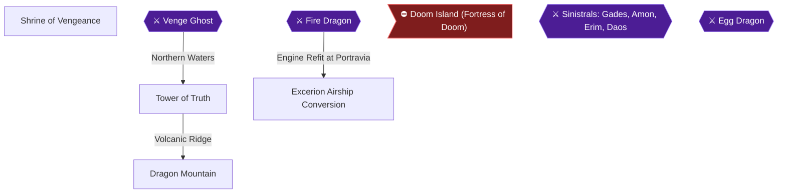

# Writer packet — Chapter 4: Northern Shrines, Dragon Mountain and Airship Conversion

Write `08_chapters/04.md`. Previous chapter: 3. The High Seas and Submarine Depths. Next chapter: 5. Endgame — Sealed Towers and Doom Island.
Planner notes: Defeat Venge Ghost in Shrine of Vengeance, retrieve Magic Mirror in Tower of Truth, solve World Most Difficult Trick in Dragon Mountain, slay Fire Dragon, and upgrade ship to Excerion airship.

## Areas in this chapter (in order)

- `Shrine_of_Vengeance` — Shrine of Vengeance
- `Venge_Ghost` — Venge Ghost
- `Tower_of_Truth` — Tower of Truth
- `Dragon_Mountain` — Dragon Mountain
- `Fire_Dragon` — Fire Dragon
- `Excerion_Airship` — Excerion Airship Conversion

## Achievements to place in this chapter (each EXACTLY once as `[ACHIEVEMENT:<id>]`)

- **17571** — The Cursed One (5 pts, progression): Defeat Venge Ghost in Shrine of Vengeance  
  supporting facts: ra-comments-43-1, ra-comments-43-2, gf1-76-1, gf1-76-2, gf3-2-1, gf3-2-2, gf3-98-1, gf3-98-2, gf3-99-1, gf3-99-2, gf3-143-1, gf3-143-2, gf3-187-1, gf3-187-2, gf3-212-1, gf3-212-2, gf3-213-1, gf3-213-2, gf3-215-1, gf3-215-2, gf3-218-1, gf3-218-2, gf3-222-1, gf3-222-2, gf3-223-1, gf3-223-2, gf3-227-1, gf3-227-2, gf3-238-1, gf3-238-2, gf3-256-1, gf3-256-2, gf3-279-1, gf3-279-2
- **17572** — The Power of Love (5 pts, progression): Find the Magic Mirror in Tower of Truth  
  supporting facts: ra-comments-45-1, ra-comments-45-2, gf1-79-1, gf1-79-2, gf3-100-1, gf3-100-2, gf3-209-1, gf3-209-2, gf3-212-1, gf3-212-2, gf3-221-1, gf3-221-2, gf3-222-1, gf3-222-2
- **17573** — Dragon Slayer (5 pts, progression): Defeat Fire Dragon in Dragon Mountain  
  supporting facts: ra-comments-47-1, ra-comments-47-2, gf1-82-1, gf1-82-2, gf1-93-1, gf1-93-2, gf3-102-1, gf3-102-2, gf3-105-1, gf3-105-2, gf3-106-1, gf3-106-2, gf3-224-1, gf3-224-2, gf3-244-1, gf3-244-2, gf3-278-1, gf3-278-2
- **17591** — The World's Most Difficult Trick (10 pts): Solve the world's most difficult trick in Dragon Mountain  
  supporting facts: ra-comments-79-1, ra-comments-79-2, gf1-82-1, gf1-82-2, gf1-84-1, gf1-84-2, gf1-216-1, gf1-216-2, gf3-2-1, gf3-2-2, gf3-3-1, gf3-3-2, gf3-4-1, gf3-4-2, gf3-82-1, gf3-82-2, gf3-102-1, gf3-102-2, gf3-104-1, gf3-104-2, gf3-187-1, gf3-187-2, gf3-274-1, gf3-274-2, gf3-278-1, gf3-278-2
- **17574** — Airship (5 pts, progression): Convert your ship into an airship  
  supporting facts: ra-comments-49-1, ra-comments-49-2, gf1-5-1, gf1-5-2, gf1-97-1, gf1-97-2

## Route diagram (inserted automatically where you write `[MERMAID]`)



## Usable facts (142) — cite as [[fact-id]]

Legend: ✅ verified (2+ sources) · ✔ conflict resolved · 🟡 single source

- 🟡 **gf1-4-1** (location) Here's an intro to all the Brave Heroes and Charmin' Heroines, some intro and — @The Heroes # · ach: 17553,17554,17563,17575,114729  
  evidence: gf1#4: "Here's an intro to all the Brave Heroes and Charmin' Heroines, some intro and"
- 🟡 **gf1-5-1** (location) Final Equipment: Dragon Spear, Water Gaunt, Boom Turban, Holy Robe, Dia Ring & — @The Heroes # · ach: 17574,17576,17592  
  evidence: gf1#5: "Final Equipment: Dragon Spear, Water Gaunt, Boom Turban, Holy Robe, Dia Ring &"
- 🟡 **gf1-5-2** (location) Strong as Rock for Soul Calibur, a loyal as a terrior and the MOST powerful — @The Heroes # · ach: 17574,17576,17592  
  evidence: gf1#5: "Strong as Rock for Soul Calibur, a loyal as a terrior and the MOST powerful"
- 🟡 **gf1-16-1** (location) ¤ After Tia has joined, head back to Sundletan and purchase the "Droplet" and — @GF1 Dungeon Guide · ach: 17553,17556,17585,17586,17588,17589,17590,17592  
  evidence: gf1#16: "¤ After Tia has joined, head back to Sundletan and purchase the "Droplet" and"
- 🟡 **gf1-71-1** (location) ¤ Bury the residents of this town! — @GF1 Dungeon Guide · ach: 17564,17570,17575,17592  
  evidence: gf1#71: "¤ Bury the residents of this town!"
- 🟡 **gf1-73-1** (location) ¤ Phew...the little elf is safe, she isn't at all happy though, maybe she's a — @GF1 Dungeon Guide · ach: 17569,17587,17588,17589,17590,17592  
  evidence: gf1#73: "¤ Phew...the little elf is safe, she isn't at all happy though, maybe she's a"
- 🟡 **gf1-76-1** (location) ¤ The usual stuff, upgrade your weapons and armours! — @GF1 Dungeon Guide · ach: 17570,17571,17587  
  evidence: gf1#76: "¤ The usual stuff, upgrade your weapons and armours!"
- 🟡 **gf1-76-2** (location) ¤ Learn about the undersea shrine, a.k.a the Shrine of Vengeance! — @GF1 Dungeon Guide · ach: 17570,17571,17587  
  evidence: gf1#76: "¤ Learn about the undersea shrine, a.k.a the Shrine of Vengeance!"
- 🟡 **gf1-79-1** (location) Items -> 2 × Secret Fruit — @GF1 Dungeon Guide · ach: 17569,17572,17602,17604,17610,17612,17603,17611  
  evidence: gf1#79: "Items -> 2 × Secret Fruit"
- 🟡 **gf1-79-2** (location) ¤ Battle has made you tired, but when you do get back to the town of Barnan; a — @GF1 Dungeon Guide · ach: 17569,17572,17602,17604,17610,17612,17603,17611  
  evidence: gf1#79: "¤ Battle has made you tired, but when you do get back to the town of Barnan; a"
- 🟡 **gf1-82-1** (location) ¤ Reach the town of Chead, using the Sub! — @GF1 Dungeon Guide · ach: 17570,17573,17591,17592  
  evidence: gf1#82: "¤ Reach the town of Chead, using the Sub!"
- 🟡 **gf1-82-2** (location) ¤ Purchase older spells from previous towns! — @GF1 Dungeon Guide · ach: 17570,17573,17591,17592  
  evidence: gf1#82: "¤ Purchase older spells from previous towns!"
- 🟡 **gf1-84-1** (item) Claim the treasures....we have a Miracle Potion, a Precious Magic Scale and — @GF1 Dungeon Guide · ach: 17591  
  evidence: gf1#84: "Claim the treasures....we have a Miracle Potion, a Precious Magic Scale and"
- 🟡 **gf1-84-2** (location) a useful Super Protection Ring...so lets move... — @GF1 Dungeon Guide · ach: 17591  
  evidence: gf1#84: "a useful Super Protection Ring...so lets move..."
- 🟡 **gf1-93-1** (location) ¥ Artea has the Ice.Valk Spell, and I hope Selan has the spell too...you will — @!:::::::::! · ach: 17570,17573,17575,17580,17592,114729  
  evidence: gf1#93: "¥ Artea has the Ice.Valk Spell, and I hope Selan has the spell too...you will"
- 🟡 **gf1-93-2** (location) have Valor and Champion to use as well, so Magic should not be a Problem; I — @!:::::::::! · ach: 17570,17573,17575,17580,17592,114729  
  evidence: gf1#93: "have Valor and Champion to use as well, so Magic should not be a Problem; I"
- 🟡 **gf1-97-1** (location) ¥ Pretty Tough I would say, but only when your on a lower level, this tank is — @!:::::::::! · ach: 17564,17569,17574,17592  
  evidence: gf1#97: "¥ Pretty Tough I would say, but only when your on a lower level, this tank is"
- 🟡 **gf1-97-2** (location) strong against magical attacks, so make sure all magic spells used here are — @!:::::::::! · ach: 17564,17569,17574,17592  
  evidence: gf1#97: "strong against magical attacks, so make sure all magic spells used here are"
- 🟡 **gf1-216-1** (location) This is the Part where I do the Creditin' and have some fun too, I like to give — @Special Thanks # · ach: 17591,17604,17612  
  evidence: gf1#216: "This is the Part where I do the Creditin' and have some fun too, I like to give"
- 🟡 **gf1-216-2** (location) Special Thanks to anyone who helps me, and I'm always Itchin' to make the final — @Special Thanks # · ach: 17591,17604,17612  
  evidence: gf1#216: "Special Thanks to anyone who helps me, and I'm always Itchin' to make the final"
- 🟡 **gf3-2-1** (location) Important word on combining elemental attacks — @GameFAQ Status: 100% · ach: 17553,17554,17558,17561,17562,17563,17565,17567,17568,17570,17571,17575,17581,17585,17586,17588,17589,17590,17591,17597,17604,17605,17612,17598,17606,17599,17607,17600,17608,17601,17609,17602,17610,17603,17611,114733,114734,114729  
  evidence: gf3#2: "Important word on combining elemental attacks"
- 🟡 **gf3-2-2** (location) 1. The request of the old man — @GameFAQ Status: 100% · ach: 17553,17554,17558,17561,17562,17563,17565,17567,17568,17570,17571,17575,17581,17585,17586,17588,17589,17590,17591,17597,17604,17605,17612,17598,17606,17599,17607,17600,17608,17601,17609,17602,17610,17603,17611,114733,114734,114729  
  evidence: gf3#2: "1. The request of the old man"
- 🟡 **gf3-3-1** (location) 22 January 2001: I decided to make a walkthrough for this game on paper, very — @Table of Contents · ach: 17585,17586,17591,17603,17604,17611,17612,114729  
  evidence: gf3#3: "22 January 2001: I decided to make a walkthrough for this game on paper, very"
- 🟡 **gf3-3-2** (location) 25 January 2001: After almost four days of typing and playing the game again, — @Table of Contents · ach: 17585,17586,17591,17603,17604,17611,17612,114729  
  evidence: gf3#3: "25 January 2001: After almost four days of typing and playing the game again,"
- 🟡 **gf3-4-1** (location) 10 March 2001: Worked a bit on the layout to make the walkthrough easier to — @Version updates: · ach: 17554,17560,17562,17581,17585,17586,17588,17589,17590,17591,17600,17604,17608,17612,17601,17609,114733,114734,114729  
  evidence: gf3#4: "10 March 2001: Worked a bit on the layout to make the walkthrough easier to"
- 🟡 **gf3-4-2** (location) read and easier to find a specific part. Also added Gusto's Air attack and — @Version updates: · ach: 17554,17560,17562,17581,17585,17586,17588,17589,17590,17591,17600,17604,17608,17612,17601,17609,114733,114734,114729  
  evidence: gf3#4: "read and easier to find a specific part. Also added Gusto's Air attack and"
- 🟡 **gf3-82-1** (location) I don't really know what to say about this game, for I can't find any logic — @Flower slot machine · ach: 17591  
  evidence: gf3#82: "I don't really know what to say about this game, for I can't find any logic"
- 🟡 **gf3-82-2** (location) in it. I once got triple 7, I heard the same tune as the one for solving the — @Flower slot machine · ach: 17591  
  evidence: gf3#82: "in it. I once got triple 7, I heard the same tune as the one for solving the"
- 🟡 **gf3-98-1** (location) 24. Investigating the Shrine of Vengeance — @23. Milka's mother is gone · ach: 17571  
  evidence: gf3#98: "24. Investigating the Shrine of Vengeance"
- 🟡 **gf3-98-2** (location) People here are talking about a light ball going to the southern shrine, so I — @23. Milka's mother is gone · ach: 17571  
  evidence: gf3#98: "People here are talking about a light ball going to the southern shrine, so I"
- 🟡 **gf3-98-10** (item) Contains Boom sword. — @Shrine of Vengeance  
  evidence: gf3#98: "Boom sword, Bright armor, Cursed bow, Evil jewel, Freeze sword, Ghost key,"
- 🟡 **gf3-98-11** (item) Contains Bright armor. — @Shrine of Vengeance  
  evidence: gf3#98: "Boom sword, Bright armor, Cursed bow, Evil jewel, Freeze sword, Ghost key,"
- 🟡 **gf3-98-12** (item) Contains Cursed bow. — @Shrine of Vengeance  
  evidence: gf3#98: "Boom sword, Bright armor, Cursed bow, Evil jewel, Freeze sword, Ghost key,"
- 🟡 **gf3-98-13** (item) Contains Evil jewel. — @Shrine of Vengeance  
  evidence: gf3#98: "Boom sword, Bright armor, Cursed bow, Evil jewel, Freeze sword, Ghost key,"
- 🟡 **gf3-98-14** (item) Contains Freeze sword. — @Shrine of Vengeance  
  evidence: gf3#98: "Boom sword, Bright armor, Cursed bow, Evil jewel, Freeze sword, Ghost key,"
- 🟡 **gf3-98-15** (item) Contains Ghost key. — @Shrine of Vengeance  
  evidence: gf3#98: "Boom sword, Bright armor, Cursed bow, Evil jewel, Freeze sword, Ghost key,"
- 🟡 **gf3-98-16** (item) Contains Heal armor. — @Shrine of Vengeance  
  evidence: gf3#98: "Heal armor, Power Robe"
- 🟡 **gf3-98-17** (item) Contains Power Robe. — @Shrine of Vengeance  
  evidence: gf3#98: "Heal armor, Power Robe"
- 🟡 **gf3-98-18** (mechanic) You will start in a room with three switches. Pull. — @Shrine of Vengeance  
  evidence: gf3#98: "You will start in a room with three switches. Pull"
- 🟡 **gf3-98-19** (mechanic) Go down the stairs again, walk in this room throug. — @Shrine of Vengeance  
  evidence: gf3#98: "Go down the stairs again, walk in this room throug"
- 🟡 **gf3-98-20** (mechanic) Walk up two rooms and here you will see some stair. — @Shrine of Vengeance  
  evidence: gf3#98: "Walk up two rooms and here you will see some stair"
- 🟡 **gf3-98-21** (mechanic) Stand on the 1 x 1 square platform to get a free r. — @Shrine of Vengeance  
  evidence: gf3#98: "Stand on the 1 x 1 square platform to get a free r"
- 🟡 **gf3-99-1** (transition) -Ascend the stairs again to find the (cursed) evil jewel. Go down all stairs — @GF3 Dungeon Guide · ach: 17571,17592,17598,17604,17606,17612  
  evidence: gf3#99: "-Ascend the stairs again to find the (cursed) evil jewel. Go down all stairs"
- 🟡 **gf3-99-2** (location) then go to the right. Use the hammer to bring down the small bridge and walk — @GF3 Dungeon Guide · ach: 17571,17592,17598,17604,17606,17612  
  evidence: gf3#99: "then go to the right. Use the hammer to bring down the small bridge and walk"
- 🟡 **gf3-100-1** (location) -After he's defeated, you can go up a room to collect the cursed bow. Uncurse — @The ghost is gone..." · ach: 17553,17554,17572  
  evidence: gf3#100: "-After he's defeated, you can go up a room to collect the cursed bow. Uncurse"
- 🟡 **gf3-100-2** (location) this weapon and Arty will be able to use the bow to attack all enemies. Now — @The ghost is gone..." · ach: 17553,17554,17572  
  evidence: gf3#100: "this weapon and Arty will be able to use the bow to attack all enemies. Now"
- 🟡 **gf3-100-11** (item) Contains Ghost clothes. — @Tower of truth  
  evidence: gf3#100: "Ghost clothes, Ghost ring, Song rock, Super sword, Truth key"
- 🟡 **gf3-100-12** (item) Contains Ghost ring. — @Tower of truth  
  evidence: gf3#100: "Ghost clothes, Ghost ring, Song rock, Super sword, Truth key"
- 🟡 **gf3-100-13** (item) Contains Song rock. — @Tower of truth  
  evidence: gf3#100: "Ghost clothes, Ghost ring, Song rock, Super sword, Truth key"
- 🟡 **gf3-100-14** (item) Contains Super sword. — @Tower of truth  
  evidence: gf3#100: "Ghost clothes, Ghost ring, Song rock, Super sword, Truth key"
- 🟡 **gf3-100-15** (item) Contains Truth key. — @Tower of truth  
  evidence: gf3#100: "Ghost clothes, Ghost ring, Song rock, Super sword, Truth key"
- 🟡 **gf3-100-16** (mechanic) Go up one room, then to the right door, press the. — @Tower of truth  
  evidence: gf3#100: "Go up one room, then to the right door, press the"
- 🟡 **gf3-100-17** (mechanic) Down the next room, then through the right door to. — @Tower of truth  
  evidence: gf3#100: "Down the next room, then through the right door to"
- 🟡 **gf3-100-18** (mechanic) At F4 walk up a room and press the right of the tw. — @Tower of truth  
  evidence: gf3#100: "At F4 walk up a room and press the right of the tw"
- 🟡 **gf3-100-19** (mechanic) Here you will find the last puzzle room in this to. — @Tower of truth  
  evidence: gf3#100: "Here you will find the last puzzle room in this to"
- 🟡 **gf3-102-1** (location) they aren't very special at all. — @GF3 Dungeon Guide · ach: 17573,17575,17591,114729  
  evidence: gf3#102: "they aren't very special at all."
- 🟡 **gf3-102-2** (location) -After their defeat, the mirror will be broken and they will leave the tower. — @GF3 Dungeon Guide · ach: 17573,17575,17591,114729  
  evidence: gf3#102: "-After their defeat, the mirror will be broken and they will leave the tower."
- 🟡 **gf3-102-11** (item) Contains Anger ring. — @Dragon Mountain  
  evidence: gf3#102: "Anger ring, Gorgon rock, Hidora rock, Hi-power ring, Holy robe, Kraken stone,"
- 🟡 **gf3-102-12** (item) Contains Gorgon rock. — @Dragon Mountain  
  evidence: gf3#102: "Anger ring, Gorgon rock, Hidora rock, Hi-power ring, Holy robe, Kraken stone,"
- 🟡 **gf3-102-13** (item) Contains Hidora rock. — @Dragon Mountain  
  evidence: gf3#102: "Anger ring, Gorgon rock, Hidora rock, Hi-power ring, Holy robe, Kraken stone,"
- 🟡 **gf3-102-14** (item) Contains Hi-power ring. — @Dragon Mountain  
  evidence: gf3#102: "Anger ring, Gorgon rock, Hidora rock, Hi-power ring, Holy robe, Kraken stone,"
- 🟡 **gf3-102-15** (item) Contains Holy robe. — @Dragon Mountain  
  evidence: gf3#102: "Anger ring, Gorgon rock, Hidora rock, Hi-power ring, Holy robe, Kraken stone,"
- 🟡 **gf3-102-16** (item) Contains Kraken stone. — @Dragon Mountain  
  evidence: gf3#102: "Anger ring, Gorgon rock, Hidora rock, Hi-power ring, Holy robe, Kraken stone,"
- 🟡 **gf3-102-17** (item) Contains Legend helm. — @Dragon Mountain  
  evidence: gf3#102: "Legend helm, Lizard hit, Magma key, Magic scale, Mega shield, Miracle(3x),"
- 🟡 **gf3-102-18** (item) Contains Lizard hit. — @Dragon Mountain  
  evidence: gf3#102: "Legend helm, Lizard hit, Magma key, Magic scale, Mega shield, Miracle(3x),"
- 🟡 **gf3-102-19** (item) Contains Magma key. — @Dragon Mountain  
  evidence: gf3#102: "Legend helm, Lizard hit, Magma key, Magic scale, Mega shield, Miracle(3x),"
- 🟡 **gf3-102-20** (item) Contains Magic scale. — @Dragon Mountain  
  evidence: gf3#102: "Legend helm, Lizard hit, Magma key, Magic scale, Mega shield, Miracle(3x),"
- 🟡 **gf3-102-21** (item) Contains Mega shield. — @Dragon Mountain  
  evidence: gf3#102: "Legend helm, Lizard hit, Magma key, Magic scale, Mega shield, Miracle(3x),"
- 🟡 **gf3-102-22** (item) Contains Miracle. — @Dragon Mountain  
  evidence: gf3#102: "Legend helm, Lizard hit, Magma key, Magic scale, Mega shield, Miracle(3x),"
- 🟡 **gf3-102-23** (item) Contains S-mind ring. — @Dragon Mountain  
  evidence: gf3#102: "S-mind ring, S-myst. Ring, Sonic ring, S-power ring, S-pro. Ring,"
- 🟡 **gf3-102-24** (item) Contains S-myst. Ring. — @Dragon Mountain  
  evidence: gf3#102: "S-mind ring, S-myst. Ring, Sonic ring, S-power ring, S-pro. Ring,"
- 🟡 **gf3-102-25** (item) Contains Sonic ring. — @Dragon Mountain  
  evidence: gf3#102: "S-mind ring, S-myst. Ring, Sonic ring, S-power ring, S-pro. Ring,"
- 🟡 **gf3-102-26** (item) Contains S-power ring. — @Dragon Mountain  
  evidence: gf3#102: "S-mind ring, S-myst. Ring, Sonic ring, S-power ring, S-pro. Ring,"
- 🟡 **gf3-102-27** (item) Contains S-pro. Ring. — @Dragon Mountain  
  evidence: gf3#102: "S-mind ring, S-myst. Ring, Sonic ring, S-power ring, S-pro. Ring,"
- 🟡 **gf3-102-28** (boss) Boss: Fire dragon. — @Dragon Mountain  
  evidence: gf3#102: "Boss: Fire dragon"
- 🟡 **gf3-102-29** (mechanic) Head to the right and up one stairway to an entran. — @Dragon Mountain  
  evidence: gf3#102: "Head to the right and up one stairway to an entran"
- 🟡 **gf3-102-30** (mechanic) The door will be opened so you can get the sonic r. — @Dragon Mountain  
  evidence: gf3#102: "The door will be opened so you can get the sonic r"
- 🟡 **gf3-102-31** (mechanic) Go down the stairs again, walk up one room and go. — @Dragon Mountain  
  evidence: gf3#102: "Go down the stairs again, walk up one room and go"
- 🟡 **gf3-102-32** (mechanic) First use the hammer on the right of the two pilla. — @Dragon Mountain  
  evidence: gf3#102: "First use the hammer on the right of the two pilla"
- 🟡 **gf3-104-1** (location) 26.1 The world's most difficult trick — @26. The elder of Chaed · ach: 17591  
  evidence: gf3#104: "26.1 The world's most difficult trick"
- 🟡 **gf3-104-2** (transition) If you want to collect some very powerful weapons, go back up the stairs to — @26. The elder of Chaed · ach: 17591  
  evidence: gf3#104: "If you want to collect some very powerful weapons, go back up the stairs to"
- 🟡 **gf3-105-1** (item) 0       = Big square block with the four treasure chests — @26. The elder of Chaed · ach: 17573  
  evidence: gf3#105: "0       = Big square block with the four treasure chests"
- 🟡 **gf3-105-2** (location) 1,2,3,4 = vertical rectangular blocks — @26. The elder of Chaed · ach: 17573  
  evidence: gf3#105: "1,2,3,4 = vertical rectangular blocks"
- 🟡 **gf3-106-1** (location) Weak:       Dragon, Ice, Flying — @D = move one space down · ach: 17573,17575,17602,17604,17610,17612,114729  
  evidence: gf3#106: "Weak:       Dragon, Ice, Flying"
- 🟡 **gf3-106-2** (location) Specials:   Bite, Drowsy*, Incendiary — @D = move one space down · ach: 17573,17575,17602,17604,17610,17612,114729  
  evidence: gf3#106: "Specials:   Bite, Drowsy*, Incendiary"
- 🟡 **gf3-143-1** (location) 1. IV. Items - Scenario objects and keys — @GF3 Dungeon Guide · ach: 17553,17556,17560,17565,17567,17568,17571,17587,114729  
  evidence: gf3#143: "1. IV. Items - Scenario objects and keys"
- 🟡 **gf3-143-2** (transition) Door key          Key of the cave to Sundletan — @GF3 Dungeon Guide · ach: 17553,17556,17560,17565,17567,17568,17571,17587,114729  
  evidence: gf3#143: "Door key          Key of the cave to Sundletan"
- 🟡 **gf3-187-1** (location) 1.Everybody needs high levels ( Recommended if you want to survive his — @The Battle · ach: 17553,17571,17583,17584,17585,17586,17588,17589,17590,17591,17604,17612,114729  
  evidence: gf3#187: "1.Everybody needs high levels ( Recommended if you want to survive his"
- 🟡 **gf3-187-2** (item) 'Scrambled Eggs' attack. ) — @The Battle · ach: 17553,17571,17583,17584,17585,17586,17588,17589,17590,17591,17604,17612,114729  
  evidence: gf3#187: "'Scrambled Eggs' attack. )"
- 🟡 **gf3-209-1** (location) -(AC) behind location means that this particular monster appears in the — @Appendix E: Monster list · ach: 17572,114729  
  evidence: gf3#209: "-(AC) behind location means that this particular monster appears in the"
- 🟡 **gf3-209-2** (location) O: Calls "Moray" / "Squid" / "Evil Fish" — @Appendix E: Monster list · ach: 17572,114729  
  evidence: gf3#209: "O: Calls "Moray" / "Squid" / "Evil Fish""
- 🟡 **gf3-212-1** (location) Light, Flying, Insect, {Earth} — @GF3 Dungeon Guide · ach: 17571,17572  
  evidence: gf3#212: "Light, Flying, Insect, {Earth}"
- 🟡 **gf3-212-2** (location) Fire, Light, Heal, (Ice), {Shadow}, {Thunder} — @GF3 Dungeon Guide · ach: 17571,17572  
  evidence: gf3#212: "Fire, Light, Heal, (Ice), {Shadow}, {Thunder}"
- 🟡 **gf3-213-1** (location) P: Incendiary / 'Poison'(30%) / 'Fire' — @GF3 Dungeon Guide · ach: 17571,17587  
  evidence: gf3#213: "P: Incendiary / 'Poison'(30%) / 'Fire'"
- 🟡 **gf3-213-2** (location) O: 'Paralysis & Sleep Protected' — @GF3 Dungeon Guide · ach: 17571,17587  
  evidence: gf3#213: "O: 'Paralysis & Sleep Protected'"
- 🟡 **gf3-215-1** (location) Fire, Light, Heal, (Ice), {Shadow} — @GF3 Dungeon Guide · ach: 17571,17587  
  evidence: gf3#215: "Fire, Light, Heal, (Ice), {Shadow}"
- 🟡 **gf3-215-2** (location) P: Evil lance (2%Instant) / Dash — @GF3 Dungeon Guide · ach: 17571,17587  
  evidence: gf3#215: "P: Evil lance (2%Instant) / Dash"
- 🟡 **gf3-218-1** (location) O: Calls "Skeleton" / "Zombie" / "Ghoul" / "Specter" — @GF3 Dungeon Guide · ach: 17553,17560,17571,17578  
  evidence: gf3#218: "O: Calls "Skeleton" / "Zombie" / "Ghoul" / "Specter""
- 🟡 **gf3-218-2** (location) P: 'attacks 2x' / Ninja / Guillotine (60% Instant) / — @GF3 Dungeon Guide · ach: 17553,17560,17571,17578  
  evidence: gf3#218: "P: 'attacks 2x' / Ninja / Guillotine (60% Instant) /"
- 🟡 **gf3-221-1** (location) Shadow, Flying, Dragon, (Fire), (Water), (Thunder), — @GF3 Dungeon Guide · ach: 17553,17572,17578  
  evidence: gf3#221: "Shadow, Flying, Dragon, (Fire), (Water), (Thunder),"
- 🟡 **gf3-221-2** (boss) P: Diamond dust / 'ice' / 'attacks 2x' — @GF3 Dungeon Guide · ach: 17553,17572,17578  
  evidence: gf3#221: "P: Diamond dust / 'ice' / 'attacks 2x'"
- 🟡 **gf3-222-1** (item) P: Squid ink / Ten-legger — @GF3 Dungeon Guide · ach: 17571,17572  
  evidence: gf3#222: "P: Squid ink / Ten-legger"
- 🟡 **gf3-222-2** (location) P: Raio shock / 'thunder' — @GF3 Dungeon Guide · ach: 17571,17572  
  evidence: gf3#222: "P: Raio shock / 'thunder'"
- 🟡 **gf3-223-1** (location) P: 'attacks 2x' / Hold gaze — @GF3 Dungeon Guide · ach: 17560,17571,17599,17604,17607,17612  
  evidence: gf3#223: "P: 'attacks 2x' / Hold gaze"
- 🟡 **gf3-223-2** (location) O: 'Ailment (not Instant) Protected' / Defends — @GF3 Dungeon Guide · ach: 17560,17571,17599,17604,17607,17612  
  evidence: gf3#223: "O: 'Ailment (not Instant) Protected' / Defends"
- 🟡 **gf3-224-1** (location) Light, Fire, Heal, (Ice), {Shadow} — @GF3 Dungeon Guide · ach: 17555,17558,17560,17573,17576,17588,17589,17590,17599,17604,17607,17612  
  evidence: gf3#224: "Light, Fire, Heal, (Ice), {Shadow}"
- 🟡 **gf3-224-2** (location) * = full list of abbreviations see begin of table. — @GF3 Dungeon Guide · ach: 17555,17558,17560,17573,17576,17588,17589,17590,17599,17604,17607,17612  
  evidence: gf3#224: "* = full list of abbreviations see begin of table."
- 🟡 **gf3-227-1** (location) Hard, (Fire), (Water), (Ice), (Thunder) — @GF3 Dungeon Guide · ach: 17559,17568,17571  
  evidence: gf3#227: "Hard, (Fire), (Water), (Ice), (Thunder)"
- 🟡 **gf3-227-2** (location) P: Piercer / Magic gale bullet / Incendiary bomb — @GF3 Dungeon Guide · ach: 17559,17568,17571  
  evidence: gf3#227: "P: Piercer / Magic gale bullet / Incendiary bomb"
- 🟡 **gf3-238-1** (location) If a character is equipped with any weapon that auto targets all enemies, that — @Confusion Semi-Immunity · ach: 17571  
  evidence: gf3#238: "If a character is equipped with any weapon that auto targets all enemies, that"
- 🟡 **gf3-238-2** (location) character will become immune to the effect of 'Confusion'. You may lose — @Confusion Semi-Immunity · ach: 17571  
  evidence: gf3#238: "character will become immune to the effect of 'Confusion'. You may lose"
- 🟡 **gf3-244-1** (location) 8. Regular Attacks renamed — @8. Regular Attacks renamed · ach: 17573  
  evidence: gf3#244: "8. Regular Attacks renamed"
- 🟡 **gf3-244-2** (location) This is not really a glitch, but it is nice to add here too. For some reason — @8. Regular Attacks renamed · ach: 17573  
  evidence: gf3#244: "This is not really a glitch, but it is nice to add here too. For some reason"
- 🟡 **gf3-256-1** (location) A small thing that not many people seem to notice is that Lufia has been — @GF3 Dungeon Guide · ach: 17571  
  evidence: gf3#256: "A small thing that not many people seem to notice is that Lufia has been"
- 🟡 **gf3-256-2** (location) released with three different names: — @GF3 Dungeon Guide · ach: 17571  
  evidence: gf3#256: "released with three different names:"
- 🟡 **gf3-274-1** (location) Battle Background Music Test — @Gordovan's Holy Cross Puzzle · ach: 17558,17564,17565,17570,17576,17585,17586,17588,17589,17590,17591,17597,17604,17605,17612  
  evidence: gf3#274: "Battle Background Music Test"
- 🟡 **gf3-274-2** (transition) Use the following code to test all the music in the game, enter the code with — @Gordovan's Holy Cross Puzzle · ach: 17558,17564,17565,17570,17576,17585,17586,17588,17589,17590,17591,17597,17604,17605,17612  
  evidence: gf3#274: "Use the following code to test all the music in the game, enter the code with"
- 🟡 **gf3-278-1** (location) Neverland Company / Natsume / Taito: — @Gordovan's Holy Cross Puzzle · ach: 17554,17555,17556,17559,17566,17569,17573,17581,17584,17585,17586,17588,17589,17590,17591,17599,17604,17607,17612,17602,17610,17603,17611,114733,114734,114729  
  evidence: gf3#278: "Neverland Company / Natsume / Taito:"
- 🟡 **gf3-278-2** (location) For making a great RPG game, and publishing it in all the regions. — @Gordovan's Holy Cross Puzzle · ach: 17554,17555,17556,17559,17566,17569,17573,17581,17584,17585,17586,17588,17589,17590,17591,17599,17604,17607,17612,17602,17610,17603,17611,114733,114734,114729  
  evidence: gf3#278: "For making a great RPG game, and publishing it in all the regions."
- 🟡 **gf3-279-1** (location) For adding the spectre to 'Heal enemies to death' in stuff section. — @Credits · ach: 17571,17585,17586,17588,17589,17590,17599,17604,17607,17612,114729  
  evidence: gf3#279: "For adding the spectre to 'Heal enemies to death' in stuff section."
- 🟡 **gf3-279-2** (location) He corrected the location of the Heal Armor in the Shrine of Vengeance. — @Credits · ach: 17571,17585,17586,17588,17589,17590,17599,17604,17607,17612,114729  
  evidence: gf3#279: "He corrected the location of the Heal Armor in the Shrine of Vengeance."
- 🟡 **map-dragon-mountain-1-1** (map) Map for Dragon Mountain by author BLAHMASTER. — @Dragon Mountain  
  evidence: map-dragon-mountain#1: "Map: Dragon Mountain Map...Author: BLAHMASTER"
- 🟡 **map-shrine-vengeance-1-1** (map) Map for Shrine of Vengeance by author BLAHMASTER. — @Shrine of Vengeance  
  evidence: map-shrine-vengeance#1: "Map: Shrine of Vengeance Map...Author: BLAHMASTER"
- 🟡 **map-tower-truth-1-1** (map) Map for Tower of Truth by author BLAHMASTER. — @Tower of Truth  
  evidence: map-tower-truth#1: "Map: Tower of Truth Map...Author: BLAHMASTER"
- 🟡 **ra-comments-41-1** (achievement) [Server] Enddox edited this achievement. — ach: 17570  
  evidence: ra-comments#41: "[Server] Enddox edited this achievement."
- 🟡 **ra-comments-41-2** (achievement) [Server] DanielARP edited this achievement. — ach: 17570  
  evidence: ra-comments#41: "[Server] DanielARP edited this achievement."
- 🟡 **ra-comments-43-1** (achievement) [Server] Enddox edited this achievement. — ach: 17571  
  evidence: ra-comments#43: "[Server] Enddox edited this achievement."
- 🟡 **ra-comments-43-2** (achievement) [Server] DanielARP edited this achievement. — ach: 17571  
  evidence: ra-comments#43: "[Server] DanielARP edited this achievement."
- 🟡 **ra-comments-45-1** (achievement) [Server] Enddox edited this achievement. — ach: 17572  
  evidence: ra-comments#45: "[Server] Enddox edited this achievement."
- 🟡 **ra-comments-45-2** (achievement) [Server] DanielARP edited this achievement. — ach: 17572  
  evidence: ra-comments#45: "[Server] DanielARP edited this achievement."
- 🟡 **ra-comments-47-1** (achievement) [Server] Enddox edited this achievement. — ach: 17573  
  evidence: ra-comments#47: "[Server] Enddox edited this achievement."
- 🟡 **ra-comments-47-2** (achievement) [Server] DanielARP edited this achievement. — ach: 17573  
  evidence: ra-comments#47: "[Server] DanielARP edited this achievement."
- 🟡 **ra-comments-49-1** (achievement) [Server] Enddox edited this achievement. — ach: 17574  
  evidence: ra-comments#49: "[Server] Enddox edited this achievement."
- 🟡 **ra-comments-49-2** (achievement) [Server] DanielARP edited this achievement. — ach: 17574  
  evidence: ra-comments#49: "[Server] DanielARP edited this achievement."
- 🟡 **ra-comments-51-1** (achievement) [Server] Enddox edited this achievement. — ach: 17575  
  evidence: ra-comments#51: "[Server] Enddox edited this achievement."
- 🟡 **ra-comments-51-2** (achievement) [Server] DanielARP edited this achievement. — ach: 17575  
  evidence: ra-comments#51: "[Server] DanielARP edited this achievement."
- 🟡 **ra-comments-71-1** (achievement) [Server] Enddox edited this achievement. — ach: 17587  
  evidence: ra-comments#71: "[Server] Enddox edited this achievement."
- 🟡 **ra-comments-71-2** (achievement) [Server] DanielARP edited this achievement. — ach: 17587  
  evidence: ra-comments#71: "[Server] DanielARP edited this achievement."
- 🟡 **ra-comments-77-1** (achievement) [Olafur] Cheap Tip: Heal him before attacking it, since he has the highest HP the SNES memory could allow, it'll overflow it and bringing it to critically low, so one or two attacks after that will be enough to defeat it. — ach: 17590  
  evidence: ra-comments#77: "[Olafur] Cheap Tip: Heal him before attacking it, since he has the highest HP the SNES memory could allow, it'll overflow it and bringing it to critically low, so one or two attacks after that will be enough to defeat it."
- 🟡 **ra-comments-77-2** (achievement) [Server] Enddox edited this achievement. — ach: 17590  
  evidence: ra-comments#77: "[Server] Enddox edited this achievement."
- 🟡 **ra-comments-79-1** (achievement) [Server] DanielARP edited this achievement. — ach: 17591  
  evidence: ra-comments#79: "[Server] DanielARP edited this achievement."
- 🟡 **ra-comments-79-2** (achievement) [Server] MrGauss edited this achievement. — ach: 17591  
  evidence: ra-comments#79: "[Server] MrGauss edited this achievement."

## Source passages (65 chunks, 53 omitted for size — use `npm run rw:chunks -- 1005 --id <chunk>`)

Use these for detail (directions, chest contents, enemy names, boss patterns, ASCII maps). Every statement you take from a passage must cite a fact id; if no fact covers a detail you need, add a fact to `04_facts/` first (with a verbatim quote) and re-run `rw:verify`.

### gf1#3 — GameFAQs: Lufia II: Rise of the Sinistrals — Walkthrough by G_Paladin — [Contacting Me???] (context neighbour)

```text
Contacting Me???
----------------
I have an e-mail address and i'm a member of three forums, two of those forums
have agreed to HOST this FAQ, and other good guides I produce, please send all
e-mails to "GPaladin_aus2003@yahoo.com.au" and anything else to my Inbox on
Emuparadise forums...two sites are hosting this guide.../\/

<> http://www.gamefaqs.com
<> http://www.emuparadise.org

My user names...(Am I a V.I.P yet!)..+_+

EP Forums....Name = GPaladinShinobi...Member status: Elite (over 500 posts)
GFaqs MBs....Name = LordShinobi.......Member status: New User (3)

"Idahorazors Forum...Name: GPaladinShinobi...Member status: Full Moderator!
Address for above....http://www.arborwood.com/forums/idahorazorsforum/ This
is a nice forum, however we need more members...it's even got a Spam/Flaming
Board, if you like to insult members for fun, call me names and you'll never
be banned providing it's on the Flame Board!!

What's New???
-=-=-=-=-=-=-
* Well, I completed all those lists and performed tests on who is the MOST
  Compatible character; like who can equip the MOST weapons. That's all and I
  gave this a special version number too...the next version will be v1.0 BUT!
  I have no idea when that will be completed! (Perhap's I'l be done at X-mas)

Things to do ->
-=-=-=-=-=-=-=-
* Er...I think I'll leave this FAQ for a while, and YES! I will be updating
  this guide, Lufia II is starting to bore me loads, and i've had lots of other
  distractions thanks to Square-Enix and Koei, not to forget Nintendo with that
  Zelda: Wind Waker Game and all! Also I began a FAQ for Uncharted Waters 2, so
  there's yet another distraction...and the game does tend to get boring if its
  played on a Frequent Basis!

-=-=-=-=-=-=-=
```

### gf1#4 — GameFAQs: Lufia II: Rise of the Sinistrals — Walkthrough by G_Paladin — [The Heroes #]

```text
# The Heroes #
-=-=-=-=-=-=-=
Here's an intro to all the Brave Heroes and Charmin' Heroines, some intro and
some comments on their statistics to be exact. I've also included some FINAL
EQUIPMENT for each character, that's an ideal way to equip them for the games
Final events, and the ancient cave if you mess around with the games coding!
«««««««««««««
± M A X I M ±
°°°°°°°°°°°°°
The Red Haired Hero, master swordsman and monster hunter is quite a character;
he can use various swords and magic spells, hence allowing him to cause severe
amounts of pain to his foes. Like all RPG Heroes, Maxim has a specific task in
Life, he has to rid the world of evil, and obliterate the four sinistrals who
appear to be against humans ruling the world. On his adventure he'll find lots
of treasures and befriend various people to aid him in this struggle. One will
become his wife, the two will have a child; and name him Jeros. The main cause
of going on this adventure is a woman named Iris, she helps guide him on his
travels, and assists him in certain cases, NOT in battle!

Although his skills are average, some are above normal, his Strength and Health
stats are quite reliable and despite him being the Hero, he is unable to equip
HEAVY swords and axes, he is limited to Light Swords and Rapiers. He will be in
the team forever, if you don't like him, i'm afraid you've got a problem! Also
he can't use Fire Magic spells, which would be a MASSIVE problem...still, give
him Champion and Valor and he's cool!

Final Equipment:- Dual Blade, Pearl Shield, Pearl Helmet, Pearl Armor, Dragon
                  Ring & Evil Jewel (Uncursed).
«««««««««
± T I A ±
°°°°°°°°°
The Humble Shopkeeper, amateur magician and childhood friend of Maxim. She is
one of the most equippable characters in the game, she is able to use rods and
whips to cause damage, including a few spears and knives. Being Humble is her
major role, she needs protecting due to her carelessness. She assists Maxim a
little, and she buggers off back to Elcid never to be seen again. I suppose I
can like her skills?

She has as much strength and endurance as a new-born child, and her magic stats
are above average. She is almost as quick as Artea, and she can use near enough
the same spells as Selan! She uses Whips and Rods more than Knives, and those
come with some useful IP Techniques, overall I would call her one of the good
characters, I still prefer Selan!

Final Equipment:- Snow Sword, Dark Mirror (Uncursed), Brill Helm, Ruse Armor,
                  Dia Ring & Gold Eye.
«««««««««««««
± S E L A N ±
°°°°°°°°°°°°°
The Magical Heroine, Maxim's beloved and Mother of Jeros, she meets Maxim when
she training the soldiers of Parcelyte. Selan appears to be a Royal Guard, she
is looking after her King, whom she holds in high regard....and she appears to
be VERY attractive; so beautiful that Dekar tries to charm her as soon as the
two meet the FIRST time. She has been living with her aunt, until Maxim comes
along, gets her pregnant and she wants to help him obliterate the Sinistrals!
Selan feels challenged with Guys jokes, she always thinks he's been insulting
so she tends to argue her ideas!

Selan has more Strength and Endurance than Tia, and she's got more brains; even
if Tia is an economical lass. Also she seems to be able to equip more weapons
and Armours than everyone, making her the MOST equippable person....for those
of you who moan because Tia never returns, well I kind of wonder "What the hell
are you all thinkin'?" Selan is the BEST character in the game without a doubt!
```

### gf1#5 — GameFAQs: Lufia II: Rise of the Sinistrals — Walkthrough by G_Paladin — [The Heroes #]

```text
Final Equipment: Dragon Spear, Water Gaunt, Boom Turban, Holy Robe, Dia Ring &
                 Silver Eye.
«««««««««««««
± D E K A R ±
°°°°°°°°°°°°°
Strong as Rock for Soul Calibur, a loyal as a terrior and the MOST powerful
warrior in existance. He is NOT known to be intelligent, however he makes up
with this while putting Muscle in the place of his brains. Dekar deep down is
quite a sensitive bloke, he would be the perfect match for Tia but this does
not happen, which means I could have made the game more exciting...if it had
been a 32 meg cartridge who knows how wonderful the game could have been! He
is quite dumb, so he ends up chasing Idura to the ends of the Earth....like
a dumb person he falls for every trap set up by Idura, but brute strength tends
to save his ass in the end! It's fair to say that Guy could never replace him
when it comes to Strength, but he's VERY unagile compared to the others. Like
he says, his love is his sword, so in the end he ends up with no woman, which
is a shame because he's second best in the league of characters, well some of
you love him to death, so I can't be too cruel here!

The Strongest warrior, he has more endurance, strength and HP than all warriors
in this game, think of him as an upgrade for GUY! Despite his brute strengh, he
is far too dumb to use spells, like Kain from FF4 his MP value is "ZERO" making
his unable to cast spells not matter what happens, he can be given spells if
the game is hacked, however he will also need MP to use them...which means more
game hacking!

Final Equipment: Fry Sword, Apron Shield, Legend Helm, Old Armor, Rocket Ring &
                 Black Eye.

«««««««««
± G U Y ±
°°°°°°°°°
The Best friend of Maxim, always supporting him and occasianly tries to rival
Dekar. He has Blond hair, a cute girlfriend named Jessy, and a fit sister named
Hilda, who is taken ill near the start of the game. He dares to challenge one
of the sinistrals before anyone else, but loses and it should also be known
that he will always be in the team near the games ending, along with Artea and
Selan. He is more agile and brainier than Dekar, but he's always cracking sad
jokes; which make Selan fell pissed; because of this, him and Selan have some
petty squabbles, usually stopped by Maxim. He can equip Heavy Swords and Axes
like the "Almighty" Dekar, a true ally of the Doom island team!

Second strongest warrior, suppasses Maxim in strength and HP, like Dekar he is
unable to use Magic spells, hence we would be expected to use IP Techs instead!
Like Dekar, the game can be hacked to give him spells as well as some MP, which
he doesn't have either, still he is one of my prefered characters!

Final Equipment: Sky Sword, Bolt Shield, Legend Helm, Old Armor, Rocket Ring &
                 Black Eye.
«««««««««««««
± L E X I S ±
°°°°°°°°°°°°°
Genius of the Century, one of the BEST inventors in existance, and also a good
magician; thanks to being so clever. Lexis appears to be an Old man, he is more
responsible for building the ships engine, and improving the vessels skill, in
and out of the seven seas. Along with some of his scientist friends, Lexis will
turn an ordinary sea vessel into an Airship, similar to the ships we see in
Final Fantasy games. He also promises Milka that he will get rid of the Ooze
which pollutes the terrains. His Lab is near Treadool, and it's FULL of traps;
after all, this bloke is a Mad scientist.

Lexis rules in Intelligence, this gift allows him to cause more damage with
his spells; at level 99 he has the second best stats....he is quite a strong
bloke, he beats Artea, Selan and Tia in the STR value; and he even beats the
three of them in Life! Lexis although not loved by all, is quite a reliable
character, despite his crap choice of weapons, mainly tools...these will not
be the FIRST choice of weapon after all.
```

### gf1#6 — GameFAQs: Lufia II: Rise of the Sinistrals — Walkthrough by G_Paladin — [The Heroes #] (context neighbour)

```text
Final Equipment: Lizard Blow, Water Gaunt, Safety Hat, Bright Armor,
«««««««««««««
± A R T E A ±
°°°°°°°°°°°°°
Elven Swordmaster, and wielder of Luminous Magic Spells; he joins Maxim and his
comrades when a Sinistral takes the life of his friend. His deceased friend has
left her daughter all alone, but when it comes to this lil' child, Artea treats
her like his own. Artea is a Cross between Robin Hood, and Cecil from FF4; and
this seems to be good, because he fights like a Paladin, with the Holy Magic
spells and stuff; He is also known as "Arty" by some, tis' simply a nickname
commonly used on the Lufia Status screen! He can handle swords, bows, Rods and
even Heavy Armors; but his strength is limited. He's the most agile character;
and he is more intelligent than the likes of Maxim and Guy; his physical stats
are bearable, and he's a good choice for an ancient cave team! He does not come
close to Selan even though he can use "Fry" and "Zap" which are two cool magic
spells; still, you have to give this bloke a chance, he will do you proud after
all, and his abilities are not at all disappointing!

-=-=-=-=-=-=
```

### gf1#15 — GameFAQs: Lufia II: Rise of the Sinistrals — Walkthrough by G_Paladin — [----- ¦ ¦ ¦ ¦] (context neighbour)

```text
-----                            ¦   ¦   ¦   ¦
                                       ---------------------
                                       ¦ × ¦   ¦   ¦   ¦ × ¦
                                       ---------------------

¤ Next, you can proceed through the opened door; this time you will find only a
  Blue chest; which contains the "Lake Key". You now have the key to the boss
  chamber, so why not use it; from your current position, backtrack all the way
  to the room with the door you ignored. This time enter that door; then make a
  bridge using only three of the log crates. Next, pick up the other log crate
  and cross the new bridge; dump the log crate onto some water and activate the
  switch by pushing the lever to the left. Upon pressing the switch, the water
  level will rise; if everything was done to plan, you should be able to pick
  up the log crate once again; and use it to make a very small bridge in order
  to reach the ladder. Up the ladder, you will see the boss door; but just to
  gain a little more experience; you might as well kill the baby frog nearby.

¤ Inside the boss room, you will see the Catfish; he will pop out of the water;
  and will laugh at Maxim, when he asks for the Earthquakes to stop. The battle
  will start, and you can now start fighting for real...!

  Boss: Catfish
  ¤¤¤¤¤¤¤¤¤¤¤¤¤
  HP: 200

¥ First of all, the Catfish attacks with two spells; mainly "Flash" and "Mega
  Quake", of which Flash really hurts. When your HP gets below 50; you should
  always heal, that nasty Flash spell can do 40+ points of damage. If you are
  going to win this battle, don't bother with the "Droplet" spell; it seems the
  Catfish has good defense against that type of Magic. First of all, you should
  keep attacking with Physical attacks; when he uses that horrid "Flash" spell,
  you should cast "Strong"; which should heal around 30-40 HP. After around 8
  normal hits, the Catfish will be "Cat food". When the Catfish is defeated you
  will receive; 500 experience and 500 Gold, which isn't too bad.

¤ The Catfish has decided to stay underwater for a while; so I guess Sundletan
  won't have any more Earthquake troubles. All you need to do in this area, is
  complete a few story events; but first of all, find your way out of this cave
  and head back to the village of Sundletan!

¤¤¤¤¤¤¤¤¤¤¤¤¤¤¤¤
± Story Events ±
°°°°°°°°°°°°°°°°
MAIN GOALS
¤ Find out the whereabouts of Tia!
¤ Rescue Tia from Lake Cave!
¤ Buy new equipment for Tia!

¤ Back in the village of Sundletan; you can now rest at the inn, and save your
  game at the church if you wish. After preparations have been made; speak to
  the blue haired dude, near the village entrance; so you can find out that a
  pretty young girl went looking for you at Lake cave, and you should know by
  now, that Lake Cave is home to a hoard of Monsters.

¤ First of all, you need to find this young girl; she can be found in the Lake
  Cave, in the room where you solved the archery puzzle; when you had to fire
  arrows at some monsters behind spikes. When you arrive in that room; you can
  see some monsters attacking a girl; who just happens to be Tia, and Maxim's
  would be "Girlfriend". Still you must perform your heroic duty, and kill the
  monsters, which in this case are a Goblin and a Skeleton. After you demolish
  the monsters; Tia will explain why she came looking for you.

¤ It seems that Tia thought you were going away from her; and by the looks of
  it, Tia is really upset about this. Maxim explains about the Red Light, and
  how he's known swordsman ship ever since he was born. Tia at the end decides
  to come with you, but this reckless wench runs straight into another battle.
  When Tia joins your party, she will be at Level 7; which should be about two
  levels below Maxim. She can use the "Spark" spell, and she also comes with
  the "Drowsy" and "Strong" spells too.
```

### gf1#16 — GameFAQs: Lufia II: Rise of the Sinistrals — Walkthrough by G_Paladin — [¦ × ¦ ¦ ¦ ¦ × ¦]

```text
¤ After Tia has joined, head back to Sundletan and purchase the "Droplet" and
  "Poison" spells for Tia. If needed you can buy the "Drowsy" spell for Maxim;
  but at the moment 1000G is a large chunk of your money. Why you've got the
  chance, you should buy Tia a new weapon; the Whip is the best choice, as its
  got the "Flame Blast" Ikari technique, and Tia will take a lot of damage in
  battle, because of her weak defense.

¤ The next part of your quest, requires a journey to the Alunze Kingdom; still
  you might as well gain a few levels, before making tracks. When you do gain
  a few levels; head in the North-west direction, and you will come to a small
  shrine; which will lead you over the mountains. To reach Alunze, head across
  the patches of desert area; till you finally come to a small bridge, you can
  then head east a little, which will take you to the Alunze Kingdom.

¤¤¤¤¤¤¤¤¤¤¤¤¤¤¤¤¤¤
± Alunze Kingdom ±
°°°°°°°°°°°°°°°°°°
MAIN GOALS
¤ Purchase new equipment!
¤ Gain some info on the King's Coronation!
¤ Play about in the casino! *NOT ESSENTIAL*
¤ Raise Maxim and Tia's Levels up to 10/11!

¤ This village has quite a few things to keep you occupied; first of all, you
  should buy some new equipment. This shop offers some good stuff; you should
  purchase all the cloth stuff and a short sword for Maxim; as well as a Mini
  Shield and Long Knife for Tia. When you've finished shopping; equip all your
  new armour and weapons, and head for the Inn. You should rest to restore all
  your HP and MP, then you should go down the stairs. Down here, you will find
  a Casino; you might as well have a little go on the slot machine; coz unlike
  games like Pokémon, you will actually win quite often. When you've finished
  wasting your money; you should proceed to Alunze Castle.

¤ Before you head for Alunze Castle, you may want to gain a few level; Maxim
  should be around Lv12 and Tia will be fine at Lv10/11. This will also give
  you the chance to gain more Gold, and one of the Eagles you fight, may drop
  an Eagle Stone. When you've reached your desired level, head for the Castle
  of Alunze; and prepare for the Kings Coronation!

¤¤¤¤¤¤¤¤¤¤¤¤¤¤¤¤¤
± Alunze Castle ±
°°°°°°°°°°°°°°°°°
MAIN GOALS
¤ Locate the Castle Basement!
¤ Watch some Clowns in action!

¤ Alunze Castle, is home to a pathetic army of soldiers; who by the looks of it
  cannot do their job properly. First of all, just keep on heading forward, you
  should reach the Throne room, very soon. Inside you will find the king, and a
  few other people; including the Prince and Princess.

¤ The crown seems to be a fraud, so one of the soldiers attempts to take it for
  examination; but he is soon halted in his tracks. The guys with the crown are
  thieves, they will put on a little show; and it won't take long for them to
  steal the crown. After the thieves have left, you can talk to the King; he is
  not from the same planet as normal people; so he doesn't have a clue what you
  need to do, when your crown gets nicked.

¤ The clowns have disappeared into the basement, so look for a balcony with two
  girls walking around; and head though the Right door, until you reach a Guard
  who appears to be Ko'ed. Keep going and head into the basement; you will find
  a useful tool here, which can help you to blow things up!

¤¤¤¤¤¤¤¤¤¤¤¤¤¤¤¤
± The Basement ±
°°°°°°°°°°°°°°°°
MAIN GOALS
¤ Obtain an Explosive Surprise!
¤ Catch up with the Weirdos!
¤ Obtain the Crown!

ITEMS -> Bomb, Headband, Coat, Light Knife, Secret Fruit, Miracle, Dragon Egg,
         Crown
```

### gf1#17 — GameFAQs: Lufia II: Rise of the Sinistrals — Walkthrough by G_Paladin — [¦ × ¦ ¦ ¦ ¦ × ¦] (context neighbour)

```text
¤ The Basement is riddled with all sorts of monsters; but sadly, you don't get
  to fight a boss here. Inside the first room, you will find a door and a weak
  wall; which can be destroyed by a bomb, a short while later. Go through the
  door and place the pot onto the switch; this will cause another door to open
  leaving you on a one way path, once again. The next room contains two blocks
  and two tiles; first of all move one of the blocks onto the first tile; this
  will cause the gap between the walls below to widen. The other block can now
  be moved through the gap, and onto the southern tile; which again will cause
  another door to unlock itself!

¤ Head through the door, and follow the one way path, till you come to a Blue
  Chest, containing the bomb item; which can be used to blow things up. After
  obtaining the Bomb; head back to the weak wall you found before, and blow it
  to smithereens; you can now proceed further into the hideout of the weirdos.

  « Remember -> Bombs are a wonderful tool to have; but they do explode after
                you take Six steps; or if you swing your sword six times. You
                can plant bombs by pressing the same button as you would use
                for arrows; in this case the button you need to press is "Y".

¤ Upon entering the room, head right and down, till you see a vase; pick up the
  Vase and take it along the path to the left. Activate the switch, and go back
  to the entrance of this room; this time, head right, till you finally crash
  into a wall. First of all, ignore the chest above you; and head South to find
  another chest, containing a Headband. Backtrack upwards a few steps; and head
  left at the first turn, then South to reach a staircase and a monster. Head
  downstairs, into another room, which has a weak wall and a door. If you for
  some reason need some major first aid, head through the door; after healing
  your HP's and MP's, you should blow up the weak wall.

¤ The room following on, contains some monsters; you can either avoid them, or
  you can destroy them. After making your choice, go through the next door, and
  you will come to another puzzle, involving Vases and Switches. First of all;
  put the vase onto the upper switch, to open the Northern door. Enter the door
  and take the Escape item from the chest; head back out, then put the vase on
  the lower switch; to open the Southern door. Head through the opened door and
  kill off the bats; then push the block to the right of the weak wall, and use
  a bomb; after the wall crumbles; proceed into the next room. Inside here, you
  will come to a horrible puzzle, which is possibly the hardest one yet; I have
  tried to explain it as best as I can, in the form of Ascii diagrams!

  <> Stage I <>
    -=-=-=-=-                            ASCII CHARACTERS
  This puzzle involves three             ¬¬¬¬¬¬¬¬¬¬¬¬¬¬¬¬
  different colours of blocks;           I have chosen ascii characters, to
  which need to disappear in             symbolize each different color, of
  order to open the door.                the blocks used in this puzzle; if
                                         you check below, you can see the
  First of all, Move the lowest          chosen ascii characters;-
  Yellow block, left two paces;
  then up two paces, to get rid          ¥ - Red Block
  of three yellow blocks!                Ø - Orange Block
                                         ß - Blue Block
  -----   -----
```

### gf1#70 — GameFAQs: Lufia II: Rise of the Sinistrals — Walkthrough by G_Paladin — [| |] (context neighbour)

```text
Next we will get hold of the Mysto Jewel, this is fairly simple, from the
  Samu Jewel platform, jump on the tile and whack the switch on the platform
  which follows, leap onto another tile and allow it to take you to another
  platform with two switches, hit the southern switch and jump on the tile
  nearby, it should move Maxim and co. onto the platform with a Mysto Jewel!

  When it comes to reaching the exit, you need to start off on the Northern
  Platform with the stairs; make sure the arrow switch is pointing south and
  jump onto the tile, when the tile reaches the desired destination, do not
  go on the platform; instead, turn Maxim around so he's facing North and give
  the switch a slap with your trusty blade, you will be taken backwards; so you
  can reach the Southern door. Now head inside, and be prepared to take on a
  few monsters; and beware of the Ninja, I sorta over-looked this before but
  the Ninja's can use an attack called Knife-Thrower, and it cause at least 70
  points of damage to all party members!

¤ After taking out the Ninja's and ripping apart the samurai's go through the
  southern door and up the ladder outside this tower, there's a door here, so
  go inside and use the Trial Key to enter the boss door; before you can fight
  a boss, you always have to solve a puzzle! This one can be tricky, because
  you need to have both monsters standing on the switches, of course you can
  actually stun them, but it takes a little time and patience to get them on
  the switches; if you manage to succeed, try entering the door in as few steps
  a humanly possible, if you don't the monsters will move, and you will have
  to trap them a second time..'.'

¤ In the door which follows the previous puzzle room, you will find Hans, he
  seems to be paralyzed by a strange force, Maxim and the other have an idea
  what the force might be; it's much stronger than Gades! Suddenly a sinistral
  comes, and it just happens to be AMON the Sinistral of Chaos, and to our
  interest, Amon is a fairly honorable Guy, he doesn't want Hans to be ashamed
  with himself because it's normal for people to not move in such a powerful
  form of waves, but he takes one look at Maxim, and I would say he's impressed
  by his powers! Guy being a bit of a hard head wants to have a go at Amon, he
  attacks with all his might, Amon smashes him into a corner and says nothing
  to mock him; he only says "Don't throw your lives away" he wants to show you
  true terror later..! When Amon leaves, Guy will get up and the party will
  follow Hans into the last room, the stone is here; but it is no more than a
  simple blue stone with no decent value whatsoever. Hans believe that this is
  what he is looking for and he nicks off back to the castle, so cast "Escape"
  and follow him...'.'

¤ Back in the castle of Ferim, you can see an interesting scene in the Throne
  Room, Hans give the stone to the prince; the stone is just a miserable pebble
  says the Prince, and just when a moment of trouble occurs, there's some one
  to bail him out; oh, dear what shall we do, let's fob the Princess off with a
  quality sapphire instead! The Princess is not impressed, she wants the real
  deal, and just to give this story a happy ending, here comes Hans with his
  miserable pebble; the Princess is shocked and it seems that it's a relic of
  their childhood. Looks as though Hans won the heart of the Princess, she is
  really happy and once again it's all thanks to Maxim and co. When all is said
  to be over a soldier barges in, it seems that the town of Agurio has been
  demolished by a Golden Man; could be Amon I suppose! You need directions too
  I suppose, okay, head for the small shrine North of the previous tower, and
  jump in the warp portal, head out of the shrine and into the beaten up town
  of Agurio, and be prepared for something a little more drastic than Gordovan!
```

### gf1#71 — GameFAQs: Lufia II: Rise of the Sinistrals — Walkthrough by G_Paladin — [| |]

```text
¤¤¤¤¤¤¤¤¤¤
± Agurio ±
°°°°°°°°°°
MAIN GOALS
¤ Bury the residents of this town!
¤ Speak to Iris and find out what happened!

¤ What the Hell!!!! Amon really has done a number in this town, and who is on
  the scene, it's Iris....Does this woman have anything to do with this, she is
  looking rather suspicious don't you think? Iris looks upset, or she isn't too
  proud of herself for not reaching the village in time to stop Amon; she wants
  Maxim to quit his journey, and to be fair she suggests he should live a
  peaceful life in the town of Parcelyte. The conversation turns into a lecture
  on energy waves, and according to the Legend there's a sword that can amplify
  these waves; the legendary DUAL BLADE. Iris goes on some more about this Dual
  Blade, and finally the villagers get sent to the ground, and they can Rest in
  Peace along with any other souls out there...'.'

¤ After the Funeral, Maxim and Co. will decide to find the Dual Blade, and Iris
  will leave with a strange remark to Maxim's question; we find out who she
  really is later in the game, but it doesn't matter right now; so head out of
  this town and head for Treble, which just happens to be a small village South
  of the Ferim Kingdom.

¤¤¤¤¤¤¤¤¤¤
± Treble ±
°°°°°°°°°°
MAIN GOALS
¤ Purchase a "Circlet" for Lexis and Selan!
¤ Find out about Professor Kirmo, a friend of Lexis!

¤ Well this is a small village with no main errands to run, you can purchase a
  circlet from the equipment store; and you can speak to a little boy when you
  enter this town. He speaks of a bloke named Kirmo, and it seems that the guy
  he mentions is a friend of Lexis; the man he mentions is also working on a
  submarine; and he's in the town of Portravia to the south, and to give you
  another reason to head south, the villagers have seen a strange light, South
  of Treble, and near the town of Portravia, so walk south of Treble and go to
  the large town below, it is fairly easy to find after all...'.'

¤¤¤¤¤¤¤¤¤¤¤¤¤
± Portravia ±
°°°°°°°°°°°°°
MAIN GOALS
¤ Check out the Kirmo Lab, and learn about Submarines!
¤ Get the latest Level three spells, Thunder, Valor and Dragon!

¤ This is a Larger town with some cool spells on offer; and the weapons in this
  place are pretty good too; to begin with, let's go to the magic shop; while
  your in town, make sure you get Maxim the Valor spell, he is the main warrior
  after all and he can do some major healing with this spell; although Maxim is
  your first priority, every spell in this store would be useful for Selan, she
  would be best suited for every spell available! Lexis on the other hand, will
  not need to have any level three spells, because you are going to lose him in
  a few hours time; if you have the cash you could buy him some of the spells;
  but again this is not essential.

¤ Weapons are another delicacy in this place, you sure could use a Rainy Ax for
  Guy, well...it's an Ax just like the description says, but it has good attack
  power advantage over a Spear. Lexis would be better off with a Battledriver;
  and Selan would feel loved with a Pounder rod in her possession. Don't bother
  upgrading your armours, you have good enough equipment already; when you've
  finished shopping, put your skates on an head for Kirmo's Laboratory in the
  Northern area of Town!

¤ Prof.Kirmo's Lab isn't full of traps and in this case, he has staff to work
  for him, in this place you will find a green haired man, standing in front of
  some water. Go over and speak to this dude and he will explain how far he has
  gone with the Submarine project; Lexis opens his big gob, and Kirmo wants to
  remodel Excerion, your beloved vessel, say yes when he asks, because you will
  need a submarine later; when he asks for the blue prints however, some little
  elf child nicks them, causing the scientist to make a fool of himself, just
  because the Elven Thief is too quick for him....we need those plans, so let's
  go find the elf girl...'.'
```

### gf1#72 — GameFAQs: Lufia II: Rise of the Sinistrals — Walkthrough by G_Paladin — [| |] (context neighbour)

```text
¤ An Innocent bystander mentions a female friend, and he's a kid, so it's got
  to be the Elf Girl, she has nicked off to a place called the Mountain of no
  return....don't know why? but their's a good reason when you find her; this
  girl runs around quick, so it will take a while to catch her! The Mountain
  of no return is south-east of Portravia, so head east a few paces, and head
  for the Southern mountain, and use the trail of forest area to make the path
  clearer to you.

¤¤¤¤¤¤¤¤¤¤¤¤¤¤¤¤¤¤¤¤¤¤¤¤¤¤
± Mountain of no Return! ±
°°°°°°°°°°°°°°°°°°°°°°°°°°
MAIN GOALS
¤ Catch up with the Elf Child and retrieve the plans!
¤ Run into a fellow swordsman from the Elven Village!

Items -> Aqua Sword

¤ The Speedy Lil' Elf Girl ran up this mountain, so let's find her, to begin
  the search go up the second lot of steps and into a small chamber with two
  horse statues. Push them so they meet eye to eye and continue, in the next
  chamber things get a little more complicated, this time we have several of
  these statues to deal with! There's also a normal statue, so begin by moving
  the ordinary statue, three paces to the left and five paces upwards to block
  of two forces. Now move the left statue in the center of this room; one pace
  to the right, then another pace upwards...move the right statue four paces to
  the left and two paces upwards to permanently block of one of the forces. You
  are then obliged to move the ordinary statue, one pace upwards to block off
  two more forces, and you can apply the final part of this puzzle, by moving
  the last horse statue two paces upwards to block off the final force..! Then
  you may continue through the door...'.'

¤ Now go up the staircase which follows, and continue on this one way path till
  you reach some monsters; use fire elemental attacks and spells to make simple
  work of them and head through the door which follows. Once again, follow the
  one way path until you reach another room full of horse statues; this puzzle
  is a little more complicated than the second room, so you had better read my
  solution carefully...If it's Readable...'.'

  This took me a good half hour to work out, so here goes, begin with the horse
  a few paces south of the entrance, and head right until the forces stop your
  movement. Move the very first horse one pace downwards, and it's neighbor 7
  paces to the right; to block the force given off one of the statues. Now move
  the horse to your left, four paces down, and the one opposite, one pace down;
  so both horse statues are facing each other; now open the chest to get a Aqua
  Sword, then equip the newly acquired weapon on Selan. Now walk back to the
  very first statue and move it one pace downwards, the path will be clear, so
  you can now head south and then east until you get blocked again; this time
  you need to move the first statue you see on this path upwards so it touches
  the statue above. You can then head right a few paces and move the next horse
  one pace to the right, and to finish off; head downwards and push the final
  horse as far to the right as possible and head through the door, where you
  will be on the mountainside, with the elf child you been looking for. Milka
  decides to run away as soon as you confront her, but she is caught by some
  Gargoyles, which means she's in trouble....Let's help her....

  Boss: 4 × Gargoyle
  ¤¤¤¤¤¤¤¤¤¤¤¤¤¤¤¤¤¤
  HP: 1,000 each

¥ Four Gargoyles have attacked Milka, so let's give them whats for; start the
  battle off by casting level three spells such as Firebird and Thunder. This
  will cause a decent amount of damage, if you repeat this for four turns, you
  should win the battle with ease. After the Gargoyles crumble, you will get
  12,000 experience points and 12,000 Gold Coins.
```

### gf1#73 — GameFAQs: Lufia II: Rise of the Sinistrals — Walkthrough by G_Paladin — [| |]

```text
¤ Phew...the little elf is safe, she isn't at all happy though, maybe she's a
  little embarrassed because she was outsmarted for once. The girl is a little
  ungrateful, and another elf comes on the scene, this is Artea, and he is mad
  at Milka because of her thieving! Milka explains why she nicked the plans and
  Lexis promises a few things to her. Lexis says he will plant flowers in every
  open area of the town, and he will modify the machines to stop ooze leaking
  out; and when all the flowers grow, he will bring Milka a large bunch of
  flowers. Milka is taken in by this, and Lexis walks off so he can start his
  research, soon after this, two elves come, it seems that a ball of light has
  come to the Elven village of Eserikto; Artea will warp Maxim and co. to that
  place, only to find that an elf lady named Karyn has been kidnapped; we have
  a good idea who the Kidnapper is too; it can only be Amon, the Sinistral of
  Chaos; After a little bit of thought, Artea decides to join your party, when
  it comes to the status screen, this Elf is known as Arty. He starts out at
  level 38 with some of the best spells available; such as Firebird, Ice.Valk;
  Dragon, Thunder and Valor...'.'

¤¤¤¤¤¤¤¤¤¤¤¤
± Eserikto ±
°°°°°°°°°°°°
MAIN GOALS
¤ Get your mitts on the Fry Spell!
¤ Amon, the sinistral of Chaos...Gain Information!
¤ Upgrade your weapons and purchase some Ex-Arrows!

¤ Eserikto, the Elven village, a nice little place with some good gear on offer
  and not to mention, Artea's hometown. The first area of interest is the Magic
  Shop, this sells a useful Holy elemental spell "FRY" it costs exactly 40,000
  Gold coins, but you have to get this, save your pennies up and you will have
  the first Holy magic spell, which is as strong as Firebird and Thunder, the
  only difference is the fact that it's HOLY magic!

¤ After the spell shop, we have a weapon store, Maxim and Artea should be given
  a Crazy Blade each and Guy should have a Trident. When it comes to armours; I
  wouldn't bother giving anything to Artea, he does have all the latest gear
  after all, but if it's any constellation; Maxim and Guy should be given Plate
  Armor's and Selan would look good in an evening robe, as for helmets, Selan
  would suit a Gold Band; and as far as shields go, the Gold Shield would be a
  fair choice for Guy and Maxim. When you have the equipment, you should go to
  some of the previous towns to pick up some of those older spells for Artea; I
  would also get a few Ex-Arrows too, never know when you'll need them...'.'

¤ After the shopping trip is over, their's not much to do in this town, but you
  may want to gain some information on Amon, and what the people of this town
  saw with their own eyes. When you are finished in this place, go out of the
  village, and head south-west; you will come to a tower, where Karyn is being
  held captive, so make sure you have a rest at the free inn while your in
  Eserikto...Let's be on our way, equip your stuff, and enter the Shrine!!

¤¤¤¤¤¤¤¤¤¤¤¤¤¤¤¤¤
± Divine Shrine ±
°°°°°°°°°°°°°°°°°
MAIN GOALS
¤ Hunt' down Amon and save Milka's Mother, Karyn!
¤ Search for a status boosting portal!

Items -> Heart Key, Revive Armour, Rocket Ring, Dragon Egg, Holy Whip

¤ Amon is the Sinistral of Chaos, he has Karyn captive on the top floor of this
  shrine; and reaching her will be a challenging task; which Maxim, Guy, Selan
  and Artea will take! Upon entering, head through the door and dispose of the
  monsters here; the Brinz Lizard is fairly easy, but the Red Plant's can be
  tough, with their ability to attack one of your characters, three time in a
  row; this can be devastating for Selan, so be careful. When both monsters hit
  the ground, head up the stairs and take a look around the room. Yes! we can
  see several pillars to grab, but most importantly, these pillars allow you to
  get your mitts on some cool treasures; now follow the instructions I give you
  and collect all the treasures available...'.'
```

### gf1#74 — GameFAQs: Lufia II: Rise of the Sinistrals — Walkthrough by G_Paladin — [| |] (context neighbour)

```text
» The First treasure to be acquired is the Heart Key; so get out the hook and
  aim for the upper-right pillar, then grab the pillar to the right, then the
  upper pillar and then the upper left pillar, and when your that far, you can
  finally grab the pillar to your left to gain access to the stairs. Upstairs
  you will find an Iron Gorem, kill him and enter the Northern door; once your
  inside, you should open the Blue Chest, and grab your first treasure in this
  shrine; the Heart Key!

» To obtain your second treasure, head back to the entrance staircase and use
  the hook to reach the platform to your left; now go upwards and left again, a
  statue is on the platform above you, so grab the statue and move it upwards
  until you can't move it any further. Next, aim your hook at the accessible
  left platform, grab the pillar and hook onto another pillar below you, follow
  the path around and you will come to a statue, you should move the statue so
  you can follow the Narrow path below you, at the end of the narrow path, grab
  the lower statue, the head for the left platform and finally head upwards and
  up the stairs which follow, inside the small room, you will find a revive
  armour. Equip this on Guy so his defense and Magic resistance will improve a
  little, then head back to the entrance staircase!

» Last of all, we have Rocket Ring...As you've done before, aim the hook for
  the upper-right pillar, and go for the pillar to your right; grab the next
  upper-right pillar and jump across the gap, by hooking onto the statue. Now
  move the statue as far North as possible; and head downwards and back across
  the gap you just cleared, and hook the lower pillar. Now you need to aim the
  hook at the upper-left pillar, so fly across the gap and grab the pillar to
  your left, walk upwards and you should see two pillars with one space between
  them, and to your right, there's another pillar, so again use the hook to
  throw yourself over the gap and then grab the statue you moved a few seconds
  ago. Now, hook the pillar to the right, and follow the narrow path up the
  stairs and dispose of the monster. Grab one of the upper-left pots to reveal
  a switch, and turn in the downwards direction; drop the pot and head over the
  spikes. Now go up the stairs and take the Rocket Ring from the chest, you can
  also jump down from here using the arrow; when you're done with picking up
  treasures go back to the room with the pots and lift the pot in the lower
  right corner of the room, it looks like you've stumbled upon a weak patch on
  the floor. Let's fall down and see whats happens....'.'

¤ Look's like your on a small platform, the first bit's simple, just aim the
  Hookshot at the pillar on the western platform; when you make it across, walk
  downwards until you reach the end of the Narrow path and use the hook once
  again to access a western platform. Do the same again, and follow the pillars
  one at a time, in a kind of Anti-Clockwise pattern. Now, go down those stairs
  and follow the path into a room with a Red Flower monster. Kill this fiend
  using Fire elemental spells and head through the door, while your in here you
  should exterminate the Brinz Lizard; when you've finally got used to Killing
  monsters, off you go into the next chamber; and hey! whats this..we have some
  Torches lighting themselves up as we walk along the Hallway; yes it's strange
  and I have no idea what these things are doing. If you can, just ignore them
  and proceed into the next room; now we have to fight some weird snake monster
  and I haven't checked to see what they are called yet; just kill the lousy
  thing, head into the next room and storm the Gargoyles. Now it's time to get
  your arrows out, you are going to need them after all; there seems to be a
  switch on the Northern wall; so fire an arrow right in its core, and watch as
  the platform moves into the western area of the room; taking you to some more
  monsters. This time we have found a new monster, it's a Tartona and these
  creatures have a good chance of dropping Earth Jewels, so kill them whenever
  possible; there's also an Iron Gorem here too; turn him into dust and enter
  the door which follows; prepare for a battle against some Cocktoris; these
  can drop Life Potions which can be useful to increase your HP stats. Whenever
  you get these potions be sure to use them on Maxim or Artea, these guys are
  fighters so they need lots of HP's.
```

### gf1#76 — GameFAQs: Lufia II: Rise of the Sinistrals — Walkthrough by G_Paladin — [| |]

```text
¤¤¤¤¤¤¤¤¤¤
± Barnan ±
°°°°°°°°°°
MAIN GOALS
¤ The usual stuff, upgrade your weapons and armours!
¤ Learn about the undersea shrine, a.k.a the Shrine of Vengeance!

¤ Barnan is a large town south-west of Parcelyte, with a good arsenal of swords
  and armours; this is a good place to obtain new gear; so before you even dare
  attempt the Shrine of Vengeance make sure you have some of the weapons on
  offer within the shop's of this town! Let's begin with the weapons, first of
  all, make sure you get Guy a Halberd and Maxim a Red Saber; the Red Saber has
  a powerful IP technique and the Halberd is another strong spear for Guy; when
  it comes to Selan, you will not need any new weapons due to the power of her
  Holy Whip...As for Artea, he should probably have a Crystal Wand, although if
  you want stronger attack power, you could always get a Mist Rapier for him; I
  would stick with the wand, because Holy Power is better than Water Power in
  my opinion. Now, make sure you have at least 200,000GP and prepare to do some
  serious armour shopping....'.'

¤ The Armour here is good, for Guy and Maxim, you can buy both of them, a Plati
  Plate, a Plati Helmet and a Plati Shield....and I think "Plati" is short for
  Platinum, so don't be alarmed at the stupid name. Selan and Artea both need a
  Silk Robe each, so make sure you get them one and you can also get them both
  some Platinum Gloves and a Platinum Band. Upon equipping your new gear, walk
  around town a little and get acquainted with the people; gain some info on
  the Shrine of Vengeance, and most residents here will start moaning about the
  monsters in the place. Well! you have a submarine, so exit the town and sink
  down into the ocean, look for a small hole on the sea bed and go inside, you
  will wind up in a small passage under the sea, go forwards into the whirlpool
  to enter the Shrine of Vengeance!!!

¤¤¤¤¤¤¤¤¤¤¤¤¤¤¤¤¤¤¤¤¤¤¤
± Shrine of Vengeance ±
°°°°°°°°°°°°°°°°°°°°°°°
MAIN GOALS
¤ Obtain two valuable treasures!
¤ Acquire the Ghost Key, other wise your in trouble!
¤ Destroy the Vengeance Ghost!

Items -> Power Robe, Heal Armour, Ghost Key, Bright Armour, Evil Jewel,
         Cursed Bow

¤ After docking the submarine, you should head up the stairs, inside the room
  which follows you should find two switches and a lever. The lever will only
  work if both switches have been hit once, so whack them both with the sword
  and pull the lever to reveal a door on the left side of the room; you need to
  open the door so change the Red switches colour to Green; in other words give
  the thing a good whack with your sword. The door should have opened leaving
  you with the entrance to the next chamber; so enter the door you have just
  opened and take out the monster; it's a T-Rex and these little devils can
  cause large amounts of damage to your team. When you have defeated the T-rex
  monsters, you are obliged to go inside the next room. Now it's time for an
  easy puzzle; make sure you have the hammer ready and launch it at the statue
  on the western platform, it should knock it back a pace. Instead of going
  down some stairs, which lead to a whole hoard of monsters, jump across the
  pit using the Hook and enter the door, go down the stairs and you should be
  in a room with some Hades chariots and some wizards, the Hades creatures are
  weak against Holy magic, so the Crystal Wand should come in Handy at this
  moment in time. When you manage to take out both monsters, head upwards and
  follow the path in a clockwise direction, then enter the door, so you can be
  inside the next chamber.
```

### gf1#78 — GameFAQs: Lufia II: Rise of the Sinistrals — Walkthrough by G_Paladin — [| |] (context neighbour)

```text
¤ With the Ghost Key in your possession you managed to enter the boss door; and
  you have entered a large room with an elevating platform; so head in the
  southern direction and you should walk onto the platform, it will take you to
  the eastern part of this room, and when you arrive on the eastern platform; I
  recommend you go up the stairs and into the next chamber. Now head through
  the proceeding door and kill of the Hades Skull; blow up the broken pillars
  and blow up the skull which follows, now stand on the area where the skull
  used to be; you should fall down into the room below. This time you can see
  a ladder and a large wall which will not stand for much longer; so dispose of
  the wall by using bombs as a Catalyst to speed up the falling reaction, and
  head up the falling ladder; and up the stairs; in the next chamber head up
  some more stairs and enter the door in the following room; now head in the
  western direction, blow up the small crack on the wall, and keep going up the
  staircases until you find an Evil Jewel; you can break the curse on this a
  little later, for now head back into the previous room and blow up another
  wall to reveal a Bright armour! The armour is very strong, so give it to Guy
  or Maxim. Now! go back down a few staircases, and enter the hole...this time
  head in the eastern direction and get out the hammer, you can make the pillar
  smash so it forms a platform; one good bash from your hammer should solve the
  problem in no time. The platform falls and you will most likely have to fight
  a Hades Chariot, so turn him into dust and continue in the eastern direction;
  head through the door....now kill the wizard, and move the block around onto
  the carpet to flatten the wrinkles; you should have opened another door. Now
  go inside, Heal and Save; so you are prepared for the forthcoming boss, make
  sure you have your Holy weapons ready and go inside the door....now you have
  to face....VENGEANCE GHOST!!!

  Boss: Vengeance Ghost
  ¤¤¤¤¤¤¤¤¤¤¤¤¤¤¤¤¤¤¤¤¤
  HP: 7,500                  Weakness: Holy

¥ Scary..huh! This big bad ghostie can cause some nice damage with his Level 3
  magic spells such as Firebird and Thunder; these can do 100 or more damage to
  a badly equipped party member, to avoid this try to take him out quickly, the
  attacks used in this battle are strange, but these will do justice. Let's do
  some serious damage to begin with, try using the IP technique of Artea's new
  Power Robe to do a whopping 2,745 damage and follow with the IP technique of
  the Heal armour to do a further 3,660 damage, what a laugh; if you have to
  cause even more hassle for him, you could get the remaining two characters to
  cast Valor for another 925 damage each....if Guy is one of those remaining 2
  characters, he should attack as normal....After a simple, yet fun battle, you
  can claim a cool 20,000 experience and 50,000 Gold Coins...easy day or WHAT??

¤ Jokes over now, the Vengeance Ghost has gone; so allow Artea to put the poor
  thing to rest and enter the Northern door. In this room you can get a Cursed
  Bow from the chest, and this will become "ARTY's BOW" when the curse is
  removed by a preacher from a church. Now cast "ESCAPE" and head back to
  Barnan, where you can deliver the good news to the villagers.

¤¤¤¤¤¤¤¤¤¤¤¤¤¤¤¤
± Story Events ±
°°°°°°°°°°°°°°°°
MAIN GOALS
¤ Speak to Iris and take up her challenge!
¤ Get the Capsule monster known as "Zeppy"!
¤ Get the Capsule monster known as "Darbi"!
```

### gf1#79 — GameFAQs: Lufia II: Rise of the Sinistrals — Walkthrough by G_Paladin — [| |]

```text
Items -> 2 × Secret Fruit

¤ Battle has made you tired, but when you do get back to the town of Barnan; a
  strange green haired chick is waiting for you. You have met Iris on several
  occasions and this time she wants to see Maxim alone....she wants to ask him
  something..Selan will not allow this and says NO! in a "Fish Wife" Voice; is
  the bond between her and Maxim really that weak, does Selan trust him...????
  Maybe we should prove this, let us go to the tower of truth and we may just
  know the true story to Maxim and Selan's relationship!

¤ Well, I would get a few extra story events completed before going to another
  Tower...Let's warp back to Parcelyte, under the water you should find a small
  hole in the sea bed, it leads to some weird place called "Ue Mov Cave" That's
  a typo error, so I'm going to call the cave "Capsule Cave" Because it's home
  of another capsule monster called "Zeppy" and he's a Red Fish; now you should
  check all the whirlpools in this cave, ZEPPY can be found in one of them, and
  you can also acquire two secret fruits for feeding your monsters with...Don't
  miss them, you never know when you'll need them. There's a second capsule
  monster to get, so warp back to the town of Barnan, and sail in the western
  direction, until you come to a small island with a tree, now enter this tree
  and you should find a capsule monster to the North...it's Darbi the Myconido!

¤ Iris wanted you to go to a town called Durale, that town is on a small island
  in the South-West Direction form the Tower of Vengeance. So let's be on our
  way, or and if it's any constellation, you could always visit Chead; some of
  the weapons in that place are better than whats on offer in Durale...but all
  of them are pretty expensive. Just sail to Durale for the time being....'.'

¤¤¤¤¤¤¤¤¤¤
± Durale ±
°°°°°°°°°°
MAIN GOALS
¤ Upgrade Equipment and Spells; Get the ZAP spell in Particular!
¤ Find out the Whereabouts of the Tower of Truth, and follow Iris!

¤ Well, you will like the spell shop in this town, that's for sure, this shop
  sells the "Zap" spell, also known as the strongest Holy Magic spell in the
  game, it's major downside is the fact that Selan cannot use it; instead one
  elf can use this and that's good ol' Artea...The other spell in this place
  can only be used by Selan and Maxim, so poor ol' Artea will just have to make
  do with the Zap Spell. The Zap spell costs 65,000GP, yeah that's a lot o' GP
  but you can afford this!

¤ Spells should all be purchased, lets get onto the weapons, first off, Maxim
  should have a Silver Sword and Guy would fight well using a Heavy Lance; as
  for Selan and Artea, I would get Selan a Silver Rod and I think Artea should
  stick with "Arty's Bow" because it hits all enemies on the screen. Armours
  are next, and I wouldn't bother with the Crystal Mail or Crystal Robes, your
  best bet is the Crysto Helm for Maxim and Guy, and the Crysto Beret for Arty
  and Selan...and finally you should buy a Gauntlet shield for the whole team.
  When your done shopping, walk around town a little and most villagers will
  speak of a young woman heading west, and in this case she's off to the Tower
  of Truth...So! let us follow her!

¤¤¤¤¤¤¤¤¤¤¤¤¤¤¤¤¤¤
± Tower of Truth ±
°°°°°°°°°°°°°°°°°°
MAIN GOALS
¤ Locate the Mirror of Truth, and take the test o' love!
¤ Find out the true identity of Iris, and why she is with humans!
¤ Get the Super Sword for Selan...It's so cool!

Items -> Super Sword, Ghost Ring, Song Rock, Ghostclothes, Truth Key
```

### gf1#82 — GameFAQs: Lufia II: Rise of the Sinistrals — Walkthrough by G_Paladin — [| |]

```text
¤¤¤¤¤¤¤¤¤¤¤¤¤¤¤¤
± Story Events ±
°°°°°°°°°°°°°°°°
MAIN GOALS
¤ Reach the town of Chead, using the Sub!
¤ Purchase older spells from previous towns!

¤ When you exit the Tower of Truth, you should warp back to Durale, just so you
  don't have to fight any monsters. Back in Durale, you should gain all your
  strength back at the Inn for a measly 20GP and you can even get some of the
  spells which you don't own right now...you will have loads o' dosh, so why
  not visit previous towns and get all the older spells, if you haven't already
  done so! Then head out of town, jump in your ship and dive underwater, you
  should find another island if you head in the western direction, which is no
  other than the town of Chead...but you must head through one of the narrow
  gaps into a small lake surrounded by some mountains, when your on the surface
  again, gain a few levels and enter the village!

¤¤¤¤¤¤¤¤¤
± Chead ±
°°°°°°°°°
MAIN GOALS
¤ The Normal Deal, Weapons and Armours for Sale!
¤ Find out the whereabouts of the Elder!

¤ Chead is a small town, which can only be accessed underwater; by the use of a
  Submarine. Now! Let's begin with the usual practice...let us go to a weapon &
  armour store; if you go inside, you will find some cool weapons for everyone
  to equip; Let's purchase a Buster Sword for Maxim, a Great Ax for Guy and two
  Zirco Rod's for Selan and Artea. Any of the armours would be fitting, and if
  you are looking for a problem, then you might want to know that the armours
  provided in this town, can not be equipped by MAXIM!

¤ Apart from the usual weapon store, you could try visiting the Inn, just to
  gain a few HP's here and there, you may also want to purchase some new items
  such as Ex-Boomers, Ex-Potions and some Mind Gourds; although you these will
  make very little difference to battling stronger monsters, this late in the
  game, when you've obtained all the latest items; you should head South-West
  until you come across a mountain, called "Dragon Mountain" and this place is
  home to a scorching surprise.

¤¤¤¤¤¤¤¤¤¤¤¤¤¤¤¤¤¤¤
± Dragon Mountain ±
°°°°°°°°°°°°°°°°°°°
MAIN GOALS
¤ Solve the world's most Difficult Trick!
¤ Dispose of the "Fire Dragon" and rescue the elder!

Items -> Lizard Blow::::Legend Helm::::Holy Robe::::::Mega Shield::::
         Magic Scale::::S.Mind Ring::::Kraken Rock::::Sonic Ring:::::
         S.Pro Ring:::::Hi.Power Ring::S.Witch Ring:::Angry Ring:::::
         Miracle × 2::::Gorgon Rock::::S.Power Ring:::S.Myst Ring::::

¤ Being the most complex dungeon in the game, this place is home of the Fire
  Dragon, some rather upsetting Fire breathing Lizard who likes to cause severe
  pain to his victims...however the treasures scattered around this place seem
  to be quite useful! Upon arriving you will come across a door, do NOT enter
  the damn place, inside there's a lame warp tile which is unaccessible. Just
  head right of the first door, go around the mountain a little and take the
  second entrance...well, you will now be greeted by some powerful monsters; If
  you're feeling uneasy...give them a slap, otherwise ignore them and enter the
  door...so you wind up inside a room with some bushes arranged in an arrow
  shape..this is a puzzle and here is the solution!
```

### gf1#84 — GameFAQs: Lufia II: Rise of the Sinistrals — Walkthrough by G_Paladin — [You will need BOMBS and FIRE ARROWS for this puzzle, so whip out the arrows]

```text
× LEFT
  × DOWNWARDS
  + LEFT
  × LEFT
  × UPWARDS
  × UPWARDS

  Claim the treasures....we have a Miracle Potion, a Precious Magic Scale and
  a useful Super Protection Ring...so lets move...

  + DOWNWARDS
  × DOWNWARDS
  + RIGHT
  × RIGHT
  × DOWNWARDS
  × RIGHT

¤ The staircase should be just ahead....go up those stairs and head through the
  door which follows. You had better arm yourself with some Fire Arrows, these
  are essential to the completion of the puzzle up ahead! Now for the Solution;
  I have abbreviated all directions to save space!

  The Abbreviations are as follows!

  R = RIGHT           TR = TURN RIGHT!
  L = LEFT            TU = TURN UP!!!!
  U = UP              TD = TURN DOWN!!
  D = DOWN            TL = TURN LEFT!!
  F = FIRE AN ARROW!

  Okay! That was so-so lets see the solution, here we go....

  R-D-D-D-D-D-TL-F   L-F   D-R-TU-F   L-L-L-L-TD-F   U-F   R-R-R-R-TU-F   TD-F

  L-L-TD-F   R-R-TU-F   L-U-TL-F   D-L-TU-F   TD-F   R-R-TU-F

¤ After the completion of the puzzle...you should be able to continue, so head
  through the door, up the steps outside, and through another door...this room
  has some stairs and a wall in Bad Shape, so apply a bomb to open the wall; as
  you can see the wall revives itself...you need to complete the worlds most
  difficult trick soon...the treasures are well worth the bother...I have to
  give you a few instructions before hand so place your Bombs in the following
  order...and for the record..."B" stands for Bomb!

  B  L-D-B  R-R-B  U-L-B  L-B  R-B  R-B  L

  Well, the door should be opened...so go inside! Go down a few staircases and
  you should meet up with a Girl dressed like a Princess; If you have a low IQ
  like myself...you will not be able to solve this puzzle with ease...if you
  got an "A" Grade in Maths you might have a chance, i've still got a strategy
  for this puzzle, thanks to "Iron Knuckle" and "Simpleton" and this is rather
  complicated...however, there's no way I can make this simpler...so you will
  have to make do with this for the time being!

@ THE WORLDz MOST DIFFICULT TRICK...'_'.../\/

Numbers, and directions....abbreviated ones of course...read the KEY and use
the solution if needed; you will find this puzzle a real challenge; even if the
solution is complicated...I will never make my own...I could simplify things to
meet the readers decision...but other than that, this would be the work of a
bloke named "Simpleton" and something from Iron Knuckle's Lufia 2 FAQ!
```

### gf1#93 — GameFAQs: Lufia II: Rise of the Sinistrals — Walkthrough by G_Paladin — [!:::::::::!]

```text
Boss: Fire Dragon
  ¤¤¤¤¤¤¤¤¤¤¤¤¤¤¤¤¤
  HP: 7,500                  Weakness: Ice

¥ Artea has the Ice.Valk Spell, and I hope Selan has the spell too...you will
  have Valor and Champion to use as well, so Magic should not be a Problem; I
  would keep Selan and Artea alive, these two are essential in this battle; you
  don't want to rely on Maxim for his magic spells....if he even has Ice.Valk
  that would be a miracle! Weapons are another problem in this battle, you need
  to have "Guy" equipped with the Lizard Blow; if he's stronger than Maxim..I
  would equip Maxim with an Ice-Elemental weapon as well, the Freeze Sword is
  a good choice...I have the Sky Sword equipped!

  I assume Guy is in the front position, so allow him to smash out a Dragon
  Rush attack to do well over a thousand damage...that's the Ikari Technique of
  his Lizard Blow Weapon....Allow Maxim to perform a Normal attack and use both
  Selan and Artea...so you can blast the Dragon with Ice.Valk, twice! He should
  be down 3000HP as of now...even on Low-Levels...the Dragon has some dangerous
  attacks, the "Bite" Technique caused around 300 damage to even Guy on levels
  35-40...which is bad....he can also use "Incendiary" this would be a horrible
  Flame attack causing 120-150 damage to the whole team....he can even use the
  Level three Magic spell....Firebird...which will do 100 or more damage to all
  party members, and finally...the Dragon has "Drowsy" his version of the spell
  causes damage as well as the sleep status, so you can see how dangerous this
  Dragon really is, after executing you first line of attack, have Artea use
  "Valor" to heal the whole team...if any of you character went down to a Bite
  attack; use either "Rally" or "Valor" on them alone! Remember...he is very
  weak against Ice...stick to Ice Magic and Dragon weapons....he should die in
  an instance, and he will leave 30,000 Exp. and 40,000 Gold in his will!

¤ After slowing down the breathing process of a hideous Dragon, the old man
  will notice your energy waves, he speaks of a place called Preamarl, and he
  soon shuts up when it comes to the subject of Human's entering that place; If
  you wish to hear more about this village, cast the escape spell, and head for
  Chead, when you arrive, speak to the elder and allow him to hand over the
  Jade of Mermaids, and on top of this, he will give you some guidance on the
  whereabouts of Dual Blade; this means you have to visit a Crescent shaped
  Island...so head North-East of Chead until you reach your destination, sink
  your ship, and head inside the Whirlpool; now follow the simple path while
  sailing in the submarine, and enter the village of Preamarl...!

¤¤¤¤¤¤¤¤¤¤¤¤
± Preamarl ±
°°°°°°°°°°°°
MAIN GOALS
¤ Zircon Gear! You want the sword and flail! *Trust Me!*
¤ Meet Queen Marla and all those mermaid/merman people!
¤ Ar' me hearties, sink me' ship! (GHOST SHIP!)

¤ Underwater villages always look beautiful, and this place is no exception; if
  you want a gorgeous place to visit, then this is the area to be, you can even
  get some of that Lovely Zircon Gear in this town, there's a sword and flail;
  so make sure Maxim gets the sword, and Guy receives a Flail; there's some new
  armours too, the Royal Dress will make Selan a Queen, and the Full Mail comes
  in handy for Guy, as he is the strong one in your team...make sure you have
  all this gear, unless some how you've managed to grab loads of cool treasures
  from the ancient cave, all the way, this armour is pretty good, and all those
  prices aren't too bad; because you should be loaded round about now.
```

### gf1#97 — GameFAQs: Lufia II: Rise of the Sinistrals — Walkthrough by G_Paladin — [!:::::::::!]

```text
Boss: Tank
  ¤¤¤¤¤¤¤¤¤¤
  HP: 10,000

¥ Pretty Tough I would say, but only when your on a lower level, this tank is
  strong against magical attacks, so make sure all magic spells used here are
  for healing the whole team and for raising stats such as attack power; and
  Defense I suppose. Make sure everyone apart from Selan attacks the Tank; it
  can be a pain without someone to do the healing, follow the simple strategy
  of Normal attacks with Maxim, Artea and Guy, and make sure Selan is the one
  casting "Valor" or "Champion" on the whole team; keep on following such a
  simple strategy, and he will be in pieces pretty soon, and this tank will
  drop 40,000 experience points and because Klaus really is Lame, this tank
  will only hand over 1 Gold Coin....Not too good for a tough battle!

¤ Taking the engine was kind of tough...but how far will Klaus go, he is in
  such a home-wrecking mood, that he wants to destroy the castle and himself in
  the process, kinda like a Kamikaze Bomber. Magical Selan warps the whole team
  to Portravia to avoid the explosion; however, Berty and Bart were in this
  explosion too, but we can stop worrying about them thanks to the scene which
  soon follows...They've finally done it; they've nicked the Crown! Well, thats
  one thing out of the way, now let's take care of a few story events...'.'

¤¤¤¤¤¤¤¤¤¤¤¤¤¤¤¤
± Story Events ±
°°°°°°°°°°°°°°°°
MAIN GOALS
¤ Get Lexis to remodel the Excerion, with the new engine!
¤ Reach Narvick using your new Airship!

¤ Looks like your in Portravia, so check out Kirmo's Lab and speak to Lexis, he
  wants to begin his work straight away; we hear strange noises during the ship
  upgrade, when it is all done, Lexis wants you to give the new vessel a quick
  test, so he can see it in working order...so test the ship, use it to reach a
  town on the Tri-force group of islands you seen earlier, remember the islands
  are located a little further in the western direction of Portravia..and North
  of Preamarl...head for the bottom island with a Town; enter this town and you
  will notice that this place is called Narvick...and if you have anything more
  to do outside of this place, the now would be a good time to do some of those
  things...you are approaching the ending stages of the game as from now!

¤¤¤¤¤¤¤¤¤¤¤
± Narvick ±
°°°°°°°°°°°
MAIN GOALS
¤ Purchase all Zircon Gear, weapons and armours!
¤ Visit the elder and meet up with three ladies!
¤ Learn about the three towers, and the Divine armours!
¤ Equip your team once and for all, give them Zircon Gear!

¤ Narvick...change of music, and the final town in Lufia, this place is kind of
  isolated from the rest of the world, so everyone is surprised to see you; the
  shop here is cool, every weapon and armour is made of Zircon; this place will
  sell you some ultimate gear, which will be needed for the rest of the game;
  so lets get shopping...your characters should be equipped as follows, these
  are how my characters had their gear sorted....!

 :::::::::::::::::::::::::::::::::::::::::::::::::::::::::::::::::::
 :MAXIM:::::::::::::::::GUY:::::::::::::::::::ARTEA:::::::::::@*%:::
 :::::::::::::::::::::::::::::::::::::::::::::::::::::::::::::::::::
 :Weapon: Zirco Sword:::Weapon: Zirco Ax::::::Weapon: Zirco Rod:::::
 :Armour: Zircon Armor::Armour: Zircon Armor::Armour: Zircon Plate::
 :Shield: Zirco Shield::Shield: Zirco Shield::Shield: Zirco Gloves::
 :Helmet: Zirco Helmet::Helmet: Zirco Helmet::Helmet: Zirco Band::::
 :::Ring: Dragon Ring:::::Ring: Rocket Ring:::::Ring: Power Ring::::
 ::Jewel: Light Jewel::::Jewel: Gloom Jewel::::Jewel: Mysto Jewel:::
 :::::::::::::::::::::::::::::::::::::::::::::::::::::::::::::::::::
                      ::SELAN:::::::::::::::::
                      ::::::::::::::::::::::::
                      ::Weapon: Zirco Whip::::
                      ::Armour: Zircon Plate::
                      ::Shield: Zirco Gloves::
                      ::Helmet: Zirco Band::::
                      ::::Ring: Mind Ring:::::
                      :::Jewel: Silver Eye::::
                      ::::::::::::::::::::::::
```

### gf1#216 — GameFAQs: Lufia II: Rise of the Sinistrals — Walkthrough by G_Paladin — [Special Thanks #]

```text
# Special Thanks #
-=-=-=-=-=-=-=-=-=
This is the Part where I do the Creditin' and have some fun too, I like to give
Special Thanks to anyone who helps me, and I'm always Itchin' to make the final
section of me guide look good! Well! I've got to thank CJAYC for his wonderful
site, and not to mention his rather cool Messageboards; that brings me onto all
the people there who answered my topic with tons of info on how to beat Gades
the first time you face him....other than those Guys/Girls I want to thank the
following people....and companies of course...^.^

<> Basil Brush
¬¬¬¬¬¬¬¬¬¬¬¬¬¬
Credit goes to Basil Brush for allowing me to use his Monster list within this
guide, it's highly appreciated when people allow me to use their whole FAQs; I
have to thank him especially for all the time and effort he put into that Guide
in the first place, please check Gamefaqs.com for his other FAQs...like others
he's a talented FAQ writer!

<> Phoenix 1911
¬¬¬¬¬¬¬¬¬¬¬¬¬¬¬
Lots of Help was provided by his FAQ within the Capsule monsters section, so as
this was the work of Phoenix 1911 in most respects, the Lad deserves some Thanx
and his name in this FAQ, please read his FAQ too...he might even be able to
help you in some areas not covered by me! He's a cool Guy to e-mail and I think
he's good at giving advice for novice FAQ writers, check out his awesome guides
for Secret of Mana, Lufia II and Chronotrigger and anything else written by him
in the near future! (His Chronotrigger FAQ is well sorted')

"Phoenix should also be credited for his info on "GIFT" mode after the game has
 been completed twice...!"

<> Iron Knuckle/Simpleton
¬¬¬¬¬¬¬¬¬¬¬¬¬¬¬¬¬¬¬¬¬¬¬¬¬
Fists of Iron and the local Simpleton, a Couple of useful lads, main culprits
for giving me the strategy for the "World's most difficult trick" which helped
me a great deal; hope Iron Knuckle updates his FAQ soon, like always this can
be a useful guide to read, especially when you want tables and stuff, his FAQ
comes with huge weapon and item lists, as well as a detailed walkthrough some
nice boss strategies, plus some stats for level 99 capsule monsters, which I
have not calculated yet! Iron Knuckle and Phoenix 1911 both have great FAQs
for Lufia II...so check out Iron Knuckle's for all the charts, and Phoenix's
for quality Grammer and an overall, extremely well written walkthrough!

<> Warlock7735
¬¬¬¬¬¬¬¬¬¬¬¬¬¬
Gades, how the hell does he die first time? Warlock helped me with a question
on those lines, not something that happens every second of the day, however he
did infact e-mail me personally, which is always nice!

<> RedEyedBlckFlame
¬¬¬¬¬¬¬¬¬¬¬¬¬¬¬¬¬¬¬
Cool, Useful information came from such a GUY; on CAPSULE MONSTERs. This lad
gave me some strange theories on Capsule monsters and I believe some of them
were TRUE 100% so I wrote them into FAQ language, and wanted to give him a
caption within this section!

<> Natsume/Taito
¬¬¬¬¬¬¬¬¬¬¬¬¬¬¬¬
Hey! The Guys and Chicks who made "Lufia" and did a damn good job too, well! I
can't wait to see an English version of the GBA title, but the game looks real
good, and possibly a good sequal to the previous games....when it hits the
shops in the U.K it will be all mine...mwaaa..hah...ha! (Laughter is NO Joke!)

<> CJayC
¬¬¬¬¬¬¬¬
The FAQ hosting man, maintainer of Gamefaqs and King of FAQ writing, he makes
his own guides and gives a home to others, this is the one and "Only" CJayC the
legend! Given that you are a FAQ writer....CJAYC would be "God" he provides the
hosting space, you provide his Walkthroughs and reviews....as well as his own
community at the Forums!
```

### gf3#2 — GameFAQs: Lufia II: Rise of the Sinistrals — Walkthrough by Oddbob — [GameFAQ Status: 100%]

```text
GameFAQ Status: 100%
=================================================


=================
Table of Contents
=================

Version updates

FAQ

Controls
  Controller
  Dungeon elements
  Sub screen options menu
  Qualities (statistics)
  Diseases
  Skills
  Battle system
    Battle options
    Battle methods
    Important word on combining elemental attacks

Main Characters
  Maxim
  Tia
  Guy
  Selan
  Dekar
  Lexis
  Artea
Other important people
  Arek - The Absolute
  Iris
  Jeros
  Camu and Idura

Game modes
  START
  RETRY
  GIFT

Story

Walkthrough

   1. The request of the old man
   2. Monsters in the cave to Sundletan
   3. Earthquakes in Sundletan
    -Capsule monster: Jelze
   4. The coronation of the king
   5. Abel and the key
   6. Camu kidnaps Hilda
   7. The legend of the Ruby apple
    -Capsule monster: Blaze 
   8. The king's treasure sword
   9. Gordovan destroyed by whom?
    9.1. Gades... the invincible?
  10. Bridge to Bound Kingdom
  11. The prince's ego
    -Capsule monster: Flash
  12. Evil threats
   12.1. Defeat the Sinistral!
   12.2. Last Revenge
   12.3. All's well that ends well?
  13. Idura is back
   13.1. Reunion with Guy and Dekar
  14. Jyad the shipbuilder

  Sub-quest 1: The Ancient Cave

  15. A mysterious melody
    -Capsule monster: Gusto
  16. Idura finally defeated
   16.1. The demise of the almighty Dekar
  17. Boat for sale
  18. The Priphea flower
    -Capsule monster: Sully

  Bonus: The 'Markao' Casino on Forfeit Island

  19. The ruby icon
    -Capsule monster: Darbi
  20. The stone of princess Jerit
   20.1. Meet Amon - Master of chaos
  21. Amon destroys Agurio
  22. Transforming Excerion into a submarine
  23. Milka's mother is gone
    -Capsule monster: Zeppy

  Sub-quest 2: The Egg Dragon's eggs

  24. Investigating the shrine of vengeance
  25. The test of Iris
  26. The elder of Chaed
   26.1 The world's most difficult trick
  27. The mermaid queen and her daughter Piara
   27.1. The Dual blade
   27.2. Daos - Master of Terror, leader of the Sinistrals
  28. Engine needed
  29. The sealed towers
  30. Repairing Excerion

  Final. Daos' shrine


Appendix A:
 Capsule monsters
  1. The 7 elements
      Jelze - Neutral
      Blaze - Fire
      Flash - Light
      Gusto - Wind
      Sully - Earth
      Darbi - Shadow
      Zeppy - Water
  2. Statistic comparisons
  3. Feeding guidelines

Appendix B:
 Chart tables
  1. Items
        I. Potions
       II. Attack items
      III. Miscellaneous
       IV. Scenario objects and keys
  2. Weapons
        I. Swords
       II. Axes
      III. Rods and Staffs
       IV. Whips
        V. Spear and Javelins
       VI. Tools and Wrenches
      VII. Bows
  3. Armor
        I. Body
       II. Shields
      III. Hats and Helmets
  4. Rings
  5. Rocks and Jewels
  6. Spells
  7. IP attack list
  8. Shop list
  9. Experience Chart

Appendix C: 
 Defeat the three most difficult bosses
  1. Gades - the first confrontation
  2. The Master Jelly
     A. Cheap Strategy
     B. Realistic Strategy
  3. The Egg Dragon
     A. Cheap Strategy
     B. Realistic Strategy

Appendix D:
 The Ancient cave

Appendix E:
 Monster chart list
  -Main enemies
  -Bosses

Appendix F:
 Extra
  Bugs
  Glitches
  Rumors
  Stuff
  Challenges
  Japanese vs. US/AUS/EUR Differences and Changes
   1. Weapons, armors and items
   2. Enemies
   3. Capsule Monsters
   4. Visual Changes
  PAR Codes


Credits

Copyright

E-mail, Questions and Contributions

Unfinished Business

Spelling and Grammar errors
```

### gf3#3 — GameFAQs: Lufia II: Rise of the Sinistrals — Walkthrough by Oddbob — [Table of Contents]

```text
==============================================================================
Version updates:
==============================================================================

Version 0.01
 22 January 2001: I decided to make a walkthrough for this game on paper, very 
small introduction.

Version 0.8
 25 January 2001: After almost four days of typing and playing the game again, 
I got all the way up to Dragon Mountain. I've also added titles for each 
event.

Version 1.0
 26 January 2001: Finished the game in walkthrough. (Not completed though, 
sealed towers are not yet covered) Started on Appendix B, this is almost 
completed.

Version 1.4
 28 January 2001: Decided to add prices to Appendix B as well. Started on 
appendix A: the capsule monsters, and C: The best way to beat the three 
hardest bosses. Added small story and put in the two sub-quests and bonus 
(casino) sections in the walkthrough as well.

Version 1.6
 31 January 2001: Almost completed the lists of items, started on Appendix D: 
The ancient ave, and Appendix F as well: Bugs, glitches and other stuff. Added 
small section called: "game controls".

Version 1.75
 1 February 2001: Added some parts to the controls section. Added 9999 (max) 
Damage and "heal enemies to death" to bugs, glitches and stuff. I included a 
small expansion on the Capsule Monsters as well. Used spelling check and 
grammar correction, corrected a huge lot of errors and also placed info on 
"harvesting" enemies in Appendix D: the ancient cave.

Version 1.8
 2 February 2001: Added evolution section to capsule monsters. Made start on 
Appendix E: Dropped items.

Version 1.95
 3 February 2001: Extended Appendix D: The ancient cave, with a huge update. I 
made a small ASCII drawing at the top of the FAQ/walkthrough. After fighting 
some monsters yesterday evening I found some new dropped items, and they are 
added to Appendix E. ( I have put the monsters now in alphabetical order )

Version 2.1
 4 February 2001: Added IP's to the weapon, armor, rings and jewel lists. Made 
a small paragraph about the main characters. Also made a list of IP attacks 
and the percentage needed to perform the attack. Will this FAQ ever end?

Version 2.3
 7 February 2001: Added most of the special attacks of the capsule monsters. 
Completed the IP table, and started & finished the shopping list table. Fixed 
some minor details like correcting the spelling of the word Parcelyte with an 
'A' instead of a 'E'.

Version 2.35
 11 February 2001: I've read the entire walkthrough again, and corrected some 
errors that I missed earlier on. Also worked on the special attacks list of 
the capsule monsters.

Version 2.4
 12 February 2001: Added special chart tables at the end of each list for the 
items that can only be found in the red chests of the ancient cave.

Version 2.5
 16 February 2001: Fixed some more errors and minor details, made an ASCII 
drawing to explain the last stage of "the world's most difficult trick". Added 
Zeppy's Bubble blast and Diving claw attacks to the capsule monster chart.

Version 2.8
 19 February 2001: Finally completed the Sealed towers, and the bush puzzle of 
Dragon Mountain in the walkthrough. Also added the dropped item of Stinger; 
this one took me quite a while to find out.

Version 2.85
 21 February 2001: Added a brief explanation about the battle system, as well 
as adding "death" to the diseases section. I think my FAQ/Walkthrough has 
become quite complete by now, and with the typing of these lines I've broken 
the 400-kilobyte barrier in this Microsoft Word version. ^_^
```

### gf3#4 — GameFAQs: Lufia II: Rise of the Sinistrals — Walkthrough by Oddbob — [Version updates:]

```text
Version 2.9
 10 March 2001: Worked a bit on the layout to make the walkthrough easier to 
read and easier to find a specific part. Also added Gusto's Air attack and 
Sully's Tackle to the capsule monster chart.

Version 3.0: 
 16 March 2001: Added my e-mail address to this walkthrough, and some minor 
details. 

Version 3.2:
   [first Released version]
 19 March 2001: Added more details to Bonus: Casino on Forfeit island, 
explained basic rules of most of the casino games. Except for the stud poker 
and the flower slot machine, because they make no sense to me.

Version 3.3:
 22 March 2001: The walkthrough is finally on-line, but I have still found 
errors. Also added "Spelling, grammar and typing errors" as well as 
"unfinished business" at the end of the walkthrough. Thanks to Joel Holcombe I 
was able to tell the two clowns (bosses) of the treasure sword shrine apart.

Version 3.5:
 27 March 2001: Expanded Appendix F with rumors. With the aid of Miguel 
Aboytes I've added the rumor about using the 10 Iris treasures to open the 
door near the third mystic stone, also placed a new tip on beating the master. 
(Ancient Jelly) Thanks to Kevin Fanning I know what IP stands for; Item 
points, this is added to Qualities section. It turns out to be that IP can 
also mean Ikari Points. Appendix B: Changed the question marks into N/A at the 
value column of the red chest items of the ancient cave, since you can't 
sell/buy these items. Added the dropped items of the Silver dragon and Orky. 
Thanks to Rubyheart for huge amount of things he added, they are listed at the 
end in the "Credits" section.

Version 3.6:
 16 April 2001: Another update on this gamefaq. The geographical location of 
the unicorn was added to the dropped items section, thanks to Thomas Vickrey. 
In the same part I've added lots of new enemies and their dropped items. "Iron 
Kick" description was included at the Name Glitches part of Appendix F. Some 
challenges were added as well to the stuff section.

Version 3.7:
 6 May 2001: Celes Destiny helped me by correcting some errors I made in the 
chart tables, and confirmed the gold eye as a dropped item of the gold dragon. 
Added some new glitches like "brought 99 dragon eggs" and "defeated egg dragon 
99 times". Some minor things fixed as well. Card_Shark gave info some on the 
casino's blackjack, and Bahamut for an tactic that allows you to defeat Gades 
on any level.

Version 3.9:
 6 June 2001: A huge update; Got some info on the casino games, corrected some 
of the glitches for they were inaccurate. The world's most difficult trick 
walkthrough was added. Also added a chart list for every monster in the game. 
Since this made the 'dropped items' section useless, I changed it into 
'Monster list'.

Version 4.0:
 16 August 2001: A huge spelling check, some poker hands are described, an 
easy way to get the ancient key, and a hidden pot in North cave of Alunze were 
added. Well, then this means that the "stud poker" game is all there is left 
to be completed.

Version 4.1:
 12 April 2002: Yes, I'm still alive. Even though there is not much altered in 
this version I did add some things like the solution to the rumor of the Iris 
treasures, I received a mail from Dang Nguyen who got a mail from Natsume 
themselves. So this means that there is one rumor less in the world. Also a 
new section called FAQ was added to Appendix F, it holds the most commonly 
asked questions that I have received.

Version 4.3:
 4 April 2003: Yep an update... only half a year later than expected, though. 
This is probably on of the last time I will update this FAQ, some small 
modifications have been made. Added some new tricks by Phoenix1911 (Check his 
FAQ on Lufia 2 as well, it looks very good), 9inchNEL, and Bliz122122. Thanks 
to all of you.
```

### gf3#82 — GameFAQs: Lufia II: Rise of the Sinistrals — Walkthrough by Oddbob — [Flower slot machine]

```text
Flower slot machine
------------------------------------------------------------------------------
Cost: 10, 20, 30 coins for 1, 3, 5 lines respectively
Biggest win: ?
 I don't really know what to say about this game, for I can't find any logic 
in it. I once got triple 7, I heard the same tune as the one for solving the 
world's most difficult trick, the BGM changed, the flower with "BIG" on it 
highlighted, and I got thirty on the "JAC" counter. (quite a carnival, but no 
coins won) I continued on and the tune changed again, what's going on here.... 
Is this a jukebox or something.

-A description from Rubyheart:
"About the Flower Slot, when you have the "special music", you enter a bonus 
mode where you can get coin more easily (but there is only one line though...) 
You access it when you get three bar or three seven."

-A description by DragonKnight Zero:
"The Flower Slot machine stocks a maximum of 50 credits. Any extras after a 
win go straight to your coin total.
 Three in a row of anything other than 7, BAR, or cherries give 8 credits. One 
cherry in the left slot is worth 2 credits; two in left and middle in a row 
are worth 4. Triple 7s or BARs give 15 credits and activate bonus modes. There 
are two different bonus modes; I'll explain as best I can.
  Bonus mode 1 is activated by triple 7s. Winning combinations occur very 
frequently while this mode is active. The JAC counter starts at 30 and 
decrease by one for each winning spin. When it hits zero, this bonus mode 
ends. Bonus mode 1 also ends after three occurrences of bonus mode 2 
(described below)
  Bonus mode 2 is activated by triple BARs or by certain combinations in bonus 
mode 1. The JAC counter starts at 6 and goes down one for each winning spin. 
Only the middle line is active in this mode. Winning makes no sense here. Just 
hit R a few times and you'll usually hit a winning combo after one or two 
tries though it can take more. Each win here is worth 15 credits as far as I 
know. Six wins will end this bonus mode."
```

### gf3#98 — GameFAQs: Lufia II: Rise of the Sinistrals — Walkthrough by Oddbob — [23. Milka's mother is gone]

```text
------------------------------------------------------------------------------
24. Investigating the Shrine of Vengeance
------------------------------------------------------------------------------

--Barnan--
 People here are talking about a light ball going to the southern shrine, so I 
guess you have to check that out as well. If you walk towards the temple you 
will find out that the normal entrance is a dead end. Better go to the 
Excerion and dive underwater, and you should be able to find an entrance due 
south of the temple. After you get in the temple use the small dock and the 
stairs to go up one room.

--Shrine of Vengeance--
Chests: 8 (129)
 Boom sword, Bright armor, Cursed bow, Evil jewel, Freeze sword, Ghost key,
 Heal armor, Power Robe 
Monsters:
 Bat, Big bat, Dark warrior, Demise, Fiend, Hades chariot, Hades skull,
 Jurahan, Nosferato, Red bat, Samurai, T-rex, Vampire, Waiban, Wizard
Boss:
 Venge ghost

-You will start in a room with three switches. Pull the lever, hit the red and 
green switches once, and pull the lever again. The wall will move, opening a 
secret route. Then hit the left switch again to open the door. Go through the 
next rooms and use the hammer to move the pillar from the edge so you can get 
across using the hook. Continue on down the stairs, walk to the next room and 
get the Demise on the other side to get stuck between the spikes. This will 
cause him to stand on the button, opening the door for you.

-Go down the stairs again, walk in this room through the right wall, and you 
will find a lever. Use it and go up one room, fall down the edge, go up the 
small stairs, go left and use your fire arrows (regular arrows work to 
actually) to burn the ropes holding the bridge a float. Walk to the left and 
up and over the gap with the hook to get to the power robe. Head down, go up 
the ladder, through the door and move the pillars into the water. This will 
heighten the water and extinguish the candles causing the spikes to lower. 
Don't go to the teleporter yet. Look at the upper wall, the part with the 
candle in the wall. Blast it and it will reveal a secret room. Continue up to 
collect the freeze sword and the boom sword. Teleport back to the room with 
the three switches and put them in their original state to proceed on (Just 
reverse the operations I listed at the start of this dungeon.

-Walk up two rooms and here you will see some stairs. Go down and solve the 
easy puzzle. It's something like this: Push both blue blocks on the squares 
between the spikes. Hit the switch and do it again with red to collect the 
ghost key. Back up the stairs and walk through a couple of rooms to come to a 
room with cracks in the upper wall of this corridor. Hit the extreme right one 
to find the heal armor and the extreme left one to get to the big door. Use 
the key on it and continue down the stairs again.

-Stand on the 1 x 1 square platform to get a free ride to the other side. 
Ascend the stairs again and go down one room. Bomb the fallen pillar just as 
in Karlloon to open the way to a skeleton lying on the ground. Use the bombs 
again to find a weakened section where you can fall down. Walk to the left and 
whatever you do DON'T use the teleporter at the top of the screen since it is 
only a waste of time, because you are send back to the upper level meaning 
that you have to go through all of it once again to reach this point. Use 
bombs or the Hammer to destroy the two crackled pillars, then a ladder will 
fall down allowing you to get to the next two stairways. Ascend them both, 
walk down, left, and break the upper wall section to the left. From here head 
up two stairs and destroy the upper wall here as well to collect the bright 
armor.
```

### gf3#99 — GameFAQs: Lufia II: Rise of the Sinistrals — Walkthrough by Oddbob — [24. Investigating the Shrine of Vengeance]

```text
-Ascend the stairs again to find the (cursed) evil jewel. Go down all stairs 
then go to the right. Use the hammer to bring down the small bridge and walk 
up to the door to the right. Here you must do some ironing; the only way to 
open the door is to get all the wrinkles out of the red 4 x 4 carpet. Further 
on you best heal & save here, because the next boss is quite a toughie. Better 
make sure your experience level of the four allies is over 40.

------------------------------------------------------------------------------
Boss: Venge ghost 
-----------------
 HP:         7500
 Weak:       Light, Heal
 Strong:     Ice, Shadow
 Protection: All Ailments
 Specials:   Confuse, Doomcry, Hatred = "Checks Situation"

Some of his attacks consist of instant types; this means that ghost is 
dangerous and very lethal. It happened more than once that he kills three of 
my party members in one turn! So beware, but luckily he will sometimes skip a 
round. (Checking on the situation) In order to overcome this problem equip 
armors that have status protection against "Confusion" and "Instant Death", 
here are some examples:

  Holy Robe     -> Protects from Instant Death, Paralysis & Poison
  Ruse Armor    -> Protects from Instant Death
  Undead Ring   -> Protects from Instant Death & All attacks are 'Light' elem.
   (For a complete list; see Appendix B: Chart Tables)

Make sure you equip some light/'holy' weapons if possible. The rune rapier is 
perfect for him, if you bought one like I suggested earlier on. You can also 
use weapons like Blaze sword, Fry sword or Divine whip. The IP of the Light 
jewel does over 2500 damage to him! Items that work well on undead have a good 
effect as well like undead ring. Some shadow protecting type armor might be 
handy as well.

 NEW STRATEGY by Phoenix 1911:

"The Venge Ghost can also be healed to death. Have Maxim or Guy with the Heal 
Armor, and have his IP percentage filled to about 90%. Equip Selan with the 
Power Robe, and have her IP percentage filled to about 25%. Start the battle, 
and let Maxim use Rebirth on the Venge Ghost for 3660 damage, let Selan use 
Sacred Song for 2745 damage, let Artea use Valor for 925 damage, then let Guy 
(or Maxim) finish it off with any attack that does at least 170 damage. Wham!
```

### gf3#100 — GameFAQs: Lufia II: Rise of the Sinistrals — Walkthrough by Oddbob — [The ghost is gone..."]

```text
The ghost is gone..."
------------------------------------------------------------------------------

-After he's defeated, you can go up a room to collect the cursed bow. Uncurse 
this weapon and Arty will be able to use the bow to attack all enemies. Now 
it's time to go back to Barnan.


------------------------------------------------------------------------------
25. The test of Iris
------------------------------------------------------------------------------

--Barnan--
 In Barnan you will meet Iris again who is talking about a test to prove if 
the love between Selan and Maxim is true. So it's decided to go to the tower 
of truth.

--Durale--
 If you talk to people in Durale you will hear that there is a mirror in the 
tower that shows only the one you care about most. Buy Arty the Zap spell for 
65000 Gold. This might seem a lot and the cost of the spell is 30 MP! But it's 
worth it, because this is the strongest Light magic available.

--Tower of truth--
Chests: 5 (134)
 Ghost clothes, Ghost ring, Song rock, Super sword, Truth key 
Monsters:
 Basilisk, Cyclops, Gorgon, Grianos, Hidora, Lunar bear, Mimic, Nail armor,
 Sea hidora, Serein, Serfaco, Sly fox, Tartona, Thunderbeast
Boss:
 White dragon (3x)

-Go up one room, then to the right door, press the right button, and copy the 
music ladder by pressing the notes like: 3 2 1 4. Go up two rooms and hit the 
lever, now go back to the first room with enemies, and blow the weakened 
section of the upper wall. Then use the hook on the pole on the other side of 
the gap. Go up the stairs, and down one room, and stun the siren here because 
if you kill her, four hidoras will come falling into the room. You don't want 
that to happen unless you are training.

-Down the next room, then through the right door to come to a puzzle with head 
blowers. Hit the red switch using the hook and walk to the right wall. Walk 
down until you reach the pole with the blue mark in the middle. Use shoulder R 
button to turn and hit the switch again. Head down two or so squares and walk 
to the left. Hit the switch again and walk towards the exit. You will come 
outside and you will find out that you can walk all the way up to the top. But 
since you don't have the key it would be wise to check the other floors as 
well. Head up one ladder to find a super sword. After two rooms and falling 
down in a weakened section of the floor, you will find the chest behind a 
weakened wall section. Go back outside and walk into the entrance of 4F.

-At F4 walk up a room and press the right of the two buttons. If you number 
the notes from left to right you must hit the notes in this order: 3 2 4 1, 
and use the hook to reach note 5. The spikes will lower, so you can descend 
the stairway. Proceed on two rooms and you will come to a puzzle involving a 
crate, two vases and two buttons. If you place two vases on the switches you 
can go back a room again. Place a crate on the right switch and a vase on the 
left one to open the door to a mimic. Place a vase on the right and a crate on 
the left to open the door to another stairway. Further to the right you will 
come to a room filled with enemies. Open the three chests in the lower right 
corner to get Song rock, ghost ring, and ghost clothes. Go up one room, 
another stairway, down a room.

-Here you will find the last puzzle room in this tower: First place the vase 
and crate on the buttons to your left, walk over the bridge you created. On 
the other side you will see a block, move it on the button just below it, and 
go back to the entrance of this room. Pick up the vase, walk down to the next 
button, go back, pick up the crate, and place it on the button past the three 
bridges. Walk to the extreme left, push the block to the upper button, go back 
to the crate, lift it, and place it on the next button. Finally place a bomb 
next to the crate and walk over the bridge and let the bomb explode when you 
are on the small island in mid air. You can get to the truth key from here.
```

### gf3#102 — GameFAQs: Lufia II: Rise of the Sinistrals — Walkthrough by Oddbob — [they aren't very special at all.]

```text
they aren't very special at all.
------------------------------------------------------------------------------

-After their defeat, the mirror will be broken and they will leave the tower. 
Iris comes back and heals the broken mirror again. As you look in the mirror 
you will look at a person that isn't Iris and she is thinking about something. 
Oh well, better continue on, it's time to head for Chaed.


------------------------------------------------------------------------------
26. The elder of Chaed
------------------------------------------------------------------------------

--Chaed--
 The people in this village are talking about the elder leaving to the dragon 
mountain volcano to find out why it's very close to erupting. Maxim and the 
others also go to the mountain to find the elder, for he seems to have some 
information regarding the dual blade. (This is the biggest dungeon in the 
game, after the ancient cave of course!)

--Dragon Mountain--
Chests: 20 (154)
 Anger ring, Gorgon rock, Hidora rock, Hi-power ring, Holy robe, Kraken stone,
 Legend helm, Lizard hit, Magma key, Magic scale, Mega shield, Miracle(3x),
 S-mind ring, S-myst. Ring, Sonic ring, S-power ring, S-pro. Ring,
 S-witch ring
Monsters;
 Behemoth, Brokion, Crow, Green dragon, Salamander, Hidora, High hidora,
 Magma gorem, Red dragon, Sea hidora
Boss: Fire dragon

-Head to the right and up one stairway to an entrance. Go inside, up one room, 
and here you will find a small puzzle in which you have to blast all the 
bushes in one go. It's easy once you know the trick. It goes like this:

B = bush
b = bomb
C = cleared / burned bush
m = Maxim

    picture 1      picture 2     picture 3      picture 4

      B B B          B B B          B B B          C C C
        C m            m b        b b b b        m   C C
      B   B          B   B      m b B   B          C   C
    B              B              B              C

-The door will be opened so you can get the sonic ring. Use the hook to get 
across and climb the stairs. In this room there's not much to do so go up the 
other stairs. Use the hook to your right to get to the next platform. Lure the 
behemoth to get him to stand on the four weakened sections in the middle of 
the floor so he will fall down the hole. When this happens you will see that 
the hole next to you will be filled up, allowing you to walk over it. You 
don't have to go up the stairs since they lead to a dead end. Better walk 
down, outside, use the hook on the pole to your left, and get to the next 
entrance.

-Go down the stairs again, walk up one room and go down again. You will come 
to a room with two brokions and a behemoth guarding the weakened floor 
section. Don't fall down here yet, but go outside to collect the magma key. 
Then go back and attack them. Fall down the weakened section and go outside 
again. Walk up the ladder and go to the right to walk to another ladder. 
Continue on inside and use the key. You will have to solve a puzzle where you 
need to switch between hammer and hook quite a lot.

-First use the hammer on the right of the two pillars to move it up one place. 
Make use of the hook to get across the lava pit, then push it up again and use 
the hammer on the pillars on the platforms to your left and above you. Use the 
hook on the pillar on the left platform to get across the lava. Then use the 
hammer and hook to get to the platform above you. Use the hook a second time 
to get across the lava pit above you to reach three chests containing the 
magic scale, S-pro ring, and miracle. The hammer / hook combination on the 
pillar below you, and again on the pillar to your right. The combo can be used 
again on the pillar that is now below you. Finally you need to use the hook on 
the pole to your right to reach the stairs.
```

### gf3#104 — GameFAQs: Lufia II: Rise of the Sinistrals — Walkthrough by Oddbob — [26. The elder of Chaed]

```text
------------------------------------------------------------------------------
26.1 The world's most difficult trick
------------------------------------------------------------------------------

--Dragon mountain--
 If you want to collect some very powerful weapons, go back up the stairs to 
the save point and up another room. Here you find the wall with the secret 
entrance I spoke of earlier. To open it you must do the following:

W       = wall
1,2,3,4 = weakened wall and how much it's weakened
O       = the weakened wall is breached / opened
B       = bomb
E       = explosion radius of the bomb
H       = hammer Maxim is using
m       = Maxim

   picture 1       picture 2       picture 3        picture 4     picture 5

  W W W 1 W W     W W W 3 W W     W W W 2 W W      W W W 4 W W   W W W O W W
        B             E E m             B B            E E E E         H 
      m                 E B             m B              m E E         m
                                                           E


 You can go down a hole and some stairs to get to "the world's most difficult 
trick". I have solved this fiendish trick but, it's almost impossible to write 
a walkthrough for it. The best hint I can give you is that the whole puzzle is 
about getting the big square past the single horizontal segment. Once you've 
done that, you have solved this puzzle.

  Here's the complete solution in 18 steps by Simpleton:
```

### gf3#105 — GameFAQs: Lufia II: Rise of the Sinistrals — Walkthrough by Oddbob — [26. The elder of Chaed]

```text
----------------------------------------------------------
 0       = Big square block with the four treasure chests
 1,2,3,4 = vertical rectangular blocks
 5,6,7,8 = small square blocks
 9       = horizontal rectangular block
 R       = move one space right
 L       = move one space left
 U       = move one space up
 D       = move one space down
----------------------------------------------------------

Start position:

        1 0 0 2
        1 0 0 2
        3 9 9 4
        3 5 6 4
        7     8

Step 1 - move 7R, 8L, 3D, 4D, 9R:

        1 0 0 2
        1 0 0 2
            9 9
        3 5 6 4
        3 7 8 4

Step 2 - move 5UL, 7UU, 3R, 5DD, 7LD, 9LL:

        1 0 0 2
        1 0 0 2
        9 9
        7 3 6 4
        5 3 8 4

Step 3 - move 6UR, 8UU, 3R, 7RD, 9D:

        1 0 0 2
        1 0 0 2
            8 6
        9 9 3 4
        5 7 3 4

Step 4 - move 8LL, 6LL, 3U, 4U, 7RR, 5RR, 9D:

        1 0 0 2
        1 0 0 2
        8 6 3 4
            3 4
        9 9 5 7

Step 5 - move 6DL, 3L 4L, 7UU, 5R:

        1 0 0 2
        1 0 0 2
        8 3 4 7
        6 3 4
        9 9   5

Step 6 - move 4D, 7L, 2DD, 0R, 1R, 8UU, 6UU:

        8 1 0 0
        6 1 0 0
          3 7 2
          3 4 2
        9 9 4 5

Step 7 - move 3L, 1DD, 0L, 2UU, 7R, 5U, 4U, 9RR:

        8 0 0 2
        6 0 0 2
        3 1 4 7
        3 1 4 5
            9 9

Step 8 - move 3D, 1D, 6DR, 8DD, 0L, 2L, 7UU, 5UU:

        0 0 2 7
        0 0 2 5
        8 6 4
        3 1 4
        3 1 9 9

Step 9 - move 4R, 2DD, 7L, 5L, 4UU, 2R:

        0 0 7 4
        0 0 5 4
        8 6   2
        3 1   2
        3 1 9 9

Step 10 - move 6RD, 8RR, 0D, 7LL, 5UL, 8UU:

        7 5 8 4
        0 0   4
        0 0   2
        3 1 6 2
        3 1 9 9

Step 11 - move 0R, 3UU, 1L, 6LD:

        7 5 8 4
        3 0 0 4
        3 0 0 2
        1     2
        1 6 9 9

Step 12 - move 0D, 8DL, 4L, 2UU:

        7 5 4 2
        3 8 4 2
        3 0 0
        1 0 0
        1 6 9 9

Step 13 - move 0R, 8DD, 5D, 7R, 3U, 1U:

        3 7 4 2
        3 5 4 2
        1   0 0
        1 8 0 0
          6 9 9

Step 14 - move 6L, 8D, 0L, 2DD, 4R:

        3 7   4
        3 5   4
        1 0 0 2
        1 0 0 2
        6 8 9 9

Step 15 - move 7R, 5R, 3R, 1UU, 0L:

        1 3 7 4
        1 3 5 4
        0 0   2
        0 0   2
        6 8 9 9

Step 16 - move 5DD, 7DD, 4L, 2UU, 5RU:

        1 3 4 2
        1 3 4 2
        0 0 7 5
        0 0
        6 8 9 9

Step 17 - move 9U 8RR, 6RR, 0D, 7LL, 5LL:

        1 3 4 2
        1 3 4 2
        7 5
        0 0 9 9
        0 0 6 8

The Final step - move 9U, 6UR, 0R:

        1 3 4 2
        1 3 4 2
        7 5 9 9
          0 0 6
          0 0 8

After a small tune of victory the other segments will disappear, and you can 
get those four chests. They contain: Lizard blow, Mega shield, Legend helm and 
the Holy robe. You just 'might' find these useful. :)

-Once you have finally finished this puzzle, go down the stairs to your right. 
Don't walk to the left but go up, down the ladder, to the right, up the 
ladder, and collect the three chests. Inside are: S-myst ring, S-power ring 
and miracle. Cut the bush to your left to find the spot so you can fall down 
onto the button below you. From here on you can collect the hidora rock. Fall 
down a couple of times and use the hook to get to the other side. Then go up 
the stairs and walk to the upper left wall. Behind it is the gorgon rock. Go 
back to the long bridge in the room you just were.

-Walk to the middle of the bridge and it will collapse. The only way to move 
on is down the stairs. Use the hook to get to the platform below you, then to 
the right, (twice) and walk up the ladders several times leading to the elder 
of Chaed. Now it's time to fight the fire dragon.
```

### gf3#106 — GameFAQs: Lufia II: Rise of the Sinistrals — Walkthrough by Oddbob — [D = move one space down]

```text
------------------------------------------------------------------------------
Boss: Fire dragon
-----------------
 HP:         7500
 Weak:       Dragon, Ice, Flying
 Strong:     Fire, Earth
 Protection: All Ailments
 Specials:   Bite, Drowsy*, Incendiary

 * = this is not the regular Drowsy spell, but a more effective one!

His attacks will cause either fire or thunder powered. The dragon can also use 
a different and more powerful version of Drowsy. Use your best IPs to hit the 
dragon hard and have Selan cast healing or stat increasing spells. Equip flame 
helmets and flame shields from the ancient cave. This will reduce damage that 
you have to sustain a lot.
------------------------------------------------------------------------------

-Eliminating him frees the elder whom will invite you to come to his place in 
Chaed. Since you don't have to do much at this particular moment you might as 
well do so. Don't forget to pick up the miracle just behind the teleporter on 
your way out.


--Chaed--
 Go to his house and listen to his story. He has heard of the legend of the 
Dual blade as well. According to him the queen of the underwater city of 
Preamarl should know where to find the sword. He then gives you the key to the 
underwater city; the mermaids key. Go to the small moon shaped island where 
you found Darbi. Dive here to find the entrance to underwater city of 
Preamarl.
```

### gf3#143 — GameFAQs: Lufia II: Rise of the Sinistrals — Walkthrough by Oddbob — [Alternative Feeding method (with thanks to Laura Strange):]

```text
------------------------------------------------------------------------------
1. IV. Items - Scenario objects and keys
------------------------------------------------------------------------------

Name              Description
----------------  ------------------------------------------------------------
Door key          Key of the cave to Sundletan
Lake key          Key of the lake cave
Shrine key        Key for the shrine to Tanbel
Sky key           Key of Tanbel east tower
Ruby key          Key of the ruby cave
Sword key         Key of treasure sword shrine
Wind key          Key of Gordovan west tower
Cloud key         Key of the ancient tower
Light key         Key of the northern lighthouse
Tree key          Key of Phantom mountain
Old key           Key of the Ancient Cave
Narcysus key      Key of the tower of sacrifice
Flower key        Key of flower mountain
Dankirk key       Key of Dankirk north dungeon 
Trial key         Key of Ferim northeast tower
Heart key         Key of the divine shrine
Ghost key         Key of the shrine of vengeance
Truth key         Key of the tower of truth
Magma key         Key of dragon mountain
Mermaid jade      Key to entrance of mermaid city Preamarl
Basement key      Key of Gratze dungeon
Crown             King of Alunze's crown
Ruby apple        Fake ruby apple, made by Jaffy
Pretty flower     Priphea flower of flower mountain
Glass angel       Fake ruby angel, made by Jaffy 
Engine            Gratze's tank engine
VIP-card          Receive from prince of Auralio; used to enter VIP room
```

### gf3#187 — GameFAQs: Lufia II: Rise of the Sinistrals — Walkthrough by Oddbob — [The Battle]

```text
------------------------------------------------------------------------------
1.Everybody needs high levels ( Recommended if you want to survive his
   'Scrambled Eggs' attack. )
2.Your Capsule Monster doesn't need training since it will only take a few
   strikes before he is gone, so don't bother about them for this battle.
3.Buy some important items like; shriek, awake and mystery pin, you'll need
   them.
4.Since it is very hard to get your speed up past the AGL level of the
   dragon, (his AGL = 512) you might as well concentrate your statistics on
   increasing ATP, DFP and MGR.
5.The Egg dragon is almost immune to magic attacks so use swords all the time.
6.Be careful; the egg dragon has an HP over 60000 meaning this will be a very
   long battle.
7.Use Champion, Valor or an other healing spell every round.
8.These items are very valuable in a fight against the egg dragon:

 -Dragon blade 
     Bought in casino for a "mere" 500000 coins
     IP(88%) - Dragon Fire is effective on Dragons

 -Lizard blow
     One of four rewards for solving "world's most difficult trick"
     IP(65%) - Dragon Rush; Attack with 'Dragon' 3x Damage
     The blade regular attack is effective to 'dragon' type enemies

 -Dragon ring
     Found in the treasure room in the main room of the Ancient Cave
     Makes all Neutral attacks "effective to Dragons".

 -Flame shield
     Find in blue chest in the Ancient Cave
     Protection against the flame attacks of the Egg Dragon. 

 -Old sword
     Dropped item of Leech
     IP(51%) - Battlecry, decreases HP of the dragon with a 1/6.

 -Evil jewel (cursed)
     Found in Shrine of Vengeance / Dropped by Fiend
     Fills you with strength; ATP +120.

  -Some armor with restoring powers: Zircon Plate, Ruse armor and Old Armor.

  -Bunny sword
     Bought at Casino
     IP(76%) - 'Battle fury', decreases HP of the dragon by a 1/4.
       However note that the sword itself is useless, since it can't do any
       damage against strong enemies.

 -Flying Ax
     Found in a chest at Flower Mountain
     The Ax itself is effective against flying.
     IP(64%) - Deadly Smash; does 3x damage and is effective against
       flying enemies. Since Egg Dragon is a flying enemy the damage is
       multiplied by two. This gives a total of damage x6!

 -Gold Gloves / Gold Shield
     IP - flame guard; helps protect against Eggy's attacks if you don't
     happen to have the any flame shields.

 -Pearl brace / Flame Shield
     Just wearing them grants you half damage against flame attacks.
	 
 -Spido jewel
     IP - spiderweb; lowers agility by 40%. This combined with "Fake" should
	 allow most characters to act before Eggdragon can within a turn.
```

### gf3#209 — GameFAQs: Lufia II: Rise of the Sinistrals — Walkthrough by Oddbob — [Appendix E: Monster list]

```text
-(AC) behind location means that this particular monster appears in the
 Ancient Cave.


Nr. Name          Lvl   HP   MP  ATP  DFP  AGL  INT  GUT  MGR    EXP   Gold
                   Item          PRO%                              Location
                   Weakness, (Strength), {Immune}
                   P: Physical Attacks
                   M: Magic Attacks
                   O: Other
---------------------------------------------------------------------------
094 Ammonite      29   198   52  183  188   90   50   50   52    725    840
                   Sleep ball     25%             Karlloon North Shrine (AC)
                   Fire, Hard, (Water)
                   P: Tentacle
                   M: -
                   O: -

089 Angler fish   38   329  287  247  180   78   66  126   88   2080   2495
                   -               -                                    Sea
                   Fire, (Water)
                   P: Lantern / 'water'
                   M: -
                   O: Calls "Moray" / "Squid" / "Evil Fish"

064 Antares       20    80   30  115   65   20   12   14   22    252    252
                   Antidote       25%              Gordovan West Tower (AC)
                   Water, (Fire)
                   P: Poison pin / Scissors
                   M: -
                   O: -

021 Aqualoi       50   479  426  326  281  100   92   10  128   3397   4496
                   -               -                                    Sea
                   Fire, (Water)
                   P: Torrent / Sleep javelin
                   M: -
                   O: -

024 Archfiend     58  1735 1450  420  320  166  262  176  250   8980   8700
                   -               -                                 - (AC)
                   Light, (Neutral), (Shadow)
                   P: Gloomy / 'shadow' / 'paralyze'(20%)
                   M: Destroy / Stronger / Thunder / Mirror
                   O: 'Ailment (not Instant) Protected'

082 Armor Bee     26   150    0  193   78  120   50   50   40    552    480
                   Bee rock      7.5%                 Phantom Mountain (AC)
                   Flying, Insect, {Earth}
                   P: Immobilize
                   M: -
                   O: -

002 Armor Goblin  16    92   30   88   76   20   12   14   22    155    200
                   Tough hide     10%                        Ruby Cave (AC)
                   -
                   P: -
                   M: -
                   O: -

044 Armor Horse   24   158   78  142   99   52   48   48   38    481    383
                   Horse rock      5%                   Northern Lighthouse
                   -
                   P: Frenzy
                   M: -
                   O: -

011 Armor Dait    36   302    0  248  268   96   50   50   68   1452   1422
                   Metal coat    7.5%                 Dankirk Basement (AC)
                   Flying, {Earth}
                   P: Dive / 'attacks 2x'
                   M: -
                   O: 'Paralysis & Sleep Protected'

076 Armor Nail    48   452    0  315  252  104  120  120  122   3438   2752
                   Power potion   10%                   Tower of Truth (AC)
                   Fire
                   P: Nail splash
                   M: -
                   O: -

180 Asashin       36   220    0  262  142  168  102  102  100   1455   1421
                   Mysto jewel  1.25%                 Dankirk Basement (AC)
                   Light, (Neutral)
                   P: Terminal blow (80% Instant)
                   M: -
                   O: -
```

### gf3#212 — GameFAQs: Lufia II: Rise of the Sinistrals — Walkthrough by Oddbob — [094 Ammonite 29 198 52 183 188 90 50 50 52 725 840]

```text
110 Crow Kelp     50   405    0  208  138   50   50   50   50   1825   1418
                   -               -                   Flower Mountain (AC)
                   Fire, (Water)
                   P: 'Attacks 2x'
                   M: -
                   O: -

103 Current       50   779  426  366  210   42   56   56   54   1742   2079
                   -               -                               Sea (AC)
                   Fire, Dragon, (Water)
                   P: Tidal wave / 'water'
                   M: -
                   O: -

013 Cyclops       47  1252  167  340  225   70  106  104   96   5292   5500
                   Ex-Potion    12.5%                   Tower of Truth (AC)
                   -
                   P: Scolding
                   M: -
                   O: 'Paralysis Protected'

080 Dark Fly      25   160   50  182  160   94   44   44   44    400    331
                   -               -                     Ancient Tower (AC)
                  Light, Flying, Insect, {Earth}
                  P: -
                  M: Dread
                  O: -

126 Dark Skull    31   205  100  197  124   64   50   50   60    800    955
                   Miracle         1%            Karlloon North Shrine (AC)
                   Fire, Light, Heal, (Ice), {Shadow}, {Thunder}
                   P: Bite
                   M: Perish
                   O: 'Ailment Protected'

118 Dark Spirit   37   315  134  242  187   58   72   70   80   1729   2020
                   Shriek         25%                 Ferim East Tower (AC)
                   Thunder, Light, Heal, (Ice), {Shadow}
                   P: Black thunder / 'shadow' / 'sleep'(10%)
                   M: -
                   O: 'Ailment Protected'

188 Dark Sum'ner  60   540  320  300  304  300  252  184  194   4897   5720
                  -                -                                 - (AC)
                  Light
                  P: 'attacks 2x' / Dark aura 
                  M: Bolt / Perish
                  O: Calls "Hade chariot" / "Hades" / "leech"
                     'Ailment (not Instant) Protected'

182 Dark Warrior  44   400    0  318  195   82   84   84   66   2393   2860
                   Hi-Magic     12.5%              Shrine of Vengeance (AC)
                   Water, (Light)
                   P: Samurai
                   M: -
                   O: -

133 Deadly Armor  24   142   52  142  200   52   40   40   62    422    383
                   Deadly armor    5%                    Ancient Tower (AC)
                   Ice, (Neutral)
                   P: Iron kick
                   M: -
                   O: Calls "Deadly sword" / 'Ailment (not Instant) Protected'

132 Deadly Sword  22   108   97  152   82   60   36   56   42    358    200
 Lethal Sword(Aus) Deadly sword    5%               Northern Labyrinth (AC)
                   Ice, (Neutral)
                   P: Repeat attack
                   M: -
                   O: 'Ailment (not Instant) Protected'

121 Demise        44   402  196  285  227   82  140  124  102   2458   2900
                   Brave          10%              Shrine of Vengeance (AC)
                   Light, Heal, (Hard), (Neutral), {Shadow}
                   P: Dark force (80% Instant) / 'shadow'
                   M: Mirror
                   O: 'Ailment Protected'

105 Desert Rose   34   281    0  221  152   60   84   84   84   1255   1330
                   -               -                  Dankirk Basement (AC)
                   Fire, (Water)
                   P: -
                   M: -
                   O: -
```

### gf3#213 — GameFAQs: Lufia II: Rise of the Sinistrals — Walkthrough by Oddbob — [094 Ammonite 29 198 52 183 188 90 50 50 52 725 840]

```text
026 Doben         19   102   30   88   90   20   12   14   22    220    201
                   Blue beret    7.5%              Gordovan West Tower (AC)
                   -
                   P: -
                   M: -
                   O: Calls "Doben"

012 Dragonian     27   188  126  182  143   46   84   52   46    594    690
                   Long sword    7.5%               Tower of Sacrifice (AC)
                   Flying, {Earth}
                   P: Incendiary / 'Poison'(30%) / 'Fire'
                   M: 
                   O: 'Paralysis & Sleep Protected'

092 Drill Shell   28   175   65  172  180   40   36   36   42    642    695
                   Confuse ball   25%               Tower of Sacrifice (AC)
                   Fire, Hard, (Water)
                   P: Whirlpool / 'water'
                   M: -
                   O: Defends

050 Eagle          7    28   12   40   28   18   12   12   16     30     30
                   Eagle rock      1%                        Lake Cave (AC)
                   Flying, {Earth}
                   P: Dive
                   M: -
                   O: -

018 Earth Genie   56  1262  502  395  342  106  200  100  150   4550   5550
                   -               -                                 - (AC)
                   Thunder, (Ice)
                   P: Ground shock / Defends
                   M: Absorb
                   O: 'Silence Protected' / Defends

034 Earth Viper   23   150   84  152  140   40   40   40   40    358    320
                   -               -                     Ancient Tower (AC)
                   -
                   P: Sand storm / 'hard'
                   M: -
                   O: Calls "Earth Viper"

095 Evil Fish     28   208   76  178  112   58   54   56   54    664    700
                   Charm fruit   7.5%               Tower of Sacrifice (AC)
                   Fire, (Water)
                   P: Octo ink / 'water'
                   M: -
                   O: -

091 Evil Shell    20   122   30   92  165   20   12   14   22    245    251
                   -               -                    Northern Lighthouse
                   Fire, Hard
                   P: Whirlpool
                   M: -
                   O: Defends

023 Fiend         45   818  356  352  282   60  164   74  162   5052   5080
                   Evil jewel      1%              Shrine of Vengeance (AC)
                   Light, Flying, (Neutral), (Shadow), {Earth}
                   P: 'attacks 2x' / 'Paralyze'(20%) / 'shadow'
                   M: Fireball / Perish / Bolt / Stronger
                   O: 'Ailment (not Instant) Protected'

007 Fighter Ork   20   122   62  110   88   30   30   30   20    253    235
                   Power gourd  12.5%              Gordovan West Tower (AC)
                   -
                   P: -
                   M: -
                   O: -

015 Flame Genie   56  1261  483  422  302  122  200  162  200   4550   5550
                   -               -                                 - (AC)
                   Ice, (Fire)
                   P: Incendiary
                   M: Absorb
                   O: 'Silence Protected'

085 Garbost       34   282   32  212  215   56   62   62   66   1282   1219
                   Cancer rock    10%                 Dankirk Basement (AC)
                   Fire, Hard
                   P: Flame defender
                   M: Vortex
                   O: Defends

140 Gargoyle      50   218   76  202  175   58   54   56   54   1523    960
                   -               -                     Divine Shrine (AC)
                   Hard, Flying, {Earth}
                   P: Bite
                   M: -
                   O: 'Ailment (not Instant) Protected'
```

### gf3#215 — GameFAQs: Lufia II: Rise of the Sinistrals — Walkthrough by Oddbob — [094 Ammonite 29 198 52 183 188 90 50 50 52 725 840]

```text
100 Grianos       46   928  183  326  280   80  110  110   86   5230   5404
                   -               -                    Tower of Truth (AC)
                   -
                   P: Dash
                   M: -
                   O: -

124 Hade Chariot  44   710    0  306  217   84  154  154  114   4401   4891
                   Power potion   10%              Shrine of Vengeance (AC)
                   Fire, Light, Heal, (Ice), {Shadow}
                   P: Evil lance (2%Instant) / Dash
                   M: -
                   O: 'Ailment Protected'

125 Hades         58  1790  887  436   20  156  182  182  208   9254   9750
                   -               -                                 - (AC)
                   Fire, Light, Heal, (Ice), {Shadow}
                   P: Energy shock / 'shadow'
                   M: -
                   O: 'Ailment Protected' / Defends

127 Hades Skull   43   362  178  305  205   70  124  114  128   2389   2900
                   Miracle         3%              Shrine of Vengeance (AC)
                   Fire, Light, Heal, (Ice), {Shadow}
                   P: Confubite
                   M: Final shadow ( = Perish Spell )
                   O: 'Ailment Protected'

051 Hawk          13    55   21   72   30   26   12   12   10     70     52
                   Eagle rock     10%                  Upper World - Tanbel
                   Flying, {Earth}
                   P: Dive
                   M: -
                   O: -

151 Hidora        38   529    0  277  200   66   50   50   80   3212   3090
                   Ex-Potion      10%                 Ferim East Tower (AC)
                   Ice
                   P: 'attack all' / Triple attack
                   M: -
                   O: -

153 High Hidora   50   700  199  362  282   90  146  140  134   6690   6080
                   Hidora rock   7.5%                  Dragon Mountain (AC)
                   Ice, Flying, (Thunder), {Earth}
                   P: 'attack 5x' / Triple blast / Triple attack
                   M: -
                   O: -

025 Hound         29   195  103  182  112   80   44   44   32    728    887
                   Flame jewel   2.5%            Karlloon North Shrine (AC)
                   Light
                   P: 'shadow'
                   M: -
                   O: Calls "Hound"

174 Ice Roge      57   565 1390  402  302   80  254  250  254   8750  14450
                   -               -                                 - (AC)
                   Light, Flying, (Water), (Ice), {Earth}  
                   P: Cruel storm / 'ice'
                   M: Destroy
                   O: Calls "Ice roge" / 'Ailment (not Instant) Protected'

022 Imp           12    65   30   64   50   24   14   74   24     63     72
                   Magic jar    6.25%                Tanbel East Tower (AC)
                   Thunder, Light
                   P: 'thunder'
                   M: -
                   O: Bestial present / Cold shoulder (Checks Situation)


149 Iron Gorem    42   377    0  276  271   68   80   80   86   2123   2400
                   Hi-Magic      7.5%                    Divine Shrine (AC)
                   Hard, (All but Neutral)
                   P: Iron kick
                   M: -
                   O: 'Ailment (not Instant) Protected'

120 Jurahan       30   205    0  182  142   42   54   54   84    780    897
                   Hi-Magic      7.5%            Karlloon north Shrine (AC)
                   Light, Heal, {Shadow}
                   P: Ninja (60% Instant) / 'shadow'
                   M: -
                   O: 'Ailment Protected'
```

### gf3#218 — GameFAQs: Lufia II: Rise of the Sinistrals — Walkthrough by Oddbob — [094 Ammonite 29 198 52 183 188 90 50 50 52 725 840]

```text
175 Mushroom       2    16    0   18   16   10    4    4   10      7     10
                   Potion         25%                Cave to Sundletan (AC)
                   Fire
                   P: -
                   M: -
                   O: -

123 Necromancer   33   272  103  188  132   54   44   44   32    982   1121
                   Mind potion   7.5%                  Flower Mountain (AC)
                   Light
                   P: Dark aura
                   M: Bolt / Perish 
                   O: Calls "Skeleton" / "Zombie" / "Ghoul" / "Specter"

057 Needle Lizard 10    52   13   56   32   16   12   12   16     38     52
                   Charr. newt    25%                    Alunze Castle (AC)
                   Fire, (Water)
                   P: Immobilize
                   M: -
                   O: -

056 Newt          10    67   19   65   52   14   12   12    4     72    120
                   Charr. newt    25%                Tanbel East Tower (AC)
                   Fire, (Water)
                   P: -
                   M: -
                   O: -

179 Ninja         39   340   75  286  202  132   56   56   54   1784   2250
                   Mysto jewel     1%                 Ferim East Tower (AC)
                   -
                   P: 'attacks 2x' / Ninja / Guillotine (60% Instant) / 
                      Knife thrower
                   M: -
                   O: -

130 Nosferato     45   614  210  300  225   84  158  134  102   2455   2950
                   Gloom jewel     2%              Shrine of Vengeance (AC)
                   Light, Heal, (Ice), {Shadow}
                   P: Contact / Black thunder / Vampire / Calls "Vampire"
                   M: Mirror / Dread
                   O: 'Ailment Protected'

171 No Core       50    50  200  280 2000  400   70   70  240  55555      1
                   -               -               Upper world - Chaed (AC)
                   -
                   P: -
                   M: Fry
                   O: 'Ailment Protected' / 'DMG/10' / Escapes

143 Nuborg        18   122   30   78  152   20   12   14   22    175    202
                   Sour cider   12.5%            Treasure Sword Shrine (AC)
                   Hard
                   P: Frenzy
                   M: Drowsy
                   O: 'Ailment (not Instant) Protected'

183 Ochi Warrior  28   190    0  178  109   54   24   24   22    643    720
                   Samu jewel   0.25%               Tower of Sacrifice (AC)
                   Light, Heal, (Ice), {Shadow}
                   P: Shockwave
                   M: -
                   O: 'Ailment Protected'

006 Ork           19   122   30  100   82   20   12   14   22    225    231
                   Jet helm      2.5%              Gordovan West Tower (AC)
                   -
                   P: -
                   M: -
                   O: Oink / Squealer (Checks Situation)

008 Ork Mage      22   145   78   82  107   40   60   34   20    353    280
                   Hi-Magic      7.5%                   Northern Lighthouse
                   -
                   P: -
                   M: Fireball / Strong
                   O: -

155 Orky          50  2800    0  350  150  128  188  188  372  18870  15700
                   Gorgan rock     1%                                - (AC)
                   Thunder, Dragon
                   P: Octo-head blast / Triple attack / 'Attack 8x'
                   M: -
                   O: -
```

### gf3#221 — GameFAQs: Lufia II: Rise of the Sinistrals — Walkthrough by Oddbob — [094 Ammonite 29 198 52 183 188 90 50 50 52 725 840]

```text
088 She Viper     42   377  331  276  221   86   74  142  102   2690   2715
                   -               -                                    Sea
                   Fire, (Water)
                   P: 'water'
                   M: -
                   O: -

163 Silver Dragon 90  2800 1000  439  332  140  266  204  288  20280  20200
                   Silver eye      1%                                - (AC)
                   Shadow, Flying, Dragon, (Fire), (Water), (Thunder),
                   {Ice}, {Light}, {Earth}
                   P: Diamond dust / 'ice' / 'attacks 2x'
                   M: Bravery / Dread / Stronger
                   O: 'Ailment (not Instant) Protected'

114 Skeleton      15   112    0   84   28   20   10   10    2    150     50
                   Wood shield  6.25%                Tanbel East Tower (AC)
                   Light, Fire, Heal, (Ice), {Shadow}  
                   P: 'shadow'
                   M: -
                   O: 'Ailment Protected'


010 Skull Lizard  26   180  180  142   93   48   54   48   60    552    463
                   Mage shield   2.5%                 Phantom Mountain (AC)
                   Ice
                   P: -
                   M: Deflect / Vortex / Dread
                   O: 'Poison Protected'

184 Sly Fox       48   654  203  342  225  180  152  152  102   6075   5555
                   Ex-Magic       20%                   Tower of Truth (AC)
                   Thunder, Flying, (Light), {Earth}  
                   P: 'attacks 2x' / 'thunder'
                   M: Thunder / Mirror
                   O: -
 
065 Small Crab    10    50   10   45  100   10    8    8   20     52     43
                   Hi-Potion      25%                     Tanbel East Tower
                   Fire, Hard
                   P: -
                   M: -
                   O: -

119 Snatcher      24   172    0  152  102   42   48   48   54    521    390
                   -               -                    Northern Lighthouse
                   Water, Light, Heal, (Ice), {Shadow}
                   P: 'shadow'
                   M: -
                   O: 'Ailment Protected'

093 Snell         23   150   78  149  182   52   42   38   10    358    332
                   Hi-Potion    12.5%                         Ancient Tower
                   Fire, Hard, (Ice)
                   P: 'water'
                   M: -
                   O: Calls "Ammonite" / Defends

138 Snow Gas      50  1200  180  342  220   98  152  140  180   8508   7650
                   -               -                   Gratze Basement (AC)
                   Fire, (Ice)
                   P: Ice beak
                   M: Ice Valk
                   O: -

117 Specter       27   161   48  175  102  100   50   50   50    595    685
                   -               -                Tower of Sacrifice (AC)
                   Light, Ice, Heal, (Thunder), {Shadow}
                   P: 'Confuse'(10%) / 'shadow' / Final Shadow (20% Instant)
                   M: -
                   O: 'Ailment Protected'

042 Sphinx        53  1224  250  356  262  102  168  152  134   8058   8720
                   Old helmet      1%                    Sealed Towers (AC)
                   -
                   P: -
                   M: Riddler(Confuse) / Coma / Stronger / Mirror
                   O: 'Confusion & Sleep Protected'

068 Spider         3    23    0   24   20    8    4    4   12     12     12
                   Antidote     12.5%                Cave to Sundletan (AC)
                   Fire, Insect
                   P: 'poison'(5%)
                   M: -
                   O: -
```

### gf3#222 — GameFAQs: Lufia II: Rise of the Sinistrals — Walkthrough by Oddbob — [094 Ammonite 29 198 52 183 188 90 50 50 52 725 840]

```text
074 Spinner       24   165   78  180   80   50   44   40   44    408    340
                   Life potion    10%                    Ancient Tower (AC)
                   -
                   P: -
                   M: -
                   O: -

096 Squid         53   520  211  280  282   96  142  152  122   3985   4700
                   -               -                   Gratze Basement (AC)
                   Fire, (Water)
                   P: Squid ink / Ten-legger
                   M: -
                   O: -

081 Stinger       25   168   61  182   65  100   48   44   46    527    430
                   Speed potion  2.5%                 Phantom Mountain (AC)
                   Flying, Insect, {Earth}
                   P: Immobilize
                   M: -
                   O: Calls "Big Bee"

134 T-Rex         43   888    0  343  269   84   94   94  106   4697   4820
                   -               -               Shrine of Vengeance (AC)
                   Dragon
                   P: Bite
                   M: -
                   O: -

075 Tartona       42   376    0  276  222   52   70   70   68   2092   2411
                   Earth jewel    10%                   Tower of Truth (AC)
                   Fire
                   P: Raio shock / 'thunder'
                   M: -
                   O: -

185 Tengu         33   475  121  212  163  120   52   52   70   1687   1411
                   Hi-Magic       10%                  Flower Mountain (AC)
                   Ice, Hard, Flying, (Thunder), {Earth}
                   P: Kamikaze / 'thunder'
                   M: -
                   O: -

037 Thunderbeast  47   726   50  388  320   82  130  130  108   5002   5420
                   Thundo jewel  7.5%                    Sealed Towers (AC)
                   -
                   P: Thunderstorm / 'thunder'
                   M: Bolt
                   O: 'Confusion Protected'

108 Torrent       25   175  100  160  100   38   44   50   50    531    453
                   Awake          25%                 Phantom Mountain (AC)
                   Fire, (Water)
                   P: 'attacks 2x'
                   M: Drowsy
                   O: -

005 Troll         31   252    0  192  120   48   54   54   60    798    900
                   Multi sword   7.5%                  Flower Mountain (AC)
                   -
                   P: 'Paralyze'(20%)
                   M: -
                   O: 'Paralysis Protected'

090 Unicorn       40   352  308  265  221   82   70  134   94   2383   2859
                   -               -                                    Sea
                   Fire, (Water)
                   P: Dash / 'water'
                   M: -
                   O: -

129 Vampire       35   292  185  252  156  138   86   86   82   1420   1477
                   Bat rock     12.5%                 Dankirk Basement (AC)
                   Light, Heal, (Ice), {Shadow}
                   P: Vampire / 'shadow'
                   M: Mirror
                   O: 'Ailment Protected'

104 Vampire Rose  39   340    0  252  301  100   92  172  128   8097   6796
                   -               -                Upper World - Pico (AC)
                   Fire, (Water)
                   P: 'poison'(30%)
                   M: -
                   O: -

106 Venus Fly     50   479  426  326  281   88  120  120  120   2886   4062
                   -               -                   Dragon Mountain (AC)
                   Fire, (Water)
                   P: Energy shock / 'attack all' / 'paralyze'(30%)
                   M: Confuse
                   O: -
```

### gf3#223 — GameFAQs: Lufia II: Rise of the Sinistrals — Walkthrough by Oddbob — [094 Ammonite 29 198 52 183 188 90 50 50 52 725 840]

```text
156 Waiban        43   389  152  282  225  148  106  106  106   2415   2880
                   -               -               Shrine of Vengeance (AC)
                   Flying, {Earth}
                   P: Poison tail
                   M: -
                   O: -

186 Warm Eye      52   510  368  335  282   82  194  172  178   3905   4700
                   Ex-Magic       20%                  Gratze Basement (AC)
                   -
                   P: 'attacks 2x' / Hold gaze 
                   M: Absorb
                   O: 'Ailment (not Instant) Protected' / Defends

069 Web Spider    15    82   30   75   70   20   12   14   22    120    182
                   -               -                              Ruby Cave
                   Fire, Insect
                   P: 'Sleep'(15%) / 'poison'(15%)
                   M: -
                   O: -

016 Well Genie    55  1246  480  385  297  102  200  152  152   4450   5350
                   -               -                                 - (AC)
                   Fire, (Water)
                   P: Frost
                   M: Absorb
                   O: Defends

113 Wheel Eel     39   345   50  255  180   54   66   66   96   1720   2090
                   Hi-Potion      25%            Mountain of no Return (AC)
                   -
                   P: - 
                   M: Mirror / Deflect / Drowsy
                   O: -

157 White Dragon  50   550  350  352  300  190  160  180  186   4000   4820
                   Holy fruit   12.5%              Upper world - Chaed (AC)
                   Fire, Flying, Dragon, (Ice), {Earth}
                   P: Cold stream / 'ice'
                   M: Stronger/Ice Valk
                   O: 'Ailment (not Instant) Protected'

099 White Whale   48   452  401  311  257   96   88  166  122   7703   7443
                   -               -                                    Sea
                   Fire, (Water)
                   P: 'water'
                   M: Stronger/ Ice Valk
                   O: -

017 Wind Genie    57  1274  515  402  309  182  200  156  200   4750   5650
                   -               -                                 - (AC)
                   Water, (Thunder)
                   P: Voltage bolt
                   M: Absorb
                   O: -

027 Winger        21   110   92  152   85  160   46   38   10    395    380
                   Magic jar     7.5%               Northern Labyrinth (AC)
                   Flying, {Earth}
                   P: Twister
                   M: -
                   O: Calls "Winger"

036 Wispy         19    82   30   82  180  160   60   14   22    216    301
                   Magic jar    12.5%           Upper world - Gordovan (AC)
                   Ice
                   P: 'light'
                   M: Flash (= Light Elemental)
                   O: Calls "Wispy"

187 Wizard        45   415  365  282  184   78  100   68  164   2420   2840
                   Hi-Magic       10%              Shrine of Vengeance (AC)
                   Light
                   P: 'attacks 2x' / Dark aura
                   M: Bolt / Perish
                   O: Calls "Hades skull" / "Nosferato" / "Jurahan" / "Demise" 
                      'Ailment (not Instant) Protected'

144 Wood Gorem    18   112   30   78  152   20   12   14   22    185    208
                   Secret fruit    5%            Treasure Sword Shrine (AC)
                   Fire, Hard, (All but Neutral)  
                   P: Mokujinken
                   M: -
                   O: 'Ailment (not Instant) Protected'
```

### gf3#224 — GameFAQs: Lufia II: Rise of the Sinistrals — Walkthrough by Oddbob — [094 Ammonite 29 198 52 183 188 90 50 50 52 725 840]

```text
116 Zombie        21   146   92  128   62   48   34   54   40    291    288
                   -               -               Gordovan West Tower (AC)
                   Light, Fire, Heal, (Ice), {Shadow}
                   P: 'poison'(20%) / 'shadow'
                   M: -
                   O: 'Ailment Protected'


------
Bosses
------

Nr. Name          Lv    HP   MP  ATP  DFP  AGL  INT  GUT  MGR    EXP   Gold
                   Item          PRO%                              Location
                   Weakness,(Strength),{Immune}*
                   P: Physical Attacks
                   M: Magic Attacks
                   O: Other
* = full list of abbreviations see begin of table.
---------------------------------------------------------------------------
200 Amon          50 10000 5000  800  200  184  300  184  400  50000  50000
                   -               -           Daos' Shrine & Stradha Tower
                   Light, (Shadow)
                   P: Chaos wave / Galactic lancer
                   M: Thunder / Ice Valk
                   O: 'Ailment Protected'

189 Big Catfish    8   200   50   45   10   20   16   16   30    500    500
                   Catfish jwl. 12.5%                             Lake Cave
                   (Water)
                   P: Mega quake / 'water'
                   M: Flash
                   O: 'Ailment (not Instant) Protected'

198 Camu          15  1500  320  140   70   36   36   80  100   3000   5000
                   Camu jewel      3%                     Tanbel East Tower
                   Thunder, (Fire)
                   P: Buster attack / Sleep stinger / 'fire'
                   M: -
                   O: Calls "Slave" / 'Ailment Protected'

193 Daniele       10  1200  320  140  100  100   60   40   40    300   1000
                   -               -                  Treasure Sword Shrine
                   Fire, Thunder, (Ice)
                   P: 'ice'
                   M: Blizzard / Vortex
                   O: 'Ailment Protected' /
                      Ha, ha, ha, ha, ha! (Checks Situation)

202 Daos          50 20000  500  400   50  120  400  200  500  50000  50000
                   -               -                           Daos' Shrine
                   Light, Hard, (Fire), (Water), (Shadow), (Ice), (Thunder)  
                   P: Terror wave / Dark reflector / Dark fry
                   M: Thunder / Ice Valk / Fire bird / Dragon
                   O: 'Ailment Protected'
 
212 Egg Dragon    50 65535 2000 1500  500  510  400  100  510  60000  60000
                   -               -                          Dragon Shrine
                   Shadow, Flying, Dragon, (Fire), (Water), (Light), (Ice),
                   (Thunder), {Earth}  
                   P: Sunny-side up / Over-easy / Scrambled egg
                   M: Zap
                   O: 'Ailment Protected'

201 Erim          50 15000 5000  300  250  100  200  184  500  50000  50000
                   -               -                           Daos' Shrine
                   Light, Hard, (Fire), (Water), (Shadow), (Ice), (Thunder)
                   P: Devastation wave (15% Instant) / Dark fry / Eerie light 
                   M: Zap / Thunder (Erim has these, but never uses them)
                   O: 'Ailment Protected'

195 Fire Dragon   50  7500 2000  800  250  180  300  100  400  30000  40000
                   -               -                        Dragon Mountain
                   Ice, Flying, Dragon, (Fire), {Earth}
                   P: Incendiary / Drowsy / Bite
                   M: Firebird
                   O: 'Ailment Protected'
```

### gf3#227 — GameFAQs: Lufia II: Rise of the Sinistrals — Walkthrough by Oddbob — [200 Amon 50 10000 5000 800 200 184 300 184 400 50000 50000]

```text
222 Soldier       36   400  265  236  160   76   60  116   80  2500    1000
                   -               -         Dankirk North Dungeon / Gratze
                   -
                   P: Dash
                   M: -
                   O: -

196 Tank          50 10000    0 1100  300   80    0    0  200  40000      1
                   -               -                                 Gratze
                   Hard, (Fire), (Water), (Ice), (Thunder)
                   P: Piercer / Magic gale bullet / Incendiary bomb
                      Machine-gun attack
                   M: -
                   O: 'Ailment Protected' / Missile blast (Checks Situation)

191 Tarantula     17  2000  320  150  120   36   60   40  200   4000   5000
                   Spido jewel     3%                             Ruby Cave
                   Fire, Insect, (Thunder)
                   P: 'Paralyze'(90%) / Poison shower / Spider web
                   M: Stronger
                   O: calls "webspider" / 'Ailment Protected'

214 Troll         34   200    0  130  100  100   32   32   32    100    500
                   -               -                     Northern Labyrinth
                   Fire
                   P: 'paralyze'(20%)
                   M: -
                   O: 'Paralysis Protected'

194 Venge Ghost   50  7500 2000  250  360  200  200  100  300  20000  50000
                   -               -                    Shrine of Vengeance
                   Light, Heal, (Ice), {Shadow}
                   P: Doom cry (30% Instant)
                   M: Confuse / Thunder / Firebird
                   O: 'Ailment Protected' / Hatred (Checks Situation)

------------------------------------------------------------------------------
```

### gf3#238 — GameFAQs: Lufia II: Rise of the Sinistrals — Walkthrough by Oddbob — [Confusion Semi-Immunity]

```text
Confusion Semi-Immunity
------------------------------------------------------------------------------
If a character is equipped with any weapon that auto targets all enemies, that 
character will become immune to the effect of 'Confusion'. You may lose 
control of him / her, but the confused member remains attacking all enemies. 
Here are the weapons which have these abilities:
 -Coma Hit    -Stun Gun
 -Launcher    -Arty's Bow


Shrine of Vengeance's Basement Battle Background
------------------------------------------------
If you go down into the basement of this Shrine and attack any monster you 
will see the Shrine Battle Background instead of the Basement Battle 
Background you usually see, when you are in a basement type environment. This 
is not a real big issue however. 


Egg Sword Item Sprite Image Glitch
```

### gf3#244 — GameFAQs: Lufia II: Rise of the Sinistrals — Walkthrough by Oddbob — [8. Regular Attacks renamed]

```text
8. Regular Attacks renamed
 --------------------------
 This is not really a glitch, but it is nice to add here too. For some reason 
the programmer found it necessary to create special names for regular attacks. 
The attacks are just as powerful (read: Identical) as the normal version used 
by the game, only it has another name attached to it. Take a look at this 
table:

   Enemy        Special       Real Attack
   ------------ ------------  ----------------------------------------
   Sphinx       Riddler       "Confuse" spell
   Nuborg       Frenzy        is a regular attack
   Wood Gorem   Mokujinken    is a regular attack
   Idura(1,2,3) Idura Thunder "Bolt" Spell
   Ramia        Tail Attack   is a regular attack
   Hade Chariot Dash          is a regular attack
   Hades Skull  Final Shadow  "Perish" spell
   Shadow       Vile Laughter "Perish" spell
   Green Clay   Fatal Punch   is a regular attack
   Fire Dragon  Bite          is a regular (fire) attack
```

### gf3#256 — GameFAQs: Lufia II: Rise of the Sinistrals — Walkthrough by Oddbob — [Fruit on small islands in Lufia]

```text
------------------------------------------------------------------------------
 A small thing that not many people seem to notice is that Lufia has been 
released with three different names:

   Country                   | Game name
   ------------------------------------------------------------------
   Japan                     | Estpolis Denki 2
   America / Most of Europe  | Lufia 2: The Rise of the Sinistrals
   Netherlands / Australia   | Lufia
   ------------------------------------------------------------------
The reason why this game was named Lufia in the two last countries is, because 
Lufia(1) was never released there.


Heal enemies to death
------------------------------------------------------------------------------
I've found enemies in the game that can be healed to death. It's very strange 
but when you cast strong, stronger, champion, valor or rally on them they will 
lose HP instead of gaining it. IP attack that regain HP work too.

 Creatures that can be healed to death are:

  Dark Skull         Hades              Mummy (Boss)       
  Dark Spirit        Hades Skull        Skeleton
  Demise             Jurahan            Snatcher
  Ghostship          Leech              Spectre
  Ghostship (Boss)   Nosferato          Vampire
  Ghoul              Ochi Warrior       Venge Ghost
  Hade Chariot       Mummy              Zombie
```

### gf3#274 — GameFAQs: Lufia II: Rise of the Sinistrals — Walkthrough by Oddbob — [Gordovan's Holy Cross Puzzle]

```text
----------------------------
Battle Background Music Test
----------------------------
 Use the following code to test all the music in the game, enter the code with 
one of the values (take note that they are all decimal) and start a regular 
battle (not a Boss Battle) and the BGM will change to the selected tune.

   8383F4xx

Following numbers can be replaced for 'xx' (All in Hexadecimal):

00 => Overworld
01 => Kingdom
02 => Town
03 => Small Village
04 => Inn (Stay Overnight)
05 => Tower
06 => Title Screen
07 => Bart & Bertie
08 => Labyrinth
09 => Sealed Tower
0A => Daos' Shrine
0B => Lufia (1)
0C => -nothing
0D => Introduction (Arek)
0E => -nothing
0F => Wedding Intro
10 => The Wedding
11 => Sadness
12 => Sea
13 => Mountain
14 => Foomy Woods
15 => Harbor Town
16 => Doom Island Approaches
17 => Cavern
18 => Battle
19 => Boss Battle
1A => Sinistral Approach
1B => Sinistral Battle
1C => Daos
1D => Battle Won
1E => Teleporter Shrines
1F => Shaia / Kirmo Labs
20 => Excerion Submarine
21 => Mermaid City Preamarl
22 => Markao Casino
23 => Flower Slot's Special Mode
24 => Flower Slot's Special Special Mode
25 => Flower Slot's Special Intro / Solved World's Most Difficult Trick
26 => Trapped (Narcysus Tower)
27 => In Spring
28 => In Summer
29 => In Autumn / World's Most Difficult Trick BGM
2A => In Winter
2B => File Select Screen
2C => Egg Dragon's / Capsule Monster's Shrine 
2D => Credits (2nd part; Music starts at Tia's Scene)
2E => Credits (1st part; Music starts as soon as Maxim joins Selan)
2F => Shrine
30 => -nothing
31 => -nothing
32 => Dekar Returns
33 => Found Dragon egg / Iris Item / Key
34 => Capsule Monster Joins
35 => Found Spell (AC)
36 => Found Item
37 => Iris
38 => Final Quest for the Three Stones
39 => Excerion Blimp
3A => Boss Approach (Camu / Idura)
3B => Narcysus' Flute
3C => Capsule Monster Evolves
3D => Narvick
3E => Capsule Monster Goes Master (or back)
```

### gf3#278 — GameFAQs: Lufia II: Rise of the Sinistrals — Walkthrough by Oddbob — [Gordovan's Holy Cross Puzzle]

```text
==============================================================================
Credits
==============================================================================

The credits go to:

Neverland Company / Natsume / Taito:
  For making a great RPG game, and publishing it in all the regions.

You: 
  For reading this Walkthrough/FAQ.

Me: 
  As I enjoyed making my very first walkthrough.

www.gamefaqs.com:
  For putting this on their website.

Joel Holcombe:
  For telling me that I've messed up the two clown bosses in the treasure
  sword shrine.

Miguel Aboytes:
  He told me the rumor about using the 10 Iris treasures to open the door
  near the third mystic stone. He also gave the tip to use Flash on level 2, 
  when you battle the Master. (Ancient jelly)

Kevin Fanning:
  For telling me what the word "IP" stands for.

Mew Seeker / Rubyheart: 
 He gave me a lot of info on the following things:
  -Catfish's second special attack; Flash.
  -Tarantula is weak against the Insect crush.
  -Groupie can drop Magic fruit.
  -Idura's attack in the last battle that can confuse your characters.
  -Using the Gades blade on copper/silver/gold dragons.
  -Monsters on five islands drop all types of fruit.
  -Using the bunny sword against the Egg dragon.
  -Using a statue can freeze you game; added to bugs.
  -Giving a better description on the flower slot machine in Forfeit's casino.
  -Reminding me of the different version of Drowsy performed by Fire dragon
  -Info on a good way to attack Ninjas and Asashins in the Ancient Cave.
  -Using Flying ax, launcher and Eagle rock on Gargoyles; the bosses of 
   Mountain of no return. For they have more effect on these flying fiends.
  -Darbi's canceling out abilities.
  -Also gave corrections on several of the Japanese translations.


Thomas Vickrey:
  For finding the location of the Unicorn on the world map.

Celes Destiny:
  Corrected a HUGE lot of errors in the chart tables. Told me about the gold
  eye as a dropped item, for translation error about Artea being a girl
  in the German version of the game, also on effectiveness of healing
  spells & life potions and, use of Green Tea as well. Some more corrections
  on 'The end' tables. Also for making a complete chart table for every
  monster. 'Special Thank You' to you.

Card_Shark:
  Giving me Info / Corrections on the Blackjack casino game.

Bahamut:
  He found a new battle tactic which allows you to defeat Gades on any level.

DragonKnight Zero:
  For some good descriptions of the casino games.

Simpelton:
  Providing a solution for the 'World's most difficult trick'.

Basil Brush:
  For the help with the Monster list.

ArchmageMagus:
  Providing a new tactic for beating the Ancient Jelly.

Raika Shira: 
  Told me about the name switching 'Glitch' of the Prince of Auralio.

Andrew:
  He was the first to find the third pot in the first puzzle room of north
  west cave, near Alunze.

Lloyd:
  Adding a correction to the Growing Bush Puzzle of Dragon Mountain.

Adam Ker:
  For finding the name glitch of Zeppy's Cave.

Jerry Pogorelec:
  Describing all possible hands in the stud poker game.

Neal Parrett:
  Gave my walkthrough an improved spelling and grammar check.

Mohd Ezril Akma Samsudin:
  Correction about HP of white dragons in the tower of truth.

D_Master22:
  He told me the game was released in Australia as 'just' Lufia.

Cyanid Mage:
 Cleared to me that healing enemies is more common in RPGs. So I shifted
 'heal enemies to death' to the 'Stuff' section.
```

### gf3#279 — GameFAQs: Lufia II: Rise of the Sinistrals — Walkthrough by Oddbob — [Credits]

```text
Jasper Krom:
  For adding the spectre to 'Heal enemies to death' in stuff section.

Serpent Snake:
 He corrected the location of the Heal Armor in the Shrine of Vengeance.

ZeroAnt:
 He submitted a correction about Flash 1st special move; it should turn into 
Holy Energy and also he is the one who mentioned that I missed Arek in the 
Walkthrough. -_-"

Phoenix1911:
 Check his FAQ of Lufia 2 too. He put a lot of work in his great Lay-out. 
  Info regarding Dilemma of the Royal Flush, also new strategy to beat the
  Venge Ghost. And he was the first person to tell me about the 172th chest.
  (it was the Dragon egg held by the girl in Merix)

9inchNEL:
 Contributed info about the special use of the Fatal Pick. See Ancient Cave
  Appendix for more details.

Relnqshd:
 He found a gigantic amount of information from the actual ROM. Many thanks 
for all your help! Here's a list of the thing he has done so far. Including, 
but not limited to:
 -All of the 'Hard' type enemies
 -some enemies that are weak to 'Light' element that I missed.
 -All of the other Elemental / Ailment Properties of all enemies.
 -All reactions (Defends, etc.) of certain enemies that I missed.
 -DMG / 10 property for the Cores.
 -Success rate percentage of the Instant Attacks and Spells.
 -All magic attacks that enemies can use.
 -All weapons that are effective against 'Hard'.
 -All equipment that can protect your status against ailments.
    (I didn't even know about these abilities)
 -Corrections about the elemental types of some of the weapons.
 -Finding out that there are no Monsters weak to 'Sea' in this game, leaving
    the Sea Ring rather useless. The ring works, but the enemies don't!
 -Finding the "Enemy Scripting Glitch" that explains why some enemies never
    use the 'Mirror' spell.
 -Lucky Blade can be used by Tia only when it is uncursed.
 -Many Enemy Script Errors.
 -New Strategy to beat the Sinistrals even faster.
  (See last chapter in Walkthrough)
 -Several useful comments on improving the chart tables
 -Pointing out the glitch that lead to the alternative Egg Dragon Strategy.
 -Finding out why 'DMG / 10' protection makes the Cores weak against magic.
 -Clear descriptions of all Capsule Monster Attacks.
 -Cleared up the description of the Witch ring.
 -Pointing out some sentences in the walkthrough that needed to be rephrased.
 -Additional information on the Casino's: Blackjack game.
 -Found out that SuhrCustom11 is an actual guitar.
 -Holy Staff cures paralysis on attack.
 -Imps try to Silence himself.
 -Some translation errors like the 'Received Egg Rings' and so on.
 -And LOADS more useful information.

Laura Strange:
 Corrected my on a part that was missing in Appendix A. I forgot to add all 
monsters that drop fruit. Also contributed a trick that allows you to feed CMs 
more effectively.

Corbon440:
 For finding the Bolt Fish Glitch, this glitch can cause the game to crash if 
you absorb all his MP. Check the Glitches section for more info.

Matt Yanak:
 He told me about the glitch in Alunze Basement that screws up the sprites of 
the enemies turning some of them into Erim.

Zidanax:
 Found out that the Henonman and Lethal Sword also appear in the English 
European ROM, so these changes apply to the Australian and Brittan cartridges 
(both are PAL opposed to the US NTSC system).

Tq:
 Mentioned that the worth of adding the trick that it is possible to raise
 HP & MP above 999.

Orion:
 A PAR code for selecting a basement level in the Ancient Cave.
```

### map-dragon-mountain#1 — GameFAQs: Dragon Mountain Map — [(start)]

```text
Map: Dragon Mountain Map
Author: BLAHMASTER
Page URL: https://gamefaqs.gamespot.com/snes/588451-lufia-ii-rise-of-the-sinistrals/map/12353-dragon-mountain-map
Image URL: https://gamefaqs.gamespot.com/snes/588451-lufia-ii-rise-of-the-sinistrals/map/12353?raw=1
```

### map-shrine-vengeance#1 — GameFAQs: Shrine of Vengeance Map — [(start)]

```text
Map: Shrine of Vengeance Map
Author: BLAHMASTER
Page URL: https://gamefaqs.gamespot.com/snes/588451-lufia-ii-rise-of-the-sinistrals/map/12336-shrine-of-vengeance-map
Image URL: https://gamefaqs.gamespot.com/snes/588451-lufia-ii-rise-of-the-sinistrals/map/12336?raw=1
```

### map-tower-truth#1 — GameFAQs: Tower of Truth Map — [(start)]

```text
Map: Tower of Truth Map
Author: BLAHMASTER
Page URL: https://gamefaqs.gamespot.com/snes/588451-lufia-ii-rise-of-the-sinistrals/map/12335-tower-of-truth-map
Image URL: https://gamefaqs.gamespot.com/snes/588451-lufia-ii-rise-of-the-sinistrals/map/12335?raw=1
```

### ra-comments#40 — RetroAchievements: Lufia II: Rise of the Sinistrals — RetroAchievements community comments — [[Altomar] this set is based on Lufia II - Rise of the Sinistrals (U)] (context neighbour)

```text
============================================================
ACHIEVEMENT 17570 - 20,000 Leagues Under the Sea
```

### ra-comments#41 — RetroAchievements: Lufia II: Rise of the Sinistrals — RetroAchievements community comments — [[Altomar] this set is based on Lufia II - Rise of the Sinistrals (U)]

```text
============================================================
Description: Convert your ship into a submarine

[Server] Enddox edited this achievement.

[Server] DanielARP edited this achievement.

[Server] Altomar edited this achievement.

[Server] Altomar edited this achievement's title, description.

[Server] Altomar set this achievement's type to Progression.
```

### ra-comments#42 — RetroAchievements: Lufia II: Rise of the Sinistrals — RetroAchievements community comments — [[Altomar] this set is based on Lufia II - Rise of the Sinistrals (U)] (context neighbour)

```text
============================================================
ACHIEVEMENT 17571 - The Cursed One
```

### ra-comments#43 — RetroAchievements: Lufia II: Rise of the Sinistrals — RetroAchievements community comments — [[Altomar] this set is based on Lufia II - Rise of the Sinistrals (U)]

```text
============================================================
Description: Defeat Venge Ghost in Shrine of Vengeance

[Server] Enddox edited this achievement.

[Server] DanielARP edited this achievement.

[Server] Altomar edited this achievement.

[Server] Altomar edited this achievement.

[Server] Altomar set this achievement's type to Progression.
```

### ra-comments#44 — RetroAchievements: Lufia II: Rise of the Sinistrals — RetroAchievements community comments — [[Altomar] this set is based on Lufia II - Rise of the Sinistrals (U)] (context neighbour)

```text
============================================================
ACHIEVEMENT 17572 - The Power of Love
```

### ra-comments#45 — RetroAchievements: Lufia II: Rise of the Sinistrals — RetroAchievements community comments — [[Altomar] this set is based on Lufia II - Rise of the Sinistrals (U)]

```text
============================================================
Description: Find the Magic Mirror in Tower of Truth

[Server] Enddox edited this achievement.

[Server] DanielARP edited this achievement.

[Server] Altomar edited this achievement.

[Server] Altomar edited this achievement's description.

[Server] Altomar set this achievement's type to Progression.
```

### ra-comments#46 — RetroAchievements: Lufia II: Rise of the Sinistrals — RetroAchievements community comments — [[Altomar] this set is based on Lufia II - Rise of the Sinistrals (U)] (context neighbour)

```text
============================================================
ACHIEVEMENT 17573 - Dragon Slayer
```

### ra-comments#47 — RetroAchievements: Lufia II: Rise of the Sinistrals — RetroAchievements community comments — [[Altomar] this set is based on Lufia II - Rise of the Sinistrals (U)]

```text
============================================================
Description: Defeat Fire Dragon in Dragon Mountain

[Server] Enddox edited this achievement.

[Server] DanielARP edited this achievement.

[Server] Altomar edited this achievement.

[Server] Altomar edited this achievement's description.

[Server] Altomar set this achievement's type to Progression.
```

### ra-comments#49 — RetroAchievements: Lufia II: Rise of the Sinistrals — RetroAchievements community comments — [[Altomar] this set is based on Lufia II - Rise of the Sinistrals (U)]

```text
============================================================
Description: Convert your ship into an airship

[Server] Enddox edited this achievement.

[Server] DanielARP edited this achievement.

[Server] Altomar edited this achievement.

[Server] Altomar edited this achievement's description.

[Server] Altomar set this achievement's type to Progression.
```

### ra-comments#51 — RetroAchievements: Lufia II: Rise of the Sinistrals — RetroAchievements community comments — [[Altomar] this set is based on Lufia II - Rise of the Sinistrals (U)]

```text
============================================================
Description: Obtain the Dual Blade

[Server] Enddox edited this achievement.

[Server] DanielARP edited this achievement.

[Server] Altomar set this achievement's type to Progression.

[Altomar] The set is based on  USA version, not the frue lufia patch so it should work fine. 
If you have issues with the achievement i will need a save just before the point the achievement is supposed to trigger in order to attempt and reproduce your issue

[DeanWSW] Thanks for the quick reply, Altomar.

My bad, I thought you got the sword the first time you find it, after defeating the Ghost Ship, but it turns out it’s later, in the three towers.
```

### ra-comments#71 — RetroAchievements: Lufia II: Rise of the Sinistrals — RetroAchievements community comments — [[Altomar] this set is based on Lufia II - Rise of the Sinistrals (U)]

```text
============================================================
Description: Obtain the Holy Whip at Divine Shrine

[Server] Enddox edited this achievement.

[Server] DanielARP edited this achievement.

[Server] Altomar edited this achievement.

[Server] Altomar edited this achievement's description.

[TurosKensei] Yeah this is silly, when you get the Dragon Egg in the Divine Shrine, hit the wall to the north with a bomb/hammer and it will break despite not showing itself as a breakable wall.

[1ofAkind] I wonder if there is actually a hint for this or it's simply a mistake by the devs who put a normal looking wall...
```

### ra-comments#77 — RetroAchievements: Lufia II: Rise of the Sinistrals — RetroAchievements community comments — [[Altomar] this set is based on Lufia II - Rise of the Sinistrals (U)]

```text
============================================================
Description: Defeat the Egg Dragon

[Olafur] Cheap Tip: Heal him before attacking it, since he has the highest HP the SNES memory could allow, it'll overflow it and bringing it to critically low, so one or two attacks after that will be enough to defeat it.

[Server] Enddox edited this achievement.

[Server] Enddox edited this achievement.

[Server] DanielARP edited this achievement.

[Server] Altomar edited this achievement.

[Server] Altomar edited this achievement's description.

[Hate] Dica: use uma magia de HP no boss. Após isso, oh, ataque com o maior hit possível. Pronto! Ele é derrotado na hora, pois, na época, os desenvolvedores esqueceram de estabelecer o valor base para o chefe.

[gorocz] The heal bug is fixed in the patched roms, but the fight is doable anyway the moment you reach him (~55ish). You just need 2 Bunny Swords from the casino and possibly 1-2 Gorgon Rocks as well (but I did it just with the Bunny Swords). Guy oughta have the Gades Sword too, but he'll do maybe 4k damage on his IP, whereas the Bunny Swords do 10k damage at the start of the battle.

Just make sure you full heal (Valor or at least Champion) your whole party every turn, and when you get confused, try to cure it with a faster character. Othrwise focus on Selan and Artea surviving as your IP gauge resets on revive...
```

### ra-comments#79 — RetroAchievements: Lufia II: Rise of the Sinistrals — RetroAchievements community comments — [[Altomar] this set is based on Lufia II - Rise of the Sinistrals (U)]

```text
============================================================
Description: Solve the world's most difficult trick in Dragon Mountain

[Server] DanielARP edited this achievement.

[Server] MrGauss edited this achievement.

[Server] Altomar edited this achievement.

[Server] Altomar edited this achievement's description.

[Padddi] I tried it on my own and failed...this guide helped a lot: http://www.rpg-oase.de/php/index.php?direct+29+Lufia/LufiaSchwRdW.htm

[RetroSprites] Thanks Padddi, that guide helped a lot.

[CrymynaL] I could do it on my own ... How satisfying!

[kaitri] https://www.youtube.com/watch?v=ZO91qpMtssM

for anyone who just gave up. here is a short 3min solution.

[PoopyDooDooBoy] Almost as hard as the ancient cave! Took me over an hour
```
