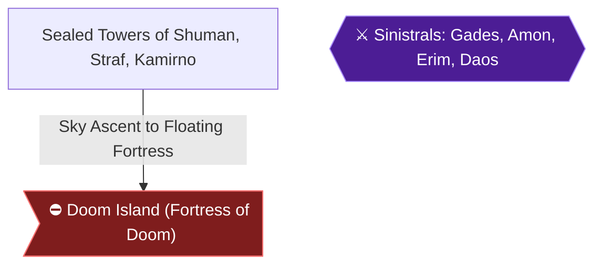

# Writer packet — Chapter 5: Endgame — Sealed Towers and Doom Island

Write `08_chapters/05.md`. Previous chapter: 4. Northern Shrines, Dragon Mountain and Airship Conversion. Next chapter: 6. Capsule Monsters, Casino Wealth and the Egg Dragon.
Planner notes: Claim Dual Blade, trigger Point of No Return to Doom Island, and defeat Sinistrals Gades, Amon, Erim, and Daos to bring peace.

## Areas in this chapter (in order)

- `Sealed_Towers` — Sealed Towers of Shuman, Straf, Kamirno
- `Doom_Island` — Doom Island (Fortress of Doom)
- `Sinistrals_Final` — Sinistrals: Gades, Amon, Erim, Daos

## Achievements to place in this chapter (each EXACTLY once as `[ACHIEVEMENT:<id>]`)

- **17575** — Blade of the Gods (5 pts, progression): Obtain the Dual Blade  
  supporting facts: ra-comments-51-1, ra-comments-51-2, gf1-4-1, gf1-4-2, gf1-71-1, gf1-71-2, gf1-75-1, gf1-75-2, gf1-93-1, gf1-93-2, gf1-94-1, gf1-94-2, gf1-100-1, gf1-100-2, gf1-101-1, gf1-101-2, gf1-102-1, gf1-102-2, gf1-103-1, gf1-103-2, gf1-104-1, gf1-104-2, gf1-105-1, gf1-105-2, gf1-106-1, gf1-106-2, gf3-2-1, gf3-2-2, gf3-19-1, gf3-19-2, gf3-26-1, gf3-26-2, gf3-27-1, gf3-27-2, gf3-29-1, gf3-29-2, gf3-92-1, gf3-92-2, gf3-102-1, gf3-102-2, gf3-106-1, gf3-106-2, gf3-107-1, gf3-107-2, gf3-109-1, gf3-109-2, gf3-110-1, gf3-110-2, gf3-115-1, gf3-115-2, gf3-116-1, gf3-116-2, gf3-118-1, gf3-118-2, gf3-144-1, gf3-144-2, gf3-225-1, gf3-225-2, gf3-258-1, gf3-258-2
- **17576** — Final Countdown (25 pts, win_condition): Bring peace to the world  
  supporting facts: ra-comments-53-1, ra-comments-53-2, gf1-5-1, gf1-5-2, gf1-75-1, gf1-75-2, gf1-95-1, gf1-95-2, gf1-100-1, gf1-100-2, gf1-101-1, gf1-101-2, gf1-102-1, gf1-102-2, gf1-104-1, gf1-104-2, gf1-105-1, gf1-105-2, gf1-106-1, gf1-106-2, gf1-120-1, gf1-120-2, gf1-122-1, gf1-122-2, gf3-116-1, gf3-116-2, gf3-120-1, gf3-120-2, gf3-224-1, gf3-224-2, gf3-243-1, gf3-243-2, gf3-274-1, gf3-274-2

## ⛔ Points of no return in this chapter (each needs a `> [!CAUTION]` containing the words "Point of No Return")

- Doom Island Airship Boarding: Once you take flight to Doom Island for the final showdown against the Sinistrals, you cannot return to the world map to finish sidequests or explore the Ancient Cave. [ra-comments-53-1, ra-comments-53-2, gf1-5-1]

## Route diagram (inserted automatically where you write `[MERMAID]`)



## Usable facts (80) — cite as [[fact-id]]

Legend: ✅ verified (2+ sources) · ✔ conflict resolved · 🟡 single source

- 🟡 **gf1-4-1** (location) Here's an intro to all the Brave Heroes and Charmin' Heroines, some intro and — @The Heroes # · ach: 17553,17554,17563,17575,114729  
  evidence: gf1#4: "Here's an intro to all the Brave Heroes and Charmin' Heroines, some intro and"
- 🟡 **gf1-4-2** (location) some comments on their statistics to be exact. I've also included some FINAL — @The Heroes # · ach: 17553,17554,17563,17575,114729  
  evidence: gf1#4: "some comments on their statistics to be exact. I've also included some FINAL"
- 🟡 **gf1-5-1** (location) Final Equipment: Dragon Spear, Water Gaunt, Boom Turban, Holy Robe, Dia Ring & — @The Heroes # · ach: 17574,17576,17592  
  evidence: gf1#5: "Final Equipment: Dragon Spear, Water Gaunt, Boom Turban, Holy Robe, Dia Ring &"
- 🟡 **gf1-5-2** (location) Strong as Rock for Soul Calibur, a loyal as a terrior and the MOST powerful — @The Heroes # · ach: 17574,17576,17592  
  evidence: gf1#5: "Strong as Rock for Soul Calibur, a loyal as a terrior and the MOST powerful"
- 🟡 **gf1-71-1** (location) ¤ Bury the residents of this town! — @GF1 Dungeon Guide · ach: 17564,17570,17575,17592  
  evidence: gf1#71: "¤ Bury the residents of this town!"
- 🟡 **gf1-71-2** (location) ¤ Speak to Iris and find out what happened! — @GF1 Dungeon Guide · ach: 17564,17570,17575,17592  
  evidence: gf1#71: "¤ Speak to Iris and find out what happened!"
- 🟡 **gf1-75-1** (transition) ¤ Funs Over, so go through the door and follow the spooky passage until a wall — @GF1 Dungeon Guide · ach: 17562,17564,17569,17570,17575,17576,17587,17588,17589,17590  
  evidence: gf1#75: "¤ Funs Over, so go through the door and follow the spooky passage until a wall"
- 🟡 **gf1-75-2** (transition) collapses; now keep on going and head up the stairs, you will find some more — @GF1 Dungeon Guide · ach: 17562,17564,17569,17570,17575,17576,17587,17588,17589,17590  
  evidence: gf1#75: "collapses; now keep on going and head up the stairs, you will find some more"
- 🟡 **gf1-93-1** (location) ¥ Artea has the Ice.Valk Spell, and I hope Selan has the spell too...you will — @!:::::::::! · ach: 17570,17573,17575,17580,17592,114729  
  evidence: gf1#93: "¥ Artea has the Ice.Valk Spell, and I hope Selan has the spell too...you will"
- 🟡 **gf1-93-2** (location) have Valor and Champion to use as well, so Magic should not be a Problem; I — @!:::::::::! · ach: 17570,17573,17575,17580,17592,114729  
  evidence: gf1#93: "have Valor and Champion to use as well, so Magic should not be a Problem; I"
- 🟡 **gf1-94-1** (location) ¤ Apart from those lovely armours, there's a queen called Marla, she is waiting — @!:::::::::! · ach: 17570,17575  
  evidence: gf1#94: "¤ Apart from those lovely armours, there's a queen called Marla, she is waiting"
- 🟡 **gf1-94-2** (location) for you in the palace, this means you have to go there. Marla wonders how you — @!:::::::::! · ach: 17570,17575  
  evidence: gf1#94: "for you in the palace, this means you have to go there. Marla wonders how you"
- 🟡 **gf1-95-1** (boss) ¤ Daos, the Sinistral of Terror, hates the fact that a Human could be stronger — @!:::::::::! · ach: 17556,17564,17570,17576  
  evidence: gf1#95: "¤ Daos, the Sinistral of Terror, hates the fact that a Human could be stronger"
- 🟡 **gf1-95-2** (location) than most Sinistrals, so just to spite Maxim, Selan, Guy and Artea; he wants — @!:::::::::! · ach: 17556,17564,17570,17576  
  evidence: gf1#95: "than most Sinistrals, so just to spite Maxim, Selan, Guy and Artea; he wants"
- 🟡 **gf1-100-1** (boss) ¥ Amon is much stronger than Gades, although his HP isn't too high, he sure can — @GF1 Dungeon Guide · ach: 17562,17575,17576,17592  
  evidence: gf1#100: "¥ Amon is much stronger than Gades, although his HP isn't too high, he sure can"
- 🟡 **gf1-100-2** (location) kick some ass! He uses some level three magic spells such as Ice.Valk and — @GF1 Dungeon Guide · ach: 17562,17575,17576,17592  
  evidence: gf1#100: "kick some ass! He uses some level three magic spells such as Ice.Valk and"
- 🟡 **gf1-101-1** (transition) ¤ I assume you took the lower door, well here goes...! Your inside a small room — @GF1 Dungeon Guide · ach: 17563,17569,17575,17576  
  evidence: gf1#101: "¤ I assume you took the lower door, well here goes...! Your inside a small room"
- 🟡 **gf1-101-2** (location) with a Mega Cyclops, I think you had better kill him...when he rots, head up — @GF1 Dungeon Guide · ach: 17563,17569,17575,17576  
  evidence: gf1#101: "with a Mega Cyclops, I think you had better kill him...when he rots, head up"
- 🟡 **gf1-102-1** (boss) ¤ Gades, The sinistral of Destruction must die! — @GF1 Dungeon Guide · ach: 17575,17576  
  evidence: gf1#102: "¤ Gades, The sinistral of Destruction must die!"
- 🟡 **gf1-102-2** (boss) ¤ Amon...the sinistral of chaos must be killed! — @GF1 Dungeon Guide · ach: 17575,17576  
  evidence: gf1#102: "¤ Amon...the sinistral of chaos must be killed!"
- 🟡 **gf1-103-1** (boss) # Sinistral Boss: GADES #  HP: 7,500        Weakness: Holy — @GF1 Dungeon Guide · ach: 17575  
  evidence: gf1#103: "# Sinistral Boss: GADES #  HP: 7,500        Weakness: Holy"
- 🟡 **gf1-103-2** (boss) ¥ Armed with Destructo wave and normal attacks, Gades is lame when it comes to — @GF1 Dungeon Guide · ach: 17575  
  evidence: gf1#103: "¥ Armed with Destructo wave and normal attacks, Gades is lame when it comes to"
- 🟡 **gf1-104-1** (location) ¥ Chaos wave can cause confusion, and he's got a nice assortment of Level three — @GF1 Dungeon Guide · ach: 17569,17575,17576,17592  
  evidence: gf1#104: "¥ Chaos wave can cause confusion, and he's got a nice assortment of Level three"
- 🟡 **gf1-104-2** (location) magic spells, and of course the horrible Galactic Lancer technique...like the — @GF1 Dungeon Guide · ach: 17569,17575,17576,17592  
  evidence: gf1#104: "magic spells, and of course the horrible Galactic Lancer technique...like the"
- 🟡 **gf1-105-1** (location) ¥ Check out her cool shield....it's living? Devastation Wave can cause instant — @GF1 Dungeon Guide · ach: 17575,17576  
  evidence: gf1#105: "¥ Check out her cool shield....it's living? Devastation Wave can cause instant"
- 🟡 **gf1-105-2** (location) death and Dark Fry can be really destructive...it can cause over 200+ Damage — @GF1 Dungeon Guide · ach: 17575,17576  
  evidence: gf1#105: "death and Dark Fry can be really destructive...it can cause over 200+ Damage"
- 🟡 **gf1-106-1** (boss) ¥ Daos, is Terror itself, he uses some devastating attacks which can cause some — @GF1 Dungeon Guide · ach: 17569,17575,17576,17592  
  evidence: gf1#106: "¥ Daos, is Terror itself, he uses some devastating attacks which can cause some"
- 🟡 **gf1-106-2** (location) Random Status effects! First of all, he's got an attack called Terror Wave; — @GF1 Dungeon Guide · ach: 17569,17575,17576,17592  
  evidence: gf1#106: "Random Status effects! First of all, he's got an attack called Terror Wave;"
- 🟡 **gf1-120-1** (boss) Well, this place has no shops...Why you ask? coz Amon the Sinistral of Chaos — @Shops/Finances # · ach: 17562,17576,17581,17604,17612  
  evidence: gf1#120: "Well, this place has no shops...Why you ask? coz Amon the Sinistral of Chaos"
- 🟡 **gf1-120-2** (location) did everyone in; he completely destroyed this village, so it's total population — @Shops/Finances # · ach: 17562,17576,17581,17604,17612  
  evidence: gf1#120: "did everyone in; he completely destroyed this village, so it's total population"
- 🟡 **gf1-122-1** (item) Useful Items: "Zirco Sword" from the General Store, ideal for Maxim! — @Shops/Finances # · ach: 17576  
  evidence: gf1#122: "Useful Items: "Zirco Sword" from the General Store, ideal for Maxim!"
- 🟡 **gf1-122-2** (location) Useful Items: Zirco Everything! To save time and space, press CTRL+F while — @Shops/Finances # · ach: 17576  
  evidence: gf1#122: "Useful Items: Zirco Everything! To save time and space, press CTRL+F while"
- 🟡 **gf3-2-1** (location) Important word on combining elemental attacks — @GameFAQ Status: 100% · ach: 17553,17554,17558,17561,17562,17563,17565,17567,17568,17570,17571,17575,17581,17585,17586,17588,17589,17590,17591,17597,17604,17605,17612,17598,17606,17599,17607,17600,17608,17601,17609,17602,17610,17603,17611,114733,114734,114729  
  evidence: gf3#2: "Important word on combining elemental attacks"
- 🟡 **gf3-2-2** (location) 1. The request of the old man — @GameFAQ Status: 100% · ach: 17553,17554,17558,17561,17562,17563,17565,17567,17568,17570,17571,17575,17581,17585,17586,17588,17589,17590,17591,17597,17604,17605,17612,17598,17606,17599,17607,17600,17608,17601,17609,17602,17610,17603,17611,114733,114734,114729  
  evidence: gf3#2: "1. The request of the old man"
- 🟡 **gf3-19-1** (location) The main character of this game, he lives in Elcid and he hunts monsters down — @Battle system · ach: 17553,17554,17575  
  evidence: gf3#19: "The main character of this game, he lives in Elcid and he hunts monsters down"
- 🟡 **gf3-19-2** (location) for a living. After meeting Iris in the cave to Sundletan he starts his quest — @Battle system · ach: 17553,17554,17575  
  evidence: gf3#19: "for a living. After meeting Iris in the cave to Sundletan he starts his quest"
- 🟡 **gf3-26-1** (location) This is a very mysterious figure, perhaps even more than Iris... What we do — @Statistics · ach: 17575  
  evidence: gf3#26: "This is a very mysterious figure, perhaps even more than Iris... What we do"
- 🟡 **gf3-26-2** (location) know about him is that he stands above the four Sinistrals and he also ordered — @Statistics · ach: 17575  
  evidence: gf3#26: "know about him is that he stands above the four Sinistrals and he also ordered"
- 🟡 **gf3-27-1** (location) You will meet this character various times in the game, she will usually come — @Iris - The Enigma: · ach: 17554,17558,17561,17563,17565,17575  
  evidence: gf3#27: "You will meet this character various times in the game, she will usually come"
- 🟡 **gf3-27-2** (location) in a nick of time to save your butt in critical times. She tells about - the — @Iris - The Enigma: · ach: 17554,17558,17561,17563,17565,17575  
  evidence: gf3#27: "in a nick of time to save your butt in critical times. She tells about - the"
- 🟡 **gf3-29-1** (location) War knows many causes: greed, hate or desire for power. The Sinistrals began a — @Iris - The Enigma: · ach: 17554,17575  
  evidence: gf3#29: "War knows many causes: greed, hate or desire for power. The Sinistrals began a"
- 🟡 **gf3-29-2** (location) war for the most selfish reason of all; they wanted the land of Lufia for them — @Iris - The Enigma: · ach: 17554,17575  
  evidence: gf3#29: "war for the most selfish reason of all; they wanted the land of Lufia for them"
- 🟡 **gf3-92-1** (location) After these events, a messenger comes into the throne room. He tells about — @GF3 Dungeon Guide · ach: 17575  
  evidence: gf3#92: "After these events, a messenger comes into the throne room. He tells about"
- 🟡 **gf3-92-2** (location) how a single man in golden armor is destroying the village of Agurio. Talk to — @GF3 Dungeon Guide · ach: 17575  
  evidence: gf3#92: "how a single man in golden armor is destroying the village of Agurio. Talk to"
- 🟡 **gf3-102-1** (location) they aren't very special at all. — @GF3 Dungeon Guide · ach: 17573,17575,17591,114729  
  evidence: gf3#102: "they aren't very special at all."
- 🟡 **gf3-102-2** (location) -After their defeat, the mirror will be broken and they will leave the tower. — @GF3 Dungeon Guide · ach: 17573,17575,17591,114729  
  evidence: gf3#102: "-After their defeat, the mirror will be broken and they will leave the tower."
- 🟡 **gf3-106-1** (location) Weak:       Dragon, Ice, Flying — @D = move one space down · ach: 17573,17575,17602,17604,17610,17612,114729  
  evidence: gf3#106: "Weak:       Dragon, Ice, Flying"
- 🟡 **gf3-106-2** (location) Specials:   Bite, Drowsy*, Incendiary — @D = move one space down · ach: 17573,17575,17602,17604,17610,17612,114729  
  evidence: gf3#106: "Specials:   Bite, Drowsy*, Incendiary"
- 🟡 **gf3-107-1** (location) 27. The mermaid queen and her daughter Piara — @D = move one space down · ach: 17575  
  evidence: gf3#107: "27. The mermaid queen and her daughter Piara"
- 🟡 **gf3-107-2** (transition) Upon entering the throne room of Preamarl you can talk to Queen Marla. You — @D = move one space down · ach: 17575  
  evidence: gf3#107: "Upon entering the throne room of Preamarl you can talk to Queen Marla. You"
- 🟡 **gf3-109-1** (boss) After Daos exterminates the four mermen guards, it's up to you to enter the — @D = move one space down · ach: 17575  
  evidence: gf3#109: "After Daos exterminates the four mermen guards, it's up to you to enter the"
- 🟡 **gf3-109-2** (transition) shrine. Go down the stairs and up to the teleporter to come to an area that — @D = move one space down · ach: 17575  
  evidence: gf3#109: "shrine. Go down the stairs and up to the teleporter to come to an area that"
- 🟡 **gf3-110-1** (boss) 27.2 Daos - Master of Terror; Leader of the Sinistrals — @D = move one space down · ach: 17575  
  evidence: gf3#110: "27.2 Daos - Master of Terror; Leader of the Sinistrals"
- 🟡 **gf3-110-2** (item) --Dual blade shrine - continued-- — @D = move one space down · ach: 17575  
  evidence: gf3#110: "--Dual blade shrine - continued--"
- 🟡 **gf3-115-1** (boss) Boss: Sinistral; Amon - Master of Chaos — @28. Engine needed · ach: 17562,17575,17581  
  evidence: gf3#115: "Boss: Sinistral; Amon - Master of Chaos"
- 🟡 **gf3-115-2** (location) Specials:   Chaos wave, Galactic Lancer, Thunder, Ice Valk — @28. Engine needed · ach: 17562,17575,17581  
  evidence: gf3#115: "Specials:   Chaos wave, Galactic Lancer, Thunder, Ice Valk"
- 🟡 **gf3-116-1** (location) --Kamirno sealed tower - continued-- — @28. Engine needed · ach: 17575,17576,17581  
  evidence: gf3#116: "--Kamirno sealed tower - continued--"
- 🟡 **gf3-116-2** (location) A conversation with the last maiden starts and you will find out that the — @28. Engine needed · ach: 17575,17576,17581  
  evidence: gf3#116: "A conversation with the last maiden starts and you will find out that the"
- 🟡 **gf3-118-1** (boss) Gades - Master of Destruction — @28. Engine needed · ach: 17562,17575,17599,17604,17607,17612  
  evidence: gf3#118: "Gades - Master of Destruction"
- 🟡 **gf3-118-2** (location) Here's how I defeated this goon easily, since you know the weapons / armors / — @28. Engine needed · ach: 17562,17575,17599,17604,17607,17612  
  evidence: gf3#118: "Here's how I defeated this goon easily, since you know the weapons / armors /"
- 🟡 **gf3-120-1** (location) Strong:     Fire, Water, Ice, Thunder, Shadow — @28. Engine needed · ach: 17576  
  evidence: gf3#120: "Strong:     Fire, Water, Ice, Thunder, Shadow"
- 🟡 **gf3-120-2** (location) Specials:   Devastation wave, (Eerie light, Thunder & Zap Dummied out) — @28. Engine needed · ach: 17576  
  evidence: gf3#120: "Specials:   Devastation wave, (Eerie light, Thunder & Zap Dummied out)"
- 🟡 **gf3-144-1** (location) For information about all the contents of each column see at the bottom. — @GF3 Dungeon Guide · ach: 17575,17581,17583,17584,17598,17604,17606,17612,114729  
  evidence: gf3#144: "For information about all the contents of each column see at the bottom."
- 🟡 **gf3-144-2** (location) Name          Used by ATP  Value  IP            Element Increases + Other — @GF3 Dungeon Guide · ach: 17575,17581,17583,17584,17598,17604,17606,17612,114729  
  evidence: gf3#144: "Name          Used by ATP  Value  IP            Element Increases + Other"
- 🟡 **gf3-224-1** (location) Light, Fire, Heal, (Ice), {Shadow} — @GF3 Dungeon Guide · ach: 17555,17558,17560,17573,17576,17588,17589,17590,17599,17604,17607,17612  
  evidence: gf3#224: "Light, Fire, Heal, (Ice), {Shadow}"
- 🟡 **gf3-224-2** (location) * = full list of abbreviations see begin of table. — @GF3 Dungeon Guide · ach: 17555,17558,17560,17573,17576,17588,17589,17590,17599,17604,17607,17612  
  evidence: gf3#224: "* = full list of abbreviations see begin of table."
- 🟡 **gf3-225-1** (location) Henohman(Aus)  -               - North. Lighth. / Karlloon North Shrine — @GF3 Dungeon Guide · ach: 17562,17575,17581  
  evidence: gf3#225: "Henohman(Aus)  -               - North. Lighth. / Karlloon North Shrine"
- 🟡 **gf3-225-2** (location) P: Destructo-wave / Devastation — @GF3 Dungeon Guide · ach: 17562,17575,17581  
  evidence: gf3#225: "P: Destructo-wave / Devastation"
- 🟡 **gf3-243-1** (boss) The Gades you fight on top of Shuman's Sealed Tower and Doom Island isn't the — @6. Frue Gades · ach: 17576  
  evidence: gf3#243: "The Gades you fight on top of Shuman's Sealed Tower and Doom Island isn't the"
- 🟡 **gf3-243-2** (boss) most powerful version of Gades in the game. It turns out to be there is a — @6. Frue Gades · ach: 17576  
  evidence: gf3#243: "most powerful version of Gades in the game. It turns out to be there is a"
- 🟡 **gf3-258-1** (location) These are a set of challenges I've come up with. They're quite hard to — @Lucky Blade for Tia? · ach: 17562,17575,17580,17581,17583,17584,17585,17586,17588,17589,17590,17592,114733,114734,114729  
  evidence: gf3#258: "These are a set of challenges I've come up with. They're quite hard to"
- 🟡 **gf3-258-2** (location) complete, but there all possible with some practice. — @Lucky Blade for Tia? · ach: 17562,17575,17580,17581,17583,17584,17585,17586,17588,17589,17590,17592,114733,114734,114729  
  evidence: gf3#258: "complete, but there all possible with some practice."
- 🟡 **gf3-274-1** (location) Battle Background Music Test — @Gordovan's Holy Cross Puzzle · ach: 17558,17564,17565,17570,17576,17585,17586,17588,17589,17590,17591,17597,17604,17605,17612  
  evidence: gf3#274: "Battle Background Music Test"
- 🟡 **gf3-274-2** (transition) Use the following code to test all the music in the game, enter the code with — @Gordovan's Holy Cross Puzzle · ach: 17558,17564,17565,17570,17576,17585,17586,17588,17589,17590,17591,17597,17604,17605,17612  
  evidence: gf3#274: "Use the following code to test all the music in the game, enter the code with"
- 🟡 **ra-comments-49-1** (achievement) [Server] Enddox edited this achievement. — ach: 17574  
  evidence: ra-comments#49: "[Server] Enddox edited this achievement."
- 🟡 **ra-comments-49-2** (achievement) [Server] DanielARP edited this achievement. — ach: 17574  
  evidence: ra-comments#49: "[Server] DanielARP edited this achievement."
- 🟡 **ra-comments-51-1** (achievement) [Server] Enddox edited this achievement. — ach: 17575  
  evidence: ra-comments#51: "[Server] Enddox edited this achievement."
- 🟡 **ra-comments-51-2** (achievement) [Server] DanielARP edited this achievement. — ach: 17575  
  evidence: ra-comments#51: "[Server] DanielARP edited this achievement."
- 🟡 **ra-comments-53-1** (achievement) [Warpsin] Even after playing it 18 years later this is such a beautiful ending to a game. — ach: 17576  
  evidence: ra-comments#53: "[Warpsin] Even after playing it 18 years later this is such a beautiful ending to a game."
- 🟡 **ra-comments-53-2** (achievement) [Server] Altomar edited this achievement. — ach: 17576  
  evidence: ra-comments#53: "[Server] Altomar edited this achievement."

## Source passages (71 chunks, 14 omitted for size — use `npm run rw:chunks -- 1005 --id <chunk>`)

Use these for detail (directions, chest contents, enemy names, boss patterns, ASCII maps). Every statement you take from a passage must cite a fact id; if no fact covers a detail you need, add a fact to `04_facts/` first (with a verbatim quote) and re-run `rw:verify`.

### gf1#3 — GameFAQs: Lufia II: Rise of the Sinistrals — Walkthrough by G_Paladin — [Contacting Me???] (context neighbour)

```text
Contacting Me???
----------------
I have an e-mail address and i'm a member of three forums, two of those forums
have agreed to HOST this FAQ, and other good guides I produce, please send all
e-mails to "GPaladin_aus2003@yahoo.com.au" and anything else to my Inbox on
Emuparadise forums...two sites are hosting this guide.../\/

<> http://www.gamefaqs.com
<> http://www.emuparadise.org

My user names...(Am I a V.I.P yet!)..+_+

EP Forums....Name = GPaladinShinobi...Member status: Elite (over 500 posts)
GFaqs MBs....Name = LordShinobi.......Member status: New User (3)

"Idahorazors Forum...Name: GPaladinShinobi...Member status: Full Moderator!
Address for above....http://www.arborwood.com/forums/idahorazorsforum/ This
is a nice forum, however we need more members...it's even got a Spam/Flaming
Board, if you like to insult members for fun, call me names and you'll never
be banned providing it's on the Flame Board!!

What's New???
-=-=-=-=-=-=-
* Well, I completed all those lists and performed tests on who is the MOST
  Compatible character; like who can equip the MOST weapons. That's all and I
  gave this a special version number too...the next version will be v1.0 BUT!
  I have no idea when that will be completed! (Perhap's I'l be done at X-mas)

Things to do ->
-=-=-=-=-=-=-=-
* Er...I think I'll leave this FAQ for a while, and YES! I will be updating
  this guide, Lufia II is starting to bore me loads, and i've had lots of other
  distractions thanks to Square-Enix and Koei, not to forget Nintendo with that
  Zelda: Wind Waker Game and all! Also I began a FAQ for Uncharted Waters 2, so
  there's yet another distraction...and the game does tend to get boring if its
  played on a Frequent Basis!

-=-=-=-=-=-=-=
```

### gf1#4 — GameFAQs: Lufia II: Rise of the Sinistrals — Walkthrough by G_Paladin — [The Heroes #]

```text
# The Heroes #
-=-=-=-=-=-=-=
Here's an intro to all the Brave Heroes and Charmin' Heroines, some intro and
some comments on their statistics to be exact. I've also included some FINAL
EQUIPMENT for each character, that's an ideal way to equip them for the games
Final events, and the ancient cave if you mess around with the games coding!
«««««««««««««
± M A X I M ±
°°°°°°°°°°°°°
The Red Haired Hero, master swordsman and monster hunter is quite a character;
he can use various swords and magic spells, hence allowing him to cause severe
amounts of pain to his foes. Like all RPG Heroes, Maxim has a specific task in
Life, he has to rid the world of evil, and obliterate the four sinistrals who
appear to be against humans ruling the world. On his adventure he'll find lots
of treasures and befriend various people to aid him in this struggle. One will
become his wife, the two will have a child; and name him Jeros. The main cause
of going on this adventure is a woman named Iris, she helps guide him on his
travels, and assists him in certain cases, NOT in battle!

Although his skills are average, some are above normal, his Strength and Health
stats are quite reliable and despite him being the Hero, he is unable to equip
HEAVY swords and axes, he is limited to Light Swords and Rapiers. He will be in
the team forever, if you don't like him, i'm afraid you've got a problem! Also
he can't use Fire Magic spells, which would be a MASSIVE problem...still, give
him Champion and Valor and he's cool!

Final Equipment:- Dual Blade, Pearl Shield, Pearl Helmet, Pearl Armor, Dragon
                  Ring & Evil Jewel (Uncursed).
«««««««««
± T I A ±
°°°°°°°°°
The Humble Shopkeeper, amateur magician and childhood friend of Maxim. She is
one of the most equippable characters in the game, she is able to use rods and
whips to cause damage, including a few spears and knives. Being Humble is her
major role, she needs protecting due to her carelessness. She assists Maxim a
little, and she buggers off back to Elcid never to be seen again. I suppose I
can like her skills?

She has as much strength and endurance as a new-born child, and her magic stats
are above average. She is almost as quick as Artea, and she can use near enough
the same spells as Selan! She uses Whips and Rods more than Knives, and those
come with some useful IP Techniques, overall I would call her one of the good
characters, I still prefer Selan!

Final Equipment:- Snow Sword, Dark Mirror (Uncursed), Brill Helm, Ruse Armor,
                  Dia Ring & Gold Eye.
«««««««««««««
± S E L A N ±
°°°°°°°°°°°°°
The Magical Heroine, Maxim's beloved and Mother of Jeros, she meets Maxim when
she training the soldiers of Parcelyte. Selan appears to be a Royal Guard, she
is looking after her King, whom she holds in high regard....and she appears to
be VERY attractive; so beautiful that Dekar tries to charm her as soon as the
two meet the FIRST time. She has been living with her aunt, until Maxim comes
along, gets her pregnant and she wants to help him obliterate the Sinistrals!
Selan feels challenged with Guys jokes, she always thinks he's been insulting
so she tends to argue her ideas!

Selan has more Strength and Endurance than Tia, and she's got more brains; even
if Tia is an economical lass. Also she seems to be able to equip more weapons
and Armours than everyone, making her the MOST equippable person....for those
of you who moan because Tia never returns, well I kind of wonder "What the hell
are you all thinkin'?" Selan is the BEST character in the game without a doubt!
```

### gf1#5 — GameFAQs: Lufia II: Rise of the Sinistrals — Walkthrough by G_Paladin — [The Heroes #]

```text
Final Equipment: Dragon Spear, Water Gaunt, Boom Turban, Holy Robe, Dia Ring &
                 Silver Eye.
«««««««««««««
± D E K A R ±
°°°°°°°°°°°°°
Strong as Rock for Soul Calibur, a loyal as a terrior and the MOST powerful
warrior in existance. He is NOT known to be intelligent, however he makes up
with this while putting Muscle in the place of his brains. Dekar deep down is
quite a sensitive bloke, he would be the perfect match for Tia but this does
not happen, which means I could have made the game more exciting...if it had
been a 32 meg cartridge who knows how wonderful the game could have been! He
is quite dumb, so he ends up chasing Idura to the ends of the Earth....like
a dumb person he falls for every trap set up by Idura, but brute strength tends
to save his ass in the end! It's fair to say that Guy could never replace him
when it comes to Strength, but he's VERY unagile compared to the others. Like
he says, his love is his sword, so in the end he ends up with no woman, which
is a shame because he's second best in the league of characters, well some of
you love him to death, so I can't be too cruel here!

The Strongest warrior, he has more endurance, strength and HP than all warriors
in this game, think of him as an upgrade for GUY! Despite his brute strengh, he
is far too dumb to use spells, like Kain from FF4 his MP value is "ZERO" making
his unable to cast spells not matter what happens, he can be given spells if
the game is hacked, however he will also need MP to use them...which means more
game hacking!

Final Equipment: Fry Sword, Apron Shield, Legend Helm, Old Armor, Rocket Ring &
                 Black Eye.

«««««««««
± G U Y ±
°°°°°°°°°
The Best friend of Maxim, always supporting him and occasianly tries to rival
Dekar. He has Blond hair, a cute girlfriend named Jessy, and a fit sister named
Hilda, who is taken ill near the start of the game. He dares to challenge one
of the sinistrals before anyone else, but loses and it should also be known
that he will always be in the team near the games ending, along with Artea and
Selan. He is more agile and brainier than Dekar, but he's always cracking sad
jokes; which make Selan fell pissed; because of this, him and Selan have some
petty squabbles, usually stopped by Maxim. He can equip Heavy Swords and Axes
like the "Almighty" Dekar, a true ally of the Doom island team!

Second strongest warrior, suppasses Maxim in strength and HP, like Dekar he is
unable to use Magic spells, hence we would be expected to use IP Techs instead!
Like Dekar, the game can be hacked to give him spells as well as some MP, which
he doesn't have either, still he is one of my prefered characters!

Final Equipment: Sky Sword, Bolt Shield, Legend Helm, Old Armor, Rocket Ring &
                 Black Eye.
«««««««««««««
± L E X I S ±
°°°°°°°°°°°°°
Genius of the Century, one of the BEST inventors in existance, and also a good
magician; thanks to being so clever. Lexis appears to be an Old man, he is more
responsible for building the ships engine, and improving the vessels skill, in
and out of the seven seas. Along with some of his scientist friends, Lexis will
turn an ordinary sea vessel into an Airship, similar to the ships we see in
Final Fantasy games. He also promises Milka that he will get rid of the Ooze
which pollutes the terrains. His Lab is near Treadool, and it's FULL of traps;
after all, this bloke is a Mad scientist.

Lexis rules in Intelligence, this gift allows him to cause more damage with
his spells; at level 99 he has the second best stats....he is quite a strong
bloke, he beats Artea, Selan and Tia in the STR value; and he even beats the
three of them in Life! Lexis although not loved by all, is quite a reliable
character, despite his crap choice of weapons, mainly tools...these will not
be the FIRST choice of weapon after all.
```

### gf1#6 — GameFAQs: Lufia II: Rise of the Sinistrals — Walkthrough by G_Paladin — [The Heroes #] (context neighbour)

```text
Final Equipment: Lizard Blow, Water Gaunt, Safety Hat, Bright Armor,
«««««««««««««
± A R T E A ±
°°°°°°°°°°°°°
Elven Swordmaster, and wielder of Luminous Magic Spells; he joins Maxim and his
comrades when a Sinistral takes the life of his friend. His deceased friend has
left her daughter all alone, but when it comes to this lil' child, Artea treats
her like his own. Artea is a Cross between Robin Hood, and Cecil from FF4; and
this seems to be good, because he fights like a Paladin, with the Holy Magic
spells and stuff; He is also known as "Arty" by some, tis' simply a nickname
commonly used on the Lufia Status screen! He can handle swords, bows, Rods and
even Heavy Armors; but his strength is limited. He's the most agile character;
and he is more intelligent than the likes of Maxim and Guy; his physical stats
are bearable, and he's a good choice for an ancient cave team! He does not come
close to Selan even though he can use "Fry" and "Zap" which are two cool magic
spells; still, you have to give this bloke a chance, he will do you proud after
all, and his abilities are not at all disappointing!

-=-=-=-=-=-=
```

### gf1#70 — GameFAQs: Lufia II: Rise of the Sinistrals — Walkthrough by G_Paladin — [| |] (context neighbour)

```text
Next we will get hold of the Mysto Jewel, this is fairly simple, from the
  Samu Jewel platform, jump on the tile and whack the switch on the platform
  which follows, leap onto another tile and allow it to take you to another
  platform with two switches, hit the southern switch and jump on the tile
  nearby, it should move Maxim and co. onto the platform with a Mysto Jewel!

  When it comes to reaching the exit, you need to start off on the Northern
  Platform with the stairs; make sure the arrow switch is pointing south and
  jump onto the tile, when the tile reaches the desired destination, do not
  go on the platform; instead, turn Maxim around so he's facing North and give
  the switch a slap with your trusty blade, you will be taken backwards; so you
  can reach the Southern door. Now head inside, and be prepared to take on a
  few monsters; and beware of the Ninja, I sorta over-looked this before but
  the Ninja's can use an attack called Knife-Thrower, and it cause at least 70
  points of damage to all party members!

¤ After taking out the Ninja's and ripping apart the samurai's go through the
  southern door and up the ladder outside this tower, there's a door here, so
  go inside and use the Trial Key to enter the boss door; before you can fight
  a boss, you always have to solve a puzzle! This one can be tricky, because
  you need to have both monsters standing on the switches, of course you can
  actually stun them, but it takes a little time and patience to get them on
  the switches; if you manage to succeed, try entering the door in as few steps
  a humanly possible, if you don't the monsters will move, and you will have
  to trap them a second time..'.'

¤ In the door which follows the previous puzzle room, you will find Hans, he
  seems to be paralyzed by a strange force, Maxim and the other have an idea
  what the force might be; it's much stronger than Gades! Suddenly a sinistral
  comes, and it just happens to be AMON the Sinistral of Chaos, and to our
  interest, Amon is a fairly honorable Guy, he doesn't want Hans to be ashamed
  with himself because it's normal for people to not move in such a powerful
  form of waves, but he takes one look at Maxim, and I would say he's impressed
  by his powers! Guy being a bit of a hard head wants to have a go at Amon, he
  attacks with all his might, Amon smashes him into a corner and says nothing
  to mock him; he only says "Don't throw your lives away" he wants to show you
  true terror later..! When Amon leaves, Guy will get up and the party will
  follow Hans into the last room, the stone is here; but it is no more than a
  simple blue stone with no decent value whatsoever. Hans believe that this is
  what he is looking for and he nicks off back to the castle, so cast "Escape"
  and follow him...'.'

¤ Back in the castle of Ferim, you can see an interesting scene in the Throne
  Room, Hans give the stone to the prince; the stone is just a miserable pebble
  says the Prince, and just when a moment of trouble occurs, there's some one
  to bail him out; oh, dear what shall we do, let's fob the Princess off with a
  quality sapphire instead! The Princess is not impressed, she wants the real
  deal, and just to give this story a happy ending, here comes Hans with his
  miserable pebble; the Princess is shocked and it seems that it's a relic of
  their childhood. Looks as though Hans won the heart of the Princess, she is
  really happy and once again it's all thanks to Maxim and co. When all is said
  to be over a soldier barges in, it seems that the town of Agurio has been
  demolished by a Golden Man; could be Amon I suppose! You need directions too
  I suppose, okay, head for the small shrine North of the previous tower, and
  jump in the warp portal, head out of the shrine and into the beaten up town
  of Agurio, and be prepared for something a little more drastic than Gordovan!
```

### gf1#71 — GameFAQs: Lufia II: Rise of the Sinistrals — Walkthrough by G_Paladin — [| |]

```text
¤¤¤¤¤¤¤¤¤¤
± Agurio ±
°°°°°°°°°°
MAIN GOALS
¤ Bury the residents of this town!
¤ Speak to Iris and find out what happened!

¤ What the Hell!!!! Amon really has done a number in this town, and who is on
  the scene, it's Iris....Does this woman have anything to do with this, she is
  looking rather suspicious don't you think? Iris looks upset, or she isn't too
  proud of herself for not reaching the village in time to stop Amon; she wants
  Maxim to quit his journey, and to be fair she suggests he should live a
  peaceful life in the town of Parcelyte. The conversation turns into a lecture
  on energy waves, and according to the Legend there's a sword that can amplify
  these waves; the legendary DUAL BLADE. Iris goes on some more about this Dual
  Blade, and finally the villagers get sent to the ground, and they can Rest in
  Peace along with any other souls out there...'.'

¤ After the Funeral, Maxim and Co. will decide to find the Dual Blade, and Iris
  will leave with a strange remark to Maxim's question; we find out who she
  really is later in the game, but it doesn't matter right now; so head out of
  this town and head for Treble, which just happens to be a small village South
  of the Ferim Kingdom.

¤¤¤¤¤¤¤¤¤¤
± Treble ±
°°°°°°°°°°
MAIN GOALS
¤ Purchase a "Circlet" for Lexis and Selan!
¤ Find out about Professor Kirmo, a friend of Lexis!

¤ Well this is a small village with no main errands to run, you can purchase a
  circlet from the equipment store; and you can speak to a little boy when you
  enter this town. He speaks of a bloke named Kirmo, and it seems that the guy
  he mentions is a friend of Lexis; the man he mentions is also working on a
  submarine; and he's in the town of Portravia to the south, and to give you
  another reason to head south, the villagers have seen a strange light, South
  of Treble, and near the town of Portravia, so walk south of Treble and go to
  the large town below, it is fairly easy to find after all...'.'

¤¤¤¤¤¤¤¤¤¤¤¤¤
± Portravia ±
°°°°°°°°°°°°°
MAIN GOALS
¤ Check out the Kirmo Lab, and learn about Submarines!
¤ Get the latest Level three spells, Thunder, Valor and Dragon!

¤ This is a Larger town with some cool spells on offer; and the weapons in this
  place are pretty good too; to begin with, let's go to the magic shop; while
  your in town, make sure you get Maxim the Valor spell, he is the main warrior
  after all and he can do some major healing with this spell; although Maxim is
  your first priority, every spell in this store would be useful for Selan, she
  would be best suited for every spell available! Lexis on the other hand, will
  not need to have any level three spells, because you are going to lose him in
  a few hours time; if you have the cash you could buy him some of the spells;
  but again this is not essential.

¤ Weapons are another delicacy in this place, you sure could use a Rainy Ax for
  Guy, well...it's an Ax just like the description says, but it has good attack
  power advantage over a Spear. Lexis would be better off with a Battledriver;
  and Selan would feel loved with a Pounder rod in her possession. Don't bother
  upgrading your armours, you have good enough equipment already; when you've
  finished shopping, put your skates on an head for Kirmo's Laboratory in the
  Northern area of Town!

¤ Prof.Kirmo's Lab isn't full of traps and in this case, he has staff to work
  for him, in this place you will find a green haired man, standing in front of
  some water. Go over and speak to this dude and he will explain how far he has
  gone with the Submarine project; Lexis opens his big gob, and Kirmo wants to
  remodel Excerion, your beloved vessel, say yes when he asks, because you will
  need a submarine later; when he asks for the blue prints however, some little
  elf child nicks them, causing the scientist to make a fool of himself, just
  because the Elven Thief is too quick for him....we need those plans, so let's
  go find the elf girl...'.'
```

### gf1#72 — GameFAQs: Lufia II: Rise of the Sinistrals — Walkthrough by G_Paladin — [| |] (context neighbour)

```text
¤ An Innocent bystander mentions a female friend, and he's a kid, so it's got
  to be the Elf Girl, she has nicked off to a place called the Mountain of no
  return....don't know why? but their's a good reason when you find her; this
  girl runs around quick, so it will take a while to catch her! The Mountain
  of no return is south-east of Portravia, so head east a few paces, and head
  for the Southern mountain, and use the trail of forest area to make the path
  clearer to you.

¤¤¤¤¤¤¤¤¤¤¤¤¤¤¤¤¤¤¤¤¤¤¤¤¤¤
± Mountain of no Return! ±
°°°°°°°°°°°°°°°°°°°°°°°°°°
MAIN GOALS
¤ Catch up with the Elf Child and retrieve the plans!
¤ Run into a fellow swordsman from the Elven Village!

Items -> Aqua Sword

¤ The Speedy Lil' Elf Girl ran up this mountain, so let's find her, to begin
  the search go up the second lot of steps and into a small chamber with two
  horse statues. Push them so they meet eye to eye and continue, in the next
  chamber things get a little more complicated, this time we have several of
  these statues to deal with! There's also a normal statue, so begin by moving
  the ordinary statue, three paces to the left and five paces upwards to block
  of two forces. Now move the left statue in the center of this room; one pace
  to the right, then another pace upwards...move the right statue four paces to
  the left and two paces upwards to permanently block of one of the forces. You
  are then obliged to move the ordinary statue, one pace upwards to block off
  two more forces, and you can apply the final part of this puzzle, by moving
  the last horse statue two paces upwards to block off the final force..! Then
  you may continue through the door...'.'

¤ Now go up the staircase which follows, and continue on this one way path till
  you reach some monsters; use fire elemental attacks and spells to make simple
  work of them and head through the door which follows. Once again, follow the
  one way path until you reach another room full of horse statues; this puzzle
  is a little more complicated than the second room, so you had better read my
  solution carefully...If it's Readable...'.'

  This took me a good half hour to work out, so here goes, begin with the horse
  a few paces south of the entrance, and head right until the forces stop your
  movement. Move the very first horse one pace downwards, and it's neighbor 7
  paces to the right; to block the force given off one of the statues. Now move
  the horse to your left, four paces down, and the one opposite, one pace down;
  so both horse statues are facing each other; now open the chest to get a Aqua
  Sword, then equip the newly acquired weapon on Selan. Now walk back to the
  very first statue and move it one pace downwards, the path will be clear, so
  you can now head south and then east until you get blocked again; this time
  you need to move the first statue you see on this path upwards so it touches
  the statue above. You can then head right a few paces and move the next horse
  one pace to the right, and to finish off; head downwards and push the final
  horse as far to the right as possible and head through the door, where you
  will be on the mountainside, with the elf child you been looking for. Milka
  decides to run away as soon as you confront her, but she is caught by some
  Gargoyles, which means she's in trouble....Let's help her....

  Boss: 4 × Gargoyle
  ¤¤¤¤¤¤¤¤¤¤¤¤¤¤¤¤¤¤
  HP: 1,000 each

¥ Four Gargoyles have attacked Milka, so let's give them whats for; start the
  battle off by casting level three spells such as Firebird and Thunder. This
  will cause a decent amount of damage, if you repeat this for four turns, you
  should win the battle with ease. After the Gargoyles crumble, you will get
  12,000 experience points and 12,000 Gold Coins.
```

### gf1#74 — GameFAQs: Lufia II: Rise of the Sinistrals — Walkthrough by G_Paladin — [| |] (context neighbour)

```text
» The First treasure to be acquired is the Heart Key; so get out the hook and
  aim for the upper-right pillar, then grab the pillar to the right, then the
  upper pillar and then the upper left pillar, and when your that far, you can
  finally grab the pillar to your left to gain access to the stairs. Upstairs
  you will find an Iron Gorem, kill him and enter the Northern door; once your
  inside, you should open the Blue Chest, and grab your first treasure in this
  shrine; the Heart Key!

» To obtain your second treasure, head back to the entrance staircase and use
  the hook to reach the platform to your left; now go upwards and left again, a
  statue is on the platform above you, so grab the statue and move it upwards
  until you can't move it any further. Next, aim your hook at the accessible
  left platform, grab the pillar and hook onto another pillar below you, follow
  the path around and you will come to a statue, you should move the statue so
  you can follow the Narrow path below you, at the end of the narrow path, grab
  the lower statue, the head for the left platform and finally head upwards and
  up the stairs which follow, inside the small room, you will find a revive
  armour. Equip this on Guy so his defense and Magic resistance will improve a
  little, then head back to the entrance staircase!

» Last of all, we have Rocket Ring...As you've done before, aim the hook for
  the upper-right pillar, and go for the pillar to your right; grab the next
  upper-right pillar and jump across the gap, by hooking onto the statue. Now
  move the statue as far North as possible; and head downwards and back across
  the gap you just cleared, and hook the lower pillar. Now you need to aim the
  hook at the upper-left pillar, so fly across the gap and grab the pillar to
  your left, walk upwards and you should see two pillars with one space between
  them, and to your right, there's another pillar, so again use the hook to
  throw yourself over the gap and then grab the statue you moved a few seconds
  ago. Now, hook the pillar to the right, and follow the narrow path up the
  stairs and dispose of the monster. Grab one of the upper-left pots to reveal
  a switch, and turn in the downwards direction; drop the pot and head over the
  spikes. Now go up the stairs and take the Rocket Ring from the chest, you can
  also jump down from here using the arrow; when you're done with picking up
  treasures go back to the room with the pots and lift the pot in the lower
  right corner of the room, it looks like you've stumbled upon a weak patch on
  the floor. Let's fall down and see whats happens....'.'

¤ Look's like your on a small platform, the first bit's simple, just aim the
  Hookshot at the pillar on the western platform; when you make it across, walk
  downwards until you reach the end of the Narrow path and use the hook once
  again to access a western platform. Do the same again, and follow the pillars
  one at a time, in a kind of Anti-Clockwise pattern. Now, go down those stairs
  and follow the path into a room with a Red Flower monster. Kill this fiend
  using Fire elemental spells and head through the door, while your in here you
  should exterminate the Brinz Lizard; when you've finally got used to Killing
  monsters, off you go into the next chamber; and hey! whats this..we have some
  Torches lighting themselves up as we walk along the Hallway; yes it's strange
  and I have no idea what these things are doing. If you can, just ignore them
  and proceed into the next room; now we have to fight some weird snake monster
  and I haven't checked to see what they are called yet; just kill the lousy
  thing, head into the next room and storm the Gargoyles. Now it's time to get
  your arrows out, you are going to need them after all; there seems to be a
  switch on the Northern wall; so fire an arrow right in its core, and watch as
  the platform moves into the western area of the room; taking you to some more
  monsters. This time we have found a new monster, it's a Tartona and these
  creatures have a good chance of dropping Earth Jewels, so kill them whenever
  possible; there's also an Iron Gorem here too; turn him into dust and enter
  the door which follows; prepare for a battle against some Cocktoris; these
  can drop Life Potions which can be useful to increase your HP stats. Whenever
  you get these potions be sure to use them on Maxim or Artea, these guys are
  fighters so they need lots of HP's.
```

### gf1#75 — GameFAQs: Lufia II: Rise of the Sinistrals — Walkthrough by G_Paladin — [| |]

```text
¤ Funs Over, so go through the door and follow the spooky passage until a wall
  collapses; now keep on going and head up the stairs, you will find some more
  monsters and a weak wall, as well as another door. Use your instincts here
  and blow up the wall, go through the new hole and prepare to solve a music
  puzzle, this is fairly simple and you won't need me to solve this; but for
  those of you who want to solve this with ease..I will help you! To make life
  a tad easier, I have given each tile a number, and these numbers will be
  arranged from Left to Right. The order of these tiles is 3-2-4-1-5; and that
  will make all the spikes vanish; it will also allows you to reach a treasure
  box, which contains the seventh dragon egg; and I've found there's another
  little secret in this place, why don't you smash the wall above using your
  hammer, you never know..it may reveal a hidden treasure; it's a Holy Whip!
  Just a nice little gift for the lovely lady, so equip this on Selan; and see
  how much her attack power rises; you won't need another weapon for a while
  now, so be pleased with your discovery...!

¤ Selan should be happy with the new weapon, and you can freely kill some of
  the enemies back in the room before the music puzzle; as you can recall there
  is a door, so go inside and prepare to fight two lots of Gargoyles; and Rogue
  shapes which seem to be always with them. When the monsters die, go inside
  the door at the end of this passageway; as you can see this is a boss door
  and inside you will face a simple puzzle. Just get the Hammer out and move
  the statues onto the tiles, when both tiles are covered, be prepared for a
  shocking scene; enter the door and meet up with "AMON" The sinistral of Chaos
  and the most dangerous sinistral around for the time being.

¤ AMON has got Karyn trapped, he wants her to open the door so he can gain some
  more power; and because she's a brave elf like Artea, the Girl will not give
  into Amon's demands. Karyn will unleash her power and it looks as though she
  did manage to wound Amon; she was strong but she couldn't control the powers
  within her, and this ended up costing her own life. Karyn manages to tell her
  friend to look after Milka when she's gone, and the thought of Karyn being
  killed by the likes of Amon makes Artea really angry, and because of this;
  the young elf wants a piece of the Sinistrals; so he'll join your Doom Island
  team in search of the Dual Blade and the Four Sinistrals, Gades, Amon, Erim
  and Daos. Karyn is gone, but she has left the Northern door wide opened. In
  this room you will find a strange portal; and in this case, it will boost all
  your stats a little; that's good, and when you get this bonus, you should use
  the Escape spell and then you should use the "Warp" spell to get back to the
  Elven Village of Eserikto in the space of a few seconds!!

¤¤¤¤¤¤¤¤¤¤¤¤¤¤¤¤
± Story Events ±
°°°°°°°°°°°°°°°°
MAIN GOALS
¤ Return to Eserikto and give Milka the Tragic News!
¤ Acquire your new Submarine from Lexis in Portravia!

¤ When you get back to Eserikto, you will run into Milka, Artea delivers the
  news to her and it looks as though she takes it quite well. Again, we have a
  stupid typo..Instead of Guy's name being GUY, Selan calls him GAI! Milka will
  run off so she can grieve in peace; so you can now control your party, if you
  don't have the spells available in this place, then now is the time to get
  them..otherwise exit this town and head back to Portravia; by using the warp
  spell. When you reach Portravia, enter Kirmo's Lab and speak to Lexis. After
  he gives the Submarine to you he will get onto the Sinistral Subject, and you
  will find out the whereabouts of Amon..It seems he has gone under the sea and
  he's heading for a town called Barnan; so let's get to that town as soon as
  possible. To reach Barnan, sail in the southern direction, until you hit the
  deep waters; which will be represented with the Darker Blue Colour; then sail
  in the western direction, you should see a large town; this is Barnan!
```

### gf1#76 — GameFAQs: Lufia II: Rise of the Sinistrals — Walkthrough by G_Paladin — [| |] (context neighbour)

```text
¤¤¤¤¤¤¤¤¤¤
± Barnan ±
°°°°°°°°°°
MAIN GOALS
¤ The usual stuff, upgrade your weapons and armours!
¤ Learn about the undersea shrine, a.k.a the Shrine of Vengeance!

¤ Barnan is a large town south-west of Parcelyte, with a good arsenal of swords
  and armours; this is a good place to obtain new gear; so before you even dare
  attempt the Shrine of Vengeance make sure you have some of the weapons on
  offer within the shop's of this town! Let's begin with the weapons, first of
  all, make sure you get Guy a Halberd and Maxim a Red Saber; the Red Saber has
  a powerful IP technique and the Halberd is another strong spear for Guy; when
  it comes to Selan, you will not need any new weapons due to the power of her
  Holy Whip...As for Artea, he should probably have a Crystal Wand, although if
  you want stronger attack power, you could always get a Mist Rapier for him; I
  would stick with the wand, because Holy Power is better than Water Power in
  my opinion. Now, make sure you have at least 200,000GP and prepare to do some
  serious armour shopping....'.'

¤ The Armour here is good, for Guy and Maxim, you can buy both of them, a Plati
  Plate, a Plati Helmet and a Plati Shield....and I think "Plati" is short for
  Platinum, so don't be alarmed at the stupid name. Selan and Artea both need a
  Silk Robe each, so make sure you get them one and you can also get them both
  some Platinum Gloves and a Platinum Band. Upon equipping your new gear, walk
  around town a little and get acquainted with the people; gain some info on
  the Shrine of Vengeance, and most residents here will start moaning about the
  monsters in the place. Well! you have a submarine, so exit the town and sink
  down into the ocean, look for a small hole on the sea bed and go inside, you
  will wind up in a small passage under the sea, go forwards into the whirlpool
  to enter the Shrine of Vengeance!!!

¤¤¤¤¤¤¤¤¤¤¤¤¤¤¤¤¤¤¤¤¤¤¤
± Shrine of Vengeance ±
°°°°°°°°°°°°°°°°°°°°°°°
MAIN GOALS
¤ Obtain two valuable treasures!
¤ Acquire the Ghost Key, other wise your in trouble!
¤ Destroy the Vengeance Ghost!

Items -> Power Robe, Heal Armour, Ghost Key, Bright Armour, Evil Jewel,
         Cursed Bow

¤ After docking the submarine, you should head up the stairs, inside the room
  which follows you should find two switches and a lever. The lever will only
  work if both switches have been hit once, so whack them both with the sword
  and pull the lever to reveal a door on the left side of the room; you need to
  open the door so change the Red switches colour to Green; in other words give
  the thing a good whack with your sword. The door should have opened leaving
  you with the entrance to the next chamber; so enter the door you have just
  opened and take out the monster; it's a T-Rex and these little devils can
  cause large amounts of damage to your team. When you have defeated the T-rex
  monsters, you are obliged to go inside the next room. Now it's time for an
  easy puzzle; make sure you have the hammer ready and launch it at the statue
  on the western platform, it should knock it back a pace. Instead of going
  down some stairs, which lead to a whole hoard of monsters, jump across the
  pit using the Hook and enter the door, go down the stairs and you should be
  in a room with some Hades chariots and some wizards, the Hades creatures are
  weak against Holy magic, so the Crystal Wand should come in Handy at this
  moment in time. When you manage to take out both monsters, head upwards and
  follow the path in a clockwise direction, then enter the door, so you can be
  inside the next chamber.
```

### gf1#92 — GameFAQs: Lufia II: Rise of the Sinistrals — Walkthrough by G_Paladin — [You will need BOMBS and FIRE ARROWS for this puzzle, so whip out the arrows] (context neighbour)

```text
===========
       !:::::::::!
       !:1:3:4:2:!
       !:1:3:4:2:!
       !:7:5:9:9:!
       !:::0:0:6:!
       !:::0:0:8:!
       !:::::::::!
       ===========

 The Final Step is now complete, so you will be rewarded with four useful and
 valuable treasures, these are as follows....'_'

 The "Lizard Blow" (This Weapon is effective vs Dragons)
 The "Mega Shield" (Strong Protective Shield for GUY...)
 The "Holy Robe::" (Great Ikari Tech; used by Selan and Artea)
 The "Legend Helm! (Strong Protective Head Gear for Guy and Maxim)

 Well! You happy now....that's four useful items to add to your collection; all
 of these treasures will be suited for the final battle with the Sinistrals, so
 please keep them all!

¤ After solving the Puzzle, you are obliged to continue, so head downstairs and
  walk forwards...and DO NOT! Cross the Bridge, instead! Move along the simple
  path and grab three treasures, a S.Myst Ring; a S.Power Ring and a Miracle
  Potion...now would be a good time to cast the Escape spell...you must enter
  the place once again however, you need to be in the same room as the reviving
  wall, you remember now? Let's get back in the room; and we can even take the
  staircase this time...and yes! I'm sorry about the long walk, but you're here
  now, so there's no Problem.../\/

¤ There's a Save Tile downstairs, so save the game and go down even more stairs
  to proceed, erm..we have two staircases here, if you need to grab three more
  treasures...take the western staircase; down the stairs you will have lots of
  monsters to kill...defeat them all and grab an Angry Ring, a Kraken Rock and
  a fabulous "Super Mind Ring" which would be quite a bonus; when your done in
  this small chamber, go back upstairs and take the "Eastern" staircase this
  time, so you wind up in a room with an over-sized Lava Pool and some ladders
  to climb...this would make life easier I guess...Before we bother with the
  Ice Blocks; let's begin with some reachable treasures...you can see a ladder;
  down the ladder you will find two pillars, so lunge across the drop and evade
  the monster...walk across the bridge and grab two treasures..a S.Witch Ring
  and a Hi.Power Ring...the new Witch Ring should be equipped by Selan...the
  "Magical Wife"....^_^....Now! Back to the Ice Blocks....the platform would
  be back across the bridge and over the drop!

¤ Harder than Ruby Cave...IMHO! Grab a chunk of Ice and place the cube in the
  Lava Pool; near the Bottom-Left corner of the first platform...do the same
  for the second Ice block; and throw two more Ice Blocks into your Lava Pool
  but stand in the Upper-Left Corner of the Platform...you'll have more Cold
  Water to play with, so place the last two Ice Chunks into the Lava, so the
  Ice forms a small bridge to another platform; you will have a fight with 2
  monsters here, with them being so hard to evade!

¤ Let's get the Bombs out, the monsters should be gone now! There's a crumbling
  wall if you look in the Northern Direction, so Blow the wall and grab another
  treasure, a Gorgon Rock....while journeying to this badly damaged wall, you
  should have passed a bridge, you should backtrack a little and walk across
  the bridge, while walking across this bridge will collapse; leaving you on a
  remote platform....now would be a good time to wield your Hook...just make
  your way to the elder and the Dragon will arrive! Make sure you have some
  Fire-Protection Gear equipped, you should also Fill Artea and Selan's MP's as
  you will be casting spells within this battle!
```

### gf1#93 — GameFAQs: Lufia II: Rise of the Sinistrals — Walkthrough by G_Paladin — [!:::::::::!]

```text
Boss: Fire Dragon
  ¤¤¤¤¤¤¤¤¤¤¤¤¤¤¤¤¤
  HP: 7,500                  Weakness: Ice

¥ Artea has the Ice.Valk Spell, and I hope Selan has the spell too...you will
  have Valor and Champion to use as well, so Magic should not be a Problem; I
  would keep Selan and Artea alive, these two are essential in this battle; you
  don't want to rely on Maxim for his magic spells....if he even has Ice.Valk
  that would be a miracle! Weapons are another problem in this battle, you need
  to have "Guy" equipped with the Lizard Blow; if he's stronger than Maxim..I
  would equip Maxim with an Ice-Elemental weapon as well, the Freeze Sword is
  a good choice...I have the Sky Sword equipped!

  I assume Guy is in the front position, so allow him to smash out a Dragon
  Rush attack to do well over a thousand damage...that's the Ikari Technique of
  his Lizard Blow Weapon....Allow Maxim to perform a Normal attack and use both
  Selan and Artea...so you can blast the Dragon with Ice.Valk, twice! He should
  be down 3000HP as of now...even on Low-Levels...the Dragon has some dangerous
  attacks, the "Bite" Technique caused around 300 damage to even Guy on levels
  35-40...which is bad....he can also use "Incendiary" this would be a horrible
  Flame attack causing 120-150 damage to the whole team....he can even use the
  Level three Magic spell....Firebird...which will do 100 or more damage to all
  party members, and finally...the Dragon has "Drowsy" his version of the spell
  causes damage as well as the sleep status, so you can see how dangerous this
  Dragon really is, after executing you first line of attack, have Artea use
  "Valor" to heal the whole team...if any of you character went down to a Bite
  attack; use either "Rally" or "Valor" on them alone! Remember...he is very
  weak against Ice...stick to Ice Magic and Dragon weapons....he should die in
  an instance, and he will leave 30,000 Exp. and 40,000 Gold in his will!

¤ After slowing down the breathing process of a hideous Dragon, the old man
  will notice your energy waves, he speaks of a place called Preamarl, and he
  soon shuts up when it comes to the subject of Human's entering that place; If
  you wish to hear more about this village, cast the escape spell, and head for
  Chead, when you arrive, speak to the elder and allow him to hand over the
  Jade of Mermaids, and on top of this, he will give you some guidance on the
  whereabouts of Dual Blade; this means you have to visit a Crescent shaped
  Island...so head North-East of Chead until you reach your destination, sink
  your ship, and head inside the Whirlpool; now follow the simple path while
  sailing in the submarine, and enter the village of Preamarl...!

¤¤¤¤¤¤¤¤¤¤¤¤
± Preamarl ±
°°°°°°°°°°°°
MAIN GOALS
¤ Zircon Gear! You want the sword and flail! *Trust Me!*
¤ Meet Queen Marla and all those mermaid/merman people!
¤ Ar' me hearties, sink me' ship! (GHOST SHIP!)

¤ Underwater villages always look beautiful, and this place is no exception; if
  you want a gorgeous place to visit, then this is the area to be, you can even
  get some of that Lovely Zircon Gear in this town, there's a sword and flail;
  so make sure Maxim gets the sword, and Guy receives a Flail; there's some new
  armours too, the Royal Dress will make Selan a Queen, and the Full Mail comes
  in handy for Guy, as he is the strong one in your team...make sure you have
  all this gear, unless some how you've managed to grab loads of cool treasures
  from the ancient cave, all the way, this armour is pretty good, and all those
  prices aren't too bad; because you should be loaded round about now.
```

### gf1#94 — GameFAQs: Lufia II: Rise of the Sinistrals — Walkthrough by G_Paladin — [!:::::::::!]

```text
¤ Apart from those lovely armours, there's a queen called Marla, she is waiting
  for you in the palace, this means you have to go there. Marla wonders how you
  got into this town, Maxim explains that he used the Jade from the elder of
  Chead...how's he doin' asks the Queen, now we should already know that the
  Elder is safe thanks to Maxim and co..so lets continue with the conversation;
  Marla has a Daughter called Piara, she seems to be trapped within some high
  currents, and the Queen wants to go alone to save her; the problem here is
  the fact that this would be a Suicide mission; just go exactly where Marla
  has nicked off to; let's go to the Tri-force islands, which are located a few
  paces North of Preamarl; if you go underwater, you will find a hole in the
  seabed; go inside this hole, sail into the proceeding whirlpool and head up
  the middle waterfall, so you reach the two mermaid chicks. Both Marla and
  Piara seem to be trapped within those strong currents; and to make things
  more interesting, there's a ship approaching, and it wants to cause chaos; in
  an instance, you are drawn into battle with a spooky lump o' wood! It's the
  Ghost Ship of Captain what's his face....'.'

  Boss: Ghost Ship
  ¤¤¤¤¤¤¤¤¤¤¤¤¤¤¤¤
  HP: 10,000                  Weakness: Ice

¥ Tis' a fine vessel don't agree, this boss is weak against Holy Magic and not
  to mention, vulnerable to Healing spells. Lets call him weak, he can do very
  little damage with his lame attacks, and he can summon Dark Skulls, which
  can use some instant Death techniques; like the Vengeance Ghost, you can use
  some cool Ikari techniques such as Sacred Song to cause over two thousand
  damage, it goes to show how weak he is, and even your Valor spells will be
  doing over 900 damage, and if Selan, Artea and Maxim all cast Valor, and Guy
  uses Sacred Song, this boss will be in a Sorry state after two rounds. All
  healing spells work well here, but Strong and Stronger are somewhat weak; if
  you want, you can use the Zap Spell, but I would say Valor is slightly more
  effective, when he's exiled to the cleft of dimension, you can claim 30,000
  experience points, and 50,000 Gold coins, easy battle, big reward, Tis' a
  fine example.

¤ The Current Halts as soon as the Big Bad Ghost has finally gone to Hell, and
  all looks well, until the Girl's are sucked into some whirlpools..along with
  several Guards; let us follow them, perhaps Dual Blade lies ahead, jump in
  your ship and sail into a whirlpool. This takes us into the Submarine Shrine
  so let's explore, Marla and Piara are here, as well as some soldiers, soon a
  strange force will cause those soldiers to die within a few seconds...it's
  a Sinistral, but which one, there's four, so could this be the Third, you'll
  find out soon so don't worry; just head into the entrance of the submarine
  shrine, and prepare for an unwanted meeting with another Sinistral; with even
  more power than Amon and Gades put together, he is the one and only....Read
  on if you want to know!!!

¤¤¤¤¤¤¤¤¤¤¤¤¤¤¤¤¤¤¤¤
± Submarine Shrine ±
°°°°°°°°°°°°°°°°°°°°
MAIN GOALS
¤ Who is this SUPER Being, find out more information!
¤ Chead??? what the Hell, it's done for! (Watch the Performance!)

¤ Okay! This is the Submarine Shrine, if you are a ZSNES user, in terms of the
  emulated version of this game...then i'm sorry but the Guy/Girl who made the
  emulator hasn't managed to fix the Submarine Shrine in Lufia 2. The Graphics
  are somewhat screwed up, and you cannot see where you are going, in fact you
  cannot even see the sprites; but there's a way round this, if you want to
  see Maxim and your enemy, press the number "2" on your keyboard to remove
  one of the Graphics layers. When you come to the Dual Blade, it will ring
  for a few seconds, hell knows why? Then Daos will show up; he is displeased
  with the way Dual Blade starts to ring, therefore he will um, warp you back
  to Chead; strange??? but we see why, he wants you to see this town suffer so
  he begins to cause his signature form of punishment, TERROR!
```

### gf1#95 — GameFAQs: Lufia II: Rise of the Sinistrals — Walkthrough by G_Paladin — [!:::::::::!]

```text
¤ Daos, the Sinistral of Terror, hates the fact that a Human could be stronger
  than most Sinistrals, so just to spite Maxim, Selan, Guy and Artea; he wants
  to destroy the town of Chead; and that's what he does...then G*Paladin gets
  kind of depressed and starts to weep at the dead people; nah but you will be
  kind of depressed at these kind of scenes, Maxim wants to cause some pain
  on Daos, so he is going to kill this fiend in cold blood; but hey! how can
  we reach him, he's on a "Floating" Island. Let's see if Lexis can help us in
  this situation, you can find him in Portravia, and when you look around the
  town, you will find that he hasn't delivered his promise to Milka yet!

¤¤¤¤¤¤¤¤¤¤¤¤¤¤¤¤
± Story Events ±
°°°°°°°°°°°°°°°°
MAIN GOALS
¤ Visit Lexis at Kirmo's Lab in Portravia!
¤ Locate the 3y Kingdom/Gratze!

¤ We have to speak to Lexis, he's inside Kirmo's Lab, so speak to him and he
  will start rambling on about Doom Island, he also mention something about his
  needs to remodel Excerion, the wonderful ship you are sailing in. A strong
  super powered engine will be required, but it is too hard to create....thanks
  to the limited time those annoying Sinistrals have provided; we need this new
  engine real bad, so let's head for Gratze, a Kingdom with no allies, and a
  messed up ruler; yes, this is the "3y Kingdom" known as Gratze. Stealing is
  one option for obtaining such a powerful engine; or you could try the other
  option, a Five-Fingered Discount! Either way, Guy is determined to get the
  engine, so lets be on our way to Gratze, the 3y Kingdom...

¤ Gratze is a hard place to find, so I am going to give you directions; first
  of all, you need to sail to Dankirk; then you should head underwater, so you
  can see a hole in the Sea Bed...this hole appears to be unaccessible, so use
  the submarine to maneuver in a clock-wise direction around the Northern Land
  Mass, soon you will see some miniature rocks, these mark out a cut between 2
  islands, so head south when you approach the rocks, and as if by Magic, you
  will reach a hole in the sea bed, the same hole you looked at before; which
  was unaccessible; so go inside and sail into the whirlpool which follows on
  from this path...you should now be in Dankirk's Northern Cave, so maneuver
  your submarine so you can get out of the water, head through the door, and
  head up four staircases, you will end up in the 3y Kingdom. Now head outside
  the room and get caught by some lame guards, these are a little cooler than
  the average guards, as they can use the Drowsy spell to make you go to your
  most loved place in the whole world...The Nick!

¤¤¤¤¤¤¤¤¤¤¤¤¤
± The Nick! ±
°°°°°°°°°°°°°
MAIN GOALS
¤ Escape from Prison!
¤ Avoid Loss of HP and MP During Battles!

Items -> Basement Key, Miracle

¤ Prison it is! Thieves are getting popular among the population of this lame
  castle, with lousy soldiers. You are stuck in a cell with those two thieves
  you came across during the Crown stealing uprise at the castle of Alunze; in
  this place these fools are here to help you, one of them opens the locked
  door, so you can get out of the cell, and from here on theirs various new
  monsters for you to face and lots of Guards!!

¤ From the Cell which you were imprisoned inside, head in the western direction
  so you can find a door and some healing tiles inside the western cell, there
  is also a save tile, so don't hesitate to save the game if you need to. Now!
  Enter the door which follows and you will have to fight some soldiers, with a
  boss battle tune...and no! I will not give you a strategy for such a simple
  battle, these Guys are the same as before, Feeble like Kittens! no disrespect
  to cats in intended, so do not send me e-mails on how insulting I was. After
  an easy battle, Berty and Bart will make themselves scarce once again, so go
  up the stairs and try to keep away from the Gold Gorem, if he gets hold of
  you, he will perform a horrible attack, which will leave you team in a rather
  sorry state, but whatever happens, you need to be in the next room with some
  weird Jelly Fish and a Sphinx. Now, let's cut down some vines on the wall and
  place a bomb near the messed up area, this reveals a simple path, go up the
  stairs which follow and you will arrive in a room with some monsters, these
  should all be killed if you want to reach the statue which follows...give the
  statue a push to reveal a secret staircase. Go downstairs and fire an arrow
  at the switch...this will make the platform complete and you can take the
  Basement Key from the treasure box!
```

### gf1#96 — GameFAQs: Lufia II: Rise of the Sinistrals — Walkthrough by G_Paladin — [!:::::::::!] (context neighbour)

```text
¤ Head back to the room with this Sphinx and some vines on the wall; you should
  notice a door, go inside and avoid the White Dragons; these can be a pain to
  defeat because of their High Agility, and my lack of patience with healing &
  casting strong magic spells. Let's just ignore them, and head for the vase on
  the other side of the room...try to avoid a horrible battle against a Gold
  Gorem too, these Guy can really wreck havoc with their Golden Mist technique;
  this does around 150+ damage to the whole team...Ouch! Let's grab the Vase; I
  would stand on the switch while your lifting this vase, you do want to invoke
  the opening of the next door, when the Northern door opens, go inside and
  shove the vase onto the switch; and take out the cool Hook Skill you like
  using so much, get across that pit, and make sure you pull the lever switch.
  You should go back into the previous room, and leave the vase on the switch;
  inside the next chamber you will be confronted by a Sphinx..take him out and
  fire an arrow in the eye on the wall, just so you can enter the next room. Go
  through the door and avoid all the monsters once again, make your way across
  the bridge, through the door and up some stairs to find another monster, this
  time it's a Moray Vine, and these Guys are kind of weak, so do not worry too
  much. Now, you will have a few battles in the next room, as it seems to be
  over saturated with monsters, but to get more on topic...this place has three
  doors. Let's defeat all these monsters, and begin by exploring the door in
  the Lower-Right corner of the room!

¤ The path is fairly simple, just enter the door, kill of the Basilisk and head
  through the door which follows, now pull the lever and use the hook to reach
  the eastern pillar, and finally lunge across the Northern Pit, so you can get
  your mitts on a "Miracle" Potion. When the potion has been acquired, use the
  hook to reach the Southern Platform, go through the door, and exterminate all
  the monsters, and you will soon come back to the room with three doors, and
  you have eliminated two of them so far, the only on left is the Upper-Right
  door. Let's go inside! There's some more monsters to fight in this place; so
  don't let your Guard down; all the monsters her can be killed with ease...so
  don't worry about healing, just kill them, then head through the door, there
  is a simple one way path leading to a puzzle room, so go up whatever stairs
  and through any doors you see, make sure you end up in a room with a hardish
  puzzle involving tiles!

¤ Not the Ideal Puzzle to solve; you have to reach the southern platform here;
  so move onto the tile below you, then move in these directions, so you end up
  on the Southern Platform....Down - Right - Right - Up - Right - Down and Left
  so you can get off the last tile, the southern platform has a door, so enter
  and follow the path out onto the main grounds of the 3y Kingdom, so you can
  meet up with Prince Klaus and his minions!

¤¤¤¤¤¤¤¤¤¤
± Gratze ±
°°°°°°°°°°
MAIN GOALS
¤ Demolish the Tank and Chore the Engine!
¤ Laugh at Prince Klaus as he loses his mind!

¤ In the Battle Grounds, Prince Klaus and his lame soldiers have the two mad
  thieves captive; and it's now time to cause an uprise in this place, so lets
  watch Maxim and co. have a laugh with the soldiers, these Guys are like so
  dumb! They are asking the question "Who do you think you are?" while you
  could be smashing up their defenses and taking the life of their Prince!
  The Prince is not too amused, he seems to recognize the "Magical Lady" known
  as "Magical Selan" kinda cute name for her I guess; she does not like this
  of course, and he still gets on her nerves...so you have to fight his super
  powered war tank, let's begin! Erm..I forgot to mention a scrap with some
  more soldiers too and once again....boss music plays!
```

### gf1#99 — GameFAQs: Lufia II: Rise of the Sinistrals — Walkthrough by G_Paladin — [!:::::::::!] (context neighbour)

```text
-=-=-=-=-=-=-=-=-=-=-=-=-
  # Sinistral Boss: GADES #  HP: 7,500        Weakness: Holy
  -=-=-=-=-=-=-=-=-=-=-=-=-

¥ Gades is back thanks to Erim...but he is a pushover at such a late stage in
  the game..he is weak against Holy magic spells and weapons, so give him a few
  blasts of Zap..and he will die soon! He does still cast "Destructo Wave" this
  is his weak spell, and I doubt he will ever use "Devastation" so he is the
  easiest boss of the games ending! If he gets murdered by your Zircon weapons;
  which is pretty normal, the he will drop 50,000 experience and 50,000 Gold
  Coins...not a bad little bonus for such an easy battle, and you will even be
  able to grab your Pearl Armour from the tombstone..Sweeeeeet!

¤ Life is so simple...you will get the Divine armour, which is worth equipping
  because of the cool IP technique; called Phoenix...It can restore everyones
  lives, HP and MP..what a BONUS! When you have the armour, Lisa will stay at
  the tower, if you want you can cast the escape spell to reach Narvick quicker
  and you can even stock up on some more potions and visit the elder of course!

¤ Time to get the second girl; she is waiting at the elders house, her name is
  Marie and she needs to be taken to the North-Eastern island..and to the tower
  of Strahda...this will be another place where you can find another piece of
  the Divine Gear, for Maxim, the Hero!

¤¤¤¤¤¤¤¤¤¤¤
± Strahda ±
°°°°°°°°°°°
MAIN GOALS
¤ Obtain the Pearl Helmet!
¤ Defeat the Sinistral of Chaos!
¤ Escort Marie to the peak of this tower!

Items -> Pearl Helmet

¤ This tower is similar to Shuman; you have the same type of mission too, you
  have to drop off the girl, kill a sinistral and obtain a piece of the Divine
  Gear. This tower is a nice challenge...first of all, head left and ignore the
  door, go up the steps and head forwards, then right and run up even more
  steps...you should be on a one way path leading to a door, with a Blue Dragon
  inside; now kill him, go up the stairs and follow on through the next door;
  you should be in a small room with an unavoidable Mega Cyclops, try using an
  instant death spell like Destroy or Dark Force on these monsters, most of the
  time those spells can be rather successful when you fight any type of Cyclops
  monster, when he bites the dust...by all means go upstairs, so your back on
  the road...ready to find another door!

¤ These doors are too easy to find, head along this path, enter the door and
  head up some more stairs while avoiding the Leech...and another leech will be
  lurking around in the next chamber, he needs to be killed so you can take the
  stairs into the next room, so this battle has some importance, do away with
  this fiend, go upstairs and up the staircase which follows. There's another
  door nearby...ignore the door, and head up the steps, keep going along this
  path, go left, down, left and up Three lots of steps, and finally enter the
  door; go upstairs...kill the Black Dragons, go upstairs again and you will be
  on the road once again!

¤ Very straight Forward from here, just head upwards and enter the door..save
  the game if needed and head up the stairs which follow and head for the next
  tombstone...a sinistral will appear. This is Amon, the sinistral of chaos, he
  is pretty straight forward with you too, hes annoyed by the likes of you, so
  he's going to kill you all; he even looks cool when you fight him, just check
  out his Lance and his Golden Armour, and the "Grey Hair"..!
```

### gf1#100 — GameFAQs: Lufia II: Rise of the Sinistrals — Walkthrough by G_Paladin — [# Sinistral Boss: GADES # HP: 7,500 Weakness: Holy]

```text
-=-=-=-=-=-=-=-=-=-=-=-=
  # Sinistral Boss: AMON #   HP: 10,000        Weakness: Holy
  -=-=-=-=-=-=-=-=-=-=-=-=

¥ Amon is much stronger than Gades, although his HP isn't too high, he sure can
  kick some ass! He uses some level three magic spells such as Ice.Valk and
  Thunder, Amon can even use an attack known as Galactic lancer, which will
  cause over a Hundred damage to the whole team...and he may even throw in the
  odd Chaos wave to cause minimum amounts of damage to the whole team; if your
  party has low levels, make sure you think before you chuck your turns away on
  normal attacks, follow this simple pattern to succeed; Maxim should attack as
  normal, Guy should use the Beserker IP technique from his Zirco Shield to
  enhance everyones attack power, and he should keep on attacking after he's
  done this twice, Artea should use either Zap or Fry to cause some nice Holy
  damage, and Selan should be casting Valor and Champion when needed, and the
  odd Thunder/Firebird/Ice.Valk spell when shes got a free turn...Amon can be
  quite hard for a low-leveled team..if you are having a low-leveled game for
  fun! Still, when he's gone...you get 50,000 experience, and 50,000 Gold coins
  and the wonderful "Pearl Helmet" for Maxim...get you new headgear equipped
  and head back to Narvick!

¤ It's almost time for the final tower, so make sure all the Divine Gear is
  equipped on Maxim...then head for the elders house once again. This time you
  have one more girl left, she is Clare and she needs to reach the final tower
  located on the North-Western Island, this is the tower of Kamirno...and this
  needs to be activated fast, thanks to the movement of Doom island...let's go!

¤¤¤¤¤¤¤¤¤¤¤
± Kamirno ±
°°°°°°°°°°°
MAIN GOALS
¤ Obtain the Pearl Shield!
¤ Escort Clare to the peak of this tower!
¤ Dual Blade...you will get it here!

Items -> S.Fire Ring, Pearl Shield, Dual Blade

¤ This is the last of the three towers, and you do NOT have to fight one of the
  four Sinistrals here...it is strictly a challenging tower without a Boss. To
  begin, head forwards and through the only door in site, kill off the Black
  Dragons and head upstairs, head right and up some steps..you will find a door
  with a treasure box inside..you might as well get this treasure, for those of
  you who care...the treasure is a S.Fire Ring! Head outside, and follow the
  path while walking in a western direction...make sure you find a door, and go
  inside, avoid all the enemies here and go up the stairs. Head in the eastern
  direction and head North at the first turn, and up some steps, keep on going
  and enter the door...fight both monsters if you want, and continue up some
  more stairs...your back on the road once again!

¤ Okay, if you want to respect scenery, you will see a small statue of Cupid to
  your right...but you need to go in the Left direction and down some steps, go
  left again and enter the next chamber. Inside, avoid the monsters and head
  upstairs...walk forwards, then east and enter another door, go up the stairs
  and exterminate the Gorgon to reveal some hidden stairs...head up those new
  stairs, and go outside...walk in the eastern direction and then North because
  of the long steps...when you reach the top of these steps, go down the stairs
  and head outside of the small room...both paths lead to the same place, that
  place is a room with a Leech; for an easy escape, you should take the lower
  path...and I will give you directions so read carefully!
```

### gf1#101 — GameFAQs: Lufia II: Rise of the Sinistrals — Walkthrough by G_Paladin — [# Sinistral Boss: AMON # HP: 10,000 Weakness: Holy]

```text
¤ I assume you took the lower door, well here goes...! Your inside a small room
  with a Mega Cyclops, I think you had better kill him...when he rots, head up
  the stairs, and through the door which follows..dispose of the Gorgon and go
  upstairs once again, you should take the upper door to avoid fighting, but if
  you need experience the door to your right is there...you'll end up in a room
  with a Leech, he must be killed, so do away with him and enter the staircase
  which appears. Head up three staircases and through a door to reach a save
  tile, now would be a great time for saving the game, so by all means do so!

¤ Up the stairs, you'll find a Tombstone..(Whats New?) and NO boss...instead of
  a boss coming, you will get an item for free, the item is part of the Divine
  Gear, and it's known as the "Pearl Shield" what a bonus...! Whats This? not
  him again, another Sinistral is standing right in front of you...it's Daos;
  he doesn't look too happy, whats he gonna do? what will happen to Maxim when
  Daos shows him true terror....find out when the Dual Blade appears! Daos will
  be provoked here so he begins with a nice little blasting attack...Maxim will
  get up like a true warrior and it will be Red energy vs Blue...It looks like
  a draw and Dual Blade chooses Maxim over Daos...now the real adventure begins
  with a True Hero and his loyal companions, his lovely wife, his new best mate
  and some Blue Haired Elven swordsman who highly respects him! Now...the final
  key to this puzzle sets herself in place and Doom island is halted, the scene
  swaps to Daos and Amon; it seems they've messed up the ship and you are going
  to have problems reaching them...won't Maxim and co. get the ship repaired!
  Amon says he took care of that problem too; what does he mean? Whatever you
  are thinking, Selan will warp the party back to Portravia...Lexis will give
  the ship repairs....and it's time for some story events!

¤¤¤¤¤¤¤¤¤¤¤¤¤¤¤¤¤¤¤¤¤
± Final Preparation ± (Story Events!)
°°°°°°°°°°°°°°°°°°°°°
MAIN GOALS
¤ Witness a scene of romance, and the Return of Dekar!
¤ Finalize the gear equipped on your Doom Island Team!
¤ Take your new Air Balloon to Doom Island!

¤ Well, you will see some interesting things happen here...Lexis is going to
  repair the Excerion and Maxim wants to spend some time with his wife. Maxim
  asks Selan to stay in Portravia, she is rather offended and she tells him to
  shut his face...Selan really does love Maxim..so she will be with him until
  the very end, she wants to defeat Daos and return to their Jeros! Guy seems
  to be listening in..Artea starts to listen too, and they have a little talk
  about what will happen after Daos gets stuffed; Guy is going to invite all
  his friends over to party; soon after the talk finishes and Lexis has done
  the repairs on the Excerion...so go inside the lab and speak to him! He is
  going to move your vessel out ready for an attack on Doom Island...however
  the Sinistrals have sent some monsters to keep you busy, and the pressure on
  Doom island is weakening, so Maxim his wife and his two mates walk outside
  and check out the monsters...Look at them! there's a good few here, and this
  is going to take a while, so here goes..someone whom you know comes to help
  you in such a problem...he's as dumb as rock...it's the Magnificent "Dekar"
  and he was suppose to be six-foot under! He's alive and he will take care of
  the monsters, so you can now jump into the Hot-Air balloon and go to Doom
  Island, where the Sinistrals are! Amon tries to knock you out of the sky;
  and just to your surprise, he fails miserably, leaving all of you stranded
  on Doom Island, along with four Sinistrals!
```

### gf1#102 — GameFAQs: Lufia II: Rise of the Sinistrals — Walkthrough by G_Paladin — [# Sinistral Boss: AMON # HP: 10,000 Weakness: Holy]

```text
¤¤¤¤¤¤¤¤¤¤¤¤¤¤¤
± Doom Island ±
°°°°°°°°°°°°°°°
MAIN GOALS
¤ Gades, The sinistral of Destruction must die!
¤ Amon...the sinistral of chaos must be killed!
¤ Erim...the sinistral of death should see the reaper!
¤ Daos is last...when he falls you beaten this game!
¤ Destruction of the mystic stones must take Place!

Items -> Miracle × 9

¤ Magical Selan...you should cast the "Light" spell; so she does, cool music
  from here, so keep walking forwards...as soon as you come to a Blue carpet;
  here comes a Sinistral, this is simply "Gades" the wimp of destruction; the
  only one who could have destroyed your ship better than Amon did...his main
  ambition is destruction after all...Okay, now we fight; make sure Dual Blade
  and the Pearl Gear is equipped, and begin the Assault!!!

  -=-=-=-=-=-=-=-=-=-=-=-=-
```

### gf1#103 — GameFAQs: Lufia II: Rise of the Sinistrals — Walkthrough by G_Paladin — [# Sinistral Boss: GADES # HP: 7,500 Weakness: Holy]

```text
# Sinistral Boss: GADES #  HP: 7,500        Weakness: Holy
  -=-=-=-=-=-=-=-=-=-=-=-=-

¥ Armed with Destructo wave and normal attacks, Gades is lame when it comes to
  destroying strong humans; his attacks will do little damage and you will kill
  him with ease. Stick to Zap and Fry from Artea's bag of tricks; and make sure
  Maxim uses the IP technique from Dual Blade...known as Wave Motion; before a
  Sinistral Boss...everyones IP will be filled to Maximum, and for those of you
  who care, that is 255 points...Gades can be killed easily by a few rounds of
  Zap as well as a couple o' blows from the Dual Blade when it's charged with a
  Wave Motion technique. Stick to Zap and normal attacks, and make sure Selan
  heals your team when HP's go down rapidly; if Gades dies...which will happen;
  he drops 50,000 exp and 50,000 Gold!

¤ The Next one on your Hit List is Amon...so enter the Northern staircase and
  head upwards until you hit the Northern wall, go inside the door and follow
  the path in the eastern direction, enter the door and walk downwards inside
  the next room, go up the stairs and walk onto the stage...you will meet Amon
  once again....this time he's here to defend Daos, his master! So let's Dance!

  -=-=-=-=-=-=-=-=-=-=-=-=
```

### gf1#104 — GameFAQs: Lufia II: Rise of the Sinistrals — Walkthrough by G_Paladin — [# Sinistral Boss: AMON # HP: 10,000 Weakness: Holy]

```text
# Sinistral Boss: AMON #  HP: 10,000        Weakness: Holy
  -=-=-=-=-=-=-=-=-=-=-=-=

¥ Chaos wave can cause confusion, and he's got a nice assortment of Level three
  magic spells, and of course the horrible Galactic Lancer technique...like the
  weakest Sinistral he hate your sacred magic spells such as Zap and Fry..begin
  this battle with "Wave Motion" and have Artea use his Zap spell...Selan could
  be used as a Healer...or an attacker if she's got the Super Sword equipped;
  on the Super Sword, you will get an Ikari Tech called "Holy Energy" even when
  she's standing on the back row this will do 800 or more damage! Guy should do
  some normal attacks and Maxim should be attacking with his Dual Blade, if HPs
  get low, let Selan or Artea use Valor...Maxim should always use Normal hits
  to cause loads of damage...at level 77 I managed to cause 1,200 damage with
  each hit from the Dual Blade; so I killed Amon in a few rounds! The reward
  for killing Amon....is the same as the reward for killing Gades...50,000 Exp.
  and 50,000 Gold Coins!

¤ Amon should now be dead...so go upstairs and walk forwards; you hear a voice
  from far above, it seems to be Daos...Cross the bridge he says, Selan thinks
  this is a trap and you can understand why, Meanwhile Artea and Guy have both
  crossed the bridge...soon after, Maxim and Selan join them, as you approach
  the stairs, the Female Sinistral appears, she gives her little intro and gets
  ready to attack, tis' Erim the Mistress of Death...perhaps the wife of the
  reaper, shes very strong compared to Gades and Amon too!

  -=-=-=-=-=-=-=-=-=-=-=-=
```

### gf1#105 — GameFAQs: Lufia II: Rise of the Sinistrals — Walkthrough by G_Paladin — [# Sinistral Boss: ERIM # HP: 12,500 Weakness: Holy]

```text
# Sinistral Boss: ERIM #   HP: 12,500        Weakness: Holy
  -=-=-=-=-=-=-=-=-=-=-=-=

¥ Check out her cool shield....it's living? Devastation Wave can cause instant
  death and Dark Fry can be really destructive...it can cause over 200+ Damage
  to the likes of Guy and Maxim! Okay, she's much harder than Amon...but you
  should begin with Wave Motion and follow on with Zap; Guy should attack as
  Normal, Selan should use Holy Energy and the Valor spell whenever HP's are
  reduced miserably...Maxim should stick with Normal attacks, these are very
  effective, they can do 2,400 damage on a Critical Blow...watch out for Erim's
  instant Death attacks, use Valor to revive the fallen allies, and keep using
  the Zap spell to inflict loads of damage per turn...she will die within five
  minutes or so...she drops 50,000 exp and 50,000 Gold once defeated!

¤ Erim's almost dead, she asks Maxim a few questions on his relationship with
  Selan and she disappears. Perhaps she is jealous of Selan? or maybe she's a
  little upset because shes so damn ugly....she is kind enough to leave a warp
  portal unguarded...this will take you into the final chamber..where you will
  face Daos, the Sinistral of Terror...and he's the final boss of this game!

¤ Sinistrals tend to get a little agitated when they are being beaten...Daos is
  no exception, he wants to get rid of you so he's going to do this himself; in
  this battle...there's not much of a strategy which is different to that of
  Erim...and this battle doesn't even have a different battle tune to the other
  sinistral bosses, and that is by far, the most disappointing thing in this
  game....he's not much of a challenge either...so now! Maxim will end his life
  with the Dual Blade, and he will restore peace to the world, so here we go!
  The Grand Finally begins here....!!!!

  -=-=-=-=-=-=-=-=-=-=
```

### gf1#106 — GameFAQs: Lufia II: Rise of the Sinistrals — Walkthrough by G_Paladin — [# Final Boss: DAOS # HP: 20,000 Weakness: Holy]

```text
# Final Boss: DAOS #       HP: 20,000        Weakness: Holy
  -=-=-=-=-=-=-=-=-=-=

¥ Daos, is Terror itself, he uses some devastating attacks which can cause some
  Random Status effects! First of all, he's got an attack called Terror Wave;
  it causes a little damage and it can inflict Poison/Confuse status ailments
  which ain't too pretty. He also uses Dark Fry...this is better than Erim's
  version of the spell thanks to his higher intelligence status...Level three
  magic spells such as Firebird will be used here too, and he can do 150-200
  damage with those too...This is the Final Battle so don't worry about your
  MP's, just give it all you've got...try to follow this strategy while your
  on with this battle...!!!!

º Maxim! The Hero should begin with "Wave Motion" to up his status, his Magical
  wife should use Holy Energy, Artea should use Zap; and Guy should give Daos a
  taste of Zircon weaponry....(Normal attacks!) When Daos finishes his attack;
  Magical Selan should cast Valor, Artea should repeat the Zap spell to the end
  of this battle, and Maxim should join Guy in Normal attacks, if Selan can use
  one of her Ikari techniques within a turn without the whole team getting
  annihilated, then use Holy Energy once again...otherwise keep up the Valor
  spells and allow Maxim and Guy do the main attacks...Daos should be killed
  within ten minutes on a low level game...he even drops some experience and
  cash for you to spend....perhaps it's time Selan got some new jewelry from
  her loving husband...Now, what has Daos got up his sleeve...watch and learn!!

» The end has finally come, what's gonna happen; looks as though Daos is going
  to have the last laugh after all, he is using the energy waves from his three
  deceased companions, Gades, Amon and Erim...Maxim tries to stop the waves
  alone, but he is not strong enough, he asks for Artea, Guy and Selan to help
  him, and once again it's red vs blue...success happens here...Maxim and his
  friends manage to destroy Daos with Maxim still standing..He checks on the
  two lads, and then walks over to his beloved wife, she looks as though shes
  still standing, but shes on her way out I believe; the Girl falls to the
  ground in severe pain...and if you've got a heart now is the time to feel
  sorry for her; or Cry! the choice is yours, soon after...Doom island starts
  to crumble, Artea and Guy make it across the bridge, however, Artea's Warp
  spell isn't strong enough to reach Selan and Maxim...she looks as though
  shes dead...and all could now be lost...but soon, Daos shows up, not only has
  he killed Maxim's wife, he wants to drop Doom Island onto Parcelyte, where
  Maxim's Child is living....How does Maxim stop this? Perhaps Iris will give
  some answers when she shows up! Its simple! Just destroy 3 mystical stones
  at the basement of Doom Island...so jump in the warp tile and start causing
  destruction....and NO! Gades is not here to help!

« It's almost the end, you need to destroy three mystical stone, these are in
  different rooms, for the first one, move upwards and take a right turn, keep
  going along the path and destroy....head in the eastern direction, then move
  upwards again, go through the door into the second chamber! Enter the door
  which follows, head right and upwards, destroy the second stone, move in the
  eastern direction and move upwards again, access the door into the third and
  final chamber...! Head upwards, follow this long path to wind up at the final
  stone, looks as though Maxim cannot break this, Dual Blade helps you, and it
  finally shatters...that's the game over with, now watch the cool ending
  without me spoiling it for you...this ends the main walkthrough...so be
  amazed and try to make sense of this ending!
```

### gf1#107 — GameFAQs: Lufia II: Rise of the Sinistrals — Walkthrough by G_Paladin — [# Final Boss: DAOS # HP: 20,000 Weakness: Holy] (context neighbour)

```text
« Well! Did you like this game....I was disappointed with the FINAL battle; no
  cool battle music and all! BUT you can go through the game once again...I've
  seen the game through once, so I decided to kill Daos and co. for a second
  time, although i've never completed this game "Twice" someone has given me
  some info on the games second completion...he is "Phoenix 1911" and I will
  now be obliged to explain two new modes after the game dies!

  REPLAY Mode!
  ------------
  You gain 4× the NORMAL amounts of experience and gold within a battle, making
  it much easier to reach level 99...this is one of the best times to kill the
  EGG Dragon and to dispatch the monsters within the ANCIENT CAVE!

  GIFT Mode!
  ----------
  You are inside the town of Gruberik, and you cannot leave, so you have one
  option; this is to reach the ancient cave, all you have to do is pick a team
  of four characters...certain combinations will help you break through this
  dungeon with ease! More enjoyable than the previous mode I suppose, and this
  is the ONLY time you can use TIA within this dungeon!

-=-=-=-=-=-=-=-
```

### gf1#119 — GameFAQs: Lufia II: Rise of the Sinistrals — Walkthrough by G_Paladin — [Shops/Finances #] (context neighbour)

```text
Items
-=-=-
¤ Statue           -     200 Coins
¤ Magic Lamp       -  15,000 Coins
¤ Jewel Sonar      -  20,000 Coins
¤ Fortune Whip     -  50,000 Coins
¤ Dragon Blade     - 500,000 Coins - %IP%.......Dragonfire
¤ Seethru Silk     -  10,000 Coins - %IP%.....Regeneration
¤ Bunny Suit       -  60,000 Coins - %IP%....Magic Rebirth
¤ Bunny Ears       -  40,000 Coins - %IP%.....Swordspliter
¤ Bunny Lady       -  40,000 Coins - %IP%.........Beserker
¤ Bunny Sword      -  60,000 Coins - %IP%.......Battlefury
¤ Bunny Ring       -  20,000 Coins - %IP%..........Thunder

««««««««
± Café ±
°°°°°°°°
Beverages
-=-=-=-=-
¤ Pear Cider       -      10G - Restores....8HP  # These items will not restore
¤ Sour Cider       -      20G - Restores...10HP    health when used in battle;
¤ Lime Cider       -      40G - Restores...15HP    instead these will increase
¤ Plum Cider       -      80G - Restores...20HP    the attack power of one team
¤ Apple Cider      -   1,000G - Restores..165HP    member.../\/

¤¤¤¤¤¤¤¤¤¤¤
± Dankirk ±
°°°°°°°°°°°
Room Cost: 40G
Useful Items: Broadsword and Silver Mail from the General Store! You should also
              purchase the "Mirror" Spell...it costs a damn fortune however....!
«««««««««««««««««
± General Store ±
°°°°°°°°°°°°°°°°°
Items
-=-=-
¤ Hi-Potion        -     100G
¤ Regain           -     500G
¤ Magic Guard      -      50G
¤ Power Gourd      -     100G
¤ Mind Gourd       -     100G
¤ Big Boomer       -     500G

Weapons
-=-=-=-
¤ Broadsword       -  11,000G
¤ Estok            -  11,500G - %IP%.....Flame Attack
¤ Superdriver      -  12,000G - %IP%......Bomb Attack

Armours
-=-=-=-
¤ Metal Coat       -   7,750G - %IP%.......Magic Cure
¤ Silver Mail      -   8,700G - %IP%.......Magic Cure
¤ Power Jacket     -   9,000G
¤ Shade Hat        -   6,200G
¤ Silver Hat       -   8,500G - %IP%...........Dimwit
¤ Tuff Buckler     -   8,200G

«««««««««««««««
± Magic Store ±
°°°°°°°°°°°°°°°
Spells
-=-=-=
¤ Shield           -   5,000G - 4mp
¤ Courage          -   5,000G - 5mp
¤ Mirror           -  30,000G - 3mp
¤ Coma             -  10,000G - 4mp

¤¤¤¤¤¤¤¤¤¤¤
± Auralio ±
°°°°°°°°°°°
Room Cost: Free!!! (After the Ruby Icon quest!)
Useful Items: Broadsword and Silver Mail from the Weapon Store!
«««««««««««««««««««
± Equipment Store ±
°°°°°°°°°°°°°°°°°°°
Weapons
-=-=-=-
¤ Broadsword       -  11,000G
¤ Estok            -  11,500G - %IP%.....Flame Attack
¤ Superdriver      -  12,000G - %IP%......Bomb Attack

Armours
-=-=-=-
¤ Metal Coat       -   7,750G - %IP%.......Magic Cure
¤ Silver Mail      -   8,700G - %IP%.......Magic Cure
¤ Power Jacket     -   9,000G
¤ Shade Hat        -   6,200G
¤ Silver Hat       -   8,500G - %IP%...........Dimwit
¤ Tuff Buckler     -   8,200G

««««««««««««««
± Item Store ±
°°°°°°°°°°°°°°
Items
-=-=-
¤ Hi-Potion        -     100G
¤ Regain           -     500G
¤ Magic Guard      -      50G
¤ Power Gourd      -     100G
¤ Mind Gourd       -     100G
¤ Big Boomer       -     500G

¤¤¤¤¤¤¤¤¤¤¤¤¤¤¤¤¤
± Ferim Kingdom ±
°°°°°°°°°°°°°°°°°
Room Cost: 40G
Useful Items: Silvo Rapier from the General Store! The "Champion" Spell is also
              a useful healing magic spell!
«««««««««««««««««
± General Store ±
°°°°°°°°°°°°°°°°°
Items
-=-=-
¤ Ex-Potion        -     500G
¤ Magic Guard      -      50G
¤ Power Gourd      -     100G
¤ Mind Gourd       -     100G
¤ Big Boomer       -     500G

Weapons
-=-=-=-
¤ Royal Whip       -  13,000G - %IP%.......Ice Attack
¤ Spear            -  13,500G - %IP%......Dive Bomber
¤ Silvo Rapier     -  13,200G - %IP%......Holy energy
```

### gf1#120 — GameFAQs: Lufia II: Rise of the Sinistrals — Walkthrough by G_Paladin — [Shops/Finances #]

```text
Armours
-=-=-=-
¤ Quilted Silk     -   9,200G - %IP%..........Reviver
¤ Eron Hat         -   8,800G - %IP%.........Meltdown
¤ Tuff Buckler     -   8,200G

«««««««««««««««
± Magic Store ±
°°°°°°°°°°°°°°°
Spells
-=-=-=
¤ Champion         -  20,000G - 16mp
¤ Firebird         -  20,000G - 20mp
¤ Ice Valk         -  25,000G - 22mp

¤¤¤¤¤¤¤¤¤¤
± Agurio ±
°°°°°°°°°°
Well, this place has no shops...Why you ask? coz Amon the Sinistral of Chaos
did everyone in; he completely destroyed this village, so it's total population
is Zero, Zilch, Nothing....! Their a slight pattern to this, Gades demolished
Gordovan and now Amon has destroyed Agurio; so what kind of power does Erim &
Daos have then!

¤¤¤¤¤¤¤¤¤¤
± Treble ±
°°°°°°°°°°
Room Cost: 20G
Useful Items: Terror Balls and Ex-Potions from the item store!
«««««««««««««««««««
± Equipment Store ±
°°°°°°°°°°°°°°°°°°°
Weapons
-=-=-=-
¤ Royal Whip       -  13,000G - %IP%.......Ice Attack
¤ Spear            -  13,500G - %IP%......Dive Bomber
¤ Silvo Rapier     -  13,200G - %IP%......Holy energy
¤ Pounder Rod      -  15,500G

Armours
-=-=-=-
¤ Quilted Silk     -   9,200G - %IP%..........Reviver
¤ Eron Hat         -   8,800G - %IP%.........Meltdown
¤ Tuff Buckler     -   8,200G
¤ Circlet          -   9,000G

««««««««««««««
± Item Store ±
°°°°°°°°°°°°°°
Items
-=-=-
¤ Ex-Potion        -     500G
¤ Confuse Ball     -     100G
¤ Fire Ball        -     200G
¤ Ice Ball         -     200G
¤ Sleep Ball       -     100G
¤ Terror Ball      -   1,000G - Could be fed to Level two capsule monsters!
¤ Smoke Ball       -     100G
¤ Freeze Ball      -     100G
¤ Big Boomer       -     500G

¤¤¤¤¤¤¤¤¤¤¤¤¤
± Portravia ±
°°°°°°°°°°°°°
Room Cost: 30G
Useful Items: The "Valor" Spell (Selan!)
«««««««««««««««««
± General Store ±
°°°°°°°°°°°°°°°°°
Items
-=-=-
¤ Potion           -       8G
¤ Hi-Potion        -     100G
¤ Ex-Potion        -     500G
¤ Antidote         -       6G
¤ Warp             -     120G
¤ Escape           -     100G
¤ Regain           -     500G
¤ Awake            -      10G
¤ Shriek           -       5G
¤ Mystery Pin      -      30G
¤ Magic Guard      -      50G
¤ Boomerang        -      20G
¤ Big Boomer       -     500G
¤ Ice Ball         -     200G
¤ Fire Ball        -     200G
¤ Sleep Ball       -     100G
¤ Confuse Ball     -     100G
¤ Power Gourd      -     100G
¤ Mind Gourd       -     100G

Weapons
-=-=-=-
¤ Launcher         -  13,000G - %IP%............Swoop
¤ Pounder Rod      -  15,500G
¤ Battledriver     -  18,200G
¤ Rainy Ax         -  18,500G - %IP%......Bomb Attack

Armours
-=-=-=-
¤ Metal Armor      -   9,300G - %IP%...Paralysis Cure
¤ Power Cape       -  10,000G
¤ Circlet          -   9,000G
¤ Golden Helm      -   9,200G - %IP%.............Slow
¤ Tect Buckler     -   8,500G - %IP%......Quicksilver

«««««««««««««««
± Magic Store ±
°°°°°°°°°°°°°°°
Spells
-=-=-=
¤ Thunder          -  30,000G - 24mp
¤ Dragon           -  25,000G - 22mp
¤ Valor            -  30,000G - 30mp -> Best Healing spell!

¤¤¤¤¤¤¤¤¤¤¤¤
± Eserikto ±
°°°°°°°°°°°°
Room Cost: Free
Useful Items: The "Thunder"..."Firebird"..."Ice.Valk"..."Dragon" Spells, these
              are level three magic spells, get all them for Selan! You should
              also purchase an Evening Gown...the Gown has a nice IP Technique
              which will severely damage undead fiends!
«««««««««««««««««
± General Store ±
°°°°°°°°°°°°°°°°°
Items
-=-=-
¤ Ex-Potion        -     500G
¤ Confuse Ball     -     100G
¤ Fire Ball        -     200G
¤ Ice Ball         -     200G
¤ Sleep Ball       -     100G
¤ Terror Ball      -   1,000G
¤ Smoke Ball       -     100G
¤ Freeze Ball      -     100G
¤ Ex-Boomer        -   2,000G
```

### gf1#121 — GameFAQs: Lufia II: Rise of the Sinistrals — Walkthrough by G_Paladin — [Shops/Finances #] (context neighbour)

```text
Weapons
-=-=-=-
¤ Crazy Blade      -  19,700G - %IP%......Dive Bomber
¤ Trident          -  20,900G - %IP%.....Water Attack

Armours
-=-=-=-
¤ Plate Armour     -  11,300G
¤ Evening Gown     -  11,100G - %IP%......Sacred Song
¤ Silver Robe      -  11,000G - %IP%....Revival Sleep
¤ Gold Band        -   9,400G - %IP%...........Dimwit
¤ Gold Shield      -   8,800G - %IP%......Flame Guard
¤ Gold Gloves      -   8,600G - %IP%......Flame Guard

«««««««««««««««
± Magic Store ±
°°°°°°°°°°°°°°°
Spells
-=-=-=
¤ Thunder          -  30,000G - 24mp
¤ Firebird         -  20,000G - 20mp
¤ Dragon           -  25,000G - 22mp
¤ Ice Valk         -  25,000G - 22mp
¤ Fry              -  40,000G - 20mp -> Holy Magic spell!

¤¤¤¤¤¤¤¤¤¤
± Barnan ±
°°°°°°°°°°
Room Cost: 50G
Useful Items: Crystal Wand and Red Saber from the Weapon Store!
«««««««««««««««««««
± Equipment Store ±
°°°°°°°°°°°°°°°°°°°
Weapons
-=-=-=-
¤ Red Saber        -  21,400G - %IP%.....Blaze Attack
¤ Halberd          -  23,500G - %IP%....Thunder Blast
¤ Crystal Wand     -  24,000G - %IP%......Holy Energy
¤ Mist Rapier      -  25,100G - %IP%......Aqua Attack

Armours
-=-=-=-
¤ Plati Plate      -  12,000G - %IP%......Divine Cure
¤ Silk Robe        -  12,700G
¤ Plati Helm       -  10,800G - %IP%.......Vulnerable
¤ Plati Band       -  10,400G - %IP%.......Weaponweak
¤ Plati Gloves     -  10,600G - %IP%....Thunder Guard
¤ Plati Shield     -  11,400G - %IP%........Ice Guard

««««««««««««««
± Item Store ±
°°°°°°°°°°°°°°
Items
-=-=-
¤ Ex-Potion        -     500G
¤ Confuse Ball     -     100G
¤ Fire Ball        -     200G
¤ Ice Ball         -     200G
¤ Sleep Ball       -     100G
¤ Terror Ball      -   1,000G
¤ Smoke Ball       -     100G
¤ Freeze Ball      -     100G
¤ Ex-Boomer        -   2,000G

¤¤¤¤¤¤¤¤¤¤
± Durale ±
°°°°°°°°°°
Room Cost: 40G
Useful Items: The "ZAP" Spell, the ultimate magic spell, Holy elemental and
              somewhat effective vs the Sinistrals! The "Silver Sword" is also
              a good choice....including the Crystal Mail!
«««««««««««««««««
± General Store ±
°°°°°°°°°°°°°°°°°
Items
-=-=-
¤ Ex-Potion        -     500G
¤ Magic Guard      -      50G
¤ Power Gourd      -     100G
¤ Mind Gourd       -     100G
¤ Ex-Arrow         -   2,000G

Weapons
-=-=-=-
¤ Silver Sword     -  29,000G - %IP%......Holy Energy
¤ Heavy Lance      -  31,800G - %IP%......Bomb Attack
¤ Silver Rod       -  35,000G - %IP%........Celestial
¤ Freeze Bow       -  37,600G - %IP%....Glacial Blast

Armours
-=-=-=-
¤ Crystal Mail     -  14,500G - %IP%......Sudden Cure
¤ Crystal Robe     -  15,000G - %IP%.....Rejuvenation
¤ Crysto Helm      -  15,200G - %IP%........Weakpoint
¤ Crysto Beret     -  14,600G
¤ Gauntlet         -  13,200G - %IP%......Power Guard

«««««««««««««««
± Magic Store ±
°°°°°°°°°°°°°°°
¤ Destroy          -  30,000G - 8mp
¤ Zap              -  65,000G - 30mp -> You outta get this!

««««««««
± Café ±
°°°°°°°°
Beverages
-=-=-=-=-
¤ Pear Cider       -      10G - Restores....8HP  # These items will not restore
¤ Sour Cider       -      20G - Restores...10HP    health when used in battle;
¤ Lime Cider       -      40G - Restores...15HP    instead these will increase
¤ Plum Cider       -      80G - Restores...20HP    the attack power of one team
¤ Apple Cider      -   1,000G - Restores..165HP    member.../\/

¤¤¤¤¤¤¤¤¤
± Chaed ±
°°°°°°°°°
Room Cost: 20G
Useful Items: Zirco Rod and Eron Dress from the Weapon store!
«««««««««««««««««««
± Equipment Store ±
°°°°°°°°°°°°°°°°°°°
Weapons
-=-=-=-
¤ Buster Sword     - 45,500G - %IP%.......Bomb Attack
¤ Great Ax         - 47,500G
¤ Zirco Rod        - 48,000G
¤ Rune Rapier      - 49,300G - %IP%.......Bomb Attack
```

### gf1#122 — GameFAQs: Lufia II: Rise of the Sinistrals — Walkthrough by G_Paladin — [Shops/Finances #]

```text
Armours
-=-=-=-
¤ Eron Dress       - 22,000G - %IP%..........Recovery
¤ Metal Jacket     - 20,000G
¤ Holy Cap         - 18,600G - %IP%........Vulnerable
¤ Rune Gloves      - 18,800G - %IP%......Shadow Guard

««««««««««««««
± Item Store ±
°°°°°°°°°°°°°°
Items
-=-=-
¤ Ex-Potion        -     500G
¤ Magic Guard      -      50G
¤ Power Gourd      -     100G
¤ Mind Gourd       -     100G
¤ Ex-Boomer        -   2,000G
¤ Dragon Tooth     -     500G

¤¤¤¤¤¤¤¤¤¤¤¤
± Preamarl ±
°°°°°°°°°°°°
Room Cost: 20G
Useful Items: "Zirco Sword" from the General Store, ideal for Maxim!
«««««««««««««««««
± General Store ±
°°°°°°°°°°°°°°°°°
Items
-=-=-
¤ Ex-Potion        -     500G
¤ Confuse Ball     -     100G
¤ Ice Ball         -     200G
¤ Fire Ball        -     200G
¤ Sleep Ball       -     100G
¤ Terror Ball      -    1000G
¤ Smoke Ball       -     100G
¤ Freeze Ball      -     100G
¤ Ex-Boomer        -    2000G
¤ Dragon Tooth     -     500G

Weapons
-=-=-=-
¤ Zirco Sword      -  51,000G - %IP%........Firestorm
¤ Zirco Flail      -  52,000G - %IP%....Arctic Freeze

Armours
-=-=-=-
¤ Royal Dress      -  38,000G - %IP%.....Rejuvenation
¤ Full Mail        -  40,000G
¤ Holy Cap         -  18,600G - %IP%.......Vulnerable
¤ Holy Shield      -  26,300G - %IP%......Light Guard

¤¤¤¤¤¤¤¤¤¤¤
± Narvick ±
°°°°°°°°°°°
Room Cost: 10G
Useful Items: Zirco Everything! To save time and space, press CTRL+F while
              viewing this file in Internet Explorer...and type in the code
              given....which is....@*%....This will help you decide on your
              final gear for all four characters from the Doom island team!
««««««««««««««««««««««««
± The "Ultimate" Store ±
°°°°°°°°°°°°°°°°°°°°°°°°
Items
-=-=-
¤ Ex-Potion        -     500G
¤ Magic Guard      -      50G
¤ Power Gourd      -     100G
¤ Mind Gourd       -     100G
¤ Confuse Ball     -     100G
¤ Ice Ball         -     200G
¤ Fire Ball        -     200G
¤ Sleep Ball       -     100G
¤ Terror Ball      -   1,000G
¤ Smoke Ball       -     100G
¤ Freeze Ball      -     100G
¤ Ex-Boomer        -   2,000G
¤ Dragon Tooth     -     500G

Weapons
-=-=-=-
¤ Zirco Rod        -  48,000G
¤ Zirco Whip       -  52,000G - %IP%....Thundershriek
¤ Zirco Flail      -  52,000G - %IP%....Arctic Freeze
¤ Zirco Sword      -  51,000G - %IP%........Firestorm
¤ Zirco Ax         -  52,500G - %IP%..........Torrent

Armours
-=-=-=-
¤ Zircon Armor     -  54,000G - %IP%.......Magic Cure
¤ Zircon Plate     -  51,200G - %IP%......Sudden Cure
¤ Zirco Helmet     -  34,000G - %IP%.............Slow
¤ Zirco Band       -  33,200G - %IP%...........Dimwit
¤ Zirco Gloves     -  32,300G - %IP%.......Forcefield
¤ Zirco Shield     -  34,400G - %IP%.........Beserker

-=-=-=-=-=-=-=-=-=-=
```

### gf1#123 — GameFAQs: Lufia II: Rise of the Sinistrals — Walkthrough by G_Paladin — [Capsule Monsters #] (context neighbour)

```text
# Capsule Monsters #
-=-=-=-=-=-=-=-=-=-=
Monsters, some of them Kill us, some help us...the ones who scrap with us are
our enemies, however....we have an exception to this rule...you know! the one
where "All" Monsters are "Bad" and the game which strikes to mind is, Lufia II;
hiding within the colourful landscape we call "Lufia World" there are several
"Capsule Monsters" who are here to aid Maxim and Co throughout the adventure!
This section, which involved loads of work is also thanks to Phoenix 1911, he
had some nice content within his guide on feeding monsters, and his FAQ also
gave me some ideas on the stats of the monsters too, useful FAQ to have around
if you don't mind me saying, if you desire an experts opinion, then read the
guide by Phoenix 1911, he has played this game for longer than me, SO! he is
the "BRAINY" one here! The techniques list was all my work, so this should be
a useful source for information while researching Capsule monsters, please sit
back and enjoy....here goes.../\/

@ Brief Lecture!

Many of us would be confused at the term "Capsule Monsters" although if you are
a Pokémon Fan, then these type of creatures will be familiar to you! With these
fiends in your team, you are most likely going to fell better, it's like having
a fifth ally, which CANNOT be controlled by YOU! As these creatures level up;
techniques will be gained, feeding them will help them grow into larger forms
and battle experience will increase their status. Let me introduce the little
buggers to you....starting with....

@@@@@
JELZE     Neutral (Non-Elemental)
@@@@@
The Normal Standard ball of cotton wool; Jelze is a fairly average capsule
monster with some strong Physical attacks, to begin with, Jelze has a high
Guts rating; so he will run away only on RARE occasions.....his offensive and
defensive stats are good, and he is fair when it comes to magic resistance; I
would have him at a high level; you will get him as a lump of fluff, but when
he reaches his master level, he will become a Gold Fox; which has some really
cool physical attacks...give him a shot on your team, he's worth a go!

Location: When you have completed the tasks around Sundletan, enter the small
          shrine leading to Alunze and move anti-clockwise around the mountain
          range; keep going and you should find a lone tree, enter this tree;
          walk over to the water and claim "Jelze" for your collection!

@@@@@
BLAZE     Fire
@@@@@
Blaze can engulf his enemies in flames, he is strong in some places and weak
in others, his main weakness is Guts! Blaze will run when things get hard and
dangerous; but he is both offensive Physically and Magically which is always
a Bonus....keep feeding Blaze so he evolves into his awesome "Fire Bird" form
which is real cool! He is quite Defensive and he has average magic resistance
compared to some monsters; he's a good choice however!

Location: During the tasks of Clamento, enter Ruby Cave and find an armoured
          Dog in a hidden place, that's Blaze and he will join the team when
          you find him! Do NOT miss him..this monster is valuable!

@@@@@
GUSTO     Wind
@@@@@
Gusto is capable of travelling the winds with high velocity, he is the Capsule
monster of Wind! His main status would be his Intelligence and Speed, he is the
fastest of all capsule monsters and he has some "Blow Away" attacks...like his
Cyclone wave and Electro Bolt techniques! I would have him around for the quick
battles where speed plays a large role...if you are fighting Daos...Gusto is a
bad choice as he will die within one blow of Daos's "DARK FRY"...However; he is
useful and should not be missed!
```

### gf3#1 — GameFAQs: Lufia II: Rise of the Sinistrals — Walkthrough by Oddbob — [(start)] (context neighbour)

```text
* *         * *       *   * * * * *   * *          *               * * *
* *         * *       *   * * * * *   * *         * *            * *   * *
* *         * *       *   * *                    * * *          * *     * *
* *         * *       *   * * *       * *       * *   *                * *
* *         * *       *   * * *       * *      * * * * *             * *
* *         * *       *   * *         * *     * * * * * *          * *
* * * * *   * * * * * *   * *         * *    * *         *       * * * * * *
* * * * *   * * * * * *   * *         * *   * *           *     * * * * * *


=================================================
 Game:           Lufia 2: Rise of the Sinistrals
 Platform:       Super NES
 Version:        5.5
 Last updated:   04 November 2018
 Written by:     Iron Knuckle
 Type:           Walkthrough/FAQ
```

### gf3#2 — GameFAQs: Lufia II: Rise of the Sinistrals — Walkthrough by Oddbob — [GameFAQ Status: 100%]

```text
GameFAQ Status: 100%
=================================================


=================
Table of Contents
=================

Version updates

FAQ

Controls
  Controller
  Dungeon elements
  Sub screen options menu
  Qualities (statistics)
  Diseases
  Skills
  Battle system
    Battle options
    Battle methods
    Important word on combining elemental attacks

Main Characters
  Maxim
  Tia
  Guy
  Selan
  Dekar
  Lexis
  Artea
Other important people
  Arek - The Absolute
  Iris
  Jeros
  Camu and Idura

Game modes
  START
  RETRY
  GIFT

Story

Walkthrough

   1. The request of the old man
   2. Monsters in the cave to Sundletan
   3. Earthquakes in Sundletan
    -Capsule monster: Jelze
   4. The coronation of the king
   5. Abel and the key
   6. Camu kidnaps Hilda
   7. The legend of the Ruby apple
    -Capsule monster: Blaze 
   8. The king's treasure sword
   9. Gordovan destroyed by whom?
    9.1. Gades... the invincible?
  10. Bridge to Bound Kingdom
  11. The prince's ego
    -Capsule monster: Flash
  12. Evil threats
   12.1. Defeat the Sinistral!
   12.2. Last Revenge
   12.3. All's well that ends well?
  13. Idura is back
   13.1. Reunion with Guy and Dekar
  14. Jyad the shipbuilder

  Sub-quest 1: The Ancient Cave

  15. A mysterious melody
    -Capsule monster: Gusto
  16. Idura finally defeated
   16.1. The demise of the almighty Dekar
  17. Boat for sale
  18. The Priphea flower
    -Capsule monster: Sully

  Bonus: The 'Markao' Casino on Forfeit Island

  19. The ruby icon
    -Capsule monster: Darbi
  20. The stone of princess Jerit
   20.1. Meet Amon - Master of chaos
  21. Amon destroys Agurio
  22. Transforming Excerion into a submarine
  23. Milka's mother is gone
    -Capsule monster: Zeppy

  Sub-quest 2: The Egg Dragon's eggs

  24. Investigating the shrine of vengeance
  25. The test of Iris
  26. The elder of Chaed
   26.1 The world's most difficult trick
  27. The mermaid queen and her daughter Piara
   27.1. The Dual blade
   27.2. Daos - Master of Terror, leader of the Sinistrals
  28. Engine needed
  29. The sealed towers
  30. Repairing Excerion

  Final. Daos' shrine


Appendix A:
 Capsule monsters
  1. The 7 elements
      Jelze - Neutral
      Blaze - Fire
      Flash - Light
      Gusto - Wind
      Sully - Earth
      Darbi - Shadow
      Zeppy - Water
  2. Statistic comparisons
  3. Feeding guidelines

Appendix B:
 Chart tables
  1. Items
        I. Potions
       II. Attack items
      III. Miscellaneous
       IV. Scenario objects and keys
  2. Weapons
        I. Swords
       II. Axes
      III. Rods and Staffs
       IV. Whips
        V. Spear and Javelins
       VI. Tools and Wrenches
      VII. Bows
  3. Armor
        I. Body
       II. Shields
      III. Hats and Helmets
  4. Rings
  5. Rocks and Jewels
  6. Spells
  7. IP attack list
  8. Shop list
  9. Experience Chart

Appendix C: 
 Defeat the three most difficult bosses
  1. Gades - the first confrontation
  2. The Master Jelly
     A. Cheap Strategy
     B. Realistic Strategy
  3. The Egg Dragon
     A. Cheap Strategy
     B. Realistic Strategy

Appendix D:
 The Ancient cave

Appendix E:
 Monster chart list
  -Main enemies
  -Bosses

Appendix F:
 Extra
  Bugs
  Glitches
  Rumors
  Stuff
  Challenges
  Japanese vs. US/AUS/EUR Differences and Changes
   1. Weapons, armors and items
   2. Enemies
   3. Capsule Monsters
   4. Visual Changes
  PAR Codes


Credits

Copyright

E-mail, Questions and Contributions

Unfinished Business

Spelling and Grammar errors
```

### gf3#3 — GameFAQs: Lufia II: Rise of the Sinistrals — Walkthrough by Oddbob — [Table of Contents] (context neighbour)

```text
==============================================================================
Version updates:
==============================================================================

Version 0.01
 22 January 2001: I decided to make a walkthrough for this game on paper, very 
small introduction.

Version 0.8
 25 January 2001: After almost four days of typing and playing the game again, 
I got all the way up to Dragon Mountain. I've also added titles for each 
event.

Version 1.0
 26 January 2001: Finished the game in walkthrough. (Not completed though, 
sealed towers are not yet covered) Started on Appendix B, this is almost 
completed.

Version 1.4
 28 January 2001: Decided to add prices to Appendix B as well. Started on 
appendix A: the capsule monsters, and C: The best way to beat the three 
hardest bosses. Added small story and put in the two sub-quests and bonus 
(casino) sections in the walkthrough as well.

Version 1.6
 31 January 2001: Almost completed the lists of items, started on Appendix D: 
The ancient ave, and Appendix F as well: Bugs, glitches and other stuff. Added 
small section called: "game controls".

Version 1.75
 1 February 2001: Added some parts to the controls section. Added 9999 (max) 
Damage and "heal enemies to death" to bugs, glitches and stuff. I included a 
small expansion on the Capsule Monsters as well. Used spelling check and 
grammar correction, corrected a huge lot of errors and also placed info on 
"harvesting" enemies in Appendix D: the ancient cave.

Version 1.8
 2 February 2001: Added evolution section to capsule monsters. Made start on 
Appendix E: Dropped items.

Version 1.95
 3 February 2001: Extended Appendix D: The ancient cave, with a huge update. I 
made a small ASCII drawing at the top of the FAQ/walkthrough. After fighting 
some monsters yesterday evening I found some new dropped items, and they are 
added to Appendix E. ( I have put the monsters now in alphabetical order )

Version 2.1
 4 February 2001: Added IP's to the weapon, armor, rings and jewel lists. Made 
a small paragraph about the main characters. Also made a list of IP attacks 
and the percentage needed to perform the attack. Will this FAQ ever end?

Version 2.3
 7 February 2001: Added most of the special attacks of the capsule monsters. 
Completed the IP table, and started & finished the shopping list table. Fixed 
some minor details like correcting the spelling of the word Parcelyte with an 
'A' instead of a 'E'.

Version 2.35
 11 February 2001: I've read the entire walkthrough again, and corrected some 
errors that I missed earlier on. Also worked on the special attacks list of 
the capsule monsters.

Version 2.4
 12 February 2001: Added special chart tables at the end of each list for the 
items that can only be found in the red chests of the ancient cave.

Version 2.5
 16 February 2001: Fixed some more errors and minor details, made an ASCII 
drawing to explain the last stage of "the world's most difficult trick". Added 
Zeppy's Bubble blast and Diving claw attacks to the capsule monster chart.

Version 2.8
 19 February 2001: Finally completed the Sealed towers, and the bush puzzle of 
Dragon Mountain in the walkthrough. Also added the dropped item of Stinger; 
this one took me quite a while to find out.

Version 2.85
 21 February 2001: Added a brief explanation about the battle system, as well 
as adding "death" to the diseases section. I think my FAQ/Walkthrough has 
become quite complete by now, and with the typing of these lines I've broken 
the 400-kilobyte barrier in this Microsoft Word version. ^_^
```

### gf3#18 — GameFAQs: Lufia II: Rise of the Sinistrals — Walkthrough by Oddbob — [Battle system] (context neighbour)

```text
==============================================================================
Main Characters
==============================================================================

* = Level 99 statistics are the minimum base statistics a character will reach 
through leveling up, due to random level ups these statistics may end up 5 or 
so points higher than the indicated values. Also take note that using potions 
(and the statistic boost you get from the Divine Shrine) won't affect the 
level ups, therefore the statistics will always end up higher when you near 
the end of the game. In the Ancient Cave all characters get a small boost at 
level 1 as well; that is why Maxim Initial statistics (level 1) that are 
listed here are not the same as the stats when you start in the Ancient Cave.
```

### gf3#19 — GameFAQs: Lufia II: Rise of the Sinistrals — Walkthrough by Oddbob — [Battle system]

```text
------------------------------------------------------------------------------
Maxim - Monster Hunter:
------------------------------------------------------------------------------
 The main character of this game, he lives in Elcid and he hunts monsters down 
for a living. After meeting Iris in the cave to Sundletan he starts his quest 
to find the Dual blade so he can defeat the Sinistrals, for he turns out to be 
the one chosen by destiny.
 +: He doesn't have any specific weaknesses, his statistics are overall.
 -: His spells are weaker than the magic of the other spell casters.

Statistics
--------------------------------
Stat    Init.  LvL 99* (see top)
------  -----  -----
Max HP     20    694  
Max MP      0    464 
ATP        12    364
DFP        10    258
STR        12    364
AGL         9    153 
INT         8    147
GUT       100    100
MGR         5    191

Lvl         1
Exp         0
```

### gf3#20 — GameFAQs: Lufia II: Rise of the Sinistrals — Walkthrough by Oddbob — [Initial Equipment] (context neighbour)

```text
Initial Equipment
---------------------
Weapon  Small Knife
Armor   Cloth
Shield  -
Helmet  -
Ring    -
Jewel   -


------------------------------------------------------------------------------
Tia - Shop owner in Elcid:
------------------------------------------------------------------------------
 She is secretly in love with Maxim, and even follows him to the cave of 
Sundletan where she joins him in his quest. Until they reach the Bound kingdom 
she will fight on your side. After the defeat of Gades she gives up Maxim and 
leaves the scene, only to be seen once again near the very end of the game.
 +: Good magic, pretty fast.
 -: Very weak, low HP.

Statistics
--------------------------------
Stat    Init.  LvL 99* (see top)
------  -----  -----
Max HP     37    420
Max MP     39    476
ATP        14    102
DFP        25    169
STR        14    102
AGL        36    236
INT        28    195
GUT        60     60
MGR        31    234

Lvl         7
Exp       750
```

### gf3#25 — GameFAQs: Lufia II: Rise of the Sinistrals — Walkthrough by Oddbob — [Statistics] (context neighbour)

```text
Statistics
--------------------------------
Stat    Init.  LvL 99* (see top)
------  -----  -----
Max HP   184     634
Max MP   110     387
ATP       86     297
DFP       76     232
STR       86     297
AGL       67     168
INT      163     374
GUT       70      70
MGR       87     179

Lvl       28
Exp   170000

Initial Equipment
---------------------
Weapon  Vice Pliers
Armor   Lab Coat
Shield  Slash Shield
Helmet  Metal Cloche
Ring    -
Jewel   -


------------------------------------------------------------------------------
Artea - Archer of the Elves:
------------------------------------------------------------------------------
 After meeting Arty / Artea on the mountain of no return, you will hear that 
Amon has taken the elf Karyn to the divine shrine. Arty then decides to come 
with you to save Karyn. After failing in bringing Karyn back, he will do 
everything in his power to avenge her death. So Artea will then join you in 
the battle against the Sinistrals.
+: Best AGL & MGR of all, he can use some light elemental spells that others 
can't.
-: His STR is somewhat low, making him vulnerable to enemy attacks.
```

### gf3#26 — GameFAQs: Lufia II: Rise of the Sinistrals — Walkthrough by Oddbob — [Statistics]

```text
Statistics
--------------------------------
Stat    Init.  LvL 99* (see top)
------  -----  -----
Max HP    277    613
Max MP    286    550
ATP        98    268
DFP       118    255
STR        98    268
AGL       139    245
INT       141    210
GUT        60     60
MGR       127    328

Lvl        38
Exp    570000

Initial Equipment
---------------------
Weapon  Battle Rod
Armor   Silver Robe
Shield  Gold Gloves
Helmet  Golden Band
Ring    -
Jewel   -


------------------------------------------------------------------------------
Other important people
------------------------------------------------------------------------------

Arek - The Absolute:
------------------------------------------------------------------------------
 This is a very mysterious figure, perhaps even more than Iris... What we do 
know about him is that he stands above the four Sinistrals and he also ordered 
the four to eliminate the person who made the Dual Blade 'ring' again. Daos 
mentions him once near the end of the game. Other than that he only appears in 
the introduction scene, where he has a sort conversation with Erim. He asks 
her who should rule the world: the Humans or the Sinistrals.
```

### gf3#27 — GameFAQs: Lufia II: Rise of the Sinistrals — Walkthrough by Oddbob — [Iris - The Enigma:]

```text
Iris - The Enigma:
------------------------------------------------------------------------------
You will meet this character various times in the game, she will usually come 
in a nick of time to save your butt in critical times. She tells about - the 
dual blade - the sword forged to destroy Sinistrals. In the end she turns out 
to be someone you might not have expected....


Jeros - Son of Maxim:
------------------------------------------------------------------------------
The son of Maxim and Selan, with him being born and carrying on Maxim's 
bloodline there will be Lufia: the fortress of doom.


Camu & Idura - Two Silly Henchmen:
------------------------------------------------------------------------------
They are both henchmen of the Sinistrals, and they will do everything the 
Sinistrals tell them to do: Camu tried to kidnap Guy's sister in Tanbel. Idura 
made a feeble attempt to invade the Bound kingdom, he kidnaps not only Jeros 
and all the young women of Narcysus, but also Iris. Idura is finally defeated 
after the third battle in the shrine to the north of Karlloon.
```

### gf3#28 — GameFAQs: Lufia II: Rise of the Sinistrals — Walkthrough by Oddbob — [Iris - The Enigma:] (context neighbour)

```text
==============================================================================
Game modes
==============================================================================

START
 This is the normal option of playing the game in story mode.

RETRY
 This is also the game in story mode, but all your enemies (incl. Bosses) drop
 4x normal experience and gold. This nice feature doesn't work in the Ancient
 Cave however. This option becomes available after you completed the game the
 first time.

GIFT
 This mode becomes available after you finished the game in RETRY mode. It is
 a bonus game that you can only play in the ancient cave. However you can
 select your own party. Meaning that you can have a party with: Maxim, Tia,
 Dekar, and Artea for instance.
```

### gf3#29 — GameFAQs: Lufia II: Rise of the Sinistrals — Walkthrough by Oddbob — [Iris - The Enigma:]

```text
==============================================================================
Story
==============================================================================

War knows many causes: greed, hate or desire for power. The Sinistrals began a 
war for the most selfish reason of all; they wanted the land of Lufia for them 
alone to rule. They knew that it's time for them to strike, when the dual 
blade started to ring. Daos - the leader of the Sinistrals - heard about the 
song of the Dual blade and believed that the time has come. The Dual blade 
would insure their victory, and all pathetic and despicable humans would soon 
know the power of the Sinistrals and the Dual blade.
 With the aid of the sword the evil Sinistrals would be victorious against 
anyone, but the humans weren't defeated, yet. Although they have the knowledge 
of the power of the Dual blade, they would never achieve their goal as long as 
Maxim has anything to say about the future of Lufia. Guided by destiny Maxim 
will meet other people who will join him in his battle against the evil 
Sinistrals. Together they will find the cause of the evil and exterminate it, 
so they will triumph over the Sinistrals.
 Victory doesn't wait for the ones who wait, it's time for deeds.
```

### gf3#30 — GameFAQs: Lufia II: Rise of the Sinistrals — Walkthrough by Oddbob — [Iris - The Enigma:] (context neighbour)

```text
==============================================================================
Walkthrough
==============================================================================

------------------------------------------------------------------------------
1. The request of the old man
------------------------------------------------------------------------------

--Elcid--
 Here in Elcid the story begins about Maxim and his fight against the four 
Sinistrals.
 After the chitchat with Tia you will go outside. Now you can try to walk out 
of the village, if you do so the elder of the village will stop you. He will 
ask you to go to the cave to south of Elcid for some basic training. Since you 
don't have much choice you might as well do as he says, time to get moving.


--Secret Skills cave--
 Chests: 0, (total amount of chests found; 0)
  -
 Monsters:
  Lizard, Red jelly
 Boss:
  -

-The elder will teach you how to fight the single red jelly. Here you can 
observe the movements of your enemies. This can be important later on in the 
game if you want to avoid a battle with stronger enemies. Remember that 
monsters can only move if you move. Also if you attack a monster in the back 
you will get an extra round, but if a monster attacks you in the back it will 
get an extra turn against you.

-The old-timer leaves you the choice to fight or flee. After that you simply 
use an arrow in the next room to make a bridge appear. A little bit further 
you will see a pillar and a switch. once you moved the pillar on the switch 
you will receive the restart spell, use it in the puzzle parts of the dungeons 
if a crucial pillar is stuck or if you made an error.

-You will have to fall from one of the edges marked with arrows, then you have 
to kill all the monsters to open the door. Don't forget to heal yourself from 
time to time. (From here on I won't bother you with suggestions to fight 
enemies or not, unless they're important in a puzzle or something like that. 
Just make sure you experience level and gold reserves are high enough)

-Here is where you have to do some lawn mowing to find the switch, so just 
press 'B' to uncover the button below a suspicious looking patch. The solution 
to the next part is to pick up a pot, turn around, put it on right switch, get 
the other pot and put it on the switch to the left to open the last door. 
Mission complete!
```

### gf3#91 — GameFAQs: Lufia II: Rise of the Sinistrals — Walkthrough by Oddbob — [20. The stone of princess Jerit] (context neighbour)

```text
* = There is a peculiar (and also useless) fact known about these monsters,
      which is listed in 'Appendix F: Extra' under the 'Stuff' Section.


------------------------------------------------------------------------------
20.1 Meet Amon - Master of chaos
------------------------------------------------------------------------------

--North-east tower - continued--
 Maxim and his friends feel an aura as well suddenly a man in golden armor 
appears. His powerful aura is the reason for Hans being paralyzed, he tells 
Maxim his name. It's Amon and he will make some threats. Guy tries to attack 
him, but is defeated in one hit. Amon will disappear and you can go into the 
last room. Hans will pick up a regular looking stone that appears to be the 
jewel. Once he obtains it Hans will leave and go back to Ferim, you might as 
well do the same.

--Ferim--
 When Hans brings the stone back to prince Eric, he is furious because he 
thinks that he couldn't find the jewel and brought back just a worthless 
stone. Eric's servant then gives him a sapphire to give to the princess. When 
Eric shows the sapphire, Jerit isn't interested, and says that this isn't the 
jewel. Hans then appears and gives her the real stone and the two come 
together. After this the king disposes of the prince. All's well that ends 
well, but that's not the end of your quest.
```

### gf3#92 — GameFAQs: Lufia II: Rise of the Sinistrals — Walkthrough by Oddbob — [20. The stone of princess Jerit]

```text
------------------------------------------------------------------------------
21. Amon destroys Agurio
------------------------------------------------------------------------------

--Ferim - continued--
 After these events, a messenger comes into the throne room. He tells about 
how a single man in golden armor is destroying the village of Agurio. Talk to 
the king and head for the place to the north. Go through the portal to get to 
a small town called Agurio.

--Agurio--
 Here dead people are lying on the ground and you will find Iris in the 
destroyed church. She will first tell you to put away your sword and forget 
everything that happened because on the next encounter with Amon they would be 
killed by the supreme power. After some more talking, Iris explains that there 
is a way to defeat Sinistrals. There is a legend about the Dual blade. It's a 
legendary sword capable of increasing someone's power. This way you can become 
strong enough to defeat the Sinistrals. So now you know what to do; search for 
the legendary dual blade, but first you will have to complete some other 
tasks. Go to Treble to ask people for more information.
```

### gf3#93 — GameFAQs: Lufia II: Rise of the Sinistrals — Walkthrough by Oddbob — [20. The stone of princess Jerit] (context neighbour)

```text
------------------------------------------------------------------------------
22. Transforming Excerion into a submarine
------------------------------------------------------------------------------

--Treble--
 The people here are talking about a light ball hitting the water somewhere to 
the south. They also talk about the developments in Kirmo's lab, a boat that 
goes under water in particular. So go to Portravia to talk to a friend of 
Lexis; Dr. Kirmo.

--Portravia--
 Enter Kirmo's lab and talk to the scientist with green hair. He agrees to 
bring in Excerion to change it so it is capable of going underwater. When 
Kirmo orders a servant to get the plans, a small elf comes out of her hiding 
place and steals the plans. Without those blueprints Kirmo and Co. can't make 
the submarine. When you talk to the people outside, you will hear that the elf 
went to the Mountain of no return. Gotta go after her...  Mountain of no 
return, here we come.

--Mountain of no return--
Chests: 1 (114)
 Aqua sword
Monsters:
 Desert Rose, Mad ent, Wheel eel
Boss: 
 Gargoyle (4x)

-In the first room you must push the blowing horse statue one place up in 
order to get past it from behind. In the next room you must move the 2 horse 
statues and the pillar (the others can't be moved). I shortened the names like 
this:

 L = horse statue blowing left
 R = horse statue blowing right   
 D = Horse statue blowing down
 P = Pillar

-Move P four to the left, move R up one place, and move L three squares to the 
left. Push P up as far as possible, then move L up three squares, place P up 
against the horse statue, and finally move R two to the right and three up. 

-Proceed through the next rooms (there's only one way) until you come to a 
room full of horse statues. Walk to the right until you are blocked then walk 
down and push the statue one place down and the other to the right two or 
three squares. Walk up again and between the second and the third '+' shaped 
wall down. Move the statue below you down as far as possible and move the left 
pillar that blocks you from pushing it down 1 tile. You can now collect the 
aqua sword. Push the upper L to the left up 2 or 3 spaces. Walk to the left 
and go down from here, then to the right and move the horse statue here a bit 
upwards. Go to the right, head up, move the statue that blows down one to the 
right. Walk back down and move the lowest statue to the far right until you 
can reach the exit. You come outside, and you will see the thieving female elf 
here. Maxim will chase it, and then four gargoyles trap her and it's up to you 
to free her.
```

### gf3#101 — GameFAQs: Lufia II: Rise of the Sinistrals — Walkthrough by Oddbob — [25. The test of Iris] (context neighbour)

```text
-Afterwards, go outside again and go to the uppermost floor. Go through the 
door, ascend the stairs, go up a room to find save tile, down to get outside 
again, and go through the right door. Go up a room to meet up with Iris. Maxim 
and Selan will go for the test, but before they look into the mirror they 
promise each other to keep on believing in each other even if the others' 
image doesn't appear. Then Iris and the others come into the room. They came 
to warn Maxim about the three white dragons. Maxim and Selan take a step back 
and Iris notes that their images are visible in the mirror after that they do 
battle with the dragons.

------------------------------------------------------------------------------
Boss: White dragon (3x, regular enemy)
------------------
 HP:         550 each
 Weak:       Fire, Flying, Dragon
 Strong:     Ice, Earth
 Protection: Ailment not Instant
 Specials:   Cold stream, Stronger, Ice Valk

Use fire and dragon attacks if you have those equipped. They will be gone very 
soon, but you do have to be careful because they are fast. Other than that
```

### gf3#102 — GameFAQs: Lufia II: Rise of the Sinistrals — Walkthrough by Oddbob — [they aren't very special at all.]

```text
they aren't very special at all.
------------------------------------------------------------------------------

-After their defeat, the mirror will be broken and they will leave the tower. 
Iris comes back and heals the broken mirror again. As you look in the mirror 
you will look at a person that isn't Iris and she is thinking about something. 
Oh well, better continue on, it's time to head for Chaed.


------------------------------------------------------------------------------
26. The elder of Chaed
------------------------------------------------------------------------------

--Chaed--
 The people in this village are talking about the elder leaving to the dragon 
mountain volcano to find out why it's very close to erupting. Maxim and the 
others also go to the mountain to find the elder, for he seems to have some 
information regarding the dual blade. (This is the biggest dungeon in the 
game, after the ancient cave of course!)

--Dragon Mountain--
Chests: 20 (154)
 Anger ring, Gorgon rock, Hidora rock, Hi-power ring, Holy robe, Kraken stone,
 Legend helm, Lizard hit, Magma key, Magic scale, Mega shield, Miracle(3x),
 S-mind ring, S-myst. Ring, Sonic ring, S-power ring, S-pro. Ring,
 S-witch ring
Monsters;
 Behemoth, Brokion, Crow, Green dragon, Salamander, Hidora, High hidora,
 Magma gorem, Red dragon, Sea hidora
Boss: Fire dragon

-Head to the right and up one stairway to an entrance. Go inside, up one room, 
and here you will find a small puzzle in which you have to blast all the 
bushes in one go. It's easy once you know the trick. It goes like this:

B = bush
b = bomb
C = cleared / burned bush
m = Maxim

    picture 1      picture 2     picture 3      picture 4

      B B B          B B B          B B B          C C C
        C m            m b        b b b b        m   C C
      B   B          B   B      m b B   B          C   C
    B              B              B              C

-The door will be opened so you can get the sonic ring. Use the hook to get 
across and climb the stairs. In this room there's not much to do so go up the 
other stairs. Use the hook to your right to get to the next platform. Lure the 
behemoth to get him to stand on the four weakened sections in the middle of 
the floor so he will fall down the hole. When this happens you will see that 
the hole next to you will be filled up, allowing you to walk over it. You 
don't have to go up the stairs since they lead to a dead end. Better walk 
down, outside, use the hook on the pole to your left, and get to the next 
entrance.

-Go down the stairs again, walk up one room and go down again. You will come 
to a room with two brokions and a behemoth guarding the weakened floor 
section. Don't fall down here yet, but go outside to collect the magma key. 
Then go back and attack them. Fall down the weakened section and go outside 
again. Walk up the ladder and go to the right to walk to another ladder. 
Continue on inside and use the key. You will have to solve a puzzle where you 
need to switch between hammer and hook quite a lot.

-First use the hammer on the right of the two pillars to move it up one place. 
Make use of the hook to get across the lava pit, then push it up again and use 
the hammer on the pillars on the platforms to your left and above you. Use the 
hook on the pillar on the left platform to get across the lava. Then use the 
hammer and hook to get to the platform above you. Use the hook a second time 
to get across the lava pit above you to reach three chests containing the 
magic scale, S-pro ring, and miracle. The hammer / hook combination on the 
pillar below you, and again on the pillar to your right. The combo can be used 
again on the pillar that is now below you. Finally you need to use the hook on 
the pole to your right to reach the stairs.
```

### gf3#103 — GameFAQs: Lufia II: Rise of the Sinistrals — Walkthrough by Oddbob — [26. The elder of Chaed] (context neighbour)

```text
-Go down a room here and equip the fire arrow for the next puzzle room. Here 
you must burn 13 bushes before you can continue on. Walk the following path 
(you're starting point is the tile on which you can stand with your back 
against the door opening):

R= right      L= left
U= up         D= down 
(R)(L)(D)(U) = turn in this direction with the use of the shoulder buttons

F= use a fire arrow

The path itself is:
RDDDDD(L)F, LF, DR(U)F, LLLL(D)F, UF, RRRR(U)F, (D)F, LL(D)F, RR(U)F, LU(L)F, 
DL(U)F, (D)F, RR(U)F

-Head outside and up the stairway. Go inside. Here you will find a wall that 
is hiding a secret entrance. But first go down the stairs to find a save tile. 
Go down again by taking the left stairs to get to a room with an anger ring, 
kraken rock, S-mind ring. Go back up again and take the right stairs down and 
again down, and again, then down the first ladder and down the right of the 
two ladders. Use the hook to get to a platform with an S-witch ring and Hi-
power ring. Go back to those two ladders where you just were. If you want to 
meet the boss immediately, use the ice blocks to get to the big bridge and 
read at continue.
```

### gf3#105 — GameFAQs: Lufia II: Rise of the Sinistrals — Walkthrough by Oddbob — [26. The elder of Chaed] (context neighbour)

```text
----------------------------------------------------------
 0       = Big square block with the four treasure chests
 1,2,3,4 = vertical rectangular blocks
 5,6,7,8 = small square blocks
 9       = horizontal rectangular block
 R       = move one space right
 L       = move one space left
 U       = move one space up
 D       = move one space down
----------------------------------------------------------

Start position:

        1 0 0 2
        1 0 0 2
        3 9 9 4
        3 5 6 4
        7     8

Step 1 - move 7R, 8L, 3D, 4D, 9R:

        1 0 0 2
        1 0 0 2
            9 9
        3 5 6 4
        3 7 8 4

Step 2 - move 5UL, 7UU, 3R, 5DD, 7LD, 9LL:

        1 0 0 2
        1 0 0 2
        9 9
        7 3 6 4
        5 3 8 4

Step 3 - move 6UR, 8UU, 3R, 7RD, 9D:

        1 0 0 2
        1 0 0 2
            8 6
        9 9 3 4
        5 7 3 4

Step 4 - move 8LL, 6LL, 3U, 4U, 7RR, 5RR, 9D:

        1 0 0 2
        1 0 0 2
        8 6 3 4
            3 4
        9 9 5 7

Step 5 - move 6DL, 3L 4L, 7UU, 5R:

        1 0 0 2
        1 0 0 2
        8 3 4 7
        6 3 4
        9 9   5

Step 6 - move 4D, 7L, 2DD, 0R, 1R, 8UU, 6UU:

        8 1 0 0
        6 1 0 0
          3 7 2
          3 4 2
        9 9 4 5

Step 7 - move 3L, 1DD, 0L, 2UU, 7R, 5U, 4U, 9RR:

        8 0 0 2
        6 0 0 2
        3 1 4 7
        3 1 4 5
            9 9

Step 8 - move 3D, 1D, 6DR, 8DD, 0L, 2L, 7UU, 5UU:

        0 0 2 7
        0 0 2 5
        8 6 4
        3 1 4
        3 1 9 9

Step 9 - move 4R, 2DD, 7L, 5L, 4UU, 2R:

        0 0 7 4
        0 0 5 4
        8 6   2
        3 1   2
        3 1 9 9

Step 10 - move 6RD, 8RR, 0D, 7LL, 5UL, 8UU:

        7 5 8 4
        0 0   4
        0 0   2
        3 1 6 2
        3 1 9 9

Step 11 - move 0R, 3UU, 1L, 6LD:

        7 5 8 4
        3 0 0 4
        3 0 0 2
        1     2
        1 6 9 9

Step 12 - move 0D, 8DL, 4L, 2UU:

        7 5 4 2
        3 8 4 2
        3 0 0
        1 0 0
        1 6 9 9

Step 13 - move 0R, 8DD, 5D, 7R, 3U, 1U:

        3 7 4 2
        3 5 4 2
        1   0 0
        1 8 0 0
          6 9 9

Step 14 - move 6L, 8D, 0L, 2DD, 4R:

        3 7   4
        3 5   4
        1 0 0 2
        1 0 0 2
        6 8 9 9

Step 15 - move 7R, 5R, 3R, 1UU, 0L:

        1 3 7 4
        1 3 5 4
        0 0   2
        0 0   2
        6 8 9 9

Step 16 - move 5DD, 7DD, 4L, 2UU, 5RU:

        1 3 4 2
        1 3 4 2
        0 0 7 5
        0 0
        6 8 9 9

Step 17 - move 9U 8RR, 6RR, 0D, 7LL, 5LL:

        1 3 4 2
        1 3 4 2
        7 5
        0 0 9 9
        0 0 6 8

The Final step - move 9U, 6UR, 0R:

        1 3 4 2
        1 3 4 2
        7 5 9 9
          0 0 6
          0 0 8

After a small tune of victory the other segments will disappear, and you can 
get those four chests. They contain: Lizard blow, Mega shield, Legend helm and 
the Holy robe. You just 'might' find these useful. :)

-Once you have finally finished this puzzle, go down the stairs to your right. 
Don't walk to the left but go up, down the ladder, to the right, up the 
ladder, and collect the three chests. Inside are: S-myst ring, S-power ring 
and miracle. Cut the bush to your left to find the spot so you can fall down 
onto the button below you. From here on you can collect the hidora rock. Fall 
down a couple of times and use the hook to get to the other side. Then go up 
the stairs and walk to the upper left wall. Behind it is the gorgon rock. Go 
back to the long bridge in the room you just were.

-Walk to the middle of the bridge and it will collapse. The only way to move 
on is down the stairs. Use the hook to get to the platform below you, then to 
the right, (twice) and walk up the ladders several times leading to the elder 
of Chaed. Now it's time to fight the fire dragon.
```

### gf3#106 — GameFAQs: Lufia II: Rise of the Sinistrals — Walkthrough by Oddbob — [D = move one space down]

```text
------------------------------------------------------------------------------
Boss: Fire dragon
-----------------
 HP:         7500
 Weak:       Dragon, Ice, Flying
 Strong:     Fire, Earth
 Protection: All Ailments
 Specials:   Bite, Drowsy*, Incendiary

 * = this is not the regular Drowsy spell, but a more effective one!

His attacks will cause either fire or thunder powered. The dragon can also use 
a different and more powerful version of Drowsy. Use your best IPs to hit the 
dragon hard and have Selan cast healing or stat increasing spells. Equip flame 
helmets and flame shields from the ancient cave. This will reduce damage that 
you have to sustain a lot.
------------------------------------------------------------------------------

-Eliminating him frees the elder whom will invite you to come to his place in 
Chaed. Since you don't have to do much at this particular moment you might as 
well do so. Don't forget to pick up the miracle just behind the teleporter on 
your way out.


--Chaed--
 Go to his house and listen to his story. He has heard of the legend of the 
Dual blade as well. According to him the queen of the underwater city of 
Preamarl should know where to find the sword. He then gives you the key to the 
underwater city; the mermaids key. Go to the small moon shaped island where 
you found Darbi. Dive here to find the entrance to underwater city of 
Preamarl.
```

### gf3#107 — GameFAQs: Lufia II: Rise of the Sinistrals — Walkthrough by Oddbob — [D = move one space down]

```text
------------------------------------------------------------------------------
27. The mermaid queen and her daughter Piara
------------------------------------------------------------------------------

--Preamarl--
 Upon entering the throne room of Preamarl you can talk to Queen Marla. You 
are talking about the dual blade, and at that moment, a servant comes in to 
tell you that the princess is missing. He says that she was last spotted near 
a cave to the north. He also warns that the currents have changed into a 
dangerous way. After talking, the queen is going away to do "something", and 
you probably know what that is. So use Excerion to find the entrance to the 
north (near the triangle shaped islands). Here it's boss time, you will have 
to fight the ghost ship.
```

### gf3#108 — GameFAQs: Lufia II: Rise of the Sinistrals — Walkthrough by Oddbob — [D = move one space down] (context neighbour)

```text
------------------------------------------------------------------------------
Boss: Ghost ship
----------------
 HP:         10000
 Weak:       Fire, Light, Heal
 Strong:     Ice, Shadow
 Protection: All Ailments
 Specials:   Doomcry, Calling Companions (Deadly Sword, Dark/Hades Skull)

This enemy is easy when you use firebird on him, and you don't need to heal 
because he never attacks; he usually summons a weak creature like a deadly 
sword. You can also try to heal him to death. It will take you several rounds 
to finish him, so make sure you eliminate the skulls and swords he summons. If 
you don't do that, the screen will fill up and he will start using Doomcry; 
and that can't be good.
------------------------------------------------------------------------------

 After his defeat you will have saved the queen and the princess and all seems 
to be well, but when the other soldiers arrive new currents develop. Follow 
the mermaids and you will find a huge temple.
```

### gf3#109 — GameFAQs: Lufia II: Rise of the Sinistrals — Walkthrough by Oddbob — [D = move one space down]

```text
------------------------------------------------------------------------------
27.1 The Dual blade
------------------------------------------------------------------------------

--Dual blade Shrine--
 After Daos exterminates the four mermen guards, it's up to you to enter the 
shrine. Go down the stairs and up to the teleporter to come to an area that 
looks completely normal on my European Cartridge, but I've heard that the US 
cartridge and the US ROM will glitch this part for some reason. Just follow 
these simple instructions to reach the top if you are playing the glitched 
version of the game:

 -Walk up until you hit a wall (the screen doesn't move)
 -Take 3 steps left or right
 -Go up until you hit another wall
 -Take again three steps to the right or left (other side as before)
 -Up

 Here you will find the legendary "Dual Blade" floating in the air and it's 
ringing for Maxim but not for the others. Then they will feel a force stronger 
than anything else they have ever encountered. It belongs to the leader of the 
four Sinistrals.
```

### gf3#110 — GameFAQs: Lufia II: Rise of the Sinistrals — Walkthrough by Oddbob — [D = move one space down]

```text
------------------------------------------------------------------------------
27.2 Daos - Master of Terror; Leader of the Sinistrals
------------------------------------------------------------------------------

--Dual blade shrine - continued--
 This Sinistral calls himself Daos and he is unwilling to believe that any 
other person than him can hold the Dual blade. After the dual blade disappears 
you are transported back to Chaed and it will seem as if it became night. But 
it turns out to be the shadow of a large island hanging in the sky. It appears 
to be the home of the Sinistrals then Daos will talk to Maxim telling him that 
he will destroy Chaed as demonstration of his power and he does so.
 Miraculously Maxim and the others are unharmed. They are now furious at Daos 
and they try to figure a way to get up to his shrine in the sky (Note: their 
IP will go up to 100% after the destruction of Chaed). Go back to Portravia to 
talk to doctor Lexis.
```

### gf3#111 — GameFAQs: Lufia II: Rise of the Sinistrals — Walkthrough by Oddbob — [D = move one space down] (context neighbour)

```text
------------------------------------------------------------------------------
28. Engine needed
------------------------------------------------------------------------------

--Portravia--
 Lexis will explain that he and the others can convert the Excerion for air 
traveling. But in order to do so they need a stronger motor. Lexis has heard 
of a kingdom called Gratze. Their technology has far more advanced technology, 
so you have to go there and "lend" a suitable engine from them (you can go to 
the Dankirk dungeon to check out the bridge, but since it broken you might as 
well take the sub right away towards Gratze kingdom). Once you found the way 
to the entrance to the Gratze kingdom, (using the door you saw where the 
prince escaped in the Ruby Icon) go up a couple of rooms to get to the 
kingdom.


--Dankirk North Dungeon (optional)--
 If you go through the hassle of getting your party to the end of this dungeon 
(where you found the Soldiers last time round), your party members will notice 
that the bridge to the door leading to Gratze is broken. So you need to get 
back to your submarine in order to find the whirlpool to the north of Gratze 
Kingdom. This dialogue is NOT required however to get through this door, so 
you can take a big shortcut if you go strait to Gratze without visiting this 
dungeon once again.


--Gratze kingdom--
 The name sometimes glitches to '3y kingdom and also into Grassei kingdom (if 
you press X when selecting the basement key once you have it in your 
inventory). Now you will be taken prisoner and here you will meet up with Bart 
& Bertie (from Alunze). They will open the door for you allowing you to 
escape. Continue on to the right to find some healing tiles and a save tile. 
Continue on and here you have to fight four soldiers. I don't call this a 
battle, just attack normal and they won't even have the chance to hit you a 
single time. Go up the stairs to come to the last basement dungeon of the 
game: Gratze dungeon.

--Gratze dungeon--
Chests: 2 (156)
 Basement key, Miracle
Monsters:
 Basilisk, Gold gorem, Snow gas, Soldier, Squid, Warm eye, White dragon
Boss:
 Tank

-Go up one room then lift the pot to the right and walk over the switch with 
the pot lifted to open the door. Walk up one room, place the pillar on the 
button and get across the gap using the hook on the pole that just came out of 
the ground. Walk towards the lever and switch it. Go back using the hook on 
the pillar and breach the dark wall to your right to come to a room with 
another switch. Trigger this one as well. Head back towards the start and look 
to the right here. You will see some vines, cut them and breach the wall. Walk 
up in the next room and move the second pillar of the left column to find the 
stairway leading to the basement key.

-Head back to the room with the pot and switch, but this time use the lower 
door. Hit the eye in the wall to open the door and go up two rooms, up the 
stairs, and use the door below you. Go down the right door to come to a switch 
two rooms further on. Go back and take the lower left door to eventually come 
to the miracle. Return again and take the last door to find three more rooms. 
Go up the stairs and walk down one room. This puzzle is quit easy, just move 
the tiles a bit until you can reach the exit. Go up the final stairs to meet 
up with Bart & Bertie. Here you will have to fight the normal soldiers again. 
After the team dispose of them it's time for a real battle against the tank.
```

### gf3#115 — GameFAQs: Lufia II: Rise of the Sinistrals — Walkthrough by Oddbob — [28. Engine needed]

```text
==============================================================================
Boss: Sinistral; Amon - Master of Chaos
===============
 HP:         10000
 Weak:       Light
 Strong:     Shadow
 Protection: All Ailments
 Specials:   Chaos wave, Galactic Lancer, Thunder, Ice Valk

The same things count for Amon as in the battle against Gades; however Amon is 
a bit stronger and has more HP. He can prove to be difficult because his Chaos 
wave will usually confuse at least one character. So use shriek to nullify 
confusion and use some IPs that are Light elemental powered.
==============================================================================

-Once defeated, you can collect the pearl (divine) helmet and this maiden will 
stay at the top of this tower. Go back to the elder of Narvick for the last 
time to get the third and last maiden.


--Kamirno, sealed tower (tower North-West)--
Chests: 1 (160)
 S-fire ring
Monsters:
 Basilisk, Black dragon, Blue dragon, Gorgon, Leech, Mega Cyclops, Red dragon,
 Sphinx, Thunder beast
Boss:
 -

-The last tower in the game, here goes: Walk up and go inside the door you see 
at the upper part of your screen. Ascend and take the lone door up to your 
right to find the final super ring: The S-fire ring. From here take the lower 
left path and go up as far as possible before entering the room with a Cyclops 
and a gorgon. Go up the stairs and go to the left and follow the only possible 
path. Defeat the gorgon and head up the stairs that will be created after the 
gorgon's defeat.

-From here you can take multiple routes, but they eventually come to the same 
spot with the leech that stands on one place. After it's defeated go up the 
stairs to come to the final save tile! Save here, because this is your last 
chance of doing so. Ascend the stairs to claim the Pearl (divine) shield.

-Daos and the Dual blade will appear again, but this time however the Dual 
blade chooses Maxim as his rightful owner. Daos will be furious when he sees 
that the legendary sword chooses someone over him, he then leaves the scene.
```

### gf3#116 — GameFAQs: Lufia II: Rise of the Sinistrals — Walkthrough by Oddbob — [28. Engine needed]

```text
------------------------------------------------------------------------------
30. Repairing Excerion
------------------------------------------------------------------------------

--Kamirno sealed tower - continued--
 A conversation with the last maiden starts and you will find out that the 
isle of doom has hit the Excerion, so you have to go back to Portravia to see 
Lexis to repair the ship.

--Portravia--
 After some more talking you regain control. Equip the dual blade on Maxim and 
go inside again to talk to Lexis again. It's time to head for the doom-island 
for the final confrontation and the ultimate battle between good and evil.


------------------------------------------------------------------------------
Final. Daos' shrine
------------------------------------------------------------------------------

--Excerion--
 After a small cut-scene you will arrive at the shrine and you check if you 
are all right. Selan will cast the "light" spell. Now you will hear Daos 
speaking. This is it, confront the Sinistrals and take care of them for good. 
It's not that hard to defeat them because they are far from invincible.

--Daos' shrine--
Chests: 12 (172)
 Miracle(12x)
Monsters:
 -
Bosses: Sinistrals;
 Gades - Master of Destruction
 Amon  - Master of Chaos
 Erim  - Mistress of Death
 Daos  - Master of Terror

 This is it, the last shrine and the direct confrontation with all four 
Sinistrals. Don't forget to equip the dual blade. If you have any statistic 
boosting potions left you might as well want to use them now. Collect the 
miracles in the shrine if you please. Also at the start of each battle against 
a Sinistral your IP will boost up to the maximum limit; 100%

Here's a nice set of equipment for all 4. I heard a new Strategy from Relnqshd 
so I adapted the equipment for the Sinistrals. Yes, that's right use the 
Silver Sword instead of the Dual Blade, you'll see later on why.
```

### gf3#118 — GameFAQs: Lufia II: Rise of the Sinistrals — Walkthrough by Oddbob — [28. Engine needed]

```text
------------------------------------------------------------------------------
Gades - Master of Destruction
------------------------------------------------------------------------------
 HP:         7500
 Weak:       Light
 Strong:     Shadow
 Protection: All Ailments
 Specials:   Destructo-wave

Here's how I defeated this goon easily, since you know the weapons / armors / 
items I equipped, Maxim's Holy Energy combined with the Egg Ring's power 
should get you a single round kill. Yep, Holy Energy is THAT strong! Even the 
mighty Dual Blade can't match up with that power. So the battle will be like:

Round 1: Maxim: IP; Holy Energy
         Selan: IP; Flash (Light Jewel)
         Guy:   IP; regular Attack (or Sizzle)
         Artea: IP; Holy Energy, or Zap spell

- - - - - - - - - - - - - - - - - - - - - - - - - - - - - - - - - - - - - - - 

Walk up the stairs and walk to the right to find another chest with a miracle. 
Go up a room, then down in the next room, there's a Miracle in the 
neighborhood as well. Go up again and walk towards the most upper part of the 
lowest floor to find 2 more miracles. Walk up the two small stairways to reach 
Amon.
```

### gf3#120 — GameFAQs: Lufia II: Rise of the Sinistrals — Walkthrough by Oddbob — [28. Engine needed]

```text
------------------------------------------------------------------------------
Erim - Mistress of Death
------------------------------------------------------------------------------
 HP:         15000
 Weak:       Light, Hard
 Strong:     Fire, Water, Ice, Thunder, Shadow
 Protection: All Ailments
 Specials:   Devastation wave, (Eerie light, Thunder & Zap Dummied out)

I think she's the hardest of the Sinistrals. It's a little harder to write a 
walkthrough for her, because she uses an instant kill type attack; the 
Devastation wave. To make it even worse, you lose all your IP if a person gets 
killed. Fortunately there is protection from that, like the undead ring, Ruse 
Armor, Dark mirror (uncursed) and Ghost Ring. Check the Item Charts for more. 

 She has somewhat more HP than Amon, but the fight should be similar to 
previous two. So there is no need for another description; Holy Energy should 
get you through this very fast.

 On a side note: You should feel lucky that her strongest attack: "Eerie 
Light" is dummied out. This attack is similar to Dark Fry, but it also cancels 
out ALL upgrades including, but not limited to: Beserker, Force Field, Trick 
and even Wave Motion.

- - - - - - - - - - - - - - - - - - - - - - - - - - - - - - - - - - - - - - - 

Go up the stairs (I'm glad to say that this is the final time I have to use 
this word!) to meet Daos. After some talking you will hear him say: "No one 
can challenge me", and the final battle commences.
```

### gf3#144 — GameFAQs: Lufia II: Rise of the Sinistrals — Walkthrough by Oddbob — [Alternative Feeding method (with thanks to Laura Strange):]

```text
------------------------------------------------------------------------------
2. I. Weapons - Swords
------------------------------------------------------------------------------

For information about all the contents of each column see at the bottom.

Name          Used by ATP  Value  IP            Element Increases + Other
------------- ------- ---  -----  ------------- ------- ----------------------
Rage Knife    All      40      6  Bomb attack   -
Frypan        ST        4     10  -             Hard
Knife         ST        5     13  -             -
Small knife   All       8     20  -             -
Rapier        MSA      10    100  -             -
Battle knife  All      14    200  Thunder blast -
Bunny sword   SA      500    300  Battle fury   -       6
Dagger        MGADL    22    400  -             -
Insect crush  MGD      21    650  Bomb attack   Insect  GUT+2
Long knife    All      38    800  -             -
Short sword   MSGADL   42    900  Ice attack    -
Light knife   All      32   1000  Light attack  Light   MGR+10
Kukri         MGD      52   1500  Thunder blast -
Gladius       MGADL    68   2400  Holy energy   Light
Dragon blade  MGD     450   2500  Dragon fire   -       C(25%)*3
Cold-rapier   MSA      76   4200  Glacial blast Ice     DFP+5 AGL+10 GUT+2
Scimitar      MSA      90   4400  Ice attack    -
Bronze sword  MGD      98   5000  Water attack  -
Fire dagger   MGADL    56   6000  Blaze attack  Fire    DFP+3 STR+6
War rapier    MSA     114   7600  Thunder blast -
Long sword    MGD     120   8000  -             -
Multi sword   MGD      86   9450  Bomb attack   -       2
Rockbreaker   M       164   9850  Thunder blast -
Broadsword    MGD     188  11000  -             -
Estok         MSA     192  11500  Flame attack  -
Silvo rapier  MSA     218  13200  Holy energy   Light
Burn sword    MSGD    180  15000  Firestorm     Fire    C( 5%)*2
Dekar blade   D       188  15000  Fatal blow    -       C(10%)*2
Crazy blade   MSATL   263  19700  Dive bomber   -
Deadly sword  MGD       0  20000  -             -       c,£, C(50%)*3
Deadly sword  MGD     100    100  Bomb attack   -       u,£, C( 8%)*3, GUT+10 
Aqua sword    SAT     260  20000  Torrent       Water   C( 5%)*2, MGR+10
Red saber     M       282  21400  Blaze attack  Fire
Mist rapier   MSA     283  25100  Aqua attack   Water
Boom sword    MGD     300  28000  Thundershriek Thunder C( 5%)*2
Freeze sword  MSA     306  28000  Arctic freeze Ice     C( 5%)*2, DFP+3 STR+6
Silver sword  M       314  29000  Holy energy   Light
Super sword   S       320  30000  Holy energy   Light   C( 5%)*2, GUT,MGR+10
Buster sword  M       355  45500  Bomb attack   -
Rune rapier   A       362  49300  Bomb attack   Light
Lizard blow   All     360  50000  Dragon rush   Dragon  C(10%)*2, MGR+20
Old sword     MGD     400  50000  Battle cry    -
Zirco sword   M       386  51000  Firestorm     -
!Sizzle sword!MS      400  55000  Firestorm     Fire    C(10%)*2, GUT+20
!Blaze sword! S       400  55000  Celestial     Light   C(10%)*2, INT,MGR+20
!Gades blade! GD      200  60000  Octo-strike   Shadow  C(10%)*1
!Snow sword!  ST      380  65000  Deep freeze   Ice     C(10%)*2, DFP,MGR+50
!Fry Sword!   GD      410  65000  Sizzle        Light   C(10%)*2, All+10
!Sky sword!   MGD     450  65000  Skysplitter   Thunder C(10%)*2,DFP+25 STR+50
Egg Sword     All       0  65000  Hard boiled   -
Dual blade    M       400      -  Wave motion   Light   C(10%)*2
 --Ancient Cave Only--
SuhrCustom11  All      50    N/A  -             -
Deadly sword  M        20    N/A  -             Shadow  c,¥, I(80%)
Deadly sword  M       120    N/A  Battle cry    Shadow  u,¥, I(10%)
Beserk blade  GDL     250    N/A  -             Shadow  c
Beserk blade  GDL     200    N/A  Bomb attack   Shadow  u, C( 50%)*1
Luck rapier   MSAL      0    N/A  -             -       c, C(100%)*1
Luck rapier   MSAL    290    N/A  -             -       u, C( 40%)*1
Lucky blade   MGDL      0    N/A  -             -       c, C(100%)*1.25
Lucky blade   MGDTL   300    N/A  -             -       u, C( 40%)*1
Flying blow   All     240    N/A  Swoop         Flying  C(10%)*2
Myth blade    MGD     450    N/A  Battle fury   -
```

### gf3#224 — GameFAQs: Lufia II: Rise of the Sinistrals — Walkthrough by Oddbob — [094 Ammonite 29 198 52 183 188 90 50 50 52 725 840]

```text
116 Zombie        21   146   92  128   62   48   34   54   40    291    288
                   -               -               Gordovan West Tower (AC)
                   Light, Fire, Heal, (Ice), {Shadow}
                   P: 'poison'(20%) / 'shadow'
                   M: -
                   O: 'Ailment Protected'


------
Bosses
------

Nr. Name          Lv    HP   MP  ATP  DFP  AGL  INT  GUT  MGR    EXP   Gold
                   Item          PRO%                              Location
                   Weakness,(Strength),{Immune}*
                   P: Physical Attacks
                   M: Magic Attacks
                   O: Other
* = full list of abbreviations see begin of table.
---------------------------------------------------------------------------
200 Amon          50 10000 5000  800  200  184  300  184  400  50000  50000
                   -               -           Daos' Shrine & Stradha Tower
                   Light, (Shadow)
                   P: Chaos wave / Galactic lancer
                   M: Thunder / Ice Valk
                   O: 'Ailment Protected'

189 Big Catfish    8   200   50   45   10   20   16   16   30    500    500
                   Catfish jwl. 12.5%                             Lake Cave
                   (Water)
                   P: Mega quake / 'water'
                   M: Flash
                   O: 'Ailment (not Instant) Protected'

198 Camu          15  1500  320  140   70   36   36   80  100   3000   5000
                   Camu jewel      3%                     Tanbel East Tower
                   Thunder, (Fire)
                   P: Buster attack / Sleep stinger / 'fire'
                   M: -
                   O: Calls "Slave" / 'Ailment Protected'

193 Daniele       10  1200  320  140  100  100   60   40   40    300   1000
                   -               -                  Treasure Sword Shrine
                   Fire, Thunder, (Ice)
                   P: 'ice'
                   M: Blizzard / Vortex
                   O: 'Ailment Protected' /
                      Ha, ha, ha, ha, ha! (Checks Situation)

202 Daos          50 20000  500  400   50  120  400  200  500  50000  50000
                   -               -                           Daos' Shrine
                   Light, Hard, (Fire), (Water), (Shadow), (Ice), (Thunder)  
                   P: Terror wave / Dark reflector / Dark fry
                   M: Thunder / Ice Valk / Fire bird / Dragon
                   O: 'Ailment Protected'
 
212 Egg Dragon    50 65535 2000 1500  500  510  400  100  510  60000  60000
                   -               -                          Dragon Shrine
                   Shadow, Flying, Dragon, (Fire), (Water), (Light), (Ice),
                   (Thunder), {Earth}  
                   P: Sunny-side up / Over-easy / Scrambled egg
                   M: Zap
                   O: 'Ailment Protected'

201 Erim          50 15000 5000  300  250  100  200  184  500  50000  50000
                   -               -                           Daos' Shrine
                   Light, Hard, (Fire), (Water), (Shadow), (Ice), (Thunder)
                   P: Devastation wave (15% Instant) / Dark fry / Eerie light 
                   M: Zap / Thunder (Erim has these, but never uses them)
                   O: 'Ailment Protected'

195 Fire Dragon   50  7500 2000  800  250  180  300  100  400  30000  40000
                   -               -                        Dragon Mountain
                   Ice, Flying, Dragon, (Fire), {Earth}
                   P: Incendiary / Drowsy / Bite
                   M: Firebird
                   O: 'Ailment Protected'
```

### gf3#225 — GameFAQs: Lufia II: Rise of the Sinistrals — Walkthrough by Oddbob — [200 Amon 50 10000 5000 800 200 184 300 184 400 50000 50000]

```text
190 Follower(USA) 10   150  120   80   60   22   10   10   40    100    250
    Minion(Other)  -               -                                 Tanbel
                   Water
                   P: -
                   M: -
                   O: -

210 Follower(USA) 10   300   40  250  200   22   10   10   40    100    250
    Henohman(Aus)  -               - North. Lighth. / Karlloon North Shrine
                   Fire
                   P: -
                   M: -
                   O: -

199 Gades         50  7500  320  420  290  184  192  184  194  50000  50000
                   -               -                    Gordovan West Tower 
                   Light, (Shadow)
                   P: Destructo-wave
                   M: -
                   O: 'Ailment Protected'

215 Gades         50  3000  320  240  180  400  192  184  194  10000  20000
                   -               -                          Ancient Tower
                   Light, (Shadow)
                   P: Destructo-wave / Devastation
                   M: -
                   O: 'Ailment Protected'

223 Gades         50 10000    0  600  200  184  192  184  400  50000  50000
                   -               -            Daos' Shrine & Shuman Tower
                   Light, (Shadow), (Ice), (Thunder)
                   P: Destructo-wave / Devastation
                   M: -
                   O: 'Ailment Protected'

219 Gargoyle      34  1000  297  280  214   80   68  130  200   3000   3000
                   -               -                  Mountain of no Return
                   Hard, Flying, (Neutral), {Earth}
                   P: Bite
                   M: -
                   O: 'Ailment (not Instant) Protected'

220 Ghost Ship    50 10000 5000  500  300  102  164  164  154  30000  50000
                   -               -                      Dual Blade Shrine
                   Fire, Light, Heal, (Ice), {Shadow}
                   P: Doom cry (40% Instant)
                   M: Confuse
                   O: Calls "Dark Skull" / "Hades Skull" / "Deadly Sword"
                      'Ailment Protected' / Defends

204 Goblin         7    30    8   36   42   26   12   12   24     30     50
                   -               -                              Lake Cave
                   -
                   P: -
                   M: -
                   O: -

207 Goblin         9    75   15   60   50   12   10   10   14      1      1
                   -               -                        North-West Cave
                   -
                   P: -
                   M: -
                   O: -

208 Goblin Mage    9    60   82   42   35   36   40   32   40      1      1
                   -               -                        North-West Cave
                   -
                   P: -
                   M: Spark
                   O: -

211 Groupie       10   300   40  240  200   22   10   10   40    100    250
                   Magic fruit    25%                    Tower of Sacrifice
                   Thunder
                   P: 'Sleep'(10%)
                   M: -
                   O: -

197 Idura         10  1500  320  200  160   32   72  184   30   5000   1000
                   -               -                    Northern Lighthouse 
                   Ice, Hard, (Thunder)
                   P: Plasma Blaster / 'thunder'
                   M: Idura Thunder(bolt)
                   O: Calls "Groupie"
                     'Silence, Inst. Death, Paralysis & Confusion Protected'
```

### gf3#243 — GameFAQs: Lufia II: Rise of the Sinistrals — Walkthrough by Oddbob — [6. Frue Gades]

```text
6. Frue Gades
 -------------
 The Gades you fight on top of Shuman's Sealed Tower and Doom Island isn't the 
most powerful version of Gades in the game. It turns out to be there is a 
dummied out version of him, that is a lot stronger; perhaps equal or stronger 
than Amon. To fight him Relnqshd has created a fixxxer patch for this which 
you can download from his site.

 7. Nosferato fails to make Contact
 ----------------------------------
Nosferato tries to use Contact every now and then, however since he is an 
undead he cannot regain HP that easily. This wasn't taken into account when he 
was 'programmed' and therefore Contact will almost always miss, so he can't 
regain any energy. To fix this problem if you like Relnqshd has created a 
fixxxer patch for this which you can download from his site.
```

### gf3#258 — GameFAQs: Lufia II: Rise of the Sinistrals — Walkthrough by Oddbob — [Lucky Blade for Tia?]

```text
==============================================================================
Challenges
==============================================================================

These are a set of challenges I've come up with. They're quite hard to 
complete, but there all possible with some practice.

1. Reach B99 of the Ancient cave in 1:54. 
    This time was set by Richy, and is a very fast time. I am not going to
    update this anymore, so this will remain the final time.

2. Get all at least 1 of every single item in the game.
    For a complete list look at the chart tables to see all the items that are
    available. Exceptions are made for:
        -Dual blade
        -Pearl shield
        -Uni-jewel (It is impossible to get it without a PAR-code)
        -All the "Ancient Cave Only" items (item only found in RED chests of
                                            the ancient cave.)
    You can see your entire list by selling all your items, then go to Forfeit
    isle. Here you can go to the small shop in one of the houses, you will
    find a complete list of every item you have owned/sold. Can you succeed to 
    find all the items, swords, armors, rings and jewels?

3. Get 9,999,999 gold & 9,999,999 coins.
    To complete this you must fight a lot of enemies for a loooong while,
    and/or do a lot of gambling in the casino. Or fight the Egg Dragon using
    the cheap strategy over and over again to gain MANY levels & gold in a
    very short time.

4. Beat Gades (Gordovan West tower) on level 28 or below.
    A challenge that can prove to be very hard, it was completed by Rubyheart.
    So I chose his level as the maximum limit. Thanks to Bahamut's new tactic
    this challenge has become a lot easier. I am not going to update this
    anymore, so this will remain the final limit.

5. Beat the Eggdragon with the following conditions:
    - Level of party members at most 50
    - Don't use Blue Chest items (no 'Flame Shields', etc)
    - Don't use Casino items (no 'Dragon Blade', 'Bunny Sword', etc)
    - Don't use the Dragon ring (IF you have it)
    - Do it before going to Chaed. This also means that you will not have
       the Lizard blow, Old sword and the Old armor
    - And without cheating/cheaping obviously
 
6. Do another run at the game and complete it with the following:
    - 0 resets used
    - 0 escapes used (battle escapes)
    - 0 defeats (deads) for every party member
    - Without going into the Ancient Cave
    - Without beating the Egg Dragon (so you won't have/use the Egg ring)
    - And obviously without cheating
```

### gf3#274 — GameFAQs: Lufia II: Rise of the Sinistrals — Walkthrough by Oddbob — [Gordovan's Holy Cross Puzzle]

```text
----------------------------
Battle Background Music Test
----------------------------
 Use the following code to test all the music in the game, enter the code with 
one of the values (take note that they are all decimal) and start a regular 
battle (not a Boss Battle) and the BGM will change to the selected tune.

   8383F4xx

Following numbers can be replaced for 'xx' (All in Hexadecimal):

00 => Overworld
01 => Kingdom
02 => Town
03 => Small Village
04 => Inn (Stay Overnight)
05 => Tower
06 => Title Screen
07 => Bart & Bertie
08 => Labyrinth
09 => Sealed Tower
0A => Daos' Shrine
0B => Lufia (1)
0C => -nothing
0D => Introduction (Arek)
0E => -nothing
0F => Wedding Intro
10 => The Wedding
11 => Sadness
12 => Sea
13 => Mountain
14 => Foomy Woods
15 => Harbor Town
16 => Doom Island Approaches
17 => Cavern
18 => Battle
19 => Boss Battle
1A => Sinistral Approach
1B => Sinistral Battle
1C => Daos
1D => Battle Won
1E => Teleporter Shrines
1F => Shaia / Kirmo Labs
20 => Excerion Submarine
21 => Mermaid City Preamarl
22 => Markao Casino
23 => Flower Slot's Special Mode
24 => Flower Slot's Special Special Mode
25 => Flower Slot's Special Intro / Solved World's Most Difficult Trick
26 => Trapped (Narcysus Tower)
27 => In Spring
28 => In Summer
29 => In Autumn / World's Most Difficult Trick BGM
2A => In Winter
2B => File Select Screen
2C => Egg Dragon's / Capsule Monster's Shrine 
2D => Credits (2nd part; Music starts at Tia's Scene)
2E => Credits (1st part; Music starts as soon as Maxim joins Selan)
2F => Shrine
30 => -nothing
31 => -nothing
32 => Dekar Returns
33 => Found Dragon egg / Iris Item / Key
34 => Capsule Monster Joins
35 => Found Spell (AC)
36 => Found Item
37 => Iris
38 => Final Quest for the Three Stones
39 => Excerion Blimp
3A => Boss Approach (Camu / Idura)
3B => Narcysus' Flute
3C => Capsule Monster Evolves
3D => Narvick
3E => Capsule Monster Goes Master (or back)
```

### ra-comments#48 — RetroAchievements: Lufia II: Rise of the Sinistrals — RetroAchievements community comments — [[Altomar] this set is based on Lufia II - Rise of the Sinistrals (U)] (context neighbour)

```text
============================================================
ACHIEVEMENT 17574 - Airship
```

### ra-comments#49 — RetroAchievements: Lufia II: Rise of the Sinistrals — RetroAchievements community comments — [[Altomar] this set is based on Lufia II - Rise of the Sinistrals (U)]

```text
============================================================
Description: Convert your ship into an airship

[Server] Enddox edited this achievement.

[Server] DanielARP edited this achievement.

[Server] Altomar edited this achievement.

[Server] Altomar edited this achievement's description.

[Server] Altomar set this achievement's type to Progression.
```

### ra-comments#50 — RetroAchievements: Lufia II: Rise of the Sinistrals — RetroAchievements community comments — [[Altomar] this set is based on Lufia II - Rise of the Sinistrals (U)] (context neighbour)

```text
============================================================
ACHIEVEMENT 17575 - Blade of the Gods
```

### ra-comments#51 — RetroAchievements: Lufia II: Rise of the Sinistrals — RetroAchievements community comments — [[Altomar] this set is based on Lufia II - Rise of the Sinistrals (U)]

```text
============================================================
Description: Obtain the Dual Blade

[Server] Enddox edited this achievement.

[Server] DanielARP edited this achievement.

[Server] Altomar set this achievement's type to Progression.

[Altomar] The set is based on  USA version, not the frue lufia patch so it should work fine. 
If you have issues with the achievement i will need a save just before the point the achievement is supposed to trigger in order to attempt and reproduce your issue

[DeanWSW] Thanks for the quick reply, Altomar.

My bad, I thought you got the sword the first time you find it, after defeating the Ghost Ship, but it turns out it’s later, in the three towers.
```

### ra-comments#52 — RetroAchievements: Lufia II: Rise of the Sinistrals — RetroAchievements community comments — [[Altomar] this set is based on Lufia II - Rise of the Sinistrals (U)] (context neighbour)

```text
============================================================
ACHIEVEMENT 17576 - Final Countdown
```

### ra-comments#53 — RetroAchievements: Lufia II: Rise of the Sinistrals — RetroAchievements community comments — [[Altomar] this set is based on Lufia II - Rise of the Sinistrals (U)]

```text
============================================================
Description: Bring peace to the world

[Warpsin] Even after playing it 18 years later this is such a beautiful ending to a game.

[Server] Altomar edited this achievement.

[Server] DanielARP edited this achievement.

[Server] MrGauss edited this achievement.

[Server] Altomar set this achievement's type to Win Condition.

[Tommy] Definitely a great ending. This game is outstanding.

[Stephen919] The ending really got to me, man.
```

### ra-comments#54 — RetroAchievements: Lufia II: Rise of the Sinistrals — RetroAchievements community comments — [[Altomar] this set is based on Lufia II - Rise of the Sinistrals (U)] (context neighbour)

```text
============================================================
ACHIEVEMENT 17578 - I Am Immortal
```
