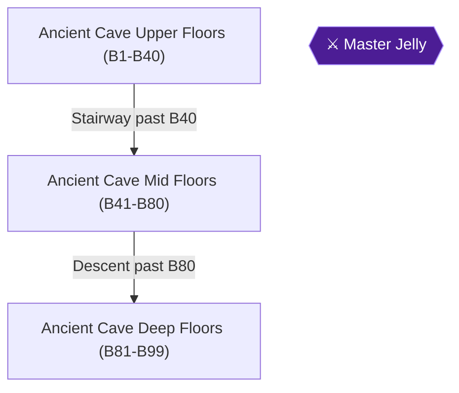

# Writer packet — Chapter 7: The Ancient Cave Descent

Write `08_chapters/07.md`. Previous chapter: 6. Capsule Monsters, Casino Wealth and the Egg Dragon. Next chapter: (end of game).
Planner notes: Navigate the 99-floor procedural Ancient Cave, reaching B21, B41, B61, B81, and B99, then legitimately defeat the Master Jelly.

## Areas in this chapter (in order)

- `Ancient_Cave_Upper` — Ancient Cave Upper Floors (B1-B40)
- `Ancient_Cave_Mid` — Ancient Cave Mid Floors (B41-B80)
- `Ancient_Cave_Deep` — Ancient Cave Deep Floors (B81-B99)
- `Master_Jelly` — Master Jelly

## Achievements to place in this chapter (each EXACTLY once as `[ACHIEVEMENT:<id>]`)

- **114729** — Beginner Explorer  (5 pts): Reach B21 in the Ancient Dungeon  
  supporting facts: ra-comments-115-1, ra-comments-115-2, gf1-4-1, gf1-4-2, gf1-6-1, gf1-6-2, gf1-56-1, gf1-56-2, gf1-93-1, gf1-93-2, gf1-107-1, gf1-107-2, gf1-108-1, gf1-108-2, gf1-109-1, gf1-109-2, gf1-112-1, gf1-112-2, gf1-117-1, gf1-117-2, gf1-150-1, gf1-150-2, gf1-152-1, gf1-152-2, gf1-210-1, gf1-210-2, gf1-211-1, gf1-211-2, gf2-1-1, gf2-1-2, gf2-2-1, gf2-2-2, gf2-3-1, gf2-3-2, gf2-4-1, gf2-4-2, gf2-5-1, gf2-5-2, gf2-6-1, gf2-6-2, gf2-7-1, gf2-7-2, gf2-8-1, gf2-8-2, gf2-9-1, gf2-9-2, gf3-2-1, gf3-2-2, gf3-3-1, gf3-3-2, gf3-4-1, gf3-4-2, gf3-5-1, gf3-5-2, gf3-6-1, gf3-6-2, gf3-15-1, gf3-15-2, gf3-16-1, gf3-16-2, gf3-18-1, gf3-18-2, gf3-28-1, gf3-28-2, gf3-34-1, gf3-34-2, gf3-70-1, gf3-70-2, gf3-80-1, gf3-80-2, gf3-102-1, gf3-102-2, gf3-106-1, gf3-106-2, gf3-121-1, gf3-121-2, gf3-127-1, gf3-127-2, gf3-139-1, gf3-139-2, gf3-140-1, gf3-140-2, gf3-143-1, gf3-143-2, gf3-144-1, gf3-144-2, gf3-146-1, gf3-148-1, gf3-150-1, gf3-150-2, gf3-152-1, gf3-152-2, gf3-153-1, gf3-155-1, gf3-155-2, gf3-157-1, gf3-157-2, gf3-158-1, gf3-158-2, gf3-179-1, gf3-179-2, gf3-181-1, gf3-181-2, gf3-182-1, gf3-182-2, gf3-183-1, gf3-183-2, gf3-187-1, gf3-187-2, gf3-189-1, gf3-189-2, gf3-190-1, gf3-190-2, gf3-197-1, gf3-197-2, gf3-198-1, gf3-198-2, gf3-203-1, gf3-203-2, gf3-208-1, gf3-208-2, gf3-209-1, gf3-209-2, gf3-226-1, gf3-226-2, gf3-232-1, gf3-232-2, gf3-234-1, gf3-234-2, gf3-246-1, gf3-246-2, gf3-253-1, gf3-253-2, gf3-254-1, gf3-254-2, gf3-258-1, gf3-258-2, gf3-259-1, gf3-259-2, gf3-275-1, gf3-275-2, gf3-277-1, gf3-277-2, gf3-278-1, gf3-278-2, gf3-279-1, gf3-279-2
- **114730** — Spelunker (5 pts): Reach B41 in the Ancient Dungeon  
  supporting facts: ra-comments-117-1, ra-comments-117-2
- **114731** — Advanced Hunter (10 pts): Reach B61 in the Ancient Dungeon  
  supporting facts: ra-comments-119-1, ra-comments-119-2, gf3-197-1, gf3-197-2
- **114732** — Master Adventurer (10 pts): Reach B81 in the Ancient Dungeon  
  supporting facts: ra-comments-121-1, ra-comments-121-2
- **114733** — Expert Explorer (25 pts): Reach the final floor of the Ancient Dungeon  
  supporting facts: ra-comments-123-1, ra-comments-123-2, gf1-108-1, gf1-108-2, gf1-109-1, gf1-109-2, gf1-112-1, gf1-112-2, gf3-2-1, gf3-2-2, gf3-4-1, gf3-4-2, gf3-70-1, gf3-70-2, gf3-181-1, gf3-181-2, gf3-182-1, gf3-182-2, gf3-183-1, gf3-183-2, gf3-197-1, gf3-197-2, gf3-198-1, gf3-198-2, gf3-226-1, gf3-226-2, gf3-246-1, gf3-246-2, gf3-258-1, gf3-258-2, gf3-278-1, gf3-278-2
- **114734** — R. A. Legend - Lufia II (100 pts): Legitimately defeat the Master Jelly in the Ancient Cave reducing its HP to 0  
  supporting facts: ra-comments-125-1, ra-comments-125-2, gf1-108-1, gf1-108-2, gf1-109-1, gf1-109-2, gf1-112-1, gf1-112-2, gf3-2-1, gf3-2-2, gf3-4-1, gf3-4-2, gf3-70-1, gf3-70-2, gf3-181-1, gf3-181-2, gf3-182-1, gf3-182-2, gf3-183-1, gf3-183-2, gf3-197-1, gf3-197-2, gf3-198-1, gf3-198-2, gf3-226-1, gf3-226-2, gf3-246-1, gf3-246-2, gf3-258-1, gf3-258-2, gf3-278-1, gf3-278-2

## Route diagram (inserted automatically where you write `[MERMAID]`)



## Usable facts (160) — cite as [[fact-id]]

Legend: ✅ verified (2+ sources) · ✔ conflict resolved · 🟡 single source

- 🟡 **gf1-4-1** (location) Here's an intro to all the Brave Heroes and Charmin' Heroines, some intro and — @The Heroes # · ach: 17553,17554,17563,17575,114729  
  evidence: gf1#4: "Here's an intro to all the Brave Heroes and Charmin' Heroines, some intro and"
- 🟡 **gf1-4-2** (location) some comments on their statistics to be exact. I've also included some FINAL — @The Heroes # · ach: 17553,17554,17563,17575,114729  
  evidence: gf1#4: "some comments on their statistics to be exact. I've also included some FINAL"
- 🟡 **gf1-6-1** (location) Final Equipment: Lizard Blow, Water Gaunt, Safety Hat, Bright Armor, — @The Heroes # · ach: 17569,114729  
  evidence: gf1#6: "Final Equipment: Lizard Blow, Water Gaunt, Safety Hat, Bright Armor,"
- 🟡 **gf1-6-2** (item) Elven Swordmaster, and wielder of Luminous Magic Spells; he joins Maxim and his — @The Heroes # · ach: 17569,114729  
  evidence: gf1#6: "Elven Swordmaster, and wielder of Luminous Magic Spells; he joins Maxim and his"
- 🟡 **gf1-56-1** (transition) ¤ Upon entering the door you just opened, you will encounter a Mad Gorem, but — @7 | 4 | 3 | 6 | · ach: 17564,17565,114729  
  evidence: gf1#56: "¤ Upon entering the door you just opened, you will encounter a Mad Gorem, but"
- 🟡 **gf1-56-2** (location) instead of destroying it at first, you should lower it onto the weak area in — @7 | 4 | 3 | 6 | · ach: 17564,17565,114729  
  evidence: gf1#56: "instead of destroying it at first, you should lower it onto the weak area in"
- 🟡 **gf1-71-1** (location) ¤ Bury the residents of this town! — @GF1 Dungeon Guide · ach: 17564,17570,17575,17592  
  evidence: gf1#71: "¤ Bury the residents of this town!"
- 🟡 **gf1-93-1** (location) ¥ Artea has the Ice.Valk Spell, and I hope Selan has the spell too...you will — @!:::::::::! · ach: 17570,17573,17575,17580,17592,114729  
  evidence: gf1#93: "¥ Artea has the Ice.Valk Spell, and I hope Selan has the spell too...you will"
- 🟡 **gf1-93-2** (location) have Valor and Champion to use as well, so Magic should not be a Problem; I — @!:::::::::! · ach: 17570,17573,17575,17580,17592,114729  
  evidence: gf1#93: "have Valor and Champion to use as well, so Magic should not be a Problem; I"
- 🟡 **gf1-107-1** (location) « Well! Did you like this game....I was disappointed with the FINAL battle; no — @GF1 Dungeon Guide · ach: 17588,17589,17590,114729  
  evidence: gf1#107: "« Well! Did you like this game....I was disappointed with the FINAL battle; no"
- 🟡 **gf1-107-2** (location) cool battle music and all! BUT you can go through the game once again...I've — @GF1 Dungeon Guide · ach: 17588,17589,17590,114729  
  evidence: gf1#107: "cool battle music and all! BUT you can go through the game once again...I've"
- 🟡 **gf1-108-1** (location) Isn't the game enough for ya' or do you need to know of a few side quests; so — @Side Quests # · ach: 17562,17581,17592,17604,17612,114733,114734,114729  
  evidence: gf1#108: "Isn't the game enough for ya' or do you need to know of a few side quests; so"
- 🟡 **gf1-108-2** (location) you can complete this game within a longer time period. Yes! This is indeed the — @Side Quests # · ach: 17562,17581,17592,17604,17612,114733,114734,114729  
  evidence: gf1#108: "you can complete this game within a longer time period. Yes! This is indeed the"
- 🟡 **gf1-109-1** (location) ¤ Before you read the strategy, you should know that this place can take over — @Side Quests # · ach: 17562,17581,17583,17585,17586,17588,17589,17590,17592,114733,114734,114729  
  evidence: gf1#109: "¤ Before you read the strategy, you should know that this place can take over"
- 🟡 **gf1-109-2** (location) six hours to complete, and ages if you fight against all the monsters. If you — @Side Quests # · ach: 17562,17581,17583,17585,17586,17588,17589,17590,17592,114733,114734,114729  
  evidence: gf1#109: "six hours to complete, and ages if you fight against all the monsters. If you"
- 🟡 **gf1-112-1** (item) :Weapon: Zirco Sword:::Weapon: Zirco Flail:::Weapon: Arty's Bow:::: — @GF1 Dungeon Guide · ach: 17588,17589,17590,17592,114733,114734,114729  
  evidence: gf1#112: ":Weapon: Zirco Sword:::Weapon: Zirco Flail:::Weapon: Arty's Bow::::"
- 🟡 **gf1-112-2** (location) :Armour: Bright Armor::Armour: Revive Armor::Armour: Magic Scale::: — @GF1 Dungeon Guide · ach: 17588,17589,17590,17592,114733,114734,114729  
  evidence: gf1#112: ":Armour: Bright Armor::Armour: Revive Armor::Armour: Magic Scale:::"
- 🟡 **gf1-117-1** (location) ¤ Pear Cider       -      10G - Restores....8HP  # These items will not restore — @Shops/Finances # · ach: 17565,114729  
  evidence: gf1#117: "¤ Pear Cider       -      10G - Restores....8HP  # These items will not restore"
- 🟡 **gf1-117-2** (location) ¤ Lime Cider       -      40G - Restores...15HP    instead these will increase — @Shops/Finances # · ach: 17565,114729  
  evidence: gf1#117: "¤ Lime Cider       -      40G - Restores...15HP    instead these will increase"
- 🟡 **gf1-150-1** (location) All sorts of items will be listed here, because I can't think of anywhere else — @» Miscellaneous Items » · ach: 17580,17588,17589,17590,114729  
  evidence: gf1#150: "All sorts of items will be listed here, because I can't think of anywhere else"
- 🟡 **gf1-150-2** (location) to mention them, hence this here table is called Miscellaneous Items! — @» Miscellaneous Items » · ach: 17580,17588,17589,17590,114729  
  evidence: gf1#150: "to mention them, hence this here table is called Miscellaneous Items!"
- 🟡 **gf1-152-1** (location) Here's some things you should be aware of, to do with Magic spells! — @GF1 Dungeon Guide · ach: 114729  
  evidence: gf1#152: "Here's some things you should be aware of, to do with Magic spells!"
- 🟡 **gf1-152-2** (location) * The Spells have been seperated into "White" and "Black" Magic in this FAQ! — @GF1 Dungeon Guide · ach: 114729  
  evidence: gf1#152: "* The Spells have been seperated into "White" and "Black" Magic in this FAQ!"
- 🟡 **gf1-210-1** (location) Notes: 1)The Win column contains only objects that can be randomly won and — @None · ach: 17560,114729  
  evidence: gf1#210: "Notes: 1)The Win column contains only objects that can be randomly won and"
- 🟡 **gf1-210-2** (location) not those that are given automatically. — @None · ach: 17560,114729  
  evidence: gf1#210: "not those that are given automatically."
- 🟡 **gf1-211-1** (location) the questions that have been asked, you will find some useful questions in this — @Freq.Asked ?'s # · ach: 17588,17589,17590,17592,17597,17604,17605,17612,17598,17606,17599,17607,17600,17608,17601,17609,17602,17610,17603,17611,114729  
  evidence: gf1#211: "the questions that have been asked, you will find some useful questions in this"
- 🟡 **gf1-211-2** (location) guide, and of course this is a place where questions are "Frequently asked" so — @Freq.Asked ?'s # · ach: 17588,17589,17590,17592,17597,17604,17605,17612,17598,17606,17599,17607,17600,17608,17601,17609,17602,17610,17603,17611,114729  
  evidence: gf1#211: "guide, and of course this is a place where questions are "Frequently asked" so"
- ✅ **gf2-1-1** (location) is to not receive a reply.  For that, I apologize.  My time for this — @(start) · ach: 17604,17612,114729  
  evidence: gf2#1: "is to not receive a reply.  For that, I apologize.  My time for this"
- ✅ **gf2-1-2** (location) sort of thing seems to become more and more limited, but take heart with — @(start) · ach: 17604,17612,114729  
  evidence: gf2#1: "sort of thing seems to become more and more limited, but take heart with"
- 🟡 **gf2-2-1** (item) :You should use one of the following capsule monsters.  Earth or — @(start) · ach: 17555,17604,17612,114729  
  evidence: gf2#2: ":You should use one of the following capsule monsters.  Earth or"
- ✅ **gf2-2-2** (location) advantage of Earth is that you have a monster that can pack a — @(start) · ach: 17555,17604,17612,114729  
  evidence: gf2#2: "advantage of Earth is that you have a monster that can pack a"
- ✅ **gf2-3-1** (location) :Be careful with the Providence.  It is the only way out of the — @(start) · ach: 17604,17612,114729  
  evidence: gf2#3: ":Be careful with the Providence.  It is the only way out of the"
- 🟡 **gf2-3-2** (item) it is way too easy to accidentally feed it to your Capsule Monster. : — @(start) · ach: 17604,17612,114729  
  evidence: gf2#3: "it is way too easy to accidentally feed it to your Capsule Monster. :"
- ✅ **gf2-4-1** (location) Monsters that look like birdmen:  Even though they always face the — @(start) · ach: 17581,17592,114729  
  evidence: gf2#4: "Monsters that look like birdmen:  Even though they always face the"
- 🟡 **gf2-4-2** (transition) they only way to first strike them is come through a door — @(start) · ach: 17581,17592,114729  
  evidence: gf2#4: "they only way to first strike them is come through a door"
- ✅ **gf2-5-1** (location) A rather unorthodox method of beating the Ancient Slime has been — @(start) · ach: 17581,17598,17604,17606,17612,114729  
  evidence: gf2#5: "A rather unorthodox method of beating the Ancient Slime has been"
- ✅ **gf2-5-2** (location) brought to my attention.  I don't know who tried this first after — @(start) · ach: 17581,17598,17604,17606,17612,114729  
  evidence: gf2#5: "brought to my attention.  I don't know who tried this first after"
- 🟡 **gf2-6-1** (achievement) Description: Armor with special power — @(start) · ach: 114729  
  evidence: gf2#6: "Description: Armor with special power"
- ✅ **gf2-6-2** (location) IP: Restores fight power of all members of your party and gives a — @(start) · ach: 114729  
  evidence: gf2#6: "IP: Restores fight power of all members of your party and gives a"
- 🟡 **gf2-7-1** (achievement) Description: If wearing when you shop, merchants will charge less — @(start) · ach: 17555,17558,17559,17587,114729  
  evidence: gf2#7: "Description: If wearing when you shop, merchants will charge less"
- ✅ **gf2-7-2** (location) IP: Increases Dfp by large amounts during battle — @(start) · ach: 17555,17558,17559,17587,114729  
  evidence: gf2#7: "IP: Increases Dfp by large amounts during battle"
- 🟡 **gf2-8-1** (transition) These are the treasures that are behind the door at the entrance to — @(start) · ach: 17604,17612,114729  
  evidence: gf2#8: "These are the treasures that are behind the door at the entrance to"
- ✅ **gf2-8-2** (location) Cave.  After beating the Ancient Slime, he gives you the key to this — @(start) · ach: 17604,17612,114729  
  evidence: gf2#8: "Cave.  After beating the Ancient Slime, he gives you the key to this"
- ✅ **gf2-9-1** (location) Erik Ylvisaker for the exp. count on defeating a pair of Gold — @(start) · ach: 17558,114729  
  evidence: gf2#9: "Erik Ylvisaker for the exp. count on defeating a pair of Gold"
- ✅ **gf2-9-2** (location) To Masamune7 and especially Sister Jeri for supplying me with Gold — @(start) · ach: 17558,114729  
  evidence: gf2#9: "To Masamune7 and especially Sister Jeri for supplying me with Gold"
- 🟡 **gf3-2-1** (location) Important word on combining elemental attacks — @GameFAQ Status: 100% · ach: 17553,17554,17558,17561,17562,17563,17565,17567,17568,17570,17571,17575,17581,17585,17586,17588,17589,17590,17591,17597,17604,17605,17612,17598,17606,17599,17607,17600,17608,17601,17609,17602,17610,17603,17611,114733,114734,114729  
  evidence: gf3#2: "Important word on combining elemental attacks"
- 🟡 **gf3-2-2** (location) 1. The request of the old man — @GameFAQ Status: 100% · ach: 17553,17554,17558,17561,17562,17563,17565,17567,17568,17570,17571,17575,17581,17585,17586,17588,17589,17590,17591,17597,17604,17605,17612,17598,17606,17599,17607,17600,17608,17601,17609,17602,17610,17603,17611,114733,114734,114729  
  evidence: gf3#2: "1. The request of the old man"
- 🟡 **gf3-3-1** (location) 22 January 2001: I decided to make a walkthrough for this game on paper, very — @Table of Contents · ach: 17585,17586,17591,17603,17604,17611,17612,114729  
  evidence: gf3#3: "22 January 2001: I decided to make a walkthrough for this game on paper, very"
- 🟡 **gf3-3-2** (location) 25 January 2001: After almost four days of typing and playing the game again, — @Table of Contents · ach: 17585,17586,17591,17603,17604,17611,17612,114729  
  evidence: gf3#3: "25 January 2001: After almost four days of typing and playing the game again,"
- 🟡 **gf3-4-1** (location) 10 March 2001: Worked a bit on the layout to make the walkthrough easier to — @Version updates: · ach: 17554,17560,17562,17581,17585,17586,17588,17589,17590,17591,17600,17604,17608,17612,17601,17609,114733,114734,114729  
  evidence: gf3#4: "10 March 2001: Worked a bit on the layout to make the walkthrough easier to"
- 🟡 **gf3-4-2** (location) read and easier to find a specific part. Also added Gusto's Air attack and — @Version updates: · ach: 17554,17560,17562,17581,17585,17586,17588,17589,17590,17591,17600,17604,17608,17612,17601,17609,114733,114734,114729  
  evidence: gf3#4: "read and easier to find a specific part. Also added Gusto's Air attack and"
- 🟡 **gf3-5-1** (location) 25 September 2003: I've been working on the Enemy Chart table again, added — @Version updates: · ach: 17556,17560,17585,17586,17588,17589,17590,17604,17612,114729  
  evidence: gf3#5: "25 September 2003: I've been working on the Enemy Chart table again, added"
- 🟡 **gf3-5-2** (location) some extra attacks. In chart tables I added an extra section for the — @Version updates: · ach: 17556,17560,17585,17586,17588,17589,17590,17604,17612,114729  
  evidence: gf3#5: "some extra attacks. In chart tables I added an extra section for the"
- 🟡 **gf3-6-1** (location) 4 November 2018: After a long hiatus decided to update the document with — @Version updates: · ach: 17558,17560,17592,17598,17604,17606,17612,17599,17607,17600,17608,17602,17610,114729  
  evidence: gf3#6: "4 November 2018: After a long hiatus decided to update the document with"
- 🟡 **gf3-6-2** (location) some mails that were received in between. This update is mostly corrections — @Version updates: · ach: 17558,17560,17592,17598,17604,17606,17612,17599,17607,17600,17608,17602,17610,114729  
  evidence: gf3#6: "some mails that were received in between. This update is mostly corrections"
- 🟡 **gf3-15-1** (location) If a person receives more damage than his/her HP can bear, he/she will be — @Diseases · ach: 17553,17556,17564,17604,17612,114729  
  evidence: gf3#15: "If a person receives more damage than his/her HP can bear, he/she will be"
- 🟡 **gf3-15-2** (item) defeated. Be careful, because if all party members die (Capsule monster — @Diseases · ach: 17553,17556,17564,17604,17612,114729  
  evidence: gf3#15: "defeated. Be careful, because if all party members die (Capsule monster"
- 🟡 **gf3-16-1** (location) Lufia's battle system is purely based on strategy, and each round everybody — @Diseases · ach: 17599,17604,17607,17612,114729  
  evidence: gf3#16: "Lufia's battle system is purely based on strategy, and each round everybody"
- 🟡 **gf3-16-2** (location) gets a turn to attack. The order of attacks is depending on the AGL stat of — @Diseases · ach: 17599,17604,17607,17612,114729  
  evidence: gf3#16: "gets a turn to attack. The order of attacks is depending on the AGL stat of"
- 🟡 **gf3-18-1** (location) * = Level 99 statistics are the minimum base statistics a character will reach — @Battle system · ach: 17587,17592,114729  
  evidence: gf3#18: "* = Level 99 statistics are the minimum base statistics a character will reach"
- 🟡 **gf3-18-2** (location) through leveling up, due to random level ups these statistics may end up 5 or — @Battle system · ach: 17587,17592,114729  
  evidence: gf3#18: "through leveling up, due to random level ups these statistics may end up 5 or"
- 🟡 **gf3-28-1** (location) This is the normal option of playing the game in story mode. — @Iris - The Enigma: · ach: 17554,114729  
  evidence: gf3#28: "This is the normal option of playing the game in story mode."
- 🟡 **gf3-28-2** (boss) This is also the game in story mode, but all your enemies (incl. Bosses) drop — @Iris - The Enigma: · ach: 17554,114729  
  evidence: gf3#28: "This is also the game in story mode, but all your enemies (incl. Bosses) drop"
- 🟡 **gf3-34-1** (boss) Boss: Big Catfish (Can drop catfish jewel) — @3. Earthquakes in Sundletan · ach: 17553,17555,17592,17599,17604,17607,17612,114729  
  evidence: gf3#34: "Boss: Big Catfish (Can drop catfish jewel)"
- 🟡 **gf3-34-2** (location) Protection: All Ailments, not Instant — @3. Earthquakes in Sundletan · ach: 17553,17555,17592,17599,17604,17607,17612,114729  
  evidence: gf3#34: "Protection: All Ailments, not Instant"
- 🟡 **gf3-70-1** (location) Sub-quest: The Ancient Cave — @14. Jyad the ship builder · ach: 114733,114734,114729  
  evidence: gf3#70: "Sub-quest: The Ancient Cave"
- 🟡 **gf3-70-2** (location) Here you will hear people talking about a dungeon that consists of 99 floors! — @14. Jyad the ship builder · ach: 114733,114734,114729  
  evidence: gf3#70: "Here you will hear people talking about a dungeon that consists of 99 floors!"
- 🟡 **gf3-80-1** (location) Specials:   Sneeze spreader, Thorn — @GF3 Dungeon Guide · ach: 17567,17585,17586,114729  
  evidence: gf3#80: "Specials:   Sneeze spreader, Thorn"
- 🟡 **gf3-80-2** (item) When you equip weapons like the Spark staff, Sizzle sword (both from blue — @GF3 Dungeon Guide · ach: 17567,17585,17586,114729  
  evidence: gf3#80: "When you equip weapons like the Spark staff, Sizzle sword (both from blue"
- 🟡 **gf3-102-1** (location) they aren't very special at all. — @GF3 Dungeon Guide · ach: 17573,17575,17591,114729  
  evidence: gf3#102: "they aren't very special at all."
- 🟡 **gf3-102-2** (location) -After their defeat, the mirror will be broken and they will leave the tower. — @GF3 Dungeon Guide · ach: 17573,17575,17591,114729  
  evidence: gf3#102: "-After their defeat, the mirror will be broken and they will leave the tower."
- 🟡 **gf3-106-1** (location) Weak:       Dragon, Ice, Flying — @D = move one space down · ach: 17573,17575,17602,17604,17610,17612,114729  
  evidence: gf3#106: "Weak:       Dragon, Ice, Flying"
- 🟡 **gf3-106-2** (location) Specials:   Bite, Drowsy*, Incendiary — @D = move one space down · ach: 17573,17575,17602,17604,17610,17612,114729  
  evidence: gf3#106: "Specials:   Bite, Drowsy*, Incendiary"
- 🟡 **gf3-121-1** (location) Strong:     Fire, Water, Ice, Thunder, Shadow — @28. Engine needed · ach: 114729  
  evidence: gf3#121: "Strong:     Fire, Water, Ice, Thunder, Shadow"
- 🟡 **gf3-121-2** (location) Specials:   Terror wave, Dark reflector, Dark fry, Dragon, Thunder, — @28. Engine needed · ach: 114729  
  evidence: gf3#121: "Specials:   Terror wave, Dark reflector, Dark fry, Dragon, Thunder,"
- 🟡 **gf3-127-1** (location) Base DMG = INT * 4 (Fire) — @Base DMG = INT * 4 (Fire) · ach: 17561,17599,17604,17607,17612,114729  
  evidence: gf3#127: "Base DMG = INT * 4 (Fire)"
- 🟡 **gf3-127-2** (location) Location:   Northern Labyrinth, to the north of Bound Kingdom — @Base DMG = INT * 4 (Fire) · ach: 17561,17599,17604,17607,17612,114729  
  evidence: gf3#127: "Location:   Northern Labyrinth, to the north of Bound Kingdom"
- 🟡 **gf3-139-1** (location) Alternative Feeding method (with thanks to Laura Strange): — @GF3 Dungeon Guide · ach: 17597,17604,17605,17612,17598,17606,17599,17607,17600,17608,17601,17609,17602,17610,17603,17611,114729  
  evidence: gf3#139: "Alternative Feeding method (with thanks to Laura Strange):"
- 🟡 **gf3-139-2** (location) Start up a game take a look at the item the CM wants to have and feed it to — @GF3 Dungeon Guide · ach: 17597,17604,17605,17612,17598,17606,17599,17607,17600,17608,17601,17609,17602,17610,17603,17611,114729  
  evidence: gf3#139: "Start up a game take a look at the item the CM wants to have and feed it to"
- 🟡 **gf3-140-1** (location) Name         Value  What it does — @GF3 Dungeon Guide · ach: 114729  
  evidence: gf3#140: "Name         Value  What it does"
- 🟡 **gf3-140-2** (location) Charred newt     8  restores 5 HP/MP — @GF3 Dungeon Guide · ach: 114729  
  evidence: gf3#140: "Charred newt     8  restores 5 HP/MP"
- 🟡 **gf3-143-1** (location) 1. IV. Items - Scenario objects and keys — @GF3 Dungeon Guide · ach: 17553,17556,17560,17565,17567,17568,17571,17587,114729  
  evidence: gf3#143: "1. IV. Items - Scenario objects and keys"
- 🟡 **gf3-143-2** (transition) Door key          Key of the cave to Sundletan — @GF3 Dungeon Guide · ach: 17553,17556,17560,17565,17567,17568,17571,17587,114729  
  evidence: gf3#143: "Door key          Key of the cave to Sundletan"
- 🟡 **gf3-144-1** (location) For information about all the contents of each column see at the bottom. — @GF3 Dungeon Guide · ach: 17575,17581,17583,17584,17598,17604,17606,17612,114729  
  evidence: gf3#144: "For information about all the contents of each column see at the bottom."
- 🟡 **gf3-144-2** (location) Name          Used by ATP  Value  IP            Element Increases + Other — @GF3 Dungeon Guide · ach: 17575,17581,17583,17584,17598,17604,17606,17612,114729  
  evidence: gf3#144: "Name          Used by ATP  Value  IP            Element Increases + Other"
- 🟡 **gf3-146-1** (location) 2. III. Weapons - Rods and Staffs — @2. I. Weapons - Swords · ach: 114729  
  evidence: gf3#146: "2. III. Weapons - Rods and Staffs"
- 🟡 **gf3-148-1** (location) 2. V. Weapons - Spears and Javelins — @2. I. Weapons - Swords · ach: 114729  
  evidence: gf3#148: "2. V. Weapons - Spears and Javelins"
- 🟡 **gf3-150-1** (location) -See list at the end of the tables for abbreviations of the protection column. — @2. I. Weapons - Swords · ach: 17558,17580,114729  
  evidence: gf3#150: "-See list at the end of the tables for abbreviations of the protection column."
- 🟡 **gf3-150-2** (location) Ghostclothes  All     100  35000  Rejuvenation    Co — @2. I. Weapons - Swords · ach: 17558,17580,114729  
  evidence: gf3#150: "Ghostclothes  All     100  35000  Rejuvenation    Co"
- 🟡 **gf3-152-1** (item) 3. III. Armor - Hats and Helmets — @3. I. Armor - Body · ach: 17578,114729  
  evidence: gf3#152: "3. III. Armor - Hats and Helmets"
- 🟡 **gf3-152-2** (location) Name          Used by DFP  Value  IP              Protect Add. Increasements — @3. I. Armor - Body · ach: 17578,114729  
  evidence: gf3#152: "Name          Used by DFP  Value  IP              Protect Add. Increasements"
- 🟡 **gf3-153-1** (location) Name           Used by Value  IP         Special   ATP DFP STR AGL INT GUT MGR — @3. I. Armor - Body · ach: 114729  
  evidence: gf3#153: "Name           Used by Value  IP         Special   ATP DFP STR AGL INT GUT MGR"
- 🟡 **gf3-155-1** (item) !name here! = This item is a Blue Chest item of the Ancient Cave — @GF3 Dungeon Guide · ach: 114729  
  evidence: gf3#155: "!name here! = This item is a Blue Chest item of the Ancient Cave"
- 🟡 **gf3-155-2** (location) L = Lexis     All = All seven allies — @GF3 Dungeon Guide · ach: 114729  
  evidence: gf3#155: "L = Lexis     All = All seven allies"
- 🟡 **gf3-157-1** (location) Increasements / Other column (For All Items) — @GF3 Dungeon Guide · ach: 17584,114729  
  evidence: gf3#157: "Increasements / Other column (For All Items)"
- 🟡 **gf3-157-2** (location) C(xx%)*y = weapon has greater Critical Hit Chance 'xx' and damage it deals — @GF3 Dungeon Guide · ach: 17584,114729  
  evidence: gf3#157: "C(xx%)*y = weapon has greater Critical Hit Chance 'xx' and damage it deals"
- 🟡 **gf3-158-1** (location) -Note 1: Some PAR codes where used to complete the chart tables for Tia, Dekar — @GF3 Dungeon Guide · ach: 17580,17599,17604,17607,17612,114729  
  evidence: gf3#158: "-Note 1: Some PAR codes where used to complete the chart tables for Tia, Dekar"
- 🟡 **gf3-158-2** (item) & Lexis. For they are usually unable to use weapons like the egg — @GF3 Dungeon Guide · ach: 17580,17599,17604,17607,17612,114729  
  evidence: gf3#158: "& Lexis. For they are usually unable to use weapons like the egg"
- 🟡 **gf3-179-1** (location) In the battle use the Spido jewels IP: Spiderweb and cast fake on your team to — @The Battle · ach: 17581,114729  
  evidence: gf3#179: "In the battle use the Spido jewels IP: Spiderweb and cast fake on your team to"
- 🟡 **gf3-179-2** (boss) end up faster than Gades. Now make sure Tia and Selan HPs stay above 200. If — @The Battle · ach: 17581,114729  
  evidence: gf3#179: "end up faster than Gades. Now make sure Tia and Selan HPs stay above 200. If"
- 🟡 **gf3-181-1** (boss) 2. The Master Jelly, Ancient Cave B99 — @The Battle · ach: 114733,114734,114729  
  evidence: gf3#181: "2. The Master Jelly, Ancient Cave B99"
- 🟡 **gf3-181-2** (location) Special attacks: -, He doesn't "attack" you at all. — @The Battle · ach: 114733,114734,114729  
  evidence: gf3#181: "Special attacks: -, He doesn't "attack" you at all."
- 🟡 **gf3-182-1** (boss) This Tactic by ArchmageMagus, has made him the easiest boss in the entire — @The Battle · ach: 17569,17598,17604,17606,17612,114733,114734,114729  
  evidence: gf3#182: "This Tactic by ArchmageMagus, has made him the easiest boss in the entire"
- 🟡 **gf3-182-2** (location) game; Simply annihilate your own party, while battling him!! This may sound — @The Battle · ach: 17569,17598,17604,17606,17612,114733,114734,114729  
  evidence: gf3#182: "game; Simply annihilate your own party, while battling him!! This may sound"
- 🟡 **gf3-183-1** (item) 1. First you need to be completely equipped with blue chest items for every — @Preparation · ach: 17581,17599,17604,17607,17612,114733,114734,114729  
  evidence: gf3#183: "1. First you need to be completely equipped with blue chest items for every"
- 🟡 **gf3-183-2** (location) character in order to survive the cave itself. — @Preparation · ach: 17581,17599,17604,17607,17612,114733,114734,114729  
  evidence: gf3#183: "character in order to survive the cave itself."
- 🟡 **gf3-187-1** (location) 1.Everybody needs high levels ( Recommended if you want to survive his — @The Battle · ach: 17553,17571,17583,17584,17585,17586,17588,17589,17590,17591,17604,17612,114729  
  evidence: gf3#187: "1.Everybody needs high levels ( Recommended if you want to survive his"
- 🟡 **gf3-187-2** (item) 'Scrambled Eggs' attack. ) — @The Battle · ach: 17553,17571,17583,17584,17585,17586,17588,17589,17590,17591,17604,17612,114729  
  evidence: gf3#187: "'Scrambled Eggs' attack. )"
- 🟡 **gf3-189-1** (location) Appendix D: The Ancient Cave — @The battle · ach: 17555,17558,17559,17581,114729  
  evidence: gf3#189: "Appendix D: The Ancient Cave"
- 🟡 **gf3-189-2** (location) This is the biggest dungeon I've ever encountered; it took me almost 70 hours — @The battle · ach: 17555,17558,17559,17581,114729  
  evidence: gf3#189: "This is the biggest dungeon I've ever encountered; it took me almost 70 hours"
- 🟡 **gf3-190-1** (location) Before you decide to go into the Ancient Cave, make sure to SELL every — @Preserve some slots · ach: 114729  
  evidence: gf3#190: "Before you decide to go into the Ancient Cave, make sure to SELL every"
- 🟡 **gf3-190-2** (location) useless/crappy item you've got. Leave only the items that you normally can't — @Preserve some slots · ach: 114729  
  evidence: gf3#190: "useless/crappy item you've got. Leave only the items that you normally can't"
- 🟡 **gf3-197-1** (location) From level 21 and onwards you will find Providence. The chance percentage for — @Decoy Mimics Chests · ach: 114731,114733,114734,114729  
  evidence: gf3#197: "From level 21 and onwards you will find Providence. The chance percentage for"
- 🟡 **gf3-197-2** (location) finding the providence increases with every descended floor, until ~B60 — @Decoy Mimics Chests · ach: 114731,114733,114734,114729  
  evidence: gf3#197: "finding the providence increases with every descended floor, until ~B60"
- 🟡 **gf3-198-1** (item) There are items in some of the red chests that can only be found in the — @Special items · ach: 114733,114734,114729  
  evidence: gf3#198: "There are items in some of the red chests that can only be found in the"
- 🟡 **gf3-198-2** (location) ancient cave, these items are listed in the chart tables in Appendix B. Some — @Special items · ach: 114733,114734,114729  
  evidence: gf3#198: "ancient cave, these items are listed in the chart tables in Appendix B. Some"
- 🟡 **gf3-203-1** (location) Archfiends are also very tuff. They look like the fiend from earlier on in — @GF3 Dungeon Guide · ach: 17562,114729  
  evidence: gf3#203: "Archfiends are also very tuff. They look like the fiend from earlier on in"
- 🟡 **gf3-203-2** (location) the dungeon, but these guys are even harder. Their AGL is 165 and to make it — @GF3 Dungeon Guide · ach: 17562,114729  
  evidence: gf3#203: "the dungeon, but these guys are even harder. Their AGL is 165 and to make it"
- 🟡 **gf3-208-1** (boss) -The monsters are sorted alphabetically by name in this type of chart. Bosses — @Harvesting Techniques · ach: 17600,17604,17608,17612,17601,17609,114729  
  evidence: gf3#208: "-The monsters are sorted alphabetically by name in this type of chart. Bosses"
- 🟡 **gf3-208-2** (location) have a separate list at the bottom. — @Harvesting Techniques · ach: 17600,17604,17608,17612,17601,17609,114729  
  evidence: gf3#208: "have a separate list at the bottom."
- 🟡 **gf3-209-1** (location) -(AC) behind location means that this particular monster appears in the — @Appendix E: Monster list · ach: 17572,114729  
  evidence: gf3#209: "-(AC) behind location means that this particular monster appears in the"
- 🟡 **gf3-209-2** (location) O: Calls "Moray" / "Squid" / "Evil Fish" — @Appendix E: Monster list · ach: 17572,114729  
  evidence: gf3#209: "O: Calls "Moray" / "Squid" / "Evil Fish""
- 🟡 **gf3-226-1** (boss) P: Plasma Blaster / Idura Thunder — @GF3 Dungeon Guide · ach: 17553,17557,17560,114733,114734,114729  
  evidence: gf3#226: "P: Plasma Blaster / Idura Thunder"
- 🟡 **gf3-226-2** (location) 'Silence, Inst. Death, Paralysis & Confusion Protected' — @GF3 Dungeon Guide · ach: 17553,17557,17560,114733,114734,114729  
  evidence: gf3#226: "'Silence, Inst. Death, Paralysis & Confusion Protected'"
- 🟡 **gf3-232-1** (transition) Ancient Cave "Stairway Restart" — @GF3 Dungeon Guide · ach: 114729  
  evidence: gf3#232: "Ancient Cave "Stairway Restart""
- 🟡 **gf3-232-2** (location) This happened to me when I was playing in the Ancient cave one time. I walked — @GF3 Dungeon Guide · ach: 114729  
  evidence: gf3#232: "This happened to me when I was playing in the Ancient cave one time. I walked"
- 🟡 **gf3-234-1** (boss) In the shrine of Daos it is possible to walk on thin air. Walk up to the room — @"Walking on thin air" · ach: 114729  
  evidence: gf3#234: "In the shrine of Daos it is possible to walk on thin air. Walk up to the room"
- 🟡 **gf3-234-2** (boss) where you meet Erim, and walk around the sides. (With the three chests) In the — @"Walking on thin air" · ach: 114729  
  evidence: gf3#234: "where you meet Erim, and walk around the sides. (With the three chests) In the"
- 🟡 **gf3-246-1** (boss) 10. Cheap Master Jelly Strategy — @GF3 Dungeon Guide · ach: 114733,114734,114729  
  evidence: gf3#246: "10. Cheap Master Jelly Strategy"
- 🟡 **gf3-246-2** (location) Simply annihilate your own party, while battling him!! This may sound weird, — @GF3 Dungeon Guide · ach: 114733,114734,114729  
  evidence: gf3#246: "Simply annihilate your own party, while battling him!! This may sound weird,"
- 🟡 **gf3-253-1** (item) Take the Dragon Ring, Brill Helm and Light Jewel into the Ancient Cave — @GF3 Dungeon Guide · ach: 114729  
  evidence: gf3#253: "Take the Dragon Ring, Brill Helm and Light Jewel into the Ancient Cave"
- 🟡 **gf3-253-2** (location) This is a nice little quirk that allows you to take the three special AC — @GF3 Dungeon Guide · ach: 114729  
  evidence: gf3#253: "This is a nice little quirk that allows you to take the three special AC"
- 🟡 **gf3-254-1** (location) When you press the top Left & Right shoulder buttons, Start and Select at the — @GF3 Dungeon Guide · ach: 17588,17589,17590,114729  
  evidence: gf3#254: "When you press the top Left & Right shoulder buttons, Start and Select at the"
- 🟡 **gf3-254-2** (location) same time your game will reset. This can be handy if you want to change the — @GF3 Dungeon Guide · ach: 17588,17589,17590,114729  
  evidence: gf3#254: "same time your game will reset. This can be handy if you want to change the"
- 🟡 **gf3-258-1** (location) These are a set of challenges I've come up with. They're quite hard to — @Lucky Blade for Tia? · ach: 17562,17575,17580,17581,17583,17584,17585,17586,17588,17589,17590,17592,114733,114734,114729  
  evidence: gf3#258: "These are a set of challenges I've come up with. They're quite hard to"
- 🟡 **gf3-258-2** (location) complete, but there all possible with some practice. — @Lucky Blade for Tia? · ach: 17562,17575,17580,17581,17583,17584,17585,17586,17588,17589,17590,17592,114733,114734,114729  
  evidence: gf3#258: "complete, but there all possible with some practice."
- 🟡 **gf3-259-1** (location) Japanese vs. US/AUS/EUR Differences — @Lucky Blade for Tia? · ach: 114729  
  evidence: gf3#259: "Japanese vs. US/AUS/EUR Differences"
- 🟡 **gf3-259-2** (location) Here are the differences between the Japanese vs. US/AUS/EUR games. After — @Lucky Blade for Tia? · ach: 114729  
  evidence: gf3#259: "Here are the differences between the Japanese vs. US/AUS/EUR games. After"
- 🟡 **gf3-275-1** (location) This is a nice PAR code which allows you to change the battle background of — @Gordovan's Holy Cross Puzzle · ach: 114729  
  evidence: gf3#275: "This is a nice PAR code which allows you to change the battle background of"
- 🟡 **gf3-275-2** (location) the upcoming battles. Using this you can change the background layer into any — @Gordovan's Holy Cross Puzzle · ach: 114729  
  evidence: gf3#275: "the upcoming battles. Using this you can change the background layer into any"
- 🟡 **gf3-277-1** (location) Select a Bxx Ancient Cave level — @Gordovan's Holy Cross Puzzle · ach: 17585,17586,17592,114729  
  evidence: gf3#277: "Select a Bxx Ancient Cave level"
- 🟡 **gf3-277-2** (location) Use the following PAR code to select a level you wish to go to next, while — @Gordovan's Holy Cross Puzzle · ach: 17585,17586,17592,114729  
  evidence: gf3#277: "Use the following PAR code to select a level you wish to go to next, while"
- 🟡 **gf3-278-1** (location) Neverland Company / Natsume / Taito: — @Gordovan's Holy Cross Puzzle · ach: 17554,17555,17556,17559,17566,17569,17573,17581,17584,17585,17586,17588,17589,17590,17591,17599,17604,17607,17612,17602,17610,17603,17611,114733,114734,114729  
  evidence: gf3#278: "Neverland Company / Natsume / Taito:"
- 🟡 **gf3-278-2** (location) For making a great RPG game, and publishing it in all the regions. — @Gordovan's Holy Cross Puzzle · ach: 17554,17555,17556,17559,17566,17569,17573,17581,17584,17585,17586,17588,17589,17590,17591,17599,17604,17607,17612,17602,17610,17603,17611,114733,114734,114729  
  evidence: gf3#278: "For making a great RPG game, and publishing it in all the regions."
- 🟡 **gf3-279-1** (location) For adding the spectre to 'Heal enemies to death' in stuff section. — @Credits · ach: 17571,17585,17586,17588,17589,17590,17599,17604,17607,17612,114729  
  evidence: gf3#279: "For adding the spectre to 'Heal enemies to death' in stuff section."
- 🟡 **gf3-279-2** (location) He corrected the location of the Heal Armor in the Shrine of Vengeance. — @Credits · ach: 17571,17585,17586,17588,17589,17590,17599,17604,17607,17612,114729  
  evidence: gf3#279: "He corrected the location of the Heal Armor in the Shrine of Vengeance."
- 🟡 **ra-comments-41-1** (achievement) [Server] Enddox edited this achievement. — ach: 17570  
  evidence: ra-comments#41: "[Server] Enddox edited this achievement."
- 🟡 **ra-comments-41-2** (achievement) [Server] DanielARP edited this achievement. — ach: 17570  
  evidence: ra-comments#41: "[Server] DanielARP edited this achievement."
- 🟡 **ra-comments-115-1** (achievement) [Server] MrGauss uploaded this achievement. — ach: 114729  
  evidence: ra-comments#115: "[Server] MrGauss uploaded this achievement."
- 🟡 **ra-comments-115-2** (achievement) [Server] MrGauss promoted this achievement to the Core set. — ach: 114729  
  evidence: ra-comments#115: "[Server] MrGauss promoted this achievement to the Core set."
- 🟡 **ra-comments-117-1** (achievement) [Server] MrGauss uploaded this achievement. — ach: 114730  
  evidence: ra-comments#117: "[Server] MrGauss uploaded this achievement."
- 🟡 **ra-comments-117-2** (achievement) [Server] MrGauss promoted this achievement to the Core set. — ach: 114730  
  evidence: ra-comments#117: "[Server] MrGauss promoted this achievement to the Core set."
- 🟡 **ra-comments-119-1** (achievement) [Server] MrGauss uploaded this achievement. — ach: 114731  
  evidence: ra-comments#119: "[Server] MrGauss uploaded this achievement."
- 🟡 **ra-comments-119-2** (achievement) [Server] MrGauss promoted this achievement to the Core set. — ach: 114731  
  evidence: ra-comments#119: "[Server] MrGauss promoted this achievement to the Core set."
- 🟡 **ra-comments-121-1** (achievement) [Server] MrGauss uploaded this achievement. — ach: 114732  
  evidence: ra-comments#121: "[Server] MrGauss uploaded this achievement."
- 🟡 **ra-comments-121-2** (achievement) [Server] MrGauss promoted this achievement to the Core set. — ach: 114732  
  evidence: ra-comments#121: "[Server] MrGauss promoted this achievement to the Core set."
- 🟡 **ra-comments-123-1** (achievement) [Server] MrGauss uploaded this achievement. — ach: 114733  
  evidence: ra-comments#123: "[Server] MrGauss uploaded this achievement."
- 🟡 **ra-comments-123-2** (achievement) [Server] MrGauss promoted this achievement to the Core set. — ach: 114733  
  evidence: ra-comments#123: "[Server] MrGauss promoted this achievement to the Core set."
- 🟡 **ra-comments-125-1** (achievement) [Server] MrGauss uploaded this achievement. — ach: 114734  
  evidence: ra-comments#125: "[Server] MrGauss uploaded this achievement."
- 🟡 **ra-comments-125-2** (achievement) [Server] MrGauss promoted this achievement to the Core set. — ach: 114734  
  evidence: ra-comments#125: "[Server] MrGauss promoted this achievement to the Core set."

## Source passages (66 chunks, 101 omitted for size — use `npm run rw:chunks -- 1005 --id <chunk>`)

Use these for detail (directions, chest contents, enemy names, boss patterns, ASCII maps). Every statement you take from a passage must cite a fact id; if no fact covers a detail you need, add a fact to `04_facts/` first (with a verbatim quote) and re-run `rw:verify`.

### gf1#4 — GameFAQs: Lufia II: Rise of the Sinistrals — Walkthrough by G_Paladin — [The Heroes #]

```text
# The Heroes #
-=-=-=-=-=-=-=
Here's an intro to all the Brave Heroes and Charmin' Heroines, some intro and
some comments on their statistics to be exact. I've also included some FINAL
EQUIPMENT for each character, that's an ideal way to equip them for the games
Final events, and the ancient cave if you mess around with the games coding!
«««««««««««««
± M A X I M ±
°°°°°°°°°°°°°
The Red Haired Hero, master swordsman and monster hunter is quite a character;
he can use various swords and magic spells, hence allowing him to cause severe
amounts of pain to his foes. Like all RPG Heroes, Maxim has a specific task in
Life, he has to rid the world of evil, and obliterate the four sinistrals who
appear to be against humans ruling the world. On his adventure he'll find lots
of treasures and befriend various people to aid him in this struggle. One will
become his wife, the two will have a child; and name him Jeros. The main cause
of going on this adventure is a woman named Iris, she helps guide him on his
travels, and assists him in certain cases, NOT in battle!

Although his skills are average, some are above normal, his Strength and Health
stats are quite reliable and despite him being the Hero, he is unable to equip
HEAVY swords and axes, he is limited to Light Swords and Rapiers. He will be in
the team forever, if you don't like him, i'm afraid you've got a problem! Also
he can't use Fire Magic spells, which would be a MASSIVE problem...still, give
him Champion and Valor and he's cool!

Final Equipment:- Dual Blade, Pearl Shield, Pearl Helmet, Pearl Armor, Dragon
                  Ring & Evil Jewel (Uncursed).
«««««««««
± T I A ±
°°°°°°°°°
The Humble Shopkeeper, amateur magician and childhood friend of Maxim. She is
one of the most equippable characters in the game, she is able to use rods and
whips to cause damage, including a few spears and knives. Being Humble is her
major role, she needs protecting due to her carelessness. She assists Maxim a
little, and she buggers off back to Elcid never to be seen again. I suppose I
can like her skills?

She has as much strength and endurance as a new-born child, and her magic stats
are above average. She is almost as quick as Artea, and she can use near enough
the same spells as Selan! She uses Whips and Rods more than Knives, and those
come with some useful IP Techniques, overall I would call her one of the good
characters, I still prefer Selan!

Final Equipment:- Snow Sword, Dark Mirror (Uncursed), Brill Helm, Ruse Armor,
                  Dia Ring & Gold Eye.
«««««««««««««
± S E L A N ±
°°°°°°°°°°°°°
The Magical Heroine, Maxim's beloved and Mother of Jeros, she meets Maxim when
she training the soldiers of Parcelyte. Selan appears to be a Royal Guard, she
is looking after her King, whom she holds in high regard....and she appears to
be VERY attractive; so beautiful that Dekar tries to charm her as soon as the
two meet the FIRST time. She has been living with her aunt, until Maxim comes
along, gets her pregnant and she wants to help him obliterate the Sinistrals!
Selan feels challenged with Guys jokes, she always thinks he's been insulting
so she tends to argue her ideas!

Selan has more Strength and Endurance than Tia, and she's got more brains; even
if Tia is an economical lass. Also she seems to be able to equip more weapons
and Armours than everyone, making her the MOST equippable person....for those
of you who moan because Tia never returns, well I kind of wonder "What the hell
are you all thinkin'?" Selan is the BEST character in the game without a doubt!
```

### gf1#6 — GameFAQs: Lufia II: Rise of the Sinistrals — Walkthrough by G_Paladin — [The Heroes #]

```text
Final Equipment: Lizard Blow, Water Gaunt, Safety Hat, Bright Armor,
«««««««««««««
± A R T E A ±
°°°°°°°°°°°°°
Elven Swordmaster, and wielder of Luminous Magic Spells; he joins Maxim and his
comrades when a Sinistral takes the life of his friend. His deceased friend has
left her daughter all alone, but when it comes to this lil' child, Artea treats
her like his own. Artea is a Cross between Robin Hood, and Cecil from FF4; and
this seems to be good, because he fights like a Paladin, with the Holy Magic
spells and stuff; He is also known as "Arty" by some, tis' simply a nickname
commonly used on the Lufia Status screen! He can handle swords, bows, Rods and
even Heavy Armors; but his strength is limited. He's the most agile character;
and he is more intelligent than the likes of Maxim and Guy; his physical stats
are bearable, and he's a good choice for an ancient cave team! He does not come
close to Selan even though he can use "Fry" and "Zap" which are two cool magic
spells; still, you have to give this bloke a chance, he will do you proud after
all, and his abilities are not at all disappointing!

-=-=-=-=-=-=
```

### gf1#56 — GameFAQs: Lufia II: Rise of the Sinistrals — Walkthrough by G_Paladin — [| 7 | 4 | 3 | 6 |]

```text
¤ Upon entering the door you just opened, you will encounter a Mad Gorem, but
  instead of destroying it at first, you should lower it onto the weak area in
  the middle or the room, as soon as Maxim and the Monster both walk on the
  weak floor together, it will fall through. Leaving you pretty neat the mad
  gorem, and on the path to another door, if you decided to kill the monster
  after all, then fine, but one thing is for sure, it's a one way path to Jyad
  and, you will soon have a boss battle, so save your game when you reach the
  save tile, and speak to Jyad. You have to sort out the monsters, but you do
  get to use Jyad's ship to reach two new places, or should I say the eastern
  continent. After walking a few steps, you will come to a boss, it's a pair
  of Lions, and they haven't been fed yet, so lets fight!!!!

  Boss: 2 × Lion
  ¤¤¤¤¤¤¤¤¤¤¤¤¤¤
  HP: 900 each

¥ These beasts are proud lions and they want to harm you a little, and if their
  Lucky, they can even get a meal out of you. Who cares? you should beat these
  guys no problem, apart from their standard physical attacks, they can bite
  and scratch you; if they scratch you, they will inflict some damage on the
  whole party, although this is nothing to cry about. To make an easy meal of
  these monsters, lets begin with the "Thunderball" IP technique, it works a
  treat, coz it does over 500 damage, next hammer them with Magic spells from
  Selan; and have Maxim and Guy attack normally. Selan may need to cast her
  healing spells the odd time, but you should win this battle quickly; when
  you've won, 10,000 exp and 16,000 GP will be transported to your status
  screen, and the satisfaction of victory to your mind, overall, you sure
  are a winner, now lets get going to the phantom tree.

¤ Reaching the tree ain't a problem, simply get out the Hook skill and head
  down the one way corridor after fighting the lions. There will be two pillars
  outside here, so get across the gap, and you will come to the tree. There
  will be a small scene where Jyad gets warped back to Aleyn, and you will find
  out that it will take a few days to build a vessel, so your gonna have to
  chill out for a few days, and catch up with Guy and Dekar...!

¤¤¤¤¤¤¤¤¤¤¤¤¤¤¤¤¤¤¤¤¤
± Chillin' in Aleyn ±
°°°°°°°°°°°°°°°°°°°°°
MAIN GOALS
¤ Have fun and complete the tasks!
¤ Please find the Inn, or your in trouble!

¤ While Jyad is at work, building the worlds greatest vessel, you are under no
  circumstances obliged to leave town, and that's final. This resting time can
  be ended by two nights at the inn; which will cost you 20G. If needed, you
  could speak to Dekar and Guy; Dekar appears to be after the Girls, and Guy
  is offering Maxim a chance to chill out. After resting at Aleyn's fine hotel
  for two nights, Jyad will have your ship ready; you can reach two place as
  from now, and one of them could lead you to some very strong weapons. Jyad
  will take you to either...GRUBERIK...or...NARCYSUS...At this moment in time;
  you should head for Narcysus, as for the town of Gruberik; if you read the
  Sidequest section, you should find something on the Ancient cave; which is
  just North of Gruberik. Right now, lets sail to Narcysus, where we will come
  across a strange problem, which has to be solved....!

¤¤¤¤¤¤¤¤¤¤¤¤
± Narcysus ±
°°°°°°°°°°°°
MAIN GOALS
¤ Let the Girls get Kidnapped! (By a Flute noise???)
¤ Buy the latest gear, weapons, armour, et cetera!!!

¤ Upon entering Narcysus, you will find loads of cute girl's, this place will
  be empty as soon as you enter the main area of the village. The girl's will
  be kidnapped by what seems to be a flute noise, but for some reason, Selan
  isn't affected; because she's married. When the girl's disappear, head for
  the equipment store and buy the latest weapons and armour, for the boys get
  three long swords, three plated cloth's and three plated caps; which should
  cost you a pretty penny. For Selan, you should get a war rapier, a Turban
  and some Tecto Gloves; Selan doesn't need new armour because she's got the
  Magic Bikini, which is fairly good armour already. You might want to sort
  out your party formation too, let's put Dekar first, Maxim second and Guy
  Third, leaving our lovely lady friend fourth; because of her lower defense
  power. When you've got all the desired equipment, you should rest at the
  inn, and head for the Northern tower, known as the tower of sacrifice.
```

### gf1#71 — GameFAQs: Lufia II: Rise of the Sinistrals — Walkthrough by G_Paladin — [| |]

```text
¤¤¤¤¤¤¤¤¤¤
± Agurio ±
°°°°°°°°°°
MAIN GOALS
¤ Bury the residents of this town!
¤ Speak to Iris and find out what happened!

¤ What the Hell!!!! Amon really has done a number in this town, and who is on
  the scene, it's Iris....Does this woman have anything to do with this, she is
  looking rather suspicious don't you think? Iris looks upset, or she isn't too
  proud of herself for not reaching the village in time to stop Amon; she wants
  Maxim to quit his journey, and to be fair she suggests he should live a
  peaceful life in the town of Parcelyte. The conversation turns into a lecture
  on energy waves, and according to the Legend there's a sword that can amplify
  these waves; the legendary DUAL BLADE. Iris goes on some more about this Dual
  Blade, and finally the villagers get sent to the ground, and they can Rest in
  Peace along with any other souls out there...'.'

¤ After the Funeral, Maxim and Co. will decide to find the Dual Blade, and Iris
  will leave with a strange remark to Maxim's question; we find out who she
  really is later in the game, but it doesn't matter right now; so head out of
  this town and head for Treble, which just happens to be a small village South
  of the Ferim Kingdom.

¤¤¤¤¤¤¤¤¤¤
± Treble ±
°°°°°°°°°°
MAIN GOALS
¤ Purchase a "Circlet" for Lexis and Selan!
¤ Find out about Professor Kirmo, a friend of Lexis!

¤ Well this is a small village with no main errands to run, you can purchase a
  circlet from the equipment store; and you can speak to a little boy when you
  enter this town. He speaks of a bloke named Kirmo, and it seems that the guy
  he mentions is a friend of Lexis; the man he mentions is also working on a
  submarine; and he's in the town of Portravia to the south, and to give you
  another reason to head south, the villagers have seen a strange light, South
  of Treble, and near the town of Portravia, so walk south of Treble and go to
  the large town below, it is fairly easy to find after all...'.'

¤¤¤¤¤¤¤¤¤¤¤¤¤
± Portravia ±
°°°°°°°°°°°°°
MAIN GOALS
¤ Check out the Kirmo Lab, and learn about Submarines!
¤ Get the latest Level three spells, Thunder, Valor and Dragon!

¤ This is a Larger town with some cool spells on offer; and the weapons in this
  place are pretty good too; to begin with, let's go to the magic shop; while
  your in town, make sure you get Maxim the Valor spell, he is the main warrior
  after all and he can do some major healing with this spell; although Maxim is
  your first priority, every spell in this store would be useful for Selan, she
  would be best suited for every spell available! Lexis on the other hand, will
  not need to have any level three spells, because you are going to lose him in
  a few hours time; if you have the cash you could buy him some of the spells;
  but again this is not essential.

¤ Weapons are another delicacy in this place, you sure could use a Rainy Ax for
  Guy, well...it's an Ax just like the description says, but it has good attack
  power advantage over a Spear. Lexis would be better off with a Battledriver;
  and Selan would feel loved with a Pounder rod in her possession. Don't bother
  upgrading your armours, you have good enough equipment already; when you've
  finished shopping, put your skates on an head for Kirmo's Laboratory in the
  Northern area of Town!

¤ Prof.Kirmo's Lab isn't full of traps and in this case, he has staff to work
  for him, in this place you will find a green haired man, standing in front of
  some water. Go over and speak to this dude and he will explain how far he has
  gone with the Submarine project; Lexis opens his big gob, and Kirmo wants to
  remodel Excerion, your beloved vessel, say yes when he asks, because you will
  need a submarine later; when he asks for the blue prints however, some little
  elf child nicks them, causing the scientist to make a fool of himself, just
  because the Elven Thief is too quick for him....we need those plans, so let's
  go find the elf girl...'.'
```

### gf1#93 — GameFAQs: Lufia II: Rise of the Sinistrals — Walkthrough by G_Paladin — [!:::::::::!]

```text
Boss: Fire Dragon
  ¤¤¤¤¤¤¤¤¤¤¤¤¤¤¤¤¤
  HP: 7,500                  Weakness: Ice

¥ Artea has the Ice.Valk Spell, and I hope Selan has the spell too...you will
  have Valor and Champion to use as well, so Magic should not be a Problem; I
  would keep Selan and Artea alive, these two are essential in this battle; you
  don't want to rely on Maxim for his magic spells....if he even has Ice.Valk
  that would be a miracle! Weapons are another problem in this battle, you need
  to have "Guy" equipped with the Lizard Blow; if he's stronger than Maxim..I
  would equip Maxim with an Ice-Elemental weapon as well, the Freeze Sword is
  a good choice...I have the Sky Sword equipped!

  I assume Guy is in the front position, so allow him to smash out a Dragon
  Rush attack to do well over a thousand damage...that's the Ikari Technique of
  his Lizard Blow Weapon....Allow Maxim to perform a Normal attack and use both
  Selan and Artea...so you can blast the Dragon with Ice.Valk, twice! He should
  be down 3000HP as of now...even on Low-Levels...the Dragon has some dangerous
  attacks, the "Bite" Technique caused around 300 damage to even Guy on levels
  35-40...which is bad....he can also use "Incendiary" this would be a horrible
  Flame attack causing 120-150 damage to the whole team....he can even use the
  Level three Magic spell....Firebird...which will do 100 or more damage to all
  party members, and finally...the Dragon has "Drowsy" his version of the spell
  causes damage as well as the sleep status, so you can see how dangerous this
  Dragon really is, after executing you first line of attack, have Artea use
  "Valor" to heal the whole team...if any of you character went down to a Bite
  attack; use either "Rally" or "Valor" on them alone! Remember...he is very
  weak against Ice...stick to Ice Magic and Dragon weapons....he should die in
  an instance, and he will leave 30,000 Exp. and 40,000 Gold in his will!

¤ After slowing down the breathing process of a hideous Dragon, the old man
  will notice your energy waves, he speaks of a place called Preamarl, and he
  soon shuts up when it comes to the subject of Human's entering that place; If
  you wish to hear more about this village, cast the escape spell, and head for
  Chead, when you arrive, speak to the elder and allow him to hand over the
  Jade of Mermaids, and on top of this, he will give you some guidance on the
  whereabouts of Dual Blade; this means you have to visit a Crescent shaped
  Island...so head North-East of Chead until you reach your destination, sink
  your ship, and head inside the Whirlpool; now follow the simple path while
  sailing in the submarine, and enter the village of Preamarl...!

¤¤¤¤¤¤¤¤¤¤¤¤
± Preamarl ±
°°°°°°°°°°°°
MAIN GOALS
¤ Zircon Gear! You want the sword and flail! *Trust Me!*
¤ Meet Queen Marla and all those mermaid/merman people!
¤ Ar' me hearties, sink me' ship! (GHOST SHIP!)

¤ Underwater villages always look beautiful, and this place is no exception; if
  you want a gorgeous place to visit, then this is the area to be, you can even
  get some of that Lovely Zircon Gear in this town, there's a sword and flail;
  so make sure Maxim gets the sword, and Guy receives a Flail; there's some new
  armours too, the Royal Dress will make Selan a Queen, and the Full Mail comes
  in handy for Guy, as he is the strong one in your team...make sure you have
  all this gear, unless some how you've managed to grab loads of cool treasures
  from the ancient cave, all the way, this armour is pretty good, and all those
  prices aren't too bad; because you should be loaded round about now.
```

### gf1#107 — GameFAQs: Lufia II: Rise of the Sinistrals — Walkthrough by G_Paladin — [# Final Boss: DAOS # HP: 20,000 Weakness: Holy]

```text
« Well! Did you like this game....I was disappointed with the FINAL battle; no
  cool battle music and all! BUT you can go through the game once again...I've
  seen the game through once, so I decided to kill Daos and co. for a second
  time, although i've never completed this game "Twice" someone has given me
  some info on the games second completion...he is "Phoenix 1911" and I will
  now be obliged to explain two new modes after the game dies!

  REPLAY Mode!
  ------------
  You gain 4× the NORMAL amounts of experience and gold within a battle, making
  it much easier to reach level 99...this is one of the best times to kill the
  EGG Dragon and to dispatch the monsters within the ANCIENT CAVE!

  GIFT Mode!
  ----------
  You are inside the town of Gruberik, and you cannot leave, so you have one
  option; this is to reach the ancient cave, all you have to do is pick a team
  of four characters...certain combinations will help you break through this
  dungeon with ease! More enjoyable than the previous mode I suppose, and this
  is the ONLY time you can use TIA within this dungeon!

-=-=-=-=-=-=-=-
```

### gf1#108 — GameFAQs: Lufia II: Rise of the Sinistrals — Walkthrough by G_Paladin — [Side Quests #]

```text
# Side Quests #
-=-=-=-=-=-=-=-
Isn't the game enough for ya' or do you need to know of a few side quests; so
you can complete this game within a longer time period. Yes! This is indeed the
Sidequests section of my guide, and it will explain about events which will not
under any circumstances, fit in with the normal storyline. You should find this
section useful, as it is as complete as it needs to be; but thats just my lousy
opinion. Please read on' for more garbage......'.'

¤¤¤¤¤¤¤¤¤¤¤¤¤¤¤¤¤¤¤¤
± The Ancient Cave ±
°°°°°°°°°°°°°°°°°°°°
MAIN GOALS
¤ Obtain all Ten Iris treasures!
¤ Defeat the Ancient Jelly!

Items -> Brill Helm, Light Jewel, Dragon Ring

¤ The Ancient Cave, is a "Gades" sized dungeon, famous for having 99 floors; in
  this cave, you will find various red and blue chests, as well as a whole load
  of enemies. If you decide to draw a map of this place; then your not in look;
  as this cave changes its layout, everytime you enter the damn place. You will
  also be relegated back to level one, upon entering this cave; which doesn't
  pay off if you don't find any decent equipment straight away. This could be
  the hardest dungeon in the game; you must find items to survive; but to start
  off with, you will be given ten potions - which are the ones that heal around
  30 Health points. You should also know; that the ancient cave has some strict
  rules for you to follow, these are listed below......'.'

  ººººººººººººººººººººººººººººº
  ± Rules of the Ancient Cave ±
  ººººººººººººººººººººººººººººº

» You are NOT allowed to take items into the cave; you will be given 10 potions
  to start you off; after the potions are in your fair hands, you are expected
  to survive on the items scattered around inside the cave!

» You ARE allowed to take the items retrieved from "BLUE CHESTS" out of the
  cave; red chest items will be sent to the 'Cleft of Dimension' never to be
  seen again!

» You can only escape this dungeon by using the "Providence" Item; found on the
  20th floor. You will only receive one of this item, everytime you take a look
  around the cave; so I wouldn't advise feeding this to a capsule monster!

» You ARE allowed to Keep, all the Iris treasures found inside the cave, you
  will have no use for these; so why not take them to a proper museum; found
  in the town of Gruberik!

¤ Have you read the rules? Well, when you have, you might as well read the next
  few paragraphs; I have included a simple boss strategy for the Ancient Jelly;
  as well as a few helpful survival tips. Okay; first of all; potions are like
  Gold Dust; you may not be able to find a healing spell; such as "stronger" or
  Champion. Look out for any treasure chests, you should explore each of the
  floors completely; and hope for a Blue Chest occasionally. The Blue chests
  may contain items such as the "Sizzle Sword" or the "Ruse Armour", so you may
  find some useful gear; and you should also remember that Blue items can be
  taken in and out of the cave.

¤ To keep you levels high; you should attempt to defeat every single monster
  in your path; avoiding them will waste valuable experience points; and you
  may not be as prepared for the monsters on the upper floors of the cave. I
  personally would kill every monster in site; so I end up with a team the
  same level as the number of the current floor, so when you reach the final
  floor; you should be at level 99.

¤ You should enter the cave with a suitable team; e.g. Maxim, Guy, Selan and
  Dekar. As you can see, you have two magic users and two blokes with really
  high attacking stats; still, if you have Artea in your team; you will be
  even more prepared, as you do manage to get the "Fry" spell pretty quickly
  inside this cave. When you've obtained the "Providence" Item; you should
  avoid feeding your capsule monster, you wouldn't want to give him caviar
  on an empty stomach now' would you?
```

### gf1#109 — GameFAQs: Lufia II: Rise of the Sinistrals — Walkthrough by G_Paladin — [Side Quests #]

```text
¤ Before you read the strategy, you should know that this place can take over
  six hours to complete, and ages if you fight against all the monsters. If you
  manage to reach the Final Floor, a.k.a. the 99th floor, then you are obliged
  to kill the Ancient Jelly, it's going to be a short battle. This boss can be
  hard, you'll need to defeat him within three rounds of attacking; you should
  be able to do this if you have the Myth Blade equipped, in this case have it
  equipped on Maxim...! LETS BEGIN!

  -=-=-=-=-=-=-=-=-=-=-=-=-=-=-
  # Elite Boss: ANCIENT JELLY #  HP: 10,000      Weakness: Nothing!!!
  -=-=-=-=-=-=-=-=-=-=-=-=-=-=-

¥ This is one HARD battle, and I suggest all characters have their IP on 100%
  or you will regret this. Guy should be equipped with the Gades Blade, and
  Maxim should have the Myth Blade; Selan or Artea should have something that
  increases attack power, if needed equip a Mini Shield for it's Battle Lust
  Ikari technique. As long as Guy and Maxim have the desired weapons, you can
  cope with this battle, now lets concentrate on winning. To begin, have Maxim
  use the "Battlefury" attack to cause over 2,000 damage, Guy should use the
  "Octostrike" from his Gades Blade, and Artea should use Battle Lust, or some
  other attack boosting spell or item on Guy. Selan should cast the Thunder
  spell, and that's the first turn over. On average you should have done over
  6,000 damage, and that's a good start; on the next turn, have Guy and Maxim
  use normal attacks, and the two magic users Artea and Selan should use some
  level 3 magic spells, of which Thunder seems to be the most effective. This
  should be repeated on the last turn, and if your lucky, the Jelly will die;
  leaving you satisfied, and worthy of taking the Key to your next destination
  the "ANCIENT CAVE" where you will find a few treasures that can be of use to
  you, now lets use the Providence item to continue, also, I failed to mention
  the cool music on this floor, it's just like the music from the Prologue of
  Lufia: The Fortress of Doom; although this has a very different style, so I
  have to admit the tune's are pretty different, but who cares, I personally
  prefer the Lufia 2 version of this tune.....!

¤ Alas, the Ancient Jelly has been defeated, and we have used the Providence
  item; so it's now time to claim some treasures; behind the reception desk is
  a locked door, the key you just obtained will open that door, inside you can
  take three new treasures, there's a Brill Helm, a Dragon Ring and a Light
  Jewel, that's pretty cool and you may revisit the ancient cave again, if you
  need more treasures, if you are interested, here are some of the items which
  I found in Blue chests, this is not a complete list of every item, but it is
  giving you some idea about what's on offer in this place, and I found the
  Engage Ring too; so I can get the Dragon Blade without paying 500,000 coins;
  and that just about covers this Sidequest for the time being; good look with
  the rest of the game, plus the other Sidequests; and make sure you manage to
  kill the Egg Dragon too!!!

¤¤¤¤¤¤¤¤¤¤¤¤¤¤¤¤¤¤
± Forfeit Island ±
°°°°°°°°°°°°°°°°°°
MAIN GOALS
¤ Get your mitts on the DRAGON SWORD!
¤ Find the Casino known as MARKAO!
¤ Gain access to the VIP Room!

¤ Woahhh! Lets get our hands on a serious weapon, and lets make it a one that
  hurts dragons. Okay, this is one of my favourite places in the game, it's a
  place called Forfeit Island, and it's home of a casino called "Markao" where
  you can obtain the strongest sword in the game. Markao, is full of Minigames
  and most importantly people and prizes. You may want to know how to find the
  casino, so I will just say it can be found inside the Bar/Pub where you can
  buy some of those healing drinks. Upon entering this place, you'll notice a
  lot of girls, the guys are mostly people who run the slot machines, so if
  there's any ladies out there, then you can feel at home...'.'
```

### gf1#112 — GameFAQs: Lufia II: Rise of the Sinistrals — Walkthrough by G_Paladin — [# Elite Boss: ANCIENT JELLY # HP: 10,000 Weakness: Nothing!!!]

```text
:::::::::::::::::::::::::::::::::::::::::::::::::::::::::::::::::::
 :MAXIM - Level 66::::::GUY - Level 65::::::::ARTEA - Level 65::::::
 :::::::::::::::::::::::::::::::::::::::::::::::::::::::::::::::::::
 :Weapon: Zirco Sword:::Weapon: Zirco Flail:::Weapon: Arty's Bow::::
 :Armour: Bright Armor::Armour: Revive Armor::Armour: Magic Scale:::
 :Shield: Holy Shield:::Shield: Old Shield::::Shield: Rune Gloves:::
 :Helmet: Crysto Helm:::Helmet: Crysto Helm:::Helmet: Holy Cap::::::
 :::Ring: S-Myst Ring:::::Ring: S-Power Ring::::Ring: Hi-Power Ring:
 ::Jewel: Gorgon Rock::::Jewel: Evil Jewel:::::Jewel: Kraken Rock:::
 :::::::::::::::::::::::::::::::::::::::::::::::::::::::::::::::::::
 :SELAN - Level 65::::::
 :::::::::::::::::::::::  Those Items are "NOT" what I would recommend, I have
 :Weapon: Super Sword:::  to say these must be the bare minimum gear to be used
 :Armour: Royal Dress:::  in such a complex battle; do not have your characters
 :Shield: Gauntlet::::::  equipped this badly unless you can't be bothered to
 :Helmet: Holy Cap::::::  raid the "Ancient Cave" so you can get hold of some
 :::Ring: S-Witch Ring::  cool items....!
 ::Jewel: Mysto Jewel:::
 :::::::::::::::::::::::

¤ Don't bother going anywhere near the Dragon unless you have a Gorgon Rock and
  an Old sword to use in battle; those items both have IP techniques which can
  cause severe damage to the Egg Dragon, and one more thing...you should bring
  some fire protection gear to this battle; plus you should also make sure all
  party members, apart from GUY have the Valor/Courage/Shield/Trick spells; you
  will need these just to up your stats a little. Now! on with the strategy, so
  read carefully and enjoy fighting this Boss, despite it's difficulty!

  -=-=-=-=-=-=-=-=-=-=-=-=-=
```

### gf1#117 — GameFAQs: Lufia II: Rise of the Sinistrals — Walkthrough by G_Paladin — [Shops/Finances #]

```text
«««««««««««««««
± Magic Store ±
°°°°°°°°°°°°°°°
Spells
-=-=-=
¤ Vortex           -   8,000G - 7mp
¤ Blizzard         -   9,000G - 8mp
¤ Stronger         -   5,000G - 8mp
¤ Warp             -   2,000G - 8mp
¤ Rally            -  15,000G - 10mp

««««««««
± Café ±
°°°°°°°°
Beverages
-=-=-=-=-
¤ Pear Cider       -      10G - Restores....8HP  # These items will not restore
¤ Sour Cider       -      20G - Restores...10HP    health when used in battle;
¤ Lime Cider       -      40G - Restores...15HP    instead these will increase
¤ Plum Cider       -      80G - Restores...20HP    the attack power of one team
¤ Apple Cider      -   1,000G - Restores..165HP    member.../\/

¤¤¤¤¤¤¤¤¤¤¤¤
± Gruberik ±
°°°°°°°°°°°°
Room Cost: 20G
Useful Items: War Rapier from General Store!
«««««««««««««««««
± General Store ±
°°°°°°°°°°°°°°°°°
Items
-=-=-
¤ Hi-Potion        -     100G
¤ Regain           -     500G
¤ Warp             -     120G
¤ Escape           -     100G
¤ Confuse Ball     -     100G
¤ Sleep Ball       -     100G
¤ Big Boomer       -     500G

Weapons
-=-=-=-
¤ War Rapier       -   7,600G - %IP%....Thunder Blast
¤ Long Sword       -   8,000G

Armours
-=-=-=-
¤ Long Robe        -   5,000G - %IP%....Power Healing
¤ Plated Cloth     -   5,800G
¤ Turban           -   4,100G - %IP%...........Dimwit
¤ Plate Cap        -   4,500G
¤ Roomy Helmet     -   4,800G
¤ Round Shield     -   4,600G
¤ Tecto Gloves     -   4,300G - %IP%........Lightbulb
¤ Big Shield       -   5,900G

««««««««
± Café ±
°°°°°°°°
Funny enough, this place does not sell beverages, the sprites in this place are
here to give you some extra tips on the ancient cave. This is also a museum in
some respects, if you get your hands on a few Iris Treasures, this is where you
can get them displayed...otherwise this is a normal building with nothing to
offer...which makes it rather sad!

¤¤¤¤¤¤¤¤¤¤¤¤
± Narcysus ±
°°°°°°°°°°°°
Room Cost: Free! (After saving the Girl's!)
Useful Items: War Rapier from Weapon Store!
«««««««««««««««««««
± Equipment Store ±
°°°°°°°°°°°°°°°°°°°
Weapons
-=-=-=-
¤ War Rapier       -   7,600G - %IP%....Thunder Blast
¤ Long Sword       -   8,000G

Armours
-=-=-=-
¤ Long Robe        -   5,000G - %IP%....Power Healing
¤ Plated Cloth     -   5,800G
¤ Turban           -   4,100G - %IP%...........Dimwit
¤ Plate Cap        -   4,500G
¤ Roomy Helmet     -   4,800G
¤ Round Shield     -   4,600G
¤ Tecto Gloves     -   4,300G - %IP%........Lightbulb
¤ Big Shield       -   5,900G

««««««««««««««
± Item Store ±
°°°°°°°°°°°°°°
Items
-=-=-
¤ Hi-Potion        -     100G
¤ Regain           -     500G
¤ Warp             -     120G
¤ Escape           -     100G
¤ Ice Ball         -     200G
¤ Fire Ball        -     200G
¤ Big Boomer       -     500G

¤¤¤¤¤¤¤¤¤¤¤¤
± Karlloon ±
°°°°°°°°°°°°
Room Cost: 20G
Useful Items: "Fireball"..."Bolt"..."Vortex"..."Blizzard"..."Absorb" Spells!
              Metal Mail and Tight Turban from the General Store!
«««««««««««««««««
± General Store ±
°°°°°°°°°°°°°°°°°
Items
-=-=-
¤ Hi-Potion        -     100G
¤ Regain           -     500G
¤ Warp             -     120G
¤ Escape           -     100G
¤ Magic Guard      -      50G
¤ Power Gourd      -     100G
¤ Big Boomer       -     500G
¤ Mind Gourd       -     100G

Weapons
-=-=-=-
¤ Cutter Whip      -   9,100G - %IP%......Dive Bomber
¤ Multi Sword      -   9,450G - %IP%......Bomb Attack

Armours
-=-=-=-
¤ Iron Plate       -   5,950G - %IP%..........Reviver
¤ Metal Mail       -   6,250G - %IP%......Sacred Song
¤ Tight Turban     -   5,000G - %IP%.......Vulnerable
¤ Rock Helmet      -   5,700G - %IP%.......Weaponweak
¤ Tall Shield      -   6,000G - %IP%.........Beserker
¤ Silvo Shield     -   6,900G - %IP%.....Aura Protect
¤ Plate Helmet     -   5,500G
```

### gf1#150 — GameFAQs: Lufia II: Rise of the Sinistrals — Walkthrough by G_Paladin — [» Miscellaneous Items »]

```text
» Miscellaneous Items »
~~~~~~~~~~~~~~~~~~~~~~~
All sorts of items will be listed here, because I can't think of anywhere else
to mention them, hence this here table is called Miscellaneous Items!
»»»»»»»»»»»»»»»»»»»»»»»»»»»»»»»»»»»»»»»»»»»»»»»»»»»»»»»»»»»»»»»»»»»»»»»»»»»»»»»
» Item           » Purchase » Description                                     »
»»»»»»»»»»»»»»»»»»»»»»»»»»»»»»»»»»»»»»»»»»»»»»»»»»»»»»»»»»»»»»»»»»»»»»»»»»»»»»»
» Warp           »     120G » Warp to Previous Villages and Towns!            »
» Escape         »     100G » Escape from Towers and Dungeons!                »
» Providence     »      N/A » Escape from The Ancient Cave!                   »
» Curselifter    »      N/A » Uncurses various weapons and armors!            »
» Jewel Sonar    »      N/A » Helps locate unopened chests within a Dungeon!  »
» Dragon Egg     »      N/A » Give 8 to the Egg Dragon! (Eating them is bad)  »
»»»»»»»»»»»»»»»»»»»»»»»»»»»»»»»»»»»»»»»»»»»»»»»»»»»»»»»»»»»»»»»»»»»»»»»»»»»»»»»
» Iris Sword     »      N/A » Cannot be equipped, one of the Iris Treasures!  »
» Iris Shield    »      N/A » Cannot be equipped, one of the Iris Treasures!  »
» Iris Armor     »      N/A » Cannot be equipped, one of the Iris Treasures!  »
» Iris Helmet    »      N/A » Cannot be equipped, one of the Iris Treasures!  »
» Iris Ring      »      N/A » Cannot be equipped, one of the Iris Treasures!  »
» Iris Jewel     »      N/A » Cannot be equipped, one of the Iris Treasures!  »
» Iris Staff     »      N/A » Cannot be equipped, one of the Iris Treasures!  »
» Iris Tiara     »      N/A » Cannot be equipped, one of the Iris Treasures!  »
» Iris Pot       »      N/A » Cannot be equipped, one of the Iris Treasures!  »
»»»»»»»»»»»»»»»»»»»»»»»»»»»»»»»»»»»»»»»»»»»»»»»»»»»»»»»»»»»»»»»»»»»»»»»»»»»»»»»

»»»»»»»»»»»»»»»»»»»»»»
```

### gf1#152 — GameFAQs: Lufia II: Rise of the Sinistrals — Walkthrough by G_Paladin — [Here's some things you should be aware of, to do with Magic spells!]

```text
Here's some things you should be aware of, to do with Magic spells!
-------------------------------------------------------------------
* The Spells have been seperated into "White" and "Black" Magic in this FAQ!
* Luminous Magic Attacks such as "ZAP" and "FRY" will not be classed as BLACK
  MAGIC attacks; instead the spells will be WHITE MAGIC attacks!
* Despite the fact that Healing spells RESTORE Life to allies, those can be
  harmful to undead foes, making them similar to FRY and ZAP!
* Absorb will be classed as Black Magic although it helps restore an allies MP
  Meter; check out Drain and Osmose from FF6 and you'll understand!
* Dread and Deflect are used in the Ancient Cave, no-where else! Unless you use
  some kind of PAR code or a save hacking FAQ to get the spell in the Normal
  Game....like I normally do!
```

### gf1#210 — GameFAQs: Lufia II: Rise of the Sinistrals — Walkthrough by G_Paladin — [None]

```text
None
 --------------------------------------------------------------------------

 Notes: 1)The Win column contains only objects that can be randomly won and
          not those that are given automatically.
        2)The Odds column gives some idea of how probable winning a random
          object is: a higher number being better and 200 representing
          approximately an even chance.
        3)Special Attacks column is not complete (or accurate?) and doesn't
          yet contain any magic spells a monster may be able to cast.
        4)Danielle and Pierre give a different amount of Exp And Gold at
          the second attempt Exp=2300 Gold=4000.
        5)Gades' first incarnation, who can be beaten if you've achieved a
          high enough level. You get a Gades sword, but being hacked to
          pieces seems not to affect him too much: he zaps you and the game
          continues exactly as if you had lost.
        6)Boss of the Ancient Cave who must be beaten in three rounds or he
          scarpers and you won't get the key to the cave. Sounds hard? It's
          not, just use the right weapons. You can also beat this boss by
          killing yourself within the three rounds. (Thanks to Coventry for
          this info)

-=-=-=-=-=-=-=-=-=
```

### gf1#211 — GameFAQs: Lufia II: Rise of the Sinistrals — Walkthrough by G_Paladin — [Freq.Asked ?'s #]

```text
# Freq.Asked ?'s #
-=-=-=-=-=-=-=-=-=
The questioners will be listed when I sort the e-mails, right now this is all
the questions that have been asked, you will find some useful questions in this
guide, and of course this is a place where questions are "Frequently asked" so
read what people have said...you can even answer some your self too! Please be
kind to me, and keep the questions coming, this section needs to be larger with
over 20 questions by next Christmas, or so I hope!

Q: Who are Capsule Monsters, what do they do and what do I feed them?

A: Capsule Monsters are like a fifth ally in battle, but you cannot control
   them...as someone has used some kind of "Berserk" spell on them! In total
   seven of these monsters exist, these are Jelze, Blaze, Zeppy, Sully, Flash;
   Gusto and Darbi. To make these monsters grow....you should feed them all
   kinds of items...check the Capsule Monsters Section for more details!

Q: How do I defeat Gades first time round?

A: This is always on the Gamefaqs messageboards, people give them a simple
   answer, like build you team up to Level 40 or so...however all you need
   to win this battle is a little speed...Jet Helm's are a good choice and
   the Speedy Ring! Check the strategy! Levels 22-24 would be fine!

Q: Does Tia ever rejoin the team?

A: Hell, it's a shame she does NOT re-join the team, she was quite a Magician
   after all. Luckily we have Selan to fill in the Gap, she is stronger, more
   defensive and much cuter, so she's the BEST character in one persons mind!
   Tia can be used in GIFT MODE, this is a "Gift" given to Lufia veterans who
   beat the Game twice in a row; this also gives Dekar and Lexis back to your
   team, so all characters used in the game can be used in the Ancient Cave.

Q: I've found 7 Dragon Eggs, so where is the Eighth one?

A: Well, that is a fair enough question, the 8th Dragon Egg can be found inside
   the Dungeon North of Dankirk, it's hidden in an area with three chests, each
   chest contains a treasure and one of those treasures is a Dragon Egg.....you
   had better check my walkthrough for more information!

Q: Will Maxim ever return in new Lufia games?

A: I'm not quite sure, i've played the two super nes lufia game, and Maxim was
   in Lufia II; and Lufia I for the intro; but the Gameboy Advance version; the
   Ruins of Lore I have NEVER played, one reason being i'm a little skint right
   now and I cannot afford a Gameboy Advance, and the other being, i'd be more
   suited to buying a new PS2 game like Dynasty warriors 4 or Final Fantasy X-2
   in the near future! But from what i've heard he will NOT be returning!

-=-=-=-=-=-=-=-
```

### gf2#1 — GameFAQs: Lufia II: Rise of the Sinistrals — Ancient Cave Guide by Iron Knuckle — [(start)]

```text
LUFIA II
                                                  THE ANCIENT CAVE
                                             TIPS AND TRICKS TO WIN
                                                                          
-AUTHORED BY ALTRUS
                                                                          
version 3.0

  First off, thanks to all you guys who e-mail me with their discoveries 
on the game.  If you have e-mailed me, then you know how frustrating it 
is to not receive a reply.  For that, I apologize.  My time for this 
sort of thing seems to become more and more limited, but take heart with 
the knowledge that I save all my e-mails in a special folder.  Sooner or 
later you will be recognized for your efforts within an update of this 
FAQ.  If you are still loyal enough to the game to find this revised 
version of the FAQ you already have, thanks for having faith in me.
  On a side note. I have received many e-mails asking for permission to 
post this FAQ on the e-mailer's own website.  To this I say, "Go ahead!  
I wrote this to be read by frustrated gamers!"  My only requirements are 
that you leave my name on the FAQ.  It would also be nice if you e-mail 
me with the web address so I may take pleasure in viewing my work.


  Version Updates:
      3.0:   Updated on Feb. 16, 1999
               Added to General Strategies section.
               Added to Item List.  
               Added to the Final Boss Section
               Added Rumors & Speculations section
               Added Challenge!! section


  GENERAL STRATAGIES:
  
  :The Ancient Cave is a 99 level dungeon that is not a real part of the 
actual game.
   It is a sideline that you can skip completely and still beat the 
game.  It is, 
   however, a game in itself, and many people wish to beat it for the 
status it gives
   them in gaming circles or just because they have to beat every part 
of the game.
   The Ancient Cave has a few quirks, though.  You can't bring in any of 
your items
   or weapons and you always have your levels taken away so that you 
start at level 1.
   Anything you find in the ancient cave disappears when you leave it, 
except items 
   that are found in the blue chests scattered about the cave.  These 
are the only
   items that can be brought in and out of the cave, so KEEP them!  This 
way, you can
   have weapons and armor when you start the cave.  I would not 
recommend trying the 
   cave unless you are willing to spend 60-80 hours in it.  The reason 
for so much
   time is because you need to collect enough blue chest items to 
completely outfit
   all you characters.  You need to have them all loaded with armor and 
weapons, or
   you will never survive the lower levels of the cave.  Since there are 
no stairs
   going up in the Ancient Cave, the only way out is the Providence, 
which can be
   found in the 20 through 29 levels.


  :Feed your Capsule Monsters everything you don't need.  You find a lot 
of trash
   in the cave, so you have a lot of junk to give them.


  :Look for swirling patches of grass.  There are always power spots 
under these 
   weird looking grass patches.  They are almost always HP recovery 
points, but you
   will sometimes find a magic recovery point in levels 80 to 98.  I 
have logged 
   almost 80 hours in the cave and only found one magic recovery, 
though.


  :Pick the main Capsule Monster you want to fight with and stick to it.  
There is no
   real point trying to use two, because you will need one with as many 
levels on it
   as you can get in the lower levels.
```

### gf2#2 — GameFAQs: Lufia II: Rise of the Sinistrals — Ancient Cave Guide by Iron Knuckle — [(start)]

```text
:You should use one of the following capsule monsters.  Earth or 
Light.  The 
   advantage of Earth is that you have a monster that can pack a 
powerful punch to
   some of the monsters when you get it to level four.  I always use 
Light, though.
   This is because it has the ability to heal my characters at all 
levels, a real 
   advantage when there is a limited supply of magic.  It is really 
great at level 
   four, because it can cure all my characters of all ailments at once, 
heal all my
   characters of 150 hp at once and cast lightning bolts on all enemies 
for about
   300 damage each on average.  There is also another advantage to 
Light.  If you
   are lucky, a Black Dragon will drop a Dark Fruit.  After you reach 
level four with
   the light capsule monster, put it back to level 2 and feed it the 
fruit.  It will
   then advance to level five, and has a few killer multi-monster 
attacks.


  :Kill all the monsters you find.  You must keep your levels as close 
to the cave 
   level you are on.  Killing everything helps, but you will still fall 
behind.  
   There are a few tricks to make up for lost levels.  HARVEST!  
Harvesting means
   that you will need patience.  You will notice that some monsters call 
friends
   in to help them fight you when you kill some of them.  This is good.  
What you do
   is wait until there are about four monsters.  Kill one or two of them 
and wait
   for them to call friends.  Kill the friends, and wait again.  Keep 
this up, and
   you will kill hundreds of monsters and gain the experience from all 
of them.  The
   best place to start this is with the Pugs in the twenties levels.  
Fight for about
   two hours and you will gain 10-12 levels.  You can also do this with 
Gnomes, 
   Necromancers, Wizards, Ghost Ships and a few others.


  :When you get to level 85, RUN!  You have now entered the domain of 
the Gold 
   Dragons.  AVOID THEM AT ALL COSTS!  They are real bad asses, and have 
attacks 
   that can kill your entire party.  My advice is to just find the 
stairs and only go for 
   chests that are free and clear.  There are only a few ways to even 
start to defeat
   them, at it requires that you have a Dark Mirror shield.  This 
protects the wearer
   from fatal attacks and magic.  Even so, I still recommend avoiding 
them.  If you decide 
   to go against my advice, I have listed a few ways to battle them at 
the end of the  
  General Strategies section.


  :A note about Gold Dragons.  If you opt to fight them, a pair yield 
50,000 exp. for each
   party member.


  :There are no secret passages in the walls of the Ancient Cave, so 
don't waste time
   looking for them.


  :Go to the library and borrow a book on tape or get a radio to listen 
to while you
   fight in the Ancient Cave.  It makes the time go much faster.


  :There are one or two items you can collect before you go in the 
Ancient Cave that
   you can bring with you.  Sometimes the Catfish that causes 
earthquakes will drop
   a Catfish Jewel when you beat him.  This you can bring with you into 
the cave.  
   Also, items that can be found in the blue chests can be found 
somewhere in the
   outside world.  Any of these can be brought in.  An interesting fact 
brought to my
   attention was that if you find a blue chest item by defeating a 
monster in the cave, such
   as a Thundo Jewel from a Thundobeast, you can take it out of the cave 
with you as if
   you had found it in a chest, and bring it back in.
```

### gf2#3 — GameFAQs: Lufia II: Rise of the Sinistrals — Ancient Cave Guide by Iron Knuckle — [(start)]

```text
:Be careful with the Providence.  It is the only way out of the 
ancient cave, and
   it is way too easy to accidentally feed it to your Capsule Monster. : 
(


  :If you find an Iris Treasure, GET THE HELL OUT OF THE CAVE!  These 
are the 
   rare treasures of the Ancient Cave.  If you find one, get out and 
save right away,
   unless you are on level 98 with the staircase in sight.  There are a 
total of 
   ten Iris Treasures.  They are useless to you, but they are wanted by 
the lady on
   the second level of the cider shop.  I'm not sure exactly what 
happens when you 
   get all ten treasures.  I have just finished collecting all of them, 
and the only
   thing that happened was that the cider lady said "Wow!  You must be 
an awesome
   adventurer."  That is all that seemed to happen, but having collected 
them all, 
   maybe that will effect something later in the game.  Check the Rumors 
& Speculations
   section for ideas on what they really do.


  :Be careful of the Mimics and especially the Blue Mimics when you have 
few weapons
   and armor.  The Mimics hang out in the lower twenties levels and the 
Blues hang
   out in the thirties.  You can tell the Mimic chests because the are a 
slightly
   lighter color that a real chest.  A Blue Mimic is difficult to spot, 
but it can be done.
   A real blue chest has little white shiny spots on top of it while the 
Blue Mimics don't.


  :Always try to attack monsters, (especially in the lower levels), from 
behind.
   This will give you the strike first attack so you can take out a few 
monsters
   before they hit you. 

   Monsters that look like giants:  They will stand in one spot and turn 
once in each
              direction for every three or four steps you take.  Wait 
until they are
              facing you, (who are about five steps away), and turn 
away.  Swing your
              swords once or twice and walk towards them.  They are now 
facing away 
              from you.  Attack and get a first strike.

   Monsters that look like hydras:  Hydra's wander everywhere.  Stand 
about two steps
              away from them and swing your sword.  If they move towards 
you, move a
              step away.  If they move up or down, follow them.  If they 
move away,
              follow them until you are confident that they are truly 
moving away
              from you and attack.  They move about one step to your 
two.

   Monsters that look like dragons:  Basically, you use the same 
strategy as with the
              hydra's.  Be more careful, though, because they are a 
little faster
              than the hydra's and can turn towards you.

   Monsters that look like basilisks:  Use the same strategy as with the 
hydra's.

   Monsters that look like flying men:  These guys hang out around the 
twenties
              levels.  They always attack before you unless you attack 
from behind.
              They always run from you, so you have to walk around until 
you are 
              directly above or below them, then walk towards them till 
they hit a 
              wall and can't move.  Attack then for a first strike.

   Monsters that look like bees:  Sorry, I have never figured out how to 
first strike
              these guys.  They also always attack before your 
characters can.

   Monsters that look like ninjas:  These guys are damn quick.  You have 
no hope to
              first attack them.  I included them here as a warning to 
always face
              them and never run away, because they will attack from the 
side or 
              behind then and have attacks that can instantly kill your 
party members.  
              They also can attack before any of your characters can.
```

### gf2#4 — GameFAQs: Lufia II: Rise of the Sinistrals — Ancient Cave Guide by Iron Knuckle — [(start)]

```text
Monsters that look like birdmen:  Even though they always face the 
same direction,
              they only way to first strike them is come through a door 
that they are
              standing in front of.

   Monsters that look like goblins:  It is pretty much only luck that 
lets you first
              strike them.  They wander around, and sometimes you can 
sneak up on 
              them.  

   Monsters that look like dinosaurs:  Use the same strategies that you 
use with the
              dragons.

   Monsters that look like chariots:  This is also a creature where a 
first strike is
              luck.  You can increase your chances by attacking the back 
half of the
              creature on the top or bottom.  Sometimes you can attack 
from behind,
              but not often.

   Monsters that look like lions:  Use the same strategy as with the 
chariots.

   Monsters that move opposite to your moves:  This is another case 
where a first 
              strike is usually wishful thinking.

   Monsters that teleport:  These guys usually face the same direction 
all the time.
              You can figure out which direction they are facing, then 
stand in one
              place and swing your sword.  Sooner or later, they will 
teleport near 
              you and you can come up on them from behind.
 
   These strategies can be used wherever you find these monsters around 
the world.  If   
   Arty is in your party and you have the right equipment on him, he may 
be fast enough to 
   run from most enemies, even bees and dragons and so on.  If not 
running, then he 
   might be able to get in a first strike or heal before the enemy 
attacks.


  :Fighting Gold Dragons 101.  Equip items on Artie and Selan that 
increase their agility.  
   If they have learned the spells of `Trick', `Absorb', and `Destroy', 
then you're in luck.  
   Have Artie cast Trick, and then Selan should cast Destroy on the 
dragon in the front 
   position or closest to you.  Follow this, or other strategies to 
destroy the others.  Other 
   monster bane's are:

   Archfiend - Zap, Celestial, Trick, and Stardust
   Blue Dragon - Destroy
   Black Dragon - Zap
   Brokion - Dragon Spear
   Copper Dragon - Gloomsplash, Trick, Skysplitter, Absorb, and Destroy
   Genies - Destroy, Trick
   Green Dragon - Gloomsplash
   Hades - Trick, Absorb
   Mega Cyclops - Destroy, Trick (might give you Old Armor)
   Silver Dragon - Skysplitter, Absorb then Champion
   Sly Fox - Thunder
   Sphinx - Destroy, Trick
  


  THE FINAL BOSS:

  The final boss of the Ancient Cave is the Ancient, (or in some 
references the Juggernaut), Slime.  He is waiting for you on level 99.  
Level 99 is glitched, which means that the graphics are screwed up.  
That doesn't really matter though.  When you get to level 99, walk 
straight up and you will find him.  As bosses go, he is pretty easy.  
What makes him a bitch to beat is the shear time needed to reach him and 
you have to do things just right.  He will not attack, he just sits 
there and gets hit.  The trick behind it is that you only have three 
rounds in which to kill him, then he will run away.  He has 7000 HPs, 
and drastically reduces your attack power at the beginning of the fight.
  Don't use spells!  They don't really have that much effect on him.  
The key is to use normal and high powered IP attacks, so make sure your 
IP meters are full before going to level 99.  The only spell you should 
use is to have Selen, (since she should be the first person to attack by 
now), cast attack up spells on the first and maybe second round.  
  There are a couple good weapons to use against him.  If you find the 
Myth Sword 
in a red chest, keep it.  It's IP will take away 1/4 of the slime's HP's 
and has a naturally high attack anyway.  Make sure it is equipped on the 
first person to actually attack, probably Maxim, so that you get the 
maximum amount of damage out of the attack.
  Another good weapon is the Dekar Blade, another red chest item.  This 
IP attack is the best, even though the sword is weaker that some of the 
other weapons you will find.  The IP will remove 1/2 of the HP of the 
slime and won't miss!
  Another amazing weapon against him is the Gades Blade.  The IP attack 
lets the person using it attack EIGHT times that round.  If you had 
Selen cast atp up spells, you can hit for 400 damage each hit making it 
3200 HP of damage!
  After that, try and equip weapons on the remaining people that have 
double IP attacks like the Sky Sword, which hits for a nice amount of 
damage, then casts the Thunder spell for another 300 points of damage or 
so.
  When you manage to beat him, you will receive the key to the door 
behind the guy at the entrance to the Ancient Cave.  There are three 
treasures in there for your taking.
```

### gf2#5 — GameFAQs: Lufia II: Rise of the Sinistrals — Ancient Cave Guide by Iron Knuckle — [(start)]

```text
A rather unorthodox method of beating the Ancient Slime has been 
brought to my attention.  I don't know who tried this first after 
getting all the way to the bottom, but if you kill yourself during the 
battle, you win.  He will give you the victory speech and the key, but 
you will not get the last Iris treasure.


  BLUE CHEST ITEMS:
  
  The following is a list of all the blue chest items I either know 
about or have found with a brief description.  This is, as far as I 
know, a complete list.  If you find anything else that is not on my list 
or can fill in some of the gaps, e-mail me and let me know.  Also, when 
you e-mail me, tell me the name you want to be known as, or I will have 
to resort the name that is part of you e-mail address, or if that is too 
weird, you will not be listed at all!
The attributes line tells how much the item will add to that attribute 
if you didn't have anything equipped at the moment.  The IP line tells 
what IP attack it has.

  
  WEAPONS:

  Sky Sword:
    Attributes: Atp 450  Dfp 30  Str 50
    Description: A sword filled with the power of thunder
    IP: Attack all enemies, then hit them with thunder spell
    Notes: The Sky Sword is a good sword for the Ancient Cave, but be 
careful.  It 
          will never hit monsters that look like a sandman and has 
trouble with some 
          of the undead creatures that look like burning skulls and some 
higher level
          skeleton creatures.

  Sizzle Sword:
    Attributes: Atp 400  Gut 20
    Description: A sword with the special power of flame
    IP: Attack all enemies.  Heavy damage to enemies vulnerable to fire
    Notes: This is a good sword for Selen

  Snow Sword:
    Attributes: Atp 380  Dfp 50  Mgr 50
    Description: Sword filled with the power of the Ice Queen
    IP: Hit all enemies and then use Ice Valk
    Notes: This is a good sword for Selen

  Blaze Sword:
    Attributes: Atp 400  Int 20  Mgr 20
    Description: A sword filled with light power
    IP: Attack all enemies.  Heavy damage to enemies vulnerable to light

  Fry Sword:
    Attributes: Atp 410  All 10
    Description: A sword filled with fry magic
    IP: Attack all enemies, then hit them with Zap spell

  Gades Blade:
    Attributes: Atp 200
    Description: A sword possessed of the fearsome power of the evil 
Gades
    IP: Attack enemy eight times in a row
  
  Water Spear:
    Attributes: Atp 400  Int 20
    Description: A water spear
    IP: Attack all enemies.  Heavy damage to enemies vulnerable to water

  Dragon Spear:
    Attributes: Atp 380  Dfp 25  Agl 50  Int 30  Mgr 20
    Description: A spear filled with the power of the water dragon
    IP: Attack all enemies, then hit them with Dragon spell

  Mega Ax:
    Attributes: Atp 400  Dfp 20
    Description: An extremely strong ax
    IP: Attack all enemies.  Heavy damage to enemies vulnerable to 
thunder

  Air Whip:
    Attributes: Atp 400  Mgr 20
    Description: A whip from the heavens
    IP: Attack all enemies.  Heavy damage to enemies vulnerable to ice

  Spark Staff:
    Attributes: Atp 350  Int 50  Mgr 50
    Description: A staff filled with the power of the Phonix
    IP: Attack all enemies and hit them with Firebird spell


  ARMORS:

  Mirak Plate:
    Attributes: Dfp 120
    Description: Armor which can cause miracles
    IP: Fully restores MP
    Notes: As far as I know, Mirak Plate is the only armor in the 
Ancient Cave for 
           the guys to wear.  It is also essential because it can fully 
restore
           a person's MP, which is almost the only source of MP in the 
Ancient Cave.
```

### gf2#6 — GameFAQs: Lufia II: Rise of the Sinistrals — Ancient Cave Guide by Iron Knuckle — [(start)]

```text
Ruse Armor:
    Attributes: Dfp 140
    Description: Armor with special power
    IP: Restores fight power of all members of your party and gives a 
lot of HP to all
    Notes: This is the only armor that Selen can wear and is a good 
source for 
           completely healing your party

  Hairpin:
    Attributes: Dfp 80  Int 10  Mgr 10
    Description: Special Indian hair ornament
    IP: Returns darkness attacks back against enemy for a short period 
of time

  Ice Hairband:
    Attributes: Dfp 80  Mgr 10
    Description: Hair decoration made from special non-melting ice
    IP: Returns ice attacks back against enemy for a short period of 
time

  Aqua Helm:
    Attributes: Dfp 85  Agl 10
    Description: A helmet with water protection power
    IP: Returns water attacks back against enemy for a short period of 
time

  Flame Helm:
    Attributes: Dfp 80  Gut 10
    Description: A helmet with flame protection power
    IP: Returns flame attacks back against enemies for a short period

Boom Turban:
    Attributes: Atp 10  Dfp 85  Str 10
    Description: A turban with thunder protection power
    Ip: Returns thunder attacks back against enemy for a short period of 
time
    Notes: This is the best helm for Selen

  Agony Helm:
    Attributes: Dfp 10  Gut 10
    Description: A helmet with flame power protection
    IP: Returns flame attacks back against enemies for a short period
    Notes: This is another item I have heard about but never found.  
This is a males only
           only helm

  Bolt Shield:
    Attributes: Atp 10  Dfp 85  Str 10
    Description: A shield with thunder protection power
    IP: Protects user from thunder attacks for a short period

  Flame Shield:
    Attributes: Dfp 80  Gut 10
    Description: A shield with flame protection power
    IP: Protects user from flame attacks for a short period
    Notes:  It's good to outfit everyone you can with these if you are 
going to 
            harvest Pugs

  Cryst Shield:
    Attributes: Dfp 80  Mgr 10  
    Description: A shield with ice protection power
    IP: Protects user from ice attacks for a short period

  Apron Shield:
    Attributes: Atp 10  Dfp 85  Str 10  Mgr 10
    Description: A shield which gives out sun power
    IP: Protects user from light attacks for a short period 
    Notes: Despite it's name, this is a hell of a good shield

  Dark Mirror:
    Attributes: Atp 10  Dfp 85  Str 10  Int 10
    Description: A shield which gives out dark power
    IP: Protects user from darkness attacks for a short period
    Notes: This item will disappear when you leave the ancient cave if 
you
           un-curse it.  Basically, it is the opposite of the apron 
shield and protects 
           against dark attacks.  If you leave it cursed, then it is Dfp 
150

  Water Gauntlets:
    Attributes: Dfp 75  Agl 10  Mgr 10
    Description: A gauntlet with water protection power
    IP: Returns water attacks back against enemies for a short period
    Notes:  This is another that I have heard of, but never found.  It 
is a good item
                 for Lexus.  Some prefer them on Arty to make him even 
faster

  Earring:
    Attributes: Dfp 5  Mgr 5
    Description: Jewelry for your ear
    IP: Calls the Thunder Monster to your aid

  Dia Ring:
    Attributes: Atp 30  Dfp 30  Mgr 20
    Description: Diamond ring
    IP: Hits enemy with a beam of light
    Notes: This is the best ring for Selen

  Sea Ring:
    Attributes: Dfp 25  Agl 10  Int 10  Mgr 20
    Description: Effective against monsters living in the sea
    IP: Whirlpool sucks in enemy
    Notes: This is the only ring that the guys can wear as far as I know
```

### gf2#7 — GameFAQs: Lufia II: Rise of the Sinistrals — Ancient Cave Guide by Iron Knuckle — [(start)]

```text
Engage Ring:
    Attributes: None
    Description: If wearing when you shop, merchants will charge less
    IP: Increases Dfp by large amounts during battle
    Notes: If you only go into the Ancient Cave to look for cool stuff, 
go for this.
           With this, shops will charge you less for stuff


  JEWELS:
  
  Earth Jewel:
    Attributes: Dfp 20  Mgr 20
    Description: A mysterious jewel with earth power trapped inside it
    IP: Shakes ground and damages all enemies
    World Location: Can be won from Tartonas in the Divine Shrine or 
Tower of
                               Truth

  Thundo Jewel:
    Attributes: Atp 30  Dfp 5  Str 10  Int 10
    Description: A mysterious jewel with thunder power trapped inside it
    IP: Blow thunder power all enemies
    World Location: Can be won from Thunderbeasts 

  Spido Jewel:
    Attributes: Atp 10  Gut 20  
    Description: Lets you do Tarantula attacks
    IP: Tangles enemy in spider web
    World Location: Can be won from the Tarantula Boss

  Catfish Jewel:
    Attributes: Gut 20  Mgr 20
    Description: Causes a huge earthquake
    IP: Big earthquake that damages all enemies
    World Location: Can be won from the Giant Catfish Boss

  Gloom Jewel:
    Attributes: Mgr 50
    Description: Lets you do dark attacks
    IP: Defeats all enemies (effective most of the time)
    World Location: South Barnan Shrine or can be won from Glooms.  I 
think they are
                               located in the Dankrik North Cave.  Can 
anyone double check me 
                               here?

  Tidal Jewel:
    Attributes: Gut 20  
    Description: Causes a tidal wave
    IP: Tidal wave crashes into all enemies
    World Location: ???

  Twist Jewel:
    Attributes: Dfp 35  Agl 40
    Description: Calls up a twister attack
    IP: Slashes all enemies
    World Location: ???

  Camu Jewel:
    Attributes: Atp 20  Int 20  Mgr 20
    Description: Lets you do Camu attacks
    IP: Camu's special attack.  Flame attack hits all enemies
    World Location: Southeast Tower after defeating Camu.  I think you 
have to beat 
                               him in one turn to get it.  It can also 
be found randomly after defeating
                               any enemy that does not have it's own 
jewel, but this is rare

  Water Jewel:
    Attributes: Dfp 10  Int 20  Gut 10
    Description: A mysterious jewel with water power trapped inside it
    IP: Blow frost over enemies
    World Location: Alzune Kingdom Basement.  You need to use the hook 
to get it

  Gorgon Rock:
    Attributes: Atp 20  Dfp 50  Str 20  Mgr 20
    Description: Lets you do Orky attacks
    IP: Blow fire, water, thunder and ice at all enemies
    World Location: In the last three towers, you can fight Gorgons and 
win the rock

  Gold Eye:
    Attributes: Atp 40  Dfp 30  Str 20  Mgr 30
    Description: The bracelet of the Golden Dragon
    IP: Attack all enemies with thunder and light attacks
    World Location: Can sometimes be obtained by defeating a Gold Dragon

  Black Eye:
    Attributes: Atp 20  Dfp 20  Str 20  Agl 20  Gut 20  Mgr 20
    Description: The bracelet of the Black Dragon
    IP: Attacks all enemies with darkness and fire attacks
    World Location: Can sometimes be obtained by defeating a Black 
Dragon

  Silver Eye:
    Attributes: Dfp 10  Agl 20  Int 20  Gut 20  Mgr 20
    Description: The bracelet of the Silver Dragon
    IP: Attacks all enemies with water and ice attacks
    World Location: Can sometimes be obtained by fighting a Silver 
Dragon
```

### gf2#8 — GameFAQs: Lufia II: Rise of the Sinistrals — Ancient Cave Guide by Iron Knuckle — [(start)]

```text
ENTRANCE TREASURES:
   
  These are the treasures that are behind the door at the entrance to 
the Ancient 
  Cave.  After beating the Ancient Slime, he gives you the key to this 
door.

  Brill Helm:
    Attributes: Atp 10  Dfp 90  Str 10  Agl 10  Gut 10
    Description: A helmet that shines with a bright light
    IP: Returns light attack back against enemy for a period

  Dragon Ring:
    Attributes: Atp 30  Dfp 40  Agl 20  Int 20  Mgr 20
    Description: Effective against Dragon monsters
    IP: Calls the Water Dragon to your aid

  Light Jewel:
    Attributes: Atp 20  Dfp 10  Str 20  Int 20  Mgr 20
    Description: A mysterious jewel with light power trapped inside it
    IP: Strike all enemies with a blast of light


  IRIS TREASURES:

  Like I said earlier, I didn't really see anything happen when I got 
all ten  treasures, but it may effect the game later on.

  Iris Sword
  Iris Shield
  Iris Helmet
  Iris Ring
  Iris Pot
  Iris Tiara
  Iris Armor
  Iris Jewel
  Iris Staff
  Ancient Slime
  *Note: The Ancient Slime at the end of the Ancient Cave is actually 
the tenth Iris   
  treasure and you must beat him to get it.


  CHALLANGE!!  

  Storm Eagle X has a tough challenge for any die hard gamer.  Can you 
finish the Ancient Cave within 47 hours and collect all ten Iris 
Treasures?

  If you're daunted by the previous, he challenges you to reach level 99 
within three and a half hours.  He only did this once.  I took him up 
and made it in 3:39:44.  My feeling is `close enough!'  

I have my own challenge.  Can you get to the last level without using a 
Capsule Monster?


  RUMORS & SPECULATIONS 

  These pretty much concern what the Iris Treasures have to do with the 
game.  Please keep in mind that I have not verified the following 
information.  Hence the title of the section.  I haven't played the game 
in a longtime, so if I repeat a location, oops!  Oh well.

  :It is speculated that if you get all ten Iris treasures, a locked 
door near the last mystic stone in the third Crystal Shrine on Doom 
Island will become unlocked.  The closed mystic stone doors have a 
little strip of writing over them and don't really look like a door.  
What's behind it is not known to me.  

 

  SPECIAL THANKS!!!!!

  Special thanks got to:

     Mattias Puke for supplying info that was missing on the Gold Eye 
and the Flame 
     helm, (the last an item that was unknown to even exists to me).

     Longbow for finally being the one to send me info on the Snow 
Sword.  Also for
     supplying additional missing info on the Water Spear and clearing 
up the mystery,
     (partially since I still don't have it's stats), on the Dark Mirror 
and for additional 
     info regarding the Gold Eye.

     Kevin deserves a big hand for supplying me with the world locations 
for the Spido
     Jewel, Earth Jewel and the Thundo Jewel.  Additionally, he supplied 
some extra info
     on the Water Gauntlets.

     OdysseyJN for additional info on the Snow Sword and Gold Eye.

     Zachary for additional info on the Snow Sword and Dark Mirror.

     Ceryle for the tip on how to tell a Blue Mimic from a blue chest.

     Kromie for pointing our that blue chest items won from monsters in 
the cave can be
     brought in and out.

     Billy and Lockjaw for filling in world locations on the Gloom 
Jewel.

     Chopchop and Khairt for filling in the world locations of the Water 
Jewel.

     EE for giving me the world location of the Gorgon Rock.

     Nate for bringing the extra locations of the various Eyes to my 
attention.
```

### gf2#9 — GameFAQs: Lufia II: Rise of the Sinistrals — Ancient Cave Guide by Iron Knuckle — [(start)]

```text
Erik Ylvisaker for the exp. count on defeating a pair of Gold 
Dragons.

     To Masamune7 and especially Sister Jeri for supplying me with Gold 
Dragon fighting
     info.

     To Sister Jeri for sending me the list of monster bane's.  (hope 
you have learned to do
     a paragraph)  : )

     To Josh Hodges, and CoolDude (quit cheating and get rid of the 
emulated version!) for
     filling me in that killing yourself will kill the Ancient Slime.

     Nick Fascitelli, G's, and EE, I hope that the rumor you guys sent 
me about unlocking
     the door in the mystic stones room came true for you. 

     For the multitude of people who sent in info on the Camu Jewel, 
thanks.  They are 
     Nuunsa, Steelkiel, Bubba Chuck, Adam Macdonell, Lockjaw, Khairt, 
and Nate.  Leave
     me alone already!!!  : )

     For all the people who made sure I knew the stats for the Agony 
Helm, thanks to you
     also.  You would be Dekar 13, Garrett, David Grose, Draglor, Josh 
Hodges, Draco,
     Coyote, Ximena & Liriele, and Storm Eagle X.

     For the people who filled in the stats for the Dark Mirror, here is 
your two minutes
     or fame.  Draco, Ximena & Liriele, Storm Eagle X, and Erik 
Ylvisaker.

     Thanks to you, who filled in the info on the Water Gauntlets.  
Hammer9876, Brian
     Cook, Dan Herold, Coyote, Ximena & Liriele (you are SOOOOOOOO 
welcome!  
     Glad you get the tenth friggin Iris Treasure!), and Storm Eagle X.


  If you have noticed any mistakes in here or would like to add to the 
list, e-mail 
me.  Same if you have any questions that you feel I can answer.  Please 
read the FAQ first, though, because I won't respond if it's already 
answered in here.  Please limit questions to those only pertaining to 
the Ancient Cave.
  This has been brought to you by ALTRUS.
  Pace-AllisonLane@worldnet.att.net
```

### gf3#2 — GameFAQs: Lufia II: Rise of the Sinistrals — Walkthrough by Oddbob — [GameFAQ Status: 100%]

```text
GameFAQ Status: 100%
=================================================


=================
Table of Contents
=================

Version updates

FAQ

Controls
  Controller
  Dungeon elements
  Sub screen options menu
  Qualities (statistics)
  Diseases
  Skills
  Battle system
    Battle options
    Battle methods
    Important word on combining elemental attacks

Main Characters
  Maxim
  Tia
  Guy
  Selan
  Dekar
  Lexis
  Artea
Other important people
  Arek - The Absolute
  Iris
  Jeros
  Camu and Idura

Game modes
  START
  RETRY
  GIFT

Story

Walkthrough

   1. The request of the old man
   2. Monsters in the cave to Sundletan
   3. Earthquakes in Sundletan
    -Capsule monster: Jelze
   4. The coronation of the king
   5. Abel and the key
   6. Camu kidnaps Hilda
   7. The legend of the Ruby apple
    -Capsule monster: Blaze 
   8. The king's treasure sword
   9. Gordovan destroyed by whom?
    9.1. Gades... the invincible?
  10. Bridge to Bound Kingdom
  11. The prince's ego
    -Capsule monster: Flash
  12. Evil threats
   12.1. Defeat the Sinistral!
   12.2. Last Revenge
   12.3. All's well that ends well?
  13. Idura is back
   13.1. Reunion with Guy and Dekar
  14. Jyad the shipbuilder

  Sub-quest 1: The Ancient Cave

  15. A mysterious melody
    -Capsule monster: Gusto
  16. Idura finally defeated
   16.1. The demise of the almighty Dekar
  17. Boat for sale
  18. The Priphea flower
    -Capsule monster: Sully

  Bonus: The 'Markao' Casino on Forfeit Island

  19. The ruby icon
    -Capsule monster: Darbi
  20. The stone of princess Jerit
   20.1. Meet Amon - Master of chaos
  21. Amon destroys Agurio
  22. Transforming Excerion into a submarine
  23. Milka's mother is gone
    -Capsule monster: Zeppy

  Sub-quest 2: The Egg Dragon's eggs

  24. Investigating the shrine of vengeance
  25. The test of Iris
  26. The elder of Chaed
   26.1 The world's most difficult trick
  27. The mermaid queen and her daughter Piara
   27.1. The Dual blade
   27.2. Daos - Master of Terror, leader of the Sinistrals
  28. Engine needed
  29. The sealed towers
  30. Repairing Excerion

  Final. Daos' shrine


Appendix A:
 Capsule monsters
  1. The 7 elements
      Jelze - Neutral
      Blaze - Fire
      Flash - Light
      Gusto - Wind
      Sully - Earth
      Darbi - Shadow
      Zeppy - Water
  2. Statistic comparisons
  3. Feeding guidelines

Appendix B:
 Chart tables
  1. Items
        I. Potions
       II. Attack items
      III. Miscellaneous
       IV. Scenario objects and keys
  2. Weapons
        I. Swords
       II. Axes
      III. Rods and Staffs
       IV. Whips
        V. Spear and Javelins
       VI. Tools and Wrenches
      VII. Bows
  3. Armor
        I. Body
       II. Shields
      III. Hats and Helmets
  4. Rings
  5. Rocks and Jewels
  6. Spells
  7. IP attack list
  8. Shop list
  9. Experience Chart

Appendix C: 
 Defeat the three most difficult bosses
  1. Gades - the first confrontation
  2. The Master Jelly
     A. Cheap Strategy
     B. Realistic Strategy
  3. The Egg Dragon
     A. Cheap Strategy
     B. Realistic Strategy

Appendix D:
 The Ancient cave

Appendix E:
 Monster chart list
  -Main enemies
  -Bosses

Appendix F:
 Extra
  Bugs
  Glitches
  Rumors
  Stuff
  Challenges
  Japanese vs. US/AUS/EUR Differences and Changes
   1. Weapons, armors and items
   2. Enemies
   3. Capsule Monsters
   4. Visual Changes
  PAR Codes


Credits

Copyright

E-mail, Questions and Contributions

Unfinished Business

Spelling and Grammar errors
```

### gf3#3 — GameFAQs: Lufia II: Rise of the Sinistrals — Walkthrough by Oddbob — [Table of Contents]

```text
==============================================================================
Version updates:
==============================================================================

Version 0.01
 22 January 2001: I decided to make a walkthrough for this game on paper, very 
small introduction.

Version 0.8
 25 January 2001: After almost four days of typing and playing the game again, 
I got all the way up to Dragon Mountain. I've also added titles for each 
event.

Version 1.0
 26 January 2001: Finished the game in walkthrough. (Not completed though, 
sealed towers are not yet covered) Started on Appendix B, this is almost 
completed.

Version 1.4
 28 January 2001: Decided to add prices to Appendix B as well. Started on 
appendix A: the capsule monsters, and C: The best way to beat the three 
hardest bosses. Added small story and put in the two sub-quests and bonus 
(casino) sections in the walkthrough as well.

Version 1.6
 31 January 2001: Almost completed the lists of items, started on Appendix D: 
The ancient ave, and Appendix F as well: Bugs, glitches and other stuff. Added 
small section called: "game controls".

Version 1.75
 1 February 2001: Added some parts to the controls section. Added 9999 (max) 
Damage and "heal enemies to death" to bugs, glitches and stuff. I included a 
small expansion on the Capsule Monsters as well. Used spelling check and 
grammar correction, corrected a huge lot of errors and also placed info on 
"harvesting" enemies in Appendix D: the ancient cave.

Version 1.8
 2 February 2001: Added evolution section to capsule monsters. Made start on 
Appendix E: Dropped items.

Version 1.95
 3 February 2001: Extended Appendix D: The ancient cave, with a huge update. I 
made a small ASCII drawing at the top of the FAQ/walkthrough. After fighting 
some monsters yesterday evening I found some new dropped items, and they are 
added to Appendix E. ( I have put the monsters now in alphabetical order )

Version 2.1
 4 February 2001: Added IP's to the weapon, armor, rings and jewel lists. Made 
a small paragraph about the main characters. Also made a list of IP attacks 
and the percentage needed to perform the attack. Will this FAQ ever end?

Version 2.3
 7 February 2001: Added most of the special attacks of the capsule monsters. 
Completed the IP table, and started & finished the shopping list table. Fixed 
some minor details like correcting the spelling of the word Parcelyte with an 
'A' instead of a 'E'.

Version 2.35
 11 February 2001: I've read the entire walkthrough again, and corrected some 
errors that I missed earlier on. Also worked on the special attacks list of 
the capsule monsters.

Version 2.4
 12 February 2001: Added special chart tables at the end of each list for the 
items that can only be found in the red chests of the ancient cave.

Version 2.5
 16 February 2001: Fixed some more errors and minor details, made an ASCII 
drawing to explain the last stage of "the world's most difficult trick". Added 
Zeppy's Bubble blast and Diving claw attacks to the capsule monster chart.

Version 2.8
 19 February 2001: Finally completed the Sealed towers, and the bush puzzle of 
Dragon Mountain in the walkthrough. Also added the dropped item of Stinger; 
this one took me quite a while to find out.

Version 2.85
 21 February 2001: Added a brief explanation about the battle system, as well 
as adding "death" to the diseases section. I think my FAQ/Walkthrough has 
become quite complete by now, and with the typing of these lines I've broken 
the 400-kilobyte barrier in this Microsoft Word version. ^_^
```

### gf3#4 — GameFAQs: Lufia II: Rise of the Sinistrals — Walkthrough by Oddbob — [Version updates:]

```text
Version 2.9
 10 March 2001: Worked a bit on the layout to make the walkthrough easier to 
read and easier to find a specific part. Also added Gusto's Air attack and 
Sully's Tackle to the capsule monster chart.

Version 3.0: 
 16 March 2001: Added my e-mail address to this walkthrough, and some minor 
details. 

Version 3.2:
   [first Released version]
 19 March 2001: Added more details to Bonus: Casino on Forfeit island, 
explained basic rules of most of the casino games. Except for the stud poker 
and the flower slot machine, because they make no sense to me.

Version 3.3:
 22 March 2001: The walkthrough is finally on-line, but I have still found 
errors. Also added "Spelling, grammar and typing errors" as well as 
"unfinished business" at the end of the walkthrough. Thanks to Joel Holcombe I 
was able to tell the two clowns (bosses) of the treasure sword shrine apart.

Version 3.5:
 27 March 2001: Expanded Appendix F with rumors. With the aid of Miguel 
Aboytes I've added the rumor about using the 10 Iris treasures to open the 
door near the third mystic stone, also placed a new tip on beating the master. 
(Ancient Jelly) Thanks to Kevin Fanning I know what IP stands for; Item 
points, this is added to Qualities section. It turns out to be that IP can 
also mean Ikari Points. Appendix B: Changed the question marks into N/A at the 
value column of the red chest items of the ancient cave, since you can't 
sell/buy these items. Added the dropped items of the Silver dragon and Orky. 
Thanks to Rubyheart for huge amount of things he added, they are listed at the 
end in the "Credits" section.

Version 3.6:
 16 April 2001: Another update on this gamefaq. The geographical location of 
the unicorn was added to the dropped items section, thanks to Thomas Vickrey. 
In the same part I've added lots of new enemies and their dropped items. "Iron 
Kick" description was included at the Name Glitches part of Appendix F. Some 
challenges were added as well to the stuff section.

Version 3.7:
 6 May 2001: Celes Destiny helped me by correcting some errors I made in the 
chart tables, and confirmed the gold eye as a dropped item of the gold dragon. 
Added some new glitches like "brought 99 dragon eggs" and "defeated egg dragon 
99 times". Some minor things fixed as well. Card_Shark gave info some on the 
casino's blackjack, and Bahamut for an tactic that allows you to defeat Gades 
on any level.

Version 3.9:
 6 June 2001: A huge update; Got some info on the casino games, corrected some 
of the glitches for they were inaccurate. The world's most difficult trick 
walkthrough was added. Also added a chart list for every monster in the game. 
Since this made the 'dropped items' section useless, I changed it into 
'Monster list'.

Version 4.0:
 16 August 2001: A huge spelling check, some poker hands are described, an 
easy way to get the ancient key, and a hidden pot in North cave of Alunze were 
added. Well, then this means that the "stud poker" game is all there is left 
to be completed.

Version 4.1:
 12 April 2002: Yes, I'm still alive. Even though there is not much altered in 
this version I did add some things like the solution to the rumor of the Iris 
treasures, I received a mail from Dang Nguyen who got a mail from Natsume 
themselves. So this means that there is one rumor less in the world. Also a 
new section called FAQ was added to Appendix F, it holds the most commonly 
asked questions that I have received.

Version 4.3:
 4 April 2003: Yep an update... only half a year later than expected, though. 
This is probably on of the last time I will update this FAQ, some small 
modifications have been made. Added some new tricks by Phoenix1911 (Check his 
FAQ on Lufia 2 as well, it looks very good), 9inchNEL, and Bliz122122. Thanks 
to all of you.
```

### gf3#5 — GameFAQs: Lufia II: Rise of the Sinistrals — Walkthrough by Oddbob — [Version updates:]

```text
Version 4.4:
 25 September 2003: I've been working on the Enemy Chart table again, added 
some extra attacks. In chart tables I added an extra section for the 
Experience Charts of both Party members and Capsule Monsters.

Version 4.4a:
 06 December 2003: I only added Mercury Spirit to list of sites where this FAQ 
should be available, with thanks to Midian. 

Version 5.0:
 1 January 2005: At first I didn't think I would do another update on this 
walkthrough, but a massive amount (and that is still weakly expressed) of new 
information has been discovered by Relnqshd mostly regarding the chart tables. 
All his info is now added to the FAQ and also updated the Experience Chart. 
See the credits list, for all of his contributions up to now. Also a lot of 
newly found glitches have been added to list at the bottom.
 Finally I included some differences between the Japanese and the other 
(US/EUR/AUS) games. They can be found below the glitches section. One of the 
changes is that the Casino is filled with women dressed up as bunnies in the 
Japanese version of the Game and also some puzzles were modified.
 Also a new Strategy (it's actually an exploited glitch) was created to defeat 
the Egg Dragon in 1 round! Finally I had to remove the Mercury Spirit since it 
turned out to be that Midian didn't have time for his site anymore.
 Final remark is that I also added two additional translations from the PAL 
version of the game: Deadly Sword -> Lethal Sword, Follower -> Henohman (with 
typo). My guess is that both American translations were changed to prevent an 
ambiguity with the other Deadly Sword and Follower respectively.

Version 5.1:
 4 May 2005: 
1. Updated the Walkthrough and added a description for the Japanese version
    of the Treasure Sword Shrine Puzzle, since I did receive some mails about
    it. 
2. I added several other glitches to the 'glitches' section in Appendix F as
    well. One of them is contributed by Matt Yanak, who told me about his 
    discovery about the sprite glitch in Alunze Basement.
3. Corrected some mistakes in the Walkthrough that Relnqshd pointed out to me
    and added some information he gave about the Blackjack game.
4. Moreover I added some extra data on the characters initial statistics and
    equipment.
5. I added a strategy that makes it easier to feed a Capsule
    Monster; see the 'Feeding' section in Appendix A for more details. Thanks
    to Laura Strange for the information.
6. Many Lufia Players don't seem to know that certain effects cannot be
    combined, so I added a small section on elemental attacks in the
    'Battle System' Section and again in Appendix D: Ancient Cave.
7. Finally ZeroAnt mentioned to me that I never ever mention Arek a single
    time! I wasn't aware of this (Arek only seems to appear at the
    introduction of the game) so I added a description of him in the Important
    people.


Version 5.2:
 12 July 2006: Added some information about skipping the rerun Dankirk north 
dungeon, when you need to go to Gratze. Fixed some Japanese translation 
errors. Also including the quirk which allows you to get more that 999 for HP 
and MP.

Version 5.3:
 22 March 2009: Thank you all for continue sending your mail containing 
corrections, additions, etc. Yep, I'm still updating this FAQ. And this time 
round I've also added the infamous level 0 glitch. 

Version 5.31:
 8 August 2010: Another minor update. Added the attacks for Kraken in the 
monster list. Also included some more PAR codes on the courtesy of Drachen 
Kiraa. He also found that I missed the Rage Knife in the item list and a 
several other minor errors. Thanks for the feedback!
```

### gf3#6 — GameFAQs: Lufia II: Rise of the Sinistrals — Walkthrough by Oddbob — [Version updates:]

```text
Version 5.4:
 4 November 2018: After a long hiatus decided to update the document with
some mails that were received in between. This update is mostly corrections
found by Artemis.


==============================================================================
FAQ
==============================================================================

Here are some of the most commonly asked questions:

Q: Which Capsule monster is the best?
A: If you ask me I would choose Blaze in a regular game, because he's great in
   short battles as long as he doesn't get hit. For the Ancient Cave I thought
   that Flash and his healing abilities would be great, but I came to the
   conclusion that he is too weak to be of any real use since he healing is
   entirely random. So I guess I have to go with Blaze, Darbi or Gusto.
   Darbi's Instant Attacks will work miracles against many enemies and Gusto
   is a very fast CM that can also cancel out attacks making him last longer 
   in battle.

Q: How do I get my Capsule Monster to transform into M(aster) level?
A: This is most commonly asked about Blaze, since he needs the fruit when he's
   'Not Hungry' on level 3. So he has to evolve to level 4, but you can change
   your capsule monster's level. By choosing CHANGE this way you select him on
   level 3, and then you feed him the Charm Fruit. This also applies to the
   other capsule monsters.

Q: Shoulder button?!? What is it? Can you eat it???
A: I've been receiving loads of questions about the second block puzzle of
   Treasure Sword Shrine. Most people haven't figured out that you need the 
   shoulder button in order to turn around, while remaining on the same tile.
   When playing on an emulator check the configuration of you keypad, here you
   will see key numbers that correspond with the L & R buttons.

Q: A boss is not there at the top of a tower / end of a dungeon. How can this
   be? Is it a glitch?
A: Sometimes a boss will only appear after you met a certain person, or
   triggered an important event. Camu for instance won't appear in Tanbel East
   tower, if you didn't meet him in Tanbel. So always go to every village and 
   try to talk to at least the king or an other important person.

Q: Is Lufia 2 a prequel to Lufia?
A: Yes, the events in Lufia 2 took place before Lufia 1. So to say in Lufia 1
   you start at Daos' Shrine where Maxim and the others defeat the Sinistrals,
   after this event the game goes on 50 years in the future. Also take note
   that in "Lufia - Fortress of Doom" Daos is "Master of Chaos" and Amon is
   "Master of Terror", for some reason this was changed in "Lufia 2 - Rise of
   the Sinistrals".

Q: The Underwater Shrine and the Last Field of the Ancient Cave are screwed
   up. How can this be?
A: A little bug in the game is the cause of this, it was fixed in the European
   and Australian version though. From what I can tell it is not hard to get
   the top of both structures, just keep walking up and in case of the
   Underwater Shrine you need to take three steps to the left or right when
   you get stuck to get up. 

Q: How can I revive a dead character, when I don't have regain or miracle?
A: A character can always be brought back to life by a priest, it is next to
   the option Save, when you talk to him.

Q: Who is this 'Arek' person that you can see in the Introduction?
A: That be a good question. I myself am not even entirely sure what his
   motivations are, also since he only appear near the start of the game not 
   much is known about Arek, he even hides his face behind an iron mask so no 
   one knows for sure. You can check the "Important People" section below from
   a little more information.
```

### gf3#15 — GameFAQs: Lufia II: Rise of the Sinistrals — Walkthrough by Oddbob — [Diseases]

```text
- - -
Death
- - -
If a person receives more damage than his/her HP can bear, he/she will be 
defeated. Be careful, because if all party members die (Capsule monster 
excluded) you will be defeated and you will have to restart your game. There 
are only a few ways to revive a character. Especially in the beginning of the 
game it's hard to revive, because you don't have many reviving items.
Possible cures:
-Regain and miracle  These items will surely revive you.
-Rally and valor     These two spells can revive your characters.
-Priest              Go to one of the churches and ask the spiritual to revive
                     one of your fallen characters.

- - - - - - -
Cursed items
- - - - - - -
(Not really a disease as such, but I didn't know where to place it else)
When you equip a weapon like deadly sword / evil jewel / etc., you will be 
unable to unequip that item again. So you must lift the curse of that item, 
and there are two ways of doing so.
Possible cures:
-Go to a Priest   Located in every church, and ask him to uncurse the item.
-Curselifter      Uncursing an item can also be done by using a Curselifter,
                  which can be found in any red chest inside the Ancient Cave.
-Black Mirror     You can unequip a cursed "black mirror" without uncursing it
                  by entering & exiting the ancient dungeon/cave. (handy if
                  you want to unequip it, but do not want to lift the curse )


------
Skills
------

Arrow
- - - - - - - - - - - - - - -
 Location: -
You will have this skill at the start of the game, use it to stun enemies or 
use it to trigger a switch that is out of reach. They can reach till the end 
of the screen if nothing is blocking their path.

Restart
- - - - - - - - - - - - - - -
 Location: Secret Skills Cave
This is used to reset dungeon puzzles to their original state, when you figure 
you can't solve the puzzle anymore or if you want to retry.

Bomb
- - - - - - - - - - - - - - -
 Location: Alunze Basement
Used to solve puzzles, blow up walls and destroy bushes. The bomb will explode 
6 steps or moves after you placed it down.

Hook
- - - - - - - - - - - - - - -
 Location: Gordovan West Tower F3
Use it to pull yourself over huge gaps to the other side, if there is a pole 
or pillar over there. For the rest it has the same properties as an arrow.

Hammer
- - - - - - - - - - - - - - -
 Location: Flower Mountain
The hammer is used to move pillars that are out of reach. You can crush 
rocks/weakened walls with it, also used for stunning enemies in dungeons.

Fire arrow
- - - - - - - - - - - - - - -
 Location: Phantom Tree Mountain
The same as an arrow, the only difference is that these arrows are on fire, 
which means that you can burn bushes out of reach or entire rows in one go.
```

### gf3#16 — GameFAQs: Lufia II: Rise of the Sinistrals — Walkthrough by Oddbob — [Diseases]

```text
-------------
Battle system
-------------

Lufia's battle system is purely based on strategy, and each round everybody 
gets a turn to attack. The order of attacks is depending on the AGL stat of 
the character or monster. You can get an extra round, if you manage to attack 
an enemy in his back when you were in the dungeon (got in first). However 
beware that if an enemy succeeds to attack you in the back they will get an 
extra round before the initial battle commences (surprise attack).

- - - - - - - -
Battle options
- - - - - - - -
When a battle starts you will see on the lower part of the screen the HP/MP/IP 
and a picture of each member. In the middle you will see three options. You 
can choose between:

  Action         Icon          Direction
  -------------  ------------  ---------
  Switch places  Two arrows    Up     
  Attack         Sword         Default
  Run away       Running man   Down   

Use the first option to change the position of you character. I haven't found 
any good use for it, so I never really use it. The third option is run away, 
if you choose this you will flee from your enemies and return to the dungeon 
or world map. Note that you can't run in a boss battle. The middle or second 
option is Attack and is selected as default, when you press "A" you will get 
the "Battle methods" option.

- - - - - - - -
Battle methods
- - - - - - - -
Here you will see five options you can now select:

Attack (Sword, Default):
 Use this to attack your enemy with the object your character is currently 
equipped. Sometimes your character will make a critical hit. This is noted by 
the light flashes, and usually does more than double damage.

Use Magic (Cane, Up):
 This will open up the magic spell screen, here you will see all the spells 
you currently have. A spell with white letters can be used, so select the 
spell and choose the monster(s) or character(s) you want to use your spell on. 
If you don't have enough MP or when you are silenced, you won't be able to 
cast a magic spell. Upon casting a spell that increases your statistics (e.g. 
trick, courage, etc.) you can select all 4 allies without making the spell 
less effective. This little trick however doesn't apply on offensive spells.

Defend (Shield, Right):
 Use this option when you need to heal a person, or if you wish to wait a 
turn. When you select defend your DFP will be raised for one round, but you 
can't attack. This option is also used, when you are "harvesting". (look at 
the Ancient cave section for details about this tactic)

Use IP Attack (Flame, Down):
 This will open up a different version of your equipment screen. Here you will 
see your current equipment and IPs of those weapons. If your IP bar has grown 
enough you can perform some special attacks that can be devastating to your 
enemies. I usually spare up my IP to use it against the bosses, for IP attacks 
are the best way to defeat strong enemies very quickly.

Use Item (bag, left):
 If you want to heal/revive someone in a battle you can use an item with this 
option.


- - - - - - - - - - - - - - - - - - - - - - -
Important word on combining elemental attacks
- - - - - - - - - - - - - - - - - - - - - - -
Some combinations of the elemental weaknesses do not always work, especially 
if you are wearing a Sea / Undead / Dragon Ring. If you have been wondering 
why the Lizard Blow or the Flying Blow do so little damage on enemies that are 
weak to it may well be because you are wearing the ring on that particular 
Character. The above mentioned rings turn all physical attack into the 
corresponding element and the following elements/types can NOT be combined for 
combo attacks:
```

### gf3#18 — GameFAQs: Lufia II: Rise of the Sinistrals — Walkthrough by Oddbob — [Battle system]

```text
==============================================================================
Main Characters
==============================================================================

* = Level 99 statistics are the minimum base statistics a character will reach 
through leveling up, due to random level ups these statistics may end up 5 or 
so points higher than the indicated values. Also take note that using potions 
(and the statistic boost you get from the Divine Shrine) won't affect the 
level ups, therefore the statistics will always end up higher when you near 
the end of the game. In the Ancient Cave all characters get a small boost at 
level 1 as well; that is why Maxim Initial statistics (level 1) that are 
listed here are not the same as the stats when you start in the Ancient Cave.
```

### gf3#28 — GameFAQs: Lufia II: Rise of the Sinistrals — Walkthrough by Oddbob — [Iris - The Enigma:]

```text
==============================================================================
Game modes
==============================================================================

START
 This is the normal option of playing the game in story mode.

RETRY
 This is also the game in story mode, but all your enemies (incl. Bosses) drop
 4x normal experience and gold. This nice feature doesn't work in the Ancient
 Cave however. This option becomes available after you completed the game the
 first time.

GIFT
 This mode becomes available after you finished the game in RETRY mode. It is
 a bonus game that you can only play in the ancient cave. However you can
 select your own party. Meaning that you can have a party with: Maxim, Tia,
 Dekar, and Artea for instance.
```

### gf3#34 — GameFAQs: Lufia II: Rise of the Sinistrals — Walkthrough by Oddbob — [3. Earthquakes in Sundletan]

```text
------------------------------------------------------------------------------
Boss: Big Catfish (Can drop catfish jewel)
-----------------
 HP:         200
 Weak:       -
 Strong:     Water
 Protection: All Ailments, not Instant
 Specials:   Flash, Mega quake

To beat this one fast, use the eagle rock's (an eagle sometimes drops it) IP, 
since it does double damage. The Catfish's regular attack can cause about 10 
HP damage, his mega quake does 20 HP damage, and Flash seems to hurt you by 
about 30 points. So you should heal yourself one or two times, but in the end 
Maxim should be victorious.
------------------------------------------------------------------------------

-If you want to collect a Catfish jewel; this item is sometimes dropped by the 
Catfish and can be used inside the Ancient Cave. Level up to a least 10, build 
up on IP and save at the save point just before you go to the Catfish. This 
way you can start over again if he doesn't drop it the first time.

-When he is defeated the Catfish promises that he won't cause any more quakes. 
He then decides to go to sleep at the bottom of the lake once again. After 
restoring peace head back to Sundletan.


--Sundletan--
 Once you've returned to Sundletan Maxim will hear from the villagers that a 
young woman went to the Lake Cave as well to find you. So you better get back 
to the cavern to find her.


--Lake Cave--
 Go to the room where you fought those three creatures in the same order to 
obtain the Insect Crush. Upon entering a skeleton and a goblin will attack 
Tia. It's is up to you to dispose of these two monsters. Their health is near 
30 HP so it should not take too long to defeat them and if saving her once 
wasn't enough, Tia will be attacked again by one goblin. Defeat him too, then 
after some more talking Tia and Maxim decide to go together. So Tia joins your 
party and travels alongside.
 Once Tia joins you the bloke blocking the portal to the north of the Lake 
cave will step aside allowing you to get past it.
```

### gf3#70 — GameFAQs: Lufia II: Rise of the Sinistrals — Walkthrough by Oddbob — [14. Jyad the ship builder]

```text
------------------------------------------------------------------------------
Sub-quest: The Ancient Cave
------------------------------------------------------------------------------

--Gruberik--
 Here you will hear people talking about a dungeon that consists of 99 floors! 
At the local pub you can go down two floors, and you will find an empty 
display. The woman here is talking about the 10 legendary Iris treasures; 
these can be found in the ancient cave. Every time you exit the cave with one 
of those Iris treasures you can give them to her, if you collect all ten she 
will say that you are an excellent treasure seeker. (I haven't noted anything 
else)

--Ancient Cave--
Chests: 3 on the main floor (89)
 Brill Helm, Dragon ring, Light jewel
Monsters: - On the main floor
Boss: Master (Ancient Jelly)

 Dekar is still in your party in story mode, but he will leave very soon so 
make up your mind if you want to get in the cave with Dekar in your party. All 
the possible combinations are:
 Maxim, Selan, Guy, Dekar
 Maxim, Selan, Guy
 Maxim, Selan, Guy, Lexis
 Maxim, Selan, Guy, Arty

Under Appendix D, you can find more specific details about the biggest dungeon 
in this game.

The current party with Dekar has a good set up to beat the Ancient Cave or 
else go for the final combination with Artea in it. So think carefully, if 
you're not willing to spend at least 50 hours in the cave, don't bother. Look 
at the end of the walkthrough to find the details of the cave, and how to 
defeat the Ancient jelly.
```

### gf3#80 — GameFAQs: Lufia II: Rise of the Sinistrals — Walkthrough by Oddbob — [MP is depleted or drained. Check Appendix F for more information.]

```text
------------------------------------------------------------------------------
Boss: Rogue flower
------------------
 HP:         3000
 Weak:       Fire
 Strong:     Water
 Protection: Instant Death
 Specials:   Sneeze spreader, Thorn

When you equip weapons like the Spark staff, Sizzle sword (both from blue 
chest of the Ancient cave) or Burn sword and he will be defeated before you 
know it. Just attack using fire spells and the IP of any fire weapons/items. 
------------------------------------------------------------------------------

-After its defeat, you will find the flower the girl in Treadool was talking 
about. Pick the pretty flower up and Escape / Warp / Walk back to Treadool.

--Treadool--
 Go to the home of the girl and talk to her, you will automatically give her 
the flower for nothing and name it Priphea. Walk outside to the harbor on the 
down right end of Treadool to find Lexis. He tells and shows Excerion (your 
ship). After talking, Lexis will join you and you are now able to use the boat 
on the map. You can now go to four places; Dankirk, Auralio, Forfeit Island 
and Dankirk north cave. You can go to the casino on Forfeit Island, but if you 
want to continue your quest go to Dankirk.
```

### gf3#102 — GameFAQs: Lufia II: Rise of the Sinistrals — Walkthrough by Oddbob — [they aren't very special at all.]

```text
they aren't very special at all.
------------------------------------------------------------------------------

-After their defeat, the mirror will be broken and they will leave the tower. 
Iris comes back and heals the broken mirror again. As you look in the mirror 
you will look at a person that isn't Iris and she is thinking about something. 
Oh well, better continue on, it's time to head for Chaed.


------------------------------------------------------------------------------
26. The elder of Chaed
------------------------------------------------------------------------------

--Chaed--
 The people in this village are talking about the elder leaving to the dragon 
mountain volcano to find out why it's very close to erupting. Maxim and the 
others also go to the mountain to find the elder, for he seems to have some 
information regarding the dual blade. (This is the biggest dungeon in the 
game, after the ancient cave of course!)

--Dragon Mountain--
Chests: 20 (154)
 Anger ring, Gorgon rock, Hidora rock, Hi-power ring, Holy robe, Kraken stone,
 Legend helm, Lizard hit, Magma key, Magic scale, Mega shield, Miracle(3x),
 S-mind ring, S-myst. Ring, Sonic ring, S-power ring, S-pro. Ring,
 S-witch ring
Monsters;
 Behemoth, Brokion, Crow, Green dragon, Salamander, Hidora, High hidora,
 Magma gorem, Red dragon, Sea hidora
Boss: Fire dragon

-Head to the right and up one stairway to an entrance. Go inside, up one room, 
and here you will find a small puzzle in which you have to blast all the 
bushes in one go. It's easy once you know the trick. It goes like this:

B = bush
b = bomb
C = cleared / burned bush
m = Maxim

    picture 1      picture 2     picture 3      picture 4

      B B B          B B B          B B B          C C C
        C m            m b        b b b b        m   C C
      B   B          B   B      m b B   B          C   C
    B              B              B              C

-The door will be opened so you can get the sonic ring. Use the hook to get 
across and climb the stairs. In this room there's not much to do so go up the 
other stairs. Use the hook to your right to get to the next platform. Lure the 
behemoth to get him to stand on the four weakened sections in the middle of 
the floor so he will fall down the hole. When this happens you will see that 
the hole next to you will be filled up, allowing you to walk over it. You 
don't have to go up the stairs since they lead to a dead end. Better walk 
down, outside, use the hook on the pole to your left, and get to the next 
entrance.

-Go down the stairs again, walk up one room and go down again. You will come 
to a room with two brokions and a behemoth guarding the weakened floor 
section. Don't fall down here yet, but go outside to collect the magma key. 
Then go back and attack them. Fall down the weakened section and go outside 
again. Walk up the ladder and go to the right to walk to another ladder. 
Continue on inside and use the key. You will have to solve a puzzle where you 
need to switch between hammer and hook quite a lot.

-First use the hammer on the right of the two pillars to move it up one place. 
Make use of the hook to get across the lava pit, then push it up again and use 
the hammer on the pillars on the platforms to your left and above you. Use the 
hook on the pillar on the left platform to get across the lava. Then use the 
hammer and hook to get to the platform above you. Use the hook a second time 
to get across the lava pit above you to reach three chests containing the 
magic scale, S-pro ring, and miracle. The hammer / hook combination on the 
pillar below you, and again on the pillar to your right. The combo can be used 
again on the pillar that is now below you. Finally you need to use the hook on 
the pole to your right to reach the stairs.
```

### gf3#106 — GameFAQs: Lufia II: Rise of the Sinistrals — Walkthrough by Oddbob — [D = move one space down]

```text
------------------------------------------------------------------------------
Boss: Fire dragon
-----------------
 HP:         7500
 Weak:       Dragon, Ice, Flying
 Strong:     Fire, Earth
 Protection: All Ailments
 Specials:   Bite, Drowsy*, Incendiary

 * = this is not the regular Drowsy spell, but a more effective one!

His attacks will cause either fire or thunder powered. The dragon can also use 
a different and more powerful version of Drowsy. Use your best IPs to hit the 
dragon hard and have Selan cast healing or stat increasing spells. Equip flame 
helmets and flame shields from the ancient cave. This will reduce damage that 
you have to sustain a lot.
------------------------------------------------------------------------------

-Eliminating him frees the elder whom will invite you to come to his place in 
Chaed. Since you don't have to do much at this particular moment you might as 
well do so. Don't forget to pick up the miracle just behind the teleporter on 
your way out.


--Chaed--
 Go to his house and listen to his story. He has heard of the legend of the 
Dual blade as well. According to him the queen of the underwater city of 
Preamarl should know where to find the sword. He then gives you the key to the 
underwater city; the mermaids key. Go to the small moon shaped island where 
you found Darbi. Dive here to find the entrance to underwater city of 
Preamarl.
```

### gf3#121 — GameFAQs: Lufia II: Rise of the Sinistrals — Walkthrough by Oddbob — [28. Engine needed]

```text
------------------------------------------------------------------------------
Daos - Master of Terror
------------------------------------------------------------------------------
 HP:         20000
 Weak:       Light, Hard
 Strong:     Fire, Water, Ice, Thunder, Shadow
 Protection: All Ailments
 Specials:   Terror wave, Dark reflector, Dark fry, Dragon, Thunder,
             Firebird, Ice valk

 He's a cookie (or Hoochie if you prefer) compared to Erim, however if he 
manages to stun two party members you have to give up a round to cure them. 
Use the same tactics as on Erim to deal with him. If he casts Dark reflector, 
have the one whom attacks first use "Absorb" to nullify the dark reflector 
without getting damaged yourself (For me that is Maxim since he's the one with 
the highest AGL, because of the Egg Ring).

- - - - - - - - - - - - - - - - - - - - - - - - - - - - - - - - - - - - - - - 

 After his defeat, Daos still doesn't know when to quit. After a failed 
attempt to kill you, he then succeeds in triggering a mechanism that causes 
the island to fall on top of Parcelyte. Iris will appear and help you out in 
this very last part of the game. Go up to the teleporter she created and walk 
around a bit to find the three stones that need to be destroyed. When you 
destroy the last one, the game will go over into the end sequence.

 My walkthrough is ends here, but after you see "The end", wait a couple of 
minutes and you will get a status report. On the first page, how many times 
each member got defeated. On the second some statistics of your adventure are 
visible. On the third there are some statistics of the ancient cave.
```

### gf3#127 — GameFAQs: Lufia II: Rise of the Sinistrals — Walkthrough by Oddbob — [Base DMG = INT * 4 (Fire)]

```text
Base DMG = INT * 4 (Fire)
------------------------------------------------------------------------------


Light - Flash
------------------------------------------------------------------------------

  Location:   Northern Labyrinth, to the north of Bound Kingdom
  Strong:     Light
  Weakness:   Shadow
  Protection: All Ailments (not Instant)


Flash uses the element of light and is the weakest in the beginning. He's not 
really a fighter but his healing abilities can be very useful, especially in 
the Ancient Cave, but then again most of the time he is too slow on the lower 
levels to get a turn before the battle is over. Furthermore as visible in the 
charts Flash will is very weak on the all Classes except the Master Class, 
once he gets to that class he will be just as strong as the others.

All Statistics on Level 99:

Class   HP ATP DFP STR AGL INT DRF MGR
-----  --- --- --- --- --- --- --- ---
    1  189  46  68  36  77 155 187 131
    2  256  65  94  47 109 210 199 181
    3  325  80 118  54 135 264 199 227
    4  397  87 139  60 156 350 199 266
```

### gf3#139 — GameFAQs: Lufia II: Rise of the Sinistrals — Walkthrough by Oddbob — [Alternative Feeding method (with thanks to Laura Strange):]

```text
Alternative Feeding method (with thanks to Laura Strange):
----------------------------------------------------------------------------
Start up a game take a look at the item the CM wants to have and feed it to 
him, then use a reset and load the game again. If done correctly the CM will 
want that exact same item again. So keep on Feeding / Resetting to make your 
Capsule Monster grow a lot faster, because required food always has twice as 
much effect.


-----------------------
Inside the Ancient Cave
-----------------------
Here it's a bit harder to tell you what to feed them, because the items you 
get are at random. I can give you the following tips:
1. If you have more than one of the same item he likes, give them both/all.
   For as long as you keep giving that one item he will always keep on eating
   it.
2. Check the options menu sometimes, if there is an item he likes to eat it
   will flash when it is in your possession. (Use select in the main menu)
3. If you fed him something really strong he only wants to eat expensive
   stuff, so give him the cheapest items like rapiers and chopboards to bring
   his appetite to a less expensive menu. (Also see 6.)
4. Sometimes a chest will contain Magic fruit, feed this to the capsule
   monster to increase the EAT bar with 8 blocks regardless of his level.
   Better stock up to make the evolution from level 3 to 4 a lot easier.
5. To get the monsters to the M level you will need some luck. Some monsters
   drop the fruit, so you will have to fight those monsters to receive the
   necessary fruit. Look just BELOW here for the table.
6. Lately I noticed that when you feed a Capsule Monster something incredibly
   strong you can also bring down the expensiveness of his appetite by feeding
   him his regular Fruit. E.g. Give Flash Holy fruit and Zeppy Charm fruit.


Monster  Fruit         lvl.  To transform back, or normal food
-------  ------------  ----  ---------------------------------
Jelze    Secret fruit  4     Secret fruit
Flash    Dark fruit    2     Holy fruit
Gusto    Earth fruit   4     Wind fruit
Zeppy    Flame fruit   3     Charm fruit
Darbi    Holy fruit    2     Dark fruit
Sully    Wind fruit    4     Earth fruit
Blaze    Charm fruit   3     Flame fruit


Here is a chart for the monster fruit drops:

Dropped fruit Enemies
------------- -------------------------------------------------
Secret fruit  Wood Gorem
Holy fruit    White dragon
Wind fruit    Green Clay, Serfaco
Charm fruit   Evil fish, Merman
Dark fruit    Black dragon
Earth fruit   Sand Gorem, Behemoth
Flame fruit   Pug
```

### gf3#140 — GameFAQs: Lufia II: Rise of the Sinistrals — Walkthrough by Oddbob — [Alternative Feeding method (with thanks to Laura Strange):]

```text
==============================================================================
Appendix B: chart tables
==============================================================================

------------------------------------------------------------------------------
1. I. Items - Potions
------------------------------------------------------------------------------

Name         Value  What it does
------------ -----  ----------------------------------------------------------
Charred newt     8  restores 5 HP/MP
Potion           8  restores about  30 HP
Hi-potion      100  restores about  80 HP
Ex-potion      500  restores about 320 HP
Magic jar       10  restores about   8 MP
Hi-Magic       500  restores about  45 MP
Ex-magic      2000  restores about  97 MP
Regain         500  brings an ally back to life, restores DFP and 100 HP
Miracle       2000  brings an ally back to life, restores DFP and 999 HP & MP
Antidote         6  cures one poisoned ally
Awake           10  awakens one sleeping ally
Shriek           5  brings an ally back to his senses when he's confused
Myst. Pin       30  cures one stunned ally
Power gourd    100  increases STR for one ally in one battle with 15%
Mind gourd     100  increases INT for one ally in one battle with 15%
Magic guard     50  increases DFP for one ally in one battle with 15%
Life potion      2  increases HP with +2 to +7 points permanently
Magic potion     2  increases MP with +2 to +7 points permanently
Power potion     2  increases ATP,STR +3, DFP +1 or +2 points permanently 
Speed potion     2  increases AGL with +3 points permanently
Mind potion      2  increases INT with +3 points permanently
Brave            2  increases GUT with +3 points permanently
Pear cider      10  restores in battle, or recover   8 HP in sub screen
Soar cider      20  restores in battle, or recover  10 HP in sub screen
Lime cider      40  restores in battle, or recover  15 HP in sub screen
Plum cider      80  restores in battle, or recover  20 HP in sub screen
Apple cider   1000  restores in battle, or recover 185 HP in sub screen
Statue           1  heals one or all allies in combat with 200 HP each

-Ancient Cave-
Curselifter    N/A  Used to uncurse equipment
Providence     N/A  Used to escape from Ancient cave
```

### gf3#143 — GameFAQs: Lufia II: Rise of the Sinistrals — Walkthrough by Oddbob — [Alternative Feeding method (with thanks to Laura Strange):]

```text
------------------------------------------------------------------------------
1. IV. Items - Scenario objects and keys
------------------------------------------------------------------------------

Name              Description
----------------  ------------------------------------------------------------
Door key          Key of the cave to Sundletan
Lake key          Key of the lake cave
Shrine key        Key for the shrine to Tanbel
Sky key           Key of Tanbel east tower
Ruby key          Key of the ruby cave
Sword key         Key of treasure sword shrine
Wind key          Key of Gordovan west tower
Cloud key         Key of the ancient tower
Light key         Key of the northern lighthouse
Tree key          Key of Phantom mountain
Old key           Key of the Ancient Cave
Narcysus key      Key of the tower of sacrifice
Flower key        Key of flower mountain
Dankirk key       Key of Dankirk north dungeon 
Trial key         Key of Ferim northeast tower
Heart key         Key of the divine shrine
Ghost key         Key of the shrine of vengeance
Truth key         Key of the tower of truth
Magma key         Key of dragon mountain
Mermaid jade      Key to entrance of mermaid city Preamarl
Basement key      Key of Gratze dungeon
Crown             King of Alunze's crown
Ruby apple        Fake ruby apple, made by Jaffy
Pretty flower     Priphea flower of flower mountain
Glass angel       Fake ruby angel, made by Jaffy 
Engine            Gratze's tank engine
VIP-card          Receive from prince of Auralio; used to enter VIP room
```

### gf3#144 — GameFAQs: Lufia II: Rise of the Sinistrals — Walkthrough by Oddbob — [Alternative Feeding method (with thanks to Laura Strange):]

```text
------------------------------------------------------------------------------
2. I. Weapons - Swords
------------------------------------------------------------------------------

For information about all the contents of each column see at the bottom.

Name          Used by ATP  Value  IP            Element Increases + Other
------------- ------- ---  -----  ------------- ------- ----------------------
Rage Knife    All      40      6  Bomb attack   -
Frypan        ST        4     10  -             Hard
Knife         ST        5     13  -             -
Small knife   All       8     20  -             -
Rapier        MSA      10    100  -             -
Battle knife  All      14    200  Thunder blast -
Bunny sword   SA      500    300  Battle fury   -       6
Dagger        MGADL    22    400  -             -
Insect crush  MGD      21    650  Bomb attack   Insect  GUT+2
Long knife    All      38    800  -             -
Short sword   MSGADL   42    900  Ice attack    -
Light knife   All      32   1000  Light attack  Light   MGR+10
Kukri         MGD      52   1500  Thunder blast -
Gladius       MGADL    68   2400  Holy energy   Light
Dragon blade  MGD     450   2500  Dragon fire   -       C(25%)*3
Cold-rapier   MSA      76   4200  Glacial blast Ice     DFP+5 AGL+10 GUT+2
Scimitar      MSA      90   4400  Ice attack    -
Bronze sword  MGD      98   5000  Water attack  -
Fire dagger   MGADL    56   6000  Blaze attack  Fire    DFP+3 STR+6
War rapier    MSA     114   7600  Thunder blast -
Long sword    MGD     120   8000  -             -
Multi sword   MGD      86   9450  Bomb attack   -       2
Rockbreaker   M       164   9850  Thunder blast -
Broadsword    MGD     188  11000  -             -
Estok         MSA     192  11500  Flame attack  -
Silvo rapier  MSA     218  13200  Holy energy   Light
Burn sword    MSGD    180  15000  Firestorm     Fire    C( 5%)*2
Dekar blade   D       188  15000  Fatal blow    -       C(10%)*2
Crazy blade   MSATL   263  19700  Dive bomber   -
Deadly sword  MGD       0  20000  -             -       c,£, C(50%)*3
Deadly sword  MGD     100    100  Bomb attack   -       u,£, C( 8%)*3, GUT+10 
Aqua sword    SAT     260  20000  Torrent       Water   C( 5%)*2, MGR+10
Red saber     M       282  21400  Blaze attack  Fire
Mist rapier   MSA     283  25100  Aqua attack   Water
Boom sword    MGD     300  28000  Thundershriek Thunder C( 5%)*2
Freeze sword  MSA     306  28000  Arctic freeze Ice     C( 5%)*2, DFP+3 STR+6
Silver sword  M       314  29000  Holy energy   Light
Super sword   S       320  30000  Holy energy   Light   C( 5%)*2, GUT,MGR+10
Buster sword  M       355  45500  Bomb attack   -
Rune rapier   A       362  49300  Bomb attack   Light
Lizard blow   All     360  50000  Dragon rush   Dragon  C(10%)*2, MGR+20
Old sword     MGD     400  50000  Battle cry    -
Zirco sword   M       386  51000  Firestorm     -
!Sizzle sword!MS      400  55000  Firestorm     Fire    C(10%)*2, GUT+20
!Blaze sword! S       400  55000  Celestial     Light   C(10%)*2, INT,MGR+20
!Gades blade! GD      200  60000  Octo-strike   Shadow  C(10%)*1
!Snow sword!  ST      380  65000  Deep freeze   Ice     C(10%)*2, DFP,MGR+50
!Fry Sword!   GD      410  65000  Sizzle        Light   C(10%)*2, All+10
!Sky sword!   MGD     450  65000  Skysplitter   Thunder C(10%)*2,DFP+25 STR+50
Egg Sword     All       0  65000  Hard boiled   -
Dual blade    M       400      -  Wave motion   Light   C(10%)*2
 --Ancient Cave Only--
SuhrCustom11  All      50    N/A  -             -
Deadly sword  M        20    N/A  -             Shadow  c,¥, I(80%)
Deadly sword  M       120    N/A  Battle cry    Shadow  u,¥, I(10%)
Beserk blade  GDL     250    N/A  -             Shadow  c
Beserk blade  GDL     200    N/A  Bomb attack   Shadow  u, C( 50%)*1
Luck rapier   MSAL      0    N/A  -             -       c, C(100%)*1
Luck rapier   MSAL    290    N/A  -             -       u, C( 40%)*1
Lucky blade   MGDL      0    N/A  -             -       c, C(100%)*1.25
Lucky blade   MGDTL   300    N/A  -             -       u, C( 40%)*1
Flying blow   All     240    N/A  Swoop         Flying  C(10%)*2
Myth blade    MGD     450    N/A  Battle fury   -
```

### gf3#146 — GameFAQs: Lufia II: Rise of the Sinistrals — Walkthrough by Oddbob — [2. I. Weapons - Swords]

```text
------------------------------------------------------------------------------
2. III. Weapons - Rods and Staffs
------------------------------------------------------------------------------

Name          Used by ATP  Value  IP              Element Increases + Other
------------- ------- ---  -----  --------------  ------- --------------------
Mace          SAT      30    600  -               Hard
Rod           SAT      58   1800  -               Hard
Staff         SAT      78   3600  -
Long staff    SAT     102   6200  -               Hard
Morning star  SA      172  10000  -               Hard
Pounder rod   SAT     240  15500  -               Hard
Crystal wand  SAT     280  24000  Holy energy     Light
Silver rod    SAT     320  35000  Celestial       Light
Zirco rod     SAT     360  48000  -               Hard
Zirco flail   GD      390  52000  Arctic freeze   -
!Sparkstaff!  SAT     350  65000  Phoenix blow    Fire    C(10%)*2, INT,MGR+50
 --Ancient Cave Only--
Deadly rod    SAT       0    N/A  -               Shadow  c, I(80%)
Deadly rod    SAT     110    N/A  Devastation     Shadow  u, I(10%)
Sleep rod     SAT     100    N/A  Sleep stinger   -       Sl(20%)
Holy staff    SAT     180    N/A  Holy energy     Light   1
```

### gf3#148 — GameFAQs: Lufia II: Rise of the Sinistrals — Walkthrough by Oddbob — [2. I. Weapons - Swords]

```text
------------------------------------------------------------------------------
2. V. Weapons - Spears and Javelins
------------------------------------------------------------------------------

Name          Used by ATP  Value  IP              Element Increases + Other
------------- ------- ---  -----  --------------  ------- --------------------
Spear         GD      222  13500  Dive bomber     -
Trident       GD      268  20900  Water attack    -
Halberd       GD      285  23500  Thunder attack  -
Heavy lance   GD      330  31800  Bomb attack     -
!Water spear! AL      400  55000  Torrent         Water   C(10%)*2, INT+20
!Dragon spear!SA      380  65000  Flood           Water   C(10%)*2, AGL+50,
                                                          DFP,INT,MGR+25
 --Ancient Cave Only--
Fatal pick    SAT       0    N/A  -               Shadow  c, I(80%)
Fatal pick    SAT     150    N/A  -               Shadow  u, I(25%)
```

### gf3#150 — GameFAQs: Lufia II: Rise of the Sinistrals — Walkthrough by Oddbob — [2. I. Weapons - Swords]

```text
------------------------------------------------------------------------------
3. I. Armor - Body
------------------------------------------------------------------------------

-See list at the end of the tables for abbreviations of the protection column.

Name          Used by DFP  Value  IP              Protection  Increases
------------- ------- ---  -----  --------------  ----------- ----------------
Seethru cape  ST        1     50  Miracle         Pa,Co,Sl,Po,Si
Seethru silk  S         9     50  Regeneration    Pa,Co,Sl,Po,Si
Apron         ST        4     60  -               -
Dress         ST        5     90  -               -
Cloth         All       6    140  -               -
Lab-coat      L         7    180  Power healing   Po
Hide armor    All       9    250  -               -
Bunny suit    SA       20    300  Magic rebirth   Pa,Po
Frock         ST       11    400  Healing         -
Robe          SAT      13    450  -               -
Cloth armor   MGAD     17    600  Antidote        -
Coat          ST       15    700  Re-energize     -
Though hide   MGD      19    800  Re-energize     -
Light dress   ST       20   1000  Re-energize     -
Light armor   MGD      25   1200  Free magic      -
Camu armor    GD       32   1500  Divine cure     Po          ATP,STR +5
Baggy         ST       26   1600  -               -
Tight dress   ST       33   2850  Reawaken        -
Chainmail     MGADL    35   3000  -               -
Holy wings    ST       36   3200  Holy healing    In,Po       ATP,STR +5
Iron mail     GD       39   3500  Paralysis cure  -
Toga          ST       40   3600  -               -
Chain armor   MGD      47   4500  -               -
Thick cloth   GD       48   4700  Paralysis cure  -
Stone plate   D        49   4850  Revive          -
Long robe     ST       50   5000  Power healing   Si(1)
Plated cloth  MGADL    54   5800  -               -
Iron plate    GD       59   5925  Reviver         -
Metal mail    D        68   6250  Sacred song     -
Silk toga     ST       64   6300  Power healing   Po,Si
Silver armor  MGD      66   7200  Magic cure      Po
Light jacket  G        68   7600  -               -
Metalcoat     ST       75   7750  Magic cure      -
Silver mail   MGADL    76   8700  Magic cure      Po
Power jacket  GD       78   9000  -               -
Quilted silk  ST       82   9200  Reviver         Po
Metal armor   GD       80   9300  Paralysis cure  -
Magic bikini  ST       60  10000  Magic cure      Pa
Power-cape    ST       82  10000  -               -
Silver robe   SA       84  11000  Revival sleep   Po
Evening gown  S        87  11100  Sacred song     -
Plate armor   MGD      88  11300  -               -
Plati plate   MGD      92  12000  Divine Cure     -
Silk robe     SA       91  12700  -               Po
Revive armor  MGAL     90  14000  Revival sleep   -           MGR +5
Crystal mail  MGD     100  14500  Sudden cure     Po
Crystal robe  SAT      98  15000  Rejuvenation    Po
Heal armor    MGD     100  18000  Rebirth         -
Deadly armor  MGD      80  20000  Iron kick       -           c
Deadly armor  MGD      42    100  Recovery        -           u, ATP,STR+5
Metal jacket  GD      106  20000  -               -
Eron dress    ST      110  22000  Recovery        -
Bright armor  All     120  24000  Sudden cure     Pa,Po       MGR +20
Power robe    SAT     110  30000  Sacred song     -
Magic scale   MSATL   110  30000  Magic healing   -         ATP,STR,AGL,MGR+10
Holy robe     SAT     114  32000  Crisis cure     In,Pa,Po    MGR +40
Ghostclothes  All     100  35000  Rejuvenation    Co
Royal dress   ST      122  38000  Rejuvenation    Po,Si
Full mail     GD      130  40000  -               -
Old armor     GD      130  50000  Regeneration    Pa,Po       ATP,STR +20
Zircon plate  SAL     142  51200  Sudden cure     -
Zircon armor  MGD     150  54000  Magic cure      -
!Mirak plate! MGD     120  55000  Magic rebirth   Pa
!Ruse armor!  ST      140  58000  Regeneration    In
Pearl armor   M       140  60000  Phoenix         In,Pa,Po
 --Ancient Cave Only--
Bright cloth  L        86    N/A  Recovery        In,Po
```

### gf3#152 — GameFAQs: Lufia II: Rise of the Sinistrals — Walkthrough by Oddbob — [3. I. Armor - Body]

```text
------------------------------------------------------------------------------
3. III. Armor - Hats and Helmets
------------------------------------------------------------------------------

Name          Used by DFP  Value  IP              Protect Add. Increasements
------------- ------- ---  -----  --------------  ------- --------------------
Pot           ST        1     30  -               -
Beret         SATL      2    150  Sluggish        -
Bunny ears    SA       10    200  Sword splitter  Co,Sl
Cap           All       2    240  -               -
Cloth helmet  MGADL     4    400  -               -
Hairband      ST        6    400  -               -       MGR +2
Headband      ST        9    600  Forgetful       -       MGR +2
Jet helm      MGAD      9    800  Sluggish        -       AGL +4
Hide helmet   MGADL    13    800  -               -
Red beret     SATL     15   1000  Spell struck    -
Glass cap     SATL     16   1300  -               -
Wood helmet   MGD      18   1400  -               -
Blue beret    SATL     20   2300  -               -
Brone helmet  MGD      22   2500  Menace          -
Stone helmet  GD       23   2900  Weak point      -
Fury helmet   MGD      22   3000  Menace          Sl      ATP +8, GUT +10
Cloche        SATL     25   3000  -               -
Iron helmet   MG       28   3600  Slow            -
Tight helmet  D        32   3800  -               -
Turban        SATL     31   4100  Dimwit          -
Plate cap     MGD      33   4500  -               -
Roomy helmet  GD       34   4800  -               -
Tight turban  SATL     36   5000  Vulnerable      -
Glass cloche  SATL     42   5200  -               -
Plate helmet  MGD      38   5500  -               -
Rock helmet   D        38   5700  Weapon weak     -
Jute helmet   MGD      18   6000  Spell struck    I,Co    MGR +8
Shade hat     SATL     46   6200  -               -
Metal cloche  AL       40   6300  -               -
SilverHelmet  MGD      43   6800  Slow            -       MGR +4
Fury ribbon   SA       50   8000  Weak point      Sl      GUT +10
Silver hat    M        47   8500  Dimwit          -       MGR +10
Eron hat      GD       49   8800  Meltdown        -
Circlet       SATL     50   9000  -               -       MGR +18
Golden helm   MGD      52   9200  Slow            -
Gold band     SATL     54   9400  Dimwit          -
Plati band    SATL     58  10400  Weaponweak      -
Plati helm    MGD      58  10800  Vulnerable      -
Crysto beret  SATL     63  14600  -               -       MGR +29
Crysto helm   MGD      46  15200  Weapon weak     -       MGR +29
Holy cap      SAT      68  18600  Vulnerable      -       MGR +23
Zirco band    SAL      74  33200  Dimwit          -
Zirco helmet  MGD      76  34000  Slow            -
!Agony helm!  MGD      80  35000  Flame return    Sl      GUT +10
Old helmet    GD       85  35000  Anger mirror    Co      ATP,STR +10
!Boom turban! SATL     85  35000  Thunder turn    Sl      ATP,STR +10
!Ice hairband!ST       80  37000  Ice mirror      Sl      MGR +10
!Hairpin!     ST       80  37000  Dark mirror     Si      MGR +10
!Aqua helm!   SAT      85  37000  Aqua mirror     -       AGL +10
Legend helm   MGD      90  37000  Boomerang       Co
Brill helm    All      90  40000  Holy mirror     Co, s   ATP,STR,AGL,GUT+10
Pearl helmet  M        90  40000  Brilliance      Co
 --Ancient Cave Only--
Safety hat    L        70    N/A  Sword splitter  Co      MGR +5
```

### gf3#153 — GameFAQs: Lufia II: Rise of the Sinistrals — Walkthrough by Oddbob — [3. I. Armor - Body] — contains ASCII map (copy verbatim if used)

```text
------------------------------------------------------------------------------
4. Rings
------------------------------------------------------------------------------

                                                  Additional Increasements
Name           Used by Value  IP         Special   ATP DFP STR AGL INT GUT MGR
-------------  ------- -----  ---------  --------  --- --- --- --- --- --- ---
Bunny ring     SA        100  Thunder    In          -   5   -   -   -   -   -
Ear jewel      ST        500  -          -           -   -   -   -   -   2   -
Glass brace    ST        800  -          -           -   1   -   2   2   2   -
Glass ring     ST       1000  Confuse    -           -   -   -   -   2   2   -
!Earring!      ST       1000  Thunder    -           -   5   -   -   -   -   5
Speedy ring    All      2000  Fake       -           -   5   -  10   -   -   -
Power ring     All      3000  Trick      -          20  10  20   -   -   -   -
Muscle ring    All      3000  Bravery    -          20   -   -   -   -   -   -
Protect ring   All      3000  Courage    -           -  20   -   -   -   -   -
Mind ring      All      3000  Stronger   -           -   -   -   -  20   -   -
Witch ring     ST       3000  Deflect    -           -   -   -   -  10   -  20
Fire ring      All      3000  Fireball   Fire+      10   -   -   -   -   -   -
Water ring     All      3000  Vortex     Water+      -  10   -   -   -   -   -
Ice ring       All      3000  Blizzard   Ice+        -   5   -  10   -   -   -
Thunder ring   All      3000  Bolt       Thunder+   10   5  10   -   -   -   -
Fury ring      ST       4000  Dread      -           -   -   -   -   -  20   -
Mystery ring   All      5000  Mirror     Sl         10  10   -   -   -   -   -
Sonic ring     All      6000  Fake       -           -  10   -  20   -   -   -
Hipower ring   All      8000  Trick      -          40  20  40   -   -   -   -
S-Fire ring    All      8000  Firebird   Fire+      20   -   -   -   -   -   -
S-Water ring   All      8000  Dragon     Water+      -  20   -   -   -   -   -
S-Ice ring     All      8000  Ice.....   Ice+        -  10   -  20   -   -   -
S-Thun ring    All      8000  Thunder    Thunder+   20  10  20   -   -   -   -
S-Power ring   All      9000  Bravery    -          40   -   -   -   -   -   -
S-Mind ring    All     11000  Champion   -           -   -   -   -  40   -   -
S-Pro ring     All     12000  Courage    -           -  40   -   -   -   -   -
S-Witch ring   ST      13000  Deflect    -           -   -   -   -  20   -  40
Undead ring    All     13000  Perish     Light,In    -   -   -   -   -   -  25
Rocket ring    All     14000  Fake       -           -  20   -  40   -   -   -
Ghost ring     All     20000  Destroy    In          -   -   -   -   -   -  50
Angry ring     All     25000  Dread      -           -   -   -   -   -  40   -
S-Myst ring    All     26000  Mirror     Si,Sl      20  20   -   -   -   -   -
!Dia ring!     ST      30000  Zap        -          30  30   -   -   -   -  20
!Sea ring!     All     32000  Vortex     Sea         -  25   -  10  10   -  20
Dragon ring    All     42000  Dragon     Dragon     30  40   -  20  20   -  20
!Engage ring!  ST      50000  Courage    7           -   -   -   -   -   -   -
Egg ring       All     65000  -          -         999 999 999 999 999 199 999
 --Ancient Cave Only--
Trick ring     All       N/A  Trick      Trick+     10   -   -   -   -   -   -
Fake ring      All       N/A  Fake       Fake+      10   -   -   -   -   -   -
```

### gf3#155 — GameFAQs: Lufia II: Rise of the Sinistrals — Walkthrough by Oddbob — [!Gold eye! All 65000 Stardust blow - 40 30 20 - - - 20]

```text
!Gold eye!     All     65000  Stardust blow   -     40  30  20   -   -   -  20
------------------------------------------------------------------------------


Item column
------------------------------------------------------------------------------
!name here! = This item is a Blue Chest item of the Ancient Cave

Used by column
------------------------------------------------------------------------------
M = Maxim     S = Selan
G = Guy       A = Arty
D = Dekar     T = Tia
L = Lexis     All = All seven allies


Element column (Weapons)
------------------------------------------------------------------------------
-      = Neutral weapon
Hard   = Effective against "Hard" or "Strong" enemies (see Enemy Charts)
Flying = Effective against Flying enemies
Dragon = Effective against Dragons
Insect = Effective against Insects
```

### gf3#157 — GameFAQs: Lufia II: Rise of the Sinistrals — Walkthrough by Oddbob — [Increasements / Other column (For All Items)]

```text
Increasements / Other column (For All Items)
------------------------------------------------------------------------------
c        = cursed
u        = uncursed

C(xx%)*y = weapon has greater Critical Hit Chance 'xx' and damage it deals
            is (regular damage * y) (Critical hits ignore target's DFP!).
St(xx%)  = weapon can cause enemy to get Stunned.
Co(xx%)  = weapon can cause enemy to get Confused.
Sl(xx%)  = weapon can cause enemy to fall into Sleep.
I(xx%)   = weapon can cause enemy to die in an Instant.


1 = Weapon has 100% chance of CURING Paralysis (on enemy) when used to attack
    (Identical to using Mystery Pin).
2 = Weapon allows you to attack twice in one round.
3 = Attacks allies
4a= Attacks all target at the same time
4b= Attack one or several targets at the same time
5 = Uncurse the Dark mirror and you can't take it into the Ancient Cave
    anymore, but only an uncursed mirror gives shadow protection.
6 = Bunny Sword says to have an ATP of 500, but the BASE damage it deals is
    always 120. Therefore the sword itself does no damage against stronger
    enemies. ATP however is counted for IP attacks resulting in real killer
    attacks (When used with 'Triple Strike' and 'Head attack' for example).
7 = Engage ring will cut prices that shopkeepers count in two when worn.

¥ = this is the first set of deadly swords. (Found in the Ancient cave)
£ = this is the second set of deadly swords. (Dropped by deadly sword), 
     these are called 'Lethal Swords' in the PAL version.
```

### gf3#158 — GameFAQs: Lufia II: Rise of the Sinistrals — Walkthrough by Oddbob — [Increasements / Other column (For All Items)]

```text
------------------------------------------------------------------------------
-Note 1: Some PAR codes where used to complete the chart tables for Tia, Dekar
         & Lexis. For they are usually unable to use weapons like the egg
         sword.

-Note 2: I've placed the items of that type which can only be found in the
         Ancient Cave in a small extra table at the end of each chart.


------------------------------------------------------------------------------
6. Spells
------------------------------------------------------------------------------

About the Damage Formulas; the Damage done by Magic Formulas is like:

 Damage = Base DMG / 2 - MGR / 4 + fluctuation

Base DMG is different for each attacking spell that is listed in the table 
below.


Name       Used by  Cost  MP  Effect
---------- ------- -----  --  ------------------------------------------------
Reset      M           0   0  Resets puzzles and enemies in dungeons
Light      S           0   0  Use to lit up Daos' shrine
Escape     SAT      1000   8  Escape from dungeon (if possible)
Warp       SAT      2000   8  Warp to a place on the world map
Antidote   MSATL     300   2  chance of curing poison
Release    MSATL     800   2  chance of curing paralysis
Waken      MSATL    5000   4  chance of awakening a sleeping ally
Strong     MSATL     200   3  restore HP (INT +  20 ) / number targets
Stronger   MSATL    5000   8  restore HP (INT + 120 ) / number targets
Champion   MSATL   20000  16  restore HP (INT + 999 ) / number targets
Rally      MSATL   15000  10  revive character after defeat (max of 100 HP)
Valor      MSATL   30000  30  restores total 2000 HP and can cure death
Confuse    MSATL    1000   3  small chance of confusing an enemy
Drowsy     MSATL    1000   3  small chance of making enemy fall asleep
Coma       MSATL   10000   4  chance of making enemy fall asleep
Trick      MSATL    2000   5  raises ATP with 20%
Bravery    MSATL    1000   3  raises DFP with 20%
Courage    MSATL    5000   5  raises DFP with 30%
Fake       MSATL    2000   4  raises AGL with 20%
Shield     MSATL    5000   4  raises MGR with 20%
Mirror     MSATL   30000   3  chance of creating magic repellent mirror
Droplet    MSATL     400   4  Water Magic:   Base DMG = INT +  50
Vortex     MSATL    8000   7  Water Magic:   Base DMG = INT + 130
Dragon     MSATL   25000  22  Water Magic:   Base DMG = INT + 390
Gale       MSATL     500   4  Ice Magic:     Base DMG = INT +  55
Blizzard   MSATL    9000   8  Ice Magic:     Base DMG = INT + 140
Ice valk.  MSATL   25000  22  Ice Magic:     Base DMG = INT + 420
Flash      MSATL     600   5  Thunder Magic: Base DMG = INT +  65
Bolt       MSATL   10000  10  Thunder Magic: Base DMG = INT + 160
Thunder    MSATL   30000  24  Thunder Magic: Base DMG = INT + 480
Spark      SATL      300   3  Fire Magic:    Base DMG = INT +  40
Fireball   SATL     6000   6  Fire Magic:    Base DMG = INT + 120
Fire bird  SATL    20000  20  Fire Magic:    Base DMG = INT + 360
Fry        A       40000  20  Light Magic:   Base DMG = INT + 300
Zap        A       65000  30  Light Magic:   Base DMG = INT + 600
Perish     MSTL    15000   4  Instantly destroy enemy (25% chance)
Destroy    MSTL    30000   8  Instantly destroy enemy (50% chance)
Absorb     MSATL   20000   1  Absorbs MP
 --Ancient Cave Only--
Deflect    MAT       N/A   5  Rarely stops enemy magic (silence enemy)
Dread      MSATL     N/A   5  Lower enemy DFP with 10%
```

### gf3#179 — GameFAQs: Lufia II: Rise of the Sinistrals — Walkthrough by Oddbob — [The Battle]

```text
The Battle
------------------------------------------------------------------------------
In the battle use the Spido jewels IP: Spiderweb and cast fake on your team to 
end up faster than Gades. Now make sure Tia and Selan HPs stay above 200. If 
they drop below you should heal immediately! Use the fire dagger's IP to 
inflict some real damage on Gades. This is quite a long battle, but it can be 
won. When you defeat him in combat you'll automatically receive 'the sword of 
Gades'. With the aid of this sword you can perform the octo-strike IP; attack 
8x(!) in a row. And best of all: You can take the Gades' blade into the 
ancient cave! But be warned: Without the undead ring the blade will be useless 
against undead creatures.

Alternative Tactic
```

### gf3#181 — GameFAQs: Lufia II: Rise of the Sinistrals — Walkthrough by Oddbob — [The Battle]

```text
------------------------------------------------------------------------------
2. The Master Jelly, Ancient Cave B99
------------------------------------------------------------------------------
HP:  9980   MP:     0
ATP:   10   DFP:    1
AGL:  510   INT:    2
GUT:    2   MGR:    2
EXP.:   1   Gold:   1

Weak:            -
Strong:          -
Protection:      All Ailments 
Special attacks: -, He doesn't "attack" you at all.

 The Master is located at the bottom of the ancient cave that is, B99. If you 
walk up to his platform you will see a normal red jelly appear. If you choose 
to fight him, you will find out that his is a lot bigger (and his pixels are 
very huge), than you first imagined. He doesn't attack you, but you have to 
defeat him in three rounds (his AGL is over 500; you won't get an hit in round 
4). This makes him quite a jinx especially the first time, when you're not 
aware of this. So don't cast any stat increasing spells except Trick and use 
it only once in the first round. For the rest keep attacking him with your 
strongest attacks, alternatively you can use the strategy listed under A. 
which will give you a Victory a whole lot easier.
```

### gf3#182 — GameFAQs: Lufia II: Rise of the Sinistrals — Walkthrough by Oddbob — [The Battle]

```text
-----------------
A. Cheap Strategy
-----------------

This Tactic by ArchmageMagus, has made him the easiest boss in the entire 
game; Simply annihilate your own party, while battling him!! This may sound 
weird, but when you are defeated the jelly the game thinks you actually beat 
him. So, the Jelly will give you the key to the ancient cave. Take note that 
you should strip all your armor of all your characters off, this will make it 
easier to kill your own party members.


---------------------
B. Realistic Strategy
---------------------

Which Party?
------------------------------------------------------------------------------
 In STORY mode you can best use the combination of: Maxim, Selan, Guy and 
Dekar. For Dekar's massive physical power is very handy to defeat the slime in 
three rounds, unfortunately his low AGL does make it harder to have him fight 
through the cave itself. Also with well equipped people and a powerful Capsule 
Monster (my preference Blaze on Master Class), Maxim, Selan, Guy and Artea 
will give very good results as well. So I recommend to clear the cave before 
you reach the shrine in Karlloon.

 In GIFT mode a team consisting of Maxim, Arty, Guy and Dekar is the best in 
my opinion. Although the standard party of Maxim, Selan, Guy and Artea works 
well, since you will then have an all round party, with fighters of all mixed 
party with all different types.
```

### gf3#183 — GameFAQs: Lufia II: Rise of the Sinistrals — Walkthrough by Oddbob — [Preparation]

```text
Preparation
------------------------------------------------------------------------------
1. First you need to be completely equipped with blue chest items for every 
character in order to survive the cave itself.
2. It's advised to "harvest" creatures. I will explain harvesting later on (in 
description of Appendix D: the ancient cave). This way it's possible for you 
to level up to the 90's, making you stronger for the battle.
3. There is luck involved getting to the Master, since the cave is randomly 
made up. I once got to B94 and got stuck in a very small corridor with 2 gold 
dragons guarding the stairs. It was impossible to continue on. So I had to 
restart after playing over 6 hours to get that far. AAAAAAARRRGH!!!!!!!!!
4. Use Flash on level 2; there is a huge chance he will use "Wink" increasing 
the ATP of one person with 40%, giving you some extra strength. That is twice 
more effective than casting "trick". On the other hand you could stay with 
your current monster. If lucky he/she will do one of their most devastating 
specialties.
5. Here are some items you can find in the cave that cause a lot of damage on 
the master:

 -Dekar blade 
   Found in red chest
   IP(100%) -  Fatal blow, divides current HP of the master in two.

 -Myth blade
   Found in red chest
   IP(76%) - Battle fury, decreases current HP of the master with 1/4.

 -Old sword 
   Found in red chest or dropped by Leech
   IP(51%) - Battle cry, decreases current HP of the master with 1/6.

 -Deadly sword + Curselifter (Need the Uncursed version)
   Both found in red chests
   IP(51%) - Battlecry, decreases current HP of the master with 1/6.
   (NOT the deadly sword dropped by deadly sword, the other one)

 -Deadly rod + Curselifter (Need the Uncursed version)
   Both found in red chests
   IP (26%) - Devastation, decreases current HP of the master with 1/8.

 -Gorgon rock 
   Dropped Item of the Gorgon
   IP(65%) - Ax attack, decreases current HP of the master with 1/6.

 -Gades' blade
   Found in blue chest / Receive for beating Gades in Gordovan Tower
   IP (100%) - Octo-strike, attack 8x in a row.

 -Trick (with or without Trick Ring)
   Found in a red chest
   Spell; Increases ATP

 -Hidora rock 
   Dropped by a High hidora or Sea hidora
   IP (77%) - Triple attack, attack 3x in a row.

 -Cancer Rock
   Dropped by a Cancer or Garbost
   IP (38%) - Scissor Slash, attack 2x in a row.
   (Combine with Battlecry / Devastation; it uses only 34%)

 -Any powerful weapon that has a '3x damage' IP attack; does over 1000 damage.
   IP (65%) - Ex: Dragon Rush, Holy Energy, Glacial Blast, Deadly Smash

 -Spido jewel
   IP (25%) - Spiderweb, lower AGL by 40%. Casting this three times in a row
   will lower the Jelly's AGL to 153. With some decent equipment/levels netting
   you a fourth round against the Jelly.
```

### gf3#187 — GameFAQs: Lufia II: Rise of the Sinistrals — Walkthrough by Oddbob — [The Battle]

```text
------------------------------------------------------------------------------
1.Everybody needs high levels ( Recommended if you want to survive his
   'Scrambled Eggs' attack. )
2.Your Capsule Monster doesn't need training since it will only take a few
   strikes before he is gone, so don't bother about them for this battle.
3.Buy some important items like; shriek, awake and mystery pin, you'll need
   them.
4.Since it is very hard to get your speed up past the AGL level of the
   dragon, (his AGL = 512) you might as well concentrate your statistics on
   increasing ATP, DFP and MGR.
5.The Egg dragon is almost immune to magic attacks so use swords all the time.
6.Be careful; the egg dragon has an HP over 60000 meaning this will be a very
   long battle.
7.Use Champion, Valor or an other healing spell every round.
8.These items are very valuable in a fight against the egg dragon:

 -Dragon blade 
     Bought in casino for a "mere" 500000 coins
     IP(88%) - Dragon Fire is effective on Dragons

 -Lizard blow
     One of four rewards for solving "world's most difficult trick"
     IP(65%) - Dragon Rush; Attack with 'Dragon' 3x Damage
     The blade regular attack is effective to 'dragon' type enemies

 -Dragon ring
     Found in the treasure room in the main room of the Ancient Cave
     Makes all Neutral attacks "effective to Dragons".

 -Flame shield
     Find in blue chest in the Ancient Cave
     Protection against the flame attacks of the Egg Dragon. 

 -Old sword
     Dropped item of Leech
     IP(51%) - Battlecry, decreases HP of the dragon with a 1/6.

 -Evil jewel (cursed)
     Found in Shrine of Vengeance / Dropped by Fiend
     Fills you with strength; ATP +120.

  -Some armor with restoring powers: Zircon Plate, Ruse armor and Old Armor.

  -Bunny sword
     Bought at Casino
     IP(76%) - 'Battle fury', decreases HP of the dragon by a 1/4.
       However note that the sword itself is useless, since it can't do any
       damage against strong enemies.

 -Flying Ax
     Found in a chest at Flower Mountain
     The Ax itself is effective against flying.
     IP(64%) - Deadly Smash; does 3x damage and is effective against
       flying enemies. Since Egg Dragon is a flying enemy the damage is
       multiplied by two. This gives a total of damage x6!

 -Gold Gloves / Gold Shield
     IP - flame guard; helps protect against Eggy's attacks if you don't
     happen to have the any flame shields.

 -Pearl brace / Flame Shield
     Just wearing them grants you half damage against flame attacks.
	 
 -Spido jewel
     IP - spiderweb; lowers agility by 40%. This combined with "Fake" should
	 allow most characters to act before Eggdragon can within a turn.
```

### gf3#189 — GameFAQs: Lufia II: Rise of the Sinistrals — Walkthrough by Oddbob — [The battle]

```text
==============================================================================
Appendix D: The Ancient Cave
==============================================================================

This is the biggest dungeon I've ever encountered; it took me almost 70 hours 
to finish the first time with all possible blue chest items. It's located just 
above Gruberik and it has 99 (randomly made up) levels, filled with great 
treasures and terrible monsters. You will start on level 1 and you receive 10 
potions. Now work your way to the bottom and collect as many blue chests as 
possible. For they contain some very strong weapons and armor. Here are some 
tips.


Overworld Items
------------------------------------------------------------------------------
You can find the following blue chest items on the upper world as well: 

Item             How to get
--------------   -------------------------------------
Catfish jwl.     Item dropped by Big Catfish
Camu Rock        Item dropped by Camu
Spido Jewel      Item dropped by Tarantula
Gades Blade      Beat Gades - The first Confrontation (Gordovan West Tower)
Water Jewel      Find in chest Alunze Basement
Earth Jewel      Item dropped by Tartona
Twist Jewel      Item dropped by Brinz Lizard
Gloom Jewel      Item dropped by Shadow
Thundojewel      Item dropped by Thunderbeast
```

### gf3#190 — GameFAQs: Lufia II: Rise of the Sinistrals — Walkthrough by Oddbob — [Preserve some slots]

```text
Preserve some slots
------------------------------------------------------------------------------
Before you decide to go into the Ancient Cave, make sure to SELL every 
useless/crappy item you've got. Leave only the items that you normally can't 
buy (e.g. Undead ring). Because when you come back from the AC all the Blue 
Chest items you've got will be added to your inventory. However, if your 
inventory is full a menu will appear allowing you to discard some existing 
item in order to get the new ones from the AC. The worst that can happen to 
you is if you accidentally press the B button and cancel this process. You 
lose all the new items you gathered in the cave!


Important word on combining elemental attacks
```

### gf3#197 — GameFAQs: Lufia II: Rise of the Sinistrals — Walkthrough by Oddbob — [Decoy Mimics Chests]

```text
------------------------------------------------------------------------------
From level 21 and onwards you will find Providence. The chance percentage for
finding the providence increases with every descended floor, until ~B60
where you're guaranteed to find it.

However, if you drop/lose/feed this one Providence you won't get another one.
Fight the Ancient Jelly at the bottom of the cave and he gives you a second
Providence if you lost the first one (regardless of winning). Lose this one
too, and you deserve to stay in hell forever.


Special Monsters
------------------------------------------------------------------------------
Here is a list of monsters that exist only in the Ancient cave. Most of these 
are super strong and can be very lethal if you don't take these guys 
seriously.

  Archfiend     Copper dragon  Silver dragon  Gold dragon   
  Earth genie   Well genie     Wind genie     Flame genie   
  Ice rogue     Orky           Hades          Dark sum'ner  
  Great coca    Blue mimic     Ghost ship
```

### gf3#198 — GameFAQs: Lufia II: Rise of the Sinistrals — Walkthrough by Oddbob — [Special items]

```text
Special items
------------------------------------------------------------------------------
There are items in some of the red chests that can only be found in the 
ancient cave, these items are listed in the chart tables in Appendix B. Some 
of them like the "Myth blade" (a very strong Sword) and the "Flying Blow" 
(regular attack is effective on Flying Creatures) are great to use.


The Instant Killing Weapons
------------------------------------------------------------------------------
Like mentioned above there are several red chest items in the Ancient Cave 
that cannot be found elsewhere in Lufia. A few of these weapons are cursed, 
have 0 ATP, but they can kill almost any NON undead monster in an instant with 
a success rate of 80%, if you uncurse these however they will be hardly worth 
the effort since their killing abilities are much less. Using the Instant 
weapons makes it very easy for you to navigate through the cave; Taking on 
Silver/Gold dragons and Archfiends will become much, MUCH easier.

 I do recommend to only use the Fatal Pick or the Deadly Rod since Tia, Selan 
and Artea are good at using Magic as an alternative if you are dealing with an 
undead. If you get the others guys hooked up with an Instant-like weapon such 
as the Deadly Sword those characters will be completely useless when you fight 
against an undead Creature. On the other hand the Deadly sword does get the 
"Battle Cry" IP after it is uncursed, which makes it useful against the Master 
Jelly. You can see in Appendix D which monsters are immune (and which not) to 
Instant attacks.
```

### gf3#203 — GameFAQs: Lufia II: Rise of the Sinistrals — Walkthrough by Oddbob — [Healing power can be an offensive spell]

```text
------------------------------------------------------------------------------
 Archfiends are also very tuff. They look like the fiend from earlier on in 
the dungeon, but these guys are even harder. Their AGL is 165 and to make it 
even worse; you can't attack them in the back meaning that you usually have to 
wait for the Archfiend's attacks. Their HP is no joke either: over 1500.


The Holy and Sacred Dragons
------------------------------------------------------------------------------
 Bronze and Silver dragons, can be defeated when you are equipped right. The 
best weapons to use are Neutral/Shadow weapons like the Gades' Blade. Put Guy 
and Dekar up in front with Gades' blades and they should do near 600 damage 
for each attack against those dragons. Copper dragons seem to be less affected 
by Shadow, that is probably because Copper isn't as holy as Silver and Gold.

 Actually, after looking inside the ROM Relnqshd and I found out that there is 
a glitch in the script of the Copper Dragon, which means it doesn't have ANY 
protection at all (See the Glitches section for more details). When the Gades 
blade is not available use any Neutral, Dragon or Flying types. You can also 
try the Perish and Destroy spells, especially 'Destroy' has a reasonable 
success rate on these guys. Protect your characters by equipping Crysto 
Shields, Crysto helms, Water Gaunts, Boom Turbans and Apron Shields.
 
 If your AGL is below 150 try to avoid the Gold dragons, these guys are almost 
impossible to defeat if they throw 'Stardust blow' on you when your party is 
weak. You will gain over 25000 EXP for each defeated Gold dragon however. You 
can try to take these guys on if you want, but mind you that Light and Thunder 
doesn't affect them at all. Also equip Apron shield on everyone to protect all 
characters against most of their attacks.

-NEW TACTIC: BEAT THE DRAGONS, ARCHFIENDS AND OTHERS WITHOUT TOO MUCH EFFORT
            --- This info was contributed by  9inchNEL. ---

"I've found a very easy way to do them in: simply equip one of your party 
members with the Fatal Pick. It's amazing how often it works (It works 80% of 
the time) and it kills practically every monster in the Ancient Cave in a 
single blow, including the extra tough dragons! It only fails to work against 
the undead monsters (Skeleton, Hades, the Ghost Ship, Leech and many others)."
```

### gf3#208 — GameFAQs: Lufia II: Rise of the Sinistrals — Walkthrough by Oddbob — [Harvesting Techniques]

```text
==============================================================================
Appendix E: Monster list
==============================================================================

-The monsters are sorted alphabetically by name in this type of chart. Bosses
 have a separate list at the bottom.

-I don't list items, which you don't get inside the battle like the Gades
 blade, the ancient key...

-PRO% -> Probability means a chance to get the item along with EXP and Gold.
 This is expressed in percentages as off this latest version.

-I don't know the meaning of the levels and Lv.90 for Silver Dragon is not my
 mistake. The game says so.

-Weakness simply means that when you use a spell or weapon with that kind of
 power it will do about double damage. Unfortunately some enemies don't have a
 weakness. An enemy can also be strong against certain elementals too. In some
 cases like the "Gold Dragon" completely immune to several types of attacks,
 meaning that you will always cause a MISS with that kind of attack. So be
 aware when you are fighting a strong enemy. The format is like this example
 below:

   Fire       = Weak against 'Fire' Attacks      (Damage is multiplied by 2)
   (Shadow)   = Strong against 'Shadow' Attacks  (Damage is divided by 2)
   {Light}    = Immune to 'Light' Attacks        (Damage is 0 = "MISS")

-By using some PAR codes I was able to fight the King Hidora, it is identical
 to a High Hidora only he has a golden color and some different attacks.

-Some enemies have what is called the 'Protection Pack', this means they are
 completely immune to all possible ailments. If an enemy has this pack, it
 will say 'Ailment Protected' at the bottom line. Here's the list with the 
 ailments:

     Poison
     Silence
     Paralysis
     Confusion
     Sleep
     Instant Death

-Some enemies have protection against all ailments except for Instant Death.
 This is noted by 'Ailment (not Instant) Protected'

-If only one or more ailments are included it will say for example if an enemy
 is protected against silence: 'Silence Protected'

-DMG / 10 means that physical damage is divided by 10. This property is only
 used for the Cores. This gives them a very strong protection against regular
 attacks. However due to bad implementation of the code, the monsters with
 this protection are incredibly weak against magic.

-Some enemies can cause ailments with their regular attacks. This is noted by
 'ailment here'(xx%) in the physical row. xx% is the chance the ailment has of
 affecting your characters.

-Enemies can use elements in their regular attacks too, for example: Dragonian
 uses a fire based standard attack. So this is noted by: 'Fire' in the
 Physical Attacks row.

-The following elements/types can NOT be combined for combo attacks:

   Hard
   Flying
   Dragon
   Sea
   Insect

 This means that these attacks will only be effective if used on its own. So
 if you combine for instance 'Light' with 'Hard' only Light will have effect.
 Take note that combining (for example) 'Flying' with 'Hard' gives you nothing
 since they cancel each other out. That's why some weaknesses do not always
 work, especially in the Ancient Cave if you are wearing a Sea Ring.

-'Heal' means that an enemy can be healed to death, if this is the case the
 enemy automatically will have full protection against Instant Death.

-Wind, Soil, Earth and Sea aren't used at all. That is why the Sea Ring has no
 additional effect on Sea Monsters. Also Wind and Soil are the elements of the
 corresponding Capsule Monsters Gusto and Sully. Take note that a Flying enemy
 is automatically immune to Earth.
```

### gf3#232 — GameFAQs: Lufia II: Rise of the Sinistrals — Walkthrough by Oddbob — [Ancient Cave "Stairway Restart"]

```text
Ancient Cave "Stairway Restart"
------------------------------------------------------------------------------
This happened to me when I was playing in the Ancient cave one time. I walked 
towards a stairway on B94 and a dragon made contact with me the moment I 
touched the stairs so I had to fight 2 gold dragons!!! I didn't expect the 
attack so I lost the battle. Normally you will be transported back to the 
entrance when you party dies, but because I was standing on the stairway the 
computer has reset my entire configuration (items were all gone, level back to 
1, etc.) and let me pass to the next basement level (B95)!! I had to use 
reset-button at this point for the simple reason that without any equipment 
and on being on level 1 versus those pesky Copper/Silver/Gold dragons doesn't 
work out very well, don't you think?
```

### gf3#234 — GameFAQs: Lufia II: Rise of the Sinistrals — Walkthrough by Oddbob — ["Walking on thin air"]

```text
"Walking on thin air"
------------------------------------------------------------------------------
In the shrine of Daos it is possible to walk on thin air. Walk up to the room 
where you meet Erim, and walk around the sides. (With the three chests) In the 
top right corner of this room you can walk over the edge to the middle filled 
with air. You can do this on two sections of the edge in this room. This trick 
also works on some of the edges in the part where you have to destroy the 3 
mystical stones.


The black void of the Ancient Cave
------------------------------------------------------------------------------
This has been noticed by several people and AC expert Squeeealer also made a 
video about this on youtube (http://www.youtube.com/watch?v=Ylto-VwLAoM). 
Usually, when this happens there's a room where you can walk through the wall. 
But if you find it don't do it, because you can get stuck in the void, meaning 
that you must reset or use 'Providence' to get out.
```

### ra-comments#40 — RetroAchievements: Lufia II: Rise of the Sinistrals — RetroAchievements community comments — [[Altomar] this set is based on Lufia II - Rise of the Sinistrals (U)] (context neighbour)

```text
============================================================
ACHIEVEMENT 17570 - 20,000 Leagues Under the Sea
```

### ra-comments#42 — RetroAchievements: Lufia II: Rise of the Sinistrals — RetroAchievements community comments — [[Altomar] this set is based on Lufia II - Rise of the Sinistrals (U)] (context neighbour)

```text
============================================================
ACHIEVEMENT 17571 - The Cursed One
```
