# Knowledge graph — game 10113

Nodes: 208 · Edges: 214

## Progression flow

```mermaid
flowchart TD
  Kokiri_Forest["Kokiri Forest"]
  Lost_Woods["Lost Woods"]
  Inside_Deku_Tree["Inside the Deku Tree"]
  Hyrule_Field["Hyrule Field"]
  Hyrule_Market["Hyrule Market"]
  Hyrule_Castle["Hyrule Castle"]
  Lon_Lon_Ranch["Lon Lon Ranch"]
  Kakariko_Village["Kakariko Village"]
  Kakariko_Graveyard["Kakariko Graveyard"]
  House_of_Skulltula["House of Skulltula"]
  Sacred_Forest_Meadow["Sacred Forest Meadow"]
  Death_Mountain_Trail["Death Mountain Trail"]
  Goron_City["Goron City"]
  Dodongos_Cavern["Dodongo's Cavern"]
  Death_Mountain_Crater["Death Mountain Crater"]
  Zoras_River["Zora's River"]
  Zoras_Domain["Zora's Domain"]
  Lake_Hylia["Lake Hylia"]
  Fishing_Pond["Fishing Pond"]
  Gerudo_Valley["Gerudo Valley"]
  Zoras_Fountain["Zora's Fountain"]
  Inside_Jabu["Inside Jabu-Jabu's Belly"]
  Temple_of_Time["Temple of Time"]
  Ice_Cavern["Ice Cavern"]
  Forest_Temple["Forest Temple"]
  Fire_Temple["Fire Temple"]
  Water_Temple["Water Temple"]
  Bottom_of_the_Well["Bottom of the Well"]
  Shadow_Temple["Shadow Temple"]
  Gerudo_Fortress["Gerudo's Fortress"]
  Gerudo_Training_Ground["Gerudo Training Ground"]
  Haunted_Wasteland["Haunted Wasteland"]
  Desert_Colossus["Desert Colossus"]
  Spirit_Temple["Spirit Temple"]
  Ganons_Castle["Ganon's Castle"]
  Ganons_Tower["Ganon's Tower"]
  Queen_Gohma{{"⚔ Queen Gohma"}}
  King_Dodongo{{"⚔ King Dodongo"}}
  Barinade{{"⚔ Barinade"}}
  Phantom_Ganon{{"⚔ Phantom Ganon"}}
  Volvagia{{"⚔ Volvagia"}}
  Morpha{{"⚔ Morpha"}}
  Bongo_Bongo{{"⚔ Bongo Bongo"}}
  Twinrova{{"⚔ Twinrova"}}
  Ganondorf{{"⚔ Ganondorf"}}
  Ganon{{"⚔ Ganon"}}
  Dark_Link{{"⚔ Shadow Link (Dark Link)"}}
  Dead_Hand{{"⚔ Dead Hand"}}
  Flare_Dancer{{"⚔ Flare Dancer"}}
  Dying_Guard_Lockout>"⛔ Dying guard disappears after the Temple of Time"]
  Final_Battle>"⛔ Ganon's Tower final battle"]
  Kokiri_Forest -->|"Mido lets you pass"| Inside_Deku_Tree
  Inside_Deku_Tree -->|"Basement 2"| Queen_Gohma
  Hyrule_Field -->|"Drawbridge"| Hyrule_Market
  Hyrule_Market -->|"Castle path"| Hyrule_Castle
  Hyrule_Field --> Lon_Lon_Ranch
  Hyrule_Field --> Kakariko_Village
  Kakariko_Village --> Kakariko_Graveyard
  Kakariko_Village -->|"Show Zelda's Letter to the gate guard"| Death_Mountain_Trail
  Lost_Woods --> Sacred_Forest_Meadow
  Death_Mountain_Trail --> Goron_City
  Death_Mountain_Trail -->|"Bomb the boulder"| Dodongos_Cavern
  Dodongos_Cavern --> King_Dodongo
  Hyrule_Field --> Zoras_River
  Zoras_River -->|"Zelda's Lullaby on the waterfall"| Zoras_Domain
  Zoras_Domain -->|"Underwater tunnel"| Lake_Hylia
  Lake_Hylia --> Fishing_Pond
  Hyrule_Field --> Gerudo_Valley
  Zoras_Domain -->|"King Zora moves aside"| Zoras_Fountain
  Zoras_Fountain -->|"Feed Jabu-Jabu a fish"| Inside_Jabu
  Inside_Jabu --> Barinade
  Temple_of_Time -->|"Dampe's race"| Kakariko_Graveyard
  Zoras_Fountain -->|"Frozen fountain"| Ice_Cavern
  Sacred_Forest_Meadow -->|"Hookshot up to the entrance"| Forest_Temple
  Forest_Temple --> Phantom_Ganon
  Death_Mountain_Crater --> Fire_Temple
  Fire_Temple --> Volvagia
  Lake_Hylia --> Water_Temple
  Water_Temple --> Morpha
  Kakariko_Village -->|"Drain the well (child)"| Bottom_of_the_Well
  Kakariko_Graveyard -->|"Nocturne of Shadow ledge"| Shadow_Temple
  Shadow_Temple --> Bongo_Bongo
  Gerudo_Valley -->|"Jump the broken bridge on Epona or Longshot"| Gerudo_Fortress
  Gerudo_Fortress --> Gerudo_Training_Ground
  Gerudo_Fortress -->|"Gate opened with the card"| Haunted_Wasteland
  Haunted_Wasteland --> Desert_Colossus
  Desert_Colossus --> Spirit_Temple
  Spirit_Temple --> Twinrova
  Ganons_Castle -->|"Six trials dispel the barrier"| Ganons_Tower
  Ganons_Tower --> Ganondorf
  Ganondorf --> Final_Battle
  Final_Battle --> Ganon
  classDef ponr fill:#7f1d1d,stroke:#f87171,color:#fff;
  classDef boss fill:#4c1d95,stroke:#a78bfa,color:#fff;
  class Dying_Guard_Lockout,Final_Battle ponr;
  class Queen_Gohma,King_Dodongo,Barinade,Phantom_Ganon,Volvagia,Morpha,Bongo_Bongo,Twinrova,Ganondorf,Ganon,Dark_Link,Dead_Hand,Flare_Dancer boss;
```

## Achievement dependencies

```mermaid
flowchart LR
  Adult_Trade_Quest["Adult trading sequence (Biggoron's Sword)"]
  Deku_Upgrades_Lockout(["⚠ Lost Woods Deku upgrades lock after the Poacher's Saw"])
  Hyrule_Castle["Hyrule Castle"]
  Courtyard_Window(["⚠ Courtyard window and bribe (before entering the courtyard)"])
  Heart_Pieces["Pieces of Heart (36)"]
  Ach_49287(["🏆 Plenty of Hearts"])
  Lost_Woods["Lost Woods"]
  Ach_48255(["🏆 Bunches of Twigs"])
  Ach_48224(["🏆 Bullseye!!"])
  Ach_48225(["🏆 You Can Be a Star"])
  Ach_48423(["🏆 A Pretty Face"])
  Ach_49188(["🏆 A Horrible Face"])
  Ach_48345(["🏆 Stocking Nuts"])
  Queen_Gohma{{"⚔ Queen Gohma"}}
  Ach_48057(["🏆 Spider Net"])
  Kokiri_Emerald[/"Kokiri's Emerald"/]
  Ach_48074(["🏆 Entrusted Mission"])
  Hyrule_Market["Hyrule Market"]
  Ach_48106(["🏆 Sniper Fury"])
  Ach_48107(["🏆 Who Let the Dogs Out"])
  Ach_48342(["🏆 Bombchu Bowling Star"])
  Ach_48343(["🏆 Mouse Ka-Boom"])
  Ach_48160(["🏆 Money Solves Everything"])
  Ach_48161(["🏆 Troublemaker"])
  Ach_48108(["🏆 Rise and Shine!!"])
  Ach_48109(["🏆 A Royal Autograph"])
  Ach_48344(["🏆 On Fire"])
  Kakariko_Graveyard["Kakariko Graveyard"]
  Ach_48226(["🏆 Shield Raider"])
  Ach_48583(["🏆 Hook Me Away"])
  Ach_48584(["🏆 Ghost Chaser"])
  Kakariko_Village["Kakariko Village"]
  Ach_48241(["🏆 Catch Me If You Can"])
  Ach_48242(["🏆 Cuccos' Revenge"])
  Ach_48823(["🏆 Sniper Elite"])
  Lon_Lon_Ranch["Lon Lon Ranch"]
  Ach_48113(["🏆 Super Cucco Catching"])
  Ach_48162(["🏆 You Make Me Feel So Good"])
  Ach_48585(["🏆 Jump Over"])
  Gold_Skulltulas["Gold Skulltula hunt (100 tokens)"]
  Ach_48243(["🏆 A Man's Best Friend"])
  Ach_48244(["🏆 Secrets Detector"])
  Ach_48245(["🏆 A Woman's Best Friend"])
  Ach_48246(["🏆 Bombchu"])
  Ach_48247(["🏆 My Broken Heart"])
  Ach_48248(["🏆 Family Reunion"])
  Gorons_Bracelet[/"Goron's Bracelet"/]
  Ach_48249(["🏆 Dance Into the Fire"])
  Happy_Mask_Quest["Happy Mask Shop trading quest"]
  Ach_48514(["🏆 Happy Mask Salesman"])
  King_Dodongo{{"⚔ King Dodongo"}}
  Ach_48277(["🏆 Bombalicious"])
  Ach_48278(["🏆 Soul Brothers"])
  Death_Mountain_Trail["Death Mountain Trail"]
  Ach_48341(["🏆 You Spin Me Round"])
  Goron_City["Goron City"]
  Ach_48279(["🏆 Walking on a Tightrope"])
  Ach_48336(["🏆 Roll Roll and Away"])
  Ach_48912(["🏆 Heat Resistant Tunic"])
  Zoras_River["Zora's River"]
  Ach_48346(["🏆 Magic Beans"])
  Zoras_Domain["Zora's Domain"]
  Ach_48347(["🏆 The Way the World Learns to Dive"])
  Ach_48941(["🏆 A Breath of Fresh Air"])
  Ach_48942(["🏆 Kiss That Frog"])
  Zoras_Fountain["Zora's Fountain"]
  Ach_48416(["🏆 Take Me Away"])
  Barinade{{"⚔ Barinade"}}
  Ach_48417(["🏆 Rolling Thunder"])
  Ach_48418(["🏆 Wedding Band"])
  Fishing["Fishing Pond prizes"]
  Ach_48348(["🏆 Fishing Lessons"])
  Ach_48943(["🏆 Expert Angler"])
  Ach_48944(["🏆 Mischievous Hero"])
  Ach_48945(["🏆 Accomplished Angler"])
  Ocarina_of_Time[/"Ocarina of Time"/]
  Ach_48512(["🏆 Damsel in Distress"])
  Dying_Guard_Lockout>"⛔ Dying guard disappears after the Temple of Time"]
  Ach_48513(["🏆 Last Breath"])
  Master_Sword[/"Master Sword"/]
  Ach_48516(["🏆 Hero of Time"])
  Hookshot[/"Hookshot"/]
  Epona[/"Epona"/]
  Ach_48582(["🏆 The Great Escape"])
  Iron_Boots[/"Iron Boots"/]
  Ach_48254(["🏆 Bring Me to the Bottom of the Oceans"])
  Biggorons_Sword[/"Biggoron's Sword"/]
  Ach_48975(["🏆 Biggoron's Sword"])
  Phantom_Ganon{{"⚔ Phantom Ganon"}}
  Ach_48818(["🏆 Drunken Master"])
  Ach_48819(["🏆 Awakening"])
  Volvagia{{"⚔ Volvagia"}}
  Ach_48914(["🏆 Hot Hot Hot"])
  Ach_48915(["🏆 Eternal Brothers"])
  Scarecrows_Song[/"Scarecrow's Song"/]
  Ach_48820(["🏆 Pierre the Wanderer"])
  Morpha{{"⚔ Morpha"}}
  Ach_48946(["🏆 Day of the Tentacles"])
  Ach_48947(["🏆 Bride to Be"])
  Lake_Hylia["Lake Hylia"]
  Ach_48949(["🏆 The Flaming Arrow"])
  Lens_of_Truth[/"Lens of Truth"/]
  Ach_48951(["🏆 Seeing Is Believing"])
  Frog_Minigame["Frogs of Zora's River"]
  Ach_48950(["🏆 The Fabulous Froggish Tenors"])
  Bongo_Bongo{{"⚔ Bongo Bongo"}}
  Ach_49018(["🏆 Invisible One"])
  Ach_49019(["🏆 The Shadow of the Hylians"])
  Gerudo_Card[/"Gerudo's Membership Card"/]
  Ach_48896(["🏆 Gerudo's Fan Club"])
  Gerudo_Fortress["Gerudo's Fortress"]
  Ach_49040(["🏆 Ultimate Horse Master"])
  Desert_Colossus["Desert Colossus"]
  Ach_49186(["🏆 Nayru's Love"])
  Requiem_of_Spirit[/"Requiem of Spirit"/]
  Ach_49187(["🏆 Musician"])
  Silver_Gauntlets[/"Silver Gauntlets"/]
  Ach_49189(["🏆 Infamous Silver Gauntlets"])
  Twinrova{{"⚔ Twinrova"}}
  Ach_49261(["🏆 Twins of Evil"])
  Ach_49263(["🏆 Brainwashed"])
  Gerudo_Training_Ground["Gerudo Training Ground"]
  Ach_49185(["🏆 Graduate of Gerudo's Training Ground"])
  Big_Poes["Big Poe hunt (10)"]
  Ach_48821(["🏆 Poe Collector"])
  Empty_Bottles[/"Empty Bottles"/]
  Ach_48822(["🏆 Drunkard"])
  Gerudo_Valley["Gerudo Valley"]
  Ach_49288(["🏆 Wind Runner"])
  Temple_of_Time["Temple of Time"]
  Ach_49286(["🏆 To the Rescue"])
  Golden_Gauntlets[/"Golden Gauntlets"/]
  Ach_49289(["🏆 The Rock"])
  Dungeon_Maps["Maps, Compasses and Boss Keys (26)"]
  Ach_49294(["🏆 Cartographer"])
  Ganondorf{{"⚔ Ganondorf"}}
  Ach_49290(["🏆 King of Thieves"])
  Ganon{{"⚔ Ganon"}}
  Ach_49291(["🏆 My Last Breath"])
  Ach_48275(["🏆 Home Sweet Home"])
  Gossip_Stones["Gossip Stones (32 rumors)"]
  Ach_48515(["🏆 Lifestyle and Stones"])
  Three_Heart_Run["Second file: 3-heart run"]
  Ach_48918(["🏆 Dangerously Delicious"])
  Ach_48916(["🏆 Race Against the Clock"])
  Ach_48917(["🏆 Dodgeball"])
  Ach_48913(["🏆 Whac-A-Mole"])
  Ach_48948(["🏆 Tentacles of the Deep"])
  Ach_49020(["🏆 Invisible Stalker"])
  Ach_49262(["🏆 Double Trouble"])
  Ach_49292(["🏆 Dark Lord"])
  Ach_49293(["🏆 Blind Explorer"])
  Adult_Trade_Quest -->|unlocks| Deku_Upgrades_Lockout
  Hyrule_Castle -->|unlocks| Courtyard_Window
  Heart_Pieces -->|unlocks| Ach_49287
  Lost_Woods -->|unlocks| Ach_48255
  Lost_Woods -->|unlocks| Ach_48224
  Lost_Woods -->|unlocks| Ach_48225
  Lost_Woods -->|unlocks| Ach_48423
  Lost_Woods -->|unlocks| Ach_49188
  Lost_Woods -->|unlocks| Ach_48345
  Queen_Gohma -->|unlocks| Ach_48057
  Kokiri_Emerald -->|unlocks| Ach_48074
  Hyrule_Market -->|unlocks| Ach_48106
  Hyrule_Market -->|unlocks| Ach_48107
  Hyrule_Market -->|unlocks| Ach_48342
  Hyrule_Market -->|unlocks| Ach_48343
  Courtyard_Window -->|unlocks| Ach_48160
  Courtyard_Window -->|unlocks| Ach_48161
  Hyrule_Castle -->|unlocks| Ach_48108
  Hyrule_Castle -->|unlocks| Ach_48109
  Hyrule_Castle -->|unlocks| Ach_48344
  Kakariko_Graveyard -->|unlocks| Ach_48226
  Kakariko_Graveyard -->|unlocks| Ach_48583
  Kakariko_Graveyard -->|unlocks| Ach_48584
  Kakariko_Village -->|unlocks| Ach_48241
  Kakariko_Village -->|unlocks| Ach_48242
  Kakariko_Village -->|unlocks| Ach_48823
  Lon_Lon_Ranch -->|unlocks| Ach_48113
  Lon_Lon_Ranch -->|unlocks| Ach_48162
  Lon_Lon_Ranch -->|unlocks| Ach_48585
  Gold_Skulltulas -->|unlocks| Ach_48243
  Gold_Skulltulas -->|unlocks| Ach_48244
  Gold_Skulltulas -->|unlocks| Ach_48245
  Gold_Skulltulas -->|unlocks| Ach_48246
  Gold_Skulltulas -->|unlocks| Ach_48247
  Gold_Skulltulas -->|unlocks| Ach_48248
  Gorons_Bracelet -->|unlocks| Ach_48249
  Happy_Mask_Quest -->|unlocks| Ach_48514
  King_Dodongo -->|unlocks| Ach_48277
  King_Dodongo -->|unlocks| Ach_48278
  Death_Mountain_Trail -->|unlocks| Ach_48341
  Goron_City -->|unlocks| Ach_48279
  Goron_City -->|unlocks| Ach_48336
  Goron_City -->|unlocks| Ach_48912
  Zoras_River -->|unlocks| Ach_48346
  Zoras_Domain -->|unlocks| Ach_48347
  Zoras_Domain -->|unlocks| Ach_48941
  Zoras_Domain -->|unlocks| Ach_48942
  Zoras_Fountain -->|unlocks| Ach_48416
  Barinade -->|unlocks| Ach_48417
  Barinade -->|unlocks| Ach_48418
  Fishing -->|unlocks| Ach_48348
  Fishing -->|unlocks| Ach_48943
  Fishing -->|unlocks| Ach_48944
  Fishing -->|unlocks| Ach_48945
  Ocarina_of_Time -->|unlocks| Ach_48512
  Dying_Guard_Lockout -->|unlocks| Ach_48513
  Master_Sword -->|unlocks| Ach_48516
  Hookshot -->|unlocks| Ach_48583
  Epona -->|unlocks| Ach_48582
  Iron_Boots -->|unlocks| Ach_48254
  Biggorons_Sword -->|unlocks| Ach_48975
  Phantom_Ganon -->|unlocks| Ach_48818
  Phantom_Ganon -->|unlocks| Ach_48819
  Volvagia -->|unlocks| Ach_48914
  Volvagia -->|unlocks| Ach_48915
  Scarecrows_Song -->|unlocks| Ach_48820
  Morpha -->|unlocks| Ach_48946
  Morpha -->|unlocks| Ach_48947
  Lake_Hylia -->|unlocks| Ach_48949
  Lens_of_Truth -->|unlocks| Ach_48951
  Frog_Minigame -->|unlocks| Ach_48950
  Bongo_Bongo -->|unlocks| Ach_49018
  Bongo_Bongo -->|unlocks| Ach_49019
  Gerudo_Card -->|unlocks| Ach_48896
  Gerudo_Fortress -->|unlocks| Ach_49040
  Desert_Colossus -->|unlocks| Ach_49186
  Requiem_of_Spirit -->|unlocks| Ach_49187
  Silver_Gauntlets -->|unlocks| Ach_49189
  Twinrova -->|unlocks| Ach_49261
  Twinrova -->|unlocks| Ach_49263
  Gerudo_Training_Ground -->|unlocks| Ach_49185
  Big_Poes -->|unlocks| Ach_48821
  Empty_Bottles -->|unlocks| Ach_48822
  Gerudo_Valley -->|unlocks| Ach_49288
  Temple_of_Time -->|unlocks| Ach_49286
  Golden_Gauntlets -->|unlocks| Ach_49289
  Dungeon_Maps -->|unlocks| Ach_49294
  Ganondorf -->|unlocks| Ach_49290
  Ganon -->|unlocks| Ach_49291
  Ganon -->|unlocks| Ach_48275
  Gossip_Stones -->|unlocks| Ach_48515
  Three_Heart_Run -->|unlocks| Ach_48918
  Three_Heart_Run -->|unlocks| Ach_48916
  Three_Heart_Run -->|unlocks| Ach_48917
  Three_Heart_Run -->|unlocks| Ach_48913
  Three_Heart_Run -->|unlocks| Ach_48948
  Three_Heart_Run -->|unlocks| Ach_49020
  Three_Heart_Run -->|unlocks| Ach_49262
  Three_Heart_Run -->|unlocks| Ach_49292
  Three_Heart_Run -->|unlocks| Ach_49293
```

## Chapter 1: Kokiri Forest and Inside the Deku Tree

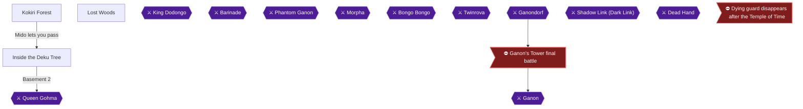

## Chapter 2: Hyrule Castle Town and Princess Zelda

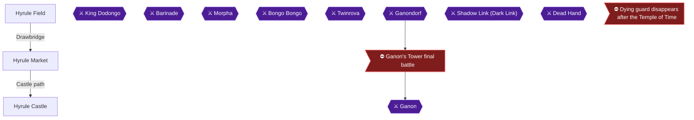

## Chapter 3: Kakariko Village, the Graveyard and Lon Lon Ranch

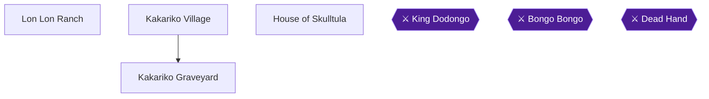

## Chapter 4: Lost Woods, Sacred Forest Meadow and Goron City

```mermaid
flowchart TD
  Kokiri_Forest["Kokiri Forest"]
  Lost_Woods["Lost Woods"]
  Sacred_Forest_Meadow["Sacred Forest Meadow"]
  Death_Mountain_Trail["Death Mountain Trail"]
  Goron_City["Goron City"]
  Queen_Gohma{{"⚔ Queen Gohma"}}
  King_Dodongo{{"⚔ King Dodongo"}}
  Barinade{{"⚔ Barinade"}}
  Phantom_Ganon{{"⚔ Phantom Ganon"}}
  Morpha{{"⚔ Morpha"}}
  Bongo_Bongo{{"⚔ Bongo Bongo"}}
  Twinrova{{"⚔ Twinrova"}}
  Ganondorf{{"⚔ Ganondorf"}}
  Ganon{{"⚔ Ganon"}}
  Dark_Link{{"⚔ Shadow Link (Dark Link)"}}
  Dead_Hand{{"⚔ Dead Hand"}}
  Dying_Guard_Lockout>"⛔ Dying guard disappears after the Temple of Time"]
  Final_Battle>"⛔ Ganon's Tower final battle"]
  Lost_Woods --> Sacred_Forest_Meadow
  Death_Mountain_Trail --> Goron_City
  Ganondorf --> Final_Battle
  Final_Battle --> Ganon
  classDef ponr fill:#7f1d1d,stroke:#f87171,color:#fff;
  classDef boss fill:#4c1d95,stroke:#a78bfa,color:#fff;
  class Dying_Guard_Lockout,Final_Battle ponr;
  class Queen_Gohma,King_Dodongo,Barinade,Phantom_Ganon,Morpha,Bongo_Bongo,Twinrova,Ganondorf,Ganon,Dark_Link,Dead_Hand boss;
```

## Chapter 5: Dodongo's Cavern

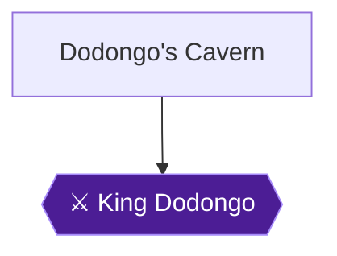

## Chapter 6: Death Mountain Summit, Goron City and Castle Town with Bombs

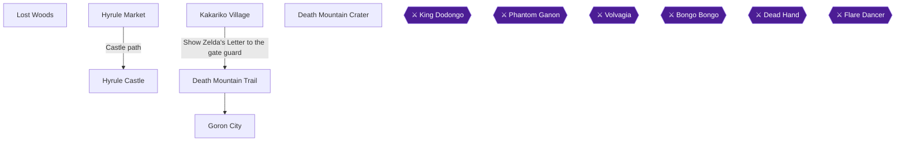

## Chapter 7: Zora's River and Zora's Domain

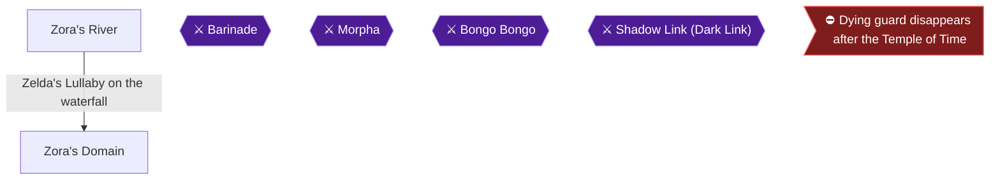

## Chapter 8: Lake Hylia, the Fishing Pond and Gerudo Valley

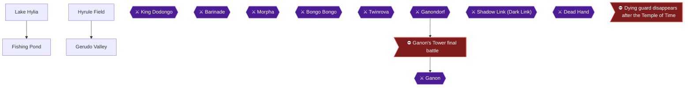

## Chapter 9: Zora's Fountain and Inside Jabu-Jabu's Belly

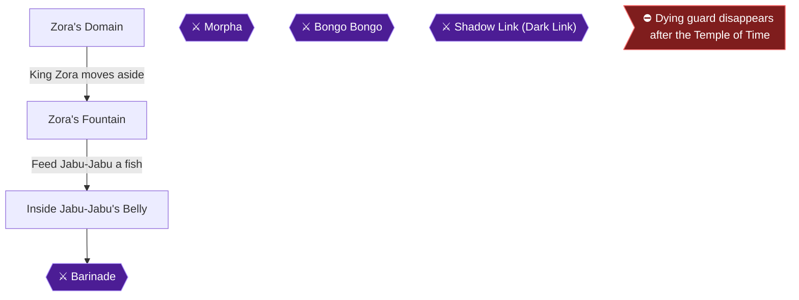

## Chapter 10: Young Link Cleanup and the Ocarina of Time

```mermaid
flowchart TD
  Lost_Woods["Lost Woods"]
  Inside_Deku_Tree["Inside the Deku Tree"]
  Hyrule_Field["Hyrule Field"]
  Hyrule_Market["Hyrule Market"]
  Hyrule_Castle["Hyrule Castle"]
  Lon_Lon_Ranch["Lon Lon Ranch"]
  Kakariko_Village["Kakariko Village"]
  Kakariko_Graveyard["Kakariko Graveyard"]
  House_of_Skulltula["House of Skulltula"]
  Lake_Hylia["Lake Hylia"]
  Gerudo_Valley["Gerudo Valley"]
  Temple_of_Time["Temple of Time"]
  Queen_Gohma{{"⚔ Queen Gohma"}}
  King_Dodongo{{"⚔ King Dodongo"}}
  Barinade{{"⚔ Barinade"}}
  Phantom_Ganon{{"⚔ Phantom Ganon"}}
  Morpha{{"⚔ Morpha"}}
  Bongo_Bongo{{"⚔ Bongo Bongo"}}
  Twinrova{{"⚔ Twinrova"}}
  Ganondorf{{"⚔ Ganondorf"}}
  Ganon{{"⚔ Ganon"}}
  Dark_Link{{"⚔ Shadow Link (Dark Link)"}}
  Dead_Hand{{"⚔ Dead Hand"}}
  Dying_Guard_Lockout>"⛔ Dying guard disappears after the Temple of Time"]
  Final_Battle>"⛔ Ganon's Tower final battle"]
  Inside_Deku_Tree -->|"Basement 2"| Queen_Gohma
  Hyrule_Field -->|"Drawbridge"| Hyrule_Market
  Hyrule_Market -->|"Castle path"| Hyrule_Castle
  Hyrule_Field --> Lon_Lon_Ranch
  Hyrule_Field --> Kakariko_Village
  Kakariko_Village --> Kakariko_Graveyard
  Hyrule_Field --> Gerudo_Valley
  Temple_of_Time -->|"Dampe's race"| Kakariko_Graveyard
  Ganondorf --> Final_Battle
  Final_Battle --> Ganon
  classDef ponr fill:#7f1d1d,stroke:#f87171,color:#fff;
  classDef boss fill:#4c1d95,stroke:#a78bfa,color:#fff;
  class Dying_Guard_Lockout,Final_Battle ponr;
  class Queen_Gohma,King_Dodongo,Barinade,Phantom_Ganon,Morpha,Bongo_Bongo,Twinrova,Ganondorf,Ganon,Dark_Link,Dead_Hand boss;
```

## Chapter 11: Seven Years Later: Hookshot, Epona and the Goron Tunic

```mermaid
flowchart TD
  Kokiri_Forest["Kokiri Forest"]
  Lost_Woods["Lost Woods"]
  Hyrule_Castle["Hyrule Castle"]
  Lon_Lon_Ranch["Lon Lon Ranch"]
  Kakariko_Village["Kakariko Village"]
  Kakariko_Graveyard["Kakariko Graveyard"]
  Goron_City["Goron City"]
  Temple_of_Time["Temple of Time"]
  Queen_Gohma{{"⚔ Queen Gohma"}}
  King_Dodongo{{"⚔ King Dodongo"}}
  Barinade{{"⚔ Barinade"}}
  Phantom_Ganon{{"⚔ Phantom Ganon"}}
  Morpha{{"⚔ Morpha"}}
  Bongo_Bongo{{"⚔ Bongo Bongo"}}
  Twinrova{{"⚔ Twinrova"}}
  Ganondorf{{"⚔ Ganondorf"}}
  Ganon{{"⚔ Ganon"}}
  Dark_Link{{"⚔ Shadow Link (Dark Link)"}}
  Dead_Hand{{"⚔ Dead Hand"}}
  Dying_Guard_Lockout>"⛔ Dying guard disappears after the Temple of Time"]
  Final_Battle>"⛔ Ganon's Tower final battle"]
  Kakariko_Village --> Kakariko_Graveyard
  Temple_of_Time -->|"Dampe's race"| Kakariko_Graveyard
  Ganondorf --> Final_Battle
  Final_Battle --> Ganon
  classDef ponr fill:#7f1d1d,stroke:#f87171,color:#fff;
  classDef boss fill:#4c1d95,stroke:#a78bfa,color:#fff;
  class Dying_Guard_Lockout,Final_Battle ponr;
  class Queen_Gohma,King_Dodongo,Barinade,Phantom_Ganon,Morpha,Bongo_Bongo,Twinrova,Ganondorf,Ganon,Dark_Link,Dead_Hand boss;
```

## Chapter 12: Ice Cavern and the Zora Tunic

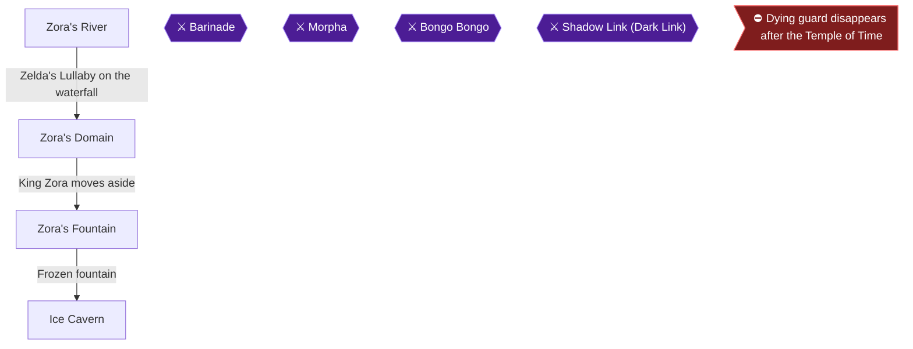

## Chapter 13: The Biggoron's Sword Trading Quest

```mermaid
flowchart TD
  Lost_Woods["Lost Woods"]
  Kakariko_Village["Kakariko Village"]
  House_of_Skulltula["House of Skulltula"]
  Death_Mountain_Trail["Death Mountain Trail"]
  Zoras_Domain["Zora's Domain"]
  Lake_Hylia["Lake Hylia"]
  Gerudo_Valley["Gerudo Valley"]
  King_Dodongo{{"⚔ King Dodongo"}}
  Barinade{{"⚔ Barinade"}}
  Phantom_Ganon{{"⚔ Phantom Ganon"}}
  Morpha{{"⚔ Morpha"}}
  Bongo_Bongo{{"⚔ Bongo Bongo"}}
  Twinrova{{"⚔ Twinrova"}}
  Ganondorf{{"⚔ Ganondorf"}}
  Ganon{{"⚔ Ganon"}}
  Dark_Link{{"⚔ Shadow Link (Dark Link)"}}
  Dead_Hand{{"⚔ Dead Hand"}}
  Dying_Guard_Lockout>"⛔ Dying guard disappears after the Temple of Time"]
  Final_Battle>"⛔ Ganon's Tower final battle"]
  Kakariko_Village -->|"Show Zelda's Letter to the gate guard"| Death_Mountain_Trail
  Zoras_Domain -->|"Underwater tunnel"| Lake_Hylia
  Ganondorf --> Final_Battle
  Final_Battle --> Ganon
  classDef ponr fill:#7f1d1d,stroke:#f87171,color:#fff;
  classDef boss fill:#4c1d95,stroke:#a78bfa,color:#fff;
  class Dying_Guard_Lockout,Final_Battle ponr;
  class King_Dodongo,Barinade,Phantom_Ganon,Morpha,Bongo_Bongo,Twinrova,Ganondorf,Ganon,Dark_Link,Dead_Hand boss;
```

## Chapter 14: Forest Temple

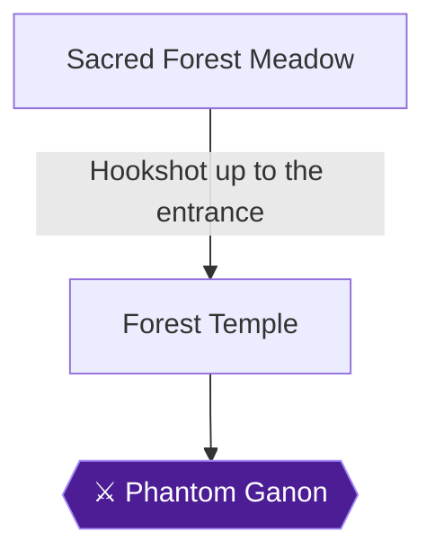

## Chapter 15: Death Mountain Crater and the Fire Temple

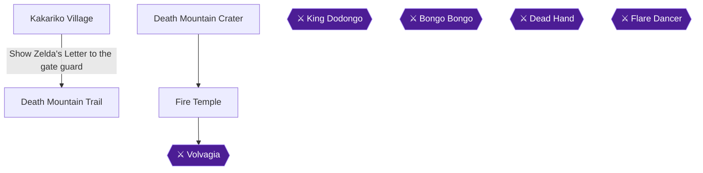

## Chapter 16: Water Temple

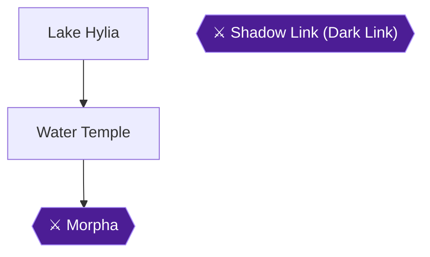

## Chapter 17: Song of Storms, the Frogs and the Bottom of the Well

```mermaid
flowchart TD
  Hyrule_Market["Hyrule Market"]
  Hyrule_Castle["Hyrule Castle"]
  Kakariko_Village["Kakariko Village"]
  Death_Mountain_Crater["Death Mountain Crater"]
  Zoras_River["Zora's River"]
  Temple_of_Time["Temple of Time"]
  Bottom_of_the_Well["Bottom of the Well"]
  King_Dodongo{{"⚔ King Dodongo"}}
  Barinade{{"⚔ Barinade"}}
  Volvagia{{"⚔ Volvagia"}}
  Morpha{{"⚔ Morpha"}}
  Bongo_Bongo{{"⚔ Bongo Bongo"}}
  Dark_Link{{"⚔ Shadow Link (Dark Link)"}}
  Dead_Hand{{"⚔ Dead Hand"}}
  Flare_Dancer{{"⚔ Flare Dancer"}}
  Dying_Guard_Lockout>"⛔ Dying guard disappears after the Temple of Time"]
  Hyrule_Market -->|"Castle path"| Hyrule_Castle
  Kakariko_Village -->|"Drain the well (child)"| Bottom_of_the_Well
  classDef ponr fill:#7f1d1d,stroke:#f87171,color:#fff;
  classDef boss fill:#4c1d95,stroke:#a78bfa,color:#fff;
  class Dying_Guard_Lockout ponr;
  class King_Dodongo,Barinade,Volvagia,Morpha,Bongo_Bongo,Dark_Link,Dead_Hand,Flare_Dancer boss;
```

## Chapter 18: Shadow Temple

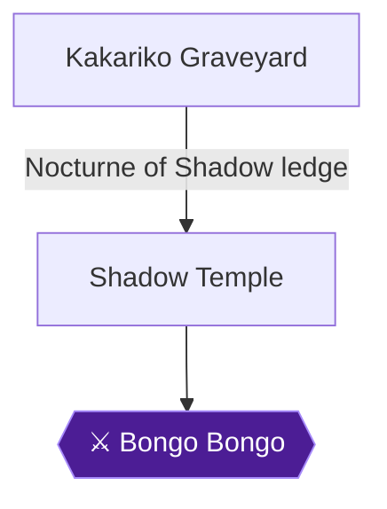

## Chapter 19: Gerudo Valley and Gerudo's Fortress

```mermaid
flowchart TD
  Gerudo_Valley["Gerudo Valley"]
  Gerudo_Fortress["Gerudo's Fortress"]
  Twinrova{{"⚔ Twinrova"}}
  Ganondorf{{"⚔ Ganondorf"}}
  Ganon{{"⚔ Ganon"}}
  Final_Battle>"⛔ Ganon's Tower final battle"]
  Gerudo_Valley -->|"Jump the broken bridge on Epona or Longshot"| Gerudo_Fortress
  Ganondorf --> Final_Battle
  Final_Battle --> Ganon
  classDef ponr fill:#7f1d1d,stroke:#f87171,color:#fff;
  classDef boss fill:#4c1d95,stroke:#a78bfa,color:#fff;
  class Final_Battle ponr;
  class Twinrova,Ganondorf,Ganon boss;
```

## Chapter 20: Desert Colossus and the Spirit Temple

```mermaid
flowchart TD
  Temple_of_Time["Temple of Time"]
  Haunted_Wasteland["Haunted Wasteland"]
  Desert_Colossus["Desert Colossus"]
  Spirit_Temple["Spirit Temple"]
  Bongo_Bongo{{"⚔ Bongo Bongo"}}
  Twinrova{{"⚔ Twinrova"}}
  Ganondorf{{"⚔ Ganondorf"}}
  Ganon{{"⚔ Ganon"}}
  Dying_Guard_Lockout>"⛔ Dying guard disappears after the Temple of Time"]
  Final_Battle>"⛔ Ganon's Tower final battle"]
  Haunted_Wasteland --> Desert_Colossus
  Desert_Colossus --> Spirit_Temple
  Spirit_Temple --> Twinrova
  Ganondorf --> Final_Battle
  Final_Battle --> Ganon
  classDef ponr fill:#7f1d1d,stroke:#f87171,color:#fff;
  classDef boss fill:#4c1d95,stroke:#a78bfa,color:#fff;
  class Dying_Guard_Lockout,Final_Battle ponr;
  class Bongo_Bongo,Twinrova,Ganondorf,Ganon boss;
```

## Chapter 21: Light Arrows, Gerudo Training Ground and the Big Poes

```mermaid
flowchart TD
  Hyrule_Field["Hyrule Field"]
  Dodongos_Cavern["Dodongo's Cavern"]
  Zoras_Domain["Zora's Domain"]
  Gerudo_Valley["Gerudo Valley"]
  Zoras_Fountain["Zora's Fountain"]
  Temple_of_Time["Temple of Time"]
  Fire_Temple["Fire Temple"]
  Gerudo_Training_Ground["Gerudo Training Ground"]
  King_Dodongo{{"⚔ King Dodongo"}}
  Barinade{{"⚔ Barinade"}}
  Volvagia{{"⚔ Volvagia"}}
  Morpha{{"⚔ Morpha"}}
  Bongo_Bongo{{"⚔ Bongo Bongo"}}
  Twinrova{{"⚔ Twinrova"}}
  Ganondorf{{"⚔ Ganondorf"}}
  Ganon{{"⚔ Ganon"}}
  Dark_Link{{"⚔ Shadow Link (Dark Link)"}}
  Dead_Hand{{"⚔ Dead Hand"}}
  Flare_Dancer{{"⚔ Flare Dancer"}}
  Dying_Guard_Lockout>"⛔ Dying guard disappears after the Temple of Time"]
  Final_Battle>"⛔ Ganon's Tower final battle"]
  Dodongos_Cavern --> King_Dodongo
  Hyrule_Field --> Gerudo_Valley
  Zoras_Domain -->|"King Zora moves aside"| Zoras_Fountain
  Fire_Temple --> Volvagia
  Ganondorf --> Final_Battle
  Final_Battle --> Ganon
  classDef ponr fill:#7f1d1d,stroke:#f87171,color:#fff;
  classDef boss fill:#4c1d95,stroke:#a78bfa,color:#fff;
  class Dying_Guard_Lockout,Final_Battle ponr;
  class King_Dodongo,Barinade,Volvagia,Morpha,Bongo_Bongo,Twinrova,Ganondorf,Ganon,Dark_Link,Dead_Hand,Flare_Dancer boss;
```

## Chapter 22: Lon Lon Ranch, Dampe's Race and the Fishing Pond

```mermaid
flowchart TD
  Lon_Lon_Ranch["Lon Lon Ranch"]
  Kakariko_Graveyard["Kakariko Graveyard"]
  House_of_Skulltula["House of Skulltula"]
  Lake_Hylia["Lake Hylia"]
  Fishing_Pond["Fishing Pond"]
  Morpha{{"⚔ Morpha"}}
  Bongo_Bongo{{"⚔ Bongo Bongo"}}
  Dark_Link{{"⚔ Shadow Link (Dark Link)"}}
  Lake_Hylia --> Fishing_Pond
  classDef ponr fill:#7f1d1d,stroke:#f87171,color:#fff;
  classDef boss fill:#4c1d95,stroke:#a78bfa,color:#fff;
  class Morpha,Bongo_Bongo,Dark_Link boss;
```

## Chapter 23: The Gossip Stone Tour

```mermaid
flowchart TD
  Kokiri_Forest["Kokiri Forest"]
  Lost_Woods["Lost Woods"]
  Hyrule_Field["Hyrule Field"]
  Hyrule_Castle["Hyrule Castle"]
  Kakariko_Graveyard["Kakariko Graveyard"]
  Sacred_Forest_Meadow["Sacred Forest Meadow"]
  Death_Mountain_Trail["Death Mountain Trail"]
  Goron_City["Goron City"]
  Dodongos_Cavern["Dodongo's Cavern"]
  Death_Mountain_Crater["Death Mountain Crater"]
  Zoras_River["Zora's River"]
  Zoras_Domain["Zora's Domain"]
  Lake_Hylia["Lake Hylia"]
  Gerudo_Valley["Gerudo Valley"]
  Zoras_Fountain["Zora's Fountain"]
  Temple_of_Time["Temple of Time"]
  Desert_Colossus["Desert Colossus"]
  Queen_Gohma{{"⚔ Queen Gohma"}}
  King_Dodongo{{"⚔ King Dodongo"}}
  Barinade{{"⚔ Barinade"}}
  Phantom_Ganon{{"⚔ Phantom Ganon"}}
  Volvagia{{"⚔ Volvagia"}}
  Morpha{{"⚔ Morpha"}}
  Bongo_Bongo{{"⚔ Bongo Bongo"}}
  Twinrova{{"⚔ Twinrova"}}
  Ganondorf{{"⚔ Ganondorf"}}
  Ganon{{"⚔ Ganon"}}
  Dark_Link{{"⚔ Shadow Link (Dark Link)"}}
  Dead_Hand{{"⚔ Dead Hand"}}
  Flare_Dancer{{"⚔ Flare Dancer"}}
  Dying_Guard_Lockout>"⛔ Dying guard disappears after the Temple of Time"]
  Final_Battle>"⛔ Ganon's Tower final battle"]
  Lost_Woods --> Sacred_Forest_Meadow
  Death_Mountain_Trail --> Goron_City
  Death_Mountain_Trail -->|"Bomb the boulder"| Dodongos_Cavern
  Dodongos_Cavern --> King_Dodongo
  Hyrule_Field --> Zoras_River
  Zoras_River -->|"Zelda's Lullaby on the waterfall"| Zoras_Domain
  Zoras_Domain -->|"Underwater tunnel"| Lake_Hylia
  Hyrule_Field --> Gerudo_Valley
  Zoras_Domain -->|"King Zora moves aside"| Zoras_Fountain
  Temple_of_Time -->|"Dampe's race"| Kakariko_Graveyard
  Ganondorf --> Final_Battle
  Final_Battle --> Ganon
  classDef ponr fill:#7f1d1d,stroke:#f87171,color:#fff;
  classDef boss fill:#4c1d95,stroke:#a78bfa,color:#fff;
  class Dying_Guard_Lockout,Final_Battle ponr;
  class Queen_Gohma,King_Dodongo,Barinade,Phantom_Ganon,Volvagia,Morpha,Bongo_Bongo,Twinrova,Ganondorf,Ganon,Dark_Link,Dead_Hand,Flare_Dancer boss;
```

## Chapter 24: Ganon's Castle and the Final Battle

```mermaid
flowchart TD
  Ganons_Castle["Ganon's Castle"]
  Ganons_Tower["Ganon's Tower"]
  Ganondorf{{"⚔ Ganondorf"}}
  Ganon{{"⚔ Ganon"}}
  Final_Battle>"⛔ Ganon's Tower final battle"]
  Ganons_Castle -->|"Six trials dispel the barrier"| Ganons_Tower
  Ganons_Tower --> Ganondorf
  Ganondorf --> Final_Battle
  Final_Battle --> Ganon
  classDef ponr fill:#7f1d1d,stroke:#f87171,color:#fff;
  classDef boss fill:#4c1d95,stroke:#a78bfa,color:#fff;
  class Final_Battle ponr;
  class Ganondorf,Ganon boss;
```

## Chapter 25: 3-Heart Run: Child Dungeons

```mermaid
flowchart TD
  Inside_Deku_Tree["Inside the Deku Tree"]
  Dodongos_Cavern["Dodongo's Cavern"]
  Inside_Jabu["Inside Jabu-Jabu's Belly"]
  Queen_Gohma{{"⚔ Queen Gohma"}}
  King_Dodongo{{"⚔ King Dodongo"}}
  Barinade{{"⚔ Barinade"}}
  Morpha{{"⚔ Morpha"}}
  Bongo_Bongo{{"⚔ Bongo Bongo"}}
  Twinrova{{"⚔ Twinrova"}}
  Ganondorf{{"⚔ Ganondorf"}}
  Ganon{{"⚔ Ganon"}}
  Dark_Link{{"⚔ Shadow Link (Dark Link)"}}
  Dead_Hand{{"⚔ Dead Hand"}}
  Dying_Guard_Lockout>"⛔ Dying guard disappears after the Temple of Time"]
  Final_Battle>"⛔ Ganon's Tower final battle"]
  Inside_Deku_Tree -->|"Basement 2"| Queen_Gohma
  Dodongos_Cavern --> King_Dodongo
  Inside_Jabu --> Barinade
  Ganondorf --> Final_Battle
  Final_Battle --> Ganon
  classDef ponr fill:#7f1d1d,stroke:#f87171,color:#fff;
  classDef boss fill:#4c1d95,stroke:#a78bfa,color:#fff;
  class Dying_Guard_Lockout,Final_Battle ponr;
  class Queen_Gohma,King_Dodongo,Barinade,Morpha,Bongo_Bongo,Twinrova,Ganondorf,Ganon,Dark_Link,Dead_Hand boss;
```

## Chapter 26: 3-Heart Run: The Adult Temples

```mermaid
flowchart TD
  Forest_Temple["Forest Temple"]
  Fire_Temple["Fire Temple"]
  Water_Temple["Water Temple"]
  Shadow_Temple["Shadow Temple"]
  Spirit_Temple["Spirit Temple"]
  Phantom_Ganon{{"⚔ Phantom Ganon"}}
  Volvagia{{"⚔ Volvagia"}}
  Morpha{{"⚔ Morpha"}}
  Bongo_Bongo{{"⚔ Bongo Bongo"}}
  Twinrova{{"⚔ Twinrova"}}
  Ganondorf{{"⚔ Ganondorf"}}
  Ganon{{"⚔ Ganon"}}
  Dark_Link{{"⚔ Shadow Link (Dark Link)"}}
  Flare_Dancer{{"⚔ Flare Dancer"}}
  Final_Battle>"⛔ Ganon's Tower final battle"]
  Forest_Temple --> Phantom_Ganon
  Fire_Temple --> Volvagia
  Water_Temple --> Morpha
  Shadow_Temple --> Bongo_Bongo
  Spirit_Temple --> Twinrova
  Ganondorf --> Final_Battle
  Final_Battle --> Ganon
  classDef ponr fill:#7f1d1d,stroke:#f87171,color:#fff;
  classDef boss fill:#4c1d95,stroke:#a78bfa,color:#fff;
  class Final_Battle ponr;
  class Phantom_Ganon,Volvagia,Morpha,Bongo_Bongo,Twinrova,Ganondorf,Ganon,Dark_Link,Flare_Dancer boss;
```

## Chapter 27: 3-Heart Run: Ganon's Castle and Blind Explorer

```mermaid
flowchart TD
  Ganons_Castle["Ganon's Castle"]
  Ganons_Tower["Ganon's Tower"]
  Ganondorf{{"⚔ Ganondorf"}}
  Ganon{{"⚔ Ganon"}}
  Final_Battle>"⛔ Ganon's Tower final battle"]
  Ganons_Castle -->|"Six trials dispel the barrier"| Ganons_Tower
  Ganons_Tower --> Ganondorf
  Ganondorf --> Final_Battle
  Final_Battle --> Ganon
  classDef ponr fill:#7f1d1d,stroke:#f87171,color:#fff;
  classDef boss fill:#4c1d95,stroke:#a78bfa,color:#fff;
  class Final_Battle ponr;
  class Ganondorf,Ganon boss;
```
