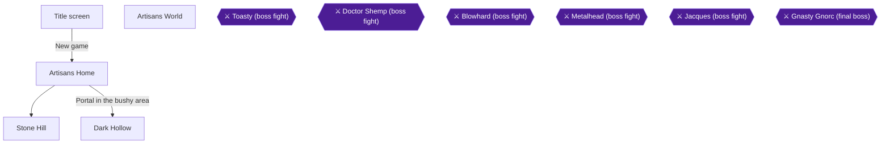
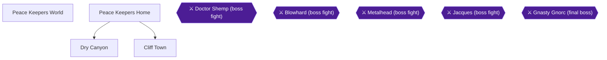
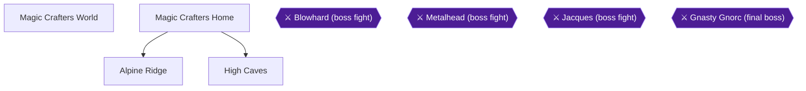
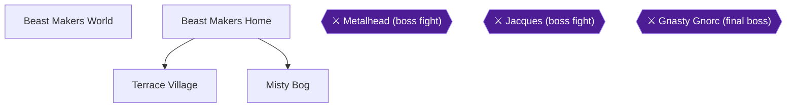
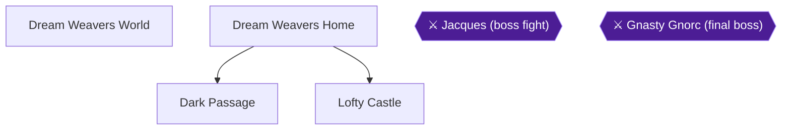
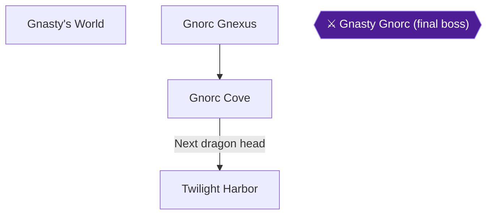
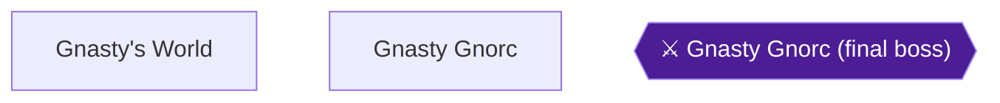
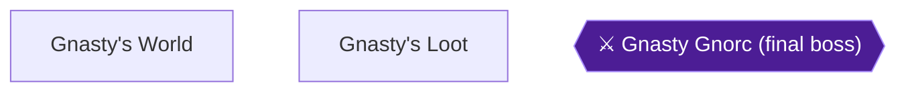

# Spyro the Dragon — 100% RetroAchievements Walkthrough

## Metadata

- **Platform:** PlayStation
- **Developer:** Insomniac Games
- **Publisher:** Sony Computer Entertainment
- **Genre:** Unknown
- **Released:** 1998-09-09
- **Achievements:** 89 (652 points)

> [!NOTE]
> Every instruction in this guide was extracted from the sources listed at the bottom and checked against them (228 facts confirmed by 2+ sources, 5237 from a single source). Statements marked 🟡 come from only one source. Anything we could not confirm says **"Unable to verify from collected sources."**

## Game Overview

## What this game is

Spyro the Dragon is a 3D platformer made by Insomniac Games and released for the PlayStation on 1998-09-09. It was a PSX-exclusive title [[gf1-6-1]]. This guide covers a hardcore run aimed at all 89 RetroAchievements (652 points).

The overall goal is simple. Spyro must collect gems and free the dragons who have been trapped [[gf2-2-1, gf2-2-2]]:

- **Gems:** the inventory screen tracks gems out of 14000 [[gf1-21-2]].
- **Dragons:** 80 in total [[gf1-19-2]].
- **Dragon eggs:** 12 in total. Egg thieves hold them, and they are all found in the first half of the game [[checklist-eggs-2-26]].
- **Completion:** the inventory shows a percentage out of 120 [[gf1-21-2]]. Reaching the 120% mark requires 14000 gems, 80 freed dragons and 12 rescued eggs [[gf3-38-4]].

The finale is against Gnasty Gnorc, in the chapters on Gnasty Gnorc and the Return of Magnus. The final bonus level, Gnasty's Loot, needs 100%, which means 12000 gems, 80 dragons and 12 dragon eggs [[gf1-126-6]].

## How the game is laid out

- **Homeworlds:** you start the game and every other world in a home level [[gf1-13-3]]. Homeworlds link to the world's other levels and to the other homeworlds. Moving between worlds means finding the world's balloonist, who takes you onward once you meet a gem or dragon requirement [[gf4-7-7]].
- **Level types:** Home, Regular, Flight, Boss and one Bonus level.
- **Regular levels:** each ends in a "Return Home" vortex, and several of the later ones hold hidden challenges and tough enemies. The collecting checklists in the chapters cover each one.
- **Flight levels:** these are timed challenges where Spyro flies freely instead of gliding [[gf1-13-13]]. You start with about 30 seconds on the clock [[gf1-13-15]], and each destroyed object adds a little time.
- **Boss levels:** a boss fight follows the level's dragon in each boss level; for example, Metalhead is beaten by destroying the power poles in his arena [[gf1-94-2]].
- **Leaving a level:** always leave through the Return Home vortex. Data from a level may not be counted until you jump into the vortex [[gf1-13-3]]. Leaving through the START menu can cause problems [[gf1-33-9]].

## Controls you need

| Input | Action | Citation |
|---|---|---|
| Left Analog Stick / D-pad | Move. The stick walks if pushed slightly and runs if pushed fully. The D-pad is limited to eight directions. | [[gf1-8-1, gf1-15-3, gf1-15-4]] |
| X | Jump. Hold it to jump higher. | [[gf1-8-14]] |
| X, then X again in the air | Glide. Gliding from the peak of the jump gives more distance. | [[gf1-16-9, gf1-16-10]] |
| Triangle while gliding | Drop straight down. | [[gf1-16-11]] |
| Circle | Flame breath. | [[gf1-8-13]] |
| Square (hold) | Charge. | [[gf1-8-12]] |
| L1 / R1 | Roll left / right. In flight levels they do a 180-flip and a 360-flip. | [[gf1-8-3, gf1-8-4, gf1-16-14, gf1-16-15]] |
| L2 / R2 | Rotate the camera left / right. The Right Analog Stick does nothing. | [[gf1-16-1, gf1-16-2, gf1-16-3]] |
| L3 | Recentre the camera behind Spyro. | [[gf1-8-2]] |
| Triangle (hold) | Still first-person look-around, useful for spotting distant gem sparkles. | [[gf1-8-11]] |
| SELECT | Inventory screen. | [[gf1-8-15]] |
| START | Pause menu. | [[gf1-8-16]] |

Useful combinations:

- Pressing Square and X together performs a jump charge, which is faster but handles worse [[gf1-9-3]].
- Pressing X and Circle flames in mid-air, which helps hit higher targets [[gf1-9-4]].
- In flight levels you push up to descend and down to climb [[gf1-16-16]].

The camera can be switched between Passive and Active in the Options menu. Passive is slower and more precise. Active is faster [[gf1-16-4, gf1-16-5, gf1-16-6]].

## Attacks and what they beat

- **Flame** is a short jet of fire, good for big enemies. It does not damage anything metal, including armour [[gf1-17-1, gf1-17-3, gf1-17-7]].
- **Charge** is very fast. It is used to catch thieves and can penetrate metal and armour, but it does not damage big enemies [[gf1-18-1, gf1-18-2, gf1-18-3]].
- **Supercharge:** charging down an arrow-marked slope from its top starts a supercharge, which lasts until you stop charging. It defeats any enemy you charge through [[gf1-18-11, gf1-18-4]]. Jumping off an edge while supercharging gives a superjump that goes very far [[gf1-18-5]]. Yellow steam is normal supercharge speed, and red steam from charging off a second ramp is immensely fast [[gf1-18-6, gf1-18-7]].
- **Powerflame:** a purple fairy's kiss temporarily upgrades the flame so it can destroy metal and armour [[gf1-17-4]]. There is also an orange fairy that grants it for the rest of one level [[gf1-107-31]].

Enemies are classed in the source by their defences. Class A is harmless and B is defenseless. C and D are immune to charge or flame, with D the hard version, and E is immune to both [[gf1-27-1, gf1-27-2, gf1-27-3, gf1-27-4, gf1-27-5]].

## Chests and gem values

Gem values are red 1, green 2, blue 5, yellow 10 and pink 25 [[gf3-4-19, gf3-4-20, gf3-4-21, gf3-4-22, gf3-4-23]].

Chest types and how to open them:

- **Normal chests:** gold and red chests are opened any way you like [[gf2-3-6]]. Gold ones need a flame and then you grab the gem [[gf2-3-18]].
- **Metal chests:** these absorb flame and must be charged [[gf2-3-7]].
- **Colour-topped chests:** flame or charge one to make its gem jump out, then jump onto the gem to catch it [[gf1-11-5]]. Any advanced attack destroys them instantly [[gf1-11-6]].
- **Propeller chests:** flame them three times [[gf2-3-8]].
- **Fireworks and explosive chests:** back off so they can open [[gf2-3-9]]. For explosive chests, flame them until they hiss, then step back [[gf1-47-15]].
- **Unbreakable chests:** these open with firecrackers, supercharging or cannonballs [[gf4-7-4]].

## Health, lives and saving

- **Sparx:** the yellow dragonfly is your health meter [[gf1-29-9]]. Yellow is full health, blue is three hits from death, and green is two. When he disappears, you are one hit from death [[gf3-4-12, gf3-4-13, gf3-4-14, gf3-4-18]].
- **Healing:** kill a helpless animal such as a sheep to release a butterfly, which Sparx eats to heal one notch [[gf1-14-4]].
- **Lives:** you start with 5 lives [[gf1-14-13]]. Falling, drowning or being hit without Sparx costs a life [[gf1-14-6]]. Each life lost respawns you at the last checkpoint [[gf1-29-12]].
- **Game over:** this loses unsaved level data and returns you to the world's home level [[gf1-14-7]].
- **Checkpoints and saving:** stepping on a freed dragon's platform makes a checkpoint, and standing on it lets you save [[gf1-19-8, gf3-5-4]].
- **Water:** Spyro cannot swim, so landing in water causes damage [[gf4-9-2]].
- **Pause menu:** START opens a menu with four options [[gf1-20-1]]. The fourth is Exit Level in regular, flight, boss or bonus levels, and Quit Game in homeworlds [[gf1-22-1, gf1-22-2]].

## RetroAchievements and hardcore rules

- **Emulator:**
  - Use RetroArch with the Beetle PSX core. Reports say PSX achievements unlock only on Beetle in RetroArch [[ra-comments-1-1]].
  - Standalone DuckStation worked for one player [[ra-comments-3-7]].
  - If you use DuckStation, turn off its 60 FPS patch. Planes in the flight levels move much faster with it on [[ra-comments-65-4]].
- **Hardcore:** hardcore mode is recommended, so no rewinds, cheats or loading emulator snapshots. Do not use the level-select code. It lets you enter any homeworld without meeting its requirements [[ra-comments-51-9]].
- **Brand-new save:** start a brand-new save file. Achievements do not pop from a 100% save [[ra-comments-3-5]].
- **1-Up chests:** once a 1-Up chest is destroyed it does not come back. Recovering it requires a brand-new save [[ra-comments-51-5, ra-comments-51-6]]. Players who mastered the game earlier and are locked out of the 1-Up achievements can request a manual unlock [[ra-comments-51-8]].
- **No exclusive achievements:** challenges can be retried by re-entering their levels. The one exception to watch is **Keeping My Inner Dragon in Check** in Gnorc Cove. A commenter suggests it may be locked out once Gnorc Cove is completed [[ra-comments-109-5]], while others report it worked on a 100% save [[ra-comments-109-2, ra-comments-109-3]]. To be safe, do it on your first visit.
- **Within-run missables and timing:** in Icy Flight, lights and chests are missable once you pass the train tracks, so restart the level if you miss any (Chapter 10) [[gf2-40-3]]. Magnus, the 80th dragon, appears in Gnorc Gnexus only after Gnasty Gnorc is beaten (Chapter 12) [[ra-comments-45-1, gf2-40-13]]. Balloons between worlds work both ways, so no world is closed off once you leave it [[gf1-44-21, gf1-115-11]].

## The 100% plan in plain language

1. **One playthrough, start to finish, on a fresh save.** Achievements do not pop from a 100% save [[ra-comments-3-5]]. Play the worlds in order: Artisans, Peace Keepers, Magic Crafters, Beast Makers, Dream Weavers and Gnasty's World. Each chapter covers a homeworld and its levels.
2. **Clear each level fully before you leave.** That means every gem, every dragon, the dragon egg where there is one, and any level key and its chest. To complete a level you must free all of its dragons and collect all of its gems [[gf2-3-11]]. Then exit through the Return Home vortex.
3. **Do the flight levels.** Each of the first five worlds has a flight level [[gf2-3-12]]. Each pays 300 gems, 60 for every set of eight objects and an extra 60 for destroying all 32 in one go [[gf1-13-13]]. You can retry a flight level until you get the full 300.
4. **Take the achievement challenges when each level is fresh.** Many are timed runs or tricky supercharge routes, and the chapters flag them where they apply. Because challenges can be retried by re-entering their levels, nothing is permanently lost except the Gnorc Cove case above [[ra-comments-109-5]].
5. **Never break a 1-Up chest on a save you are not committed to.** They do not respawn [[ra-comments-51-5]].
6. **Finish with Gnasty Gnorc, then reach 100% for Gnasty's Loot.** Gnasty's Loot needs 12000 gems, 80 dragons and 12 eggs [[gf1-126-6]]. The 120% mark needs all 14000 gems [[gf3-38-4]].

100% means 12000 gems, 80 dragons and 12 dragon eggs [[gf1-126-6]], and 120% means all 14000 gems [[gf3-38-4]]. Each chapter ends with a running checkpoint of gems, dragons, eggs and achievements toward those totals, so you can compare your own totals against the plan before moving on.

## Practical tips

- Press Triangle to look around in first person and scan for sparkles, which are usually gems or keys [[gf1-8-11]].
- Gems flow to you automatically as you walk near them [[gf1-29-8]]. Once Sparx is gone, gems stop doing so [[gf1-14-3]].
- Keep an eye on Sparx's colour. Kill a sheep or other harmless animal to heal before a hard section [[gf3-4-15, gf3-4-16]].

## Achievement Roadmap

| Chapter | Achievements | Points |
|---|---|---|
| [1. Artisans Home, Stone Hill and Dark Hollow](#chapter-1-artisans-home-stone-hill-and-dark-hollow) | Dragons Love New Experiences, Get a Life, Learning from Home, Suspicious Stepping Stones, Flowers Burning, and Birds Singing..., A Dragon's Heart Is Made of Stone, Handle with Care, A Dark Day for the Herd, Hollowing Out the Uglies, Gotta Make 'Em Shine Somehow, Where's Gnasty Gnorc? I'll Torch Him! | 32 |
| [2. Town Square, Toasty and Sunny Flight](#chapter-2-town-square-toasty-and-sunny-flight) | This Town Ain't Big Enough for the Lot of Us..., Head-On Collision, A Dragon's Life, Reaping the Sheep, Solid Spyro, Sunny-Side-Up, Faster Than Light | 35 |
| [3. Peace Keepers Home, Dry Canyon and Cliff Town](#chapter-3-peace-keepers-home-dry-canyon-and-cliff-town) | Keeping the Peace, There Is No Escaping Spyro the Dragon!, Birds and Pits, Scale Hardening, Wind Through Your... Hair?, A Broad Expanse, Cliffs Pose No Fear, Practice for the Third Game, Pocket Change | 53 |
| [4. Ice Cavern, Doctor Shemp and Night Flight](#chapter-4-ice-cavern-doctor-shemp-and-night-flight) | Slippery Slopes, Causing a Flap, A Peaceful Life, He Should Watch His Back, Medically Mandated Rest, Though Darkness, I Fly, Soaring Under the Moonlight! | 43 |
| [5. Magic Crafters Home, Alpine Ridge and High Caves](#chapter-5-magic-crafters-home-alpine-ridge-and-high-caves) | Magical Mischiveous Mages, Magical Feet, High Altitude Antics, Nimble as a Goat, Magical Life Extension, Caves Among the Clouds, I Hate Those Bugs! | 56 |
| [6. Wizard Peak, Blowhard and Crystal Flight](#chapter-6-wizard-peak-blowhard-and-crystal-flight) | Peak Wizardry, Hyperspeed Roundabout, Happy Easter, Leave Him Wheezing, I Blow Harder, Among the Singing Stones, Zooming On Past | 65 |
| [7. Beast Makers Home, Terrace Village and Misty Bog](#chapter-7-beast-makers-home-terrace-village-and-misty-bog) | A Pinch of This, a Dash of That, Swamp Gardening, An Electrifying Experience, Dragon Gumbo Jamboree, Metal Meets Mire, Spread Your Wings, Spyro!, Nifty Fifty, Thicc Wallet | 62 |
| [8. Tree Tops, Metalhead and Wild Flight](#chapter-8-tree-tops-metalhead-and-wild-flight) | Charging Makes the World Go Round, I'm Feeling a Bit Lazy Today, Heart of an Ox, er... Dragon, Topple the Tin Man, Construct, Self-Destruct, Wild Flying Dude!, Woah, You're Crazy Fast! | 53 |
| [9. Dream Weavers Home, Dark Passage and Lofty Castle](#chapter-9-dream-weavers-home-dark-passage-and-lofty-castle) | Life is a Dream, Dragon, Big Problems Require Small Solutions, Lightbringer, Devil Defying Stunts, Sir Spyro the Brave, Lofty Perch | 48 |
| [10. Haunted Towers, Jacques and Icy Flight](#chapter-10-haunted-towers-jacques-and-icy-flight) | Spooky Scary, Calm Down Fairies, Living the Weavers Dream, Spyro the Fool, Wow, What a Joke..., Sky Sliding, The Frozen Flutter | 55 |
| [11. Gnorc Gnexus, Gnorc Cove and Twilight Harbor](#chapter-11-gnorc-gnexus-gnorc-cove-and-twilight-harbor) | Keeping My Inner Dragon in Check, The Gnastiest Cove, A Life Worth Living, Oh My God... Literally, Dragonpocalypse Now, A Harbor Full of Gnorcs | 43 |
| [12. Gnasty Gnorc and the Return of Magnus](#chapter-12-gnasty-gnorc-and-the-return-of-magnus) | Gnastys Gnoing, Gnoing, Gnone!, Gnasty Gnorc? He's TOAST!, Simple, No Threat, AND Ugly!, Gnasty Home You Have Here, The Gang's All Here | 80 |
| [13. Gnasty's Loot and 120%](#chapter-13-gnastys-loot-and-120) | Lava Bath, The Loot of Thirty-Four Worlds | 27 |

## Playthrough Planning

**Playthroughs required:** 1

One playthrough on a brand-new save. Achievements do not pop from a 100% save, and broken 1-Up chests never return, so an old save is locked out of the 1-Up sets (players who mastered the game earlier can request a manual unlock). No achievements are mutually exclusive: every challenge can be retried by re-entering its level, so there is no lockout between them. The one exception to watch is Keeping My Inner Dragon in Check in Gnorc Cove, which commenters say may be locked out once Gnorc Cove is completed, so do it on the first visit. Do not use the level-select cheat.

**Settings:** Use RetroArch with the Beetle PSX core or standalone DuckStation; reports say PSX achievements only unlock on Beetle in RetroArch, and DuckStation worked for one player. Hardcore mode recommended. Turn off DuckStation's 60 FPS patch for the flight-level time trials.

[[ra-comments-1-1,ra-comments-3-5,ra-comments-3-7,ra-comments-51-5,ra-comments-51-6,ra-comments-51-8,ra-comments-51-9,ra-comments-65-4,ra-comments-109-5,gf3-38-4,gf1-21-2,gf1-126-6,gf4-7-7]]

## True 100% In-Game Completion Criteria

This guide covers complete in-game mastery in addition to all RetroAchievements:

| Category | 100% Requirement | Tracking Scope |
|---|---|---|
| **Dragons Freed** | Free all 80 crystal dragons across the six worlds. | Per-chapter checkpoint |
| **Dragon Eggs** | Catch the egg thieves and rescue all 12 dragon eggs. | Per-chapter checkpoint |
| **Gems** | Collect every gem in every level, 12000 for 100% plus the 2000 in Gnasty's Loot for 14000 and 120%. | Per-chapter checkpoint |
| **Challenges & 1-Up Chests** | Every RetroAchievements challenge (no-damage runs, flight-level time trials, boss conditions) and every homeworld set of 1-Up chests. | Endgame/Global scope |

## Missables Summary

No missables were identified in the collected sources.

## Points of No Return

No points of no return were identified in the collected sources.

## Progression Diagrams

### Game Progression

```mermaid
flowchart TD
  TitleScreen["Title screen"]
  ArtisansWorld["Artisans World"]
  ArtisansHome["Artisans Home"]
  StoneHill["Stone Hill"]
  DarkHollow["Dark Hollow"]
  TownSquare["Town Square"]
  Toasty["Toasty"]
  SunnyFlight["Sunny Flight"]
  PeaceKeepersWorld["Peace Keepers World"]
  PeaceKeepersHome["Peace Keepers Home"]
  DryCanyon["Dry Canyon"]
  CliffTown["Cliff Town"]
  IceCavern["Ice Cavern"]
  DoctorShemp["Doctor Shemp"]
  NightFlight["Night Flight"]
  MagicCraftersWorld["Magic Crafters World"]
  MagicCraftersHome["Magic Crafters Home"]
  AlpineRidge["Alpine Ridge"]
  HighCaves["High Caves"]
  WizardPeak["Wizard Peak"]
  Blowhard["Blowhard"]
  CrystalFlight["Crystal Flight"]
  BeastMakersWorld["Beast Makers World"]
  BeastMakersHome["Beast Makers Home"]
  TerraceVillage["Terrace Village"]
  MistyBog["Misty Bog"]
  TreeTops["Tree Tops"]
  Metalhead["Metalhead"]
  WildFlight["Wild Flight"]
  DreamWeaversWorld["Dream Weavers World"]
  DreamWeaversHome["Dream Weavers Home"]
  DarkPassage["Dark Passage"]
  LoftyCastle["Lofty Castle"]
  HauntedTowers["Haunted Towers"]
  Jacques["Jacques"]
  IcyFlight["Icy Flight"]
  GnastysWorld["Gnasty's World"]
  GnorcGnexus["Gnorc Gnexus"]
  GnorcCove["Gnorc Cove"]
  TwilightHarbor["Twilight Harbor"]
  GnastyGnorc["Gnasty Gnorc"]
  GnastysLoot["Gnasty's Loot"]
  Boss_Toasty{{"⚔ Toasty (boss fight)"}}
  Boss_DoctorShemp{{"⚔ Doctor Shemp (boss fight)"}}
  Boss_Blowhard{{"⚔ Blowhard (boss fight)"}}
  Boss_Metalhead{{"⚔ Metalhead (boss fight)"}}
  Boss_Jacques{{"⚔ Jacques (boss fight)"}}
  Boss_GnastyGnorc{{"⚔ Gnasty Gnorc (final boss)"}}
  TitleScreen -->|New game| ArtisansHome
  ArtisansHome --> StoneHill
  ArtisansHome -->|Portal in the bushy area| DarkHollow
  ArtisansHome --> TownSquare
  PeaceKeepersHome --> DryCanyon
  PeaceKeepersHome --> CliffTown
  PeaceKeepersHome --> IceCavern
  PeaceKeepersHome --> NightFlight
  PeaceKeepersHome -->|Portal on the middle island| DoctorShemp
  MagicCraftersHome --> AlpineRidge
  MagicCraftersHome --> HighCaves
  MagicCraftersHome --> WizardPeak
  MagicCraftersHome --> Blowhard
  MagicCraftersHome --> CrystalFlight
  BeastMakersHome --> TerraceVillage
  BeastMakersHome --> MistyBog
  BeastMakersHome --> TreeTops
  BeastMakersHome --> WildFlight
  BeastMakersHome -->|Bridge and whirlwind near Tree Tops| Metalhead
  DreamWeaversHome --> DarkPassage
  DreamWeaversHome --> LoftyCastle
  DreamWeaversHome --> HauntedTowers
  DreamWeaversHome --> IcyFlight
  DreamWeaversHome --> Jacques
  GnorcGnexus --> GnorcCove
  GnorcCove -->|Next dragon head| TwilightHarbor
  TwilightHarbor -->|Middle dragon head| GnastyGnorc
  classDef ponr fill:#7f1d1d,stroke:#f87171,color:#fff;
  classDef boss fill:#4c1d95,stroke:#a78bfa,color:#fff;
  class Boss_Toasty,Boss_DoctorShemp,Boss_Blowhard,Boss_Metalhead,Boss_Jacques,Boss_GnastyGnorc boss;
```

### Achievement Dependencies

```mermaid
flowchart LR
  IcyFlight["Icy Flight"]
  IcyFlight_Missable(["⚠ Icy Flight: lights and chests missable past the train tracks"])
  Ach_284533(["🏆 Where's Gnasty Gnorc? I'll Torch Him!"])
  PeaceKeepersHome["Peace Keepers Home"]
  Ach_284534(["🏆 Nifty Fifty"])
  DreamWeaversHome["Dream Weavers Home"]
  Ach_284535(["🏆 The Gang's All Here"])
  GnastysLoot["Gnasty's Loot"]
  StoneHill["Stone Hill"]
  Ach_284538(["🏆 Handle with Care"])
  Ach_284539(["🏆 Practice for the Third Game"])
  BeastMakersHome["Beast Makers Home"]
  Ach_82295(["🏆 Happy Easter"])
  Ach_284536(["🏆 Pocket Change"])
  MagicCraftersHome["Magic Crafters Home"]
  Ach_284537(["🏆 Thicc Wallet"])
  GnorcGnexus["Gnorc Gnexus"]
  Boss_GnastyGnorc{{"⚔ Gnasty Gnorc (final boss)"}}
  Ach_284545(["🏆 Simple, No Threat, AND Ugly!"])
  ArtisansHome["Artisans Home"]
  Ach_82298(["🏆 Learning from Home"])
  Ach_82300(["🏆 A Dragon's Heart Is Made of Stone"])
  DarkHollow["Dark Hollow"]
  Ach_82302(["🏆 Hollowing Out the Uglies"])
  TownSquare["Town Square"]
  Ach_82303(["🏆 This Town Ain't Big Enough for the Lot of Us..."])
  Toasty["Toasty"]
  Ach_82304(["🏆 Reaping the Sheep"])
  SunnyFlight["Sunny Flight"]
  Ach_82328(["🏆 Sunny-Side-Up"])
  Ach_82305(["🏆 Keeping the Peace"])
  DryCanyon["Dry Canyon"]
  Ach_82307(["🏆 Birds and Pits"])
  CliffTown["Cliff Town"]
  Ach_82306(["🏆 A Broad Expanse"])
  IceCavern["Ice Cavern"]
  Ach_82308(["🏆 Slippery Slopes"])
  DoctorShemp["Doctor Shemp"]
  Ach_82309(["🏆 He Should Watch His Back"])
  NightFlight["Night Flight"]
  Ach_82329(["🏆 Though Darkness, I Fly"])
  Ach_82310(["🏆 Magical Mischiveous Mages"])
  AlpineRidge["Alpine Ridge"]
  Ach_82311(["🏆 High Altitude Antics"])
  HighCaves["High Caves"]
  Ach_82312(["🏆 Caves Among the Clouds"])
  WizardPeak["Wizard Peak"]
  Ach_82313(["🏆 Peak Wizardry"])
  Blowhard["Blowhard"]
  Ach_82314(["🏆 Leave Him Wheezing"])
  CrystalFlight["Crystal Flight"]
  Ach_82330(["🏆 Among the Singing Stones"])
  Ach_82315(["🏆 A Pinch of This, a Dash of That"])
  TerraceVillage["Terrace Village"]
  Ach_82316(["🏆 An Electrifying Experience"])
  MistyBog["Misty Bog"]
  Ach_82317(["🏆 Metal Meets Mire"])
  TreeTops["Tree Tops"]
  Ach_82318(["🏆 Charging Makes the World Go Round"])
  Metalhead["Metalhead"]
  Ach_82319(["🏆 Topple the Tin Man"])
  WildFlight["Wild Flight"]
  Ach_82331(["🏆 Wild Flying Dude!"])
  Ach_82320(["🏆 Life is a Dream, Dragon"])
  DarkPassage["Dark Passage"]
  Ach_82321(["🏆 Lightbringer"])
  LoftyCastle["Lofty Castle"]
  Ach_82322(["🏆 Sir Spyro the Brave"])
  HauntedTowers["Haunted Towers"]
  Ach_82323(["🏆 Spooky Scary"])
  Jacques["Jacques"]
  Ach_82324(["🏆 Spyro the Fool"])
  Ach_82332(["🏆 Sky Sliding"])
  Magnus_Return["Magnus, second Gnorc Gnexus dragon (after the ending)"]
  Ach_82325(["🏆 Gnasty Home You Have Here"])
  GnorcCove["Gnorc Cove"]
  Ach_82326(["🏆 The Gnastiest Cove"])
  TwilightHarbor["Twilight Harbor"]
  Ach_82327(["🏆 A Harbor Full of Gnorcs"])
  GnastyGnorc["Gnasty Gnorc"]
  Ach_82333(["🏆 Gnastys Gnoing, Gnoing, Gnone!"])
  Ach_82299(["🏆 The Loot of Thirty-Four Worlds"])
  Ach_82296(["🏆 Get a Life"])
  ArtisansWorld["Artisans World"]
  Ach_637063(["🏆 A Dragon's Life"])
  PeaceKeepersWorld["Peace Keepers World"]
  Ach_637064(["🏆 A Peaceful Life"])
  MagicCraftersWorld["Magic Crafters World"]
  Ach_637065(["🏆 Magical Life Extension"])
  BeastMakersWorld["Beast Makers World"]
  Ach_637066(["🏆 Heart of an Ox, er... Dragon"])
  DreamWeaversWorld["Dream Weavers World"]
  Ach_637067(["🏆 Living the Weavers Dream"])
  GnastysWorld["Gnasty's World"]
  Ach_637068(["🏆 A Life Worth Living"])
  Ach_284540(["🏆 Suspicious Stepping Stones"])
  Ach_637070(["🏆 A Dark Day for the Herd"])
  Ach_637071(["🏆 Gotta Make 'Em Shine Somehow"])
  Ach_637072(["🏆 Head-On Collision"])
  Boss_Toasty{{"⚔ Toasty (boss fight)"}}
  Ach_82375(["🏆 Solid Spyro"])
  Ach_82301(["🏆 Faster Than Light"])
  Ach_637073(["🏆 There Is No Escaping Spyro the Dragon!"])
  Ach_637074(["🏆 Scale Hardening"])
  Ach_637075(["🏆 Cliffs Pose No Fear"])
  Ach_637076(["🏆 Causing a Flap"])
  Boss_DoctorShemp{{"⚔ Doctor Shemp (boss fight)"}}
  Ach_637077(["🏆 Medically Mandated Rest"])
  Ach_82356(["🏆 Soaring Under the Moonlight!"])
  Ach_637078(["🏆 Magical Feet"])
  Ach_637079(["🏆 Nimble as a Goat"])
  Ach_637080(["🏆 I Hate Those Bugs!"])
  Ach_637081(["🏆 Hyperspeed Roundabout"])
  Ach_82694(["🏆 I Blow Harder"])
  Ach_82372(["🏆 Zooming On Past"])
  Ach_284543(["🏆 Dragon Gumbo Jamboree"])
  Ach_637083(["🏆 Spread Your Wings, Spyro!"])
  Ach_637084(["🏆 I'm Feeling a Bit Lazy Today"])
  Boss_Metalhead{{"⚔ Metalhead (boss fight)"}}
  Ach_637085(["🏆 Construct, Self-Destruct"])
  Ach_82373(["🏆 Woah, You're Crazy Fast!"])
  Ach_637086(["🏆 Big Problems Require Small Solutions"])
  Ach_637087(["🏆 Devil Defying Stunts"])
  Ach_637088(["🏆 Lofty Perch"])
  Ach_637089(["🏆 Calm Down Fairies"])
  Boss_Jacques{{"⚔ Jacques (boss fight)"}}
  Ach_82729(["🏆 Wow, What a Joke..."])
  Ach_82374(["🏆 The Frozen Flutter"])
  Ach_637090(["🏆 Keeping My Inner Dragon in Check"])
  Ach_637099(["🏆 Oh My God... Literally"])
  Ach_284542(["🏆 Dragonpocalypse Now"])
  Ach_82730(["🏆 Gnasty Gnorc? He's TOAST!"])
  Ach_637091(["🏆 Lava Bath"])
  Ach_284541(["🏆 Wind Through Your... Hair?"])
  TitleScreen["Title screen"]
  Ach_637092(["🏆 Dragons Love New Experiences"])
  IcyFlight -.->|missable before| IcyFlight_Missable
  Ach_284533 -->|unlocks| PeaceKeepersHome
  Ach_284534 -->|unlocks| DreamWeaversHome
  Ach_284535 -->|unlocks| GnastysLoot
  StoneHill -->|unlocks| Ach_284538
  Ach_284539 -->|unlocks| BeastMakersHome
  Ach_82295 -->|unlocks| GnastysLoot
  Ach_284536 -->|unlocks| MagicCraftersHome
  Ach_284537 -->|unlocks| GnorcGnexus
  Boss_GnastyGnorc -->|unlocks| Ach_284545
  ArtisansHome -->|unlocks| Ach_82298
  StoneHill -->|unlocks| Ach_82300
  DarkHollow -->|unlocks| Ach_82302
  TownSquare -->|unlocks| Ach_82303
  Toasty -->|unlocks| Ach_82304
  SunnyFlight -->|unlocks| Ach_82328
  PeaceKeepersHome -->|unlocks| Ach_82305
  DryCanyon -->|unlocks| Ach_82307
  CliffTown -->|unlocks| Ach_82306
  IceCavern -->|unlocks| Ach_82308
  DoctorShemp -->|unlocks| Ach_82309
  NightFlight -->|unlocks| Ach_82329
  MagicCraftersHome -->|unlocks| Ach_82310
  AlpineRidge -->|unlocks| Ach_82311
  HighCaves -->|unlocks| Ach_82312
  WizardPeak -->|unlocks| Ach_82313
  Blowhard -->|unlocks| Ach_82314
  CrystalFlight -->|unlocks| Ach_82330
  BeastMakersHome -->|unlocks| Ach_82315
  TerraceVillage -->|unlocks| Ach_82316
  MistyBog -->|unlocks| Ach_82317
  TreeTops -->|unlocks| Ach_82318
  Metalhead -->|unlocks| Ach_82319
  WildFlight -->|unlocks| Ach_82331
  DreamWeaversHome -->|unlocks| Ach_82320
  DarkPassage -->|unlocks| Ach_82321
  LoftyCastle -->|unlocks| Ach_82322
  HauntedTowers -->|unlocks| Ach_82323
  Jacques -->|unlocks| Ach_82324
  IcyFlight -->|unlocks| Ach_82332
  Magnus_Return -->|unlocks| Ach_82325
  GnorcCove -->|unlocks| Ach_82326
  TwilightHarbor -->|unlocks| Ach_82327
  GnastyGnorc -->|unlocks| Ach_82333
  GnastysLoot -->|unlocks| Ach_82299
  ArtisansHome -->|unlocks| Ach_82296
  ArtisansWorld -->|unlocks| Ach_637063
  PeaceKeepersWorld -->|unlocks| Ach_637064
  MagicCraftersWorld -->|unlocks| Ach_637065
  BeastMakersWorld -->|unlocks| Ach_637066
  DreamWeaversWorld -->|unlocks| Ach_637067
  GnastysWorld -->|unlocks| Ach_637068
  ArtisansHome -->|unlocks| Ach_284540
  StoneHill -->|unlocks| Ach_637070
  DarkHollow -->|unlocks| Ach_637071
  TownSquare -->|unlocks| Ach_637072
  Boss_Toasty -->|unlocks| Ach_82375
  SunnyFlight -->|unlocks| Ach_82301
  PeaceKeepersHome -->|unlocks| Ach_637073
  DryCanyon -->|unlocks| Ach_637074
  CliffTown -->|unlocks| Ach_637075
  IceCavern -->|unlocks| Ach_637076
  Boss_DoctorShemp -->|unlocks| Ach_637077
  NightFlight -->|unlocks| Ach_82356
  MagicCraftersHome -->|unlocks| Ach_637078
  AlpineRidge -->|unlocks| Ach_637079
  HighCaves -->|unlocks| Ach_637080
  WizardPeak -->|unlocks| Ach_637081
  Blowhard -->|unlocks| Ach_82694
  CrystalFlight -->|unlocks| Ach_82372
  TerraceVillage -->|unlocks| Ach_284543
  MistyBog -->|unlocks| Ach_637083
  TreeTops -->|unlocks| Ach_637084
  Boss_Metalhead -->|unlocks| Ach_637085
  WildFlight -->|unlocks| Ach_82373
  DreamWeaversHome -->|unlocks| Ach_637086
  DarkPassage -->|unlocks| Ach_637087
  LoftyCastle -->|unlocks| Ach_637088
  HauntedTowers -->|unlocks| Ach_637089
  Boss_Jacques -->|unlocks| Ach_82729
  IcyFlight -->|unlocks| Ach_82374
  GnorcCove -->|unlocks| Ach_637090
  TwilightHarbor -->|unlocks| Ach_637099
  TwilightHarbor -->|unlocks| Ach_284542
  Boss_GnastyGnorc -->|unlocks| Ach_82730
  GnastysLoot -->|unlocks| Ach_637091
  DryCanyon -->|unlocks| Ach_284541
  TitleScreen -->|unlocks| Ach_637092
```

## Boss Index

Full strategies are in each chapter.

| Boss | Chapter |
|---|---|
| Toasty (boss fight) | [2. Town Square, Toasty and Sunny Flight](#chapter-2-town-square-toasty-and-sunny-flight) |
| Doctor Shemp (boss fight) | [4. Ice Cavern, Doctor Shemp and Night Flight](#chapter-4-ice-cavern-doctor-shemp-and-night-flight) |
| Blowhard (boss fight) | [6. Wizard Peak, Blowhard and Crystal Flight](#chapter-6-wizard-peak-blowhard-and-crystal-flight) |
| Metalhead (boss fight) | [8. Tree Tops, Metalhead and Wild Flight](#chapter-8-tree-tops-metalhead-and-wild-flight) |
| Jacques (boss fight) | [10. Haunted Towers, Jacques and Icy Flight](#chapter-10-haunted-towers-jacques-and-icy-flight) |
| Gnasty Gnorc (final boss) | [12. Gnasty Gnorc and the Return of Magnus](#chapter-12-gnasty-gnorc-and-the-return-of-magnus) |

## Walkthrough

## Chapter 1: Artisans Home, Stone Hill and Dark Hollow

This chapter covers the whole opening stretch of Spyro the Dragon: the title screen trick, the Artisans Home world, Stone Hill and Dark Hollow. By the end you will have 11 of the 80 dragons free, 1 of the 12 dragon eggs, and 400 gems. The Artisans World as a whole holds 1000 gems, 16 dragons and 2 dragon eggs [[gf1-23-4]]. Artisans Home is the homeworld and is open from the start of the game [[gf1-28-7, gf1-28-8]].

🗺️ **Artisans Homeworld Map:** [View Artisans Homeworld Map by VGCartography](https://www.vgmaps.com/Atlas/PSX/SpyroTheDragon-Artisans-Homeworld.png) [[map-artisans-homeworld-1-1]]

🗺️ **Stone Hill Map:** [View Stone Hill Map by VGCartography](https://www.vgmaps.com/Atlas/PSX/SpyroTheDragon-Artisans-StoneHill.png) [[map-artisans-stonehill-1-1]]

🗺️ **Dark Hollow Map:** [View Dark Hollow Map by VGCartography](https://www.vgmaps.com/Atlas/PSX/SpyroTheDragon-Artisans-DarkHollow.png) [[map-artisans-darkhollow-1-1]]

### Preparation and Warnings

> [!WARNING]
> **Start on a brand-new save.** Achievements do not pop from a 100% save file, so a new game must be started [[ra-comments-3-5]]. 1-Up chests do not come back once destroyed, and a brand-new save is needed to recover one [[ra-comments-51-5, ra-comments-51-6]].

> [!WARNING]
> **Gem values.** The guides name the gem colours differently. Gf1 says purple/blue = 5 and pink = 25 [[gf1-9-9, gf1-9-11]]; gf2 says purple = 25 [[gf2-3-5]]; gf4 says magenta = 25 [[gf4-6-6]]. Always go by the value stated in each step, not by the colour.

Controls used in this chapter: X jumps and, pressed again in the air, glides; Square charges; Circle flames; Triangle looks around or stops a glide [[gf3-4-7]]. Gf1 also notes that pressing X at the peak of a jump gives a longer glide [[gf1-32-22]].

Standing on a dragon's circle lets you save, and walking over it sets a checkpoint [[gf3-5-3, gf3-5-4]].

### Chapter Items to Collect

The chests, keys and egg below are the key pickups of this chapter. Each row cites its source facts.

| Item | Where Found | Action / Requirement | Citation |
|---|---|---|---|
| Extra life chest | Artisans Home bushy area / garden maze (purple chest) | **FLAME or CHARGE** | [[gf1-29-18, ra-comments-51-1]] |
| Green gem chest | Artisans Home bushy area (red chest) | **FLAME or CHARGE** | [[gf1-29-17]] |
| Extra life chest | Stone Hill, building connecting to the Exit Portal | **BREAK** | [[ra-comments-51-2]] |
| Gold key | Stone Hill beach alcove | **TAKE** | [[gf1-31-33, gf3-7-4]] |
| Dragon Egg | Stone Hill, atop the hills | **FLAME/CHARGE the Egg Thief** | [[gf1-32-27, gf1-32-30]] |
| Key | Dark Hollow hidden tunnel (small island in the water) | **TAKE** | [[gf3-8-6, gf4-9-1]] |
| Extra life chest | Dark Hollow upper alcove (glide), left of the Campfires | **BREAK** | [[ra-comments-51-4]] |
| Extra life | Dark Hollow little platform reached by gliding around the wall | **TAKE** | [[gf1-35-12]] |

---

## Title Screen

> [!NOTE]
> **Optional, do this before starting your run.** At the title screen, hold L1 and press Triangle to access the Crash Bandicoot 3 demo [[gf3-38-5, ra-comments-118-1]]. You must then reset the console to return to Spyro [[gf3-38-5]].

> [!ACHIEVEMENT]
> **Dragons Love New Experiences (0 Points)**
> 
> *Access the Crash Bandicoot 3 Demo*

Dragons Love New Experiences (0 pts) pops from accessing the demo [[gf3-38-5, ra-comments-118-1]]. After the reset, begin a New Game.

*Get a Life.* The 20-Life-Sphere achievement pops naturally during play. The RA description says 20 spheres [[gf1-14-10]]; the guides disagree on the number (gf3 says 40) [[gf3-4-7]], so just keep playing. Spheres come when you re-kill enemies that already gave you a gem [[gf1-14-10]]. One player reported it popping while playing the Crash 3 demo for no known reason [[ra-comments-50-1]].

> [!ACHIEVEMENT]
> **Get a Life (3 Points)**
> 
> *Gather 20 Life Spheres to get an extra life*

---

## Artisans World: Overview

The Artisans World holds the levels Stone Hill, Dark Hollow, Town Square, Sunny Flight and Toasty around the Home hub [[gf1-23-1, gf1-23-2, gf1-23-3]]. Chapter 1 covers Home, Stone Hill and Dark Hollow. Town Square, Sunny Flight and Toasty come later.

---

## Artisans Home

Artisans Home has 100 gems and 4 dragons [[gf1-28-9, gf3-5-1]]. Enemies are Scardey Gnorcs (x4) and Gem Thief Gnorcs (x2) [[gf1-28-12, gf1-28-13]]; the fodder animals are sheep [[gf1-28-10]]. The Green Goons need no strategy: chase them, then kill them by any means. The Jem Thief Goons take three hits [[checklist-enemies-1-2, checklist-enemies-1-4]].

### Start: Nestor

1. Walk forward and step onto the platform of the crystallised dragon in front of you to free **Nestor** (dragon 01/80) [[gf1-29-1, gf3-5-2, gf4-8-1]]. He tells you to free 9 more dragons and find the balloonist [[gf1-29-2]].
2. Save on his circle if you like [[gf3-5-3, gf4-8-1]].

### Down from the path: first gems and the Gem Thief

1. Jump forward to the ground below. Three red gems are in front of you, and a running Gnorc gives a green gem (worth 2) when flamed or charged [[gf4-8-2]].
2. On the hill, look around for a raised area with red and green gems and a treasure chest, then glide or float over to it and collect [[gf4-8-3, gf3-6-2]]. Gf3 says to stand on the nearby hilltop and glide down onto the shelf [[gf3-6-2]].
3. Find the Gem Thief Gnorc. It is your first enemy and will not harm you [[gf1-29-22]]. Hitting it with either attack makes it drop a red gem, and the third and final hit drops two extra gems [[gf1-29-6, gf1-29-7]]. Gf4 says that blowing fire at the bag-holding Gnorc three times releases five gems in total [[gf4-8-4]].
4. Collect the nearby gems, and the platform near the water with four red gems [[gf1-29-21]].

### Delbin and the waterfall pond

1. Delbin is at the waterfall/pond in the main area, to the left of where Nestor stood. The pond holds the five stepping stones used for the secret Sunny Flight puzzle below [[gf3-5-6, gf2-4-4, gf2-3-5]].
2. Step onto his platform to free **Delbin** (dragon 02/80) [[gf1-29-20, gf3-5-6]].
3. The Gnorc near Delbin's area takes three flames to defeat, and each flame drops gems, so pick them all up [[gf2-3-16]].
4. Do the stepping-stone puzzle now or later in this chapter (see "Suspicious Stepping Stones" below) [[gf2-8-8]].

### Scardey Gnorc hill and the bushy area (Dark Hollow portal)

1. Go to the green Scardey Gnorcs on the hill and flame one before it runs away. It drops a purple gem, worth 5 in gf1 [[gf1-29-15, gf1-9-9]].
2. Enter the bushy area/garden maze. Two chests stand in the middle: a red one with a green gem and a purple one with an extra life [[gf1-29-16, gf1-29-17, gf1-29-18]].
3. The maze chest in front of Dark Hollow is one of the world's 1-Up chests [[ra-comments-51-1]]. Gf2 confirms the garden maze has an extra life [[gf2-3-17]].
4. The portal to Dark Hollow is in this area. Leave it for now [[gf1-29-19]].

### Glide platform and hidden area (Argus)

1. Glide to the platform that holds two red and two green gems [[gf1-30-3]]. Jump with X, press X again at the peak and glide forward; if you overshoot, tap Triangle to drop [[gf1-32-22, gf3-4-7]].
2. Open the red chest on this platform for a green gem [[gf1-30-4]].
3. Drop down to the right and run alongside the wall, following it round into the hidden area [[gf1-30-18]]. It has two red gems and four red chests, each holding a green gem [[gf1-30-5, gf1-30-6]].
4. Sheep here release a butterfly when flamed or charged, which heals Sparx if he is not yellow [[gf1-30-7]].
5. **Argus** (04/80) is right here next to the sheep. He says the Artisans boss hides behind the stone dragon's mouth, and that you must properly exit Stone Hill, Dark Hollow or Town Square first to reach it [[gf1-30-8, gf1-30-9, gf1-30-10, gf3-6-1]].

### Balloonist and Tomas

1. Return to the glide platform and run along the other wall to a tunnel. Follow it to a dock where the balloonist stands. He only lets you fly once 10 dragons are freed [[gf1-30-11, gf1-30-12]].
2. Back out, pass the Stone Hill portal and take the tunnel that leads to the towers area [[gf3-5-7]].
3. **Tomas** (03/80) is released in front of you as you enter the area, and he explains gliding [[gf1-30-13, gf1-30-14, gf3-5-7]]. This brings Artisans Home to 4/4 dragons [[gf1-30-15]].

### Towers and the last gems

1. Run down the ramp and chase the second Gem Thief Gnorc, landing 3 good hits on it [[gf1-30-20]]. Check around the pillars under the high platform for 4 more gems [[gf1-30-16]].
2. Enter the central tower and walk into the whirlwind to rise to the top [[gf1-30-19]]. Gf3 says you can jump off to the left or right from the top of the middle tower to reach gem sets [[gf3-6-3]].
3. Be careful not to walk into the Town Square portal while collecting gems [[gf1-30-21]].
4. Near the Stone Hill gate, jump up the rising columns to collect their jewels and grab two red gems at the foot of the incline [[gf4-8-7, gf4-8-8]].
5. The last jewels are on raised columns reached from ledges left and right of the Town Square platform; use the swirling sparklies to return to the top [[gf4-8-9, gf4-8-10]].
6. This rounds Home up to 100 gems [[gf1-30-17]].

> [!ACHIEVEMENT]
> **Learning from Home (4 Points)**
> 
> *Free all 4 Dragons and find all 100 jewels in the Artisans Home World*

Learning from Home needs all 4 dragons and all 100 jewels [[gf1-137-3, gf1-137-4]]. Players have reported the tracker showing 100/100 and 4/4 without it popping [[ra-comments-14-1, ra-comments-14-3]]; freeing dragons in a different order did not help them [[ra-comments-14-2]].

### Flowers Burning, and Birds Singing... (Unable to verify)

The RA description is: Burn all 20 tulips in the Artisans Home World. **Unable to verify from collected sources** for tulip locations. Only these hints exist:
- Gf2 says you can flame the gnorcs on the hill just past Nestor and burn the flowers there [[gf2-3-14]].
- As generic advice, sweep the whole Artisans Home with flame until the achievement unlocks.
- Video: https://www.youtube.com/watch?v=Aw7zttGrDpc by PINGG, chapter "Flowers Burning…" at 6:27.

> [!ACHIEVEMENT]
> **Flowers Burning, and Birds Singing... (2 Points)**
> 
> *Burn all 20 tulips in the Artisans Home World*

### Suspicious Stepping Stones

Near Delbin's pond/waterfall are five stepping stones [[gf1-38-1, gf4-10-21]].

1. Jump on all five stones one after another. If you fall, start again [[ra-comments-57-2]]. Gf1 says the order does not matter. The stones flash yellow and a wall lowers to reveal the Sunny Flight portal [[gf1-38-1, gf2-8-8, gf3-10-1]].
2. Gf4 suggests not repeating stones [[gf4-10-21]], and gf2 says they all turn yellow once stepped on [[gf2-19-12]].
3. Some players say it did not unlock after repeated attempts [[ra-comments-57-5]]; others unlocked it randomly while jumping [[ra-comments-57-4]]. This opens the Sunny Flight portal used in Chapter 2 [[ra-comments-57-1, ra-comments-57-3]].

> [!ACHIEVEMENT]
> **Suspicious Stepping Stones (1 Points)**
> 
> *Solve the puzzle in the Artisans Home World*

---

## Stone Hill

> [!TIP]
> **Before leaving Stone Hill:** get all 200 gems, 4 dragons and the egg in one visit to save backtracking. Exit via the Return Home vortex; exiting via the START menu can cause problems [[gf1-33-9, gf1-33-11]].

Stone Hill requires Artisans Home and has 200 gems, 4 dragons, 1 egg and a key [[gf1-31-1, gf1-31-2, gf1-31-3, gf1-31-4]]. Enemies are Rams x8 and Shepards x3 [[gf1-31-35, gf1-31-36]]. Enter by the Stone Hill portal in Artisans Home; Spyro flies through the air as the game saves [[gf1-30-23, gf1-30-24]].

> [!WARNING]
> **A Dark Day for the Herd (14 sheep).** There are 14 sheep: 3 in the starting area by the well, 5 in the shepherd area, and 6 on the upper area between the starting area and the shepherd area, near the egg thief [[gf3-42-3, gf3-42-4, gf3-42-5, gf3-42-6, ra-comments-59-1, ra-comments-59-2, ra-comments-59-3]]. Do NOT harm shepherds or rams. Touching a dragon statue may reset the progress, so defeat all 14 sheep before freeing more dragons [[ra-comments-59-5]]. Sheep respawn if you go far from where they appear [[gf3-42-3]]. One player failed it once for no reason after the first three [[ra-comments-59-4]], and the PS1 camera and the rams make it tricky [[ra-comments-59-6]].
>
> Gf1 notes rams can be defeated by flame or charge, but you must make sure the ram is the one that dies [[gf1-31-11]]. Charging a shepherd rebounds you off like hitting a wall [[gf3-7-7]]. **Unable to verify from collected sources:** which sheep to kill in which order beyond the counts above.

### Landing area

1. You land in a lower area surrounded by mountains. Turn around: a red gem, a wooden chest with 5 gems and two chests with a green gem each [[gf1-31-6, gf1-31-7, gf1-31-8]].
2. Skip the well in the centre for now [[gf3-7-4]]. Gf4 says to grab all gems in the opening area, including those from the goat (ram) enemies, before going through any door [[gf4-9-22]].
3. Follow the wall to the first Ram; flame it or charge it back. It releases a purple gem [[gf1-31-10, gf1-31-11]]. Get the two red gems just right of the tunnel behind it [[gf1-31-12]]. Charge rams head on, or flame them if they turn their backs [[checklist-enemies-1-7]].
4. Kill the Ram on the middle hill for 5 gems [[gf1-31-13]], and the Ram around the bend for a green gem [[gf1-31-15]].

### Left tunnel: Lindar and the treasure room

1. Enter the leftmost tunnel (facing the tunnels from the middle) [[gf1-31-17]]. Gf2 says the room holds a lot of chests; charge clockwise around it to collect them all [[gf2-4-9, gf2-4-10]].
2. The circular treasure room is full of gems [[gf1-31-18]]. Iron chests absorb flame and must be charged [[gf4-9-14]].
3. **Lindar** (05/80) is here. He explains that freeing a dragon or stepping on its platform acts as a checkpoint [[gf1-31-25, gf3-7-1, gf1-137-7]].

### Middle tunnel: Astor, the beach and the key

1. Take the middle tunnel and go through the back exit of the room to **Astor** (06/80), who stands in front of the Return Home vortex [[gf1-31-30, gf3-7-2]]. Do not enter the vortex yet [[gf1-31-31]]. Gf4 notes a 1-up on the way to Astor's door [[gf4-9-23]].
2. The Stone Hill 1-Up chest is in a building connecting to the Exit Portal [[ra-comments-51-2]].
3. Jump off the edge of this area. A small beach is hidden just before the water [[gf1-31-33]]. Gf4: stand beside, not in front of, the sparklies and drop down [[gf4-9-12]].
4. Follow the trail of green gems to the cave on the beach for a key and four iron chests, which must be charged [[gf4-9-13, gf2-4-16]].
5. Use the swirling sparklies to return up to the vortex area [[gf4-9-12]].

### The well: Gavin

1. Back in the starting area, jump into the well. With the key in your possession, approach the locked chest for its gems [[gf3-7-4, gf2-4-17]].
2. **Gavin** (07/80) is down here [[gf3-7-5, gf4-9-15]].
3. Float back out using the sparklies [[gf4-9-15]].

### Right tunnel: Shepherds and Gildas

1. Go straight ahead to the third and final tunnel [[gf1-32-9]]. In the large area, Rams and Shepards attack; flame works best on the Shepards and you should be ready to jump if they swing [[checklist-enemies-1-8, checklist-enemies-1-20, gf3-7-7]]. Gf4 suggests collecting all gems in the open field [[gf4-9-17]].
2. Enter the tower in the middle and take the whirlwind to the top. **Gildas** (08/80) says to glide at the peak of the jump [[gf1-32-21, gf1-32-22, gf3-7-6, gf4-9-18]].

### Atop the hills: the Egg Thief

1. Glide from Gildas's tower to the hills in the near distance and go left along the edge [[gf1-32-25]]. Alternative route: ride the air current up the tower, face the cave you entered from, and glide to the grassy top above the cave entrance [[checklist-eggs-2-6, checklist-eggs-2-7]].
2. Chase the blue egg thief on the hills around the biggest low area [[gf1-32-27]]. You charge slightly faster than him and can cut corners [[gf1-32-28]]. Flame him when close, which is easier and safer [[gf1-32-29, checklist-eggs-2-26]]. Gf3 says he is about as fast as you, so outwit him [[gf3-7-8, gf3-7-10]]. If he runs too fast, a player suggested turning off the 60fps patch [[ra-comments-8-3]].
3. Catching him makes him drop the egg, which flies to you [[gf1-32-30, gf2-5-4]].

> [!ACHIEVEMENT]
> **Handle with Care (2 Points)**
> 
> *Rescue a Dragon Egg*

Handle with Care pops on rescuing the egg [[gf1-33-1]]. One player had no pop after leaving the level and got it after using RetroArch [[ra-comments-8-1, ra-comments-8-2]].

### Last gems on the hills

1. Continue to the big stone: jump on the outer wall for a green gem and charge the inner rim for 4 more [[gf1-33-2, gf1-33-3]].
2. In the clump of trees past it are a green and a red gem [[gf1-33-4]]. A red gem sits behind a tree, and two more green gems are nearby, one in a wooden chest [[gf1-33-6, gf1-33-8]]. The seemingly random chest in this open area has to be torched [[ra-comments-15-6]]. Many gems sit near trees, and hidden open spots cost time [[ra-comments-15-5, ra-comments-15-7]].
3. An invisible barrier blocks the huge landscape and the statues; some last gems are close to it [[gf1-33-5, gf2-5-5, gf2-5-6]].
4. When you have everything, exit via the Return Home vortex [[gf1-33-9]].

> [!ACHIEVEMENT]
> **A Dark Day for the Herd (3 Points)**
> 
> *Defeat all 14 sheep without harming any shepherds or rams in "Stone Hill"*

All 14 sheep should be defeated by now, before further dragon contact resets any progress [[ra-comments-59-5]].

> [!ACHIEVEMENT]
> **A Dragon's Heart Is Made of Stone (5 Points)**
> 
> *Free all 4 Dragons, find all 200 jewels, and rescue the Dragon Egg in "Stone Hill"*

A Dragon's Heart Is Made of Stone needs 4 dragons, 200 gems and the egg [[gf1-32-23, gf1-33-10, gf1-33-11]]. Players have reported the tracker at 100% without the pop; the tracker may round up before the final gem, so recheck for a missed gem [[ra-comments-15-1, ra-comments-15-3, ra-comments-15-4, ra-comments-15-8]].

---

## Dark Hollow

Leaving Stone Hill returns you in front of its portal [[gf1-34-1]]. Go into the bushy area and through the Dark Hollow portal [[gf1-34-2]]. Dark Hollow has 100 gems, 3 dragons and a key [[gf1-34-4, gf1-34-5, gf1-34-6]].

> [!WARNING]
> **Gotta Make 'Em Shine Somehow:** Headbutt 6 lamps and light both campfires. Progress resets when you speak to a crystal dragon, so do all 6 lamps and both campfires in one go before talking to any dragon [[ra-comments-60-1, ra-comments-60-2]]. Charging lamps makes them shake and squeak; flaming the piles of wood by the steps lights them [[gf1-35-9, gf1-35-10]]. The two bonfires are next to the steps leading up to Darius's area [[gf3-42-7, gf3-42-8]]. **Unable to verify from collected sources:** where all 6 lamps are.

### Start platforms: Alban

1. You land in a small alcove. Go right around the platforms to the first Gnorc Rodelero. Charge it when shielded; if shieldless, flame it quickly. It drops a green gem [[gf1-34-8, gf1-34-9, gf1-34-10, gf1-34-11, gf1-34-12]]. Gf4 says charge the first two shielded Gnorcs [[gf4-8-12]].
2. Charge another for a green gem, and another near the start for a red gem [[gf1-34-13, gf1-34-14]].
3. Jump up the platforms to the one with four red gems [[gf1-34-15]]. The locked chest sits on the highest, biggest platform and needs the key [[gf1-34-16, gf4-8-11]]. Return for it after getting the key.
4. Glide to the little area with a Big Daddy Gnorc. Charges bounce off; flame it for a green gem [[gf1-34-17, gf1-34-18, gf3-8-2]].
5. Defeat two more Gnorc Rodeleros on the step for a red gem each. The final step has a wooden chest with a green gem and two red gems [[gf1-34-19, gf1-34-20]].
6. **Alban** (09/80) is on the top step [[gf1-34-21, gf1-34-22, gf4-8-14]].

> [!WARNING]
> **Missable Achievement Warning:** Freeing Alban means speaking to a crystal dragon. If you have already hit lamps or campfires, that progress may reset [[ra-comments-60-1]]. Safest plan: free Alban, then do all 6 lamps and both campfires in one go before speaking to Oswin or Darius.

### Hidden tunnel: Oswin and the key

1. Go deeper and take a right down the hidden path into the tunnel. A wooden chest outside holds a green gem [[gf1-34-23, gf1-34-24]].
2. The Bouncy Fun Gnorc has armour on its front but not its back; flame its back. Its bounce does no damage. It drops a purple gem [[gf1-34-25, gf1-34-26, gf1-34-27]]. Gf4 says flame the armoured Gnorcs as they walk away [[gf4-9-21]].
3. The mid-tunnel break has 5 gems in total. For the second Bouncy Fun Gnorc, stand out of sight and get it for another purple gem [[gf1-34-28, gf1-34-29, gf1-34-30]]. Then flame the next large Gnorc blocking the passage when he turns round [[gf3-8-4]].
4. In the final room, glide to the highest platform; **Oswin** (11/80) is at the end of the tunnel [[gf1-34-32, gf4-9-3, gf3-8-5]]. He explains Triangle for looking around [[gf1-34-33, gf1-35-1]].
5. A wooden chest here holds a purple gem [[gf1-35-2]]. The **key** is on the small platform in the water, with two red gems; glide there and avoid the water, because Spyro cannot swim [[gf3-8-6, gf4-9-1, gf4-9-2]].
6. Go back to the beginning platforms and open the key chest on the top platform. It bursts open with a large bundle of gems [[gf1-35-14, gf2-7-1, gf4-9-4]].

### Steps, the 1-Up and Darius

1. Go right and take out 3 Gnorc Rodeleros for a red gem each. If they cower behind the Big Daddy Gnorc, flame him first for a purple gem [[gf1-35-6, gf1-35-7]]. Get the red gem by the lamp [[gf1-35-8]].
2. Jump up the three steps for a red gem each [[gf1-35-11]]. Glide around the wall to the little platform for 6 gems and an extra life [[gf1-35-12]]. This matches the upper-alcove 1-Up chest, reached by gliding, left of the campfires [[ra-comments-51-4, gf4-9-9]].
3. Glide to a smaller platform with a green gem [[gf1-35-13, gf4-9-8]].
4. Flame the Big Daddy Gnorc (green gem), then the two Rodeleros behind it (red and green gem) [[gf1-35-15, gf1-35-16]].
5. Drop into the pit and flame the last Big Daddy Gnorc for a green gem. Take the wooden chest behind you [[gf1-35-17, gf1-35-18, gf4-9-7]]. Jump back up the steps, collecting three red gems [[gf1-35-19]].
6. Before speaking to Darius, charge all 6 lamps and flame both piles of wood by the steps in one go [[ra-comments-60-1, gf1-35-9, gf1-35-10, gf3-42-8]].

> [!ACHIEVEMENT]
> **Gotta Make 'Em Shine Somehow (2 Points)**
> 
> *Headbutt 6 lamps and light both campfires in "Dark Hollow"*

7. **Darius** (10/80) stands just before the Return Home vortex and warns that Big Daddy Gnorcs must be flamed [[gf1-35-20, gf1-35-21, gf3-8-3, gf4-9-6]].
8. Circle the vortex for the last 6 gems [[gf1-35-23]].

> [!ACHIEVEMENT]
> **Hollowing Out the Uglies (5 Points)**
> 
> *Free all 3 Dragons and find all 100 jewels in "Dark Hollow"*

Hollowing Out the Uglies completes with 3 dragons and 100 gems [[gf1-35-22, gf1-35-25, gf1-138-2]]. With Darius free you have 11 dragons, so Where's Gnasty Gnorc? should pop here. One player reported it did not pop for them [[ra-comments-5-1]].

> [!ACHIEVEMENT]
> **Where's Gnasty Gnorc? I'll Torch Him! (5 Points)**
> 
> *Free 10 Dragons*

> [!NOTE]
> **A Dragon's Life** needs four 1-Up chests world-wide. This chapter has the Home maze chest, the Stone Hill building by the exit portal, and the Dark Hollow alcove [[ra-comments-51-1, ra-comments-51-2, ra-comments-51-4]]. The fourth is in Town Square (Chapter 2).

9. Jump into the Return Home vortex [[gf1-35-24]].

---

> [!IMPORTANT]
> ### Chapter 1 Cumulative 100% Checkpoint
> - **Dragons Freed:** 11 / 80 (Nestor, Delbin, Argus, Tomas, Lindar, Astor, Gavin, Gildas, Alban, Oswin, Darius) [[gf1-137-4, gf1-137-7, gf1-138-2]]
> - **Dragon Eggs:** 1 / 12 (Stone Hill) [[gf1-33-1]]
> - **Gems:** 400 / 14000 [[gf1-28-9, gf1-31-2, gf1-34-4]]
> - **RetroAchievements Unlocked:** 11 / 89 (32 / 652 points)

### Chapter Checklist

- [ ] Started a brand-new save [[ra-comments-3-5]]
- [ ] Dragons Love New Experiences (title-screen demo, reset console) [[gf3-38-5]]
- [ ] Learning from Home: 4 dragons + 100 gems [[gf1-137-3]]
- [ ] Suspicious Stepping Stones: 5 stones [[gf1-38-1]]
- [ ] Flowers Burning: tulips (Unable to verify locations)
- [ ] Handle with Care: Stone Hill egg [[gf1-33-1]]
- [ ] A Dark Day for the Herd: 14 sheep before freeing more dragons [[ra-comments-59-5]]
- [ ] A Dragon's Heart Is Made of Stone: 4 dragons, 200 gems, egg [[gf1-33-11]]
- [ ] Hollowing Out the Uglies: 3 dragons, 100 gems [[gf1-35-25]]
- [ ] Gotta Make 'Em Shine Somehow: 6 lamps + 2 campfires in one go [[ra-comments-60-1]]
- [ ] Where's Gnasty Gnorc?: 10 dragons freed [[ra-comments-5-1]]
- [ ] Get a Life (20 Life Spheres) [[gf1-14-10]]
- [ ] Three 1-Up chests found (Home maze, Stone Hill, Dark Hollow) [[ra-comments-51-1, ra-comments-51-2, ra-comments-51-4]]

---

## Chapter 2: Town Square, Toasty and Sunny Flight

### Area Overview & Preparation

This chapter finishes the Artisans World. Town Square, Sunny Flight and the Toasty boss level together bring the world to its full total of 1000 gems, 16 dragons and 2 dragon eggs [[gf1-23-4, gf4-31-13]]. Town Square holds 200 gems, 4 dragons and 1 egg [[gf1-36-3, gf4-31-4]]. Sunny Flight holds 300 gems and no dragons [[gf1-38-3]]. Toasty holds 100 gems and 1 dragon [[gf1-40-4, gf4-31-12]].

🗺️ **Town Square Map:** [View Town Square Map by VGCartography](https://www.vgmaps.com/Atlas/PSX/SpyroTheDragon-Artisans-TownSquare.png) [[map-artisans-townsquare-1-1]]

🗺️ **Sunny Flight Map:** [View Sunny Flight Map by VGCartography](https://www.vgmaps.com/Atlas/PSX/SpyroTheDragon-Artisans-SunnyFlight.png) [[map-artisans-sunnyflight-1-1]]

🗺️ **Toasty Map:** [View Toasty Map by VGCartography](https://www.vgmaps.com/Atlas/PSX/SpyroTheDragon-Artisans-Toasty.png) [[map-artisans-toasty-1-1]]

Achievements in this chapter:

- **This Town Ain't Big Enough for the Lot of Us...** (Town Square): free all 4 dragons, find all 200 gems and rescue the egg [[gf1-37-13, gf4-10-1, gf4-10-2]].
- **Head-On Collision** (Town Square): charge each bull so it sticks in the ground without dying [[gf3-40-2, gf3-9-11]].
- **A Dragon's Life**: open all 4 of the 1-Up chests. The fourth one is in Town Square [[ra-comments-51-3]].
- **Reaping the Sheep** (Toasty): free the dragon and find all 100 gems [[gf1-40-4, gf1-42-3]].
- **Solid Spyro** (Toasty): defeat Toasty without waking a wolf or dying [[ra-comments-62-1]].
- **Sunny-Side-Up** (Sunny Flight): find all 300 gems [[gf1-39-15]].
- **Faster Than Light** (Sunny Flight): finish in under 1:40 [[ra-comments-3-3]].

> [!WARNING]
> **Missable Achievement Warning (A Dragon's Life):** 1-Up chests do not come back once destroyed, and recovering one needs a brand new save [[ra-comments-51-5, ra-comments-51-6]]. The achievement counts 1-Up chests across all the Artisans levels, not just the hub [[ra-comments-51-7]]. The four chests are in the maze in front of Dark Hollow (Artisans Home), in a building connecting to the Exit Portal in Stone Hill, in the open along the main path of Town Square, and in an upper alcove in Dark Hollow that you glide to, left of the Campfires [[ra-comments-51-1, ra-comments-51-2, ra-comments-51-3, ra-comments-51-4]]. Take the Town Square chest in this chapter and make sure the other three were opened in chapter 1.

> [!WARNING]
> **Missable Achievement Warning (Head-On Collision):** Stick each of the 8 bulls in the ground by charging into them. Do NOT flame them, because flaming kills a bull outright [[gf3-9-2, gf3-40-2]]. An early report said that freeing a dragon resets the bull count, but a later comment confirms that rescuing dragons no longer resets progress [[ra-comments-61-2, ra-comments-61-3]]. Headbutting all the bulls between dragon rescues is easy [[ra-comments-61-4]].

> [!WARNING]
> **Missable Achievement Warning (Faster Than Light):** Do the under-1:40 run of Sunny Flight as a separate attempt after your 300-gem clear. If you use DuckStation, turn off the 60 FPS patch, because it makes the planes move much faster [[ra-comments-65-4]]. Do not crash into a wall to skip the end cutscene, because the achievement will not pop [[ra-comments-65-3]].

### Chapter Items to Collect (8 Items Total)

| Item | Where Found | Action / Requirement | Citation |
|---|---|---|---|
| Dragon Nils | Top of the steps at the start of Town Square | **FREE** | [[gf1-36-4]] |
| Dragon Devlin | Over the water pit, shortly after the first colour-topped chest | **FREE** | [[gf1-36-12]] |
| Dragon Alvar | Area with the Return Home vortex | **FREE** | [[gf1-37-3]] |
| Dragon Thor | Upper area reachable from the thief area | **FREE** | [[gf1-37-12, gf3-9-9]] |
| Dragon Egg 2 | High Tunnel, held by the Egg Thief | **FLAME** the thief | [[gf1-37-5, gf1-138-7]] |
| 1-Up chest | In the open along the Town Square main path | **OPEN** | [[ra-comments-51-3]] |
| Dragon Nevin | Toasty, just before the boss | **FREE** | [[gf1-41-8]] |
| Sunny Flight gems | 4 sets of 8 objects plus a bonus for all 32 at once | **DESTROY** all 32 objects | [[gf1-39-16]] |

### Town Square

Town Square's portal is at the top of the whirlwind tower in Artisans Home. Ride the whirlwind up and go straight ahead into the portal [[gf1-36-1, gf3-9-1]]. The enemies here are 8 Moose and 2 Gnorc Runners; the guide also lists bulls and bull-fighters [[gf1-36-18, checklist-enemies-1-16, checklist-enemies-1-18]].

#### Start: Nils and the first steps

1. Collect the gems on the ground and on the steps, then free the first dragon, **Nils**, at the top of the steps [[gf4-10-3, gf1-36-4]].
2. Nils explains the camera: L2 rotates it left and R2 rotates it right, since the Right Analog Stick is useless [[gf1-36-4, gf1-36-5]].

#### The bulls and the first coloured chest

3. Glide to where Nils tells you, to the first bull area [[gf4-10-4]]. Two bulls are across from Nils [[checklist-enemies-1-16]].
4. **Head-On Collision:** charge into each bull. Charging knocks the bull back and sticks it in the ground by its horns, which is exactly what the achievement needs. Flaming kills it outright, so don't flame [[gf3-9-11, gf3-9-2, gf3-40-2]]. A stuck bull can be finished off afterwards if you want [[ra-comments-61-5]]. The guide notes that charging is best when bulls come in pairs [[checklist-enemies-1-17]].
5. The eight bulls are placed like this: 2 across from Nils, 1 right after Devlin chasing a bull-fighter, 2 following each other up the stairs, 1 to the side and 1 chasing another bull-fighter near Alvar, and the last with Thor. Don't forget the one up by Thor [[checklist-enemies-1-16, gf3-40-2]].
6. A bull-fighter (matador Gnorc) accompanies some bulls. Kill both. If you kill the bull first, the fighter still has a dagger, so charge or flame him right away without getting too close [[gf4-10-9, checklist-enemies-1-19]].
7. Mooses run around randomly and ram you when you get close. Charging only takes the gem and leaves the Moose stuck on its antlers, so flame it afterward to defeat it properly. Each drops a green gem [[gf1-36-6, gf1-36-7, gf1-36-8]].
8. Climb the steps on the left. At the top step, destroy the two wooden chests for 3 gems [[gf1-36-9]].
9. Here is your first colour-topped chest, with a purple top. Flame it (charging causes a rebound that makes things harder). It releases a purple gem into the air. Jump up and grab it before it falls back in, and the chest breaks [[gf1-36-10, gf1-36-16, gf2-5-1, gf2-5-2, gf3-9-3]]. Chests with other coloured tops, such as the blue-topped one on the steps, work the same way [[gf4-10-5]].
10. Glide to the next ledge for three red gems and an extra life [[gf4-10-6]].

> [!NOTE]
> **A Dragon's Life:** the Town Square 1-Up chest is in the open along the main path, so you will pass it as you move through the level [[ra-comments-51-3]]. Open it now.

> [!ACHIEVEMENT]
> **A Dragon's Life (2 Points)**
> 
> *Open all 4 1-Up chests in the Artisans Home World*

#### Devlin

11. Glide over the patch of water. Do not fall in, because it means inevitable death [[gf1-36-11]].
12. Free **Devlin**, who is over the pit of water. He reminds you that pressing X at the peak of a jump gives a longer glide [[gf1-36-12, gf1-36-13, gf4-10-7]].
13. Open the treasure chest next to Devlin [[gf4-10-8]].
14. A Gnorc Runner is running from a Moose here. Charge or flame the runner for a green gem [[gf1-36-17]].
15. Go to the back end of the area and get 9 gems total from the 3 metal chests [[gf1-36-14]]. Smash iron chests by charging [[gf4-10-10]]. Jump up the steps at the front end for 4 gems from the 3 wooden chests behind the chickens [[gf1-36-15]].

#### Metal chests, the vortex and Alvar

16. Charge the three metal chests. Two give a green gem each and the third gives your first gold gem. Each gold gem is worth 10 gems [[gf1-37-1, gf1-37-2]].
17. Go around the Return Home vortex for 11 gems total, and pick up any remaining gems in the area [[gf1-37-3]].
18. Free **Alvar**, who is in the area with the Return Home vortex. He tells you an Egg Thief is somewhere in Town Square [[gf1-37-3, gf1-37-4, gf4-10-17]].
19. The rest of the gems are in Alvar's vicinity, so kill all the enemies here [[gf4-10-19]].

#### Dragon Egg (Egg Thief)

20. Go back to the last group of chickens and jump onto the platform. Face down the stairs and glide around the wall to the right. You will see the thief trying to run through the tunnel [[gf1-37-5]].
21. A second description of the same route: climb the steps and hop onto the green ledge, face the fountain, then jump and glide, keeping to the right. You land on a ledge with a few gems and hear the egg thief taunting. Grab the gems first [[gf4-10-11, gf4-10-12, gf3-9-6]].
22. A third description: from where you found Alvar, turn to face the way you came. An elevated ledge on the right can be jumped onto, then glide out over the steps and hug the right wall to reach a grassy ledge around the corner, where the egg guy waits [[checklist-eggs-2-8, checklist-eggs-2-9, checklist-eggs-2-27]].
23. Get to where you can see the thief, jump and immediately begin charging. When you are close enough, flame him. Chase him down without falling off anywhere. He goes down as long as you flame him [[gf4-10-18, gf3-9-6, gf2-6-4]].
24. Catch him the same way as the thief in Stone Hill. The egg is rescued, making it 1/1 in the level and 2/2 in the world [[gf1-37-5, gf1-37-6]].

> [!NOTE]
> The thief ledge doubles as the secret Egg Thief area: after the first fountain, turn around at the top of the stairs and glide back around the corner to the right [[gf3-42-9]].

#### The High Tunnel and upper ledges

25. Take the gems near the start of this section and just outside the tunnel. Go up the tunnel collecting four red gems and three green gems [[gf1-37-7]].
26. Go right at the end for 8 gems total from the metal and wooden chests [[gf1-37-8]]. Walk through the corridor, then fly over to the next ledge for more gems and chests [[gf4-10-13]].

#### Thor and the spinner chest

27. Glide over the gap towards the last dragon and take the green and red gems straight away. Destroy two wooden chests nearby for a purple and a gold gem [[gf1-37-11]].
28. Defeat the last Moose, which is also the last enemy of the level, for another gold gem [[gf1-37-11]]. On this platform a bull and a dragon wait, so charge the bull to stick it for Head-On Collision [[gf4-10-16, gf3-40-2]].
29. Open the spinner chest. Flame it so it spins, flame it again to make it faster, and a third flame sends the spinner flying off and smashes the chest. The direction you face when you flame it aims the spinner, so face a nearby enemy to blow it up [[gf1-37-9, gf1-37-10, gf3-9-7, gf3-9-8, gf4-10-14, gf4-10-15]]. This gets the last 10 gems [[gf1-37-11]].
30. Free **Thor** on the upper area reachable from the thief area. He thanks you and goes [[gf1-37-12, gf3-9-9]].

The level now shows 200/200 gems and 4 dragons [[gf1-37-13, gf1-37-14, gf3-9-10]].

> [!ACHIEVEMENT]
> **This Town Ain't Big Enough for the Lot of Us... (5 Points)**
> 
> *Free all 4 Dragons, find all 200 jewels, and rescue the Dragon Egg in "Town Square"*

> [!ACHIEVEMENT]
> **Head-On Collision (3 Points)**
> 
> *Cause each bull to get stuck in the ground without dying in "Town Square"*

31. If Head-On Collision hasn't popped, recheck that all eight bulls were stuck without being killed, including the one by Thor [[gf3-40-2]].
32. Jump down from Thor and into the Return Home vortex to leave Town Square [[gf1-37-15]].

### Sunny Flight

Back in Artisans Home, return to the waterfall area near Delbin. Jump on the 5 stepping stones in any order, without falling in the water or repeating any stone. When they flash yellow, a wall lowers to reveal the Sunny Flight portal. Jump inside [[gf1-38-1, gf4-10-21]].

You fly through the whole level instead of gliding. There is a 30-second limit to destroy 32 objects, and each object you destroy adds a little time [[gf1-39-1, gf1-39-2, gf4-10-22, gf4-10-23]]. If you hit something and stop flying, press X to get back in the air [[gf4-10-24]]. There are four sets of 8 objects: barrels, arches, airplanes and chests [[gf1-39-4, gf4-10-22]].

#### Route for the full 300 gems

1. **Chests (cave to the right).** From the start, steer right and down into the cave with the gold chests. Flame the first three chests, then the fourth in the middle, then the four arranged in a circle around the wall [[gf4-10-25, gf4-10-26, gf4-10-27, gf3-10-3, gf3-10-4]]. Each chest gives 3 seconds [[gf1-39-6, gf1-39-7, gf1-39-8]].
2. R1 does a mid-air 360 flip and L1 flips you to go the opposite way, which helps you turn around inside the tunnel [[gf1-39-9]].
3. **Arches.** Leave the cave and turn left. Fly through each green arch; each explodes, counts as an object and gives 3 seconds [[gf4-11-1, gf1-39-10, gf1-39-11]].
4. **Airplanes.** After six arches you reach the airplanes [[gf4-11-2]]. Fly in the opposite direction to the lower planes, which circle a pole, and flame them as you pass. Flame the lower 4 first [[gf1-39-12, gf4-11-3]]. Then take the last two nearby arches [[gf3-10-6, gf4-11-4]]. Return and flame the remaining 4 the same way [[gf1-39-13]]. It is best to hit the planes coming toward you, though you can chase them [[gf3-10-5]].
5. **Barrels on the trains.** Turn around and find the railroad. Fly in the opposite direction to the trains and flame a train as you approach. Flaming either barrel makes the whole train explode, destroying both barrels, and each barrel gives 3 seconds [[gf4-11-5, gf4-11-6, gf1-39-3, gf1-39-4, gf1-39-5, gf3-10-7]]. Continue until all eight barrels are destroyed [[gf4-11-7, gf1-39-14]].

You earn 60 gems for each set of 8 and an extra 60 for destroying all 32 in one go, totalling 300 [[gf1-39-16, gf4-11-9, gf4-11-10, gf4-11-11]]. The level shows 300/300 gems [[gf1-39-15, gf3-10-9]].

> [!ACHIEVEMENT]
> **Sunny-Side-Up (5 Points)**
> 
> *Find all 300 jewels in "Sunny Flight"*

Make sure you got the full 300 gems, then select **No** on "Try Again?" to exit [[gf1-39-17]]. A good run finishes with about 20 seconds to spare [[gf4-11-8]].

#### Faster Than Light (separate attempt)

Replay the level for a time under 1:40. Each completed task adds time to the clock [[gf3-10-2]]. Players reported finishing in 1:33 to 1:37 with the routes below [[ra-comments-64-3, ra-comments-64-7]].

- Turn off any DuckStation 60 FPS patch first, because it makes the planes move much faster [[ra-comments-65-4]].
- A popular order is chests, arches until the planes zone, planes, the final 2 arches, then barrels [[ra-comments-65-1, ra-comments-66-2]]. Another player finished with chests, arches, planes, barrels in that order [[ra-comments-64-1]].
- Approach the trains so they come toward you, and don't follow them [[ra-comments-65-2, ra-comments-66-3]].
- It is usually a good idea to go against the planes so they arrive faster [[ra-comments-64-11]]. Flying around in one direction to get the planes coming toward you, then turning the other way for the rest, worked for one player [[ra-comments-65-6]].
- The planes are the biggest part of the challenge, but they get less annoying once you learn how they fly [[ra-comments-64-13, ra-comments-65-7]].
- Doing the chests first helped some players [[ra-comments-64-14]].
- There is some wiggle room near the end if you mess up a little [[ra-comments-64-12]].
- Expect many attempts. Players reported about 15 to 20 tries [[ra-comments-65-11, ra-comments-64-10]].
- Do not crash into a wall to skip the ending cutscene, because the achievement will not pop [[ra-comments-65-3]].

> [!ACHIEVEMENT]
> **Faster Than Light (5 Points)**
> 
> *Complete "Sunny Flight" in less than 1:40*

For reference, the Barnstormer trophy needs a Loop-de-Loop (R1) under a railway bridge arch, not one of the collectible arches [[gf3-42-10]].

### Toasty

Return to the hidden area of Artisans Home where you freed Argus. The Toasty boss is behind the stone dragon's mouth, which opens once you have entered and properly exited Stone Hill, Dark Hollow or Town Square [[gf1-30-9, gf1-30-10, gf1-40-3]]. This is the first boss level: a regular level with a boss at the end [[gf1-40-7]]. It has 18 Sleeping Dogs and 7 Shepards [[gf1-40-5, gf1-40-6]].

#### Opening area

1. You arrive on a ledge in front of an arch, surrounded by lava. Grab the two red gems just behind the start [[gf1-41-1, gf1-41-2]].
2. A Shepard stands beyond the arch with a Sleeping Dog behind him. Defeat the Shepard, then flame the dog. It turns black and tries to pounce on you, so jump as it does and flame it again in mid-air. After two flames total it drops a red gem [[gf1-41-3, gf1-41-4, gf1-41-5]].
3. Dogs take two flames. Flame once and immediately run away, since they try to pounce [[gf3-11-2, gf4-11-14]]. A safe pattern is to flame, roll out of the way, then give an extra flame [[gf2-7-8]]. Flame the tall, lanky, robed Shepards from a distance [[gf4-11-13]], since they take two hits [[gf2-7-4]].

#### The castle

4. Work through the Shepards and dogs inside the castle. Along the castle wall path, two metal chests hold 3 gems total, and the last Shepard of the game stands at the edge and can be pushed off [[gf1-41-6, gf1-41-7]].
5. The outer area past the left door has iron chests: walk the perimeter of the cliffs, kill a couple of enemies and smash the iron chests [[gf4-11-15]].
6. Free **Nevin** through the back exit of the castle, just before Toasty. He warns that Toasty has a lot of tricks, and he is the last dragon of the Artisans, making 16/16 [[gf1-41-8, gf1-41-9, gf1-41-10, gf3-11-3, gf4-11-19]].

#### Toasty boss fight

Toasty is defeated by three flames [[gf1-136-4, checklist-enemies-1-14]]. He has no long-range attacks, so you can walk up to him while flaming, but getting too close makes him kick you [[gf3-42-11, gf2-8-6]]. In stages 1 and 2 he twirls his staff, and when he lets you see the sheep under his cloak that is the best time to flame him [[checklist-enemies-1-15]].

> [!WARNING]
> **Missable Achievement Warning (Solid Spyro):** Do NOT wake any dog or wolf during the fight, and do not die. Stay a couple of feet away from the dogs so they don't wake [[ra-comments-62-1]]. The dogs have a fairly close trigger, and you can still take damage from the Shepard if you think you killed the trigger dog [[ra-comments-62-6, ra-comments-62-7]]. Trigger icons now show when a wolf spots you [[ra-comments-63-11]]. Don't use a 60 FPS patch [[ra-comments-63-10]].

**Phase 1.** One dog guards Toasty. Defeat the Sleeping Dog in the middle of the arena, then rush Toasty with a flame [[gf1-41-12, gf4-11-16, gf3-11-4]]. He jumps, drops a purple gem, and opens a door behind him to another arena [[gf1-41-12, gf3-11-5]].

**Phase 2.** Two dogs sit next to each other, so one flame catches both and each drops a green gem [[gf1-41-13, gf4-11-17]]. Toasty is more agile, but a quick flame beats him. He drops another purple gem and his disguise burns up, revealing a sheep on stilts [[gf1-41-14, gf1-41-15, gf3-11-6]]. In the arenas, running in circles close to the wall lets you catch him [[ra-comments-62-5]].

**Phase 3.** Three dogs guard him. The first two can be flamed in the same flames, one dropping green and the other purple [[gf1-41-16, gf4-11-18]]. In the achievement run you leave the dogs asleep and flame Toasty instead. Tips for staying unseen:

- After flaming him the second time you have plenty of time to get behind the dogs. He always goes to a set spot before running around, so you can camp there and flame him when he arrives [[ra-comments-63-1, ra-comments-63-2, ra-comments-63-3]].
- Hold Square to run in circles around the wolves, slowly tightening the circle until you can flame Toasty [[ra-comments-63-8, ra-comments-63-9, ra-comments-62-2]].
- Micro jumps while running help you gain ground [[ra-comments-63-4, ra-comments-63-5]].
- Toasty seems to match your speed while you chase him in a circle, so expect to circle for around thirty seconds [[ra-comments-62-3, ra-comments-62-4, ra-comments-62-14]].
- When targeting the wolves closest to the wall, take a wider radius and cut across after passing them [[ra-comments-63-6, ra-comments-63-7]].
- You can run a little closer to the centre in phase 3, and you must cut your circle's corners to touch him [[ra-comments-62-8, ra-comments-62-9]].
- Steal extra space in an oval pattern on the sides next to a dog, but not near the wall and the dog's nose [[ra-comments-62-11, ra-comments-62-12, ra-comments-62-13]].
- One dog requires you to stay a little farther from the centre [[ra-comments-62-10]]. The wolves' detection range is small, and phase 3 is easier once you see how close you can get [[ra-comments-63-12, ra-comments-63-13]].

The final blow makes Toasty explode into three purple gems [[gf1-41-17]].

> [!ACHIEVEMENT]
> **Solid Spyro (10 Points)**
> 
> *Defeat Toasty without waking up a wolf or dying*

After the fight the final wall lowers to reveal the exit [[gf1-42-1]]. Smash the wooden chests for the last 4 gems and collect the jewels by the Return Home portal [[gf1-42-2, gf4-11-20]]. The level shows 100/100 gems with its dragon freed [[gf1-42-3, gf4-31-12]].

> [!ACHIEVEMENT]
> **Reaping the Sheep (5 Points)**
> 
> *Free the Dragon and find all 100 jewels in "Toasty"*

Exit through the Return Home portal.

### Leaving the Artisans

Before leaving, the Artisans should total 16 dragons and 1000 gems [[gf2-9-2]]. Head out of the area with the Toasty portal, round to the right and through the tunnel to Marco the balloonist. He offers the trip to the Peace Keepers if you have at least 10 of the 16 dragons [[gf1-42-6, gf2-4-5, gf4-11-21]].

> [!TIP]
> **Before taking the balloon:** talk to Marco the Balloonist to go to the Peace Keepers world [[gf4-11-21]]. This is not a point of no return: the Peace Keepers balloonist will take you back to the Artisans on request [[gf1-44-21]]. Finishing every Artisans gem, dragon, egg and 1-Up chest now still saves backtracking. Destroyed 1-Up chests do not come back, so open each one only once you are on your achievement save [[ra-comments-51-5]].

> [!IMPORTANT]
> ### Chapter 2 Cumulative 100% Checkpoint
> - **Dragons Freed:** 16 / 80 (Artisans total: 16) [[gf1-23-4, gf4-31-13]]
> - **Dragon Eggs:** 2 / 12 [[gf1-37-6, gf4-31-13]]
> - **Gems:** 1000 / 14000 [[gf1-23-4]]
> - **RetroAchievements Unlocked:** 18 / 89 (67 / 652 points)

### Chapter Checklist

- [ ] Nils, Devlin, Alvar and Thor freed in Town Square [[gf1-138-6]]
- [ ] Town Square egg rescued from the thief [[gf1-37-6]]
- [ ] All 8 bulls stuck in the ground, not killed [[gf3-40-2]]
- [ ] 200/200 gems in Town Square [[gf1-37-14]]
- [ ] Town Square 1-Up chest opened [[ra-comments-51-3]]
- [ ] Sunny Flight 300/300 gems, then "No" on Try Again [[gf1-39-17]]
- [ ] Sunny Flight under 1:40, done as a separate attempt with the 60 FPS patch off [[ra-comments-65-4]]
- [ ] Toasty beaten without waking a wolf or dying [[ra-comments-62-1]]
- [ ] Nevin freed and 100/100 gems in Toasty [[gf1-41-10, gf1-42-3]]
- [ ] 16 dragons, 2 eggs and 1000 gems before talking to Marco [[gf2-9-2, gf4-31-13]]

---

## Chapter 3: Peace Keepers Home, Dry Canyon and Cliff Town

### Area Overview & Preparation

This chapter covers the second world. Peace Keepers Home is the second homeworld, and Dry Canyon and Cliff Town are regular levels of the Peace Keepers world [[gf1-44-1, gf1-43-3, gf1-43-4]]. The whole Peace Keepers world holds 2000 gems, 16 dragons and 3 dragon eggs [[gf1-23-9]]. This chapter covers Home, Dry Canyon and Cliff Town. Ice Cavern, Night Flight and Doctor Shemp come in the next chapter [[gf1-138-12]].

**Entry requirement:** Peace Keepers Home requires 10 freed dragons [[gf1-44-23]]. The Artisans balloonist only offers the trip once at least 10 of the 16 dragons are freed [[gf1-42-6, gf1-30-11]].

🗺️ **Peace Keepers Homeworld Map:** [View map by VGCartography](https://www.vgmaps.com/Atlas/PSX/SpyroTheDragon-PeaceKeepers-Homeworld.png) [[map-peacekeepers-homeworld-1-1]]

🗺️ **Dry Canyon Map:** [View map by VGCartography](https://www.vgmaps.com/Atlas/PSX/SpyroTheDragon-PeaceKeepers-DryCanyon.png) [[map-peacekeepers-drycanyon-1-1]]

🗺️ **Cliff Town Map:** [View map by VGCartography](https://www.vgmaps.com/Atlas/PSX/SpyroTheDragon-PeaceKeepers-CliffTown.png) [[map-peacekeepers-clifftown-1-1]]

**Chapter targets**

- **Peace Keepers Home:** 200 gems, 3 dragons (Titan, Magnus, Gunnar) and 1 egg (Pool Runner) [[gf1-138-13, gf1-138-14, gf1-138-15]].
- **Dry Canyon:** 400 gems, 4 dragons (Conan, Boris, Maximos, Ivor) and 1 egg (Starting Mountain) [[gf1-138-18, gf1-138-19, gf1-138-20]].
- **Cliff Town:** 400 gems, 3 dragons (Halvor, Enzo, Marco) and 1 egg (Building #2) [[gf1-139-1, gf1-139-2, gf1-139-3]].

**Gem values:** red = 1, green = 2, blue = 5, yellow = 10 [[gf2-3-1, gf2-3-2, gf2-3-3, gf2-3-4]]. Purple is listed as 25 in one guide and as 5 red gems in another [[gf2-3-5, gf1-29-5]]. A pink gem counts as 25 [[gf1-47-21]]. The sources disagree on colors, so trust the on-screen gem counter.

**Pocket Change:** Finishing Peace Keepers Home puts you at 1200 gems [[gf1-46-1]]. The 1200 figure is also what the Magic Crafters balloonist requires [[gf1-44-22, ra-comments-11-1]].

#### Achievement strategy overview

- **There Is No Escaping Spyro the Dragon! (Home):** Defeat every Gnorc without flaming any tents and without dying [[gf3-12-3, ra-comments-67-1]].
- **Scale Hardening (Dry Canyon):** Headbutt every cactus [[ra-comments-68-3]].
- **Cliffs Pose No Fear (Cliff Town):** Reach the area behind the spawn building without attacking, taking damage or using a whirlwind [[ra-comments-69-4]].
- **Wind Through Your... Hair?:** Glide 5 seconds and land safely. Do it in Dry Canyon or Cliff Town, because flight levels break it [[ra-comments-117-1, ra-comments-117-8, ra-comments-117-5]].
- **1-Up chests (side collection):** Home has one, Dry Canyon two and Cliff Town one [[ra-comments-52-1, ra-comments-52-2, ra-comments-52-3, ra-comments-52-4]]. The remaining chests are in Ice Cavern (next chapter).

### Chapter Items to Collect (Dragons, Eggs and Key Items)

| Item | Where Found | Action / Requirement | Citation |
|---|---|---|---|
| Titan (dragon) | Straight ahead from the Home entrance | **FREE** | [[gf3-12-1, gf1-44-24]] |
| Magnus (dragon) | In front of the balloonist | **FREE** | [[gf3-12-4, gf1-44-18]] |
| Gunnar (dragon) | Alcove by the pond near the end of Home | **FREE** (alcove reached by blasting a rock with the cannon) | [[gf3-12-6, gf1-45-15, gf1-45-16]] |
| Pool Runner egg | Same pond as Gunnar | **CATCH** the thief | [[gf1-45-18, gf3-12-7]] |
| Key (Home) | Back of the pool | **TAKE** | [[gf1-45-32, gf3-12-8]] |
| Conan (dragon) | Right wall from the Dry Canyon start | **FREE** | [[gf1-46-30]] |
| Starting Mountain egg | Cliff left of the Dry Canyon start | **CATCH** the thief | [[gf1-46-24, gf1-46-26]] |
| Boris (dragon) | Dry Canyon, left of the Return Home vortex | **FREE** | [[gf1-47-30]] |
| Maximos (dragon) and key | Dry Canyon, high platform | **FREE**, **TAKE** key | [[gf3-13-5, gf2-14-2]] |
| Ivor (dragon) | Building in the middle of Dry Canyon | **FREE** | [[gf1-47-1]] |
| Halvor (dragon) | Over the second Cliff Town bridge | **FREE** | [[gf1-49-9]] |
| Building #2 egg | Cliff Town | **CATCH** the thief | [[gf1-49-5, gf1-139-3]] |
| Enzo (dragon) | Top of the biggest Cliff Town building | **FREE** | [[gf1-50-2]] |
| Marco (dragon) | Highest point of Cliff Town | **FREE** | [[gf1-50-10, gf1-50-11]] |

---

## Peace Keepers Home

🗺️ **Dungeon Map:** [View Peace Keepers Homeworld Map by VGCartography](https://www.vgmaps.com/Atlas/PSX/SpyroTheDragon-PeaceKeepers-Homeworld.png) [[map-peacekeepers-homeworld-1-1]]

Home holds 200 gems, 3 dragons and 1 egg [[gf1-44-2, gf1-44-3, gf1-44-4]]. It is a sandy level that loops around [[gf1-44-1]].

### Enemy facts

- Home has 12 Red-hatted Speargnorcs and 4 Blue-hatted Speargnorcs [[gf1-44-5, gf1-44-6]].
- Another guide counts 11 Sentries, of which only 3 strike back. The rest dodge under tents [[checklist-enemies-2-8, checklist-enemies-2-9]].
- The cannon patrol has 4 members. Charge the first before it can aim, and kill the pair at the first cannon [[checklist-enemies-2-12, checklist-enemies-2-13]].

> [!WARNING]
> **Missable Achievement Warning (There Is No Escaping Spyro the Dragon!):** Do not flame any tent on the pass where you want this achievement. The normal route flames tents to reach the hiding Gnorcs [[gf1-44-13, gf3-12-3]]. The cannon is allowed, and only the leftmost of the three tents near the balloonist is out of cannon reach. If remaining enemies are hiding in a tent you cannot hit, checkpoint yourself, jump off a ledge, and they respawn out of whatever tent they hid in [[ra-comments-67-1, ra-comments-67-2, ra-comments-67-3]]. Catch the spear Gnorcs first and watch who starts the cannon [[ra-comments-67-4]].

### Starting building: Titan

1. Jump off the balloon onto the dock. Do not fall into the water. Jump up the step and enter the building [[gf1-44-1]].
2. **FREE Titan** straight ahead from the entrance. He tells you there is more stolen treasure here [[gf3-12-1, gf1-44-24]].
3. Go right to the first Red-hatted Speargnorc. Charge or flame it for a purple gem [[gf1-44-7]].
4. Leave through the door on the left to the main outdoor area [[gf1-44-7]]. A Red-hatted and a Blue-hatted Speargnorc are waiting. Catch the blue one before it reaches the cannon [[gf1-44-6]].

### Outdoor area: cannon basics

- Walk up to the end of the cannon and the camera swings to show where it points [[gf3-12-14]].
- Moving toward the cannon pushes it and turns it. Push from the left to turn right, and vice versa [[gf1-44-25, gf3-12-2]].
- Flame the end of the cannon to fire. The ball auto-targets anything in its line of sight, so you never adjust for altitude [[gf3-12-15, gf1-44-8]].
- Black-hatted cannon Gnorcs spin the cannon as you approach. Jump around it and flame quickly [[gf3-12-13]].

Two Blue-hatted Speargnorcs fire into each other's cannons in the distance. Line up your freed cannon on each and fire. Once both are hit, take the three red gems nearby and the dropped purple gems [[gf1-44-9]]. Kill every Gnorc up to the Dry Canyon entrance and take the gems you see [[gf4-11-26]].

### Side path and the tent groups

1. Collect the red gems to the left, then go down the side path. Three wooden chests give 9 gems total [[gf1-44-10]].
2. The Dry Canyon portal is along this side path. Do not enter yet [[gf1-44-26]].
3. A group of four Red-hatted Speargnorcs stands by some tents. Four gems lie by the Cliff Town portal here [[gf1-44-12, gf1-44-11]].
4. Standard route: threaten them and they run to cower in the tents. Flame a tent to burn it and find the Gnorc shaking inside (it moons you if you stand back). Defeating them all gives 11 gems [[gf1-44-13, gf1-44-14]]. Tent Gnorcs only moon or shiver and never attack [[checklist-enemies-2-11]].
5. Tents can also be shot with the cannon [[gf3-42-14]]. Flaming one Gnorc from each red-hatted group scares the others into the tents [[gf3-40-3]].
6. Ahead are three more cowardly Red-hatted Speargnorcs worth 9 gems total [[gf1-44-15]].

For the achievement, the community notes say dying in water did not reset the counter for one player, and another died in purple water, killed the respawned spear Gnorc and still got it. One player did it without the cannon [[ra-comments-67-5, ra-comments-67-6, ra-comments-67-7]].

### Balloonist area: Magnus

1. By the balloonist stand a purple-topped chest beside a green one. Open them, then go around the back of the water for an extra life [[gf1-44-16]]. The 1-Up chest is behind the balloonist [[ra-comments-52-1]]. Gosnold's station has two chests and an extra life [[gf4-11-28]].
2. **FREE Magnus**, who stands in front of the balloonist before the Ice Cavern tunnel [[gf3-12-4, gf1-44-18]].
3. Run down the tunnel behind him for seven red gems. The Ice Cavern portal is at the end. Do not enter yet [[gf1-44-19, gf1-44-28]].
4. Run back up and go straight toward two Red-hatted Speargnorcs and a Blue-hatted one. Defeat them for 9 gems [[gf1-44-20]].

The balloonist lets you return to Artisans, or go to Magic Crafters once you have 1200 gems. Do not leave yet [[gf1-44-21, gf1-44-22]].

### Strong chests and the weak rock

1. Take control of the cannon and turn it on the metal chests ahead. These Strong Chests open only by cannon blast. The nearest one on the little island gives 5 gems, as does the distant one [[gf1-45-1, gf1-45-2, gf1-45-29]]. The cannon also opens chests that Spyro cannot open himself, and the ball homes in automatically [[gf4-12-2, gf4-12-3]].
2. Three red gems lie across the stream behind the distant Strong Chest [[gf1-45-29]]. The Doctor Shemp portal is on the middle island, with three wooden chests hidden behind it [[gf1-45-5]]. Three chests also stand in front of the Doctor Shemp gate [[gf4-12-1]].
3. Return to the cannon and push it to face the tall rock on the right. A target is carved into it, which means it is weak [[gf1-45-7]]. Stand beside the cannon, push it left or right to aim, and flame it [[gf4-12-4, gf4-12-5]]. Another guide nudges the cannon onto the red bulls-eye mark in front of the large pillar [[gf2-10-1]]. The rock breaks into a platform [[gf1-45-8, checklist-eggs-2-10]].
4. Jump onto the new platform, then onto a higher one [[gf1-45-9]]. Another guide says to glide from the platform over the gap to a desert area, where an alcove holds an egg guy [[checklist-eggs-2-11, checklist-eggs-2-12]].
5. Glide to the island with the last Red-hatted Speargnorc, which stands in front of Night Flight. It drops a purple gem, and nine loose gems lie to its right [[gf1-45-10, gf1-45-11, gf1-45-31]]. Break the purple-topped chests on either side of the Night Flight portal [[gf1-45-12]].

### Gunnar, the egg and the key

1. Glide down and to the right of the island to a cliff top. Cross it to the alcove and take the two red gems [[gf1-45-13]].
2. **FREE Gunnar**, who is in front of water near the end of the level in an alcove reached by blasting a rock with a cannon [[gf3-12-6, gf1-45-15, gf1-45-16]]. That makes 3/3 dragons for the level [[gf1-45-17]].
3. **Pool Runner egg:** The thief circles the pool of water [[gf1-45-32, gf4-12-7]]. The best way to catch him is to jump over the water at him [[gf3-12-7]]. A glide and a quick flame also works [[gf2-10-3]]. The level shows 1/1 egg rescued [[gf1-45-18]].
4. The key lies at the back of the pool [[gf1-45-32, gf3-12-8]].
5. Charge through the four metal chests here for a purple gem each [[gf1-45-20]].

### Remaining gems and the Sandy Tunnel

1. Leave the area and go ahead, then left once you see the platform with three green gems. Jump on, collect them, then jump back [[gf1-45-21]].
2. Trace back a couple of steps and jump onto the big rock sticking out of the liquid. At its edge you will see a hidden tunnel on the left. Glide to it. Four purple-topped chests wait inside [[gf1-45-22]]. This Sandy Tunnel is hidden at the end of the level and reached by gliding off a weird rock [[gf1-45-25]].
3. **Locked chest:** Jump onto the bridge-like structure that heads toward the level start. At its end, jump off to the left into an archway in the rock wall and open the locked chest with your key [[gf3-12-9, gf3-12-10]].
4. Run out of the tunnel and glide left to return to the start. A little chunk of land to the right of the start holds the last two red gems [[gf1-45-26]].
5. Head forward and down the little side alley to finish [[gf1-45-28]].

Home reaches 200/200 gems and the level is complete [[gf1-45-27, gf3-12-16]].

> [!ACHIEVEMENT]
> **There Is No Escaping Spyro the Dragon! (3 Points)**
> 
> *Defeat every Gnorc without flaming any tents and without dying in the Peace Keepers Home World*

Every Gnorc must have been defeated with no tent flamed and no death [[gf4-11-27, ra-comments-67-1]].

> [!ACHIEVEMENT]
> **Keeping the Peace (10 Points)**
> 
> *Free all 3 Dragons, find all 200 jewels, and rescue the Dragon Egg in the Peace Keepers Home World*

Keeping the Peace needs all 3 dragons freed, 200 gems and the egg rescued [[gf2-9-4, gf2-9-5, gf1-138-15]].

> [!ACHIEVEMENT]
> **Pocket Change (5 Points)**
> 
> *Gather 1,200 jewels*

Pocket Change unlocks once you reach 1200 gems, which is the total after Peace Keepers Home [[gf1-46-1, gf2-10-7]].

---

## Dry Canyon

🗺️ **Dungeon Map:** [View Dry Canyon Map by VGCartography](https://www.vgmaps.com/Atlas/PSX/SpyroTheDragon-PeaceKeepers-DryCanyon.png) [[map-peacekeepers-drycanyon-1-1]]

Enter through the Dry Canyon portal along the side path in Home [[gf1-44-26]]. The listed requirement is Peace Keepers Home [[gf1-46-6]]. The level holds 400 gems, 4 dragons and 1 egg [[gf1-46-7, gf1-46-8, gf1-46-9]]. It is the first level with a noticeable difficulty increase [[gf1-46-12]].

### Enemies

- The level has 17 Blaster Gnorcs, 10 Birds and 6 Bird Bullies [[gf1-46-10, gf1-46-45, gf1-46-11]].
- Blaster Gnorcs hide behind shields and occasionally expose themselves to fire a steel ball. Charge them, or flame them when unshielded. Charging their shots does no harm but rebounds you [[gf1-46-15, gf1-46-16, gf1-46-46]]. Wait for them to fire before charging in, and charge pairs [[checklist-enemies-2-15]].
- Bird Bullies are too big to charge, so flame them [[gf1-46-36]].
- Vultures: after one leaves its post and flaps its wings twice, flame it [[checklist-enemies-2-17]]. Flame Bird Wielders as you walk up to them [[checklist-enemies-3-1]].
- Charging a Vulture works only in Dry Canyon, not in Cliff Town [[gf3-42-15]].

### Start area

1. Right ahead are three wooden chests worth 20 gems. Also break the golden-topped chest just behind them [[gf1-46-13, gf1-46-14]].
2. The first Blaster Gnorc to your left drops a green gem [[gf1-46-17]].
3. Make the nearby turbine spin until it breaks for a gem [[gf4-12-8]]. Grab an odd gem a bit behind your entrance [[gf2-12-15]].
4. Flame the pin-wheel chest while standing just to its side. It usually hits a Bird Wielder above, near the exit warp [[checklist-enemies-3-2]].
5. Circle the cliff. This yields 9 gems from three metal chests, 7 gems from Blaster Gnorcs ahead, 7 loose gems, 6 gems from three wooden chests behind the cliff, and 4 gems from the two Blaster Gnorcs behind you [[gf1-46-19, gf1-46-20, gf1-46-21, gf1-46-22, gf1-46-23]].

### Egg thief: Starting Mountain

Looking ahead from the start, a narrow path on the left runs beside a purple goop ditch to an alcove [[checklist-eggs-2-14]]. The thief circles the cliff to the left of the start and is very tricky to catch [[gf1-46-24]]. Cut corners by jumping over the bits of liquid. The jump-charge technique helps [[gf1-46-25]]. This thief is harder than the others, and some galloping nails him [[gf2-12-17]]. Chase him down and headbutt him [[gf4-12-9]]. The Blue Egg Guy hides in the alcove [[checklist-eggs-2-15]]. The level then shows 1/1 egg rescued [[gf1-46-26]]. Collect any treasure you missed in that area afterward [[gf4-12-9]].

### Conan

1. Go further into the level to three green-topped chests and destroy them [[gf1-46-28]]. Behind them are many cacti. Flaming a cactus turns it black and it shakes clean. This is only a visual effect [[gf1-46-27]].
2. Continue to a Blaster Gnorc that drops a green gem [[gf1-46-29]].
3. Follow the right-hand wall from where you start until you bump into a platform. Jump onto it to **FREE Conan** [[gf1-46-30]]. Kill the yellow Gnorc nearby first [[gf4-12-10]].

### Scale Hardening

> [!WARNING]
> **Achievement Warning:** Scale Hardening wants a headbutt (charge) on every cactus in Dry Canyon, and flaming does not count as the same interaction [[ra-comments-68-3]]. A chest that fans out gems and hits a cactus counted for one player [[ra-comments-68-1]]. Charge each cactus as you pass them and keep track of the ones you have hit.

> [!ACHIEVEMENT]
> **Scale Hardening (3 Points)**
> 
> *Headbutt every cactus in "Dry Canyon" - ouch!*

### River, stairs and corridor

1. Go forward off the platform for a golden gem from a Blaster Gnorc over the purple river [[gf1-46-31]].
2. In the middle-left of the river is the start of a set of stairs. Glide over to it and jump up them [[gf1-46-32]]. The Blaster Gnorc at the end drops a green gem, and 4 more gems lie behind it [[gf1-46-33]].
3. Glide left to the top of a cliff. Run down the stairs and through the corridor. Flame the colour-topped chests for 9 gems [[gf1-46-34, gf1-46-35]].
4. A Bird Bully waits ahead. Flame it for a green gem, then take the three green gems behind it [[gf1-46-36, gf1-46-47, gf1-46-37]].
5. Defeat the trio of Blaster Gnorcs ahead for 6 gems [[gf1-46-38]].
6. A Bird Bully ahead is guarded by two Birds on posts. Quickly flame the first for a green gem, flame the second for another, then flame the Bully for a purple gem [[gf1-46-40, gf1-46-48, gf1-46-41, gf1-46-42]].
7. Go straight ahead into the building in the middle [[gf1-46-43]].

### Ivor and the middle building

Ivor stands in a building in the middle of an area reached by a tunnel. You reach the tunnel by gliding off a high platform [[gf1-47-1, gf1-47-2]]. Kill the large yellow Gnorc swinging a vulture to see the dragon statue in the building behind him, then go in and save Ivor [[gf4-13-3, gf4-13-4]]. Another guide lists Ivor as inside the large building [[gf3-13-7]].

1. Head out and go right. Two Birds carrying green gems fly at you. Flame them both and the Bird Bully, which drops a purple gem [[gf1-47-3, gf1-47-4]].
2. Go around the building to the other side, where two more Birds and a Bird Bully wait. Jump down onto the ledge for 4 loose gems [[gf1-47-8, gf1-47-9]].
3. A platform just left of the tunnel you entered by holds 3 gems and an extra life. Glide to it [[gf1-47-13]]. One Dry Canyon 1-Up chest is visible from the top of the castle side-area when facing the cave you came from [[ra-comments-52-3]].
4. Charge through three metal chests on the way to the edge for 6 gems [[gf1-47-18]].
5. Flame the Bird that attacks for a purple gem. Then flame the nearby Bird Bully for your first pink gem [[gf1-47-19, gf1-47-20]]. The other Dry Canyon 1-Up chest is near the exit, beside the Gnorc that wants to smack you with a bird [[ra-comments-52-2]].
6. Go right across the bridge for 8 gems. Charge the four metal chests straight ahead of the vortex for 14 gems [[gf1-47-23, gf1-47-25]].
7. Go back across and left. Flame the backward-facing Bird off its post for a purple gem. Four loose gems lie behind it, and a Blaster Gnorc a little further on gives a golden gem [[gf1-47-27, gf1-47-28, gf1-47-29]].

### Boris

1. From the Return Home vortex, go left and up the steps on your right to free **Boris** [[gf1-47-30]]. He says Dry Canyon rewards good gliders [[gf1-47-31]].
2. From here the route goes backwards through the level [[gf1-47-32]]. Flame the Bird Bully for a golden gem and the Bird beside it for another. Take the 4 gems to the right and the 5 to the left [[gf1-47-33, gf1-47-34, gf1-47-35]].
3. Pin off another unsuspecting Bird for a purple gem [[gf1-47-36]]. Only one Bird of that group drops a purple gem [[gf1-47-43]].

### Wind Through Your... Hair?

The ramp behind the dragon who asks if Spyro is a good glider is high enough for the achievement [[ra-comments-117-8]]. Boris's hint about good gliders points to this glide-heavy section [[gf1-47-31]]. Jump, then tap X again in mid-air to glide. Gliding from the peak of the jump gives more distance [[gf1-16-9, gf1-16-10]]. Landing safely is required. Flight levels break this achievement, so do not rely on them [[ra-comments-117-1]]. Cliff Town works as well: go to the top near the exit portal and glide as far as you can [[ra-comments-117-5]].

> [!ACHIEVEMENT]
> **Wind Through Your... Hair? (4 Points)**
> 
> *Glide for at least 5 seconds and land safely*

### Maximos and the key

1. From the platform where Boris stood, look left for an opening and take a good glide to it [[gf1-47-37]].
2. Run up the tunnel and collect the three red gems clumped together on the left [[gf1-47-40]].
3. A high dragon platform seems unreachable, but you reach it by gliding left around the wall and hugging it [[gf1-47-41]]. If you succeed you land on a step leading to a winding road lined with red gems [[gf4-12-14]]. Run up the bridge for 4 gems [[gf1-47-42]].
4. **FREE Maximos**, right next to the key [[gf3-13-5, gf2-14-2]]. The key opens the locked chest on the far platform [[gf2-13-5]].
5. Use Boris's tip at the end of the platform. Turn the camera to spot a door, glide to it and take all the jewels in the small corridor [[gf4-12-12]].
6. Glide over to the Return Home portal and collect the jewels around it. Don't forget the turbine on top of the nearby column [[gf4-13-1, gf4-13-2]].
7. Return to the roof of the Ivor building and look for a plateau with a box of firecrackers [[gf4-13-5]]. Glide there, set the box on fire and then retreat, because the explosion can hurt you [[gf4-13-6]]. Get the box on the higher plateau, then smash the three iron boxes off to the side [[gf4-13-7]].
8. An isolated plateau past the second box needs a glide. Treasures are there [[gf4-13-8]]. A platform in the distance holds chests worth a few gems each and the locked chest [[gf2-13-4]]. Another guide says to flame the fireworks box, stand well back, and after the second blast glide toward the locked chest in the distance [[gf3-13-8]].
9. A last platform holds 3 gems and an extra life, reached by gliding [[gf1-47-44]].

You should now hold all 400 gems. A few scattered ones are easy to miss [[gf2-13-6, gf2-13-7]]. The level's four dragons are Conan, Boris, Maximos and Ivor [[gf1-138-19]].

> [!ACHIEVEMENT]
> **Birds and Pits (10 Points)**
> 
> *Free all 4 Dragons, find all 400 jewels, and rescue the Dragon Egg in "Dry Canyon"*

Leave through the Return Home vortex [[gf2-13-6]].

---

## Cliff Town

🗺️ **Dungeon Map:** [View Cliff Town Map by VGCartography](https://www.vgmaps.com/Atlas/PSX/SpyroTheDragon-PeaceKeepers-CliffTown.png) [[map-peacekeepers-clifftown-1-1]]

Cliff Town requires Peace Keepers Home. From Home, run forward then left, avoiding cannon fire [[gf1-49-3, gf1-49-2]]. The level holds 400 gems and 3 dragons [[gf1-49-4]].

### Enemies

- Wavy-shield Gnorcs (10) must be charged [[gf1-136-10, gf1-49-10]]. A silver-shield variant is charge only, because flaming it makes it attack with a dagger [[checklist-enemies-3-3, checklist-enemies-3-4]]. Line up pairs and plow through them [[checklist-enemies-3-5]].
- Cooks and Fat Ladies stand at cauldrons. Flame the cook and then the cauldron for an extra gem [[checklist-enemies-3-6, checklist-enemies-3-7, checklist-enemies-3-8, gf4-13-11]]. A hit from the Cook's spoon is harmless and counts as no damage for the achievement below [[ra-comments-69-1]].
- Agile Birds (7) live on the far cliffs [[gf1-130-9]].

### Cliffs Pose No Fear (do this on arrival)

The target is the area behind the starting building. You can only reach it from the bird area [[ra-comments-69-4]]. You must not attack an enemy, take damage or use a whirlwind. Oma spoon hits do not count as damage, but hag hits do [[ra-comments-69-1, ra-comments-69-2]]. The birds are the biggest hurdle, so dodge and weave without slowing down [[ra-comments-69-3]]. There are two routes:

- Turn left after exiting the spawn room and jump past the pillar with a well-timed glide [[ra-comments-69-5]].
- Reach the end portal, glide down to the birds, then glide down behind spawn [[ra-comments-69-6]].

One player only bumped their head on the platform and the achievement still unlocked [[ra-comments-69-7]]. The route for the rest of the chapter is separate from this attempt, so a failed attempt costs you nothing but a restart.

> [!ACHIEVEMENT]
> **Cliffs Pose No Fear (3 Points)**
> 
> *Get to the back of the spawnpoint in "Cliff Town" without attacking an enemy, taking damage, or using a whirlwind*

### Start room and the first bridge

1. Charge the shielded foe in front of you, then turn around and grab the treasure chest in the room you start in [[gf4-13-10]].
2. Before crossing the bridge, go right and left to take the gems along the perimeter [[gf4-13-10]].
3. Explore the area before the second bridge in full. Large lady Gnorcs stir cauldrons here. Flame the ladies and then their cauldrons for extra gems. One rooftop in this area is accessible, so cover it too [[gf4-13-11, gf4-13-12]].

### Egg thief: Building #2

1. The thief circles the second building you come across, not counting the starting one. Chase him around, careful not to bump the walls, until you get your fifth egg [[gf1-49-5]].
2. Run clockwise and cut the corners where he veers out to the left [[gf3-14-9]]. He only runs around one structure [[gf2-14-6]]. He is rather easy to catch [[gf4-13-14]].
3. While chasing, you pick up a purple gem from the chest on the building's far side [[gf1-49-8]].
4. The level then shows 1/1 egg rescued [[gf1-49-6]]. The world count reads 3/3 eggs [[gf1-49-7]]. Another guide places the thief by Halvor [[checklist-eggs-2-13]].

> [!ACHIEVEMENT]
> **Practice for the Third Game (5 Points)**
> 
> *Rescue 5 Dragon Eggs*

This is your fifth egg [[gf1-49-5, gf2-14-6]].

### Halvor and the ground floor

1. Charge the two Gnorcs guarding the bridge, then go over and rescue **Halvor**, over the second bridge just ahead and slightly left [[gf4-13-13, gf1-49-9]]. He reminds you that enemies defended by metal must be charged [[gf1-49-10]].
2. Explore the whole ground area, kill all enemies and open every chest [[gf4-13-15]].
3. Hug the wall around into a little corner with two chests for 10 gems total [[gf1-49-11]]. Continue to another corner with an extra life [[gf1-49-12]]. This ground-level alcove near the exit is the Cliff Town 1-Up chest [[ra-comments-52-4]].
4. Keep going until the wall ends at two Wavy-shield Gnorcs. Charge both for 7 gems [[gf1-49-13]].

### Climbing the buildings

1. Cook and cauldron on the wooden bridge give a purple gem each when flamed [[gf1-49-14]].
2. Glide over the gap to another Cook, which drops a golden gem. The cauldron next to it drops a green gem [[gf1-49-15]].
3. Run up the stone bridge and round to the top, picking up 4 gems on the way. Charge the Gnorc there for a green gem and destroy the chest beside it for a purple gem [[gf1-49-17, gf1-49-16]].
4. Run over the bridge ahead past a Strong Chest and take three red gems [[gf1-50-1]]. You will come back for that chest.

### Enzo

**FREE Enzo** at the very top of the biggest building, past two large Gnorcs [[gf1-50-2, gf3-14-4]]. Flame the pots on the platforms for gems as you climb [[gf3-14-5]]. Enzo says you can glide to the cliffs in the distance [[gf1-50-3, gf2-15-3]]. The Return Home vortex and gems are near the top [[gf2-14-10, gf2-14-11]].

### Cliffs, vultures and Marco

1. Glide over the river to the cliffs. Glide at the top of your jump and aim for the middle of the far side [[gf1-50-4, gf3-14-10]].
2. On the left is a cactus beside 15 gems [[gf1-50-5]].
3. Hug the cliff to find your first Agile Bird. Sneak up behind it, or face it and flame it when close. It drops a purple gem [[gf1-50-6, gf1-50-7, gf1-50-8]]. Moving along the outside of the posts lets you sneak up [[checklist-enemies-3-10]].
4. Go left for another green gem [[gf1-50-9]]. Flame all seven vultures on this upper area [[gf3-42-16]].
5. Follow the wall on the left around, then go straight ahead and up the slope to **FREE Marco** [[gf1-50-10]]. That makes 3/3 dragons [[gf1-50-12]].
6. Marco's spot is the highest point, from which you can glide almost anywhere [[gf1-50-11]]. A whirlwind below him, between two buildings, takes you back up [[gf1-50-13]]. Ignore the electric fences near him [[gf2-15-15]].

### Rooftops, firecracker and Strong Chest

1. Glide to the closest two-square building to the left and destroy the two chests for a golden gem each [[gf1-50-14]].
2. Turn left and glide to the lower building for a wooden chest with a golden gem [[gf1-50-15]].
3. Flame the firecracker. A high jump with a good flame triggers it [[gf1-50-16]].
4. It smashes the Strong Chest you saw earlier. A new whirlwind then takes you back to the top of the big building. The chest is replaced by 25 gems [[gf1-50-17, gf1-50-18]]. A rocket on a roof can also burst the unbreakable chest [[gf3-14-6]].
5. Just left of the whirlwind to Marco, a wooden chest hidden behind the building holds a green gem [[gf1-50-19]].
6. Glide to the three previously inaccessible rooftops with chests [[gf4-14-1]]. Another sparkling whirlwind among the cliffside buildings takes you to the third tier. Glide to the rooftop with the lone red firecracker and light it to destroy the indestructible box on the second tier [[gf4-14-2, gf4-14-3]].

### Final gems

1. From the highest point, glide right to the tall building (land on the lower part). The two top chests give 20 gems, and 7 gems sit on the roof of the building that had the hidden chest [[gf1-51-1]].
2. Go left toward the starting building. Glide to the platform behind and drop down behind the building. A metal chest holds a pink gem [[gf1-51-2]]. Land on the raised part by pressing Triangle, then drop behind the building [[gf4-14-4]].
3. If you are stuck near 367/400, check the highest point near the vultures and fly to the back of the starting building. Flaming every cauldron also gives gems [[ra-comments-22-1, ra-comments-22-2]].
4. At the top of the big building, go straight ahead to the Return Home vortex by a load of gems. Charge the metal chests on the right for 20 gems, take the two loose green gems, and open the wooden chests on either side for 15 gems [[gf1-51-3, gf1-51-4, gf1-51-5]].

Cliff Town reaches 400/400 gems [[gf1-51-6]]. If any are missing, try gliding from the cliffs, exploring them, or flaming all the cauldrons [[gf1-51-7]].

> [!ACHIEVEMENT]
> **A Broad Expanse (10 Points)**
> 
> *Free all 3 Dragons, find all 400 jewels, and rescue the Dragon Egg in "Cliff Town"*

Leave through the Return Home vortex or Exit Level [[gf2-15-5]].

---

> [!IMPORTANT]
> ### Chapter 3 Cumulative 100% Checkpoint
> - **Dragons Freed:** 26 / 80 (Titan, Magnus, Gunnar; Conan, Boris, Maximos, Ivor; Halvor, Enzo, Marco) [[gf1-138-14, gf1-138-19, gf1-139-2]]
> - **Dragon Eggs:** 5 / 12 (Pool Runner, Starting Mountain, Building #2) [[gf1-138-15, gf1-138-20, gf1-139-3]]
> - **Gems:** 2000 / 14000 [[gf1-138-13, gf1-138-18, gf1-139-1]]
> - **1-Up Chests (this chapter):** 4 of 9 (Home 1, Dry Canyon 2, Cliff Town 1) [[ra-comments-52-1, ra-comments-52-2, ra-comments-52-3, ra-comments-52-4]]
> - **RetroAchievements Unlocked:** 27 / 89 (120 / 652 points)

### Chapter Checklist

- [ ] Titan, Magnus and Gunnar freed (Home)
- [ ] Pool Runner egg caught; Home at 200/200 gems
- [ ] There Is No Escaping Spyro the Dragon! (no tent flaming, no deaths)
- [ ] Pocket Change unlocked (1,200 gems)
- [ ] Conan, Boris, Maximos and Ivor freed (Dry Canyon)
- [ ] Starting Mountain egg caught; Dry Canyon at 400/400
- [ ] Scale Hardening: every cactus headbutted
- [ ] Wind Through Your... Hair?: 5-second glide landed safely
- [ ] Cliffs Pose No Fear completed
- [ ] Halvor, Enzo and Marco freed (Cliff Town)
- [ ] Building #2 egg caught (egg 5); Practice for the Third Game unlocked
- [ ] Cliff Town at 400/400
- [ ] 1-Up chests: Home 1, Dry Canyon 2, Cliff Town 1
- [ ] Return to the balloonist and the Ice Cavern tunnel for the next chapter

---

## Chapter 4: Ice Cavern, Doctor Shemp and Night Flight

### Area Overview & Preparation

This chapter finishes the Peace Keepers world: Ice Cavern, Night Flight and Doctor Shemp. The world holds 2000 gems, 16 dragons and 3 dragon eggs in total [[gf1-23-9]]. Its levels are Home, Dry Canyon, Cliff Town, Ice Cavern, Night Flight and Doctor Shemp [[gf1-138-12]]. By the end of the chapter the guide's running totals are 3000 gems, 32 dragons and 5 dragon eggs [[gf4-31-6]].

Chapter targets:
- **Ice Cavern:** 400 gems and 5 dragons (Ulric, Todor, Andor, Asher, Ragnar), plus a key and a locked chest [[gf1-52-4, gf1-52-5, gf1-139-5]]. The level has no dragon eggs [[gf1-52-5]].
- **Night Flight:** 300 gems [[gf1-139-8]].
- **Doctor Shemp:** 300 gems, 1 dragon (Trondo), a key, a locked chest and the boss [[gf1-139-9, gf1-139-10, gf1-139-13]].
- **Side achievements:** every bat in Ice Cavern [[ra-comments-70-1]], the last five of the nine Peace Keepers 1-Up chests [[ra-comments-52-5, ra-comments-52-6, ra-comments-52-7]], a Shemp fight with no jumping on the boss platforms [[ra-comments-71-1]], and a Night Flight run under 1:15 [[ra-comments-72-1]].

Ice Cavern, Night Flight and Doctor Shemp each require only Peace Keepers Home [[gf1-52-3, gf1-56-3]].

> [!NOTE]
> The balloonist takes you to the Magic Crafters world only if you have 1200 gems [[gf1-44-22, gf2-9-11]]. You will have far more than that by the end of this chapter.

### Chapter Items to Collect (5 Ice Cavern 1-Up Chests, a Key and a Locked Chest)

| Item | Where Found | Action / Requirement | Citation |
|---|---|---|---|
| 1-Up chest | Ice Cavern, cave near the dragon Andor | **OPEN** | [[ra-comments-52-5]] |
| 1-Up chest | Ice Cavern, building past the exit | **OPEN** | [[ra-comments-52-6]] |
| 3 x 1-Up chests | Ice Cavern, island near the other chests. From the start, get on the nearby island and fly right around the ice wall | **OPEN** all three | [[ra-comments-52-7, ra-comments-52-8]] |
| Key | Small platform just off the main path, reached by jumping left from the locked chest area | **TAKE** | [[gf3-15-10, gf2-11-12]] |
| Locked chest | Upper right of the room; leave it until you have the key | **OPEN** with the key | [[gf2-11-2, gf3-15-11]] |
| Three extra lives | Platform reached by gliding right across the mountains from the entrance | **TAKE LAST** | [[gf2-12-3, gf2-10-15]] |

### Getting to Ice Cavern

Return to Peace Keepers Home and walk to the balloonist and the dragon near him. Behind the dragon platform is a tunnel going down, and it leads to Ice Cavern [[gf1-52-2]]. The entrance is right next to the balloonist, just down a slope [[gf3-15-2]].

🗺️ **Ice Cavern Map:** [View Ice Cavern Map by VGCartography](https://www.vgmaps.com/Atlas/PSX/SpyroTheDragon-PeaceKeepers-IceCavern.png) [[map-peacekeepers-icecavern-1-1]]

> [!WARNING]
> **Missable Achievement Warning (Causing a Flap, 637076):** You must defeat every bat in Ice Cavern, and at least three are easy to miss. Hold Triangle to look around in first person and look up in every area [[ra-comments-70-5]]. The known hiding spots are marked in the walkthrough below.

> [!WARNING]
> **Three extra lives:** Do not grab the platform with three extra lives (gliding right across the mountains from the start) until you have completely finished the level. Doing it earlier disrupts the normal flow [[gf2-10-15]].

### Ice Cavern Walkthrough

#### Start: The Ice Pillar and First Path

You start inside an ice pillar. Step out and charge around it for gems, then walk up the path in front of the entrance. The ice is slippery [[gf2-10-9, gf2-10-10]]. Walk forward out of the circular room and circle around the back for 6 gems [[gf1-53-1]]. Follow the edge to a bridge and cross it for 3 red gems and a purple-topped chest on a platform at the end [[gf1-53-2]].

> [!NOTE]
> **Bat #1 (easy to miss):** One bat sits almost at the very beginning, in the first narrow path between two towers. It is on the left one [[ra-comments-70-1]]. Look up and burn it.

Run back across the bridge, go down the step, and meet your first Muscly Gnorc. These show off their strength and threaten you by bearing a punch [[gf1-53-4]]. Flame him for a purple gem [[gf1-53-3]]. Large gnorcs can only be flamed, not charged [[gf3-15-3]].

#### Snowballers and the Arch

Grab the pair of red gems on the edge. A Snowballer then sneaks around the arch ahead and throws snowballs. Charging through snowballs does no damage and has no rebound [[gf1-53-5, checklist-enemies-4-3, gf3-15-4]]. Flame or charge the Snowballer for a green gem [[gf1-53-6]]. Dispatch the green snowball throwers quickly [[gf4-14-7]].

Take the two red gems in the arch, pass through, and take the green gem on the left [[gf1-53-7]].

#### Ulric (Dragon 1/5)

An alcove just ahead holds the first group of bats and three red gems [[gf1-53-8, gf1-53-9]]. Fight off the large purple enemy and the green snowball-throwing gnorc, then free Ulric [[gf2-12-4]]. Do not move too fast near him or you may fall [[gf2-12-5]]. Ulric reminds you that large enemies cannot be charged [[gf1-53-10]]. He is near the start of the level [[gf3-15-6]].

Bats are the fodder of the level and are harder to get because they fly [[gf1-53-8]]. Bats on the roof give butterflies and must be scared down before you can kill them [[gf3-15-5]].

#### The Tunnel and the Building

Go right a little for a green gem and continue through the tunnel for three red gems. A golden gem sits on the windowsill [[gf1-53-11]]. Hug the wall backwards for 4 gems from a couple of metal chests [[gf1-53-12]].

Charge the two street lamps at the edge, aiming straight at them, to shake down the red gem on top of each [[gf1-53-25, gf4-14-8]].

#### Todor (Dragon 2/5)

Todor stands inside the first big building, after the fourth MG and in front of the first two gem lamps [[gf1-53-13]]. Collect the gems in sight in the cave, then turn right to find him [[gf2-12-6, gf2-12-7]]. He warns that huge gnorcs wear armour and their backs cannot be reached [[gf2-12-8]]. Charge the pole bases near him to knock off the gems on top [[gf3-15-8]].

#### The Icy Cave and the First Slippery Gnorc

Go left for a red gem, then jump up the step into the icy cave. Run along the side for two red gems and a purple gem from the chest [[gf1-53-14, gf1-53-15]].

Slippery Gnorcs wear armour and slide backwards when charged [[gf1-53-16]]. Charge this one once to knock him over the edge for a gold gem. Take a green gem from the metal chest beside him [[gf1-53-17, gf1-53-18, gf1-135-15]]. Metal-armoured Gnorcs can neither be charged nor flamed normally, so charge into them a few times to knock them off the edge [[gf3-15-15]].

Run to the edge ahead for a purple gem from the wooden chest [[gf1-53-19]]. Turn right to find an MG on a bridge, flame him for a green gem, and cross to the middle [[gf1-53-20]]. A Snowballer marches up, so kill him first for a red gem [[gf1-53-21]]. Grab the three red gems on the left edge and the two green gems around the hole in the middle [[gf1-53-22]].

Continue into the next room. Jump off the steps to find an MG at the bottom for a purple gem [[gf1-53-23]]. Scour the whole room of chests and gems for 15 gems in total [[gf1-53-24]].

#### Andor (Dragon 3/5)

Climb down the stairs on the left and charge the slippery gnorc a few times until he falls off the ice into the void. Andor is just ahead [[gf2-12-10, gf2-12-9]]. He stands at the bottom of a set of descending platforms [[gf3-15-9]]. Another guide places him just inside a cave with a trapezoidal entrance [[gf4-14-12]].

> [!NOTE]
> **1-Up chest:** A 1-Up chest sits in a cave near Andor [[ra-comments-52-5]].

#### The Key and the Locked Chest

A locked chest sits in the upper right of the room. Leave it for later [[gf2-11-2]]. The key is on a small platform just off the edge of the main path, reached by jumping left from the chest area [[gf3-15-10]]. You can glide over to it, but you will not be able to get back for a while, so drop down when you can to avoid going too far [[gf2-11-12, gf2-11-5]]. Then return to the chest, open it with the key and collect the gems [[gf3-15-11]].

A second guide describes an isolated ice column with two red gems and a key, reached by floating from the lamppost area [[gf4-14-9]].

> [!NOTE]
> **Bat #2 (easy to miss):** A bat waits at the bottom of an icy bridge before the yellow cave with a dragon and no other bats. It flies up if you stay on the bridge for a moment [[ra-comments-70-2, ra-comments-70-3]].

#### Asher (Dragon 4/5)

Follow the narrow path past the snowball gnorcs and step near the vortex to find Asher [[gf2-11-7, gf2-12-16]]. He is right next to the Return Home vortex [[gf3-15-12]]. Collect everything around him and the Return Home portal [[gf4-14-19]].

The room next to him holds gnorcs and gems. To the right you can see three lives on a large pillar [[gf2-11-8]]. A dragon way up in the air cannot be reached from here [[gf2-11-14]].

#### The Parapets and the Ski Cave

Notice the small steps outside with gems on them. Jump across them one at a time until you reach a new area [[gf2-11-9, gf3-15-14]]. A brick near Asher's spot that sits lower than the others is where this route starts [[gf4-14-10]].

Inside, charge forward to nudge the armoured gnorc, then take a right to find more of them. The blue snowball gnorc on skis dies to a simple flame [[gf2-11-10]]. The armoured ones fall to one quick charge if they are facing the void [[gf2-11-13]]. The last two large shielded Muscles need two charges each [[checklist-enemies-4-7]]. For ski gnorcs, get as close as you can and flame them when they stop [[checklist-enemies-4-9]]. Do not try to glide right toward the other dragon [[gf2-11-11]].

> [!NOTE]
> **Bat #3 (easy to miss):** A bat hides in a corner of the cave you reach by the platforms next to the exit [[ra-comments-70-4]].

> [!NOTE]
> **1-Up chest:** One more 1-Up chest is in the building past the exit [[ra-comments-52-6]].

#### Ragnar (Dragon 5/5)

Head to the back of this room and climb the stairs. Follow the small path and turn right for scattered treasure and the fifth and final dragon, Ragnar [[gf2-12-1]]. He is right at the end of the cavern [[gf3-15-13]]. From inside the cave he looks unreachable, so go back and jump up the blocks one by one to get high enough [[gf2-12-2]]. Beat off the armoured slippery gnorcs on the way [[gf2-12-2]].

#### Final Sweep

Return to the room where you freed Todor, find the steps up to the upper half and glide across the ledges until you can see outside. Open the treasure chest with red gems leading up to it and take the single green gem on the balcony [[gf4-14-13]].

When all five dragons are free and every jewel is found, the level reads 400 of 400 [[gf1-139-4, gf1-139-5, gf3-14-8, gf4-31-9]].

> [!ACHIEVEMENT]
> **Slippery Slopes (10 Points)**
> 
> *Free all 5 Dragons and find all 400 jewels in "Ice Cavern"*

#### The Three Extra Lives and the 1-Up Island

Do this only after everything else. For the three extra lives, go back to the very entrance, charge onto the path and glide across the mountains to the right [[gf2-12-3]]. Three extra lives also sit on an ice plateau above the cave exit in the other guide's route [[gf4-14-11]].

For the three 1-Up chests on the island, start at the beginning of the level, get on the nearby island, and fly right around the ice wall to reach them [[ra-comments-52-7, ra-comments-52-8]]. Open all three. If you opened the earlier chests behind the balloonist, in Dry Canyon and in Cliff Town, the last chest here completes the set [[ra-comments-52-1, ra-comments-52-2, ra-comments-52-3, ra-comments-52-4]].

> [!ACHIEVEMENT]
> **A Peaceful Life (5 Points)**
> 
> *Open all 9 1-Up chests in the Peace Keepers Home World*

Once you have flamed or charged every bat, including the three hard-to-find ones above, the bat achievement unlocks [[ra-comments-70-1, ra-comments-70-2, ra-comments-70-4]].

> [!ACHIEVEMENT]
> **Causing a Flap (3 Points)**
> 
> *Defeat every bat in "Ice Cavern"*

Optional: the Triathlon challenge needs all three Ski Gnorcs defeated. They are all in the cave reached via the parapets by the Return Home vortex. Snowball throwers without skis do not count [[gf3-43-1, gf3-43-18]].

Exit via the Return Home vortex.

### Night Flight

🗺️ **Night Flight Map:** [View Night Flight Map by VGCartography](https://www.vgmaps.com/Atlas/PSX/SpyroTheDragon-PeaceKeepers-NightFlight.png) [[map-peacekeepers-nightflight-1-1]]

Night Flight requires Peace Keepers Home [[gf1-56-3]]. The guide calls it probably the easiest flight in the game [[gf1-56-4]]. You have a 25 second timer, versus 30 in Sunny Flight [[gf1-56-5]]. Each ring gives an extra second, each chest gives 2 seconds, and the first arch gives 2 seconds [[gf1-56-7, gf1-56-9, gf1-56-10]]. Night Flight is a timed flying game in which you collect specified targets in a short time [[gf3-16-2]].

> [!WARNING]
> **Two-pass plan:** First collect all 300 gems for the gem achievement. Then replay the level as a separate attempt for the under 1:15 run. Each set of targets gives 60 gems, with a bonus 60 for all four sets in one go [[gf1-56-12, gf1-56-13]].

#### Route

1. Fly straight ahead and a little down toward the rings. Go through all eight rings and the cave [[gf1-56-6, gf4-14-15]]. The first fairy is to the right as you exit the tunnel with the rings [[gf3-43-3]].
2. After the eighth ring, make a left and go after the chests. The first sits on a rock [[gf1-56-8, gf4-14-15]]. Fly down and flame all the chests as you pass [[gf2-16-12, gf3-16-4]]. The second fairy is in the middle of the chests [[gf3-43-4]].
3. Dip low to the first arch, then fly straight ahead through all eight arches. Ignore the lighthouses for now [[gf4-14-18, gf3-16-5]].
4. When you get through the eighth arch you are right at the first lighthouse [[gf4-14-16]]. Flame the upper part of all eight lighthouses in the order you fly past them [[gf2-16-13, gf3-16-6]]. The third fairy is behind the first lighthouse you reach after the chests [[gf3-43-5]].
5. Stay the course for the first four, hug the wall for the next two, then take the final outer two once you have the first six [[gf4-14-17]].

The level completes with 300/300 gems [[gf1-56-14, gf1-56-15]].

> [!ACHIEVEMENT]
> **Though Darkness, I Fly (5 Points)**
> 
> *Find all 300 jewels in "Night Flight"*

#### Time Trial (under 1:15)

Use the same order of targets: rings, chests, arches, then lighthouses [[gf3-16-3, gf3-16-4, gf3-16-5, gf3-16-6]]. Players say that once you learn where the lighthouses are, it is easy to follow the pattern (one finished at 1:11.31), and that sharpening your turns is enough [[ra-comments-72-1, ra-comments-72-2]]. A time of 1:09:20 is also reported [[ra-comments-72-5]]. Some players report finishes around 1:09 that did not trigger the achievement, so keep trying if it does not unlock [[ra-comments-72-3, ra-comments-72-4]]. One player got it by accident at 1:15:43 [[ra-comments-72-6]].

> [!ACHIEVEMENT]
> **Soaring Under the Moonlight! (5 Points)**
> 
> *Complete "Night Flight" in less than 1:15*

Leave once you have the full 300 [[gf1-56-16]].

### Doctor Shemp

🗺️ **Doctor Shemp Map:** [View Doctor Shemp Map by VGCartography](https://www.vgmaps.com/Atlas/PSX/SpyroTheDragon-PeaceKeepers-DoctorShemp.png) [[map-peacekeepers-doctorshemp-1-1]]

The Doctor Shemp portal is on the middle island of Peace Keepers Home [[gf1-45-5]].

> [!WARNING]
> **Missable Achievement Warning (Medically Mandated Rest, 637077):** You may jump onto the boss platforms the first time you reach them, but do NOT jump while standing on them. Just walk off to the next one [[ra-comments-71-1, ra-comments-71-2]]. Do not use the "jump down to the small ledge and back up to lure him" trick from one guide [[gf3-17-3]]. Use the walking methods under the boss section.

Enemies here are 8 Blind Runners, 7 Cooks and the boss [[gf1-57-32, gf1-57-33]]. Kamikaze warriors must be charged, not flamed, because flame lets them run through you [[checklist-enemies-3-12]]. If you run away from them they jump off the cliff [[checklist-enemies-3-13]]. Small metal-armoured gnorcs cannot be flamed. Dodge them and they jump off the edge, leaving their gem behind [[gf3-17-9, gf3-17-10]].

#### Opening Stretch

1. Charge open the pair of metal chests on the left for 10 gems [[gf1-57-2, gf4-15-3]].
2. A Cook hits a Blind Runner, which then runs at you. Charge it, or jump over it and let it run off the edge. Take its green gem, then flame the Cook for a purple gem [[gf1-57-3, gf1-57-4, gf1-57-5, gf1-57-34]].
3. Jump up the platform to the left for 7 gems, then up again and destroy the chest for a golden gem [[gf1-57-6, gf1-57-7]].
4. Flame a Cook on the left for a green gem. A Blind Runner then charges you, so defeat it for green. The one that follows drops purple, and the Cook responsible drops another purple [[gf1-57-8, gf1-57-9, gf1-57-10, gf1-57-11]].
5. Go back along the edge for two green gems beside a chest containing a golden gem. Jump up the two steps for two purple-topped chests [[gf1-57-12, gf1-57-13, gf1-57-35]].
6. Go between the two unreachable platforms for 15 gems, and charge because Blind Runners ambush you there [[gf1-57-14]]. Both drop purple gems, as does the Cook after them [[gf1-57-15]]. Behind it a Cook sets off three Blind Runners, which drop green, green and purple. That Cook drops green [[gf1-57-16, gf1-57-17, gf1-57-18]].
7. Flame the lady Gnorc, then take the gems on the small ledge to the left [[gf4-15-4]]. Fat Ladies also guard the whirlwind and an island, so approach slowly and flame them as soon as you are in range [[checklist-enemies-3-14]].
8. To reach the island Fat Lady, glide off the ledge with the locked chest, hook right, and land by two metal chests [[checklist-enemies-3-15]].

#### Whirlwinds, the Key and the Large Gems

Go ahead toward the whirlwind, but go past it toward the building [[gf1-57-19]]. Behind the first whirlwind area, jump off to the left for a large gem. Then glide back to the left to a small platform with the key [[gf3-17-6]]. The key platform is reachable from the top of the little building, and you can drop with Triangle while gliding if needed [[gf1-57-28, gf1-57-29]]. The key sits on the platform just before the whirlwind, and you can glide down to it after using the whirlwind [[gf3-43-6]].

From the second guide: take the whirlwind to a platform with green and blue gems. Glide to a rock with a single magenta gem, then to a plateau with a few green gems and the key to a locked chest [[gf4-15-5, gf4-15-6]]. Backtrack for two blue gems in the chest with the same color top [[gf4-15-7]]. A single purple gem worth 25 sits on a structure to the left [[gf2-15-8]]. The raised land below holds two emeralds and the key [[gf2-15-9]]. A mama Gnorc on a raised plateau gives a blue gem you cannot reach at first [[gf4-15-8]].

#### Trondo (Dragon 1/1)

Take the whirlwind in front of you and drop down to meet Trondo [[gf2-15-16, gf2-16-9]]. He is atop the first whirlwind before the battle. He says Shemp is pretty clumsy and ought to watch his back [[gf1-58-1, gf1-58-2, gf3-17-11]]. This frees the only dragon in the level [[gf1-58-3, gf4-15-9]]. Before the boss, float across to the two iron chests for the blue gem you missed earlier [[gf4-15-10]].

#### Boss: Doctor Shemp

Shemp is up the first whirlwind, past the dragon, and takes 3 hits [[checklist-enemies-3-16, checklist-enemies-3-17]]. He is weak to flame on his back [[gf1-58-9, gf1-131-14]]. The fight begins as soon as you climb the steps and is divided into three parts. It is harder than Toasty [[gf2-15-10, gf2-15-11, gf2-15-12]]. Jump up the step to reach the platform he stands on (jumping onto it is allowed) [[gf1-58-5, ra-comments-71-1]].

**Phase 1:** He runs to the other end, where his back is not armoured, then runs at you and smacks his sceptre. Keep moving and he misses [[gf1-58-6, gf1-58-7]]. After he misses he walks away, showing his bare back. Flame it [[gf2-15-13]]. He drops a purple gem, a bridge opens and he runs to the next platform [[gf1-58-8, gf2-15-14]].

**Phase 2:** Follow him across and collect the gems he drops [[gf2-16-1]]. He spins around and smashes at you [[gf1-58-10]]. Walk up to him and flame him as soon as you can [[checklist-enemies-3-19]]. He smashes, then turns around for a second, which is your opening [[gf2-16-24]]. When his backside faces you, torch it. If you let him turn all the way around, he smacks you with his stick [[gf4-15-12, gf4-15-13]]. Flame his back as he spins and dodge his stick [[gf3-17-4]]. He drops a golden gem and a drawbridge opens [[gf1-58-11, gf2-16-2, gf4-15-14]].

**Phase 3:** Face him and flame his armor. He drives his sceptre along the ground while spinning [[gf4-15-15, gf1-58-12, gf2-16-3]]. The normal answer is to jump over it and then flame his back [[gf1-58-13, gf2-16-4, gf4-15-16]]. You cannot jump while standing on the boss platforms for the achievement, so use the community methods instead [[ra-comments-71-2]]:
- Bait the attack, back up to the very edge of the platform where you cannot be hit, then flame him [[ra-comments-71-3, ra-comments-71-4]].
- Dodge roll left during the third phase and flame him quickly [[ra-comments-71-5]].
- Take the last hit and spam the fire button while recovering [[ra-comments-71-6]].

The final flame hit defeats him and gives 25 gems total, with a pile of blue gems [[gf1-58-14, gf4-15-17]].

> [!ACHIEVEMENT]
> **Medically Mandated Rest (5 Points)**
> 
> *Defeat Doctor Shemp without jumping off any of the boss platforms*

#### After the Boss

Cross the new bridge and charge through the metal chests for 15 gems. Go left past the Return Home vortex for two green gems and destroy the chest in the corner of the platform [[gf1-58-17]]. Do not use the Return Home vortex yet [[gf2-16-7]]. Just past the vortex, drop down to find the locked chest. Open it with your key for a single magenta gem, worth 25 [[gf3-17-8, gf4-15-18, gf2-16-6]]. If you are short of 300 gems, hop further down and take the path that leads outside [[gf2-16-8]]. Glide to the lowest platform for two metal chests (7 gems), then go through the arch behind them to the platforms that were earlier unreachable. Glide the gap to the Cook and flame him for a purple gem [[gf1-58-23]].

The level reads 300/300 gems collected [[gf1-58-24, gf1-58-25]].

> [!ACHIEVEMENT]
> **He Should Watch His Back (10 Points)**
> 
> *Free the Dragon and find all 300 jewels in "Doctor Shemp"*

Head back to Trondo, jump across the boss platforms, and leave through the vortex [[gf1-58-23]].

The optional "Perfect" challenge for this boss means taking no damage during the Shemp fight only. Damage elsewhere in the level does not count [[gf3-40-4]].

### Moving On

Go back through Peace Keepers Home to Gosnold the balloonist, who takes you to the Magic Crafters world. You need 1200 gems, which you now have [[gf4-15-1, gf1-44-22, gf2-9-11]].

> [!IMPORTANT]
> ### Chapter 4 Cumulative 100% Checkpoint
> - **Dragons Freed:** 32 / 80 (Ice Cavern 5, Doctor Shemp 1) [[gf1-139-5, gf1-139-10]]
> - **Dragon Eggs:** 5 / 12
> - **Gems:** 3000 / 14000
> - **1-Up Chests (Peace Keepers Home World):** 9 / 9 [[ra-comments-52-5, ra-comments-52-6, ra-comments-52-7]]
> - **RetroAchievements Unlocked:** 34 / 89 (163 / 652 points)

### Chapter Checklist

- [ ] Ice Cavern: 5 dragons and 400 gems [[gf1-139-4, gf1-139-5]]
- [ ] All bats in Ice Cavern killed [[ra-comments-70-1, ra-comments-70-2, ra-comments-70-4]]
- [ ] All 9 Peace Keepers 1-Up chests opened [[ra-comments-52-5, ra-comments-52-6, ra-comments-52-7]]
- [ ] Night Flight: 300 gems [[gf1-139-8]]
- [ ] Night Flight: finished in under 1:15 [[ra-comments-72-1]]
- [ ] Doctor Shemp: Trondo freed and 300 gems [[gf1-139-9, gf1-139-10]]
- [ ] Doctor Shemp defeated without jumping while on the boss platforms [[ra-comments-71-1, ra-comments-71-2]]
- [ ] 3000 gems, 32 dragons and 5 eggs reached before talking to the balloonist [[gf4-31-6]]

---

## Chapter 5: Magic Crafters Home, Alpine Ridge and High Caves

### Area Overview & Preparation

Magic Crafters is the third world: a grassy, mild landscape where the main magic of the Dragon Realms is stored [[gf1-59-4]]. The balloonist takes you here once you have 1200 gems [[gf1-44-22, gf2-9-11]]. This chapter covers Magic Crafters Home, Alpine Ridge and High Caves. Wizard Peak, Crystal Flight and Blowhard are covered in the next chapter.

- Magic Crafters Home: 300 gems, 3 dragons, 2 eggs [[gf1-60-3, gf1-60-4]].
- Alpine Ridge: 500 gems, 4 dragons, 1 egg [[gf1-63-6, gf1-63-7]].
- High Caves: 500 gems, 3 dragons, 2 eggs [[gf4-32-3]].

That is 5 eggs in this chapter [[gf1-60-4, gf1-63-7, gf1-66-6]].

🗺️ **Homeworld Map:** [Magic Crafters Homeworld Map by VGCartography](https://www.vgmaps.com/Atlas/PSX/SpyroTheDragon-MagicCrafters-Homeworld.png) [[map-magiccrafters-homeworld-1-1]]
🗺️ **Alpine Ridge Map:** [Alpine Ridge Map by VGCartography](https://www.vgmaps.com/Atlas/PSX/SpyroTheDragon-MagicCrafters-AlpineRidge.png) [[map-magiccrafters-alpineridge-1-1]]
🗺️ **High Caves Map:** [High Caves Map by VGCartography](https://www.vgmaps.com/Atlas/PSX/SpyroTheDragon-MagicCrafters-HighCaves.png) [[map-magiccrafters-highcaves-1-1]]

**Enemy basics you will need:**
- Druids (the chanting green guys) raise walls or move platforms. Charge them from a distance before they notice you [[checklist-enemies-4-12, gf1-60-32]].
- Shielded (armoured) Druids and Fast Sceptre Guys can only be charged [[checklist-enemies-4-11, gf1-60-14]].
- Beasts and Orange Monsters die to a flame [[checklist-enemies-5-4, gf1-63-14]].
- Water is bad. Do not fall in [[gf2-16-18]].

**Supercharge:** charging down an arrowed hill starts it. The steam turns yellow, and it continues until you let go of the charge button or crash [[gf1-61-5, gf1-61-6]]. A supercharge lets you plow through Druids that would otherwise block a cave entrance [[gf1-61-8]], and it opens unbreakable boxes just as a firecracker would [[gf4-16-13]].

> [!WARNING]
> **Missable Achievement Warning (Nimble as a Goat, 637079):** This needs a run of Alpine Ridge where Spyro neither damages an enemy nor takes damage [[ra-comments-79-2]]. Do it as its own run, not during the 100% clear (see the Alpine Ridge section).

> [!WARNING]
> **Missable Achievement Warning (I Hate Those Bugs!, 637080):** Do it BEFORE killing spiders on that visit. Kill the green druids and wizards first [[ra-comments-81-1, ra-comments-82-5]]. Spiders killed before saving do not respawn [[ra-comments-82-6]]. Full plan in the High Caves section.

### Chapter Items to Collect (5 Eggs, 10 Dragons, 1300 Gems)

| Item | Where Found | Action / Requirement | Citation |
|---|---|---|---|
| Egg (Home) | Starting corridor junction | **FLAME** the thief at once | [[checklist-eggs-2-16, checklist-eggs-2-17]] |
| Egg (Home) | Top of the first hill | **FLAME** the thief running a figure-8 | [[gf1-60-26]] |
| Egg (Alpine Ridge) | Kelvin's Tunnel | **FLAME** the thief | [[gf1-65-10, checklist-eggs-3-8]] |
| Egg (High Caves) | Mountain Tunnel | **FLAME** the thief | [[gf1-68-8]] |
| Egg (High Caves) | Between the caves, circular pool | **FLAME** the thief | [[gf1-69-13]] |
| Key | Home, tower in the pond | **TAKE**, then open the locked chest in the mountain | [[gf3-18-5, gf3-18-6]] |
| 1-Up | Home, cave around the mountain corner from the High Caves portal | **OPEN** the chest | [[ra-comments-53-4]] |
| 1-Up | Alpine Ridge, cave near the exit that forks in two | **OPEN** the chest | [[ra-comments-53-6]] |
| Gems | Home 300, Alpine Ridge 500, High Caves 500 | **COLLECT** all | [[gf1-139-15, gf1-140-1, gf1-140-7]] |

The egg FAQ describes the High Caves eggs a little differently: one thief is on a grassy field at the top of a ramp, reached by a hard-right turn after supercharging the gap [[checklist-eggs-2-21, checklist-eggs-2-22]]. The other is inside the second ledge chamber off the bridge [[checklist-eggs-2-25]].

---

### Magic Crafters Home

You land on a platform sticking out over a chasm. The area to the right cannot be reached by gliding, so do not try, or you will waste lives [[gf1-60-7, gf2-16-17]]. Turn behind you and enter the room, careful not to fall in the water [[gf2-16-17, gf2-16-18]].

#### Starting corridor and Cosmos

1. Go into the tunnel. Jump over the pool ahead, turn left, jump over another pool, and pick up the first red gem [[gf1-60-8, gf1-60-9]].
2. At the fork just after entering, turn left through the corridor. An egg thief is right there [[gf1-60-11, gf2-16-19]].
3. To catch him, run to his left as you approach and make very sharp corners. Charge straight at him, gallop through to the left, then flame him [[gf4-15-20, gf2-16-20, gf2-16-21]].
   - The Egg Guy jumps to an unreachable ledge if you do not flame him right away. Facing away from his spawn makes him respawn at the junction [[checklist-eggs-2-17, checklist-eggs-2-18]].
   - If he jumps to the unreachable platform, trace back to the beginning of the level and he will return [[gf1-60-10]].
   - If he eludes you, do something else and come back; he will be in his original position [[gf4-15-21]].
4. Head back to the fork and take the other way. Collect the two red gems and charge the armoured Fast Sceptre Guy (his attack is not fast enough to beat your charge). He drops a green gem [[gf1-60-12, gf1-60-13, gf1-60-14, gf1-60-15]].
5. Enter the room ahead for a green gem in a chest along the wall [[gf1-60-16]].
6. In the most lit-up room is **Cosmos**; free him. He explains the task: collect gems, free dragons, rescue eggs [[gf1-60-17, gf1-60-18, gf4-15-22]].

#### Four Fast Sceptre Guys and the first Druid

7. Four FSGs line up ahead. Start from the closest and charge down the line for 10 gems total [[gf1-60-19]]. Wait for them to line up at the exit and position yourself in the alcove before charging [[gf3-43-8]].
8. Take the green gem from the chest in the alcove to the right, then go to the opposite end for 7 gems [[gf1-60-20, gf1-60-21]].
9. Go outside. The first Druid raises a platform when you get near, so stand away and charge him before he notices. He drops a purple gem, with two red gems beside him [[gf1-60-22, gf1-60-32]].
10. Turn around. A second Druid blocks the path and raises a wall when you approach; you cannot beat him to it this time. Take the items near him: a purple gem from a spinner crate, two red gems, and purple- and gold-topped chests [[gf1-60-23, gf1-60-24]].
11. Back the other way are an FSG and a Druid. Line up the spinner chest (golden gem) between you and them and flame it; they drop 7 gems [[gf1-60-25]].

#### Alpine Ridge portal branch

12. Take the branch to the left for three red gems and a chest with a purple gem around the portal to Alpine Ridge. Return to the mainland and continue up the hill, taking out a couple of FSGs for 7 gems [[gf1-60-33]].
13. At the top of the first hill is the second egg thief. He runs in a figure-8 around a small patch; catch him in the middle for an easy egg [[gf1-60-26, gf2-16-22]]. That makes 2/2 eggs for the level [[gf1-60-27]].

#### Pool corner and the hidden Druid

14. Grab 5 gems along the wall, then go to the pool in the corner. Jump on the middle platform for 10 gems from the chest and FSG, but do not follow the FSG into the water [[gf1-60-28, gf1-60-29, gf1-60-30]].
15. Over the edge is the Druid you could not reach earlier. Rather than jumping down, jump on top of the wall he makes, hold the flame button and aim down; you can just manage to hit him. He drops a green gem [[gf1-60-34]].
16. Collect the two stray red gems and the green gem from the chest. Head up the hill and onward through the gap between the walls for 10 gems total in a pair of metal chests beside an odd hill, and two green gems just left of it [[gf1-61-1, gf1-61-2, gf1-61-3]].

#### Zantor and the supercharge

17. At the highest reachable point is **Zantor** on the arrowed hill; free him [[gf1-61-4, gf4-16-4]].
18. Charge back down the hill to begin the supercharge. Go straight through the two FSGs at the bottom (3 gems), then through the Druid that usually blocks the cave entrance (pink gem) [[gf1-61-7, gf1-61-8]].
19. Stop charging and take the left at the fork; charge the FSG for a purple gem [[gf1-61-9, gf1-61-10]].
20. Break the two green-topped chests on the left wall. Charge around the back of the Crystal Flight portal for three red gems [[gf1-61-11, gf1-61-12]].
21. **Boldar** is in front of the Crystal Flight portal; free him. That makes 3/3 dragons [[gf1-61-13, gf1-61-14, gf1-61-15, gf4-16-7]]. Grab all gems around him when he finishes talking [[gf4-16-23]].
22. For the unopenable box near the water: go to the supercharge ramp near High Caves and start down it. Right before you would charge into the Crystal Flight room, make a hard right and run into the box. It opens just as a firecracker would [[gf4-16-13]].

#### Wizard Peak portal, Druid and the key

23. Along the wall with the chest, a Druid works a platform in the water: flame or charge him for a gold gem. Turn about 135 degrees right for a Lightning Wizard; side-step or roll its bolt (outrunning does not work) and flame it for a purple gem [[gf1-61-16, gf1-61-17, gf1-61-18, gf1-61-19]].
24. Run up the slope to the Wizard Peak portal and defeat the Lightning Wizard next to it for a purple gem. Take the loose green gem and the pink-topped chest [[gf1-61-20, gf1-61-21, gf1-61-22]].
25. Carefully step along the ledge (do not fall; the right side is water) and break the wooden chest at the end for a purple gem [[gf1-61-23, gf1-61-24]].
26. Turn nearly 90 degrees to face a small building in the water and glide to its entrance. You can also run around the edge to a platform and glide to the clear entryway [[gf1-61-25, gf1-61-26]].
27. Inside, jump into the tower in the middle of the pond to collect the **key** [[gf3-18-5, gf2-17-9]].

#### Blowhard portal

28. Jump back down. Another Druid raises and lowers a platform; jump on as it lowers for 7 gems, then jump down the other side and defeat the Druid for a purple gem [[gf1-61-27, gf1-61-31, gf1-61-32]].
29. Run behind the Blowhard portal and defeat both Lightning Wizards for a golden gem each. They attack simultaneously, so dodge well [[gf1-61-28, gf1-61-29]]. Take the two green gems at the back and the loose gem nearby [[gf1-61-30]].
30. Trace back over the platform to find the last FSG hidden up top: a purple gem, plus 7 gems from the pair of metal chests beside it [[gf1-62-1, gf1-62-2]].

#### The locked chest in the mountain (and the 1-Up)

31. Head back to Zantor's hill. Go to the right edge, then the very corner, and take a blind glide around the wall, hugging it, to end up in a hidden alcove [[gf1-62-3, gf1-62-4]]. From the top of the supercharge ramp, glide off to the right and round the corner into a small cave in the rock, where the locked chest is. The key opens it [[gf3-18-6]]. The chest gives 10 gems total [[gf1-62-5]]. A very good supercharger can skip the key: charge down and up the hill, then superjump around to hit the chest [[gf1-62-6, gf1-62-7]].
32. Take the extra life next to the chest [[gf1-62-10]]. This cave is reached by flying around the mountain corner from the High Caves portal, and it is the Home chest tracked by Magical Life Extension [[ra-comments-53-4]].

The level now reads 300/300 gems and 3/3 dragons [[gf1-62-8, gf4-16-25]].

> [!ACHIEVEMENT]
> **Magical Mischiveous Mages (10 Points)**
> 
> *Free all 3 Dragons, find all 300 jewels, and rescue both Dragon Eggs in the Magic Crafters Home World*

That unlocks once all 3 dragons, 300 gems and 2 eggs are in [[gf1-139-15, gf1-139-16, gf1-139-17]]. Before you leave the cave area, do the Magical Feet jump below.

#### Magical Feet (Stand on the waterfall)

The waterfall that counts is the one with the rock in it, next to the locked-chest cave, above and to the right of the Alpine Ridge portal [[ra-comments-75-3, ra-comments-73-1]]. The nearer waterfall reachable by a supercharge jump off the Alpine Ridge bridge did not count for one player [[ra-comments-73-2]]. Several methods worked for players:

- Get speed, jump to the cave with the locked chest, then jump up to the waterfall [[ra-comments-75-4]].
- Supercharge and jump onto the chest platform, still supercharging, then jump on the waterfall [[ra-comments-73-3]].
- Charge off the ledge, release charge as you jump, hold jump, glide with the right wing slightly touching the wall, and keep swerving left and right [[ra-comments-73-4]].
- Supercharge toward the Alpine Ridge portal and use the slightly sloped right platform edge to launch up [[ra-comments-73-5]].
- Run down the ramp and hill, then jump right next to the Alpine Ridge portal [[ra-comments-74-1]]; or use the small ramp leading to Alpine Ridge as the launch point [[ra-comments-74-2]].
- Line up along the left rail to the portal, jump at its highest part, then turn to face the waterfall [[ra-comments-75-1]].
- Wall gliding is a real game mechanic, not a glitch, and was more forgiving for one player [[ra-comments-73-6, ra-comments-74-7]]. Xalerzyx's video shows both supercharge and wall glide [[ra-comments-74-6]].

Expect to lose lives (players reported anywhere from 5 up to 48) [[ra-comments-75-9, ra-comments-75-10]]. The game cancels supercharge when you run back up a ramp [[ra-comments-75-6]]. If the achievement does not trigger, one player suggested restarting the emulator, and another needed a new save [[ra-comments-75-8, ra-comments-74-4]].

> [!ACHIEVEMENT]
> **Magical Feet (4 Points)**
> 
> *Stand on the waterfall in the Magic Crafters Home World*

---

### Alpine Ridge

Enter the Alpine Ridge portal from the Home world [[gf1-62-11]]. It requires Magic Crafters Home [[gf1-63-5]]. Enemies are FSGs, Orange Monsters (also called Beasts or Mammoth Beasts), Druids and Energy Wizards [[gf1-63-8, gf1-63-9, gf1-63-10]]. The four dragons are Zane, Eldrid, Zander and Kelvin [[gf1-140-2, gf1-140-3, gf1-140-4, gf1-140-5]].

> [!CAUTION]
> **Nimble as a Goat:** Plan this as a separate attempt. Collecting any gem from the first cave with the green druid was reported to fail it, but that was reported fixed; restart your emulator if it happens [[ra-comments-76-2, ra-comments-76-3]]. Accidentally killing the first green enemy fails it [[ra-comments-79-3]].

#### First island

1. You fly onto a round sky platform; two green gems are automatic and a third is just left [[gf1-63-11, gf1-63-12]].
2. Run across to the first Orange Monster. It taunts, then stomps. A flame sends it flying and it drops a purple gem [[gf1-63-13, gf1-63-14]]. Flame the Mammoth Beast and charge the shielded octopi [[gf2-19-9]].
3. Next to it on the left platform is an FSG at the edge. Approach a little and tap the charge button very lightly to defeat it without going over. It drops a golden gem [[gf1-63-43, gf1-63-44, gf1-63-15]].
4. Jump down and continue for a loose green gem and a purple gem from an Orange Monster [[gf1-63-16]].
5. A Druid moves a block side to side over the path. Wait until it has just passed, run over and take a green gem [[gf1-63-17, gf1-63-18]].
6. Flame the approaching Orange Monster for a purple gem. An FSG is uncovered behind it; charge it for a green gem, then collect 4 gems along the ledge edge [[gf1-63-19, gf1-63-20, gf1-63-21]].

#### Folding steps

7. At the far side, steps fold and unfold. Beside them hide a purple and a gold-topped chest [[gf1-63-22, gf1-63-23]].
8. A Druid at the top is to blame. Jump on the steps just after they fold, and jump up again when they unfold; flame the Druid for a gem [[gf1-63-24, gf1-63-25, gf1-63-26, gf2-19-10]].
9. Two FSGs patrol side to side. Wait until they pass each other and charge through both for 4 gems [[gf1-63-27, gf1-63-45]].
10. At the far end, flame the spinner chest until it gives a golden gem; charge the three metal chests for 20 gems; continue through the archway [[gf1-63-28, gf1-63-29, gf1-63-30]].
11. **Zane** is at the end of the first island. He asks whether you fear the Orange Monsters [[gf1-63-31, gf1-63-32, gf2-19-11]].

#### Chasm island

12. Turn left from Zane and take the little path beside the stone wall: two red gems ahead, then jump up left for a purple gem [[gf1-63-33, gf1-63-34]].
13. Face the island in the distance, stand as close as possible and glide over. Defeat the Druid first (red gem), then the Energy Wizard: let it fire a bolt, dodge, then flame it before it fires again [[gf1-63-46, gf1-63-35, gf1-63-36]].
14. Take the three red gems behind it and two by a Li'l Lamb. Pass through the gap to the right for two red gems, three more by the left wall, then fight the three Energy Wizards. Flame the nearest quickly for a purple gem, and take the others at different times for two more. Break the green-gem wooden chest beside each [[gf1-63-37, gf1-63-38, gf1-63-39, gf1-63-40, gf1-63-41]].
15. Energy Wizard tactics: glide across and flame the first right away; in the trio room flame the one in front, rotate the camera, then flame the other two [[checklist-enemies-5-16, checklist-enemies-5-17]].

#### Eldrid, the pit and Zander

16. A Druid manipulates a wall: let it be up a few seconds, then glide so you arrive as it lowers, then charge through. Use the same timing on the platform Druid before Eldrid [[checklist-enemies-5-12, checklist-enemies-5-28, gf4-17-2]].
17. **Eldrid** is behind a ledge raised and lowered by a wizard; flame the wizard while gliding and free the dragon (2/4) [[gf4-17-3]].
18. Go aside from the hill to the pit with two large beasts: take everything around the pit, then drop in and flame them [[gf4-17-4]]. Flame them while they are distracted [[checklist-enemies-5-6]].
19. Go back up the hill. Do not enter the cave at the top; turn right to the third dragon and the Return Home portal. **Zander** is next to it [[gf4-17-5, gf1-140-4]].

#### Kelvin, the cave and the fireworks

20. Do not glide to the ledge ahead; that is where the level started [[gf4-17-7]]. Instead go to the jutting ledge past the Return Home portal, bring the camera behind Spyro and glide to the purple door in the distance. Get the gems in the chest and free **Kelvin** (4/4) [[gf4-17-9, gf4-17-10]].
21. Egg: chase the thief through the tunnel along the obvious path and flame it when close [[gf1-65-11, checklist-eggs-3-8]]. Chasing him, you can also glide to the cave entrance to the right of the firework-box ledges from the Return Home pad [[checklist-eggs-3-6]]. The 32 gems on each side of his path are worth collecting [[gf4-17-12]].
22. Return to Kelvin's spot and face right to the three small platforms with explosive chests. Flame the first, glide to the second and flame it; once the first explodes glide back for a purple gem; repeat with the third, finishing with a golden gem [[gf1-65-13, gf4-17-11]].
23. Alpine Ridge is 500/500 gems with 4/4 dragons [[gf1-65-18, gf4-17-15]].

> [!ACHIEVEMENT]
> **High Altitude Antics (10 Points)**
> 
> *Free all 4 Dragons, find all 500 jewels, and rescue the Dragon Egg in "Alpine Ridge"*

Some players reported that this achievement did not pop for them even after completing the level [[ra-comments-27-1, ra-comments-27-2]].

The 1-Up chest in the cave near the exit that forks into two is the Alpine Ridge chest tracked by Magical Life Extension. Open it before the Wizard Peak chest; one player's did not trigger in the other order [[ra-comments-53-6, ra-comments-53-8]]. The achievement tracks only Home and Alpine Ridge and pops with two [[ra-comments-53-1, ra-comments-53-2, ra-comments-53-3]]. If it does not track despite having them all, a new file may be needed [[ra-comments-53-10]].

> [!ACHIEVEMENT]
> **Magical Life Extension (2 Points)**
> 
> *Open all 3 1-Up chests in the Magic Crafters Home World*

#### Nimble as a Goat (Alpine Ridge)

The requirement: Spyro cannot damage an enemy and cannot take damage [[ra-comments-79-2]]. The only hard part is the last stretch with the beasts near the staircase to the Return Home vortex [[ra-comments-76-1]].

- Charge into a wall just before a beast hits you; it gives invulnerability frames [[ra-comments-76-7, ra-comments-77-3]].
- Beasts that return to their start spot do not attack [[ra-comments-79-6]]. Aggro the first beast, then run to the second platform once it starts returning; jump off the second platform to avoid the last one [[ra-comments-79-7, ra-comments-79-8]].
- At the stairs stay in the corner against the wall [[ra-comments-79-9, ra-comments-80-10]], though the last beast can still hit you [[ra-comments-79-10]].
- Lure the last two beasts to the left to get room [[ra-comments-79-11]]. For the last one, lure it out to the right near the tree, then run around the free space on the left [[ra-comments-76-5]].
- Charging while being hit means you are bumped, not damaged [[ra-comments-77-14, ra-comments-77-4]].
- Being knocked back without damage did not fail it [[ra-comments-76-4]].
- Entering the Return Home whirlwind and then leaving the level made the challenge fail for one player [[ra-comments-76-12, ra-comments-76-13]].

> [!ACHIEVEMENT]
> **Nimble as a Goat (10 Points)**
> 
> *Complete "Alpine Ridge" without damaging an enemy or taking damage*

---

### High Caves

From Home, walk back to the mainland, go left up the slope (charging FSGs), around the wall to the left, up the supercharge hill and into High Caves [[gf1-66-1]]. It is level 15 and needs Magic Crafters Home [[gf1-66-3, gf1-66-5]]. It has 5 Metallic Spiders, 4 Energy Wizards and 3 Tornado Wizards [[gf1-66-8, gf1-66-9, gf1-66-10]].

Metallic Spiders can catch and eat you, defeating you in one hit, and are immune to your normal attacks [[gf1-67-3, gf1-67-4, gf4-17-19]]. Three fairies in the pits always rescue you and bring you to the top of the supercharge slope [[gf1-68-1, gf4-7-9]].

#### Planning: I Hate Those Bugs!

> [!WARNING]
> **Missable Achievement Warning:** Do I Hate Those Bugs! BEFORE killing spiders on that visit. Kill the green druids and wizards first; once dead they stay dead after respawning [[ra-comments-81-1, ra-comments-82-5]]. Spiders killed before saving do not respawn [[ra-comments-82-6]]. Touching a dragon after killing enemies removes them for good if you die [[ra-comments-81-4]].

#### Entrance and the wizard hill

1. Enter the cave entrance for 4 gems but do not jump up the step to the spider [[gf1-67-1, gf1-67-2]].
2. Go left up the spiraling hill. Elder and Energy Wizards fight a Tornado Wizard; flame the wizards before they notice you. Each Energy Wizard drops a purple gem [[gf1-67-5, gf1-67-6, gf1-67-7, checklist-enemies-5-19]]. Let the tornados hit the Elder Wizards first [[checklist-enemies-5-20]].
3. Stay to the right of the tornados; flame the Tornado Wizard up close for a golden gem. Time the next Tornado Wizard (his shots block the path) and flame him for a purple gem [[gf1-67-8, gf1-67-9, gf1-67-10, gf1-67-11]].
4. Take a purple gem from the next Energy Wizard, then dodge tornados using the little ledges; flame the final wizard quickly for a golden gem [[gf1-67-12, gf1-67-13, gf1-67-14, checklist-enemies-5-25]].
5. **Cyrus** waits at the top of the slope [[gf1-67-16, gf2-22-3]].
6. Before tackling the Druids, look right for a little building with treasure on top. Flame the spinner chest three times for a purple gem; take 3 loose gems behind it, two green-topped chests and a single gem [[gf1-67-17, gf1-67-18, gf1-67-19, gf1-67-20, gf1-67-21]].
7. Return up. Druids move platforms. Wait until the closest platform has just passed mid-course and glide so you land as it is lowest; flame the Druid for a purple gem. Then wait for the other platform to come right and glide; another purple gem [[gf1-67-22, gf1-67-23, gf1-67-24, gf1-67-25, gf2-22-2]].
8. Take 5 gems below, jump into the room for 11 gems from chests. On the balcony go left for tucked-away gems, then 6 loose gems and 4 from metal chests [[gf1-67-26, gf1-67-27, gf1-67-28, gf1-67-29, gf1-67-30]].
9. Glide to the mainland. **Ajax** is there; he says supercharge makes you invincible [[gf1-67-31, gf1-67-32]].

#### Gold chests, bridge and tunnels

10. Past the supercharge slope are two gold-topped chests. The long bridge to the left leads to a room with three explosive chests, 49 gems total [[gf1-67-33, gf1-67-34, gf1-67-35]].
11. Jump onto the bridge's edge and face the two areas in the walls. Glide to the left-hand area: 4 loose gems and charge five metal chests for 30 gems [[gf1-67-36, gf1-68-2, gf1-68-3]].
12. Glide to the other wall opening. Run through the cave: 11, 23 and 2 gems [[gf1-68-4, gf1-68-5, gf1-68-6, gf1-68-7]].
13. Egg: the thief runs around a mountain tunnel in the right-hand opening. The path is one big circle, so you can catch him [[gf1-68-8, gf4-18-6]].
14. Jump off the edge for the fairies to lift you back to the supercharge hill [[gf1-68-9]].
15. Supercharge down the hill and superjump off the ramp to the right-hand cave. Stop on landing, collect the loose gems and charge the metal chest at the top for a golden gem [[gf1-68-10, gf1-68-11]].
16. Drop and redo, aiming at the left cave: **Cedric** is beside the exit vortex, and he tells you about jumps and glides after supercharging [[gf1-68-16, gf1-68-17]]. The room is full of yellow and purple gems [[gf2-22-4]].
17. Another cave entrance across from the exit leads to a circular path ending in an iron chest [[gf4-18-2]].

#### Spiders and the purple fairy

For 100%, supercharge down the slope and turn 180 degrees into the caves while still supercharging. The first spider drops a golden gem, the second in the biggest room a purple gem, and the third in the tiny room a golden gem. If you lose supercharge in a spider's room, leave at once [[gf1-68-19, gf1-68-20, gf1-68-21, gf1-68-22, gf1-68-23, gf1-68-24]].

Then collect the gems on the platforms in the biggest room [[gf1-68-26, gf1-68-27, gf1-68-28, gf1-68-29, gf1-68-30]]. A Druid blocks the side platform; flame him for a green gem and take the two golden gems, then find the purple fairy [[gf1-68-31, gf1-68-32]]. Flame the two chests beside her first for 15 gems; her kiss gives Powerflame temporarily [[gf1-69-1, gf1-69-2]]. Use it on the spider for a golden gem, and quickly the next spider for a purple gem [[gf1-69-3, gf1-69-5, gf1-69-6]].

#### Last area and the second egg

18. Back out, supercharge down and superjump right of the right-hand cave. Pick up three red gems, 4 gems up the hill, and flame three spinner chests for 25 gems [[gf1-69-7, gf1-69-8, gf1-69-9, gf1-69-10, gf1-69-11]].
19. Egg: the thief circles a pool; glide over it with a flame [[gf1-69-13, gf1-69-14]].
20. Rooftop and columns: collect the rooftop gems, then glide to the first column wizard as its column tilts left and flame him; same on the second; break the chests in the treasure room [[gf4-18-10, gf4-18-11, gf4-18-12]].

500/500 gems, 3/3 dragons, 2/2 eggs [[gf1-69-12, gf1-68-18, gf1-69-15, gf4-18-13]].

> [!ACHIEVEMENT]
> **Caves Among the Clouds (10 Points)**
> 
> *Free all 3 Dragons, find all 500 jewels, and rescue both Dragon Eggs in "High Caves"*

#### I Hate Those Bugs! route

Defeat every Metalback Spider while supercharging without stopping. Supercharge to the start of the level, killing three spiders along the way; the ledge with the Superflame fairy gives access to the final two [[ra-comments-81-2, ra-comments-81-3]].

- Kill the green druids first, or ramming into the magic door blocks the cave entrance [[ra-comments-81-1, ra-comments-81-11]]. Kill the two wizards inside the final caves, or the door cannot be entered [[ra-comments-81-10]].
- Kill the wizards, then step on the dragon statue save point at the bottom of the ramp, then attempt [[ra-comments-82-4, ra-comments-82-7]].
- Start at the very top of the ramp and press as far right as possible on the way down [[ra-comments-83-8]].
- The smoke must be red before you start up the spiral or the charge dies [[ra-comments-83-9]]. Hold the stick forward, since almost any jump stops it. No panic jumps, and stay away from the fairy [[ra-comments-83-11, ra-comments-83-12, ra-comments-83-13]].
- A small hop on the spiral's sharp turn prevents falling into the void [[ra-comments-81-9]]. The hardest parts are keeping speed up the spiral and the stalagmite jumps [[ra-comments-82-12, ra-comments-82-13]].
- At the cliff, dash right immediately for the 4th bug, then left to the passage [[ra-comments-82-10]].
- If you miss a bug, go through again; if you fail, throw yourself off the cliff to retry [[ra-comments-83-3, ra-comments-83-7]]. Respawning and charging immediately places the bugs differently [[ra-comments-81-8]].
- For the final jump, commenters disagree: some say jump early while still on the green, others had success jumping late [[ra-comments-83-10, ra-comments-83-15]].
- Jump to the second rock pillar, then the stairs, and kill all spiders from there [[ra-comments-83-17]].

> [!ACHIEVEMENT]
> **I Hate Those Bugs! (10 Points)**
> 
> *Defeat every Metalback Spider while supercharging without stopping the supercharge in "High Caves"*

---

> [!IMPORTANT]
> ### Chapter 5 Cumulative 100% Checkpoint
> - **Dungeon Chests Opened:** Unable to verify from collected sources.
> - **Dragons Freed:** 42 / 80 [[gf1-68-18]]
> - **Dragon Eggs Collected:** 10 / 12 [[gf1-69-15]]
> - **Gems:** 4300 / 14000 [[gf1-69-12]]
> - **Sidequests Completed:** Unable to verify from collected sources.
> - **RetroAchievements Unlocked:** 41 / 89 (219 / 652 points)

### Chapter Checklist

- [ ] Home: 300/300 gems, Cosmos, Zantor, Boldar, 2 eggs [[gf1-62-8, gf1-61-15, gf1-60-27]]
- [ ] Home key used on the locked chest; extra life taken [[gf3-18-6, gf1-62-10]]
- [ ] Magical Feet: stood on the waterfall [[ra-comments-75-3]]
- [ ] Alpine Ridge: 500/500 gems, Zane, Eldrid, Zander, Kelvin, 1 egg [[gf4-17-15, gf1-65-18]]
- [ ] Alpine Ridge 1-Up and Home 1-Up opened (Magical Life Extension) [[ra-comments-53-2]]
- [ ] Nimble as a Goat completed in a separate run [[ra-comments-79-2]]
- [ ] High Caves: 500/500 gems, Cyrus, Ajax, Cedric, 2 eggs [[gf4-18-13, gf1-69-15]]
- [ ] I Hate Those Bugs! done before other spider kills [[ra-comments-82-6]]

---

## Chapter 6: Wizard Peak, Blowhard and Crystal Flight

### Area Overview & Preparation

This chapter finishes the Magic Crafters world. You will clear Wizard Peak, Crystal Flight and Blowhard, in that order. All three are entered from Magic Crafters Home, which must be entered first [[gf1-70-1, gf1-74-1, gf1-75-1]]. Magic Crafters is the third world, a grassy landscape. Its areas are Home, Alpine Ridge, High Caves, Wizard Peak, Crystal Flight and Blowhard [[gf1-59-4, gf1-139-14]]. The world holds 2500 gems, 14 dragons and 7 dragon eggs in total [[gf1-24-5]]. Its boss is Blowhard [[gf1-24-4]].

This chapter's targets:

- **Wizard Peak:** 500 gems, 3 dragons (Jarvis, Hexus, Lucas) and 2 dragon eggs [[gf1-70-2, gf1-70-3, gf1-70-4]]. These are the last two of the 12 eggs [[gf1-72-8]].
- **Crystal Flight:** 300 gems, no dragons [[gf1-74-2]].
- **Blowhard:** 400 gems, 1 dragon (Altair) and the Blowhard boss fight [[gf1-75-4, gf1-140-21]].

One guide expects you to arrive here with 40 of 80 dragons, 8 of 12 eggs and around 3850 gems [[gf3-20-5]]. After Blowhard the world's running totals are 5500 gems, 46 dragons and 12 eggs [[gf4-32-13]].

> [!WARNING]
> **Order matters for "I Blow Harder" (82694):** Do not attempt it on your first pass through Blowhard. Collect 100% of Blowhard first. Attempts made before that did not work [[ra-comments-85-5]]. Comments also say you must defeat Blowhard first, because that activates the whirlwind shortcut the run depends on [[ra-comments-85-7, ra-comments-87-4]].

> [!WARNING]
> **Wizard Peak jump danger:** One commenter lost over 15 lives on the big jump [[ra-comments-29-1]]. Holding Square through the jump means you only succeed in "supercharging to your death", so release Square and hold X at the start of the jump [[gf4-19-7, gf4-19-8]].

🗺️ **Wizard Peak Map:** [View Wizard Peak Map by VGCartography](https://www.vgmaps.com/Atlas/PSX/SpyroTheDragon-MagicCrafters-WizardPeak.png) [[map-magiccrafters-wizardpeak-1-1]]
🗺️ **Crystal Flight Map:** [View Crystal Flight Map by VGCartography](https://www.vgmaps.com/Atlas/PSX/SpyroTheDragon-MagicCrafters-CrystalFlight.png) [[map-magiccrafters-crystalflight-1-1]]
🗺️ **Blowhard Map:** [View Blowhard Map by VGCartography](https://www.vgmaps.com/Atlas/PSX/SpyroTheDragon-MagicCrafters-Blowhard.png) [[map-magiccrafters-blowhard-1-1]]

### Chapter Items to Collect (2 Dragon Eggs, 4 Dragons, 1200 Gems)

| Item | Where Found | Action / Requirement | Citation |
|---|---|---|---|
| Dragon Egg 11 (Circular Pool) | Pool halfway up the exit steps, near Lucas and the Return Home pad | **FLAME** the thief running around the pool | [[gf1-71-8, checklist-eggs-3-4]] |
| Dragon Egg 12 (Behind the Wall) | Platform reached by the red-steam superjump | **FLAME** the stationary thief behind the wall | [[gf1-72-18, gf3-21-5]] |
| Jarvis | Atop the first supercharge slope | **FREE** | [[gf1-71-2]] |
| Hexus | Bottom area below the supercharge slopes | **FREE** | [[gf1-71-3]] |
| Lucas | Atop the big flight of steps after Hexus | **FREE** | [[gf1-72-1]] |
| Altair | Alcove room mid-way through Blowhard | **FREE** | [[gf1-75-12]] |
| 500 gems | Wizard Peak | **COLLECT** | [[gf1-70-2]] |
| 300 gems | Crystal Flight | **COLLECT** | [[gf1-74-2]] |
| 400 gems | Blowhard | **COLLECT** | [[gf1-75-4]] |

---

### Magic Crafters World (Home): Entering Wizard Peak

Back in the homeworld, supercharge down the slope and forward to get past the Druid. Continue out the other end of the cave, wind around the wall to the left, and go up the slope into Wizard Peak [[gf1-70-1]]. The Wizard Peak portal sits at the top of that slope [[gf1-61-20]].

Wizard Peak is the only level in this world without Druids [[checklist-enemies-6-29]].

---

### Wizard Peak

🗺️ **Dungeon Map:** [View Wizard Peak Map by VGCartography](https://www.vgmaps.com/Atlas/PSX/SpyroTheDragon-MagicCrafters-WizardPeak.png) [[map-magiccrafters-wizardpeak-1-1]]

**Enemies:** 11 Energy Wizards, Big Yeti Monsters, Lightning Wizards and Fast Sceptre Guys [[gf1-70-5, gf1-130-25, gf1-133-17, gf1-131-21]]. The level also has 10 Frosty Gnorcs [[checklist-enemies-6-30]].

#### Enemy tips

- Approach Frosty Gnorcs and flame them when in range [[checklist-enemies-6-31]].
- Elder Wizards make the Frosty Gnorcs. If you reach one before its Gnorc appears, flame the spot where the snowflakes gather to kill it [[checklist-enemies-6-32]].
- A Frosty Gnorc on a plateau above you can still hit you if you stand directly under it [[checklist-enemies-6-33]].
- In the last section the Frosty Gnorcs defeat most of the Fast Sceptre Guys for you, except a pair and one at the same level as the Exit Warp [[checklist-enemies-6-35]].
- An Energy Wizard firing magic forms a Big Yeti Monster [[gf1-71-1]]. Flame the Yeti before it can hit you with its wooden club, for a purple gem [[gf1-71-10]].
- Flaming Energy Wizards up close is dangerous, so pin them off with a supercharge instead [[gf1-71-12]].

#### Route to Jarvis

Two written routes lead to Jarvis. Either works.

**Route A (the winding path):**

1. At the start, do not take the passage straight ahead. Turn left and follow the path winding around the mountain, picking up the gems along the way [[gf2-18-2, gf4-18-16]].
2. At the end of the path, take the sparkly whirlwind up to the circular ledge [[gf2-18-3, gf4-18-17]].
3. Turn the camera to face the mountain side. You should barely see a ledge you can float down to [[gf4-18-18]].
4. Kill the blue wizard on that ledge and take the chests around him [[gf4-18-19]].
5. Drop into the room below and collect the treasure [[gf4-18-20]].
6. Go into the next room and rescue Jarvis [[gf4-18-21]].

**Route B (straight ahead from the landing):**

1. Go forward to an Energy Wizard firing magic. Flame the Yeti it forms for a purple gem [[gf1-71-1, gf1-71-10]].
2. Glide over the pool to the right to find another one [[gf1-71-1]].
3. Jump down to the left for 3 gems from a couple of chests [[gf1-71-6]].
4. Jump down to the right and charge through the chests for about 23 gems [[gf1-71-7]].
5. Climb to the top of the building in the first mountain, where Jarvis waits [[gf1-71-2]].

If you are short of gems later, Route A's early rooms are worth a second sweep. Guides say missing gems are probably in the first room at the entrance [[gf2-19-5]].

#### Jarvis (Dragon 1/3)

Jarvis is atop the first supercharge slope, at the end of the building within the first mountain [[gf1-71-2]]. Free him. He says he loves supercharging through the wizards [[gf1-71-2]]. A written route adds that you should torch the fat blue wizard on the path and then head back to Jarvis [[gf4-19-25]].

#### The Supercharge Slopes

1. Charge down the first slope from Jarvis. Three Energy Wizards stand at the bottom. Pin them off by supercharging through them for 20 gems [[gf1-71-11]]. Another guide says to walk, not run, down the ramp, flame the three blue wizards, and grab the gems in the turbine nearby [[gf4-19-2, gf4-19-3]].
2. Atop the opposite slope are three red gems and an extra life. Take them all [[gf4-19-4]].
3. Run down that slope normally to find a couple of spinner chests to the side. Each holds a golden gem [[gf1-71-5]].
4. Opposite them is another supercharge slope with four Energy Wizards at the bottom. Supercharge through them for 25 gems in total [[gf1-71-5]].

> [!NOTE]
> The Wizard Peak 1-Up chest is at the top of a supercharge ramp, in the grass area where the path forks with 3 wizards, about halfway through the level [[ra-comments-53-5]]. It is not needed for the "Magical Life Extension" achievement [[ra-comments-53-3]].

#### Hexus (Dragon 2/3)

Hexus is in the bottom area below the supercharge slopes, before a group of enemies near the edge. He thanks you for releasing him [[gf1-71-3, gf1-71-4, gf1-140-15]].

#### Up the Steps to Dragon Egg 11

1. Charge through the two Fast Sceptre Guys on the way up for a red gem from each [[gf1-71-13]].
2. Midway up the flight of steps to the exit, a thief runs around a pool [[gf1-71-9]].
3. Tackle him as you did the Alpine Ridge thief for the penultimate dragon egg [[gf1-71-8]]. He is around the pool in the same area as Lucas and the Return Home pad. Jump across the pool itself and flame him [[checklist-eggs-3-4, checklist-eggs-3-5]].

> [!NOTE]
> After this egg the tally reads 11 of 12 [[gf4-19-5]].

#### Lucas (Dragon 3/3)

Continue up the steps. Flame the evil Energy Wizard cowering behind a crystal dragon for a pink gem [[gf1-71-14]]. Lucas is atop the big flight of steps after Hexus [[gf1-72-1]]. Free him; all 3 dragons in Wizard Peak are now freed [[gf1-72-3]]. Do not leave yet. The Return Home vortex is nearby, but the second egg and many gems remain.

#### The Big Supercharge Jumps and Dragon Egg 12

Technique notes before you attempt the jump:

- Chain two supercharges in a row. This makes the big jumps easy [[ra-comments-29-2]].
- While supercharging, you can jump by holding the charge button and pressing jump together. This gives a huge height bonus [[ra-comments-29-3]].
- Release Square and hold X at the beginning of the jump [[gf4-19-7]].

**Route:**

1. Jump back down to ground level and return to Jarvis atop the first supercharge slope [[gf1-72-18]].
2. Charge down the slope, making sure you get yellow steam. Then take a hard left down another supercharge slope. This turns the steam red and makes you very fast and powerful [[gf1-72-18]].
3. At the bottom of that slope, turn hard right, jump over the pool, continue right through the tunnel, and launch toward the distant platform. With red steam you perform an insane superjump high enough to land on it [[gf1-72-16]].
4. A second description of the same jump: line up with the ramp, run down, turn left down the next one and keep running. You will run up a ramp pointing against you. Near its end, jump, then let go of Square and hold X for maximum air. You will reach the high isolated column and charge into the wall [[gf4-19-6]].
5. A third description says to go down and then up the second ramp directly ahead, then quickly jump to glide to the island ahead [[checklist-eggs-3-1]]. In the Reignited remake, going up a ramp backwards does not slow you, so the second ramp is not required there [[gf3-43-14]].

**On the platform:**

1. Destroy the chest near the landing for 19 gems [[gf1-72-4]].
2. Take the gems on the left and follow the trail around the back. The path behind the wall is narrow, so be very careful. Collect all 18 gems [[gf1-72-5]].
3. Behind the wall are also three purple gems [[gf1-72-15]].

**Dragon Egg 12 (the Behind the Wall egg):** Walk slowly around the back wall. You will hear the thief taunting. Get as close as you can without scaring him, then flame him [[gf4-19-9, checklist-eggs-3-2, checklist-eggs-3-3]]. The thief is stationary, so there is no chase [[gf1-72-7]]. Flaming him claims the last dragon egg of the game [[gf3-21-5]].

> [!IMPORTANT]
> That makes 2 of 2 eggs in Wizard Peak, 7 of 7 in the world and 12 of 12 in the game [[gf1-72-8, gf1-72-9]].

> [!ACHIEVEMENT]
> **Happy Easter (10 Points)**
> 
> *Rescue all 12 Dragon Eggs*

Happy Easter needs all 12 eggs in the game [[gf1-10-1, gf4-9-20]]. This final egg completes the set [[gf1-72-8]]. If the achievement does not unlock, one of the earlier eleven eggs was missed. The full list of egg holders is in the earlier chapters and in the egg guide [[checklist-eggs-2-3]].

#### The Smaller Platforms

1. Look to the right from the big platform to see some smaller platforms. Glide to the closest one for three red gems and a purple gem from a metal chest [[gf1-72-4]].
2. Glide to the other platform and break open the chests there for 14 gems [[gf1-72-17]].
3. Glide back down to the mainland, return to Jarvis, and this time go to the opposite slope.
4. Supercharge down it for yellow steam, turn right and go down the next slope for red steam, then charge up the opposite one. That slows you back to yellow, which is still enough to superjump over the wall [[gf1-72-16]].
5. Hopefully you land on a distant platform. Charge open the two metal chests for 15 gems [[gf1-72-6]].
6. Another written route: come out of the second supercharge tunnel and go right, then right again into the tunnel. At the end of the ramp outside, jump the same way as before to reach a column with treasure on it [[gf4-19-10]].
7. Glide to the other nearby columns as well [[gf4-19-11]].

#### Missable Gems: The Hidden Path

> [!WARNING]
> **Easy-to-miss gems:** The level looks fully explored, but five loose gems and more are on a hidden path around the side of the mountains. Head all the way back to the beginning of the level and look to the side to find it [[gf1-72-10]].

1. Glide over to the hidden path. Get the 5 loose gems straight ahead [[gf1-72-11]].
2. Take the golden gem as you reach a green end of the path, then glide from it to the other green bit of the next path.
3. Smash the wooden chests for 4 gems, then take another 4 loose gems ahead [[gf1-72-19]].
4. Another green bit has a whirlwind on it. It takes you up to a higher path [[gf1-72-12]].
5. Take a blind glide around the wall to the left onto a previously unreachable platform. A golden-gem-releasing Energy Wizard waits to be flamed there [[gf1-72-20]]. Two wooden chests beside him hold 4 gems [[gf1-72-13]].
6. Head back to the beginning and up the path again. In the middle of the third path is a green point, marking where to glide to the opposite side, atop a doorway [[gf1-72-14]].
7. Grab six red gems along the path [[gf1-73-1]]. Wind around through two wooden chests for 3 gems [[gf1-73-2]].
8. Glide again, hugging the wall, which is easier this time. You land on another platform with a gold-gem-releasing Energy Wizard and 7 loose gems [[gf1-73-3]].

The counter now reads 500/500 gems collected [[gf1-73-5]].

Another description of this area: go through the narrow passages on the left side of the stage entrance. After using the levitating thing at the end, turn back and fly through the mountains until you reach the ground [[ra-comments-117-6, ra-comments-117-7]].

> [!ACHIEVEMENT]
> **Peak Wizardry (10 Points)**
> 
> *Free all 3 Dragons, find all 500 jewels, and rescue both Dragon Eggs in "Wizard Peak"*

Peak Wizardry unlocks once all 3 dragons are freed, all 500 jewels are found and both eggs are rescued [[gf1-140-13, gf1-140-14, gf1-140-15, gf1-140-16, gf1-140-17, gf1-140-18, gf4-19-11]].

#### Hyperspeed Roundabout (637081)

The condition: supercharge through the tunnel archway, onto the floating platform, then return through the archway without ever stopping your supercharge. The "archway" means the tunnel, not the archway straight in front of you [[ra-comments-84-7]].

1. Supercharge down from the checkpoint, turn left, go down the second supercharge slope, turn right, and turn right again into the little tunnel [[ra-comments-84-1]].
2. Jump onto the floating platform, turn left, and do not jump. You will charge onto the smaller platforms and back to safety [[ra-comments-84-2]].
3. You do not jump going from the floating platform to the first small platform. You do need to jump from the first small platform to the second [[ra-comments-84-3]].
4. If you cannot land on the second small platform, one player jumped from the first small platform straight back to the jump and tunnel [[ra-comments-84-4]]. Another jumped off the first small platform and over the second, which gave just enough air to land back at the ramp [[ra-comments-84-5]].
5. Another player held jump off the ramp and kept holding it to land on the first spire, skipping the second, then aimed for the ramp leading to the arch [[ra-comments-84-8]].
6. Use both ramps, not just one, for the bonus speed [[ra-comments-84-9]].
7. Going through the arch the same way twice does not work for this achievement [[ra-comments-84-6]].

> [!ACHIEVEMENT]
> **Hyperspeed Roundabout (5 Points)**
> 
> *Supercharge through the tunnel archway, onto the floating platform, then return through the archway without ever stopping your supercharge in "Wizard Peak"*

#### Leaving Wizard Peak

Make your way back down the supercharge slopes, up the long flight of steps, and out through the Return Home vortex [[gf1-73-6]].

---

### Crystal Flight

🗺️ **Dungeon Map:** [View Crystal Flight Map by VGCartography](https://www.vgmaps.com/Atlas/PSX/SpyroTheDragon-MagicCrafters-CrystalFlight.png) [[map-magiccrafters-crystalflight-1-1]]

Back in the homeworld, jump off to lower ground on the right, then trace back a little into the cave between the two main areas. The portal is on the right [[gf1-73-6]].

Crystal Flight is the hardest of the flight levels, with lots of tight turns and hidden objects [[gf1-74-8]]. You get 25 seconds to pass eight rings and eight arches and to flame eight planes and eight chests [[gf2-24-2]]. Each ring adds 1 second, which comes to 33 seconds in total [[gf2-24-3, gf2-24-14]]. Arches give +2 seconds [[gf1-74-4]] and planes give +3 seconds [[gf1-74-5]]. Only two fairies appear, holding arrow signs: the first is directly behind the first arch and the second is at the seventh arch [[gf3-43-15, gf3-43-16, gf3-43-17]].

#### Recommended Route (300 gems and the time)

The community order is **rings, arches, planes, chests** [[ra-comments-88-4, ra-comments-88-5, ra-comments-89-3, ra-comments-89-4, ra-comments-89-5, ra-comments-89-6]].

1. **Start:** A Gnorc in a plane is about to pass you. Take a tight turn, give it a quick flame, then turn straight back and head for the rings [[gf1-74-6]].
2. **Rings:** Follow all eight rings between the mountains, getting +1 second from each. Do the rings first [[gf1-74-3, gf4-19-13]]. Follow the rainbow-colored rings until you have 60 gems [[gf2-24-4]].
3. **Arches:** When you come out of the eighth ring you are right at the first arch. Do not detour from the arches [[gf4-19-14]]. Fly through the arch in view for +2 seconds [[gf1-74-4]]. When the fairy shows an arrow pointing right, take a sharp right turn and finish the arches [[gf2-24-5]]. Swoop down to the level of the next arch, taking extra care not to touch the water [[gf1-74-10]].
4. **Planes:** Fly to the planes going around the mountain. Catch all of them on the first try, because a missed plane is hard to loop back for [[gf4-19-15]]. Flame all eight [[gf4-19-16]]. Flame planes and chests from further away so you can turn to the next one sooner [[ra-comments-89-8]].
5. **Chests:** The first chest to flame is near the second arch area [[gf1-74-7]]. If the course is performed correctly, you reach the treasure chests just as you finish the airplanes [[gf4-19-17]]. Swoop down after the last plane for the final chest. The chests give five sets of 60 gems, a perfect 300 [[gf2-24-7, gf2-24-8]].

Completing the level shows 300/300 gems collected [[gf1-74-2]].

> [!ACHIEVEMENT]
> **Among the Singing Stones (10 Points)**
> 
> *Find all 300 jewels in "Crystal Flight"*

Among the Singing Stones needs all 300 gems [[gf1-140-19, gf2-24-1, gf2-24-6, gf4-19-12, gf3-22-2, gf4-32-6]]. Gems come from the planes and chests, so burn every one [[gf2-24-6]].

#### Under 1:15: Zooming On Past

A normal run ends at about 1:15, so the achievement needs a clean run [[gf1-74-11]]. Community tips:

- Keep one simple line. Do not go backwards or take detours, and you should be under 1:15 after a few attempts [[ra-comments-89-2, ra-comments-89-7, ra-comments-89-17]].
- Fly low on the arches. Stay close to the water, which speeds you up [[ra-comments-88-7, ra-comments-90-4]].
- Turn as efficiently as possible [[ra-comments-88-6]].
- If you cannot hit every plane from the front, do the top planes first and the bottom planes second. Getting planes from the front matters, because chasing them around the mountain wastes the most time [[ra-comments-89-10, ra-comments-89-11]].
- If you miss a plane or two, you can often pick them off before getting to the chests [[ra-comments-89-9]].
- Face slightly toward the side where the next chest is, so you can reach it quickly [[ra-comments-90-8]].
- Starting with the 4 bottom planes is easier [[ra-comments-90-9]].
- An alternative route starts with a hard right, hitting planes and then chests. It then does the first arches clockwise from the water-level one, switches to the rings when they appear, and finishes with the arches and chests for 1:11 [[ra-comments-90-1, ra-comments-90-2, ra-comments-90-3]].
- One video route worked, but the player had to take the last couple of planes before the last ring and the chests [[ra-comments-89-12]].
- Another player found that two laps around the mountain flying opposite the planes beat one lap chasing them [[ra-comments-89-13]].

> [!WARNING]
> **Achievement bug:** Do NOT finish with the last arch over the water. It bugs and the achievement does not trigger [[ra-comments-90-13]].

> [!NOTE]
> At the "Try Again" selection, choose "No" to exit [[gf1-74-9]].

> [!ACHIEVEMENT]
> **Zooming On Past (10 Points)**
> 
> *Complete "Crystal Flight" in less than 1:15*

---

### Blowhard

🗺️ **Dungeon Map:** [View Blowhard Map by VGCartography](https://www.vgmaps.com/Atlas/PSX/SpyroTheDragon-MagicCrafters-Blowhard.png) [[map-magiccrafters-blowhard-1-1]]

From the homeworld, take the left turn ahead outside, follow the path downwards and ahead, over the platform that the Druid is raising and lowering, then enter Blowhard straight ahead [[gf1-75-1]].

Blowhard is a short, straightforward level with no secrets or hidden areas [[gf1-75-2]]. Almost all 400 gems are yellow, with the occasional blue [[gf2-23-5]]. Enemies are Lightning Wizards, Druids and the boss himself [[gf1-75-3]].

> [!NOTE]
> A skill point here asks you to sit on a Druid platform for 10 seconds without killing the Druid that moves it [[gf3-40-9]].

#### Start to the First Blowhard Encounter

1. You fly in on a circular ledge. Immediately take the 15 gems from the wooden chest trio to your right [[gf1-75-5, gf4-19-20]].
2. Go ahead through the grassy landscape. Jump up the platform and flame the explosive chest to set it off, then go back after the bang to find 11 gems in its place [[gf1-75-6]].
3. Jump up the next step to two more Lightning Wizards, who work together to attack you. Charge through both for 15 gems [[gf1-75-7]].
4. Charge through the metal chests ahead for another 15 gems [[gf1-75-8]].
5. Jump down with a flame ready, so you hit at least one of the pair of Lightning Wizards below. They give 10 gems in total [[gf1-75-9]].
6. Jump up to another step and defeat another pair of Lightning Wizards for another 10 gems [[gf1-75-10]].
7. Go up to the top platform here.

The Green Wizards on this approach come in pairs. Charge through them at the first chance and hit your target on the first pass, or they fight back [[checklist-enemies-6-12, checklist-enemies-6-13, checklist-enemies-6-14]]. For the last pair, jumping up makes the one on your left attack and miss. After that, jump up and charge through him and his partner [[checklist-enemies-6-15]].

#### Boss: Blowhard (First Encounter)

Blowhard is a wizard floating on a cyclone high up in the air [[gf4-19-21]]. He is out of reach at first and fires a storm cloud that strikes lightning. Move well out of its way and you will dodge it easily [[gf1-75-16]]. His only real attack is thunder and lightning, which is not much of a threat [[gf2-23-8]].

- Blowhard is defeated with flame and takes 3 hits [[checklist-enemies-6-21, checklist-enemies-6-22, gf1-131-2]].
- Quickness is the key [[checklist-enemies-6-27]].
- Stage 1: wait for him to rise and bring down his lightning bolt, then approach quickly and flame him once, or a second time if he does not flinch, before he attacks [[checklist-enemies-6-23, checklist-enemies-6-24]].
- Wait for him to come down to the ground, then jump up to his ledge and flame him [[gf4-19-22]].
- He drops a golden gem and opens a wooden door, revealing more of the level [[gf1-75-11]]. He retreats through a wooden door behind you, so go after him [[gf4-19-23]].

#### The Druid Platforms and Altair

1. Follow Blowhard through to the area where Druids move platforms. Glide to the platform a Druid is raising and lowering, and flame the Druid when you can [[gf1-75-18]].
2. Take the small room to the right after the first two Druids [[gf2-23-10]].

**Altair (Dragon):** Altair is in an alcove room about mid-way through the level, just after the first two Druids [[gf1-75-12]]. This is the level's only dragon, found on the detour to the right [[gf4-20-1]]. Freeing him shows 1/1 dragon freed and brings the world to 14 of 14 dragons [[gf1-75-17, gf1-75-13]].

#### Rest of the Level

1. Return to the main path. Behind the second Druid outside are 11 loose gems in view [[gf1-75-14]].
2. Going right, you find a wooden chest and four metal chests, each containing a golden gem [[gf1-75-15]].
3. The left branch of the fork leads to five straight chests with yellow gems [[gf2-23-6]]. Do not jump down here, as that takes you back to the entrance [[gf2-23-6]].
4. Break the wooden chest open for a golden gem, then jump to your right for the final encounter [[gf1-76-1]].
5. Glide to the next series of ledges and open every chest there [[gf4-20-2]].

#### Boss: Blowhard (Final Encounter)

Blowhard now waits on the ground. As you approach, he attacks quickly and then hides up high [[gf1-76-2]].

1. Glide to where he has run off and stop at the explosive chest. Flame it, smash the two nearby purple-topped chests while you wait, and grab the resulting golden gem [[gf1-76-3]].
2. Run up the path ahead for three green gems, and jump up the step to find Blowhard again [[gf1-76-4]].
3. Wait beside him just after he attacks, then flame him when he is low for a well-earned 55 gems [[gf1-76-2]].
4. If you approach him at stage 2 or 3 right after his lightning bolt, he may still be hanging in the air and will not come back down until you give him some distance. Once he is down, charge in and flame for the kill [[checklist-enemies-6-34, checklist-enemies-6-28]].
5. Collect the yellow gems that flow out. A Return Home vortex appears [[gf2-23-9, gf2-23-11]].

Continue up the steps for the last gems. A green gem sits in a chest by the Return Home portal [[gf4-20-3]].

> [!WARNING]
> **Gem count bug:** One player's counter stuck at 401 in Blowhard, so the achievement did not count as completed [[ra-comments-2-2]].

The level shows 400/400 gems and 1/1 dragons [[gf1-76-6, gf4-20-15]].

> [!ACHIEVEMENT]
> **Leave Him Wheezing (10 Points)**
> 
> *Free the Dragon and find all 400 jewels in "Blowhard"*

Leave Him Wheezing unlocks with the dragon freed and all 400 jewels found [[gf1-140-20, gf1-140-21, gf2-23-4, gf3-22-3, gf4-19-18, gf4-19-19, gf4-32-5]].

---

### Blowhard Boss Fight: "I Blow Harder" (82694)

Reach the top of Blowhard in under 30 seconds. Read all of this before starting.

> [!WARNING]
> **Reported glitches:** A PAL player got it right at the start of Blowhard [[ra-comments-2-1]]. A PAL-E player says it unlocked automatically on entering the level [[ra-comments-85-6]]. Others saw the notification alternate between "started" and "failed" while in progress, especially on DuckStation [[ra-comments-87-3, ra-comments-87-5, ra-comments-86-17]]. One saw "failed" halfway and then "achieved" anyway [[ra-comments-86-18]]. The icon can vanish mid-run [[ra-comments-86-6]]. If this happens, keep running, because it can still pop.

#### Step-by-step (community consensus)

1. **Complete Blowhard to 100% first.** Play the level all the way through, normally [[ra-comments-86-10]]. Defeat Blowhard first, as this is a must [[ra-comments-85-7]]. The whirlwind appears once you grab the dragon [[ra-comments-86-3]].
2. **Activate the shortcut.** You need to kill Blowhard and then not leave the level for the whirlwind to appear [[ra-comments-86-8]]. Another player 100%-ed the level, re-entered, and the whirlwind was there [[ra-comments-87-10]].
3. **Find the whirlwind.** The first time you encounter Blowhard, a portal is on his right [[ra-comments-85-8]]. "Portal" in these comments means the whirlwind [[ra-comments-86-7]]. After beating the stage, run to the star whirlwind that appears behind Blowhard at the first point he appears [[ra-comments-87-6]].
4. **Do not fight in the race.** Just run right past Blowhard [[ra-comments-85-9, ra-comments-87-7]]. Another commenter says you do not have to kill the boss at all for the run, just reach the top near the exit portal [[ra-comments-87-11]].
5. **Skip the intro loop by dying.** Entering from the portal plays an animation as the timer starts. If you die and respawn into the level, the animation does not play, which saves more time [[ra-comments-86-2, ra-comments-86-1]]. Without a death you lose about 3 seconds [[ra-comments-86-5]]. A death is effectively required to skip that loop [[ra-comments-86-16]].
6. **One player's full setup:**
   - Play through and 100% the level.
   - Leave the level, then re-enter [[ra-comments-86-10, ra-comments-86-11]].
   - Run through using the whirlwind shortcut and killing Blowhard along the way [[ra-comments-86-12]].
   - Suicide-jump at the very end of the level to force a respawn [[ra-comments-86-13]].
   - From the respawn, race the 30-second timer [[ra-comments-86-14]].
7. **Alternative checkpoint trick:** Get the dragon after killing the boss, then die. From the checkpoint, just reach the portal [[ra-comments-85-2]]. If you took the dragon before killing the boss, replay the dragon to refresh the checkpoint [[ra-comments-85-3]]. One commenter believes this trick has been fixed, so treat it as unreliable [[ra-comments-85-4]].
8. **Movement:** Keep sprinting as soon as the portal animation ends so you land right on the bridge [[ra-comments-86-4]]. One player reached 24.23 by 100%-ing the level, death-abusing at the start, hugging corners and charging out of every jump [[ra-comments-86-15]].

Without the shortcut, one player managed only 33 seconds and thought the regular route might still be possible [[ra-comments-86-5]]. Another could not do it without the whirlwind, so finish the level first [[ra-comments-87-8]]. With the whirlwind in place, the run is described as easy [[ra-comments-87-9]].

> [!ACHIEVEMENT]
> **I Blow Harder (10 Points)**
> 
> *Reach the top of "Blowhard" in less than 30 seconds*

---

### Leaving Blowhard and Moving On

Out in Magic Crafters Home for the last time, head to the balloonist nearby, next to the Lightning Wizards outside Blowhard. If you have at least 5 dragon eggs, the balloonist will let you travel to the Beast Makers world [[gf1-77-1]]. By following this chapter you should have all 12 [[gf1-77-1]].

> [!TIP]
> **Before taking the balloon:** finish everything in this chapter first to save backtracking, including the "I Blow Harder" run, which needs the Blowhard level. The balloonist to the Beast Makers requires 5 dragon eggs [[gf1-77-1]].

---

> [!IMPORTANT]
> ### Chapter 6 Cumulative 100% Checkpoint
> - **Dragons Freed:** 46 / 80 (Jarvis, Hexus and Lucas in Wizard Peak; Altair in Blowhard) [[gf1-140-14, gf1-140-15, gf1-140-16, gf1-140-21, gf4-32-13]]
> - **Dragon Eggs:** 12 / 12 (Circular Pool and Behind the Wall in Wizard Peak) [[gf1-72-8, gf1-140-17, gf1-140-18]]
> - **Gems:** 5500 / 14000 [[gf4-32-13]]
> - **Chapter gem totals:** Wizard Peak 500, Crystal Flight 300, Blowhard 400 [[gf1-70-2, gf1-74-2, gf1-75-4]]
> - **RetroAchievements Unlocked:** 48 / 89 (284 / 652 points)

### Chapter Checklist

- [ ] Jarvis, Hexus and Lucas freed in Wizard Peak [[gf1-72-3]]
- [ ] Dragon Egg 11 (Circular Pool) and Egg 12 (Behind the Wall) rescued [[gf1-72-8]]
- [ ] Hidden-path gems in Wizard Peak collected, 500/500 [[gf1-73-5]]
- [ ] Peak Wizardry (82313)
- [ ] Happy Easter, all 12 eggs (82295)
- [ ] Hyperspeed Roundabout (637081)
- [ ] Crystal Flight 300/300 gems [[gf1-74-2]]
- [ ] Among the Singing Stones (82330)
- [ ] Zooming On Past, under 1:15 and not finishing on the last arch over the water (82372) [[ra-comments-90-13]]
- [ ] Altair freed and Blowhard defeated, 400/400 gems [[gf4-20-15]]
- [ ] Leave Him Wheezing (82314)
- [ ] I Blow Harder, after 100% of Blowhard (82694) [[ra-comments-85-5]]
- [ ] Balloonist to Beast Makers, needs 5 dragon eggs [[gf1-77-1]]

---

## Chapter 7: Beast Makers Home, Terrace Village and Misty Bog

### Area Overview & Preparation

The Beast Makers World is a swamp world with 2500 gems and 12 dragons in total [[gf1-24-10]]. Its areas are Beast Makers Home, Terrace Village, Misty Bog, Tree Tops, Wild Flight and Metalhead [[gf1-140-28, gf1-140-29, gf1-140-30, gf1-140-31, gf1-140-32, gf1-140-33]]. This chapter covers the homeworld, Terrace Village and Misty Bog. Tree Tops, Wild Flight and Metalhead are in the next chapter.

> [!WARNING]
> **Entry requirement:** The balloonist only takes you to the Beast Makers world if you have rescued at least 5 Dragon Eggs [[gf1-77-1, gf1-78-2]]. One guide calls this officially the hardest level in the game [[gf1-77-2]].

> [!NOTE]
> **Dragon gate:** the balloonist out of the Beast Makers world (onward to the Dream Weavers) needs 50 dragons [[gf2-24-15]]. One guide notes that by the end of this world you can have at most 58 dragons [[gf2-24-16]].

**Chapter goals** (Nifty Fifty and Thicc Wallet both unlock here):

- Beast Makers Home: 300 gems and 2 dragons [[gf1-78-3]].
- Terrace Village: 400 gems and 2 dragons [[gf1-81-3]].
- Misty Bog: 500 gems and 4 dragons [[gf4-32-9, gf1-141-4]].

Gem values: red 1, green 2, blue 5, yellow 10, purple 25 [[gf2-3-1, gf2-3-2, gf2-3-3, gf2-3-4, gf2-3-5]]. One guide lists a purple gem as 5 red gems [[gf1-29-5]], so trust your on-screen counter. The whole game has 14000 gems [[gf1-29-3]].

World-wide combat tips:

- Kill chickens to heal after losing health [[gf1-79-7]].
- Wild Boars: flame only. If you charge them, they charge right back and it hurts [[checklist-enemies-7-28]].
- Avoid mud pits. Gems on the paths are picked up by gliding across the mud [[gf2-24-13]].

### Chapter Items to Collect (8 Dragons and 5 One-Up Chests)

Dragons and 1-Up chests for this chapter [[gf1-141-2, ra-comments-54-1]]:

| Item | Where Found | Action / Requirement | Citation |
|---|---|---|---|
| Bruno (dragon) | Home, in front of the Terrace Village portal | **FREE** | [[gf1-140-24, gf4-20-6]] |
| Cleetus (dragon) | Home, biggest island you can glide to from the Misty Bog island | **FREE** | [[gf1-140-25, gf1-79-20]] |
| Claude (dragon) | Terrace Village, second building/cove | **FREE** | [[gf1-141-2, gf1-81-28]] |
| Cyprin (dragon) | Terrace Village, past the electric panels | **FREE** | [[gf1-141-3, gf4-21-7]] |
| Rosco (dragon) | Misty Bog, log plateau | **FREE** | [[gf1-141-5, gf4-21-10]] |
| Zeke (dragon) | Misty Bog, up steps after the log room | **FREE** | [[gf1-141-7, gf4-22-3]] |
| Bubba (dragon) | Misty Bog, up the steps by the Return Home portal | **FREE** | [[gf1-141-8, gf4-22-9]] |
| Damon (dragon) | Misty Bog, after the enemy room | **FREE** | [[gf1-141-6, gf4-22-10]] |
| 1-Up chest | Home, next to the Metalhead portal on ground level | **OPEN** | [[ra-comments-54-1]] |
| 1-Up chests (2) | Terrace Village: near Claude (outside), and ground level near Cyprin | **OPEN** | [[ra-comments-54-2, ra-comments-54-3]] |
| 1-Up chests (2) | Misty Bog: immediately on the second island, and behind tree bark on the second island | **OPEN** | [[ra-comments-54-4, ra-comments-54-5]] |

### Beast Makers Home

🗺️ **Map:** [Beast Makers Homeworld Map by VGCartography](https://www.vgmaps.com/Atlas/PSX/SpyroTheDragon-BeastMakers-Homeworld.png) [[map-beastmakers-homeworld-1-1]]

The homeworld has 5 Floor Shockers and 4 Wild Boars, with chickens as healing fodder [[gf1-78-4, gf1-78-5, gf1-78-6]]. The gnorcs have discovered electricity here [[gf1-78-7]].

**Electro Gnorc timing:** Electro Gnorcs stand on tarps of land that they electrocute [[checklist-enemies-7-20]]. Platforms glow light blue when live and hurt you if you stand on them [[gf3-24-3]]. Wait for the shock waves to start, then glide over after the first few seconds so you land as they stop [[checklist-enemies-7-21]]. Charge or flame before they restart [[checklist-enemies-7-24]]. For the one up the steps, wait for the charge to stop, then quickly jump up and get him [[checklist-enemies-7-22]]. Mistimed, these guys are dangerous [[checklist-enemies-7-23]]. You can also kill gnorcs on electric platforms by charging or jumping across when the platforms are not live [[gf3-24-4]].

#### Start area

1. Go toward the gems on the right at the start for 3 loose gems and 7 in chests [[gf1-79-1]]. A treasure also sits at the right edge [[gf4-20-4]].
2. Run along the next wall to three metal chests holding 9 gems [[gf1-79-2]]. Then grab 3 more loose gems at the edge of land on the other side [[gf1-79-3]].
3. On the side platform is a Floor Shocker. The floor goes blue when it is electrified, so do not step on it. Wait for grey, then defeat the Shocker with any attack for a purple gem [[gf1-79-4, gf1-79-5, gf1-79-6]].
4. Another Shocker waits across a long floor. Wait until the floor turns grey again before crossing [[gf1-79-5]]. Heal on chickens if you got hurt [[gf1-79-7]].
5. On the left, smash the three iron chests and grab the gems around the electric panel [[gf4-20-5]].

#### Bruno and the Terrace Village gate

1. Bruno is just after the first two Floor Shockers, in front of Terrace Village [[gf1-79-8, gf4-20-6]]. The other guide also puts him right after the two electric fields [[gf3-24-1]]. Free him.
2. Behind Bruno is the Terrace Village portal. Go behind it for a chested green gem and two purple-topped chests [[gf1-79-10]].
3. Jump the gap to a floating half-log with three explosive chests. Flame the closest one, jump back to the mainland, then flame the other two. They each drop a purple gem [[gf1-79-11, gf1-79-12]].
4. The firecracker boxes are lit from the log to the left [[gf4-20-7]].

#### The boar islands, Misty Bog island and Cleetus

1. Jump to the next island with a Wild Boar. Boars charge at full speed when approached, so make it run into your flame [[gf1-79-14]]. For the first one, flame it once in range [[checklist-enemies-7-29]]. Take the 3 loose gems on this island [[gf1-79-15]].
2. For the next two visible boars, glide over when they are not close and wait for them to come to you [[checklist-enemies-7-30]].
3. The right-hand island has 5 loose gems and the Misty Bog portal [[gf1-79-17]].
4. On the island with the second dragon's pedestal and the pit to Wild Flight is an open hut with gems on the outer edge. Go along the edge slowly. When you take the first green gem, the boar charges in. Flame it quickly for a yellow ten-spot [[checklist-enemies-7-31]].
5. Free Cleetus on the biggest island you can glide to from the Misty Bog island [[gf1-79-20]]. The other route is to return to the three boar islands and go right [[gf4-20-8]]. Both Home dragons are now freed, reading 2/2 [[gf1-79-21]].
6. In the small building on this island, open eight chests that each hold a green gem [[gf1-79-22]].
7. Jump down the well to a secret room with 11 gems [[gf1-79-23]]. This is also the way to Wild Flight [[gf1-91-1]].
8. Break the chests to the right of the Wild Flight portal for a purple gem each [[gf1-79-24]].
9. Behind the building, have the camera rotated and be ready to flame the Wild Boar that appears. It gives a golden gem. Continue around the side for 9 loose gems [[gf1-79-26, gf1-79-27]].

#### Giant tree, Tree Tops portal and the bridge

1. Glide to the big island with another boar. Flame it quickly for a green gem, then collect the 6 gems nearby [[gf1-79-28]].
2. Take the 3 red gems near the tiny tree in the first gap between the logs [[gf1-79-29]].
3. If you are missing 10 gems, go around the tree in front of the Tree Tops portal for a 10-spot [[checklist-enemies-7-32]]. Behind the portal, grab 4 loose red gems [[gf1-79-32]].
4. Cross the bridge near the giant tree. The ground area beyond has an extra life and five iron chests [[gf4-20-9, gf4-20-10]]. A locked chest found here is opened later with the key [[gf4-20-12]].
5. Take the path near the Tree Tops portal to reach the electric fields [[gf2-25-10]]. Free Cleetus first if you have not already [[gf2-25-12]].

#### Metalhead gate and the key

1. There are 8 more gems near the Metalhead portal [[gf1-80-7]]. Grab the 1-Up chest next to the Metalhead portal on ground level [[ra-comments-54-1]].
2. A lone red gem sits in front of Cray the Balloonist [[gf4-20-13]].
3. For the key, jump up the steps on the building to the right of the Metalhead portal [[gf1-80-11]]. Then glide to the lone tree stump with jewels, a chest and the key on it [[gf4-20-11]].
4. Bring the key back to the locked chest by the giant-tree bridge and open it [[gf4-20-12, gf2-25-14]].

The level ends at 300/300 gems [[gf1-80-14]]. If gems are missing, explore the outer edge or go down the well on Cleetus' island [[gf1-80-15]]. Your counter should read 300/300 gems and 2/2 dragons [[gf4-20-18]].

> [!ACHIEVEMENT]
> **A Pinch of This, a Dash of That (10 Points)**
> 
> *Free both Dragons and find all 300 jewels in the Beast Makers Home World*

> [!NOTE]
> **Glowing Mushrooms (side objective):** Flame 5 glowing mushrooms [[gf3-44-2]]: behind the Wild Flight portal [[gf3-44-3]], behind the Misty Bog portal [[gf3-44-4]], between the roots of the giant tree next to Tree Tops [[gf3-44-5]], at the front of the pyramid in front of Metalhead [[gf3-44-6]], and on the back of that pyramid, visible from the start [[gf3-44-7]].

#### Swamp Gardening (small bushes)

> [!ACHIEVEMENT]
> **Swamp Gardening (3 Points)**
> 
> *Burn every small bush without taking damage in the Beast Makers Home World*

Burn every small bush without taking damage in the Beast Makers Home World. Unable to verify from collected sources: no written source covers the small bush locations. General advice: sweep the whole home world with flame without taking damage until the achievement unlocks. A longplay by PINGG shows it: https://www.youtube.com/watch?v=Aw7zttGrDpc, chapter "Swamp Gardening" at 1:41:58.

### Terrace Village

🗺️ **Map:** [Terrace Village Map by VGCartography](https://www.vgmaps.com/Atlas/PSX/SpyroTheDragon-BeastMakers-TerraceVillage.png) [[map-beastmakers-terracevillage-1-1]]

Terrace Village is entered through the portal behind Bruno [[gf1-79-10]] and requires Beast Makers Home first [[gf1-81-2]]. It has 400 gems and 2 dragons [[gf1-81-3]], plus 9 Floor Shockers, 13 Laser Gnorcs and 16 Volt Shooters [[gf1-81-4, gf1-81-5, gf1-81-6]]. The guide dislikes it for its annoying enemies and traps [[gf1-81-7]]. This is where enemies start getting tricky [[checklist-enemies-7-33]].

> [!WARNING]
> **No-damage achievement (Dragon Gumbo Jamboree):** To earn it on this run, play Terrace Village without being hit. You must reach the Return Home vortex room for it to count, and being shocked by the floors means starting the level over [[gf3-40-10]]. Read the strategy section below before you start.

**Enemy notes:**

- Laser Gnorcs: charge up and flame them. They are easy if you approach and finish them quickly [[checklist-enemies-7-35, checklist-enemies-7-36, checklist-enemies-7-37]]. Their laser is hard to avoid, so flame quickly [[gf1-81-9]].
- Volt Shooters fire lightning rapidly. Keep moving but not in a straight line, then charge when they are not firing [[gf1-81-10, gf1-81-11]].
- Metal turret gnorcs must be charged; flames do not work [[gf4-21-3]]. Metal Gunner Gnorcs: charge, plowing through lines of them [[checklist-enemies-8-3, checklist-enemies-8-4]].
- When Electro Gnorcs come with other enemies, hit the Electro first if you can. If another enemy is closer, flame or charge that one first [[checklist-enemies-8-9]].

#### Entrance to Claude

1. You land on a round ledge surrounded by logs [[gf1-81-8]]. A large purple gnorc with an electric weapon waits at the entrance. Flame him before he can point and shoot [[gf2-25-9, gf4-21-1]].
2. Up ahead are two paths. Take the one in front of you first, where Gnorc Gunners and more big purple gnorcs wait [[gf2-25-10]].
3. The first Volt Shooter you meet drops a purple gem, and the Laser Gnorc and other Volt Shooter nearby drop green gems [[gf1-81-12, gf1-81-13]]. Behind that trio is a platform with a green chest and a purple-topped chest [[gf1-81-14]].
4. Flame open the spinner chests by the wall for a purple gem each [[gf1-81-15]].
5. Run to the sparkles for 5 gems total [[gf1-81-16]]. Go into the hidden cove on the right for 11 gems [[gf1-81-17]].
6. Go around the building's narrow edge and charge through three metal chests for 15 gems [[gf1-81-18]]. Around the corner is another enemy pair worth 17 gems [[gf1-81-19]]. Ahead on the right, two wooden chests hold 7 gems [[gf1-81-20]].
7. Head up the side bridge into the building, going through it backwards [[gf1-81-23]]. Charge the pair of Volt Shooters quickly without slipping on the step for 7 gems [[gf1-81-24]]. Take 4 gems from nearby wooden chests [[gf1-81-25]]. Charge the Volt Shooter at the other end for a green gem, then take three red gems [[gf1-81-26, gf1-81-27]].
8. Get the two chests to the right before hopping up the steps to save Claude [[gf4-21-1, gf4-21-2]]. Claude is in the second building, more a cove than a building, and explains the gnorcs' electricity discovery [[gf1-81-28]]. Open the 1-Up chest near Claude, which is outside [[ra-comments-54-2]].

#### Electric panels and Cyprin

1. Ahead are Floor Shockers on electric floors. Charge the first just after he stops shocking, without running onto the next floor, for a green gem [[gf1-81-29]].
2. Flame the firecracker on the right, which hits a chest elsewhere in the level [[gf1-81-30, gf4-21-4]]. Charge the Volt Shooter there for a purple gem, and collect the 11 gems in the hidden bit [[gf1-81-31, gf1-81-32]].
3. Do not glide over the acid pool [[gf1-81-33]]. Falling into the green stuff kills you in one go [[gf3-25-3]].
4. Run left of the now dormant floor for three red gems and another Volt Shooter and Laser Gnorc pair, who give a purple gem each [[gf1-81-34, gf1-81-35]]. Behind them are a pair of strong chests; one becomes 10 gems if you flamed the firecracker earlier [[gf1-81-36]]. Charge the metal turret gnorc to reach the chests behind him [[gf4-21-5]].
5. Do not step onto a new electric field at random, or you will be electrocuted [[gf2-26-5]]. After the panels is Cyprin, the stage's second dragon [[gf4-21-6, gf3-25-2]]. Gnorcs sometimes electrify the green floors near Cyprin, so stay off them [[gf2-26-10]].
6. Turn right after saving Cyprin into the ground area [[gf4-21-7]]. The ground-level 1-Up chest near Cyprin is here [[ra-comments-54-3]]. After the next field, jump down to collect gems below [[gf3-25-4]]. The spinner chest can hit the electrician [[gf3-25-5]].

Progress after this level shows 50 dragons [[gf1-83-6]].

> [!ACHIEVEMENT]
> **Nifty Fifty (10 Points)**
> 
> *Free 50 Dragons*

Nifty Fifty is satisfied once you have freed 50 dragons. Only 50 are needed to beat Gnasty [[gf1-9-25]], and 50 is also the requirement to leave this world [[gf2-24-15]].

#### Rooftops, rockets and the vortex

1. Hop up the red steps and obtain the treasures on the rooftop [[gf4-21-8]].
2. Do NOT glide into the Return Home vortex room yet. Glide around the thing near it and land on the factory roof instead [[gf2-26-7]].
3. Flame the two rockets at the top. They crash into chests, so glide down and collect what they free [[gf3-25-6]]. Light the two firecrackers you see and take the jewels from the broken chests [[gf4-21-9]].
4. Then enter the vortex room and jump into the Return Home vortex [[gf2-26-7]].

Terrace Village is complete at 400/400 gems and 2/2 dragons [[gf4-21-12, gf1-141-1]].

> [!ACHIEVEMENT]
> **An Electrifying Experience (10 Points)**
> 
> *Free both Dragons and find all 400 jewels in "Terrace Village"*

#### Dragon Gumbo Jamboree: no-damage strategy

Complete Terrace Village without taking damage. Community tips:

- Purple gnorcs in their on-guard animation are nearly impossible to hit without damage [[ra-comments-92-1]]. Press fire before jumping at them so the edge of the hitbox takes them out first [[ra-comments-92-8]]. Pre-flaming is fine [[ra-comments-92-16]]. Flame the big purple guy at the start before he attacks [[ra-comments-92-14]].
- Switching to the Active camera made it easier for several players [[ra-comments-92-2, ra-comments-92-15]]. With the Passive camera, Spyro sometimes charges or breathes fire in the wrong direction [[ra-comments-92-3]]. One player found passive worked for them, but it may not work for everyone [[ra-comments-92-18]].
- Shock pad gnorcs are the most troublesome [[ra-comments-92-4]]. Glide onto the electric pads when they are on [[ra-comments-92-7]]. Watch the visual cue more than the audio [[ra-comments-92-17]].
- After the second enemy, steer left so you only need to charge the small tank guy [[ra-comments-92-11]].
- The last enemy is a long glide with tricky timing [[ra-comments-92-5]]. One player glided across right as he shocked the ground, torched him and jumped into the exit portal [[ra-comments-92-6]]. Another suggests gliding right to the ladder, then doing a short glide [[ra-comments-92-10]].
- Watch out: the last shock pad gnorc's dead body can block you from hitting the final purple gnorc, and he zaps you [[ra-comments-92-9]].
- Most of the difficulty is timing and not missing at all [[ra-comments-92-12]].
- One player reported failing the achievement during a dragon's talking cutscene near the end, with no enemy attacking; restarting and finishing worked [[ra-comments-92-13]].
- A quick video: https://youtu.be/RGdRo5MLw-Q [[ra-comments-92-19]].

> [!ACHIEVEMENT]
> **Dragon Gumbo Jamboree (5 Points)**
> 
> *Complete "Terrace Village" without taking damage*

> [!NOTE]
> **Rocketeer (side objective):** Light 3 fireworks within 15 seconds. Do not light the one on the floor before the two above it [[gf3-44-8, gf3-44-10]]. The fireworks respawn in Reignited, so this is not missable [[gf3-44-9]].

### Misty Bog

🗺️ **Map:** [Misty Bog Map by VGCartography](https://www.vgmaps.com/Atlas/PSX/SpyroTheDragon-BeastMakers-MistyBog.png) [[map-beastmakers-mistybog-1-1]]

Back in the homeworld, jump onto the log on the right and go to the island ahead. Flame the Wild Boar, glide to the next island, take out another one, and enter Misty Bog [[gf1-83-8, gf1-83-9]].

Misty Bog requires Beast Makers Home and has 500 gems and 4 dragons [[gf1-84-1, gf4-32-9]]. Enemies: 30 Smart-ish Rodeleros, 10 Hungry Trees, 14 Attack Frogs and 5 Wild Boars [[gf1-84-2, gf1-84-3, gf1-84-4, gf1-84-5]]. One guide calls it probably the easiest level in the world [[gf1-79-18]], while another calls it one of the most horrifying [[checklist-enemies-8-11]].

**Enemy rules:**

- Attack Frogs are the most dangerous enemies in the game [[checklist-enemies-8-34]]. Flame them. Charging lets them tongue-lash you before contact [[checklist-enemies-8-35]]. Approach slowly until in flame range and flame when the frog turns its head [[checklist-enemies-8-30]].
- Hungry Trees: approach and they start to shake. When their eyes bug out, flame them once in your range [[checklist-enemies-8-23]]. Do not just charge them [[gf2-27-2]].
- Shielded Greenies: charge only. With frogs, get the frogs first [[checklist-enemies-8-18, checklist-enemies-8-19]].
- Boars: flame them as they reach you and position other enemies between you and them [[checklist-enemies-8-38]]. Only glide to a boar's island when it is not close to your landing spot [[checklist-enemies-8-39]].

#### The starting platform and first islands

1. Head behind the wall on the starting platform to find a gnorc who has trapped a chicken-thing in a cage. Charge him [[gf2-27-1, gf4-21-1]].
2. Ahead are four tree enemies who charge you if you get too close. Torch them as they come at you [[gf4-21-1, gf2-27-2]].
3. Glide to the next island. Retrieve all chests you see and torch the blue frogs before they tongue-slap you. Check behind the wall on the left for an extra life along with gems [[gf4-21-13, gf4-21-11]].
4. The two Misty Bog 1-Up chests are on the second island: one practically immediately, and one behind some tree bark [[ra-comments-54-4, ra-comments-54-5]].
5. Proceed to more tree enemies and flame them. Hop up to the log plateau and rescue Rosco [[gf4-21-10]].

#### Bridges, Damon and the enemy room

1. Return to where you saved Rosco and glide to the covered bridge. Charge into all the Gnorcs and get the chests on the bridge [[gf4-22-1]].
2. Damon is reachable by gliding from islands a little off the main path [[gf1-84-34]]. Three blue frogs guard the room ahead; torch them, then clear all the enemies against the wall [[gf4-22-10]].
3. In the Cave of Doom, wait for Attack Frogs to approach if they decide to. If not, approach the last three and flame them when they first come into range [[checklist-enemies-8-31, checklist-enemies-8-32]]. Frog Lizards are formidable, so take them out slowly [[gf2-27-5]].
4. When all enemies are dead, hop up and save Damon [[gf4-22-10]]. He tries to tell Spyro a story, and Spyro saves himself from it [[gf1-84-35]].
5. Go outside from Damon and collect the jewels along the perimeter [[gf4-22-11]].

#### Zeke, Bubba and the exit

1. Hop up the logs with red gems and drop into the log the fairy is pointing at. Clear out all the chests and baddies in this room [[gf4-22-2]].
2. Jump up the steps and save Zeke [[gf4-22-3]]. Four boars wait past Zeke. Flame them [[checklist-enemies-8-37, checklist-enemies-8-40]].
3. Follow the path ahead, collect the ground gems, then hop up the steps to the Return Home portal and rescue Bubba [[gf4-22-9]].
4. After the wall, the stump jumps are easier if you charge briefly before the first couple of jumps for extra height [[ra-comments-34-1]].
5. Reaching the top bridge should bring the gem total to 500 [[gf2-28-3]].
6. Facing the exit, take a blind glide. You can easily make it in one glide [[gf1-86-16]].

Misty Bog is complete at 500/500 gems and 4/4 dragons [[gf1-86-17, gf4-22-11]].

> [!ACHIEVEMENT]
> **Metal Meets Mire (10 Points)**
> 
> *Free all 4 Dragons and find all 500 jewels in "Misty Bog"*

> [!NOTE]
> **Cage Free (side objective):** Free a trapped chicken in Misty Bog. If you wait at the start of the level, the chicken fodder walks to the back of the platform and gets trapped in the Gnorc's cage [[gf3-44-11, gf3-44-12]].

#### Spread Your Wings, Spyro! (both floating huts)

> [!WARNING]
> **Session rule:** Do not quit the game or return to the main menu between the two huts [[ra-comments-94-7, ra-comments-93-13]]. Players report that a game over between them still unlocked it [[ra-comments-94-8, ra-comments-93-12]]. Expect to lose lives [[ra-comments-3-2, ra-comments-95-5]]. One player suggests doing it after 100% [[ra-comments-95-5]].

Hut locations:

- First hut: on the right from the cave with the frogs and Damon [[ra-comments-93-1]]. Be on the mountain before gliding to it [[ra-comments-94-1]]. Aim for the triangle jutting out from the top part for a reliable climb, then glide; that is simple with one damage boost available [[ra-comments-94-11, ra-comments-94-12]]. Climbing up looks like the only way [[ra-comments-93-15]].
- Second hut: to the left of the tree stump you jump into to reach the end [[ra-comments-93-2]]. Both huts are on the right side of the map [[ra-comments-93-3]].

Methods for the second hut:

- Jump from a bridge beam or post nearest the hut. This was much easier than a stump [[ra-comments-93-14, ra-comments-94-3, ra-comments-95-2]]. Charge as late as possible while still letting Spyro fully arc his charge [[ra-comments-95-9]].
- Mid-air charge jumps extend distance. Do them right as you are about to land in the water [[ra-comments-93-4, ra-comments-93-5]]. Tap-charge at the peak of every subsequent jump [[ra-comments-94-6]]. Use the D-pad and space the charges [[ra-comments-94-2]]. Charging in the air gives a slight boost at the end of a glide [[ra-comments-94-4]].
- Dash after you glide, about half a second before hitting the water [[ra-comments-95-6, ra-comments-95-7]].
- Use the higher dock post, not the stump [[ra-comments-95-12, ra-comments-95-13]]. One player jumped on the second of the 3 logs before the hole [[ra-comments-95-14]]. The biggest pole also worked [[ra-comments-95-4]].
- The other hut is easier: jump from the nearby stump platform [[ra-comments-95-10]].
- Videos: https://www.youtube.com/watch?v=N_Gsmj4ltlU [[ra-comments-93-7]]; https://www.youtube.com/watch?v=KtQ0gvWurog [[ra-comments-93-6]]; https://www.youtube.com/watch?v=F9EGyGjjDUY [[ra-comments-94-5, ra-comments-95-1]]; https://youtu.be/JIal0mlprzI [[ra-comments-95-16]].
- Some players needed both video methods together [[ra-comments-93-11]].

> [!ACHIEVEMENT]
> **Spread Your Wings, Spyro! (4 Points)**
> 
> *Reach both floating huts in "Misty Bog" in one session*

### Gem Totals

Thicc Wallet unlocks when you reach 6,000 total jewels, counting green gems as 2 and purple gems as 5 or 25 per your counter [[gf1-29-4, gf2-3-5]].

> [!ACHIEVEMENT]
> **Thicc Wallet (10 Points)**
> 
> *Gather 6,000 jewels*

> [!IMPORTANT]
> ### Chapter 7 Cumulative 100% Checkpoint
> - **Dungeon Chests Opened:** Unable to verify from collected sources.
> - **Dragons Freed:** 54 / 80 (Bruno, Cleetus, Claude, Cyprin, Rosco, Damon, Zeke, Bubba this chapter) [[gf1-140-24, gf1-140-25, gf1-141-2, gf1-141-3, gf1-141-5, gf1-141-6, gf1-141-7, gf1-141-8]]
> - **Dragon Eggs:** 12 / 12
> - **Gems:** 6700 / 14000
> - **1-Up Chests (Beast Makers):** 5 / 11 found so far (Home 1, Terrace Village 2, Misty Bog 2) [[ra-comments-54-1, ra-comments-54-2, ra-comments-54-3, ra-comments-54-4, ra-comments-54-5]]
> - **RetroAchievements Unlocked:** 56 / 89 (346 / 652 points)

### Chapter Checklist

- [ ] Beast Makers Home: 300/300 gems, Bruno and Cleetus freed (82315) [[gf1-79-21, gf1-80-14]]
- [ ] Home 1-Up chest next to the Metalhead portal opened [[ra-comments-54-1]]
- [ ] Swamp Gardening (637082): Unable to verify from collected sources; see the longplay link above
- [ ] Terrace Village: 400/400 gems, Claude and Cyprin freed (82316) [[gf4-21-12]]
- [ ] Terrace Village completed with no damage (284543) [[gf3-40-10]]
- [ ] Both Terrace Village 1-Up chests opened [[ra-comments-54-2, ra-comments-54-3]]
- [ ] Misty Bog: 500/500 gems, Rosco, Damon, Zeke and Bubba freed (82317) [[gf4-22-11]]
- [ ] Both Misty Bog 1-Up chests opened [[ra-comments-54-4, ra-comments-54-5]]
- [ ] Both floating huts reached without quitting or returning to the main menu (637083) [[ra-comments-94-7]]
- [ ] Nifty Fifty (50 dragons) popped (284534) [[gf2-24-15]]
- [ ] Thicc Wallet (6,000 gems) popped (284537) [[gf1-29-3]]
- [ ] Remaining 1-Up chests are in Tree Tops and Metalhead (next chapter) [[ra-comments-54-1]]

---

## Chapter 8: Tree Tops, Metalhead and Wild Flight

### Area Overview & Preparation

This chapter finishes the Beast Makers world. You clear three areas:

- **Tree Tops**, which the guide calls the hardest level in the game [[gf1-87-12]]. The difficulty comes from the supercharging, not the enemies [[checklist-enemies-8-41]].
- **Metalhead**, a boss level [[gf1-92-3]].
- **Wild Flight**, the flight level at the bottom of the well [[gf1-24-8, gf4-20-18]].

The whole world holds 2500 gems and 12 dragons [[gf1-24-10]]. Tree Tops gives 500 gems and 3 dragons [[gf4-32-10]]. Metalhead gives 500 gems and 1 dragon [[gf4-32-11]]. Wild Flight gives 300 gems [[gf4-32-12]].

By the end of the chapter you will have 58 dragons and 8000 gems. Dream Weavers Home requires 50 dragons [[gf1-96-16]], so you will clear that bar.

🗺️ **Tree Tops Map:** [View Tree Tops Map by VGCartography](https://www.vgmaps.com/Atlas/PSX/SpyroTheDragon-BeastMakers-TreeTops.png) [[map-beastmakers-treetops-1-1]]

🗺️ **Metalhead Map:** [View Metalhead Map by VGCartography](https://www.vgmaps.com/Atlas/PSX/SpyroTheDragon-BeastMakers-Metalhead.png) [[map-beastmakers-metalhead-1-1]]

🗺️ **Wild Flight Map:** [View Wild Flight Map by VGCartography](https://www.vgmaps.com/Atlas/PSX/SpyroTheDragon-BeastMakers-WildFlight.png) [[map-beastmakers-wildflight-1-1]]

**Achievements in this chapter**

- Charging Makes the World Go Round: free all 3 dragons and find all 500 jewels in Tree Tops [[gf1-141-9, gf1-90-1]]
- I'm Feeling a Bit Lazy Today: complete Tree Tops without supercharging [[ra-comments-96-5]]
- Heart of an Ox, er... Dragon: open all 11 1-Up chests in the Beast Makers Home World [[ra-comments-54-1]]
- Topple the Tin Man: free the dragon and find all 500 jewels in Metalhead [[gf1-141-16, gf1-141-17]]
- Construct, Self-Destruct: make Metalhead knock himself out [[ra-comments-98-2]]
- Wild Flying Dude!: find all 300 jewels in Wild Flight [[gf1-141-15]]
- Woah, You're Crazy Fast!: complete Wild Flight in under 1:10 [[gf1-91-3]]

**Key preparation notes**

- **The Tree Tops thieves are your guide.** They cannot be flamed or charged before they reach the top, and they will not die [[ra-comments-35-1]]. Following them shows you the path [[ra-comments-35-3]]. The "yellow guy" route includes an extra jump, so quitting and rejoining to follow his jumps shows the easier route [[ra-comments-35-6, ra-comments-35-7]].
- **Do not die to "reset" your position in Tree Tops.** One player did this and had to repeat the whole run [[ra-comments-35-2]]. If the thieves have already reached spots ahead of you, exit the level and re-enter so they reset [[ra-comments-35-4]].
- **Two supercharge ramps lead to each thief.** Tree Tops has four supercharge ramps in this sense: two reach the Red Thief and two reach the Green Thief [[gf3-44-14, gf3-44-15]].
- **The 11 1-Up chests span the whole world.** This chapter covers the last ones: one in the hub, four in Tree Tops and two in Metalhead [[ra-comments-54-1, ra-comments-54-17, ra-comments-54-9, ra-comments-54-11]].

### Chapter Items to Collect (4 Dragons, 3 Gem Totals, 7 Extra-Life Chests)

| Item | Where Found | Action / Requirement | Citation |
|---|---|---|---|
| Lyle (dragon) | Island at the top of the supercharge slopes, Tree Tops | **FREE** | [[gf1-88-13, gf1-141-10]] |
| Jed (dragon) | "Impossible Island", Tree Tops | **FREE** after the supercharged jumps | [[gf1-89-3, gf1-141-12]] |
| Isaak (dragon) | Red thief's starting island, Tree Tops | **FREE** | [[gf1-89-27, gf1-141-11]] |
| Tree Tops key | Past the furthest left window near the start | **TAKE** | [[gf1-88-6]] |
| Tree Tops locked chest | Red thief's starting island | **OPEN** with the key | [[gf1-89-24, gf4-23-1]] |
| Hub 1-Up chest | Next to the Metalhead portal, ground level | **OPEN** | [[ra-comments-54-1]] |
| Tree Tops 1-Up chests (4) | Top of the second (key) tree; two on ramp-chain enemy platforms; one inside a tree that supercharges to the exit | **OPEN** | [[ra-comments-54-6, ra-comments-54-7, ra-comments-54-8, ra-comments-54-17]] |
| Sadiki (dragon) | Just before the Metalhead arena | **FREE** | [[gf1-94-1, gf1-141-17]] |
| Metalhead key | Gated area by the river | **TAKE** | [[gf4-23-13, gf3-28-14]] |
| Metalhead locked chest | Behind the acidfall | **OPEN** with the key | [[gf3-28-8, gf1-94-14]] |
| Metalhead 1-Up chests (2) | Side path near the start | **OPEN** | [[ra-comments-54-9, ra-comments-54-11]] |
| Wild Flight 300 gems | All 32 targets in one run | **DESTROY** all | [[gf1-91-3, gf1-91-10]] |

---

### Beast Makers World (Hub)

Beast Makers Home is the homeworld, and its regular levels are Terrace Village, Misty Bog and Tree Tops, with Wild Flight as the flight level and Metalhead as the boss [[gf1-24-6, gf1-24-7, gf1-24-8, gf1-24-9]].

- The Tree Tops portal is on the big island with the giant tree. Jump around the tree to find it [[gf1-87-6]].
- The Metalhead portal is reached by taking the bridge into the rest of the Tree Tops area and going up the whirlwind [[gf1-92-2]].
- The Wild Flight entrance is at the bottom of the well on the far side of the hub. Jump down the well to find the secret room [[gf1-91-1, gf4-20-18]].

**Hub 1-Up chest:** it sits next to the Metalhead portal on ground level [[ra-comments-54-1]]. Open it when you pass the portal.

---

### Tree Tops

Tree Tops is Level 22 and requires Beast Makers Home. It has a key and 3 dragons [[gf1-87-6, gf4-32-10]]. The level contains 11 Banana Arrowheads, 13 Large Arrowheads and 2 Gem Thieves [[gf1-87-7, gf1-87-8, gf1-87-9]]. Chickens are your health fodder [[gf1-87-11]].

**Enemy basics**

- **Banana Arrowheads** throw bananas, which you can dodge by jumping, rolling or side-stepping. Any attack kills them [[gf1-88-2]]. Charge them quickly, or wait for them to throw their ammo, roll out of the way and flame them [[checklist-enemies-8-46]]. They are not much trouble [[checklist-enemies-8-47]].
- **Large Arrowheads** must be flamed, and each drops a purple gem [[gf1-88-3]]. When a Banana Arrowhead stands next to a Large one, flame the Banana Arrowhead too. That stops you from hitting the Large one by accident and being kicked [[gf1-89-15]].
- **Witch Doctors**, small and large, should be flamed [[gf2-28-4]].

> [!WARNING]
> **Supercharge technique (needed repeatedly):** hold Square all the way down the ramp. Right before the end of the ramp, jump while still holding Square [[ra-comments-36-5, ra-comments-36-6]]. Then release Square and press X to glide [[ra-comments-36-7]]. Hold Square again as you land and keep it held until the end of the next ramp [[ra-comments-36-8]]. You gain height by jumping before you lose contact with the ramp [[ra-comments-35-5]]. To glide out of a superjump, release the charge button midair and then press jump [[ra-comments-36-1]]. Red steam means you are fully supercharged [[gf1-88-15]].

#### Start Area and the Key Window

1. On landing, the camera shows a green Gem Thief running away. Do not chase it yet [[gf1-88-1]].
2. Run ahead and defeat the Banana Arrowhead and Large Arrowhead for a purple gem each [[gf1-88-3]].
3. Jump up the step behind them. Grab two red gems and flame another Large Arrowhead for a green gem [[gf1-88-4]].
4. Jump up the steps to the next Large Arrowhead, which drops another green gem [[gf1-88-4]].
5. **Key:** from the top of the steps, take the furthest window on the left and jump through it. Follow the path to the key [[gf1-88-6, gf2-28-8]]. The tunnel past the bridge holds 9 gems in metal chests [[gf1-88-5]].
6. Two Large Arrowheads stand next to each other on the platform behind. Jump and flame so you hit both at once for 15 gems [[gf1-88-7]].
7. Go up the steps to the right to two Banana Arrowheads. Do not stand still. Jump over the bananas and collect 7 gems [[gf1-88-8]].

#### Pillar Ledge, Left Fork and Lyle

1. Up the next step is a big circular ledge with many pillars. Banana Arrowheads hide behind them, so charge each as it comes out. The ledge also holds an extra life and three spinner chests worth 12 gems [[gf1-88-9]].
2. Continue up the steps. Two metal chests containing green gems need charging [[gf1-88-10]].
3. Glide to the island ahead. The five chests in view give 16 gems [[gf1-88-11]], and nine loose gems lie on the opposite side of the slope to the right [[gf1-88-12]].
4. On the left fork, two iron chests sit at the top of tree-trunk stairs [[gf4-22-4]]. A Stonehenge-style platform up the stairs to the right holds an extra life, more Witch Doctors and gems [[gf2-28-5]].
5. **Tree Tops 1-Up chest (1 of 4):** a 1-Up chest sits at the top of the second tree you reach when going straight through the level. It is the first tree in open air, and it has a key [[ra-comments-54-6]].
6. Glide across to the crystal-encased dragon and **free Lyle**. Collect the gems on his ledge [[gf1-88-13, gf4-22-5]]. Remember this ledge, because you will return to it several times [[gf4-22-5]]. A Supercharge sits on this island [[gf2-28-6]].

#### The Supercharge Run to Jed ("Impossible Island")

The guide's easiest but longest route runs as follows [[gf1-88-14]]:

1. From Lyle, charge down the first supercharge slope and jump off the top to a stone-pillar island [[gf1-88-14]].
2. Take the furthest ledge onto another slope, still supercharging. The steam should now be red [[gf1-88-14, gf1-88-15]].
3. Land on the next slope backwards and charge up it. The steam reverts to yellow, but you keep a lot of speed [[gf1-88-16]].
4. At the top, jump off to the normal slope on the right and run up it [[gf1-88-17]].
5. Jump off the top facing Impossible Island directly to the left. About halfway through the jump, break into a glide [[gf1-88-17]].
6. **Free Jed** on Impossible Island [[gf1-89-3, gf2-29-6]]. A well-earned pile of gems is on the right-hand side of the island [[gf1-89-3]].

A second guide warns that simply chasing the thief to Jed has about a 1 in 30 chance. It says to go right instead of following him, continue the supercharge, and ride across to Jed [[gf2-30-4, gf2-30-5]].

#### Return Trip: Pillar Island, Strong Chest and Return Home Island

Take the whirlwind from Jed's island to glide back to Lyle's island [[gf1-89-3]]. Then:

1. Charge down the slope and jump onto the stone-pillar island. This time stop and defeat the two Banana Arrowheads and the Large Arrowhead [[gf1-89-3]]. Smash the two spinner chests in the corner and take the extra life [[gf1-89-5, gf1-89-6]]. Three wooden chests on the ledge you skipped hold 9 gems [[gf1-89-7]].
2. Charge down the supercharge slope again, aiming for the nearest island ahead. Land on the strong chest for a golden gem [[gf1-89-8]]. Grab 7 loose gems in front of it, two purple-topped chests further back, and an extra life from the chest [[gf1-89-9, gf1-89-10]]. Flame the Large Arrowhead on the ledge for a purple gem [[gf1-89-11]].
3. Glide to the island on the right, down to the Return Home vortex. You cannot glide to the higher bit [[gf1-89-12]]. Loose gems and spinner chests here total 25 gems [[gf1-89-13]].
4. Take the whirlwind on the right-hand side of the island and glide to the supercharge slope [[gf1-89-14]]. Run to the top and jump down the steps to the right. Flame the Banana Arrowhead and Large Arrowhead for a purple gem each [[gf1-89-15]]. Grab 15 gems on the step just below and flame the next Large Arrowhead [[gf1-89-16]]. Take the extra life to the right [[gf1-89-17]]. This is one of the enemy-platform extra lives along the ramp chains. There are two in all [[ra-comments-54-7]].
5. Jump up the left steps, breaking two purple-topped chests, to a strong chest you cannot break yet. Leave it for now [[gf1-89-18]].
6. Glide to the non-supercharge slope on the left and run about halfway up to a whirlwind. This takes you to the beginning of the level [[gf1-89-19]].
7. Jump up the steps again to the secret path from the left window [[gf1-89-20]]. Flame the Large Arrowhead ahead for a purple gem, then the last two Banana Arrowheads on the ledge edge for 7 gems [[gf1-89-21]].
8. Glide to the island ahead. The red Gem Thief runs off and a Large Arrowhead awakes. Flame it as you land [[gf1-89-22]]. Jump down to the floor below and flame the last two Large Arrowheads for 15 gems [[gf1-89-23]].
9. **Red thief's starting island chest:** reach this island by going straight on from the beginning of the level and gliding over. The chest is down below and holds roughly 20 gems [[gf1-89-24]]. It is the locked chest you open with the key you already have [[gf4-23-1]].
10. Jump up the steps for three red gems and smash the wooden chests behind the dragon for 7 gems [[gf1-89-25, gf1-89-26]].
11. **Free Isaak**, straight ahead up the steps. He explains the superjump [[gf1-89-27, gf2-30-2]]. Defeat the two Banana Arrowheads and the Large Arrowhead for a purple gem [[gf1-89-28]].

The game now shows 3/3 dragons freed [[gf1-90-1]].

#### Reaching the Thieves

If you need to chase the thieves, these routes are described:

- **Red thief (high platform):** take the supercharge ramp near Lyle's ledge. When you jump off, drift right until you see a bridge with a wall in front of it, and keep charging into it. Run through the tunnel. Jumping off the ramp at the end, move a little further right to line up with another supercharge ramp, so the charge adds itself to the first [[gf4-23-16]]. Leap at the end, and about halfway to the tall cliff tap X to glide over. Get the gems and the red thief, who yields a magenta jewel [[gf4-23-2]].
- **Green thief:** start from Lyle's base and follow the ramp route to the isolated island [[gf4-23-5]]. If this fails, restart the stage and follow the green man closely, charging where you can and flaming enemies as you come up on them [[gf4-23-6]].
- From Isaak's spot, take the supercharge ramp and go straight into the unbreakable box [[gf4-23-4]].

#### Second Supercharge Section and Finishing the Level

1. Charge down the supercharge slope ahead. At the top, jump off and take a hard right turn to a normal slope [[gf1-90-2]]. Charge all the way up it, being careful of the walls near the top, then jump over the gap and the wall to another supercharge slope [[gf1-90-3]].
2. Charge down it and jump off the end to reach the part of the exit island you could not reach before [[gf1-90-4]].
3. Run around the little hut for 31 loose gems [[gf1-90-5]]. Smash two wooden chests about halfway for 7 gems [[gf1-90-6]]. Flame the spinner chests for 20 gems [[gf1-90-7]]. Torch the red Gem Thief for a pink gem [[gf1-90-8]].
4. **The last strong chest:** jump down into the whirlwind up to the supercharge slope and run up it. Carry on through the rooms and past that chest. Glide to the left, run halfway up the slope, take the whirlwind and head back to Isaak [[gf1-90-10]]. Charge down the slope there, jump, look ahead, and land on the chest for the last golden gem of the level [[gf1-90-9]].
5. **Tree Tops 1-Up chests (remaining 3 of 4):** two extra lives sit on enemy platforms along the ramp chains near the end [[ra-comments-54-7]]. One more is inside one of the trees that can supercharge to the exit, a tree between the start and the exit [[ra-comments-54-8]]. Make sure all four Tree Tops chests are opened. It is easy to miss that there are four [[ra-comments-54-17]].

The game displays 500/500 gems collected [[gf1-90-11]].

> [!ACHIEVEMENT]
> **Charging Makes the World Go Round (10 Points)**
> 
> *Free all 3 Dragons and find all 500 jewels in "Tree Tops"*

> [!IMPORTANT]
> **If you are a few gems short:** it is easy to be missing some [[gf2-29-7]]. Restart from the beginning and look at every room [[gf2-29-8]]. Check tight corners of rooms, such as the one with the locked chest. Nothing is on the bridges [[gf2-29-9]]. One player's last 10 gems were in the last iron chest. Run toward it with one supercharge and do not jump [[ra-comments-36-3, ra-comments-36-4]]. From the lower bridge you can jump to the high tree stump above the Return Home vortex [[gf2-29-10]].

After the LEVEL COMPLETE banner [[gf1-90-12]], go back through the rooms, charge down the supercharge slope, superjump off the top and land on the island to exit [[gf1-90-13]].

#### Lazy Tree Tops: Finishing Without Supercharging

> [!WARNING]
> **Missable Achievement Warning:** this achievement requires completing Tree Tops without supercharging [[ra-comments-96-5]]. Do not use any supercharge ramp on this run. Charging on the speed ramp is fine, because you simply do not gain the supercharge [[ra-comments-96-4]]. At the end of the exit-vortex ramp you must charge and jump to have any hope of reaching the whirlwind [[ra-comments-96-3]].

Pick one of these community routes:

- **NimbusSpark's route:** from where you begin, drop down left to the ramp. At its end, glide onto the log that juts out. From there, walk to the end of the supercharge ramp that leads to the exit vortex and glide toward the whirlwind to reach the platform [[ra-comments-96-1, ra-comments-96-2]]. You do not need to charge on any of the supercharge ramps [[ra-comments-96-5]].
- **Log landing tips:** the trickiest part is landing on the log, because you slide unless you glide and land perfectly [[ra-comments-96-7]]. Use the charge-glide tactic from the Hut achievement to make the jump easier, and press Triangle when you are dead center on the log to drop straight away [[ra-comments-96-8, ra-comments-96-9]]. Jump from the very low point of the edge so you land on the log instead of bouncing off the wall [[ra-comments-96-15]].
- **ShibuyaGato's easier route:** go inside the tree you spawn in. Defeat enemies on the way up, and at the very edge turn the camera to the right. You will see the empty tree in front of the return home gate [[ra-comments-96-10, ra-comments-96-11]]. Aim for the entrance with two torches, not the one with a fence. You can reach it consistently without charging if you glide at the peak of the jump [[ra-comments-96-11, ra-comments-96-12]]. From that platform, facing the island, charge and hope to hit the vortex. Once you enter, turn Spyro around quickly, because it spits you out the way you came [[ra-comments-96-13, ra-comments-96-14]].
- **AviScales's shortcut:** you can glide from the starter hut to the end hut and hope to catch the whirlwind [[ra-comments-96-16]].
- **Video aid:** Xalerzyx's linked video is called the easiest way, and one player got the achievement on the first attempt with it [[ra-comments-97-2, ra-comments-97-3]]. Another player found ShibuyaGato's route much easier than NimbusSpark's [[ra-comments-97-6]].

> [!ACHIEVEMENT]
> **I'm Feeling a Bit Lazy Today (3 Points)**
> 
> *Complete "Tree Tops" without supercharging*

---

### Metalhead

Metalhead is a boss level with 500 gems, 1 dragon and a key [[gf1-92-3, gf1-92-4, gf1-92-5]]. To enter, make your way back to Tree Tops, take the bridge into the rest of the level, go up the whirlwind and enter the Metalhead portal [[gf1-92-2]]. Chickens are the fodder [[gf1-92-10]].

**Enemies**

- Armoured Arrowheads (10+) and Large Arrowheads (5+) populate the level [[gf1-92-7, gf1-92-8]]. Charge the armoured banana-tossers on sight, and charge any the big guys above send rolling at you [[gf4-23-11, gf4-23-10]]. Rolling ones can also simply be dodged. They crash and die, and the gem flies to you [[checklist-enemies-9-22]].
- Strong Arms must be flamed. Near the lava they can knock you in, so dodge them [[checklist-enemies-9-13]].

#### Entry and Outer Areas

1. After clearing the armoured banana-tossers at the entrance, go up the stairs to the left [[gf4-23-10]].
2. Walk all around the ledge collecting treasure [[gf4-23-12]].
3. **Hidden overlook:** look below to find a river of swampy mud, a path below, and an entrance in the bars. Jump to the path and enter through the bars to claim the treasure [[gf2-30-6, gf2-30-9]].
4. **Key:** walk back to the wooden bridge and turn left. You will see an opening in a gate down by the river. Drop down and glide into the opening. Get the key inside and leave via the whirlwind [[gf4-23-13]]. Another guide describes the same spot as a small platform in the moat just before a broken grate [[gf3-28-14]].
5. After landing from the whirlwind, glide to another high place for more gems [[gf3-28-7]].
6. **Metalhead 1-Up chests (2):** the first is near the start, reachable from the side path that has the key. A whirlwind can fly you high enough to reach a ledge to glide to it [[ra-comments-54-9, ra-comments-54-10]]. The other is on ground level in a corner of that same side path [[ra-comments-54-11]]. If you cannot find it, look around instead of climbing the stairs or whirlwind. It is in a corner along the wall [[ra-comments-54-16]].

Reports on credit vary. One player got credit for a Metalhead extra life just by charging the monkeys before the boss [[ra-comments-54-12]]. Another found the secret sewer corner life did not count [[ra-comments-54-14]]. A third was granted progress on the sewer one just by gliding toward the area [[ra-comments-54-13]]. Open both chests regardless.

> [!ACHIEVEMENT]
> **Heart of an Ox, er... Dragon (5 Points)**
> 
> *Open all 11 1-Up chests in the Beast Makers Home World*

7. Continue to Sadiki, found halfway through the level just before Metalhead, and free him as the 58th dragon [[gf1-94-1, gf3-28-4]]. He hints that Metalhead is powered by the metal poles in the arena [[gf1-94-2]].

> [!CAUTION]
> **Point of No Return (arena):** the door closes behind you and locks you in with Metalhead [[gf1-94-11]]. One guide recommends finishing the gems and key outside before going in to fight [[gf3-28-7]].

#### Boss: Metalhead

Metalhead is the first proper boss, much harder than the previous three but still quite easy [[gf1-92-9]]. You cannot hurt him by flaming or charging him directly [[gf2-30-14]]. He is powered by the poles in the arena [[gf1-94-2, gf2-30-15]].

**Pole rules**

- Poles are vulnerable only when the light on top is green [[gf1-94-4]].
- A pole flashing red with lasers around it is powering Metalhead. Do not touch it, because it shocks you [[gf1-94-5, checklist-enemies-9-7, gf2-30-16]].
- You can charge safe poles yourself [[gf1-94-9, gf2-30-17]].

**Metalhead's three attacks**

- A stream of electricity: walk out of its path and stay out [[gf1-94-6]].
- A set of electric rings: run into a different spot [[gf1-94-7]].
- Tossing an enemy: side-step it or defeat it (flame if Large Arrowhead, charge if Armoured Arrowhead) [[gf1-94-8]].

**Arena 1 (eight poles)**

1. Go through the doorway for 4 gems straight off [[gf1-94-12]].
2. Destroy all eight poles to shut Metalhead down [[gf1-94-3]]. He then breaks the door and runs away [[gf2-31-2]].
3. Collect any leftover gems, then run ahead through the tunnel for three red gems [[gf1-94-13]].

**Arena 2 (ten poles)**

Use the same strategy. Acid pits lie to either side but should not bother you [[gf1-94-23]]. Metalhead fires electricity faster, but it will not save him [[gf2-31-3]]. When all ten poles are destroyed, he keels over and drops 42 gems [[gf1-94-10]]. Gems are also at the top of the stairs between the rooms [[gf2-31-6]].

> [!WARNING]
> **Missable Achievement Warning (Construct, Self-Destruct):** Metalhead must be made to hit every pole in both of his arenas. Landing the last hit yourself did not unlock the achievement for one player [[ra-comments-98-1, ra-comments-98-2]]. You have to make him destroy the poles [[ra-comments-98-3]]. One player finished twice without damaging a pole and it never unlocked [[ra-comments-98-7]]. Another suspected restarting the emulator helped after it unlocked unexpectedly [[ra-comments-98-8]].
>
> **Method:** stand behind the poles and let Metalhead throw his buddies at you [[ra-comments-98-5]]. Position the pole you want destroyed between you and his ammo, and he destroys himself [[checklist-enemies-9-8]]. When he runs out of ammo, put the pole between you and him and roll out of the way when he fires [[checklist-enemies-9-8]]. Start with the farther poles so you do not risk breaking them yourself [[ra-comments-98-4]]. Hide behind the poles, dodge his attacks, and do not get too close to the red ones [[ra-comments-98-9]].

> [!ACHIEVEMENT]
> **Construct, Self-Destruct (5 Points)**
> 
> *Make Metalhead knock himself out*

#### Post-Boss Cleanup (Rest of the 500 Gems)

1. **Acidfall chest:** go back to the entrance of the second arena and jump up the steps on the left to get behind the acidfall. The chest is hidden in an alcove, with 22 gems up top [[gf1-94-14, gf1-94-15]]. The locked chest opens with the key you collected earlier [[gf3-28-8]].
2. Glide back to the mainland without hitting the acidfall [[gf1-94-15]].
3. Continue behind where Metalhead keeled over, then around the corner. A purple gem is in the entrance of the room with the Return Home vortex [[gf1-94-16]]. Collect 7 loose gems at the back [[gf1-94-17]].
4. Take the whirlwind on the right up to the higher bit and collect 7 loose gems in the corner [[gf1-94-18]].
5. Jump through the arch and run around the wall for 15 gems in wooden chests [[gf1-94-19]].
6. Run back into the building by the arch and look over the gap. Get a charging glide across to grab the last 5 gems of the level [[gf1-94-20]].
7. **The tiny final glide:** this last glide has a red chest and 3 red gems and is much harder than it looks [[ra-comments-37-1]]. Stick to the far end near the exit to the outside ledge and glide along the wall. The wall physics push you back up just enough to get onto the ledge [[ra-comments-37-3, ra-comments-37-4]]. In the original PS1 version charging and gliding do not work together, so expect retries [[ra-comments-37-5]].

The game displays 500/500 gems collected [[gf1-94-21]].

> [!ACHIEVEMENT]
> **Topple the Tin Man (10 Points)**
> 
> *Free the Dragon and find all 500 jewels in "Metalhead"*

Take the Return Home vortex to leave.

---

### Wild Flight

Wild Flight requires Beast Makers Home [[gf1-91-2]]. Its entrance is through the secret room at the bottom of the well [[gf4-20-18]]. As in every flight level, you must destroy 32 specific objects within the time limit [[gf1-91-3]].

Wild Flight is more than twice as difficult as Night Flight and Crystal Flight [[gf2-31-13]]. Never touch the ground. You never need to, so just be careful with the chests [[gf3-44-23]].

#### Recommended Plan

1. **Boats and arches first.** Go after the boats first, and fly through any archways you can while chasing them [[gf3-28-1, gf3-28-11]]. Several players take boats and arches together (boat, arch, boat, arch) before chests and planes [[ra-comments-100-3]]. Three boats group near each other, which helps [[ra-comments-99-6]]. Finish the boats before the arches, since they are hard to deal with [[gf2-31-14]].
2. **Opening swoop.** As soon as you fly in, swoop down to the first chest and flame it, catching the Gnorc in a boat with the same flame [[gf1-91-4]]. Another player grabs the yellow chest and boat at the very beginning, then continues without backtracking [[ra-comments-99-14]].
3. **Hard left turn.** Take a very hard turn to the left. The author almost always falls here. Flip around if you can, then fly through an arch (+2) [[gf1-91-5, gf1-91-6]].
4. Continue to the next arch, then the boat. The eighth and final boat should be pulling into your area. Torch it and go through the arches [[gf4-23-9]].
5. At the beginning, three boats are lined up. This is hard and you will likely miss a few times, so keep going for them [[gf1-91-7]]. Going the opposite direction to the boats drops you at the entrance to the planes and chests [[ra-comments-100-7]].
6. **Chests.** When you have both sets of boats, go after the chests [[gf3-28-10]]. Take the other tunnel, which has chests at its entrance, and flame them as you go [[gf2-31-15]]. The last five chests are two in the tunnel, one on a high pillar and two on adjacent low pillars [[gf1-91-8]]. There are eight chests in all. Collect all eight before going after any planes [[gf4-23-7]].
7. **Planes.** Turn around and fly opposite the planes, flaming them as you pass [[gf1-91-9, gf2-31-16]]. Four planes circle in two sets of four [[gf3-28-3]]. Fly into planes instead of chasing them [[gf4-23-8]]. There are two loops of planes through each cave, so always go against the flow [[ra-comments-100-8]]. Chests you miss while dealing with the tunnel planes are on the same path, so you can collect them when you double back [[ra-comments-99-16]].
8. A 360 flip is R1, which also helps if you missed a target [[gf1-91-12]].

#### Timing Notes

- Typical good times with the community route video are around 1:03 to 1:06 [[ra-comments-99-1, ra-comments-99-2]].
- One player got credit for a 1:10.01 run [[ra-comments-99-7]]. Another had a run of exactly 1:10.00 count after slower attempts [[ra-comments-100-1]]. Aim well under that margin.
- Missing a chest and still finishing in time is possible. One player got 1:08:55 despite a miss [[ra-comments-100-9]].

> [!WARNING]
> **Missable Achievement Warning:** flying into a wall just after finishing prevents the time achievement from popping. Several players lost valid runs this way [[ra-comments-99-12, ra-comments-99-20, ra-comments-100-5]]. Try to grab something in the open last [[ra-comments-99-13]].

The game displays 300/300 gems collected when you succeed with all 32 targets in one go [[gf1-91-14, gf1-91-10]].

> [!ACHIEVEMENT]
> **Wild Flying Dude! (10 Points)**
> 
> *Find all 300 jewels in "Wild Flight"*

If that same run finished under 1:10 without a wall crash, the speed achievement also unlocks [[ra-comments-99-12, gf1-91-3]].

> [!ACHIEVEMENT]
> **Woah, You're Crazy Fast! (10 Points)**
> 
> *Complete "Wild Flight" in less than 1:10*

If either condition failed, answer "Yes" to retry. When you are finished, exit by selecting "No" when it asks "Try again?" [[gf1-91-11]].

---

> [!IMPORTANT]
> ### Chapter 8 Cumulative 100% Checkpoint
> - **Dragons Freed:** 58 / 80 (this chapter: Lyle, Jed, Isaak, Sadiki) [[gf1-141-10, gf1-141-11, gf1-141-12, gf1-141-17]]
> - **Dragon Eggs Collected:** 12 / 12
> - **Gems:** 8000 / 14000
> - **Beast Makers 1-Up Chests:** 11 / 11 [[ra-comments-54-1, ra-comments-54-6, ra-comments-54-9]]
> - **RetroAchievements Unlocked:** 63 / 89 (399 / 652 points)

### Chapter Checklist

- [ ] Lyle, Isaak and Jed freed in Tree Tops (3/3 dragons) [[gf1-90-1]]
- [ ] Tree Tops 500/500 gems [[gf1-90-11]]
- [ ] Tree Tops key used on the red thief's island chest [[gf1-89-24]]
- [ ] Four Tree Tops 1-Up chests opened [[ra-comments-54-17]]
- [ ] Tree Tops completed without supercharging [[ra-comments-96-5]]
- [ ] Hub 1-Up chest by the Metalhead portal opened [[ra-comments-54-1]]
- [ ] Both Metalhead 1-Up chests opened [[ra-comments-54-9, ra-comments-54-11]]
- [ ] Sadiki freed (58 dragons total) [[gf1-94-1, gf3-28-4]]
- [ ] Metalhead beaten with him destroying every pole in both arenas [[ra-comments-98-2]]
- [ ] Metalhead 500/500 gems, including the tiny final ledge [[gf1-94-21, ra-comments-37-1]]
- [ ] Wild Flight 300 gems from all 32 targets [[gf1-91-10]]
- [ ] Wild Flight finished under 1:10 without hitting a wall afterward [[ra-comments-99-12]]
- [ ] Dream Weavers requirement of 50 dragons met [[gf1-96-16]]

---

## Chapter 9: Dream Weavers Home, Dark Passage and Lofty Castle

### Area Overview & Preparation

The Dream Weavers World holds 2500 gems and 16 dragons across six levels: Home, Dark Passage, Lofty Castle, Haunted Towers, Icy Flight and the boss level Jacques [[gf1-25-1, gf1-25-2, gf1-25-3, gf1-25-4, gf1-25-5, gf1-25-6, gf1-25-7]]. This chapter covers the Home world and the first two levels. Haunted Towers, Icy Flight and Jacques come in the next chapter.

Entry requires 50 freed dragons [[gf1-96-16, gf1-95-3]]. The route below assumes you arrive from the Beast Makers balloonist [[gf1-95-3]].

Three achievements in this chapter need preparation before you move: Big Problems Require Small Solutions (no defeats [[ra-comments-101-4]]), Devil Defying Stunts (a damage-free lamp run [[ra-comments-102-1]]) and Lofty Perch (a supercharge jump [[ra-comments-104-2]]). Read these warnings first.

> [!WARNING]
> **Missable Achievement Warning (Big Problems Require Small Solutions):** This achievement is earned in the Home World. Do it **before** you clear the rest of the home world. Do NOT defeat any enemy except the tiny jumping mushrooms, which are fine [[ra-comments-101-4]]. The enemy that arms the cannon does not count toward the achievement [[ra-comments-101-3]]. The route is in the Home section below. Unable to verify from collected sources whether defeated enemies return after you leave and re-enter, so do not rely on that.

> [!WARNING]
> **Devil Defying Stunts (Dark Passage):** You must crash into every lamp without taking damage. The comments mention 9 lamps [[ra-comments-102-1]], though one commenter's pop-up showed 14 [[ra-comments-102-2]]. Commenters disagree on whether the lamp count carries over between visits (see the Dark Passage section). Plan one clean run.

> [!NOTE]
> **Dream Weavers Home World 1-Up chests:** Ten 1-Up chests exist across the world. This chapter covers 2 in Home, 2 in Dark Passage and 2 in Lofty Castle [[ra-comments-55-1, ra-comments-55-2, ra-comments-55-3, ra-comments-55-4, ra-comments-55-5, ra-comments-55-6]]. The rest are covered in the next chapter.

#### Core mechanics for this chapter

- **Home World:** A cannon manipulates all the enemies here and makes them big or small [[gf2-32-5]]. The Monk with the Ray-Gun at the center of the home controls the size of the Monks and their armored cousins [[checklist-enemies-9-15]]. Flaming either his big or little form changes the Monks' size [[checklist-enemies-9-16]].
- A magic blast shrinks a Large Winged Guy into a Small Winged Guy [[gf1-96-1]]. Winged Guys can be flamed in either form, but large ones must be flamed [[gf1-96-2]]. Large Armoured Guys can only be defeated as small ones, by charging [[gf1-96-3]].
- **Fools (Home):** They are invincible, but hitting one makes it fall over and start a timer [[gf1-97-2]]. Torching a fool turns it into a clock, and a nearby ledge rises temporarily until the alarm sounds [[gf4-25-8]].
- **Fools (Dark Passage):** A lit lantern means normal-size enemies [[gf1-98-4]]. An unlit lantern means the enemies grow and become more vicious [[gf1-98-5]]. Hitting the Fool makes it cower under its lantern, which stays lit while it does [[gf1-98-10]]. Tackle enemies while they are small [[gf1-98-11]].
- **Re-flaming a Fool:** If a Fool is just coming back to life, the flame does nothing until you flame it a second time [[checklist-enemies-10-15]].
- **Lofty Castle:** Supercharge returns, but only in one section [[gf1-101-9]].

🗺️ **Home World Map:** [View Dream Weavers Homeworld Map by VGCartography](https://www.vgmaps.com/Atlas/PSX/SpyroTheDragon-DreamWeavers-Homeworld.png) [[map-dreamweavers-homeworld-1-1]]

🗺️ **Dark Passage Map:** [View Dark Passage Map by VGCartography](https://www.vgmaps.com/Atlas/PSX/SpyroTheDragon-DreamWeavers-DarkPassage.png) [[map-dreamweavers-darkpassage-1-1]]

🗺️ **Lofty Castle Map:** [View Lofty Castle Map by VGCartography](https://www.vgmaps.com/Atlas/PSX/SpyroTheDragon-DreamWeavers-LoftyCastle.png) [[map-dreamweavers-loftycastle-1-1]]

### Chapter Items to Collect (11 Dragons, 1200 Gems, 1 Key, 6 One-Ups in This Chapter)

Dream Weavers Home has 3 dragons and 300 gems, Dark Passage has 5 dragons and 500 gems, and Lofty Castle has 3 dragons, 400 gems and a key [[gf4-33-1, gf4-33-2, gf4-33-3, gf1-101-5]].

| Item | Where Found | Action / Requirement | Citation |
|---|---|---|---|
| Lateef | Home, third island (biggest), by the Lofty Castle portal | **FREE** | [[gf1-96-4, gf1-96-5, gf1-141-22]] |
| Zikomo | Home, small island between the cannon island and the building island | **FREE** (glide from the cannon island) | [[gf1-97-1, gf1-141-23]] |
| Mazi | Home, in the building by the whirlwind, near the Haunted Towers portal | **FREE** | [[gf1-97-3, gf2-32-4, gf1-141-24]] |
| Kasiya | Dark Passage, atop the first whirlwind | **FREE** | [[gf1-98-18, gf1-142-2]] |
| Azizi | Dark Passage, atop two steps | **FREE** | [[gf1-98-27, gf1-142-3]] |
| Bakari | Dark Passage, by the Return Home vortex | **FREE** | [[gf1-99-4, gf1-142-4]] |
| Apari/Apara | Dark Passage, secret half reached by gliding low | **FREE** | [[gf1-99-24, gf1-142-5]] |
| Obasi | Dark Passage, end of the area, reached by jumps and glides | **FREE** | [[gf1-100-1, gf1-142-6]] |
| Mudada | Lofty Castle, reached by the first fairy-made whirlwind | **FREE** | [[gf1-102-23, gf1-142-8]] |
| Baruti | Lofty Castle, island in the distance | **FREE** | [[gf1-103-1, gf1-142-9]] |
| Useni | Lofty Castle 2, in front of the key | **FREE** | [[gf1-103-16, gf1-142-10]] |
| Lofty Castle key | Lofty Castle 2, High in Lofty Castle 2 | **TAKE** | [[gf1-142-11, gf2-35-9]] |
| Home gems | Dream Weavers Home | **COLLECT 300** | [[gf1-141-21, gf4-24-11]] |
| Dark Passage gems | Dark Passage | **COLLECT 500** | [[gf1-142-1, gf4-25-11]] |
| Lofty Castle gems | Lofty Castle | **COLLECT 400** | [[gf1-142-7, gf4-26-8]] |

---

## Dream Weavers Home

### Part A: The "Small Solutions" route (Big Problems Require Small Solutions)

Do this first, as the warning above says.

1. Do not defeat anything except tiny jumping mushrooms [[ra-comments-101-4]].
2. Make your way around to the **right** and through the whirlwinds until you reach the cannon [[ra-comments-101-5]]. The chain of whirlwinds ends at an imp with a cannon, and another imp that manipulates enemy sizes [[gf2-32-19]].
3. Defeat the enemy on the cannon [[ra-comments-101-6]]. Charging that little imp lets you take over the cannon yourself [[gf2-32-19]]. That kill does not count against the achievement [[ra-comments-101-3]].
4. Aim the cannon by pushing it from either side. Fire it by flaming it [[gf1-96-10]]. Shoot the two large shielded imps that block the stairs first [[gf2-32-6, gf4-24-8]]. Then shoot every other large enemy you can see [[ra-comments-101-6]].

Once every large enemy has been shot small, the achievement unlocks [[ra-comments-101-6]].

> [!ACHIEVEMENT]
> **Big Problems Require Small Solutions (3 Points)**
> 
> *Shrink every enemy at the same time in the Dream Weavers Home World*

Afterwards, the Armoured Guys can be charged while small. Charging them is a defeat, so do it only after the achievement has unlocked. The three in a row in front of the path to Jacques can only be charged small; wait for the fool on the cannon to shrink them, or shoot them yourself [[gf3-44-18, gf3-44-19]]. The three in line are shrunk one by one and then swelled again [[gf1-96-13]].

### Part B: Full gem and dragon clear (300 gems, 3 dragons)

#### Starting island and the Dark Passage portal island

1. You land on a grassy island with a Large Winged Guy and a Large Armoured Guy ahead. A magic blast shrinks the Winged Guy [[gf1-96-1]]. Charge the Armoured Guy once it is small [[gf1-96-3]].
2. Three red gems are on the other bit of this island. Glide from there to the next island, the one with the portal. The island with the building is unreachable from here [[gf1-96-4, gf1-96-18]].
3. Charge open the two metal chests to the left for 4 gems [[gf1-96-7]].
4. Jump over the stream, passing the Dark Passage portal. Grab two green gems and break the wooden chest for a purple gem [[gf1-96-18, gf1-96-8]].

#### Biggest island and Lateef

5. Jump onto the whirlwind. Spyro glides automatically to the next island, the biggest in the level [[gf1-96-12]].
6. Flame the explosive chest, stand back and wait for the wooden chests beside it to be destroyed. This reveals 12 gems [[gf1-96-9]]. The next area holds the Lofty Castle portal [[gf1-96-11]].
7. Free **Lateef**, on the third island (the biggest one), through the gap in the wall and around the corner, by Lofty Castle [[gf1-96-4, gf1-96-5]]. He hints that you should look for what isn't there in the Dream Weavers [[gf1-96-6]]. Run around flaming the chests here, but do not enter the Lofty Castle portal yet [[gf2-32-9]].

#### The path to the cannon and Zikomo

8. Return to the main path. Jump over the stream and watch the three Armoured Guys in line [[gf1-96-13]]. If you did the Part A route, do not charge them yet. They can only be charged small [[gf3-44-18]].
9. Glide to the island in view and flame the three Winged Guys there for 17 gems [[gf1-96-14]]. Scour the island for the other 11 gems [[gf1-96-15]].
10. Take the whirlwinds up to the platform with the cannon [[gf1-96-12, gf2-32-19]]. Shoot the two armoured guys at the stairs [[gf2-32-6]].
11. Glide to the small island for **Zikomo**, between the cannon island and the building island [[gf1-97-1, gf2-32-18]].
12. Glide to the last bit of land and charge the metal chest duo for 6 gems, then glide back to the mainland [[gf1-96-17]].

#### Haunted Towers portal island and Mazi

13. Shrink the Monk on the same island as the Haunted Towers portal [[checklist-enemies-10-4]]. There are Monks blocking the way to the Lofty Castle and Haunted Towers portals [[checklist-enemies-9-14]].
14. Hit the Fool nearby. This brings down a platform in the water for a few seconds, with a purple gem and an extra life on it [[gf1-97-2, gf1-97-16]]. Flame the first Fool, then quickly jump on the Extra Life/5-Gem platform when it is in reach [[checklist-enemies-10-7]]. This is the first 1-Up of this level, in the platformer near Mazi and the Haunted Towers portal [[ra-comments-55-1]].
15. Free **Mazi**, in the building by the whirlwind. He explains the Fools [[gf1-97-3]]. Mazi is the third dragon, near the Haunted Towers portal [[gf2-32-4]].

#### Part C: Back to the stairs, Icy Flight, Jacques

16. Take the whirlwind route back to the biggest island [[gf1-96-12]].
17. The Large Armoured Guys you shrunk with the cannon can now each be charged for a golden gem [[gf1-97-6]]. Climb the stairs they guarded and glide to the 4 gems on the rim of the building to the right [[gf1-97-7]].
18. At the timed platforms, hit both Fools at about the same time. The platforms stay raised long enough for you to jump across them [[gf1-97-5]]. You have ample time to reach the right ledge even if the Fools are not torched together [[gf4-25-9]]. A yellow gem sits on the ledge that rises [[gf4-25-10]]. A 1-Up is near these timed platforms on the way to Icy Flight [[ra-comments-55-2]].
19. Glide to the explosive chest and flame it. Wait on the little ledge sticking out of the island. You will not be hit and you get 30 gems [[gf1-97-8]].
20. Glide to the next island for 4 loose gems, then charge the metal chests for 6 more [[gf1-97-9, gf1-97-10]]. The Icy Flight portal is here [[gf1-97-11]]. Do not enter it yet.
21. Glide back to ground level and follow the path. Jump up the red gem-topped steps to find the Jacques portal [[gf1-97-12]]. Carry on left for 15 gems on the way to the balloonist [[gf1-97-13]]. A blue gem and an extra life are on the ledge that descends near the final fool [[gf4-25-6]].

> [!CAUTION]
> **Do not take the balloonist to Gnasty's World yet.** It is tempting, but the Dream Weavers levels are not done [[gf2-32-13]]. The balloonist only flies you there with at least 6000 gems [[gf1-113-6]].

Home now shows 3/3 dragons and 300/300 gems [[gf1-97-4, gf1-97-14, gf4-25-7]].

> [!ACHIEVEMENT]
> **Life is a Dream, Dragon (10 Points)**
> 
> *Free all 3 Dragons and find all 300 jewels in the Dream Weavers Home World*

Head back to the beginning of the level, glide down to the second island and enter Dark Passage [[gf1-97-15]].

---

## Dark Passage

🗺️ **Dungeon Map:** [View Dark Passage Map by VGCartography](https://www.vgmaps.com/Atlas/PSX/SpyroTheDragon-DreamWeavers-DarkPassage.png) [[map-dreamweavers-darkpassage-1-1]]

Dark Passage has 500 gems and 5 dragons [[gf1-98-3]]. It has some of the trickiest enemies in the game [[checklist-enemies-10-11]]. The Prima guide rates it Medium-Easy [[checklist-enemies-10-12]].

### Enemies and Fools

- **Fool and lantern:** Fools are always accompanied by pets [[checklist-enemies-10-13]]. Approach them when their lights are on and flame them to keep the lights on [[checklist-enemies-10-14]].
- **Puppy / Devil Dog:** A Puppy bites you [[gf1-98-6]]. Its enlarged form, the Devil Dog, quickly chews you [[gf1-98-7]]. Do not charge a big dog. It needs a flame, or it will eat you [[gf3-44-21, gf3-44-22]].
- **Small Metal Thing (turtle):** It spits rocks [[gf1-98-8]]. When large it cannot be defeated and its rocks are slower [[gf1-98-9]]. Charge turtles while they are small [[gf2-33-19]].
- **Devil Cupids:** They fire magic arrows [[gf1-98-20]]. You must flame them, since they tend to sit where you would otherwise charge [[gf1-98-36]]. Wait for them to fire, roll to the side, then flame [[checklist-enemies-11-21]].
- Stand so a Cupid's arrows hit the Puppies and kill them [[gf1-99-9]].

### Lamp Achievement strategy (Devil Defying Stunts)

The comments mention 9 lamps and link a video to help find them [[ra-comments-102-1]]. They agree on these points:

- Patience is the key [[ra-comments-103-6]].
- **Turtles are the real danger.** Approach slowly. Jump as they fire a fireball, then charge them right away [[ra-comments-102-16]]. If you charge in carelessly, they usually get a fireball off just before you hit [[ra-comments-102-21]]. You can also bait the fireball and charge immediately afterwards [[ra-comments-102-10]].
- Turtles are more dangerous when small [[ra-comments-102-12]]. With legs tucked in, they take about half a second longer to fire, though this is inconsistent [[ra-comments-103-1]].
- Big dogs' hitboxes remain active when they are down [[ra-comments-102-11]].
- **Platform with two lamps in each corner** (one corner has a devil and 2 dogs, the other a devil and 2 turtles): get just close enough that the devil aims at the turtle nearest the ledge, then jump away [[ra-comments-102-13, ra-comments-102-14]].
- **Lamp before the final one:** come close enough to make the devil shoot you. Jump and charge the turtle in front of him, then flame him and move left as fast as you can, so the right turtle does not attack [[ra-comments-102-6, ra-comments-102-7, ra-comments-102-8]].
- **Final lamp, last two turtles:** these are a trap. They hit you the moment you charge, apparently with nothing [[ra-comments-102-3, ra-comments-102-4]]. Options from the comments:
  - Land to the right of them and jump over them [[ra-comments-102-5]].
  - Charge between them to kill both at once [[ra-comments-102-9]].
  - Charge the right turtle, which avoided a hit from the left one for one player [[ra-comments-102-19]].
  - Glide to the far right near the edge, then immediately jump over to the stairs on their front side. Going behind them did not work for one player [[ra-comments-103-3, ra-comments-103-4]].
  - Glide in as they raise their heads and charge both in the middle. This may not always work [[ra-comments-103-5]]. An untested idea is to jump to the right of them and dodge a shot before charging [[ra-comments-103-2]].

> [!NOTE]
> **Does lamp progress persist?** The sources disagree. One commenter says lamps charged before a checkpoint still count after you leave and re-enter [[ra-comments-102-15]]. Another says the first lamps still counted after exiting and re-entering following damage [[ra-comments-102-17]]. A third says it is not supposed to save, and you must re-enter and leave until it resets [[ra-comments-102-18, ra-comments-102-22]]. One also reports that hitting a pole saves progress and it does not reset on death [[ra-comments-102-20, ra-comments-102-23]]. Do all lamps in one clean run to be safe.

### Level walkthrough

#### Entrance and Kasiya

1. At the start, break the two wooden chests to the right for a purple gem each [[gf1-98-12]]. Blue gems are in the chests to your left [[gf4-25-3]].
2. In the first room, flame the Fool to keep everything small, then defeat the Puppy (green gem) and the Small Metal Thing (purple gem) [[gf1-98-13, gf4-25-2]]. Pick up the 4 loose gems in the corner behind [[gf1-98-14]]. Move right and defeat two Puppies for 4 gems [[gf1-98-15]].
3. In the next area, two purple gems are in metal chests on the left [[gf1-98-16]]. Hit the Metal Thing small for a purple gem. Smash the green and purple-topped chests to the right [[gf1-98-17]].
4. Take the whirlwind up. **Kasiya** is atop the first whirlwind [[gf1-98-18]]. He tells you how to use the Fools [[gf1-98-19]].

#### Path to Azizi

5. Flame the first Devil Cupid for a golden gem [[gf1-98-37]]. Charge the two metal chests to the right for two purple gems [[gf1-98-21]]. Smash the wooden chest on the left for a purple gem [[gf1-98-22]].
6. Through the tunnel, defeat the Puppy for a green gem. Hit another Fool and defeat the two Puppies, each holding a purple gem [[gf1-98-23]].
7. Grab three red gems along the wall, jump the step, hit another Fool, defeat the P/DD and charge the SMT for 7 gems [[gf1-98-24, gf1-98-25]].
8. At the tunnel exit, flame the Devil Cupid first (purple gem), then the two Puppies (green gems). The Puppies might bite you, so you can swap the order [[gf1-98-26]].
9. Free **Azizi**, atop two steps [[gf1-98-27, gf2-33-3]].
10. Hit the Fool with three P/DDs once they are small, for 9 gems on total defeat [[gf1-98-28]]. Pick up 8 gems by the wall [[gf1-98-29]].
11. Charge the two Puppies in front of the next Fool quickly for 7 gems, then hit the Fool and charge the resulting SMT for a purple gem [[gf1-98-30, gf1-98-31]].
12. Glide to the Devil Cupid, landing with a flame on it, for a golden gem [[gf1-98-32]]. Ignore the strong chest until the end of the level [[gf1-98-33]].
13. Glide to the next bit the moment it becomes an SMT, charge it for a green gem, hit the Fool, then charge the two metal chests and Puppy for 6 gems [[gf1-98-34, gf1-98-35]].

#### Bakari and the Return Home vortex

14. Flame both Devil Cupids at once for 15 gems [[gf1-99-1, gf1-99-32]]. Take the extra life in the corner [[gf1-99-2]]. This is a 1-Up on the path to the exit [[ra-comments-55-4]].
15. Run up the ramp and pick up 30 more gems around the platform [[gf1-99-3]].
16. Free **Bakari** by the Return Home vortex [[gf1-99-4, gf2-33-4]]. This marks the end of the simple part of the level [[gf1-99-4]].

#### The hidden glide below

17. Face the strong chest you passed and look down the gap between its section and the one before. A luminous green cave is below [[gf1-99-5]]. Jump down and glide. Death follows a miss, so do not rush or hesitate [[gf1-99-6]].
18. Grab the 6 gems straight ahead [[gf1-99-7]]. Flame the pair of Puppies for 3 gems [[gf1-99-8]]. Flame the Cupid for a golden gem and take the two golden-topped chests in the left corner [[gf1-99-10, gf1-99-11]].
19. Jump to avoid the two SMTs' attacks, then charge down on them for a purple gem each [[gf1-99-12]]. Light the explosive chest for a purple gem [[gf1-99-13]].
20. At the dead end, look over the edge and glide to the chip in the mountain, landing on 6 gems [[gf1-99-14]]. Charge through the four Puppies in line (a red gem each), then the two metal chests (a green gem each) [[gf1-99-15, gf1-99-16]].
21. Two LMTs flank a Fool that won't light its lantern. Charge quickly through the gap between them [[gf1-99-17]]. Hit the Fool, then hit the now-small SMTs [[gf1-99-12]].
22. Take the whirlwind up to the enemy-ridden area [[gf1-99-18]]. Flame the two Puppies before the Devil Cupid on the left, for 6 gems. An extra life is hidden behind them [[gf1-99-19]]. That is the other Dark Passage 1-Up, in the open side area reached across a gap [[ra-comments-55-3]]. Repeat on the right with SMTs for 4 gems [[gf1-99-20]].
23. Clear the rest of the section: 11 gems and an explosive chest with 8 gems [[gf1-99-21, gf1-99-22]]. Two Puppies next to it each drop a green gem [[gf1-99-23]].

#### Apari and the upper tunnels

24. Free **Apari** (also written Apara), the first dragon of the half reached by gliding low to a secret area after the exit [[gf1-99-24, gf1-142-5]]. The SMT behind him is by the edge and attacks often, so jump and hit it from an angle [[gf1-99-25]].
25. Glide over the gap, land charging to hit two more SMTs for 4 gems, and open the two wooden chests for 4 more [[gf1-99-26, gf1-99-27]].
26. Jump up the steps, then jump over arrows and flame the Devil Cupid for a golden gem [[gf1-99-28]]. Grab the loose gems and smash the chests on the steps [[gf1-99-29]].
27. Defeat the three Puppies together for 5 gems, then charge the two metal chests for 4 gems [[gf1-99-30, gf1-99-31]].
28. Do a series of jumps and glides to reach **Obasi** above [[gf1-100-1, gf2-34-5]]. Do not bother jumping down to the purple-floored area below the stairs, as nothing is there [[gf2-34-13]].

The level now shows 5/5 dragons freed [[gf1-100-2]].

#### Final rooms and the firecracker

29. Glide to the right (not the left) to the ledge gem. Gliding left takes you much further back [[gf1-100-3]]. Take the two purple gems on the ledge [[gf1-100-4]].
30. In the enemy room behind, use the trick where the Cupid's arrow hits the Puppy, for 7 gems [[gf1-100-5]]. Pick up 6 loose gems on the right side [[gf1-100-6]] and flame two wooden chests for 4 more [[gf1-100-7]]. Against a Cupid with an SMT, flame the moment your charge lands [[gf1-100-8]].
31. Climb the steps collecting 7 gems [[gf1-100-9]]. Flame the firecracker, glide to the vortex, then glide to the strong chest. When the firecracker hits, the last 35 gems are yours [[gf1-100-10]]. Gliding to where the firecracker destroyed the box works [[gf4-25-4]].

The level ends with "500/500 gems collected" and all five dragons freed [[gf1-100-11, gf4-25-5]].

> [!ACHIEVEMENT]
> **Lightbringer (10 Points)**
> 
> *Free all 5 Dragons and find all 500 jewels in "Dark Passage"*

The lamp achievement is completed by crashing into the final lamp, guarded by the last two turtles, without having taken damage [[ra-comments-102-3, ra-comments-102-1]].

> [!ACHIEVEMENT]
> **Devil Defying Stunts (10 Points)**
> 
> *Crash into every lamp without taking damage in "Dark Passage"*

Leave through the exit [[gf1-100-12]].

---

## Lofty Castle

🗺️ **Dungeon Map:** [View Lofty Castle Map by VGCartography](https://www.vgmaps.com/Atlas/PSX/SpyroTheDragon-DreamWeavers-LoftyCastle.png) [[map-dreamweavers-loftycastle-1-1]]

After leaving Dark Passage, take the whirlwind to the biggest island, then go through the gap in the wall and around the corner [[gf1-101-2]].

Lofty Castle has 400 gems, 3 dragons and a key [[gf1-101-4, gf1-101-5]]. It has 12 Fat Bats, 12 Devil Cupids and 9 Balloognorcs [[gf1-101-6, gf1-101-7, gf1-101-8]]. It is considered not as hard as Dark Passage [[checklist-enemies-11-15]]. If you miss something, return to the entrance and start again, since it's not easy to pick everything up at once [[gf2-35-12]].

**Enemy notes**

- **Balloognorcs:** Stand back until only the balloon is visible, then flame it so the Gnorc falls [[checklist-enemies-11-19]]. Time your glide so you flame the balloon as you land [[checklist-enemies-11-20]]. Flame them when they are low [[gf1-102-21]]. They butt with their shields only if you get very close [[gf1-102-6]], and flaming the armour can get you hit [[checklist-enemies-11-24]].
- **Cupids:** Flame only [[checklist-enemies-11-22]].
- **Fat Bats / puffer birds:** Go up to them and flame them [[checklist-enemies-11-23]].
- **Fairies:** Break the cage with any attack to free them [[gf1-102-22]]. Free three to make a whirlwind [[gf2-35-6]].

### Start area and the first fairy island

1. You land on a large platform [[gf1-102-2]]. Grab the three red gems behind you and smash the pair of wooden chests for 4 gems [[gf1-102-3, gf1-102-4]].
2. Flame or charge the first Fat Bat for a green gem [[gf1-102-5]].
3. Defeat the first Balloognorc for a purple gem [[gf1-102-7]].
4. Glide to the highest bit and flame the pair of Fat Bats as they pass, for 7 gems. Grab 2 extra red gems off the edge [[gf1-102-8, gf1-102-9]].
5. Glide to the small round island ahead for 7 gems [[gf1-102-10]]. Free the trapped fairy on the next island, take the 5 loose gems behind her, and flame the Cupid there for a golden gem [[gf1-102-11]]. The Balloognorc drops a green gem [[gf1-102-12]].
6. Free the remaining fairies. Once all three are free, they form a whirlwind that takes you up [[gf1-102-13]].

### Mudada and the pool

7. Free **Mudada**, on the bit reached from the first fairy-made whirlwind [[gf1-102-23, gf1-142-8]].
8. Take on the two Cupids across the pool. They drop 7 gems, as do two metal chests on the left [[gf1-102-14]]. Jump down there to find the locked chest and take the extra life beside it [[gf1-102-1, gf1-102-15]]. This is a 1-Up on the central island at ground level, near a river [[ra-comments-55-5]].
9. Free the fairy past the stream, then quickly flame the Cupid at the arch before it can attack, for a green gem [[gf1-102-24]]. Take down another two Cupids for 7 gems, smash the wooden chests along the wall for 7 more gems, and flame the purple-dropping Cupid guarding the corner fairy [[gf1-102-16, gf1-102-17, gf1-102-18]].
10. Take the whirlwind the fairies formed by the arch to go back up [[gf1-102-25]].
11. Charge through all four Fat Bats for 9 gems. Watch for the Cupid behind them: jump onto it falling with a flame for its purple gem [[gf1-102-19, gf1-102-26]].
12. Glide to the island ahead and jump up the steps for 13 gems [[gf1-102-20]].

### Baruti

13. From the ledge off Mudada's island, glide right and jump up the steps. Glide to the island in the distance for **Baruti** [[gf1-103-1]].
14. Glide to the island ahead, where two BGs mirror each other, and land on 3 gems. Defeat the BGs for a green gem from each [[gf1-103-23, gf1-103-11]]. The three fairies on this side form another whirlwind [[gf1-103-16]].
15. Continue to the castle. The path outside, to the left, holds 12 gems and a life. Then head into Lofty Castle 2 [[gf1-103-5]].

### Lofty Castle 2: the castle

16. Behind the entrance whirlwind, jump from the platform with a flame to free the fairy. Scour the bottom of the path for 20 gems, including a green and a purple-topped chest [[gf1-103-14]]. On a second glide, flame the BGs' balloons for a purple gem each [[gf1-103-15]].
17. Freeing the trio of fairies lets you take the whirlwind up to the castle. **Useni** is in front of the key [[gf1-103-16, gf2-35-4]].
18. The 3/3 dragons marker appears here [[gf1-103-10]]. Take the key; it is picked up after freeing Useni [[gf1-142-11, gf2-35-9]].
19. A 1-Up is on the outside staircase of the island where you find the three fairies [[ra-comments-55-6]].
20. Two treasure chests sit at the end of the castle path and are easy to miss on a second pass [[gf2-35-13]]. A gold chest holds a red gem [[gf2-35-18]].
21. Use the key on the locked chest near the entrance [[gf2-35-16, gf4-26-4]]. Stop before jumping down into the area below [[gf3-31-9]].

### Supercharge and the archway (Lofty Perch)

22. Glide to the other side to get outside, atop the supercharge slope. Charge down it, and when you jump off facing the building with a normal slope surrounding it, take the **right-hand side**. Keep charging around it, then jump off at the end and glide to the gems ahead [[gf1-103-9]]. There are 11 loose gems, and 30 more in the explosive chest in the corner [[gf1-103-7, gf1-103-8]].
23. For the achievement, you must stand above the archway while in a supercharge [[ra-comments-104-1]]. Tips from the comments:
    - Keep the charge going around the loop multiple times before committing to the first jump [[ra-comments-104-2]].
    - Jump out of the loop at the very edge, pretty much midair, to reach the archway area [[ra-comments-104-3]].
    - Jumping from the very left part of the ramp's end lands consistently on the blue platform [[ra-comments-104-4]].
    - The right side of the archway is much easier to land on than the left side shown in the video [[ra-comments-104-5]].
    - Supercharge jumps are finicky in general [[ra-comments-104-6]].

> [!ACHIEVEMENT]
> **Lofty Perch (5 Points)**
> 
> *Stand above the archway while in a supercharge in "Lofty Castle"*

24. The big supercharge jump also reaches the blue platform with treasure [[gf2-35-14, gf2-35-15]].

### Finishing the level

25. Jump up the whirlwind and glide back to Baruti. A new whirlwind to the right takes you to the final castle area [[gf1-103-16]].
26. Along the path, take the spinner chest on the right for a single gem and the three loose gems. Flame the Cupid for a green gem [[gf1-103-18, gf1-103-19, gf1-103-20]]. Collect the 8 gems in the middle of the path, and watch the Cupid above, which can hit you from there [[gf1-103-24]]. Continue for 9 more, and finish the Cupid for a purple gem [[gf1-103-22, gf1-103-21]].
27. Stand at the pool's edge and flame the four Fat Bats as they pass for 14 gems [[gf1-104-1]]. Circle the pool for 7 loose gems [[gf1-104-2]].
28. Take the whirlwind on the left side to a mini island with 3 gems and a fairy. Defeat the BG for a purple gem [[gf1-104-3, gf1-104-4]].
29. Glide to the platform in the pool's middle for 18 gems and the last fairy [[gf1-104-5]]. Take the new whirlwind and smash the gold and purple-topped chests, the last two chests before the Return Home portal [[gf1-104-6, gf4-26-11]].

The level shows 400/400 gems collected with all 3 dragons freed [[gf1-104-7, gf4-26-6]].

> [!ACHIEVEMENT]
> **Sir Spyro the Brave (10 Points)**
> 
> *Free all 3 Dragons and find all 400 jewels in "Lofty Castle"*

Jump into the Return Home vortex right next to the exit [[gf1-104-10]].

---

> [!IMPORTANT]
> ### Chapter 9 Cumulative 100% Checkpoint
> - **Dungeon Chests Opened:** 1-Up chests in this chapter: 6 of 10 world-wide (2 Home, 2 Dark Passage, 2 Lofty Castle) [[ra-comments-55-1, ra-comments-55-2, ra-comments-55-3, ra-comments-55-4, ra-comments-55-5, ra-comments-55-6]]
> - **Dragons Freed:** 69 / 80
> - **Dragon Eggs:** 12 / 12
> - **Gems:** 9200 / 14000
> - **Sidequests Completed:** Unable to verify from collected sources.
> - **RetroAchievements Unlocked:** 69 / 89 (447 / 652 points)

### Chapter Checklist

- [ ] Home: all 3 dragons (Lateef, Zikomo, Mazi) freed and 300/300 gems collected [[gf1-97-4, gf1-97-14]].
- [ ] Big Problems Require Small Solutions unlocked: no defeats except mushrooms, and every large enemy shrunk [[ra-comments-101-4, ra-comments-101-6]].
- [ ] Dark Passage: all 5 dragons (Kasiya, Azizi, Bakari, Apari/Apara, Obasi) freed and 500/500 gems [[gf1-100-2, gf1-100-11]].
- [ ] Devil Defying Stunts unlocked: all lamps crashed into without damage [[ra-comments-102-1]].
- [ ] Lofty Castle: all 3 dragons (Mudada, Baruti, Useni) freed, key used on the locked chest, and 400/400 gems [[gf1-104-7, gf4-26-4]].
- [ ] Lofty Perch unlocked: standing above the archway during a supercharge [[ra-comments-104-1]].
- [ ] 1-Up chests: 2 in Home, 2 in Dark Passage, 2 in Lofty Castle noted [[ra-comments-55-1, ra-comments-55-2, ra-comments-55-3, ra-comments-55-4, ra-comments-55-5, ra-comments-55-6]].
- [ ] Return to the Dream Weavers Home to continue with Haunted Towers, Icy Flight and Jacques. Do not leave for Gnasty's World yet [[gf2-32-13]].

---

## Chapter 10: Haunted Towers, Jacques and Icy Flight

### Area Overview & Preparation

This chapter finishes the Dream Weavers world. The world holds 2500 gems and 16 dragons across six areas: Home, Dark Passage, Lofty Castle, Haunted Towers, Icy Flight and Jacques [[gf1-25-1, gf1-95-1]]. Haunted Towers is the last regular level before Gnasty's World, Icy Flight is the flight level, and Jacques is the boss level [[gf1-25-5, gf1-25-6, gf1-25-7, gf1-108-16]]. All three require the Dream Weavers Home [[gf1-105-7, gf1-109-1, gf1-110-3]]. By the end of the chapter the Dream Weavers running totals are 10500 gems, 74 dragons and 12 dragon eggs [[gf4-33-11]].

Planned order:

1. Haunted Towers (500 gems, 3 dragons), keeping the "Calm Down Fairies" restriction in mind [[gf1-105-8, ra-comments-105-1]].
2. Icy Flight (300 gems), then the separate under-1:10 run [[gf1-142-17, ra-comments-107-1]].
3. Jacques (500 gems, 2 dragons, boss) [[gf1-142-18, gf1-142-23]].

This is the order the main written guide follows: Icy Flight comes before Jacques [[gf1-108-17, gf1-110-3]].

🗺️ **Haunted Towers Map:** [View Haunted Towers Map by VGCartography](https://www.vgmaps.com/Atlas/PSX/SpyroTheDragon-DreamWeavers-HauntedTowers.png) [[map-dreamweavers-hauntedtowers-1-1]]

> [!WARNING]
> **Missable Achievement Warning (Calm Down Fairies):** The challenge is to complete Haunted Towers with no more than 2 fairy kisses [[ra-comments-105-1]]. Players report that freeing a dragon while the golden (orange) fairy power-up is active counts as another kiss once the cutscene ends. One player failed after rescuing a dragon following their second kiss from the golden fairy [[ra-comments-105-14, ra-comments-105-15]]. Read the Haunted Towers section before entering.

> [!WARNING]
> **Missable Achievement Warning (Icy Flight):** Lights and chests are missable once you pass the train tracks. Collect every light and chest before them, and restart the level if you miss any [[gf2-40-3]].

> [!WARNING]
> **Missable Achievement Warning (Wow, What a Joke...):** Do not breathe fire at Jacques more than 3 times [[ra-comments-106-7]]. See the boss section.

### Chapter Items to Collect (5 Dragons, 1300 Gems, 4 Haunted Towers/Jacques 1-Ups)

| Item | Where Found | Action / Requirement | Citation |
|---|---|---|---|
| Kosoko (dragon 70) | Second island of Haunted Towers, just over the first bridge | **FREE** | [[gf1-106-15, gf1-142-14]] |
| Lutalo (dragon 71) | Behind the third wooden door of the room at the bottom of the supercharge slope | **FREE** | [[gf1-107-5, gf1-142-15]] |
| Copano (dragon 72) | Up the faint whirlwind, through the door and to the left | **FREE** | [[gf1-107-11, gf1-107-12, gf1-142-16]] |
| Unika (dragon 73) | Left side of the fork at the start of Jacques | **FREE** | [[gf1-111-13, gf1-142-20]] |
| Revilo (dragon 74) | Bottom of the stairs just before the Jacques fight | **FREE** | [[gf3-33-6, gf1-142-19]] |
| Haunted Towers gems | Whole level | **COLLECT** 500 | [[gf1-142-13]] |
| Icy Flight gems | Whole level | **COLLECT** 300 | [[gf1-142-17]] |
| Jacques gems | Whole level | **COLLECT** 500 | [[gf1-142-18]] |
| Haunted Towers 1-Up (outer edge of island) | Near the second superflame fairy | **OPEN** | [[ra-comments-55-7]] |
| Haunted Towers 1-Up (pond) | Behind a breakable door in the main tower | **OPEN** | [[ra-comments-55-8]] |
| Jacques 1-Up (far left) | Ground level, far left of the start, below the whirlwind | **OPEN** | [[ra-comments-55-9]] |
| Jacques 1-Up (ledge) | Ground level near the locked chest | **OPEN** | [[ra-comments-55-10]] |

The 1-Up chest for the Home world's "timed platforms on the way to Icy Flight" is also part of the 10-chest set [[ra-comments-55-2]].

One source lists Mudada, Baruti and Useni as 67–69 under its Haunted Towers heading [[gf3-31-5, gf3-31-6, gf3-31-11]]. Its text describes the Lofty Castle area [[gf3-31-2]], so treat those as the previous chapter's dragons. This chapter's five dragons are 70–74 [[gf1-106-15, gf1-107-5, gf1-107-12, gf1-111-13, gf3-33-6]].

### Dream Weavers World: Route to Haunted Towers

The Haunted Towers portal is on the island with the building. Monks block the way to the Lofty Castle and Haunted Towers portals, and a Fool stands near the Haunted Towers portal [[checklist-enemies-9-14, checklist-enemies-10-6]]. The Monk on the same island as the Haunted Towers portal must be shrunk with the Ray-Gun [[checklist-enemies-10-1]]. Go through the building and straight into the portal on its other side [[gf1-105-6]].

### Haunted Towers

Haunted Towers has 500 gems, 3 dragons, 12 Gnorc Grenadiers, 6 Summoning Wizards and 19 Magic Knights [[gf1-105-8, gf1-105-9, gf1-105-10, gf1-105-11]]. The guide calls it officially the second hardest level in the game, because of the supercharging and the knights [[gf1-105-12]]. Summoning Wizards turn piles of armour into Magic Knights [[gf1-106-2]]. Magic Knights are indestructible to basic attacks and fall to supercharge or powerflame [[gf1-106-26]].

A fairy's kiss gives powerflame (Superflame), a stronger temporary breath [[gf1-106-5]]. Superflame has a longer range than regular flame [[checklist-enemies-12-27]]. Do not attack Tin Soldiers unless you have it [[checklist-enemies-12-25]]. Get too close to a soldier and it hurts you [[checklist-enemies-12-26]].

#### Calm Down Fairies plan (at most 2 kisses)

- The first kiss comes from the fairy on the bridge just after the Gnorc Knight is defeated [[gf2-36-15]]. You can skip it. The easiest reported method is to jump from the first little bridge after the blue mage into the whirlwind, then charge toward the end of the flight [[ra-comments-105-3, ra-comments-105-4, ra-comments-105-7]]. Another player says to just glide into the whirlwind, with no weird skips or tough timing [[ra-comments-105-16]].
- Alternative skips:
  - Slip past the first knight by baiting him to one side and charging to the other [[ra-comments-105-6]].
  - Charge-jump around the first blocking knight. The timing is tight [[ra-comments-105-17]].
  - Window skip: stand in front of the window facing away, jump, hold toward the window and glide at the top of the jump [[ra-comments-105-5]].
- If you take the first kiss instead, one player reports you can run to the supercharge, open the first (right) metal door in the big room, then run to the last fairy and enter the vortex [[ra-comments-105-10, ra-comments-105-11]]. Reaching that metal door with the first fairy's boost is very tight timing [[ra-comments-105-8]].
- The supercharge ramp by the small pond reportedly cannot reach the exit portal: the turn is too tight and the platform too high [[ra-comments-105-12]].
- Do not collect the 500-gem/3-dragon clear and the kiss-limited run in the same pass unless you are sure of the count. The full-clear route frees Copano and then takes the orange permanent-powerflame fairy [[gf1-107-12, gf1-107-31]]. Rescuing a dragon while that effect is active reportedly counts as another kiss [[ra-comments-105-15]]. Unable to verify from collected sources whether one pass can safely satisfy both.

> [!CAUTION]
> The orange fairy counts as a kiss. If you are attempting Calm Down Fairies in the same pass, do not free another dragon while its effect is active [[ra-comments-105-14, ra-comments-105-15]].

#### Start: first building and bridges

1. On landing in front of a building, grab the three red gems to the left. A pile of armour to the left can be destroyed later, but not yet [[gf1-106-1, gf1-106-24]].
2. Flame or charge the wooden door of the building [[gf2-36-11, gf4-26-7]]. A Gnorc Grenadier tackles you inside: hit it before it acts for a single gem [[gf1-106-25]].
3. A Summoning Wizard summons the corner armour into a Magic Knight. Hit the wizard, which attacks with lightning, for a green gem. Stay away from the knight, because its helmet hurts [[gf1-106-2, gf1-106-3, gf1-106-4]].
4. Charge the Gnorc Knights and Storm Wizards in the room. Ignore the Armored Knights, which are invincible [[gf2-36-12, gf2-36-13]].
5. Run over the bridge ahead and defeat the Grenadier there for a green gem. Grab two red gems to the left quickly, because a knight awakes there [[gf1-106-2]].
6. A metal door sits to the left of the bridge and is immune to regular flame or charge [[gf2-36-14]].
7. Break down the next door to find a Grenadier attacking a fairy. Pick up 5 loose gems here, beat the Grenadier for a golden gem, and approach the fairy [[gf1-106-13, gf1-107-1]].

#### Powerflame areas

1. With powerflame, go down the bridge and blast the knight on the right. One blast destroys it and it drops a golden gem. Behind it is a metal door, which also falls to powerflame [[gf1-106-6]].
2. The ledge beyond holds about 40 gems, and every chest smashes with a single powerflame hit [[gf1-106-7, gf1-106-8]].
3. Go back inside and take the green gem straight ahead in front of a knight that blocks the way [[gf1-106-9]]. Top up at the fairy if needed, then blast the knight for a golden gem [[gf1-106-10]].
4. Backtrack over the bridge. Powerflame the knight for a golden gem, then blast the armour pile from the start for a purple gem [[gf1-106-10]].
5. Smash the metal chest behind the defeated knight for a purple gem, and take out the wizard here for a red gem [[gf1-106-11, gf1-106-12]].
6. Backtracking to the start with Superflame lets you destroy metal and reach previously inaccessible treasure [[gf4-27-1]].

#### Second island: Kosoko

1. Reaching the second island requires powerflaming a Magic Knight that blocks the way [[gf1-106-16]]. Head up the camouflaged whirlwind to the right [[gf1-106-12]].
2. Straight ahead is an explosive chest. Blast it for a purple gem [[gf1-106-27]]. Watch for rising knights, grab 5 loose gems on the way, and send the responsible wizard to oblivion for a purple gem [[gf1-106-28]].
3. Charge over the bridge and through two metal chests for 4 gems, then free the dragon [[gf1-106-14]].
4. **Kosoko** (dragon 70) is just over the first bridge of this island, and he explains the powerflame [[gf1-106-15]].
5. Charge through the line of Grenadiers for 5 gems. Continue over the bridge behind the last one and around the corner to the left, and take the life. Set off the explosive chest and wait for a golden gem [[gf1-106-17, gf1-106-18, gf1-106-19]].
6. Go to the opposite corner for a green gem hiding behind the wall. In the middle room, smash the chest for a green gem and get more powerflame from the fairy [[gf1-106-20, gf1-106-21]].

The life near the outer edge of the island by the second superflame fairy is one Haunted Towers 1-Up. The other is near a pond behind a breakable door in the main tower [[ra-comments-55-7, ra-comments-55-8]].

#### Metal doors and the supercharge slope

1. Run back over the bridge and flame the knight guarding the metal door on the left for a golden gem. Flame the door down, then defeat the wizard for a green gem [[gf1-106-22]].
2. Take the whirlwind and jump up the steps to the top of the supercharge slope. Charge down and carefully hit the metal door, since another door follows almost immediately. Then you can stop charging [[gf1-106-22]].
3. In the room with five doors, break the closest wooden door and go inside. Get rid of the Grenadier for a purple gem to free the fairy, who kisses you [[gf1-106-23, gf1-107-1]].
4. Take the powerflame around the corner through the second wooden door. Flame the knight blocking the way for a green gem, then flame all 12 chests behind it for 35 gems [[gf1-107-2, gf1-107-3]].
5. Go out again and break open the final wooden door. **Lutalo** (dragon 71) is hidden behind the third wooden door of the room at the bottom of the supercharge slope [[gf1-107-4, gf1-107-5]].
6. Open the two metal doors now. In the room behind the first wooden door, get powerflame. Cross to the other side, flame down the door (also catching the knight behind it for a green gem), then break the next metal door [[gf1-107-6, gf1-107-7, gf1-107-8]].

#### Supercharge to Copano

One player lost many lives thinking the supercharge went right when it actually had to go left [[ra-comments-42-1]].

1. Run back up the path and atop the slope. Charge down again, but this time keep charging after the second door. Continue into the room and through the furthest metal door, which is a little tricky, and go outside still supercharging [[gf1-107-9]].
2. Take a hard left turn and jump off at the edge to get to the area before the slope. Supercharge up the normal slope. Right at the top, take one last blind jump around the wall to land on a hidden ledge [[gf1-107-9, gf1-107-10]].
3. A faint whirlwind along the edge behind you to the right takes you up to the door with a strong chest beside it. Go through the door and to the left [[gf1-107-11]].
4. **Copano** (dragon 72) is through the door and to the left [[gf1-107-12]]. The guide describes the same trip as a series of hard superjumps from the slope to a distant ledge, followed by a whirlwind [[gf1-107-13]]. The 3/3 dragons marker appears here [[gf1-107-14]]. Outside the castle after the wall jump is a patch of land with several mushrooms for a health boost, and a whirlwind [[gf4-27-10]].

#### Stairs of knights and the orange fairy

1. Turn around and go ahead, then round the corner. Jump up the steps quickly, because the armour on the floor soon becomes Magic Knights if you are slow [[gf1-107-15]]. The Tin Soldiers on the stairs are asleep. Get to the wizard at the top before the last one is activated [[checklist-enemies-12-28, checklist-enemies-12-29]].
2. If you fail, jump off the steps, leave the room and try again, or return to Copano to reset the room [[checklist-enemies-12-30, gf1-107-16]]. One player was stuck on the locked box at the end until learning to race the knights up the stairs before they wake [[ra-comments-42-2]].
3. At the top, defeat the Summoning Wizard for a purple gem. Smash the door to the left and open the chests inside for 19 gems [[gf1-107-17, gf1-107-18]].
4. Go toward the orange powerflame fairy. It gives permanent powerflame for as long as you are in the level [[gf1-107-18, gf1-107-31]]. Its kiss lasts substantially longer than the purple fairy's [[gf4-7-13, gf4-27-4]].

#### Cleaning up with permanent powerflame

1. Jump back down the stairs, collecting about 34 gems from the knights [[gf1-107-19]].
2. Flame the purple-topped chest at the bottom of the stairs. Set off the explosive chest between the first two staircases for 12 gems, and flame open the pair of metal chests beside it for 4 more [[gf1-107-20, gf1-107-21, gf1-107-32]]. Claim the easy treasure at the bottom of the stairs [[gf2-38-6]].
3. Head back toward Copano, but go through the door as you pass it and flame the strong chest for 46 gems [[gf1-107-22]].
4. Run back inside and around the corner, then follow the wall right through an arch and down the hole. This is the room at the bottom of the supercharge slope [[gf1-107-23]]. A hole in the floor also drops you back to the six-passage room on the first floor [[gf2-38-7]].
5. Take the steps once guarded by the first metal door and hit the Grenadier for a red gem. Glide left, or go back inside and through the next metal door [[gf1-107-24]].
6. Flame open the strong chest on the platform by the pool for 33 gems, plus the other chests further along the edge. Take the extra life, then glide back to the area before the supercharge slope [[gf1-107-25, gf1-107-26]].
7. Flame the two armour piles for 7 gems and the strong chest by the dragon platform for another 33 gems. Cross the bridge and flame the four piles of armour for a gold gem each [[gf1-107-27, gf1-107-28, gf1-107-29]].
8. Go back up the slope, into the whirlwind, up the steps, down the supercharge slope, and through the nearest door on the right. Go right and glide over the gap diagonally to the knight. Flame it for a green gem, then flame the pair of Grenadiers for 3 more gems [[gf1-107-30]].
9. Flame the armour or knight to the left for another green gem, and take a gem from the Grenadier ahead [[gf1-108-1, gf1-108-2]]. Break the metal chests by the wall for 4 gems and flame the remaining three knights for 8 gems [[gf1-108-3, gf1-108-4]].
10. Behind one knight is the wizard responsible for the havoc. Flame it for a golden gem and smash the wooden chest behind it for another [[gf1-108-15, gf1-108-5]].
11. Also burn the normally unbreakable box with Superflame, and flame open the box outside where you freed the last dragon [[gf4-27-3, gf4-27-8]].

Defeating every Tin Soldier is also a separate trophy. It needs Superflame, though a few fall to supercharge [[gf3-45-23, gf3-45-3]]. One player spent a long time with a single red gem missing: a Grenadier near the end fell, or its gem fell, when it was killed. Check there if you are short [[ra-comments-42-3]].

The tally reads 500/500 gems and LEVEL COMPLETE [[gf1-108-6, gf1-108-7, gf4-27-9]].

> [!ACHIEVEMENT]
> **Spooky Scary (10 Points)**
> 
> *Free all 3 Dragons and find all 500 jewels in "Haunted Towers"*

If you also completed the level with at most 2 kisses (see the plan above), this is where it unlocks.

> [!ACHIEVEMENT]
> **Calm Down Fairies (5 Points)**
> 
> *Complete "Haunted Towers" receiving no more than 2 kisses from the fairies*

Jump into the Return Home vortex, which is right next to you [[gf1-108-17]].

### Dream Weavers World: Route to Icy Flight

Head up the whirlwind in the area to the right and continue gliding across the two islands to the biggest one. At the front middle are stairs. Jump up them, glide to the ledge ahead, hit the pair of Fools around the corner, and quickly jump across the resulting platforms. Glide from there to Icy Flight [[gf1-108-17, gf1-97-11]]. Two Fools block the way to Icy Flight, and the guide says to flame the first and then the second before it gets away [[checklist-enemies-10-6]]. One of the Home 1-Up chests sits near these timed platforms [[ra-comments-55-2]].

### Icy Flight

🗺️ **Icy Flight Map:** [View Icy Flight Map by VGCartography](https://www.vgmaps.com/Atlas/PSX/SpyroTheDragon-DreamWeavers-IcyFlight.png) [[map-dreamweavers-icyflight-1-1]]

Icy Flight has 300 gems and no dragons [[gf2-40-1, gf2-40-2]]. Work on lighthouses and chests at the same time [[gf4-27-11]]. Separately, the in-game trophy "Fly Like an Eagle" asks you not to touch the ground [[gf3-45-4, gf3-45-5]].

> [!WARNING]
> **Missable:** Get all lights and chests before reaching the train tracks. They cannot be collected afterward in that run, so restart the level if you miss any [[gf2-40-3]].

#### Lights and chests

1. Ignore the first train down to the left. Go straight ahead and flame the first two lighthouses [[gf1-109-3]]. Pass to the left of the second lighthouse as you flame it to hit a treasure chest [[gf4-27-12]].
2. Continue around until you can see the next two. Get the left one, then take a hard turn to the fourth [[gf1-109-3]]. At the third lighthouse, a short left gets the chest on the platform [[gf4-27-13]].
3. Turn left until you see the fifth lighthouse and light it. Continue behind the cliff, flaming the first four chests on platforms [[gf1-109-4]]. Torching the fourth lighthouse while turning left finds four chests in a circle [[gf4-27-14]].
4. Bend as if on a figure-eight to the middle for the fifth chest, then fly straight ahead to a lighthouse. Go up and over to the seventh, then around the tower for the last [[gf1-109-6, gf1-109-7]].

#### Trains and helicopters

1. When both octets are done, head to the railroad ahead. Enter the tunnel through the left so the trains come directly at you [[gf4-27-15, gf4-27-16]]. Fly the opposite way from the passing train (left), keep above the track, and pick off all four trains [[gf1-109-7]].
2. Do a 180 flip and clear the five heli-gnorcs, who move up and down. This is the area reached after the seventh and eighth barrels [[gf1-109-9, gf4-27-17]]. Another guide splits the helicopters between two rooms, one with five and one with three, and says to fly opposite the trains and take them out as they come [[gf2-40-4]].
3. Fly along the track to the next area and pin off the last three heli-gnorcs. Go through the lower of the two tunnels to find them [[gf1-109-9, gf4-27-18, gf3-33-2]].
4. Continue along the tracks to where you started and turn out to the right. Fly straight ahead to the chest on the platform at the end of the path. Turn left for the next, then left again, hugging the wall on the right, for the 160th and last object, a chest [[gf1-109-12]].

The 300/300 gems tally shows on completion [[gf1-109-2]].

> [!ACHIEVEMENT]
> **Sky Sliding (10 Points)**
> 
> *Find all 300 jewels in "Icy Flight"*

One player lost their connection just as the level ended and the achievement never appeared. They had to replay up to Dream Weavers to try again, so make sure your connection is stable before finishing [[ra-comments-44-1, ra-comments-44-2]].

#### The Frozen Flutter (under 1:10)

Do this as a separate run once the gems are done. The reported tips:

- Torch the first train right away. Turn around at the start and quickly torch the train behind you, or fly left, land, and take it [[ra-comments-108-5, ra-comments-107-5, ra-comments-107-10]].
- Lining up with the top-track train lets the explosion chain to the bottom fourth train [[ra-comments-1-3]].
- In the last room with the loop, finish the barrel trains first, then the rest of the helicopters [[ra-comments-108-1, ra-comments-107-9]].
- One route for the last area: the 3rd train, the propeller, the last train, then the last four propellers [[ra-comments-107-2]].
- If you miss the second-to-last train, catch it in the tunnel, reverse, and fire at the last train [[ra-comments-107-3]]. Following the last train through the tunnel wastes a lot of time [[ra-comments-107-7, ra-comments-107-8]].
- Alternative order: the first two helicopters on the left, then the last two trains in the looping track area, then the last two helicopters [[ra-comments-107-4]].
- Reference videos: a 1:06 route [[ra-comments-107-1]] and a 1:02.51 route that one player found easier to follow [[ra-comments-108-3]].

> [!ACHIEVEMENT]
> **The Frozen Flutter (10 Points)**
> 
> *Complete "Icy Flight" in less than 1:10*

### Dream Weavers World: Route to Jacques

Out in the Dream Weavers Home again, look down over the edge to the right. You should see the bridge to the balloonist. Glide there and follow the bridge backwards to the portal on the left, which is Jacques [[gf1-110-3]]. One walkthrough puts it up the stairs on the right [[gf2-32-12]].

### Jacques

🗺️ **Jacques Map:** [View Jacques Map by VGCartography](https://www.vgmaps.com/Atlas/PSX/SpyroTheDragon-DreamWeavers-Jacques.png) [[map-dreamweavers-jacques-1-1]]

Jacques has 500 gems and 2 dragons. It is a lava-like level with 11 Fat Claw Monsters, 7 Metal Claw Monsters and 8 Fools [[gf1-142-18, gf1-110-5, gf1-110-6, gf1-110-7, gf1-110-9]]. Hitting a Fool turns it into a timer of about three seconds that raises a nearby platform [[gf1-111-3]]. Charge Metal Claw Monsters, because they wear armour. Fat Claw Monsters are slow but protected from your charge, so flame them [[gf1-111-22, gf1-111-23]]. Flame Fools rather than charging them, because a charged Fool that runs into you can send you off the edge [[checklist-enemies-12-12, checklist-enemies-12-13]]. Pansies on towers are flamed only [[checklist-enemies-12-8]].

#### Start and Unika

1. Charge the first Metal Claw Monster for a purple gem. Flame the Fat Claw Monster that runs at you for a green gem [[gf1-111-1, gf1-111-22, gf1-111-23]].
2. Follow the wall backwards and charge open two metal chests for 4 gems [[gf1-111-23]].
3. Hit the Fool and jump onto the platform quickly, then charge the Metal Claw Monster on it for a green gem [[gf1-111-3]]. Metal guys on platforms need a jump, then a charge [[checklist-enemies-12-2]].
4. At the fork, hit the pair of Fools. Start with the far-right Fool and charge straight back to the other. Flame it and jump on the platform until it rises [[checklist-enemies-12-15]]. Make your way onto the lowered platform and glide left to the dragon [[gf1-111-13]].
5. **Unika** (dragon 73) is at the end of that glide [[gf3-33-10, gf1-142-20]]. A different description: stand on the lowered platform on the other side and stay there until the platform rises. Then glide across to Unika [[gf2-39-1, gf2-39-3]]. The platform for Unika rises after you flame the clock jester on the right path [[gf2-39-2]].
6. If the platform is too tall, go back and hit the Fools again. If a Fool's timer has run out, hit it again [[gf1-112-10]].
7. Stand on the circular platform when you burn the Fool to give yourself plenty of time to climb up [[gf4-28-8]].

#### Key, chests and the Pansy towers

1. Flame the two Fools at the same time to raise a platform to a cave above where a key waits. The hole in the cliff is reached by hitting both Fools, and the sub-platforms rise while both stay hit [[gf3-33-9, gf3-33-12]]. Another guide says the key sits at the top of a tower, reached by hopping up after burning both Fools [[gf4-28-6]]. The raised platforms last only briefly, so if the timers run out, hit the Fools again [[gf1-112-10]].
2. After the first dragon, go left and use the whirlwind to fly around and flame the four Pansies on the towers. Missing one means you probably miss the rest. Standing too close can get you slapped into the lava [[checklist-enemies-12-6, checklist-enemies-12-7]].
3. Past the first dragon, flame a Fool to open the platform that leads to more treasure. When you fly back around, watch your landing [[checklist-enemies-12-11, checklist-enemies-12-12]].
4. On the way to the other pair of Fools, glide to the two-part platform leading to the 10-gem spot and the key to the chest. Charge around the circular platform to get both Fools right away [[checklist-enemies-12-16, checklist-enemies-12-17]].
5. Charge the armoured long-armed monsters off their ledges with jump-and-charge [[checklist-enemies-12-2]].
6. A Jacques 1-Up is on ground level far left of the start, where you fly down from a whirlwind flaming enemies for gems [[ra-comments-55-9]].
7. Another 1-Up is on ground level near the locked chest, at a ledge going down [[ra-comments-55-10]].
8. Keep going until you reach the locked chest. Its contents are not stated in the walkthrough passage [[gf3-33-7]]. Another source says it holds a LOT of gems [[gf2-39-1]]. Unable to verify from collected sources beyond that.
9. Flaming a Fool opens the way onward. Go right and flame the second Fool to move on further [[gf3-33-4, gf3-33-5]].

#### Revilo and the boss

1. Go down the stairs from the locked chest, collecting the red gems on each step [[gf3-33-6, gf4-28-7]].
2. **Revilo** (dragon 74) is down the stairs just in front of Jacques [[gf3-33-6]]. The 2/2 dragons marker appears [[gf1-112-20]].

> [!WARNING]
> **Missable Achievement Warning:** "Wow, What a Joke..." needs Jacques defeated with no more than 3 fire breaths [[ra-comments-106-7]]. Do not mash the fire button. Press it once per hit [[ra-comments-106-4]].

#### Boss: Jacques

Jacques's one and only attack is throwing boxes [[gf2-39-12]]. It takes three flames to kill him, in one big stage [[gf1-133-4]]. His boxes can be avoided by walking or rolling away [[gf2-39-12]].

1. Run over to Jacques quickly, because he soon throws boxes at a very rapid rate. When you get close, he flies off ahead [[gf1-112-22, gf1-112-24]].
2. Charging makes you immune to his boxes, so hold charge for as much of the fight as you can and make every flame hit [[ra-comments-106-1, ra-comments-106-2]].
3. Do not breathe fire until he is standing on a pink box. There are three pink boxes, hence the challenge [[ra-comments-106-3]]. Jump and quickly flame him to make him move on [[gf1-112-23]].
4. After each of the first two hits, he moves to the next platform, which shows the hit was successful [[ra-comments-106-5]].
5. Jump up the platform and onto the ledge, then glide to the next island. When you hit him, a platform raises. Jump up there and glide over to the whirlwind platform, which takes you to Jacques [[gf1-112-25, gf1-112-26]].
6. The platform ahead lowers. Glide to it, then glide once more to Jacques. Use a curved glide rather than a straight one, but not too much, because hitting the lava below means restarting the battle [[gf1-112-27, gf1-112-28, gf1-112-34]].
7. On the last platform, one last flame wins. He drops a lot of purple gems, 75 gems in total [[gf1-112-29, gf2-39-13]]. The achievement triggers when he bends over after the final hit and drops the gems [[ra-comments-106-6]].

> [!ACHIEVEMENT]
> **Wow, What a Joke... (5 Points)**
> 
> *Defeat Jacques without breathing fire more than 3 times*

Players report it as bugged on DuckStation, but it works on RetroArch with the PCSX-ReARMed core [[ra-comments-106-8, ra-comments-106-13, ra-comments-106-15]]. Two players say it registered anyway after four breaths [[ra-comments-106-9, ra-comments-106-10]]. For the separate "Jacques Perfect" trophy, be very fast so he cannot throw boxes [[gf3-41-6]].

#### After the boss

Use Jacques's box to get up to the whirlwind. It takes you to the Return Home portal and the final 75 gems [[gf4-28-5, gf2-39-14]]. Make sure you have all of them before leaving. The tally reads 500/500 gems [[gf1-113-2]].

> [!ACHIEVEMENT]
> **Spyro the Fool (10 Points)**
> 
> *Free both Dragons and find all 500 jewels in "Jacques"*

With Jacques's two 1-Up chests opened and the other eight collected across Home, Dark Passage, Lofty Castle and Haunted Towers, the 10th chest unlocks the achievement [[ra-comments-55-9, ra-comments-55-10]].

> [!ACHIEVEMENT]
> **Living the Weavers Dream (5 Points)**
> 
> *Open all 10 1-Up chests in the Dream Weavers Home World*

### Leaving Dream Weavers

Outside, turn right and go along the bridge to the balloonist, who will fly you to Gnasty's World if you have at least 6000 gems [[gf1-113-6]].

> [!TIP]
> **Before Gnasty's World:** finish every Dream Weavers collectible and 1-Up first to save backtracking. The running total after the Dream Weavers is 10500 gems, 74 dragons and 12 eggs [[gf4-33-11]]. This is not a point of no return: the Gnasty's World balloonist takes you back to places you have already been [[gf1-115-11]].

> [!IMPORTANT]
> ### Chapter 10 Cumulative 100% Checkpoint
> - **Dragons Freed:** 74 / 80 (Kosoko, Lutalo, Copano, Unika and Revilo this chapter) [[gf1-142-14, gf1-142-15, gf1-142-16, gf1-142-20, gf1-142-19]]
> - **Dragon Eggs:** 12 / 12 [[gf4-33-11]]
> - **Gems:** 10500 / 14000 [[gf4-33-11]]
> - **Dream Weavers 1-Up Chests:** 10 / 10 [[ra-comments-55-1, ra-comments-55-10]]
> - **RetroAchievements Unlocked:** 76 / 89 (502 / 652 points)

### Chapter Checklist

- [ ] Haunted Towers: 500/500 gems and 3/3 dragons (Kosoko, Lutalo, Copano) [[gf1-108-6, gf1-107-14]]
- [ ] Calm Down Fairies: finished Haunted Towers with 2 kisses or fewer [[ra-comments-105-1]]
- [ ] Haunted Towers 1-Ups: both opened [[ra-comments-55-7, ra-comments-55-8]]
- [ ] Icy Flight: 300/300 gems, with every light and chest taken before the train tracks [[gf1-109-2, gf2-40-3]]
- [ ] The Frozen Flutter: Icy Flight in under 1:10 [[ra-comments-107-1]]
- [ ] Jacques: 500/500 gems, with Unika and Revilo freed [[gf1-113-2, gf1-112-20]]
- [ ] Jacques defeated with 3 fire breaths or fewer [[ra-comments-106-7]]
- [ ] Jacques 1-Ups: both opened, and Living the Weavers Dream unlocked on the 10th [[ra-comments-55-9, ra-comments-55-10]]
- [ ] All Dream Weavers collectibles finished before heading to the balloonist [[gf1-113-6, gf4-33-11]]

---

## Chapter 11: Gnorc Gnexus, Gnorc Cove and Twilight Harbor

### Area Overview & Preparation

Gnasty's World is the sixth and final world. It holds 3500 gems and 6 dragons [[gf1-25-8]]. Its areas are Gnorc Gnexus (the home level), Gnorc Cove, Twilight Harbour, the Gnasty Gnorc boss level and the bonus level Gnasty's Loot [[gf1-114-1, gf1-142-24, gf1-142-25, gf1-142-26, gf1-142-27, gf1-142-28]]. This chapter covers the home level and the two regular levels. The balloonist will fly you here only if you have at least 6000 gems [[gf1-113-6, gf1-114-6]].

Gnorc Gnexus is a short metal platform floating in murky water. It has gems, an open portal, three dragon head statues, a balloonist and a dragon [[gf1-115-1]]. It has no enemies [[checklist-enemies-13-9]]. It has 200 gems in total, split into Part 1 (75), Part 2 (50) and Part 3 (75) [[gf1-142-29, gf1-142-30, gf1-142-31, gf1-142-32]]. It cannot be completed in one go and is split into four parts [[gf1-114-9]]. The dragon heads cover three other levels in this world, and the balloonist only takes you back to places you have already visited [[gf1-115-11, gf1-115-12]]. Rats are the fodder (health) creatures here [[gf1-114-11]].

🗺️ **Gnorc Gnexus Homeworld Map:** [View map by VGCartography](https://www.vgmaps.com/Atlas/PSX/SpyroTheDragon-GnorcGnexus-Homeworld.png) [[map-gnorcgnexus-homeworld-1-1]]

🗺️ **Gnorc Cove Map:** [View map by VGCartography](https://www.vgmaps.com/Atlas/PSX/SpyroTheDragon-GnorcGnexus-GnorcCove.png) [[map-gnorcgnexus-gnorccove-1-1]]

🗺️ **Twilight Harbor Map:** [View map by VGCartography](https://www.vgmaps.com/Atlas/PSX/SpyroTheDragon-GnorcGnexus-TwilightHarbor.png) [[map-gnorcgnexus-twilightharbor-1-1]]

**Achievements in this chapter:**
- Keeping My Inner Dragon in Check (10 pts): complete Gnorc Cove without defeating a Gnorc or dying [[gf2-41-9, gf4-29-6]].
- The Gnastiest Cove (10 pts): free both dragons and find all 400 gems in Gnorc Cove [[gf1-143-1, gf1-143-2, gf1-143-3]].
- A Life Worth Living (2 pts): open all 5 1-Up chests in Gnasty's World [[ra-comments-56-1, ra-comments-56-3]].
- Oh My God... Literally (1 pt): walk on water in Twilight Harbor [[ra-comments-110-1]].
- Dragonpocalypse Now (10 pts): complete Twilight Harbor without taking damage [[gf2-42-6]].
- A Harbor Full of Gnorcs (10 pts): free both dragons and find all 400 gems in Twilight Harbor [[gf1-122-3, gf1-143-7, gf1-143-8]].

> [!WARNING]
> **Missable Achievement Warning (Keeping My Inner Dragon in Check):** Commenters disagree on whether this needs a fresh save. One says it very likely needs a fresh save file [[ra-comments-109-1]]. Others say it worked on a 100% save and was not locked [[ra-comments-109-2, ra-comments-109-3]]. One reports it failed on a mostly maxed-out file but worked on a new save [[ra-comments-109-4]]. Another suggests that completing Gnorc Cove first may lock it out [[ra-comments-109-5]]. To be safe, attempt it on your FIRST visit, before you clear the level the normal way. Killing rats does not appear to block it [[ra-comments-109-8, ra-comments-109-7]]. One player reported a failure after flaming a rat at the bottom of the staircase in the final area [[ra-comments-109-6]]. That conflicts with the other reports, so avoid rats if you can.

> [!WARNING]
> **Ratastic! note:** A separate trophy requires completing Gnorc Cove without killing any Rats. Rats are easiest to kill by accident near the end, where you knock a barrel at two large gnorcs guarding the key [[gf3-45-11, gf3-45-12]]. It is not one of this chapter's achievements.

### Chapter Items to Collect (10 Items Total)
| Item | Where Found | Action / Requirement | Citation |
|---|---|---|---|
| Delbin (dragon) | Middle of Gnorc Gnexus | **TALK** | [[gf1-115-7, gf4-28-13]] |
| Gnexus gems, Part 1 (75) | Around the Gnexus platform | **COLLECT** | [[gf1-142-30]] |
| Lateef (dragon) | Walkway above the huge sea platform, Gnorc Cove | **TALK** | [[gf2-41-1, gf1-143-2]] |
| Tomas (dragon) | Across the bridge in the second ship, Gnorc Cove | **TALK** | [[gf2-41-2, gf1-143-3]] |
| Gnorc Cove 1-Ups (2) | First boat and second boat, turn left as you enter | **TAKE** | [[ra-comments-56-1, ra-comments-56-2]] |
| Gnexus gems, Part 2 (50) | Wooden chest in the left dragon head | **SMASH** | [[gf1-116-3, gf1-142-31]] |
| Cosmos (dragon) | Strong chest area, Twilight Harbor | **TALK** | [[gf1-122-9, gf1-143-7]] |
| Cleetus (dragon) | Left at the fork, Twilight Harbor | **TALK** | [[gf1-123-8, gf1-143-8]] |
| Twilight Harbor 1-Ups (3) | First building alcove, second building outside corner, top of supercharge ramp | **TAKE** | [[ra-comments-56-3, ra-comments-56-4, ra-comments-56-5]] |
| Gnexus gems, Part 3 (75) | Wooden chest in the middle dragon head | **SMASH** | [[gf1-117-3, gf1-142-32]] |

### Gnorc Gnexus, Part 1

Delbin is in the middle of the level on your first visit. Spyro points out he already freed him before, and Delbin tells you that you are ready to face Gnasty Gnorc and explains what you must do to reach the portal to him [[gf1-115-7, gf1-115-8]]. Talk to him first. This brings the level's dragons to 1 of 2 [[gf4-28-13]].

Circle the platform and collect the 75 gems available now [[gf1-142-30, gf4-28-14]]. The gems are scattered around the platform [[gf1-115-1]].

1. Grab 20 gems between the purple and green dragon heads [[gf1-115-2]].
2. Go between the purple and yellow dragon heads for 8 gems [[gf1-115-3]].
3. **FLAME or CHARGE** the three wooden chests between those two heads for 15 gems [[gf1-115-4]].
4. Continue round the platform to the bridge with the balloonist and grab the 7 gems across it [[gf1-115-5]].
5. Finish the loop by charging the three metal chests for 15 gems [[gf1-115-6]].

These groups from one guide add up to 65, while the level checklists give 75 for this first visit [[gf1-142-30, gf4-28-14]], so check your counter before entering Gnorc Cove.

The dragons in this world were freed before and trapped again after failing to take on Gnasty [[gf1-115-9]]. To open the left dragon head you must beat Gnorc Cove, the level open to its left. Once you beat the portal in that head, the next head to the right opens. The third head does not follow this pattern, so do not worry about it yet [[gf1-115-13, gf1-115-14, gf1-115-16]]. Enter Gnorc Cove now [[gf1-115-15]].

> [!NOTE]
> The second Gnexus dragon, Magnus, cannot be seen until you have beaten the game at least once, and you cannot free him on this pass through Gnorc Gnexus [[gf4-28-12, gf2-40-13]].

### Gnorc Cove

Gnorc Cove has 400 gems and 2 dragons [[gf1-143-1, gf4-29-1]]. It is an underground Gnorc factory level [[gf1-119-2]]. Its enemies include 7 Metal Barrel Tossers and 4 TNT Barrel Tossers [[gf1-119-3, gf1-136-1]], plus Engineers [[gf1-131-19]]. The guide notes that being hit is common here [[gf1-119-13]]. The level has a key and a chest: the key is at the end of the blue tunnel and the chest at the end of the green tunnel [[gf4-29-12]].

**Dock Workers and barrel riders.** Dock Workers throw barrels into the river [[checklist-enemies-13-10]]. Flame them from the side or behind, or charge into their barrel so it kills them. Do not charge TNT barrels [[checklist-enemies-13-11, checklist-enemies-13-12]]. Guys sitting on barrels are beaten by charging through steel barrels, while TNT barrels should be flamed [[checklist-enemies-13-15, checklist-enemies-13-16]]. They will hit you if you jump up near them [[checklist-enemies-13-17]]. Flaming the first TNT barrel in a line makes them fall over like dominoes [[checklist-enemies-13-18]].

**TNT Wranglers.** Aim steel barrels at a TNT Wrangler and charge the barrel twice to kill him [[checklist-enemies-13-21]]. Charging the barrels lined up before him at the right moment destroys his metal shield [[checklist-enemies-13-19]]. Once the shield is gone, approach and flame him [[checklist-enemies-13-22]].

> [!WARNING]
> **Decide now: Keeping My Inner Dragon in Check.** The 400-gem route below defeats Gnorcs, and the standard walkthroughs kill Gnorcs on this level [[gf4-29-6, gf4-29-7, gf2-41-9]]. If you want the no-kill achievement, do it on this first visit before you clear the level. Then come back for the 400-gem run.

#### Keeping My Inner Dragon in Check (no Gnorc defeats, no death)

The goal is to complete Gnorc Cove without defeating a Gnorc or dying [[gf2-41-9]]. These are the community methods:
- **Damage boost.** In the final area, damage boost to the home portal [[ra-comments-109-10]]. You can do this with at least 1 Sparx [[ra-comments-109-11]], and you can damage boost through the water at the end [[ra-comments-109-12]].
- **Watch the badge.** A TNT barrel midway through the level can hit the rats and kill the Gnorc riding a barrel. This can go unnoticed, so keep an eye on the achievement indicator [[ra-comments-109-9]]. One Gnorc can also blow itself up [[ra-comments-109-17]].
- **Skip trick.** One commenter says the first TNT barrel holder can be made to throw you into the air, with few attempts needed. You then land somewhere on the mountain and skip the whole level [[ra-comments-109-13, ra-comments-109-14]]. Gwyneviere linked a tutorial video, and iAllon confirmed the method worked in a 120% save [[ra-comments-109-20, ra-comments-109-15]]. Another player reported it slammed Spyro into the ground instead of launching him upward, so treat it as unreliable [[ra-comments-109-16]].
- **Sea jump.** One guide says you can skip the tunnels by jumping over the water to the Return Home vortex [[gf3-45-13]]. Another guide calls gliding to that vortex across the sea "a terrible idea" on a normal run [[gf2-41-12]]. If you try it, have Sparx health to absorb a water hit [[ra-comments-109-11]].
- **Emulator caution.** One player reported DuckStation moving the camera on its own [[ra-comments-109-19]], while another has had no issues with Swanstation [[ra-comments-109-18]].

> [!ACHIEVEMENT]
> **Keeping My Inner Dragon in Check (10 Points)**
> 
> *Complete "Gnorc Cove" without defeating a Gnorc or dying*

#### Landing area and first ledge

1. Glide in and land on a small island with an arch [[gf1-119-4]]. Collect the 6 gems in the small section to the right [[gf1-119-5]].
2. A Metal Barrel Tosser rolls barrels along the ledge ahead. Charge one of its barrels back at it in a straight line and it smashes onto the tosser [[gf1-119-6, gf4-29-17]]. Collect the purple gem drop and the one behind the metal barrel [[gf1-119-6]].
3. To the right, an Engineer stands on a metal barrel. Charge its barrel, or charge the barrel next to you at it. Time it around barrels rolling in from round the corner. Take the purple gem [[gf1-119-17]].
4. Round the corner, another Metal Barrel Tosser rolls barrels. Tackle it the same way for a green gem [[gf1-119-6]].
5. Jump up the step and up again to the right. Smash the pair of wooden chests for 7 gems [[gf1-119-7]].
6. Get the chests on the high plateau [[gf4-29-2]]. Glide down to the strong chest ahead and below. Flame the TNT barrel next to it and get out of the way. The blast reveals 10 gems [[gf1-119-8, gf4-29-2]].
7. Glide to the bridge on the right with three red gems [[gf1-119-9]]. To the left is an Armoured TNT Barrel Tosser. Charge the metal barrel at it once to strip its armour and again to defeat it for a purple gem [[gf1-119-10]].
8. Grab 7 gems along the wall to the right, then continue along it for three red gems below [[gf1-119-11]].
9. Glide left to a normal TNT Barrel Tosser. The easiest method is to flame the barrel ready beside it [[gf1-119-12]]. Next, flame the barrel of the Armoured TNT Barrel Tosser, then its bare body, for a red gem [[gf1-119-13]].
10. Go on to a TNT Barrel Tosser sending barrels down the path. Jump over the TNTs as they pass and flame it at the top for a green gem [[gf1-119-14]]. Pick up 5 gems behind, then 4 more from the metal chests to the left. Step up and take 2 loose gems and 9 from the wooden chests on the ledge [[gf1-119-15, gf1-119-16]].
11. Ignore the unopenable box for now [[gf4-29-18]].

#### Lateef

Atop the second building of the first area, Lateef stands on a wooden floor [[gf1-120-1]]. He is on the large walkway above the huge platform in the sea, and he is the 76th dragon [[gf2-41-1]]. On the way to him, flame the big gnorcs twice each [[gf2-42-3]]. **He is the first of the two dragons needed for The Gnastiest Cove** [[gf1-143-2]].

From the walkway, glide to the far side of the upper ledge, where a Gnorc Cooper hurls TNTs down a ramp. Head down the ramp and take every gem and enemy in the area below [[gf2-41-1, gf2-41-10]].

#### First ship and middle ledges

1. Behind Lateef, glide to the ledge near the barrel you can see. Charge a steel barrel at the unbreakable box when the barrel is aligned with it [[gf4-29-3]].
2. Go to the ship [[gf4-29-4]]. Charge the metal chests in the ship for 9 gems. Take the extra life on the part closest to the prow, the pointy corner to the left [[gf1-120-2, gf1-120-12]].

> [!NOTE]
> This extra life is the first Gnorc Cove 1-Up for **A Life Worth Living**: "First boat, turn left as you enter" [[ra-comments-56-1]].

3. Treasure inside the ship is worth collecting in full [[gf4-29-4]].
4. Heavy chest note: a barrel hurled at the heavy chest from above destroys it for about 8 gems, and you must go back to the ship afterwards. A TNT cannot be thrown at that chest [[gf2-41-3, gf2-41-4, gf2-41-5]].
5. Carefully go past the rolling TNT barrels and kill the Gnorcs in the next area [[gf4-29-9]]. Use three steel barrels on the enemies ahead, then take the gems at the end between the rolling barrels [[gf4-29-10]].
6. On the upper tiers, charge all the iron chests [[gf4-29-5]]. Cross the bridge in the center of the long ledge for an extra life [[gf2-41-6]].

#### Second ship and Tomas

1. Glide to the second ship [[gf2-41-2]]. At the exit, the doorway is too small to kick a barrel through, so ram the Gnorcs on barrels directly [[gf4-29-9]]. Ram the chests and save the second dragon [[gf4-29-8]].
2. Inside the ship a Metal Barrel Tosser rolls barrels: charge them back at him up close for a purple gem. Do it close up, since too far away just hits the barrels into the slope. Grab 8 loose gems behind the barrel respawn [[gf1-120-12]].

> [!NOTE]
> The second Gnorc Cove 1-Up is in this boat: "Second boat, turn left as you enter" [[ra-comments-56-2]].

3. Through the door on the right, three Engineers stand lined up on barrels along the bridge. Charge the barrel of one and all of them blow up [[gf1-120-3]]. Smash the wooden chests after the sneaky ATBT corner for 15 gems [[gf1-120-4]].
4. Tomas is just after the second ship, before the bridges that lead to the final section [[gf1-120-5]]. Cross the bridge in the ship to reach him. He is the 77th dragon [[gf2-41-2]].

The guide shows 2/2 dragons freed at this point [[gf1-120-6]]. **Both Gnorc Cove dragons are now free** [[gf1-143-2, gf1-143-3]].

#### Bridges and the pit

1. Take the long bridge. Collect three red gems along the right up to an Engineer [[gf1-120-7]]. Charge a barrel at it and take 3 gem drops and 6 gems along to the left [[gf1-120-8]].
2. On the hole-island, pick up 8 gems on the starting ledge. Flame the Engineer's TNT down to the left and stand back. The chain reaction sends all four Engineers to oblivion [[gf1-120-9, gf1-120-10]].
3. Jump down into the pit. Line up a barrel with the Metal Barrel Tossers and charge two to defeat them both for 7 gems [[gf1-120-11]]. Line the barrel up with the strong chest just left of them and hit it for its 12 gems [[gf1-120-13]].
4. When going into the downstairs area, light the first TNT barrel and back away. The explosion offsets a chain reaction [[gf4-29-10]]. Do not try to glide to the Return Home vortex across the sea [[gf2-41-12]].

#### The three tunnels

There are three hallways, each lit a different colour. Start with green [[gf4-29-11]].

1. **Blue (centre):** Charge along it through three metal chests holding 9 gems, then pick up 4 more to the right [[gf1-121-1, gf1-121-2]]. The key is at the end of the blue tunnel [[gf4-29-12]].
2. **Green:** Jump up the step with a gem onto the green tunnel [[gf1-121-4]]. Flame the explosive chest straight ahead, stand back, and wait for it to blast into 12 gems [[gf1-121-14]]. Pass the barrel respawns, staying left of the TNT one. Once past, charge the Metal Barrel Tosser's barrels back at it for a purple gem [[gf1-121-5]]. With the blue key, unlock the chest at the end of the green hall [[gf4-29-12]].
3. **Purple:** Charge the metal chests at the entrance for 10 gems total [[gf1-121-8]]. Look over the gap to an ATBT and charge the metal barrel in front of you at it [[gf1-121-15]]. Use the barrel to strip the Barrel Coopers' armour, then burn them [[gf2-42-1]]. Charge a barrel at the pair of ATBTs, then glide to their purple drops [[gf1-121-9]]. Grab 6 gems to the right [[gf1-121-10]].
4. Take the whirlwind at the end of the tunnel up to a golden gem, the last gem in the level. The whirlwind puts you right at the Return Home portal [[gf1-121-10, gf4-29-14]].

The game shows 400/400 gems collected [[gf1-121-12]]. **All 400 gems are collected and both dragons are free.**

> [!ACHIEVEMENT]
> **The Gnastiest Cove (10 Points)**
> 
> *Free both Dragons and find all 400 jewels in "Gnorc Cove"*

The Return Home vortex after Gnorc Cove is the key to opening the first dragon head [[gf1-121-13]]. Go through it correctly.

### Gnorc Gnexus, Part 2

After passing through the exit of Gnorc Cove, you unlock more of the level [[gf1-116-1]]. If you passed through the vortex correctly, the leftmost dragon head opens as you come in [[gf1-116-2]]. Inside is a single wooden chest with 50 gems, bringing you to 125/200 [[gf1-116-3]]. Collect the jewels at the foot of the Twilight Harbor gate [[gf4-28-15, gf2-42-2]]. The portal to Twilight Harbour is also in the dragon head. Enter it [[gf1-116-4]].

### Twilight Harbor

Twilight Harbor requires Gnorc Gnexus Part 2 and has 400 gems and 2 dragons [[gf1-122-1, gf1-122-3, gf1-122-4, gf2-42-4]]. It has 13 Auto-gunner Gnorcs, 10 Gnorc Commandos and 4 Super Grenadiers [[gf1-122-5, gf1-122-6, gf1-122-7]]. The guide warns it is hard [[gf1-122-8]]. The whole place is filled with Gnorc Gunners, and all the enemies here have projectiles [[gf2-42-5]].

#### Combat reference

- **Gnorc Gunners:** charge through them, or flame them [[checklist-enemies-13-27]]. They are dangerous only if you get close and cannot flame in time [[checklist-enemies-13-28]].
- **Survivalists:** after killing the 2nd Gunner, charge right up to him and flame. Otherwise wait for his throw, then attack farthest from where the ammo lands. Flame only [[checklist-enemies-13-29, checklist-enemies-13-30, checklist-enemies-13-32]].
- **Super Grenadiers:** big, with rapid explosives; defeat them with flame [[gf1-135-27]].
- **Commandos:** watch the line of bullets, approach while firing and jump over the bullets, then flame when in range [[checklist-enemies-13-33, checklist-enemies-13-34]]. Approaching when they are not firing may get you hit straight on [[checklist-enemies-13-39]].

> [!WARNING]
> **Two achievements to plan:** *Dragonpocalypse Now* (no damage) and *Oh My God... Literally* (walk on water) can be done in separate runs. The guide warns you are bound to get hit by bullets while gliding past gunners [[gf2-42-6]], so do the damageless attempt as its own run.

#### Oh My God... Literally (walk on water)

At the start of the level, a single polygon in the water can be stood on as though it were ground [[ra-comments-110-1]]. Players say it takes about 12 seconds from the start of the level [[ra-comments-110-8]]. One player found it by enlarging the badge image and looking for matching areas after clearing the level [[ra-comments-110-4]]. Water is not instant death, so if you pick a wrong spot you can jump back to land and heal from the rats [[ra-comments-110-5]]. Some players say the achievement triggered when they died in the water or kept drowning and jumping around [[ra-comments-110-2, ra-comments-110-3]]. Commenters call it an exploit where the developers forgot a death plane, and note it needs no out-of-bounds glitches [[ra-comments-110-7, ra-comments-110-9]].

> [!ACHIEVEMENT]
> **Oh My God... Literally (1 Points)**
> 
> *Walk on water in "Twilight Harbor"*

#### Dragonpocalypse Now (no damage)

Commenters call this probably the hardest achievement in the set [[ra-comments-111-13]]. Bullet hitboxes are inconsistent [[ra-comments-111-3]], and near the end, enemies are clustered so tightly that you may get hit regardless [[ra-comments-111-14]]. One commenter says it was not designed to be damageless [[ra-comments-113-11]].

**General tips:**
- Trigger the big gunners from a distance and jump over the bullets [[ra-comments-111-1]]. Let them shoot first, because they sometimes aim directly at your face [[ra-comments-111-2]].
- Stay far, let the big gunner fire, jump over the bullet, then go in and flame [[ra-comments-112-9, ra-comments-113-8]].
- Small gunners can be charged immediately or walked up to and flamed before they shoot [[ra-comments-113-4, ra-comments-113-5, ra-comments-113-6]].
- Moving only left and right while dodging is the most consistent method, and you should only move toward the big gunners on the ground just after dodging their last burst [[ra-comments-112-10, ra-comments-112-11]].
- Keep your distance, because hitboxes are bad only up close [[ra-comments-112-12]].
- Waiting for the big enemies to attack first makes the rest easy [[ra-comments-113-7]]. One commenter suggests simply running past everyone [[ra-comments-113-14]], but another said running through the whole thing did not work [[ra-comments-113-13]].
- **Supercharge skips:** use the supercharge ramp to skip many gunners [[ra-comments-111-6]]. Supercharge to the top of the building on the right and go from there to the goal [[ra-comments-113-9]]. Tactical jumping was easier for one player [[ra-comments-113-10]].
- **Skip the purple room:** get the charge power and jump across the gap [[ra-comments-112-5, ra-comments-113-2]].

**One player's route, step by step:**
1. After the first small gunner, run through the two enemies in the corridor without killing them [[ra-comments-111-7]].
2. After killing the small gunner that teleports, fly around the corner from his ledge [[ra-comments-111-8]].
3. Ram two small gunners, then use the same ram to run past three big gunners [[ra-comments-111-9]].
4. At the first house, stop at the entrance and wait for the big gunner's shot to pass [[ra-comments-111-10]].
5. Run straight through the second house [[ra-comments-111-11]].
6. For the rest of the level, keep the big gunners' bursts as far away as possible [[ra-comments-111-12]].

**Commando tips:** The first commando cocks his gun before firing, so charge in and flame him first. All later commandos fire immediately [[ra-comments-112-3]]. In the room with one commando and two small gunners, you can dash right to the room on the right [[ra-comments-112-4]].

**Final section:** Hit the last two enemies at the same time, since the small one is good at hitting you [[ra-comments-112-2]]. Move in diagonally and flame both, prioritizing the big ones if you must [[ra-comments-111-4, ra-comments-111-5]]. Or charge the small one and ignore the big one [[ra-comments-112-7]]. Another option is to time the commando so that one flame kills both [[ra-comments-112-6, ra-comments-113-3]]. Gliding over the last commando at the right time and flaming can get two guys in one shot [[checklist-enemies-13-38]]. The Gunner and Commando pair at the very end are among the worst parts [[ra-comments-112-1]].

> [!ACHIEVEMENT]
> **Dragonpocalypse Now (10 Points)**
> 
> *Complete "Twilight Harbor" without taking damage*

#### The 400-gem run: first building

1. Go into the room at the beginning and turn right to find an early extra life and a hidden Gnorc. Take the other gems in the room too [[gf4-29-16, gf2-42-7]].

> [!NOTE]
> This early extra life is the 1-Up "First building, in the alcove on the right as you enter" [[ra-comments-56-3]].

2. A grenade-tossing guy is ahead. Wait for an opening, flame him, then take the whirlwind [[gf4-30-2]]. At the top, look left and carefully walk the perimeter for gems, then return to the main path [[gf4-30-1]].
3. Back in the main building, go to the middle of the room and turn right. Smash the wooden chest in the wall for a purple gem [[gf1-122-11]].
4. Cross to the steps on the opposite side. Flame the AGG that comes over, and take the extra life just left of it [[gf1-122-14]].
5. Ride the whirlwind to the highest ledge. Jump down to the left along the rim for 9 gems, then jump back up (you may need to hold X) [[gf1-122-12]]. Glide to the next building's ledge and land on 4 gems [[gf1-122-13]].
6. Follow the wall left to a pair of wooden chests holding 4 gems [[gf1-122-15]].
7. At the end of the building ahead, make a quick left for two iron chests, then keep moving [[gf4-30-3]].
8. A strong chest sits further along; leave it for later [[gf1-122-16]].

#### Cosmos

Cosmos is after the first two Gnorc Commandos, in the area with the strong chest, before the building that leads to the supercharge slope [[gf1-122-9, gf1-122-10]]. The gnorcs near him wield machine guns and are very agile [[gf2-43-5]]. Free him as the first of the two Twilight Harbor dragons [[gf1-143-7, gf4-30-2]].

#### Central pool and the supercharge slope

1. Go right of the pool in the middle and work around it. Collect the pair of metal chests that give 10 gems total [[gf1-123-1]]. In a wall chunk to the right is a golden gem, and the next chunk has 7 gems [[gf1-123-2, gf1-123-3]].
2. Outside is a long bridge with a metal section held by two levers. IGNORE both levers for now [[gf2-42-13]].
3. Go up the supercharge slope. Up top, collect 10 gems total from the chests and an extra life [[gf1-123-4]].

> [!NOTE]
> This is the 1-Up "Top of the supercharge ramp" [[ra-comments-56-5]].

4. Run down the ramp and hang a left. At the raised bridge, use a supercharge jump to reach a higher hidden area. Cross it and glide to the plateau with yellow gems [[gf4-30-6, gf4-30-7]]. The upper building holds 54 crowded gems. From its window, glide to the platform on the right for 30 gems [[gf1-123-5, gf1-123-6]].
5. Supercharge finishing at the strong chest you saw earlier for 21 gems [[gf1-123-7]]. Use another supercharge jump to break the unopenable box from earlier [[gf4-30-8]].
6. Supercharge to the outside of the second building from the drawbridge ramp.

> [!NOTE]
> This is the 1-Up "Outside of the second building": it sits on the outside corner of the side facing back toward the start [[ra-comments-56-4]]. This completes all five 1-Up chests in Gnasty's World (two in Gnorc Cove, three here) [[ra-comments-56-1, ra-comments-56-2, ra-comments-56-3, ra-comments-56-5]].

> [!ACHIEVEMENT]
> **A Life Worth Living (2 Points)**
> 
> *Open all 5 1-Up chests in Gnasty's World*

7. Another supercharge across the bridge ramp and a glide to the distant platform gives three yellow gems [[gf2-43-1]]. Flame the second lever to elevate the bridge, then use the supercharge to reach the passage above the green room [[gf2-42-12, gf2-43-9]].

#### Cleetus

Back on the bridge, go left at the fork to go straight to Cleetus [[gf1-123-8]]. Blow flame at the crank at the bridge to raise the drawbridge, then glide over and save Cleetus [[gf4-30-4, gf4-30-5]]. The guide shows 2/2 Twilight Harbor dragons freed [[gf1-123-9]].

#### Final stretch

1. Behind Cleetus, grab 12 gems along the edge of the ledge [[gf1-123-10]].
2. In the room with one commando and two small gunners, you can dash right to the next room [[ra-comments-112-4]]. In the purple room, take out the Gunner, Commando and Axeman one by one, with the Axeman last [[gf2-43-2]]. Collect everything in the small purple room [[gf2-42-10]].
3. Pick up 8 gems along the wall to the left, then continue to the corner with 15 gems in metal chests [[gf1-123-11, gf1-123-12]].
4. In the next room, take everything and then go right [[gf4-30-9]].
5. The last passage holds four gnorcs: two gunners and two commandos. Take them out one at a time, jumping bullets and going slowly [[gf2-43-3]]. Scour 19 gems just ahead and the last 10 gems in the pair of metal chests on the far side [[gf1-123-13, gf1-123-14]].
6. Glide across and claim the last scraps of treasure to reach 400 gems [[gf2-43-4]].

The game shows 400/400 gems [[gf1-124-1]]. **All 400 gems are collected and both dragons are free.**

> [!ACHIEVEMENT]
> **A Harbor Full of Gnorcs (10 Points)**
> 
> *Free both Dragons and find all 400 jewels in "Twilight Harbor"*

One player reported this achievement triggered in RetroArch but not on the website [[ra-comments-47-1]].

*Optional side trophy:* What Really Grinds My Gears requires destroying 6 gears in Twilight Harbor [[gf3-45-15]]. They are:
1. On the wall behind the whirlwind at the exit to the first room [[gf3-45-16]].
2. Just out the exit of the room after the whirlwind, above the light on the left. Jump from inside the room to flame it [[gf3-45-17]].
3. On the right in the corner of the green goo room [[gf3-45-18]].
4. Leaning on the left wall at the entrance to the final room [[gf3-45-19]].
5. Seen by looking back at the step down as you exit the final room [[gf3-45-20]].
6. Behind the front left brick pillar by the Return Home vortex [[gf3-45-21]].

### Gnorc Gnexus, Part 3

After passing through the exit of Twilight Harbour, you unlock more of the level. If you went through the vortex correctly, the middle dragon head opens as you come back in [[gf1-117-1, gf1-117-2]]. Smash the wooden chest to release the last 75 gems of the level [[gf1-117-3]]. The game shows 200/200 gems collected [[gf1-117-4]]. Also here is the portal to Gnasty Gnorc, which needs Gnorc Gnexus Part 3 [[gf1-117-6, gf1-124-3]]. Collect the jewels at the foot of the gate to Gnasty Gnorc [[gf4-28-16]].

> [!NOTE]
> **Before the final boss:** the next level is the final boss. One dragon remains, but you must defeat Gnasty Gnorc before it can be freed [[gf2-40-13]]. Defeating Gnasty does not open the final dragon head [[gf1-118-2]], which opens only at 100% completion [[gf1-118-5]]. Finish everything in this chapter first.

Overall progress shown at this point is 11425 gems [[gf1-124-2]].

> [!IMPORTANT]
> ### Chapter 11 Cumulative 100% Checkpoint
> - **Dragons Freed:** 79 / 80 (Delbin, Lateef, Tomas, Cosmos, Cleetus; Magnus remains) [[gf1-115-7, gf2-41-1, gf2-41-2, gf1-143-7, gf1-143-8, gf2-40-13]]
> - **Dragon Eggs:** 12 / 12
> - **Gems:** 11500 / 14000
> - **1-Up Chests in Gnasty's World:** 5 / 5 [[ra-comments-56-1, ra-comments-56-2, ra-comments-56-3, ra-comments-56-4, ra-comments-56-5]]
> - **RetroAchievements Unlocked:** 82 / 89 (545 / 652 points)

### Chapter Checklist

- [ ] Delbin talked to; 75 Gnexus gems collected [[gf4-28-13, gf1-142-30]]
- [ ] Decided whether to attempt Keeping My Inner Dragon in Check before clearing Gnorc Cove [[ra-comments-109-5]]
- [ ] Lateef and Tomas freed; all 400 Gnorc Cove gems collected (The Gnastiest Cove) [[gf1-143-1, gf1-143-2, gf1-143-3]]
- [ ] Both Gnorc Cove 1-Ups taken (first and second boats) [[ra-comments-56-1, ra-comments-56-2]]
- [ ] 50 Gnexus gems in the left dragon head collected [[gf1-116-3]]
- [ ] Walk-on-water spot used in Twilight Harbor [[ra-comments-110-1]]
- [ ] Twilight Harbor completed without damage [[gf2-42-6]]
- [ ] Cosmos and Cleetus freed; all 400 Twilight Harbor gems collected (A Harbor Full of Gnorcs) [[gf1-143-7, gf1-143-8, gf1-124-1]]
- [ ] All three Twilight Harbor 1-Ups taken (A Life Worth Living) [[ra-comments-56-3, ra-comments-56-4, ra-comments-56-5]]
- [ ] Last 75 Gnexus gems collected from the middle dragon head [[gf1-117-3]]
- [ ] Ready for Gnasty Gnorc; Magnus not freeable yet [[gf2-40-13]]

---

## Chapter 12: Gnasty Gnorc and the Return of Magnus

### Area Overview & Preparation

This chapter covers the end of Gnasty's World: the last stretch of Gnorc Gnexus, the Gnasty Gnorc boss level, and the post-ending return of Magnus. Gnasty's World is the last world and holds 3500 gems and 6 dragons across five levels [[gf1-25-8, gf1-114-1]]. The level list is Gnorc Gnexus (home), Gnorc Cove, Twilight Harbour, Gnasty Gnorc (boss) and the bonus level Gnasty's Loot [[gf1-25-9, gf1-25-10, gf1-25-11, gf1-25-12, gf1-25-13]].

The Gnasty Gnorc level has no dragons, 500 gems, two keys, two Key Thieves and the boss [[gf1-124-4, gf1-124-5, gf1-143-9]]. The listed requirement is Gnorc Gnexus - P3 [[gf1-124-3]]. The level has two tasks: catch the thieves, then defeat Gnasty Gnorc [[gf1-124-6]].

**Hardcore planning notes**

- The boss has no checkpoints [[ra-comments-13-1]].
- If a thief goes outside and you die, you have to start the thief sequence over [[gf3-37-11]].
- Falling off the edges during the chase kills you instantly, and you must catch the thieves again [[gf1-125-14]].
- **Do the 500-gem clear first, then do the speed/no-damage fight as a separate run.** On a gem run you can take your time, because Gnasty waits for you [[gf4-30-14]]. One commenter notes that most players die once after collecting all the gems and then get the speed achievement on the second try, when they no longer need the gems [[ra-comments-13-2]].
- Dying just before the last gems near the Gnasty Gnorc portrait forces a full repeat of the level. That comment concerns Gnasty's Loot, so treat it as a warning for the next chapter too [[ra-comments-49-2]].
- You still have one dragon left to free (Magnus) when you enter the final boss [[gf3-37-10]].

> [!NOTE]
> **Before the boss:** finishing Gnorc Gnexus, Gnorc Cove and Twilight Harbour first saves backtracking. Magnus appears in the centre of Gnorc Gnexus only after Gnasty is beaten [[ra-comments-45-1, gf2-40-13]]. Magnus cannot be freed until Gnasty Gnorc is beaten, and the first pass through Gnorc Gnexus never gives him to you [[gf2-40-13]]. Defeating Gnasty does not open the final dragon head. Only 100% does [[gf1-118-2, gf1-118-5]].

### Chapter Items to Collect (500 gems in Gnasty Gnorc, plus Magnus)

The Gnasty Gnorc level holds 500 gems in total, and Magnus is the last dragon [[gf1-143-9, gf1-142-34]].

| Item | Where Found | Action / Requirement | Citation |
|---|---|---|---|
| 6 gems | Back a bit from the explosive chest, arena start | **TAKE** | [[gf1-125-2]] |
| 10 gems | Two wooden chests in the arena | **SMASH** | [[gf1-125-3]] |
| 55 gems | Where the explosive chest was | **TAKE** after it blows | [[gf1-125-4]] |
| 25 gems | Chests in the first tunnel room | **SMASH** | [[gf1-125-5]] |
| 28 gems | Grey-ish path after the hard right turn | **TAKE** | [[gf1-125-8]] |
| 26 gems | Second tunnel, while chasing thief 2 | **TAKE** | [[gf1-125-10]] |
| 204 gems | Gnasty's track, second lap | **TAKE** (reaches 400 gems) | [[gf1-125-21]] |
| Last 100 gems | Dropped when Gnasty falls | **TAKE** | [[gf1-126-1]] |
| Magnus (dragon 80/80) | Centre of Gnorc Gnexus, where Delbin is, after the ending | **TALK** | [[gf4-28-17, gf1-118-4, gf2-40-14]] |

### Gnasty's World: Gnorc Gnexus Home Area

🗺️ **Level Map:** [Gnasty Gnorc Map by VGCartography](https://www.vgmaps.com/Atlas/PSX/SpyroTheDragon-GnorcGnexus-GnastyGnorc.png) [[map-gnorcgnexus-gnastygnorc-1-1]]

Gnorc Gnexus is a home level with no enemies. It needed 6000 gems to enter [[checklist-enemies-13-9, gf1-114-6]]. It holds 200 gems and 2 dragons, and it cannot be finished in one visit [[gf1-142-29, gf4-28-11, gf1-114-9]]. The gems split into Part 1 (75), Part 2 (50) and Part 3 (75) [[gf1-142-30, gf1-142-31, gf1-142-32]].

1. **Part 1:** Talk to Delbin, the dragon just ahead (dragons 1/2) [[gf4-28-13, gf1-142-33]]. Delbin tells you to reach the exit in Gnasty's lands [[gf2-40-15]]. The other dragon cannot be seen until you have beaten the game at least once [[gf4-28-12]]. Collect the 75 gems available now, then enter Gnorc Cove [[gf2-40-15, gf4-28-13]].
2. **Part 2:** After beating Gnorc Cove, collect the 50 gems at the foot of the gate to Twilight Harbor [[gf4-28-15, gf2-40-15]].
3. **Part 3:** After beating Twilight Harbor, return and take the final 75 gems at the foot of the Gnasty Gnorc gate [[gf4-28-16]]. Once you pass through the Twilight Harbour exit, the middle dragon head opens and the portal to Gnasty Gnorc is there. The wooden chest there releases the last 75 gems of the level [[gf1-117-6]].

> [!NOTE]
> The guide says that Delbin was freed before, because the dragons here are rebels who were trapped again after failing to take on Gnasty [[gf1-115-9, gf2-40-15]]. One dragon remains to free after you defeat Gnasty, and the guide says you must do things in that order [[gf1-117-5]].

With all 200 gems collected, the only thing left for Gnasty Home You Have Here is Magnus, covered at the end of this chapter [[gf4-28-17, gf4-33-6]].

### Gnasty Gnorc: The Arena

Enter through the Gnasty Gnorc portal. Grab the last few gems of the homeworld in front of the portal first [[gf3-37-10]]. Gnasty stands directly in front of you but cannot be reached yet. He fires energy balls at you, so do not stay in one place too long [[gf3-37-2, gf1-125-1]].

> [!WARNING]
> **Achievement note:** Gnasty Gnorc is the only thing in the level that can damage you. If you are going for the no-damage achievement, avoid all his blasts from the first room onward [[gf3-41-7]]. Because collecting all the gems is easier on its own, do the 500-gem run as the first attempt [[gf4-30-14]].

#### The arena gems (82 gems)

1. Go forward and left and light the explosive chest [[gf1-125-1]].
2. While it burns, pick up 6 gems a little way back [[gf1-125-2]].
3. Smash the two wooden chests visible from there for 10 gems total [[gf1-125-3]].
4. Continue anti-clockwise to another 7 loose gems and take three gems on the centre platform [[gf1-125-1]].
5. Return to where the explosive chest was for 55 gems [[gf1-125-4]].
6. Collect a couple of gems in the purple area just ahead on the right [[gf1-125-4]].
7. Keep avoiding Gnasty's shots while collecting the centre gems [[gf4-30-10]]. The running total is 82/500 [[gf4-30-10]].

#### First tunnel and the first thief (to 124 gems)

1. Continue around until you reach an open tunnel, the only doorway you can use [[gf1-125-5, gf3-37-3]].
2. Run through it, collecting 6 gems on the way to the first room and 4 more off to the left [[gf1-125-5]].
3. Smash the chests for 25 gems total. The Key Thief appears and runs [[gf1-125-5]].
4. Chase it without stopping. You pick up 7 more gems in the tunnel [[gf1-125-5]]. Do not stop until you have the key [[gf4-30-11]].
5. The thief drops back into the starting room and heads for the tunnel again. Use charge jumps for extra speed and flame it [[gf1-125-5, ra-comments-115-12]].
6. Grab the key [[gf1-125-6]]. The running total here is 124/500 [[gf4-30-11]].

Missing the first thief at his door is not a reason to reset [[ra-comments-115-3]].

#### Second tunnel and the second thief (to 179 gems)

1. Leave the tunnel and go around the room until you find the door blocked by a keyhole block, next to where you found the first thief [[gf1-125-7, gf4-30-12]]. Approach it and the key unlocks it [[gf1-125-7]].
2. The second Key Thief appears. Charge after it, picking up 26 gems on the way through the tunnel [[gf1-125-10]].
3. On the grey-ish path, take the hard right turn and charge down it for 28 more gems [[gf1-125-8]].
4. The tunnel ends back in the first area. Catch the thief with the same tactics and take the second key [[gf1-125-8, gf1-125-9]]. Total: 179/500 [[gf4-30-13]].

#### Lowering Gnasty's platform

1. With the second key, go to the lock under Gnasty's platform. The key lowers it and Gnasty runs away [[gf3-37-5, gf1-125-11]].
2. This is what lets you collect gems safely. Once he runs, he no longer attacks you while you gather gems [[checklist-enemies-14-2, checklist-enemies-14-3]].

### Gnasty Gnorc: The Chase Track

The first lap is for gems. Gnasty waits for you, so run a full circle first just to pick up the loose jewels. Total after this: 375/500 [[gf4-30-14]].

1. Charge after him with charge jumps. Right at the start there is a nearly 180 degree turn [[gf1-125-12, checklist-enemies-14-4]]. Some gems lie around here, and they can be collected later [[gf1-125-21]].
2. Jump down the short staircases so they do not slow you [[gf1-125-12]].
3. The track has many tight bends. Falling off the edges kills you, so if an edge is on the left stay right, and if it is on the right stay left. With edges on both sides, slow down and stay in the middle. Cutting corners does not help [[gf1-125-12, gf1-125-13, gf1-125-14]].
4. Near the end there are two 180 degree turns with no edges [[gf1-125-12]].
5. At the end of the track, if Gnasty is not on the platform, you were too slow. Jump off the far edge and retry [[gf1-125-15]].
6. If he is there, circle close to him. He tries to squash you with his sceptre. Once he does, stop circling, jump in and flame him for a pink gem [[gf1-125-16, gf1-125-17, gf4-30-15]].
7. He runs into a nearby door [[gf4-30-16]]. Total: 400/500 [[gf4-30-16]].

> [!NOTE]
> Before you go on, go around the track again and gather all 204 gems along it. This brings you to 400 gems [[gf1-125-21]].

### Gnasty Gnorc: The Lava Platforms and the Final Flame

1. Go through the tunnel slowly. You will see platforms coming out of the walls above lava [[gf1-125-18]].
2. As soon as you land, Gnasty runs off and the platforms begin slowly retracting into the walls, so move at once [[gf1-125-18, checklist-enemies-14-6, gf4-30-17]].
3. Predict each jump in advance. If the next platform is adjacent, jump. If not, glide. Unnecessary glides slow you down [[gf1-125-19, checklist-enemies-14-7]]. Do not stop for any reason [[gf4-30-17]].
4. The last three platforms are tiny, so cross them quickly and carefully [[gf2-44-3]].
5. Do not bump into walls, as it bounces you and may push you off [[gf1-125-19]].
6. On the last couple of platforms Gnasty fires energy balls at you [[gf1-125-20]]. When you reach him he fires green light, so roll away with L1 or R1 [[checklist-enemies-14-8]].
7. Use the circling strategy again to get in the second flame. Flaming him once while he is cornered knocks him out and ends the game [[gf1-125-20, gf4-30-18, gf3-37-12, checklist-enemies-14-9]].

As Gnasty falls he drops the last 100 gems and Spyro says "You're toast, Gnorc!" [[gf1-126-1, gf1-126-2]]. The level shows 500/500 gems collected [[gf1-126-4, gf4-33-9]].

> [!ACHIEVEMENT]
> **Gnastys Gnoing, Gnoing, Gnone! (10 Points)**
> 
> *Find all 500 jewels in "Gnasty Gnorc"*

The first ending cutscene then plays and the credits roll [[gf1-126-3, gf3-37-8]].

> [!ACHIEVEMENT]
> **Simple, No Threat, AND Ugly! (25 Points)**
> 
> *Save the world from Gnasty Gnorc's magic!*

> [!NOTE]
> 284545 (Simple, No Threat, AND Ugly!) is the win condition, awarded for defeating Gnasty Gnorc [[gf3-37-8, gf4-30-18]].

Boss summary: Gnasty is a Class D boss, attacks with the sceptre and energy balls, and is defeated by flame twice [[gf1-132-5, gf1-132-6]].

### Achievement Strategy: Gnasty Gnorc? He's TOAST!

> [!ACHIEVEMENT]
> **Gnasty Gnorc? He's TOAST! (10 Points)**
> 
> *Defeat Gnasty Gnorc in less than 1:55 without taking damage*

The condition is to defeat Gnasty Gnorc in under 1:55 without taking damage [[gf1-124-4, gf3-41-7]]. Treat this as a separate run after the 500-gem clear. The limit leaves a little spare time [[ra-comments-114-1]]. Speedrunners finish between 1:00 and 1:10 [[ra-comments-114-2]]. Other players report 1:24, 1:35, 1:38 and 1:44 [[ra-comments-115-2, ra-comments-115-8, ra-comments-114-3, ra-comments-115-6]]. One commenter reports a roughly 1:30 run that did not trigger the achievement [[ra-comments-114-8]]. The timer keeps running for a few seconds after the killing blow, so do not coast at the end [[ra-comments-114-10, ra-comments-114-11]].

Tips from community comments:

- Get the thieves in one loop and use the shortcut shortly after starting to chase the first thief, where you fly and skip a good portion of the way. It is super easy and should definitely be used [[ra-comments-1-2, ra-comments-115-16, ra-comments-114-6]].
- Trick the second key thief by entering the door to the right while sticking to the wall [[ra-comments-114-4, ra-comments-115-4]]. The second thief is the most annoying one [[ra-comments-115-15]].
- Hold run and jump together while crossing the map [[ra-comments-114-12, ra-comments-115-14, ra-comments-115-11]]. Running stuck to the walls gives a speed boost [[ra-comments-114-9]]. Take corners with diagonal charge jumps [[ra-comments-115-12]].
- Reach Gnasty at the first attack point around 1:10, which leaves lots of time for the lava section [[ra-comments-114-13]].
- Do not die on the platforms [[ra-comments-114-7]].
- On the final approach, curve left and let him fire a bolt before turning to flame him [[ra-comments-115-7]]. Alternating jump directions whenever Gnasty is in sight makes his crystal blasts more likely to miss [[ra-comments-115-9]].
- He can hit you the instant you release the killing flame, so do not rush the last flame [[ra-comments-115-10]]. Be cautious in the first room too, since any damage voids the achievement [[gf3-41-7]].
- Gnasty runs away immediately and again after the first flame, so keep your speed [[gf2-44-1, gf2-44-2, gf2-44-13]]. Do not stop circling until he squashes [[gf1-125-16]].

One commenter calls the fight definitely harder than the Blowhard achievement, while another finds 1:55 easy [[ra-comments-115-13, ra-comments-115-1]].

### Magnus: The Return (after the ending)

After the credits the game shows "Returning Home..." and you are back in Gnorc Gnexus. A dragon statue is there. Go up to it [[gf4-30-18, gf4-28-17]].

1. After beating Gnasty Gnorc and watching the epilogue, free the dragon in the middle of Gnorc Gnexus (one guide calls it the arena) [[gf4-28-17]]. This is Magnus, in the centre of the level where Delbin is [[gf2-40-14, gf1-118-4]].
2. Magnus explains that the only way to open the final dragon head is to reach 100% [[gf1-118-5]]. He is the same Magnus you first freed in Peace Keepers Home [[gf1-138-14, gf3-12-4]].
3. This brings Gnorc Gnexus to 2/2 dragons and 200/200 gems [[gf4-28-17, gf1-142-34]]. The first dragon is freed on entering the world, and the second appears only after Gnasty is beaten [[ra-comments-45-1]].

> [!ACHIEVEMENT]
> **Gnasty Home You Have Here (10 Points)**
> 
> *Free both Dragons and find all 200 jewels in Gnasty's World*

> [!ACHIEVEMENT]
> **The Gang's All Here (25 Points)**
> 
> *Free all 80 Dragons*

Freeing Magnus is dragon 80/80 and finishes The Gang's All Here (all 80 dragons) [[gf1-142-34, gf1-118-6, gf1-9-19]].

Progress reads 12000 gems (100%) with 79 dragons before Magnus, then 80/80 with Magnus [[gf1-126-5, gf1-118-1]]. Beating Gnasty alone leaves you at 99.6% [[gf1-118-1]]. Once Magnus stops talking, the final dragon head opens and you can enter Gnasty's Loot [[gf1-118-7, gf1-126-6]]. That level needs 12,000 gems, 80 dragons and 12 eggs [[gf1-126-6, gf2-40-15]].

> [!NOTE]
> Gnasty's Loot is covered in the next chapter.

### Dragon Roll for The Gang's All Here

All 80 dragons must be freed [[gf3-4-9, gf4-7-6]]. Every dragon is named, with its location, in the item table and routing of the chapter for its level, and each chapter's Cumulative 100% Checkpoint shows the running dragon count. If the counter reads 79 after the ending, the missing dragon is Magnus in the centre of Gnorc Gnexus [[gf1-118-4, gf1-142-34]]. If it reads lower, compare your count with the checkpoints in earlier chapters to find the chapter you missed.

One commenter notes that this achievement can pop on launch with a clean ROM [[ra-comments-7-1]], while another found the revised version required a full replay with no new challenge [[ra-comments-4-3]].

> [!IMPORTANT]
> ### Chapter 12 Cumulative 100% Checkpoint
> - **Dragons Freed:** 80 / 80 [[gf1-118-6]]
> - **Dragon Eggs:** 12 / 12 [[gf1-126-6]]
> - **Gems:** 12000 / 14000 (100%) [[gf1-126-5]]
> - **RetroAchievements Unlocked:** 87 / 89 (625 / 652 points)

### Chapter Checklist

- [ ] All 500 Gnasty Gnorc level gems collected [[gf1-126-4]]
- [ ] Delbin freed in Gnorc Gnexus and all 200 Gnorc Gnexus gems collected [[gf1-142-29, gf1-142-33]]
- [ ] First Key Thief caught and key taken [[gf1-125-6]]
- [ ] Second Key Thief caught and key taken [[gf1-125-9]]
- [ ] Gnasty's platform lowered so he runs [[gf1-125-11]]
- [ ] 204 gems collected on the second lap (400 total) [[gf1-125-21]]
- [ ] Gnasty defeated and last 100 gems taken, 500/500 [[gf1-126-1, gf1-126-4]]
- [ ] Achievements 82333 and 284545 unlocked [[gf1-126-4, gf3-37-8]]
- [ ] 82730 (under 1:55, no damage) done as a separate run [[ra-comments-114-1, gf3-41-7]]
- [ ] Magnus freed in the centre of Gnorc Gnexus after the epilogue [[gf4-28-17, gf1-118-4]]
- [ ] Achievements 82325 and 284535 unlocked [[gf4-28-17, gf1-118-6]]
- [ ] Progress is 12000 gems, 80 dragons, 12 eggs before entering Gnasty's Loot [[gf1-126-6]]

---

## Chapter 13: Gnasty's Loot and 120%

### Area Overview & Preparation

This is the final chapter. Gnasty's World is World 6 and holds 3500 gems and 6 dragons [[gf1-25-8, checklist-enemies-13-8]]. Its levels are Gnorc Gnexus (the home level), Gnorc Cove, Twilight Harbour, the boss level Gnasty Gnorc, and the bonus level Gnasty's Loot [[gf1-25-9, gf1-25-10, gf1-25-11, gf1-25-12, gf1-25-13]].

The first levels of this world are covered earlier: Gnorc Gnexus, Gnorc Cove and Twilight Harbor in Chapter 11, and Gnasty Gnorc and Magnus in Chapter 12. This chapter picks up once those are finished and covers only Gnasty's Loot and the 120% finish.

**Objectives**
- Finish Gnorc Cove, Twilight Harbour and Gnasty Gnorc (done in Chapters 11-12) [[gf1-142-25, gf1-142-26, gf1-142-27]].
- Free Magnus, the 80th dragon, once Gnasty Gnorc is beaten (done in Chapter 12) [[gf1-118-6, ra-comments-45-1]].
- Enter Gnasty's Loot and collect all 2000 gems in it [[gf4-34-2]].
- Earn Lava Bath (2 pts) by flying to the top of the lavafall [[ra-comments-116-1]].
- Earn The Loot of Thirty-Four Worlds (25 pts) by reaching 120% completion [[gf3-38-4]].

**What unlocks Gnasty's Loot**
- Gnasty's Loot requires 100%: 12000 gems, 80 dragons and 12 dragon eggs [[gf1-126-6, gf2-40-15]].
- Defeating Gnasty Gnorc does not open the final dragon head [[gf1-118-2]]. The only way to open it is to reach 100% [[gf1-118-5]].
- Once everything is done and Magnus stops talking, the final dragon head opens [[gf1-118-7]]. The level behind it is the 35th level of the game, Gnasty's Loot [[gf1-118-8]].

**Gnasty's Loot at a glance**
- It is a treasure zone free of enemies, with 2000 gems. The only things in it are the key thieves, who are more nuisance than enemy [[gf4-34-1]].
- It has four Key Thieves and no dragons [[gf1-126-7, gf1-126-8]].
- Instead of gliding, you fly, as in the flight levels. Your maximum altitude is at first only a little above where you start [[gf4-34-18]].
- The higher ground you reach, the higher you can fly [[gf2-44-16]].
- One guide advises not reading its Gnasty's Loot section until you have beaten 100% of the game [[gf4-34-3]]. If you want to avoid spoilers, stop reading at the "Gnasty's Loot" heading.

> [!WARNING]
> **Failure Warning:** If you touch the lava in Gnasty's Loot, you die and must redo all the thieves [[ra-comments-116-2]]. A player who died just before collecting the last gems near the Gnasty Gnorc portrait had to repeat the whole level from the beginning [[ra-comments-49-2]]. Play the thief chases and the lavafall cautiously.

### Gnasty's Loot

🗺️ **Dungeon Map:** [View Gnasty's Loot Map by VGCartography](https://www.vgmaps.com/Atlas/PSX/SpyroTheDragon-GnorcGnexus-GnastysLoot.png) [[map-gnorcgnexus-gnastysloot-1-1]]

> [!NOTE]
> **Leaving Gnasty's Loot:** entering the Return Home portal at the end of Gnasty's Loot triggers a different ending, with another interview and different camera shots in the credits, and then returns you to the Artisan homeworld [[gf4-34-16]]. Make sure all 2000 gems are collected and the lavafall is done first.

### Chapter Items to Collect (2000 Gems Total)

| Milestone | Where Found | Action / Requirement | Running Total | Citation |
|---|---|---|---|---|
| First ledge across the acid | Right-hand ledge from the start | Explore it fully, stopping where the dark blue-robed guy is visible | 170 / 2000 | [[gf4-34-5]] |
| First Key Thief | Near the first ledge | **BURN** him for the key and surrounding gems | 315 / 2000 | [[gf4-34-4]] |
| Second key | Area near the first blue-robed guy | Collect jewels, get the key, return to the second locked door | 520 / 2000 | [[gf4-34-6]] |
| Rooftop firecrackers | Higher area after the airplane appears | **LIGHT** the firecrackers and collect the jewels from the boxes; two iron chests surround one magenta gem | 745 / 2000 | [[gf4-34-8, gf4-34-9]] |
| Third locked door | After catching the first airplane | Collect the yellow jewels lining the path | 795 / 2000 | [[gf4-34-11]] |
| Two more firecrackers | During the second plane chase | **LIGHT** both | 940 / 2000 | [[gf4-34-12]] |
| Final locked room | Top of the steps by the second plane's door | Single yellow gem | 950 / 2000 | [[gf4-34-13]] |
| Firecracker chamber | Door near the Return Home portal | **LIGHT** the first firecracker box for the chain reaction | 2000 / 2000 | [[gf4-34-15]] |

Total: 2000 gems [[gf1-126-8, gf2-44-6, gf4-34-2]].

### Step-by-Step Routing

#### Phase 1: The first ledge and the first thief

1. You land on a ledge in the acid, and everything is higher than you can fly. Gliding across to the ledge opposite is how you start [[gf2-44-7]].
2. You fly instead of gliding here, and altitude is limited at first [[gf4-34-18]].
3. Take off and head to the ledge to the right. Explore it fully; you will find a locked door. Stop when you can see a guy in a dark blue robe across from you (170/2000) [[gf4-34-5]].
4. A key thief stands near the nearby stairs [[gf2-44-8]]. He runs around in a circle and is easy to catch. Pay attention to the treasure around the arena, which is easier to miss [[gf2-44-9]].
5. Chase him until you are within flame's reach, then burn him and take the key and all surrounding gems (315/2000) [[gf4-34-4]].
6. Go back and unlock the door you found earlier. You will quickly find another locked door [[gf4-34-6]].

#### Phase 2: The second thief

1. Jump off the ledge and fly to the right, to the area near where you saw the first blue-robed guy. Hang a left and you will find another one [[gf4-34-6]].
2. Get all the jewels, retrieve the key, and return to the second locked door (520/2000) [[gf4-34-6]].
3. The higher ground you reach, the higher you can fly, so you can now reach areas that were above your limit earlier [[gf2-44-16]].

#### Phase 3: First airplane thief

1. When you unlock the second door, an airplane flies out [[gf4-34-7, gf2-44-11]]. You cannot chase it yet because you lack the altitude [[gf2-44-15]].
2. Go through the winding tunnel to the new higher area. Don't worry about the plane just yet [[gf4-34-8]].
3. Find the firecrackers sitting on rooftops and light them, then collect the piles of jewels from the boxes they open. Also look for two iron chests surrounding a single magenta gem (745/2000) [[gf4-34-8, gf4-34-9]].
4. Now go after the airplane. It circles the area and is not hard to find [[gf2-44-12]]. When you catch up to it, flame it to get the key [[gf4-34-10]].
5. Find the third locked door. Open it, collect the yellow jewels lining the path (795/2000), then start pursuing the next airplane [[gf4-34-11]].

#### Phase 4: Second airplane thief

1. While pursuing this plane, you can reach two more firecrackers that open two more boxes (940/2000) [[gf4-34-12]].
2. Catch up to the plane and get the key. Then go back to where you found this plane and hop up the steps to the locked door. Inside is a single yellow gem (950/2000) [[gf4-34-13]].

#### Phase 5: Rockets and the firework chamber

1. Flame all the rockets and gather the gems [[gf3-38-2]].
2. Fly over to the Return Home portal and go in the door near it. Get all the gems down the hallway [[gf4-34-15]].
3. Set fire to the first of the firecracker boxes in the new chamber. The explosion sets off a chain reaction that releases the remaining magenta gems. Your total is now 2000/2000 [[gf4-34-15, ra-comments-49-3]].

> [!WARNING]
> **Missable Achievement Warning:** Do not enter the Return Home portal until you have earned Lava Bath below. The portal ends the level and sends you back to the Artisan homeworld [[gf4-34-16]].

#### Lava Bath

Fly to the top of the lavafall. The exact position of the lavafall is not described: Unable to verify from collected sources. Get to the top and spam glide; you will eventually reach it [[ra-comments-116-1]]. Touching the lava kills you and forces you to redo all the thieves [[ra-comments-116-2]].

> [!ACHIEVEMENT]
> **Lava Bath (2 Points)**
> 
> *Fly to the top of the lavafall in "Gnasty's Loot"*

#### The Loot of Thirty-Four Worlds

Collecting all gems in Gnasty's Loot gets you all the way to 120% [[gf3-46-1, gf3-46-2]]. 120% means 14000 gems, 80 dragons and 12 eggs [[gf3-38-4, gf4-34-14]]. The progress readout is 14000 gems (116.7%) and 120% complete [[gf1-130-1, gf1-130-2]].

Fly into the Return Home portal. You will see a second end-of-game cutscene, with a different ending [[gf3-38-4, gf4-34-16]].

> [!ACHIEVEMENT]
> **The Loot of Thirty-Four Worlds (25 Points)**
> 
> *Achieve 120% game completion*

> [!NOTE]
> Community tips for the 120% cutscene:
> - A player reports the cutscene can glitch or freeze. Enabling Safe Mode in the emulator's Game Properties lets it play, and you can switch back afterwards [[ra-comments-49-5]].
> - Another player reports the in-game screen dies after beating the level, but the achievement still pops [[ra-comments-49-6]].

After the credits, you return to the Artisan homeworld. Walk forward and save to secure your progress [[gf4-34-16]].

> [!IMPORTANT]
> ### Chapter 13 Cumulative 100% Checkpoint
> - **Dragons Freed:** 80 / 80 [[gf1-118-6]]
> - **Dragon Eggs:** 12 / 12 [[gf4-34-14]]
> - **Gems:** 14000 / 14000 [[gf3-38-4]]
> - **RetroAchievements Unlocked:** 89 / 89 (652 / 652 points)

### Chapter Checklist

- [ ] Gnorc Cove, Twilight Harbour and Gnasty Gnorc completed [[gf1-142-25, gf1-142-26, gf1-142-27]].
- [ ] Both Gnorc Gnexus dragons freed, including Magnus after the epilogue (80/80 dragons) [[gf4-28-17, gf1-118-6]].
- [ ] 100% reached: 12000 gems, 80 dragons, 12 eggs [[gf1-126-6]].
- [ ] Gnasty's Loot unlocked and entered [[gf1-118-8]].
- [ ] All four Key Thieves caught (two on foot, two in planes) [[gf1-126-7, gf2-44-11]].
- [ ] All rockets flamed and all firecracker chests lit [[gf3-38-2, gf4-34-15]].
- [ ] Lava Bath (637091) earned before leaving the level [[ra-comments-116-1]].
- [ ] 2000/2000 gems collected in Gnasty's Loot [[gf4-34-2]].
- [ ] The Loot of Thirty-Four Worlds (82299) earned after reaching 120% [[gf3-38-4]].
- [ ] Game saved after returning to the Artisan homeworld [[gf4-34-16]].

---

## Final Checklist

**1. Artisans Home, Stone Hill and Dark Hollow**

- [ ] 🏆 Dragons Love New Experiences
- [ ] 🏆 Get a Life
- [ ] 🏆 Learning from Home
- [ ] 🏆 Suspicious Stepping Stones
- [ ] 🏆 Flowers Burning, and Birds Singing...
- [ ] 🏆 A Dragon's Heart Is Made of Stone
- [ ] 🏆 Handle with Care
- [ ] 🏆 A Dark Day for the Herd
- [ ] 🏆 Hollowing Out the Uglies
- [ ] 🏆 Gotta Make 'Em Shine Somehow
- [ ] 🏆 Where's Gnasty Gnorc? I'll Torch Him!

**2. Town Square, Toasty and Sunny Flight**

- [ ] 🏆 This Town Ain't Big Enough for the Lot of Us...
- [ ] 🏆 Head-On Collision
- [ ] 🏆 A Dragon's Life
- [ ] 🏆 Reaping the Sheep
- [ ] 🏆 Solid Spyro
- [ ] 🏆 Sunny-Side-Up
- [ ] 🏆 Faster Than Light

**3. Peace Keepers Home, Dry Canyon and Cliff Town**

- [ ] 🏆 Keeping the Peace
- [ ] 🏆 There Is No Escaping Spyro the Dragon!
- [ ] 🏆 Birds and Pits
- [ ] 🏆 Scale Hardening
- [ ] 🏆 Wind Through Your... Hair?
- [ ] 🏆 A Broad Expanse
- [ ] 🏆 Cliffs Pose No Fear
- [ ] 🏆 Practice for the Third Game
- [ ] 🏆 Pocket Change

**4. Ice Cavern, Doctor Shemp and Night Flight**

- [ ] 🏆 Slippery Slopes
- [ ] 🏆 Causing a Flap
- [ ] 🏆 A Peaceful Life
- [ ] 🏆 He Should Watch His Back
- [ ] 🏆 Medically Mandated Rest
- [ ] 🏆 Though Darkness, I Fly
- [ ] 🏆 Soaring Under the Moonlight!

**5. Magic Crafters Home, Alpine Ridge and High Caves**

- [ ] 🏆 Magical Mischiveous Mages
- [ ] 🏆 Magical Feet
- [ ] 🏆 High Altitude Antics
- [ ] 🏆 Nimble as a Goat
- [ ] 🏆 Magical Life Extension
- [ ] 🏆 Caves Among the Clouds
- [ ] 🏆 I Hate Those Bugs!

**6. Wizard Peak, Blowhard and Crystal Flight**

- [ ] 🏆 Peak Wizardry
- [ ] 🏆 Hyperspeed Roundabout
- [ ] 🏆 Happy Easter
- [ ] 🏆 Leave Him Wheezing
- [ ] 🏆 I Blow Harder
- [ ] 🏆 Among the Singing Stones
- [ ] 🏆 Zooming On Past

**7. Beast Makers Home, Terrace Village and Misty Bog**

- [ ] 🏆 A Pinch of This, a Dash of That
- [ ] 🏆 Swamp Gardening
- [ ] 🏆 An Electrifying Experience
- [ ] 🏆 Dragon Gumbo Jamboree
- [ ] 🏆 Metal Meets Mire
- [ ] 🏆 Spread Your Wings, Spyro!
- [ ] 🏆 Nifty Fifty
- [ ] 🏆 Thicc Wallet

**8. Tree Tops, Metalhead and Wild Flight**

- [ ] 🏆 Charging Makes the World Go Round
- [ ] 🏆 I'm Feeling a Bit Lazy Today
- [ ] 🏆 Heart of an Ox, er... Dragon
- [ ] 🏆 Topple the Tin Man
- [ ] 🏆 Construct, Self-Destruct
- [ ] 🏆 Wild Flying Dude!
- [ ] 🏆 Woah, You're Crazy Fast!

**9. Dream Weavers Home, Dark Passage and Lofty Castle**

- [ ] 🏆 Life is a Dream, Dragon
- [ ] 🏆 Big Problems Require Small Solutions
- [ ] 🏆 Lightbringer
- [ ] 🏆 Devil Defying Stunts
- [ ] 🏆 Sir Spyro the Brave
- [ ] 🏆 Lofty Perch

**10. Haunted Towers, Jacques and Icy Flight**

- [ ] 🏆 Spooky Scary
- [ ] 🏆 Calm Down Fairies
- [ ] 🏆 Living the Weavers Dream
- [ ] 🏆 Spyro the Fool
- [ ] 🏆 Wow, What a Joke...
- [ ] 🏆 Sky Sliding
- [ ] 🏆 The Frozen Flutter

**11. Gnorc Gnexus, Gnorc Cove and Twilight Harbor**

- [ ] 🏆 Keeping My Inner Dragon in Check
- [ ] 🏆 The Gnastiest Cove
- [ ] 🏆 A Life Worth Living
- [ ] 🏆 Oh My God... Literally
- [ ] 🏆 Dragonpocalypse Now
- [ ] 🏆 A Harbor Full of Gnorcs

**12. Gnasty Gnorc and the Return of Magnus**

- [ ] 🏆 Gnastys Gnoing, Gnoing, Gnone!
- [ ] 🏆 Gnasty Gnorc? He's TOAST!
- [ ] 🏆 Simple, No Threat, AND Ugly!
- [ ] 🏆 Gnasty Home You Have Here
- [ ] 🏆 The Gang's All Here

**13. Gnasty's Loot and 120%**

- [ ] 🏆 Lava Bath
- [ ] 🏆 The Loot of Thirty-Four Worlds

## 100% Completion Verification Checklist

All 89 achievements (652 points).

| ✔ | Achievement | Points | Type | Chapter |
|---|---|---|---|---|
| ☐ | **Where's Gnasty Gnorc? I'll Torch Him!** — Free 10 Dragons | 5 | progression | [1](#chapter-1-artisans-home-stone-hill-and-dark-hollow) |
| ☐ | **Nifty Fifty** — Free 50 Dragons | 10 | progression | [7](#chapter-7-beast-makers-home-terrace-village-and-misty-bog) |
| ☐ | **The Gang's All Here** — Free all 80 Dragons | 25 |  | [12](#chapter-12-gnasty-gnorc-and-the-return-of-magnus) |
| ☐ | **Handle with Care** — Rescue a Dragon Egg | 2 | progression | [1](#chapter-1-artisans-home-stone-hill-and-dark-hollow) |
| ☐ | **Practice for the Third Game** — Rescue 5 Dragon Eggs | 5 | progression | [3](#chapter-3-peace-keepers-home-dry-canyon-and-cliff-town) |
| ☐ | **Happy Easter** — Rescue all 12 Dragon Eggs | 10 |  | [6](#chapter-6-wizard-peak-blowhard-and-crystal-flight) |
| ☐ | **Pocket Change** — Gather 1,200 jewels | 5 | progression | [3](#chapter-3-peace-keepers-home-dry-canyon-and-cliff-town) |
| ☐ | **Thicc Wallet** — Gather 6,000 jewels | 10 | progression | [7](#chapter-7-beast-makers-home-terrace-village-and-misty-bog) |
| ☐ | **Simple, No Threat, AND Ugly!** — Save the world from Gnasty Gnorc's magic! | 25 | win_condition | [12](#chapter-12-gnasty-gnorc-and-the-return-of-magnus) |
| ☐ | **Learning from Home** — Free all 4 Dragons and find all 100 jewels in the Artisans Home World | 4 |  | [1](#chapter-1-artisans-home-stone-hill-and-dark-hollow) |
| ☐ | **A Dragon's Heart Is Made of Stone** — Free all 4 Dragons, find all 200 jewels, and rescue the Dragon Egg in "Stone Hill" | 5 |  | [1](#chapter-1-artisans-home-stone-hill-and-dark-hollow) |
| ☐ | **Hollowing Out the Uglies** — Free all 3 Dragons and find all 100 jewels in "Dark Hollow" | 5 |  | [1](#chapter-1-artisans-home-stone-hill-and-dark-hollow) |
| ☐ | **This Town Ain't Big Enough for the Lot of Us...** — Free all 4 Dragons, find all 200 jewels, and rescue the Dragon Egg in "Town Square" | 5 |  | [2](#chapter-2-town-square-toasty-and-sunny-flight) |
| ☐ | **Reaping the Sheep** — Free the Dragon and find all 100 jewels in "Toasty" | 5 |  | [2](#chapter-2-town-square-toasty-and-sunny-flight) |
| ☐ | **Sunny-Side-Up** — Find all 300 jewels in "Sunny Flight" | 5 |  | [2](#chapter-2-town-square-toasty-and-sunny-flight) |
| ☐ | **Keeping the Peace** — Free all 3 Dragons, find all 200 jewels, and rescue the Dragon Egg in the Peace Keepers Home World | 10 |  | [3](#chapter-3-peace-keepers-home-dry-canyon-and-cliff-town) |
| ☐ | **Birds and Pits** — Free all 4 Dragons, find all 400 jewels, and rescue the Dragon Egg in "Dry Canyon" | 10 |  | [3](#chapter-3-peace-keepers-home-dry-canyon-and-cliff-town) |
| ☐ | **A Broad Expanse** — Free all 3 Dragons, find all 400 jewels, and rescue the Dragon Egg in "Cliff Town" | 10 |  | [3](#chapter-3-peace-keepers-home-dry-canyon-and-cliff-town) |
| ☐ | **Slippery Slopes** — Free all 5 Dragons and find all 400 jewels in "Ice Cavern" | 10 |  | [4](#chapter-4-ice-cavern-doctor-shemp-and-night-flight) |
| ☐ | **He Should Watch His Back** — Free the Dragon and find all 300 jewels in "Doctor Shemp" | 10 |  | [4](#chapter-4-ice-cavern-doctor-shemp-and-night-flight) |
| ☐ | **Though Darkness, I Fly** — Find all 300 jewels in "Night Flight" | 5 |  | [4](#chapter-4-ice-cavern-doctor-shemp-and-night-flight) |
| ☐ | **Magical Mischiveous Mages** — Free all 3 Dragons, find all 300 jewels, and rescue both Dragon Eggs in the Magic Crafters Home World | 10 |  | [5](#chapter-5-magic-crafters-home-alpine-ridge-and-high-caves) |
| ☐ | **High Altitude Antics** — Free all 4 Dragons, find all 500 jewels, and rescue the Dragon Egg in "Alpine Ridge" | 10 |  | [5](#chapter-5-magic-crafters-home-alpine-ridge-and-high-caves) |
| ☐ | **Caves Among the Clouds** — Free all 3 Dragons, find all 500 jewels, and rescue both Dragon Eggs in "High Caves" | 10 |  | [5](#chapter-5-magic-crafters-home-alpine-ridge-and-high-caves) |
| ☐ | **Peak Wizardry** — Free all 3 Dragons, find all 500 jewels, and rescue both Dragon Eggs in "Wizard Peak" | 10 |  | [6](#chapter-6-wizard-peak-blowhard-and-crystal-flight) |
| ☐ | **Leave Him Wheezing** — Free the Dragon and find all 400 jewels in "Blowhard" | 10 |  | [6](#chapter-6-wizard-peak-blowhard-and-crystal-flight) |
| ☐ | **Among the Singing Stones** — Find all 300 jewels in "Crystal Flight" | 10 |  | [6](#chapter-6-wizard-peak-blowhard-and-crystal-flight) |
| ☐ | **A Pinch of This, a Dash of That** — Free both Dragons and find all 300 jewels in the Beast Makers Home World | 10 |  | [7](#chapter-7-beast-makers-home-terrace-village-and-misty-bog) |
| ☐ | **An Electrifying Experience** — Free both Dragons and find all 400 jewels in "Terrace Village" | 10 |  | [7](#chapter-7-beast-makers-home-terrace-village-and-misty-bog) |
| ☐ | **Metal Meets Mire** — Free all 4 Dragons and find all 500 jewels in "Misty Bog" | 10 |  | [7](#chapter-7-beast-makers-home-terrace-village-and-misty-bog) |
| ☐ | **Charging Makes the World Go Round** — Free all 3 Dragons and find all 500 jewels in "Tree Tops" | 10 |  | [8](#chapter-8-tree-tops-metalhead-and-wild-flight) |
| ☐ | **Topple the Tin Man** — Free the Dragon and find all 500 jewels in "Metalhead" | 10 |  | [8](#chapter-8-tree-tops-metalhead-and-wild-flight) |
| ☐ | **Wild Flying Dude!** — Find all 300 jewels in "Wild Flight" | 10 |  | [8](#chapter-8-tree-tops-metalhead-and-wild-flight) |
| ☐ | **Life is a Dream, Dragon** — Free all 3 Dragons and find all 300 jewels in the Dream Weavers Home World | 10 |  | [9](#chapter-9-dream-weavers-home-dark-passage-and-lofty-castle) |
| ☐ | **Lightbringer** — Free all 5 Dragons and find all 500 jewels in "Dark Passage" | 10 |  | [9](#chapter-9-dream-weavers-home-dark-passage-and-lofty-castle) |
| ☐ | **Sir Spyro the Brave** — Free all 3 Dragons and find all 400 jewels in "Lofty Castle" | 10 |  | [9](#chapter-9-dream-weavers-home-dark-passage-and-lofty-castle) |
| ☐ | **Spooky Scary** — Free all 3 Dragons and find all 500 jewels in "Haunted Towers" | 10 |  | [10](#chapter-10-haunted-towers-jacques-and-icy-flight) |
| ☐ | **Spyro the Fool** — Free both Dragons and find all 500 jewels in "Jacques" | 10 |  | [10](#chapter-10-haunted-towers-jacques-and-icy-flight) |
| ☐ | **Sky Sliding** — Find all 300 jewels in "Icy Flight" | 10 |  | [10](#chapter-10-haunted-towers-jacques-and-icy-flight) |
| ☐ | **Gnasty Home You Have Here** — Free both Dragons and find all 200 jewels in Gnasty's World | 10 |  | [12](#chapter-12-gnasty-gnorc-and-the-return-of-magnus) |
| ☐ | **The Gnastiest Cove** — Free both Dragons and find all 400 jewels in "Gnorc Cove" | 10 |  | [11](#chapter-11-gnorc-gnexus-gnorc-cove-and-twilight-harbor) |
| ☐ | **A Harbor Full of Gnorcs** — Free both Dragons and find all 400 jewels in "Twilight Harbor" | 10 |  | [11](#chapter-11-gnorc-gnexus-gnorc-cove-and-twilight-harbor) |
| ☐ | **Gnastys Gnoing, Gnoing, Gnone!** — Find all 500 jewels in "Gnasty Gnorc" | 10 |  | [12](#chapter-12-gnasty-gnorc-and-the-return-of-magnus) |
| ☐ | **The Loot of Thirty-Four Worlds** — Achieve 120% game completion | 25 |  | [13](#chapter-13-gnastys-loot-and-120) |
| ☐ | **Get a Life** — Gather 20 Life Spheres to get an extra life | 3 |  | [1](#chapter-1-artisans-home-stone-hill-and-dark-hollow) |
| ☐ | **A Dragon's Life** — Open all 4 1-Up chests in the Artisans Home World | 2 |  | [2](#chapter-2-town-square-toasty-and-sunny-flight) |
| ☐ | **A Peaceful Life** — Open all 9 1-Up chests in the Peace Keepers Home World | 5 |  | [4](#chapter-4-ice-cavern-doctor-shemp-and-night-flight) |
| ☐ | **Magical Life Extension** — Open all 3 1-Up chests in the Magic Crafters Home World | 2 |  | [5](#chapter-5-magic-crafters-home-alpine-ridge-and-high-caves) |
| ☐ | **Heart of an Ox, er... Dragon** — Open all 11 1-Up chests in the Beast Makers Home World | 5 |  | [8](#chapter-8-tree-tops-metalhead-and-wild-flight) |
| ☐ | **Living the Weavers Dream** — Open all 10 1-Up chests in the Dream Weavers Home World | 5 |  | [10](#chapter-10-haunted-towers-jacques-and-icy-flight) |
| ☐ | **A Life Worth Living** — Open all 5 1-Up chests in Gnasty's World | 2 |  | [11](#chapter-11-gnorc-gnexus-gnorc-cove-and-twilight-harbor) |
| ☐ | **Suspicious Stepping Stones** — Solve the puzzle in the Artisans Home World | 1 |  | [1](#chapter-1-artisans-home-stone-hill-and-dark-hollow) |
| ☐ | **Flowers Burning, and Birds Singing...** — Burn all 20 tulips in the Artisans Home World | 2 |  | [1](#chapter-1-artisans-home-stone-hill-and-dark-hollow) |
| ☐ | **A Dark Day for the Herd** — Defeat all 14 sheep without harming any shepherds or rams in "Stone Hill" | 3 |  | [1](#chapter-1-artisans-home-stone-hill-and-dark-hollow) |
| ☐ | **Gotta Make 'Em Shine Somehow** — Headbutt 6 lamps and light both campfires in "Dark Hollow" | 2 |  | [1](#chapter-1-artisans-home-stone-hill-and-dark-hollow) |
| ☐ | **Head-On Collision** — Cause each bull to get stuck in the ground without dying in "Town Square" | 3 |  | [2](#chapter-2-town-square-toasty-and-sunny-flight) |
| ☐ | **Solid Spyro** — Defeat Toasty without waking up a wolf or dying | 10 |  | [2](#chapter-2-town-square-toasty-and-sunny-flight) |
| ☐ | **Faster Than Light** — Complete "Sunny Flight" in less than 1:40 | 5 |  | [2](#chapter-2-town-square-toasty-and-sunny-flight) |
| ☐ | **There Is No Escaping Spyro the Dragon!** — Defeat every Gnorc without flaming any tents and without dying in the Peace Keepers Home World | 3 |  | [3](#chapter-3-peace-keepers-home-dry-canyon-and-cliff-town) |
| ☐ | **Scale Hardening** — Headbutt every cactus in "Dry Canyon" - ouch! | 3 |  | [3](#chapter-3-peace-keepers-home-dry-canyon-and-cliff-town) |
| ☐ | **Cliffs Pose No Fear** — Get to the back of the spawnpoint in "Cliff Town" without attacking an enemy, taking damage, or using a whirlwind | 3 |  | [3](#chapter-3-peace-keepers-home-dry-canyon-and-cliff-town) |
| ☐ | **Causing a Flap** — Defeat every bat in "Ice Cavern" | 3 |  | [4](#chapter-4-ice-cavern-doctor-shemp-and-night-flight) |
| ☐ | **Medically Mandated Rest** — Defeat Doctor Shemp without jumping off any of the boss platforms | 5 |  | [4](#chapter-4-ice-cavern-doctor-shemp-and-night-flight) |
| ☐ | **Soaring Under the Moonlight!** — Complete "Night Flight" in less than 1:15 | 5 |  | [4](#chapter-4-ice-cavern-doctor-shemp-and-night-flight) |
| ☐ | **Magical Feet** — Stand on the waterfall in the Magic Crafters Home World | 4 |  | [5](#chapter-5-magic-crafters-home-alpine-ridge-and-high-caves) |
| ☐ | **Nimble as a Goat** — Complete "Alpine Ridge" without damaging an enemy or taking damage | 10 |  | [5](#chapter-5-magic-crafters-home-alpine-ridge-and-high-caves) |
| ☐ | **I Hate Those Bugs!** — Defeat every Metalback Spider while supercharging without stopping the supercharge in "High Caves" | 10 |  | [5](#chapter-5-magic-crafters-home-alpine-ridge-and-high-caves) |
| ☐ | **Hyperspeed Roundabout** — Supercharge through the tunnel archway, onto the floating platform, then return through the archway without ever stopping your supercharge in "Wizard Peak" | 5 |  | [6](#chapter-6-wizard-peak-blowhard-and-crystal-flight) |
| ☐ | **I Blow Harder** — Reach the top of "Blowhard" in less than 30 seconds | 10 |  | [6](#chapter-6-wizard-peak-blowhard-and-crystal-flight) |
| ☐ | **Zooming On Past** — Complete "Crystal Flight" in less than 1:15 | 10 |  | [6](#chapter-6-wizard-peak-blowhard-and-crystal-flight) |
| ☐ | **Swamp Gardening** — Burn every small bush without taking damage in the Beast Makers Home World | 3 |  | [7](#chapter-7-beast-makers-home-terrace-village-and-misty-bog) |
| ☐ | **Dragon Gumbo Jamboree** — Complete "Terrace Village" without taking damage | 5 |  | [7](#chapter-7-beast-makers-home-terrace-village-and-misty-bog) |
| ☐ | **Spread Your Wings, Spyro!** — Reach both floating huts in "Misty Bog" in one session | 4 |  | [7](#chapter-7-beast-makers-home-terrace-village-and-misty-bog) |
| ☐ | **I'm Feeling a Bit Lazy Today** — Complete "Tree Tops" without supercharging | 3 |  | [8](#chapter-8-tree-tops-metalhead-and-wild-flight) |
| ☐ | **Construct, Self-Destruct** — Make Metalhead knock himself out | 5 |  | [8](#chapter-8-tree-tops-metalhead-and-wild-flight) |
| ☐ | **Woah, You're Crazy Fast!** — Complete "Wild Flight" in less than 1:10 | 10 |  | [8](#chapter-8-tree-tops-metalhead-and-wild-flight) |
| ☐ | **Big Problems Require Small Solutions** — Shrink every enemy at the same time in the Dream Weavers Home World | 3 |  | [9](#chapter-9-dream-weavers-home-dark-passage-and-lofty-castle) |
| ☐ | **Devil Defying Stunts** — Crash into every lamp without taking damage in "Dark Passage" | 10 |  | [9](#chapter-9-dream-weavers-home-dark-passage-and-lofty-castle) |
| ☐ | **Lofty Perch** — Stand above the archway while in a supercharge in "Lofty Castle" | 5 |  | [9](#chapter-9-dream-weavers-home-dark-passage-and-lofty-castle) |
| ☐ | **Calm Down Fairies** — Complete "Haunted Towers" receiving no more than 2 kisses from the fairies | 5 |  | [10](#chapter-10-haunted-towers-jacques-and-icy-flight) |
| ☐ | **Wow, What a Joke...** — Defeat Jacques without breathing fire more than 3 times | 5 |  | [10](#chapter-10-haunted-towers-jacques-and-icy-flight) |
| ☐ | **The Frozen Flutter** — Complete "Icy Flight" in less than 1:10 | 10 |  | [10](#chapter-10-haunted-towers-jacques-and-icy-flight) |
| ☐ | **Keeping My Inner Dragon in Check** — Complete "Gnorc Cove" without defeating a Gnorc or dying | 10 |  | [11](#chapter-11-gnorc-gnexus-gnorc-cove-and-twilight-harbor) |
| ☐ | **Oh My God... Literally** — Walk on water in "Twilight Harbor" | 1 |  | [11](#chapter-11-gnorc-gnexus-gnorc-cove-and-twilight-harbor) |
| ☐ | **Dragonpocalypse Now** — Complete "Twilight Harbor" without taking damage | 10 |  | [11](#chapter-11-gnorc-gnexus-gnorc-cove-and-twilight-harbor) |
| ☐ | **Gnasty Gnorc? He's TOAST!** — Defeat Gnasty Gnorc in less than 1:55 without taking damage | 10 |  | [12](#chapter-12-gnasty-gnorc-and-the-return-of-magnus) |
| ☐ | **Lava Bath** — Fly to the top of the lavafall in "Gnasty's Loot" | 2 |  | [13](#chapter-13-gnastys-loot-and-120) |
| ☐ | **Wind Through Your... Hair?** — Glide for at least 5 seconds and land safely | 4 |  | [3](#chapter-3-peace-keepers-home-dry-canyon-and-cliff-town) |
| ☐ | **Dragons Love New Experiences** — Access the Crash Bandicoot 3 Demo | 0 |  | [1](#chapter-1-artisans-home-stone-hill-and-dark-hollow) |

## Sources

This guide was built only from these sources:

- **RetroAchievements** — Spyro the Dragon — RetroAchievements community comments: [link](https://retroachievements.org/game/11279)
- **GameFAQs** — Guide and Walkthrough by SpyroCrashJak: [link](https://gamefaqs.gamespot.com/ps/198754-spyro-the-dragon/faqs/54195)
- **GameFAQs** — Guide and Walkthrough by Gbness: [link](https://gamefaqs.gamespot.com/ps/198754-spyro-the-dragon/faqs/38097)
- **GameFAQs** — Guide and Walkthrough by dark52: [link](https://gamefaqs.gamespot.com/ps/198754-spyro-the-dragon/faqs/31246)
- **GameFAQs** — Guide and Walkthrough by Snow_Dragon: [link](https://gamefaqs.gamespot.com/ps/198754-spyro-the-dragon/faqs/40603)
- **GameFAQs** — Dragon Egg Location FAQ by SonicRaptor: [link](https://gamefaqs.gamespot.com/ps/198754-spyro-the-dragon/faqs/39215)
- **GameFAQs** — Enemy/Boss FAQ by PS1SpyroMaster: [link](https://gamefaqs.gamespot.com/ps/198754-spyro-the-dragon/faqs/38834)
- **VGMaps** — Artisans Homeworld Map by VGCartography: [link](https://www.vgmaps.com/Atlas/PSX/SpyroTheDragon-Artisans-Homeworld.png)
- **VGMaps** — Stone Hill Map by VGCartography: [link](https://www.vgmaps.com/Atlas/PSX/SpyroTheDragon-Artisans-StoneHill.png)
- **VGMaps** — Dark Hollow Map by VGCartography: [link](https://www.vgmaps.com/Atlas/PSX/SpyroTheDragon-Artisans-DarkHollow.png)
- **VGMaps** — Town Square Map by VGCartography: [link](https://www.vgmaps.com/Atlas/PSX/SpyroTheDragon-Artisans-TownSquare.png)
- **VGMaps** — Toasty Map by VGCartography: [link](https://www.vgmaps.com/Atlas/PSX/SpyroTheDragon-Artisans-Toasty.png)
- **VGMaps** — Sunny Flight Map by VGCartography: [link](https://www.vgmaps.com/Atlas/PSX/SpyroTheDragon-Artisans-SunnyFlight.png)
- **VGMaps** — Peace Keepers Homeworld Map by VGCartography: [link](https://www.vgmaps.com/Atlas/PSX/SpyroTheDragon-PeaceKeepers-Homeworld.png)
- **VGMaps** — Dry Canyon Map by VGCartography: [link](https://www.vgmaps.com/Atlas/PSX/SpyroTheDragon-PeaceKeepers-DryCanyon.png)
- **VGMaps** — Cliff Town Map by VGCartography: [link](https://www.vgmaps.com/Atlas/PSX/SpyroTheDragon-PeaceKeepers-CliffTown.png)
- **VGMaps** — Ice Cavern Map by VGCartography: [link](https://www.vgmaps.com/Atlas/PSX/SpyroTheDragon-PeaceKeepers-IceCavern.png)
- **VGMaps** — Doctor Shemp Map by VGCartography: [link](https://www.vgmaps.com/Atlas/PSX/SpyroTheDragon-PeaceKeepers-DoctorShemp.png)
- **VGMaps** — Night Flight Map by VGCartography: [link](https://www.vgmaps.com/Atlas/PSX/SpyroTheDragon-PeaceKeepers-NightFlight.png)
- **VGMaps** — Magic Crafters Homeworld Map by VGCartography: [link](https://www.vgmaps.com/Atlas/PSX/SpyroTheDragon-MagicCrafters-Homeworld.png)
- **VGMaps** — Alpine Ridge Map by VGCartography: [link](https://www.vgmaps.com/Atlas/PSX/SpyroTheDragon-MagicCrafters-AlpineRidge.png)
- **VGMaps** — High Caves Map by VGCartography: [link](https://www.vgmaps.com/Atlas/PSX/SpyroTheDragon-MagicCrafters-HighCaves.png)
- **VGMaps** — Wizard Peak Map by VGCartography: [link](https://www.vgmaps.com/Atlas/PSX/SpyroTheDragon-MagicCrafters-WizardPeak.png)
- **VGMaps** — Blowhard Map by VGCartography: [link](https://www.vgmaps.com/Atlas/PSX/SpyroTheDragon-MagicCrafters-Blowhard.png)
- **VGMaps** — Crystal Flight Map by VGCartography: [link](https://www.vgmaps.com/Atlas/PSX/SpyroTheDragon-MagicCrafters-CrystalFlight.png)
- **VGMaps** — Beast Makers Homeworld Map by VGCartography: [link](https://www.vgmaps.com/Atlas/PSX/SpyroTheDragon-BeastMakers-Homeworld.png)
- **VGMaps** — Terrace Village Map by VGCartography: [link](https://www.vgmaps.com/Atlas/PSX/SpyroTheDragon-BeastMakers-TerraceVillage.png)
- **VGMaps** — Misty Bog Map by VGCartography: [link](https://www.vgmaps.com/Atlas/PSX/SpyroTheDragon-BeastMakers-MistyBog.png)
- **VGMaps** — Tree Tops Map by VGCartography: [link](https://www.vgmaps.com/Atlas/PSX/SpyroTheDragon-BeastMakers-TreeTops.png)
- **VGMaps** — Metalhead Map by VGCartography: [link](https://www.vgmaps.com/Atlas/PSX/SpyroTheDragon-BeastMakers-Metalhead.png)
- **VGMaps** — Wild Flight Map by VGCartography: [link](https://www.vgmaps.com/Atlas/PSX/SpyroTheDragon-BeastMakers-WildFlight.png)
- **VGMaps** — Dream Weavers Homeworld Map by VGCartography: [link](https://www.vgmaps.com/Atlas/PSX/SpyroTheDragon-DreamWeavers-Homeworld.png)
- **VGMaps** — Dark Passage Map by VGCartography: [link](https://www.vgmaps.com/Atlas/PSX/SpyroTheDragon-DreamWeavers-DarkPassage.png)
- **VGMaps** — Lofty Castle Map by VGCartography: [link](https://www.vgmaps.com/Atlas/PSX/SpyroTheDragon-DreamWeavers-LoftyCastle.png)
- **VGMaps** — Haunted Towers Map by VGCartography: [link](https://www.vgmaps.com/Atlas/PSX/SpyroTheDragon-DreamWeavers-HauntedTowers.png)
- **VGMaps** — Jacques Map by VGCartography: [link](https://www.vgmaps.com/Atlas/PSX/SpyroTheDragon-DreamWeavers-Jacques.png)
- **VGMaps** — Icy Flight Map by VGCartography: [link](https://www.vgmaps.com/Atlas/PSX/SpyroTheDragon-DreamWeavers-IcyFlight.png)
- **VGMaps** — Gnorc Gnexus Homeworld Map by VGCartography: [link](https://www.vgmaps.com/Atlas/PSX/SpyroTheDragon-GnorcGnexus-Homeworld.png)
- **VGMaps** — Gnorc Cove Map by VGCartography: [link](https://www.vgmaps.com/Atlas/PSX/SpyroTheDragon-GnorcGnexus-GnorcCove.png)
- **VGMaps** — Twilight Harbor Map by VGCartography: [link](https://www.vgmaps.com/Atlas/PSX/SpyroTheDragon-GnorcGnexus-TwilightHarbor.png)
- **VGMaps** — Gnasty Gnorc Map by VGCartography: [link](https://www.vgmaps.com/Atlas/PSX/SpyroTheDragon-GnorcGnexus-GnastyGnorc.png)
- **VGMaps** — Gnasty's Loot Map by VGCartography: [link](https://www.vgmaps.com/Atlas/PSX/SpyroTheDragon-GnorcGnexus-Gnasty%E2%80%99sLoot.png)

Verification: 228 verified · 5237 single-source · 0 resolved conflicts · 0 rejected facts.
