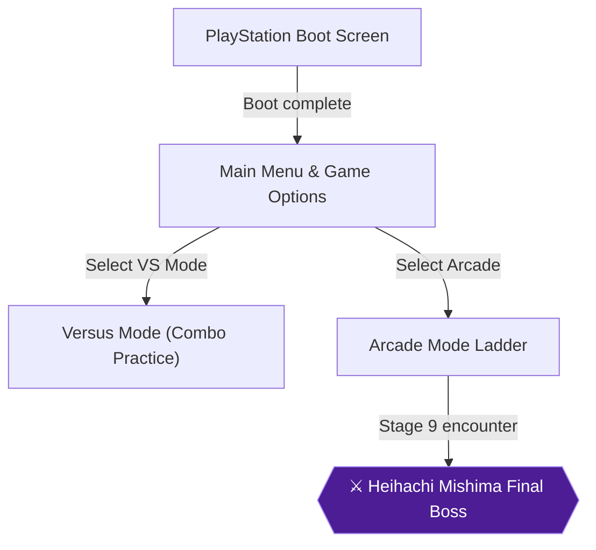
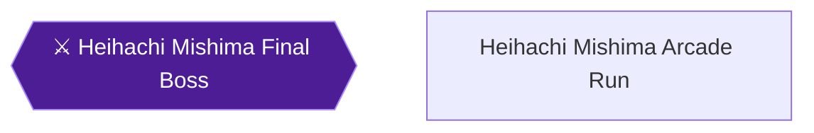
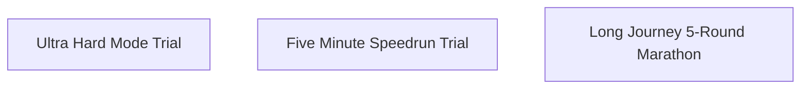

# Knowledge graph — game 11401

Nodes: 80 · Edges: 88

## Progression flow

```mermaid
flowchart TD
  Boot_Screen["PlayStation Boot Screen"]
  Game_Options["Main Menu & Game Options"]
  VS_Mode["Versus Mode (Combo Practice)"]
  Arcade_Mode["Arcade Mode Ladder"]
  Kazuya_Arcade["Kazuya Mishima Arcade Run"]
  Paul_Arcade["Paul Phoenix Arcade Run"]
  Law_Arcade["Marshall Law Arcade Run"]
  Nina_Arcade["Nina Williams Arcade Run"]
  Jack_Arcade["Jack Arcade Run"]
  King_Arcade["King Arcade Run"]
  Yoshimitsu_Arcade["Yoshimitsu Arcade Run"]
  Michelle_Arcade["Michelle Chang Arcade Run"]
  Lee_Arcade["Lee Chaolan Arcade Run"]
  Kuma_Arcade["Kuma Arcade Run"]
  Wang_Arcade["Wang Jinrei Arcade Run"]
  Anna_Arcade["Anna Williams Arcade Run"]
  PJack_Arcade["Prototype Jack Arcade Run"]
  ArmorKing_Arcade["Armor King Arcade Run"]
  Ganryu_Arcade["Ganryu Arcade Run"]
  Kunimitsu_Arcade["Kunimitsu Arcade Run"]
  Heihachi_Mishima_Boss{{"⚔ Heihachi Mishima Final Boss"}}
  Heihachi_Arcade["Heihachi Mishima Arcade Run"]
  Ultra_Hard_Arcade["Ultra Hard Mode Trial"]
  Speedrun_Arcade["Five Minute Speedrun Trial"]
  Long_Journey_Marathon["Long Journey 5-Round Marathon"]
  Boot_Screen -->|Boot complete| Game_Options
  Game_Options -->|Select VS Mode| VS_Mode
  Game_Options -->|Select Arcade| Arcade_Mode
  Arcade_Mode --> Kazuya_Arcade
  Arcade_Mode --> Paul_Arcade
  Arcade_Mode --> Law_Arcade
  Arcade_Mode --> Nina_Arcade
  Arcade_Mode --> Jack_Arcade
  Arcade_Mode --> King_Arcade
  Arcade_Mode --> Yoshimitsu_Arcade
  Arcade_Mode --> Michelle_Arcade
  Arcade_Mode -->|Stage 9 encounter| Heihachi_Mishima_Boss
  Arcade_Mode -->|Options: Ultra Hard| Ultra_Hard_Arcade
  Arcade_Mode -->|Default settings| Speedrun_Arcade
  Arcade_Mode -->|Options: 5 Rounds| Long_Journey_Marathon
  classDef ponr fill:#7f1d1d,stroke:#f87171,color:#fff;
  classDef boss fill:#4c1d95,stroke:#a78bfa,color:#fff;
  class Heihachi_Mishima_Boss boss;
```

## Achievement dependencies

```mermaid
flowchart LR
  Galaga_MiniGame["Galaga Boot Mini-Game"]
  Ach_90355(["🏆 Namco Classic Challenge"])
  VS_Mode["Versus Mode (Combo Practice)"]
  Ach_90432(["🏆 Beginner Combo"])
  Ach_90433(["🏆 Ultimate Combo"])
  Arcade_Mode["Arcade Mode Ladder"]
  Ach_90406(["🏆 Master of Evasion"])
  Kazuya_Arcade["Kazuya Mishima Arcade Run"]
  Ach_90395(["🏆 Cold-Blooded Son"])
  Ach_90431(["🏆 Iron Fist - Kazuya"])
  Paul_Arcade["Paul Phoenix Arcade Run"]
  Ach_90408(["🏆 Hot-blooded Martial Artist"])
  Ach_90434(["🏆 Iron Fist - Paul"])
  Law_Arcade["Marshall Law Arcade Run"]
  Ach_90409(["🏆 The Legendary Dragon"])
  Ach_90435(["🏆 Iron Fist - Law"])
  Nina_Arcade["Nina Williams Arcade Run"]
  Ach_90407(["🏆 Silent Assassin"])
  Ach_90437(["🏆 Iron Fist - Nina"])
  Jack_Arcade["Jack Arcade Run"]
  Ach_90410(["🏆 Super Killing Machine"])
  Ach_90436(["🏆 Iron Fist - Jack"])
  King_Arcade["King Arcade Run"]
  Ach_90411(["🏆 Beast Priest"])
  Ach_90438(["🏆 Iron Fist - King"])
  Yoshimitsu_Arcade["Yoshimitsu Arcade Run"]
  Ach_90396(["🏆 The Inheritor of the Demon"])
  Ach_90439(["🏆 Iron Fist - Yoshimitsu"])
  Michelle_Arcade["Michelle Chang Arcade Run"]
  Ach_90412(["🏆 Wandering Female Fighter"])
  Ach_90440(["🏆 Iron Fist - Michelle"])
  Lee_Arcade["Lee Chaolan Arcade Run"]
  Ach_90415(["🏆 Silver Haired-Demon"])
  Ach_90477(["🏆 Iron Fist - Lee"])
  Kuma_Arcade["Kuma Arcade Run"]
  Ach_90420(["🏆 Mad Bear"])
  Ach_90482(["🏆 Iron Fist - Kuma"])
  Wang_Arcade["Wang Jinrei Arcade Run"]
  Ach_90413(["🏆 Fighting Sage"])
  Ach_90483(["🏆 Iron Fist - Wang"])
  Anna_Arcade["Anna Williams Arcade Run"]
  Ach_90419(["🏆 Scarlet Lightning"])
  Ach_90480(["🏆 Iron Fist - Anna"])
  PJack_Arcade["Prototype Jack Arcade Run"]
  Ach_90416(["🏆 Lost Memory Monster"])
  Ach_90478(["🏆 Iron Fist - P.Jack"])
  ArmorKing_Arcade["Armor King Arcade Run"]
  Ach_90417(["🏆 Wicked Flower"])
  Ach_90479(["🏆 Iron Fist - Armor King"])
  Ganryu_Arcade["Ganryu Arcade Run"]
  Ach_90418(["🏆 Rikishi Strength"])
  Ach_90481(["🏆 Iron Fist - Ganryu"])
  Kunimitsu_Arcade["Kunimitsu Arcade Run"]
  Ach_90421(["🏆 Traitorous Female Ninja"])
  Ach_90442(["🏆 Iron Fist - Kunimitsu"])
  Heihachi_Arcade["Heihachi Mishima Arcade Run"]
  Ach_90414(["🏆 The King of Iron Fist"])
  Ach_90441(["🏆 Iron Fist - Heihachi"])
  Full_Roster_Unlocked["All Fighters Ready Milestone"]
  Ach_90428(["🏆 All Fighters Ready for Combat!"])
  Ultra_Hard_Arcade["Ultra Hard Mode Trial"]
  Ach_90423(["🏆 Hand-to-Hand Veteran"])
  Ach_90422(["🏆 Hand-to-Hand Expert"])
  Speedrun_Arcade["Five Minute Speedrun Trial"]
  Ach_90427(["🏆 Five Minute Death Punch"])
  Long_Journey_Marathon["Long Journey 5-Round Marathon"]
  Ach_90429(["🏆 Long Journey"])
  Galaga_MiniGame -->|unlocks| Ach_90355
  VS_Mode -->|unlocks| Ach_90432
  VS_Mode -->|unlocks| Ach_90433
  Arcade_Mode -->|unlocks| Ach_90406
  Kazuya_Arcade -->|unlocks| Ach_90395
  Kazuya_Arcade -->|unlocks| Ach_90431
  Paul_Arcade -->|unlocks| Ach_90408
  Paul_Arcade -->|unlocks| Ach_90434
  Law_Arcade -->|unlocks| Ach_90409
  Law_Arcade -->|unlocks| Ach_90435
  Nina_Arcade -->|unlocks| Ach_90407
  Nina_Arcade -->|unlocks| Ach_90437
  Jack_Arcade -->|unlocks| Ach_90410
  Jack_Arcade -->|unlocks| Ach_90436
  King_Arcade -->|unlocks| Ach_90411
  King_Arcade -->|unlocks| Ach_90438
  Yoshimitsu_Arcade -->|unlocks| Ach_90396
  Yoshimitsu_Arcade -->|unlocks| Ach_90439
  Michelle_Arcade -->|unlocks| Ach_90412
  Michelle_Arcade -->|unlocks| Ach_90440
  Lee_Arcade -->|unlocks| Ach_90415
  Lee_Arcade -->|unlocks| Ach_90477
  Kuma_Arcade -->|unlocks| Ach_90420
  Kuma_Arcade -->|unlocks| Ach_90482
  Wang_Arcade -->|unlocks| Ach_90413
  Wang_Arcade -->|unlocks| Ach_90483
  Anna_Arcade -->|unlocks| Ach_90419
  Anna_Arcade -->|unlocks| Ach_90480
  PJack_Arcade -->|unlocks| Ach_90416
  PJack_Arcade -->|unlocks| Ach_90478
  ArmorKing_Arcade -->|unlocks| Ach_90417
  ArmorKing_Arcade -->|unlocks| Ach_90479
  Ganryu_Arcade -->|unlocks| Ach_90418
  Ganryu_Arcade -->|unlocks| Ach_90481
  Kunimitsu_Arcade -->|unlocks| Ach_90421
  Kunimitsu_Arcade -->|unlocks| Ach_90442
  Heihachi_Arcade -->|unlocks| Ach_90414
  Heihachi_Arcade -->|unlocks| Ach_90441
  Full_Roster_Unlocked -->|unlocks| Ach_90428
  Ultra_Hard_Arcade -->|unlocks| Ach_90423
  Ultra_Hard_Arcade -->|unlocks| Ach_90422
  Speedrun_Arcade -->|unlocks| Ach_90427
  Long_Journey_Marathon -->|unlocks| Ach_90429
```

## Chapter 1: Boot Challenge & Core Combat Fundamentals

## Chapter 2: The Original Eight: Base Roster Campaigns & Sub-Boss Unlocks

```mermaid
flowchart TD
  Kazuya_Arcade["Kazuya Mishima Arcade Run"]
  Paul_Arcade["Paul Phoenix Arcade Run"]
  Law_Arcade["Marshall Law Arcade Run"]
  Nina_Arcade["Nina Williams Arcade Run"]
  Jack_Arcade["Jack Arcade Run"]
  King_Arcade["King Arcade Run"]
  Yoshimitsu_Arcade["Yoshimitsu Arcade Run"]
  Michelle_Arcade["Michelle Chang Arcade Run"]
  classDef ponr fill:#7f1d1d,stroke:#f87171,color:#fff;
  classDef boss fill:#4c1d95,stroke:#a78bfa,color:#fff;
```

## Chapter 3: The Sub-Boss Uprising & Full Roster Completion

```mermaid
flowchart TD
  Lee_Arcade["Lee Chaolan Arcade Run"]
  Kuma_Arcade["Kuma Arcade Run"]
  Wang_Arcade["Wang Jinrei Arcade Run"]
  Anna_Arcade["Anna Williams Arcade Run"]
  PJack_Arcade["Prototype Jack Arcade Run"]
  ArmorKing_Arcade["Armor King Arcade Run"]
  Ganryu_Arcade["Ganryu Arcade Run"]
  Kunimitsu_Arcade["Kunimitsu Arcade Run"]
  classDef ponr fill:#7f1d1d,stroke:#f87171,color:#fff;
  classDef boss fill:#4c1d95,stroke:#a78bfa,color:#fff;
```

## Chapter 4: The Mishima Zaibatsu: Heihachi Campaign & Mastery

## Chapter 5: Master of the Iron Fist: Hard, Speedrun & Marathon Trials

