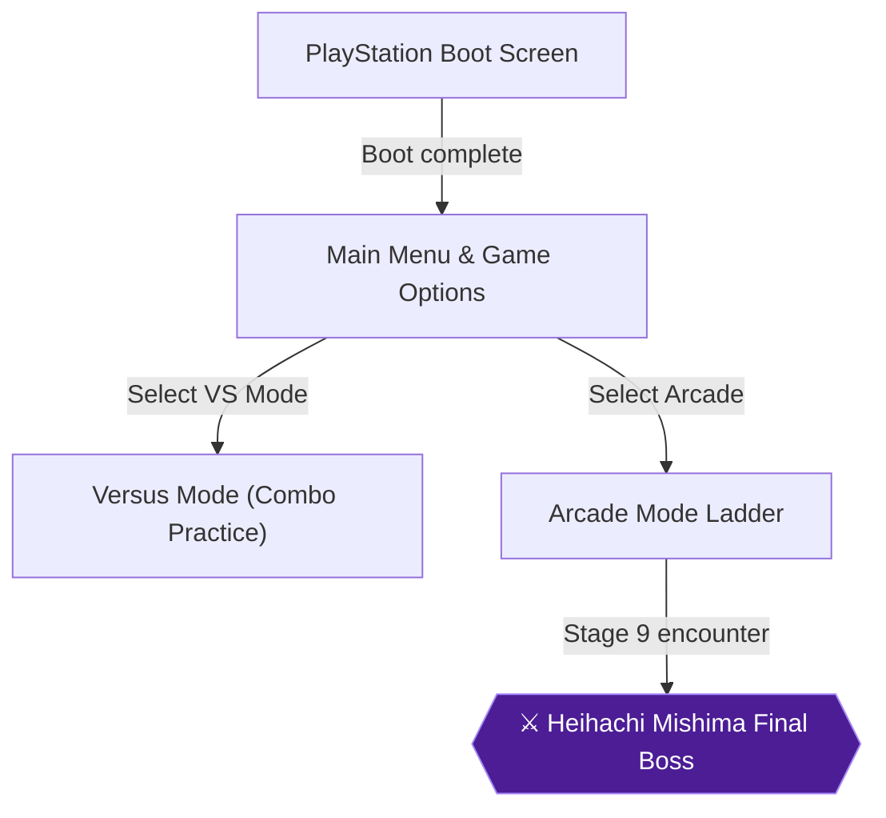
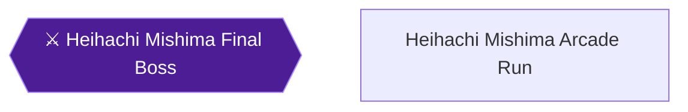
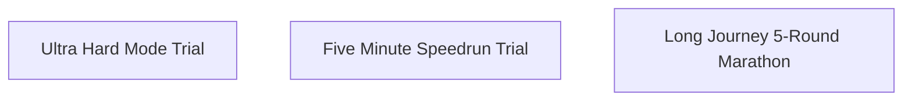

# Tekken — 100% RetroAchievements Walkthrough

## Metadata

- **Platform:** PlayStation
- **Developer:** Namco
- **Publisher:** Namco
- **Genre:** 3D Fighting
- **Released:** 1995-03-31
- **Achievements:** 43 (585 points)

> [!NOTE]
> Every instruction in this guide was extracted from the sources listed at the bottom and checked against them (16 facts confirmed by 2+ sources, 210 from a single source). Statements marked 🟡 come from only one source. Anything we could not confirm says **"Unable to verify from collected sources."**

## Game Overview

Tekken (PlayStation, Namco) is a 3D fighting game built around Arcade mode runs with a cast of characters, plus a Galaga mini-game on the loading screen. The RetroAchievements set asks you to finish Arcade runs, land combos, and clear difficulty challenges. The set developer lists the supported disc as Tekken (USA) [SLUS-00006] [[ra-comments-1-1]]. The chapters that follow give the step-by-step order; this overview covers only the mechanics you need first.

## Controls and Move-List Notation

Each face button is one limb: LP (Left Punch) = Square, RP (Right Punch) = Triangle, LK (Left Kick) = Cross, RK (Right Kick) = Circle [[gf1-3-1]].

Move lists use two notations, so know both:
- **Limb notation (LP, RP, LK, RK):** used by the GameFAQs move list and by commenters, with F/D/B/U for Forward/Down/Back/Up [[gf1-3-1, ra-comments-19-1]].
- **Number notation:** 1 = Square, 2 = Triangle, 3 = Cross, 4 = Circle, f = forward, and + means pressing two buttons together [[ra-comments-5-3]]. Move lists are not shown in-game, so you need an outside list [[ra-comments-5-3]].

The Key Config screen (Title Screen, Test Mode, Options Mode) lets you reassign the buttons. The Free Setting maps L1 to LP+LK, R1 to RP+RK, L2 to LK+RK and R2 to LP+RP [[gf1-3-2, gf1-3-3]]. Pressing Select cycles between a side view and a 3/4 view [[gf1-19-1]].

## Battle Fundamentals

- **Blocking:** hold Back to block high attacks and Down-Back to block low ones [[gf3-4-1]].
- **Dashing:** forward dash is F, F and backward dash is B, B [[gf1-4-1, gf4-3-1]].
- **Running:** run attacks start from roughly 1-2 screen lengths away with F, F, F, and any button press interrupts the run [[gf1-4-2]]. Running deals good damage and helps with long juggles [[gf3-5-1]].
- **Throws:** throws must be done at very close range, and every character has two basic throws (LP+LK and RP+RK) [[gf1-5-1]]. Ducking under a grab attempt avoids it [[gf3-8-1]].
- **Axe Kick:** an easy ender for short combos that hits a ducking opponent hard [[gf3-6-1]].
- **Recovery and ground attacks:** tap U to get straight up, tap F or B to roll, or use B + (LK+RK) for a Kick Up Attack [[gf1-4-3]]. When the opponent is down, U + RP is a pounce [[gf1-4-4, gf4-8-1]].
- **Unblockable attacks:** they are slow to execute, but if they connect they cannot be blocked [[gf1-4-6]].
- **10-Attack Strings:** pre-programmed punch and kick sequences that do heavy damage if every hit lands [[gf1-4-5, gf4-10-1]]. Each character has their own input, and the chapters list the ones the achievements need.

## Options That Matter

Options Mode offers five difficulty levels: Easy, Medium, Hard, Very Hard and Ultra Hard [[gf1-20-1]]. Fight Count sets the rounds needed to win a fight, from 1 to 5 [[gf1-20-2]]. "Character Change At Continue" set to No allows only your starting character after a loss in Arcade mode [[gf1-20-3]]. A violence setting for visual hit effects also exists [[gf4-14-1]].

Check the round timer before a challenge run. One player realized at the Heihachi fight that the timer was set to infinite rather than 40 [[ra-comments-76-3]]. Ultra Hard with default settings allows continuing [[ra-comments-76-6]].

## Roster and Unlocks

Every character has a mid-level boss, and once defeated, all bosses become playable, with Heihachi Mishima the last [[gf1-18-3]]. To unlock Heihachi, defeat him and every character before him without using continues, with any character [[gf1-18-4]]. Community reports name the main characters as Yoshimitsu, Nina, Law, Kazuya, Paul, Jack, King and Michelle, and say you restart from the beginning if you lose. One commenter used Easy, 2 rounds, time 40, and another confirms 1 round also works [[ra-comments-15-1]].

Devil Kazuya is tied to the Galaga mini-game on the loading screen, which must be beaten using one continue or less and without the dual ship code [[gf3-1-2]]; clearing the opening stage in 18.5 seconds or less grants another ship [[gf1-18-2]]. A commenter agrees you must earn the second ship by completing the first stage fast, and after that it is memorization and reflexes [[ra-comments-9-1]].

## Hardcore and Emulator Notes

Community reports about this set are emulator-specific and partly conflicting. Treat them as reports, not guarantees [[ra-comments-3-2, ra-comments-20-4]].

- **DuckStation:** one commenter says the set works fine in DuckStation as of 2025 [[ra-comments-3-2]]. Other players report problems there. Several saw Long Journey fail to pop on DuckStation even with the challenge indicator showing [[ra-comments-80-3]], and the 10 hit combo achievement failed in 2P mode on DuckStation [[ra-comments-4-4]]. Another player saw it fail with every character until restarting the emulator and following the Michelle 2P method [[ra-comments-20-4]].
- **RetroArch cores:** reports say Beetle PSX or PCSX ReArmed on RetroArch worked where DuckStation did not, including Armor King runs finally triggering Long Journey [[ra-comments-80-3]]. The 10 hit combo was earned in 2P mode on PCSX ReArmed [[ra-comments-4-4]]. One player could not trigger it on RetroArch with PCSX ReArmed but got it on RALibretro with the same core [[ra-comments-19-18]]. Unable to verify from collected sources which emulator is best overall.
- **Long Journey:** it has failed to unlock for many players across several characters. Updating RetroArch helped one player. Check that the challenge indicator appears in the bottom right corner [[ra-comments-79-4]].
- **10 hit combo:** every single hit must land, because a blocked or whiffed hit does not count. One player saw it fail for many characters but work with Michelle on DuckStation [[ra-comments-19-20]]. Another needed about ten tries at full HP after a time-up win on Medium in Arcade mode, which suggests the trigger is unreliable [[ra-comments-20-5]]. A counter-hit start landed every hit on Kuma but only popped the 6 hit achievement, while Kazuya's string started with a counter hit on Ultra Hard did trigger the 10 hit achievement [[ra-comments-20-6]].
- **Memory card saves:** reports conflict. One commenter warns the game does not save to the memory card automatically and must be told to save, while another reports it saved automatically after finishing the game [[ra-comments-2-1]]. For the 5-round setup, one commenter changes rounds to 5, saves the game data, then exits and reopens the game [[ra-comments-79-3]].

## Achievement Roadmap

| Chapter | Achievements | Points |
|---|---|---|
| [1. Boot Challenge & Core Combat Fundamentals](#chapter-1-boot-challenge-core-combat-fundamentals) | Namco Classic Challenge, Master of Evasion, Beginner Combo, Ultimate Combo | 85 |
| [2. The Original Eight: Base Roster Campaigns & Sub-Boss Unlocks](#chapter-2-the-original-eight-base-roster-campaigns-sub-boss-unlocks) | Cold-Blooded Son, Iron Fist - Kazuya, Hot-blooded Martial Artist, Iron Fist - Paul, The Legendary Dragon, Iron Fist - Law, Silent Assassin, Iron Fist - Nina, Super Killing Machine, Iron Fist - Jack, Beast Priest, Iron Fist - King, The Inheritor of the Demon, Iron Fist - Yoshimitsu, Wandering Female Fighter, Iron Fist - Michelle | 160 |
| [3. The Sub-Boss Uprising & Full Roster Completion](#chapter-3-the-sub-boss-uprising-full-roster-completion) | Fighting Sage, Iron Fist - Wang, Silver Haired-Demon, Iron Fist - Lee, Lost Memory Monster, Iron Fist - P.Jack, Wicked Flower, Iron Fist - Armor King, Rikishi Strength, Iron Fist - Ganryu, Scarlet Lightning, Iron Fist - Anna, Mad Bear, Iron Fist - Kuma, Traitorous Female Ninja, Iron Fist - Kunimitsu, All Fighters Ready for Combat! | 185 |
| [4. The Mishima Zaibatsu: Heihachi Campaign & Mastery](#chapter-4-the-mishima-zaibatsu-heihachi-campaign-mastery) | The King of Iron Fist, Iron Fist - Heihachi | 20 |
| [5. Master of the Iron Fist: Hard, Speedrun & Marathon Trials](#chapter-5-master-of-the-iron-fist-hard-speedrun-marathon-trials) | Hand-to-Hand Veteran, Hand-to-Hand Expert, Five Minute Death Punch, Long Journey | 135 |

## Playthrough Planning

**Playthroughs required:** 1

Tekken (PS1) is a 3D fighting game where 100% completion requires completing individual Arcade mode campaigns across all characters, practicing combos in Versus Mode or Arcade Mode, clearing the Galaga loading mini-game, and tackling specific difficulty/endurance parameters. No achievements are permanently missable or mutually exclusive, as individual Arcade runs and VS Mode matches can be attempted at any time. Emulator caveats reported by players: Long Journey and some combo achievements may fail to trigger on DuckStation; RetroArch with Beetle PSX or PCSX ReArmed worked (ra-comments-80-3, ra-comments-4-4).

**Settings:** Default settings: Difficulty Medium, Round Count 3, Round Time 40. The per-character Arcade achievements only require Medium or higher without changing characters, so Hard with 1 round is allowed and recommended (ra-comments-3-4, ra-comments-4-9). Hand-to-Hand Veteran (90423, Hard or higher) and Hand-to-Hand Expert (90422, Ultra Hard) require default settings; check the round timer is 40, not infinite (ra-comments-76-3). Do a separate Hard run for 90423: one player reports an Ultra Hard run did not award both (ra-comments-76-4). Long Journey (90429) needs Round Count 5 and otherwise default settings (ra-comments-79-3).

[[gf1-3-1,gf1-18-2,gf1-18-3,gf1-18-4,ra-comments-9-1,ra-comments-15-1]]

## True 100% In-Game Completion Criteria

This guide covers complete in-game mastery in addition to all RetroAchievements:

| Category | 100% Requirement | Tracking Scope |
|---|---|---|
| **Playable Character Roster** | Unlock all 8 mid-boss rivals, the final boss Heihachi Mishima, and alternate costume Devil Kazuya (17 characters total). | Per-chapter checkpoint |
| **Arcade Story Campaigns** | Complete Arcade mode without character switching on Medium difficulty or higher across all 17 fighters. | Per-chapter checkpoint |
| **Combos & Technical Execution** | Execute universal 3-hit and 10-hit combinations, along with character-specific 6-hit combos for all 17 fighters. | Per-chapter checkpoint |
| **Difficulty & Endurance Trials** | Finish Arcade mode on Hard, Ultra Hard, under 5 minutes (speedrun), and a grueling 5-round marathon without continues. | Per-chapter checkpoint |

## Missables Summary

No missables were identified in the collected sources.

## Points of No Return

No points of no return were identified in the collected sources.

## Progression Diagrams

### Game Progression

```mermaid
flowchart TD
  Boot_Screen["PlayStation Boot Screen"]
  Game_Options["Main Menu & Game Options"]
  VS_Mode["Versus Mode (Combo Practice)"]
  Arcade_Mode["Arcade Mode Ladder"]
  Kazuya_Arcade["Kazuya Mishima Arcade Run"]
  Paul_Arcade["Paul Phoenix Arcade Run"]
  Law_Arcade["Marshall Law Arcade Run"]
  Nina_Arcade["Nina Williams Arcade Run"]
  Jack_Arcade["Jack Arcade Run"]
  King_Arcade["King Arcade Run"]
  Yoshimitsu_Arcade["Yoshimitsu Arcade Run"]
  Michelle_Arcade["Michelle Chang Arcade Run"]
  Lee_Arcade["Lee Chaolan Arcade Run"]
  Kuma_Arcade["Kuma Arcade Run"]
  Wang_Arcade["Wang Jinrei Arcade Run"]
  Anna_Arcade["Anna Williams Arcade Run"]
  PJack_Arcade["Prototype Jack Arcade Run"]
  ArmorKing_Arcade["Armor King Arcade Run"]
  Ganryu_Arcade["Ganryu Arcade Run"]
  Kunimitsu_Arcade["Kunimitsu Arcade Run"]
  Heihachi_Mishima_Boss{{"⚔ Heihachi Mishima Final Boss"}}
  Heihachi_Arcade["Heihachi Mishima Arcade Run"]
  Ultra_Hard_Arcade["Ultra Hard Mode Trial"]
  Speedrun_Arcade["Five Minute Speedrun Trial"]
  Long_Journey_Marathon["Long Journey 5-Round Marathon"]
  Boot_Screen -->|Boot complete| Game_Options
  Game_Options -->|Select VS Mode| VS_Mode
  Game_Options -->|Select Arcade| Arcade_Mode
  Arcade_Mode --> Kazuya_Arcade
  Arcade_Mode --> Paul_Arcade
  Arcade_Mode --> Law_Arcade
  Arcade_Mode --> Nina_Arcade
  Arcade_Mode --> Jack_Arcade
  Arcade_Mode --> King_Arcade
  Arcade_Mode --> Yoshimitsu_Arcade
  Arcade_Mode --> Michelle_Arcade
  Arcade_Mode -->|Stage 9 encounter| Heihachi_Mishima_Boss
  Arcade_Mode -->|Options: Ultra Hard| Ultra_Hard_Arcade
  Arcade_Mode -->|Default settings| Speedrun_Arcade
  Arcade_Mode -->|Options: 5 Rounds| Long_Journey_Marathon
  classDef ponr fill:#7f1d1d,stroke:#f87171,color:#fff;
  classDef boss fill:#4c1d95,stroke:#a78bfa,color:#fff;
  class Heihachi_Mishima_Boss boss;
```

### Achievement Dependencies

```mermaid
flowchart LR
  Galaga_MiniGame["Galaga Boot Mini-Game"]
  Ach_90355(["🏆 Namco Classic Challenge"])
  VS_Mode["Versus Mode (Combo Practice)"]
  Ach_90432(["🏆 Beginner Combo"])
  Ach_90433(["🏆 Ultimate Combo"])
  Arcade_Mode["Arcade Mode Ladder"]
  Ach_90406(["🏆 Master of Evasion"])
  Kazuya_Arcade["Kazuya Mishima Arcade Run"]
  Ach_90395(["🏆 Cold-Blooded Son"])
  Ach_90431(["🏆 Iron Fist - Kazuya"])
  Paul_Arcade["Paul Phoenix Arcade Run"]
  Ach_90408(["🏆 Hot-blooded Martial Artist"])
  Ach_90434(["🏆 Iron Fist - Paul"])
  Law_Arcade["Marshall Law Arcade Run"]
  Ach_90409(["🏆 The Legendary Dragon"])
  Ach_90435(["🏆 Iron Fist - Law"])
  Nina_Arcade["Nina Williams Arcade Run"]
  Ach_90407(["🏆 Silent Assassin"])
  Ach_90437(["🏆 Iron Fist - Nina"])
  Jack_Arcade["Jack Arcade Run"]
  Ach_90410(["🏆 Super Killing Machine"])
  Ach_90436(["🏆 Iron Fist - Jack"])
  King_Arcade["King Arcade Run"]
  Ach_90411(["🏆 Beast Priest"])
  Ach_90438(["🏆 Iron Fist - King"])
  Yoshimitsu_Arcade["Yoshimitsu Arcade Run"]
  Ach_90396(["🏆 The Inheritor of the Demon"])
  Ach_90439(["🏆 Iron Fist - Yoshimitsu"])
  Michelle_Arcade["Michelle Chang Arcade Run"]
  Ach_90412(["🏆 Wandering Female Fighter"])
  Ach_90440(["🏆 Iron Fist - Michelle"])
  Lee_Arcade["Lee Chaolan Arcade Run"]
  Ach_90415(["🏆 Silver Haired-Demon"])
  Ach_90477(["🏆 Iron Fist - Lee"])
  Kuma_Arcade["Kuma Arcade Run"]
  Ach_90420(["🏆 Mad Bear"])
  Ach_90482(["🏆 Iron Fist - Kuma"])
  Wang_Arcade["Wang Jinrei Arcade Run"]
  Ach_90413(["🏆 Fighting Sage"])
  Ach_90483(["🏆 Iron Fist - Wang"])
  Anna_Arcade["Anna Williams Arcade Run"]
  Ach_90419(["🏆 Scarlet Lightning"])
  Ach_90480(["🏆 Iron Fist - Anna"])
  PJack_Arcade["Prototype Jack Arcade Run"]
  Ach_90416(["🏆 Lost Memory Monster"])
  Ach_90478(["🏆 Iron Fist - P.Jack"])
  ArmorKing_Arcade["Armor King Arcade Run"]
  Ach_90417(["🏆 Wicked Flower"])
  Ach_90479(["🏆 Iron Fist - Armor King"])
  Ganryu_Arcade["Ganryu Arcade Run"]
  Ach_90418(["🏆 Rikishi Strength"])
  Ach_90481(["🏆 Iron Fist - Ganryu"])
  Kunimitsu_Arcade["Kunimitsu Arcade Run"]
  Ach_90421(["🏆 Traitorous Female Ninja"])
  Ach_90442(["🏆 Iron Fist - Kunimitsu"])
  Heihachi_Arcade["Heihachi Mishima Arcade Run"]
  Ach_90414(["🏆 The King of Iron Fist"])
  Ach_90441(["🏆 Iron Fist - Heihachi"])
  Full_Roster_Unlocked["All Fighters Ready Milestone"]
  Ach_90428(["🏆 All Fighters Ready for Combat!"])
  Ultra_Hard_Arcade["Ultra Hard Mode Trial"]
  Ach_90423(["🏆 Hand-to-Hand Veteran"])
  Ach_90422(["🏆 Hand-to-Hand Expert"])
  Speedrun_Arcade["Five Minute Speedrun Trial"]
  Ach_90427(["🏆 Five Minute Death Punch"])
  Long_Journey_Marathon["Long Journey 5-Round Marathon"]
  Ach_90429(["🏆 Long Journey"])
  Galaga_MiniGame -->|unlocks| Ach_90355
  VS_Mode -->|unlocks| Ach_90432
  VS_Mode -->|unlocks| Ach_90433
  Arcade_Mode -->|unlocks| Ach_90406
  Kazuya_Arcade -->|unlocks| Ach_90395
  Kazuya_Arcade -->|unlocks| Ach_90431
  Paul_Arcade -->|unlocks| Ach_90408
  Paul_Arcade -->|unlocks| Ach_90434
  Law_Arcade -->|unlocks| Ach_90409
  Law_Arcade -->|unlocks| Ach_90435
  Nina_Arcade -->|unlocks| Ach_90407
  Nina_Arcade -->|unlocks| Ach_90437
  Jack_Arcade -->|unlocks| Ach_90410
  Jack_Arcade -->|unlocks| Ach_90436
  King_Arcade -->|unlocks| Ach_90411
  King_Arcade -->|unlocks| Ach_90438
  Yoshimitsu_Arcade -->|unlocks| Ach_90396
  Yoshimitsu_Arcade -->|unlocks| Ach_90439
  Michelle_Arcade -->|unlocks| Ach_90412
  Michelle_Arcade -->|unlocks| Ach_90440
  Lee_Arcade -->|unlocks| Ach_90415
  Lee_Arcade -->|unlocks| Ach_90477
  Kuma_Arcade -->|unlocks| Ach_90420
  Kuma_Arcade -->|unlocks| Ach_90482
  Wang_Arcade -->|unlocks| Ach_90413
  Wang_Arcade -->|unlocks| Ach_90483
  Anna_Arcade -->|unlocks| Ach_90419
  Anna_Arcade -->|unlocks| Ach_90480
  PJack_Arcade -->|unlocks| Ach_90416
  PJack_Arcade -->|unlocks| Ach_90478
  ArmorKing_Arcade -->|unlocks| Ach_90417
  ArmorKing_Arcade -->|unlocks| Ach_90479
  Ganryu_Arcade -->|unlocks| Ach_90418
  Ganryu_Arcade -->|unlocks| Ach_90481
  Kunimitsu_Arcade -->|unlocks| Ach_90421
  Kunimitsu_Arcade -->|unlocks| Ach_90442
  Heihachi_Arcade -->|unlocks| Ach_90414
  Heihachi_Arcade -->|unlocks| Ach_90441
  Full_Roster_Unlocked -->|unlocks| Ach_90428
  Ultra_Hard_Arcade -->|unlocks| Ach_90423
  Ultra_Hard_Arcade -->|unlocks| Ach_90422
  Speedrun_Arcade -->|unlocks| Ach_90427
  Long_Journey_Marathon -->|unlocks| Ach_90429
```

## Boss Index

Full strategies are in each chapter.

| Boss | Chapter |
|---|---|
| Heihachi Mishima Final Boss | [1. Boot Challenge & Core Combat Fundamentals](#chapter-1-boot-challenge-core-combat-fundamentals) |

## Walkthrough

## Chapter 1: Boot Challenge & Core Combat Fundamentals

Welcome to the King of Iron Fist Tournament. Your first job happens before the title screen: the Galaga mini-game that plays while the disc loads [[gf1-18-1]]. After that you will learn the button layout, earn a Perfect round, and perform the 3-hit and 10-hit combos in Versus Mode. This guide assumes Hardcore Mode (no mid-run saves, rewinds or cheats), so every Galaga attempt has to be a real run.

### PlayStation Boot Screen & Galaga Boot Mini-Game

Players are welcomed with a game of Galaga while the CD loads [[gf1-18-1]]. Its eight stages are the bonus stages of the original Galaga, and each presents a Challenge Stage where you must shoot 40 enemies [[ra-comments-9-5, gf1-18-1]]. Players recommend doing this achievement first, because it is probably the hardest or most tedious in the set [[ra-comments-4-6]]. Devil Kazuya is not needed for any other achievement in the set [[ra-comments-12-3]].

> **Galaga Rules at a Glance**
> - Clear all 8 stages using at most ONE continue for the entire run, not one per stage [[ra-comments-11-2, ra-comments-9-2, gf3-1-2]].
> - Earn the double ship by clearing Stage 1 in 18.5 seconds or under [[gf1-18-2, ra-comments-10-3]].
> - The controller-2 double-ship trick does not count [[ra-comments-11-3, gf3-1-2]].

> [!WARNING]
> **Outdated advice about continues:** Older comments said unlimited continues were allowed. After the set creator changed the achievement logic, players report it no longer triggers with multiple continues and only unlocks when you use one at most [[ra-comments-10-2, ra-comments-12-2]]. This was confirmed on RetroArch 1.22.2 with Beetle PSX HW [[ra-comments-11-2]]. Another report says the achievement now checks for getting all hits on the final Galaga stage instead of the Devil Kazuya unlock flag [[ra-comments-10-1]]. Treat "one continue total" as the safe limit.

> [!WARNING]
> **Do not use the controller-2 trick.** A player report (translated from Spanish) says the achievement will not work if the two ships come from the controller-2 trick. It only works when the double ship is earned by clearing Stage 1 within 18.5 seconds [[ra-comments-11-3]]. The Devil Kazuya unlock likewise requires finishing without the dual ship code [[gf3-1-2]].

#### Stage 1: Earn the Double Ship

Stage 1 is by far the hardest, because you only have one ship [[ra-comments-10-3, ra-comments-9-4]]. Every stage has a fixed pattern of enemy spawns and timings that can be learned [[ra-comments-3-1]].

1. **HOLD** the fire button for auto-fire. One player says hold Triangle [[ra-comments-4-10]]; another suggests enabling a repeater for the X button in your emulator [[ra-comments-11-4]]. The sources name different buttons, so use whichever fires in your setup.
2. **MARK** the two points where enemy ships enter from the top of the screen, and study a video of the ship movement patterns [[ra-comments-12-1]].
3. **MEMORIZE** the perfect ship positions for Stage 1 from a video and repeat them [[ra-comments-10-4]].
4. **RESTART** if Stage 1 took longer than 18.5 seconds. Once you have two ships you keep them for the following stages [[ra-comments-10-4]].

The reward is twice the firepower, which makes the later stages much easier [[ra-comments-10-3, ra-comments-4-5]]. Once you consistently earn the second ship you also have a larger margin for error [[ra-comments-9-4]].

#### Stages 2 to 8

- Know every wave by heart and master every shooting position. The double-hit ships are the main obstacle [[ra-comments-9-3]].
- Pause between stages to refresh your memory of the next formation [[ra-comments-11-5]].
- The second-to-last stage, with fast ships entering from the corners, is the other difficult one [[ra-comments-12-1]].
- Stage 8 contains enemies that must be hit twice, which caused repeated 39/40 failures. One successful run spent its single extra chance on Stage 8 [[ra-comments-13-1]]. The final stage can produce many 39/40 near-misses [[ra-comments-11-5]].

Expect a long session. One player needed about 3 hours [[ra-comments-9-4]], and another needed about 7 to 8 hours to memorize all 8 stages [[ra-comments-11-4]].

> [!ACHIEVEMENT]
> **Namco Classic Challenge (50 Points)**
> 
> *Beat all stages in Galaga with a perfect while using no more than one continue in order to unlock Devil Kazuya*

Finishing Galaga also unlocks Devil Kazuya [[gf1-18-2, gf3-1-2]]. To pick him, highlight Kazuya on the arcade character select screen and press Start instead of a punch or kick button [[gf3-1-3]].

### Main Menu & Game Options

The Options Mode offers five difficulty levels: Easy, Medium, Hard, Very Hard and Ultra Hard [[gf1-20-1]]. The controller uses LP = Left Punch (Square), RP = Right Punch (Triangle), LK = Left Kick (Cross) and RK = Right Kick (Circle) [[gf1-3-1, ra-comments-19-1]]. The default values for rounds and round time are Unable to verify from collected sources, so check them on screen.

For later chapters, players suggest Hard difficulty with 1 round for the per-character Arcade achievements, because the Hard AI blocks less often than Medium [[ra-comments-3-4, ra-comments-4-9, ra-comments-6-1]]. Leave settings alone for this chapter's achievements.

### Arcade Mode Ladder: The Perfect Round

Blocking is the most important part of the game: hold Back to block high, and hold Down-Back to block low [[gf3-4-1]]. Throws must be done at very close range, and every player has two basic throws (LP/LK and RP/RK) [[gf1-5-1]]. Use these to win a round without taking a single hit.

One player reports Master of Evasion unlocking after losing the first round without landing a hit [[ra-comments-8-1]]. That conflicts with the achievement description (win a round with a perfect), so do not rely on it. Aim to win a round with a full life bar.

> [!ACHIEVEMENT]
> **Master of Evasion (5 Points)**
> 
> *Win any round with a perfect*

### Versus Mode (Combo Practice)

The best place for combos is Versus Mode, because the second player does not block anything [[ra-comments-38-2]]. Another player advises starting a versus match and doing the combo there, noting that every hit must land [[ra-comments-20-1]].

#### 3-Hit Combo

Pick Kazuya Mishima and perform the Double Walking Uppercut, a jab, then an Axe Kick: (DF + LP, RP), LP, (F + RK) [[gf1-6-3]]. Paul's equivalent is Power Uppercut, left jab or left uppercut, Axe Kick: F, D, DF + RP, then LP or DF + LP, then F + RK [[gf3-2-3]]. Kuma uses DF+RP, DF+LP, DF+LP+RP [[gf5-2-1]].

> [!ACHIEVEMENT]
> **Beginner Combo (5 Points)**
> 
> *Perform a 3 hit combo*

#### 10-Hit Combo

Ten-attack strings are pre-programmed sequences that do heavy damage if they all hit [[gf4-10-1, gf1-4-5]]. Every single hit must land. A blocked or whiffed hit does not count [[ra-comments-19-20]].

> [!WARNING]
> **This achievement is unreliable and depends on emulator and character.** Reports conflict:
> - It worked in 2P mode on PCSX ReArmed, but not on DuckStation [[ra-comments-4-4]].
> - One player failed on RetroArch with the PCSX ReArmed core but succeeded on RALibretro with the same core [[ra-comments-19-18]].
> - On DuckStation, one player says nothing triggered until they restarted the emulator and used the Michelle 2P method [[ra-comments-20-4]].
> - Another says the combo failed for many characters but worked with Michelle on DuckStation [[ra-comments-19-20]].
> - One player reports it unlocking with Kazuya without reaching 10 hits [[ra-comments-1-3]].
> - Another needed about ten tries with Michelle, so the trigger may be inconsistent [[ra-comments-20-5]].

**Most reported method (Michelle, 2P mode).** As of February 19, 2026, one player's combos with Nina, King, Jack and P.Jack did not trigger in Arcade or 2P mode, while Michelle in 2P mode worked first try with 2, 1, 1, 2, 3, 3, 3, 4, 4, 1 [[ra-comments-20-3]]. That matches her string RP, LP, LP, RP, LK, LK, LK, RK, RK, LP [[gf1-11-1, ra-comments-19-9]]. Michelle's combo is also reported as the best one for challenges allowing any character [[ra-comments-5-4]].

**Full 10-attack strings by character** (LP = Square, RP = Triangle, LK = Cross, RK = Circle) [[ra-comments-19-1]]:

| Character | 10-Attack String | Citation |
|---|---|---|
| Kazuya | F, F(Hold) + RP, LP, RP, RP, LK, RK, RK, LP, RP, LP | [[gf1-6-1, ra-comments-19-2]] |
| Paul | LP, RP, LK, RP, LP, RP, LP, RK, RP, LP | [[gf1-7-1, gf2-3-1]] |
| Law | DF(tap) + LP, RP, RP, LP, LK, LK, LK, RK, LK, RK | [[gf1-8-1, ra-comments-19-4]] |
| Nina | LP, RP, LP, RP, LK, LK, RP, LP, RP, RP | [[gf1-9-1, ra-comments-19-5]] |
| Jack | D + RP, LP, LP, LP, RP, LP, RP, LP, LP + RP, LP + RP | [[gf1-9-3, ra-comments-19-6]] |
| King | LP, RP, LP, LP, RP, RK, RK, RK, RK, LP, LK | [[gf1-10-1, ra-comments-19-7]] |
| Yoshimitsu | LP, RP, LP, RK, RK, RK, RK, LP, LP, LP | [[gf1-10-3, ra-comments-19-8]] |
| Michelle | RP, LP, LP, RP, LK, LK, LK, RK, RK, LP | [[gf1-11-1, ra-comments-19-9]] |
| Lee | (tap)DF + LP, RP, RP, LP, LK, LK, LK, RK, LK, RK | [[gf1-12-1, ra-comments-19-10]] |
| Kuma | D + RP, LP, LP, LP, RP, LP, RP, LP, LP + RP, LP + RP | [[ra-comments-19-11]] |
| Wang | RP, LP, LP, RP, LK, LK, LK, LK, RK, RK, LP | [[gf1-13-1, ra-comments-19-12]] |
| Anna | LP, RP, LP, RP, LK, LK, RP, LP, RP, RP | [[gf1-14-1, ra-comments-19-13]] |
| P. Jack | D + RP, LP, LP, LP, RP, LP, RP, LP, LP + RP, LP + RP | [[gf1-15-1, ra-comments-19-14]] |
| Armor King | LP, RP, LP(rolled), LP, RP, RK, RK, RK, LP, LK | [[gf1-16-1, ra-comments-19-15]] |
| Heihachi | F, F(Hold) + RP, LP, RP, RP, LK, RK, RK, LP, RP, LP | [[gf1-17-2, ra-comments-19-16]] |

One guide lists Jack's eighth input as RP instead of LP [[gf4-11-4]]. The version in the table is repeated by three other entries [[gf1-15-1, ra-comments-19-6]], so use it.

**Character notes from the community:**
- Wang is described as easy, and King, Law or Michelle are also easy [[ra-comments-4-7]]. Anna and Nina were reported as the easiest [[ra-comments-19-17]]. Strings with a high-to-low mix-up like King's often hit the AI [[ra-comments-3-3]]. One player could not trigger it as Law but did it as King [[ra-comments-19-21]].
- P.Jack is called the simplest: hold Down and spam LP until enough hits connect [[ra-comments-20-2]]. Another player used his Mega Crouch Combo, (Crouch) + LP, LP, LP, RP, LP, RP, mashing [[ra-comments-19-19]]. This conflicts with the 2026 report above where P.Jack did not trigger, so try Michelle first.
- Heihachi: dash forward and hold forward on the second press, wait until his animation returns to normal, then press Triangle (RP) not too quickly, or he does an uppercut instead [[ra-comments-4-2, ra-comments-5-2]]. Players call Heihachi the hardest combo [[ra-comments-2-4]].
- Yoshimitsu: Square, Triangle, Square, Circle, Circle, Circle, Square, Square, Square, Square, reported as easy [[ra-comments-20-7]].
- Starting Kuma's string with a counter hit landed every hit but only popped the 6-hit achievement, while Kazuya's string started with a counter hit on Ultra Hard did trigger the 10-hit achievement [[ra-comments-20-6]].
- One player got it by spamming Kazuya's light punch [[ra-comments-20-8]].

> [!ACHIEVEMENT]
> **Ultimate Combo (25 Points)**
> 
> *Perform a 10 hit combo*

> [!IMPORTANT]
> ### Chapter 1 Cumulative 100% Checkpoint
> - **Galaga Boot Challenge:** 1 / 1 (Devil Kazuya unlocked) [[ra-comments-11-2, gf1-18-2]]
> - **Perfect Round:** 1 / 1 [[gf3-4-1]]
> - **Playable Roster:** 8 / 17 (the 8 starting fighters)
> - **Arcade Clears (no character change):** 0 / 17 (start in Chapter 2)
> - **Combos Mastered:** 2 / 19 (3-hit and 10-hit) [[gf1-6-3, ra-comments-20-3]]
> - **Difficulty & Endurance Trials:** 0 / 4 (Chapter 5)
> - **RetroAchievements Unlocked:** 4 / 43 (85 / 585 points)

### Chapter 1 Checklist

- [ ] Cleared all 8 Galaga stages with at most one continue in the entire run, and earned the double ship legitimately in under 18.5 seconds (90355) [[ra-comments-11-2, ra-comments-11-3]].
- [ ] Devil Kazuya unlocked [[gf1-18-2, gf3-1-3]].
- [ ] Won a round with a perfect (90406) [[gf3-4-1, ra-comments-8-1]].
- [ ] Performed a 3-hit combo in Versus Mode (90432) [[gf1-6-3]].
- [ ] Landed all 10 hits of a 10-attack string (90433), with Michelle in 2P mode as the most reported method [[ra-comments-20-3, ra-comments-19-20]].

---

## Chapter 2: The Original Eight: Base Roster Campaigns & Sub-Boss Unlocks

```mermaid
flowchart TD
  Kazuya_Arcade["Kazuya Mishima Arcade Run"]
  Paul_Arcade["Paul Phoenix Arcade Run"]
  Law_Arcade["Marshall Law Arcade Run"]
  Nina_Arcade["Nina Williams Arcade Run"]
  Jack_Arcade["Jack Arcade Run"]
  King_Arcade["King Arcade Run"]
  Yoshimitsu_Arcade["Yoshimitsu Arcade Run"]
  Michelle_Arcade["Michelle Chang Arcade Run"]
  classDef ponr fill:#7f1d1d,stroke:#f87171,color:#fff;
  classDef boss fill:#4c1d95,stroke:#a78bfa,color:#fff;
```

In this chapter you take each of the eight starting fighters through Arcade Mode, then perform each fighter's 6-hit combo. Each fighter has two achievements: one for finishing Arcade Mode, and one "Iron Fist" achievement for a 6-hit combo [[ra-comments-3-6, ra-comments-4-1]].

### Before You Start: Rules That Apply to All Eight Runs

> [!IMPORTANT]
> **Arcade achievements require Medium difficulty or higher, and you may NOT change characters.** Each "Finish Arcade mode" achievement needs the whole run completed with the same fighter you started with. Do not swap fighters between stages or at a continue screen [[ra-comments-3-4]]. Because you are playing in hardcore mode with no mid-run saves or rewinds, one wrong menu choice costs you the whole run.

- **Difficulty and rounds:** Community players recommend Hard difficulty with the round count set to 1. They report the Hard AI is more aggressive and leaves openings, while the Medium AI hangs back, blocks and retaliates [[ra-comments-3-4, ra-comments-4-9, ra-comments-6-1]]. This is player advice, not an official requirement; Medium is the minimum the achievements ask for.
- **Stage structure:** Each fighter faces their own mid-level boss in the 8th match, and every character faces Heihachi Mishima in the 9th round [[gf1-18-3, gf4-11-1, gf4-11-2]]. Heihachi is the man with the strange hair in a black gi with a tiger's head on the back [[gf4-11-2]].
- **Rival unlocks:** All bosses can be accessed once defeated [[gf1-18-3]]. Any further unlock rules are Unable to verify from collected sources.
- **6-hit combos: play them in ARCADE mode.** Several players report the 6-hit combo achievements only unlock in Arcade mode, not in practice [[ra-comments-3-6, ra-comments-4-1]]. One player who performed Kazuya's combo in 2-player mode reports it did not unlock there [[ra-comments-22-2]]. Do your combos during an Arcade run, against a real opponent.
- **Easy method for most fighters:** Pressing the same punch button (RP or LP) six times in a row earns most of the 6-hit combo achievements. Jack, Prototype Jack and Puma needed a real combo because their attacks are slow [[ra-comments-4-8]]. The alternative is the fighter's 10-attack string (listed per fighter below), which also covers the 10-hit combo achievement; commenters note juggles make 6-hit combos awkward in this game [[ra-comments-5-1]].
- **Controls:** LP = Left Punch (Square), RP = Right Punch (Triangle), LK = Left Kick (Cross), RK = Right Kick (Circle) [[gf1-3-1]].

### Kazuya Mishima Arcade Run

Kazuya is a scuffle karate fighter with a cool head and the legitimate heir to the Mishima financial empire [[gf4-12-1]]. His main strength is powerful moves that take a considerable amount of damage in combos [[gf3-7-1]].

> **Kazuya Campaign Profile:**
> - Stage 8 mid-boss: Lee Chow Lang [[gf1-18-5]].
> - Stage 9 final boss: Heihachi Mishima [[gf1-18-5, gf4-11-2]].
> - Useful moves: Dragon Punch `F, D, DF + LP` and Lunging Uppercut `F, D, DF + RP` [[gf1-6-2]]; Standing Uppercut `F, D, DF + RP` [[gf4-5-1]]; Twin Pistons `DF + LP, RP` twice, into Power Uppercut [[gf3-3-1]]; a throw (`1+3`) that deals 35 damage [[gf2-2-1]]; Double Walking Uppercut, LP, Axe Kick `(DF + LP, RP), LP, (F + RK)` [[gf1-6-3]].
> - 10-attack string: `F, F(Hold) + RP, LP, RP, RP, LK, RK, RK, LP, RP, LP` [[gf1-6-1, gf3-2-1]].

Play Stages 1 through 7 patiently with Kazuya's uppercuts and Axe Kick combination as your damage tools [[gf1-6-2, gf1-6-3]]. Stage 8 is Lee Chow Lang [[gf1-18-5]]; stage 9 is Heihachi. Specific tactics for those two fights are Unable to verify from collected sources. Do not change characters at any point.

> [!ACHIEVEMENT]
> **Cold-Blooded Son (10 Points)**
> 
> *Finish Arcade mode as Kazuya on Medium difficulty or higher without changing characters*

For the combo, one commenter gives Forward, Forward+2, 1, 2, 2, 3, 4, 4, 1, 2, 1, which is `F, F+RP, LP, RP, RP, LK, RK, RK, LP, RP, LP`; another reports the achievement popped from mashing light punch during the first fight [[ra-comments-22-1]]. Do it in Arcade mode, since it did not unlock in 2-player mode for one player [[ra-comments-22-2]].

> [!ACHIEVEMENT]
> **Iron Fist - Kazuya (10 Points)**
> 
> *Perform a 6 hit combo with Kazuya*

### Paul Phoenix Arcade Run

Paul is driven to be the best of the best and travels the world in search of the perfect opponent [[gf1-22-1]].

> **Paul Campaign Profile:**
> - Stage 8 mid-boss: Kuma, a large brown bear with the moves of Jack [[gf1-18-5, gf4-11-1]].
> - Stage 9 final boss: Heihachi Mishima [[gf4-11-2]].
> - Useful moves: Hammer Fist `D + LP` and Power Punch `D, DF, F + RP` [[gf1-7-2]]; the Power Punch (PonKen) deals 50 damage [[gf2-3-2]].
> - 10-attack string: `LP, RP, LK, RP, LP, RP, LP, RK, RP, LP` [[gf1-7-1, gf2-3-1]].

Use the Power Punch as your main damage tool [[gf1-7-2, gf2-3-2]]. Specific advice for Kuma and Heihachi is Unable to verify from collected sources, other than that Kuma has Jack's moves [[gf4-11-1]]. Do not change characters.

> [!ACHIEVEMENT]
> **Hot-blooded Martial Artist (10 Points)**
> 
> *Finish Arcade mode as Paul on Medium difficulty or higher without changing characters*

One player earned the Paul achievement using the 10-hit combo; another did it and reports it did not pop, asking whether it is broken [[ra-comments-24-1]]. If the string does not work, try the same-punch-six-times method [[ra-comments-4-8]] in Arcade mode [[ra-comments-3-6]].

> [!ACHIEVEMENT]
> **Iron Fist - Paul (10 Points)**
> 
> *Perform a 6 hit combo with Paul*

### Marshall Law Arcade Run

Law is a martial arts master who dreams of opening his own dojo while working in a Chinese restaurant [[gf1-23-1]].

> **Law Campaign Profile:**
> - Stage 8 mid-boss: Wang Gin Lei [[gf1-18-5]].
> - Stage 9 final boss: Heihachi Mishima [[gf4-11-2]].
> - Useful moves: Triple Head Kick `LK, LK, LK` and Flipkick `D(crouch), U + RK` [[gf1-8-2]].
> - 10-attack string: `DF(tap) + LP, RP, RP, LP, LK, LK, LK, RK, LK, RK` [[gf1-8-1, gf2-4-1]].

Rely on the Triple Head Kick and Flipkick [[gf1-8-2]]. Boss-specific tactics are Unable to verify from collected sources. Do not change characters.

> [!ACHIEVEMENT]
> **The Legendary Dragon (10 Points)**
> 
> *Finish Arcade mode as Law on Medium difficulty or higher without changing characters*

Use the 10-attack string above, or press the same punch button six times [[ra-comments-4-8]], in Arcade mode [[ra-comments-4-1]].

> [!ACHIEVEMENT]
> **Iron Fist - Law (10 Points)**
> 
> *Perform a 6 hit combo with Law*

### Nina Williams Arcade Run

Nina is a British fighter specializing in Bone Martial Arts and Aikido [[gf4-13-1]].

> **Nina Campaign Profile:**
> - Stage 8 mid-boss: Anna Williams [[gf1-18-5]].
> - Stage 9 final boss: Heihachi Mishima [[gf4-11-2]].
> - Useful moves: 5 Punch Combo `LP, RP, LP, RP, LP` and Flying Kick `F, F, F + LK` [[gf1-9-2]].
> - 10-attack string: `LP, RP, LP, RP, LK, LK, RP, LP, RP, RP` [[gf1-9-1]].

Use the 5 Punch Combo and Flying Kick as your main tools [[gf1-9-2]]. Boss-specific tactics are Unable to verify from collected sources. Do not change characters.

> [!ACHIEVEMENT]
> **Silent Assassin (10 Points)**
> 
> *Finish Arcade mode as Nina on Medium difficulty or higher without changing characters*

Use the 10-attack string, or press the same punch six times [[ra-comments-4-8]], in Arcade mode [[ra-comments-4-1]].

> [!ACHIEVEMENT]
> **Iron Fist - Nina (10 Points)**
> 
> *Perform a 6 hit combo with Nina*

### Jack Arcade Run

> **Jack Campaign Profile:**
> - Stage 8 mid-boss: P. Jack, a robotic form of Jack with a hook for one hand [[gf1-18-5]].
> - Stage 9 final boss: Heihachi Mishima [[gf4-11-2]].
> - Useful moves: Overhead Hammer `DF + LP + RP` [[gf4-4-1]]; Mega Crouch Combo `D(crouch) + LP, LP, LP, RP, LP, RP` [[gf1-9-4]].
> - 10-attack string: `D + RP, LP, LP, LP, RP, LP, RP, LP, LP + RP, LP + RP` per one guide [[gf1-9-3]]; another guide lists the eighth input as RP instead of LP, so the two sources conflict at that point [[gf4-11-4]]. The first six inputs agree.

Use the Overhead Hammer for damage [[gf4-4-1]]. Tactics for P. Jack and Heihachi are Unable to verify from collected sources. Do not change characters.

> [!ACHIEVEMENT]
> **Super Killing Machine (10 Points)**
> 
> *Finish Arcade mode as Jack on Medium difficulty or higher without changing characters*

Jack's attacks are slow, so mashing one punch button is reported NOT to be enough for him; use a real combo such as the string above [[ra-comments-4-8]]. One player says all combo achievements can be done by landing six hits in a row without a real combo, with down-forward Square as the winning button [[ra-comments-28-1]]; this contradicts the earlier report, so try the string first. Do it in Arcade mode [[ra-comments-4-1]].

> [!ACHIEVEMENT]
> **Iron Fist - Jack (10 Points)**
> 
> *Perform a 6 hit combo with Jack*

### King Arcade Run

> **King Campaign Profile:**
> - Stage 8 mid-boss: Armor King, a black lion-man robot with the moves of Lion [[gf1-18-5]].
> - Stage 9 final boss: Heihachi Mishima [[gf4-11-2]].
> - Useful moves: Bunch'a'Punches `LP, RP, LP, LP, RP` and Triple Slide Kick `DF(crouch) + RK, RK, RK` [[gf1-10-2]]; his `1+3` throw (Coconut Crush) deals 30 damage [[gf2-5-1]].
> - 10-attack string: `LP, RP, LP, LP, RP, RK, RK, RK, RK, LP, LK` [[gf1-10-1]].

Use Bunch'a'Punches and the Coconut Crush throw [[gf1-10-2, gf2-5-1]]. Tactics for Armor King and Heihachi are Unable to verify from collected sources. Do not change characters.

> [!ACHIEVEMENT]
> **Beast Priest (10 Points)**
> 
> *Finish Arcade mode as King on Medium difficulty or higher without changing characters*

Use the 10-attack string, or press the same punch six times [[ra-comments-4-8]], in Arcade mode [[ra-comments-4-1]].

> [!ACHIEVEMENT]
> **Iron Fist - King (10 Points)**
> 
> *Perform a 6 hit combo with King*

### Yoshimitsu Arcade Run

Yoshimitsu is the leader of the Manjito, an international criminal organization [[gf1-24-1]].

> **Yoshimitsu Campaign Profile:**
> - Stage 8 mid-boss: Ganryu, a sumo wrestler with the moves of Jack and a multi-slap [[gf1-18-5]].
> - Stage 9 final boss: Heihachi Mishima [[gf4-11-2]].
> - Useful moves: Spin `hold B + LP` up to 5x (doing it 5x makes him dizzy and he falls down) [[gf4-7-1]]; Tornado Spin `B + LP` and Tornado Sweep `DB(hold) + LK`, up to 5x each [[gf1-10-4]].
> - 10-attack string: `LP, RP, LP, RK, RK, RK, RK, LP, LP, LP` [[gf1-10-3]]; another guide lists it as `1,2,1,4,4,4,1,1,1,1+2` [[gf2-4-2]].

Use the Spin sparingly, never five times in a row, because that leaves you dizzy [[gf4-7-1]]. Tactics for Ganryu and Heihachi are Unable to verify from collected sources. Do not change characters.

> [!ACHIEVEMENT]
> **The Inheritor of the Demon (10 Points)**
> 
> *Finish Arcade mode as Yoshimitsu on Medium difficulty or higher without changing characters*

This is the most problematic combo achievement. Players report trouble getting it to unlock [[ra-comments-1-6]], and one says the 10-hit combo did not seem to trigger it [[ra-comments-32-1]]. The starter 2 of the `1-2-1` opening usually misses; deliberately whiff the starting 1 and hit the opponent first with the 2 [[ra-comments-4-3]]. Other reported methods: mash back plus crouching left kick; spam down-forward Triangle on block (reported as a bug); or `B + 1` (his spin) into `4-4-4` [[ra-comments-32-2]]. Do it in Arcade mode [[ra-comments-4-1]].

> [!ACHIEVEMENT]
> **Iron Fist - Yoshimitsu (10 Points)**
> 
> *Perform a 6 hit combo with Yoshimitsu*

### Michelle Chang Arcade Run

Michelle (listed as "Michelle Chan" in the guides) is the daughter of the Hong Kong man that Heihachi sent to search for ancient treasure buried in Native American land [[gf1-25-1]].

> **Michelle Campaign Profile:**
> - Stage 8 mid-boss: Kunimitsu, a man in purple with the face of Yoshimitsu [[gf1-18-5]].
> - Stage 9 final boss: Heihachi Mishima [[gf4-11-2]].
> - Useful moves: 5 Punches `RP, LP, LP, LP, RP` [[gf4-6-1]]; Hopback Stomp `UF + LK + RP` [[gf4-9-1]]; Homing Resshintou `U, 2` (18 damage) [[gf2-6-1]].
> - 10-attack string: `RP, LP, LP, RP, LK, LK, LK, RK, RK, LP` [[gf1-11-1, gf4-11-3]].

Use the 5 Punches and Hopback Stomp [[gf4-6-1, gf4-9-1]]. Tactics for Kunimitsu and Heihachi are Unable to verify from collected sources. Do not change characters.

> [!ACHIEVEMENT]
> **Wandering Female Fighter (10 Points)**
> 
> *Finish Arcade mode as Michelle on Medium difficulty or higher without changing characters*

Use the 10-attack string, or press the same punch six times [[ra-comments-4-8]], in Arcade mode [[ra-comments-4-1]].

> [!ACHIEVEMENT]
> **Iron Fist - Michelle (10 Points)**
> 
> *Perform a 6 hit combo with Michelle*

> [!IMPORTANT]
> ### Chapter 2 Cumulative 100% Checkpoint
> - **Playable Roster:** 16 / 17 (8 starting fighters + their 8 sub-bosses unlocked)
> - **Arcade Clears (no character change):** 8 / 17 (Kazuya, Paul, Law, Nina, Jack, King, Yoshimitsu, Michelle) [[ra-comments-3-4, ra-comments-6-1]]
> - **Combos Mastered:** 10 / 19 (3-hit, 10-hit + 8 base-fighter 6-hit combos) [[ra-comments-3-6, ra-comments-4-1]]
> - **Difficulty & Endurance Trials:** 0 / 4 (Chapter 5)
> - **RetroAchievements Unlocked:** 20 / 43 (245 / 585 points)

### Chapter 2 Checklist

- [ ] Every Arcade run used Medium or higher difficulty with no character change [[ra-comments-3-4, ra-comments-6-1]]
- [ ] Cold-Blooded Son (90395), Hot-blooded Martial Artist (90408), The Legendary Dragon (90409), Silent Assassin (90407), Super Killing Machine (90410), Beast Priest (90411), The Inheritor of the Demon (90396), Wandering Female Fighter (90412), each a finished Arcade run [[ra-comments-3-4, ra-comments-6-1, gf1-18-5]]
- [ ] Iron Fist for Kazuya (90431), Paul (90434), Law (90435), Nina (90437), Jack (90436), King (90438), Yoshimitsu (90439), Michelle (90440), each done in Arcade mode [[ra-comments-4-1]]
- [ ] Yoshimitsu combo workaround used if the standard string fails [[ra-comments-4-3, ra-comments-32-2]]

---

## Chapter 3: The Sub-Boss Uprising & Full Roster Completion

```mermaid
flowchart TD
  Lee_Arcade["Lee Chaolan Arcade Run"]
  Kuma_Arcade["Kuma Arcade Run"]
  Wang_Arcade["Wang Jinrei Arcade Run"]
  Anna_Arcade["Anna Williams Arcade Run"]
  PJack_Arcade["Prototype Jack Arcade Run"]
  ArmorKing_Arcade["Armor King Arcade Run"]
  Ganryu_Arcade["Ganryu Arcade Run"]
  Kunimitsu_Arcade["Kunimitsu Arcade Run"]
  classDef ponr fill:#7f1d1d,stroke:#f87171,color:#fff;
  classDef boss fill:#4c1d95,stroke:#a78bfa,color:#fff;
```

Every character has his or her own mid-level boss, and once you defeat that boss (and Heihachi) the boss becomes selectable on the character screen [[gf1-18-3]]. In this chapter you clear Arcade Mode once with each of the eight sub-bosses, earn each one's 6-hit combo achievement, and finally unlock Heihachi Mishima to complete the roster [[gf1-18-4, ra-comments-15-1]].

### Rules for this chapter (read first)

- **Arcade clear achievements:** each one asks you to finish Arcade mode as that character on Medium difficulty or higher **without changing characters**. These are not "default settings" achievements; Medium, Hard and higher all count. The difficulty levels are Easy, Medium, Hard, Very Hard and Ultra Hard, set in Options Mode [[gf1-20-1, ra-comments-3-4]].
- **Recommended settings:** several players advise Hard with 1 round. They report that the Hard AI is more aggressive and leaves openings, while the Medium AI stays back, blocks and retaliates [[ra-comments-3-4, ra-comments-4-9, ra-comments-6-1]]. This is player advice, not a rule. One player found Ultra Hard easier than Medium with Ganryu [[ra-comments-2-2]].
- **6-hit combo achievements:** players report these unlock **only in Arcade mode**, not in Practice [[ra-comments-3-6, ra-comments-4-1]]. Launching an opponent and jabbing rarely works because of how juggles count, so players recommend each character's 10-attack string, which also helps the 10-hit combo achievement [[ra-comments-5-1]]. For most characters, pressing the same punch button six times in a row is also reported to work, but Jack, P.Jack and Puma needed a real string because their attacks are slow [[ra-comments-4-8]].
- **Hardcore:** there are no mid-run saves or rewinds, so do the combo attempts in a real Arcade run and read the notes for each character below before you start. [[ra-comments-3-6, ra-comments-4-1]]

> [!WARNING]
> **Do not change characters mid-run.** The Arcade clear achievements require finishing as the same sub-boss you started with [[ra-comments-3-4]]. If you lose, start the character's run again from the beginning.

### Wang Jinrei Arcade Run

Wang is a brave old man with a kind heart who was a close friend of Kazuya's grandfather [[gf1-27-1]]. Wang is a derivative of Michelle [[gf1-13-1]]. One of his down strikes is the Homing silver punch (`U,2`, 18 damage) [[gf2-10-1]].

Start Arcade as Wang, select Hard with 1 round if you want the easier AI [[ra-comments-4-9]], and fight through to Heihachi in stage 9, where every character faces him [[gf4-11-2]].

> [!ACHIEVEMENT]
> **Fighting Sage (10 Points)**
> 
> *Finish Arcade mode as Wang on Medium difficulty or higher without changing characters*

**Wang's 6-hit combo.** His 10-attack string is `RP, LP, LP, RP, LK, LK, LK, LK, RK, RK, LP` [[gf1-13-1]]. Enter the first six: `RP, LP, LP, RP, LK, LK` [[gf1-13-1, ra-comments-5-1]]. One player found that a combo copied from a video would not trigger the achievement and that you must do the specific string, similar to Michelle's 10-hit combo [[ra-comments-55-1]].

> [!ACHIEVEMENT]
> **Iron Fist - Wang (10 Points)**
> 
> *Perform a 6 hit combo with Wang*

### Lee Chaolan Arcade Run

Lee is Heihachi's adopted son and Kazuya's rival, and was included in the same training as Kazuya [[gf1-26-1]]. He is a derivative of Law [[gf1-12-1]]. His Lazer's edge kick combo is `D,4,4,4,4` [[gf2-9-1]].

Play the run on your chosen difficulty and clear Heihachi in stage 9 [[gf4-11-2]]. Do not switch to another character.

> [!ACHIEVEMENT]
> **Silver Haired-Demon (10 Points)**
> 
> *Finish Arcade mode as Lee on Medium difficulty or higher without changing characters*

**Lee's 6-hit combo.** His 10-attack string is `(tap) DF + LP, RP, RP, LP, LK, LK, LK, RK, LK, RK` [[gf1-12-1]]. Perform the first six: `DF + LP, RP, RP, LP, LK, LK` [[gf1-12-1, ra-comments-5-1]]. Unable to verify from collected sources whether the `D,4,4,4,4` kick combo counts as six hits (the guide lists it as four hits).

> [!ACHIEVEMENT]
> **Iron Fist - Lee (10 Points)**
> 
> *Perform a 6 hit combo with Lee*

### Prototype Jack Arcade Run

Prototype Jack was developed by Russia as a step in the production of Jack, and the skin was removed from the mecha [[gf1-28-1]]. P.Jack is a derivative of Jack [[gf1-15-1]].

One player reports that P.Jack has Heihachi's `D1` poke (without the `D1,2` extension). It is his longest-range poke and whiff punisher, deals little damage but is low risk, and even hits lying-down opponents. That player beat Heihachi mostly by spamming it or `DB1`. The same player says P.Jack's grabs connect but do nothing, so skip them [[ra-comments-67-1]].

> [!ACHIEVEMENT]
> **Lost Memory Monster (10 Points)**
> 
> *Finish Arcade mode as P.Jack on Medium difficulty or higher without changing characters*

**P.Jack's 6-hit combo.** His 10-attack string is `D + RP, LP, LP, LP, RP, LP, RP, LP, LP + RP, LP + RP` [[gf1-15-1]]. Enter the first six: `D + RP, LP, LP, LP, RP, LP` [[gf1-15-1]]. Players say P.Jack's attacks are slow, so mashing one button does not work and you need a real string [[ra-comments-4-8]]. The Combo Guide also lists a P.Jack-only juggle, `DF+RP---DF+LP---D+LP---F+RP` [[gf5-2-2]], but players warn juggles make 6-hit counts difficult, so prefer the 10-attack string [[ra-comments-5-1]].

> [!ACHIEVEMENT]
> **Iron Fist - P.Jack (10 Points)**
> 
> *Perform a 6 hit combo with P.Jack*

### Armor King Arcade Run

Armor King was King's rival as a new member; years ago King made a mistake in a match and smashed one of Armor King's eyes [[gf1-29-1]]. Armor King is a derivative of King [[gf1-16-1]].

Clear Arcade as Armor King through Heihachi in stage 9 [[gf4-11-2]].

> [!ACHIEVEMENT]
> **Wicked Flower (10 Points)**
> 
> *Finish Arcade mode as Armor King on Medium difficulty or higher without changing characters*

**Armor King's 6-hit combo.** His 10-attack string is `LP, RP, LP (rolled), LP, RP, RK, RK, RK, LP, LK` [[gf1-16-1]]. Perform the first six: `LP, RP, LP (rolled), LP, RP, RK` [[gf1-16-1, ra-comments-5-1]].

> [!ACHIEVEMENT]
> **Iron Fist - Armor King (10 Points)**
> 
> *Perform a 6 hit combo with Armor King*

### Ganryu Arcade Run

Ganryu has a Hundred Hand Slap, `F + LP, RP, LP, RP, LP, RP, LP, RP`, also written Enmatsuppari `F,1,2,1,2,1,2,1,2` [[gf1-16-2, gf2-8-1]]. A player who mastered the set calls his throw followed by a stomp extremely strong [[ra-comments-2-2]]. That player also found Ultra Hard easier than Medium [[ra-comments-2-2]]; still, the clear only needs Medium or higher [[ra-comments-3-4]].

> [!ACHIEVEMENT]
> **Rikishi Strength (10 Points)**
> 
> *Finish Arcade mode as Ganryu on Medium difficulty or higher without changing characters*

**Ganryu's 6-hit combo.** Start with `F` and alternate punches. The Hundred Hand Slap in the guide is `F + LP, RP, LP, RP, LP, RP, LP, RP` [[gf1-16-2, gf2-8-1]], while one commenter gives the six-hit version as `F2,1,2,1,2,1` [[ra-comments-51-1]]. Unable to verify from collected sources which input is exact; try the guide's version first, and if it does not register, try the commenter's.

> [!ACHIEVEMENT]
> **Iron Fist - Ganryu (10 Points)**
> 
> *Perform a 6 hit combo with Ganryu*

### Anna Williams Arcade Run

Anna is a derivative of Nina [[gf1-14-1]]. Her throw Kakaekomi Hijuuchi is `df,df,1` [[gf2-8-3]].

Clear Arcade as Anna through Heihachi in stage 9 [[gf4-11-2]].

> [!ACHIEVEMENT]
> **Scarlet Lightning (10 Points)**
> 
> *Finish Arcade mode as Anna on Medium difficulty or higher without changing characters*

**Anna's 6-hit combo.** Her 10-attack string is `LP, RP, LP, RP, LK, LK, RP, LP, RP, RP` [[gf1-14-1]]. The first six, `LP, RP, LP, RP, LK, LK`, are the combo to perform [[gf1-14-1, ra-comments-5-1]].

> [!ACHIEVEMENT]
> **Iron Fist - Anna (10 Points)**
> 
> *Perform a 6 hit combo with Anna*

### Kuma Arcade Run

Kuma is a large brown bear with the moves of Jack, and he is Paul's 8th-match boss [[gf4-11-1]]. His throws are Blanket (`LP+LK`), Headbutt (`F + RP+RK`) and Bear Hug (`RP+RK`) [[gf1-12-2]].

Clear Arcade as Kuma through Heihachi in stage 9 [[gf4-11-2]].

> [!ACHIEVEMENT]
> **Mad Bear (10 Points)**
> 
> *Finish Arcade mode as Kuma on Medium difficulty or higher without changing characters*

**Kuma's 6-hit combo.** One commenter gives it as `d+2, 1, 1, 1, 2, 1`, which in this guide's notation is `D + RP, LP, LP, LP, RP, LP` [[ra-comments-53-1]]. Kuma also appears in the Combo Guide with `DF+RP---DF+LP---DF+LP+RP` [[gf5-2-1]], but the string above is the one reported for the achievement.

> [!ACHIEVEMENT]
> **Iron Fist - Kuma (10 Points)**
> 
> *Perform a 6 hit combo with Kuma*

### Kunimitsu Arcade Run

Kunimitsu is derived from Yoshimitsu [[gf1-17-1]].

Clear Arcade as Kunimitsu through Heihachi in stage 9 [[gf4-11-2]].

> [!ACHIEVEMENT]
> **Traitorous Female Ninja (10 Points)**
> 
> *Finish Arcade mode as Kunimitsu on Medium difficulty or higher without changing characters*

**Kunimitsu's 6-hit combo.** She has no 10-attack string, so use the Yoshimitsu-style 7-attack string `LP, RP, LP, RK, RK, RK, LP` [[gf1-17-1, ra-comments-41-1]]. Players report that this string only reaches 7 hits and that its second hitbox often drops out of the combo. The reported fix is to deliberately whiff the starting `LP` and land the second hit (`RP`) on the opponent first [[ra-comments-4-3, ra-comments-41-1]]. Players have also reported trouble getting the Yoshimitsu and Kunimitsu combo achievements to unlock [[ra-comments-1-6]].

The Move List also lists a 6-hit Ninpoh ManjiKazura, `B,1,1,1,1,1,1` [[gf2-8-2]]. No collected comment confirms it unlocks the achievement; the community advice above is for the 7-attack string.

> [!ACHIEVEMENT]
> **Iron Fist - Kunimitsu (10 Points)**
> 
> *Perform a 6 hit combo with Kunimitsu*

### All Fighters Ready Milestone

The last unlock is Heihachi [[gf1-18-4]]. Sources differ on the exact requirement, so here is what each says:

- The Move List guide says to defeat him and all the characters before him without using continues, with any character [[gf1-18-4]].
- Another guide says you must beat the game without losing a round [[gf3-1-1]].
- A commenter says to finish Arcade without continuing (restart from the beginning if you lose) using one of the main characters: Yoshimitsu, Nina, Law, Kazuya, Paul, Jack-1, King or Michelle. They used Easy, 2 rounds, time 40, and another confirms 1 round also works [[ra-comments-15-1]].
- Another player reports the unlock came from clearing the game in under 5 minutes 30 seconds with one of the 8 starting characters, and that rounds can be 1 and difficulty Easy [[ra-comments-38-6]]. A different player reports that 5:33 with King still unlocked Heihachi, which conflicts with a strict 5:30 limit [[ra-comments-77-6]].
- A player who finished in just under 3 minutes without continues did not get him; the reply was that you need a normal (not unlocked) character [[ra-comments-1-4]].

**Safest plan:** use one of the 8 starting characters, never continue, never lose a round if you can help it, and finish quickly (under 5:30) [[ra-comments-15-1, ra-comments-38-6, gf3-1-1]].

Devil Kazuya is a separate unlock from Chapter 1: beat all 8 Galaga stages using one continue or less and without the dual ship code [[gf3-1-2]] (one guide words this as "a minimum of one continue", but the other guide and the community comments make clear it means *at most* one [[gf1-18-2, ra-comments-11-2]]). To play him, highlight Kazuya on the Arcade character select screen and press Start instead of a punch or kick button [[gf3-1-3]]. Players report Devil Kazuya is not needed for any other achievement in the set [[ra-comments-12-3]].

> [!ACHIEVEMENT]
> **All Fighters Ready for Combat! (25 Points)**
> 
> *Unlock all characters*

> [!IMPORTANT]
> ### Chapter 3 Cumulative 100% Checkpoint
> - **Playable Roster:** 17 / 17 (all sub-bosses and Heihachi unlocked; Devil Kazuya via Galaga) [[gf1-18-3, gf1-18-4, gf1-18-2]]
> - **Arcade Clears (no character change):** 16 / 17 (8 starting fighters + 8 sub-bosses; Heihachi in Chapter 4)
> - **Combos Mastered:** 18 / 19 (+ 8 sub-boss 6-hit combos; Heihachi in Chapter 4)
> - **Difficulty & Endurance Trials:** 0 / 4 (Chapter 5)
> - **RetroAchievements Unlocked:** 37 / 43 (430 / 585 points)

### Chapter 3 Checklist

- [ ] Cleared Arcade as Wang (90413) and performed his 6-hit combo (90483) [[ra-comments-3-4, ra-comments-3-6]].
- [ ] Cleared Arcade as Lee (90415) and performed his 6-hit combo (90477) [[ra-comments-3-4, ra-comments-3-6]].
- [ ] Cleared Arcade as P.Jack (90416) and performed his 6-hit combo (90478) [[ra-comments-3-4, ra-comments-3-6]].
- [ ] Cleared Arcade as Armor King (90417) and performed his 6-hit combo (90479) [[ra-comments-3-4, ra-comments-3-6]].
- [ ] Cleared Arcade as Ganryu (90418) and performed his 6-hit combo (90481) [[ra-comments-3-4, ra-comments-3-6]].
- [ ] Cleared Arcade as Anna (90419) and performed her 6-hit combo (90480) [[ra-comments-3-4, ra-comments-3-6]].
- [ ] Cleared Arcade as Kuma (90420) and performed his 6-hit combo (90482) [[ra-comments-3-4, ra-comments-3-6]].
- [ ] Cleared Arcade as Kunimitsu (90421) and performed her 6-hit combo (90442) [[ra-comments-3-4, ra-comments-3-6]].
- [ ] Unlocked Heihachi, completing the roster for All Fighters Ready for Combat! (90428) [[gf1-18-4, ra-comments-15-1]].

---

## Chapter 4: The Mishima Zaibatsu: Heihachi Campaign & Mastery

Heihachi Mishima is the last character you unlocked: you had to defeat him and the characters before him to make him selectable [[gf1-18-3, gf1-18-4]]. This chapter has two goals. First, clear Arcade Mode as Heihachi on Medium or higher without changing characters. Second, land a 6-hit combo with Heihachi. Players call his combo, together with Galaga, by far the hardest achievement in the game [[ra-comments-6-1]]. Another player found the combo achievements long to finish and said Heihachi was the hardest of them [[ra-comments-2-4]].

### Heihachi Mishima Final Boss Analysis & Arsenal Breakdown

Heihachi is built on Kazuya's tactics plus extra moves of his own [[gf3-9-1]]. Kazuya's and Heihachi's main strength is their powerful moves, which deal considerable damage on their own and more in combos [[gf3-7-1]]. The only Heihachi-specific attack data the sources give is his down strike U,2 (18 damage, a Homing Hip Press) [[gf2-7-1]]. Unable to verify from collected sources: a detailed list of his other special moves.

Button names used below, from the game's own key: LP = Left Punch (Square), RP = Right Punch (Triangle), LK = Left Kick (Cross), RK = Right Kick (Circle) [[gf1-3-1]].

### Heihachi Mishima Arcade Run

**Setting up the run**

1. Start Arcade Mode, choose Heihachi, and confirm difficulty is Medium or higher [[ra-comments-65-1]].
2. Do not change characters during the run [[ra-comments-3-4]]. If you lose a match, the run is no longer valid for this achievement [[ra-comments-65-1]].
3. Players recommend Hard with 1 round for these per-character achievements: the Hard AI is more aggressive and leaves openings, while the Medium AI hangs back, blocks and retaliates [[ra-comments-3-4, ra-comments-4-9, ra-comments-6-1]]. This is player advice, not a requirement; Medium also counts.
4. Unable to verify from collected sources: the exact opponent order and individual fight tactics for Heihachi's ladder.

> [!WARNING]
> **Possible second clear needed:** Two players report that the Heihachi Arcade achievement only unlocked after a second separate completion ("took 2 completions") [[ra-comments-65-1]]. If it does not pop after the first clear, clear Arcade as Heihachi again before assuming you did something wrong.

> [!ACHIEVEMENT]
> **The King of Iron Fist (10 Points)**
> 
> *Finish Arcade mode as Heihachi on Medium difficulty or higher without changing characters*

### Heihachi's 6-Hit Combo

**What the game tells you.** Heihachi uses the Kazuya 10-attack string: `F, F(Hold) + RP, LP, RP, RP, LK, RK, RK, LP, RP, LP` [[gf1-17-2, gf3-2-2]]. The 6-hit achievement needs only the first part of it. Players say juggles make 6-hit combos hard in this game (you cannot just launch someone and jab), so they recommend the 10-attack strings [[ra-comments-5-1]]. Heihachi is not a character where pressing one punch button six times works; that shortcut was reported for most characters [[ra-comments-4-8]], and the Heihachi reports instead describe the string below.

**The starter is the hard part.** If you press the first punch too fast, Heihachi performs an uppercut instead of the combo [[ra-comments-4-2, ra-comments-5-2, ra-comments-38-5]]. Reported fix, step by step:

1. Dash by pressing Forward twice, and HOLD Forward on the second press [[ra-comments-5-2]].
2. Keep holding for about 1 to 1.5 seconds, until his animation returns to the normal position. Otherwise he performs the Demon Uppercut [[ra-comments-38-7, ra-comments-4-2]].
3. Press Triangle (RP) and start the string. Another player describes this as a slight delay before the first punch: `F, F + RP (slight delay) LP, RP, RP, LK, RK, RK, LP, RP, LP` [[ra-comments-38-5, ra-comments-38-7]].
4. Release Forward after that first input. One player could not get past the first 2-3 punches until they stopped holding Forward [[ra-comments-38-10]].
5. The core skill is the delay between the dash and the punch, so you do not launch the opponent. Once you learn the timing, it should become close to automatic [[ra-comments-39-1]].

**Where to attempt it.** Reports conflict, so treat this as unsettled:
- Several players say 6-hit achievements only worked in Arcade mode and not in practice [[ra-comments-3-6, ra-comments-4-1]].
- One player instead reports finally getting Heihachi's 6-hit in versus mode (1P vs 2P) with Forward, (Forward) Triangle, Square, Triangle, Triangle, Cross, Circle [[ra-comments-38-4]].
- Another suggests practising 1 vs 1 against a second player, because there is no practice mode and the CPU fights back [[ra-comments-5-5]].
- Practise timing against a second player if you can [[ra-comments-5-5]], but if the achievement does not unlock there, repeat the attempt in Arcade [[ra-comments-3-6, ra-comments-4-1]].

**Tips for finding an opening in Arcade**
- Kuma is reported as the best opponent: when he tries to fall on you, hit him after his animation lifts [[ra-comments-38-3]].
- One player backdashed until Kunimitsu did her 444 string, then started the 10-hit after the last hit, because Yoshimitsu/Kunimitsu 444 has huge recovery (played on Easy, 5 rounds) [[ra-comments-38-8]].
- The AI seems even more aggressive against Heihachi than other characters [[ra-comments-5-2]].

**Workaround for the aggressive AI.** One player describes an easy fix for the "crazy AI" they say seems exclusive to playing as Heihachi [[ra-comments-38-9]]:
1. Enable Character Select on Lose in the options.
2. Play Arcade as any character other than Heihachi, preferably on Easy with 5 rounds [[ra-comments-38-9]].
3. Lose on purpose.
4. Switch to Heihachi on the character select screen and attempt the combo [[ra-comments-38-9]].

Another player confirms that with Easy and 5 rounds the combo is doable [[ra-comments-39-1]]. Note that this is only for the combo: switching characters would invalidate the Heihachi Arcade clear in step one.

> [!ACHIEVEMENT]
> **Iron Fist - Heihachi (10 Points)**
> 
> *Perform a 6 hit combo with Heihachi*

An alternate 100% combo for Heihachi is listed in a guide, but no source says it counts for the achievement: `F,F+RP---LP---LP---LP---D,DF,F+RP` [[gf5-1-1]].

> [!IMPORTANT]
> ### Chapter 4 Cumulative 100% Checkpoint
> - **Playable Roster:** 17 / 17 (unchanged from Chapter 3)
> - **Arcade Clears (no character change):** 17 / 17 (Heihachi was the last) [[ra-comments-65-1]]
> - **Combos Mastered:** 19 / 19 (Heihachi's 6-hit was the last) [[ra-comments-38-7]]
> - **Difficulty & Endurance Trials:** 0 / 4 (Chapter 5)
> - **RetroAchievements Unlocked:** 39 / 43 (450 / 585 points)

### Chapter 4 Checklist

- [ ] Cleared Arcade Mode as Heihachi on Medium or higher without changing characters: *The King of Iron Fist* (90414), 10 points. If it did not unlock, clear a second time [[ra-comments-65-1]].
- [ ] Landed a 6-hit combo with Heihachi: *Iron Fist - Heihachi* (90441), 10 points [[ra-comments-38-7, gf1-17-2]].
- [ ] Confirmed that this chapter's two achievements show as unlocked before continuing to Chapter 5 (Hard, speedrun and marathon trials) [[ra-comments-65-1, ra-comments-38-7]].

---

## Chapter 5: Master of the Iron Fist: Hard, Speedrun & Marathon Trials

Four Arcade Mode trials remain: **Hand-to-Hand Veteran** (90423, Hard), **Hand-to-Hand Expert** (90422, Ultra Hard), **Five Minute Death Punch** (90427) and **Long Journey** (90429) [[ra-comments-76-1, ra-comments-77-4, ra-comments-79-2]]. All four are full Arcade runs. Most of the advice below comes from community comments on the achievements, not from a developer, and many of those reports are single-player experiences. Where they disagree or depend on the emulator, this chapter says so. You are playing in hardcore mode, so there are no mid-run saves, no rewinds and no cheats.

### Before every run: check your options

Open the Options menu from the title screen. The game offers five difficulty levels: Easy, Medium, Hard, Very Hard and Ultra Hard [[gf1-20-1]]. Fight Count sets how many rounds you must win per opponent, from 1 to 5 [[gf1-20-2]]. All four achievements require "default settings", so change only what a trial asks for.

> [!WARNING]
> **Check the round timer.** One player reached the Heihachi fight before noticing that their timer was set to infinite instead of 40 [[ra-comments-76-3]]. Confirm the timer reads 40 before you start any run in this chapter. Unable to verify from collected sources what other settings could invalidate a run.

The buttons are LP = Left Punch (square), RP = Right Punch (triangle), LK = Left Kick (cross) and RK = Right Kick (circle) [[gf1-3-1]]. Heihachi Mishima is the last boss of Arcade Mode [[gf1-18-3]].

### Hard and Ultra Hard: two separate runs

Do **Hard** and **Ultra Hard** as two separate Arcade runs. One player tried to earn the Hard and Ultra Hard achievements at the same time and they did not unlock [[ra-comments-76-4]]. Unable to verify from collected sources why that happened, but separate runs are the safe approach.

#### Ultra Hard Mode Trial: reported as easier than Medium

Several players say Ultra Hard is easier than normal difficulty, because the computer takes risks instead of standing still and reading your inputs perfectly [[ra-comments-76-1]]. Another player agrees that Ultra Hard is easier than Medium [[ra-comments-2-2]]. These are opinions, and one player found Law in Stage 6 the hardest opponent because of how often he throws his jab combo [[ra-comments-76-7]]. Ultra Hard with default settings also allows continuing [[ra-comments-76-6]].

Choose one of these community-reported approaches:

- **Lee Chaolan, d+4,4,4 spam.** Reported to trivialize the Arcade ladder on any difficulty. If the opponent blocks the string to the end, wait for their punish, block it, and try again. If they roll backwards, let the first kick hit, keep mashing 4, and the last kick will hit them on the way up [[ra-comments-76-5]].
- **King, 10-hit combo.** One player spammed it because even if the opponent blocks the first five hits, the last five connect, and cleared Ultra Hard without needing a continue [[ra-comments-76-6]].
- **King, df+1.** Described as extremely plus on block [[ra-comments-76-2]]. It must be spaced properly so you are not caught napping [[ra-comments-1-5]].
- **Paul, Death Fist.** It does huge damage, about half a life bar on a counter hit. Mix in an occasional d4,2 to fish for lows [[ra-comments-76-7]].
- **Heihachi, wind god fist.** With good spacing you can spam it, or use wgf, 1, wgf [[ra-comments-76-2]].
- **Law** is recommended as the best character by one commenter [[ra-comments-76-1]].
- **Ganryu, throw then stomp,** is called extremely strong by one player [[ra-comments-2-2]].

> [!ACHIEVEMENT]
> **Hand-to-Hand Expert (50 Points)**
> 
> *Finish Arcade mode on Ultra Hard difficulty with default settings*

#### Hard difficulty (separate run)

After Ultra Hard, set the difficulty to Hard in the Options menu [[gf1-20-1]] and play a second Arcade run. The same fighters apply; Lee's d+4,4,4 string is reported to work on any difficulty [[ra-comments-76-5]]. Re-check the 40-second timer [[ra-comments-76-3]]. Unable to verify from collected sources how Hard compares with Medium in difficulty.

> [!ACHIEVEMENT]
> **Hand-to-Hand Veteran (25 Points)**
> 
> *Finish Arcade mode on Hard difficulty or higher with default settings*

### Five Minute Speedrun Trial: Five Minute Death Punch, finish Arcade in under 5 minutes

Players report finishing Arcade in under five minutes with fast-win strategies [[ra-comments-77-4, ra-comments-3-5]]. Sit through the ending and results screen until the achievement pops.

Choose one fast-round strategy:

- **Michelle, 10-hit combo.** One player got 4:40 using only her 10-hitter, entered as 2112333441, because the AI does not know what to do with it [[ra-comments-78-1]]. Another commenter calls it perfect for this achievement [[ra-comments-77-4]].
- **Lee, down + 4,4,4 spam.** Players report finishing this way [[ra-comments-77-3]], and one could not get close to five minutes otherwise [[ra-comments-3-5]]. It can fail: another player found that after a few rounds the AI just crouches and blocks it completely [[ra-comments-78-2]]. If that happens, switch fighters.
- **Ganryu, throw then stomp.** He can win 7-second rounds in the early fights with his Circle+Triangle grab followed by a Forward, Down Circle stomp. One beginner finished in 4:28.53. The stomp can miss if the opponent gets up first [[ra-comments-77-2]].
- **King.** His 10-hit combo works with aggressive play [[ra-comments-77-4]], his crouching down-forward triple kick also did the trick for players [[ra-comments-77-7]], and df1 spam is another route, though under five minutes may take a few tries [[ra-comments-1-5]].
- **Armor King.** Spam df 1, and if they block it, go for 1,2 into wind god fist [[ra-comments-77-1]].
- **Paul.** Land two or three Death Fists (d,df,f+2) to win a round, mix in Bone Breaker (d+4,2), and follow knockdowns with ff2. One player got 3'30 [[ra-comments-77-5]].

#### Opponent order is partly luck

King, Nina and Paul become brutal later in the ladder, so one player says having at least two of the three in your first couple of fights is all but necessary, and also advises practicing whiff punishing [[ra-comments-78-2]]. Unable to verify from collected sources how the opponent order is determined.

> [!ACHIEVEMENT]
> **Five Minute Death Punch (10 Points)**
> 
> *Finish Arcade mode within 5 minutes on Medium difficulty or higher with default settings - Will trigger after the results screen*

### Long Journey 5-Round Marathon: five rounds, no continues, no character change

This requires finishing Arcade on Medium difficulty or higher without changing characters or using continues, with default settings except the round count set to 5. Fight Count allows 1 to 5 rounds [[gf1-20-2]]. The achievement's author added the "no character change" rule to avoid exploitation, and says you can beat the game with any character [[ra-comments-79-2]].

#### Setup and the trigger problem

One commenter's setup: open Options, change rounds to 5, save your game data, then exit the game and open it again [[ra-comments-79-3]]. Unable to verify from collected sources whether the save-and-restart step is required.

This achievement often fails to unlock:

- One player completed it twice in hardcore with Paul without getting it. Another player says updating to the latest RetroArch helped in their case. A third had a Lee run fail to trigger, but a later run with King finally did [[ra-comments-79-4]].
- Make sure the challenge indicator appears in the bottom right corner so you know the achievement is registering [[ra-comments-79-4]].
- **Reports conflict by emulator.** Several players say it did not pop on DuckStation even though the indicator showed, and recommend Beetle PSX on RetroArch, or the PCSX ReArmed core, where an Armor King run finally triggered it [[ra-comments-80-3]]. These are player reports, not confirmed causes, and runs with different characters also behaved differently [[ra-comments-79-4]].

#### Run strategy

- **Lee, D+4,4,4 spam.** The simplest suggestion is to use Lee and spam D+4,4,4 [[ra-comments-80-1]]. Kazuya and Heihachi are easy prey for the low-kick combo. King is a run killer (he keeps you grounded, spams low attacks and uses his Frankensteiner), and Nina can be a problem, so keep some distance if she blocks too much and let her come to you [[ra-comments-80-2]].
- **Hope for King early.** Try to get a run where you fight King in the first three rounds, because he can be a run killer [[ra-comments-80-1]].
- **King, df1.** The most infamous option, with huge block recovery that gives unavoidable damage [[ra-comments-79-5]]. Spacing matters [[ra-comments-1-5]].
- **Nina or Anna, ff4.** Another player chose it for range and safety: if blocked you get your free hit, and if it hits you can roll back instantly [[ra-comments-79-5]].
- **King, 10-hit combo.** One player got Long Journey with King by constantly spamming it [[ra-comments-79-6]].
- **Sister fight (fight 8).** Get the health advantage as early as possible [[ra-comments-79-5]].

> [!ACHIEVEMENT]
> **Long Journey (50 Points)**
> 
> *Finish Arcade mode on Medium difficulty or higher without changing characters or using continues, and with default settings except for the round count set to 5*

> [!IMPORTANT]
> ### Chapter 5 Cumulative 100% Checkpoint
> - **Playable Roster:** 17 / 17
> - **Arcade Clears (no character change):** 17 / 17
> - **Combos Mastered:** 19 / 19
> - **Difficulty & Endurance Trials:** 4 / 4 (Hard, Ultra Hard, Five Minute Death Punch, Long Journey) [[ra-comments-76-1, ra-comments-76-4, ra-comments-77-1, ra-comments-78-1, ra-comments-79-2, ra-comments-79-4]]
> - **RetroAchievements Unlocked:** 43 / 43 (585 / 585 points)

### Chapter 5 Checklist

- [ ] Timer verified at 40 seconds, not infinite, before each run [[ra-comments-76-3]].
- [ ] Ultra Hard Arcade cleared: *Hand-to-Hand Expert* (90422) [[ra-comments-76-1]].
- [ ] Hard Arcade cleared in a separate run: *Hand-to-Hand Veteran* (90423) [[ra-comments-76-4]].
- [ ] Arcade finished in under 5 minutes, results screen watched: *Five Minute Death Punch* (90427) [[ra-comments-77-1, ra-comments-78-1]].
- [ ] Rounds set to 5, no continues, no character change, indicator visible: *Long Journey* (90429) [[ra-comments-79-2, ra-comments-79-4]].
- [ ] All 43 achievements unlocked (585 points).

---

## Final Checklist

**1. Boot Challenge & Core Combat Fundamentals**

- [ ] 🏆 Namco Classic Challenge
- [ ] 🏆 Master of Evasion
- [ ] 🏆 Beginner Combo
- [ ] 🏆 Ultimate Combo

**2. The Original Eight: Base Roster Campaigns & Sub-Boss Unlocks**

- [ ] 🏆 Cold-Blooded Son
- [ ] 🏆 Iron Fist - Kazuya
- [ ] 🏆 Hot-blooded Martial Artist
- [ ] 🏆 Iron Fist - Paul
- [ ] 🏆 The Legendary Dragon
- [ ] 🏆 Iron Fist - Law
- [ ] 🏆 Silent Assassin
- [ ] 🏆 Iron Fist - Nina
- [ ] 🏆 Super Killing Machine
- [ ] 🏆 Iron Fist - Jack
- [ ] 🏆 Beast Priest
- [ ] 🏆 Iron Fist - King
- [ ] 🏆 The Inheritor of the Demon
- [ ] 🏆 Iron Fist - Yoshimitsu
- [ ] 🏆 Wandering Female Fighter
- [ ] 🏆 Iron Fist - Michelle

**3. The Sub-Boss Uprising & Full Roster Completion**

- [ ] 🏆 Fighting Sage
- [ ] 🏆 Iron Fist - Wang
- [ ] 🏆 Silver Haired-Demon
- [ ] 🏆 Iron Fist - Lee
- [ ] 🏆 Lost Memory Monster
- [ ] 🏆 Iron Fist - P.Jack
- [ ] 🏆 Wicked Flower
- [ ] 🏆 Iron Fist - Armor King
- [ ] 🏆 Rikishi Strength
- [ ] 🏆 Iron Fist - Ganryu
- [ ] 🏆 Scarlet Lightning
- [ ] 🏆 Iron Fist - Anna
- [ ] 🏆 Mad Bear
- [ ] 🏆 Iron Fist - Kuma
- [ ] 🏆 Traitorous Female Ninja
- [ ] 🏆 Iron Fist - Kunimitsu
- [ ] 🏆 All Fighters Ready for Combat!

**4. The Mishima Zaibatsu: Heihachi Campaign & Mastery**

- [ ] 🏆 The King of Iron Fist
- [ ] 🏆 Iron Fist - Heihachi

**5. Master of the Iron Fist: Hard, Speedrun & Marathon Trials**

- [ ] 🏆 Hand-to-Hand Veteran
- [ ] 🏆 Hand-to-Hand Expert
- [ ] 🏆 Five Minute Death Punch
- [ ] 🏆 Long Journey

## 100% Completion Verification Checklist

All 43 achievements (585 points).

| ✔ | Achievement | Points | Type | Chapter |
|---|---|---|---|---|
| ☐ | **Master of Evasion** — Win any round with a perfect | 5 |  | [1](#chapter-1-boot-challenge-core-combat-fundamentals) |
| ☐ | **Namco Classic Challenge** — Beat all stages in Galaga with a perfect while using no more than one continue in order to unlock Devil Kazuya | 50 |  | [1](#chapter-1-boot-challenge-core-combat-fundamentals) |
| ☐ | **All Fighters Ready for Combat!** — Unlock all characters | 25 |  | [3](#chapter-3-the-sub-boss-uprising-full-roster-completion) |
| ☐ | **Beginner Combo** — Perform a 3 hit combo | 5 |  | [1](#chapter-1-boot-challenge-core-combat-fundamentals) |
| ☐ | **Ultimate Combo** — Perform a 10 hit combo | 25 |  | [1](#chapter-1-boot-challenge-core-combat-fundamentals) |
| ☐ | **Iron Fist - Kazuya** — Perform a 6 hit combo with Kazuya | 10 |  | [2](#chapter-2-the-original-eight-base-roster-campaigns-sub-boss-unlocks) |
| ☐ | **Iron Fist - Paul** — Perform a 6 hit combo with Paul | 10 |  | [2](#chapter-2-the-original-eight-base-roster-campaigns-sub-boss-unlocks) |
| ☐ | **Iron Fist - Law** — Perform a 6 hit combo with Law | 10 |  | [2](#chapter-2-the-original-eight-base-roster-campaigns-sub-boss-unlocks) |
| ☐ | **Iron Fist - Jack** — Perform a 6 hit combo with Jack | 10 |  | [2](#chapter-2-the-original-eight-base-roster-campaigns-sub-boss-unlocks) |
| ☐ | **Iron Fist - King** — Perform a 6 hit combo with King | 10 |  | [2](#chapter-2-the-original-eight-base-roster-campaigns-sub-boss-unlocks) |
| ☐ | **Iron Fist - Yoshimitsu** — Perform a 6 hit combo with Yoshimitsu | 10 |  | [2](#chapter-2-the-original-eight-base-roster-campaigns-sub-boss-unlocks) |
| ☐ | **Iron Fist - Nina** — Perform a 6 hit combo with Nina | 10 |  | [2](#chapter-2-the-original-eight-base-roster-campaigns-sub-boss-unlocks) |
| ☐ | **Iron Fist - Michelle** — Perform a 6 hit combo with Michelle | 10 |  | [2](#chapter-2-the-original-eight-base-roster-campaigns-sub-boss-unlocks) |
| ☐ | **Iron Fist - Heihachi** — Perform a 6 hit combo with Heihachi | 10 |  | [4](#chapter-4-the-mishima-zaibatsu-heihachi-campaign-mastery) |
| ☐ | **Iron Fist - Kunimitsu** — Perform a 6 hit combo with Kunimitsu | 10 |  | [3](#chapter-3-the-sub-boss-uprising-full-roster-completion) |
| ☐ | **Iron Fist - Lee** — Perform a 6 hit combo with Lee | 10 |  | [3](#chapter-3-the-sub-boss-uprising-full-roster-completion) |
| ☐ | **Iron Fist - P.Jack** — Perform a 6 hit combo with P.Jack | 10 |  | [3](#chapter-3-the-sub-boss-uprising-full-roster-completion) |
| ☐ | **Iron Fist - Armor King** — Perform a 6 hit combo with Armor King | 10 |  | [3](#chapter-3-the-sub-boss-uprising-full-roster-completion) |
| ☐ | **Iron Fist - Anna** — Perform a 6 hit combo with Anna | 10 |  | [3](#chapter-3-the-sub-boss-uprising-full-roster-completion) |
| ☐ | **Iron Fist - Ganryu** — Perform a 6 hit combo with Ganryu | 10 |  | [3](#chapter-3-the-sub-boss-uprising-full-roster-completion) |
| ☐ | **Iron Fist - Kuma** — Perform a 6 hit combo with Kuma | 10 |  | [3](#chapter-3-the-sub-boss-uprising-full-roster-completion) |
| ☐ | **Iron Fist - Wang** — Perform a 6 hit combo with Wang | 10 |  | [3](#chapter-3-the-sub-boss-uprising-full-roster-completion) |
| ☐ | **Cold-Blooded Son** — Finish Arcade mode as Kazuya on Medium difficulty or higher without changing characters | 10 | win_condition | [2](#chapter-2-the-original-eight-base-roster-campaigns-sub-boss-unlocks) |
| ☐ | **The Inheritor of the Demon** — Finish Arcade mode as Yoshimitsu on Medium difficulty or higher without changing characters | 10 | win_condition | [2](#chapter-2-the-original-eight-base-roster-campaigns-sub-boss-unlocks) |
| ☐ | **Silent Assassin** — Finish Arcade mode as Nina on Medium difficulty or higher without changing characters | 10 | win_condition | [2](#chapter-2-the-original-eight-base-roster-campaigns-sub-boss-unlocks) |
| ☐ | **Hot-blooded Martial Artist** — Finish Arcade mode as Paul on Medium difficulty or higher without changing characters | 10 | win_condition | [2](#chapter-2-the-original-eight-base-roster-campaigns-sub-boss-unlocks) |
| ☐ | **The Legendary Dragon** — Finish Arcade mode as Law on Medium difficulty or higher without changing characters | 10 | win_condition | [2](#chapter-2-the-original-eight-base-roster-campaigns-sub-boss-unlocks) |
| ☐ | **Super Killing Machine** — Finish Arcade mode as Jack on Medium difficulty or higher without changing characters | 10 | win_condition | [2](#chapter-2-the-original-eight-base-roster-campaigns-sub-boss-unlocks) |
| ☐ | **Beast Priest** — Finish Arcade mode as King on Medium difficulty or higher without changing characters | 10 | win_condition | [2](#chapter-2-the-original-eight-base-roster-campaigns-sub-boss-unlocks) |
| ☐ | **Wandering Female Fighter** — Finish Arcade mode as Michelle on Medium difficulty or higher without changing characters | 10 | win_condition | [2](#chapter-2-the-original-eight-base-roster-campaigns-sub-boss-unlocks) |
| ☐ | **Fighting Sage** — Finish Arcade mode as Wang on Medium difficulty or higher without changing characters | 10 |  | [3](#chapter-3-the-sub-boss-uprising-full-roster-completion) |
| ☐ | **The King of Iron Fist** — Finish Arcade mode as Heihachi on Medium difficulty or higher without changing characters | 10 |  | [4](#chapter-4-the-mishima-zaibatsu-heihachi-campaign-mastery) |
| ☐ | **Silver Haired-Demon** — Finish Arcade mode as Lee on Medium difficulty or higher without changing characters | 10 |  | [3](#chapter-3-the-sub-boss-uprising-full-roster-completion) |
| ☐ | **Lost Memory Monster** — Finish Arcade mode as P.Jack on Medium difficulty or higher without changing characters | 10 |  | [3](#chapter-3-the-sub-boss-uprising-full-roster-completion) |
| ☐ | **Wicked Flower** — Finish Arcade mode as Armor King on Medium difficulty or higher without changing characters | 10 |  | [3](#chapter-3-the-sub-boss-uprising-full-roster-completion) |
| ☐ | **Rikishi Strength** — Finish Arcade mode as Ganryu on Medium difficulty or higher without changing characters | 10 |  | [3](#chapter-3-the-sub-boss-uprising-full-roster-completion) |
| ☐ | **Scarlet Lightning** — Finish Arcade mode as Anna on Medium difficulty or higher without changing characters | 10 |  | [3](#chapter-3-the-sub-boss-uprising-full-roster-completion) |
| ☐ | **Mad Bear** — Finish Arcade mode as Kuma on Medium difficulty or higher without changing characters | 10 |  | [3](#chapter-3-the-sub-boss-uprising-full-roster-completion) |
| ☐ | **Traitorous Female Ninja** — Finish Arcade mode as Kunimitsu on Medium difficulty or higher without changing characters | 10 |  | [3](#chapter-3-the-sub-boss-uprising-full-roster-completion) |
| ☐ | **Hand-to-Hand Veteran** — Finish Arcade mode on Hard difficulty or higher with default settings | 25 |  | [5](#chapter-5-master-of-the-iron-fist-hard-speedrun-marathon-trials) |
| ☐ | **Hand-to-Hand Expert** — Finish Arcade mode on Ultra Hard difficulty with default settings | 50 |  | [5](#chapter-5-master-of-the-iron-fist-hard-speedrun-marathon-trials) |
| ☐ | **Five Minute Death Punch** — Finish Arcade mode within 5 minutes on Medium difficulty or higher with default settings - Will trigger after the results screen | 10 |  | [5](#chapter-5-master-of-the-iron-fist-hard-speedrun-marathon-trials) |
| ☐ | **Long Journey** — Finish Arcade mode on Medium difficulty or higher without changing characters or using continues, and with default settings except for the round count set to 5 | 50 |  | [5](#chapter-5-master-of-the-iron-fist-hard-speedrun-marathon-trials) |

## Sources

This guide was built only from these sources:

- **RetroAchievements** — Tekken — RetroAchievements community comments: [link](https://retroachievements.org/game/11401)
- **GameFAQs** — Move List and Guide by Loki: [link](https://gamefaqs.gamespot.com/ps/366755-tekken/faqs/4250)
- **GameFAQs** — Move List and Guide by GKomatsu: [link](https://gamefaqs.gamespot.com/ps/366755-tekken/faqs/4249)
- **GameFAQs** — Kazuya/Heihachi Guide by Slikatel: [link](https://gamefaqs.gamespot.com/ps/366755-tekken/faqs/4251)
- **GameFAQs** — Move List and Guide by Slycer: [link](https://gamefaqs.gamespot.com/ps/366755-tekken/faqs/937)
- **GameFAQs** — Combo Guide by Slikatel: [link](https://gamefaqs.gamespot.com/ps/366755-tekken/faqs/4252)

Verification: 16 verified · 210 single-source · 0 resolved conflicts · 0 rejected facts.
