# Knowledge graph — game 1449

Nodes: 127 · Edges: 154

## Progression flow

```mermaid
flowchart TD
  Coneria["Coneria"]
  Coneria_Castle["Coneria Castle"]
  Temple_of_Fiends["Temple of Fiends"]
  Matoyas_Cave["Matoya's Cave"]
  Pravoka["Pravoka"]
  Peninsula_of_Power["Peninsula of Power"]
  Elfland["Elfland"]
  Elfland_Castle["Elfland Castle"]
  Marsh_Cave["Marsh Cave"]
  Northwest_Castle["Northwest Castle"]
  Dwarf_Cave["Dwarf Cave"]
  Melmond["Melmond"]
  Earth_Cave["Earth Cave"]
  Titans_Tunnel["Titan's Tunnel"]
  Sardas_Cave["Sarda's Cave"]
  Crescent_Lake["Crescent Lake"]
  Gurgu_Volcano["Gurgu Volcano"]
  Ice_Cave["Ice Cave"]
  Ryukahn_Desert["Ryukahn Desert"]
  Castle_of_Ordeals["Castle of Ordeals"]
  Cardia_Islands["Cardia Islands"]
  Caravan["Caravan"]
  Gaia["Gaia"]
  Onrac["Onrac"]
  Waterfall["Waterfall"]
  Sea_Shrine["Sea Shrine"]
  Lefein["Lefein"]
  Mirage_Tower["Mirage Tower"]
  Floating_Castle["Floating Castle"]
  Temple_of_Fiends_Past["Temple of Fiends (Past)"]
  Ship["Ship"]
  Garland{{"⚔ Garland"}}
  Pirates{{"⚔ Pirates (Bikke)"}}
  Wizards_Crown{{"⚔ Wizards (Crown guard)"}}
  Astos{{"⚔ Astos"}}
  Vampire{{"⚔ Vampire"}}
  Lich{{"⚔ Lich"}}
  Kary{{"⚔ Kary"}}
  Eye{{"⚔ Eye"}}
  Zombie_Dragon{{"⚔ Zombie Dragon"}}
  Kraken{{"⚔ Kraken"}}
  Tiamat{{"⚔ Tiamat"}}
  WarMech{{"⚔ WarMech"}}
  Fiend_Refights{{"⚔ Lich, Kary, Kraken and Tiamat refights"}}
  Chaos{{"⚔ Chaos"}}
  Time_Gate>"⛔ Time gate to the past"]
  Coneria -->|"Castle north of town"| Coneria_Castle
  Coneria_Castle -->|"North through plains, forest and swamp"| Temple_of_Fiends
  Matoyas_Cave -->|"East"| Pravoka
  Pravoka -->|"South, east through the pass, then north"| Peninsula_of_Power
  Elfland -->|"Castle north of town"| Elfland_Castle
  Elfland -->|"West between the mountain ranges from Elfland"| Marsh_Cave
  Elfland -->|"North-west of Elfland"| Northwest_Castle
  Melmond -->|"South past the rotting land"| Earth_Cave
  Titans_Tunnel -->|"Exit south, then east"| Sardas_Cave
  Earth_Cave -->|"Sail south from Melmond, then walk to Crescent Lake"| Crescent_Lake
  Onrac -->|"Canoe north up the river"| Waterfall
  Onrac -->|"Submarine"| Sea_Shrine
  Mirage_Tower -->|"Teleporter on 3F"| Floating_Castle
  Time_Gate -->|"2000 years into the past"| Temple_of_Fiends_Past
  Fiend_Refights -->|"Floor B5 centre"| Chaos
  classDef ponr fill:#7f1d1d,stroke:#f87171,color:#fff;
  classDef boss fill:#4c1d95,stroke:#a78bfa,color:#fff;
  class Time_Gate ponr;
  class Garland,Pirates,Wizards_Crown,Astos,Vampire,Lich,Kary,Eye,Zombie_Dragon,Kraken,Tiamat,WarMech,Fiend_Refights,Chaos boss;
```

## Achievement dependencies

```mermaid
flowchart LR
  Lute[/"Lute"/]
  Ach_3569(["🏆 A Seemingly Useless Trinket"])
  Peninsula_of_Power["Peninsula of Power"]
  Ach_398471(["🏆 Punching Above Your Weight"])
  Pirates{{"⚔ Pirates (Bikke)"}}
  Ship_Item[/"Pirate Ship"/]
  Ach_3570(["🏆 Pirate Bay"])
  Slider_Puzzle["Ship slider puzzle"]
  Ach_27654(["🏆 Puzzle Fantasy"])
  Gravestone["Elfland gravestone"]
  Ach_398472(["🏆 May Thou Rest in Peace"])
  Mystic_Key[/"Mystic Key"/]
  Ach_3571(["🏆 Sleeping Prince"])
  Ruby[/"Ruby"/]
  Ach_3572(["🏆 Blood Ruby"])
  Lich{{"⚔ Lich"}}
  Ach_3573(["🏆 Rotten Earth"])
  Ach_398940(["🏆 Oh, Death, Where is Thy Sting?"])
  Canoe[/"Canoe"/]
  Ach_3574(["🏆 Canoodling"])
  Kary{{"⚔ Kary"}}
  Ach_3575(["🏆 Molten Fire"])
  Ach_398941(["🏆 Fight Fire With Fire"])
  Airship[/"Airship"/]
  Ach_3576(["🏆 Flotation"])
  Oxyale[/"Oxyale"/]
  Ach_3578(["🏆 Oxypower"])
  Kraken{{"⚔ Kraken"}}
  Ach_3579(["🏆 The Lost City"])
  Ach_398942(["🏆 One for Each Arm"])
  Dr_Unne["Dr. Unne"]
  Ach_3651(["🏆 Bilingual"])
  Window["Floating Castle window"]
  Ach_398473(["🏆 God's Eye View"])
  Tiamat{{"⚔ Tiamat"}}
  Ach_3580(["🏆 Floating Fortress"])
  Ach_398486(["🏆 Choking Hazard"])
  Chaos{{"⚔ Chaos"}}
  Ach_3655(["🏆 Heroes That Never Were"])
  Ach_398475(["🏆 Don't Change For Anyone"])
  Ach_398476(["🏆 Merchandise Madness"])
  Coneria_Castle["Coneria Castle"]
  Ach_398477(["🏆 Plundered the Keeps"])
  Elfland_Castle["Elfland Castle"]
  Northwest_Castle["Northwest Castle"]
  Marsh_Cave["Marsh Cave"]
  Ach_398478(["🏆 Cave Dweller"])
  Dwarf_Cave["Dwarf Cave"]
  Matoyas_Cave["Matoya's Cave"]
  Earth_Cave["Earth Cave"]
  Ach_398479(["🏆 Gaia's Greed"])
  Titans_Tunnel["Titan's Tunnel"]
  Gurgu_Volcano["Gurgu Volcano"]
  Ach_398480(["🏆 Hot Take"])
  Ice_Cave["Ice Cave"]
  Ach_398481(["🏆 Cold Hard Cash, Mostly"])
  Castle_of_Ordeals["Castle of Ordeals"]
  Ach_398482(["🏆 Regal Recon"])
  Cardia_Islands["Cardia Islands"]
  Class_Change["Class change"]
  Ach_3577(["🏆 Class Upgrade"])
  Spell_Shops["Level 7-8 spell shops"]
  Ach_27656(["🏆 Of Mighty Magic"])
  Sea_Shrine["Sea Shrine"]
  Ach_398483(["🏆 Sunken Treasures"])
  Waterfall["Waterfall"]
  Thors_Hammer[/"Thor's Hammer"/]
  Ach_27659(["🏆 Mjolnir Cometh"])
  Mirage_Tower["Mirage Tower"]
  Ach_398484(["🏆 Sky Raider"])
  Floating_Castle["Floating Castle"]
  Katana[/"Katana"/]
  Ach_398474(["🏆 Slice and Dice"])
  WarMech{{"⚔ WarMech"}}
  Ach_27655(["🏆 Rage Against the Machine"])
  Excalibur[/"Excalibur"/]
  Ach_27658(["🏆 The True King"])
  Masamune[/"Masamune"/]
  Ach_27657(["🏆 Blade of Purity"])
  Temple_of_Fiends["Temple of Fiends"]
  Ach_398485(["🏆 What's Old Is New Again"])
  Temple_of_Fiends_Past["Temple of Fiends (Past)"]
  Ach_398943(["🏆 Balmless Battler of Cruel Chaos"])
  Lute -->|unlocks| Ach_3569
  Peninsula_of_Power -->|unlocks| Ach_398471
  Ach_398471 -.->|missable before| Pirates
  Ship_Item -->|unlocks| Ach_3570
  Slider_Puzzle -->|unlocks| Ach_27654
  Gravestone -->|unlocks| Ach_398472
  Mystic_Key -->|unlocks| Ach_3571
  Ruby -->|unlocks| Ach_3572
  Lich -->|unlocks| Ach_3573
  Lich -->|unlocks| Ach_398940
  Canoe -->|unlocks| Ach_3574
  Kary -->|unlocks| Ach_3575
  Kary -->|unlocks| Ach_398941
  Airship -->|unlocks| Ach_3576
  Oxyale -->|unlocks| Ach_3578
  Kraken -->|unlocks| Ach_3579
  Kraken -->|unlocks| Ach_398942
  Dr_Unne -->|unlocks| Ach_3651
  Window -->|unlocks| Ach_398473
  Tiamat -->|unlocks| Ach_3580
  Tiamat -->|unlocks| Ach_398486
  Chaos -->|unlocks| Ach_3655
  Chaos -->|unlocks| Ach_398475
  Chaos -->|unlocks| Ach_398476
  Coneria_Castle -->|unlocks| Ach_398477
  Elfland_Castle -->|unlocks| Ach_398477
  Northwest_Castle -->|unlocks| Ach_398477
  Marsh_Cave -->|unlocks| Ach_398478
  Dwarf_Cave -->|unlocks| Ach_398478
  Matoyas_Cave -->|unlocks| Ach_398478
  Earth_Cave -->|unlocks| Ach_398479
  Titans_Tunnel -->|unlocks| Ach_398479
  Gurgu_Volcano -->|unlocks| Ach_398480
  Ice_Cave -->|unlocks| Ach_398481
  Castle_of_Ordeals -->|unlocks| Ach_398482
  Cardia_Islands -->|unlocks| Ach_398482
  Class_Change -->|unlocks| Ach_3577
  Class_Change -.->|missable before| Ach_398475
  Spell_Shops -->|unlocks| Ach_27656
  Sea_Shrine -->|unlocks| Ach_398483
  Waterfall -->|unlocks| Ach_398483
  Thors_Hammer -->|unlocks| Ach_27659
  Mirage_Tower -->|unlocks| Ach_398484
  Floating_Castle -->|unlocks| Ach_398484
  Katana -->|unlocks| Ach_398474
  WarMech -->|unlocks| Ach_27655
  Excalibur -->|unlocks| Ach_27658
  Masamune -->|unlocks| Ach_27657
  Temple_of_Fiends -->|unlocks| Ach_398485
  Temple_of_Fiends_Past -->|unlocks| Ach_398485
  Chaos -->|unlocks| Ach_398943
```

## Chapter 1: Coneria and the Rescue of Princess Sara

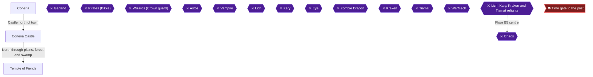

## Chapter 2: Matoya's Cave, Pravoka and the Pirate Ship

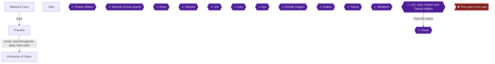

## Chapter 3: Elfland, the Marsh Cave and Astos

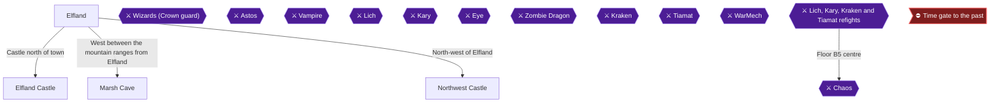

## Chapter 4: Mystic Key Treasures, the TNT and the Canal

```mermaid
flowchart TD
  Coneria_Castle["Coneria Castle"]
  Temple_of_Fiends["Temple of Fiends"]
  Elfland_Castle["Elfland Castle"]
  Marsh_Cave["Marsh Cave"]
  Northwest_Castle["Northwest Castle"]
  Dwarf_Cave["Dwarf Cave"]
  Garland{{"⚔ Garland"}}
  Pirates{{"⚔ Pirates (Bikke)"}}
  Wizards_Crown{{"⚔ Wizards (Crown guard)"}}
  Astos{{"⚔ Astos"}}
  Vampire{{"⚔ Vampire"}}
  Lich{{"⚔ Lich"}}
  Kary{{"⚔ Kary"}}
  Eye{{"⚔ Eye"}}
  Zombie_Dragon{{"⚔ Zombie Dragon"}}
  Kraken{{"⚔ Kraken"}}
  Tiamat{{"⚔ Tiamat"}}
  WarMech{{"⚔ WarMech"}}
  Fiend_Refights{{"⚔ Lich, Kary, Kraken and Tiamat refights"}}
  Chaos{{"⚔ Chaos"}}
  Time_Gate>"⛔ Time gate to the past"]
  Coneria_Castle -->|"North through plains, forest and swamp"| Temple_of_Fiends
  Fiend_Refights -->|"Floor B5 centre"| Chaos
  classDef ponr fill:#7f1d1d,stroke:#f87171,color:#fff;
  classDef boss fill:#4c1d95,stroke:#a78bfa,color:#fff;
  class Time_Gate ponr;
  class Garland,Pirates,Wizards_Crown,Astos,Vampire,Lich,Kary,Eye,Zombie_Dragon,Kraken,Tiamat,WarMech,Fiend_Refights,Chaos boss;
```

## Chapter 5: Melmond, the Earth Cave and the Vampire

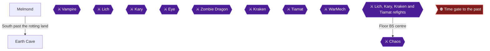

## Chapter 6: Titan's Tunnel, Sarda and Lich

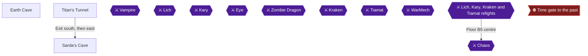

## Chapter 7: Crescent Lake and the Gurgu Volcano

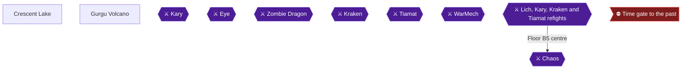

## Chapter 8: The Ice Cave and the Airship

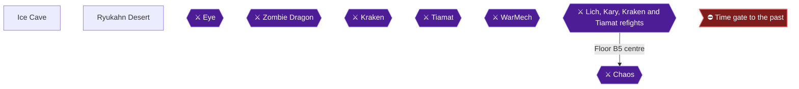

## Chapter 9: The Castle of Ordeals, Cardia and the Class Change


## Chapter 10: Gaia, Onrac, the Waterfall and the Sea Shrine

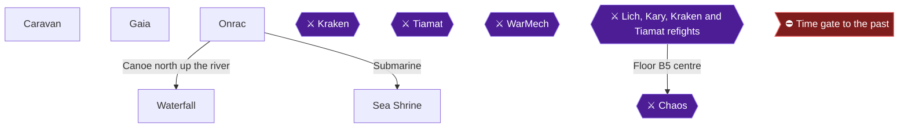

## Chapter 11: Melmond, Lefein, the Spell Shops and the Mirage Tower

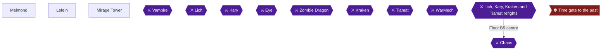

## Chapter 12: The Floating Castle, WarMech, Tiamat and Excalibur

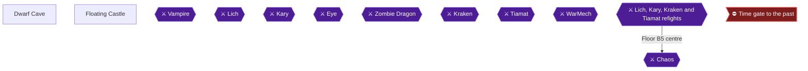

## Chapter 13: The Past Temple Treasures, Masamune and Chaos

```mermaid
flowchart TD
  Temple_of_Fiends["Temple of Fiends"]
  Temple_of_Fiends_Past["Temple of Fiends (Past)"]
  Garland{{"⚔ Garland"}}
  Pirates{{"⚔ Pirates (Bikke)"}}
  Wizards_Crown{{"⚔ Wizards (Crown guard)"}}
  Astos{{"⚔ Astos"}}
  Vampire{{"⚔ Vampire"}}
  Lich{{"⚔ Lich"}}
  Kary{{"⚔ Kary"}}
  Eye{{"⚔ Eye"}}
  Zombie_Dragon{{"⚔ Zombie Dragon"}}
  Kraken{{"⚔ Kraken"}}
  Tiamat{{"⚔ Tiamat"}}
  WarMech{{"⚔ WarMech"}}
  Fiend_Refights{{"⚔ Lich, Kary, Kraken and Tiamat refights"}}
  Chaos{{"⚔ Chaos"}}
  Time_Gate>"⛔ Time gate to the past"]
  Time_Gate -->|"2000 years into the past"| Temple_of_Fiends_Past
  Fiend_Refights -->|"Floor B5 centre"| Chaos
  classDef ponr fill:#7f1d1d,stroke:#f87171,color:#fff;
  classDef boss fill:#4c1d95,stroke:#a78bfa,color:#fff;
  class Time_Gate ponr;
  class Garland,Pirates,Wizards_Crown,Astos,Vampire,Lich,Kary,Eye,Zombie_Dragon,Kraken,Tiamat,WarMech,Fiend_Refights,Chaos boss;
```

## Chapter 14: Challenge Run: New Party, Coneria to the Mystic Key

```mermaid
flowchart TD
  Coneria["Coneria"]
  Coneria_Castle["Coneria Castle"]
  Temple_of_Fiends["Temple of Fiends"]
  Matoyas_Cave["Matoya's Cave"]
  Pravoka["Pravoka"]
  Elfland["Elfland"]
  Elfland_Castle["Elfland Castle"]
  Marsh_Cave["Marsh Cave"]
  Northwest_Castle["Northwest Castle"]
  Ship["Ship"]
  Garland{{"⚔ Garland"}}
  Pirates{{"⚔ Pirates (Bikke)"}}
  Wizards_Crown{{"⚔ Wizards (Crown guard)"}}
  Astos{{"⚔ Astos"}}
  Vampire{{"⚔ Vampire"}}
  Lich{{"⚔ Lich"}}
  Kary{{"⚔ Kary"}}
  Eye{{"⚔ Eye"}}
  Zombie_Dragon{{"⚔ Zombie Dragon"}}
  Kraken{{"⚔ Kraken"}}
  Tiamat{{"⚔ Tiamat"}}
  WarMech{{"⚔ WarMech"}}
  Fiend_Refights{{"⚔ Lich, Kary, Kraken and Tiamat refights"}}
  Chaos{{"⚔ Chaos"}}
  Time_Gate>"⛔ Time gate to the past"]
  Coneria -->|"Castle north of town"| Coneria_Castle
  Coneria_Castle -->|"North through plains, forest and swamp"| Temple_of_Fiends
  Matoyas_Cave -->|"East"| Pravoka
  Elfland -->|"Castle north of town"| Elfland_Castle
  Elfland -->|"West between the mountain ranges from Elfland"| Marsh_Cave
  Elfland -->|"North-west of Elfland"| Northwest_Castle
  Fiend_Refights -->|"Floor B5 centre"| Chaos
  classDef ponr fill:#7f1d1d,stroke:#f87171,color:#fff;
  classDef boss fill:#4c1d95,stroke:#a78bfa,color:#fff;
  class Time_Gate ponr;
  class Garland,Pirates,Wizards_Crown,Astos,Vampire,Lich,Kary,Eye,Zombie_Dragon,Kraken,Tiamat,WarMech,Fiend_Refights,Chaos boss;
```

## Chapter 15: Challenge Run: TNT, the Earth Cave and Lich

```mermaid
flowchart TD
  Coneria_Castle["Coneria Castle"]
  Dwarf_Cave["Dwarf Cave"]
  Melmond["Melmond"]
  Earth_Cave["Earth Cave"]
  Titans_Tunnel["Titan's Tunnel"]
  Sardas_Cave["Sarda's Cave"]
  Garland{{"⚔ Garland"}}
  Pirates{{"⚔ Pirates (Bikke)"}}
  Wizards_Crown{{"⚔ Wizards (Crown guard)"}}
  Astos{{"⚔ Astos"}}
  Vampire{{"⚔ Vampire"}}
  Lich{{"⚔ Lich"}}
  Kary{{"⚔ Kary"}}
  Eye{{"⚔ Eye"}}
  Zombie_Dragon{{"⚔ Zombie Dragon"}}
  Kraken{{"⚔ Kraken"}}
  Tiamat{{"⚔ Tiamat"}}
  WarMech{{"⚔ WarMech"}}
  Fiend_Refights{{"⚔ Lich, Kary, Kraken and Tiamat refights"}}
  Chaos{{"⚔ Chaos"}}
  Time_Gate>"⛔ Time gate to the past"]
  Melmond -->|"South past the rotting land"| Earth_Cave
  Titans_Tunnel -->|"Exit south, then east"| Sardas_Cave
  Fiend_Refights -->|"Floor B5 centre"| Chaos
  classDef ponr fill:#7f1d1d,stroke:#f87171,color:#fff;
  classDef boss fill:#4c1d95,stroke:#a78bfa,color:#fff;
  class Time_Gate ponr;
  class Garland,Pirates,Wizards_Crown,Astos,Vampire,Lich,Kary,Eye,Zombie_Dragon,Kraken,Tiamat,WarMech,Fiend_Refights,Chaos boss;
```

## Chapter 16: Challenge Run: Crescent Lake, Kary and the Airship

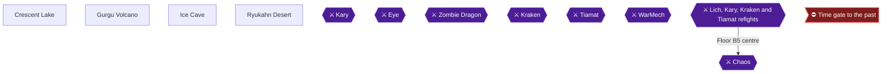

## Chapter 17: Challenge Run: Oxyale, the Cube and Kraken


## Chapter 18: Challenge Run: Lefein, the Mirage Tower and Tiamat

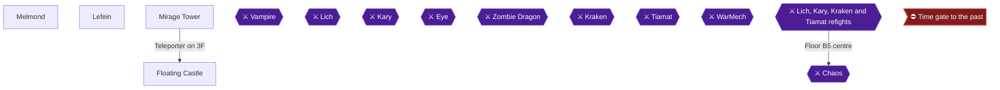

## Chapter 19: Challenge Run Finale: Chaos with No Class Change and No Chests

```mermaid
flowchart TD
  Temple_of_Fiends["Temple of Fiends"]
  Temple_of_Fiends_Past["Temple of Fiends (Past)"]
  Garland{{"⚔ Garland"}}
  Pirates{{"⚔ Pirates (Bikke)"}}
  Wizards_Crown{{"⚔ Wizards (Crown guard)"}}
  Astos{{"⚔ Astos"}}
  Vampire{{"⚔ Vampire"}}
  Lich{{"⚔ Lich"}}
  Kary{{"⚔ Kary"}}
  Eye{{"⚔ Eye"}}
  Zombie_Dragon{{"⚔ Zombie Dragon"}}
  Kraken{{"⚔ Kraken"}}
  Tiamat{{"⚔ Tiamat"}}
  WarMech{{"⚔ WarMech"}}
  Fiend_Refights{{"⚔ Lich, Kary, Kraken and Tiamat refights"}}
  Chaos{{"⚔ Chaos"}}
  Time_Gate>"⛔ Time gate to the past"]
  Time_Gate -->|"2000 years into the past"| Temple_of_Fiends_Past
  Fiend_Refights -->|"Floor B5 centre"| Chaos
  classDef ponr fill:#7f1d1d,stroke:#f87171,color:#fff;
  classDef boss fill:#4c1d95,stroke:#a78bfa,color:#fff;
  class Time_Gate ponr;
  class Garland,Pirates,Wizards_Crown,Astos,Vampire,Lich,Kary,Eye,Zombie_Dragon,Kraken,Tiamat,WarMech,Fiend_Refights,Chaos boss;
```
