# Knowledge graph — game 1470

Nodes: 160 · Edges: 157

## Progression flow

```mermaid
flowchart TD
  Midenhall_Castle["Midenhall Castle"]
  Leftwyne["Leftwyne"]
  Cannock_Castle["Cannock Castle"]
  Spring_of_Bravery["Spring of Bravery"]
  Lake_Cave["Lake Cave"]
  Monolith_South_of_Midenhall["Monolith South of Midenhall Castle"]
  Underground_Passage["Underground Passage to Hamlin"]
  Hamlin["Hamlin"]
  Moonbrooke_Castle["Moonbrooke Castle"]
  Mirror_Swamp["Mirror Swamp"]
  Tower_of_Wind["Tower of Wind"]
  Monolith_West_of_Moonbrooke["Monolith West of Moonbrooke Castle"]
  South_Dragons_Horn["South Dragon's Horn"]
  North_Dragons_Horn["North Dragon's Horn"]
  Lianport["Lianport"]
  Lianport_Gremlins{{"⚔ Two Gremlins (Lianport)"}}
  Sunken_Treasure["Sunken Treasure"]
  Monolith_North_of_Lianport["Monolith North of Lianport"]
  Alefgard["Alefgard"]
  Tantegel_Castle["Tantegel Castle"]
  Charlock_Castle["Charlock Castle"]
  Lighthouse["Lighthouse"]
  Lighthouse_Old_Man{{"⚔ Old man's trap: four Gremlins"}}
  Zahan["Zahan"]
  World_Tree_Island["World Tree Island"]
  Shrine_of_Fire["Shrine of Fire"]
  Osterfair_Castle["Osterfair Castle"]
  Saber_Lion{{"⚔ Saber Lion"}}
  Monolith_North_of_Beran["Monolith North of Beran"]
  Beran["Beran"]
  Holy_Shrine["Holy Shrine"]
  Wellgarth["Wellgarth"]
  Zahan_Wizards_House["Zahan Wizard's House"]
  Midenhall_Castle_Jail["Midenhall Castle Jail"]
  Evil_Clown{{"⚔ Evil Clown"}}
  Hamlin_Prison["Hamlin Prison"]
  Tuhn["Tuhn"]
  Tower_of_the_Moon["Tower of the Moon"]
  Metal_Babble{{"⚔ Metal Babble"}}
  Malroths_Cavern["Malroth's Cavern"]
  Evil_Clowns_Cavern{{"⚔ Two Evil Clowns (old man)"}}
  Monolith_South_of_Rhone["Monolith South of Rhone"]
  Cave_to_Rhone["Cave to Rhone"]
  Shrine_of_Rubiss["Shrine of Rubiss"]
  Rhone_Shrine["Rhone Shrine"]
  Rhone_Plateau["Rhone Plateau"]
  Hargons_Castle["Hargon's Castle"]
  Atlas{{"⚔ Atlas"}}
  Bazuzu{{"⚔ Bazuzu"}}
  Zarlox{{"⚔ Zarlox"}}
  Hargon{{"⚔ Hargon"}}
  Malroth{{"⚔ Malroth"}}
  Malroth_PONR>"⛔ Malroth defeated: the game ends"]
  Midenhall_Castle -->|west| Leftwyne
  Leftwyne -->|north| Cannock_Castle
  Cannock_Castle -->|east over the bridge| Spring_of_Bravery
  Cannock_Castle -->|west over the double bridge| Lake_Cave
  Midenhall_Castle -->|south over the bridge| Monolith_South_of_Midenhall
  Cannock_Castle -->|monolith south-west of Cannock (needs the prince)| Underground_Passage
  Underground_Passage -->|south| Hamlin
  Hamlin -->|south-west| Moonbrooke_Castle
  Moonbrooke_Castle -->|east| Mirror_Swamp
  Hamlin -->|east, north bridge| Tower_of_Wind
  Moonbrooke_Castle -->|west| Monolith_West_of_Moonbrooke
  Monolith_West_of_Moonbrooke -->|north-west| South_Dragons_Horn
  South_Dragons_Horn -->|landing north of the river| North_Dragons_Horn
  North_Dragons_Horn -->|north| Lianport
  Lianport -->|north| Monolith_North_of_Lianport
  Lianport -->|sail east to the bridge| Alefgard
  Tantegel_Castle -->|sail south-east| Charlock_Castle
  Tantegel_Castle -->|sail south, east, south| Lighthouse
  Lianport -->|sail north past the treasure spot| Zahan
  Zahan -->|10 north then west| World_Tree_Island
  Shrine_of_Fire -->|travel door| Midenhall_Castle
  Monolith_South_of_Midenhall -->|gold door travel door| Osterfair_Castle
  Osterfair_Castle -->|travel door| Monolith_North_of_Beran
  Monolith_North_of_Beran -->|middle travel door| Shrine_of_Fire
  Shrine_of_Fire -->|eastern travel door| Holy_Shrine
  Monolith_North_of_Beran -->|south-east over two bridges| Beran
  Beran -->|sail| Wellgarth
  Wellgarth -->|sail the Tuhn River Channel| Tuhn
  Beran -->|portal behind the jail door| Monolith_South_of_Rhone
  Cave_to_Rhone -->|5F exit| Rhone_Plateau
  Rhone_Plateau --> Hargons_Castle
  Atlas --> Bazuzu
  Bazuzu --> Zarlox
  Zarlox --> Hargon
  Hargon -->|leaving the room| Malroth
  Malroth --> Malroth_PONR
  classDef ponr fill:#7f1d1d,stroke:#f87171,color:#fff;
  classDef boss fill:#4c1d95,stroke:#a78bfa,color:#fff;
  class Malroth_PONR ponr;
  class Lianport_Gremlins,Lighthouse_Old_Man,Saber_Lion,Evil_Clown,Metal_Babble,Evil_Clowns_Cavern,Atlas,Bazuzu,Zarlox,Hargon,Malroth boss;
```

## Achievement dependencies

```mermaid
flowchart LR
  Copper_Sword[/"Copper Sword"/]
  Ach_46412(["🏆 'Tis Dangerous to Venture Alone"])
  Prince_of_Cannock["Prince of Cannock"]
  Ach_46410(["🏆 Thou Art Now Buddies"])
  Silver_Key[/"Silver Key"/]
  Ach_46413(["🏆 Thou Hast an Argent Door Opener"])
  Moonbrooke_Basement[/"Moonbrooke Castle secret basement"/]
  Ach_116314(["🏆 Thou Hast Eased a Warrior's Passing"])
  Mirror_of_Ra[/"Mirror of Ra"/]
  Ach_46416(["🏆 Thou Art Vain"])
  Princess_of_Moonbrooke["Princess of Moonbrooke"]
  Ach_46411(["🏆 Thou Art Now a Trio"])
  Ach_46432(["🏆 'Tis No Longer a Flesh Wound"])
  Cloak_of_Wind[/"Cloak of Wind"/]
  Ach_46417(["🏆 Thou Hast Conquered the East"])
  South_Dragons_Horn["South Dragon's Horn"]
  Ach_116306(["🏆 'Tis Not Flying! 'Tis Falling with Style!"])
  Lianport_Gremlins{{"⚔ Two Gremlins (Lianport)"}}
  Ach_46456(["🏆 Thou Art a Hero"])
  Echoing_Flute[/"Echoing Flute"/]
  Ach_46418(["🏆 Thine Inner Bard Hast Awakened"])
  Sword_of_Erdrick[/"Sword of Erdrick"/]
  Ach_115778(["🏆 Thine Ancestral Sword!"])
  Dragonlords_Grandson["Dragonlord's grandson"]
  Ach_46457(["🏆 Thou Hast Finished the Wrong Quest!"])
  Star_Crest[/"Star Crest"/]
  Ach_46422(["🏆 Thou Art as Brilliant as a Star!"])
  Golden_Key[/"Golden Key"/]
  Ach_46414(["🏆 Thou Hast a Noble Door Opener"])
  Leaf_of_World_Tree[/"Leaf of the World Tree"/]
  Ach_115786(["🏆 Thou Hast Celestial Foliage"])
  King_of_Tantegel["King of Tantegel"]
  Ach_115788(["🏆 Thine King Is Bare"])
  Token_of_Erdrick[/"Token of Erdrick"/]
  Ach_46419(["🏆 Thou Hast the Crest of Thine Line"])
  Shield_of_Erdrick[/"Shield of Erdrick"/]
  Ach_115784(["🏆 Thine Ancestral Shield!"])
  Moon_Crest[/"Moon Crest"/]
  Ach_46423(["🏆 Thou Art a Night Owl!"])
  Armor_of_Gaia[/"Armor of Gaia"/]
  Ach_115781(["🏆 Thou Hast the Protection of the Land"])
  Sun_Crest[/"Sun Crest"/]
  Ach_46421(["🏆 Thou Art as Bright as the Sun!"])
  Helmet_of_Erdrick[/"Helmet of Erdrick"/]
  Ach_115785(["🏆 Thine Ancestral Helmet!"])
  Jailors_Key[/"Jailor's Key"/]
  Ach_46415(["🏆 Thou Art a Gaol Breaker"])
  Floodgate_Key[/"Floodgate Key"/]
  Ach_116307(["🏆 Thou Art the Master of Gates"])
  Staff_of_Thunder[/"Staff of Thunder"/]
  Ach_115780(["🏆 Thou Hast the Stick of Sages"])
  Water_Crest[/"Water Crest"/]
  Ach_46424(["🏆 Thou Art as Vast as the Sea!"])
  Floodgate["Floodgate"]
  Ach_116308(["🏆 Thou Hast Bade the Waters Flow"])
  Water_Flying_Cloth[/"Water Flying Cloth"/]
  Ach_115782(["🏆 Thou Hast a Sodden Garment"])
  Moon_Fragment[/"Moon Fragment"/]
  Ach_116309(["🏆 Ye Olde Lunar Fragment"])
  Metal_Babble{{"⚔ Metal Babble"}}
  Ach_116313(["🏆 Thou Art a Millionaire"])
  Malroths_Cavern["Malroth's Cavern"]
  Ach_116310(["🏆 Thou Hast Parted the Sea"])
  Eye_of_Malroth[/"Eye of Malroth"/]
  Ach_116311(["🏆 Thou Hast Poked Evil in the Eye"])
  Monolith_South_of_Rhone["Monolith South of Rhone"]
  Ach_46458(["🏆 Thou Hast Raised the Earth"])
  Heart_Crest[/"Heart Crest"/]
  Ach_46425(["🏆 Thou Art a Lover, and a Fighter!"])
  Charm_of_Rubiss[/"Charm of Rubiss"/]
  Ach_46420(["🏆 Thou Art Charming!"])
  Thunder_Sword[/"Thunder Sword"/]
  Ach_115779(["🏆 Thou Hast the Blade of Storms"])
  Armor_of_Erdrick[/"Armor of Erdrick"/]
  Ach_115783(["🏆 Thine Ancestral Armor!"])
  Wizards_Ring[/"Wizard's Ring"/]
  Ach_115787(["🏆 Prithee, Magicke Ring"])
  Cave_to_Rhone["Cave to Rhone"]
  Ach_116312(["🏆 Thou Hast Passed Through Hell"])
  Rhone_Plateau["Rhone Plateau"]
  Ach_46408(["🏆 Thou Art Ready for Anything"])
  Hargon{{"⚔ Hargon"}}
  Ach_46459(["🏆 Ye Olde Evile Prieste"])
  Malroth{{"⚔ Malroth"}}
  Ach_46460(["🏆 Thine Quest, 'Tis Over!"])
  Ending["Return to Midenhall: the King's offer"]
  Ach_46461(["🏆 Thou Shalt Not Be Selfish"])
  Ach_46462(["🏆 Thou Hast Found Peace"])
  Copper_Sword -->|unlocks| Ach_46412
  Prince_of_Cannock -->|unlocks| Ach_46410
  Silver_Key -->|unlocks| Ach_46413
  Moonbrooke_Basement -->|unlocks| Ach_116314
  Mirror_of_Ra -->|unlocks| Ach_46416
  Princess_of_Moonbrooke -->|unlocks| Ach_46411
  Princess_of_Moonbrooke -->|unlocks| Ach_46432
  Cloak_of_Wind -->|unlocks| Ach_46417
  South_Dragons_Horn -->|unlocks| Ach_116306
  Lianport_Gremlins -->|unlocks| Ach_46456
  Echoing_Flute -->|unlocks| Ach_46418
  Sword_of_Erdrick -->|unlocks| Ach_115778
  Dragonlords_Grandson -->|unlocks| Ach_46457
  Star_Crest -->|unlocks| Ach_46422
  Golden_Key -->|unlocks| Ach_46414
  Leaf_of_World_Tree -->|unlocks| Ach_115786
  King_of_Tantegel -->|unlocks| Ach_115788
  Token_of_Erdrick -->|unlocks| Ach_46419
  Shield_of_Erdrick -->|unlocks| Ach_115784
  Moon_Crest -->|unlocks| Ach_46423
  Armor_of_Gaia -->|unlocks| Ach_115781
  Sun_Crest -->|unlocks| Ach_46421
  Helmet_of_Erdrick -->|unlocks| Ach_115785
  Jailors_Key -->|unlocks| Ach_46415
  Floodgate_Key -->|unlocks| Ach_116307
  Staff_of_Thunder -->|unlocks| Ach_115780
  Water_Crest -->|unlocks| Ach_46424
  Floodgate -->|unlocks| Ach_116308
  Water_Flying_Cloth -->|unlocks| Ach_115782
  Moon_Fragment -->|unlocks| Ach_116309
  Metal_Babble -->|unlocks| Ach_116313
  Malroths_Cavern -->|unlocks| Ach_116310
  Eye_of_Malroth -->|unlocks| Ach_116311
  Monolith_South_of_Rhone -->|unlocks| Ach_46458
  Heart_Crest -->|unlocks| Ach_46425
  Charm_of_Rubiss -->|unlocks| Ach_46420
  Thunder_Sword -->|unlocks| Ach_115779
  Armor_of_Erdrick -->|unlocks| Ach_115783
  Wizards_Ring -->|unlocks| Ach_115787
  Cave_to_Rhone -->|unlocks| Ach_116312
  Rhone_Plateau -->|unlocks| Ach_46408
  Hargon -->|unlocks| Ach_46459
  Malroth -->|unlocks| Ach_46460
  Ending -.->|missable before| Ach_46461
  Ending -->|unlocks| Ach_46462
```

## Chapter 1: Midenhall, Leftwyne and the Prince of Cannock

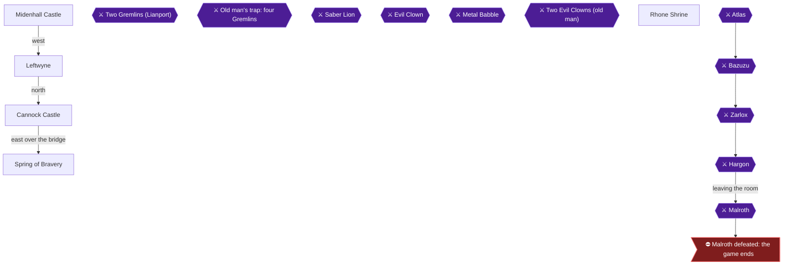

## Chapter 2: The Lake Cave and the Silver Key

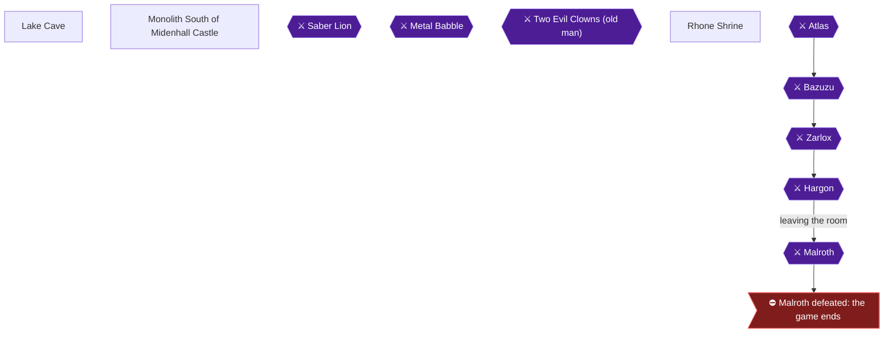

## Chapter 3: Hamlin, Moonbrooke and the Mirror of Ra

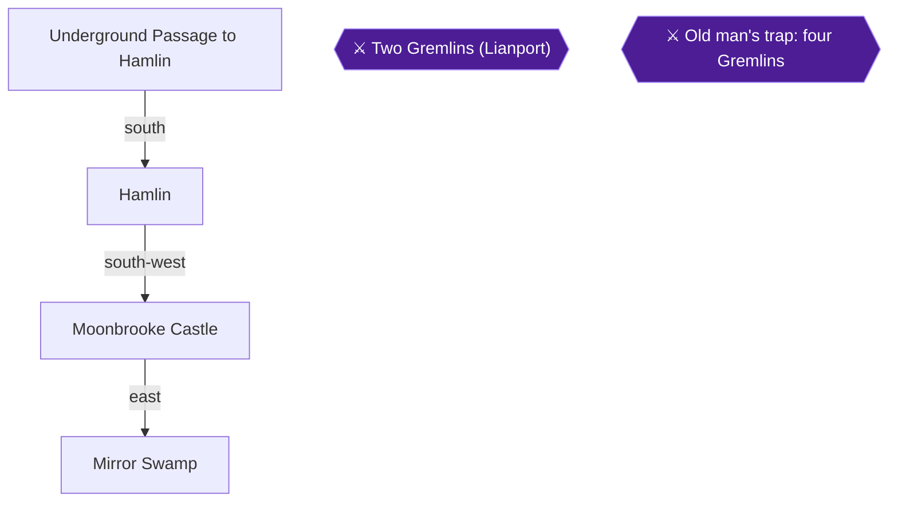

## Chapter 4: The Tower of Wind

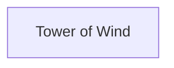

## Chapter 5: The Dragon's Horn and Lianport

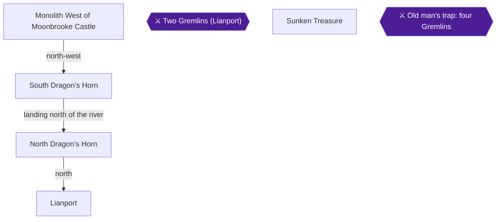

## Chapter 6: Alefgard: Tantegel and Charlock Castle

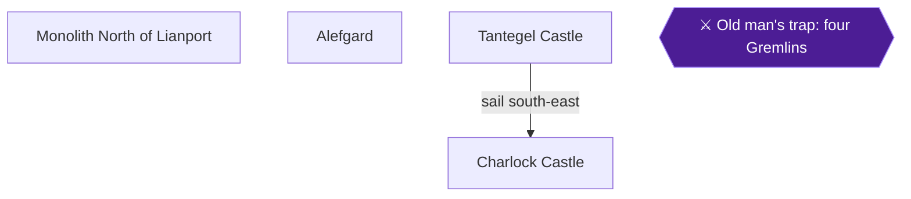

## Chapter 7: Zahan and the Golden Key

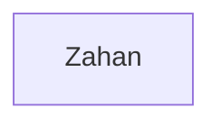

## Chapter 8: The Lighthouse and the Star Crest


## Chapter 9: Golden Key Errands


## Chapter 10: Osterfair Castle

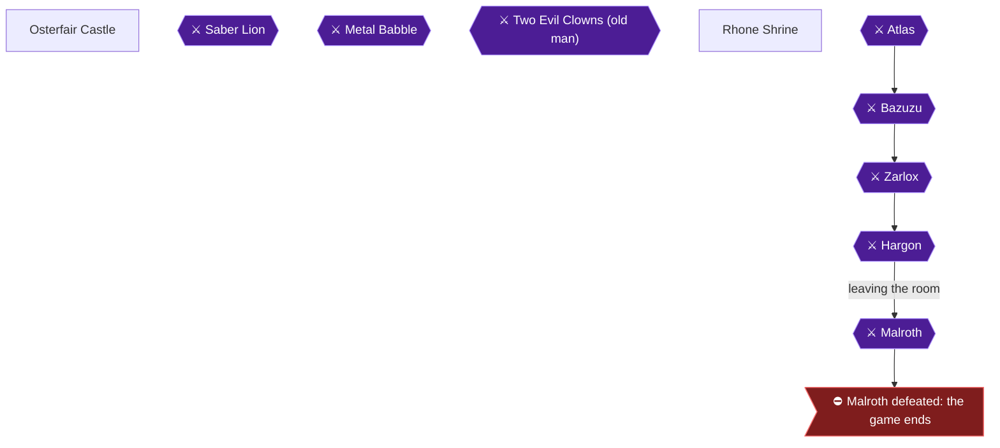

## Chapter 11: Beran and the Holy Shrine

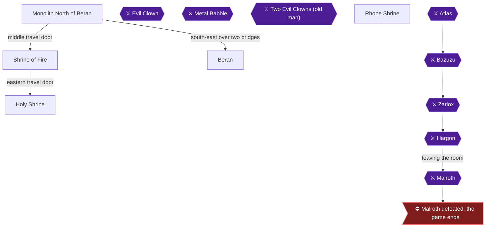

## Chapter 12: Wellgarth: the Jailor's Key and the Floodgate Key


## Chapter 13: Jailor's Key Errands


## Chapter 14: Tuhn: the Floodgate and the Water Flying Cloth

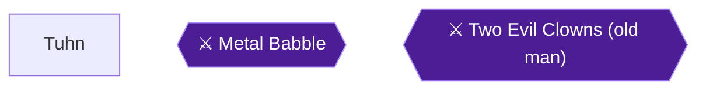

## Chapter 15: The Tower of the Moon

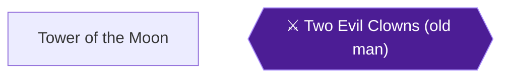

## Chapter 16: Malroth's Cavern and the Eye of Malroth


## Chapter 17: The Cave to Rhone

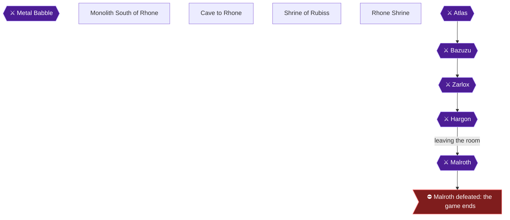

## Chapter 18: The Rhone Plateau

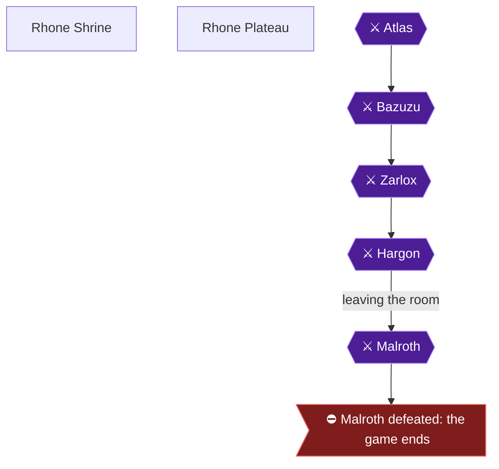

## Chapter 19: Hargon's Castle and the Ending

```mermaid
flowchart TD
  Hargons_Castle["Hargon's Castle"]
  Atlas{{"⚔ Atlas"}}
  Bazuzu{{"⚔ Bazuzu"}}
  Zarlox{{"⚔ Zarlox"}}
  Hargon{{"⚔ Hargon"}}
  Malroth{{"⚔ Malroth"}}
  Malroth_PONR>"⛔ Malroth defeated: the game ends"]
  Atlas --> Bazuzu
  Bazuzu --> Zarlox
  Zarlox --> Hargon
  Hargon -->|leaving the room| Malroth
  Malroth --> Malroth_PONR
  classDef ponr fill:#7f1d1d,stroke:#f87171,color:#fff;
  classDef boss fill:#4c1d95,stroke:#a78bfa,color:#fff;
  class Malroth_PONR ponr;
  class Atlas,Bazuzu,Zarlox,Hargon,Malroth boss;
```
