# Dragon Quest II — 100% RetroAchievements Walkthrough

## Metadata

- **Platform:** NES/Famicom
- **Developer:** Chunsoft
- **Publisher:** Enix
- **Genre:** Unknown
- **Released:** 1987-01-26
- **Achievements:** 69 (427 points)

> [!NOTE]
> Every instruction in this guide was extracted from the sources listed at the bottom and checked against them (305 facts confirmed by 2+ sources, 2354 from a single source). Statements marked 🟡 come from only one source. Anything we could not confirm says **"Unable to verify from collected sources."**

## Game Overview


### About this guide

This walkthrough follows the English NES release, *Dragon Warrior II*, so it uses the NES names: Midenhall, Cannock, Moonbrooke, Infernos, and Watergate/Floodgate Key. The remake names (Lorasia, Slewse, Woosh) belong to other versions, and the source guides mention them only to explain that localization renamed things. Midenhall became Lorasia and then Midenhall again, Tuhn became Slewse, and Infernos became Woosh [[gf-versions-2-10, gf-versions-2-12]].

Other versions also change level caps, experience values and spell costs [[gf-versions-1-1, gf-versions-1-2, gf-versions-8-1]]. Use the NES numbers in this guide and ignore remake figures you find elsewhere.

🗺️ **World maps:** [View Overworld Map by Rick Bruns](https://www.vgmaps.com/Atlas/NES/DragonWarrior-Part2-Overworld.png) · [View World Map by x_loto](https://gamefaqs.gamespot.com/nes/587248-dragon-warrior-ii/map/4033-world-map) · [View World Map by mchenrynick](https://gamefaqs.gamespot.com/nes/587248-dragon-warrior-ii/map/17787-world-map)

The collected sources do not give a usable plot summary. Unable to verify from collected sources. What they do establish is that the adventure ends with two final enemies, Hargon and Malroth [[ra-guide-9-4, gf3-83-6]], and that Hargon's Castle first appears as a false copy of Midenhall Castle until you use the Charm of Rubiss [[gf2-24-7]].

### The party

You build a three-person party over the course of the game:

- **The Hero (Prince of Midenhall)** is the melee fighter. He starts at level 1 with 28 HP and no MP [[gf3-4-1]], and he never learns spells (his skills column reads "None" at every level) [[gf3-4-2, gf3-5-5]].
- **The Prince of Cannock** joins later. He starts with 31 HP and 6 MP and already knows Heal [[gf3-9-1, gf4-6-9]]. After he joins, inns cost double [[gf4-6-10]].
- **The Princess of Moonbrooke** is the pure caster. She starts with 32 HP and 28 MP and knows Healmore from level 1 [[gf3-14-1]].

Both the Prince and the Princess cast spells. The Prince has some strong spells the Princess lacks [[gf-lists-11-1]]. Only the Prince has Revive, so protect him [[gf-lists-11-30]].

The hero can carry only eight items at once, counting his weapon and armor [[gf3-18-3]]. In the item tables, H means Hero, B means Prince and G means Princess [[gf3-20-2]].

### Core mechanics a first-timer needs

- **SEARCH** examines the square at your feet. Many key items are hidden this way [[gf2-4-1]].
- **Equipping** is done from the menu, which opens with the A button [[ra-guide-5-2]]. Do not forget to equip new gear. The Copper Sword in particular must be equipped [[gf2-4-3]].
- **The Cloak of Wind** is equipped by using it from the ITEM menu, like a medical herb [[gf2-11-3]].
- **Inns** restore HP and MP [[gf2-4-5]].
- **The House of Healing** offers DETOXICATE (cures poison), UNCURSE (cures a curse) and REVIVAL (revives a dead character) [[gf4-4-18, gf4-4-19, gf4-4-20]].
- **Poison** weakens a character with every step [[gf4-4-16]]. Poisonous marsh squares also damage you each step, so walk around them [[gf2-5-8]].
- **Damage floors** are common in later areas. Stepguard blocks 2 damage from poison floors and 20 from magic floors, and it wears off after a while [[gf-lists-11-31]]. It does not stop red lava tiles. Only a character wearing the Water Flying Cloth is protected from those [[gf4-37-4, gf3-71-3]].
- **Doors:** Silver Door keys, Golden Key doors and Jailor's Key doors appear throughout. The Open spell can open locked doors but will not work on the Tuhn watergate [[gf-lists-11-27]].
- **Lottery Tickets:** buying items sometimes gives you a Lottery Ticket [[gf4-3-7]]. Hamlin has a lottery that needs one [[gf2-9-3]]. Three sun symbols give the Golden Card, and three star symbols give the Wizard's Ring [[gf-lists-10-2, gf-lists-10-3]].
- **Quick Save:** the NES version has a real Quick Save item. Other versions removed it [[gf-versions-6-1, gf-versions-6-2]].
- **Random enemy HP:** enemy HP varies slightly, so a Baboon may have 45 HP instead of 40. This matters for Repel and Fairy Water [[gf-lists-16-13]].
- **Repel and Fairy Water** work the same way. The party is not attacked if the lowest party member's current HP is higher than any enemy trying to attack, so heal up first [[gf-lists-11-28]].
- **Chance** is a random spell. It may copy other spells, do nothing, or call the Sirens for an instant win against anything except Malroth. If you use Chance on Malroth, he returns fully restored [[gf-lists-11-24, gf-lists-11-25]].
- **Sacrifice** wins almost any battle except against Malroth, but the caster dies. Use it carefully [[gf-lists-11-30]].
- **Stopspell** often misses but will eventually work on almost anything [[gf-lists-11-32]].
- **Defeat** does not work on stronger enemies [[gf-lists-11-26]].
- **Damage spells** do less against some enemies, such as Atlas and Zarlox [[gf-lists-11-33]].

### Leveling and experience

Spells are learned automatically on level-up [[ra-guide-2-4]]. Experience stops counting at 1,000,000 per character [[gf-lists-16-12, gf2-28-1]]. The NES level caps are 50 for the Hero, 45 for the Prince and 35 for the Princess [[gf2-28-2, gf-versions-9-2]].

The Hero's level achievements need these experience totals:

| Hero level | Experience needed | Citation |
|---|---|---|
| 2 | 12 | [[gf2-28-3]] |
| 5 | 140 | [[gf2-28-4]] |
| 10 | 2,800 | [[gf2-28-5]] |
| 20 | 40,000 | [[gf2-28-6]] |
| 30 | 230,000 | [[gf2-28-7]] |

Early-game guidance from the sources:

- Fight near Midenhall until the Hero reaches level 3 before wandering farther, and carry a Medical Herb or two [[gf2-5-3]].
- Reach level 6 before the Spring of Bravery [[gf2-7-1]].
- Get the Hero to about level 5 before the Lake Cave for the Silver Key [[gf2-7-13]].

### Spells and the achievements tied to them

Each spell has its own achievement, and each is earned simply by reaching the level that teaches it. The tables below use the NES learn levels. Where a spell has two levels, the first is the Prince's and the second is the Princess's.

**Prince of Cannock**

| Spell | Level | MP | Citation |
|---|---|---|---|
| Firebal | 3 | 2 | [[gf2-27-6, gf3-9-2]] |
| Antidote | 6 (Princess 12) | 3 | [[gf2-27-1, gf3-10-1]] |
| Stopspell | 8 | 3 | [[gf2-27-21, gf3-10-2]] |
| Return | 10 | 6 | [[gf2-27-16, gf3-10-3]] |
| Outside | 12 (Princess 17) | 6 | [[gf2-27-14, gf3-11-1]] |
| Healmore | 14 (Princess 1) | 5 | [[gf2-27-10, gf3-11-2]] |
| Stepguard | 17 (Princess 21) | 4 | [[gf2-27-20, gf3-11-3]] |
| Firebane | 18 | 4 | [[gf2-27-7, gf3-12-1]] |
| Increase | 20 | 2 | [[gf2-27-11, gf3-12-2]] |
| Defeat | 23 | 4 | [[gf2-27-3, gf3-12-3]] |
| Revive | 25 | 15 | [[gf2-27-17, gf3-13-1]] |
| Sacrifice | 28 | 1 | [[gf2-27-18, gf-versions-8-10]] |

**Princess of Moonbrooke**

| Spell | Level | MP | Citation |
|---|---|---|---|
| Healmore | 1 | 5 | [[gf3-14-1]] |
| Sleep | 2 | 2 | [[gf2-27-19, gf3-14-2]] |
| Infernos | 4 | 4 | [[gf2-27-12, gf3-14-3]] |
| Surround | 6 | 2 | [[gf2-27-22, gf3-14-4]] |
| Repel | 8 | 2 | [[gf2-27-15, gf3-15-1]] |
| Defence | 10 | 2 | [[gf2-27-4, gf3-15-2]] |
| Antidote | 12 | 3 | [[gf3-15-3]] |
| Healall | 15 | 8 | [[gf2-27-9, gf3-16-1]] |
| Outside | 17 | 6 | [[gf3-16-2]] |
| Explodet | 19 | 8 | [[gf2-27-5, gf3-16-3]] |
| Stepguard | 21 | 4 | [[gf-versions-11-15]] |
| Open | 23 | 2 | [[gf2-27-13, gf-versions-11-17]] |
| Chance | 25 | 15 in most sources | [[gf-versions-11-18, gf-versions-8-26]] |

One source lists Chance at 13 MP [[gf2-27-2]], and the NES poster lists 12, which the version guide calls probably a typo [[gf-versions-8-4]]. Check the in-game cost.

The level tables in the sources do not list every level. Hero levels 30 to 33 show unknown HP and experience values in one guide [[gf3-8-4, gf3-8-5]]. That does not affect the achievement thresholds above.

### Hardcore Mode rules

This set is Hardcore compatible. In Hardcore you cannot use save states, rewinds or cheats, so every battle is a real risk and every in-game save is valuable.

- **Use in-game saves.** Several tasks require you to save, reset and reload as a normal part of play. That is a game mechanic, not an emulator feature:
  - **The Tuhn weaver** never finishes the Water Flying Cloth until you save and restart [[gf-lists-16-10, gf2-21-10]].
  - **The Staff of Thunder** can be farmed. Only one can be held at a time, selling it lets you fight the Evil Clown again, and a save-and-reset returns him [[gf-lists-9-33, gf2-17-21, ra-guide-3-12]].
- **Defeat is survivable.** Losing a battle returns you to a shrine with half your gold for a free revival [[gf3-81-18]]. The source states this for the late game, so do not rely on it earlier. Unable to verify from collected sources for the early game.
- **Late-game battles are deadly.** The Charm of Rubiss, Eye of Malroth and Jailor's Key sequence in Hargon's Castle has several Stepguard-dependent sections [[gf2-24-8]]. Carry healing items and keep your MP up.

### How RetroAchievements works for this game

The set has 69 achievements worth 427 points. They break down roughly like this:

- **Level milestones:** Hero levels 2, 5, 10, 20 and 30 [[gf2-28-3, gf2-28-4, gf2-28-5, gf2-28-6, gf2-28-7]].
- **Spell learning:** one achievement per spell, earned automatically at the learn level [[ra-guide-2-4]].
- **Story and exploration milestones,** including these examples:
  - jumping between the Dragon's Horn towers with the Cloak of Wind [[gf2-11-19, ra-guide-5-13]]
  - finding the sunken treasures at sea [[ra-guide-6-3, gf3-37-10]]
  - opening the Tuhn floodgate [[gf3-67-4]]
  - raising the Eye of Malroth cave with the Moon Fragment [[gf3-71-2]]
  - revealing the Cave to Rhone [[gf2-22-12]]
- **Equipment and ending achievements,** such as the Copper Sword, defeating Hargon, and the king's offer in Midenhall [[gf2-4-3, ra-comments-4-9, ra-guide-9-4]].

### The 100% plan in plain language

One playthrough covers everything. Nothing is permanently missable: every item stays in the world, and the community notes say there are no missables beyond the ending dialogue [[ra-comments-1-6]]. One player adds that Hargon can flee if you cast Chance on him, so never use Chance in that fight [[ra-comments-4-9]]. Your route through the chapters is therefore mostly a matter of following the story in order and not skipping hidden items or spell levels.

1. **Follow the chapters in order.** They track the story: Midenhall, Leftwyne and Cannock, then the Lake Cave and the Silver Key, then Moonbrooke, the Tower of Wind, the Dragon's Horn, Alefgard, Zahan and the Golden Key, the Lighthouse, Osterfair, Beran, Wellgarth, Tuhn, the Tower of the Moon, Malroth's Cavern, the Cave to Rhone, and finally Hargon's Castle.
2. **Level naturally.** Spell and level achievements are earned whenever the character reaches the level. The chapters note where the usual route gets there, but nothing needs special timing. The later spells (Defeat at 23, Revive at 25, Sacrifice at 28, Open at 23, Chance at 25) take real grinding, so expect to fight a lot before the endgame.
3. **Equip the Copper Sword.** The achievement needs the sword equipped, not just picked up [[gf2-4-3, ra-guide-5-2]]. One commenter wondered whether this could be missed [[ra-comments-7-1]], so equip it as soon as you get it.
4. **Handle the ending in the right order.** After defeating Hargon and Malroth, talk to your father in Midenhall Castle. When he asks you to become king, say **No** first. He rejects your answer and asks again, and then you say **Yes** [[ra-guide-9-4, ra-comments-33-6]]. Saying Yes first means you must defeat the last boss again [[ra-comments-33-5]]. The King's declaration that you are the new monarch of Midenhall comes with the final achievement [[gf2-25-17]].
5. **Prepare for Hargon.** Multiple unequipped Shields of Strength are recommended, because each works as a free HealMore in battle [[ra-guide-8-12, ra-guide-3-18]]. Do NOT cast Chance on Hargon: it may make him flee, and then his achievement is missed [[ra-comments-4-9]].
6. **Optional money tricks.** The Staff of Thunder sells for 19,500G, and the weaver can make extra Water Flying Cloths to sell [[ra-guide-3-12, gf2-21-11]]. These are conveniences for funding armor, not requirements.

Keep track of your key items. The chapters tell you when to grab each one, and the rough order is Silver Key, Cloak of Wind, Golden Key, Jailor's Key and Watergate Key, then the Moon Fragment, the Eye of Malroth and the Charm of Rubiss [[gf-lists-9-33, gf-lists-10-2]].

Before moving on, save at an inn, check your gear, and head to Chapter 1.

## Achievement Roadmap

| Chapter | Achievements | Points |
|---|---|---|
| [1. Midenhall, Leftwyne and the Prince of Cannock](#chapter-1-midenhall-leftwyne-and-the-prince-of-cannock) | 'Tis Dangerous to Venture Alone, Thou Hast Leveled Up, Thou Hast Becometh Swole, Thou Art Now Buddies, Thou Hast a Ball of Fire, Thou Art a Physician | 15 |
| [2. The Lake Cave and the Silver Key](#chapter-2-the-lake-cave-and-the-silver-key) | Thou Hast an Argent Door Opener, 'Tis Time to Stop | 7 |
| [3. Hamlin, Moonbrooke and the Mirror of Ra](#chapter-3-hamlin-moonbrooke-and-the-mirror-of-ra) | Thou Art Large, Thou Art a Traveler, Thou Hast Eased a Warrior's Passing, Thou Art Vain, Thou Art Now a Trio, 'Tis No Longer a Flesh Wound, Thou Art Stupefying, Thou Art Hot, Thou Art Beguiling | 30 |
| [4. The Tower of Wind](#chapter-4-the-tower-of-wind) | Thou Hast Conquered the East, Thou Art a Master of Escape | 12 |
| [5. The Dragon's Horn and Lianport](#chapter-5-the-dragons-horn-and-lianport) | 'Tis Not Flying! 'Tis Falling with Style!, Thou Art a Hero, Thine Inner Bard Hast Awakened, Thou Art Foul of Odor | 20 |
| [6. Alefgard: Tantegel and Charlock Castle](#chapter-6-alefgard-tantegel-and-charlock-castle) | Thine Ancestral Sword!, Thou Hast Finished the Wrong Quest!, Thou Hast a Keen Eye | 17 |
| [7. Zahan and the Golden Key](#chapter-7-zahan-and-the-golden-key) | Thou Hast a Noble Door Opener, Thou Hast Stout Boots | 12 |
| [8. The Lighthouse and the Star Crest](#chapter-8-the-lighthouse-and-the-star-crest) | Thou Art as Brilliant as a Star! | 10 |
| [9. Golden Key Errands](#chapter-9-golden-key-errands) | Thou Hast Celestial Foliage, Thine King Is Bare, Thou Hast the Crest of Thine Line, Thine Ancestral Shield! | 20 |
| [10. Osterfair Castle](#chapter-10-osterfair-castle) | Thou Art a Night Owl!, Thou Hast the Protection of the Land, Thou Art an Arsonist, Thou Art a Slayer | 27 |
| [11. Beran and the Holy Shrine](#chapter-11-beran-and-the-holy-shrine) | Thou Art as Bright as the Sun!, Thine Ancestral Helmet!, Thou Hast Excellent Healthcare | 23 |
| [12. Wellgarth: the Jailor's Key and the Floodgate Key](#chapter-12-wellgarth-the-jailors-key-and-the-floodgate-key) | Thou Art a Gaol Breaker, Thou Art the Master of Gates, Thou Art Sturdy of Arm | 17 |
| [13. Jailor's Key Errands](#chapter-13-jailors-key-errands) | Thou Hast the Stick of Sages, Thou Art as Vast as the Sea! | 20 |
| [14. Tuhn: the Floodgate and the Water Flying Cloth](#chapter-14-tuhn-the-floodgate-and-the-water-flying-cloth) | Thou Hast Bade the Waters Flow, Thou Hast a Sodden Garment | 13 |
| [15. The Tower of the Moon](#chapter-15-the-tower-of-the-moon) | Ye Olde Lunar Fragment | 10 |
| [16. Malroth's Cavern and the Eye of Malroth](#chapter-16-malroths-cavern-and-the-eye-of-malroth) | Thou Hast Parted the Sea, Thou Hast Poked Evil in the Eye, Thou Art Death, Thou Art Very Hot | 21 |
| [17. The Cave to Rhone](#chapter-17-the-cave-to-rhone) | Thou Hast Raised the Earth, Thou Art a Lover, and a Fighter!, Thou Art Charming!, Thou Hast the Blade of Storms, Thine Ancestral Armor!, Thou Hast Passed Through Hell, Prithee, Magicke Ring, Thou Art a Millionaire, Thou Art Life, Thou Art a Rogue | 73 |
| [18. The Rhone Plateau](#chapter-18-the-rhone-plateau) | Thou Art Ready for Anything, Thou Art a Martyr, Thou Hast a Gambling Problem | 35 |
| [19. Hargon's Castle and the Ending](#chapter-19-hargons-castle-and-the-ending) | Ye Olde Evile Prieste, Thine Quest, 'Tis Over!, Thou Shalt Not Be Selfish, Thou Hast Found Peace | 45 |

## Playthrough Planning

**Playthroughs required:** 1

One playthrough covers the whole set. Nothing is permanently missable: every item stays in the world and the RA guide says none of the miscellaneous achievements are missable. The only order-sensitive step is the ending: say No to your father's offer before saying Yes (46461), or you must beat Malroth again. The Copper Sword achievement needs the sword equipped, not just picked up. Level and spell achievements are earned whenever the character reaches the level; the chapters list where the guides' route usually gets there.

**Settings:** Hardcore Mode compatible. The RA set targets the English NES release (Dragon Warrior II), so use NES names: Midenhall, Cannock, Moonbrooke, Infernos, Floodgate/Watergate Key. Remake names (Lorasia, Slewse, Woosh) appear only in gf-versions.

[[ra-comments-33-4,ra-comments-33-5,ra-comments-1-6,ra-comments-7-1,gf-versions-2-10]]

## True 100% In-Game Completion Criteria

This guide covers complete in-game mastery in addition to all RetroAchievements:

| Category | 100% Requirement | Tracking Scope |
|---|---|---|
| **Crests** | All five crests needed for the Charm of Rubiss: Star (Lighthouse), Moon (Osterfair), Sun (Shrine of Fire), Water (Hamlin prison) and Heart/Life (Cave to Rhone). | Per-chapter checkpoint |
| **Erdrick Equipment** | The four pieces of Erdrick's gear: Sword (Charlock Castle), Shield (Cannock Castle), Helmet (Holy Shrine, traded for the Token of Erdrick) and Armor (Cave to Rhone). | Per-chapter checkpoint |
| **Dungeon chests and searchable items** | Every treasure chest and searchable floor item in each castle, town, tower and cave, including the Silver, Golden and Jailor's Key doors revisited on the key errands (chapters 2, 9 and 13). | Per-chapter checkpoint |
| **Key items and party** | All three party members and every key item: Silver, Golden, Jailor's and Floodgate Keys, Mirror of Ra, Cloak of Wind, Echoing Flute, Dew's Yarn, Magic Loom, Moon Fragment, Eye of Malroth, Charm of Rubiss and the Water Flying Cloth. | Per-chapter checkpoint |

## Missables Summary

| ⚠ Missable | Achievement | Chapter | Must be done before |
|---|---|---|---|
| Refuse the King's offer [[ra-comments-33-5,ra-comments-33-6,ra-guide-9-4,ra-comments-1-6]] | Thou Shalt Not Be Selfish | [19](#chapter-19-hargons-castle-and-the-ending) | In the ending conversation with your father in Midenhall Castle, before answering Yes. |

## Points of No Return

| ⛔ Point of No Return | Chapter | What you lose access to |
|---|---|---|
| Malroth defeated [[gf3-83-6,gf2-25-17]] | [19](#chapter-19-hargons-castle-and-the-ending) | Beating Malroth starts the ending; everything else (Metal Babble, Wizard's Ring, levels 30, Erdrick gear, chests) must be done before the final battle. |

## Progression Diagrams

### Game Progression

```mermaid
flowchart TD
  Midenhall_Castle["Midenhall Castle"]
  Leftwyne["Leftwyne"]
  Cannock_Castle["Cannock Castle"]
  Spring_of_Bravery["Spring of Bravery"]
  Lake_Cave["Lake Cave"]
  Monolith_South_of_Midenhall["Monolith South of Midenhall Castle"]
  Underground_Passage["Underground Passage to Hamlin"]
  Hamlin["Hamlin"]
  Moonbrooke_Castle["Moonbrooke Castle"]
  Mirror_Swamp["Mirror Swamp"]
  Tower_of_Wind["Tower of Wind"]
  Monolith_West_of_Moonbrooke["Monolith West of Moonbrooke Castle"]
  South_Dragons_Horn["South Dragon's Horn"]
  North_Dragons_Horn["North Dragon's Horn"]
  Lianport["Lianport"]
  Lianport_Gremlins{{"⚔ Two Gremlins (Lianport)"}}
  Sunken_Treasure["Sunken Treasure"]
  Monolith_North_of_Lianport["Monolith North of Lianport"]
  Alefgard["Alefgard"]
  Tantegel_Castle["Tantegel Castle"]
  Charlock_Castle["Charlock Castle"]
  Lighthouse["Lighthouse"]
  Lighthouse_Old_Man{{"⚔ Old man's trap: four Gremlins"}}
  Zahan["Zahan"]
  World_Tree_Island["World Tree Island"]
  Shrine_of_Fire["Shrine of Fire"]
  Osterfair_Castle["Osterfair Castle"]
  Saber_Lion{{"⚔ Saber Lion"}}
  Monolith_North_of_Beran["Monolith North of Beran"]
  Beran["Beran"]
  Holy_Shrine["Holy Shrine"]
  Wellgarth["Wellgarth"]
  Zahan_Wizards_House["Zahan Wizard's House"]
  Midenhall_Castle_Jail["Midenhall Castle Jail"]
  Evil_Clown{{"⚔ Evil Clown"}}
  Hamlin_Prison["Hamlin Prison"]
  Tuhn["Tuhn"]
  Tower_of_the_Moon["Tower of the Moon"]
  Metal_Babble{{"⚔ Metal Babble"}}
  Malroths_Cavern["Malroth's Cavern"]
  Evil_Clowns_Cavern{{"⚔ Two Evil Clowns (old man)"}}
  Monolith_South_of_Rhone["Monolith South of Rhone"]
  Cave_to_Rhone["Cave to Rhone"]
  Shrine_of_Rubiss["Shrine of Rubiss"]
  Rhone_Shrine["Rhone Shrine"]
  Rhone_Plateau["Rhone Plateau"]
  Hargons_Castle["Hargon's Castle"]
  Atlas{{"⚔ Atlas"}}
  Bazuzu{{"⚔ Bazuzu"}}
  Zarlox{{"⚔ Zarlox"}}
  Hargon{{"⚔ Hargon"}}
  Malroth{{"⚔ Malroth"}}
  Malroth_PONR>"⛔ Malroth defeated: the game ends"]
  Midenhall_Castle -->|"west"| Leftwyne
  Leftwyne -->|"north"| Cannock_Castle
  Cannock_Castle -->|"east over the bridge"| Spring_of_Bravery
  Cannock_Castle -->|"west over the double bridge"| Lake_Cave
  Midenhall_Castle -->|"south over the bridge"| Monolith_South_of_Midenhall
  Cannock_Castle -->|"monolith south-west of Cannock (needs the prince)"| Underground_Passage
  Underground_Passage -->|"south"| Hamlin
  Hamlin -->|"south-west"| Moonbrooke_Castle
  Moonbrooke_Castle -->|"east"| Mirror_Swamp
  Hamlin -->|"east, north bridge"| Tower_of_Wind
  Moonbrooke_Castle -->|"west"| Monolith_West_of_Moonbrooke
  Monolith_West_of_Moonbrooke -->|"north-west"| South_Dragons_Horn
  South_Dragons_Horn -->|"landing north of the river"| North_Dragons_Horn
  North_Dragons_Horn -->|"north"| Lianport
  Lianport -->|"north"| Monolith_North_of_Lianport
  Lianport -->|"sail east to the bridge"| Alefgard
  Tantegel_Castle -->|"sail south-east"| Charlock_Castle
  Tantegel_Castle -->|"sail south, east, south"| Lighthouse
  Lianport -->|"sail north past the treasure spot"| Zahan
  Zahan -->|"10 north then west"| World_Tree_Island
  Shrine_of_Fire -->|"travel door"| Midenhall_Castle
  Monolith_South_of_Midenhall -->|"gold door travel door"| Osterfair_Castle
  Osterfair_Castle -->|"travel door"| Monolith_North_of_Beran
  Monolith_North_of_Beran -->|"middle travel door"| Shrine_of_Fire
  Shrine_of_Fire -->|"eastern travel door"| Holy_Shrine
  Monolith_North_of_Beran -->|"south-east over two bridges"| Beran
  Beran -->|"sail"| Wellgarth
  Wellgarth -->|"sail the Tuhn River Channel"| Tuhn
  Beran -->|"portal behind the jail door"| Monolith_South_of_Rhone
  Cave_to_Rhone -->|"5F exit"| Rhone_Plateau
  Rhone_Plateau --> Hargons_Castle
  Atlas --> Bazuzu
  Bazuzu --> Zarlox
  Zarlox --> Hargon
  Hargon -->|"leaving the room"| Malroth
  Malroth --> Malroth_PONR
  classDef ponr fill:#7f1d1d,stroke:#f87171,color:#fff;
  classDef boss fill:#4c1d95,stroke:#a78bfa,color:#fff;
  class Malroth_PONR ponr;
  class Lianport_Gremlins,Lighthouse_Old_Man,Saber_Lion,Evil_Clown,Metal_Babble,Evil_Clowns_Cavern,Atlas,Bazuzu,Zarlox,Hargon,Malroth boss;
```

### Achievement Dependencies

```mermaid
flowchart LR
  Copper_Sword[/"Copper Sword"/]
  Ach_46412(["🏆 'Tis Dangerous to Venture Alone"])
  Prince_of_Cannock["Prince of Cannock"]
  Ach_46410(["🏆 Thou Art Now Buddies"])
  Silver_Key[/"Silver Key"/]
  Ach_46413(["🏆 Thou Hast an Argent Door Opener"])
  Moonbrooke_Basement[/"Moonbrooke Castle secret basement"/]
  Ach_116314(["🏆 Thou Hast Eased a Warrior's Passing"])
  Mirror_of_Ra[/"Mirror of Ra"/]
  Ach_46416(["🏆 Thou Art Vain"])
  Princess_of_Moonbrooke["Princess of Moonbrooke"]
  Ach_46411(["🏆 Thou Art Now a Trio"])
  Ach_46432(["🏆 'Tis No Longer a Flesh Wound"])
  Cloak_of_Wind[/"Cloak of Wind"/]
  Ach_46417(["🏆 Thou Hast Conquered the East"])
  South_Dragons_Horn["South Dragon's Horn"]
  Ach_116306(["🏆 'Tis Not Flying! 'Tis Falling with Style!"])
  Lianport_Gremlins{{"⚔ Two Gremlins (Lianport)"}}
  Ach_46456(["🏆 Thou Art a Hero"])
  Echoing_Flute[/"Echoing Flute"/]
  Ach_46418(["🏆 Thine Inner Bard Hast Awakened"])
  Sword_of_Erdrick[/"Sword of Erdrick"/]
  Ach_115778(["🏆 Thine Ancestral Sword!"])
  Dragonlords_Grandson["Dragonlord's grandson"]
  Ach_46457(["🏆 Thou Hast Finished the Wrong Quest!"])
  Star_Crest[/"Star Crest"/]
  Ach_46422(["🏆 Thou Art as Brilliant as a Star!"])
  Golden_Key[/"Golden Key"/]
  Ach_46414(["🏆 Thou Hast a Noble Door Opener"])
  Leaf_of_World_Tree[/"Leaf of the World Tree"/]
  Ach_115786(["🏆 Thou Hast Celestial Foliage"])
  King_of_Tantegel["King of Tantegel"]
  Ach_115788(["🏆 Thine King Is Bare"])
  Token_of_Erdrick[/"Token of Erdrick"/]
  Ach_46419(["🏆 Thou Hast the Crest of Thine Line"])
  Shield_of_Erdrick[/"Shield of Erdrick"/]
  Ach_115784(["🏆 Thine Ancestral Shield!"])
  Moon_Crest[/"Moon Crest"/]
  Ach_46423(["🏆 Thou Art a Night Owl!"])
  Armor_of_Gaia[/"Armor of Gaia"/]
  Ach_115781(["🏆 Thou Hast the Protection of the Land"])
  Sun_Crest[/"Sun Crest"/]
  Ach_46421(["🏆 Thou Art as Bright as the Sun!"])
  Helmet_of_Erdrick[/"Helmet of Erdrick"/]
  Ach_115785(["🏆 Thine Ancestral Helmet!"])
  Jailors_Key[/"Jailor's Key"/]
  Ach_46415(["🏆 Thou Art a Gaol Breaker"])
  Floodgate_Key[/"Floodgate Key"/]
  Ach_116307(["🏆 Thou Art the Master of Gates"])
  Staff_of_Thunder[/"Staff of Thunder"/]
  Ach_115780(["🏆 Thou Hast the Stick of Sages"])
  Water_Crest[/"Water Crest"/]
  Ach_46424(["🏆 Thou Art as Vast as the Sea!"])
  Floodgate["Floodgate"]
  Ach_116308(["🏆 Thou Hast Bade the Waters Flow"])
  Water_Flying_Cloth[/"Water Flying Cloth"/]
  Ach_115782(["🏆 Thou Hast a Sodden Garment"])
  Moon_Fragment[/"Moon Fragment"/]
  Ach_116309(["🏆 Ye Olde Lunar Fragment"])
  Metal_Babble{{"⚔ Metal Babble"}}
  Ach_116313(["🏆 Thou Art a Millionaire"])
  Malroths_Cavern["Malroth's Cavern"]
  Ach_116310(["🏆 Thou Hast Parted the Sea"])
  Eye_of_Malroth[/"Eye of Malroth"/]
  Ach_116311(["🏆 Thou Hast Poked Evil in the Eye"])
  Monolith_South_of_Rhone["Monolith South of Rhone"]
  Ach_46458(["🏆 Thou Hast Raised the Earth"])
  Heart_Crest[/"Heart Crest"/]
  Ach_46425(["🏆 Thou Art a Lover, and a Fighter!"])
  Charm_of_Rubiss[/"Charm of Rubiss"/]
  Ach_46420(["🏆 Thou Art Charming!"])
  Thunder_Sword[/"Thunder Sword"/]
  Ach_115779(["🏆 Thou Hast the Blade of Storms"])
  Armor_of_Erdrick[/"Armor of Erdrick"/]
  Ach_115783(["🏆 Thine Ancestral Armor!"])
  Wizards_Ring[/"Wizard's Ring"/]
  Ach_115787(["🏆 Prithee, Magicke Ring"])
  Cave_to_Rhone["Cave to Rhone"]
  Ach_116312(["🏆 Thou Hast Passed Through Hell"])
  Rhone_Plateau["Rhone Plateau"]
  Ach_46408(["🏆 Thou Art Ready for Anything"])
  Hargon{{"⚔ Hargon"}}
  Ach_46459(["🏆 Ye Olde Evile Prieste"])
  Malroth{{"⚔ Malroth"}}
  Ach_46460(["🏆 Thine Quest, 'Tis Over!"])
  Ending["Return to Midenhall: the King's offer"]
  Ach_46461(["🏆 Thou Shalt Not Be Selfish"])
  Ach_46462(["🏆 Thou Hast Found Peace"])
  Copper_Sword -->|unlocks| Ach_46412
  Prince_of_Cannock -->|unlocks| Ach_46410
  Silver_Key -->|unlocks| Ach_46413
  Moonbrooke_Basement -->|unlocks| Ach_116314
  Mirror_of_Ra -->|unlocks| Ach_46416
  Princess_of_Moonbrooke -->|unlocks| Ach_46411
  Princess_of_Moonbrooke -->|unlocks| Ach_46432
  Cloak_of_Wind -->|unlocks| Ach_46417
  South_Dragons_Horn -->|unlocks| Ach_116306
  Lianport_Gremlins -->|unlocks| Ach_46456
  Echoing_Flute -->|unlocks| Ach_46418
  Sword_of_Erdrick -->|unlocks| Ach_115778
  Dragonlords_Grandson -->|unlocks| Ach_46457
  Star_Crest -->|unlocks| Ach_46422
  Golden_Key -->|unlocks| Ach_46414
  Leaf_of_World_Tree -->|unlocks| Ach_115786
  King_of_Tantegel -->|unlocks| Ach_115788
  Token_of_Erdrick -->|unlocks| Ach_46419
  Shield_of_Erdrick -->|unlocks| Ach_115784
  Moon_Crest -->|unlocks| Ach_46423
  Armor_of_Gaia -->|unlocks| Ach_115781
  Sun_Crest -->|unlocks| Ach_46421
  Helmet_of_Erdrick -->|unlocks| Ach_115785
  Jailors_Key -->|unlocks| Ach_46415
  Floodgate_Key -->|unlocks| Ach_116307
  Staff_of_Thunder -->|unlocks| Ach_115780
  Water_Crest -->|unlocks| Ach_46424
  Floodgate -->|unlocks| Ach_116308
  Water_Flying_Cloth -->|unlocks| Ach_115782
  Moon_Fragment -->|unlocks| Ach_116309
  Metal_Babble -->|unlocks| Ach_116313
  Malroths_Cavern -->|unlocks| Ach_116310
  Eye_of_Malroth -->|unlocks| Ach_116311
  Monolith_South_of_Rhone -->|unlocks| Ach_46458
  Heart_Crest -->|unlocks| Ach_46425
  Charm_of_Rubiss -->|unlocks| Ach_46420
  Thunder_Sword -->|unlocks| Ach_115779
  Armor_of_Erdrick -->|unlocks| Ach_115783
  Wizards_Ring -->|unlocks| Ach_115787
  Cave_to_Rhone -->|unlocks| Ach_116312
  Rhone_Plateau -->|unlocks| Ach_46408
  Hargon -->|unlocks| Ach_46459
  Malroth -->|unlocks| Ach_46460
  Ending -.->|missable before| Ach_46461
  Ending -->|unlocks| Ach_46462
```

## Boss Index

Full strategies are in each chapter.

| Boss | Chapter |
|---|---|
| Two Gremlins (Lianport) | [5. The Dragon's Horn and Lianport](#chapter-5-the-dragons-horn-and-lianport) |
| Old man's trap: four Gremlins | [8. The Lighthouse and the Star Crest](#chapter-8-the-lighthouse-and-the-star-crest) |
| Saber Lion | [10. Osterfair Castle](#chapter-10-osterfair-castle) |
| Evil Clown | [12. Wellgarth: the Jailor's Key and the Floodgate Key](#chapter-12-wellgarth-the-jailors-key-and-the-floodgate-key) |
| Metal Babble | [14. Tuhn: the Floodgate and the Water Flying Cloth](#chapter-14-tuhn-the-floodgate-and-the-water-flying-cloth) |
| Two Evil Clowns (old man) | [16. Malroth's Cavern and the Eye of Malroth](#chapter-16-malroths-cavern-and-the-eye-of-malroth) |
| Atlas | [19. Hargon's Castle and the Ending](#chapter-19-hargons-castle-and-the-ending) |
| Bazuzu | [19. Hargon's Castle and the Ending](#chapter-19-hargons-castle-and-the-ending) |
| Zarlox | [19. Hargon's Castle and the Ending](#chapter-19-hargons-castle-and-the-ending) |
| Hargon | [19. Hargon's Castle and the Ending](#chapter-19-hargons-castle-and-the-ending) |
| Malroth | [19. Hargon's Castle and the Ending](#chapter-19-hargons-castle-and-the-ending) |

## Walkthrough

## Chapter 1: Midenhall, Leftwyne and the Prince of Cannock

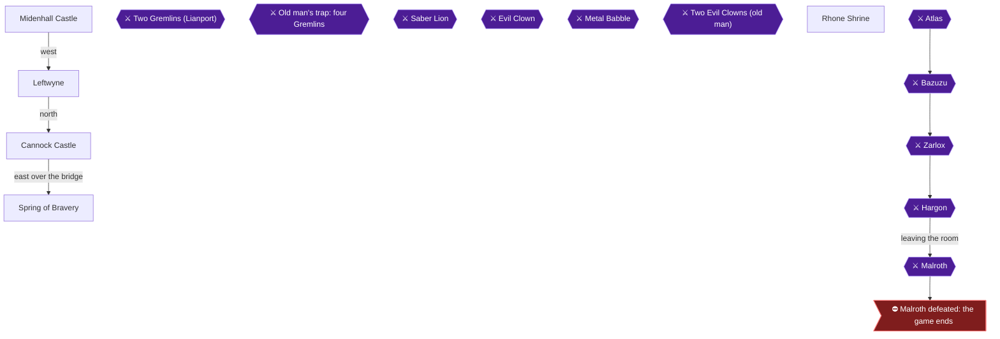

### Area Overview & Preparation

This chapter covers the opening of the game. You start in Midenhall Castle, collect the Copper Sword, gain your first levels, walk west to Leftwyne, north to Cannock Castle, east to the Spring of Bravery, and finally recruit the Prince of Cannock at the Leftwyne inn. Achievements in this chapter:

- **'Tis Dangerous to Venture Alone** (Copper Sword equipped) [[gf2-4-2, ra-guide-5-1]]
- **Thou Hast Leveled Up** (Hero level 2) [[gf2-28-3]]
- **Thou Hast Becometh Swole** (Hero level 5) [[gf2-28-4, gf4-3-9]]
- **Thou Art Now Buddies** (Prince of Cannock joins) [[gf2-7-12]]
- **Thou Hast a Ball of Fire** (Fireball, Prince level 3) [[gf-lists-11-7]]
- **Thou Art a Physician** (Antidote, Prince level 6) [[ra-guide-11-2]]

Key preparation notes:

- Hardcore Mode means no save states. Save with the king in Midenhall Castle (or the Cannock king) regularly [[gf2-15-16, gf3-23-2]].
- Poison: while poisoned, each step weakens you further [[gf4-4-16]]. Babble enemies can poison you [[gf3-25-4]].

> [!TIP]
> There are no permanent lockouts in this chapter. Before you leave the Midenhall area, make sure the Copper Sword is equipped and the Hero has a few levels.

### Chapter Items to Collect (5 Items Total)

| Item | Where Found | Action / Requirement | Citation |
|---|---|---|---|
| Copper Sword | Midenhall Castle, chest downstairs | **TAKE and EQUIP** | [[gf3-18-1, ra-guide-5-2]] |
| 50 gold | Same chest | **TAKE** | [[gf3-18-2]] |
| Medical Herb | Spring of Bravery, room south of the water | **TAKE** | [[gf2-7-5]] |
| Gold (15-ish) | Spring of Bravery, winding path | **TAKE** | [[gf2-7-6]] |
| Medical Herb | Spring of Bravery, chest left of the large spring | **TAKE** | [[gf2-7-7]] |

### Midenhall Castle

🗺️ **Map:** [View Midenhall Castle Map by FlyingArmor](https://www.vgmaps.com/Atlas/NES/DragonWarrior-Part2-MidenhallCastle.png)

You begin in the throne room. The Hero starts wearing Leather Armor [[gf4-3-3]]. Move to the king and follow him down the staircase [[gf2-4-2]].

#### The Copper Sword chest (Achievement)

Downstairs, look to the left and open the treasure chest: inside is a **Copper Sword** and **50 gold** [[gf3-18-1, gf2-4-2]]. Two chests are waiting downstairs, and one of them holds the sword [[ra-guide-5-1]]. The contents of the other chest: Unable to verify from collected sources.

**You must equip the sword.** Press A to open the menu, choose EQUIP, and equip the Copper Sword on the Hero [[ra-guide-5-2, gf2-4-3]]. The achievement requires finding and equipping it.

> [!WARNING]
> **Missable Achievement Warning:** A commenter notes this achievement may be skippable or missable depending on whether buying a Copper Sword later also unlocks it [[ra-comments-7-1]]. Don't gamble: equip the free sword right now, before leaving the castle.


> [!ACHIEVEMENT]
> **'Tis Dangerous to Venture Alone (1 Points)**
> 
> *Find and equip the Copper Sword*


#### Exploring the castle

- Go south, then west, and speak to the old man: the whirlpool across the bridge is a Travel Door. **Do not step on it.** It only leads to a small island with no path onward [[gf4-3-18, gf2-4-4]].
- North of the Travel Door are two Silver Doors that you cannot open yet [[gf4-8-7]].
- From the Travel Door, go east then south to reach the outdoor section of the castle [[gf4-3-8]].

#### Shops

| Shop | Item | Price | Citation |
|---|---|---|---|
| Tool Shop | Medical Herb | 15 G | [[gf2-5-1]] |
| Tool Shop | Antidote Herb | 8 G | [[gf2-5-2]] |
| Inn | Night's rest | 4 G | [[gf2-5-9, gf3-18-6]] |

Buy three Medical Herbs before heading out [[gf4-3-10]]. Antidote Herbs are only useful later, so don't invest in them yet [[gf3-18-5]].

### Leveling Outside Midenhall

Fight monsters just outside Midenhall [[gf3-18-7]]. Slimes, Big Slugs, Iron Ants and Wild Mice can drop Medical Herbs [[gf4-3-12, gf4-3-13, gf4-3-14, gf4-3-16]].

- The Hero needs 12 EXP for level 2 [[gf2-28-3]].


> [!ACHIEVEMENT]
> **Thou Hast Leveled Up (2 Points)**
> 
> *Have your hero reach level 2*


- Reach level 3 before venturing farther, and carry a Medical Herb or two [[gf2-5-3]]. The guide suggests level 3 or 4 here; at level 4 some enemies flee, so there is no point staying longer [[gf3-18-7, gf3-18-8]].
- Rest at the inn (4 G) whenever HP runs low [[gf3-18-6]].
- Level 5 needs 140 EXP [[gf2-28-4]]. You will reach it on the way to Leftwyne and Cannock.

Before leaving, save with the king [[gf2-15-16]].

### Leftwyne

🗺️ **Map:** [View Leftwyne Map by FlyingArmor](https://www.vgmaps.com/Atlas/NES/DragonWarrior-Part2-Leftwyne.png)

**Route:** From Midenhall, walk west past the desert and swamp. Avoid the swamp [[gf2-5-7]]. Another description: follow the grass path northwest, west, then south [[gf4-3-11]].

#### Layout

- Tool Shop: west of the town entrance [[gf4-4-11]].
- Inn: east of the entrance [[gf4-4-12]].
- Weapons and Armor Shop: north of the Tool Shop [[gf4-4-13]].
- House of Healing: north of the Inn [[gf4-4-14]]. It offers Detoxicate (cures poison), Uncurse and Revival [[gf4-4-18, gf4-4-19, gf4-4-20]].
- A man with hiccups is at the southeast corner [[gf4-4-15]].

#### Shop prices

| Shop | Item | Price | Citation |
|---|---|---|---|
| Weapons | Club | 60 G | [[gf-lists-12-6]] |
| Weapons | Copper Sword | 100 G | [[gf2-6-1]] |
| Weapons | Magic Knife | 200 G | [[gf-lists-13-2]] |
| Weapons | Chain Sickle | 390 G | [[gf-lists-13-3]] |
| Weapons | Chain Mail | 480 G | [[gf-lists-13-4]] |
| Weapons | Leather Shield | 90 G | [[gf-lists-13-5]] |
| Tools | Medical Herb | 15 G | [[gf-lists-12-3]] |
| Tools | Antidote Herb | 8 G | [[gf-lists-12-4]] |
| Tools | Wing of the Wyvern | 80 G | [[gf2-6-2]] |
| Inn | Night | 6 G | [[gf3-20-3]] |

Buy a Leather Shield first; it is likely the only thing you can afford [[gf2-6-3]]. One guide also suggests the Magic Knife for the Hero [[gf4-4-21]], while another names the Chain Sickle as the best offensive buy and the Chain Mail as the best defensive one [[gf3-20-5]]. Pick based on your funds.

#### Leveling

Grind just outside Leftwyne. Level 5 is the minimum before going north [[gf2-6-4]], and one guide recommends level 6 or so [[gf3-20-3, gf3-20-4]]. Reaching Hero level 5 (140 EXP) unlocks:


> [!ACHIEVEMENT]
> **Thou Hast Becometh Swole (3 Points)**
> 
> *Have your hero reach level 5*


The Hero reaching level 5 is the goal listed by the walkthroughs [[gf4-3-9, gf2-28-4]]. The RA guide suggests getting the Hero to around level 3 before beginning the search for the Prince [[ra-guide-10-2]].

### Cannock Castle

🗺️ **Map:** [View Cannock Castle Map by FlyingArmor](https://www.vgmaps.com/Atlas/NES/DragonWarrior-Part2-CannockCastle.png)

**Route:** Walk due north from Leftwyne [[gf2-6-4]].

#### Layout and shops

- Tool Shop west of the entrance, Inn north of it, castle entrance east of it [[gf4-5-5, gf4-5-6, gf4-5-7]].
- Tool Shop: Medical Herb 15, Antidote Herb 8, Wing of the Wyvern 80, Fairy Water 40 [[gf-lists-13-6, gf-lists-13-7, gf-lists-13-8, gf-lists-13-9]].
- Inn: 8 G [[gf3-23-1]]. The king can save your game [[gf3-23-2]].

#### Talking to people

1. The prince is not here; he has left for the Spring of Bravery, east of the castle [[gf2-6-5]].
2. Speak to the two guards first. They tell you a cave far to the east is where the Spring of Bravery rises [[gf4-5-11]].
3. Princess Halla: answer "Yes" to her question to learn her brother went to the Spring of Bravery but travels slowly [[gf4-5-9]].
4. The king says his son has already left and must be found [[gf4-5-10]].
5. One prisoner says a Silver Key opens all silver doors [[gf4-5-8]].

Buy two or three Antidote Herbs before the cave, since Babbles poison [[gf3-25-4]]. Save with the king [[gf3-23-2]]. The walkthrough suggests the Hero be around level 7 before moving on [[gf4-5-13]].

> [!TIP]
> Before you leave Cannock: the castle also holds a Gold door hiding the Shield of Erdrick, but it needs a Golden Key you do not have yet [[gf2-13-10]]. It is covered later.

### Spring of Bravery

🗺️ **Map:** [View Spring Of Bravery Map by FlyingArmor](https://www.vgmaps.com/Atlas/NES/DragonWarrior-Part2-SpringOfBravery.png)

**Route from Cannock:** Head east on the north side of the mountains, cross the bridge to a forest-covered cape, and enter the cave in the middle of the forest [[gf2-7-3]]. Another description: northeast then east to a bridge, cross it, then northeast to the cave [[gf4-5-12]].

#### Inside the cave

1. Ignore the branch leading left at the entrance; it is a dead end with no chests [[gf3-25-5]].
2. **Room below the small patch of water:** chest with a **Medical Herb** [[gf2-7-5, gf3-25-1, gf4-6-1]].
3. **Long winding path to the right:** chest with gold. Sources give 15 G, 16 G, or 15~30 G [[gf2-7-6, gf3-25-2, gf4-6-2]].
4. **At the Spring:** the chest to the left of the large spring holds another **Medical Herb** [[gf3-25-3, gf4-6-3, gf2-7-7]].

#### The Old Man

Speak to him; he says the Prince already left for Midenhall Castle [[gf4-6-6, gf2-7-10]]. Speak again and answer **No** (you are not seeking the prince) to be anointed with spring water, which heals you [[gf2-7-8, gf4-6-4]]. He also gives information about the Token of Erdrick [[gf2-7-9]].

### Prince of Cannock

#### Midenhall king

Return to Midenhall Castle and talk to the king: you just missed the Prince, who went to Leftwyne looking for you [[gf2-7-11, gf4-6-15]]. The "Midenhall" you were told at the spring is what commenters call a game error; the king meant Leftwyne [[ra-comments-8-2, ra-comments-8-3]].

#### Leftwyne inn

Walk to Leftwyne and enter the inn. The prince is waiting inside [[ra-guide-5-4]]. Talk to him and he joins your party [[gf2-7-12, gf4-6-8]].


> [!ACHIEVEMENT]
> **Thou Art Now Buddies (5 Points)**
> 
> *Add the prince of Cannock to the party*


Notes after he joins:

- He starts at level 1 and already knows Heal [[gf2-7-13, gf4-6-9]].
- Inns now cost double [[gf4-6-10]].

#### Grinding the Prince

Level him to at least 5 before the Lake Cave [[gf2-7-13]]. Grind around Cannock [[ra-guide-10-2]].

- At Prince level 3 he learns **Fireball** (2 MP) [[gf3-9-2, gf2-27-6]].


> [!ACHIEVEMENT]
> **Thou Hast a Ball of Fire (2 Points)**
> 
> *Learn the Fireball spell*


- At Prince level 6 he learns **Antidote** (3 MP) [[gf3-10-1, gf-lists-11-2]].


> [!ACHIEVEMENT]
> **Thou Art a Physician (2 Points)**
> 
> *Learn the Antidote spell*


Fireball hits one enemy for roughly 18 damage [[gf-lists-11-7]]. Antidote cures poison in one ally [[gf2-27-1]]. Use Fireball on tougher fights to speed the grind.

Gear: by the time the Prince reaches level 5 you should have enough gold to buy a Chain Sickle for both the Prince and yourself [[gf2-8-9]].

> [!IMPORTANT]
> ### Chapter 1 Cumulative 100% Checkpoint
> - **Crests:** 0 / 5
> - **Erdrick Equipment:** 0 / 4
> - **Chests:** Copper Sword chest and the three Spring of Bravery chests [[gf2-4-2, gf4-6-1]]
> - **RetroAchievements Unlocked:** 6 / 69 (15 / 427 points)

### Chapter Checklist

- [ ] Copper Sword obtained and **equipped** (46412)
- [ ] Hero level 2 (46404)
- [ ] Hero level 5 (46405)
- [ ] All three Spring of Bravery chests opened
- [ ] Answered "No" to the Old Man to be healed
- [ ] Prince of Cannock recruited at the Leftwyne inn (46410)
- [ ] Prince level 3: Fireball (46427)
- [ ] Prince level 6: Antidote (46428)
- [ ] Game saved with a king

---

## Chapter 2: The Lake Cave and the Silver Key

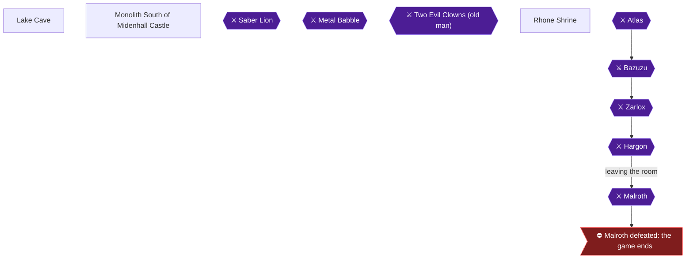

### Area Overview & Preparation

This chapter covers the trip to the Lake Cave (the guides also call it the Cave of the Lake) to fetch the Silver Key, plus the Silver-Door errands that become possible once you have it. Two achievements unlock here: **Thou Hast an Argent Door Opener** (find the Silver Key) and **'Tis Time to Stop** (learn StopSpell).

Preparation notes:

- You need the Prince of Cannock in your party. The Silver Key is in the Cave of the Lake, which is west of Cannock Castle [[gf2-5-4, gf4-6-12]].
- The sources suggest roughly the following levels. One guide expects the Hero to be around level 8 and the Prince around level 6 or 7 by now [[gf2-8-12]]. Another says to get Hero to level 10 and Orfeo to level 8 while in the cave [[gf4-8-5]]. Orfeo is that guide's name for the Prince of Cannock.
- Gold for two suits of Chain Mail should be earned by fighting enemies at the Lake Cave before you leave the area [[gf2-8-10, gf2-8-11]].
- The king in Cannock Castle can save your progress [[gf3-23-2]].
- Optional: bring a Wing of the Wyvern so you can escape back to town when supplies run low [[gf3-26-9]].

> [!NOTE]
> The old man at the Monolith South of Midenhall Castle explains where the key is. His directions and the route are in the section "Monolith South of Midenhall Castle" below [[gf4-6-13, gf4-6-14]].

### Chapter Items to Collect (7 Chests Total)

| Item | Where Found | Action / Requirement | Citation |
|---|---|---|---|
| Medical Herb | B1F, west of the entrance area | **TAKE** (chest) | [[gf4-7-1, gf2-8-2]] |
| 15–30 Gold (19 Gold in one version) | B1F, south of the water | **TAKE** (chest) | [[gf4-7-2, gf2-8-3]] |
| Antidote Herb | B2F, west branch | **TAKE** (chest) | [[gf4-8-1, gf2-8-6]] |
| Medical Herb | B2F, east branch | **TAKE** (chest) | [[gf2-8-5]] |
| 30–50 Gold (33 Gold in one version) | B2F, two-chest room | **TAKE** (chest) | [[gf4-8-2, gf2-8-7]] |
| Wing of the Wyvern | B2F, two-chest room | **TAKE** (chest) | [[gf4-8-3, gf2-8-7]] |
| **Silver Key** | B2F, last chest | **TAKE** (chest) | [[gf2-8-8, gf4-8-4, ra-guide-5-6]] |

> [!NOTE]
> The sources disagree on some details such as exact room layouts and gold amounts. One walkthrough gives 19 gold for the B1F gold chest, while another gives 15–30 gold [[gf2-8-3, gf4-7-2]]. Treat gold as a range.

### Getting to the Lake Cave

Lake Cave is west of Cannock's walls, on an island reached by a double bridge [[gf2-8-1]]. A second guide gives the route from Cannock Castle: travel northwest, then west to a bridge and cross it. Continue west through the Forest area, then west again to a cave surrounded by water, and go in [[gf4-6-16]].

### Lake Cave

🗺️ **Map:** [View Lake Cave Map by FlyingArmor](https://www.vgmaps.com/Atlas/NES/DragonWarrior-Part2-LakeCave.png)

The quickest way to the key is to head to the far bottom-left of B1F, then find the chest in the bottom-right of B2F [[ra-guide-5-6]]. The reward waits at the very end of the dungeon [[ra-guide-5-5]]. Open every chest on the way, as listed below.

Enemies here and their drops: Babble (Copper Sword), Healer (Lottery Ticket), Big Cobra (Antidote Herb), Army Ant (Medical Herb), Big Rat (Wing of the Wyvern), Magician (Bamboo Stick), Centipod (Leather Armor), Magic Ant (Lottery Ticket) [[gf4-7-4, gf4-7-5, gf4-7-6, gf4-7-7, gf4-7-8, gf4-7-9, gf4-7-10, gf4-7-11]].

#### B1F

1. Enter the cave. The south room at the entrance holds a chest with a Medical Herb; the north room is empty [[gf2-8-2]].
2. Go south and pass through the opening to the south. Head west to find a chest with a **Medical Herb** [[gf4-7-1]].
3. Continue west until you reach a body of water [[gf4-7-1]].
4. From the water, go south and pass through the opening to the east. Continue south to find a chest with **15–30 Gold** [[gf4-7-2]]. Another guide places a chest with 19 gold in the east room where the path forks [[gf2-8-3]]. Return to the water afterward [[gf4-7-2]].
5. From the water, go through the opening to the west. Continue west and pass through another opening [[gf4-7-3]]. Another guide describes this as continuing through a couple of doors to a stairway down to B2 [[gf2-8-4]].
6. Go through the opening to the south, then head down the staircase to the south to reach B2F [[gf4-7-3]].

#### B2F

1. Arriving at B2F, go west, then continue south. Pass through the third opening to the west and open the chest for an **Antidote Herb** [[gf4-8-1]]. In the other guide's layout, one branch leads right to a room with a chest holding a **Medical Herb** [[gf2-8-5]].
2. Another branch leads left to an **Antidote Herb** [[gf2-8-6]].
3. Go through the next opening to the west to find two chests. Open them for **30–50 Gold** and a **Wing of the Wyvern** [[gf4-8-2, gf4-8-3]]. The other guide lists these as a Wing of Wyvern and 33 gold [[gf2-8-7]].
4. Go back east. Continue east to the end, then head south all the way through three openings to find one final chest [[gf4-8-4]]. Another guide says the path passes through a few rooms to the last chest [[gf2-8-8]].
5. Open it for the **Silver Key**.


> [!ACHIEVEMENT]
> **Thou Hast an Argent Door Opener (5 Points)**
> 
> *Find the Silver Key*


The Silver Key opens metal locked doors [[gf2-26-19]].

#### StopSpell (Prince level 8)

While you are here, level your party. At level 8, the Prince learns **StopSpell**, which costs 3 MP and tries to stop enemies from casting spells [[gf-lists-11-22, gf4-8-6, gf2-27-21]]. The level-8 requirement is confirmed by the experience chart [[gf3-10-2, gf-versions-8-12, ra-guide-11-4]]. Fight in the cave until the Prince reaches level 8 if he has not already.


> [!ACHIEVEMENT]
> **'Tis Time to Stop (2 Points)**
> 
> *Learn the StopSpell... spell*


> [!TIP]
> Before you leave the Lake Cave, make sure you have all chests above, enough gold for two sets of Chain Mail, and the Prince at level 8 [[gf2-8-10, gf2-8-11, gf4-8-6]].

### Silver Key

With the key in hand, a few errands open up [[gf4-8-7]].

#### Midenhall Castle: Silver Doors

1. Travel to Midenhall Castle and go to the Travel Door. Two Silver Doors lie north of it. Unlock both and speak to the people inside [[gf4-8-7]].
2. For the jail stairs: from the Travel Door, go east and pass through the northwest opening into the room to the east. Unlock the Silver Door there, then go through the opening to the north and head down the staircase [[gf4-8-10, gf4-32-5]].
3. Speak to the prisoner through the jail door to learn that there is a third key, the **Jailor's Key** [[gf4-8-12]]. The jail itself comes later.

#### Leftwyne: The Lottery

The merchant in Leftwyne's Weapons and Armor Shop runs the Lottery, where Lottery Tickets are used [[gf4-8-14]]. Three Sun Symbols win the first prize, a Golden Card; three Star Symbols win the second prize, a Wizard's Ring [[gf4-8-15, gf4-8-16]]. Lottery Tickets drop from Healers and Magic Ants [[gf4-7-5, gf4-7-11]].

### Monolith South of Midenhall Castle

🗺️ **Map:** [View Midenhall Southern Shrine Map by FlyingArmor](https://www.vgmaps.com/Atlas/NES/DragonWarrior-Part2-MidenhallSouthernShrine.png)

From Midenhall Castle, travel south to a bridge and cross it. Keep going south until you find a monolith, and enter [[gf4-6-14]]. Inside is an old man, who says Silver Keys and Gold Keys exist [[gf4-6-13]]. The Gold Door here is used later: unlock it and step on the Travel Door [[gf4-27-20]].

> [!TIP]
> Before you leave, make sure the Silver Doors in Midenhall are unlocked, you have visited the Leftwyne lottery room, and you have saved at a king [[gf3-23-2]].

> [!IMPORTANT]
> ### Chapter 2 Cumulative 100% Checkpoint
> - **Dungeon Chests Opened (Lake Cave):** 7 / 7 [[gf4-7-1, gf4-7-2, gf4-8-1, gf2-8-5, gf4-8-2, gf4-8-3, gf2-8-8]]
> - **Crests:** 0 / 5
> - **Erdrick Equipment:** 0 / 4
> - **RetroAchievements Unlocked:** 8 / 69 (22 / 427 points)

### Chapter Checklist

- [ ] Reached the Lake Cave via the double bridge west of Cannock [[gf2-8-1]]
- [ ] Opened every chest on B1F and B2F
- [ ] Found the Silver Key (Thou Hast an Argent Door Opener)
- [ ] Prince of Cannock at level 8 with StopSpell ('Tis Time to Stop)
- [ ] Unlocked both Silver Doors north of Midenhall's Travel Door [[gf4-8-7]]
- [ ] Visited the prison stairs and spoke with the prisoner about the Jailor's Key [[gf4-8-12]]
- [ ] Visited the Leftwyne lottery room [[gf4-8-14]]
- [ ] Spoke to the old man at the Monolith South of Midenhall Castle [[gf4-6-13]]
- [ ] Saved at a king

---

## Chapter 3: Hamlin, Moonbrooke and the Mirror of Ra

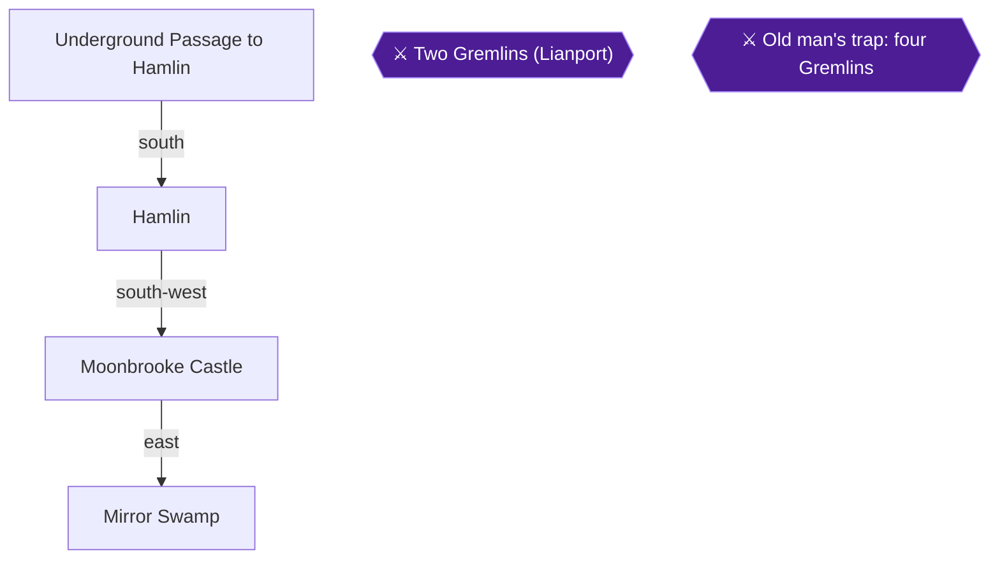

### Area Overview & Preparation

This chapter takes you through the monolith west of Cannock, down the Underground Passage to Hamlin, and then to the ruins of Moonbrooke Castle. You then find the Mirror of Ra in a small swamp and use it on the dog in Hamlin to recruit the Princess of Moonbrooke, your third party member. Along the way you will pick up several level and spell achievements.

Before you start:

- You need the prince in your party. The monolith south of the route is only usable with a companion [[gf2-8-13]].
- The guide suggests raising the prince to about level 6 before the passage, so he doesn't fall almost instantly in battle [[gf3-28-1]].
- Magicians in the cavern cast damaging fire spells and have large HP [[gf3-28-3]].
- Bring Medical Herbs and a Wing of the Wyvern. Hamlin's tool shop sells the Wing for 80 [[gf-lists-13-12]].

> [!TIP]
> **Before you leave this area:** Hamlin has no point of no return. Finish the princess, her three spells, and the Moonbrooke basement before moving on. The route to the Tower of Wind starts from Hamlin.

### Chapter Items to Collect

| Item | Where Found | Action / Requirement | Citation |
|---|---|---|---|
| Mirror of Ra | Small swamp east of Moonbrooke Castle | **SEARCH** the swamp tiles | [[gf2-11-4, gf3-32-2, gf4-11-9]] |
| Moonbrooke Castle chests (2) | Moonbrooke Castle | Both are **EMPTY** | [[gf2-11-12]] |

### Underground Passage to Hamlin

1. Leave Cannock Castle and follow the forest path southwest to the Monolith West of Cannock Castle, then enter it [[gf4-8-24]].
2. Inside, the old man only talks about the monolith south of Midenhall, and the guards let you through. Take the staircase to the south [[gf4-8-23, gf4-8-24]].
3. In the cavern you can go left or down. The left path leads to a monolith on a dead-end island, so go down instead [[gf3-28-4]].
4. Go south to the end, go through the opening to the west, then climb the staircase [[gf4-9-1]].
5. On the way, the tunnel has Ghost Mice, Magicians, Big Cobras, Big Rats and Centipods. Their drops include Clothes, a Bamboo Stick, an Antidote Herb, a Wing of the Wyvern and Leather Armor [[gf4-8-29, gf4-8-32, gf4-8-33, gf4-8-34, gf4-8-35]].
6. Outside, walk south along the peninsula to Hamlin. The enemies here are tougher, and the guide says fleeing is acceptable because reaching Hamlin is the priority [[gf2-9-2, gf4-9-2, gf3-29-1]]. Centipods have tough shells and can poison you [[gf3-29-1]].
7. Roaming enemies here include Army Ants, Magidrakees, Smoke, Baboons, Zombies and Lizard Flies. Lizard Flies drop a Lottery Ticket [[gf4-9-3, gf4-9-4, gf4-9-5, gf4-9-6, gf4-9-7, gf4-9-8]].

### Hamlin

🗺️ **Map:** [View Hamlin Map by FlyingArmor](https://www.vgmaps.com/Atlas/NES/DragonWarrior-Part2-Hamlin.png)

**Layout:**

- The Inn is south of the town entrance [[gf4-10-12]].
- The Weapons and Armor Shop and the Tools Shop are both east of the Inn [[gf4-10-13, gf4-10-14]].
- The Lottery is north of the Weapons and Armor Shop [[gf4-10-15]].
- The House of Healing is north of the Lottery [[gf4-10-16]].
- A locked building is west of the House of Healing [[gf4-10-17]].
- The Inn costs 12 gold per character [[gf3-29-1, gf4-10-11]].

**Saving:** The old man or sage just left of or outside the House of Healing records your progress [[gf3-29-2, gf4-10-20]].

**Talking to townsfolk:** The soldier in the northwest corner escaped from Moonbrooke Castle and appears to be the sole survivor [[gf4-10-21]]. Another resident mentions a tall tower holding the Cloak of Wind and says Moonbrooke Castle lies southwest [[gf4-10-18, gf4-10-19]].

**The dog:** Talk to the dog and it follows you. Remember where it is, because you will return with the Mirror [[gf2-10-16, gf4-10-22]]. Ra's guide places it in the north-east corner of town [[ra-guide-5-9]]. You cannot change her back yet.

**Tool Shop:**

| Item | Price | Citation |
|---|---|---|
| Medical Herb | 15 | [[gf-lists-13-10]] |
| Antidote Herb | 8 | [[gf-lists-13-11]] |
| Wing of the Wyvern | 80 | [[gf-lists-13-12]] |
| Fairy Water | 40 | [[gf-lists-13-13]] |

**Weapon and Armor Shop:**

| Item | Price | Citation |
|---|---|---|
| Chain Sickle | 390 | [[gf-lists-13-14]] |
| Iron Spear | 770 | [[gf-lists-13-15]] |
| Broad Sword | 1500 | [[gf-lists-13-16]] |
| Chain Mail | 480 | [[gf-lists-13-17]] |
| Full Plate Armor | 1000 | [[gf-lists-13-18]] |
| Steel Shield | 2000 | [[gf-lists-13-19]] |

**Buying:** One guide says to buy a Broad Sword for the hero and an Iron Spear for the prince, selling your old gear [[gf4-10-23]]. Another suggests Full Plate Armor for the hero, passing his Chain Mail to the prince [[gf3-29-4]]. A third says to buy a Broad Sword and Steel Shield for the hero before leaving the area [[gf2-11-9]].

**Lottery:** You need a Lottery Ticket to play. Tickets drop from enemies or appear in chests, and the tool shop merchant sometimes gives one as a bonus with a purchase [[gf2-9-3, gf2-9-4]]. Prizes:

- 3 Sun symbols win the Golden Card [[gf2-10-1]].
- 3 Star symbols win the Wizard's Ring [[gf2-10-2]].
- 3 Moon symbols win the Wizard's Wand [[gf2-10-3]].
- 3 Water symbols win the Dragon's Bane [[gf2-10-4]].
- 3 Heart symbols win a Medical Herb [[gf2-10-5]].

#### Leveling before the swamp

The monsters on the way to the swamp are tough [[gf3-32-4]]. One guide says to raise each character to at least level 10 first [[gf3-29-3]]. Ra's guide suggests grinding around Hamlin because a healing spot is close, while the Tower of Wind has stronger enemies for more experience [[ra-guide-10-3, ra-guide-10-4]].


> [!ACHIEVEMENT]
> **Thou Art Large (5 Points)**
> 
> *Have your hero reach level 10*

Raise the hero to level 10, which needs 2,800 experience points [[gf2-28-5]]. Grind near Hamlin and rest at the Inn as needed [[ra-guide-10-3]].


> [!ACHIEVEMENT]
> **Thou Art a Traveler (2 Points)**
> 
> *Learn the Return spell*

Raise the prince to level 10 to learn Return, which costs 6 MP and takes you to the town where you last saved [[gf-lists-11-17, gf2-27-16, gf3-10-3, gf4-11-20, ra-guide-11-5]]. The guide says to save in Hamlin first. Return gives you a safe trip back from the swamp [[gf3-32-5]].

Before heading out, save with the old man in Hamlin [[gf4-10-20]].

### Moonbrooke Castle

🗺️ **Map:** [View Moonbrooke Castle Map by FlyingArmor](https://www.vgmaps.com/Atlas/NES/DragonWarrior-Part2-MoonbrookeCastle.png)

This visit is optional for the Mirror, but it is required for the basement achievement [[ra-guide-5-7]].

**Getting there:** From Hamlin, cross the bridge to the south, head south, then follow the grass west and south to a castle surrounded by poisonous swamp [[gf4-10-24]]. Hamlin's guide also says it lies southwest [[gf4-10-19]]. Enemies on the way include Magic Ants (Lottery Ticket) and Megapedes (Leather Shield) [[gf4-10-25, gf4-10-26]].

**Hazards:** Swamp tiles inside the castle deal damage, so watch your steps [[gf2-11-14]]. Metal Slimes appear here and drop an Iron Helmet [[gf4-11-1]].

**The ghosts:**

1. The flame-like figures are ghosts of the former residents, and they speak when you talk to them [[gf2-11-10]].
2. From the entrance, go west, south, then west to find a Flame Spirit crying for help [[gf4-11-2]].
3. Return to the entrance, go west, then north, and pass through the opening east to reach the throne room. The Flame Spirit there is the King, whose daughter was cursed and turned into a common mutt [[gf4-11-3, gf4-11-4, gf2-11-11]].
4. Return to the entrance, then go west, north, west, north. You find another Flame Spirit, a Silver Door and two chests [[gf4-11-5]]. Both chests are empty [[gf2-11-12]].
5. This second Flame Spirit says the Mirror of Ra was lost in a swamp southeast of Hamlin, where four bridges can be seen [[gf4-11-6]]. Another source says a spirit in a ruined cell to the left reveals the Mirror's location [[gf3-35-9]].

### Moonbrooke Castle Secret Basement


> [!ACHIEVEMENT]
> **Thou Hast Eased a Warrior's Passing (5 Points)**
> 
> *Find the secret basement of Moonbrooke Castle*

1. Exit through the opening in the northwest corner of the castle [[gf4-11-5, ra-guide-12-1]].
2. Outside, hug the left wall and go down along the outer walls of the castle [[ra-guide-12-1, gf2-11-13]].
3. Continue south to the southwest corner. There is an opening that leads back into the castle [[gf4-11-7]].
4. Go inside, cross the courtyard and take the staircase down in the northeast [[gf4-11-7]].
5. Speak to the guard below. He explains that the Princess was transformed by a curse that only the Mirror of Ra can break [[gf4-11-8, ra-comments-74-1]]. He is the only person left alive in the castle [[gf2-11-13]].

The guide suggests getting the hero to level 12 and the prince to level 10 while you are here [[gf4-11-19]].

### Mirror Swamp

1. From Moonbrooke Castle, travel east until you find a poisonous swamp [[gf4-11-9, ra-guide-5-7]]. The swamp is small, with a bridge nearby. Another guide describes it as just east of a bridge leading north [[gf3-32-2]].
2. Enter the swamp. Sources disagree on which corner holds the Mirror. Two guides say the northeast or upper-right corner [[gf2-11-4, gf3-32-2]], and one says the top-left [[gf4-11-9]]. SEARCH on the swamp's tiles, trying each corner, until you find it.
3. Swamp tiles damage you each step, so heal as needed [[gf2-11-14]].
4. Searching the correct tile gives you the **Mirror of Ra** [[gf-lists-10-4, gf2-11-4, gf4-11-6, ra-guide-5-8]].


> [!ACHIEVEMENT]
> **Thou Art Vain (5 Points)**
> 
> *Find the Mirror of Ra*


Now return to Hamlin. Use Return, or a Wing of the Wyvern, as the guide suggests [[gf3-32-5, gf2-11-4]].

### Princess of Moonbrooke

1. In Hamlin, find the dog in the north-east corner of town [[ra-guide-5-9]].
2. Stand in front of the dog and use the Mirror of Ra from the item menu [[gf4-11-10]].
3. The mirror shatters and the dog transforms into the Princess of Moonbrooke [[gf2-11-5]].


> [!ACHIEVEMENT]
> **Thou Art Now a Trio (5 Points)**
> 
> *Add the princess of Moonbrooke to your party*

She joins your party [[gf2-11-6, gf3-32-6, gf4-11-11]]. She starts at level 1 [[gf2-11-7]]. Inns now cost three times the normal price [[gf4-11-12]].


> [!ACHIEVEMENT]
> **'Tis No Longer a Flesh Wound (2 Points)**
> 
> *Learn the HealMore spell*

She already knows HealMore at level 1 [[gf3-14-1, ra-guide-11-9, gf-lists-11-10]]. The achievement only counts as learned once she is recruited [[ra-comments-51-2]]. It is possible to grind the prince to level 14 for it before recruiting her [[ra-comments-51-1]].

Grind her near Hamlin until she has learned her spells:


> [!ACHIEVEMENT]
> **Thou Art Stupefying (2 Points)**
> 
> *Learn the Sleep spell*

Sleep at level 2, for 2 MP, puts a group of enemies to sleep [[gf3-14-2, gf-lists-11-20, gf2-27-19, ra-guide-11-17, gf4-11-14]].


> [!ACHIEVEMENT]
> **Thou Art Hot (2 Points)**
> 
> *Learn the Infernos spell*

Infernos at level 4, for 4 MP, damages a group of enemies [[gf3-14-3, gf-lists-11-13, gf2-27-12, ra-guide-11-18, gf4-11-15]]. It is the wind spell rather than a fire spell, and is called Woosh in later versions [[ra-comments-53-1, ra-comments-53-2]].


> [!ACHIEVEMENT]
> **Thou Art Beguiling (2 Points)**
> 
> *Learn the Surround spell*

Surround at level 6, for 2 MP, lowers enemy hit chance [[gf3-14-4, gf-lists-11-23, gf2-27-22, ra-guide-11-19, gf4-11-16]].

Her experience needs: level 2 at 100, level 4 at 600, level 6 at 2,400 [[gf3-14-2, gf3-14-3, gf3-14-4]]. One guide targets the party at hero 13, prince 11, princess 6 [[gf4-11-13]], and another says to leave once she is level 4 or 5 [[gf2-11-8]].

Optional: return to Moonbrooke Castle and speak to the King's spirit to reunite him with his daughter [[gf4-11-17]].

### Leaving

From Hamlin, the route to the Tower of Wind goes east, north to another bridge, and on [[gf4-11-18, ra-guide-5-10]]. Unable to verify from collected sources: any further detail beyond that for this chapter.

> [!IMPORTANT]
> ### Chapter 3 Cumulative 100% Checkpoint
> - **Moonbrooke Castle Chests Opened:** 2 / 2 (both empty) [[gf2-11-12]]
> - **Crests:** 0 / 5
> - **Erdrick Equipment:** 0 / 4
> - **RetroAchievements Unlocked:** 17 / 69 (52 / 427 points)

### Chapter Checklist

- [ ] Hero is level 10 or higher (46406)
- [ ] Prince has learned Return (46430)
- [ ] Moonbrooke secret basement found (116314)
- [ ] Mirror of Ra found (46416)
- [ ] Princess of Moonbrooke joined (46411)
- [ ] HealMore counted (46432)
- [ ] Sleep learned (46439)
- [ ] Infernos learned (46440)
- [ ] Surround learned (46441)
- [ ] Game saved in Hamlin

---

## Chapter 4: The Tower of Wind

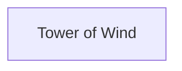

### Area Overview & Preparation

This chapter has two goals: reach the Tower of Wind and claim the **Cloak of Wind**, and learn the **Outside** spell. The Cloak is the reward for "Thou Hast Conquered the East", and Outside unlocks "Thou Art a Master of Escape". The tower lies east of Hamlin, reached by the northern bridge [[ra-guide-5-10]]. Hamlin's villagers also hint that a tall tower holds the Cloak of Wind, which can save someone who falls from a great height [[gf4-10-18]].

**Preparation:**
- Level up before you go. One guide expects the hero to be at least level 11 by the time he has an Iron Spear and Full Plate Armor [[gf2-10-19]]. Another suggests Hero 14, Orfeo (the Prince of Cannock) 12 and Peta (the Princess of Moonbrooke) 7 for the tower [[gf4-13-9]].
- Buy plenty of Medical Herbs. Getting to the tower is hard enough, and going through it is harder [[gf2-10-19]].
- Pack a way home. Outside, learned at level 12, gets you out of the tower [[gf4-13-11]]. Return also takes you back to the entrance of Hamlin [[gf2-11-2]].
- Ghost Rats in the tower can drop a Medical Herb [[gf4-12-1]]. Baboons on the coastal path are tough [[gf2-10-17]].
- A community tip: certain hero names (such as 'uHkd' or 'TUT') are reported to help assemble the full party and reach the Cloak quickly, after which you can return to Midenhall to grind [[ra-comments-4-4]]. This is optional.

> [!WARNING]
> **Tower edges:** Stepping off the open edges of the tower drops you back to the Overworld [[gf4-12-4]]. It is especially annoying to fall on the upper floors right before the treasure [[gf2-10-25]]. Stay on the paths.

### Chapter Items to Collect (3 Items Total)

| Item | Where Found | Action / Requirement | Citation |
|---|---|---|---|
| Medical Herb | Tower of Wind 1F, chest reached by going south then east | **TAKE** | [[gf4-12-2]] |
| 40~60 Gold | Tower of Wind 3F, chest east of the up staircase | **TAKE** | [[gf4-13-3]] |
| Cloak of Wind | Tower of Wind 2F chest (after climbing to 5F and descending) | **TAKE**, then **USE** as an item to equip | [[gf4-13-8]] |

Other guides list different gold amounts for a chest on the way (48 gold [[gf2-10-27]], 45 gold [[gf3-33-3]]). The 3F chest is listed as 40~60 gold [[gf4-13-3]], so the exact amount varies by guide.

### Route From Hamlin to the Tower

From Hamlin, head east. Do **not** cross the first bridge. Walk north along the river to another bridge and cross it [[gf2-10-17]]. Then travel southeast, south, then southwest to two bridges. Cross either one, continue southeast to three bridges, cross them, then head west to find the tower [[gf4-11-18]]. The coast path winds south past Baboons, and the final stretch is a grassy path leading west to the tower [[gf2-10-17]]. Enter the tower.

### Tower of Wind

🗺️ **Map:** [View Tower Of Wind Map by FlyingArmor](https://www.vgmaps.com/Atlas/NES/DragonWarrior-Part2-TowerOfWind.png)

#### 1F

1. The first floor has three stairways leading up. Two of them (the one at the first intersection and the one to the southwest) are connected and lead up 7 floors to a dead end. Do not take them [[gf2-10-20, gf2-10-22]].
2. From the entrance, go south to the first staircase going up. Ignore it for now [[gf3-33-4]].
3. Continue south, then east, into the room on the right and open the chest for a **Medical Herb** [[gf4-12-2, gf2-10-21]].
4. Return to the staircase you ignored. From there go east, then north, to a different staircase going up, in the northeast of the floor. Take this one [[gf4-12-3, gf2-10-23, ra-guide-5-11]].

#### 2F (first visit)

1. Speak to the Guard, who warns you not to stray over the tower's edge [[gf4-13-1]].
2. Follow the path left and take the staircase to the west, up to 3F [[gf4-13-2, gf2-10-26]].

#### 3F (first visit)

1. Before taking the next staircase up, go east and open the chest for **40~60 Gold** [[gf4-13-3]].
2. Climb the staircase in the southwest corner [[gf2-10-28]].

#### 4F (first visit)

Go east to the staircase going up and climb it to 5F [[gf4-13-4, gf2-10-29]].

#### 5F

Go west, then north, then go down the staircase to the east. This is the "first of two stairs" the route needs, and it leads back down [[gf4-13-5, ra-guide-5-11]].

#### Descent: 4F, 3F, 2F

1. On 4F, take the nearby staircase down [[gf4-13-6]].
2. On 3F, take the nearby staircase down [[gf4-13-7]].
3. You arrive in a 2F room with a chest. Open it to find the **Cloak of Wind** [[gf4-13-8, gf2-10-30]].


> [!ACHIEVEMENT]
> **Thou Hast Conquered the East (10 Points)**
> 
> *Find the Cloak of Wind*


The Cloak of Wind cannot be bought and lets you fall a few steps ahead when jumping [[gf-lists-9-17]]. It is also what lets you jump across the Dragon's Horn towers later [[gf2-26-3]].

> [!TIP]
> To equip it, **use the Cloak of Wind as an item** from the Hero's inventory. It is not equipped automatically [[gf4-13-8]]. Do this now so you do not forget.

The chest on the 9th floor at the very top is empty and only worth the climb if you are healthy and want EXP or gold [[gf2-11-1]].

### Learning Outside

Outside is learned by the Prince of Cannock (Orfeo) at level 12 and by the Princess of Moonbrooke (Peta) at level 17. It costs 6 MP and places the party outside of a cave or tower [[gf-lists-11-15, ra-guide-11-6, ra-guide-11-7]]. The level data agrees: the Prince has Outside at level 012 and the Princess at level 017 [[gf3-11-1, gf3-16-2]]. Your first chance is the Prince reaching level 12, which usually happens around this tower [[gf4-13-10]].

If Orfeo is still below level 12, fight around the tower until he gets there. The achievement unlocks when he learns the spell, so there is no need to cast it, but casting it is a free way out of the tower. Peta learns Outside at level 17 later [[gf4-33-17]].


> [!ACHIEVEMENT]
> **Thou Art a Master of Escape (2 Points)**
> 
> *Learn the Outside spell*


### Leaving the Tower

You have what you came for. Backtrack, cast Outside, or fall off any edge [[gf4-13-11]]. Another guide suggests walking off the edge and casting Return, which puts you at the entrance of Hamlin [[gf2-11-2]].

> [!TIP]
> **Before you leave the tower:** confirm that you have the Cloak of Wind and have used it to equip it [[gf4-13-8]], that the Medical Herb and gold chests are collected [[gf4-12-2, gf4-13-3]], and that Orfeo knows Outside [[gf4-13-10]].

> [!IMPORTANT]
> ### Chapter 4 Cumulative 100% Checkpoint
> - **Tower of Wind Chests Opened:** 3 / 3 (Medical Herb, 40~60 Gold, Cloak of Wind) [[gf4-12-2, gf4-13-3, gf4-13-8]]
> - **Crests:** 0 / 5
> - **Erdrick Equipment:** 0 / 4
> - **RetroAchievements Unlocked:** 19 / 69 (64 / 427 points)

### Chapter Checklist

- [ ] Reached the Tower of Wind via the northern bridge east of Hamlin
- [ ] Opened the 1F chest for a Medical Herb
- [ ] Opened the 3F chest for 40~60 Gold
- [ ] Climbed to 5F, then descended to the 2F chest room
- [ ] Obtained the Cloak of Wind and used it to equip it (46417)
- [ ] Orfeo reached level 12 and learned Outside (46431)
- [ ] Left the tower

---

## Chapter 5: The Dragon's Horn and Lianport

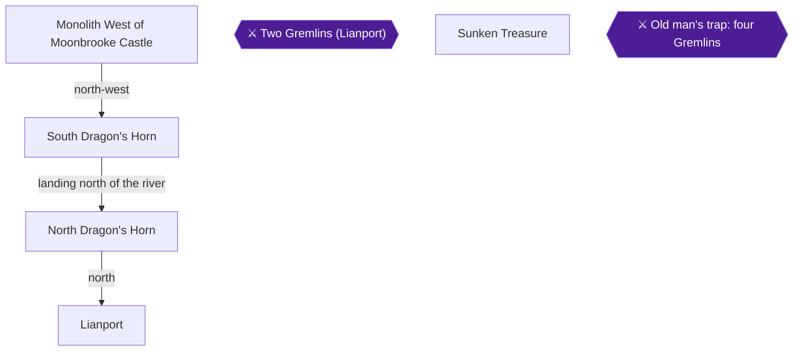

### Area Overview & Preparation

This chapter takes you from the ruins of Moonbrooke to the seaside town of Lianport. You cross the Dragon's Horn twin towers by jumping off the top of the southern tower with the Cloak of Wind, rescue a girl in Lianport to earn a ship, and recover the sunken Relentless treasure for the Echoing Flute. You will also fetch the Dew's Yarn from the northern tower, which is needed later for the Water Flying Cloth.

**Preparation:**
- Be at least level 13 before entering the Dragon's Horn tower [[gf2-11-16]]. A later guide suggests Hero 15, Orfeo 13 and Peta 8 before continuing in Lianport [[gf4-16-19]].
- The trek has no rest stops in between, so be sufficiently leveled and carry healing items [[ra-guide-5-12]].
- Have the Cloak of Wind from the Tower of Wind [[gf4-13-8]]. It must be used as an item from the Hero's inventory to equip it [[gf4-13-8]]. Make sure it is equipped on your lead character before you climb the tower [[gf3-36-4]].
- You need the Silver Key for the locked door in Lianport [[gf2-12-10]].
- Peta (the Princess of Moonbrooke) learns Repel at level 8 [[gf-lists-11-16, ra-guide-11-20]].

> [!WARNING]
> **Achievement Trigger Warning:** The jump achievement only triggers if the Cloak of Wind is equipped before you step off the tower, and you must leave the correct edge. If you leave the west end of a tower you fall west [[gf-lists-16-18]]. Use the north edge on 6F [[gf2-11-18]].

### Chapter Items to Collect (4 Items Total)

| Item | Where Found | Action / Requirement | Citation |
|---|---|---|---|
| Dew's Yarn | North Dragon's Horn, 3F | **SEARCH** the corner of the floor | [[gf2-14-14, gf2-14-15]] |
| Ship | Lianport port | Reward from the girl's grandfather after the Gremlin fight | [[gf4-16-26]] |
| Treasures | Pale water north of Lianport | **SEARCH** while sailing | [[gf2-12-12]] |
| Echoing Flute | Lianport, man behind the Silver Door | Reward for returning the Treasures | [[gf3-37-11]] |

### Monolith West of Moonbrooke Castle

🗺️ **Map:** [View Moonbrooke Western Shrine Map by FlyingArmor](https://www.vgmaps.com/Atlas/NES/DragonWarrior-Part2-MoonbrookeWesternShrine.png)

From Moonbrooke Castle, travel west to a bridge and cross it, then enter the Monolith to the west [[gf4-13-14]]. The Priest here only reminds you to visit the House of Healing. Take the staircase to the west, across the bridge, to come out on the other side of the river [[gf4-13-15, gf2-11-15]].

Roaming monsters on this stretch include Carnivog (drops a Lottery Ticket) and Mummy Man (drops Clothes) [[gf4-13-12, gf4-13-13]].

From the Monolith, travel west until you find a small body of water in the large desert, then go northwest and north until you reach a tower [[gf4-13-16]]. The twin towers are the Dragon's Horn, and a river divides them. Only the southern one can be entered [[gf2-11-15, ra-guide-5-13]].

### South Dragon's Horn

🗺️ **Map:** [View Dragon's Horn South Tower Map by FlyingArmor](https://www.vgmaps.com/Atlas/NES/DragonWarrior-Part2-Dragon'sHornSouthTower.png)

> [!TIP]
> Fully heal at the last opportunity. Monsters here include Medusa Ball (drops an Antidote Herb), Enchanter (drops Dragon's Bane) and Demighost (drops a Chain Sickle) [[gf4-14-2, gf4-14-3, gf4-14-4]].

The tower is simple: keep climbing and avoid the big pit that drops you back to the first floor [[gf2-11-17]].

#### 1F
Speak to the Merchant and answer **No** to his question [[gf4-14-5]]. Go up the staircase [[gf4-14-6]].

#### 2F
Go north, then east, then south, and climb the staircase [[gf4-14-7]].

#### 3F
Go north, then east, then south, and climb the staircase [[gf4-14-8]].

#### 4F
Go north, then east, then south, and climb the staircase to 5F [[gf4-15-1]].

#### 5F
Go north, then east, then south, and climb the staircase to 6F [[gf4-15-2]].

#### 6F — The Jump

Make sure the Cloak of Wind is equipped [[gf-lists-16-17]]. There is an opening to the northwest; it is important that you walk **north** through the opening [[gf4-15-3]]. Jump off the north edge [[gf2-11-18]].


> [!ACHIEVEMENT]
> **'Tis Not Flying! 'Tis Falling with Style! (3 Points)**
> 
> *Fly across the river between the Dragon Horn Towers*


You land on the north side of the river, next to the North Dragon's Horn [[gf4-15-3]].

### North Dragon's Horn

🗺️ **Map:** [View Dragon's Horn North Tower Map by FlyingArmor](https://www.vgmaps.com/Atlas/NES/DragonWarrior-Part2-Dragon'sHornNorthTower.png)

Enter the tower beside you.

#### 1F
Go up the staircase [[gf4-15-4]].

#### 2F
A new staircase appears to the upper right; climb it to 3F [[gf3-61-2, gf4-15-5]].

#### 3F — Dew's Yarn

Ignore any stairs leading further up. The Dew's Yarn is on this floor [[gf2-14-14]]. Sources disagree on the exact spot, so try them in order:

1. From the stairs leading down, go 5 steps right and 2 steps down (in the corner) and **SEARCH** [[gf2-14-15]].
2. Another guide says to stand still after arriving, go 4 steps north and 2 steps west, and search the ground [[gf4-15-6]].
3. A third says to walk straight up from the head of the stairs and search against the wall in the corner [[gf3-61-3]].

Take the **[Dew's Yarn]**. It is needed later to weave the Water Flying Cloth in Tuhn; the weaver takes a day, so you must save, reset and reload, then return to him [[gf2-21-9, gf2-21-10]]. The seamstress in Tantegel also points you to this floor [[gf4-27-3]].

Exit the tower normally and do not climb further [[gf4-15-7]].

### Lianport

🗺️ **Map:** [View Lianport Map by FlyingArmor](https://www.vgmaps.com/Atlas/NES/DragonWarrior-Part2-Lianport.png)

🗺️ **Map:** [View Lianport Northern Shrine Map by FlyingArmor](https://www.vgmaps.com/Atlas/NES/DragonWarrior-Part2-LianportNorthernShrine.png)

From the North Dragon's Horn, follow the grass path north, then east, to the town [[gf4-15-9, gf2-12-1]]. Metal Slime roams along the way (135 EXP, 90 gold, drops an Iron Helmet) [[gf4-15-8]].

**Town layout:** The Inn (20 gold per person) is east of the entrance [[gf4-16-3, gf4-16-13]]. The House of Healing is west of the Inn [[gf4-16-14]]. The Tools Shop is north of the House of Healing [[gf4-16-15]]. The Lottery is north of the Inn [[gf4-16-16]]. The Weapons and Armor Shop is north of the Tools Shop [[gf4-16-17]], and the port is east of it [[gf4-16-18]].

**Tools Shop:** Medical Herb 15, Antidote Herb 8, Wing of the Wyvern 80, Fairy Water 40, Dragon's Bane 640 [[gf-lists-13-20, gf-lists-13-21, gf-lists-13-22, gf-lists-13-23, gf-lists-13-24]].

**Weapons and Armor Shop:** Magic Knife 200, Broad Sword 1500, Wizard's Wand 2500, Full Plate Armor 1000, Clothes Hiding 1250, Steel Shield 2000 [[gf-lists-13-25, gf-lists-13-26, gf-lists-13-27, gf-lists-13-28, gf-lists-13-29, gf-lists-13-30]].

**Shopping advice:**
- Buy a Dragon's Bane for Hero, Orfeo and Peta and equip each [[gf4-16-21]]. It slightly increases defense [[gf2-12-3]].
- Buy the Wizard's Wand for Orfeo and Peta [[gf4-16-22]]; it is a must-buy for the Princess [[gf2-12-4]].
- Buy Clothes Hiding for Hero, Orfeo and Peta [[gf4-16-23]].
- Sell your old equipment [[gf4-16-24]].

### Two Gremlins (Lianport)

Go west of the Weapons and Armor Shop to find a young lady being attacked by two monsters [[gf4-16-25]]. Heal fully first: the Gremlins charge as soon as you enter, and they are tough [[gf2-12-7]].

Defeat both Gremlins.


> [!ACHIEVEMENT]
> **Thou Art a Hero (5 Points)**
> 
> *Save the young girl in Lianport*


The girl thanks you and asks you to follow her to meet her grandfather at the port [[gf2-12-8, gf4-16-26]]. He gives you his ship [[gf2-12-9, gf3-37-6]].

### Ship

Board the ship. Go down and unlock the locked door with the Silver Key; a merchant inside tells you of the pirate ship Relentless, which sank near Lianport with a great treasure, and offers a handsome reward for it [[gf2-12-10, gf2-12-11]]. Another source places this room behind the locked iron door in the northeast corner of town [[gf3-37-7, gf3-37-8]], while another says the Silver Door building is south of the port, reached by sailing south and docking [[gf4-16-27]].

> [!TIP]
> Before you leave Lianport, finish your shopping and rest at the inn. Exit the harbor by sailing north through the opening, then east, to reach the overworld [[gf4-16-31]].

Sea monsters here include Sea Slug (34 EXP, 80 gold, drops a Copper Sword) [[gf4-16-32]].

### Sunken Treasure

You are looking for a patch of water that is whitish or light-colored rather than blue [[gf2-12-12]]. Directions from various sources:

- From where the ship appears, sail 1 step east, 4 steps north, 1 step west, then directly north until you hit the light-colored water [[gf4-16-28]].
- Or from where the boat appears, go right one square, then sail north past shorelines to the light blue patch and position the ship just below it [[gf3-37-10]].
- Position the ship so the patch is directly above you, then **SEARCH** [[gf2-12-12]]. Another guide says to dive one square south of the whitish graphic [[ra-guide-6-3]].

You recover the **[Treasures]** [[gf2-12-12]].

### Echoing Flute

Return to the man behind the Silver Door in Lianport [[ra-guide-6-4]]. He rewards you with the Echoing Flute [[gf3-37-11, gf2-12-13]].


> [!ACHIEVEMENT]
> **Thine Inner Bard Hast Awakened (10 Points)**
> 
> *Receive the Echoing Flute as a reward for finding the sunken Treasures*


The flute echoes when played in an area with a crest, helping you find the five crests [[gf2-12-14]]. Exit Lianport normally, not by sea [[gf4-16-30]].

### Repel (Princess level 8)

Peta learns Repel at level 8 for 2 MP; it keeps weaker enemies from attacking [[gf-lists-11-16, gf2-27-15]]. If she is not yet level 8, grind around Lianport, which is a good option [[ra-guide-10-5]].


> [!ACHIEVEMENT]
> **Thou Art Foul of Odor (2 Points)**
> 
> *Learn the Repel spell*


> [!TIP]
> Before you leave Lianport, make sure you have the Dew's Yarn, the Echoing Flute and Repel. Next, sail east from Lianport past a bridge to reach Alefgard [[gf4-17-6]].

> [!IMPORTANT]
> ### Chapter 5 Cumulative 100% Checkpoint
> - **Crests:** 0 / 5
> - **Erdrick Equipment:** 0 / 4
> - **Key Items This Chapter:** Dew's Yarn, Ship, Echoing Flute [[gf2-14-14, gf2-12-13]]
> - **RetroAchievements Unlocked:** 23 / 69 (84 / 427 points)

### Chapter Checklist
- [ ] Cloak of Wind equipped and jump from South Dragon's Horn 6F completed (116306)
- [ ] Dew's Yarn collected from North Dragon's Horn 3F
- [ ] Two Gremlins defeated and girl saved (46456)
- [ ] Ship received
- [ ] Treasures recovered and Echoing Flute received (46418)
- [ ] Princess at level 8 with Repel (46442)
- [ ] Dragon's Bane, Wizard's Wand and Clothes Hiding bought as affordable

---

## Chapter 6: Alefgard: Tantegel and Charlock Castle

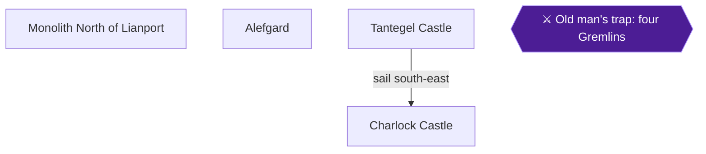

### Area Overview & Preparation

This chapter takes you from Lianport across the sea to Alefgard. You will visit Tantegel Castle (shops, save point, hints), then sail to Charlock Castle (the Dragonlord's Castle) to claim the Sword of Erdrick and meet the Dragonlord's grandson. Three achievements are available here: **Thine Ancestral Sword!**, **Thou Hast Finished the Wrong Quest!** and **Thou Hast a Keen Eye**.

Key points before you start:

- The King of Tantegel is not in his throne room [[gf2-13-13]]. He is hiding upstairs in the weapons shop behind a locked door that needs the Golden Key [[gf3-40-5]]. That is handled in a later chapter, not here.
- The Charlock Castle monsters are tough. One guide says to be level 14 or 15 (preferably 15) before entering [[gf2-14-23]]. Another suggests Hero 17, Orfeo 15 and Peta 10 before leaving Tantegel [[gf4-18-14]].
- If everyone is level 10 or better, you can run from most Charlock enemies [[gf3-43-9]].
- Peta (the Princess of Moonbrooke) learns Defence at level 10 [[gf4-18-16]].

> [!NOTE]
> The story-chapter items collected here are the Sword of Erdrick (Charlock B2) and the audience with the Dragonlord's grandson. No Crests are found in this chapter.

### Chapter Items to Collect (1 Item Total)

| Item | Where Found | Action / Requirement | Citation |
|---|---|---|---|
| Sword of Erdrick (+40) | Chest in the enclosed room in the middle of Charlock Castle B2 | **OPEN CHEST**, then equip on Hero | [[gf2-15-4, gf4-20-6, gf2-26-37]] |

### Monolith North of Lianport (optional stop)

From Lianport, travel northwest to a sand area, then southwest to find the Monolith, and enter it [[gf4-17-1]]. The Old Man says the Golden Key is needed to unlock the door here, and you do not have it yet [[gf4-17-2]]. Nothing else can be done here now, so return to Lianport and board your ship.

### Alefgard

1. Sail east from Lianport until you find a bridge, and dock your ship near it [[gf4-17-3]]. When the familiar music plays, you are in Alefgard [[gf4-17-6]].
2. From the bridge, go north past a poisonous swamp. Continue north to a second bridge, but do **not** cross it. Go east instead to find a castle, and enter it [[gf4-17-4]].
3. Monsters on the Alefgard continent include the Orc (61 EXP, 50 gold, drops an Iron Spear) [[gf4-17-5]].

### Tantegel Castle

🗺️ **Map:** [View Tantegel Castle Map by FlyingArmor](https://www.vgmaps.com/Atlas/NES/DragonWarrior-Part2-TantegelCastle.png)

**Castle grounds**

1. Speak to the guard near the entrance, who confirms you are in Tantegel Castle. The body of water north of him is the fountain [[gf4-18-1]].
2. Talk to the young man at the fountain, who had a vision of Erdrick's descendants coming in their time of need. The young woman says Princess Gwaelin departed over the sea long ago and that Peta looks just like her [[gf4-18-2, gf4-18-3]].
3. From the fountain go east, then north, to the House of Healing. The second old man inside lets you **save your game**, so do it now [[gf4-18-4, gf3-40-2]]. Lianport has no save point [[gf3-40-2]].
4. Speak to the old man behind the counter south of the House of Healing for a free MP restore [[gf4-18-5]].
5. From the fountain go north and climb the stairs. The guard says the King keeps hidden because he fears Hargon's wrath [[gf4-18-6]].
6. From the fountain go west, then south, to the merchant. He talks about the sunken treasure, which you already returned to the Lianport merchant [[gf4-18-33]].
7. From the fountain go west, then north. The guard says the Golden Key can also unlock red doors [[gf4-18-7]].

**Town area**

1. From the fountain go west to the town area [[gf4-18-8]]. The Inn is in the southwest corner and costs 2 gold per person [[gf4-18-8, gf2-14-18]]. The Weapons and Armor Shop is north of the Inn, and the Tools Shop is east of the Inn [[gf4-18-9, gf4-18-10]].
2. A red locked door is east of the Weapons and Armor Shop [[gf4-18-11]]. Inside is a seamstress seeking the Dew's Yarn [[gf2-14-13]]. She runs a sewing shop but has none. She says you can find some on the third floor of the North Dragon's Horn [[gf4-27-3]]. She can't do anything with the yarn when you bring it, so keep it [[gf2-14-17]]. You do not have the Golden Key yet, so this door stays closed for now.
3. A second locked door upstairs in the Weapons and Armor Shop hides the King [[gf4-18-12]]. It needs the Golden Key and is revisited later [[gf3-40-5]].
4. An old man in town can cure curses. Remember where he is in case you equip cursed gear [[gf4-18-13]].

> [!NOTE]
> The seamstress and King events require the Golden Key, which is obtained in a later chapter. The King achievement is not part of this chapter.

**Shops**

| Weapons and Armor Shop | Price | Tools Shop | Price |
|---|---|---|---|
| Broad Sword | 1500 [[gf4-18-20]] | Medical Herb | 15 [[gf4-18-21, gf-lists-14-6]] |
| Giant Hammer | 4000 [[gf4-18-17]] | Antidote Herb | 8 [[gf4-18-18, gf-lists-14-7]] |
| Wizard's Wand | 2500 [[gf4-18-23]] | Wing of the Wyvern | 80 [[gf4-18-24, gf-lists-14-8]] |
| Clothes Hiding | 1250 [[gf4-18-25]] | Fairy Water | 40 [[gf4-18-26, gf-lists-14-9]] |
| Steel Shield | 2000 [[gf4-18-27]] | Dragon's Bane | 640 [[gf4-18-28, gf-lists-14-10]] |
| Iron Helmet | 3150 [[gf4-18-19]] | | |

The Giant Hammer and Steel Shield are new here and usable only by the Hero [[gf3-40-3, gf3-40-4]]. Buy the Giant Hammer and Iron Helmet for the Hero and sell your old equipment [[gf4-18-29]].

**Levels for Peta: Defence**


> [!ACHIEVEMENT]
> **Thou Hast a Keen Eye (2 Points)**
> 
> *Learn the Defense spell*


Grind outside the town until Peta (the Princess of Moonbrooke) reaches **level 10**. She learns **Defence** then (2 MP, lowers the defense of all enemies) [[gf-lists-11-5, gf2-27-4, gf3-15-2, ra-guide-11-21, gf4-18-16]]. Orfeo (the Prince) learns HealMore at level 14, but that achievement is not part of this chapter [[gf4-18-15]]. Recommended levels before leaving: Hero 17, Orfeo 15, Peta 10 [[gf4-18-14]]. Rest at the Inn between fights, and save at the House of Healing.

> [!TIP]
> Before you leave Tantegel: save at the House of Healing, restore MP, buy gear for the Hero, and make sure Peta has Defence. Then cast Return and board your ship, which is now to the east [[gf4-18-30]].

### Sailing to Charlock Castle

Save at Tantegel, cast Return, and board the ship to the east [[gf4-18-30]]. Sailing east you will find the Swamp Cave, but nothing is there [[gf4-18-30]]. Sail across to Dragonlord's Castle to the southeast and enter it [[gf4-18-32]]. Park the ship in the river between Tantegel and Charlock so you can move between the castles easily [[gf2-14-19]].

### Charlock Castle

🗺️ **Map:** [View Charlock Castle Map by FlyingArmor](https://www.vgmaps.com/Atlas/NES/DragonWarrior-Part2-CharlockCastle.png)

Enemies here include Basilisk (41 EXP, 58 gold, drops Fairy Water) [[gf4-19-2]]. The Repel spell reduces how often you meet patrols [[gf3-43-9]].

#### B1F

Inside, you start in a dungeon-like cave. Follow the winding path: go west, southwest, south, then east to the staircase down [[gf4-19-3, gf2-14-24]].

#### B2F (first pass)

Go southeast, southwest, northwest, then northeast to the staircase down. As you walk around the outside you will see an enclosed room with a chest in the middle of the floor holding a very important item [[gf4-19-4, gf2-14-25]]. Take the next stairway down to B3 once you reach the other side [[gf2-14-26]]. Do not try to reach the chest yet.

#### B3F

An open area has a stairway to the east and north. Ignore it. Head west, then south to the other staircase and descend to B4 [[gf4-19-5, gf2-15-1]].

#### B4F

The staircase reached by going east then north (in the upper-right corner) looks like the one on B3. Ignore it, since the two connect [[gf4-20-1, gf2-15-2]]. Go southwest to find two staircases, one up and one down. Take the one **going up** [[gf4-20-2, gf2-15-3]].

#### Up through B3F, B2F, B1F, and back to B2F

1. B3F: go up the staircase nearby to the northwest [[gf4-20-3]].
2. B2F: go up the nearby staircase [[gf4-20-4]].
3. B1F: go down the nearby staircase [[gf4-20-5]].

Another route description: from the start follow the first path as it winds down and left to a staircase, follow the next passage clockwise to the next descending staircase, go right and up (ignore the first descending staircase), then left to the second descending staircase. In the room with two up and two down staircases, go right along the bottom and up to the ascending stairs, climb them, climb the one to the upper left, climb those in the next room, then descend the staircase to your lower left to reach the chest [[gf3-43-8]]. The up-and-down path brings you out in the middle of B2 where the chest is [[gf2-15-3]].

#### B2F: the Sword of Erdrick


> [!ACHIEVEMENT]
> **Thine Ancestral Sword! (5 Points)**
> 
> *Find the legendary Sword of Erdrick*


Open the chest to receive the **Sword of Erdrick** (+40) [[gf2-15-4, gf4-20-6, gf3-43-7, gf-lists-9-31, gf2-26-37, gf4-19-1]]. This corresponds to taking the southern stairs on the floor with two stairs and following the path to the chest [[ra-guide-12-8]]. Equip it on the Hero immediately [[gf2-15-5, gf4-20-6]].

#### Back to B4F, then down to B7F

1. Return to B4F and take the staircase to your left (down) [[gf4-20-7, gf2-15-6]].
2. B5F: go south, west, then north and descend [[gf4-20-8]].
3. B6F: go down the staircase to the west [[gf4-20-9]].

> [!TIP]
> Consider casting Outside and resting at Tantegel after getting the sword, then returning. A guide suggests warping out here to rest and save before the grandson [[gf3-43-8, gf2-15-14]].

#### B7F: the Dragonlord's Grandson

From the entrance, a locked gold door lies to the north. You will come back for it later [[gf4-21-1]]. Its numerous chests need the Golden Key and sit on damaging floor that drains HP with each step, so the guide recommends returning much later [[gf3-44-1, gf3-44-2, gf3-44-3]]. For reference, that room later yields a Wing of the Wyvern, a Lottery Ticket, a Medical Herb and gold [[gf2-15-8, gf2-15-10, gf2-15-11, gf2-15-9, gf4-27-8, gf4-27-9, gf4-27-10, gf4-27-21]]. Do not open it now.

1. From the B7F entrance go north, west, north, east, then south to reach outside. Cross the two bridges south, then go south and west to find the Dragonlord's seat [[gf4-21-2]]. (Alternatively: wind down the hall, then left, then up to the next descending staircase, then cross the room to the final staircase [[gf3-44-4]].) The route on the two-stair floor is the western stairs [[ra-guide-12-7, ra-guide-12-6]].
2. Speak to the person on the throne. It is the Dragonlord's grandson [[gf2-15-12]].


> [!ACHIEVEMENT]
> **Thou Hast Finished the Wrong Quest! (10 Points)**
> 
> *Find and talk to the grandson of the legendary Dragonlord*


3. He wants you to defeat Hargon. Answer **YES** to his question [[gf4-21-3]]. He tells you to find the five crests, then seek out the good wizard Rubiss [[gf4-21-4, gf2-15-13]].

#### Leaving

Cast **Outside** to return to the Overworld and return to Tantegel Castle to heal [[gf4-21-5, gf2-15-14]].

### Notes on Later Leads

- The lighthouse is on a wooded island, reached by sailing due south of Lianport to the sandy coast, then east [[gf3-64-2]]. From Tantegel Castle you can sail south, east, then south to a small island with a Tower [[gf4-21-6]]. That is the Star Crest location [[ra-guide-7-2]]; it is covered in a later chapter.
- The Holy Shrine in the southeast corner of Alefgard leads (heading south and a little west) to the island tower [[gf2-19-11]]. Also covered later.
- The Gremlin rescue in Lianport was earlier [[ra-guide-6-1]].

> [!IMPORTANT]
> ### Chapter 6 Cumulative 100% Checkpoint
> - **Erdrick Equipment:** 1 / 4 (Sword of Erdrick) [[gf2-15-4]]
> - **Crests:** 0 / 5
> - **RetroAchievements Unlocked:** 26 / 69 (101 / 427 points)

### Chapter Checklist

- [ ] Saved at the Tantegel House of Healing and restored MP
- [ ] Peta (Princess of Moonbrooke) at level 10 with Defence learned (46447)
- [ ] Hero equipped with the Sword of Erdrick from the B2 chest (115778)
- [ ] Spoke to the Dragonlord's grandson on B7F and answered YES (46457)
- [ ] Noted the locked gold door on B7F and the Tantegel red doors for later
- [ ] Returned to Tantegel to heal

---

## Chapter 7: Zahan and the Golden Key


### Area Overview & Preparation

This chapter sends you north from Lianport to the tiny island town of Zahan. You have two goals here: find the Golden Key, and reach the level where the Prince learns the StepGuard spell.

- The Golden Key is the top priority once you have the ship. Collecting it and the Jailor's Key comes first once you can sail [[ra-guide-3-2]]. It opens a big part of the world [[ra-guide-6-5]].
- The Golden Key opens the wooden locked doors [[gf2-26-11]].
- The northern part of Zahan has a very large section of damage floor behind doors that need the Jailor's Key. Do not go in yet; it is for a later chapter [[gf2-13-2]].
- Recommended party levels at Zahan are Hero 19, Orfeo (the Prince) 17 and Peta (the Princess) 13 [[gf4-26-2]].

> [!WARNING]
> **Achievement Trigger Warning:** When you find the dog in Zahan, talk to it directly. If you walk around the dog and then talk to it, it leads you to a different position to find the key, and the achievement will not trigger [[ra-comments-16-1]].

### Chapter Items to Collect (1 Item Total)

| Item | Where Found | Action / Requirement | Citation |
|---|---|---|---|
| Golden Key | Zahan, at the tree the dog barks at | **SEARCH** while standing on the tree | [[gf4-26-1, gf2-13-1]] |

### Sailing to Zahan

1. Board your ship at Lianport and sail out. Sail 1 step east, 4 steps north, then 1 step west, then head directly north. The light-colored water you pass is where you found the sunken Treasures [[gf4-25-12, gf4-16-25]].
2. Ignore that light-colored water. Keep sailing straight north until a small island covered only with grass and trees is on your right [[gf4-25-12]].
3. From the southern tip of that grass island, sail west. You will find two smaller islands: one has a town and the other has a monolith [[gf4-25-13]].
4. Dock at the island with the town and enter it. This is Zahan [[gf4-25-14]].

Another description of the same trip: follow the coastline to the island's northern edge, then head northwest to a very small island with a town. The monolith sits on an even smaller island [[gf2-12-16]].

### Zahan

🗺️ **Map:** [View Zahan Map by FlyingArmor](https://www.vgmaps.com/Atlas/NES/DragonWarrior-Part2-Zahan.png)

**Town layout:**
- The Inn is north of the town entrance [[gf4-26-10]].
- The Tools Shop is east of the Inn [[gf4-26-11]].
- The Wizard's House is northeast of the Inn. It is dangerous because of the many blue tiles [[gf4-26-12, gf4-26-13]].

**Shops:**
- The inn costs 30 gold per person [[gf4-26-9]].
- Tools Shop: Medical Herb 15 [[gf-lists-14-1]], Wing of the Wyvern 80 [[gf-lists-14-3]], Fairy Water 40 [[gf-lists-14-4]], Dragon's Bane 640 [[gf-lists-14-5]].
- The Wing, Fairy Water and Dragon's Bane are also confirmed by [[gf4-26-6, gf4-26-7, gf4-26-8]].
- There is no church or save point here (the sources list no church or save point) [[gf-versions-3-85]].

**Villager hints (no action needed):**
- A person at the northwest corner of town is seeking a thief named Roge Fastfinger [[gf4-26-14]].
- The merchant in the inn talks about the sunken ship [[gf4-26-17]].
- Villagers say a cavern on a mountainous sea island can be entered only by one who bears the Moon Fragment [[gf4-26-15]]. They also say holding the Moon Fragment on high raises the tide [[gf4-26-16]].

### Getting the Golden Key


> [!ACHIEVEMENT]
> **Thou Hast a Noble Door Opener (10 Points)**
> 
> *Find the Golden Key*


1. Go to the dog north of the Tools Shop [[gf4-26-1]].
2. **Talk to the dog directly.** Do not walk around it first [[ra-comments-16-1]].
3. The dog moves a few steps away to the east, then barks at the tree to its right [[gf4-26-1, gf-lists-9-44]].
4. Walk onto the tree it barked at. Stand on top of that tree and **SEARCH** the ground to find the **Golden Key** [[gf4-26-1, gf2-13-1]].
5. If the dog ends up somewhere slightly different, search where it stops; the position the dog ends at may vary [[ra-guide-6-6]]. Search the space directly in front of the dog [[gf3-46-4]].

Achievement 46414, Thou Hast a Noble Door Opener, unlocks when you find the Golden Key.

> [!TIP]
> **Before you leave Zahan:** Do not cross the northern damage-floor area. Its doors need the Jailor's Key, which you do not have yet [[gf2-13-2]]. That area holds the Magic Loom and is for a later chapter [[ra-guide-13-6]].

### Learning StepGuard (Prince Level 17)


> [!ACHIEVEMENT]
> **Thou Hast Stout Boots (2 Points)**
> 
> *Learn the StepGuard spell*


Achievement 46433, Thou Hast Stout Boots, unlocks when you learn StepGuard.

- The Prince of Cannock learns StepGuard at level 17 [[ra-guide-11-10, gf3-11-3]]. The Princess of Moonbrooke learns it at level 21 [[ra-guide-11-11]].
- It costs 4 MP and protects against damage zones [[gf2-27-20, gf-lists-11-21]].
- Level up by fighting on the way and around Zahan. Enemies on the Zahan continent include Metal Slime, which drops an Iron Helmet [[gf4-26-18]].
- The Prince only needs to gain the level. Once he reaches level 17, the spell is learned automatically and the achievement unlocks.
- Peta learns Antidote at level 12 and Orfeo learns Stepguard at level 17 [[gf4-26-3, gf4-26-4]].

Do not cast it at the Zahan damage floor yet; that trip is for a later chapter. Casting it in the Wizard's House lets you cross damage zones without taking damage [[gf2-20-5]].

### Optional: What the Key Unlocks Later

These are handled in later chapters; this is only a preview, so you know why the key matters:
- Midenhall Castle holds a chest with the Token of Erdrick [[gf3-58-5]].
- Cannock Castle holds the Shield of Erdrick [[gf4-27-18]].
- Osterfair's weapon shop holds the Armor of Gaia [[gf2-16-8]].
- Tantegel's weapon shop has a door hiding the missing king [[gf3-40-5]].

The monolith on the nearby island leads back to Midenhall Castle via its travel door [[gf2-15-15]].

> [!IMPORTANT]
> ### Chapter 7 Cumulative 100% Checkpoint
> - **Golden Key Collected:** 1 / 1 [[gf4-26-1]]
> - **Crests:** 0 / 5
> - **Erdrick Equipment:** 1 / 4
> - **RetroAchievements Unlocked:** 28 / 69 (113 / 427 points)

### Chapter Checklist

- [ ] Sailed north from Lianport to Zahan
- [ ] Talked directly to the dog (did not walk around it)
- [ ] Searched the tree the dog barked at and got the Golden Key (46414)
- [ ] Prince at level 17 with StepGuard learned (46433)
- [ ] Did not enter the northern damage-floor area

---

## Chapter 8: The Lighthouse and the Star Crest


### Area Overview & Preparation

This chapter covers one goal: the **Star Crest**, the second crest on the way to the Charm of Rubiss. The Star Crest is won after beating four Gremlins in the lighthouse [[gf-lists-10-12]]. It is a large tower, and the plan is to climb to the top, find an old man, follow him back down to a dead-end chest, and win the trap battle [[ra-guide-7-3]].

Preparation:

- **Do this after the Golden Key.** Several doors in the tower (the Golden Key door on floor 3 and the one on floor 6 in one guide's numbering) need it [[gf2-19-18, gf2-19-20]]. The route below also uses a Silver Door on 6F [[gf4-24-5]].
- **Level.** Have the party at around level 20 before entering [[gf3-64-11]]. Another guide says level 18 is probably enough, and that you can build levels inside the tower [[gf2-19-11]].
- **Bring a Wing of the Wyvern.** It lets you return to an inn quickly if the prince falls [[gf3-64-3]].
- **Echoing Flute.** Blowing it near crests confirms you are close [[gf2-12-14]].
- **Heal up before the final chest.** The old man's chest is a trap [[gf4-24-11]].

**Getting there.** From Tantegel Castle, sail south, then east, then south until you reach a small island with a tower. Dock and enter [[gf4-21-6]]. Alternatively, use Lianport as a reference: sail due south to the sandy coast, then head directly east to the wooded island with the lighthouse [[gf3-64-2]].

🗺️ **Map:** [View Lighthouse Map by FlyingArmor](https://www.vgmaps.com/Atlas/NES/DragonWarrior-Part2-Lighthouse.png)

**Enemies and tactics:**

- **Gorgons** resist fire spells. Let the hero attack them physically [[gf3-64-4]].
- **Mummies** have powerful defense. The prince and princess should focus fire spells on them [[gf3-64-5]].
- **Saber tigers** have little HP but high offense. Kill them quickly to save healing magic [[gf3-64-6]].

### Chapter Items to Collect (5 Items Total)

| Item | Where Found | Action / Requirement | Citation |
|---|---|---|---|
| 40~60 Gold | 1F, chest through the north opening | **TAKE** (optional) | [[gf4-22-7]] |
| Chain Sickle | 5F, chest on the first climb | **TAKE** (optional) | [[gf4-23-4]] |
| 120~140 Gold | 4F, chest east of the south opening | **TAKE** (optional) | [[gf4-23-8]] |
| Fairy Water | 5F, chest west then north | **TAKE** (optional) | [[gf4-24-2]] |
| Star Crest | 2F, trap chest guarded by four Gremlins | **WIN BATTLE** (required) | [[gf4-24-12]] |

Only the Star Crest is required. The lighthouse checklist lists the same other rewards: Chain Sickle, Fairy Water and the gold [[gf4-22-1, gf4-22-2, gf4-22-3, gf4-22-4]]. The Chain Sickle's own trip is described as not worth the battles [[gf3-64-10]].

> [!WARNING]
> **Floor edges:** Follow the directions carefully so you do not get lost, and try not to accidentally fall off any edges [[gf4-22-5]]. Falling off an edge drops you down a floor and costs you progress, though it is also a way out of the tower once you have the crest [[gf4-24-13]].

### Lighthouse 1F

From the tower entrance, go west to the very end, then south to the very end, then east to the very end. From there go north, west, south, west, north, and then west through the opening [[gf4-22-5]]. This avoids the downward path from the entrance, which leads only to dead ends [[gf3-64-7]].

You will reach a staircase leading up. It is a decoy for now. Ignore it and go through the opening to the north [[gf4-22-6]]. Open the chest there for **40~60 Gold** [[gf4-22-7]].

Return to the staircase and ignore it again. Go through the opening to the south to find another staircase leading up, and take it [[gf4-22-8]].

> [!NOTE]
> Another guide describes the same area as a grated recess with a staircase. Its short detour out the top exit leads to a chest with 53 gold [[gf3-64-8]]. This may be the same chest as the 40~60 gold one above, but the sources do not say so. Unable to verify from collected sources.

#### The Chain Sickle detour (optional)

The first climb leads to the Chain Sickle:

1. **2F:** go up the staircase to the south [[gf4-23-1]].
2. **3F:** go up the staircase to the east [[gf4-23-2]].
3. **4F:** go up the staircase to the northeast [[gf4-23-3]].
4. **5F:** open the chest for the **Chain Sickle**, then backtrack to 1F [[gf4-23-4]].

Skip this if you only want the crest: the battles do not pay off [[gf3-64-10]]. The sources do not say which staircase this is relative to the bottom-left one, so if you skip it, just take the bottom-left route below [[ra-guide-7-4]].

### The Main Climb

Back on 1F, take the **bottom-left** stairs. These are the only ones that lead toward the goal rather than to unneeded chests [[ra-guide-7-4]]. Go through the opening to the west to a different staircase going up, and climb it [[gf4-23-5]].

**2F:** go west through the opening, then south through the opening, then up the staircase to the east [[gf4-23-6]].

**3F:** note this floor, since you will return here for something optional. Go west through the opening and take the staircase up [[gf4-23-11, gf4-23-7]].

**4F:** go through the opening south, but ignore the staircase going up for now. Go through the opening east and open the chest for **120~140 Gold** [[gf4-23-8]]. Go back west and take the staircase up [[gf4-23-9]].

**5F:** go through the opening east, go south, go through the opening east again, then take the staircase up to the east [[gf4-23-10]].

**6F:** go down the staircase to the north [[gf4-24-1]].

**5F (again):** go west, then north to a chest containing **Fairy Water** [[gf4-24-2]]. Backtrack to 4F.

**4F (again):** go back north through the opening, then northeast, north, then west to a different staircase going up, and take it [[gf4-24-3]].

**5F:** go east, then south to a staircase up, and take it [[gf4-24-4]].

**6F:** unlock the Silver Door to the west. Then go north and west to a staircase going up and climb it [[gf4-24-5]].

> [!TIP]
> One guide places the Golden Key doors on its floors 3 and 6, and also says the route up has red locked doors [[gf2-19-18, gf2-19-20]]. If a door blocks you, use the key for that door type. The other guide's 6F door is a Silver Door [[gf4-24-5]].

### Lighthouse 7F: The Old Man

On 7F, go east, then follow the monster southeast through the opening. The old man here wants you to follow him [[gf4-24-6]]. When you approach the monster it retreats, and the old man stands just beyond where it vanished. He says he knows why you are here [[gf2-19-21]].

Follow him west to find two staircases going down. Take the one he is standing on [[gf4-24-6]].

### Following the Old Man Down

Stay right behind him on every floor [[ra-guide-7-3]]:

1. **6F:** follow him east and go down the staircase [[gf4-24-7]].
2. **5F:** follow him north and go down the staircase [[gf4-24-8]].
3. **4F:** follow him southwest and go down the staircase [[gf4-24-9]].
4. **3F:** follow him east, then north, and go down the staircase [[gf4-24-10]].
5. **2F:** follow him through the opening into the grated area with the chest [[gf4-24-11, gf3-65-2]].

### Lighthouse 2F: The Gremlin Trap

> [!TIP]
> **Before you open the chest:** heal up. The old man will tell you to open it, and the chest is empty and a trap [[gf4-24-11]]. Nothing is lost by using this moment to restore HP and MP.

Open the treasure chest. It is empty. The old man turns into a demon, and three others appear as reinforcements, for four Gremlins in total [[gf2-19-22, gf4-24-11]].

**Battle strategy:** this fight is fairly easy. If your hero is strong enough, he can probably take out one enemy per turn. Have the princess keep healing if there is any trouble [[gf3-65-3]]. Defeat all four Gremlins.


> [!ACHIEVEMENT]
> **Thou Art as Brilliant as a Star! (10 Points)**
> 
> *Find the Star Crest*


When you win, you obtain the Star Crest [[gf2-19-23]]. It is not an inventory item. View your crests from the Status Menu [[gf4-24-12]].

To leave the Lighthouse, cast **Outside** or fall off any edge to leave [[gf4-24-13]]. Then return to a town to rest and save [[gf3-65-3]].

### Optional: the Top Floors

The top floors give only information, not items [[gf3-65-1]]. If you want it, the route is:

1. Go back to 3F, the floor you were told to remember. Go through the opening to the northeast, then east, then north to a Silver Door. Unlock it and go up the staircase to the north [[gf4-24-14]].
2. **4F:** go up the staircase to the north [[gf4-24-15]].
3. **5F:** go up the staircase to the south [[gf4-24-16]].
4. **6F:** go up the staircase to the north [[gf4-24-17]].
5. **7F:** go up the staircase to the south [[gf4-25-1]].
6. **8F:** go through the opening east, then south to find a soldier. He says Hargon is in Rhone, high in the mountains in the middle of a great continent [[gf4-25-2]].

Exit to the Overworld and board your ship [[gf4-25-3]].

### Next Steps

With the Star Crest in hand, you have one of the five crests. The Charm of Rubiss comes from trading all five [[gf-lists-10-18, ra-guide-8-8]]; this is covered later. The next chapter covers errands that use the Golden Key.

> [!TIP]
> **Before you leave:** confirm the Star Crest unlocked (the achievement should have popped), and make sure you have rested and saved at a town.

> [!IMPORTANT]
> ### Chapter 8 Cumulative 100% Checkpoint
> - **Lighthouse Chests Opened (optional):** 4 / 4 (40~60 Gold, Chain Sickle, 120~140 Gold, Fairy Water) [[gf4-22-1, gf4-22-2, gf4-22-3, gf4-22-4]]
> - **Crests:** 1 / 5
> - **Erdrick Equipment:** 1 / 4
> - **RetroAchievements Unlocked:** 29 / 69 (123 / 427 points)

### Chapter Checklist

- [ ] Reached the lighthouse island by ship [[gf4-21-6]]
- [ ] Took the bottom-left stairs on 1F [[ra-guide-7-4]]
- [ ] Climbed to 7F and met the old man [[gf4-24-6]]
- [ ] Followed him down to the 2F chest [[gf4-24-11]]
- [ ] Healed before opening the chest [[gf4-24-11]]
- [ ] Defeated four Gremlins [[gf2-19-22]]
- [ ] Unlocked **Thou Art as Brilliant as a Star!** (46422) [[gf2-19-23]]
- [ ] Left via Outside or by falling off an edge, then rested and saved [[gf4-24-13]]
- [ ] Optional chests collected: 40~60 gold, Chain Sickle, 120~140 gold, Fairy Water [[gf4-22-7, gf4-23-4, gf4-23-8, gf4-24-2]]

---

## Chapter 9: Golden Key Errands


### Area Overview & Preparation

With the Golden Key from Zahan in hand, this chapter is a loop of errands that open the Gold Doors you have passed so far [[gf4-26-1]]. You will pick up four achievements here: the Leaf of the World Tree, the missing King of Tantegel, the Token of Erdrick, and the Shield of Erdrick [[gf4-26-1]].

Hardcore notes: you cannot rewind, so save before the Dragonlord's Castle trip. The king in Cannock Castle can save your progress [[gf3-23-2]].

> [!TIP]
> Before you leave each area, check that every chest is opened. Nothing in this chapter is a point of no return, so you can revisit any stop.

Preparation: you need the Golden Key, your ship, and the StepGuard spell for the Dragonlord's Castle B7F damage floor (the planner route casts it before the Gold Door chests). The Prince learns it at level 17, as covered in Chapter 7 [[ra-guide-11-10]]. The Leaf of the World Tree can revive a dead character, and you can only hold one at a time [[gf4-27-2]].

### Chapter Items to Collect (8 Entries Total)

| Item | Where Found | Action / Requirement | Citation |
|---|---|---|---|
| Leaf of the World Tree | World Tree Island, lone tree | **SEARCH** on the tree | [[gf4-27-1]] |
| King of Tantegel (not an item) | Upstairs in Tantegel weapon shop | Gold Door, **TALK** | [[gf3-40-5]] |
| Lottery Ticket | Charlock B7F chest | Gold Door, cast StepGuard | [[gf4-27-8]] |
| Medical Herb | Charlock B7F chest | **TAKE** | [[gf4-27-9]] |
| Wing of the Wyvern | Charlock B7F chest | **TAKE** | [[gf4-27-10]] |
| Token of Erdrick | Midenhall Castle gold-door room | **TAKE** | [[gf4-27-16]] |
| Shield of Erdrick | Cannock Castle, west of House of Healing | **TAKE** | [[gf4-27-18]] |
| Leaf of the World Tree (spare) | World Tree Island | Return only if the first was used | [[gf4-32-13]] |

### World Tree Island

From the Zahan continent, board your ship and sail 10 steps north, then straight west until you reach a small island with rock mountains, sand, and a single tree in the middle [[gf4-27-1]]. (Another description: sail north to the shoals, then north to a small partly forested island, then due east to a desert island ringed by mountains [[gf3-45-1]].) The tree is west and slightly south of the Shrine of Fire [[ra-guide-13-9]].

Dock, stand on the lone tree, and **SEARCH** the ground [[gf4-27-1, gf3-45-2]].


> [!ACHIEVEMENT]
> **Thou Hast Celestial Foliage (5 Points)**
> 
> *Receive a sacred leaf of the World Tree*


You receive a **Leaf of the World Tree** [[gf4-27-1]]. It revives one dead ally [[gf2-26-14]]. Save it; only one can be held at a time [[gf4-27-2]]. If you use it, you can come back here for another [[gf4-32-13]].

### King of Tantegel

Enter Tantegel Castle; the King is not in the throne room [[gf2-13-13]]. Head up the weapon shop stairs and unlock the Gold Door upstairs; the King is inside, having lost all hope [[gf4-27-4, ra-guide-13-20]]. **TALK** to him.


> [!ACHIEVEMENT]
> **Thine King Is Bare (5 Points)**
> 
> *Find the missing king of Tantegel*


The young lady in Tantegel's sewing shop does not have Dew's Yarn, but says you can find some on the third floor of the North Dragon's Horn [[gf4-27-3]].

### Dragonlord's Castle (Charlock) B7F

Sail across to Dragonlord's Castle, enter, and make your way down to B7F [[gf4-27-6]]. Cast StepGuard, go north of the entrance to the Locked Gold Door, unlock it, and loot the three chests: a **Lottery Ticket** [[gf4-27-8]], a **Medical Herb** [[gf4-27-9]], and a **Wing of the Wyvern** [[gf4-27-10]]. Then sail back toward Zahan.

### Shrine of Fire (Monolith West of Zahan)

🗺️ **Map:** [View Shrine Of Fire Map by FlyingArmor](https://www.vgmaps.com/Atlas/NES/DragonWarrior-Part2-ShrineOfFire.png)

Sail back toward Zahan, then sail to the Monolith west of Zahan, dock, and go inside [[gf4-27-11]]. This is the Shrine of Fire: the shrine with three teleporters, reached by sailing north-west from Zahan [[ra-guide-6-9]]. Step on the Travel Door inside [[gf4-27-12]].

> [!NOTE]
> The Sun Crest is hidden just outside this shrine. This guide collects it in Chapter 11, when you come back through the Shrine of Fire on the way to the Holy Shrine. If you prefer to grab it now, follow the steps in Chapter 11; the achievement unlocks whenever you pick it up.

### Token of Erdrick

You arrive in Midenhall Castle. Go into the room east of the Travel Door and unlock the Gold Door [[ra-guide-12-3]]. The room holds five chests; their contents include a Wing of the Wyvern, 53 gold, a Medical Herb, and the **Token of Erdrick** [[gf3-58-5, gf2-13-5]].


> [!ACHIEVEMENT]
> **Thou Hast the Crest of Thine Line (5 Points)**
> 
> *Find the Token of Erdrick*


Keep the Token; an old man trades it for the Helmet of Erdrick later [[gf4-29-2]].

### Shield of Erdrick

Make your way to Cannock Castle [[gf4-27-17]]. Unlock the Gold Door west of the House of Healing and open the chest for the **Shield of Erdrick** [[gf4-27-18, gf2-13-10]].


> [!ACHIEVEMENT]
> **Thine Ancestral Shield! (5 Points)**
> 
> *Receive the legendary Shield of Erdrick*


Finish at the Monolith south of Midenhall Castle: unlock the Gold Door and step on the Travel Door to reach Osterfair's island [[gf4-27-20]].

> [!IMPORTANT]
> ### Chapter 9 Cumulative 100% Checkpoint
> - **Crests:** 1 / 5 (Star Crest from Chapter 8)
> - **Erdrick Equipment:** 2 / 4 [[gf4-27-18]]
> - **RetroAchievements Unlocked:** 33 / 69 (143 / 427 points)

### Chapter Checklist

- Leaf of the World Tree obtained [[gf4-27-1]]
- Tantegel king found upstairs in the weapon shop [[gf3-40-5]]
- Charlock B7F chests looted [[gf4-27-8]]
- Took the Travel Door in the Monolith west of Zahan [[gf4-27-12]]
- Token of Erdrick taken [[gf4-27-16]]
- Shield of Erdrick taken [[gf4-27-18]]
- Traveled through the Gold Door and Travel Door south of Midenhall [[gf4-27-20]]

---

## Chapter 10: Osterfair Castle

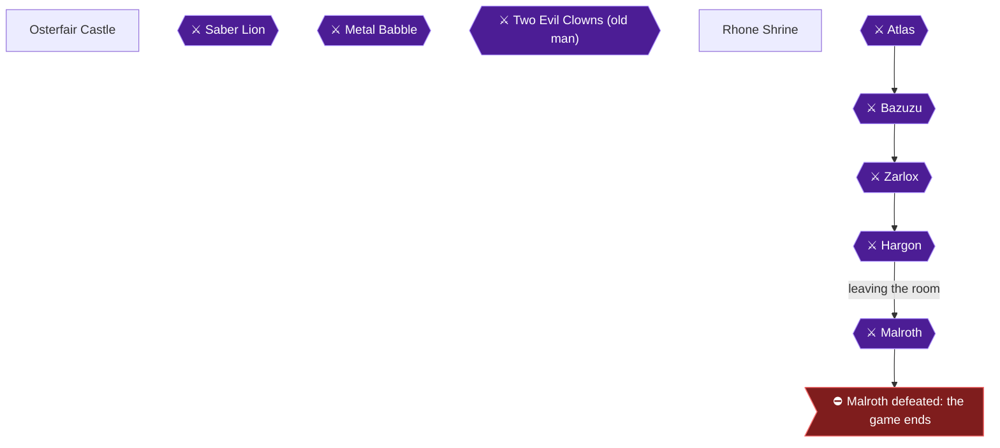

### Area Overview & Preparation

This chapter covers the island castle of Osterfair. You will do four things here:

- Pick up the **Armor of Gaia** from the hidden shop behind the weapon shop.
- Fight the King's pet **Saber Lion** for the **Moon Crest**.
- Learn **FireBane** (Prince of Cannock, level 18).
- Grind the hero to **level 20**.

The Moon Crest is the second of the five crests (after the Star Crest from Chapter 8) that you will later trade for the Charm of Rubiss [[gf-lists-10-18]]. The island is north of the Shrine of Fire and south of Midenhall Castle [[ra-guide-6-16]].

**Before you arrive:**

- You must already have the **Golden Key**. The Armor of Gaia is locked behind a Gold Door, and the community notes say to have the key before reaching this item [[ra-guide-13-1, ra-comments-64-1]].
- The Golden Key is found in Zahan: follow the dog and search the tree it barks at [[gf4-26-1, gf3-46-4]].
- The island has only one inlet. Sail in and park the ship in the pond before heading to the castle [[gf2-15-19]].
- The route used here is the Travel Door route: you are teleported straight into the castle from the Monolith south of Midenhall Castle [[gf4-27-20, gf4-28-8]].

> [!TIP]
> **Do not skip the hidden shop:** The Armor of Gaia needs the Golden Key and is behind the weapon shop's locked door [[gf-lists-9-36]]. It is not missable, but buy it before the King fight so the armor is on the hero when the Saber Lion attacks.

> [!WARNING]
> **Poison Warning for Level 20:** If the hero is poisoned at the moment the level-20 threshold is reached, clear the poison first. The achievement will not be granted until you do [[ra-comments-38-1]].

### Chapter Items to Collect (3 Items Total)

| Item | Where Found | Action / Requirement | Citation |
|---|---|---|---|
| Armor of Gaia | Chest in the hidden weapon shop | **OPEN** chest; Golden Key required; equip on Hero immediately | [[gf4-28-9, gf2-16-8, gf2-16-9]] |
| Magic Knife | Second chest in the hidden weapon shop | **OPEN** chest | [[gf4-28-10, gf3-55-6]] |
| Moon Crest | Reward from the King after the Saber Lion | **TALK** to the King, answer YES, win the fight, talk to him again | [[gf4-28-19, gf4-28-20]] |

### Osterfair Castle

🗺️ **Map:** [View Osterfair Castle Map by FlyingArmor](https://www.vgmaps.com/Atlas/NES/DragonWarrior-Part2-OsterfairCastle.png)

#### Step 1: The hidden shop (Armor of Gaia)

Walking around the weapon shop, you find a Golden Key door [[ra-guide-13-2]]. There are two ways to reach it. The Travel Door route is used here.

1. You arrive in the castle by Travel Door from the Monolith south of Midenhall Castle. That Monolith is reached by going south from Midenhall Castle, crossing a bridge, and continuing south [[gf4-6-14]]. Unlock its Gold Door and step on the Travel Door [[gf4-27-20]].
2. On arrival, unlock the hidden Golden Door to your right. Go through the opening and you are behind the counter of a Weapons and Armor Shop [[gf4-28-8]].
3. Open the two chests here. They hold the **Armor of Gaia** and the **Magic Knife** [[gf4-28-9, gf4-28-10]].
4. **Equip the Armor of Gaia on the Hero right away** [[gf2-16-9, gf4-28-9]]. It gives +35 defense [[gf2-26-41]].


> [!ACHIEVEMENT]
> **Thou Hast the Protection of the Land (5 Points)**
> 
> *Find the powerful Armor of Gaia*


If you came by ship instead, walk around the area outside the town. A travel door sits in the lower-left corner, and an open area to its right cannot be entered. A locked door is there. Use the Golden Key on it to arrive "inside" the weapon shop where the chests are [[gf2-16-10, gf2-16-7]]. Another route description says to use the Golden Key on the space to the right of the monolith [[gf3-55-5]].

#### Step 2: Walk to the town

1. Return to the Travel Door. From it, go north to the end, east to the end, then south [[gf4-28-11]].
2. Speak to the guard to the west. He says the coliseum and the court of the King lie beyond. Go through the opening west of him [[gf4-28-12]].
3. Outside, the King and two ladies are to the north. A locked jail door to the west has a monster behind it [[gf4-28-13]].

> [!TIP]
> **Do not speak to the King yet** [[gf4-28-14]]. Talk to the townspeople, rest, and shop first.

#### Step 3: Town people and shops

Go south to find the Inn and the Weapons and Armor Shop to your left, and an old man behind a counter to your right [[gf4-28-13]]. Talk to everyone for hints:

- **Two young men:** one says not to be afraid to throw away items you do not need. The other talks about the sunken ship [[gf4-28-13]].
- **Person in the Weapons and Armor Shop:** seeks the Armor of Gaia [[gf4-28-15]].
- **Old man east of the Inn:** says the Echoing Flute blows a magical note, to be played on an island tower in a remote chamber to help find Crests [[gf4-28-16]].
- **Fortune-teller north of the Inn:** answer "Yes" and he says what you seek lies west, north, east, or south. The answer changes each time [[gf4-28-17]].
- **Soldier behind the jail door north of the fortune-teller:** tells you where the Golden Key is [[gf4-28-18]].

**Inn:** 25 gold per person [[gf2-15-20, gf4-28-2]].

**Weapon Shop stock:**

| Item | Price | Citation |
|---|---|---|
| Broad Sword | 1500 | [[gf2-16-1, gf4-28-1]] |
| Giant Hammer | 4000 | [[gf2-16-2, gf4-28-3]] |
| Dragon Killer | 8000 | [[gf2-16-3, gf4-28-4]] |
| Clothes Hiding | 1250 | [[gf2-16-4, gf4-28-5]] |
| Magic Armor | 4300 (one source lists 4000) | [[gf4-28-6, gf2-16-5]] |
| Iron Helmet | 3150 | [[gf2-16-6, gf4-28-7]] |

Shopping advice:

- Buy Magic Armor for the Prince at some point; his chain mail is outdated [[gf2-16-11, gf4-28-23]].
- The Dragon Killer is better than the Sword of Erdrick, but 8000 gold is a lot, so it can wait [[gf2-16-12]]. It is the recommended purchase for the Hero [[gf4-28-23]].
- Recommended party levels here: Hero 20, Orfeo 18, Peta 14 [[gf4-28-21]]. Reach level 16 and have the Prince in Magic Armor before leaving [[gf2-16-16]].

### Saber Lion

Before fighting, rest at the Inn if needed. If you want a safe save point first, the Travel Door takes you back to the Monolith, from which Midenhall Castle is a short trip to save with the King [[gf3-55-5, gf4-28-25]].

1. Speak to the King. If you entertain him, he promises a valuable prize [[gf4-28-19]].
2. Answer **YES** to his question [[gf4-28-19]].
3. You are placed in the center of the coliseum and the King releases a "ferocious dog." It is really a **Saber Lion**, and it is tough [[gf2-16-14]].

**Boss strategy:**

- **Spells work poorly** against the Saber Lion, so save MP for healing [[gf2-16-13]].
- It can deal around 25 damage per turn to party members [[gf3-55-3]].
- Expect the fight to last about three or four rounds with solid physical attacks [[gf3-55-4]].
- Its listed stats are 80 HP and 81 EXP [[gf2-27-7]].

> [!TIP]
> Equip the Armor of Gaia on the Hero first, and keep the Princess healing each turn rather than casting damage spells.

After the battle, speak to the King again and he gives you the **Moon Crest** [[gf4-28-19, gf4-28-20, gf2-16-15]].

### Moon Crest

The Moon Crest is a legendary crest usable by the Hero, Prince and Princess [[gf3-58-1]]. The King of Osterfair holds it [[gf4-30-23]].


> [!ACHIEVEMENT]
> **Thou Art a Night Owl! (10 Points)**
> 
> *Find the Moon Crest*


That makes two of five crests so far. Rest at the Inn if the Saber Lion hurt you [[gf2-16-15]].

### Leveling: FireBane and Level 20

Do not leave until you have finished the leveling goals below.

**FireBane (Prince level 18):**

- The Prince of Cannock learns FireBane at level 18 [[ra-guide-11-12, gf3-12-1]]. It costs 4 MP and hits all enemies for medium damage (about 40) [[gf-lists-11-8, gf2-27-7]].
- Level 18 for the Prince needs 37,000 EXP (the level 18 row of the progression chart) [[gf3-12-1]].
- The walkthrough names this character Orfeo and states he learns it at level 18 [[gf4-28-22]].


> [!ACHIEVEMENT]
> **Thou Art an Arsonist (2 Points)**
> 
> *Learn the FireBane spell*


**Hero level 20:**

- Before going any further, reach level 20 [[gf2-20-11]]. The Hero needs 40,000 experience points [[gf2-28-6]].
- **Best grinding spot:** outside Osterfair, which has good enemy spawns, including Metal Slimes, sometimes in big groups. This is comfortable for levels 17 to 25 [[ra-guide-10-6]].
- Even killing a single Metal Slime gives a large amount of experience [[ra-guide-10-7]]. A Metal Slime is listed at 150 EXP and 6 HP [[gf2-27-7]]; the other walkthrough lists the Osterfair continent monsters, including Metal Slime and Evil Tree (which drops Fairy Water) [[gf4-28-24]].
- Rhone Cave can be entered early for grinding with the exploit, but it is tough to get through [[ra-guide-10-8]].
- **Clear poison** before the level-up registers, or the achievement will not unlock [[ra-comments-38-1]].


> [!ACHIEVEMENT]
> **Thou Art a Slayer (10 Points)**
> 
> *Have your hero reach level 20*


> [!TIP]
> **Before you leave Osterfair:** confirm the Armor of Gaia is equipped, the Moon Crest is in your inventory, the Prince has Magic Armor, the Prince has FireBane, and the Hero is level 20. If you are not comfortable moving on, there is no penalty for staying and grinding longer [[ra-guide-10-6]].

### Route Onward

1. Return to the Travel Door and use it to go back to the Monolith south of Midenhall Castle [[gf4-28-25]].
2. From there, travel to Midenhall Castle, then Cannock Castle, then the Monolith west of Cannock Castle [[gf4-28-25]]. Unlock the Gold Door to the south, go through, and step on the Travel Door [[gf4-28-26]].
3. The Old Man in the Monolith north of Beran says Hargon cast a spell over his castle, and the gift of Rubiss protects you from it [[gf4-28-27]]. This leads into the next chapter.

> [!IMPORTANT]
> ### Chapter 10 Cumulative 100% Checkpoint
> - **Crests:** 2 / 5 (Moon Crest at Osterfair) [[gf4-28-20]]
> - **Erdrick Equipment:** 2 / 4
> - **Chests opened here:** 2 (Armor of Gaia, Magic Knife) [[gf4-28-9, gf4-28-10]]
> - **RetroAchievements Unlocked:** 37 / 69 (170 / 427 points)

### Chapter Checklist

- [ ] Golden Key in hand before entering the hidden shop [[ra-comments-64-1]]
- [ ] Armor of Gaia obtained and equipped on the Hero (46423 and 115781 unlocked) [[gf2-16-9]]
- [ ] Magic Knife collected [[gf4-28-10]]
- [ ] Talked to the townspeople before the King [[gf4-28-14]]
- [ ] Saber Lion defeated and Moon Crest received [[gf4-28-19]]
- [ ] Prince has learned FireBane (level 18) [[ra-guide-11-12]]
- [ ] Prince wearing Magic Armor [[gf2-16-16]]
- [ ] Hero at level 20 with no poison status [[gf2-20-11, ra-comments-38-1]]

---

## Chapter 11: Beran and the Holy Shrine

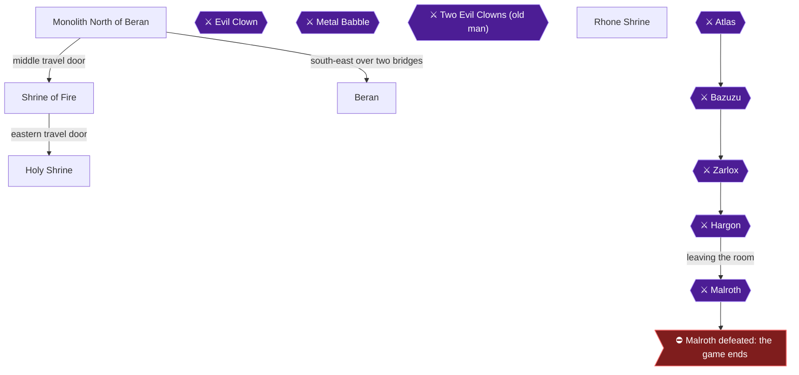

### Area Overview & Preparation

This chapter takes you from Osterfair's travel door to the Monolith North of Beran. From there you take the middle travel door to the Shrine of Fire, where you find the Sun Crest. You then use the Shrine's eastern travel door to reach the Holy Shrine, where you trade the Token of Erdrick for the Helmet of Erdrick. After that you go back through the Shrine of Fire's middle door to the Beran monolith and walk to the town of Beran. In Beran you save, shop, and level the Princess to 15 for HealAll.

**Before you start:**
- You must already hold the **Token of Erdrick**. It comes from one of the chests in the Midenhall Castle room behind the Gold Door [[gf2-13-5, gf3-58-5, gf4-27-16]]. Without it the old man in the Holy Shrine has nothing to trade [[gf4-29-2]].
- You need the Golden Key for the door in the Monolith West of Cannock Castle [[gf4-28-26]].
- This chapter has no point of no return. Take your time in each area.

> [!TIP]
> The Beran soldier's hint matches this route: the Sun Crest is in the Fire Monolith [[gf4-30-22]].

### Chapter Items to Collect (2 Key Items Total)

| Item | Where Found | Action / Requirement | Citation |
|---|---|---|---|
| Sun Crest | Corner of the Shrine of Fire / Fire Monolith | **SEARCH** the floor at the spot described below | [[gf3-63-4, ra-guide-6-9]] |
| Helmet of Erdrick | Holy Shrine | **GIVE** the Token of Erdrick to the old man, then **EQUIP** it on the Hero | [[gf4-29-2, gf2-14-22]] |

### Monolith North of Beran

Arrive here from the Monolith West of Cannock Castle. Unlock the Gold Door to the south and step on the Travel Door inside [[gf4-28-26]].

1. Speak to the Old Man. He says Hargon has cast a spell that makes his castle look fair and peaceful, and that the gift of Rubiss keeps us from being deceived [[gf4-28-27]].
2. There are three Travel Doors in this monolith. Step on the **middle** one [[gf4-28-28]].

### Shrine of Fire

🗺️ **Map:** [View Shrine Of Fire Map by FlyingArmor](https://www.vgmaps.com/Atlas/NES/DragonWarrior-Part2-ShrineOfFire.png)

The shrine has three travel doors. Ignore them for the moment; the crest is not at any of them [[ra-guide-6-9]].

#### Sun Crest

1. Stand beneath the middle of the three portals [[gf3-63-3]].
2. Walk one step to the right, out of the building. You will not leave the area [[gf3-63-3]].
3. Walk up three steps, then left one step, so you are in the corner of the building [[gf3-63-3, ra-guide-6-9]].
4. **SEARCH** the floor. The guide also describes the spot as the outer northeast corner of the monolith [[gf4-28-29]].

You receive the **Sun Crest** here [[gf3-63-4]].


> [!ACHIEVEMENT]
> **Thou Art as Bright as the Sun! (10 Points)**
> 
> *Find the Sun Crest*


The Sun Crest needs no other item and no puzzle to obtain [[ra-guide-6-10]]. This is the same shrine you used in Chapter 9 (the Monolith west of Zahan); if you already took the crest then, skip this step.

When you are done, return to the building and step onto the **eastern** Travel Door, which leads to the Holy Shrine [[gf4-29-1]].

### Holy Shrine

🗺️ **Map:** [View Holy Shrine Map by FlyingArmor](https://www.vgmaps.com/Atlas/NES/DragonWarrior-Part2-HolyShrine.png)

This is the Helmet of Erdrick trade, in the same place as the shrine in Dragon Warrior 1, south of Rimuldar [[ra-guide-12-5]].

1. Speak to the Old Man while holding the Token of Erdrick. He gives you the **Helmet of Erdrick** [[gf4-29-2, gf2-14-21]].
2. Equip it on the Hero right away [[gf2-14-22, gf4-29-2]]. It gives +20 DFP [[gf2-27-23]].


> [!ACHIEVEMENT]
> **Thine Ancestral Helmet! (10 Points)**
> 
> *Prove your lineage and receive the legendary Helmet of Erdrick*


3. Check the Hero's equipment screen to confirm the Helmet of Erdrick is equipped, then use the Travel Door to return to the Fire Monolith [[gf4-29-3]].

### Return to the Beran Monolith

1. In the Fire Monolith, use the **middle** Travel Door to return to the Monolith North of Beran [[gf4-29-4]].
2. Exit the monolith to the overworld [[gf4-29-4]].

> [!TIP]
> Before you leave the Fire Monolith area, confirm the Sun Crest and the Helmet are both in hand. You can come back, but doing so costs a few extra travel-door trips.

### Overworld to Beran

1. From the monolith, travel southeast, then east to a bridge [[gf4-29-6]].
2. Cross the bridge and continue southwest until you find a second bridge. Cross it too [[gf4-29-6]].
3. Travel southwest to a town surrounded by water, and enter it. This is Beran [[gf4-29-6]].

Monsters on this continent include the Gold Orc, which drops Dragon's Bane [[gf4-29-5]]. A player reported a Wizard's Ring dropping from a Goopi outside Beran [[ra-comments-71-8]]. Fighting monsters outside Beran is also a quick way to raise levels [[gf3-48-3]].

### Beran

🗺️ **Map:** [View Beran Map by FlyingArmor](https://www.vgmaps.com/Atlas/NES/DragonWarrior-Part2-Beran.png)

🗺️ **Map:** [View Beran Northern Shrine Map by FlyingArmor](https://www.vgmaps.com/Atlas/NES/DragonWarrior-Part2-BeranNorthernShrine.png)

Beran is south-east of Osterfair and north-east of Zahan [[ra-guide-8-1]].

**Town layout:** the Jail is north of the town entrance. The Weapons and Armor Shop and Tools Shop are south of the entrance. The Lottery is west of those shops. The Inn is west of the Lottery. The House of Healing is northeast of the Inn, and the Save Building is northwest of the Inn [[gf4-30-1]].

#### Saving

Save at the Save Building, northwest of the Inn [[gf4-30-12]]. The sage in the upper left corner of town saves your progress [[gf3-48-2]]. The Inn costs 30 gold per person [[gf4-30-11]].

#### Shops

| Shop | Item | Price | Citation |
|---|---|---|---|
| Tools | Medical Herb | 15 | [[gf-lists-15-7]] |
| Tools | Antidote Herb | 8 | [[gf-lists-15-8]] |
| Tools | Wing of Wyvern | 80 | [[gf-lists-15-9]] |
| Tools | Fairy Water | 40 | [[gf-lists-15-10]] |
| Weapons and Armor | Giant Hammer | 4000 | [[gf-lists-15-11]] |
| Weapons and Armor | Wizard's Wand | 2500 | [[gf-lists-15-12]] |
| Weapons and Armor | Dragon Killer | 8000 | [[gf-lists-15-13]] |
| Weapons and Armor | Steel Shield | 2000 | [[gf-lists-15-14]] |
| Weapons and Armor | Shield of Strength | 21500 | [[gf-lists-15-15]] |
| Weapons and Armor | Iron Helmet | 3150 | [[gf-lists-15-16]] |

The guide suggests buying the Shield of Strength for Orfeo (the Prince of Cannock) [[gf4-30-17]].

#### Town dialogue worth knowing

- The soldier in the weapons shop is looking for the Thunder Sword [[gf4-30-21]].
- The soldier in the inn says the Sun Crest is in the Fire Monolith [[gf4-30-22]].
- Someone says the King of Osterfair has the Moon Crest [[gf4-30-23]].
- Someone says the Water Flying Cloth is made with the Magic Loom and Dew's Yarn [[gf4-30-24]].
- The prisoner in the Jail House only says to try the door on the left [[gf4-39-11]].

#### Leveling and HealAll

Before leaving Beran, the guide recommends these levels: Hero 21, Orfeo 19, Peta (the Princess) 15 [[gf4-30-13, gf4-30-14, gf4-30-15]].

At level 15 the Princess of Moonbrooke learns **HealAll**. It costs 8 MP and fully heals one ally [[gf-lists-11-11, gf2-27-9, gf4-30-16]]. Grind on the monsters just outside town until she gets there [[gf3-48-3]].


> [!ACHIEVEMENT]
> **Thou Hast Excellent Healthcare (3 Points)**
> 
> *Learn the HealAll spell*


> [!TIP]
> Before you leave Beran, rest at the Inn and save at the Save Building. If you cast Return later after saving here, you reach Beran instantly [[gf4-39-9]]. Casting Return after saving here also makes your Ship appear southwest of Beran [[gf4-30-18]].

#### Looking ahead (not required now)

Beran's House of Healing has a Jail Door next to the Priest. It leads, with Stepguard, to a Travel Door [[gf4-39-12]]. It becomes relevant later for the Cave to Rhone [[gf3-74-1]].

> [!IMPORTANT]
> ### Chapter 11 Cumulative 100% Checkpoint
> - **Crests:** 3 / 5
> - **Erdrick Equipment:** 3 / 4 (Helmet of Erdrick obtained)
> - **Chapter Key Items Collected:** Sun Crest, Helmet of Erdrick [[gf3-63-4, gf4-29-2]]
> - **RetroAchievements Unlocked:** 40 / 69 (193 / 427 points)

### Chapter Checklist

- [ ] Sun Crest found in the Shrine of Fire (46421)
- [ ] Helmet of Erdrick received and equipped on the Hero (115785)
- [ ] Princess has reached level 15 and learned HealAll (46443)
- [ ] Game saved at Beran's Save Building
- [ ] Party levels near Hero 21, Orfeo 19, Peta 15

---

## Chapter 12: Wellgarth: the Jailor's Key and the Floodgate Key


### Area Overview & Preparation

This chapter covers three achievements in one town, Wellgarth. You will buy the Jailor's Key (46415), catch the thief Roge Fastfinger to get the Floodgate Key, which the NES game calls the Watergate Key (116307), and learn the Increase spell at Prince level 20 (46435).

Wellgarth is reached by sea. From the Osterfair side, the guide says to head west, leave the ship on the next island, and walk west through the forest to reach the town [[gf2-16-21]]. The Jailor's Key is a top priority once you have the sea, and the guide says no grinding is needed [[ra-guide-3-2, ra-guide-3-3]]. The one hard requirement is **2000 gold** for the key [[ra-guide-3-3]]. You also need the **Golden Key** to enter the town's little house and the jail building [[ra-guide-6-12, gf4-31-9]].

Level targets the walkthrough gives for Wellgarth are Hero 22, Orfeo (the Prince of Cannock) 20, and Peta (the Princess of Moonbrooke) 16 [[gf4-31-15, gf4-31-16, gf4-31-17]]. Orfeo's level 20 is the Increase spell, which raises the defense of all allies for 2 MP [[gf-lists-11-12]].

> [!TIP]
> Before you leave Wellgarth, confirm that you own the Jailor's Key and the Floodgate Key and that the Prince is level 20. Later chapters use the Jailor's Key on several doors (see Staff of Thunder and Magic Loom below), and the Floodgate Key is needed in Tuhn.

### Chapter Items to Collect (2 Key Items Total)

| Item | Where Found | Action / Requirement | Citation |
|---|---|---|---|
| Jailor's Key | Wellgarth's second tool shop, blank line | **BUY** for 2000 G | [[gf2-17-8, gf4-31-6]] |
| Floodgate (Watergate) Key | Roge Fastfinger, outside the jail's secret wall | **TALK** after opening the jail with the Jailor's Key | [[ra-guide-6-14, gf4-31-13]] |

Wellgarth has no treasure chests in the collected sources. Unable to verify from collected sources.

### Wellgarth (Surface)

🗺️ **Map:** [View Wellgarth Map by FlyingArmor](https://www.vgmaps.com/Atlas/NES/DragonWarrior-Part2-Wellgarth.png)

The surface of Wellgarth looks almost empty. You will see a young man who wonders where everyone has gone, plus a dog [[gf4-31-9]]. There is also a bonfire [[gf3-51-4]]. The only building is a little house locked with a Golden Key [[ra-guide-6-13]].

1. Walk up to the house's red door and open it with the **Golden Key** [[gf3-51-4, gf2-16-22]].
2. Go through and take the staircase down. It leads to the real, underground town, where the inn and shops are [[gf4-31-9, ra-guide-6-13]].

### Wellgarth (Underground Town)

The town layout from the walkthrough [[gf4-31-9, gf4-31-10]]:

- Weapons and Armor Shop: west of the town entrance
- Small House: west of the Weapons and Armor Shop
- Tools Shop #1: south of the Small House
- Tools Shop #2: east of Tools Shop #1
- Lottery: south of Tools Shop #2
- Inn: southwest of the Lottery (40 G per person) [[gf4-31-5]]
- House of Healing: east of the Inn
- Jail Building: north of the House of Healing

The guide's numbering and the other guides' numbering of the two tool shops disagree. One source places the Jailor's Key in "Tools Shop #1" [[gf4-31-6]], while others say it is in the second or "another" tool shop [[gf2-17-8, gf-lists-15-23]]. The reliable test is simple: **check every tool shop's list for a blank line** between the Antidote Herb and the Wing of the Wyvern [[gf-lists-15-23]]. The one with the blank line is the shop you want.

#### Buying the Jailor's Key


> [!ACHIEVEMENT]
> **Thou Art a Gaol Breaker (10 Points)**
> 
> *Buy the mysterious Jailor's Key (Pssst! Don't tell anyone!)*


1. Enter the tool shop whose list contains Medical Herb 15, Antidote Herb 8, a blank line, and Wing of the Wyvern 80 [[gf-lists-15-21, gf-lists-15-22, gf-lists-15-24]].
2. Browse the items and select the **blank line**. It looks empty but is secretly the key [[gf2-17-8, ra-guide-6-11]].
3. Answer **Yes** to the merchant's question to pay **2000 G** [[gf4-31-6]]. You now own the **Jailor's Key** [[gf3-51-3]].

The other tool shop sells Medical Herb 15, Antidote Herb 8, Fairy Water 40, and Dragon's Bane 640 [[gf-lists-15-17, gf-lists-15-18, gf-lists-15-19, gf-lists-15-20]]. Wellgarth has no other hidden items in the collected sources.

If you are short of gold, one guide describes a money method using the Evil Clown in Midenhall Prison, but that requires the Jailor's Key first, so it is not an option before this purchase [[gf-lists-9-32]].

#### Weapon Shop (Optional Shopping)

The Weapons and Armor Shop sells [[gf-lists-15-25, gf-lists-15-26, gf-lists-15-27, gf-lists-15-28, gf-lists-15-29, gf-lists-15-30]]:

| Item | Price |
|---|---|
| Giant Hammer | 4000 |
| Dragon Killer | 8000 |
| Light Sword | 16000 |
| Mink Coat | 65000 |
| Shield of Strength | 21500 |
| Iron Helmet | 3150 |

Recommended purchases: the walkthrough says to buy a Light Sword for the Hero [[gf4-31-19]]. An older guide says the only two things you really need are the Dragon Killer for the Hero and the Shield of Strength for the Prince, and calls the 65,000 G Mink Coat not worth buying [[gf2-17-23, gf2-17-24]]. The later-route guide does have you buy the Mink Coat for Orfeo at Wellgarth [[gf4-41-4]]. None of these purchases is needed for this chapter's achievements.

### Jail Building: Roge Fastfinger and the Floodgate Key


> [!ACHIEVEMENT]
> **Thou Art the Master of Gates (5 Points)**
> 
> *Find the stolen Floodgate Key*


Do this with the Jailor's Key already in your inventory [[ra-guide-6-15]].

1. Go to the Jail Building, which is north of the House of Healing (top right of town) [[gf4-31-10, ra-guide-6-14]]. A soldier there says he locked Roge Fastfinger up and threw away the key, but Roge somehow escaped [[gf2-17-25]].
2. Unlock the Gold Door with the **Golden Key**, then head north to find two jail cells [[gf4-31-10, gf3-51-3]].
3. The cell on the **left** holds an old man. He says Hargon dwells on the high plateau of Rhone and that only one with the Eye of Malroth can find the road [[gf4-31-11]].
4. The cell on the **right** looks empty. Open its iron door with the **Jailor's Key** [[gf3-51-5, gf2-17-26]].
5. Inside, push **east against the middle of the eastern wall**, just right of the cell's table. You will walk through the wall and come out outside [[gf4-31-12, gf3-51-5]]. The route guide describes it as hugging the north wall to go outside [[ra-guide-6-15]]. If one does not work, try the other. Roge has not truly escaped; he dug a small secret room against the right wall and is still there [[gf-lists-16-19]].
6. Talk to **Roge Fastfinger**. He apologizes for trying to escape and gives you the stolen **Watergate Key**, called the Floodgate Key in the achievement [[gf4-31-13, gf2-17-27, ra-guide-6-14]]. Keep it, because you will need it later [[gf3-51-6]].

A note from the achievement's comments: players who completed this set before and still have an old save file should check the official forum topic for how to unlock it [[ra-comments-18-1]].

### Learning Increase (Prince Level 20)


> [!ACHIEVEMENT]
> **Thou Art Sturdy of Arm (2 Points)**
> 
> *Learn the Increase spell*


Increase is learned automatically when the Prince of Cannock (Orfeo) reaches **level 20** [[ra-guide-11-13, gf3-12-2, gf-versions-8-15]]. It costs 2 MP and raises the defense of all allies [[gf-lists-11-12, gf2-27-11]]. The achievement unlocks when you gain that level, so grind around Wellgarth if the Prince is lower. Enemies roaming the Wellgarth region include Healer, Magic Ant, Magidrakee, Orc, Gold Orc, Goopi, Gas, Evil Tree, Sorcerer, Hibabango, Hunter, and Graboopi [[gf4-31-20]]. Gold Orc gives 43 EXP and 255 gold [[gf4-31-20]].

Once the Prince is level 20, the Hero should be near 22 and the Princess near 16, per the walkthrough targets [[gf4-31-15, gf4-31-17]].

### What the Jailor's Key Opens Next

You do not have to do these now, but this is why the key matters:

- **Evil Clown in Midenhall Prison:** the Staff of Thunder drops from him [[gf2-17-19, gf4-32-3]]. He casts firebane for about 25 HP to each party member [[gf3-58-10]].
- **Magic Loom in Zahan:** cast Stepguard, then open the west door [[ra-guide-13-6, gf2-20-7]].
- **Tuhn floodgate:** Tuhn can be reached by sailing the coastline west of Wellgarth [[ra-guide-7-5]]. There the Floodgate Key opens the floodgate behind a Jailor's Key door north of the village [[ra-guide-7-7, gf3-67-4]].

Some of these are covered in the next chapter.

> [!IMPORTANT]
> ### Chapter 12 Cumulative 100% Checkpoint
> - **Key Items Obtained:** Jailor's Key and Floodgate Key (2 / 2) [[gf2-17-8, ra-guide-6-14]]
> - **Crests:** 3 / 5
> - **Erdrick Equipment:** 3 / 4
> - **Spells:** Increase learned (Prince level 20) [[ra-guide-11-13]]
> - **RetroAchievements Unlocked:** 43 / 69 (210 / 427 points)

### Chapter Checklist

- [ ] Opened the Golden Key house and descended to the underground town [[ra-guide-6-13]]
- [ ] Bought the Jailor's Key from the blank line for 2000 G (46415) [[gf4-31-6]]
- [ ] Opened the jail with the Jailor's Key and passed through the wall [[gf4-31-12]]
- [ ] Received the Floodgate/Watergate Key from Roge Fastfinger (116307) [[gf4-31-13]]
- [ ] Prince of Cannock at level 20 with Increase learned (46435) [[ra-guide-11-13]]

---

## Chapter 13: Jailor's Key Errands


### Area Overview & Preparation

You now hold the Jailor's Key, bought in Wellgarth for 2,000 Gold [[gf4-31-6, gf2-17-8]]. This chapter is a run of errands that use it, in three stops: Zahan Wizard's House (Magic Loom), the Midenhall Castle Jail (Evil Clown and the Staff of Thunder), and the Hamlin prison cell (Water Crest).

Two achievements are earned here:

- **Thou Hast the Stick of Sages** (10 pts): the Staff of Thunder, won from the Evil Clown [[gf2-17-19, ra-guide-12-11]].
- **Thou Art as Vast as the Sea!** (10 pts, progression): the Water Crest [[gf3-60-7, ra-guide-7-1]].

Preparation:

- **Stepguard is required.** The floors in Zahan's wizard house and in the Midenhall jail are damage floors. Cast Stepguard before crossing them [[gf4-32-1, gf4-32-3, ra-guide-13-7]]. The Prince learns it at level 17 (Chapter 7) [[gf4-26-4, ra-guide-11-10]].
- Without Stepguard the floors are lethal, so heal fully before talking to the prisoner [[gf3-58-9]].
- Fully heal before each fight. The Evil Clown can cast Firebane for roughly 25 HP of damage to each party member [[gf3-58-10]]. The Ozwarg in Hamlin can put you to sleep [[gf3-60-5]].
- Bring the keys. You need the Silver Door, Gold Door and Jail Door keys for Midenhall, and Gold Door access for Hamlin [[gf4-32-5, gf4-32-9]].

### Chapter Items to Collect (3 Items Total)

| Item | Where Found | Action / Requirement | Citation |
|---|---|---|---|
| Magic Loom | Chest behind the left jail door, Zahan Wizard's House | **OPEN CHEST** after casting Stepguard | [[gf4-32-1, ra-guide-13-6]] |
| Staff of Thunder | Evil Clown, Midenhall Castle Jail | **DEFEAT** the clown | [[gf4-32-3, gf2-17-19]] |
| Water Crest | Crack in the northeast corner of the Hamlin prison cell | **SEARCH** after beating two Ozwarg | [[gf4-32-11, gf3-60-7]] |

### Zahan Wizard's House

Unable to verify from collected sources the exact sailing route to Zahan.

1. Go to the Wizard's House [[gf4-32-1]].
2. **Cast Stepguard**, then head north [[gf4-32-1]].
3. Two jail doors are in front of you. Unlock the **left** one with the Jailor's Key and go through [[gf4-32-1, gf2-20-7]].

#### Magic Loom

4. Open the chest behind the left door for the **[Magic Loom]** [[gf4-32-1, gf3-62-3]]. The weaver in Tuhn needs it, along with the Dew's Yarn, to make the Water Flying Cloth [[gf4-33-7]].

> [!TIP]
> Before you leave Zahan, check that the Magic Loom is in your inventory [[gf4-32-1]].

5. Use the Travel Door to return to Midenhall Castle [[gf4-32-1]].

### Midenhall Castle Jail

6. From the northwest entrance, go into the room east of the Travel Door [[gf4-32-5]].
7. Unlock the Silver Door, head north and go down the staircase to reach the Castle's Jail [[gf4-32-5]].
8. Speak to the prisoner through the jail door; he reveals the Jailor's Key [[gf4-8-12]].

#### Evil Clown

> [!WARNING]
> **Heal before the clown:** The path to his cell crosses damage floors. Cast Stepguard first, and refill your HP before you speak to the prisoner [[gf3-58-9]].

9. **Cast Stepguard** [[gf4-32-3]].
10. Unlock the Gold Door and the Jail Door to the south [[gf4-32-3]].
11. Speak to the Old Man. He is actually an Evil Clown and attacks [[gf4-32-3, gf2-17-19]].

**Evil Clown boss notes:**

- HP 67 [[gf2-27-28]].
- The enemy list shows 84 and 48 alongside his name [[gf2-27-28]].
- He can cast Firebane, hitting every party member for about 25 HP. Focus physical and magical attacks on him [[gf3-58-10]].
- He is guaranteed to drop the Staff of Thunder [[gf4-32-4]].

12. Defeat the Evil Clown and take the **[Staff of Thunder]** [[gf4-32-3, gf3-58-11]].


> [!ACHIEVEMENT]
> **Thou Hast the Stick of Sages (10 Points)**
> 
> *Find the powerful Staff of Thunder*


13. Equip the Staff of Thunder on Peta [[gf4-32-3]]. It is +15 [[gf2-26-35]].

#### Staff of Thunder

> [!TIP]
> **Optional money trick:** The Staff of Thunder sells for 19,500 Gold. If you sell it, save and reset, the clown is back and you can fight him again for another staff [[ra-guide-3-12, gf3-58-13]]. You can only hold one at a time [[ra-guide-3-12]]. Repeat until you have the gold you want, then keep the last staff for the princess [[gf3-58-13]]. This is optional and not needed for either achievement.

### Hamlin Prison

Make your way to Cannock Castle, then through the Underground Passage to Hamlin [[gf4-32-9]]. Unable to verify from collected sources the full overland route.

> [!TIP]
> Before you enter the cell, heal fully. The Ozwarg can put you to sleep [[gf3-60-5]].

14. In Hamlin, unlock the Gold Door west of the House of Healing, go through it and go down the staircase [[gf4-32-9]].
15. Open the prison and fight the monsters: two **Ozwarg** [[gf-lists-10-15]].

**Ozwarg strategy:** They are tougher than the Lianport imps. Let the hero do most of the attacking, have the prince heal, and have the princess back him up [[gf3-60-5, gf3-60-6]].

#### Water Crest

16. After both are dead, stand on the crack in the floor at the northeast (upper-right) corner of the cell and **SEARCH** [[gf4-32-11, gf2-18-2]].
17. You receive the **[Water Crest]** [[gf3-60-7]].


> [!ACHIEVEMENT]
> **Thou Art as Vast as the Sea! (10 Points)**
> 
> *Find the Water Crest*


> [!TIP]
> Before you leave, confirm you hold the Magic Loom, the Staff of Thunder (or the gold from selling it) and the Water Crest.

> [!IMPORTANT]
> ### Chapter 13 Cumulative 100% Checkpoint
> - **Key Items Collected This Chapter:** 3 / 3 (Magic Loom, Staff of Thunder, Water Crest) [[gf4-32-1, gf4-32-3, gf4-32-11]]
> - **Crests:** 4 / 5
> - **Erdrick Equipment:** 3 / 4
> - **RetroAchievements Unlocked:** 45 / 69 (230 / 427 points)

### Chapter Checklist

- [ ] Stepguard cast, left jail door in Zahan unlocked, Magic Loom in inventory
- [ ] Midenhall Castle Jail: Silver Door, Gold Door and Jail Door opened
- [ ] Evil Clown defeated, Staff of Thunder obtained (achievement 115780)
- [ ] Optional: staff sold and clown re-fought for gold, one staff kept
- [ ] Hamlin: Gold Door and prison opened, two Ozwarg defeated
- [ ] Water Crest found in the northeast corner of the cell (achievement 46424)

---

## Chapter 14: Tuhn: the Floodgate and the Water Flying Cloth


### Area Overview & Preparation

This chapter takes you to the secluded town of Tuhn, where you earn two achievements: **Thou Hast Bade the Waters Flow** (open the floodgate) and **Thou Hast a Sodden Garment** (make the Water Flying Cloth). The sources describe Tuhn as hard to find, so follow the sea route below exactly. [[gf3-67-1, gf4-32-17]]

**What you must be carrying before you arrive:**

- **Jailor's Key** (bought in Wellgarth for 2,000 Gold). You need it for the Watergate House door. [[gf3-67-3, gf4-31-9]]
- **Gold Key.** The weaver's locked room is a Gold Door, and the town sources describe it that way. [[gf4-33-7]]
- **Watergate Key** (also called the Floodgate Key). Roge Fastfinger gives it to you in Wellgarth. [[gf4-31-13, ra-guide-6-14]]
- **Magic Loom.** It is in a chest in Zahan, behind the left jail door in the Wizard's House. Cast Stepguard first to cross the damaging floors. [[gf4-32-1, ra-guide-13-6]]
- **Dew's Yarn.** It is on the third floor of the north Dragon's Horn tower, 5 steps right and 2 steps down from the stairs leading down, in the corner. Search there. [[gf2-14-14, gf2-14-15]]

> [!WARNING]
> **Achievement Trigger Warning:** The weaver will NOT finish the cloth until you save and reload. Don't keep talking to him and expecting a result. A forum player also reports that Don Mahone refuses to hand over the cloth unless the Princess has an open inventory slot. He just keeps saying "Sorry, I haven't finished it yet. Please be patient." Empty one of Peta's inventory slots before you go back to him. [[gf-lists-9-37, gf2-21-10, ra-comments-65-1]]

> [!NOTE]
> **Hardcore note:** The weaver trick uses a normal save plus a reset or reload. It does not use save states. [[gf4-33-8]]

### Chapter Items to Collect (3 Items Total)

| Item | Where Found | Action / Requirement | Citation |
|---|---|---|---|
| Water Flying Cloth | Weaver behind the Gold Door south of the Tuhn inn | **GIVE** him the Magic Loom and Dew's Yarn, save, reload, then **TALK** to him and take the cloth. Equip it on Peta. | [[gf4-33-7, gf4-33-8, gf4-33-21]] |
| Floodgate opened (key event, not an item) | Watergate House, northwest of the inn | **USE** the Watergate Key as an item on the wooden platform. | [[gf4-33-10]] |
| Falcon Sword (optional purchase) | Tuhn Weapons and Armor Shop, 25,000 G | **BUY** for Orfeo. It lets him attack twice per turn. | [[gf4-33-1, gf4-33-2]] |

### Tuhn

🗺️ **Map:** [View Tuhn Map by FlyingArmor](https://www.vgmaps.com/Atlas/NES/DragonWarrior-Part2-Tuhn.png)

#### Getting there by sea

1. Start from Wellgarth. Board your ship and sail northwest, following the coastline. [[gf4-32-16]]
2. Pass the first narrow ocean passage leading east and ignore it for now. It is the **Moon Tower River Channel**, which you'll use later. [[gf4-32-16]]
3. Continue northwest along the coast to a second narrow passage leading east. This is the **Tuhn River Channel**. [[gf4-32-16]]
4. Enter the channel and follow it east, north, west, northeast, north, northwest, north, east, then northwest. You reach a dead end on your left, where you dock. [[gf4-32-17]]

Another source gives the same advice in different words: take the left-most river inland and follow it to the end. Tuhn can also be reached from Osterfair by going east. [[ra-guide-7-5, ra-guide-7-6]] The older walkthrough describes Tuhn as possibly the hardest location to find in the game. [[gf3-67-1]]

#### Walking to the town

1. After docking, travel west on foot until you find a poisonous swamp. [[gf4-32-17]]
2. From the swamp go north, then northeast, then east, and finally south. You find a town with an enclosed body of water directly north of it. [[gf4-32-17]]
3. The water blocks the direct path, so circle around by going east, then south, then west to reach the town entrance. Enter Tuhn. [[gf4-32-17]]

> [!TIP]
> Monsters roam the Tuhn region. Metal Babbles appear occasionally (see the section below). [[gf2-21-14]]

#### Tuhn town layout

| Location | Position |
|---|---|
| House of Healing | South of the town entrance |
| Weapons and Armor Shop | West of the House of Healing |
| Locked Building (weaver) | North of the Weapons and Armor Shop |
| Inn | North of the Locked Building |
| Tools Shop | East of the Inn |
| Watergate House | Northwest of the Inn |

[[gf4-33-1]]

The inn costs 40 Gold per person. [[gf4-33-6]]

Useful hints from townspeople:

- The master weaver who makes the Water Flying Cloth lives here. [[gf4-33-7]]
- Roge Fastfinger stole the key to their Watergate. [[gf4-33-12]]
- The Tower of the Moon holds a piece of the moon. It lies to the south, and ships haven't been able to reach it for many years. [[gf4-33-11, gf4-33-13]]

### Step 1: Give the weaver the Magic Loom and Dew's Yarn

1. Find the Gold Door south of the inn and unlock it. This is the locked room near the village center. [[gf4-33-7, gf3-67-1]]
2. Go inside and speak to the old man. He is Don Mahone. [[gf4-33-7, gf-lists-9-37]]
3. Give him the Magic Loom and the Dew's Yarn. He takes both and begins weaving the Water Flying Cloth. He says it will take "a day or so". [[gf2-21-9, gf4-33-7, gf2-21-10]]

> [!WARNING]
> **Achievement Trigger Warning:** Do not leave the cloth for later without a plan. The weaver only finishes after a save and reload. Do the Watergate step below first, then save and reload. Both achievements then fit into one save cycle. [[gf2-21-10, gf3-67-1]]

### Floodgate

#### Step 2: Open the floodgate

1. From in front of the Tools Shop counter, go 2 steps east, 4 steps north, then northwest to find the Watergate House. [[gf4-33-9]]
2. The older walkthrough gives a second route: just right of the building the two merchants share, head up along the trees, then left along the shop's back side. About seven steps left of there, go straight up to find the locked door. [[gf3-67-1]]
3. The watergate is out in the northwest corner of town. Unlock the door with the **Jailor's Key** and descend the stairs. [[gf2-21-12, gf2-21-13, gf3-67-3]]
4. Stand on the wooden platform and face south. The older walkthrough says to take a step right on entering, then face the wooden planks just below. [[gf4-33-10, gf3-67-1]]
5. Use the Watergate Key as an item from the menu. Water flows out and the floodgate is open. [[gf4-33-10, gf3-67-4]]


> [!ACHIEVEMENT]
> **Thou Hast Bade the Waters Flow (3 Points)**
> 
> *Open the floodgate in Tuhn*


> [!NOTE]
> The Open spell will not work on the watergate. You must use the Watergate Key. [[gf-lists-11-1]]

The achievement description is "Open the floodgate in Tuhn". A moderator note says players who completed the set before and still have their old save should check the official forum topic for how to unlock it. [[ra-comments-19-1]]

Opening the gate lets ships reach the Tower of the Moon. The tower south of Tuhn becomes accessible afterwards, and it holds the Moon Fragment. [[gf2-21-13, ra-guide-7-8]]

### Water Flying Cloth

#### Step 3: Save, reload, and collect the cloth

1. Leave the Watergate House. Cast Return to warp back to Beran, or reach another save point. [[gf3-67-1]]
2. Save your game, then choose not to continue your adventure. Reload the save. A reset and reload works the same way. [[gf4-33-8, gf2-21-10]]
3. Make sure Peta has an open inventory slot. [[ra-comments-65-1]]
4. Return to Tuhn. This time the path is shorter. Follow the first inlet directly to the village, because opening the watergate made the route easier. [[gf3-67-5]]
5. Talk to the weaver again. He gives you the Water Flying Cloth. [[gf4-33-8, gf3-67-1]]


> [!ACHIEVEMENT]
> **Thou Hast a Sodden Garment (10 Points)**
> 
> *Make the magical Water Flying Cloth*


6. Equip it on Peta immediately. It adds +35 DFP and is the best armor she will ever find. [[gf4-33-21, gf2-26-50, gf3-67-2]]

Other facts about the cloth: it reduces fire damage, and the Princess stays safe from lava damage while wearing it. [[gf-lists-8-1]] You can also get the cloth twice. It is the strongest armor in the game for both the Prince of Cannock and the Princess of Moonbrooke. To make a second one, give the weaver the Magic Loom and Dew's Yarn. Then collect both items again without saving or shutting down, save and reset, claim the first dress, and hand the items over again. The weaver then makes a second cloth. [[ra-guide-3-9, ra-guide-3-10, gf2-21-11]]

> [!TIP]
> If you plan to repeat this trick, the source also notes that extra cloths can be sold for a profit. [[gf2-21-11]]

### Shops in Tuhn

**Tools Shop**

| Item | Price |
|---|---|
| Wing of the Wyvern | 80 |
| Fairy Water | 40 |
| Dragon's Bane | 640 |

[[gf-lists-16-1, gf-lists-16-2, gf-lists-16-3]]

**Weapons and Armor Shop**

| Item | Price |
|---|---|
| Wizard's Wand | 2,500 |
| Falcon Sword | 25,000 |
| Dragon Killer | 8,000 |
| Magic Armor | 4,300 |
| Shield of Strength | 21,500 |
| Iron Helmet | 3,150 |

[[gf-lists-16-4, gf-lists-16-5, gf-lists-16-6, gf-lists-16-7, gf-lists-16-8, gf-lists-16-9]]

The older guide recommends buying the **Falcon Sword** for Orfeo because it allows him to attack twice per turn. [[gf4-33-2]]

### Leveling and the Metal Babble

Aim for these party levels while in Tuhn: Hero 23, Orfeo 21, Peta 17. [[gf4-33-14, gf4-33-15, gf4-33-16]] At level 17 Peta learns **Outside**. [[gf4-33-17]] Princess level 17 Outside is not a new achievement, because that one is already earned. [[gf4-33-17]]

Before heading to the Tower of the Moon, the older guide suggests being level 21 or 22. [[gf2-21-14]]

**Metal Babble (optional)**

- You'll occasionally fight Metal Babbles around Tuhn. [[gf2-21-14]]
- HP 35, 1,050 EXP and 255 gold. They drop Dragon's Potion. [[gf2-27-43, gf4-33-18]]
- They are nearly impossible to kill. [[gf2-21-14]]
- Other roaming enemies here include Metal Slime, which gives 135 EXP and 90 gold and drops Iron Helmet. [[gf4-33-19]]

### Leaving Tuhn

> [!TIP]
> **Before you leave Tuhn:** confirm that the Water Flying Cloth is equipped on Peta and that both achievements popped. Buy the Falcon Sword if you can afford it. Then heads to the Tower of the Moon. [[gf4-33-21, gf4-33-2]]

To reach the Tower of the Moon, sail out of the Tuhn River Channel. Go southeast along the coastline, then east into the Moon Tower River Channel. Follow it east, north, west, north, northeast, east, then south to reach a forest island with a tower south of Tuhn. Dock and go in. [[gf4-33-20]]

> [!IMPORTANT]
> ### Chapter 14 Cumulative 100% Checkpoint
> - **Crests:** 4 / 5
> - **Erdrick Equipment:** 3 / 4
> - **Chapter Collectibles:** Water Flying Cloth obtained and equipped on Peta [[gf2-26-50]]
> - **RetroAchievements Unlocked:** 47 / 69 (243 / 427 points)

### Chapter Checklist

- [ ] Sailed the Tuhn River Channel and walked to Tuhn [[gf4-32-17]]
- [ ] Magic Loom and Dew's Yarn handed to the weaver [[gf4-33-7]]
- [ ] Watergate opened with the Watergate Key (**116308**) [[gf4-33-10]]
- [ ] Saved, reloaded, and collected the Water Flying Cloth (**115782**) [[gf4-33-8]]
- [ ] Water Flying Cloth equipped on Peta [[gf4-33-21]]
- [ ] Party near Hero 23 / Orfeo 21 / Peta 17 [[gf4-33-14, gf4-33-15, gf4-33-16]]
- [ ] Optional: Falcon Sword bought for Orfeo [[gf4-33-2]]

---

## Chapter 15: The Tower of the Moon


### Area Overview & Preparation

With the Tuhn floodgate open, the Tower of the Moon can be reached by ship. This chapter is about one thing: the **Moon Fragment**, which sits in a chest on the tower's 1F in a room with an old man [[gf2-21-5, gf4-36-2]]. Finding it unlocks Ye Olde Lunar Fragment (10 pts) [[ra-guide-7-8]]. The Moon Fragment is the item that later lets you get into the sea cave holding the Eye of Malroth [[gf2-26-18]].

**Requirements before you go:**
- The floodgate in Tuhn must already be open. The tower south of Tuhn can only be accessed after that [[ra-guide-7-8]].
- You need the **Golden Key** (a door on floor 5 requires it) [[gf2-21-4]]. One guide describes the door on 5F as a Silver Door [[gf4-36-1]], so carry both keys and use whichever the door asks for.
- Bring the **Outside** spell to leave the tower quickly afterwards [[gf4-36-7]].

**Recommended levels:**
- One source says the Hero should be around level 22 before entering [[gf3-70-3]].
- Another asks you to reach Hero 24, Orfeo 22, and Peta 18 before continuing on [[gf4-36-4, gf4-36-5, gf4-36-6]].

**Enemies in the tower:**
- Evil Eye gives 92 EXP and 25 gold and can drop Full Plate Armor [[gf4-34-3]].
- Evil Clown gives 84 EXP and 48 gold and can drop a Wizard's Wand [[gf4-34-4]].
- Metal Babbles roam around Tuhn and the tower. They are nearly impossible to kill but give 1,050 EXP and 255 gold (and can drop a Dragon's Potion) if you manage it [[gf2-21-14, gf4-34-2]]. Don't plan around them here; the Metal Babble achievement is covered in a later chapter.

> [!TIP]
> Before you leave the tower, make sure you have opened every chest listed below, most importantly the Moon Fragment chest. Then cast Outside.

### Chapter Items to Collect (5 Items Total)

| Item | Where Found | Action / Requirement | Citation |
|---|---|---|---|
| Medical Herb | 1F chest, reached from the 2F southeast stairway | **TAKE** | [[gf2-21-2, gf4-35-2]] |
| 100~140 Gold (one source says 125 Gold) | Chest at the top of the first staircase up (3F) | **TAKE** | [[gf4-35-1, gf3-70-5]] |
| Bamboo Stick | One of two chests south of the stairs on the upper floor | **TAKE** | [[gf2-21-3, gf4-35-3]] |
| 250~290 Gold (one source says 264 Gold) | The other chest in that pair | **TAKE** | [[gf4-35-4, gf2-21-18]] |
| **Moon Fragment** | Chest in the 1F room with the old man | **TAKE** (achievement) | [[gf2-21-5, gf4-36-2]] |

The chest at the very top of the tower is empty [[gf3-70-6]], so there is nothing to gain from climbing there.

### Getting to the Tower

1. Board your ship and sail out of the Tuhn River Channel [[gf4-33-20]].
2. Sail southeast along the coastline, then east into the **Moon Tower River Channel** [[gf4-33-20]].
3. Follow the channel east, north, west, north, northeast, east, then south to reach a forest island with a tower south of Tuhn [[gf4-33-20]].
4. Dock and enter the tower [[gf4-33-20]].

### Tower of the Moon

🗺️ **Map:** [View Tower Of The Moon Map by FlyingArmor](https://www.vgmaps.com/Atlas/NES/DragonWarrior-Part2-TowerOfTheMoon.png)

The guides disagree slightly about how floors are numbered, but the route below follows the most detailed one. You enter the building from the north side [[gf3-70-4]].

#### 1F (first visit)

1. From the entrance, go south and through the opening to the south to find a staircase going up. Climb it [[gf4-34-1]]. (The shorter guide says to take the south stairs on the bottom floor [[ra-guide-7-9]].)

#### 2F

2. From the entrance of this floor, go through the opening to the west, then climb the staircase [[gf4-35-5]].

#### 3F: first chest

3. Open the chest here for **100~140 Gold** [[gf4-35-1]]. Then return down to 2F [[gf4-35-5]].

#### 2F again: the Medical Herb detour

4. Go back east through the opening, then continue east through another opening. Descend the staircase to the south [[gf4-35-5]].

#### 1F: Medical Herb

5. Open the chest here for a **Medical Herb** [[gf4-35-2, gf2-21-2]]. Return up to 2F [[gf4-35-5]].

#### 2F again: onward

6. Go back north, then west through the opening, and climb the staircase to 3F [[gf4-35-5]].

#### 3F again

7. Climb the staircase to the northeast [[gf4-35-5]].

#### 4F: two chests

8. Go through the opening south to find two chests. Open them for a **Bamboo Stick** and **250~290 Gold** [[gf4-35-3, gf4-35-4]].
9. Go back north through the opening, then east through the opening, and climb the staircase to 5F [[gf4-35-6]].

#### 5F: the door

10. Unlock the door to the south (the Golden Key per one source, a Silver Door per another) and go through it [[gf2-21-4, gf4-36-1]]. Do not bother climbing to the very top; the chest there is empty [[gf3-70-6]].
11. Keep going down the series of staircases until you reach 1F [[gf4-36-1, ra-guide-7-9]].

#### 1F: the Moon Fragment room

12. In the room at the bottom you will find an old man and a chest [[gf2-21-5, gf3-70-7]]. The old man says: "As the full moon waxes and wanes so too the tide rises and falls." [[gf4-36-3]]
13. Open the chest for the **Moon Fragment** [[gf4-36-2, gf3-70-7]].


> [!ACHIEVEMENT]
> **Ye Olde Lunar Fragment (10 Points)**
> 
> *Find the legendary Moon Fragment*


> [!NOTE]
> Players who completed this set before and still have their save file should check the official forum topic for the game for details on unlocking this achievement [[ra-comments-20-1]].

### After the Tower

14. Cast **Outside** to leave the tower and board your ship [[gf4-36-7]].
15. Before continuing, aim for Hero 24, Orfeo 22, Peta 18 [[gf4-36-4, gf4-36-5, gf4-36-6]].

**Preview of the next step (done in the next chapter):** the Moon Fragment is used next to the light blue shallows around a cave in the sea, and they disappear [[gf4-36-11, ra-guide-7-10]]. That cave is the Eye of Malroth's hiding place, surrounded by shallows you cannot enter without it [[gf2-20-3]].

> [!IMPORTANT]
> ### Chapter 15 Cumulative 100% Checkpoint
> - **Tower Chests Opened:** 5 / 5 (Medical Herb, Gold, Bamboo Stick, Gold, Moon Fragment) [[gf-lists-10-11, gf4-35-1, gf4-35-2, gf4-35-3, gf4-35-4]]
> - **Crests:** 4 / 5
> - **Erdrick Equipment:** 3 / 4
> - **RetroAchievements Unlocked:** 48 / 69 (253 / 427 points)

### Chapter Checklist

- [ ] Floodgate opened in Tuhn beforehand [[ra-guide-7-8]]
- [ ] Medical Herb from the 1F chest [[gf4-35-2]]
- [ ] 100~140 Gold from the 3F chest [[gf4-35-1]]
- [ ] Bamboo Stick and 250~290 Gold from the two 4F chests [[gf4-35-3, gf4-35-4]]
- [ ] Moon Fragment from the 1F chest next to the old man [[gf4-36-2]]
- [ ] Ye Olde Lunar Fragment unlocked
- [ ] Cast Outside, party healed, and game saved [[gf4-36-7]]

---

## Chapter 16: Malroth's Cavern and the Eye of Malroth


### Area Overview & Preparation

This chapter has two goals. First, use the Moon Fragment to raise the cave out of the shallows. Second, cross the whole cavern, beat the "old man" (two Evil Clowns), and open the chest holding the **Eye of Malroth**. Two spell achievements are also due in this stretch: the Prince learns Defeat at level 23 and the Princess learns Explodet at level 19.

**Before you go:**

- You need the **Moon Fragment** from the Tower of the Moon [[gf4-36-2, gf2-21-5]].
- You need the **Silver Key** (a door on the lower floors) [[gf2-22-6]] and the **Golden Key** (a red door) [[gf3-72-5]].
- Bring a **Wing of the Wyvern** in case things go badly [[gf3-71-4]].
- Walk the **whole cavern on lava**. Anyone in the party without the **Water Flying Cloth** takes damage on lava [[gf3-71-3]]. **Stepguard does not stop lava damage**; in one guide only the Princess (Peta) was protected, because she had the cloth equipped [[gf4-37-4]]. The Water Flying Cloth shields the princess, but the hero still has to watch HP [[gf2-22-2]]. Keep healing spells ready and heal often.
- Recommended level: around 24 for the hero [[gf3-71-4]]. Another guide suggests Hero 24, Prince 22, Princess 18 before sailing out here [[gf4-36-10]]. Wasted steps can be fatal, so follow the routes below carefully [[gf3-71-5]].
- If you have completed this set before and still have your save file, see the official forum topic of the game for the unlock details of these two achievements [[ra-comments-21-1, ra-comments-22-1]].

> [!TIP]
> **Before you leave this cavern:** Make sure you have the Eye of Malroth in your inventory, and open every chest worth taking (listed below). Cast **Outside** from the bottom floor when done [[gf4-39-5]].

### Chapter Items to Collect

Gold amounts differ slightly between guides, so the figures below are as each source states them.

| Item | Where Found | Action / Requirement | Citation |
|---|---|---|---|
| Eye of Malroth | Final floor, chest beyond the Evil Clowns | **TAKE** (required) | [[gf4-39-4, gf3-72-1, gf2-22-11]] |
| Dragon's Bane | Chest on the nine-staircase lava floor (also a B4F chest in another guide) | **TAKE** | [[gf3-72-2, gf2-22-9, gf4-39-1]] |
| 137 gold | End of the northwest lava passage on the entry floor | **TAKE** (optional, heavy lava) | [[gf2-22-3]] |
| Medical Herb | Second passage north off the western corridor | **TAKE** | [[gf2-22-4, gf4-37-2]] |
| 100~140 gold | B1F chest reached west, north, east through two openings | **TAKE** | [[gf4-37-1]] |
| 50~80 gold | Chest near the B2F stairs | **TAKE** | [[gf4-38-4]] |
| 63 gold | Chest up the leftmost of three staircases | **TAKE** | [[gf3-71-6]] |
| 154 gold | Second chest in the long hallway past the red door | **TAKE** | [[gf3-72-3]] |
| 110 gold / 140~170 gold | Left (western) chest past the Silver Door | **TAKE** left chest only | [[gf2-22-7, gf4-38-8]] |
| Poison-trap chests | First hallway chest, first southern branch chest, right-hand chest past the Silver Door | **DO NOT OPEN** | [[gf3-72-4, gf2-22-5, gf2-22-7]] |

### Sailing to the Cave

🗺️ No map was collected for this chapter.

1. Sail to the shallows around the cave. Guides describe it differently, so use whichever landmark you can find:
   - Southwest of Osterfair: from the channel that leads inland to the castle, go west and then due south until you reach an island surrounded by shallows [[gf3-71-2, gf2-21-16]]. One guide says about twenty tiles west [[gf3-71-2]]; another says about one and a half screens [[gf2-21-16]].
   - From World Tree Island: two small islands lie to its north. Put your ship directly north of the center of the larger left island and sail straight north until you reach a cave surrounded by light blue water [[gf4-36-10]].
2. Stay next to the shallows and **use the Moon Fragment as an item**. The light blue water disappears and the cave rises so your ship can sail to it [[gf3-71-2, gf4-36-11, ra-guide-7-10]]. Dock and enter.


> [!ACHIEVEMENT]
> **Thou Hast Parted the Sea (3 Points)**
> 
> *Find the way to Malroth's Cavern*


### Malroth's Cavern — Floor by Floor

🗺️ **Map:** [View Undersea Cave Map by FlyingArmor](https://www.vgmaps.com/Atlas/NES/DragonWarrior-Part2-UnderseaCave.png)

The cave has five floors. Another guide labels them B1F through B5F [[gf4-37-3, gf4-38-2]]. The fast route is [[ra-guide-7-12]]:

#### Floor 1 (B1F)

You arrive on solid land in the middle of a lava lake [[gf3-71-3]].

1. For the **100~140 gold** chest: from the entrance go west, north, then east through two openings. Open the chest, then return to the entrance [[gf4-37-1]].
2. For the **Medical Herb**: from the entrance go south, then west to the end. Go north through the opening to the chest [[gf4-37-2]]. (Another guide puts it on the second passage north off the western corridor [[gf2-22-4]].)
3. Optional: the northwest passage, completely filled with lava, ends at a chest with **137 gold** [[gf2-22-3]].
4. For the stairs: go back south through the opening, then south through another opening to a staircase down [[gf4-37-3]]. In short, head south-west to the stairs [[ra-guide-7-12]]. Another description: head left and down to a wider patch of soil, follow the path left around the first corner, down past a small square of lava, and into a room with the staircase [[gf3-71-3]].

#### Floor 2 (B2F)

1. Go south, then straight west through the opening. A Soldier stands by a staircase down. He says that in ancient times a volcano rose from the seabed with a deep cavern inside [[gf4-38-1, gf4-38-2]].
2. You may first want the extras. Descending and coming back up the western of two up-staircases on B3F returns you to B2F near a chest of **50~80 gold** [[gf4-38-3, gf4-38-4]].
3. South through the opening, then west, north, east, you reach another Soldier, who tells you about the Wizard's Home [[gf4-38-5]].
4. From that Soldier go west, north, east, then north to the very end and west to a staircase down [[gf4-38-6]]. The short version: stairs are in the north-west behind a small path of lava [[ra-guide-7-12]].

#### Floor 3 (B3F)

1. Open the door here, past the **Silver Door** to the west. Two chests and two stairs down are inside; open **only the western chest** (140~170 gold, or 110 gold in another guide; the right one is trapped) and ignore those stairs [[gf4-38-7, gf4-38-8, gf2-22-7]].
2. Optional: from the staircase region, if you take the leftmost of the three up-staircases you reach a room with a chest of **63 gold**; the middle one continues [[gf3-71-6]].
3. From the western chest go south, then south to the end, east, and north through an opening. Many staircases going down are here [[gf4-38-9, gf2-22-8]].
4. Take the **left stairs on the second row from the top**, which puts you closest to the next stairs. In the other guide, take the staircase in the northwest corner [[ra-guide-7-12, gf4-38-9]]. Any stairs lead down [[gf2-22-8]].

> [!WARNING]
> Do not open the first chest in the long hallway after the red door: it is a poison trap with nothing inside. The second chest holds 154 gold [[gf3-72-4, gf3-72-3]]. The same goes for the first southern-branch chest [[gf2-22-5]]. Unable to verify from collected sources: how these floors line up between guides.

The red door in the cavern opens with the **Golden Key** [[gf3-72-5]].

#### Floor 4 (B4F)

1. A chest north through the opening and immediately west holds **Dragon's Bane** [[gf4-39-1]]. (Another guide has Dragon's Bane on the lava floor with nine stairways; once you stand at the center of its lava lake, the chest is left over more lava [[gf3-72-2, gf2-22-9]].)
2. Cross lava to the west side of the floor to find a single set of stairs [[ra-guide-7-12, gf2-22-8]]. Southwest of the chest is an up staircase: **do not take it**. From it go northwest to the staircase down [[gf4-39-2]].
3. Be ready to heal the whole way [[gf3-72-6]].

#### Floor 5 (B5F) — Two Evil Clowns

1. Go south, then east to an old man. A second old man arrives and both attack. They are two **Evil Clowns** [[gf4-39-3, gf2-22-10, gf3-72-7]].
2. Evil Clown stats from the enemy list: 67 HP, 84 EXP, 48 gold [[gf2-27-3]]. Unable to verify from collected sources: spell weaknesses. One guide says they should not be much of a problem [[gf2-22-10]]. Heal lava damage between rounds.
3. After winning, walk into the next room, go east through the opening, then north to the chest. It holds the **Eye of Malroth** [[gf3-72-1, gf4-39-4, ra-guide-7-11]].


> [!ACHIEVEMENT]
> **Thou Hast Poked Evil in the Eye (10 Points)**
> 
> *Find the accursed Eye of Malroth*


The Eye is used by the Hero, Prince, and Princess and is how you reveal the Rhone entrance [[gf3-73-2]]. Cast **Outside** to leave [[gf4-39-5]].

### Spell Achievements

Both spells come from levels, not items. Level up here or on the way to the next chapter.

**Defeat** — The Prince learns it at level 23 for 4 MP; it attempts to kill an enemy group [[gf-lists-11-4, gf2-27-3, gf3-12-3, gf4-39-7, ra-guide-11-14]]. The NES and FC list level 23 [[gf-versions-8-8]].


> [!ACHIEVEMENT]
> **Thou Art Death (3 Points)**
> 
> *Learn the Defeat spell*


**Explodet** — The Princess learns it at level 19 for 8 MP; it hits all enemies for roughly 50 damage (50-80 listed in another guide) [[gf-lists-11-6, gf2-27-5, gf3-16-3, gf4-39-8, ra-guide-11-23, gf-versions-8-9]].


> [!ACHIEVEMENT]
> **Thou Art Very Hot (5 Points)**
> 
> *Learn the Explodet spell*


If either hero is below those levels, one guide suggests Hero 25, Orfeo 23, Peta 19 before heading on [[gf4-39-4]].

### Cumulative 100% Checkpoint

> [!IMPORTANT]
> ### Chapter 16 Cumulative 100% Checkpoint
> - **Eye of Malroth:** 1 / 1 [[gf4-39-4]]
> - **Crests:** 4 / 5
> - **Erdrick Equipment:** 3 / 4
> - **RetroAchievements Unlocked:** 52 / 69 (274 / 427 points)

### Chapter Checklist

- [ ] Used the Moon Fragment beside the shallows (116310)
- [ ] Reached the bottom floor and defeated the two Evil Clowns
- [ ] Eye of Malroth in inventory (116311)
- [ ] Opened the safe chests; avoided the poison-trap chests
- [ ] Prince at level 23+ with Defeat (46436)
- [ ] Princess at level 19+ with Explodet (46444)
- [ ] Cast Outside, then rest and save

---

## Chapter 17: The Cave to Rhone

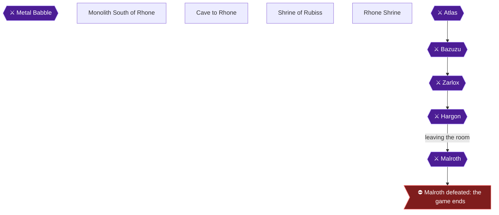

### Area Overview & Preparation

This chapter takes you from Beran's hidden portal to the far side of the Cave to Rhone. You will reveal the cave with the Eye of Malroth, grab the Life (Heart) Crest, trade all five crests for the Charm of Rubiss, loot the cave, and cross it to the Rhone plateau. You also pick up the Revive and Open spell achievements as your Prince and Princess level, and you have chances at the Wizard's Ring and a Metal Babble kill.

**Preparation**
- **Levels:** One source says the characters should be around level 25 before the first entry. [[gf3-74-2]] Another says level 25 or so before the full trip, with several attempts likely. [[gf3-76-3]] 
- **Escape items:** Bring a Wing of the Wyvern to get back to Beran if the Prince falls, and a fresh Leaf of the World Tree. [[gf3-74-3]]
- **Spells:** The Prince's Stepguard is needed to cross Beran's damage floor. [[gf3-74-1]] Outside is useful for leaving the cave. [[gf4-41-3]]
- **Inventory space:** Keep a free slot on the Hero. When the Hero's inventory was full, the Charm went to another character and the achievement did not pop. [[ra-comments-30-1]] A free slot on each character is also needed for the ring to drop. [[ra-comments-71-5]]
- **Tough dungeon:** Careful pathing, fleeing, and the Shield of Strength get you through. [[ra-guide-3-20]] The Cave to Rhone shrine on the far side is a save and respawn point. [[ra-guide-3-23]]

> [!TIP]
> Before you leave the Rhone side, finish what you came for. The achievements in this chapter are Heart Crest, Charm, Thunder Sword, Armor of Erdrick, the cave crossing, Wizard's Ring, Metal Babble, Revive and Open. Cast Outside from inside the cave to reach the entrance quickly. [[ra-comments-71-6]]

> [!WARNING]
> **Achievement Warning (Thou Hast Raised the Earth):** Use the Eye of Malroth only while standing directly in front of the mountain that becomes the cave opening. Using it anywhere else will not trigger the achievement. [[ra-comments-23-1]] The main hero must be the one who uses the item. [[ra-comments-23-2]]

### Chapter Items to Collect

| Item | Where Found | Action / Requirement | Citation |
|---|---|---|---|
| Life (Heart) Crest | Chest, lower-right of the Chamber of Horks | **OPEN** | [[gf2-22-1, ra-guide-8-3]] |
| Charm of Rubiss | Shrine of Rubiss, centre tile | **STAND** with all five crests | [[gf3-75-4, ra-guide-8-8]] |
| Lottery Ticket | Chest on 2F branch | **OPEN** | [[gf4-42-6]] |
| Armor of Erdrick | 4F chest by the stairs | **OPEN**, equip on Hero | [[gf4-42-8]] |
| Thunder Sword | Chest on the floor below the pit room | **OPEN**, equip on Hero | [[gf4-43-4]] |
| 100~180 Gold | 4F chest on the western path | **OPEN** | [[gf4-42-9]] |
| 100~180 Gold | 2F chest, northwest then east | **OPEN** | [[gf4-42-10]] |
| 550~610 Gold | 4F chests, West Path | **OPEN** | [[gf4-42-13]] |
| Wizard's Ring | Hork drop (1/128) or lottery | **FARM** | [[ra-guide-13-13, ra-guide-13-11]] |

### Monolith South of Rhone

🗺️ **Map:** [View Rhone Southern Shrine Map by FlyingArmor](https://www.vgmaps.com/Atlas/NES/DragonWarrior-Part2-RhoneSouthernShrine.png)

After Beran's portal, speak to the Old Man. He says the ancient road to Rhone was once west of this monolith. Then go up the staircase. [[gf4-39-13, gf4-39-14]]

**Reaching the portal in Beran**
1. Stay at the inn in Beran and save. [[gf3-74-1]]
2. Go to the House of Healing and stand in front of the black space at the back. Cast Stepguard, then use the Jailor's Key to open the gate. Step onto the portal. [[gf3-74-1, ra-guide-8-2]]

**Revealing the cave**
1. Walk west from the monolith through the forest and plains to the poisonous swamp. [[gf4-39-34, gf3-74-1]]
2. Cross partway over the swamp to the third patch from the left on the top row. Face the mountain there. [[gf3-74-1]]
3. Use the Eye of Malroth as an item with the Hero. The mountain splits and the Cave to Rhone appears. [[gf4-39-34, gf2-22-12]]


> [!ACHIEVEMENT]
> **Thou Hast Raised the Earth (3 Points)**
> 
> *With the help of the Eye of Malroth, find the cave to the Rhone plateau*


Enemies on this overland stretch include Magidrakee (drops Club), Gold Orc (Dragon's Bane), Sorcerer (Clothes Hiding), Hibabango (Chain Mail), Hunter (Iron Spear) and Graboopi (Copper Sword). [[gf4-39-28, gf4-39-29, gf4-39-30, gf4-39-31, gf4-39-32, gf4-39-33]]

### Cave to Rhone

🗺️ **Map:** [View Cave To Rhone Map by FlyingArmor](https://www.vgmaps.com/Atlas/NES/DragonWarrior-Part2-CaveToRhone.png)

#### First Visit: Chamber of Horks and the Heart Crest

1. From the entrance, go to the diagonal upper right. Take the staircase on the right of the entrance that goes down (the lower-right of the four down-stairs on 1F). [[gf3-74-6, ra-guide-8-3, gf2-22-15]]
2. In the Chamber of Horks, the large room with four staircases going up, walk to the lower-right corner. [[gf2-22-1, gf4-41-1]]
3. Horks attack every few steps, usually three or four at a time. Keep HP up and use attacks and fire spells. [[gf2-22-16]] Firebane can hit all of them, but Infernos is too weak. [[gf3-74-5]] Their sweet breath can poison or put you to sleep. [[gf3-74-4]]
4. Open the chest in the lower-right for the **Life Crest**. [[gf2-22-1]]


> [!ACHIEVEMENT]
> **Thou Art a Lover, and a Fighter! (10 Points)**
> 
> *Find the Heart Crest*


The achievement calls it the Heart Crest; the guides call the same item the Life Crest. [[gf-lists-10-16]] With this you hold all five crests. [[gf2-22-14]] Cast Outside and go back to Beran or your ship. [[gf4-41-3]]

### Shrine of Rubiss

🗺️ **Map:** [View Shrine Of Spirits Map by FlyingArmor](https://www.vgmaps.com/Atlas/NES/DragonWarrior-Part2-ShrineOfSpirits.png)

1. Sail to the one-tile island with the monolith. It lies about twelve tiles west of Midenhall, then due south. [[gf3-75-2]] Another route is north from the entrance of the island with Osterfair. [[ra-guide-8-9]]
2. No special requirements are needed to enter. [[gf3-75-3]]
3. Go down the series of staircases, about six flights. No enemies attack. [[gf3-75-1, gf2-23-1]]

### Charm of Rubiss

1. At the bottom, stand on the white centre tile among the four torches. [[gf2-23-1, gf3-75-4, gf4-41-6]]
2. Rubiss appears and gives you the Charm of Rubiss. [[gf4-41-7]]


> [!ACHIEVEMENT]
> **Thou Art Charming! (10 Points)**
> 
> *Get the Charm of Rubiss*


> [!WARNING]
> **Achievement Warning:** If the achievement does not pop, the Hero's inventory may have been full. Reload and free a slot. Otherwise, trade the Charm between the three characters until it pops. [[ra-comments-30-2, ra-comments-30-3]]

The Charm dispels the magic on Hargon's Castle. [[gf2-26-2]] Go back upstairs, exit, and return to the Cave to Rhone via Beran. [[gf4-41-7]]

### Cave to Rhone: Crossing the Cave

A map is linked at the top of this section. The quick route to the exit is below. [[ra-guide-8-7]]

#### B1F and B2F (second visit)
From the entrance, go northeast to the down staircase. In the Chamber of Horks take the staircase up in the southeast. [[gf4-42-1, gf4-42-2]] Avoid the upper-left stairs, which differ from the others. [[gf2-23-1]]

#### 1F
Take the staircase north on B1F. [[gf4-42-3]] On 1F, use either of the two up stairs on the right side. [[ra-guide-8-7]] Alternatively, go through the opening west, then west, then the **third** opening north, and up the stairs. [[gf4-42-4]] Pitfalls on this floor drop you back to the Chamber of Horks. [[gf2-23-1]]

#### 2F
This staircase is the **Original Entrance of 2F**, so remember it. [[gf4-42-5]] Go right past two up/down paths and take the third for stairs. [[ra-guide-8-7]]

The four-way passage repeats unless followed in order: left into the multi-branch passage, down the third branch from the right, straight down two more screens, then up a staircase. [[gf3-76-4, gf2-23-7]]

Side chests:
- **Lottery Ticket:** From the Original Entrance, go southeast, east, south, southeast, then north through the opening. [[gf4-42-5, gf4-42-6]]
- **100~180 Gold:** From the Original Entrance, go northwest, then east through the opening. [[gf4-42-10]]
- **West Path (550~610 Gold):** Go north to the fork. Take the west opening, then southwest to a staircase up. On 3F go up the stairs. On 4F go south then west through the opening. The chests hold 550~610 gold. Return to the 2F fork. [[gf4-42-11, gf4-42-12, gf4-42-13, gf4-42-14]]

#### 3F and 4F: Armor of Erdrick
From the Original Entrance go southeast, east, south, southeast, north (Lottery Ticket), south, then east to a staircase up. On 3F take the nearby stairs up. [[gf4-42-5, gf4-42-7]] On 4F, open the chest for the **Armor of Erdrick** and equip it on the Hero. [[gf4-42-8, gf3-76-6]] It is +40 defense. [[gf2-26-40]]


> [!ACHIEVEMENT]
> **Thine Ancestral Armor! (10 Points)**
> 
> *Find the legendary Armor of Erdrick*


Return to the Original Entrance of 2F. A western staircase route from there leads to a 4F chest with 100~180 gold. [[gf4-42-9]]

#### East Path to the Pit Room
From the fork, take the east opening, then go up the staircase to 3F and again up to 4F. [[gf4-42-15, gf4-43-1]] The ra-guide says to take the north-eastern stairs on floor 3, then the next stairs. [[ra-guide-8-7]]

> [!WARNING]
> The 4F room is full of hidden pits that drop you down. It is easy to fall by accident. [[gf3-77-4, gf3-77-6]] The pits matter for the Thunder Sword below.

### Thunder Sword

1. Arrive at the head of the 4F staircase. Walk right one step and down one step to fall into a pit. [[gf3-77-3]] Alternatively, from the 4F entrance go 1 step south and 1 step west. [[gf4-43-2]] Any pit works. [[ra-guide-12-9]]
2. You land on a large floor. Go to the southwest corner, then 1 step north and 1 step east to fall again. [[gf4-43-3, gf2-23-16]]
3. You land in the chest room. Open the chest for the **Thunder Sword** and equip it on the Hero. [[gf4-43-4, gf3-77-1]] It is +80 attack and casts Infernos. [[gf2-26-38]]


> [!ACHIEVEMENT]
> **Thou Hast the Blade of Storms (10 Points)**
> 
> *Find the legendary Thunder Sword*


The remaining falls: go to the eastern corner of 2F to fall to 1F, then through the north opening and walk around the middle to fall to B1F. [[gf4-43-5, gf4-43-6]] You are back at the entrance, and you can return to Beran to heal. [[gf4-43-7]]

### Cave to Rhone: 4F to the Exit

Make your way back to the Original Entrance of 2F, then take the East Path to 3F and up to 4F. [[gf4-43-8]]

On 4F: go 2 steps north, 4 steps west, 6 steps south, 2 steps east, 2 steps south, 3 steps east, then south to the up staircase. [[gf4-43-9]] The RA guide's version: go south from the stairs until you hit the wall, two tiles left, south to the next wall, then right and up the stairs. [[ra-guide-8-7]]

#### 5F Maze
The only exit is the cave's exit. [[ra-guide-8-7]] Follow these openings in order: east, northwest, northeast; then east, north, east, south and through the east opening; the northern east opening; north; the western north opening; north; north; east; southeast; then up the staircase. [[gf4-44-1]]

Short version: head to the right side until you can go up or down. Go up, take the left path, then right at the end. [[ra-guide-8-7]]


> [!ACHIEVEMENT]
> **Thou Hast Passed Through Hell (10 Points)**
> 
> *Cross the mountains through a cavernous maze to reach the Rhone plateau*


Beyond is Rhone. Follow the snow path east then northeast to the bridges and the Rhone Monolith, where the priest heals and saves. [[gf4-44-1]]

### Wizard's Ring

The NES version has no guaranteed Wizard's Ring chest. Win it from the lottery with three Stars, or get a rare drop. [[ra-guide-13-11, gf-lists-9-15]]

**Best farm: Horks in the lowest basement (1/128)**
- Horks are the only enemies in the basement, with a very high encounter rate. [[ra-comments-71-2, ra-comments-72-4]]
- They are easy to kill, so this is faster than Bullwongs despite the worse rate. [[ra-guide-13-13]]
- Casting Outside in the cave takes you to the entrance, even from the exit. [[ra-comments-71-6]]
- Keep a free inventory slot on every character. [[ra-comments-71-5]]

**Alternative: Bullwongs (1/32)**, found in Hargon's Castle and on the world map just before it. [[ra-guide-13-12, ra-comments-71-1]] Drops can take a very long time. [[ra-comments-2-2, ra-comments-4-6]]

**Use it:** In battle, use the ring from the item menu while MP is NOT full. Using it at full MP does not unlock the achievement. [[ra-guide-13-14, ra-comments-71-3]]


> [!ACHIEVEMENT]
> **Prithee, Magicke Ring (5 Points)**
> 
> *Use the Wizard's Ring to recover some of your MP during a battle (let us hope it doesn't break!)*


### Metal Babble

- Metal Babble has 35 HP, gives 1050 EXP and 255 gold, and may drop a Dragon's Potion. [[gf2-27-43, gf4-40-7]]
- It is very hard to hit and almost always runs on its first turn. [[gf-lists-5-48]]
- In the Cave to Rhone they come alone. [[ra-guide-10-9]]
- The RA guide recommends waiting until the Cave to Rhone or Hargon's Castle. [[ra-guide-13-17]] Many encounters are likely, since they flee easily. [[ra-guide-13-19]] A Falcon Sword helps. [[ra-guide-13-18]]

Defeat one to unlock:


> [!ACHIEVEMENT]
> **Thou Art a Millionaire (5 Points)**
> 
> *Defeat a Metal Babble*


### Spells: Revive and Open

- The Prince of Cannock learns **Revive** at level 25 (15 MP). [[ra-guide-11-15, gf2-27-17]]


> [!ACHIEVEMENT]
> **Thou Art Life (5 Points)**
> 
> *Learn the Revive spell*


- The Princess of Moonbrooke learns **Open** at level 23 (2 MP). [[ra-guide-11-24, gf2-27-13]]


> [!ACHIEVEMENT]
> **Thou Art a Rogue (5 Points)**
> 
> *Learn the Open spell*


> [!IMPORTANT]
> ### Chapter 17 Cumulative 100% Checkpoint
> - **Crests:** 5 / 5
> - **Erdrick Equipment:** 4 / 4
> - **RetroAchievements Unlocked:** 62 / 69 (347 / 427 points)

### Chapter Checklist
- [ ] Eye of Malroth used in front of the mountain by the Hero (46458)
- [ ] Heart (Life) Crest taken (46425)
- [ ] Charm of Rubiss received (46420)
- [ ] Armor of Erdrick equipped (115783)
- [ ] Thunder Sword equipped (115779)
- [ ] Cave crossed to Rhone (116312)
- [ ] Wizard's Ring used in battle with MP not full (115787)
- [ ] Metal Babble defeated (116313)
- [ ] Prince learned Revive, level 25 (46437)
- [ ] Princess learned Open, level 23 (46445)

---

## Chapter 18: The Rhone Plateau

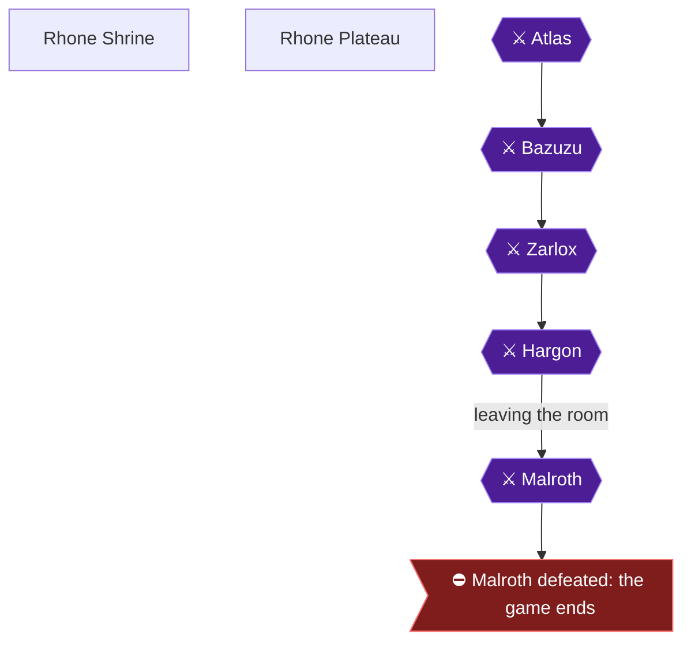

### Area Overview & Preparation

You have just come out of the Cave to Rhone. This chapter is the final stretch before Hargon's Castle: a safe shrine with healing and saving, and a plateau full of dangerous monsters that give a great deal of experience. Your goals are three level milestones: Hero level 30, the Prince learning Sacrifice (level 28), and the Princess learning Chance (level 25).

Level targets from the sources:

- Reach level 30 with the hero before the castle. The experience in Rhone makes this quick [[gf2-24-5]].
- Level everyone in the party to at least level 20, with the hero closer to level 30 [[gf3-80-4, gf3-80-5]].
- Attempting the final boss below level 30 is described as practically a death wish [[ra-guide-10-1]].

> [!TIP]
> **Before you leave:** Do not leave Rhone until the hero is at least level 30, the Prince has Sacrifice and the Princess has Chance. The Hargon's Castle fights come back to back [[ra-guide-8-10]].

### Rhone Shrine

🗺️ **Map:** [View Rhone Shrine Map by FlyingArmor](https://www.vgmaps.com/Atlas/NES/DragonWarrior-Part2-RhoneShrine.png)

**Getting there.** The shrine after the cave serves as your save and respawn point [[ra-guide-3-23]]. From the Cave to Rhone, follow the snow path east then northeast to a bridge, cross it, cross the next one, then enter the Monolith (the shrine) [[gf4-44-9]].

**What the shrine does:**

1. Speak to the Priest. He heals you and lets you save your game [[gf4-44-10]].
2. The old man in the shrine revives or restores fallen party members for free [[gf3-80-1]].
3. After every fight you can return to the healer to heal your party [[gf2-24-4]].
4. If you lose a battle, you return to the shrine with half your gold and get a free revival [[gf3-81-18]].

> [!WARNING]
> **Do not use the travel door to the south.** It leads back to Beran [[gf4-44-11]]. A portal in the shrine goes down to the Underworld, which is just the Alefgard you already explored [[gf3-80-3]].

### Rhone Plateau

Fight just outside the shrine until your levels are high enough that you feel good about the trek west to Hargon's Castle [[gf3-80-6]]. The valley toward the castle is full of monsters that give a bundle of experience, but they are dangerous [[gf3-81-19]]. At levels 26 to 30 you can alternatively hunt Metal Babbles in Rhone Cave: more experience, but tougher to kill, and they appear alone [[ra-guide-10-9]]. One commenter notes you will make many trips through Rhone Cave anyway [[ra-comments-6-1]].

#### Enemies of the plateau and drops

| Monster | EXP | Gold | Drop | Citation |
|---|---|---|---|---|
| Silver Batboon | 271 | 96 | Dragon Killer | [[gf4-44-2]] |
| Attackbot | 723 | 120 | Steel Shield | [[gf4-44-3]] |
| Cyclops | 327 | 99 | Dragon's Bane | [[gf4-44-4]] |
| Blizzard | 453 | 113 | Wizard's Wand | [[gf4-44-5]] |
| Giant | 515 | 95 | Sword of Destruction | [[gf4-44-6]] |
| Gold Batboon | 396 | 100 | Gremlin's Armor | [[gf4-44-7]] |
| Bullwong | 872 | 110 | Wizard's Ring | [[gf4-44-8]] |

One commenter ground out 200k XP outside the Rhone Monolith and got no Bullwong drops, so do not count on drops [[ra-comments-71-9]].

#### Dangerous monsters and how to beat them

- **Blizzard:** has a spell that instantly kills party members and works best on the hero, though it can occasionally take out the prince or princess [[gf3-81-1]]. Open with fire-based spells on the first turn, then finish with physical attacks on the second round. One writer equips the Prince with the Falcon Sword for its two strikes per turn [[gf3-81-2]].
- **Giant:** large life meter, and its strikes do a lot of damage [[gf3-81-3]].
- **Gold Batboon:** its sweet breath puts you to sleep, and it breathes scorching flames that quickly deal heavy damage [[gf3-81-4]]. Fierce physical attacks are the best bet [[gf3-81-5]].
- **Bullwong:** casts Explodet, which can hit everyone for around 50 damage [[gf3-81-6]]. It has a huge life meter and spells that try to nullify its magic almost never work [[gf3-81-7]]. Try putting it to sleep [[gf3-81-8]].

#### Optional: Sword of Destruction

Giants at the Rhone Plateau drop the Sword of Destruction. It is not necessary, but highly recommended, and the drop rate is fairly high, so you will likely get it quickly while grinding [[ra-guide-4-1]].

#### Optional: the Falcon Sword attack exploit

The steps from the source [[ra-guide-4-2]]:

1. Head to Hargon's Castle and, before entering, equip the hero with the Falcon Sword (it attacks twice but with lower damage).
2. Go inside the castle and equip either the Thunder Sword or the Sword of Destruction. The latter will curse you, but this is according to plan.
3. Go back outside. The Falcon Sword is re-equipped, but with the power of the sword you equipped inside.

Unable to verify from collected sources any further details of this exploit.

### Level 30 for the Hero

The hero needs 230,000 experience points for level 30 [[gf2-28-7]]. Keep fighting outside the shrine and heal at the Priest between fights [[gf2-24-4]].


> [!ACHIEVEMENT]
> **Thou Art Ready for Anything (25 Points)**
> 
> *Have your hero reach level 30*


> [!NOTE]
> One commenter reported that the level 30 achievement did not unlock although their hero was level 30 [[ra-comments-39-1]]. Unable to verify from collected sources a fix.

### Prince Learns Sacrifice (Level 28)

The Prince of Cannock learns Sacrifice at level 28 for 1 MP [[ra-guide-11-16, gf-lists-11-19, gf-versions-8-10, gf2-27-18, gf4-44-14]]. It kills all enemies, but the caster dies [[gf-lists-11-19]]. The achievement only requires learning it, so do not cast it recklessly. Your party reportedly gains no experience if the Prince uses Sacrifice, so it is useless for grinding [[ra-comments-50-1]].


> [!ACHIEVEMENT]
> **Thou Art a Martyr (5 Points)**
> 
> *Learn the Sacrifice spell*


### Princess Learns Chance (Level 25)

The Princess of Moonbrooke learns Chance at level 25 [[ra-guide-11-25, gf-lists-11-3, gf-versions-8-26, gf4-44-16, ra-comments-60-1]]. It has random effects [[gf-lists-11-3]]. One list gives its cost as 15 MP and another as 13 MP [[gf-lists-11-3, gf2-27-2]].


> [!ACHIEVEMENT]
> **Thou Hast a Gambling Problem (5 Points)**
> 
> *Learn the Chance spell*


### Before Moving On

> [!TIP]
> **Before you leave Rhone:** Heal and save at the Priest, confirm the hero's level and both spells, then head west to Hargon's Castle [[gf4-44-10, gf4-44-24]].

> [!IMPORTANT]
> ### Chapter 18 Cumulative 100% Checkpoint
> - **Crests:** 5 / 5
> - **Erdrick Equipment:** 4 / 4
> - **Hero Level 30, Sacrifice, Chance:** all learned in this chapter [[ra-guide-10-1, ra-guide-11-16, ra-guide-11-25]]
> - **RetroAchievements Unlocked:** 65 / 69 (382 / 427 points)

### Chapter Checklist

- [ ] Healed and saved at the Rhone Shrine Priest [[gf4-44-10]]
- [ ] Did not use the south travel door [[gf4-44-11]]
- [ ] Hero level 30 (46408) [[gf2-28-7]]
- [ ] Prince level 28 with Sacrifice (46438) [[ra-guide-11-16]]
- [ ] Princess level 25 with Chance (46446) [[ra-guide-11-25]]
- [ ] Optional: Sword of Destruction from a Giant [[ra-guide-4-1]]
- [ ] Optional: Falcon Sword exploit prepared [[ra-guide-4-2]]

---

## Chapter 19: Hargon's Castle and the Ending

```mermaid
flowchart TD
  Hargons_Castle["Hargon's Castle"]
  Atlas{{"⚔ Atlas"}}
  Bazuzu{{"⚔ Bazuzu"}}
  Zarlox{{"⚔ Zarlox"}}
  Hargon{{"⚔ Hargon"}}
  Malroth{{"⚔ Malroth"}}
  Malroth_PONR>"⛔ Malroth defeated: the game ends"]
  Atlas --> Bazuzu
  Bazuzu --> Zarlox
  Zarlox --> Hargon
  Hargon -->|"leaving the room"| Malroth
  Malroth --> Malroth_PONR
  classDef ponr fill:#7f1d1d,stroke:#f87171,color:#fff;
  classDef boss fill:#4c1d95,stroke:#a78bfa,color:#fff;
  class Malroth_PONR ponr;
  class Atlas,Bazuzu,Zarlox,Hargon,Malroth boss;
```

### Area Overview & Preparation

This is the final chapter. You will break the illusion on Hargon's Castle with the Charm of Rubiss, climb a tower guarded by three bosses (Atlas, Bazuzu, Zarlox), defeat Hargon, and then defeat Malroth, who appears as soon as you try to leave Hargon's room. After that you return to Midenhall to answer your father's question. The achievements here are:

- **Ye Olde Evile Prieste** (Hargon): 5 pts
- **Thine Quest, 'Tis Over!** (Malroth): 25 pts
- **Thou Shalt Not Be Selfish** (refuse the King's offer): 5 pts
- **Thou Hast Found Peace** (the ending): 10 pts

**Preparation checklist (do it all before entering the castle):**

- You need the **Charm of Rubiss**, obtained by trading all five crests at the monolith of holy [[gf-lists-10-18]]. The voice of Rubiss gives it to the descendants of Erdrick [[gf4-41-7]], and standing on the center blank tile in the Chamber of Rubiss also brings Rubiss and the Charm [[gf3-75-4]]. Only Rubiss's magic can counter Hargon's optical illusion [[gf3-74-7]].
- You also need the **Jailer's Key**, the **golden key** and the **Eye of Malroth**. All three are used inside the castle [[gf3-81-13]]. The Eye of Malroth opens the way to Rhone and Hargon Castle floor 2 [[gf-lists-9-26]].
- Get the hero to **level 30** at minimum. One source says to reach level 30 before going to the castle, and that fighting in Rhone gives enough experience to do so quickly [[gf2-24-5]]. Another says the hero should be closer to level 30 [[gf3-80-5]]. A further guide recommends getting close to level 40 because these are tough boss fights [[ra-guide-8-11]]. Another suggests Hero 37, Orfeo 34 and Peta 29 [[gf4-48-5]].
- After each fight in Rhone you can go back to the healer to heal your characters [[gf2-24-4]].
- Carry several unequipped **Shields of Strength**. Each works as a free HealMore when used in battle [[ra-guide-8-12]].
- Giants at the Rhone Plateau drop the Sword of Destruction fairly often, and it is highly recommended while you grind [[ra-guide-4-1]].
- Lower-level players may also use the exploit that increases the hero's strength with no drawbacks [[ra-guide-8-13]]. Optional version: equip the Falcon Sword before entering the castle, swap to the Thunder Sword or Sword of Destruction inside (the latter curses you, which is fine), then walk back outside. The Falcon Sword is re-equipped with the stronger sword's power [[ra-guide-4-2]]. Attack power is recalculated on level up, so stay near the castle when close to a level [[ra-guide-4-4]].
- Do not attempt anything in the castle until you have leveled up sufficiently [[gf3-81-11]].

> [!WARNING]
> **Missable Achievement Warning (Ye Olde Evile Prieste):** This achievement can be missed, because the game can be beaten without killing Hargon. Using the Chance spell on him may make him flee [[ra-comments-4-8, ra-comments-4-9]]. Do NOT cast Chance on Hargon. Likewise never cast it on Malroth: if you get the Siren's Call he returns at full power [[gf-lists-5-35]].

> [!TIP]
> **Optional Metal Babble / Wizard's Ring farming:** Metal Babbles appear in formations of 5 on the 3rd floor of Hargon's Castle [[ra-comments-73-2]]. Bullwong drops the Wizard's Ring at a 1/32 chance and is found in Hargon's Castle and on the world map just before it [[ra-guide-13-12, gf4-45-8]]. Do this before the final fights; once Malroth falls the game ends.

Unable to verify from collected sources: exact HP of Atlas, Bazuzu, Zarlox and Hargon (one source says about 200 HP of damage defeats Hargon [[gf2-25-10]]). Malroth has 250 HP [[gf-lists-5-33]].

### Hargon's Castle: The Illusion and the Way to the Tower

🗺️ **Map:** [View Hargon's Castle Map by FlyingArmor](https://www.vgmaps.com/Atlas/NES/DragonWarrior-Part2-Hargon'sCastle.png)

1. **ENTER** the castle. It first appears as a mock-up of Midenhall with empty chests and doors that do not work [[gf2-24-7]]. Rest at the inn first to refill health, then continue [[gf3-81-17]].
2. **USE** the **Charm of Rubiss** as an item to break the illusion [[gf4-45-10, gf3-81-17]]. The fake castle disappears and Hargon's true lair is revealed [[gf2-24-7]].
3. **WALK** north toward the throne, where two purple monsters stand [[gf3-81-13]]. The Fire Spirit sits on the throne; speak to it, and defeat the two Gold Batboons [[gf4-45-11, gf4-45-12]].
4. **CAST Stepguard**, then walk onto the candy-striped floor behind the throne [[gf3-81-13]].
5. Head to the left side, face the gray wall and **USE** the **Jailer's Key**. A hidden door opens into a hallway [[gf3-81-14]]. It is northwest of the throne and must be unlocked before you pass [[gf4-45-13, gf4-45-14]].
6. **CAST Stepguard** again and go to the door on the right. **USE** the golden key and step through [[gf3-81-15, gf4-45-15]].
7. **CAST Stepguard** once more and walk to the gray tile at the center of the electrified floors. **USE** the **Eye of Malroth** there [[gf3-81-16]]. Stand at the center of the white circle when you use it [[gf4-45-16]].

> [!NOTE]
> The three guardians stay defeated only until you save and power off. The Repel spell should make trips through the castle quick [[gf3-81-10, gf3-81-12]]. Three guardians must be defeated before reaching Hargon [[gf3-81-9]].

### Tower Floors 2 to 3

Directions on 2F: go through the opening to the northeast, then up the staircase [[gf4-46-1]]. On 3F: go through the north opening, then west, then south to the end; go through the west opening, then north to the staircase up [[gf4-46-2]].

### Atlas

Heal up on arrival at 4F [[gf4-46-3]]. Buff the party before walking right [[gf3-82-2]]. On 4F go through the east opening, then east, south, west, north, then east through the opening to the stairs up. You must fight a boss before climbing them [[gf4-46-4]].

You cannot run from this fight [[gf3-82-1]].

**Atlas facts:** a strong giant with a mean punch who attacks twice each turn [[gf2-24-10, gf3-82-3, gf4-46-6]]. Offensive fire spells do not hurt him [[gf3-82-4]]. He gives 1100 EXP and 250 gold and drops the Sword of Destruction [[gf4-46-12, gf4-46-7]]. Recommended levels: Hero 37, Orfeo 34, Peta 29 [[gf4-46-11]].

**Strategy:**
- Hero: attack normally with physical blows [[gf4-46-8, gf3-82-5]].
- Orfeo: cast Increase, heal with Healmore, and attack occasionally if Peta has healing covered [[gf4-46-9]].
- Peta: cast Defence and Surround, and focus on Healall [[gf4-46-10]].
- Other party members keep health up and cast defensive or weakening spells [[gf3-82-5]].

Climb the stairs once Atlas is down [[gf4-46-5]].

### Bazuzu

Heal up on 5F; there are 6 rooms. Enter the westernmost north room from the west entrance to trigger the battle [[gf4-47-1, gf4-47-2]]. Heal everyone, then walk right into the grating to start it [[gf3-82-6]].

**Bazuzu facts:** he may put you to sleep, cast Firebane, or cast Defeat [[gf3-82-7]]. His full list is Normal Attack, Attacks Twice, Sleep, Firebane, Healall, Explodet, Defeat and Sacrifice [[gf4-47-3]]. Sleep cast on him works for at least one turn [[gf2-25-3]]. He gives 1530 EXP and 240 gold and drops the Mysterious Hat [[gf4-47-18, gf4-47-5]]. Recommended levels: Hero 37, Orfeo 34, Peta 29 [[gf4-47-4]].

**Strategy:** physical attacks are your best offense [[gf3-82-8]]. Hero attacks normally; Orfeo casts Increase and heals with Healmore; Peta focuses on Healall [[gf4-47-6, gf4-47-7, gf4-47-8]].

### Zarlox

Heal up on 6F, go through the east opening, then through the next opening to the end to find the staircase up [[gf4-47-9, gf4-47-10]]. A few steps before the stairs, Zarlox attacks [[gf3-82-9, gf4-47-11]].

**Zarlox facts:** he uses strong fire magic to drain your health [[gf3-82-10]]. His attacks are Normal Attack, Attacks Twice, Scorching Flames, Healall, Explodet and Increase [[gf4-47-12]]. He gives 2200 EXP and 255 gold and drops the Staff of Thunder [[gf4-47-19, gf4-47-14]]. Recommended levels are the same [[gf4-47-13]].

**Strategy:** if attacked fiercely he casts Healall just before dying [[gf3-82-11]]. Get his health low, then go all out on the last turn or so to finish him before he recovers [[gf3-82-12]]. Hero attacks; Orfeo casts Increase and heals; Peta heals with Healall [[gf4-47-15, gf4-47-16, gf4-47-17]].

### Hargon

1. Heal up on 7F [[gf4-48-1]].
2. **CAST Stepguard** immediately before entering [[gf2-25-7, gf3-82-15]]. Walk left along the colored floor toward the room at the center of the floor [[gf3-82-15]] (another guide: go west, then north [[gf4-48-2]]).
3. **TALK** to Hargon. The fight starts regardless of your answer [[gf3-82-16, gf4-48-3]].

**Hargon facts:** his list is Normal Attack, Attacks Twice, Sweet Scented Breath, Healall, Explodet and Sleep [[gf4-48-4]]. He attacks twice per turn [[ra-guide-8-17]] and puts the party to sleep, quite frequently [[gf3-82-13]]. He gives no EXP, gold or drop [[gf4-48-6]]. Recommended levels: Hero 37, Orfeo 34, Peta 29 [[gf4-48-5]].

**Strategy:**
- Hero keeps attacking [[gf4-48-7, ra-guide-8-15]].
- The Princess casts healing every turn; Peta focuses on Healall [[ra-guide-8-15, gf4-48-9]].
- The Prince does whatever is needed: heal, buff, debuff or damage [[ra-guide-8-16]]; Orfeo casts Increase and Healmore [[gf4-48-8]].
- He may heal all his health two or three times before you outlast his sleep and Explodet [[gf3-82-14]].
- About 200 HP of damage defeats him [[gf2-25-10]].


> [!ACHIEVEMENT]
> **Ye Olde Evile Prieste (5 Points)**
> 
> *Vanquish the mad cultist of Rhone, Hargon*


### Malroth

After Hargon falls, he summons Malroth [[gf4-48-10]]. When you proceed to leave the room, flames surround you, an earthquake hits, and Malroth appears [[gf2-25-11, gf3-83-1]]. Heal up, then go south to trigger the final battle [[gf4-48-11]].

> [!CAUTION]
> **Point of No Return:** Beating Malroth starts the ending [[gf3-83-6, gf2-25-17]]. Everything else (Metal Babble, Wizard's Ring, level 30, Erdrick gear, chests) must be done before the final battle.

**Malroth facts:**
- 250 HP and virtually every deadly spell in the game [[gf-lists-5-33, gf-lists-5-34]].
- Attacks once per turn [[ra-guide-9-1]]. His list: Normal Attack, Faint Attack, Scorching Flames, Healall [[gf4-48-12]].
- He can immediately render the hero unconscious [[gf3-83-3]], nullify damage you did in a single turn [[gf3-83-4]], and breathe flames that quickly deplete everyone's HP [[gf3-83-5]].
- No EXP, gold or drop [[gf4-48-14]]. Recommended levels: Hero 37, Orfeo 34, Peta 29 [[gf4-48-13]].
- Never use Chance on him [[gf-lists-5-35]].

**Strategy:**
- Use the same tactics as against Hargon and Zarlox [[gf3-83-2]]. The Hero attacks, the Princess heals, and the Prince does what is needed [[ra-guide-9-2]].
- Hero attacks normally; Orfeo casts Increase and heals with Healmore; Peta casts Defence and focuses on Healall [[gf4-48-15, gf4-48-16, gf4-48-17]].
- Count his remaining HP (about 250) and plan attacks accordingly [[gf2-25-19]]. Attack with weapons while the princess casts Heal [[gf2-25-19]].
- Use all your MP on healing if necessary [[ra-guide-9-3]].

Once he is struck down, you have won [[gf2-25-19]].


> [!ACHIEVEMENT]
> **Thine Quest, 'Tis Over! (25 Points)**
> 
> *Vanquish the otherworldly demon, Malroth*


Rubiss heals your party and peace is restored [[gf4-48-18]].

### Return to Midenhall: The King's Offer

Make your way back to Midenhall Castle, where the King awaits your return [[gf2-25-17]]. With Hargon's Temple gone, no monsters spawn, so the trip is safe [[gf4-49-1]]. Go back to the Rhone Monolith and use its Travel Door to return to Beran [[gf4-49-2]], then head to Midenhall Castle and go north to the King [[gf4-49-3, gf4-49-4]]. You can talk to the Prince and Princess first [[gf4-49-5]]. One guide simply answers YES here [[gf4-49-6]]; do not follow that guide at this step, because the achievement needs NO first.

> [!WARNING]
> **Missable Achievement Warning (Thou Shalt Not Be Selfish):** When your father asks you to become king, answer **NO** first [[ra-guide-9-4]]. Answering YES first means you must kill the last boss again [[ra-comments-33-5, ra-comments-1-6]]. Reports vary: one player's achievement popped just on hovering over "No", and others on merely talking to the king [[ra-comments-33-1, ra-comments-33-2, ra-comments-33-3]]. Another says it is not missable [[ra-comments-33-4]]. Do not take the chance.

1. **TALK** to your father in Midenhall Castle [[ra-guide-9-4]].
2. When he asks you to become king, answer **NO**. He rejects your refusal and gives you the chance to say yes [[ra-guide-9-4]].


> [!ACHIEVEMENT]
> **Thou Shalt Not Be Selfish (5 Points)**
> 
> *After vanquishing Malroth, refuse your father's offer*


3. Now answer **YES**. You say no once for the achievement, then yes to finish the game without repeating the boss fights [[ra-comments-33-6]]. The King declares you the new monarch of Midenhall [[gf2-25-17]].


> [!ACHIEVEMENT]
> **Thou Hast Found Peace (10 Points)**
> 
> *Write your legend in the halls of history!*


This achievement triggers after the conversation with your father [[ra-guide-9-5]]. Congratulations, you have beaten the game.

> [!IMPORTANT]
> ### Chapter 19 Cumulative 100% Checkpoint
> - **Crests:** 5 / 5 [[gf-lists-10-18]]
> - **Erdrick Equipment:** 4 / 4
> - **Bosses defeated in this chapter:** Atlas, Bazuzu, Zarlox, Hargon, Malroth [[gf3-81-9, gf3-83-6]]
> - **RetroAchievements Unlocked:** 69 / 69 (427 / 427 points)

### Chapter Checklist

- [ ] Charm of Rubiss used to dispel the illusion [[gf3-81-17]]
- [ ] Jailer's Key, golden key and Eye of Malroth used in the castle [[gf3-81-13]]
- [ ] Atlas, Bazuzu and Zarlox defeated [[gf3-81-9]]
- [ ] Stepguard cast before Hargon's room [[gf2-25-7]]
- [ ] Hargon defeated: Ye Olde Evile Prieste (46459)
- [ ] Malroth defeated: Thine Quest, 'Tis Over! (46460)
- [ ] Answered NO first to your father: Thou Shalt Not Be Selfish (46461)
- [ ] Answered YES afterward: Thou Hast Found Peace (46462)

---

## Final Checklist

**1. Midenhall, Leftwyne and the Prince of Cannock**

- [ ] 🏆 'Tis Dangerous to Venture Alone
- [ ] 🏆 Thou Hast Leveled Up
- [ ] 🏆 Thou Hast Becometh Swole
- [ ] 🏆 Thou Art Now Buddies
- [ ] 🏆 Thou Hast a Ball of Fire
- [ ] 🏆 Thou Art a Physician

**2. The Lake Cave and the Silver Key**

- [ ] 🏆 Thou Hast an Argent Door Opener
- [ ] 🏆 'Tis Time to Stop

**3. Hamlin, Moonbrooke and the Mirror of Ra**

- [ ] 🏆 Thou Art Large
- [ ] 🏆 Thou Art a Traveler
- [ ] 🏆 Thou Hast Eased a Warrior's Passing
- [ ] 🏆 Thou Art Vain
- [ ] 🏆 Thou Art Now a Trio
- [ ] 🏆 'Tis No Longer a Flesh Wound
- [ ] 🏆 Thou Art Stupefying
- [ ] 🏆 Thou Art Hot
- [ ] 🏆 Thou Art Beguiling

**4. The Tower of Wind**

- [ ] 🏆 Thou Hast Conquered the East
- [ ] 🏆 Thou Art a Master of Escape

**5. The Dragon's Horn and Lianport**

- [ ] 🏆 'Tis Not Flying! 'Tis Falling with Style!
- [ ] 🏆 Thou Art a Hero
- [ ] 🏆 Thine Inner Bard Hast Awakened
- [ ] 🏆 Thou Art Foul of Odor

**6. Alefgard: Tantegel and Charlock Castle**

- [ ] 🏆 Thine Ancestral Sword!
- [ ] 🏆 Thou Hast Finished the Wrong Quest!
- [ ] 🏆 Thou Hast a Keen Eye

**7. Zahan and the Golden Key**

- [ ] 🏆 Thou Hast a Noble Door Opener
- [ ] 🏆 Thou Hast Stout Boots

**8. The Lighthouse and the Star Crest**

- [ ] 🏆 Thou Art as Brilliant as a Star!

**9. Golden Key Errands**

- [ ] 🏆 Thou Hast Celestial Foliage
- [ ] 🏆 Thine King Is Bare
- [ ] 🏆 Thou Hast the Crest of Thine Line
- [ ] 🏆 Thine Ancestral Shield!

**10. Osterfair Castle**

- [ ] 🏆 Thou Art a Night Owl!
- [ ] 🏆 Thou Hast the Protection of the Land
- [ ] 🏆 Thou Art an Arsonist
- [ ] 🏆 Thou Art a Slayer

**11. Beran and the Holy Shrine**

- [ ] 🏆 Thou Art as Bright as the Sun!
- [ ] 🏆 Thine Ancestral Helmet!
- [ ] 🏆 Thou Hast Excellent Healthcare

**12. Wellgarth: the Jailor's Key and the Floodgate Key**

- [ ] 🏆 Thou Art a Gaol Breaker
- [ ] 🏆 Thou Art the Master of Gates
- [ ] 🏆 Thou Art Sturdy of Arm

**13. Jailor's Key Errands**

- [ ] 🏆 Thou Hast the Stick of Sages
- [ ] 🏆 Thou Art as Vast as the Sea!

**14. Tuhn: the Floodgate and the Water Flying Cloth**

- [ ] 🏆 Thou Hast Bade the Waters Flow
- [ ] 🏆 Thou Hast a Sodden Garment

**15. The Tower of the Moon**

- [ ] 🏆 Ye Olde Lunar Fragment

**16. Malroth's Cavern and the Eye of Malroth**

- [ ] 🏆 Thou Hast Parted the Sea
- [ ] 🏆 Thou Hast Poked Evil in the Eye
- [ ] 🏆 Thou Art Death
- [ ] 🏆 Thou Art Very Hot

**17. The Cave to Rhone**

- [ ] 🏆 Thou Hast Raised the Earth
- [ ] 🏆 Thou Art a Lover, and a Fighter!
- [ ] 🏆 Thou Art Charming!
- [ ] 🏆 Thou Hast the Blade of Storms
- [ ] 🏆 Thine Ancestral Armor!
- [ ] 🏆 Thou Hast Passed Through Hell
- [ ] 🏆 Prithee, Magicke Ring
- [ ] 🏆 Thou Art a Millionaire
- [ ] 🏆 Thou Art Life
- [ ] 🏆 Thou Art a Rogue

**18. The Rhone Plateau**

- [ ] 🏆 Thou Art Ready for Anything
- [ ] 🏆 Thou Art a Martyr
- [ ] 🏆 Thou Hast a Gambling Problem

**19. Hargon's Castle and the Ending**

- [ ] ⚠ Refuse the King's offer (before: In the ending conversation with your father in Midenhall Castle, before answering Yes.)
- [ ] 🏆 Ye Olde Evile Prieste
- [ ] 🏆 Thine Quest, 'Tis Over!
- [ ] 🏆 Thou Shalt Not Be Selfish
- [ ] 🏆 Thou Hast Found Peace
- [ ] ⛔ Everything above is done before: Malroth defeated

## 100% Completion Verification Checklist

All 69 achievements (427 points).

| ✔ | Achievement | Points | Type | Chapter |
|---|---|---|---|---|
| ☐ | **'Tis Dangerous to Venture Alone** — Find and equip the Copper Sword | 1 |  | [1](#chapter-1-midenhall-leftwyne-and-the-prince-of-cannock) |
| ☐ | **Thou Art Now Buddies** — Add the prince of Cannock to the party | 5 | progression | [1](#chapter-1-midenhall-leftwyne-and-the-prince-of-cannock) |
| ☐ | **Thou Hast an Argent Door Opener** — Find the Silver Key | 5 | progression | [2](#chapter-2-the-lake-cave-and-the-silver-key) |
| ☐ | **Thou Art Vain** — Find the Mirror of Ra | 5 | progression | [3](#chapter-3-hamlin-moonbrooke-and-the-mirror-of-ra) |
| ☐ | **Thou Art Now a Trio** — Add the princess of Moonbrooke to your party | 5 | progression | [3](#chapter-3-hamlin-moonbrooke-and-the-mirror-of-ra) |
| ☐ | **Thou Hast Conquered the East** — Find the Cloak of Wind | 10 | progression | [4](#chapter-4-the-tower-of-wind) |
| ☐ | **'Tis Not Flying! 'Tis Falling with Style!** — Fly across the river between the Dragon Horn Towers | 3 | progression | [5](#chapter-5-the-dragons-horn-and-lianport) |
| ☐ | **Thou Art a Hero** — Save the young girl in Lianport | 5 | progression | [5](#chapter-5-the-dragons-horn-and-lianport) |
| ☐ | **Thine Inner Bard Hast Awakened** — Receive the Echoing Flute as a reward for finding the sunken Treasures | 10 | progression | [5](#chapter-5-the-dragons-horn-and-lianport) |
| ☐ | **Thou Hast a Noble Door Opener** — Find the Golden Key | 10 | progression | [7](#chapter-7-zahan-and-the-golden-key) |
| ☐ | **Thou Art a Gaol Breaker** — Buy the mysterious Jailor's Key (Pssst! Don't tell anyone!) | 10 | progression | [12](#chapter-12-wellgarth-the-jailors-key-and-the-floodgate-key) |
| ☐ | **Thou Art the Master of Gates** — Find the stolen Floodgate Key | 5 | progression | [12](#chapter-12-wellgarth-the-jailors-key-and-the-floodgate-key) |
| ☐ | **Thou Hast Bade the Waters Flow** — Open the floodgate in Tuhn | 3 | progression | [14](#chapter-14-tuhn-the-floodgate-and-the-water-flying-cloth) |
| ☐ | **Ye Olde Lunar Fragment** — Find the legendary Moon Fragment | 10 | progression | [15](#chapter-15-the-tower-of-the-moon) |
| ☐ | **Thou Hast Parted the Sea** — Find the way to Malroth's Cavern | 3 | progression | [16](#chapter-16-malroths-cavern-and-the-eye-of-malroth) |
| ☐ | **Thou Hast Poked Evil in the Eye** — Find the accursed Eye of Malroth | 10 | progression | [16](#chapter-16-malroths-cavern-and-the-eye-of-malroth) |
| ☐ | **Thou Hast Raised the Earth** — With the help of the Eye of Malroth, find the cave to the Rhone plateau | 3 | progression | [17](#chapter-17-the-cave-to-rhone) |
| ☐ | **Thou Hast Passed Through Hell** — Cross the mountains through a cavernous maze to reach the Rhone plateau | 10 | progression | [17](#chapter-17-the-cave-to-rhone) |
| ☐ | **Thou Art a Night Owl!** — Find the Moon Crest | 10 | progression | [10](#chapter-10-osterfair-castle) |
| ☐ | **Thou Art as Vast as the Sea!** — Find the Water Crest | 10 | progression | [13](#chapter-13-jailors-key-errands) |
| ☐ | **Thou Art as Bright as the Sun!** — Find the Sun Crest | 10 | progression | [11](#chapter-11-beran-and-the-holy-shrine) |
| ☐ | **Thou Art a Lover, and a Fighter!** — Find the Heart Crest | 10 | progression | [17](#chapter-17-the-cave-to-rhone) |
| ☐ | **Thou Art as Brilliant as a Star!** — Find the Star Crest | 10 | progression | [8](#chapter-8-the-lighthouse-and-the-star-crest) |
| ☐ | **Thou Art Charming!** — Get the Charm of Rubiss | 10 | progression | [17](#chapter-17-the-cave-to-rhone) |
| ☐ | **Ye Olde Evile Prieste** — Vanquish the mad cultist of Rhone, Hargon | 5 | progression | [19](#chapter-19-hargons-castle-and-the-ending) |
| ☐ | **Thine Quest, 'Tis Over!** — Vanquish the otherworldly demon, Malroth | 25 | progression | [19](#chapter-19-hargons-castle-and-the-ending) |
| ☐ | **Thou Shalt Not Be Selfish** — After vanquishing Malroth, refuse your father's offer | 5 |  | [19](#chapter-19-hargons-castle-and-the-ending) |
| ☐ | **Thou Hast Found Peace** — Write your legend in the halls of history! | 10 | win_condition | [19](#chapter-19-hargons-castle-and-the-ending) |
| ☐ | **Thou Hast Leveled Up** — Have your hero reach level 2 | 2 |  | [1](#chapter-1-midenhall-leftwyne-and-the-prince-of-cannock) |
| ☐ | **Thou Hast Becometh Swole** — Have your hero reach level 5 | 3 |  | [1](#chapter-1-midenhall-leftwyne-and-the-prince-of-cannock) |
| ☐ | **Thou Art Large** — Have your hero reach level 10 | 5 |  | [3](#chapter-3-hamlin-moonbrooke-and-the-mirror-of-ra) |
| ☐ | **Thou Art a Slayer** — Have your hero reach level 20 | 10 |  | [10](#chapter-10-osterfair-castle) |
| ☐ | **Thou Art Ready for Anything** — Have your hero reach level 30 | 25 |  | [18](#chapter-18-the-rhone-plateau) |
| ☐ | **Thou Hast a Ball of Fire** — Learn the Fireball spell | 2 |  | [1](#chapter-1-midenhall-leftwyne-and-the-prince-of-cannock) |
| ☐ | **Thou Art a Physician** — Learn the Antidote spell | 2 |  | [1](#chapter-1-midenhall-leftwyne-and-the-prince-of-cannock) |
| ☐ | **'Tis Time to Stop** — Learn the StopSpell... spell | 2 |  | [2](#chapter-2-the-lake-cave-and-the-silver-key) |
| ☐ | **Thou Art a Traveler** — Learn the Return spell | 2 |  | [3](#chapter-3-hamlin-moonbrooke-and-the-mirror-of-ra) |
| ☐ | **Thou Art a Master of Escape** — Learn the Outside spell | 2 |  | [4](#chapter-4-the-tower-of-wind) |
| ☐ | **Thou Hast Stout Boots** — Learn the StepGuard spell | 2 |  | [7](#chapter-7-zahan-and-the-golden-key) |
| ☐ | **Thou Art an Arsonist** — Learn the FireBane spell | 2 |  | [10](#chapter-10-osterfair-castle) |
| ☐ | **Thou Art Sturdy of Arm** — Learn the Increase spell | 2 |  | [12](#chapter-12-wellgarth-the-jailors-key-and-the-floodgate-key) |
| ☐ | **Thou Art Death** — Learn the Defeat spell | 3 |  | [16](#chapter-16-malroths-cavern-and-the-eye-of-malroth) |
| ☐ | **Thou Art Life** — Learn the Revive spell | 5 |  | [17](#chapter-17-the-cave-to-rhone) |
| ☐ | **Thou Art a Martyr** — Learn the Sacrifice spell | 5 |  | [18](#chapter-18-the-rhone-plateau) |
| ☐ | **'Tis No Longer a Flesh Wound** — Learn the HealMore spell | 2 |  | [3](#chapter-3-hamlin-moonbrooke-and-the-mirror-of-ra) |
| ☐ | **Thou Art Stupefying** — Learn the Sleep spell | 2 |  | [3](#chapter-3-hamlin-moonbrooke-and-the-mirror-of-ra) |
| ☐ | **Thou Art Hot** — Learn the Infernos spell | 2 |  | [3](#chapter-3-hamlin-moonbrooke-and-the-mirror-of-ra) |
| ☐ | **Thou Art Beguiling** — Learn the Surround spell | 2 |  | [3](#chapter-3-hamlin-moonbrooke-and-the-mirror-of-ra) |
| ☐ | **Thou Art Foul of Odor** — Learn the Repel spell | 2 |  | [5](#chapter-5-the-dragons-horn-and-lianport) |
| ☐ | **Thou Hast a Keen Eye** — Learn the Defense spell | 2 |  | [6](#chapter-6-alefgard-tantegel-and-charlock-castle) |
| ☐ | **Thou Hast Excellent Healthcare** — Learn the HealAll spell | 3 |  | [11](#chapter-11-beran-and-the-holy-shrine) |
| ☐ | **Thou Art Very Hot** — Learn the Explodet spell | 5 |  | [16](#chapter-16-malroths-cavern-and-the-eye-of-malroth) |
| ☐ | **Thou Art a Rogue** — Learn the Open spell | 5 |  | [17](#chapter-17-the-cave-to-rhone) |
| ☐ | **Thou Hast a Gambling Problem** — Learn the Chance spell | 5 |  | [18](#chapter-18-the-rhone-plateau) |
| ☐ | **Thine Ancestral Sword!** — Find the legendary Sword of Erdrick | 5 |  | [6](#chapter-6-alefgard-tantegel-and-charlock-castle) |
| ☐ | **Thou Hast the Stick of Sages** — Find the powerful Staff of Thunder | 10 |  | [13](#chapter-13-jailors-key-errands) |
| ☐ | **Thou Hast the Blade of Storms** — Find the legendary Thunder Sword | 10 |  | [17](#chapter-17-the-cave-to-rhone) |
| ☐ | **Thou Hast the Protection of the Land** — Find the powerful Armor of Gaia | 5 |  | [10](#chapter-10-osterfair-castle) |
| ☐ | **Thou Hast a Sodden Garment** — Make the magical Water Flying Cloth | 10 |  | [14](#chapter-14-tuhn-the-floodgate-and-the-water-flying-cloth) |
| ☐ | **Thine Ancestral Armor!** — Find the legendary Armor of Erdrick | 10 |  | [17](#chapter-17-the-cave-to-rhone) |
| ☐ | **Thine Ancestral Shield!** — Receive the legendary Shield of Erdrick | 5 |  | [9](#chapter-9-golden-key-errands) |
| ☐ | **Thou Hast the Crest of Thine Line** — Find the Token of Erdrick | 5 |  | [9](#chapter-9-golden-key-errands) |
| ☐ | **Thine Ancestral Helmet!** — Prove your lineage and receive the legendary Helmet of Erdrick | 10 |  | [11](#chapter-11-beran-and-the-holy-shrine) |
| ☐ | **Thou Hast Celestial Foliage** — Receive a sacred leaf of the World Tree | 5 |  | [9](#chapter-9-golden-key-errands) |
| ☐ | **Prithee, Magicke Ring** — Use the Wizard's Ring to recover some of your MP during a battle (let us hope it doesn't break!) | 5 |  | [17](#chapter-17-the-cave-to-rhone) |
| ☐ | **Thou Art a Millionaire** — Defeat a Metal Babble | 5 |  | [17](#chapter-17-the-cave-to-rhone) |
| ☐ | **Thou Hast Eased a Warrior's Passing** — Find the secret basement of Moonbrooke Castle | 5 |  | [3](#chapter-3-hamlin-moonbrooke-and-the-mirror-of-ra) |
| ☐ | **Thine King Is Bare** — Find the missing king of Tantegel | 5 |  | [9](#chapter-9-golden-key-errands) |
| ☐ | **Thou Hast Finished the Wrong Quest!** — Find and talk to the grandson of the legendary Dragonlord | 10 |  | [6](#chapter-6-alefgard-tantegel-and-charlock-castle) |

## Sources

This guide was built only from these sources:

- **RetroAchievements** — Dragon Quest II — RetroAchievements community comments: [link](https://retroachievements.org/game/1470)
- **RetroAchievements Guides Wiki** — Dragon Warrior II (NES): [link](https://github.com/RetroAchievements/guides/wiki/Dragon-Warrior-II-(NES))
- **GameFAQs** — Dragon Warrior II Guide and Walkthrough by Dalez: [link](https://gamefaqs.gamespot.com/nes/587248-dragon-warrior-ii/faqs/2995)
- **GameFAQs** — Dragon Warrior II Guide and Walkthrough by honestgamer: [link](https://gamefaqs.gamespot.com/nes/587248-dragon-warrior-ii/faqs/40475)
- **GameFAQs** — Dragon Warrior II Walkthrough by _Young-Gamer_: [link](https://gamefaqs.gamespot.com/nes/587248-dragon-warrior-ii/faqs/82561)
- **GameFAQs** — Item/Spell/Enemy Lists by SineNomine: [link](https://gamefaqs.gamespot.com/nes/587248-dragon-warrior-ii/faqs/29174)
- **GameFAQs** — Version Differences List by AerynB: [link](https://gamefaqs.gamespot.com/nes/587248-dragon-warrior-ii/faqs/78327)
- **VGMaps** — Overworld Map by Rick Bruns: [link](https://www.vgmaps.com/Atlas/NES/DragonWarrior-Part2-Overworld.png)
- **VGMaps** — Midenhall Castle Map by FlyingArmor: [link](https://www.vgmaps.com/Atlas/NES/DragonWarrior-Part2-MidenhallCastle.png)
- **VGMaps** — Leftwyne Map by FlyingArmor: [link](https://www.vgmaps.com/Atlas/NES/DragonWarrior-Part2-Leftwyne.png)
- **VGMaps** — Cannock Castle Map by FlyingArmor: [link](https://www.vgmaps.com/Atlas/NES/DragonWarrior-Part2-CannockCastle.png)
- **VGMaps** — Spring Of Bravery Map by FlyingArmor: [link](https://www.vgmaps.com/Atlas/NES/DragonWarrior-Part2-SpringOfBravery.png)
- **VGMaps** — Midenhall Southern Shrine Map by FlyingArmor: [link](https://www.vgmaps.com/Atlas/NES/DragonWarrior-Part2-MidenhallSouthernShrine.png)
- **VGMaps** — Lake Cave Map by FlyingArmor: [link](https://www.vgmaps.com/Atlas/NES/DragonWarrior-Part2-LakeCave.png)
- **VGMaps** — Gwaelin's Gate Map by FlyingArmor: [link](https://www.vgmaps.com/Atlas/NES/DragonWarrior-Part2-Gwaelin'sGate.png)
- **VGMaps** — Hamlin Map by FlyingArmor: [link](https://www.vgmaps.com/Atlas/NES/DragonWarrior-Part2-Hamlin.png)
- **VGMaps** — Moonbrooke Castle Map by FlyingArmor: [link](https://www.vgmaps.com/Atlas/NES/DragonWarrior-Part2-MoonbrookeCastle.png)
- **VGMaps** — Tower Of Wind Map by FlyingArmor: [link](https://www.vgmaps.com/Atlas/NES/DragonWarrior-Part2-TowerOfWind.png)
- **VGMaps** — Moonbrooke Western Shrine Map by FlyingArmor: [link](https://www.vgmaps.com/Atlas/NES/DragonWarrior-Part2-MoonbrookeWesternShrine.png)
- **VGMaps** — Dragon's Horn South Tower Map by FlyingArmor: [link](https://www.vgmaps.com/Atlas/NES/DragonWarrior-Part2-Dragon'sHornSouthTower.png)
- **VGMaps** — Dragon's Horn North Tower Map by FlyingArmor: [link](https://www.vgmaps.com/Atlas/NES/DragonWarrior-Part2-Dragon'sHornNorthTower.png)
- **VGMaps** — Lianport Map by FlyingArmor: [link](https://www.vgmaps.com/Atlas/NES/DragonWarrior-Part2-Lianport.png)
- **VGMaps** — Lianport Northern Shrine Map by FlyingArmor: [link](https://www.vgmaps.com/Atlas/NES/DragonWarrior-Part2-LianportNorthernShrine.png)
- **VGMaps** — Tantegel Castle Map by FlyingArmor: [link](https://www.vgmaps.com/Atlas/NES/DragonWarrior-Part2-TantegelCastle.png)
- **VGMaps** — Charlock Castle Map by FlyingArmor: [link](https://www.vgmaps.com/Atlas/NES/DragonWarrior-Part2-CharlockCastle.png)
- **VGMaps** — Marsh Cave Map by FlyingArmor: [link](https://www.vgmaps.com/Atlas/NES/DragonWarrior-Part2-MarshCave.png)
- **VGMaps** — Holy Shrine Map by FlyingArmor: [link](https://www.vgmaps.com/Atlas/NES/DragonWarrior-Part2-HolyShrine.png)
- **VGMaps** — Lighthouse Map by FlyingArmor: [link](https://www.vgmaps.com/Atlas/NES/DragonWarrior-Part2-Lighthouse.png)
- **VGMaps** — Beran Map by FlyingArmor: [link](https://www.vgmaps.com/Atlas/NES/DragonWarrior-Part2-Beran.png)
- **VGMaps** — Beran Northern Shrine Map by FlyingArmor: [link](https://www.vgmaps.com/Atlas/NES/DragonWarrior-Part2-BeranNorthernShrine.png)
- **VGMaps** — Shrine Of Fire Map by FlyingArmor: [link](https://www.vgmaps.com/Atlas/NES/DragonWarrior-Part2-ShrineOfFire.png)
- **VGMaps** — Osterfair Castle Map by FlyingArmor: [link](https://www.vgmaps.com/Atlas/NES/DragonWarrior-Part2-OsterfairCastle.png)
- **VGMaps** — Zahan Map by FlyingArmor: [link](https://www.vgmaps.com/Atlas/NES/DragonWarrior-Part2-Zahan.png)
- **VGMaps** — Southeast Island Shrine Map by FlyingArmor: [link](https://www.vgmaps.com/Atlas/NES/DragonWarrior-Part2-SoutheastIslandShrine.png)
- **VGMaps** — Wellgarth Map by FlyingArmor: [link](https://www.vgmaps.com/Atlas/NES/DragonWarrior-Part2-Wellgarth.png)
- **VGMaps** — Tuhn Map by FlyingArmor: [link](https://www.vgmaps.com/Atlas/NES/DragonWarrior-Part2-Tuhn.png)
- **VGMaps** — Tower Of The Moon Map by FlyingArmor: [link](https://www.vgmaps.com/Atlas/NES/DragonWarrior-Part2-TowerOfTheMoon.png)
- **VGMaps** — Undersea Cave Map by FlyingArmor: [link](https://www.vgmaps.com/Atlas/NES/DragonWarrior-Part2-UnderseaCave.png)
- **VGMaps** — Northern Oracle Map by FlyingArmor: [link](https://www.vgmaps.com/Atlas/NES/DragonWarrior-Part2-NorthernOracle.png)
- **VGMaps** — Rhone Southern Shrine Map by FlyingArmor: [link](https://www.vgmaps.com/Atlas/NES/DragonWarrior-Part2-RhoneSouthernShrine.png)
- **VGMaps** — Cave To Rhone Map by FlyingArmor: [link](https://www.vgmaps.com/Atlas/NES/DragonWarrior-Part2-CaveToRhone.png)
- **VGMaps** — Shrine Of Spirits Map by FlyingArmor: [link](https://www.vgmaps.com/Atlas/NES/DragonWarrior-Part2-ShrineOfSpirits.png)
- **VGMaps** — Rhone Shrine Map by FlyingArmor: [link](https://www.vgmaps.com/Atlas/NES/DragonWarrior-Part2-RhoneShrine.png)
- **VGMaps** — Hargon's Castle Map by FlyingArmor: [link](https://www.vgmaps.com/Atlas/NES/DragonWarrior-Part2-Hargon'sCastle.png)
- **GameFAQs** — World Map by x_loto: [link](https://gamefaqs.gamespot.com/nes/587248-dragon-warrior-ii/map/4033-world-map)
- **GameFAQs** — World Map by mchenrynick: [link](https://gamefaqs.gamespot.com/nes/587248-dragon-warrior-ii/map/17787-world-map)

Verification: 305 verified · 2354 single-source · 0 resolved conflicts · 6 rejected facts.
