# Knowledge graph — game 1471

Nodes: 83 · Edges: 96

## Progression flow

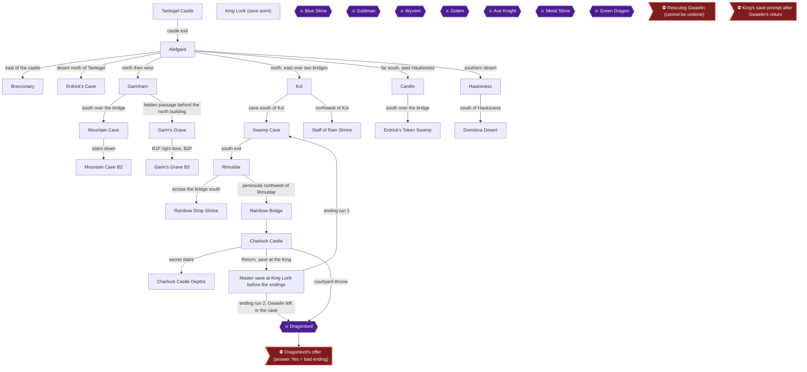

## Achievement dependencies

```mermaid
flowchart LR
  Magic_Key[/"Magic Key"/]
  Ach_13393(["🏆 Thou Hast Escapth the King's Chamber"])
  Blue_Slime{{"⚔ Blue Slime"}}
  Ach_13398(["🏆 Thou Hast Defeated the Slime"])
  Alefgard["Alefgard"]
  Ach_13381(["🏆 Thou Hast Gained A Level"])
  Ach_13382(["🏆 Thou Hast Learnt a Spell"])
  Erdricks_Tablet[/"Erdrick's Tablet"/]
  Ach_13395(["🏆 Thou Hast Learnt of Thy Quest"])
  Fighters_Ring[/"Fighter's Ring"/]
  Ach_13407(["🏆 Thou Art a Fighter, Not a Lover"])
  Death_Necklace[/"Death Necklace (1/32 gold chest)"/]
  Ach_13397(["🏆 Thou Hast a Death Wish"])
  Mountain_Cave["Mountain Cave"]
  Ach_13383(["🏆 Thou Hast No Need for Torches"])
  Fairy_Flute[/"Fairy Flute"/]
  Ach_13408(["🏆 Thou Art the Pied Piper"])
  Goldman{{"⚔ Goldman"}}
  Ach_13400(["🏆 Thou Hast Defeated the Goldman"])
  Wyvern{{"⚔ Wyvern"}}
  Ach_13401(["🏆 Thou Hast Defeated the Y BURN"])
  Rimuldar["Rimuldar"]
  Ach_13384(["🏆 Thou Hast Seen Sunlight"])
  Stones_of_Sunlight[/"Stones of Sunlight"/]
  Ach_13403(["🏆 Thou Hast Harnessed the Sun"])
  Silver_Harp[/"Silver Harp"/]
  Ach_13402(["🏆 Thou Hast Discovered Thine Inner Bard"])
  Cursed_Belt[/"Cursed Belt"/]
  Ach_13396(["🏆 Thou Hast Gained Weight"])
  Garins_Grave["Garin's Grave"]
  Ach_13385(["🏆 Thou Hast Acquired Body Odor"])
  Staff_of_Rain[/"Staff of Rain"/]
  Ach_13404(["🏆 Thou Hast Acquired the Song of Storms"])
  Silver_Shield[/"Silver Shield"/]
  Ach_13411(["🏆 Thou Hast Hefted a Heavy Burden!"])
  Erdricks_Token[/"Erdrick's Token"/]
  Ach_13406(["🏆 Thou Hast Unearthed a Peaty Sigil"])
  Erdricks_Armor[/"Erdrick's Armor"/]
  Ach_13410(["🏆 Thou Hast the Armor of Legend!"])
  Metal_Slime{{"⚔ Metal Slime"}}
  Ach_13399(["🏆 Thou Hast Defeated the Metal Slime"])
  Rainbow_Drop[/"Rainbow Drop"/]
  Ach_13405(["🏆 Thou Canst Not Have Rainbows Without Reyn"])
  Rainbow_Bridge["Rainbow Bridge"]
  Ach_13412(["🏆 Thou Hast Conjured the Magic Bridge"])
  Charlock_Castle["Charlock Castle"]
  Ach_13413(["🏆 Thou Hast Discerned the Truth"])
  Erdricks_Sword[/"Erdrick's Sword"/]
  Ach_13409(["🏆 Thou Hast the Sword of Legend!"])
  Hauksness["Hauksness"]
  Ach_13386(["🏆 Thou Hast Acquired All Spells"])
  Princess_Gwaelin["Princess Gwaelin"]
  Ach_13416(["🏆 Thine Princess Art Not in Another Castle"])
  Ach_13419(["🏆 Thou Art a Jerk to Women"])
  Gwaelin_Rescue_PONR>"⛔ Rescuing Gwaelin (cannot be undone)"]
  Dragonlord{{"⚔ Dragonlord"}}
  Ach_13418(["🏆 Thine Princess By Thine Side"])
  Ach_13414(["🏆 Thou Hast Vanquished the Darkness!"])
  Ach_13420(["🏆 Thou Hast Triumphed Together"])
  Gwaelins_Love[/"Gwaelin's Love"/]
  Ach_13417(["🏆 Thine Princess Returned to Her Sire"])
  King_Save_Prompt>"⛔ King's save prompt after Gwaelin's return"]
  Dragonlord_Offer>"⛔ Dragonlord's offer (answer Yes = bad ending)"]
  Ach_13415(["🏆 Thou Art a Fool"])
  Magic_Key -->|unlocks| Ach_13393
  Blue_Slime -->|unlocks| Ach_13398
  Alefgard -->|unlocks| Ach_13381
  Alefgard -->|unlocks| Ach_13382
  Erdricks_Tablet -->|unlocks| Ach_13395
  Fighters_Ring -->|unlocks| Ach_13407
  Death_Necklace -->|unlocks| Ach_13397
  Mountain_Cave -->|unlocks| Ach_13383
  Fairy_Flute -->|unlocks| Ach_13408
  Goldman -->|unlocks| Ach_13400
  Wyvern -->|unlocks| Ach_13401
  Rimuldar -->|unlocks| Ach_13384
  Stones_of_Sunlight -->|unlocks| Ach_13403
  Silver_Harp -->|unlocks| Ach_13402
  Cursed_Belt -->|unlocks| Ach_13396
  Garins_Grave -->|unlocks| Ach_13385
  Staff_of_Rain -->|unlocks| Ach_13404
  Silver_Shield -->|unlocks| Ach_13411
  Erdricks_Token -->|unlocks| Ach_13406
  Erdricks_Armor -->|unlocks| Ach_13410
  Metal_Slime -->|unlocks| Ach_13399
  Rainbow_Drop -->|unlocks| Ach_13405
  Rainbow_Bridge -->|unlocks| Ach_13412
  Charlock_Castle -->|unlocks| Ach_13413
  Erdricks_Sword -->|unlocks| Ach_13409
  Hauksness -->|unlocks| Ach_13386
  Princess_Gwaelin -->|unlocks| Ach_13416
  Ach_13419 -.->|missable before| Gwaelin_Rescue_PONR
  Dragonlord -->|unlocks| Ach_13418
  Dragonlord -->|unlocks| Ach_13414
  Ach_13414 -->|unlocks| Ach_13420
  Ach_13414 -->|unlocks| Ach_13419
  Gwaelins_Love -->|unlocks| Ach_13417
  Ach_13418 -.->|missable before| King_Save_Prompt
  Dragonlord_Offer -->|unlocks| Ach_13415
```

## Chapter 1: Tantegel Castle and the First Slimes

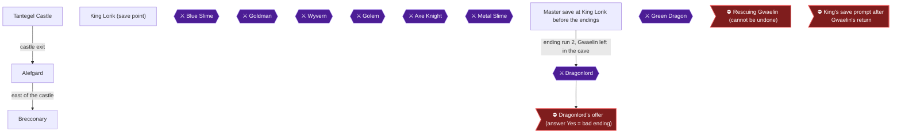

## Chapter 2: Erdrick's Cave and Garinham

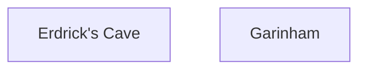

## Chapter 3: The Mountain Cave

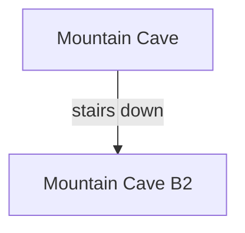

## Chapter 4: Kol, the Swamp Cave and Rimuldar

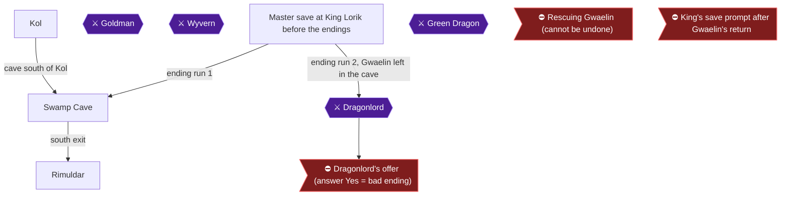

## Chapter 5: Stones of Sunlight, Garin's Grave and the Staff of Rain

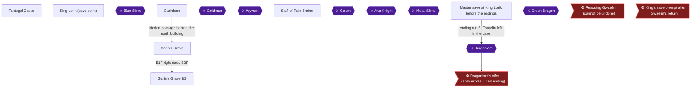

## Chapter 6: Cantlin, Erdrick's Token and Hauksness

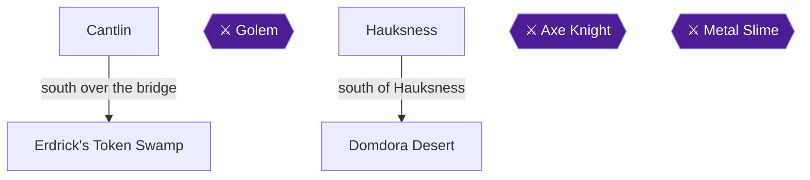

## Chapter 7: The Rainbow Bridge, Charlock Castle and the Master Save

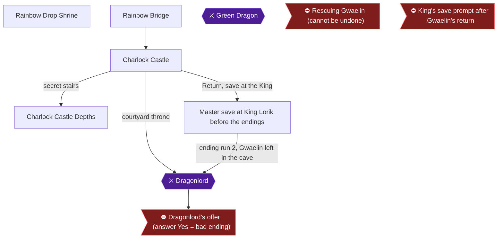

## Chapter 8: Ending Run 1: Gwaelin at Your Side

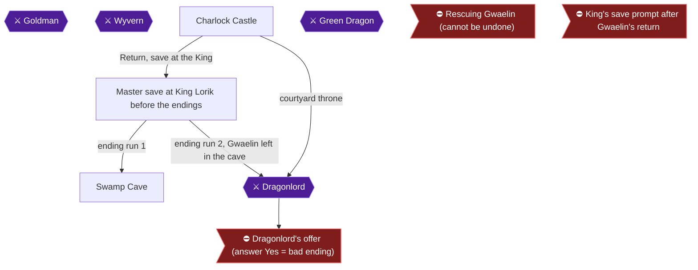

## Chapter 9: Ending Run 2: Without the Princess

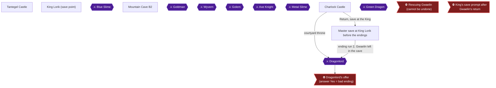

## Chapter 10: Ending Run 3: Gwaelin Home and the Dragonlord's Offer

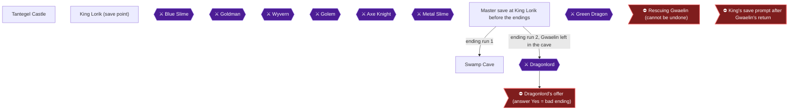
