# Dragon Quest — 100% RetroAchievements Walkthrough

## Metadata

- **Platform:** NES/Famicom
- **Developer:** Chunsoft
- **Publisher:** Enix, Nintendo
- **Genre:** Turn-Based RPG
- **Released:** 1986-05-27
- **Achievements:** 33 (310 points)

> [!NOTE]
> Every instruction in this guide was extracted from the sources listed at the bottom and checked against them (355 facts confirmed by 2+ sources, 992 from a single source). Statements marked 🟡 come from only one source. Anything we could not confirm says **"Unable to verify from collected sources."**

## Game Overview

### Game Overview

Dragon Quest (shown as *Dragon Warrior* in the Western guides) is a turn-based RPG for the NES/Famicom. You play a single hero, a descendant of Erdrick. He fights through random battles, levels up, collects gear and spells, and finishes with a showdown against the Dragonlord. The Dragonlord's defeat restores peace and awards the Ball of Light [[gf1-26-3]]. Princess Gwaelin, King Lorik's daughter, has been kidnapped. Rescuing her is a big part of the first half of the game, and she matters a great deal for this set's achievements [[ra-comments-1-5]].

This set has 33 achievements worth 310 points. You earn them in one long playthrough followed by three short ending runs, all loaded from the same save. The chapters after this one lay out the route in order.

### Controls and Menus

- **D-Pad:** Moves the hero in any direction and scrolls menus [[gf1-4-1]].
- **A button:** The primary button. It brings up the command menu and selects commands and options [[gf1-4-3]].
- **B button:** Cancels and closes the menu [[gf1-4-4]].
- **Start:** Pauses the game and selects things from the opening menus [[gf1-4-2]].
- **Select:** Does nothing in this game [[gf1-4-5]].

Press A while walking around to open the field menu. Its commands are Talk, Spell, Status, Item, Stairs, Door, Search and Take [[gf1-5-1, gf1-5-3, gf1-5-6, gf1-5-7]].

- **Talk:** You must stand right next to the person and face them, otherwise the game says nobody is there [[gf1-5-1]].
- **Stairs:** You must stand directly on the staircase [[gf1-5-3]].
- **Door:** Face the door first. Doors need a key, and a key is used up on the door it opens, so you need one key per door [[gf1-5-7, gf2-4-1]].
- **Search:** Searches the tile you are standing on for hidden things [[gf1-5-4]].
- **Take:** Pulls the contents out of a chest you are standing on. If your inventory is full, the item stays in the chest [[gf1-5-8]].
- **Status:** Shows your strength, agility, HP, MP, attack, defense and equipment [[gf1-5-2]].

Total defense is your armor's defense combined with your shield's [[gf1-45-8]]. Weapons you buy are equipped automatically [[gf5-9-1]]. The inventory is limited, so do not hoard items [[gf1-5-6]].

### Battles

Battles are random and begin without warning on the world map and in dungeons. The battle menu has Fight, Run, Spell and Item [[gf1-6-1, gf1-6-2, gf1-6-3, gf1-6-4]].

- **Fight:** Attacks with your equipped weapon. You sometimes land a critical hit, and sometimes you miss completely [[gf1-6-1]]. Critical hits can deal several times normal damage [[gf1-66-7]].
- **Run:** Lets you try to flee, and enemies can flee from you too [[gf1-6-2]]. If you flee about four or more times in a row, monsters may strike first and you will not be able to run [[gf5-6-4]].
- **Spell:** Spells cost MP and are learned as you level up [[gf1-6-3]].
- **Item:** Most items cannot be used in battle. Healing herbs are the usual exception [[gf1-6-4]].

Gold comes from battles and chests and buys weapons, armor and items [[gf1-6-5]]. Experience from won battles makes you level up [[gf1-6-6]]. Weaker monsters start running from you once you are strong enough, which is a good sign you are ready to move on [[gf1-65-5, gf1-14-15]].

Enemies get tougher when you cross a bridge or enter a new area [[gf1-14-5, gf5-6-7]]. Level up before you cross.

If you die, you lose half your gold and wake up at Tantegel Castle with the king [[gf1-65-4, gf5-7-2]]. You then have to walk back to wherever you were [[gf1-65-4]].

### Terrain Hazards

- **Grass:** Low encounter rate with weak enemies, no damage [[gf1-7-4]].
- **Heavy grass:** Slightly higher encounter rate, no damage [[gf1-7-5]].
- **Forest and desert:** Moderate encounter rate and moderate enemies, no damage [[gf1-7-6, gf1-8-1]].
- **Hills:** Slow travel, extremely high encounter rate and mostly strong enemies [[gf1-8-2]].
- **Poison swamps:** Cost 2 HP per step unless you wear Erdrick's Armor [[gf1-66-3]].
- **Barrier floors:** These damaging floors drain HP unless you wear Erdrick's Armor. Sources differ on the amount: 15 HP per step in one guide, 20 or more in another, and 25 in the Tantegel Castle barrier [[gf2-6-2, gf1-10-1, gf1-21-2]]. Treat them as dangerous at low level.
- **Mountains:** Impassable [[gf1-8-5]].

Erdrick's Armor has the highest defense in the game, heals 1 HP per step, and cancels swamp and barrier damage [[gf1-24-6]].

### Spells You Will Learn

The hero learns these spells by reaching the level shown [[gf1-52-1, gf1-53-1, gf1-53-2, gf1-53-3, gf1-53-4, gf1-54-1, gf1-54-2, gf1-54-3, gf1-55-1, gf1-55-2]]:

- **Heal:** Level 3, 4 MP [[gf1-52-1]]
- **Hurt:** Level 4, 2 MP [[gf1-53-2]]
- **Sleep:** Level 7, 2 MP [[gf1-55-1]]
- **Radiant:** Level 9, 3 MP [[gf1-54-1]]
- **Stopspell:** Level 10, 2 MP [[gf1-55-2]]
- **Outside:** Level 12, 6 MP [[gf1-53-4]]
- **Return:** Level 13, 8 MP [[gf1-54-3]]
- **Repel:** Level 15, 2 MP [[gf1-54-2]]
- **Healmore:** Level 17, 10 MP [[gf1-53-1]]
- **Hurtmore:** Level 19, 5 MP [[gf1-53-3]]

Five of these spell levels have level achievements attached: Heal (level 3), Radiant (level 9), Outside (level 12), Repel (level 15) and Hurtmore (level 19). Healmore at level 17 has no achievement [[gf1-52-1, gf1-62-4, gf1-62-6, gf1-62-8, gf1-62-10]]. Heal is the first spell, and you cannot cast anything before level 3 [[gf5-6-3]]. The Level 2 achievement is reached at 7 experience [[gf2-8-2]].

Practical notes on the spells:

- **Radiant:** It lights a bigger area than a torch, so it replaces torches once you have it [[gf1-17-2, gf3-20-1]].
- **Outside:** It warps you out of a cave [[gf2-43-2]].
- **Return:** It takes you to Tantegel Castle from the overworld, but it does not work from inside caves [[gf2-44-1, gf3-36-7]].
- **Repel:** It lowers the encounter rate, but it does not work in caves or against enemies stronger than you [[gf2-45-1]].

Enemy-cast spells tend to be weaker than the same spells cast by you [[gf3-36-11]].

### Saving, Hardcore and Experience Limits

The only way to save is to talk to King Lorik at Tantegel Castle, who records your deeds in his Imperial Scroll [[gf1-12-8]]. Heal at the inn or with a spell before you save. King Lorik's save is the only save this guide uses.

This guide assumes RetroAchievements Hardcore mode, which turns off save states and rewinding. Loading King Lorik's in-game save is allowed, and it is how all three ending runs are done. Turning up emulator speed does not affect Hardcore [[ra-comments-1-1]].

Two limits matter for planning:

- **Level cap:** The highest level is 30 [[gf1-55-3]]. The game will not save once you reach level 30 [[ra-comments-2-3]]. The route never needs more than about level 20 to 24, so never grind toward 30.
- **Gold and experience cap:** The cap is 65535 for both [[gf2-13-3]].

Chests in this game come back when you leave and re-enter a dungeon [[ra-comments-2-5]]. A one-of-a-kind item you lost, such as Erdrick's Sword, reappears in its chest as well [[ra-comments-2-6]]. This is why some item-based achievements can be retried.

### The 100% Plan in Plain Language

The route is one full playthrough followed by three short ending runs, with the Dragonlord fights finished at the end. You do everything except touch Princess Gwaelin or the Dragonlord, get Erdrick's Sword, and then save at King Lorik [[ra-comments-3-1, ra-comments-32-2]]. Beating the Dragonlord is never saved, so every run starts from that same save [[ra-comments-1-4]].

From that save you do three runs, resetting and loading between them [[ra-comments-3-1, ra-comments-32-3, ra-comments-32-4, ra-comments-32-5]]:

1. **Run 1:** Rescue Gwaelin, bring her to the Dragonlord, defeat him, and walk her home to the King [[ra-comments-32-3, ra-guide-6-2, ra-guide-6-3]].
2. **Run 2:** Leave Gwaelin in the cave, defeat the Dragonlord, and return to the castle [[ra-comments-32-4, ra-guide-5-4]].
3. **Run 3:** Rescue Gwaelin, return her to the King, then go accept the Dragonlord's offer [[ra-comments-32-5]].

Chapters 1 to 7 cover the main playthrough, ending with the save at the King, and Chapters 8 to 10 cover the three runs played from that save [[ra-comments-3-1]].

> [!WARNING]
> **Missable Achievement Warning:** The princess can be rescued only once on a save file, and once she has been rescued, the Dragonlord-without-Gwaelin achievement can only be earned by starting a new game [[ra-comments-1-5, ra-comments-28-3]]. Do not touch her until your ending runs begin. Never save after rescuing her until you are on run 3. Keep at least one Magic Key in your inventory at the master save, because her door needs one on every run that rescues her [[gf1-20-6, gf3-9-5]].

> [!WARNING]
> **Missable Achievement Warning:** When you return Gwaelin to the King, he asks whether to save right after the thank-you speech. It is easy to hit "Yes" by accident while scrolling text, and doing so prevents you from reloading to get the other princess achievements, forcing a second playthrough [[ra-comments-30-2, ra-comments-30-3]]. This return is the last thing you do, which is why it is run 3.

> [!WARNING]
> **Missable Achievement Warning:** The game will not save once you reach level 30, so keep your level well below that [[ra-comments-2-3]].

Further notes on the plan:

- If you rescue Gwaelin right after getting the Magic Key, you will be forced back to the castle, because a plot-required item is locked behind a door [[ra-comments-28-4]].
- "In tow" means Gwaelin is following you, not that she is in town [[ra-comments-32-8]].
- Bringing her to the Dragonlord lets you join his ranks and triggers that achievement [[ra-comments-31-1, ra-guide-6-2]].

> [!CAUTION]
> **Achievement Trigger Warning:** The Dragonlord's offer asks you to stand beside him, and the default answer is "yes". People have lost hours of grinding by mashing A and accepting by accident [[ra-comments-26-1]]. Saying "yes" ends the game with a bad ending [[ra-guide-5-1, gf1-26-7]]. Answer "no" in runs 1 and 2, and answer "yes" only in run 3.

### Unconfirmed Mechanics

RA players disagree about the Death Necklace chest, the Silver Shield purchase and the Cursed Belt chest, so the route plays it safe on each [[ra-comments-13-2, ra-comments-10-2, ra-comments-21-1, ra-comments-16-4]]:

- **Death Necklace and a full inventory:** Players disagree on whether a full inventory stops the necklace from appearing [[ra-comments-12-7]]. Keep at least one inventory slot free on every attempt.
- **Death Necklace and entering the Mountain Cave without light:** Players disagree on whether this raises the chance of the necklace. Treat it as a 1/32 roll, light the cave normally, and just repeat the trip. Do not rely on the dark-cave claim.
- **Silver Shield and the Large Shield:** Only one player reports that you need the Large Shield in hand when you buy the Silver Shield. The safe route is to buy and equip the Large Shield (800 gold, Garinham or Cantlin) before buying the Silver Shield.
- **Cursed Belt in Garin's Grave:** Players disagree on whether the Cursed Belt is always in its chest. If the chest gives something else, leave the Grave and come back, since chests refill when you re-enter a dungeon [[ra-comments-2-5]].

### Before You Start

> [!TIP]
> Level up often, buy the best gear as soon as you can afford it, and heal early. Stay a level or two ahead of the next area before you cross bridges or enter new regions [[gf1-14-5, gf5-6-7, gf1-66-6]]. Cursed items prevent you from entering Tantegel Castle until the curse is lifted [[gf1-66-6]].

Only the first four letters of your name show during the journey, so pick a name accordingly [[gf3-16-1]].

## Achievement Roadmap

| Chapter | Achievements | Points |
|---|---|---|
| [1. Tantegel Castle and the First Slimes](#chapter-1-tantegel-castle-and-the-first-slimes) | Thou Hast Escapth the King's Chamber, Thou Hast Gained A Level, Thou Hast Defeated the Slime, Thou Hast Learnt a Spell | 20 |
| [2. Erdrick's Cave and Garinham](#chapter-2-erdricks-cave-and-garinham) | Thou Hast Learnt of Thy Quest | 10 |
| [3. The Mountain Cave](#chapter-3-the-mountain-cave) | Thou Art a Fighter, Not a Lover, Thou Hast a Death Wish, Thou Hast No Need for Torches | 25 |
| [4. Kol, the Swamp Cave and Rimuldar](#chapter-4-kol-the-swamp-cave-and-rimuldar) | Thou Art the Pied Piper, Thou Hast Defeated the Goldman, Thou Hast Defeated the Y BURN, Thou Hast Seen Sunlight | 25 |
| [5. Stones of Sunlight, Garin's Grave and the Staff of Rain](#chapter-5-stones-of-sunlight-garins-grave-and-the-staff-of-rain) | Thou Hast Harnessed the Sun, Thou Hast Discovered Thine Inner Bard, Thou Hast Gained Weight, Thou Hast Acquired the Song of Storms, Thou Hast Acquired Body Odor | 45 |
| [6. Cantlin, Erdrick's Token and Hauksness](#chapter-6-cantlin-erdricks-token-and-hauksness) | Thou Hast Unearthed a Peaty Sigil, Thou Hast Hefted a Heavy Burden!, Thou Hast the Armor of Legend!, Thou Hast Defeated the Metal Slime, Thou Hast Acquired All Spells | 45 |
| [7. The Rainbow Bridge, Charlock Castle and the Master Save](#chapter-7-the-rainbow-bridge-charlock-castle-and-the-master-save) | Thou Canst Not Have Rainbows Without Reyn, Thou Hast Conjured the Magic Bridge, Thou Hast Discerned the Truth, Thou Hast the Sword of Legend! | 30 |
| [8. Ending Run 1: Gwaelin at Your Side](#chapter-8-ending-run-1-gwaelin-at-your-side) | Thine Princess Art Not in Another Castle, Thine Princess By Thine Side, Thou Hast Vanquished the Darkness!, Thou Hast Triumphed Together | 70 |
| [9. Ending Run 2: Without the Princess](#chapter-9-ending-run-2-without-the-princess) | Thou Art a Jerk to Women | 25 |
| [10. Ending Run 3: Gwaelin Home and the Dragonlord's Offer](#chapter-10-ending-run-3-gwaelin-home-and-the-dragonlords-offer) | Thine Princess Returned to Her Sire, Thou Art a Fool | 15 |

## Playthrough Planning

**Playthroughs required:** 1

One playthrough, then three short ending runs from the same save. Do everything except touching Princess Gwaelin or the Dragonlord, get Erdrick's Sword, then save at King Lorik (ra-comments-3-1, ra-comments-32-2). Run 1: rescue Gwaelin, carry her to the Dragonlord, defeat him and walk her home (13416, 13418, 13414, 13420). Reset and load. Run 2: leave Gwaelin in the cave, defeat the Dragonlord, return to the castle (13419). Reset and load. Run 3: rescue Gwaelin, return her to the King for Gwaelin's Love (13417), then accept the Dragonlord's offer (13415) (ra-comments-32-3, -32-4, -32-5). Beating the Dragonlord is never saved, so every run starts from the same save (ra-comments-1-4). Rescuing Gwaelin cannot be undone on a save file (ra-comments-1-5, ra-comments-28-3), so never save after rescuing her before run 3.

**Settings:** Hardcore mode: no save states and no rewinding. The only saves are King Lorik's Imperial Scroll (gf1-12-8); loading those is allowed and is how the three ending runs are done. Emulator fast-forward does not affect Hardcore (ra-comments-1-1). The game stops saving at level 30 (ra-comments-2-3); the route never needs more than about level 20-24.

[[ra-comments-3-1,ra-comments-32-2,ra-comments-32-3,ra-comments-32-4,ra-comments-32-5,ra-comments-1-4,ra-comments-1-5,ra-comments-28-3,ra-comments-1-1,ra-comments-2-3,gf1-12-8,ra-guide-2-1,ra-guide-2-2]]

## True 100% In-Game Completion Criteria

This guide covers complete in-game mastery in addition to all RetroAchievements:

| Category | 100% Requirement | Tracking Scope |
|---|---|---|
| **Erdrick's Relics** | The four pieces of Erdrick's legacy: Erdrick's Tablet (Erdrick's Cave), Erdrick's Token (swamp south of Cantlin), Erdrick's Armor (Hauksness, guarded by the Axe Knight) and Erdrick's Sword (Charlock Castle depths). | Per-chapter checkpoint |
| **Rainbow Drop Ingredients** | The three items the old man south of Rimuldar needs for the Rainbow Drop: Stones of Sunlight (Tantegel Castle basement), Staff of Rain (traded for the Silver Harp northwest of Kol) and Erdrick's Token. | Per-chapter checkpoint |
| **Optional treasures and cursed items** | The Fighter's Ring and the random Death Necklace (Mountain Cave B2), the Fairy Flute (Kol), the Cursed Belt (Garin's Grave B3) and the Silver Shield (Cantlin's locked shop). Picking up the cursed items earns their achievements; never equip them. | Endgame/Global scope |
| **Endings** | All four ways to finish: defeat the Dragonlord with Gwaelin carried along, defeat him without ever rescuing her, return Gwaelin to her father, and accept the Dragonlord's offer. They are played from one save at King Lorik (chapters 8-10). | Endgame/Global scope |

## Missables Summary

| ⚠ Missable | Achievement | Chapter | Must be done before |
|---|---|---|---|
| Thou Hast Triumphed Together: beat the Dragonlord with Gwaelin in tow [[ra-guide-6-3,ra-comments-32-3,ra-comments-32-8,ra-guide-2-2]] | Thou Hast Triumphed Together | [8](#chapter-8-ending-run-1-gwaelin-at-your-side) | Needs Gwaelin carried to Charlock. Once she is handed to the King (Gwaelin's Love) she no longer follows you, so do this run (chapter 8) from the master save before any run that returns her. |
| Thine Princess By Thine Side: bring Gwaelin to the Dragonlord [[ra-guide-6-2,ra-comments-31-1,ra-comments-31-3,ra-comments-30-3]] | Thine Princess By Thine Side | [8](#chapter-8-ending-run-1-gwaelin-at-your-side) | Speak to the Dragonlord while carrying Gwaelin, in the chapter 8 run from the master save. Missed for good if a save is made after Gwaelin is returned to the King (ra-comments-30-3). |
| Thou Art a Jerk to Women: beat the Dragonlord and return without saving Gwaelin [[ra-comments-28-2,ra-comments-28-3,ra-guide-2-1,ra-guide-5-4,ra-comments-32-4]] | Thou Art a Jerk to Women | [9](#chapter-9-ending-run-2-without-the-princess) | Only possible on a save where Gwaelin was never rescued. Do not rescue her before the master save (chapter 7); play this run from that save (chapter 9). |

## Points of No Return

| ⛔ Point of No Return | Chapter | What you lose access to |
|---|---|---|
| Rescuing Princess Gwaelin [[ra-comments-1-5,ra-comments-28-2,ra-comments-28-3,ra-guide-2-1]] | [4](#chapter-4-kol-the-swamp-cave-and-rimuldar) | Walk through the Swamp Cave to Rimuldar, but do not fight the Green Dragon or open Gwaelin's door. She can only be rescued once; a save made after rescuing her loses 13419 for good. She is only rescued in the ending runs (chapters 8 and 10), from the master save. |
| Master save before the endings [[ra-comments-3-1,ra-comments-32-2,ra-comments-1-4]] | [7](#chapter-7-the-rainbow-bridge-charlock-castle-and-the-master-save) | Before this save you must have every non-ending achievement, Erdrick's Sword, level 19+ and Gwaelin still in the Swamp Cave. All three ending runs load this save; do not overwrite it until chapter 10. |
| Defeating the Dragonlord [[ra-comments-1-4,ra-comments-13-6,ra-comments-14-3,gf1-26-3]] | [8](#chapter-8-ending-run-1-gwaelin-at-your-side) | The victory is never saved; returning to the castle plays the ending. After the Dragonlord dies random encounters stop and inns no longer restore MP (ra-comments-13-6, ra-comments-14-3). Reset and load the master save for the next run. |
| The Dragonlord's offer [[ra-comments-26-1,gf1-26-7,gf5-15-3,ra-guide-5-1]] | [10](#chapter-10-ending-run-3-gwaelin-home-and-the-dragonlords-offer) | The default answer is Yes, and mashing A through his speech accepts it by accident (ra-comments-26-1). Answering Yes ends the game. Answer No in chapters 8 and 9; answer Yes only in chapter 10. |
| King's save prompt after Gwaelin's return [[ra-comments-30-2,ra-comments-30-3,ra-comments-32-6]] | [10](#chapter-10-ending-run-3-gwaelin-home-and-the-dragonlords-offer) | After Gwaelin is returned the King offers to save. Saving there before runs 1 and 2 are done forces a new game for them (ra-comments-30-3). In chapter 10 it is the last run, so it no longer matters. |

## Progression Diagrams

### Game Progression

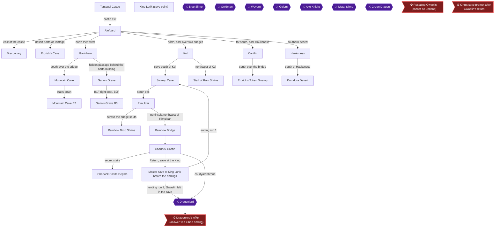

### Achievement Dependencies

```mermaid
flowchart LR
  Magic_Key[/"Magic Key"/]
  Ach_13393(["🏆 Thou Hast Escapth the King's Chamber"])
  Blue_Slime{{"⚔ Blue Slime"}}
  Ach_13398(["🏆 Thou Hast Defeated the Slime"])
  Alefgard["Alefgard"]
  Ach_13381(["🏆 Thou Hast Gained A Level"])
  Ach_13382(["🏆 Thou Hast Learnt a Spell"])
  Erdricks_Tablet[/"Erdrick's Tablet"/]
  Ach_13395(["🏆 Thou Hast Learnt of Thy Quest"])
  Fighters_Ring[/"Fighter's Ring"/]
  Ach_13407(["🏆 Thou Art a Fighter, Not a Lover"])
  Death_Necklace[/"Death Necklace (1/32 gold chest)"/]
  Ach_13397(["🏆 Thou Hast a Death Wish"])
  Mountain_Cave["Mountain Cave"]
  Ach_13383(["🏆 Thou Hast No Need for Torches"])
  Fairy_Flute[/"Fairy Flute"/]
  Ach_13408(["🏆 Thou Art the Pied Piper"])
  Goldman{{"⚔ Goldman"}}
  Ach_13400(["🏆 Thou Hast Defeated the Goldman"])
  Wyvern{{"⚔ Wyvern"}}
  Ach_13401(["🏆 Thou Hast Defeated the Y BURN"])
  Rimuldar["Rimuldar"]
  Ach_13384(["🏆 Thou Hast Seen Sunlight"])
  Stones_of_Sunlight[/"Stones of Sunlight"/]
  Ach_13403(["🏆 Thou Hast Harnessed the Sun"])
  Silver_Harp[/"Silver Harp"/]
  Ach_13402(["🏆 Thou Hast Discovered Thine Inner Bard"])
  Cursed_Belt[/"Cursed Belt"/]
  Ach_13396(["🏆 Thou Hast Gained Weight"])
  Garins_Grave["Garin's Grave"]
  Ach_13385(["🏆 Thou Hast Acquired Body Odor"])
  Staff_of_Rain[/"Staff of Rain"/]
  Ach_13404(["🏆 Thou Hast Acquired the Song of Storms"])
  Silver_Shield[/"Silver Shield"/]
  Ach_13411(["🏆 Thou Hast Hefted a Heavy Burden!"])
  Erdricks_Token[/"Erdrick's Token"/]
  Ach_13406(["🏆 Thou Hast Unearthed a Peaty Sigil"])
  Erdricks_Armor[/"Erdrick's Armor"/]
  Ach_13410(["🏆 Thou Hast the Armor of Legend!"])
  Metal_Slime{{"⚔ Metal Slime"}}
  Ach_13399(["🏆 Thou Hast Defeated the Metal Slime"])
  Rainbow_Drop[/"Rainbow Drop"/]
  Ach_13405(["🏆 Thou Canst Not Have Rainbows Without Reyn"])
  Rainbow_Bridge["Rainbow Bridge"]
  Ach_13412(["🏆 Thou Hast Conjured the Magic Bridge"])
  Charlock_Castle["Charlock Castle"]
  Ach_13413(["🏆 Thou Hast Discerned the Truth"])
  Erdricks_Sword[/"Erdrick's Sword"/]
  Ach_13409(["🏆 Thou Hast the Sword of Legend!"])
  Hauksness["Hauksness"]
  Ach_13386(["🏆 Thou Hast Acquired All Spells"])
  Princess_Gwaelin["Princess Gwaelin"]
  Ach_13416(["🏆 Thine Princess Art Not in Another Castle"])
  Ach_13419(["🏆 Thou Art a Jerk to Women"])
  Gwaelin_Rescue_PONR>"⛔ Rescuing Gwaelin (cannot be undone)"]
  Dragonlord{{"⚔ Dragonlord"}}
  Ach_13418(["🏆 Thine Princess By Thine Side"])
  Ach_13414(["🏆 Thou Hast Vanquished the Darkness!"])
  Ach_13420(["🏆 Thou Hast Triumphed Together"])
  Gwaelins_Love[/"Gwaelin's Love"/]
  Ach_13417(["🏆 Thine Princess Returned to Her Sire"])
  King_Save_Prompt>"⛔ King's save prompt after Gwaelin's return"]
  Dragonlord_Offer>"⛔ Dragonlord's offer (answer Yes = bad ending)"]
  Ach_13415(["🏆 Thou Art a Fool"])
  Magic_Key -->|unlocks| Ach_13393
  Blue_Slime -->|unlocks| Ach_13398
  Alefgard -->|unlocks| Ach_13381
  Alefgard -->|unlocks| Ach_13382
  Erdricks_Tablet -->|unlocks| Ach_13395
  Fighters_Ring -->|unlocks| Ach_13407
  Death_Necklace -->|unlocks| Ach_13397
  Mountain_Cave -->|unlocks| Ach_13383
  Fairy_Flute -->|unlocks| Ach_13408
  Goldman -->|unlocks| Ach_13400
  Wyvern -->|unlocks| Ach_13401
  Rimuldar -->|unlocks| Ach_13384
  Stones_of_Sunlight -->|unlocks| Ach_13403
  Silver_Harp -->|unlocks| Ach_13402
  Cursed_Belt -->|unlocks| Ach_13396
  Garins_Grave -->|unlocks| Ach_13385
  Staff_of_Rain -->|unlocks| Ach_13404
  Silver_Shield -->|unlocks| Ach_13411
  Erdricks_Token -->|unlocks| Ach_13406
  Erdricks_Armor -->|unlocks| Ach_13410
  Metal_Slime -->|unlocks| Ach_13399
  Rainbow_Drop -->|unlocks| Ach_13405
  Rainbow_Bridge -->|unlocks| Ach_13412
  Charlock_Castle -->|unlocks| Ach_13413
  Erdricks_Sword -->|unlocks| Ach_13409
  Hauksness -->|unlocks| Ach_13386
  Princess_Gwaelin -->|unlocks| Ach_13416
  Ach_13419 -.->|missable before| Gwaelin_Rescue_PONR
  Dragonlord -->|unlocks| Ach_13418
  Dragonlord -->|unlocks| Ach_13414
  Ach_13414 -->|unlocks| Ach_13420
  Ach_13414 -->|unlocks| Ach_13419
  Gwaelins_Love -->|unlocks| Ach_13417
  Ach_13418 -.->|missable before| King_Save_Prompt
  Dragonlord_Offer -->|unlocks| Ach_13415
```

## Boss Index

Full strategies are in each chapter.

| Boss | Chapter |
|---|---|
| Blue Slime | [1. Tantegel Castle and the First Slimes](#chapter-1-tantegel-castle-and-the-first-slimes) |
| Goldman | [4. Kol, the Swamp Cave and Rimuldar](#chapter-4-kol-the-swamp-cave-and-rimuldar) |
| Wyvern | [4. Kol, the Swamp Cave and Rimuldar](#chapter-4-kol-the-swamp-cave-and-rimuldar) |
| Golem | [4. Kol, the Swamp Cave and Rimuldar](#chapter-4-kol-the-swamp-cave-and-rimuldar) |
| Axe Knight | [6. Cantlin, Erdrick's Token and Hauksness](#chapter-6-cantlin-erdricks-token-and-hauksness) |
| Metal Slime | [6. Cantlin, Erdrick's Token and Hauksness](#chapter-6-cantlin-erdricks-token-and-hauksness) |
| Green Dragon | [4. Kol, the Swamp Cave and Rimuldar](#chapter-4-kol-the-swamp-cave-and-rimuldar) |
| Dragonlord | [7. The Rainbow Bridge, Charlock Castle and the Master Save](#chapter-7-the-rainbow-bridge-charlock-castle-and-the-master-save) |

## Walkthrough

## Chapter 1: Tantegel Castle and the First Slimes

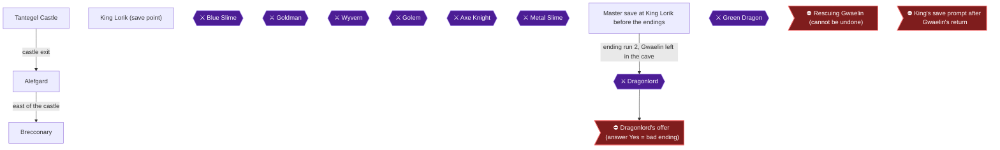

This chapter covers the opening of the game: the throne room chests, the Magic Key door, the castle grounds, the road east to Brecconary, and the first fights in the fields that earn Levels 2 and 3 and the Heal spell. The King tells the hero that the Dragonlord stole the Ball of Light and must be defeated [[gf3-5-1, gf3-5-2, gf3-5-3]]. The four achievements here are Thou Hast Escapth the King's Chamber (13393), Thou Hast Gained A Level (13381), Thou Hast Defeated the Slime (13398), and Thou Hast Learnt a Spell (13382).

Preparation notes:
- Only the first four letters of your name show as you travel Alefgard [[gf3-16-1]].
- Saving is done only by talking to King Lorik [[gf1-10-3, ra-comments-1-3]].
- Level 1 is the recommended level while you are still in the castle, since you will not be fighting there [[gf1-12-2]].

### Tantegel Castle

🗺️ **Map:** [View Tantegel Castle Map by Chiasm](https://www.vgmaps.com/Atlas/NES/DragonWarrior-TantegelCastle.png)

#### The throne room

You begin in the throne room in front of King Lorik. Let him finish speaking. He tells you to take what is in the treasure chests and then talk to the guards [[gf1-62-11]].

Open all three chests around the throne room [[gf1-12-3]]:
- **120 Gold** [[gf1-12-3, gf2-8-1]]
- **Torch** [[gf1-12-4]]
- **Magic Key** [[gf1-12-5]]

The Magic Key is the one you need for the next achievement. Do not leave without it [[ra-guide-3-1]].

Talk to the guards in the room for hints:
- One guard asks whether you know about Princess Gwaelin. He wanders around the room [[gf3-16-1, gf3-16-2]].
- The guard by the door says that a town to the east sells armor, weapons and other items, and that the Inn heals wounds [[gf1-62-12]].
- The other guard by the door explains that a key will be found in the chests, that it disappears once used, and that the door will stay open [[gf1-62-13]].

> [!TIP]
> Magic Keys are consumed when they open a door, so do not waste the one from the chests on anything but the throne room door [[checklist-items-2-3, gf3-33-9]].

#### The Door command

Walk up to the door south of the King, press A, and select the Door option [[ra-guide-3-2]]. The key is used up, but this door stays open from then on [[gf1-12-6]]. Go down the stairs beyond it into the castle grounds [[gf1-12-7, gf5-8-1]].


> [!ACHIEVEMENT]
> **Thou Hast Escapth the King's Chamber (5 Points)**
> 
> *Use the Magic Key and open the door to the King's Chamber*


#### King Lorik (save point)

You cannot save from the guards. Return to King Lorik whenever you want to save, and talk to him [[gf1-10-3, gf1-12-8]]. He records your deeds in his Imperial Scroll [[gf1-62-14]].

> [!TIP]
> Save after each level-up in the fields. A guard in Brecconary also advises seeing King Lorik once your experience levels have been raised [[gf1-14-4]].

#### The castle grounds

By the stairs, two guards tell you that King Lorik will record your deeds, and to see him before resting [[gf1-12-8]]. Other guards in the castle give hints:
- A guard says you need a key to open a door [[gf1-12-6]].
- A mobile guard says to take a torch when entering a cave [[gf1-13-1]].

Do not step on the diagonal barrier floor yet. It costs HP for every step you take [[gf1-21-2, gf3-21-13]].

**Free MP refill:** The old man behind the desk in the southeast corner restores your MP to maximum [[gf1-16-2, gf2-7-1]]. This is only useful once you know Heal, because you can cast Heal, then talk to him again and repeat [[gf1-65-6, gf3-17-3]].

Leave through the exit at the bottom of the castle.

### Alefgard

🗺️ **Map:** [View Alefgard Map by Rick Bruns](https://www.vgmaps.com/Atlas/NES/DragonWarrior-Alefgard.png)

Once outside you can see the town of Brecconary directly to your right (east) [[gf1-13-2]]. Go there before fighting anything. If a Slime bumps into you, you can fight it, since Slimes are weak even without weapons [[gf3-16-5, gf2-60-1]].

Enemies get stronger when you cross bridges, so stay on this side of the water for now [[gf1-14-5]].

### Brecconary

🗺️ **Map:** [View Brecconary Map by Chiasm](https://www.vgmaps.com/Atlas/NES/DragonWarrior-Brecconary.png)

The town's Inn costs 6 gold [[gf1-13-3, gf1-28-2]].

#### Shop prices

| Shop | Item | Price | Citation |
|---|---|---|---|
| Weapons and Armor | Bamboo Pole (+2 attack) | 10 G | [[gf1-13-4]] |
| Weapons and Armor | Club (+4 attack) | 60 G | [[gf1-13-5]] |
| Weapons and Armor | Copper Sword (+10 attack) | 180 G | [[gf1-13-6]] |
| Weapons and Armor | Clothes (+2 defense) | 20 G | [[gf1-13-7]] |
| Weapons and Armor | Leather Armor (+4 defense) | 70 G | [[gf1-13-8]] |
| Weapons and Armor | Small Shield (+4 defense) | 90 G | [[gf1-13-9]] |
| Tools | Medicinal Herb | 24 G | [[gf1-13-10]] |
| Tools | Torch | 8 G | [[gf1-13-11]] |
| Tools | Dragon's Scale | 20 G | [[gf1-13-12]] |

#### First purchases

With your 120 gold, buy the Club (60 G) and the Clothes (20 G) at the weapons shop. Both equip themselves automatically [[gf1-13-5, gf1-13-7]]. This leaves 40 G [[gf3-16-8]].

Optionally, the Dragon's Scale costs 20 G at the tool shop [[gf1-13-12, gf2-8-1]].

#### Townsfolk worth hearing

- A wanderer says that Garinham lies north to the seashore and then west along the coast [[gf1-13-13]].
- A man says Charlock, the Dragonlord's fortress, is in sight south of Tantegel [[gf1-13-14]].
- A man in the leftmost of the two open rooms says magic keys are sold in another town [[gf1-14-2]].
- The old man in the rightmost room lifts curses if you equip a cursed item later [[gf1-14-3, gf1-66-5]]. You cannot enter Tantegel Castle while cursed [[gf1-66-6]].
- A Red Knight in the far northeast corner warns that danger grows when you cross bridges [[gf1-14-5]].

### Blue Slime

#### Level 2 and the Slime achievement

Fight in the fields around Tantegel and Brecconary. Slimes and Drakees live there [[gf1-14-9, gf1-39-5, gf1-36-8]].

- Slime: 3 HP, 1 EXP, 1 gold [[gf1-34-4, gf1-39-5]].
- Drakee: 6 HP, 2 EXP, 3 gold [[gf1-36-8]].

The Blue Slime is the ordinary Slime. It roams around Tantegel and is needed to level up, and defeating one earns the achievement [[ra-guide-9-3]]. A Red Slime does not count as the Blue Slime. One commenter's first encounter was a Red Slime, so they did not pop it immediately [[ra-comments-33-1]].


> [!ACHIEVEMENT]
> **Thou Hast Defeated the Slime (5 Points)**
> 
> *Defeat the trademark Blue Slime!*


> [!WARNING]
> **Achievement Trigger Warning:** Red Slimes also appear in these fields [[gf5-9-2]]. Keep fighting until you actually defeat a regular Slime [[ra-comments-33-1, ra-guide-9-3]].

Level 2 needs 7 EXP [[gf2-8-2, gf5-16-2]]. Winning about 7 fights gets there and almost doubles your HP [[gf3-17-1]]. Some players give up before defeating seven Slimes [[ra-comments-37-1]].


> [!ACHIEVEMENT]
> **Thou Hast Gained A Level (5 Points)**
> 
> *Reach Level 2*


When your HP gets low, run from fights and rest at the Brecconary Inn for 6 gold. Then see King Lorik and save [[gf1-13-3, gf1-10-3]].

#### Level 3 and Heal

Level 3 needs 23 EXP [[gf2-8-3, gf5-16-10]]. Keep fighting around the castle and Brecconary until then [[gf1-14-9, ra-guide-7-1]]. You gain the Heal spell and 5 MP, which is enough for one cast because Heal costs 4 MP [[gf2-8-3, gf1-52-1]]. Heal restores 10-15 HP [[checklist-items-7-1]]. You cannot cast spells before Level 3 [[gf5-6-3]].


> [!ACHIEVEMENT]
> **Thou Hast Learnt a Spell (5 Points)**
> 
> *Reach Level 3*


Now use the free MP refill from the old man in the castle's southeast corner instead of paying for the Inn [[gf3-17-3, gf1-16-2]].

#### Gear to buy as you earn gold

Stay near the castle and town. The suggestion is Leather Armor next, then the Small Shield, then the Copper Sword [[gf1-14-6, gf1-14-7, gf1-14-8]]. These three total 340 gold [[gf1-14-6, gf1-14-7, gf1-14-8]].

- Leather Armor (70 G): the shopkeeper buys your Clothes for 10 G [[gf1-14-13, gf3-17-4]].
- Small Shield (90 G) [[gf2-8-7]].
- Copper Sword (180 G): the shop buys the Club back for 30 G [[gf1-14-14, gf2-9-1]].

Magicians are dangerous before Level 4. Run from them if you meet one and you are below that level [[gf1-14-11]]. Magicians appear north and east of Tantegel [[gf1-38-2]].

> [!TIP]
> Before you leave: confirm that you have opened all three throne room chests, used the Door command, defeated a Slime, reached Level 3, and saved with King Lorik [[gf1-12-3, gf1-12-6, gf1-39-5, gf1-52-1, gf1-10-3]]. The next stop is Erdrick's Cave north of the castle, which has no enemies [[gf1-15-1, gf2-6-3]]. Take a torch with you [[gf1-13-1]].

> [!IMPORTANT]
> ### Chapter 1 Cumulative 100% Checkpoint
> - **Throne Room Chests Opened:** 3 / 3 (120 Gold, Torch, Magic Key) [[gf1-12-3, gf1-12-4, gf1-12-5]]
> - **Erdrick's Relics:** 0 / 4
> - **Rainbow Drop Ingredients:** 0 / 3
> - **RetroAchievements Unlocked:** 4 / 33 (20 / 310 points)

### Chapter Checklist

- [ ] Opened the three throne room chests (120 gold, Torch, Magic Key)
- [ ] Used the Door command on the door south of the King
- [ ] Bought the Club and Clothes in Brecconary
- [ ] Defeated a Blue Slime
- [ ] Reached Level 2 at 7 EXP
- [ ] Reached Level 3 and learned Heal
- [ ] Saved with King Lorik

---

## Chapter 2: Erdrick's Cave and Garinham

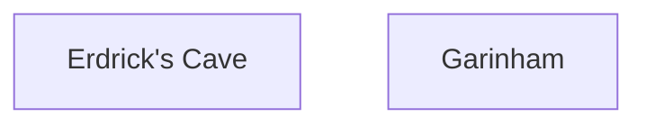

This chapter covers two stops on the northwest side of the starting continent. First you will pick up Erdrick's Tablet in Erdrick's Cave, a patch of desert north of Tantegel [[gf1-27-1, gf3-18-4, gf5-9-4]]. Then you will walk to Garinham in the northwest corner of the continent and look over its shops [[gf1-15-5, gf5-9-9]]. The only achievement here is Thou Hast Learnt of Thy Quest, for finding the Tablet [[checklist-items-3-6]]. Garinham is also where you will later come back for the Large Shield, and the shop list below shows what it costs [[gf1-15-13]].

> [!TIP]
> **Before you leave Tantegel:** Erdrick's Cave is dark, so bring a torch. A torch costs 8 gold in Garinham and is a cheap backup [[gf5-9-5, gf1-15-15]]. One guide recommends building to around level 6-7 before going further into the game [[gf5-10-14]].

### Chapter Items to Collect (1 Item Total)

| Item | Where Found | Action / Requirement | Citation |
|---|---|---|---|
| Erdrick's Tablet | Erdrick's Cave, F2, the only chest | **TAKE** (needs a lit torch) | [[gf3-7-1, ra-guide-3-3, gf5-9-8]] |

### Erdrick's Cave

🗺️ **Map:** [View Erdrick's Cave Map by Chiasm](https://www.vgmaps.com/Atlas/NES/DragonWarrior-Erdrick'sCave.png)

Leave Tantegel and head north. You will reach a patch of desert with a cave in the middle [[gf5-9-4, gf3-18-4]]. This is the only cave or dungeon in the game with no enemies, so you can take your time [[gf1-15-1, gf3-18-7]]. The cave has two floors, F1 and F2. The path to the Tablet goes from the overworld entrance (A) down the stairs (B) to the chest (1) [[gf3-6-1, gf3-7-1, gf3-7-2]].

Use a torch as soon as you enter. Without one the cave is pitch black; the torch lights up the maze so you can see the way [[gf5-9-5, ra-guide-3-3]].

> [!NOTE]
> The guides give different step counts for the same route. Use whichever you find easiest, and let the walls guide you [[gf1-15-2, gf5-9-6, gf3-18-5]].

#### F1

From the entrance stairs, follow this route [[gf1-15-2]]:

1. Right 1, then down 6.
2. Left 1, down 2, right 6.
3. Up 1, right 2, down 3.
4. Right 2, down 2, then take the stairs.

Another guide describes the same floor as: right 1, down 2, right 4, down 3, right 2, down 2, right 2, down 2. It adds that the stairs are in the very bottom right corner [[gf5-9-6]]. A third guide says to go down to the intersection, then east until you hit a wall, up, east again until the next wall, then down hugging the eastern wall to the stairs [[gf3-18-5]]. Take the stairs down.

#### F2

Arrive on F2 and follow this route to the chest [[gf1-15-3]]:

1. Right 1, up 5, left 3.
2. Down 4, left 2, up 1.
3. Left 1, up 1, left 3.
4. Up 3, right 3, up 3.
5. Left 3, up 2, right 6.
6. Down 4, right 3, and you are at the chest.

Open the chest to get **[Erdrick's Tablet]** [[gf3-7-1, gf5-9-8]]. It is the only chest on this floor [[ra-guide-3-3]].


> [!ACHIEVEMENT]
> **Thou Hast Learnt of Thy Quest (10 Points)**
> 
> *Find Erdrick's Tablet*


The Tablet says that three items were needed to reach the Isle of Dragons, south of Brecconary. Erdrick entrusted them to three keepers, and their descendants guard them until you seek them out [[gf1-15-4]].

> [!NOTE]
> A commenter says the achievement did not unlock in the Japanese version but did in the English version. Save data cannot be carried over between versions [[ra-comments-7-1, ra-comments-7-2]]. A commenter also argues the achievement is optional, so it should not be marked as progression [[ra-comments-7-3]]. Whether it is required for later progress is unconfirmed here.

### Garinham

🗺️ **Map:** [View Garinham Map by Chiasm](https://www.vgmaps.com/Atlas/NES/DragonWarrior-Garinham.png)

🗺️ **Map:** [View Garinham Garin's Grave Map by Chiasm](https://www.vgmaps.com/Atlas/NES/DragonWarrior-Garinham-Garin'sGrave.png)

From the cave, work your way up and left to the town in the northwest corner [[gf1-15-5]]. Another route is to head north until you hit water and then go west [[gf3-18-1]]. Magicians are found around Garinham; they have 13 HP, can cast Hurt, and can be dangerous [[gf2-54-2, gf5-10-13]].

#### Town Shops and Inn

The inn costs 25 gold [[gf1-15-6]].

| Shop | Item | Price | Bonus | Citation |
|---|---|---|---|---|
| Weapons | Club | 60 | +4 attack | [[gf1-15-7]] |
| Weapons | Copper Sword | 180 | +10 attack | [[gf1-15-8]] |
| Weapons | Hand Axe | 560 | +15 attack | [[gf1-15-9]] |
| Armor | Leather Armor | 70 | +4 defense | [[gf1-15-10]] |
| Armor | Chain Mail | 300 | +10 defense | [[gf1-15-11]] |
| Armor | Half Plate | 1,000 | +16 defense | [[gf1-15-12]] |
| Armor | Large Shield | 800 | +10 defense | [[gf1-15-13]] |
| Tools | Medicinal Herb | 24 | n/a | [[gf1-15-14]] |
| Tools | Torch | 8 | n/a | [[gf1-15-15]] |
| Tools | Dragon's Scale | 20 | n/a | [[gf1-15-16]] |

The Dragon's Scale at 20 gold can be bought at the item shop and used [[gf3-18-3]]. The Large Shield here is the one you will need again later [[gf1-15-13]].

#### Talking to the Townsfolk

- An old man says Garin, a wandering minstrel, built the town [[gf1-15-17]].
- A stationary old man says many believe Princess Gwaelin is hidden away in a cave [[gf1-15-18]].
- A Red Knight asks whether you know a man named Nester [[gf1-15-19]].
- A blue-haired man says the Princess was kidnapped and taken eastward [[gf1-15-20]].

#### Doors You Cannot Open Yet

Behind a locked door on the east side of town are three chests [[gf2-10-2, gf3-23-1]]. Their contents are a torch, an herb, and 15 gold [[gf1-21-5, gf1-21-6, gf1-21-7, gf3-23-1]]. Unlocking that door is covered by a magic-key door in the town [[gf5-12-10]]. The grave entrance is a hidden passage in this area, found by pushing up into the wall above the two guards [[gf3-23-2, gf5-12-10]]. An old man nearby warns that the harp attracts enemies [[gf1-63-12]]. Garin's Grave is a later task, and you should have a few Magic Keys on hand before entering [[gf1-22-2]].

> [!TIP]
> **Before you leave Garinham:** Make sure you are healed and have noted the prices above. Build up to around level 6-7 before going deeper into the game [[gf5-10-14]]. Chain Mail (300 gold) is the next big armor purchase [[gf1-15-11, gf2-9-2]].

> [!IMPORTANT]
> ### Chapter 2 Cumulative 100% Checkpoint
> - **Erdrick's Relics:** 1 / 4 (Erdrick's Tablet) [[gf3-7-1]]
> - **Rainbow Drop Ingredients:** 0 / 3
> - **RetroAchievements Unlocked:** 5 / 33 (30 / 310 points)

### Chapter Checklist

- [ ] Carried a lit torch into Erdrick's Cave
- [ ] Opened the only F2 chest and took Erdrick's Tablet
- [ ] Unlocked Thou Hast Learnt of Thy Quest (13395)
- [ ] Reached Garinham and talked to the townsfolk
- [ ] Noted the Large Shield (800 gold) and other shop prices
- [ ] Bought a Dragon's Scale if you can afford it

---

## Chapter 3: The Mountain Cave

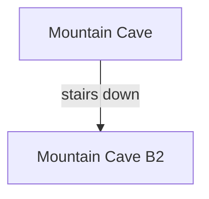

This chapter covers the Mountain Cave south of Garinham, which the sources also call Rock Mountain Cave. It is the first cave with enemies, and it holds the Fighter's Ring and the Death Necklace [[gf2-6-4, gf2-6-5]]. Three achievements are in play. Find the Fighter's Ring (13407). Find the Death Necklace (13397), which is a random roll. Reach Level 9 (13383), which teaches Radiant [[ra-guide-8-1, ra-guide-8-3, gf1-17-2]]. A level of 7 is recommended at the very least for the cave [[ra-guide-8-1]]. Both the ring and the necklace are on the lowest floor, so you can combine the level grind with the item hunts [[ra-guide-7-2]].

> [!TIP]
> **Before you leave:** The Fighter's Ring is a one-time pickup that you can get on your first visit. The necklace is a random roll, so if it has not appeared by the end of this chapter, keep trying on later visits. Chapter 9 is the last chance, after the Dragonlord dies and encounters stop [[ra-guide-8-3, ra-comments-13-1]].

### Chapter Items to Collect (5 Items Total)

The Fighter's Ring and the Death Necklace are the achievement items. The other chests are optional extras.

| Item | Where Found | Action / Requirement | Citation |
|---|---|---|---|
| Herb | B1, chest reached by heading up from the entrance, past the first staircase, and turning down | **TAKE** (optional) | [[gf1-18-1, gf3-8-1]] |
| Torch | B2, chest next to the Fighter's Ring chest | **TAKE** (optional; it refills on re-entry) | [[gf1-18-3, ra-comments-11-5]] |
| Fighter's Ring | B2, chest next to the Torch chest | **TAKE** (achievement 13407) | [[gf1-18-4, gf3-8-2]] |
| 100-130 gold or Death Necklace | B2, lone chest in the far southwest | **TAKE** (achievement 13397, 1/32 roll) | [[ra-guide-8-4, ra-comments-10-3, gf2-40-4]] |
| Other gold chests | B1 and B2 | **TAKE** (optional) | [[gf1-18-2, gf3-19-13]] |

### Mountain Cave (B1)

🗺️ **Map:** [View Mountain Cave Map by Chiasm](https://www.vgmaps.com/Atlas/NES/DragonWarrior-MountainCave.png)

#### Getting there

From Garinham, cross the bridge to the south, but don't go too far south or you will run into nasty monsters [[gf5-11-1]]. Head south to the bottom and go right. Where the path splits into two areas divided by mountains, take the top route into the cave [[gf1-17-3]]. Another source says to head east, avoiding the swamp, until you reach the cave [[gf3-19-9]]. The path to the Fighter's Ring is entrance A, then stairway C, then chest 2 [[gf3-7-3]].

Level up first. Reaching Level 9 takes 1300 experience points [[gf3-35-1, gf5-16-3]]. Fight around Garinham or inside this cave [[ra-guide-7-2]]. For Level 9 (13383), buy the best armour you can in Garinham first [[ra-guide-7-2]]. A Large Shield costs 800 gold there [[gf1-15-13]]. The Garinham Inn costs 25 gold [[gf1-15-6]].

#### Level 9 and Radiant

At Level 9 you learn Radiant [[gf1-62-4]]. It costs 3 MP and is brighter than a torch [[checklist-items-7-4]]. It lights a radius of 3 instead of 1 [[gf3-20-1]].


> [!ACHIEVEMENT]
> **Thou Hast No Need for Torches (5 Points)**
> 
> *Reach Level 9*


Enemies here include Druids, Druins, Drakeemas and Warlocks on the top level [[gf1-18-8]]. Droll is not too strong and is good to fight around levels 6 and 7 [[gf2-50-1]]. Drakeema has 20 HP and gives 11 experience and 20 gold [[gf2-49-3]]. Warlock has 30 HP and gives 13 experience and 35 gold, and is best fought around Level 9 [[gf2-62-1, gf2-62-2]]. Poltergeist has 23 HP, gives 81 experience and knows Hurt [[gf2-57-1]]. One source warns the lower floor has Warlocks, Poltergeists and Drakeemas and suggests being strong before going down [[gf5-11-8]].

#### Route to the stairs

Light a torch or cast Radiant on entering [[gf3-19-9, gf1-17-4]]. Go up and follow the wall until you reach a stairway, and pass it by [[gf3-19-9, ra-guide-8-2]]. Keep heading right to an intersection, then right and down to the chest with an Herb [[gf1-18-1]]. Take the **[Herb]** [[gf3-8-1]]. Return to the intersection and go down to the staircase that leads to B2 [[gf1-18-1, gf3-19-10]]. Another source places the stairs near the middle of the floor [[gf5-11-3]].

All chests here reappear after you leave the cave [[gf1-18-7]].

### Mountain Cave B2

On B2 the first intersection offers up, down, or right [[gf1-18-2]]. The chest-by-chest layout is below.

#### Fighter's Ring route

Going east to an intersection, go up and follow the wall west to two chests [[gf3-19-11, ra-guide-8-2]]. Another source says to go down first to a chest with 17 gold, then go up to a wall and turn right, skipping the first two paths down [[gf1-18-2, gf1-18-3]]. Take the third path down to the two chests [[gf1-18-3]]. One holds a **[Torch]** and the other holds the **[Fighter's Ring]** [[gf1-18-4, gf3-8-2, gf3-19-12]]. A different source places the ring in the upper-left corner of the floor [[gf5-11-7]].

The ring is optional to equip. Sources disagree on its effect: +2 strength and speed [[gf1-18-5, gf1-49-1]], speed only [[gf2-16-1]], or no effect and a 15 gold sale price [[gf2-33-1]]. If you equip it, it cannot be removed [[gf1-18-5]].


> [!ACHIEVEMENT]
> **Thou Art a Fighter, Not a Lover (10 Points)**
> 
> *Find the Fighter's Ring*


Other chests on this floor hold 112 gold [[gf1-18-6]], 122 gold and 13 gold [[gf5-11-5, gf5-11-6]], or 129 gold and 15 gold [[gf3-19-13, gf3-19-14]]. Sources disagree on exact amounts, so treat them as optional gold.

#### Death Necklace (1/32 gold chest)

> [!WARNING]
> **Achievement Trigger Warning:** Many players checked the wrong chest. The correct chest is the solitary one in the far southwest of B2, the one that normally holds 100-130 gold. It is not the first chest below the stairs [[ra-guide-8-4, ra-comments-12-2, ra-comments-14-11]]. One map has chests 4 and 5 mixed up, so the necklace is in the chest left of the wall [[ra-comments-12-5]]. Another map lists Chest #4 as the target [[ra-comments-14-12]].

On B2 go down as soon as you can and make your way to the very southwest, then up until you see a single chest [[ra-guide-8-4]]. Open it. It holds about 100 gold, or the necklace [[ra-guide-8-4, gf2-40-4]]. The necklace has a 1/32 chance [[ra-comments-10-3, ra-comments-4-2]].


> [!ACHIEVEMENT]
> **Thou Hast a Death Wish (10 Points)**
> 
> *Find the Death Necklace*


If you get gold instead, repeat the trip. Leaving and re-entering the cave refills the chest [[ra-comments-2-5, ra-guide-8-3]]. The B2 torch chest refills too [[ra-comments-11-5]].

The chance of seeing it after N attempts is 1 - 0.96875^N [[ra-comments-11-14]]. Players report anywhere from first try to 200+ attempts [[ra-comments-13-8, ra-comments-14-1]].

> [!WARNING]
> **Achievement Trigger Warning:** Keep at least one inventory slot free on every attempt. Sources disagree on whether a full inventory blocks the necklace: one player says the game asks you to drop an item and the achievement still triggers [[ra-comments-13-2]], while others say it never appears with all 8 slots full [[ra-comments-12-7, ra-comments-14-10]]. This is unconfirmed.

Whether entering the cave in the dark raises the odds is also unconfirmed. Some players claim a 100% chance [[ra-comments-10-1, ra-comments-10-11]], while others say it makes no difference [[ra-comments-10-2, ra-comments-11-13]]. Treat it as a 1/32 roll, light the cave normally, and just repeat the trip.

#### Farming tips

- On Hardcore, tackle the necklace at level 7 or 8 [[ra-comments-2-4]]. One player started at level 10 and had it by level 12 [[ra-comments-4-4]].
- The loop is: outside, radiant, fight, fight, take, repeat [[ra-comments-14-6]]. The route is short, so attempts go quickly [[ra-comments-12-10]].
- A recurring Herb helps keep HP up [[ra-comments-13-3]]. Save MP for Radiant, and grab the B2 torch if MP runs out [[ra-comments-14-4, ra-comments-14-5, ra-comments-13-11]].
- Fast-forward is allowed in Hardcore [[ra-comments-11-7, ra-comments-11-10]].
- Beating the Dragonlord stops random encounters, but you can no longer use an inn to restore MP afterwards [[ra-comments-13-6, ra-comments-14-3]].
- Magic Armor from Rimuldar regenerates HP and saves MP [[ra-comments-12-1]].
- Some players report the achievement only registered after saving and restarting [[ra-comments-10-9]].

Never equip the necklace, because it is a cursed item [[gf1-47-2, gf3-33-19]]. Sell it at the tool shop in Kol for 1200 gold [[gf2-9-4]].

> [!IMPORTANT]
> ### Chapter 3 Cumulative 100% Checkpoint
> - **Chests collected:** Fighter's Ring [[gf1-18-4]]; Death Necklace is a 1/32 roll [[ra-comments-10-3]]
> - **Erdrick's Relics:** 1 / 4
> - **Rainbow Drop Ingredients:** 0 / 3
> - **RetroAchievements Unlocked:** 8 / 33 (55 / 310 points)

### Chapter Checklist

- [ ] Reach Level 9 and learn Radiant (13383)
- [ ] Take the Fighter's Ring on B2 (13407)
- [ ] Open the lone southwest B2 chest until the Death Necklace appears (13397), keeping one inventory slot free
- [ ] Do not equip the necklace; sell it in Kol for 1200 gold
- [ ] If the necklace has not appeared, keep trying on later visits

---

## Chapter 4: Kol, the Swamp Cave and Rimuldar

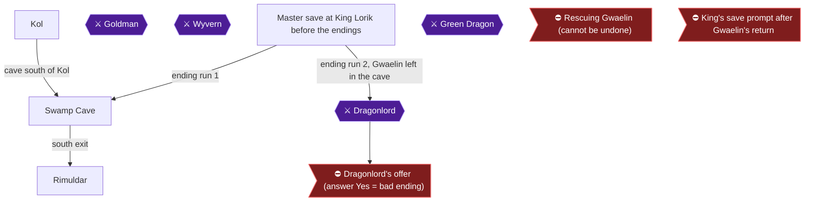

This chapter takes you east to the village of Kol, where you search for the Fairy Flute, then south through the Swamp Cave to the island town of Rimuldar. You then level up on the hills south of Rimuldar, fight the Goldman and the Wyvern, and reach level 12. The recommended starting level for the Swamp Cave is 10 or 11 [[gf1-18-10]]. This chapter carries four achievements: Thou Art the Pied Piper (the Fairy Flute), Thou Hast Defeated the Goldman, Thou Hast Defeated the Y BURN (the Wyvern) and Thou Hast Seen Sunlight (level 12) [[gf1-16-13, gf1-20-1, gf1-36-4, gf1-62-6]].

> [!CAUTION]
> **Point of No Return:** The Swamp Cave holds Princess Gwaelin, guarded by the Green Dragon [[gf1-18-11]]. Do NOT fight the Green Dragon and do NOT open Gwaelin's door in this chapter, or you lose achievement 13419 [[ra-comments-28-2, ra-guide-2-1]]. The princess can be rescued only once [[ra-comments-1-5]]. If you have already rescued her, the Dragonlord-without-Gwaelin achievement can only be earned by starting a brand new game [[ra-comments-28-3]]. Walk straight through the Swamp Cave to Rimuldar and never go to where Gwaelin is [[ra-comments-28-2]]. She is only rescued in the ending runs (chapters 8 and 10) from the master save [[ra-guide-2-1]].

### Chapter Items to Collect

| Item | Where Found | Action / Requirement | Citation |
|---|---|---|---|
| Fairy Flute | Kol, south of the bath | **SEARCH** the line of squares south of the bath | [[gf1-16-13, ra-guide-8-5]] |
| Wings | Treasure chest behind a locked door at the Rimuldar Inn | Optional; needs a Magic Key | [[gf1-19-7]] |
| Magic Keys | Key shop in Rimuldar, 53 gold each | **BUY** several; each is used up on a door | [[gf1-19-1, gf3-33-9]] |

### Kol

🗺️ **Map:** [View Kol Map by Chiasm](https://www.vgmaps.com/Atlas/NES/DragonWarrior-Kol.png) [[map-kol-1-1]]

From Tantegel Castle, travel to Kol by heading north past the mountains, then east across two bridges, then north past the desert [[gf5-10-1]]. Another route describes going east after the first bridge, south across another bridge, north past a small mountain range, and north-east into a forest [[gf3-19-1]].

Kol's shops and inn:

| Item | Price | Citation |
|---|---|---|
| Inn | 20 gold | [[gf1-16-3]] |
| Copper Sword | 180 gold | [[gf1-16-4]] |
| Hand Axe | 560 gold | [[gf1-16-5]] |
| Half Plate | 1,000 gold | [[gf1-16-6]] |
| Full Plate | 3,000 gold (+24 defense) | [[gf1-16-7]] |
| Small Shield | 90 gold | [[gf1-16-8]] |
| Medicinal Herb | 24 gold | [[gf1-16-9]] |
| Torch | 8 gold | [[gf1-16-10]] |
| Dragon's Scale | 20 gold | [[gf1-16-11]] |
| Wings | 70 gold | [[gf1-16-12]] |

#### Fairy Flute

> [!WARNING]
> **Achievement Trigger Warning:** The sources disagree on how many squares south of the bath the Fairy Flute lies: three [[gf2-8-10, gf5-10-8]], four [[gf1-16-13, gf1-27-2, gf3-21-11, ra-guide-8-5, ra-comments-8-1]], or five [[gf2-32-2]]. Search every square in that line.

The Fairy Flute is the first thing to do in Kol, even before talking to anyone [[gf1-16-13]]. Go to the one-block waterhole at the top of town, the bath that cures rheumatism [[gf1-16-13, gf2-8-10]]. Stand on the square directly south of it and walk south [[ra-guide-8-5]]. Use the **Search** command on the third square down, then the fourth, then the fifth, until you get the item [[gf1-16-13, gf2-8-10, gf2-32-2]]. The main consensus is four squares [[gf1-16-13, ra-guide-8-5]].


> [!ACHIEVEMENT]
> **Thou Art the Pied Piper (10 Points)**
> 
> *Find the Fairy Flute*


You will use the flute later to put the Golem guarding Cantlin to sleep [[gf1-48-3, checklist-items-3-1]].

> [!TIP]
> A man in Rimuldar will tell you about the flute's location, but you do not need to talk to him to find it [[ra-guide-8-6]].

#### Talking to Kol's townsfolk

- A wandering old man outside the weapon shop says fairies know how to put Golem to sleep [[gf1-16-15]].
- The Red Knight in the weapon shop says extraordinary weapons are sold in a town east of Hauksness [[gf1-16-14]].
- A wandering green man tells you Rimuldar lies to the south [[gf1-16-16]].
- A guard in the southwestern corner of town says Rimuldar is the place to buy keys [[gf1-17-1]].

Recommended practice: if you want money before the cave, fight around Kol. Ghosts are found in the fields around Kol [[gf1-37-5]], and Magidrakees around Kol cast Hurt often [[gf2-55-1]].

### Swamp Cave

🗺️ **Map:** [View Swamp Cave Map by Chiasm](https://www.vgmaps.com/Atlas/NES/DragonWarrior-SwampCave.png)

The Swamp Cave lies south of Kol and connects the two continents [[gf2-6-6, ra-comments-28-1]]. Aim to arrive at level 10 or 11 [[gf1-18-10]]. Go straight through; do not take any side paths, because you might run into the Green Dragon and that would be the end of you [[gf1-18-12]].

Entrance **a** leads to the northeast continent overworld, and entrance **b** to the South Island [[gf3-9-2, gf3-9-3]]. The path from the northeast continent to the South Island is A, then B [[gf3-8-6]].

Choose one of these routes:

1. **Radiant route:** Cast Radiant, shoot straight down south without turning into any path, go around the intrusion, enter the block area where the stairs are, and leave [[gf1-18-12]].
2. **Sound route:** You need neither torch nor Radiant. Walk down a long way until you hear a thumping sound, then right until you hear it again, then down, right, down, and finally left, and go up the stairs [[gf2-6-7]].
3. **Short version:** Go down, east, down, east, down, west, and take the stairs up [[gf3-20-2]].

The exit stairs are in the bottom left-hand corner of the cave [[gf5-11-9]]. Druin appear mostly in this cave, with 22 HP, giving 7 EXP and 16 gold [[gf2-51-1]].

> [!WARNING]
> **Leave the Green Dragon alone:** The Green Dragon (65 HP, 45 EXP) guards the princess's door [[gf2-53-2]]. Walk past; do not fight him and do not unlock the door behind him [[gf3-9-4, gf3-9-5, ra-comments-28-2]].

### Rimuldar

🗺️ **Map:** [View Rimuldar Map by Chiasm](https://www.vgmaps.com/Atlas/NES/DragonWarrior-Rimuldar.png)

Once outside the cave, go west and then south following the mountains, then east inside the mountain barrier. The town sits on an island with a desert-like path leading to it [[gf1-18-13]]. Another description: cross the swamp to solid ground, go south-east then south, pass the second mountain range, wrap around south, and cross the desert strip surrounded by water [[gf3-21-1]]. Monsters on the way include Wolves and Warlocks; run from them if needed [[gf3-21-1]].

Rimuldar shops:

| Item | Price | Citation |
|---|---|---|
| Inn | 55 gold | [[gf1-18-14]] |
| Copper Sword | 180 gold | [[gf1-18-15]] |
| Hand Axe | 560 gold | [[gf1-18-16]] |
| Broad Sword | 1,500 gold | [[gf1-18-17]] |
| Half Plate | 1,000 gold | [[gf1-18-18]] |
| Full Plate | 3,000 gold | [[gf1-18-19]] |
| Magic Armor | 7,700 gold | [[gf1-18-20]] |
| Magic Key | 53 gold | [[gf1-19-1]] |

One source lists Magic Armor at 7,000 gold and another at 3,000; most sources say 7,700, so plan for 7,700 [[gf1-18-20, gf2-26-2, gf3-21-5]]. The Flame Sword (28 attack, 9,800 gold) is not sold here. It is sold in Cantlin, in the locked shop you reach in Chapter 6 [[gf2-21-2, gf3-31-6, gf1-23-8]].

#### Magic Keys

To reach the key shop, walk along the outside of the town's northern edge, hugging the river or moat [[gf1-19-2, gf2-9-8]]. Look for a man in a green shirt next to a building; the key salesman is inside [[gf3-21-2]]. Keys cost 53 gold here, versus 85 gold in Tantegel Castle and 93 gold in Cantlin [[gf2-34-2]]. A Magic Key disappears once used [[gf3-33-9]]. Buy several, since you will need a few for Garin's Grave later [[gf1-22-2, gf1-23-1]]. One source suggests six keys [[gf2-9-8, gf3-21-3]], another five [[gf1-20-2]]. A blue-haired man named Orwick waits along the river [[gf1-19-2]].

#### Optional Inn doors

You may spend two keys on the two doors by the Inn. One holds a chest with Wings, and behind the other, the old man Howard says the magic item is four steps south of the bath in Kol [[gf1-19-7, gf3-21-7]]. This is not worth it, since Wings cost only 70 gold in Kol and two keys cost 106 gold [[gf3-21-8, gf1-16-12]]. Skip it unless you want to see for yourself.

#### Talking to Rimuldar's townsfolk

- The red knight in the weapon shop: "The scales of the Dragonlord are as hard as steel." [[gf1-19-3]]
- A guard says the Stones of Sunlight are in Tantegel Castle [[gf1-19-5]].
- An old man on the island-like area says Erdrick created a rainbow over the western part of the island [[gf1-19-4]].
- The old man in the southern building says sun and rain meet in a magic temple to the south [[gf1-19-6]].
- A man there warns that monsters to the south are fierce and terrible [[gf1-64-6]].

> [!TIP]
> One commenter suggests picking up the Magic Armor early, since its regeneration saves MP that you would otherwise spend on Radiant [[ra-comments-12-1]]. It restores 1 HP every few steps [[gf1-20-3]].

### Goldman

South of Rimuldar, the second set of hills is where the Goldman appears [[gf3-22-1]]. The guide also places him near the shrine, slightly above it [[ra-guide-9-4]]. Wyverns and Goldmen live there [[ra-guide-9-5]].

> [!WARNING]
> **Achievement Trigger Warning:** Make sure you have the Broad Sword before confronting Goldmen or other monsters south of town, because enemy HP rises above 30 and Wolflords often get preemptive attacks [[gf5-12-5]]. Bring plenty of herbs [[gf5-12-4]].

The Goldman has 50 HP, uses no magic, and yields 200 gold and 6 EXP [[gf1-31-5, gf1-37-6]]. Cast Sleep first; without it he will beat you badly. He hits for about 15 HP and takes about 6 hits to kill [[gf3-22-2]]. Do not fight if Sleep fails [[gf3-22-2]]. One commenter beat him at level 9 with many herbs and Hurt, using a Hand Axe, Half Plate and Large Shield [[ra-comments-34-1, ra-comments-34-2, ra-comments-34-3, ra-comments-34-4]].


> [!ACHIEVEMENT]
> **Thou Hast Defeated the Goldman (5 Points)**
> 
> *Defeat the Goldman (and get rich)!*


Goldmen are rare and pay little EXP, so mix in other enemies for balanced levelling [[gf2-15-2, gf1-65-7]]. Metal Scorpions around Rimuldar have 20 HP and give 14 EXP and 40 gold [[gf2-56-1]].

### Wyvern

The Wyvern appears in the same area as the Goldman [[ra-guide-9-5]]. It has 42 HP, no spells, and yields 100 gold and 24 EXP [[gf1-36-4]]. It hits hard, but Sleep works pretty well [[gf3-22-4]]. It can deal double-digit damage every time, so avoid it until you are in the low teens, though one commenter at level 10 found it not much worse than neighbouring enemies [[gf1-40-8, ra-comments-35-2, ra-comments-35-3]]. One commenter killed it with a critical hit [[ra-comments-35-1]].


> [!ACHIEVEMENT]
> **Thou Hast Defeated the Y BURN (5 Points)**
> 
> *Defeat the wyvern!*


### Magic Key

Buy your keys here in Rimuldar at 53 gold each. Tantegel's key merchant (85 gold) sits behind a locked door, so Rimuldar is the cheap and easy place [[gf2-34-2, gf1-21-1, gf1-19-1]]. Each key is used up on the door it opens [[gf3-33-9]].

The doors ahead that need a key:

1. **Tantegel Castle:** the door to the Stones of Sunlight cellar (Chapter 5) [[ra-guide-3-8]].
2. **Garinham:** the locked door on the east side of town, on the way to Garin's Grave (Chapter 5) [[gf5-12-10, gf2-6-8]].
3. **Garin's Grave:** a locked door inside the Grave (Chapter 5) [[gf2-6-8, ra-guide-8-7]].
4. **Cantlin:** the locked shop that sells the Silver Shield (Chapter 6) [[gf1-23-21, gf2-72-2]].

That is four doors, so buy five or six keys to have a spare [[gf1-20-2, gf2-9-8]].

### Level 12

Aim to finish this stretch at level 12 or 13, with around 8,000 gold for the Magic Armor and five Magic Keys [[gf1-20-2]]. Level 12 needs 4,000 EXP and teaches Outside [[gf3-35-3, gf5-16-5]]. Outside costs 6 MP and teleports you out of a cave [[gf2-43-2]]. Reach level 12 here.


> [!ACHIEVEMENT]
> **Thou Hast Seen Sunlight (5 Points)**
> 
> *Reach Level 12*


> [!TIP]
> Before you leave: have the Fairy Flute, restock Magic Keys, and confirm that Gwaelin is still in the cave. Return later costs 8 MP and takes you to Tantegel Castle [[checklist-items-7-7]]. When you head home, leave the island the way you came; the path back north through the cave is east, north, west, north [[gf3-21-10]].

> [!IMPORTANT]
> ### Chapter 4 Cumulative 100% Checkpoint
> - **Erdrick's Relics:** 1 / 4
> - **Rainbow Drop Ingredients:** 0 / 3
> - **Fairy Flute Found:** 1 / 1 [[gf1-16-13]]
> - **RetroAchievements Unlocked:** 12 / 33 (80 / 310 points)

### Chapter Checklist

- [ ] Fairy Flute found in Kol (13408)
- [ ] Walked through the Swamp Cave without fighting the Green Dragon
- [ ] Gwaelin's door left closed
- [ ] Magic Keys bought in Rimuldar
- [ ] Goldman defeated (13400)
- [ ] Wyvern defeated (13401)
- [ ] Level 12 reached (13384)

---

## Chapter 5: Stones of Sunlight, Garin's Grave and the Staff of Rain

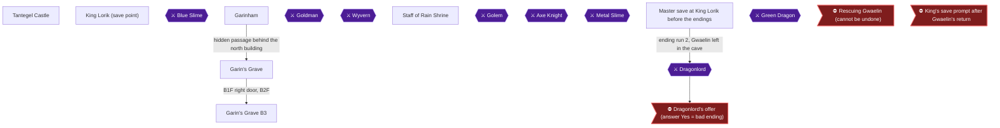

This chapter collects two of the three Rainbow Drop ingredients and earns five achievements. You take the Stones of Sunlight from the basement of Tantegel Castle [[gf1-51-2, ra-guide-3-8]]. You then clear Garin's Grave beneath Garinham for the Silver Harp and the Cursed Belt [[ra-guide-3-6, gf3-11-8, gf3-11-9]]. You trade the harp to the old man northwest of Kol for the Staff of Rain [[gf1-27-6, ra-guide-3-9]]. Grind to Level 15 inside the Grave along the way [[ra-guide-7-4]]. The Rainbow Drop itself needs the Stones, the Staff and Erdrick's Token, and the token is not part of this chapter [[gf3-29-8, ra-guide-4-1]].

### Preparation

- **Magic Keys:** The Grave needs at least two. One opens the door in Garinham and another opens a locked door inside [[gf2-6-8, ra-guide-8-7]]. Have a few on hand before you enter [[gf1-22-2]]. A key disappears when it opens a door [[gf3-33-9]]. Tantegel's merchant sells more for 85 gold [[gf1-21-1]]. Rimuldar sells them for 53 gold [[gf1-19-1]]. The Tantegel door you open for the Stones also costs one key [[ra-guide-3-8]].
- **Light:** Bring a torch, which costs 8 gold in Garinham [[gf1-15-15]], or use the Radiant spell [[ra-guide-8-7, gf3-20-1]].
- **Level:** The recommended level for the Grave is 13 at the very least [[gf1-22-1, ra-guide-8-7]].
- **Saving:** You can only save by talking to King Lorik [[gf1-10-3, ra-comments-1-3]]. Hardcore turns off save states, so save with the King before and after each big trip.

### Chapter Items to Collect (4 Items Total)
| Item | Where Found | Action / Requirement | Citation |
|---|---|---|---|
| Stones of Sunlight | Cellar of Tantegel Castle, from the old man | **TAKE** the chest | [[gf1-51-2, gf2-37-1]] |
| Cursed Belt | Northwest chest of Garin's Grave B3 | **TAKE**, never equip | [[ra-guide-8-8, gf5-13-2]] |
| Silver Harp | Chest in the big room at the bottom of the Grave | **TAKE** | [[gf2-10-4, gf3-11-9]] |
| Staff of Rain | Chest guarded by the old man in the shrine northwest of Kol | **GIVE** the Silver Harp, then take the chest | [[gf1-22-9, ra-guide-3-9]] |

### Tantegel Castle

🗺️ **Map:** [View Tantegel Castle Map by Chiasm](https://www.vgmaps.com/Atlas/NES/DragonWarrior-TantegelCastle.png)

Return to Tantegel Castle with Magic Keys in your pack. A guard in Rimuldar also says the Stones of Sunlight are in Tantegel Castle [[gf1-19-5]].

Before heading for the cellar, you can pick up a few optional extras found in the castle [[gf1-16-2, gf1-21-4, gf1-21-3]]:

- **MP refill:** The old man behind the desk in the southeast corner of the castle restores your MP to full. You can cast Heal and then talk to him again [[gf1-16-2, gf1-65-6]].
- **Gold room:** Behind a locked door in the castle is a guard and four chests of small gold amounts. Their contents are 10, 12, 12 and 13 gold [[gf1-21-4, gf5-8-13]].
- **Barrier floor:** A Red Knight past the barrier floor tells you to push on a wall of darkness at Garin's grave in Garinham [[gf1-21-3]]. Each step on the barrier costs HP, and sources give 20 or 25 per step [[gf1-21-2, gf3-21-13]]. You do not need to cross it, because the hint is repeated here.
- **Curse warning:** You cannot enter Tantegel Castle while cursed [[gf1-66-6]].

### Stones of Sunlight

Go to the door at the top of the castle, the same area where you unlocked the other parts of the castle [[gf1-23-2, gf5-11-17]]. Do not open the other locked door, the one with the treasure chests [[gf5-11-17]]. Use the Door command with a Magic Key [[ra-guide-3-8]].

> [!WARNING]
> **Achievement Trigger Warning:** The door with the guard and four chests is not the cellar door. Unlock the door in the top-right of the castle for the cellar [[gf5-11-17, ra-guide-3-8]].

Then follow this route:

1. After the door, go outside when the game gives you the option [[ra-guide-3-8]].
2. Walk down alongside the castle wall. Go one space to the right and keep going down along the water until you reach a staircase [[ra-guide-3-8]].
3. Do not walk any further right, or you will leave the castle and have to redo the route [[gf2-37-1]].
4. Another guide describes the same route as going around the woman near the key salesman and then around the river into the cellar [[gf1-23-2, gf3-21-14]].
5. Go down the stairs. The old man says he has waited long for you and tells you to take the chest [[gf1-23-2, gf3-21-14]].
6. Open the chest to receive the **Stones of Sunlight** [[gf2-10-1, gf3-33-16]].


> [!ACHIEVEMENT]
> **Thou Hast Harnessed the Sun (10 Points)**
> 
> *Find the Stones of Sunlight*


The Stones must be combined with the Staff of Rain and Erdrick's Token for the Rainbow Drop, so keep them [[checklist-items-3-3, gf3-29-8]].

### Garinham

🗺️ **Map:** [View Garinham Map by Chiasm](https://www.vgmaps.com/Atlas/NES/DragonWarrior-Garinham.png)

Leave Tantegel, travel north past the mountains and head west to reach Garinham [[gf5-9-9, gf3-18-1]].

**Shops:** You can buy gear here.

- **Inn:** 25 gold [[gf1-15-6]].
- **Tools:** A Medicinal Herb is 24 gold, a Torch is 8 gold and a Dragon's Scale is 20 gold [[gf1-15-14, gf1-15-15, gf1-15-16]].
- **Weapons:** Club 60 gold, Copper Sword 180 gold, Hand Axe 560 gold [[gf1-15-7, gf1-15-8, gf1-15-9]].
- **Armor:** Leather Armor 70 gold, Chain Mail 300 gold, Half Plate 1,000 gold, Large Shield 800 gold [[gf1-15-10, gf1-15-11, gf1-15-12, gf1-15-13]].

**Locked building:** Unlock the door on the east side of town with a Magic Key [[gf3-23-1, gf1-21-5]]. Inside is a room with three chests. Their contents are an Herb, a Torch and a small amount of gold, which another source gives as 15 gold [[gf1-21-5, gf1-21-6, gf1-21-7, gf3-23-1]].

> [!WARNING]
> **Achievement Trigger Warning:** Do not use a key on the two guards. Walk up into the wall above them instead [[gf5-12-10]].

**Hidden entrance:** The wall of darkness is in the north part of the building.

1. Go three steps from the top of the building from the left and press up. You walk through the wall to an area behind it [[gf1-21-8]].
2. Another guide says to hug the north black wall until the passage lets you through [[ra-guide-3-5]].
3. A third says to push on the wall above the room with the two guards [[gf3-23-2, gf5-12-10]].
4. Walk right. An old man warns "The harp attracts enemies. Stay away from the grave in Garinham." Ignore him [[gf1-21-8, gf3-23-2]].
5. Cross the bridge and go down the stairs to his right [[gf1-21-8]].

Unable to verify from collected sources which of the above wall positions is the only correct one. Try the descriptions in order.

### Garin's Grave

🗺️ **Map:** [View Garinham Garin's Grave Map by Chiasm](https://www.vgmaps.com/Atlas/NES/DragonWarrior-Garinham-Garin'sGrave.png)

Enter and light your way with a torch or Radiant at once [[gf1-22-5, ra-guide-8-7]]. This walkthrough uses the RA guide's floor labels B1F to B4F [[ra-guide-3-7]]. Other guides count the floors as F1 to F4 [[gf3-9-6]].

**Monsters:** Deep floors have DrollMagi, Druinlords, Specters and Wraith Knights [[gf1-23-3]]. Their stats are:

| Monster | HP | EXP | Gold | Citation |
|---|---|---|---|---|
| Drollmagi (casts only Stopspell) | 38 | 22 | 90 | [[gf2-50-2]] |
| Druinlord | 35 | 20 | 85 | [[gf2-51-2]] |
| Specter (can cast Sleep) | 36 | 18 | 70 | [[gf2-60-2]] |
| Wolf | 34 | 16 | 50 | [[gf2-63-2]] |
| Wolflord | 38 | 20 | 80 | [[gf2-64-1]] |

Put Wraith Knights to sleep before you fight them, otherwise they will give you a hard time [[gf1-23-4]].

#### B1F

1. Optional side trip: from the entrance, go right and up to a huge intersection, go right to the wall, then up and left to reach an Herb and some gold, then come back [[gf1-22-5]].
2. Open the locked door on the right with a Magic Key [[ra-guide-3-7, gf5-13-1, gf3-11-4]]. The door is in the bottom-right corner of the floor [[gf5-13-1]].
3. Make your way to the middle of the screen, where the only staircase is, and take it [[ra-guide-3-7, ra-guide-8-8]].

*Other guides:* One map reading puts three chests along the north wall of the first floor with 26 gold and an Herb [[gf3-23-3]].

#### B2F

1. You arrive next to a staircase. Ignore it [[gf1-22-7]].
2. For the Silver Harp, make your way to the bottom-left of the screen and take the staircase there [[ra-guide-3-7, gf5-13-3]].
3. For the Cursed Belt, take the bottom-right (south-east) staircase [[ra-guide-8-8, gf5-13-2]].

*Other guides:* One guide says the belt staircase can be either the north-west or the south-east one [[ra-guide-8-8]].

### Garin's Grave B3

#### Cursed Belt detour

1. Take the south-east staircase from B2F to B3F, then make your way to the north-west of the floor [[ra-guide-8-8, gf5-13-2]].
2. Open the chest there for the Cursed Belt (see the Cursed Belt section below), then return up to B2F [[ra-guide-8-8, gf3-11-8]].

#### Harp route

1. Arrive on B3F by the bottom-left staircase from B2F. Go north until you reach the single staircase and take it down [[ra-guide-3-7]].

*Other guides:* Another guide says to take the upper path at the fork on this floor and then the stairs down [[gf5-13-3]].

### Silver Harp

On B4F, take the single staircase in the middle [[ra-guide-3-7]]. You arrive in a big room. The chest in the middle holds the **Silver Harp** [[gf2-10-4, gf3-11-9]]. A walkthrough of the same path describes circling the room and going down the stairs on the other side [[gf1-22-8, gf3-23-4]]. The harp is the only item in that chest [[gf3-11-9]].


> [!ACHIEVEMENT]
> **Thou Hast Discovered Thine Inner Bard (10 Points)**
> 
> *Find the Silver Harp*


Do not play the harp. It attracts enemies and triggers random battles [[gf2-36-1, checklist-items-3-2]].

### Cursed Belt

> [!WARNING]
> **Achievement Trigger Warning:** Do not equip the Cursed Belt. Once equipped it won't come off [[checklist-items-2-7, gf5-13-2]]. Only the man in Brecconary can remove the curse [[gf1-22-4, checklist-items-2-7]]. The castle will not let you in while you are cursed [[gf1-66-6]].

Take the northwest chest on B3F to claim the **Cursed Belt** [[ra-guide-8-8, gf5-17-7]]. Players have reported it in Garin's Grave, not Charlock [[ra-comments-4-1]]. Another source says it can also be found on the bottom floor of Charlock Castle [[gf2-40-2]].

**Is it always in this chest?** This is unconfirmed. Some players say it is guaranteed [[ra-comments-16-1, ra-comments-16-3]], while one says it depends on chest luck [[ra-comments-16-4]]. If the chest gives something else, leave the Grave and come back, because chests refill when you re-enter a dungeon.


> [!ACHIEVEMENT]
> **Thou Hast Gained Weight (10 Points)**
> 
> *Find the Cursed Belt*


Do not use the belt. One guide says to sell it and not equip it [[gf1-47-1]].

### Grinding to Level 15

The Grave is a good place to grind around this level, and it combines with the harp and belt trips [[ra-guide-7-4]]. Fight the third and fourth floor monsters named above [[gf1-23-3]]. Level 15 requires 10000 experience points and teaches Repel [[gf3-35-5, gf5-16-7]]. Repel costs 2 MP and does not work in caves, so you cannot use it here [[checklist-items-7-8, gf2-45-1]].


> [!ACHIEVEMENT]
> **Thou Hast Acquired Body Odor (5 Points)**
> 
> *Reach Level 15*


When you are done, cast Outside to leave the Grave [[gf5-13-3]]. Return (8 MP) takes you back to the castle [[checklist-items-7-7]]. Wings are the alternative way back and cost 70 gold in Kol [[checklist-items-2-6, gf1-16-12]].

### Staff of Rain Shrine

🗺️ **Map:** [View Staff Of Rain Cave&Magic Temple Map by Chiasm](https://www.vgmaps.com/Atlas/NES/DragonWarrior-StaffOfRainCave&MagicTemple.png)

Heal and save with King Lorik, then head to Kol. The route from Tantegel goes north past the mountains and east, across two bridges, then north past the desert [[gf5-10-1, gf3-19-1]].

From Kol, go west and up to a shrine [[ra-guide-3-9]]. Another guide gives a longer description. Go across the bridge you would cross eastward to Kol and go up as if going there. Slip through the little crack in the mountains west of Kol and follow the forested path upwards to the dungeon [[gf1-22-9, gf2-36-2]]. A third guide describes it as a staircase west of the town and up [[gf5-10-12]].

### Staff of Rain

Talk to the old man in the shrine and give him the Silver Harp [[ra-guide-3-9, gf5-13-4]]. He says he has been waiting a long time for you, thanks you and disappears [[gf1-22-9, gf3-23-6]]. Open the chest he was guarding to get the **Staff of Rain** [[gf1-22-9, gf2-10-5]].


> [!ACHIEVEMENT]
> **Thou Hast Acquired the Song of Storms (10 Points)**
> 
> *Find the Staff of Rain*


Keep the staff. Together with the Stones of Sunlight and Erdrick's Token, it will be turned into the Rainbow Drop later [[gf2-35-1, checklist-items-3-4]].

> [!TIP]
> **Before you leave:** Make sure you have the Stones of Sunlight, the Staff of Rain and the Cursed Belt achievement, and that you reached Level 15. Do not equip the belt. Save with King Lorik [[gf1-10-3, ra-guide-3-8, ra-guide-3-9]].

> [!IMPORTANT]
> ### Chapter 5 Cumulative 100% Checkpoint
> - **Erdrick's Relics:** 1 / 4
> - **Rainbow Drop Ingredients:** 2 / 3 (Stones of Sunlight and Staff of Rain) [[gf3-29-8]]
> - **RetroAchievements Unlocked:** 17 / 33 (125 / 310 points)

### Chapter Checklist

- [ ] Stones of Sunlight taken from the Tantegel cellar
- [ ] Silver Harp taken from Garin's Grave
- [ ] Cursed Belt taken and never equipped
- [ ] Reached Level 15
- [ ] Staff of Rain obtained from the old man northwest of Kol
- [ ] Saved with King Lorik

---

## Chapter 6: Cantlin, Erdrick's Token and Hauksness

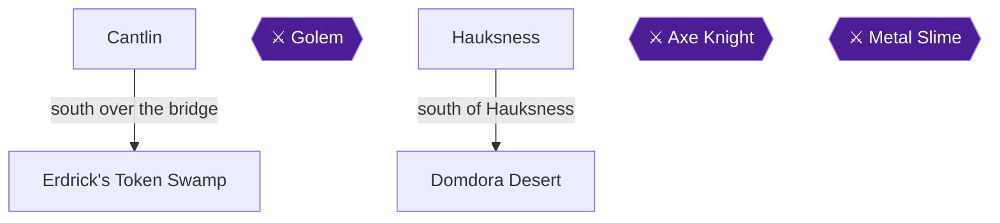

This chapter takes you to the far southern town of Cantlin, past the Golem that guards its gate. You then collect the last two Erdrick relics (the Token and the Armor), buy the Silver Shield, hunt the Metal Slime, and grind to Level 19. Cantlin's suggested level is 15 [[gf1-23-6]]. The Fairy Flute from Kol is required for the Golem [[gf1-23-5, checklist-items-3-1]]. Without Gwaelin's Love you cannot read coordinates, so the Token section below gives a square-by-square fallback [[ra-guide-3-10]].

Achievements in this chapter: Erdrick's Token (13406), Silver Shield (13411), Erdrick's Armor (13410), Metal Slime (13399) and Level 19 (13386).

> [!TIP]
> **Before you start:** Bring the Fairy Flute from Kol, which is found four squares south of the bath [[gf1-16-13, ra-guide-8-5]]. Buy and equip a Large Shield (800 gold in Garinham or Cantlin) before purchasing the Silver Shield [[gf1-15-13, gf1-23-15, ra-comments-21-1]]. Carry plenty of Herbs, which cost 24 gold [[gf1-23-16]].

### Getting to Cantlin

The route is long. Head south past the Rock Mountain swamp and bridge, past the desert town of Hauksness, then cross the mountain bridge. Head up, skip the next bridge, and cross the bridge surrounded by swamp [[gf5-13-5]]. Another description: cross the bridge south of the gold-farming area, cross the desert south to a bridge east, go north-east, pass the first bridge, cross the next (with a little swamp on the other side), then go south to the walled town [[gf3-23-10]]. Run from most fights on the way [[gf5-13-5]].

### Cantlin

🗺️ **Map:** [View Cantlin Map by Chiasm](https://www.vgmaps.com/Atlas/NES/DragonWarrior-Cantlin.png)

#### The Golem (gate boss)

The Golem has 70 HP and gives 10 gold and 5 EXP [[gf1-37-7]]. You must defeat him to enter [[gf2-72-1]].

1. Walk up to the entrance and play the Fairy Flute from the Item menu to put him to sleep [[gf1-23-5, gf1-37-8]].
2. Attack with your sword while he sleeps [[gf1-23-5]].
3. When he wakes, play the Flute again right away, heal with an Herb if needed, and keep attacking until he dies [[gf2-12-2, gf3-23-11]].
4. The Flute's sleep alone is not enough to win, so arrive at full HP with plenty of Herbs (24 gold each) [[gf2-53-1, gf1-23-16]].

#### Town overview and shops

The inn costs 100 gold [[gf1-23-7]]. Cantlin is huge, and only one shop matters. It sits behind a locked door that needs a Magic Key [[gf1-23-21]]. To reach it, go down from the entrance to the first intersection, then turn left [[gf1-23-21]]. A Magic Key costs 75 gold in Cantlin [[gf2-73-11]]. The door has two shops behind it [[gf2-12-3]].

| Shop | Stock | Citation |
|---|---|---|
| Weapon Shop 1 | Bamboo Pole 10, Club 60, Copper Sword 180, Leather Armor 70, Chain Mail 300, Large Shield 800 | [[gf2-72-4, gf2-72-5, gf2-72-6, gf2-72-7, gf2-72-8, gf2-72-9]] |
| Weapon Shop 2 | Hand Axe 560, Broad Sword 1,500, Full Plate 3,000, Magic Armor 7,700 | [[gf2-73-1, gf2-73-2, gf2-73-3, gf2-73-4]] |
| Weapon Shop 3 (locked) | Flame Sword 9,800, Silver Shield 14,800 | [[gf2-73-5, gf2-73-6]] |
| Tool Shop 1 | Dragon's Scale 20, Wings of Wyvern 70 | [[gf2-73-7, gf2-73-8]] |
| Tool Shop 2 | Torch 8, Herb 24 | [[gf2-73-9, gf2-73-12]] |
| Other | Fairy Water 38 | [[gf2-73-10]] |

#### Townsfolk hints

- A guard says the last holder of Erdrick's armor was a fellow named Wynn [[gf1-23-22]].
- An old man in the large central structure says to see a man in town for proof of your ancestry [[gf1-24-1]].
- A fat man in the southwest corner building (behind a locked door) says his grandfather Wynn had a shop on the east side of Hauksness [[gf1-24-2]].
- A green man south of the inn says Wynn buried something of great value at the foot of a tree behind his shop [[gf1-24-3]].
- Exit the central building to the south and use a key on a door there. Circle around and talk to the old man, who says to travel 70 leagues south and 40 east of Tantegel Castle [[gf1-24-8]].

#### Buying the Silver Shield

The Silver Shield gives 25 defense [[gf1-46-2, checklist-items-5-3]]. It costs 14,800 gold, and the shop with the Flame Sword sells it [[gf3-24-1, ra-guide-8-9]]. The Flame Sword (9,800 gold, +28 attack) is optional [[gf3-31-6]]. One guide figures 23,600 gold for both items [[gf1-27-7]].

> [!WARNING]
> **Achievement Trigger Warning:** Whether the achievement needs the Large Shield in hand is unconfirmed. Only one player reports that it does [[ra-comments-21-1]]. To be safe, buy and equip the Large Shield (800 gold) before buying the Silver Shield [[gf1-23-15]]. The shop gives 400 gold for the Large Shield in trade [[gf3-24-1]].

1. Collect 14,800 gold. Goldmen south of Rimuldar and near Hauksness give up to 200 gold each [[gf1-37-7, gf3-29-6]]. The Goldman fight gives only 6 EXP [[gf1-65-2]].
2. Return to Cantlin and open the door with two shops using a Magic Key [[gf2-12-3]].
3. Buy the Silver Shield.


> [!ACHIEVEMENT]
> **Thou Hast Hefted a Heavy Burden! (10 Points)**
> 
> *Find the Silver Shield*


### Hauksness

🗺️ **Map:** [View Hauksness Map by Chiasm](https://www.vgmaps.com/Atlas/NES/DragonWarrior-Hauksness.png)

Hauksness is a ruined town filled with strong enemies such as Werewolves, Green Dragons, Starwyverns and Wizards [[gf2-71-1]]. Do not linger. If you meet a dangerous monster, run, heal, and repeat [[gf1-24-4]].

#### Axe Knight

The Axe Knight has 70 HP, casts Sleep and Stopspell, and gives 54 EXP and 165 gold [[gf3-30-7]]. A level of about 17 is recommended [[ra-guide-8-11]]. A player at level 16 managed it with the Flame Sword, Magic Armor and Silver Shield [[ra-comments-19-1]].

1. Enter the town, head south, then go east along the bottom. Find the two swamp tiles followed by a tree, next to the vacant shop [[gf1-24-4, gf3-24-3]]. The tree square is the one to the right of the two swamp tiles [[ra-guide-8-10]].
2. Heal to full before stepping on the tree [[gf1-24-4]].
3. Step on the tree square to start the fight [[gf2-71-1]].
4. Cast Stopspell first, because he can put you to sleep [[gf1-24-4, gf2-47-3]]. One player cast it right away and the knight kept trying Sleep [[ra-comments-19-2]].
5. Attack and heal as needed. One guide suggests Hurt and Herbs [[gf2-11-4]].
6. When he falls, search the ground you are standing on [[gf1-24-5]].

You receive Erdrick's Armor, which equips itself [[gf1-24-5]]. It has 28 defense [[gf1-44-3]], heals 1 HP per step, and makes swamps and barrier floors harmless [[gf1-24-6, gf3-32-7]].


> [!ACHIEVEMENT]
> **Thou Hast the Armor of Legend! (10 Points)**
> 
> *Find Erdrick's Armor*


> [!TIP]
> You can step back onto the same square to fight the Axe Knight again for strong experience [[gf2-47-2]].

### Erdrick's Token Swamp

Do this after you have the Armor, because the swamp would otherwise drain HP [[gf3-25-1, gf5-6-6]]. The swamp is south of Cantlin. From the road toward Cantlin, take the southern-most bridge instead of the northern one [[gf1-24-7]]. You can also leave Hauksness and go south, then cross the first bridge on the way to Cantlin [[gf3-25-1]].

1. Walk east into the huge swamp through the small pass by the mountains [[gf1-24-7]].
2. The spot is 70 south and 40 east of Tantegel. The guides read this position with Gwaelin's Love, but on this route you will not have it yet, because Gwaelin is only returned in Chapter 10 [[gf1-24-7, gf3-25-1, ra-guide-3-10]].
3. Without Gwaelin's Love, search the middle of the right side of the swamp square by square [[gf2-11-6, ra-guide-3-10]]. The coordinates alone are not enough to read your position without her [[gf2-31-1]].
4. One source maps the spot in the second swamp, after the swamp narrows: [[gf5-14-4]]

```
 ^^^^^^^^^OOOOOOOOO
 ^^^^^SSSSSOOOOOO
 ^^^^SSSSSSSSOOOOOO
 ^^^SSSSSSSSSSOOOO
 ^^SSSSSSSSSSSSOO
 SSSSSSSS*SSSSSS
   SSSSSSSSSSSS
    SSSSSSSSSS
        SSSS
```

(`^` mountain, `S` swamp, `O` hill, `*` Erdrick's Token [[gf5-14-4]].)

Strong enemies live here, so use Herbs as needed [[gf2-11-6, gf2-31-1]].


> [!ACHIEVEMENT]
> **Thou Hast Unearthed a Peaty Sigil (10 Points)**
> 
> *Find Erdrick's Token*


The Token proves you are Erdrick's descendant [[checklist-items-3-7]]. It is needed for the Rainbow Drop [[gf1-48-2]]. In the next chapter you bring the Token, Staff of Rain and Stones of Sunlight to the old man south of Rimuldar [[ra-guide-4-1]].

### Domdora Desert

The desert south and southwest of Hauksness is the best level-up spot until about level 18 [[gf2-14-1, gf1-25-5]]. Enemies there include Knights, Demon Knights, Magiwyverns, Rogue Scorpions and Wraith Knights [[gf2-54-1, gf2-48-2, gf2-55-2, gf2-58-2, gf2-65-1]]. Hints:

- Stopspell works on Wraith Knights, who can heal [[gf2-65-2]].
- Spells never work on Demon Knights [[gf2-49-1]].
- Magiwyverns cast Sleep [[gf2-55-2]].

#### Metal Slime

The Metal Slime has 4 HP, gives 115 EXP and 6 gold, and casts Hurt [[gf1-33-3]]. It is a rare encounter south and southwest of Hauksness [[ra-guide-7-8, gf2-56-2]]. It has high defense and tends to run [[ra-guide-9-6]].

- One commenter beat it at level 14 by simply attacking, since Hurt barely works. Four successful attacks are enough [[ra-comments-36-3, ra-comments-36-4]].
- Another says Hurt at lower levels gives better odds [[ra-comments-36-2]]. These two tips conflict. Plain attacks are the better-supported choice.
- At Level 24 it is a guaranteed one-shot [[ra-guide-9-6]]. A commenter calls it easy at level 24 [[ra-comments-36-5]].


> [!ACHIEVEMENT]
> **Thou Hast Defeated the Metal Slime (5 Points)**
> 
> *Defeat the evasive Metal Slime!*


### Reaching Level 19

Hurtmore is learned at Level 19, which requires 22,000 EXP [[gf1-62-10, gf3-35-7, gf5-16-9]]. It costs 5 MP [[checklist-items-7-10]]. Level 17 teaches Healmore [[gf3-26-2]].

1. Fight in the desert around Hauksness until level 18, then inside Hauksness to level 20 [[gf1-28-1, gf1-25-5]].
2. Inside Hauksness, use Sleep or Stopspell on Starwyverns, who cast Healmore [[gf3-26-1]].
3. Hauksness holds many high-experience enemies [[gf3-29-15]]. Heal after most fights [[gf3-26-1]].


> [!ACHIEVEMENT]
> **Thou Hast Acquired All Spells (10 Points)**
> 
> *Reach Level 19*


You should be at least level 20 before the Dragonlord [[gf1-25-5]].

> [!TIP]
> **Before you leave:** Confirm you have the Token, the Armor, the Silver Shield and Level 19 before heading on to the Rainbow Drop [[gf3-29-8]].

> [!IMPORTANT]
> ### Chapter 6 Cumulative 100% Checkpoint
> - **Erdrick's Relics:** 3 / 4 (Tablet, Armor, Token) [[gf1-24-5, gf3-25-1]]
> - **Rainbow Drop Ingredients:** 3 / 3 (Stones of Sunlight, Staff of Rain, Erdrick's Token) [[gf3-29-8]]
> - **RetroAchievements Unlocked:** 22 / 33 (170 / 310 points)

### Chapter Checklist

- [ ] Fairy Flute used on the Golem; Cantlin entered
- [ ] Large Shield bought and equipped
- [ ] Silver Shield bought (13411)
- [ ] Erdrick's Armor taken from the Axe Knight square (13410)
- [ ] Erdrick's Token found in the swamp (13406)
- [ ] Metal Slime defeated (13399)
- [ ] Level 19 reached (13386)

---

## Chapter 7: The Rainbow Bridge, Charlock Castle and the Master Save

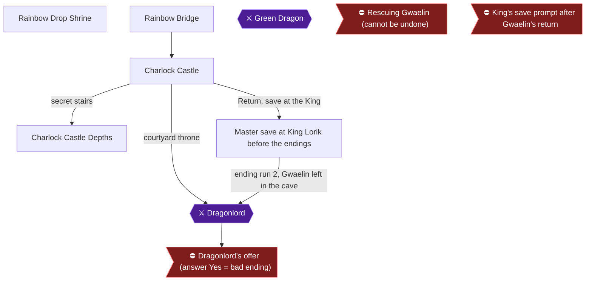

This chapter closes the item hunt. You carry the Stones of Sunlight, the Staff of Rain and Erdrick's Token to the old man south of Rimuldar, who turns them into the Rainbow Drop [[gf2-35-1, gf3-29-8]]. You use the Drop to build the bridge to Charlock [[gf1-25-2, gf5-14-6]]. In Charlock you find the secret stairs behind the throne and then Erdrick's Sword [[gf1-25-3, gf1-25-4]]. Afterwards you return, check your achievements, and make the master save that the three ending runs reload [[ra-comments-3-1]].

**Preparation.**
- Rescuing Gwaelin and fighting the Dragonlord are handled in later chapters. In this chapter, do not interact with the Princess or the Dragonlord [[ra-comments-3-1]]. Gwaelin should still be waiting in the Swamp Cave [[ra-comments-32-2]].
- Erdrick's Armor stops the damage from the barrier floors in Charlock. Without it, each step on them costs over 20 HP [[gf1-8-4, gf3-13-6]].
- The RA guide recommends a level of around 18 or higher before you go to Charlock for the sword [[ra-guide-9-1]]. You also need level 19 or higher before you save [[ra-comments-3-1]].
- Magic Keys are not needed in Charlock. The doors there lead nowhere useful, so do not open them [[gf3-13-4]].
- Keep at least one Magic Key (two is safer) in your inventory when you make the master save. Rescuing Gwaelin in chapters 8 and 10 needs a key for her door, and each run reloads the same save, so the key must already be in it [[gf1-20-6, gf3-9-5, gf3-33-9]].

### Chapter Items to Collect (4 Items Total)
| Item | Where Found | Action / Requirement | Citation |
|---|---|---|---|
| Rainbow Drop | Old man down the stairs south of Rimuldar | **TALK** with the Stones of Sunlight, Staff of Rain and Erdrick's Token in your possession | [[gf2-35-1, ra-guide-4-1]] |
| Rainbow Bridge | The one-tile water gap in the desert northwest of Rimuldar | **USE** the Rainbow Drop from the items menu | [[ra-guide-4-2]] |
| Secret stairs | Directly behind the throne in Charlock Castle | **SEARCH** | [[gf2-11-9, gf5-15-1]] |
| Erdrick's Sword | Chest at the end of the Charlock dungeon path | **TAKE** (Attack 40) | [[gf1-25-4, gf3-13-5, checklist-items-4-7]] |

### Rainbow Drop Shrine

#### From Swamp Cave to Rimuldar

Travel through the Swamp Cave to the southern continent. Walk directly south and go around the intrusion [[gf1-18-12]]. After leaving, go west and then south along the mountains, then east inside the mountain barrier. Rimuldar sits on an island with a desert path leading to it [[gf1-18-13]]. Rimuldar's inn costs 55 gold if you need to heal [[gf1-18-14]].

#### The old man's shrine

From Rimuldar, keep heading south until you reach a bridge. Cross it and circle around the mountains to the hideout [[gf1-25-1]]. Take the stairs down and talk to the old man [[gf5-14-5, gf2-11-7]].

Hand over all three items: the Stones of Sunlight, the Staff of Rain and Erdrick's Token. He combines them into the Rainbow Drop [[gf2-35-1, ra-guide-4-1]]. Without Erdrick's Token he will not give you the Drop [[gf2-31-2]].

### Rainbow Drop


> [!ACHIEVEMENT]
> **Thou Canst Not Have Rainbows Without Reyn (10 Points)**
> 
> *Find the Rainbow Drop*


You now hold the Rainbow Drop, the item that makes the bridge to Charlock [[checklist-items-3-5]]. Erdrick's Token is the proof of your lineage that the old man asks for; without it he will not hand over the Drop [[gf2-31-2]]. Do not use the Drop here. Climb back up the stairs, return north to Rimuldar, and carry it to the water gap described in the next section [[gf1-25-1, gf1-25-2]].

### Rainbow Bridge

Return to Rimuldar and heal. Then walk to the desert northwest of Rimuldar, going to the end of the peninsula [[gf1-25-2, gf3-25-3]]. Stop where the other side of the land is separated by exactly one tile of water [[ra-guide-4-2, gf5-14-6]]. Stand right in front of the channel, open the items menu and select the Rainbow Drop. The water flashes with colors and a bridge appears [[gf2-11-8, gf2-35-2]].


> [!ACHIEVEMENT]
> **Thou Hast Conjured the Magic Bridge (5 Points)**
> 
> *Build the Rainbow Bridge to reach Charlock Fortress!*


> [!TIP]
> Make sure you are standing at the channel before you pick the Drop. After that, cross the bridge and follow the linear path to Charlock Castle [[gf1-25-2]].

### Charlock Castle

🗺️ **Map:** [View Charlock Castle Map by Chiasm](https://www.vgmaps.com/Atlas/NES/DragonWarrior-CharlockCastle.png)

#### Surface: the throne room

Once inside, take the left (west) path and follow it around [[gf1-25-3]]. You will pass barrier floors; with Erdrick's Armor they no longer hurt you [[gf3-13-6, gf1-8-4]]. Continue until you reach the throne in the north-middle of the castle [[gf3-29-13]].

Walk behind the throne, directly behind its middle, and search. A staircase appears [[gf2-11-9, gf5-15-1]]. Go down.


> [!ACHIEVEMENT]
> **Thou Hast Discerned the Truth (5 Points)**
> 
> *Discover the secret stairs in Charlock Castle*


### Charlock Castle Depths

Cast Radiant when you go underground [[gf3-25-4]]. Enemies down here include Armored Knights, Axe Knights, Blue Dragons, Red Dragons and Stonemen [[gf1-36-5, gf1-36-6, gf1-38-8, gf1-39-8]]. A Red Dragon can cast sleep [[gf2-57-2]]. Stonemen are vulnerable to the sleep spell [[gf2-61-2]].

#### Route to Erdrick's Sword

The RA guide gives this route [[ra-guide-9-2]]:
- **0F:** Find the staircase behind the throne and go down.
- **B1F and B2F:** Follow the path to its end. Each floor has only one staircase.
- **B3F:** Take the first path to the left, then up, and keep following it.
- **B4F:** Go to the top right of the map. Stand left of the staircase and go down.
- After that stair, keep following the paths until you arrive at Erdrick's Sword [[ra-guide-9-2]].

A second guide describes the lower part this way: go down a bit, then all the way left and down to the stairway. Then go right and up. Do not take the stairway down. Go back down to the left of where you came up and take the stairs there going up. Keep going up the stairs, and finally go down a flight of stairs to a small boxed-off room [[gf1-25-4]].

A third guide's description matches. Take the northwest road down the stairs. In the new room go north, then east. Pass the stairway leading down and go south on the west side of the wall. Go up the stairway, follow the path and go up the stairs at the end. Go up the next stairs, follow the path, and go down the stairway [[gf3-25-5]]. The route is also given as stairway letters on the map: A, D, K, O, P, N, I, J, then chest 2 [[gf3-12-1]].

> [!TIP]
> On the sixth floor of the castle, the T stairway never ends. If you go down it by accident, walk back up the stairs once to get out of the loop [[gf3-13-7]].

#### Erdrick's Sword

In the boxed-off room, open the chest. It contains **Erdrick's Sword**, which has an Attack Power of 40 [[gf1-25-4, gf2-12-1, gf3-13-5, gf1-42-5]]. It is the only item in that chest [[gf3-13-5]].


> [!ACHIEVEMENT]
> **Thou Hast the Sword of Legend! (10 Points)**
> 
> *Find Erdrick's Sword*


Equip the Sword. It is impossible to defeat the Dragonlord without it [[gf1-43-3]].

> [!WARNING]
> **Achievement Trigger Warning:** On your playthrough, do everything except interact with the Princess or the Dragonlord, then save at the King [[ra-comments-3-1]]. So this trip is only for the Sword: do not continue on toward the Dragonlord and do not talk to him.

### Master save at King Lorik before the endings

#### Return and check

Cast Return to go back to Tantegel Castle [[gf1-26-4]]. If you grind first, keep MP at 14 or above so you can always cast Outside and Return [[gf3-28-2]].

Before you save, check that every achievement from chapters 1-7 is earned. The one exception you may carry forward is the Death Necklace (13397): it is a random roll, and Chapter 9 gives you a last, encounter-free chance to farm it after the Dragonlord falls [[ra-guide-7-7, ra-comments-13-6]]. Check that you have at least one Magic Key for Gwaelin's door [[gf1-20-6, gf3-9-5]]. Also confirm that Gwaelin is still in the Swamp Cave, because you must not interact with her yet [[ra-comments-32-2, ra-comments-2-7]].

Recommended gear for the Dragonlord is level 19/20, Erdrick's Sword and Armor, the Silver Shield and the Fighter's Ring [[gf3-29-14]]. The RA guide says level 20 at minimum is recommended [[ra-guide-5-2]]. A level of 19 or higher is required before you save [[ra-comments-3-1]].

#### The save

Talk to King Lorik and save [[ra-comments-3-1]].

> [!TIP]
> For extra safety, players suggest making a copy of this save, because the princess achievements are missable [[ra-comments-2-2]].

> [!CAUTION]
> **Point of No Return:** This is the master save. Before it you must have every non-ending achievement (the Death Necklace can still be farmed in Chapter 9), Erdrick's Sword, level 19+, at least one Magic Key and Gwaelin still in the Swamp Cave. All three ending runs load this save, so do not overwrite it until chapter 10 [[ra-comments-3-1, ra-comments-32-2, ra-comments-1-4]].

The game does not save when you beat the Dragonlord, so you can repeat the fight from the last save [[ra-comments-1-4]].

> [!IMPORTANT]
> ### Chapter 7 Cumulative 100% Checkpoint
> - **Erdrick's Relics:** 4 / 4 (Tablet, Token, Armor, Sword) [[gf1-25-4]]
> - **Rainbow Drop Ingredients:** 3 / 3, combined into the Rainbow Drop [[gf2-35-1]]
> - **RetroAchievements Unlocked:** 26 / 33 (200 / 310 points)

### Chapter Checklist
- [ ] Stones of Sunlight, Staff of Rain and Erdrick's Token handed to the old man south of Rimuldar
- [ ] Rainbow Drop in hand
- [ ] Rainbow Bridge built at the one-tile water gap
- [ ] Secret stairs found behind the Charlock throne
- [ ] Erdrick's Sword taken from the chest
- [ ] Dragonlord not talked to
- [ ] Gwaelin still in the Swamp Cave
- [ ] Level 19+ reached
- [ ] At least one Magic Key in your inventory for Gwaelin's door
- [ ] Return cast and game saved with King Lorik

---

## Chapter 8: Ending Run 1: Gwaelin at Your Side

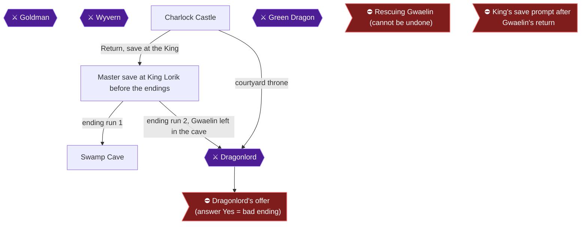

This chapter is the first of the ending runs. You start from the master save made at King Lorik, rescue Princess Gwaelin, carry her across the Rainbow Bridge, speak to the Dragonlord, answer No, defeat both of his forms with Erdrick's Sword, and walk her back to the King. The run covers four achievements: Thine Princess Art Not in Another Castle, Thine Princess By Thine Side, Thou Hast Vanquished the Darkness!, and Thou Hast Triumphed Together [[ra-comments-3-1, ra-guide-2-2, gf1-27-4]].

Recommended level is 20 or higher before challenging the Dragonlord. One source says 20 to 22, and another says 19 or 20 with Erdrick's Sword and Armor, the Silver Shield and the Fighter's Ring equipped [[ra-guide-5-2, gf1-66-8, gf3-29-14]].

> [!WARNING]
> **Missable Achievement Warning:** Thou Hast Triumphed Together (13420) needs Gwaelin carried to Charlock and back to the King. Once she is handed to the King she no longer follows you, so do this run from the master save before any run that returns her [[ra-guide-6-3, ra-comments-32-3, ra-comments-32-8, ra-guide-2-2]]. The princess can be rescued only once, so do not improvise [[ra-comments-1-5]].

> [!WARNING]
> **Missable Achievement Warning:** Thine Princess By Thine Side (13418) triggers when you speak to the Dragonlord while carrying Gwaelin [[ra-guide-6-2, ra-comments-31-1]]. A save made after Gwaelin is returned to the King (at the King's prompt after the thank-you speech) costs you the other princess achievements, so never save at the King during this run [[ra-comments-30-3]]. Do NOT go to the King before Charlock [[ra-comments-2-7, ra-guide-2-1]].

### Swamp Cave

🗺️ **Map:** [View Swamp Cave Map by Chiasm](https://www.vgmaps.com/Atlas/NES/DragonWarrior-SwampCave.png)

Swamp Cave connects the northeast continent to the south island. Entrance a leads to the overworld on the northeast continent and entrance b to the south island. The path from the northeast continent to Princess Gwaelin is A, 1 (the Green Dragon), 2 (the locked door) [[gf3-9-1, gf3-9-2, gf3-9-3]].

Rescuing Gwaelin is optional in general, but this run requires it [[gf5-12-6, gf1-27-4]]. Go in prepared: light the cave with Radiant, heal fully, and bring a Magic Key (they cost 53 gold in Rimuldar) [[gf1-20-4, gf1-19-1, gf2-6-6]].

#### Route to the Green Dragon

From the south entrance, walk straight north to the northern entrance, then go right and down along the right-hand wall. At the barrier, go left a little and through the door; you will run into the Green Dragon [[gf1-20-4]]. Another source says to go east, then weave south without returning to the long western aisle until you reach a small doorway-like opening. Heal there before entering [[gf3-22-5]].

### Green Dragon

The Green Dragon has 65 HP, breathes fire, and gives 45 EXP. Sources differ on its gold (140 or 160) [[gf1-37-9, gf2-53-2, gf3-30-6]].

- **Sleep tactic (recommended):** put it to sleep, heal, attack, repeat. The dragon is susceptible to sleep, and its fire breath does 10-14 HP [[gf1-20-5, gf2-10-6]].
- Alternative: keep hitting with your sword (one guide used the Broad Sword; you now have Erdrick's Sword) and heal. If you are in trouble, run, regroup and try again [[gf1-20-5]].
- Another source says to put it to sleep immediately; if that fails, back out, heal and return. It strikes for 20 to 30, and each of your hits does a little under 10 [[gf3-22-6]].

### Princess Gwaelin

After the dragon falls, go behind where it stood, use a Magic Key on the door, and speak to the princess. Answer Yes when she asks you to take her to the castle (No just gets "But thou must") [[gf1-20-6, gf3-22-7, gf2-11-1, gf3-9-5]].


> [!ACHIEVEMENT]
> **Thine Princess Art Not in Another Castle (10 Points)**
> 
> *Rescue Princess Gwaelin*


Gwaelin now follows you. Do NOT go to the King. Do not die on the way out, since you would have to unlock the door again [[ra-comments-2-7, gf2-11-1]]. Leave the cave toward Rimuldar and the Rainbow Bridge [[gf3-8-6, gf1-18-13]].

### Charlock Castle

🗺️ **Map:** [View Charlock Castle Map by Chiasm](https://www.vgmaps.com/Atlas/NES/DragonWarrior-CharlockCastle.png)

Use the Rainbow Bridge, already built, across the peninsula northwest of Rimuldar, and follow the linear path to Charlock [[gf1-25-2, ra-guide-4-2]]. Run from every enemy inside to conserve HP and MP; the castle holds Axe Knights, Blue Dragons, Red Dragons, Stonemen and others [[gf1-25-6, gf1-36-5, gf1-36-6, gf1-38-8, gf1-39-8]].

Don't open doors with Magic Keys here; they lead nowhere useful. The chests in the courtyard are not worth the detour [[gf3-13-4, gf5-15-1, gf1-25-6]].

#### Surface to the throne

Enter, take the left path around to the throne at the top of the screen, and search directly behind it for the secret staircase [[gf1-25-3, gf2-11-9]]. Barrier floors drain HP unless you wear Erdrick's Armor [[gf3-13-6]].

#### Down to the courtyard

Descend and cast Radiant. Stairway path to the courtyard: A, D, K, O, R, S, * [[gf3-13-1]]. Follow the first two linear paths (the same you took for Erdrick's Sword), then at the intersection head down and left, all the way left, and down the stairs. Go all the way up, then right, down, and back left to the staircase and descend [[gf1-25-6]]. Follow the outside path to the next staircase to reach the courtyard [[gf1-25-6]].

In the courtyard, go all the way left, then up, then right, then down to reach the Dragonlord [[gf3-13-3]].

### Dragonlord

Recommended level 20 or higher. The hardest enemies are avoided by running, so arrive with HP and MP [[ra-guide-5-2, gf1-26-3]].

> [!TIP]
> Make sure Gwaelin is still with you when you talk to him [[ra-guide-6-2, ra-comments-32-8]].

Speak to the Dragonlord while carrying Gwaelin.


> [!ACHIEVEMENT]
> **Thine Princess By Thine Side (10 Points)**
> 
> *Bring Princess Gwaelin to the Dragonlord!*


He offers to share the world. The cursor starts on Yes, and mashing A can accept by accident. Choose NO. Yes ends the run with the bad ending [[ra-comments-26-1, gf1-26-7, ra-guide-5-1, gf2-13-1]].

#### Form 1

The first form is a weak mage with low defense and HP; he casts Stopspell and Hurtmore. Use sword attacks only, since attack magic fails on both forms, and kill him quickly [[ra-guide-5-3, gf5-15-4, gf1-26-1]].

#### Form 2 (true dragon)

The second form is stronger. He has roughly 130 HP and breathes fire for 20+ damage, frequently, so keep HP above 50 [[gf5-15-4, gf1-26-2]]. Magic doesn't work on him, but healing does: cast Healmore when HP drops below 40 and otherwise attack. Don't cast anything but Healmore [[gf3-26-5, gf2-13-2]]. Erdrick's Sword is required for the fight [[gf1-43-3]].

> [!CAUTION]
> **Point of No Return:** Defeating the Dragonlord is never saved, and returning to the castle plays the ending [[ra-comments-1-4]]. After he dies random encounters stop and inns no longer restore MP [[ra-comments-13-6, ra-comments-14-3]]. Do your remaining healing before the killing blow, and reset and load the master save for the next run afterward.

When he falls you receive the Ball of Light and are placed outside Charlock [[gf1-26-3, checklist-items-3-8]].


> [!ACHIEVEMENT]
> **Thou Hast Vanquished the Darkness! (25 Points)**
> 
> *Defeat the Dragonlord!*


### The walk home

Cast Return to Tantegel Castle, keeping Gwaelin with you ("in tow" means she is following you) [[gf1-26-4, ra-comments-32-8]]. Walk in and speak to the King, who waits near the throne room stairs, while Gwaelin is still following. Decline his offer to take his place and say Yes to Gwaelin traveling with you [[gf1-26-3, gf2-13-1]].


> [!ACHIEVEMENT]
> **Thou Hast Triumphed Together (25 Points)**
> 
> *Beat the Dragonlord and return to the castle with Gwaelin in tow*


> [!TIP]
> After the credits, reset and load the master save for the next run. The victory itself is never saved, so the master save still has the Dragonlord alive and Gwaelin in the Swamp Cave [[ra-comments-1-4, ra-comments-3-1]].

> [!TIP]
> Before you leave: confirm all four achievements popped, then reset and reload the master save made before the endings [[ra-comments-3-1, ra-guide-2-2]].

> [!IMPORTANT]
> ### Chapter 8 Cumulative 100% Checkpoint
> - **Erdrick's Relics:** 4 / 4
> - **Rainbow Drop Ingredients:** 3 / 3
> - **Gwaelin this run:** rescued, carried to the Dragonlord and walked home after his defeat. Gwaelin's Love is given when you return her to the King in the throne room, which this route does in Chapter 10 [[gf1-20-7]]
> - **RetroAchievements Unlocked:** 30 / 33 (270 / 310 points)

### Chapter Checklist

- [ ] Started from the master save, did not visit the King beforehand
- [ ] Green Dragon defeated, door opened with a Magic Key, Gwaelin agreed (13416)
- [ ] Spoke to the Dragonlord with Gwaelin following (13418)
- [ ] Answered No to the offer
- [ ] Both Dragonlord forms defeated (13414)
- [ ] Returned to the King with Gwaelin in tow (13420)
- [ ] Reset and reloaded the master save; did not save after the ending

---

## Chapter 9: Ending Run 2: Without the Princess

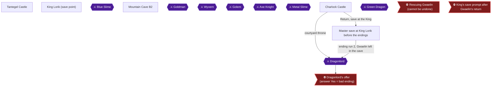

This run earns **Thou Art a Jerk to Women**: beat the Dragonlord and return to the castle without saving Gwaelin [[ra-guide-5-4, gf5-12-6]]. Start from the master save you made at King Lorik before the endings, with Gwaelin still sitting in the Swamp Cave. You will walk to Charlock, refuse the Dragonlord's offer, win the fight, and go home to the King alone [[ra-comments-3-1, ra-comments-32-4]].

> [!WARNING]
> **Missable Achievement Warning:** This achievement is only possible on a save where Gwaelin was never rescued. Do NOT go to Gwaelin in the cave, since nothing from her is needed to finish the game [[ra-comments-28-2]]. If she has already been rescued on the file you are using, the only way to earn this is to start a brand new game [[ra-comments-28-3]]. Play this run from the master save made at the King and do not save again after talking to her [[ra-guide-2-1, ra-comments-3-1]].

### Preparation

- Reload the master save at King Lorik. The King is where you save at any point in the quest [[gf1-10-3, ra-comments-1-3]].
- You need Erdrick's Sword to beat the Dragonlord [[gf1-43-3]], and the guides recommend at least level 20 [[ra-guide-5-2, gf1-25-5]]. Radiant (learned at level 9) lights caves in place of torches [[gf3-20-1]].
- Dying costs you half your gold, and you restart from the castle [[gf1-65-4]]. If that happens, reset and reload the master save rather than continuing.
- Keep MP at 14 or above during the Charlock trips, which is enough to cast Outside and Return [[gf3-28-2]]. Return costs 8 MP and Outside costs 6 MP [[checklist-items-7-7]].
- The old man behind the desk in the southeast corner of Tantegel Castle refills your MP for free [[gf1-16-2, gf1-65-6]].

> [!TIP]
> Death Necklace (achievement 13397) check: if you still lack it, do the Mountain Cave farm in the next section before you walk back to the King. Whether a full inventory blocks the necklace is unconfirmed, because RA players disagree [[ra-comments-13-2, ra-comments-12-7, ra-comments-14-10]]. Keep at least one inventory slot free on every attempt. Whether entering without a torch or Radiant raises the odds is also unconfirmed [[ra-comments-10-1, ra-comments-10-2, ra-comments-11-13]]. Treat the chest as a 1/32 roll [[ra-comments-10-3, ra-comments-2-1]], light the cave normally and repeat the trip.

### Tantegel Castle

🗺️ **Map:** [View Tantegel Castle Map by Chiasm](https://www.vgmaps.com/Atlas/NES/DragonWarrior-TantegelCastle.png)

1. Load the master save and start from the throne room. King Lorik is the only person who saves your game [[gf1-7-2, gf1-10-3]].
2. If your MP is low, go to the old man in the southeast corner behind the desk and talk to him [[gf1-16-2]].
3. Walk out of the castle and head for Rimuldar and the Swamp Cave. Do not enter the locked cell where Gwaelin is. You only need to pass through the cave to reach the south island [[gf1-20-6, ra-comments-28-1]].
4. The route to Charlock is Swamp Cave, then Rimuldar, then the Rainbow Bridge on the peninsula northwest of Rimuldar [[gf1-25-2, gf3-25-3]]. The bridge is already built if you made the master save after finishing the preparation steps. Unable to verify from collected sources whether it persists in your save.

### Charlock Castle

🗺️ **Map:** [View Charlock Castle Map by Chiasm](https://www.vgmaps.com/Atlas/NES/DragonWarrior-CharlockCastle.png)

Enemies here include Axe Knights, Blue Dragons, Red Dragons, and Stonemen. They are tough and the guide advises running to conserve HP and MP [[gf1-36-5, gf1-36-6, gf1-38-8, gf1-39-8, gf1-25-6]]. Cast Radiant in the dungeon, or use a torch to save MP [[gf1-25-6, gf2-12-1]].

#### Surface and secret stairs

1. Enter and take the left path around to the throne at the top of the screen [[gf1-25-3]].
2. Step behind the throne and search to reveal the secret staircase, then go down [[gf1-25-3, gf2-11-9]].
3. Barrier floors drain HP unless you wear Erdrick's Armor [[gf3-13-6]].

#### Route to the courtyard

1. Take the first two linear paths down, the same ones used to reach Erdrick's Sword [[gf1-25-6]].
2. At the intersection head down and left, go all the way left, then down, and take the stairs. Go up, then right, then down, then back left to the staircase and descend [[gf1-25-6]].
3. In the guide's map notation the route is A, D, K, O, R, S, * [[gf3-13-1]]. Stairway * leads to the courtyard [[gf3-13-2]].
4. On the sixth floor the T stairway loops. If you take it by mistake, go up once to escape [[gf3-13-7]].
5. In the courtyard, take the left path, go up and follow the paths around, ignoring the chests. Go all the way left, then up, then right, then down to reach the Dragonlord [[gf1-25-6, gf3-13-3]].

> [!WARNING]
> **Achievement Trigger Warning:** Talk to the Dragonlord and answer **No**. "Yes" is the default option, so do not mash A [[ra-comments-26-1]]. Answering yes twice kills you [[gf1-26-7, gf3-26-4]] and the guide says that ruins the run [[gf2-13-1]]. Accepting gives the bad-ending achievement 13415, but that is saved for Chapter 10. Here it would end the run before 13419 and waste the trip.

#### Dragonlord fight

- He offers to share half the world; answer No and he calls you a fool and the fight begins [[gf1-26-1, gf2-13-1]].
- The first form is a human-shaped mage. It has low defense and HP, so kill it quickly [[ra-guide-5-3]]. It casts Stopspell and Hurtmore [[gf5-15-4]]. Use sword attacks, since attack magic fails against both forms [[gf1-26-1]].
- The true dragon form has about 130 HP, breathes fire for around 20+ damage, and drops the Ball of Light on defeat [[gf5-15-4]]. Magic does not work on it, but you can heal [[gf3-26-5]].
- Keep HP above 50, because he breathes fire often [[gf1-26-2]]. Cast Healmore when HP drops below 40; otherwise attack [[gf3-26-5]]. Healmore is the only spell the guide advises in this fight [[gf2-13-2]].
- Winning gives the Ball of Light [[gf1-26-3]]. You are then placed outside Charlock [[gf1-26-4]].

### Mountain Cave B2 (optional Death Necklace farm)

🗺️ **Map:** [View Mountain Cave Map by Chiasm](https://www.vgmaps.com/Atlas/NES/DragonWarrior-MountainCave.png)

Do this only if 13397 is still missing. The Cursed (Death) Necklace sits at random in the B2 chest that normally holds 100-130 gold [[gf2-40-4, ra-guide-8-3]]. The cave is reached from the bridge south of Garinham: head south to the bottom, go right, and take the top route where mountains split the path [[gf1-17-3]].

**Why now:** with the Dragonlord dead, random encounters stop [[ra-comments-13-6, ra-comments-14-2]]. Inns no longer restore MP because the NPCs rejoice over your victory [[ra-comments-14-3]].

**Route to the chest:**

1. B1F: go up to the stairs, ignore the first stairway, go right, take the first path down, and follow it to the staircase [[ra-guide-8-2, gf3-19-9]].
2. B2F: the necklace chest is the solitary one in the far southwest, reached by going to the southwest and then up [[ra-guide-8-4, ra-comments-12-2]]. It is the down-and-left chest on the second level, not the first chest below the stairs [[ra-comments-14-11]]. The guides' chest numbering is mixed up, with chests 4 and 5 swapped [[ra-comments-12-5]]. Look for the 100+ gold chest [[ra-comments-11-1, ra-comments-11-11]].
3. A torch chest elsewhere on B2 respawns every time you re-enter [[ra-comments-11-5, gf3-8-3]].

**Loop:**

1. Enter the cave, take the torch, then open the gold/necklace chest [[ra-comments-11-3]].
2. Cast Outside to leave, then re-enter. Chests reappear when you leave [[gf1-18-7, ra-comments-10-5]].
3. If MP runs out, keep grabbing the torch from the B2 chest on each attempt [[ra-comments-14-5, ra-comments-13-1]].
4. The chance is 1/32 per trip. One commenter gave P = 1 - 0.96875^N for the chance after N attempts [[ra-comments-11-14]]. Reports range from a few trips to over 200 [[ra-comments-11-9, ra-comments-10-6]].
5. Sell or avoid equipping the necklace, since it is cursed and you cannot enter Tantegel Castle while cursed [[gf1-47-2, gf1-66-6]].

Once you have it, use Return to go home [[checklist-items-7-7, gf1-26-4]].

### Tantegel Castle (finishing the run)

1. Cast Return, or Wings, to reach Tantegel Castle [[gf1-26-4, checklist-items-2-6]].
2. Walk in and talk to King Lorik near the stairs to the throne room. He asks you to take over the land, and you decline [[gf1-26-5]].
3. Do not have Gwaelin with you. Unlock requires returning to the castle after defeating the Dragonlord without saving her [[ra-guide-5-4]].


> [!ACHIEVEMENT]
> **Thou Art a Jerk to Women (25 Points)**
> 
> *Beat the Dragonlord and return to the castle without saving Gwaelin*


Gwaelin only asks to join you if she was rescued, so do not expect that scene here. After the achievement, reset and load the master save for the next run [[ra-comments-3-1]].

> [!TIP]
> Before you leave: confirm 13419 popped, and that you did not save over the master file. If you farmed the necklace, check it is in your item list for 13397.

### Chapter Checklist

- [ ] Loaded the master save with Gwaelin unrescued
- [ ] Answered No to the Dragonlord and defeated both forms
- [ ] Death Necklace obtained (if still missing)
- [ ] Returned to the King without Gwaelin: Thou Art a Jerk to Women
- [ ] Reset and reloaded the master save

> [!IMPORTANT]
> ### Chapter 9 Cumulative 100% Checkpoint
> - **Erdrick's Relics:** 4 / 4 [[gf1-25-4]]
> - **Rainbow Drop Ingredients:** 3 / 3 [[gf2-35-1]]
> - **RetroAchievements Unlocked:** 31 / 33 (295 / 310 points)

---

## Chapter 10: Ending Run 3: Gwaelin Home and the Dragonlord's Offer

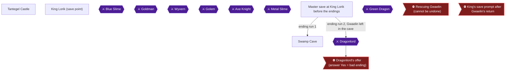

This is the last ending run. Load the master save made at King Lorik before the endings, rescue Princess Gwaelin from the Green Dragon in the Swamp Cave, carry her to King Lorik for Gwaelin's Love, and then go to Charlock and accept the Dragonlord's offer. The community order for this run is "get the princess, bring her to the king, then accept the Dragonlord's offer" [[ra-comments-32-5, ra-comments-3-1]]. Two achievements are earned here: **Thine Princess Returned to Her Sire** (13417) and **Thou Art a Fool** (13415).

The princess can be rescued only once per save, which is why this run comes last [[ra-comments-1-5]]. Rescuing her is also optional for finishing the game, which is why the earlier runs could skip her [[gf5-12-6]].

Suggested level for the Green Dragon fight is about level 12 or 13 [[gf1-20-4]]. One guide recommends level 12 and was on 13 [[gf1-20-7]]. Your master save should already be well above that, because the Dragonlord is recommended at level 20 or higher [[ra-guide-5-2]].

> [!TIP]
> Bring Magic Keys. The door to the princess needs one, and a key disappears when used [[gf3-9-5, gf1-62-13]]. If you are short, Magic Keys cost 53 gold in Rimuldar and 85 gold in Tantegel Castle [[gf2-34-2]].

### Swamp Cave

🗺️ **Map:** [View Swamp Cave Map by Chiasm](https://www.vgmaps.com/Atlas/NES/DragonWarrior-SwampCave.png) [[map-swamp-cave-1-1]]

The Swamp Cave connects the two continents. Its north entrance (a) opens onto the Northeast Continent and its south entrance (b) onto the South Island [[gf3-9-2, gf3-9-3, ra-comments-28-1]]. The princess is held in this cave behind the Green Dragon [[gf1-18-11]].

You do not need Radiant just to cross the cave [[gf3-20-1]], but for the rescue, cast Radiant once inside to light the area [[gf3-22-5]]. The route to the princess from the Northeast Continent entrance is: entrance a, then the Green Dragon (1), then the door (2) [[gf3-9-1]].

#### Reaching the Green Dragon

- **From the north entrance:** go east, then weave south without returning to the long aisle on the west, until you reach a small doorway-like opening. Heal up before entering [[gf3-22-5]].
- **If you come in from the south entrance instead:** walk straight north until you hit the northern entrance, then go right and down, hugging the right-hand wall. When you hit a barrier, go left a bit and go through the door; the Green Dragon is there [[gf1-20-4]].

#### Boss: Green Dragon

| Detail | Info | Citation |
|---|---|---|
| HP | 65 | [[gf2-53-2]] |
| Rewards | 45 EXP, 140 gold (another guide lists 160 gold) | [[gf2-53-2, gf3-30-6]] |
| Damage | Hits for 20 to 30; fire breath does 10 to 14 | [[gf3-22-6, gf2-10-6]] |

Strategy options from the sources:

- Heal yourself fully before stepping in [[gf3-22-5]].
- Put him to sleep first, then attack. If sleep does not work, back out, heal, and return [[gf3-22-6]]. The dragon is susceptible to sleep [[gf2-10-6]].
- Alternatively, skip sleep and keep hitting with the Broadsword while healing [[gf1-20-5]].
- If you get in trouble, run away and regroup. Kol to the north and Rimuldar to the south are both usable for healing [[gf1-20-5]].
- If he gets the first hit, run, heal, and return [[gf3-22-6]].

### Princess Gwaelin

After the Green Dragon falls, walk around to the south of where he stood and use a Magic Key on the door [[gf3-22-7, gf1-20-6]]. Speak to the princess. She asks whether you will take her to the castle. Answer **Yes**; if you say no she answers "But thou must" and asks again [[gf1-20-6, gf3-22-7]].

> [!WARNING]
> Be careful not to die on the way back. If you do, you must unlock the door again and waste a key [[gf2-11-1]].

The simplest way back is the Outside spell to leave the Swamp Cave, then Return to reach the castle [[gf1-20-6]]. Return costs 8 MP [[checklist-items-7-7]]. Wings (70 gold) also take you to Tantegel Castle [[checklist-items-2-6]].

### Tantegel Castle

🗺️ **Map:** [View Tantegel Castle Map by Chiasm](https://www.vgmaps.com/Atlas/NES/DragonWarrior-TantegelCastle.png) [[map-tantegel-castle-1-1]]

Go to the throne room and talk to King Lorik [[gf1-20-7]]. Do not stop to save or talk to anyone else before this, since the aim is simply to deliver her.

#### Gwaelin's Love

The King says: "Forever shall I be grateful for the gift of my daughter returned to her home." Gwaelin then whispers to her father and gives you her love [[gf1-20-7, gf1-63-2]].


> [!ACHIEVEMENT]
> **Thine Princess Returned to Her Sire (10 Points)**
> 
> *Return Princess Gwaelin to the King*


Community reports say this achievement triggers when you receive Gwaelin's Love, and that it did not unlock together with Thou Hast Triumphed Together [[ra-comments-30-1]]. Be patient with the dialogue and let the speech finish.

Gwaelin's Love shows your coordinates on the world map and tells you how many experience points you need for the next level [[gf1-20-8]].

#### King's save prompt after Gwaelin's return

Directly after the thank-you speech, the King asks whether you want to save [[ra-comments-30-2]].

> [!CAUTION]
> **Point of No Return:** Saving at the King's prompt after Gwaelin's return would normally block reloading to earn the other princess achievements, forcing a second playthrough [[ra-comments-30-3]]. This is the last run, so it no longer matters, and a commenter confirms you can save after returning the princess if you wish [[ra-comments-32-6, ra-comments-30-2]]. It is easy to hit Yes accidentally while scrolling text [[ra-comments-30-3]]; either answer is fine on this run.

Optional castle extras the sources mention, in case you want them: the old man behind the desk in the southeast corner restores your MP [[gf1-16-2]], and Magic Keys are sold behind a locked door for 85 gold [[gf1-21-1]].

### Dragonlord's offer (answer Yes = bad ending)

Travel to Charlock Castle and descend to the Dragonlord. Per the Charlock stair notes, the final stairway leads to the courtyard, and from there you go all the way left, then up, then right, then down to reach him [[gf3-13-3]]. Talk to him [[gf2-13-1]].

He says: "I give thee now a chance to share this world and to rule half of it if thou will now stand beside me. What sayest thou? Will the great warrior stand with me?" [[gf1-26-7]]

> [!CAUTION]
> **Point of No Return:** The default answer to the Dragonlord's offer is Yes, and mashing A through his speech accepts it by accident [[ra-comments-26-1]]. Answering Yes ends the game [[gf1-26-7, gf5-15-3, ra-guide-5-1]]. In this chapter that is exactly what you want, but it must be a deliberate choice, and only after Gwaelin's Love is done. You answered No in chapters 8 and 9.

Choose **Yes**. He will ask "Really?" and you answer Yes again. He then says that half the world is yours, the screen turns red, and he declares your journey over [[gf1-26-7]]. Another guide notes that he says you made the right choice and then kills you [[gf3-26-4]].


> [!ACHIEVEMENT]
> **Thou Art a Fool (5 Points)**
> 
> *Accept the Dragonlord's offer*


The achievement is for accepting the offer; accepting it triggers the bad ending [[ra-guide-5-1]]. Nothing in the sources requires fighting the Dragonlord in this run.

### Before you leave

> [!TIP]
> Before you leave: confirm that 13417 unlocked when Gwaelin gave you her love [[ra-comments-30-1]], and only then walk to the Dragonlord. Once you accept his offer, 13415 unlocks and the game ends [[ra-guide-5-1]].

> [!IMPORTANT]
> ### Chapter 10 Cumulative 100% Checkpoint
> - **RetroAchievements Unlocked:** 33 / 33 (310 / 310 points)
> - **Erdrick's Relics:** 4 / 4
> - **Rainbow Drop Ingredients:** 3 / 3
> - **This chapter:** Princess Gwaelin returned to King Lorik [[gf1-20-7]]; Dragonlord's offer accepted [[gf1-26-7]]

### Chapter Checklist

- [ ] Load the master save made at King Lorik before the endings
- [ ] Defeat the Green Dragon in the Swamp Cave
- [ ] Unlock the door with a Magic Key and say Yes to Gwaelin
- [ ] Bring Gwaelin to King Lorik and receive Gwaelin's Love (13417)
- [ ] Optionally save at the King's prompt (safe on this last run)
- [ ] Travel to Charlock and talk to the Dragonlord
- [ ] Answer Yes, twice, to his offer (13415)

---

## Final Checklist

**1. Tantegel Castle and the First Slimes**

- [ ] 🏆 Thou Hast Escapth the King's Chamber
- [ ] 🏆 Thou Hast Gained A Level
- [ ] 🏆 Thou Hast Defeated the Slime
- [ ] 🏆 Thou Hast Learnt a Spell

**2. Erdrick's Cave and Garinham**

- [ ] 🏆 Thou Hast Learnt of Thy Quest

**3. The Mountain Cave**

- [ ] 🏆 Thou Art a Fighter, Not a Lover
- [ ] 🏆 Thou Hast a Death Wish
- [ ] 🏆 Thou Hast No Need for Torches

**4. Kol, the Swamp Cave and Rimuldar**

- [ ] 🏆 Thou Art the Pied Piper
- [ ] 🏆 Thou Hast Defeated the Goldman
- [ ] 🏆 Thou Hast Defeated the Y BURN
- [ ] 🏆 Thou Hast Seen Sunlight
- [ ] ⛔ Everything above is done before: Rescuing Princess Gwaelin

**5. Stones of Sunlight, Garin's Grave and the Staff of Rain**

- [ ] 🏆 Thou Hast Harnessed the Sun
- [ ] 🏆 Thou Hast Discovered Thine Inner Bard
- [ ] 🏆 Thou Hast Gained Weight
- [ ] 🏆 Thou Hast Acquired the Song of Storms
- [ ] 🏆 Thou Hast Acquired Body Odor

**6. Cantlin, Erdrick's Token and Hauksness**

- [ ] 🏆 Thou Hast Unearthed a Peaty Sigil
- [ ] 🏆 Thou Hast Hefted a Heavy Burden!
- [ ] 🏆 Thou Hast the Armor of Legend!
- [ ] 🏆 Thou Hast Defeated the Metal Slime
- [ ] 🏆 Thou Hast Acquired All Spells

**7. The Rainbow Bridge, Charlock Castle and the Master Save**

- [ ] 🏆 Thou Canst Not Have Rainbows Without Reyn
- [ ] 🏆 Thou Hast Conjured the Magic Bridge
- [ ] 🏆 Thou Hast Discerned the Truth
- [ ] 🏆 Thou Hast the Sword of Legend!
- [ ] ⛔ Everything above is done before: Master save before the endings

**8. Ending Run 1: Gwaelin at Your Side**

- [ ] ⚠ Thou Hast Triumphed Together: beat the Dragonlord with Gwaelin in tow (before: Needs Gwaelin carried to Charlock. Once she is handed to the King (Gwaelin's Love) she no longer follows you, so do this run (chapter 8) from the master save before any run that returns her.)
- [ ] ⚠ Thine Princess By Thine Side: bring Gwaelin to the Dragonlord (before: Speak to the Dragonlord while carrying Gwaelin, in the chapter 8 run from the master save. Missed for good if a save is made after Gwaelin is returned to the King (ra-comments-30-3).)
- [ ] 🏆 Thine Princess Art Not in Another Castle
- [ ] 🏆 Thine Princess By Thine Side
- [ ] 🏆 Thou Hast Vanquished the Darkness!
- [ ] 🏆 Thou Hast Triumphed Together
- [ ] ⛔ Everything above is done before: Defeating the Dragonlord

**9. Ending Run 2: Without the Princess**

- [ ] ⚠ Thou Art a Jerk to Women: beat the Dragonlord and return without saving Gwaelin (before: Only possible on a save where Gwaelin was never rescued. Do not rescue her before the master save (chapter 7); play this run from that save (chapter 9).)
- [ ] 🏆 Thou Art a Jerk to Women

**10. Ending Run 3: Gwaelin Home and the Dragonlord's Offer**

- [ ] 🏆 Thine Princess Returned to Her Sire
- [ ] 🏆 Thou Art a Fool
- [ ] ⛔ Everything above is done before: The Dragonlord's offer
- [ ] ⛔ Everything above is done before: King's save prompt after Gwaelin's return

## 100% Completion Verification Checklist

All 33 achievements (310 points).

| ✔ | Achievement | Points | Type | Chapter |
|---|---|---|---|---|
| ☐ | **Thou Hast Escapth the King's Chamber** — Use the Magic Key and open the door to the King's Chamber | 5 | progression | [1](#chapter-1-tantegel-castle-and-the-first-slimes) |
| ☐ | **Thou Hast Learnt of Thy Quest** — Find Erdrick's Tablet | 10 |  | [2](#chapter-2-erdricks-cave-and-garinham) |
| ☐ | **Thou Art the Pied Piper** — Find the Fairy Flute | 10 |  | [4](#chapter-4-kol-the-swamp-cave-and-rimuldar) |
| ☐ | **Thou Art a Fighter, Not a Lover** — Find the Fighter's Ring | 10 |  | [3](#chapter-3-the-mountain-cave) |
| ☐ | **Thou Hast a Death Wish** — Find the Death Necklace | 10 |  | [3](#chapter-3-the-mountain-cave) |
| ☐ | **Thou Hast Discovered Thine Inner Bard** — Find the Silver Harp | 10 | progression | [5](#chapter-5-stones-of-sunlight-garins-grave-and-the-staff-of-rain) |
| ☐ | **Thou Hast Gained Weight** — Find the Cursed Belt | 10 |  | [5](#chapter-5-stones-of-sunlight-garins-grave-and-the-staff-of-rain) |
| ☐ | **Thou Hast Harnessed the Sun** — Find the Stones of Sunlight | 10 | progression | [5](#chapter-5-stones-of-sunlight-garins-grave-and-the-staff-of-rain) |
| ☐ | **Thou Hast Acquired the Song of Storms** — Find the Staff of Rain | 10 | progression | [5](#chapter-5-stones-of-sunlight-garins-grave-and-the-staff-of-rain) |
| ☐ | **Thou Hast the Armor of Legend!** — Find Erdrick's Armor | 10 |  | [6](#chapter-6-cantlin-erdricks-token-and-hauksness) |
| ☐ | **Thou Hast Unearthed a Peaty Sigil** — Find Erdrick's Token | 10 | progression | [6](#chapter-6-cantlin-erdricks-token-and-hauksness) |
| ☐ | **Thou Hast Hefted a Heavy Burden!** — Find the Silver Shield | 10 |  | [6](#chapter-6-cantlin-erdricks-token-and-hauksness) |
| ☐ | **Thou Canst Not Have Rainbows Without Reyn** — Find the Rainbow Drop | 10 | progression | [7](#chapter-7-the-rainbow-bridge-charlock-castle-and-the-master-save) |
| ☐ | **Thou Hast Conjured the Magic Bridge** — Build the Rainbow Bridge to reach Charlock Fortress! | 5 | progression | [7](#chapter-7-the-rainbow-bridge-charlock-castle-and-the-master-save) |
| ☐ | **Thou Hast Discerned the Truth** — Discover the secret stairs in Charlock Castle | 5 | progression | [7](#chapter-7-the-rainbow-bridge-charlock-castle-and-the-master-save) |
| ☐ | **Thou Hast the Sword of Legend!** — Find Erdrick's Sword | 10 |  | [7](#chapter-7-the-rainbow-bridge-charlock-castle-and-the-master-save) |
| ☐ | **Thou Art a Fool** — Accept the Dragonlord's offer | 5 |  | [10](#chapter-10-ending-run-3-gwaelin-home-and-the-dragonlords-offer) |
| ☐ | **Thou Hast Vanquished the Darkness!** — Defeat the Dragonlord! | 25 | win_condition | [8](#chapter-8-ending-run-1-gwaelin-at-your-side) |
| ☐ | **Thou Art a Jerk to Women** — Beat the Dragonlord and return to the castle without saving Gwaelin | 25 | missable | [9](#chapter-9-ending-run-2-without-the-princess) |
| ☐ | **Thine Princess Art Not in Another Castle** — Rescue Princess Gwaelin | 10 |  | [8](#chapter-8-ending-run-1-gwaelin-at-your-side) |
| ☐ | **Thine Princess Returned to Her Sire** — Return Princess Gwaelin to the King | 10 |  | [10](#chapter-10-ending-run-3-gwaelin-home-and-the-dragonlords-offer) |
| ☐ | **Thine Princess By Thine Side** — Bring Princess Gwaelin to the Dragonlord! | 10 | missable | [8](#chapter-8-ending-run-1-gwaelin-at-your-side) |
| ☐ | **Thou Hast Triumphed Together** — Beat the Dragonlord and return to the castle with Gwaelin in tow | 25 | missable | [8](#chapter-8-ending-run-1-gwaelin-at-your-side) |
| ☐ | **Thou Hast Defeated the Slime** — Defeat the trademark Blue Slime! | 5 |  | [1](#chapter-1-tantegel-castle-and-the-first-slimes) |
| ☐ | **Thou Hast Defeated the Goldman** — Defeat the Goldman (and get rich)! | 5 |  | [4](#chapter-4-kol-the-swamp-cave-and-rimuldar) |
| ☐ | **Thou Hast Defeated the Y BURN** — Defeat the wyvern! | 5 |  | [4](#chapter-4-kol-the-swamp-cave-and-rimuldar) |
| ☐ | **Thou Hast Defeated the Metal Slime** — Defeat the evasive Metal Slime! | 5 |  | [6](#chapter-6-cantlin-erdricks-token-and-hauksness) |
| ☐ | **Thou Hast Gained A Level** — Reach Level 2 | 5 | progression | [1](#chapter-1-tantegel-castle-and-the-first-slimes) |
| ☐ | **Thou Hast Learnt a Spell** — Reach Level 3 | 5 | progression | [1](#chapter-1-tantegel-castle-and-the-first-slimes) |
| ☐ | **Thou Hast No Need for Torches** — Reach Level 9 | 5 |  | [3](#chapter-3-the-mountain-cave) |
| ☐ | **Thou Hast Seen Sunlight** — Reach Level 12 | 5 |  | [4](#chapter-4-kol-the-swamp-cave-and-rimuldar) |
| ☐ | **Thou Hast Acquired Body Odor** — Reach Level 15 | 5 |  | [5](#chapter-5-stones-of-sunlight-garins-grave-and-the-staff-of-rain) |
| ☐ | **Thou Hast Acquired All Spells** — Reach Level 19 | 10 |  | [6](#chapter-6-cantlin-erdricks-token-and-hauksness) |

## Sources

This guide was built only from these sources:

- **RetroAchievements** — Dragon Quest — RetroAchievements community comments: [link](https://retroachievements.org/game/1471)
- **RetroAchievements Guides Wiki** — Dragon Warrior (NES): [link](https://github.com/RetroAchievements/guides/wiki/Dragon-Warrior-(NES))
- **GameFAQs** — Guide and Walkthrough by CMoriarty: [link](https://gamefaqs.gamespot.com/nes/563408-dragon-warrior/faqs/10739)
- **GameFAQs** — Guide and Walkthrough by PsychoPenguin: [link](https://gamefaqs.gamespot.com/nes/563408-dragon-warrior/faqs/11382)
- **GameFAQs** — Guide and Walkthrough by SykoBadger: [link](https://gamefaqs.gamespot.com/nes/563408-dragon-warrior/faqs/2991)
- **GameFAQs** — Item/Magic/Armor/Weapon FAQ by FFMrebirth: [link](https://gamefaqs.gamespot.com/nes/563408-dragon-warrior/faqs/27862)
- **GameFAQs** — Guide and Walkthrough by FFMrebirth: [link](https://gamefaqs.gamespot.com/nes/563408-dragon-warrior/faqs/24483)
- **VGMaps** — Alefgard Map by Rick Bruns: [link](https://www.vgmaps.com/Atlas/NES/DragonWarrior-Alefgard.png)
- **VGMaps** — Tantegel Castle Map by Chiasm: [link](https://www.vgmaps.com/Atlas/NES/DragonWarrior-TantegelCastle.png)
- **VGMaps** — Brecconary Map by Chiasm: [link](https://www.vgmaps.com/Atlas/NES/DragonWarrior-Brecconary.png)
- **VGMaps** — Cantlin Map by Chiasm: [link](https://www.vgmaps.com/Atlas/NES/DragonWarrior-Cantlin.png)
- **VGMaps** — Erdrick's Cave Map by Chiasm: [link](https://www.vgmaps.com/Atlas/NES/DragonWarrior-Erdrick'sCave.png)
- **VGMaps** — Garinham Map by Chiasm: [link](https://www.vgmaps.com/Atlas/NES/DragonWarrior-Garinham.png)
- **VGMaps** — Garinham Garin's Grave Map by Chiasm: [link](https://www.vgmaps.com/Atlas/NES/DragonWarrior-Garinham-Garin'sGrave.png)
- **VGMaps** — Hauksness Map by Chiasm: [link](https://www.vgmaps.com/Atlas/NES/DragonWarrior-Hauksness.png)
- **VGMaps** — Kol Map by Chiasm: [link](https://www.vgmaps.com/Atlas/NES/DragonWarrior-Kol.png)
- **VGMaps** — Mountain Cave Map by Chiasm: [link](https://www.vgmaps.com/Atlas/NES/DragonWarrior-MountainCave.png)
- **VGMaps** — Rimuldar Map by Chiasm: [link](https://www.vgmaps.com/Atlas/NES/DragonWarrior-Rimuldar.png)
- **VGMaps** — Staff Of Rain Cave&Magic Temple Map by Chiasm: [link](https://www.vgmaps.com/Atlas/NES/DragonWarrior-StaffOfRainCave&MagicTemple.png)
- **VGMaps** — Swamp Cave Map by Chiasm: [link](https://www.vgmaps.com/Atlas/NES/DragonWarrior-SwampCave.png)
- **VGMaps** — Charlock Castle Map by Chiasm: [link](https://www.vgmaps.com/Atlas/NES/DragonWarrior-CharlockCastle.png)

Verification: 355 verified · 992 single-source · 0 resolved conflicts · 5 rejected facts.
