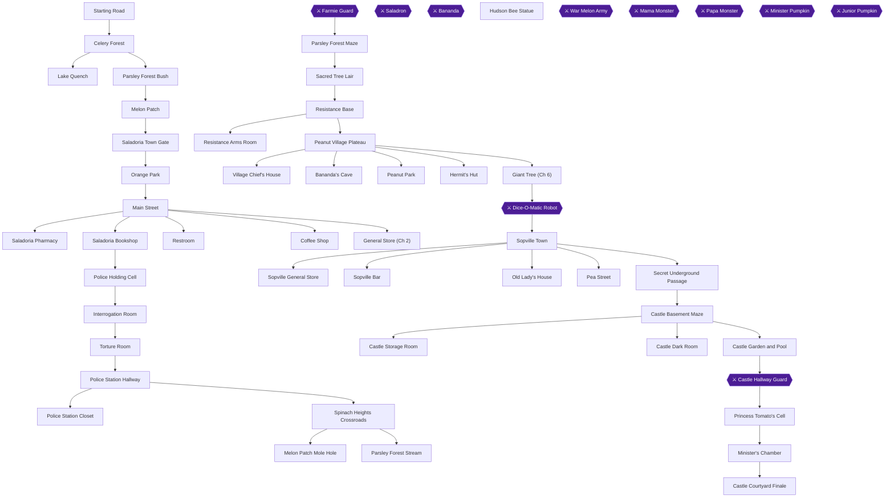
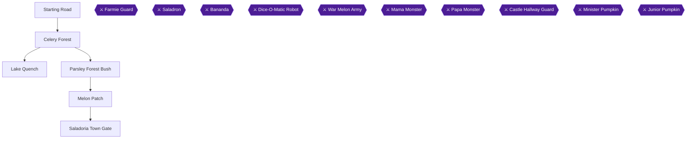
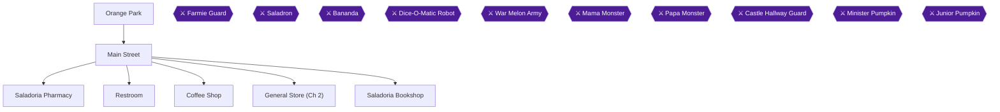
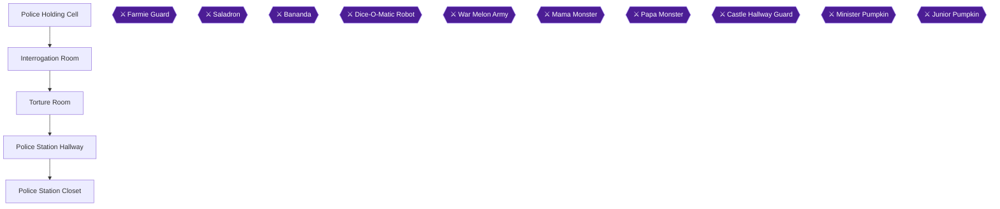
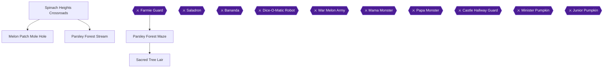
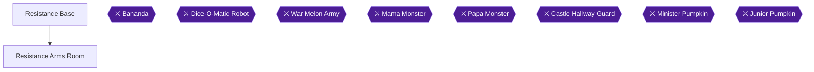
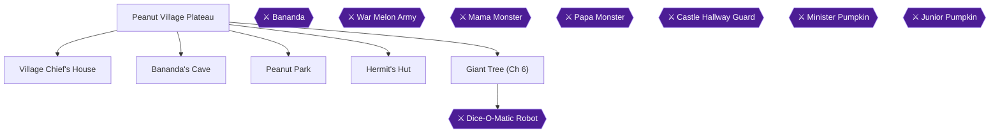
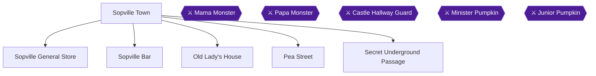
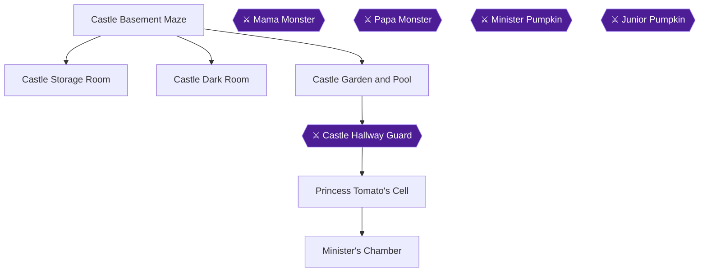

# Knowledge graph — game 1887

Nodes: 106 · Edges: 105

## Progression flow

## Chapter 1: Salad Kingdom Outskirts & The Rescue of Percy

## Chapter 2: Saladoria City Investigation & The Arrest

## Chapter 3: Police Station Incarceration & Escape

## Chapter 4: Spinach Heights, Parsley Forest Maze & Saladron

## Chapter 5: The Resistance Headquarters

## Chapter 6: Peanut Village, Bananda's Cave & The Dice-O-Matic

## Chapter 7: Sopville Infiltration & Secret Passage

## Chapter 8: Minister's Castle, Monster Maze & Princess Tomato

## Chapter 9: Courtyard Climax & Salad Kingdom Liberation

