# Knowledge graph — game 1984

Nodes: 109 · Edges: 111

## Progression flow

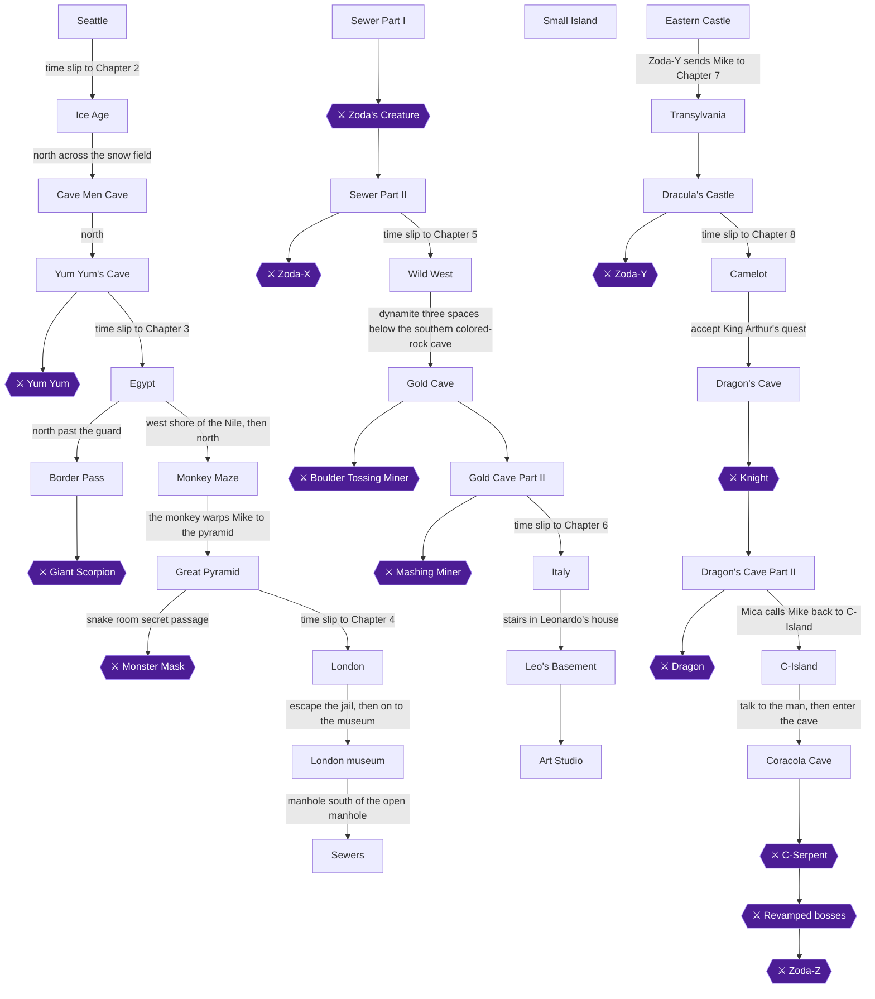

## Achievement dependencies

```mermaid
flowchart LR
  Rocks[/"Rocks"/]
  Ach_36882(["🏆 Better Than Nothing"])
  Axe[/"Axe"/]
  Ach_36883(["🏆 A Caveman Weapon"])
  Medicine[/"Medicine"/]
  Ach_36888(["🏆 Just Like Link"])
  Tetrad_Ch2[/"Tetrad (Chapter 2)"/]
  Ach_36884(["🏆 Your First Tetrad"])
  Jack["Jack of All Trades"]
  Ach_36885(["🏆 Jack of All Trades"])
  Jack_Dagger_Missable(["⚠ Jack's bronze dagger trade"])
  Dagger[/"Dagger"/]
  Thrower[/"Thrower (Slingshot)"/]
  Ach_36887(["🏆 Thrower"])
  Pizza["Cleopatra's pizza"]
  Ach_36889(["🏆 Slowest Pizza Delivery Ever"])
  Ach_36886(["🏆 Sharp Edge"])
  Small_Stars[/"Small stars"/]
  Ach_36890(["🏆 What Do These Do?"])
  Big_Heart_Ch3[/"Big Heart (Monkey Maze)"/]
  Ach_36891(["🏆 Lost in the Tall Grass"])
  Psychic_Shockwave[/"Psychic Shockwave"/]
  Ach_36892(["🏆 Psychic Power"])
  Flute[/"Flute"/]
  Ach_36893(["🏆 Snake Charmer"])
  Tetrad_Ch3[/"Tetrad (Chapter 3)"/]
  Ach_36894(["🏆 Egyptian Tetris"])
  Big_Heart_Ch4[/"Big Heart (manhole left of the museum)"/]
  Ach_36895(["🏆 Down the Sewers"])
  Spike_Ball[/"Spike Ball (spiked frisbees)"/]
  Ach_36896(["🏆 That Does NOT Look Like a Ball"])
  Tetrad_Ch4[/"Tetrad (Chapter 4)"/]
  Ach_36897(["🏆 The Mystery of the Tetrad"])
  Chicken_Nugget[/"Chicken nugget (the hidden nugget)"/]
  Ach_36898(["🏆 Not Quite a Gold Nugget"])
  Gold_Nugget[/"Gold nugget"/]
  Ach_36899(["🏆 Real Gold"])
  Big_Heart_Ch5[/"Big Heart (between two boulders)"/]
  Ach_36900(["🏆 Heart of Gold"])
  Bola[/"Bola"/]
  Ach_36901(["🏆 Not the Traditional Weapon"])
  Super_Psychic[/"Super Psychic Shockwave"/]
  Ach_36902(["🏆 Super Psychic Shock Wave"])
  Invincibility_Star[/"Invincibility Star"/]
  Ach_36903(["🏆 Just Like Mario"])
  Tetrad_Ch5[/"Tetrad (Chapter 5)"/]
  Ach_36904(["🏆 Tetrad in a Western"])
  Katana[/"Katana"/]
  Ach_36905(["🏆 Now We Got a Sword"])
  Big_Heart_Ch6[/"Big Heart (Small Island)"/]
  Ach_36906(["🏆 Heart on the Lone Island"])
  Tetrad_Ch6[/"Tetrad (Chapter 6)"/]
  Ach_36907(["🏆 Watch Out for Pits!"])
  Room13_Chest_Missable(["⚠ Spooky Castle Room 13 chest"])
  Triple_Spike_Ball[/"Triple Spike Ball"/]
  Ach_36908(["🏆 Triple the Fun"])
  Tetrad_Ch7[/"Tetrad (Chapter 7)"/]
  Ach_36909(["🏆 House of the Undead"])
  Ultra_Psychic[/"Ultra Psychic Shockwave"/]
  Ach_36910(["🏆 Ultra Psychic Shock Wave"])
  Tetrad_Ch8[/"Tetrad (Chapter 8)"/]
  Ach_36911(["🏆 The Middle Ages"])
  Zoda_Z{{"⚔ Zoda-Z"}}
  Ach_36912(["🏆 C-Island is Normal Again!"])
  Rocks -->|unlocks| Ach_36882
  Axe -->|unlocks| Ach_36883
  Medicine -->|unlocks| Ach_36888
  Tetrad_Ch2 -->|unlocks| Ach_36884
  Jack -->|unlocks| Ach_36885
  Jack_Dagger_Missable -.->|missable before| Dagger
  Thrower -->|unlocks| Ach_36887
  Pizza -->|unlocks| Ach_36889
  Dagger -->|unlocks| Ach_36886
  Small_Stars -->|unlocks| Ach_36890
  Big_Heart_Ch3 -->|unlocks| Ach_36891
  Psychic_Shockwave -->|unlocks| Ach_36892
  Flute -->|unlocks| Ach_36893
  Tetrad_Ch3 -->|unlocks| Ach_36894
  Big_Heart_Ch4 -->|unlocks| Ach_36895
  Spike_Ball -->|unlocks| Ach_36896
  Tetrad_Ch4 -->|unlocks| Ach_36897
  Chicken_Nugget -->|unlocks| Ach_36898
  Gold_Nugget -->|unlocks| Ach_36899
  Big_Heart_Ch5 -->|unlocks| Ach_36900
  Bola -->|unlocks| Ach_36901
  Super_Psychic -->|unlocks| Ach_36902
  Invincibility_Star -->|unlocks| Ach_36903
  Tetrad_Ch5 -->|unlocks| Ach_36904
  Katana -->|unlocks| Ach_36905
  Big_Heart_Ch6 -->|unlocks| Ach_36906
  Tetrad_Ch6 -->|unlocks| Ach_36907
  Room13_Chest_Missable -.->|missable before| Triple_Spike_Ball
  Triple_Spike_Ball -->|unlocks| Ach_36908
  Tetrad_Ch7 -->|unlocks| Ach_36909
  Ultra_Psychic -->|unlocks| Ach_36910
  Tetrad_Ch8 -->|unlocks| Ach_36911
  Zoda_Z -->|unlocks| Ach_36912
```

## Chapter 1: Chapter 1: Seattle

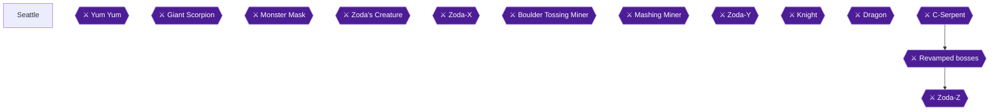

## Chapter 2: Chapter 2: The Stone Age

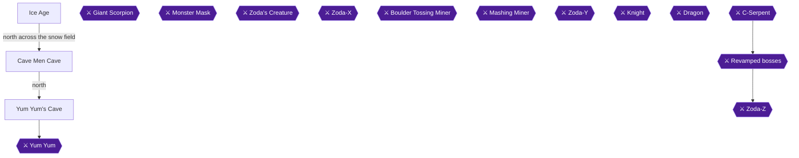

## Chapter 3: Chapter 3: Egypt

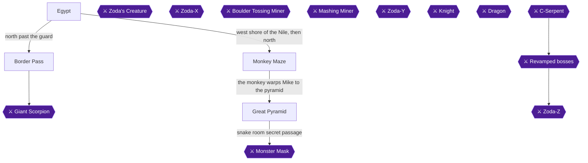

## Chapter 4: Chapter 4: London

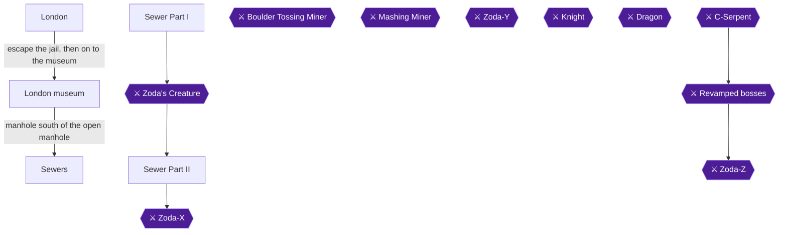

## Chapter 5: Chapter 5: The Wild West

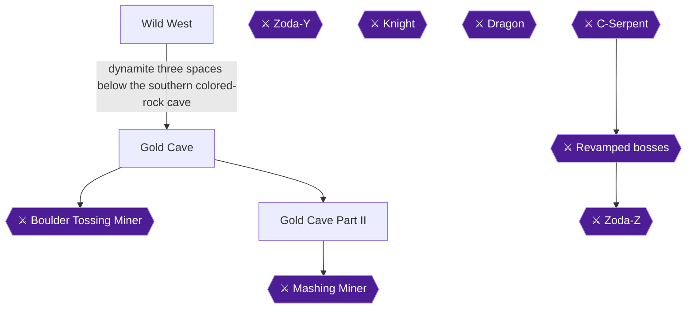

## Chapter 6: Chapter 6: Italy

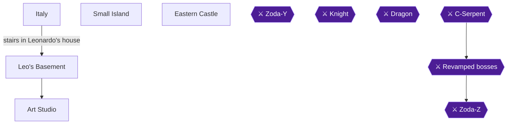

## Chapter 7: Chapter 7: Transylvania

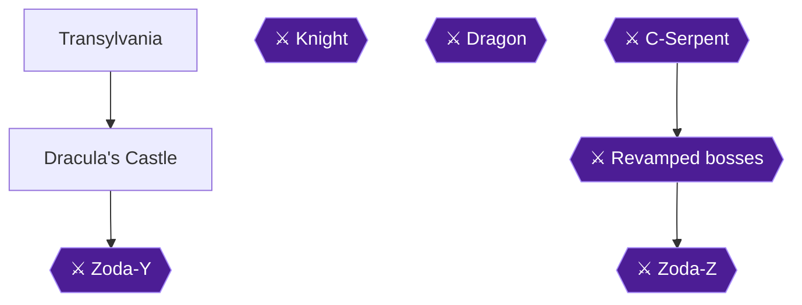

## Chapter 8: Chapter 8: Camelot

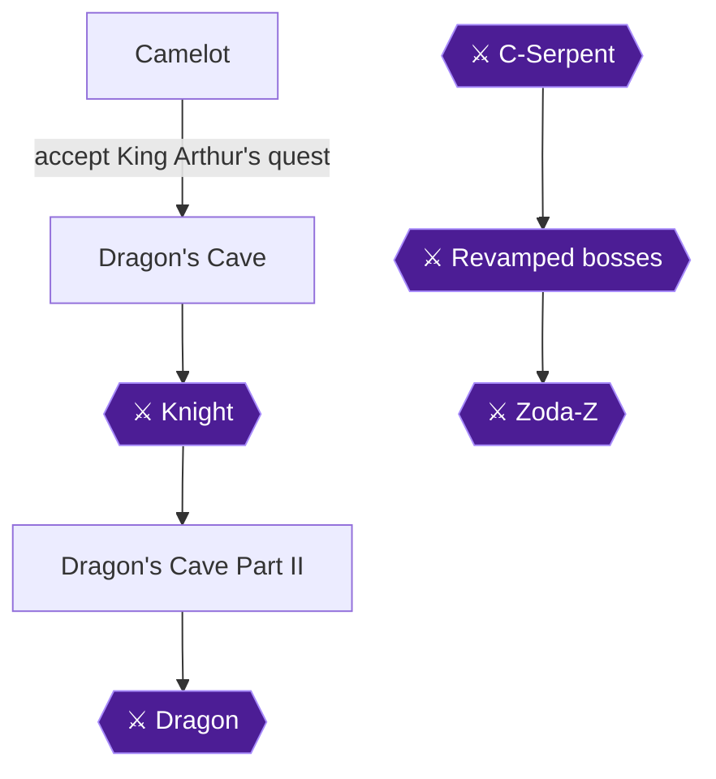

## Chapter 9: Chapter 9: Return to C-Island

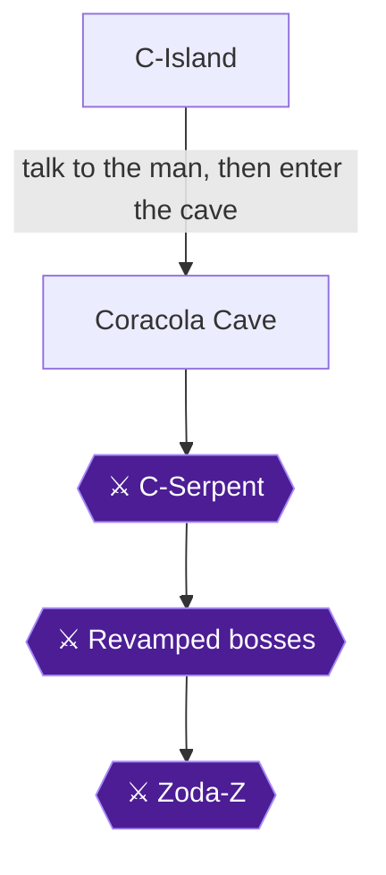
