# Knowledge graph — game 1984

Nodes: 69 · Edges: 69

## Progression flow

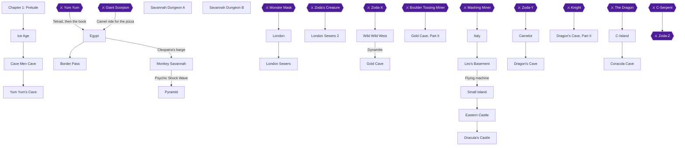

## Achievement dependencies

```mermaid
flowchart LR
  IceAge["Ice Age"]
  Ach_36882(["🏆 Better Than Nothing"])
  CaveMenCave["Cave Men Cave"]
  Ach_36883(["🏆 A Caveman Weapon"])
  YumYum{{"⚔ Yum Yum"}}
  Ach_36884(["🏆 Your First Tetrad"])
  Egypt["Egypt"]
  Ach_36885(["🏆 Jack of All Trades"])
  Ach_36886(["🏆 Sharp Edge"])
  BorderPass["Border Pass"]
  Ach_36887(["🏆 Thrower"])
  YumYumCave["Yum Yum's Cave"]
  Ach_36888(["🏆 Just Like Link"])
  GiantScorpion{{"⚔ Giant Scorpion"}}
  Ach_36889(["🏆 Slowest Pizza Delivery Ever"])
  SavannahA["Savannah Dungeon A"]
  Ach_36890(["🏆 What Do These Do?"])
  MonkeySavannah["Monkey Savannah"]
  Ach_36891(["🏆 Lost in the Tall Grass"])
  Ach_36892(["🏆 Psychic Power"])
  Pyramid["Pyramid"]
  Ach_36893(["🏆 Snake Charmer"])
  MonsterMask{{"⚔ Monster Mask"}}
  Ach_36894(["🏆 Egyptian Tetris"])
  London["London"]
  Ach_36895(["🏆 Down the Sewers"])
  LondonSewers2["London Sewers 2"]
  Ach_36896(["🏆 That Does NOT Look Like a Ball"])
  ZodaX{{"⚔ Zoda-X"}}
  Ach_36897(["🏆 The Mystery of the Tetrad"])
  WildWest["Wild Wild West"]
  Ach_36898(["🏆 Not Quite a Gold Nugget"])
  Ach_36899(["🏆 Real Gold"])
  Ach_36900(["🏆 Heart of Gold"])
  GoldCave["Gold Cave"]
  Ach_36901(["🏆 Not the Traditional Weapon"])
  GoldCave2["Gold Cave, Part II"]
  Ach_36902(["🏆 Super Psychic Shock Wave"])
  Ach_36903(["🏆 Just Like Mario"])
  MashingMiner{{"⚔ Mashing Miner"}}
  Ach_36904(["🏆 Tetrad in a Western"])
  LeosBasement["Leo's Basement"]
  Ach_36905(["🏆 Now We Got a Sword"])
  SmallIsland["Small Island"]
  Ach_36906(["🏆 Heart on the Lone Island"])
  EasternCastle["Eastern Castle"]
  Ach_36907(["🏆 Watch Out for Pits!"])
  Dracula["Dracula's Castle"]
  Ach_36908(["🏆 Triple the Fun"])
  ZodaY{{"⚔ Zoda-Y"}}
  Ach_36909(["🏆 House of the Undead"])
  DragonsCave["Dragon's Cave"]
  Ach_36910(["🏆 Ultra Psychic Shock Wave"])
  Dragon{{"⚔ The Dragon"}}
  Ach_36911(["🏆 The Middle Ages"])
  ZodaZ{{"⚔ Zoda-Z"}}
  Ach_36912(["🏆 C-Island is Normal Again!"])
  IceAge -->|unlocks| Ach_36882
  CaveMenCave -->|unlocks| Ach_36883
  YumYum -->|unlocks| Ach_36884
  Egypt -->|unlocks| Ach_36885
  Egypt -->|unlocks| Ach_36886
  BorderPass -->|unlocks| Ach_36887
  YumYumCave -->|unlocks| Ach_36888
  GiantScorpion -->|unlocks| Ach_36889
  SavannahA -->|unlocks| Ach_36890
  MonkeySavannah -->|unlocks| Ach_36891
  MonkeySavannah -->|unlocks| Ach_36892
  Pyramid -->|unlocks| Ach_36893
  MonsterMask -->|unlocks| Ach_36894
  London -->|unlocks| Ach_36895
  LondonSewers2 -->|unlocks| Ach_36896
  ZodaX -->|unlocks| Ach_36897
  WildWest -->|unlocks| Ach_36898
  WildWest -->|unlocks| Ach_36899
  WildWest -->|unlocks| Ach_36900
  GoldCave -->|unlocks| Ach_36901
  GoldCave2 -->|unlocks| Ach_36902
  GoldCave2 -->|unlocks| Ach_36903
  MashingMiner -->|unlocks| Ach_36904
  LeosBasement -->|unlocks| Ach_36905
  SmallIsland -->|unlocks| Ach_36906
  EasternCastle -->|unlocks| Ach_36907
  Dracula -->|unlocks| Ach_36908
  ZodaY -->|unlocks| Ach_36909
  DragonsCave -->|unlocks| Ach_36910
  Dragon -->|unlocks| Ach_36911
  ZodaZ -->|unlocks| Ach_36912
```

## Chapter 1: Prelude

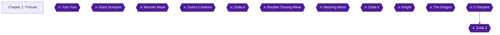

## Chapter 2: The Ice Age

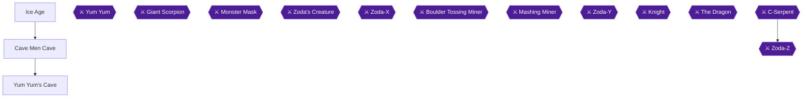

## Chapter 3: Cleopatra's Egypt

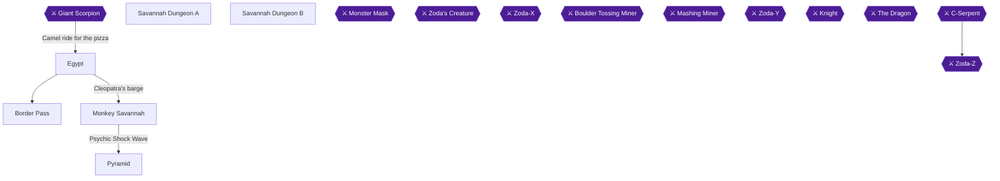

## Chapter 4: Holmes's London

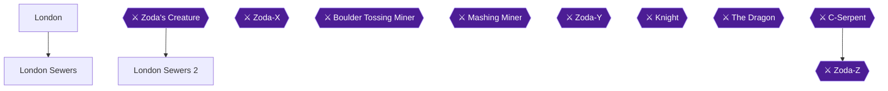

## Chapter 5: The Wild West

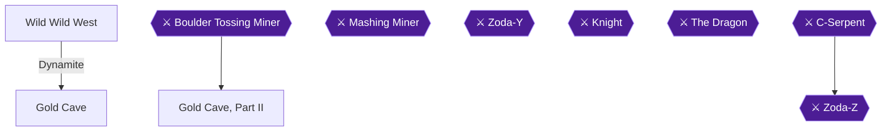

## Chapter 6: Leonardo's Italy

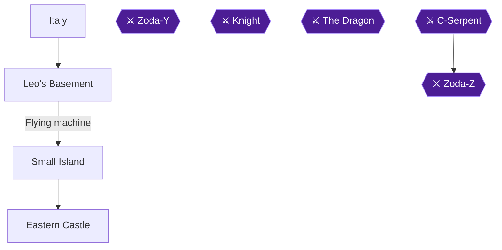

## Chapter 7: Dracula's Transylvania

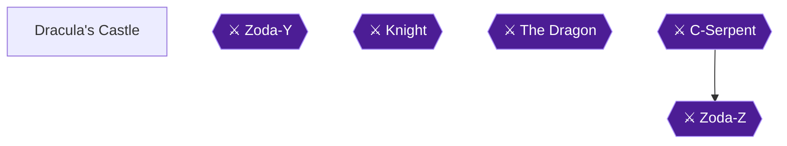

## Chapter 8: King Arthur's Camelot

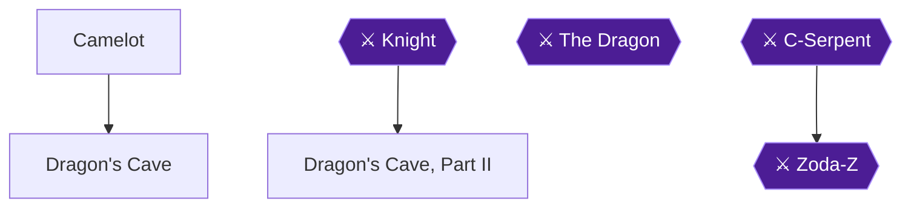

## Chapter 9: Return to C-Island

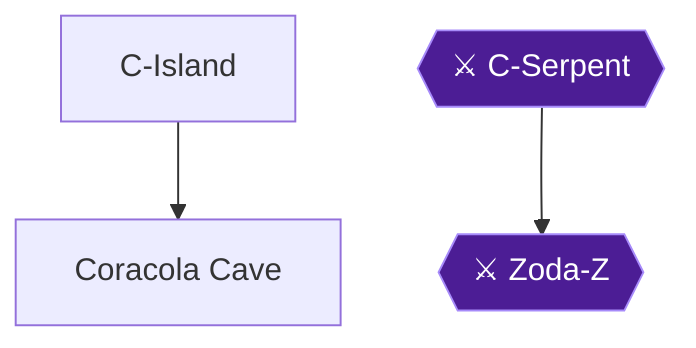
