# StarTropics II: Zoda's Revenge — 100% RetroAchievements Walkthrough

## Metadata

- **Platform:** NES/Famicom
- **Developer:** Unknown
- **Publisher:** Nintendo
- **Genre:** Action-Adventure
- **Released:** 1994-03-01
- **Achievements:** 31 (285 points)

> [!NOTE]
> Every instruction in this guide was extracted from the sources listed at the bottom and checked against them (136 facts confirmed by 2+ sources, 1566 from a single source). Statements marked 🟡 come from only one source. Anything we could not confirm says **"Unable to verify from collected sources."**

## Game Overview


### What this game is

StarTropics II: Zoda's Revenge is a Nintendo action-adventure for the NES/Famicom, released in 1994. The RetroAchievements set has **31 achievements worth 285 points**.

Mike Jones travels through time using the Oxford World Wonders book. At the end of each chapter he turns the page, says the magic words, and is sent to the next era. The words are "Paa Paa Paa Oom Maw Maw" [[gf5-3-10]]. Each jump is a "slip to another time and space" [[gf5-6-6]].

The goal is to recover the Tetrads, which are the legacy of the Argonians. Mica tells Mike that her father Hirocon wanted him to find them [[gf4-3-11]]. A Tetrad waits at the end of every chapter, and the game says to collect them all [[gf3-41-3]]. Each one raises Mike's life level [[gf5-7-14]].

Zoda keeps interfering. In one chapter he grabs the Tetrad and challenges Mike again [[gf4-9-1]]. Later he sends Mike to Translavania, where a vampire will hunt him [[gf4-9-5]]. The finale is a rematch with the earlier bosses, which are the same as before but faster [[gf2-36-2]]. The Zoda form that turns you into a boar is in that final stretch [[gf2-36-9]].

### The two screens

The game alternates between two modes.

**Travel screen.** This is used on world maps, in towns, and anywhere you can talk to someone. There are no enemies and you cannot attack [[gf1-3-12, gf1-3-13]].
- The D-pad moves Mike.
- A starts a conversation or inspects something [[gf1-4-2]].
- B cancels a conversation [[gf1-4-1]].
- Select shows which chapter you are in [[gf1-4-3]].

**Action screen.** This starts when Mike enters a dungeon [[gf1-4-4]].
- The D-pad moves Mike [[gf1-4-13]].
- B attacks [[gf1-4-14]] and A jumps [[gf1-4-15]].
- Select cycles through your weapons or the next inventory item [[gf1-4-16, gf2-3-3]].
- Start pauses [[gf1-4-17]].
- While paused, A uses the item you have selected [[gf1-4-15]].
- The two guides disagree on the pause menu: one says to press up to see Magic Items [[gf1-5-2]], the other says to press down and then use left and right [[gf2-3-6]]. If one direction does nothing, try the other.

### Movement and jumping

- You can now jump diagonally, which the guides call a big improvement [[gf2-3-7, ra-comments-1-1]]. You can also jump to the side without having to land on another platform [[gf1-4-6]].
- Mike takes about half a second to turn after you press the button [[gf2-6-3]].
- Diagonal jumps let you turn in midair, so it is easy to land in water or somewhere you did not intend [[gf2-6-4]].
- Mike can only jump one space at a time. Two-tile jumps need a special item [[gf2-6-6, gf2-6-7]].
- In some places, jumping straight forward is safer. In the spike-strip rooms of the Chapter 7 cellar, jump forward rather than straight up or to the side [[gf4-8-5]]. Another guide says to keep to a straight line and not sway at all [[gf2-31-24]].
- Several traps are instant death. Rolling boulders kill you [[gf2-30-11]]. Touching the Gold Cave miner kills you [[gf2-30-27]]. The Mining Cyclops kills you if you touch him [[gf3-24-15]]. The spikes in the Zoda-Y room also kill instantly [[gf2-40-3]].

### How dungeon rooms work

To get into the next room, you usually have to complete a task. That is normally defeating every enemy in the room or stepping on a switch tile [[gf1-4-7, gf1-4-8]]. Switch tiles work in stages:
1. Walk over the tile. It lights up and makes a sound [[gf1-4-9]].
2. Jump on it. A little ball appears [[gf1-4-10]].
3. Collect the ball to activate the switch [[gf1-4-11]].

Rooms often have many tiles, and only the right one works [[gf1-4-12]]. Other guides describe the same thing as a tile that reveals a question mark, which you then grab to open a door [[gf3-10-1, gf3-15-5]]. If a tile has a switch, take it. Otherwise kill the enemies [[gf1-13-30]].

If a room seems to have no exit, walk on every tile. Some of them hold secrets [[gf1-15-25, gf4-5-31]].

### Weapons and items

**Weapons.**
- Your main weapons are permanent. Collected weapons are used up and disappear when you leave the dungeon [[gf1-5-24, gf2-17-3, gf2-17-6]].
- Magic weapons kill some enemies that normal weapons cannot, and they help destroy barriers [[gf2-17-4]].
- The Psychic Shockwave is needed to defeat certain enemies [[gf1-5-19]]. Chapter 3 teaches it to you, and it also breaks the barrier in the Great Pyramid [[gf4-4-19, gf1-8-19]].
- The Super Psychic Shockwave needs 5 hearts to use [[gf1-5-21]]. The Ultra version needs 10 hearts [[gf1-5-23]].
- Treat the pyramid guardians as shockwave-only enemies, because they are immune to the dagger [[gf3-15-7]]. Chest monsters should also be hit with the shockwave to avoid heavy damage [[gf1-11-24]].

**Stored items and healing.**
- Stored items can be used whenever you want, but they vanish when you leave the dungeon [[gf1-5-1]].
- Castle medicines cannot be carried from place to place, so use them just before exiting a cave [[gf4-8-18]].
- Vitamin X restores energy up to 20. If your life meter is below 20, it slowly lowers the meter to its max [[gf1-5-8]].

### Hardcore Mode and the 100% plan

The set is compatible with Hardcore Mode. There is no difficulty setting or password, and everything is earned in story order in a single save file. In Hardcore you cannot load emulator snapshots, rewind, or use cheats, so learn the hazards above before pushing deep into a dungeon.

**One playthrough is enough.** The game moves forward chapter by chapter. Every chapter ends when Mike takes its Tetrad and the Oxford World Wonders sends him to the next period. Collect each chapter's items before taking its Tetrad.

The achievements are spread across the chapters like this:

| Chapter | Achievements |
|---|---|
| 1: Seattle | 0 |
| 2: The Stone Age | 4 |
| 3: Egypt | 9 |
| 4: London | 3 |
| 5: The Wild West | 7 |
| 6: Italy | 3 |
| 7: Transylvania | 2 |
| 8: Camelot | 2 |
| 9: Return to C-Island | 1 |

Chapter 1 has no achievements. It is only the setup, and in it Dr. Jones and Mike work out that the cipher must be reversed [[gf5-2-1]].

**The one mutual exclusion is the Chapter 3 dagger.**
- Jack of All Trades offers Mike a bronze dagger trade [[gf5-3-13]].
- Once Mike has a dagger, Jack offers his axe instead [[gf5-3-15]].
- A commenter calls the Jack achievement "definitely a missable achievement" [[ra-comments-5-1]].
- Another commenter reports getting the dagger from Cleopatra instead and still unlocking it [[ra-comments-5-2]].
- Those reports disagree. The safe route is to talk to Jack, between the two palm trees north of the Egypt start, and take his dagger BEFORE Cleopatra trades hers [[gf5-3-12, gf5-3-14]].
- Cleopatra only offers her dagger trade if you do not already have the bronze dagger [[gf5-5-2]]. On the safe route she simply sails you across, and Sharp Edge ("Obtain the Dagger") is expected to unlock with Jack's dagger instead (see Chapter 3).

**Other things to remember.**
- The gold nugget in Chapter 5 is lost at the start of the next chapter unless you sell it to Bob [[gf3-23-7]].
- In the Chapter 7 castle, open the Room 13 chest, which holds the spike balls, before you go down the hole [[gf3-30-2]].

Follow each chapter in order and use its closing checkpoint before taking the Tetrad. Each chapter also links the GameFAQs maps for its overworld and dungeons.

## Achievement Roadmap

| Chapter | Achievements | Points |
|---|---|---|
| [1. Chapter 1: Seattle](#chapter-1-chapter-1-seattle) | — | 0 |
| [2. Chapter 2: The Stone Age](#chapter-2-chapter-2-the-stone-age) | Better Than Nothing, A Caveman Weapon, Just Like Link, Your First Tetrad | 30 |
| [3. Chapter 3: Egypt](#chapter-3-chapter-3-egypt) | Jack of All Trades, Thrower, Slowest Pizza Delivery Ever, Sharp Edge, What Do These Do?, Lost in the Tall Grass, Psychic Power, Snake Charmer, Egyptian Tetris | 80 |
| [4. Chapter 4: London](#chapter-4-chapter-4-london) | Down the Sewers, That Does NOT Look Like a Ball, The Mystery of the Tetrad | 25 |
| [5. Chapter 5: The Wild West](#chapter-5-chapter-5-the-wild-west) | Heart of Gold, Not Quite a Gold Nugget, Real Gold, Not the Traditional Weapon, Super Psychic Shock Wave, Just Like Mario, Tetrad in a Western | 55 |
| [6. Chapter 6: Italy](#chapter-6-chapter-6-italy) | Now We Got a Sword, Heart on the Lone Island, Watch Out for Pits! | 30 |
| [7. Chapter 7: Transylvania](#chapter-7-chapter-7-transylvania) | Triple the Fun, House of the Undead | 20 |
| [8. Chapter 8: Camelot](#chapter-8-chapter-8-camelot) | Ultra Psychic Shock Wave, The Middle Ages | 20 |
| [9. Chapter 9: Return to C-Island](#chapter-9-chapter-9-return-to-c-island) | C-Island is Normal Again! | 25 |

## Playthrough Planning

**Playthroughs required:** 1

One playthrough is enough. The game moves forward chapter by chapter and every chapter ends when Mike takes its Tetrad and the Oxford World Wonders sends him to the next time period, so collect each chapter's items before taking its Tetrad. The only mutual exclusion is the Chapter 3 dagger: talk to Jack of All Trades (between the two palm trees north of the Egypt start) BEFORE Cleopatra trades you her dagger, because once Mike holds a dagger Jack offers his axe instead. RA comments disagree on whether the Cleopatra dagger also pops Jack of All Trades, so take Jack's dagger first and the question never comes up.

**Settings:** Hardcore Mode compatible. No difficulty setting or password is involved; the achievements are earned in story order in a single save file.

[[gf3-41-3,gf5-3-13,gf5-3-15,ra-comments-5-1,ra-comments-5-2,gf3-23-7,gf2-36-2]]

## True 100% In-Game Completion Criteria

This guide covers complete in-game mastery in addition to all RetroAchievements:

| Category | 100% Requirement | Tracking Scope |
|---|---|---|
| **Big Hearts** | Every permanent Big Heart (heart container) hidden on the overworld: the Monkey Maze (Chapter 3), the manhole left of the London museum (Chapter 4), the dynamite cave between two boulders (Chapter 5) and Small Island (Chapter 6). | Per-chapter checkpoint |
| **Tetrads** | The Tetrad that ends each of Chapters 2 to 8, earned by clearing that chapter's dungeon(s). | Per-chapter checkpoint |
| **Weapons, magic and special items** | Every weapon upgrade (Axe, Dagger from Jack, Katana), each Psychic Shockwave level, every sub-weapon type (Rocks, Thrower, Spike Ball, Bola, Triple Spike Ball), the Flute, the Invincibility Star, and both kinds of Chapter 5 nugget. | Per-chapter checkpoint |

## Missables Summary

| ⚠ Missable | Achievement | Chapter | Must be done before |
|---|---|---|---|
| Jack of All Trades dagger [[gf5-3-13,gf5-3-14,gf5-3-15,ra-comments-5-1,ra-comments-5-2]] | Jack of All Trades | [3](#chapter-3-chapter-3-egypt) | Before Cleopatra gives you her dagger after the pizza delivery (Chapter 3). With a dagger in hand, Jack only offers his axe. |
| Spike balls in Spooky Castle Room 13 [[gf3-30-1,gf3-30-2,gf3-31-3]] | Triple the Fun | [7](#chapter-7-chapter-7-transylvania) | Open the Room 13 east-wall chest before dropping down the hole to Room 14 (Chapter 7). The Room 26 platform has more spike balls as a backup. |

## Points of No Return

| ⛔ Point of No Return | Chapter | What you lose access to |
|---|---|---|
| Chapter 2 Tetrad [[gf3-8-1,gf5-3-10,gf1-6-5]] | [2](#chapter-2-chapter-2-the-stone-age) | Taking the Tetrad behind Yum Yum ends Chapter 2 and the book sends Mike to Egypt. The Rocks only appear in Chapter 2, so pick them up before the Yum Yum fight. |
| Chapter 3 Tetrad [[gf4-4-30,gf5-5-11]] | [3](#chapter-3-chapter-3-egypt) | The Tetrad after the Monster Mask ends Chapter 3 and Mike moves on to London. Get Jack's dagger, the Thrower, four small stars, the Monkey Maze Big Heart and the Flute first. |
| Chapter 4 Tetrad [[gf4-6-3,gf4-6-5,gf5-6-6]] | [4](#chapter-4-chapter-4-london) | Recovering the Tetrad from Zoda-X ends Chapter 4. Take the Big Heart from the manhole left of the museum and the spiked frisbees (Spike Ball) in Sewer Part II first. |
| Chapter 5 Tetrad [[gf1-12-22,gf3-23-7,gf5-7-15]] | [5](#chapter-5-chapter-5-the-wild-west) | The Tetrad after the Mashing Miner ends Chapter 5. Blast every nugget cave and the Big Heart cave before entering the Gold Cave, and sell your gold to Bob before you leave; the nugget is lost at the start of the next chapter. |
| Chapter 6 Tetrad [[gf2-32-14,gf4-9-1,gf4-9-5]] | [6](#chapter-6-chapter-6-italy) | Taking the Tetrad in the Eastern Castle ends Chapter 6 and Zoda-Y sends Mike to Transylvania. Land on Small Island for its Big Heart first. |
| Chapter 7 Tetrad [[gf2-33-10,gf5-8-11]] | [7](#chapter-7-chapter-7-transylvania) | The Tetrad after Zoda-Y ends Chapter 7. Make sure you picked up the Triple Spike Ball in Dracula's Castle. |

## Progression Diagrams

### Game Progression

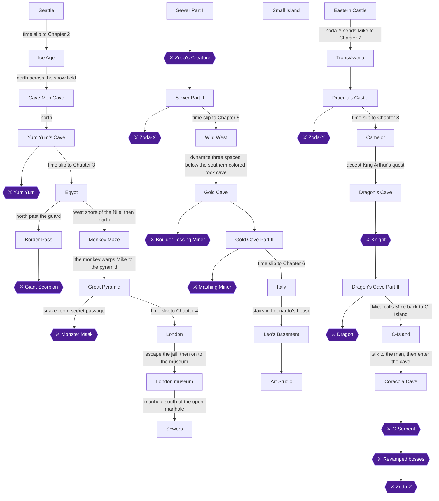

### Achievement Dependencies

```mermaid
flowchart LR
  Rocks[/"Rocks"/]
  Ach_36882(["🏆 Better Than Nothing"])
  Axe[/"Axe"/]
  Ach_36883(["🏆 A Caveman Weapon"])
  Medicine[/"Medicine"/]
  Ach_36888(["🏆 Just Like Link"])
  Tetrad_Ch2[/"Tetrad (Chapter 2)"/]
  Ach_36884(["🏆 Your First Tetrad"])
  Jack["Jack of All Trades"]
  Ach_36885(["🏆 Jack of All Trades"])
  Jack_Dagger_Missable(["⚠ Jack's bronze dagger trade"])
  Dagger[/"Dagger"/]
  Thrower[/"Thrower (Slingshot)"/]
  Ach_36887(["🏆 Thrower"])
  Pizza["Cleopatra's pizza"]
  Ach_36889(["🏆 Slowest Pizza Delivery Ever"])
  Ach_36886(["🏆 Sharp Edge"])
  Small_Stars[/"Small stars"/]
  Ach_36890(["🏆 What Do These Do?"])
  Big_Heart_Ch3[/"Big Heart (Monkey Maze)"/]
  Ach_36891(["🏆 Lost in the Tall Grass"])
  Psychic_Shockwave[/"Psychic Shockwave"/]
  Ach_36892(["🏆 Psychic Power"])
  Flute[/"Flute"/]
  Ach_36893(["🏆 Snake Charmer"])
  Tetrad_Ch3[/"Tetrad (Chapter 3)"/]
  Ach_36894(["🏆 Egyptian Tetris"])
  Big_Heart_Ch4[/"Big Heart (manhole left of the museum)"/]
  Ach_36895(["🏆 Down the Sewers"])
  Spike_Ball[/"Spike Ball (spiked frisbees)"/]
  Ach_36896(["🏆 That Does NOT Look Like a Ball"])
  Tetrad_Ch4[/"Tetrad (Chapter 4)"/]
  Ach_36897(["🏆 The Mystery of the Tetrad"])
  Chicken_Nugget[/"Chicken nugget (the hidden nugget)"/]
  Ach_36898(["🏆 Not Quite a Gold Nugget"])
  Gold_Nugget[/"Gold nugget"/]
  Ach_36899(["🏆 Real Gold"])
  Big_Heart_Ch5[/"Big Heart (between two boulders)"/]
  Ach_36900(["🏆 Heart of Gold"])
  Bola[/"Bola"/]
  Ach_36901(["🏆 Not the Traditional Weapon"])
  Super_Psychic[/"Super Psychic Shockwave"/]
  Ach_36902(["🏆 Super Psychic Shock Wave"])
  Invincibility_Star[/"Invincibility Star"/]
  Ach_36903(["🏆 Just Like Mario"])
  Tetrad_Ch5[/"Tetrad (Chapter 5)"/]
  Ach_36904(["🏆 Tetrad in a Western"])
  Katana[/"Katana"/]
  Ach_36905(["🏆 Now We Got a Sword"])
  Big_Heart_Ch6[/"Big Heart (Small Island)"/]
  Ach_36906(["🏆 Heart on the Lone Island"])
  Tetrad_Ch6[/"Tetrad (Chapter 6)"/]
  Ach_36907(["🏆 Watch Out for Pits!"])
  Room13_Chest_Missable(["⚠ Spooky Castle Room 13 chest"])
  Triple_Spike_Ball[/"Triple Spike Ball"/]
  Ach_36908(["🏆 Triple the Fun"])
  Tetrad_Ch7[/"Tetrad (Chapter 7)"/]
  Ach_36909(["🏆 House of the Undead"])
  Ultra_Psychic[/"Ultra Psychic Shockwave"/]
  Ach_36910(["🏆 Ultra Psychic Shock Wave"])
  Tetrad_Ch8[/"Tetrad (Chapter 8)"/]
  Ach_36911(["🏆 The Middle Ages"])
  Zoda_Z{{"⚔ Zoda-Z"}}
  Ach_36912(["🏆 C-Island is Normal Again!"])
  Rocks -->|unlocks| Ach_36882
  Axe -->|unlocks| Ach_36883
  Medicine -->|unlocks| Ach_36888
  Tetrad_Ch2 -->|unlocks| Ach_36884
  Jack -->|unlocks| Ach_36885
  Jack_Dagger_Missable -.->|missable before| Dagger
  Thrower -->|unlocks| Ach_36887
  Pizza -->|unlocks| Ach_36889
  Dagger -->|unlocks| Ach_36886
  Small_Stars -->|unlocks| Ach_36890
  Big_Heart_Ch3 -->|unlocks| Ach_36891
  Psychic_Shockwave -->|unlocks| Ach_36892
  Flute -->|unlocks| Ach_36893
  Tetrad_Ch3 -->|unlocks| Ach_36894
  Big_Heart_Ch4 -->|unlocks| Ach_36895
  Spike_Ball -->|unlocks| Ach_36896
  Tetrad_Ch4 -->|unlocks| Ach_36897
  Chicken_Nugget -->|unlocks| Ach_36898
  Gold_Nugget -->|unlocks| Ach_36899
  Big_Heart_Ch5 -->|unlocks| Ach_36900
  Bola -->|unlocks| Ach_36901
  Super_Psychic -->|unlocks| Ach_36902
  Invincibility_Star -->|unlocks| Ach_36903
  Tetrad_Ch5 -->|unlocks| Ach_36904
  Katana -->|unlocks| Ach_36905
  Big_Heart_Ch6 -->|unlocks| Ach_36906
  Tetrad_Ch6 -->|unlocks| Ach_36907
  Room13_Chest_Missable -.->|missable before| Triple_Spike_Ball
  Triple_Spike_Ball -->|unlocks| Ach_36908
  Tetrad_Ch7 -->|unlocks| Ach_36909
  Ultra_Psychic -->|unlocks| Ach_36910
  Tetrad_Ch8 -->|unlocks| Ach_36911
  Zoda_Z -->|unlocks| Ach_36912
```

## Boss Index

Full strategies are in each chapter.

| Boss | Chapter |
|---|---|
| Yum Yum | [2. Chapter 2: The Stone Age](#chapter-2-chapter-2-the-stone-age) |
| Giant Scorpion | [3. Chapter 3: Egypt](#chapter-3-chapter-3-egypt) |
| Monster Mask | [3. Chapter 3: Egypt](#chapter-3-chapter-3-egypt) |
| Zoda's Creature | [4. Chapter 4: London](#chapter-4-chapter-4-london) |
| Zoda-X | [4. Chapter 4: London](#chapter-4-chapter-4-london) |
| Boulder Tossing Miner | [5. Chapter 5: The Wild West](#chapter-5-chapter-5-the-wild-west) |
| Mashing Miner | [5. Chapter 5: The Wild West](#chapter-5-chapter-5-the-wild-west) |
| Zoda-Y | [7. Chapter 7: Transylvania](#chapter-7-chapter-7-transylvania) |
| Knight | [8. Chapter 8: Camelot](#chapter-8-chapter-8-camelot) |
| Dragon | [8. Chapter 8: Camelot](#chapter-8-chapter-8-camelot) |
| C-Serpent | [9. Chapter 9: Return to C-Island](#chapter-9-chapter-9-return-to-c-island) |
| Revamped bosses | [9. Chapter 9: Return to C-Island](#chapter-9-chapter-9-return-to-c-island) |
| Zoda-Z | [9. Chapter 9: Return to C-Island](#chapter-9-chapter-9-return-to-c-island) |

## Walkthrough

## Chapter 1: Chapter 1: Seattle

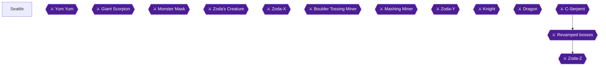

### Area Overview & Preparation

Chapter 1 is only an introduction to get you into the game [[gf2-24-11]]. It contains no achievements, no items and no combat. All you do is answer Dr. Jones's prompts, get the Oxford book and let the reversed cipher carry Mike to Chapter 2. The route diagram above also shows bosses from later chapters. None of them appear in Seattle.

There is nothing to miss here and no lockout to worry about.

### Chapter Items to Collect (0 Items Total)

This chapter has no collectible items. Unable to verify from collected sources that anything can be picked up in Seattle.

### Step-by-Step Walkthrough

#### Seattle

Unable to verify from collected sources whether a map exists for this area.

1. **Start the game and watch the opening.** The story sets Mike back in Seattle, and you can read Mica's telepathic contact, as the following steps describe.
2. **Answer the opening question.** Mike asks whether you remember his uncle. Either answer works.
   - If you answer **No**, Mike tells you his uncle is Dr. Jones, the tropical archaeologist [[gf5-1-5]].
   - If you answer **Yes**, the scene moves on without that explanation.
   - In both cases you learn that Dr. Jones is in Seattle, busy decoding the rest of the cipher from the tropics [[gf5-1-6]].
3. **Mica contacts Mike.** She first sounds as if she is calling by phone, then says she is using telepathy [[gf5-1-4]]. Just keep advancing the text.
4. **Talk to Dr. Jones.** He is busy at his desk. Tell him about Mica's message. He will read it back to you and ask "Get it?"
5. **Answer "Get it?" with Yes.** This makes Dr. Jones realize that Hirocon means the cipher must be reversed [[gf5-2-1]].
   - If you answer **No**, he shows the sentence being broken up step by step, then asks again. Keep answering until you pick Yes. Unable to verify from collected sources whether a "No" has any lasting consequence.
6. **Fetch the book.** Dr. Jones asks Mike to get the Oxford Wonder World book [[gf5-2-2]]. Pick it up where he points. It is the only thing you need to do, and it is not a stored inventory item.
7. **Let the cipher play out.** Dr. Jones reads the reversed cipher aloud. Do not try to stop it. The book flips its pages and Mike slips to another time and space, arriving in Chapter 2 [[gf5-2-3]].

> [!TIP]
> **Before you leave Seattle:** There is nothing to collect, so you cannot miss anything. Just make sure you have answered the prompts and fetched the book so the story moves on.

### What Comes Next

Chapter 2 begins in the Stone Age, where Mike must reach a cave [[gf2-24-3]]. Crossing the snow field and heading north leads to a cave in the mountains [[gf4-2-8]]. The first weapon you find is the rocks, which are very weak and found in the Ice Age [[gf3-41-17]].

> [!IMPORTANT]
> ### Chapter 1 Cumulative 100% Checkpoint
> - **Chests Opened:** 0 (none in this chapter) [[gf2-24-11]]
> - **Big Hearts:** 0 / 4
> - **Tetrads:** 0 / 7
> - **RetroAchievements Unlocked:** 0 / 31 (0 / 285 points)

### Chapter Checklist

- [ ] Answered Dr. Jones's prompts, including Yes to "Get it?"
- [ ] Fetched the Oxford Wonder World book
- [ ] Watched the cipher scene and slipped back to the Stone Age
- [ ] No achievements, items or tetrads are available in this chapter

---

## Chapter 2: Chapter 2: The Stone Age

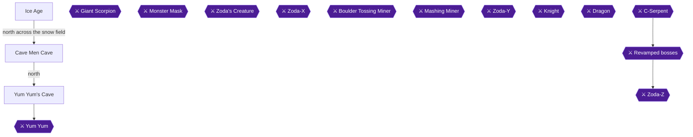

### Area Overview & Preparation

Chapter 2 opens after Mike says the magic words from the Oxford Wonder World book and "slips to another time and space" [[gf5-2-3]]. In this chapter Mike has to cross a snowy field, reach a cave in the Stone Age, and take on Yum Yum's Cave, the first dungeon [[gf2-24-3, gf2-25-1]]. Your tasks are: collect the Rocks in the random ice-cave action scenes, get the Axe from Tink, memorize the wall shapes, take the Medicine from the secret room, clear Yum Yum's Cave, and pick up the Tetrad (the Block) beyond Yum Yum.

Four achievements are available here: **Better Than Nothing** (Rocks), **A Caveman Weapon** (Axe), **Just Like Link** (Potion/Medicine), and **Your First Tetrad** (first dungeon).

> [!WARNING]
> **Missable Achievement Warning:** Rocks are believed to appear only in Chapter 2 [[gf1-6-5]]. Pick them up in one of the random ice-cave scenes before you fight Yum Yum, because taking the Tetrad ends the chapter [[gf3-8-1, gf5-3-10]]. Rocks are the first weapon in the game, very weak but useful, and found in the Ice Age [[gf3-41-17]].

Key facts before you start:
- Falling into a hole in the snow field sends you into a mini-dungeon [[gf1-6-8]]. Unable to verify from collected sources: whether every crossing is guaranteed to trigger a Rocks cave, so keep crossing until you get Rocks.
- In Yum-Yum's Cave, Mike can move and jump diagonally [[gf4-2-16]].
- Hardcore: no emulator snapshots or rewinds. If you die in Yum Yum's Cave you respawn in the halfway room [[gf1-6-19]].

### Chapter Items to Collect (4 Items Total)

| Item | Where Found | Action / Requirement | Citation |
|---|---|---|---|
| Rocks | Random ice-cave action scenes (top-right corner of the landing room; room 2 or 3 of some caves) | **TAKE** | [[gf4-2-1, gf3-4-1, gf3-4-2, gf3-4-3]] |
| Tink's Axe | Cave Men Cave, from Tink by the pile of bones | **TALK** | [[gf3-5-1, gf2-24-6]] |
| Medicine (called a potion in one guide) | Secret room near the start of Yum Yum's Cave | **TAKE** | [[gf2-25-2, gf4-2-15, gf1-6-17]] |
| Block (Tetrad) | Tunnel past the rescued children, beyond Yum Yum | **TAKE** | [[gf3-8-1, gf4-3-10]] |

### Ice Age (the snow field)

🗺️ **Map:** [View Chapter 2 Overworld Map on GameFAQs](https://gamefaqs.gamespot.com/nes/587654-zodas-revenge-star-tropics-ii/map/15885-chapter-2-overworld-map)

The ground north of the starting field has many holes hidden by snow [[gf5-2-4]]. Falling into a hole drops you into a mini-dungeon [[gf1-6-8]]. Since you want Rocks, falling into a hole is actually useful here: walk onto the snow until you drop into a cave, then use the cave notes below.

Once you have the Rocks, one guide gives a safe path across the ice that avoids every hole [[gf1-6-9]]. Stand so the layer of snow is one square in front of you, then walk: 1 square up, 1 square right, 1 square up, 1 square right, 2 squares up, 1 square left, 1 square up, 3 squares left, 1 square up, 2 squares left, 1 square down, 3 squares left, 1 square down, 1 square left, 1 square down, 1 square left. Then proceed up and into the cave [[gf1-6-9]].

Rocks can be found in these cave layouts:

**Random Dungeon A**
1. Room 3 contains rocks. Grab the rocks and kill what you must [[gf3-4-1]].

**Random Dungeon B**
1. Room 2 has four boars and some **Rocks**. Take them [[gf3-4-2]].

**Random Dungeon C**
1. Room 2 has two boars and some **Rocks** [[gf3-4-3]].
2. Room 3 has no enemies, only hearts to collect [[gf3-4-4]].
3. In Room 4, quickly kill the blue bear with your stones and the path opens to Room 5 [[gf3-4-5]].

**Another guide's cave description:** in the room where Mike lands, grab the Rocks in the top-right corner [[gf4-2-1]]. Kill the two creatures to open a secret door to the west [[gf4-2-2]]. Kill the polar bear there to open the secret door to the north [[gf4-2-3]], which leads to a staircase back to the surface [[gf4-2-4]]. If you need hearts, go into the room north of where you get the Rocks [[gf4-2-5]]. A later second type of ice cave has tougher foes and only one room [[gf4-2-7]].


> [!ACHIEVEMENT]
> **Better Than Nothing (5 Points)**
> 
> *Pick up Rocks in Chapter 2.*


Picking up the Rocks in any of these caves unlocks Better Than Nothing [[gf1-6-5, gf3-4-1, gf4-2-1]]. Then cross the snow field and head north to the cave in the mountains [[gf4-2-8]].

### Cave Men Cave

The cave people talk of missing loved ones and of a reliever who will one day come from a village [[gf4-2-9]].

1. **Tink's Axe:** Go to the lower left corner of the cave and talk to Tink [[gf2-24-5]]. He is by a large pile of bones [[gf3-5-1]], and makes tools from bones and stones [[gf5-2-6]]. He gives you his Axe [[gf1-6-10, gf5-2-5]].


> [!ACHIEVEMENT]
> **A Caveman Weapon (10 Points)**
> 
> *Obtain the Axe.*


   This is your first regular weapon [[gf2-24-6, gf4-2-10]]. It works the same as the Yo-yo in the first game [[gf1-5-14]].

2. **Pikazo's wall drawings:** Visit Pikazo and write down the drawings on his wall [[gf3-5-2]]. He cannot talk any more and has drawn on the cave wall [[gf4-2-11]]; his buddy says he has not said a word since Yum-Yum took his son [[gf5-2-11, gf1-6-11]]. The paintings may be his attempt to tell the cave men something [[gf5-2-7]]. Write the shapes down in order: **Circle, Circle, Triangle, Square, Circle, Square, Triangle** [[gf1-6-13]]. They are the walking directions for the pillar puzzle in Yum-Yum's Cave [[gf4-2-12]].

3. **The leader:** He says a prophecy foretold a south paw reliever and asks if you are the one [[gf5-2-12]]. A man-munching monster, Yum-Yum, gulped down the children a month ago [[gf5-2-8, gf1-6-12]]. The leader asks you to drive Yum-Yum from the land [[gf5-2-9, gf2-24-9, gf4-2-13]].

4. **Exit:** Leave through the West exit and go up the trail [[gf1-6-14, gf4-2-14]]. Heading north leads to Yum Yum's Cave [[gf2-25-1]].

### Yum Yum's Cave

🗺️ **Map:** [View Chapter 2 Level 1 Map on GameFAQs](https://gamefaqs.gamespot.com/nes/587654-zodas-revenge-star-tropics-ii/map/15886-chapter-2-level-1-map)

🗺️ **Map:** [View Chapter 2 Dungeon Map on GameFAQs](https://gamefaqs.gamespot.com/nes/587654-zodas-revenge-star-tropics-ii/map/1336-chapter-2-dungeon-map)

> [!TIP]
> Keep the Axe equipped; you throw it at Yum Yum later (about 30 axes) [[gf3-7-1]].

**Boar room:** Go into the next room and kill the 4 boars [[gf1-6-15]]. Killing all the enemies makes a secret passage open [[gf1-6-16]]. You hear it open in the previous room [[gf2-25-3]].

**Medicine room:** Go back to the previous room and enter the secret room. It holds nothing but the medicine; take it and go back [[gf3-6-1, gf2-25-2, gf4-2-15]].


> [!ACHIEVEMENT]
> **Just Like Link (5 Points)**
> 
> *Pick up a Potion.*


That is Just Like Link [[gf1-6-17]].

**Grizzly rooms:** In the next room you face 3 Grizzly Bears [[gf1-6-18]]. Kill the three bears to open a passageway, then take it [[gf2-25-4]]. Three blue bears in this stretch must be defeated to open the north door [[gf3-6-2]]. Don't bother going off the left exit; it only shows the earlier potion area [[gf1-6-21]].

**Halfway room:** Whenever you die, you respawn here [[gf1-6-19]].

**More bears:** In the next room you face 3 more Grizzlies; defeat them and move on [[gf1-6-20]]. Three yellow bears in a later room must be defeated to open the door north to the maze [[gf3-6-3]].

**The symbol maze:** Each room has three shapes, and only one leads on the right path [[gf2-25-5]]. For each symbol, walk in the direction of the pillar it sits on; if the first symbol is a circle on the north pillar, walk north [[gf4-2-18]]. The order is **Circle, Circle, Triangle, Square, Circle, Square, Triangle** [[gf1-7-2, gf3-6-4, gf4-2-17]]. Taking a wrong way takes you out of the dungeon and you must start over [[gf1-7-1]].

**After the maze:** The Fire Men give you nothing, so walk past them and out the door [[gf1-7-3]]. The boars in the next room give nothing either [[gf1-7-4]]. The boss is in the room after that [[gf1-7-5, gf4-2-19]].

### Yum Yum (Boss)

Difficulty: Laughable [[gf1-18-2]]. Another guide calls it the easiest boss of its kind [[gf2-25-7]].

1. Yum Yum won't attack until he eats the Wild Boar on his plate [[gf1-18-4, gf3-7-6]]. Let him finish eating [[gf4-3-2]]. **Do not kill the boar**: he gets angry and attacks much faster and harder [[gf1-18-5, gf4-3-1]]. (Another guide notes that killing it makes him engage immediately [[gf3-7-3]].)
2. Throwing axes immediately after entering should let you kill him before he gets a shot off [[gf3-7-2, gf1-18-3]].
3. In a longer fight, he runs back and forth shooting bubbles in a tri-spread [[gf2-25-8, gf4-3-3]]. You can't hit him in the back row, so stay in the back and dodge bubbles [[gf4-3-4]]. When he moves to the front, charge forward, jump his bubbles and fire axes constantly [[gf4-3-5]]. Avoid the bubbles he burps at you [[gf3-7-4]].
4. About 30 axes bring him down [[gf3-7-1]]. Near death he moves faster and stronger [[gf2-25-9]].
5. After he dies an opening appears to the right [[gf4-3-6]], and the next room has an exit to the north [[gf3-7-5]].

> [!CAUTION]
> **Point of No Return:** Taking the Tetrad behind Yum Yum ends Chapter 2 and the book sends Mike to Egypt [[gf3-8-1, gf5-3-10]]. The Rocks only appear in Chapter 2, so pick them up before the Yum Yum fight [[gf1-6-5]].

### After Yum Yum

Head north to exit [[gf4-3-7]]. In the next cave you find the four missing people, including Shorty, Pikazo's son [[gf4-3-8, gf1-7-6]]. Shorty says Yum-Yum was fattening them up [[gf5-3-5]], and was going to save them for supper [[gf1-7-6]]. Tell them to rush home to surprise their parents [[gf4-3-9]]. Go north to the tunnel past the kids and find the weird **Block** [[gf1-7-7, gf4-3-10]].

Mica then explains that Hiracon wanted Mike to find the mystic Tetrads [[gf4-3-11]]; they are the legacy of the Argonians, and she asks Mike to help find them [[gf1-7-9]]. They were hidden on Earth somewhere in time [[gf1-7-10]]. Mike figures out the Block is a Tetrad [[gf4-3-12, gf3-8-1]].


> [!ACHIEVEMENT]
> **Your First Tetrad (10 Points)**
> 
> *Complete the first dungeon, and learn about the Tetrads.*


You get a Tetrad and your life level increases [[gf1-7-8, gf2-25-10]], to seven hearts total [[gf3-8-2]]. At the end of the first dungeon the game shows "Now saving refrain from turning off or resetting" [[gf5-6-21]]; do not power off.

Mike then uses the Oxford World Wonders and says the magic words (Paa Paa Paa Oom Maw Maw), sending him to Chapter 3 [[gf5-3-10]].

> [!IMPORTANT]
> ### Chapter 2 Cumulative 100% Checkpoint
> - **Tetrads:** 1 / 7 (Yum Yum's Cave Block) [[gf3-8-1]]
> - **Big Hearts:** 0 / 4
> - **Rocks / Axe / Medicine collected:** 3 / 3 [[gf1-6-5, gf2-24-6, gf2-25-2]]
> - **RetroAchievements Unlocked:** 4 / 31 (30 / 285 points)

### Chapter Checklist

- [ ] Picked up Rocks in an ice cave (36882)
- [ ] Received the Axe from Tink (36883)
- [ ] Wrote down: Circle, Circle, Triangle, Square, Circle, Square, Triangle
- [ ] Took the Medicine from the secret room (36888)
- [ ] Solved the symbol maze without being kicked out
- [ ] Beat Yum Yum without killing his boar
- [ ] Took the Block/Tetrad (36884)

---

## Chapter 3: Chapter 3: Egypt

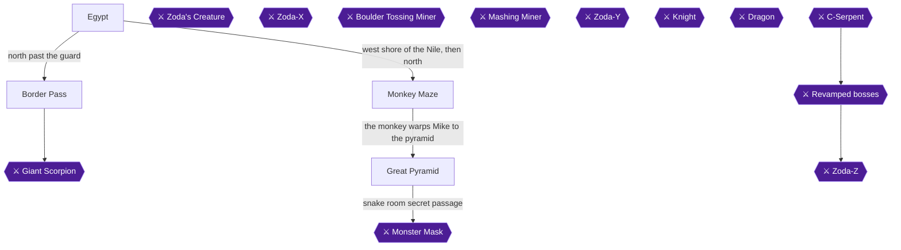

### Area Overview & Preparation

Chapter 3 drops Mike into ancient Egypt, with a river, a sphinx and a pyramid in view [[gf5-3-11]]. The chapter runs in this order: meet Jack, board Cleopatra's barge, clear the Border Pass and its Giant Scorpion, ride a camel to fetch a pizza, let Cleopatra sail you to the pyramid, solve the Monkey Maze for the Psychic Shockwave, then clear the Great Pyramid and beat the Monster Mask for the Tetrad.

Your goals for 100%:
- Take Jack's bronze dagger before you do anything else. This dagger covers both Jack of All Trades and Sharp Edge.
- Pick up the Thrower (slingshot) in the Border Pass.
- Deliver the pizza.
- Ride Cleopatra's barge to the pyramid. She only trades her dagger if you do not already have one.
- Hold four small stars at once.
- Grab the Big Heart in the Monkey Maze.
- Learn the Psychic Shockwave.
- Pick up the Flute.
- Finish the pyramid and collect the Tetrad.

> [!WARNING]
> **Missable Achievement Warning:** Do NOT accept Cleopatra's dagger before visiting Jack. Once you hold a dagger, Jack only offers his axe, and the "Jack of All Trades" dagger achievement is described as missable [[gf5-3-13, gf5-3-14, gf5-3-15, ra-comments-5-1]]. Go to Jack FIRST, as described in the next section.

### Chapter Items to Collect (9 Items Total)

| Item | Where Found | Action / Requirement | Citation |
|---|---|---|---|
| Bronze dagger (from Jack) | Egypt desert, between two palm trees | **TALK**, answer Yes | [[gf5-3-12, gf5-3-14]] |
| Slingshot (Thrower) | Border Pass chest | **JUMP** on the tile, then collect the question mark | [[gf2-26-4, gf4-3-20]] |
| Pizza | From the delivery guy on the camel ride | **TALK**, then deliver to Cleopatra | [[gf1-7-19]] |
| Dagger (Sharp Edge) | Already in hand from Jack; Cleopatra's trade is only offered if you lack the bronze dagger | Nothing extra to do | [[gf5-3-14, gf5-5-2]] |
| 4 small stars | Monkey Maze mini-dungeons | **COLLECT**, hold four at once | [[gf1-8-8, gf2-13-1]] |
| Big Heart | Eastern part of the Monkey Maze | **TAKE** | [[gf4-4-15]] |
| Psychic Shockwave | The monkey at the end of the maze | Automatic from the monkey | [[gf5-5-7]] |
| Flute | Pyramid, mini-mummy room | **HIT** the switch / chest | [[gf1-9-14, gf3-16-9]] |
| Tetrad | Small room after Monster Mask | **WALK** forward | [[gf4-4-30]] |

### Egypt: Arrival and Jack of All Trades

🗺️ **Map:** [View Chapter 3 Overworld Map on GameFAQs](https://gamefaqs.gamespot.com/nes/587654-zodas-revenge-star-tropics-ii/map/15887-chapter-3-overworld-map)

You arrive in a desert with a river [[gf5-3-11]]. Do not follow the southern path. It follows the Nile endlessly and is a false path [[gf3-9-1, gf4-3-15]].

1. Walk north from the arrival point. Watch the right side of the screen for two palm trees and walk between them to find a path [[gf5-3-12]].
2. Talk to Jack. He says he will trade his bronze dagger; answer **Yes** [[gf5-3-13]]. You receive a dagger [[gf5-3-14]].


> [!ACHIEVEMENT]
> **Jack of All Trades (10 Points)**
> 
> *Obtain the Dagger from the Jack of All Trades.*


If you say no, Jack says "Have your own way!" [[gf5-3-13]]. If you talk to him again after accepting, he says "Sorry, we're closed" [[gf5-3-13]]. A commenter reports that this achievement also popped when they got the dagger from Cleopatra instead, and another saw it trigger while wandering the Monkey Maze. Still, another commenter calls it missable, so take Jack's dagger first [[ra-comments-5-1, ra-comments-5-2, ra-comments-5-3]].

**Sharp Edge ("Obtain the Dagger"):** Jack's bronze dagger is the dagger for this chapter. It replaces your axe as your main weapon [[gf3-11-2, gf4-4-7]], and Sharp Edge is expected to unlock as soon as "You've got a dagger!" appears [[gf5-3-14]]. Cleopatra will not give you a second one later, because her dagger trade only happens if you do not already have the bronze dagger [[gf5-5-2]].


> [!ACHIEVEMENT]
> **Sharp Edge (10 Points)**
> 
> *Obtain the Dagger.*


> [!TIP]
> One RetroAchievements commenter reports that Sharp Edge did not unlock on an older RANes/RetroArch build [[ra-comments-6-1]]. If it did not pop with Jack's dagger, note it before moving on; the set has been edited since that report.

3. Continue north and walk to the barge [[gf1-7-11]]. A guard north of the barge says "Halt! Stay away from here." for now [[gf5-3-16]]. A shirtless man east of the barge says it is the Queen's barge [[gf5-3-17]].

### Cleopatra's Barge

1. Board the barge and talk to everyone on deck. If you enter the cabin before talking to everyone outside, the guard will block you [[gf3-9-2, gf5-4-1]].
2. Once everyone has been spoken to, enter the cabin and talk to Cleopatra. She says she can take you to the Tetrad if you bring her pizza [[gf5-4-1, gf2-26-1]].
3. Leave the barge and head north. The guard now lets you through to the Border Pass [[gf1-7-13, gf5-4-3]].

### Border Pass

🗺️ **Map:** [View Chapter 3 Level 1 Map on GameFAQs](https://gamefaqs.gamespot.com/nes/587654-zodas-revenge-star-tropics-ii/map/2179-chapter-3-level-1-map)

1. **First room:** Kill the spiders to unlock the way forward [[gf2-26-3]].
2. **Next room:** Kill the enemies, then continue to a room with platforms and spiders [[gf1-7-14, gf2-26-4]].
3. **Chest room (Thrower):** Jump on the tile (don't step on it) and then collect the question mark to open the chest. It contains the slingshot [[gf4-3-20, gf2-26-4]].


> [!ACHIEVEMENT]
> **Thrower (5 Points)**
> 
> *Pick up the Thrower Item in Chapter 3.*


   Kill the remaining enemies and move on [[gf1-7-14]].
4. Dodge the porcupines, which roll into a ball and charge. They always stop at a wall, so stand to the left or right of where they will stop and hit them when they are not rolled up [[gf4-3-21, gf3-42-2]]. Follow the open doorway [[gf1-7-14]].
5. Kill the scorpions, which deal major damage; don't touch them [[gf4-3-22]]. Then kill the moving floor tiles and a secret opening appears. Grab the medicine there [[gf1-7-15, gf1-7-16, gf2-26-5]].
6. Clear enemies in each room on your first pass to open secret rooms; one holds medicine [[gf4-3-23, gf4-3-34]]. If you die, the medicine can be picked up again [[gf4-3-24]]. One room has nearly invisible foes [[gf4-3-25]] and another requires a tricky diagonal jump [[gf4-3-26]].
7. Cross to the far side, kill the spiders, and enter the boss room [[gf1-7-14, gf1-7-17]].

### Giant Scorpion (Boss)

Difficulty: Easy [[gf1-18-7]]. Two holes in the wall release small scorpions from time to time; kill any that approach but focus on the big one [[gf4-3-28, gf2-38-6]].

- Use the slingshot since its range is longer [[gf4-3-29]]. One guide's author needed about 40 slingshot shots [[gf3-10-10]].
- When the boss flashes and makes noise, it is about to fire a spread of bullets. Jump over them or step aside [[gf4-3-30, gf1-18-8]].
- Stay as far away as possible and hit it repeatedly. It moves slowly and can be hit at any time [[gf4-3-31, gf4-3-32]].
- The little scorpions are shifty and deal the most damage in this fight [[gf1-18-9, gf2-26-9]].

When it is defeated, head west and exit [[gf4-3-33]].

### Camel Ride and the Pizza

1. Outside, talk to the man with the camel. Say **Yes** to rent it; you cannot walk away without it [[gf1-7-18, gf3-11-3]].
2. Ride until you meet the pizza delivery guy. Tell him your story and he gives you the pizza [[gf1-7-19, gf3-11-1, gf5-4-7]].
3. Deliver it. You are returned to the barge; the pizza is still warm [[gf4-4-3, gf4-4-4, gf5-4-8]]. Give it to the woman inside the barge before it cools [[gf5-4-15]].


> [!ACHIEVEMENT]
> **Slowest Pizza Delivery Ever (10 Points)**
> 
> *Clear the first dungeon in Chapter 3 and get the pizza for the Queen.*


Cleopatra eats the pizza and agrees to take you to the Tetrad [[gf5-4-9, gf5-4-10]].

### Cleopatra's Barge Ride

1. After the pizza, Cleopatra asks "Let me take you to the tetrad, OK?" and the barge sails across the Nile [[gf5-4-10]].
2. She tells you that the great pyramid lies to the south [[gf5-4-11]] and that the Tetrad is rumored to be within its walls [[gf5-4-12]].
3. Because you already have Jack's bronze dagger, her dagger trade is skipped. She only offers to trade for her bronze dagger when Mike does not have it [[gf5-5-2, gf5-5-1]]. If you skipped Jack, this is where you would get the dagger instead [[gf2-26-11, gf5-5-3]].
4. The barge drops you off. Walk south toward the pyramid.

### Monkey Maze

🗺️ **Map:** [View Chapter 3 Monkey Island Maze Map on GameFAQs](https://gamefaqs.gamespot.com/nes/587654-zodas-revenge-star-tropics-ii/map/2178-chapter-3-monkey-island-maze-map)

The pyramid's magic field cannot be crossed yet, since you need something special [[gf5-5-4]]. You may enter the pyramid: the first room has hearts on the middle tile of the western group [[gf4-4-9]], but the next room has an energy barrier you can't pass yet [[gf4-4-10]]. Go back outside; people mention a mad magician to the north [[gf5-5-5, gf1-8-5]].

Head north (heading west leads to endless desert wandering) to the grassy field [[gf3-12-1]]. Step onto the wooden platforms to see the maze layout and where to enter [[gf4-4-14, gf2-26-12]].

#### Part 1

Map in source: Monkey Maze Part 1 (O = start, X = exit) [[gf3-12-2]].

```text
    ____________________________________   ______    ____
    |                                   | |       X      | |
    |                          __       | |              | |
    |                    _____|  |__    | |              | |
    |                   |           |   | |              | |
    |       ________    |_____    __|   | |              | |
    |      |        |         |__|      | |              | |
    |      |______  |                   | |_______       | |
    |             | |                   |  _____  |      | |
    |_____        | |_____________      | |     | |      | |
          |       |               |     | |     | |      | |
     __   |       |  ___________  |     |_|     |_|      | |
    |  |__|     __| |   _____   | |          _           | |
    |          |    |  |__H__|  | |         | |          | |
    |          |____|           | |         | |          | |
    |                           | |_________| |__________| |
    |________________     O     |__________________________|
```

Walk a clockwise circle around the deck, starting below and left of it. Then go up and down to the right and up the right side [[gf3-12-3, gf3-12-4]]. Alternatively, from the left opening: 3 left, 7 up, 2 left, 3 up, 6 right, 3 down, 6 right, 5 down, 2 right, 4 up, 2 right, 4 down, 2 right, 11 up, 2 left, 2 up [[gf1-8-7, gf2-26-13]].

You exit near a Big Heart, and after a few steps fall into a mini-dungeon [[gf3-12-5, gf3-12-12]].

#### Mini-dungeon A

Monkeys here may drop hearts and stars; this is the only place in the game where enemies drop them [[gf1-8-8]]. Five small stars refill one heart [[gf1-5-4, gf2-13-1]], so collect stars here and stop at four to hold them for the achievement.

> [!WARNING]
> **Do not collect a fifth star.** Five stars convert into a heart refill, so stop at four and hold them until the achievement unlocks [[gf1-5-4, gf2-13-1]].


> [!ACHIEVEMENT]
> **What Do These Do? (10 Points)**
> 
> *Have 4 stars at once.*


Room by room (map legend 1 = start, 6 = exit) [[gf3-12-6]]:
- Room 1: nothing; go to Room 2.
- Room 2: three little frogs; kill or ignore, go north.
- Room 3: three swans, a frog and a crocodile. Defeat the crocodile to open the north door [[gf3-12-7, gf1-8-9]].
- Room 4: a swan and two frogs. Two hearts sit on the island to your right; then go west [[gf3-12-8]].
- Room 5: three floating jellyfish. Kill them to open the north wall. The hippo need not be killed [[gf3-12-9, gf3-12-10, gf1-8-10]].
- Room 6: exit.

#### Part 2

The Big Heart is on the eastern shore of this section [[gf3-13-1]]. Walk forward until the monkey runs away again, then go through the left opening and walk: 4 left, 10 up, 7 right, 5 down, 2 right, then down to the Big Heart [[gf2-26-16, gf1-8-11]]. (One guide writes 6 down instead of 5 for the fourth leg; if 5 does not line you up, take one more step down before the 2 right.)


> [!ACHIEVEMENT]
> **Lost in the Tall Grass (10 Points)**
> 
> *Find the Heart Container in Chapter 3.*


From the Big Heart, walk: 7 up, 3 left, 6 up, 6 left, 4 up, 1 left, 4 up, 4 left, 4 down, 2 left, 5 up, 5 left, 1 down, then all the way left. You fall into the next mini-dungeon [[gf1-8-12, gf3-13-2, gf3-13-3]].

#### Mini-dungeon B

Seven rooms [[gf3-13-4]]:
- Room 2: two crocodiles and two swans; kill only the crocodiles [[gf3-13-5]].
- Room 3: two hearts on the island to your right; kill the crocodile for the north door [[gf3-13-6, gf3-13-7]].
- Room 4: a hippopotamus appears and shoots; kill only the frogs [[gf3-13-8, gf3-13-9]]. Run out of the room before the hippo attacks [[gf1-8-14]].
- Remaining rooms: kill the monkeys first, then the crocodile [[gf1-8-13]]. Kill all the enemies in the next room to unlock the door, then follow the path through the last rooms back outside [[gf1-8-14]].

#### Part 3 and the Psychic Shockwave

Head to the small mountain range at the northern edge of this section [[gf3-14-2]]. The monkey runs straight up, but he is on the other side of a wall [[gf1-8-15]]. Two guides give the same route [[gf2-27-1, gf1-8-16]]. Walk:

1. 2 left (one guide writes 4), 2 down, then left until you hit a wall.
2. 4 down, 3 left, 1 down, 3 left, then down until you hit a wall.
3. 1 left, 4 down, 11 left, 3 up, 1 left, 4 up.
4. 5 right, 3 up, 6 left, 8 up, 3 right, 1 down, 5 right, 3 up.
5. Go right and around the bench, then 3 right, 3 up, 3 right, and up to the monkey.

The monkey (Merlin?) teaches you the Psychic Shockwave [[gf3-14-2, gf5-5-7]].


> [!ACHIEVEMENT]
> **Psychic Power (10 Points)**
> 
> *Obtain the Psychic Shock Wave.*


It breaks barriers and strikes enemies [[gf5-5-8]]. The monkey sends you back to the pyramid [[gf1-8-18]]. A snake outside mentions a catchy tune [[gf5-5-9]].

### Great Pyramid

🗺️ **Map:** [View Chapter 3 Level 2 Map on GameFAQs](https://gamefaqs.gamespot.com/nes/587654-zodas-revenge-star-tropics-ii/map/2180-chapter-3-level-2-map)

Some enemies can only be hurt by the Shockwave [[gf4-4-23, gf2-27-4]]. Jump on all the tiles to see what they do [[gf4-4-35]].

1. **Room 1:** Jump on the middle tile of the western tile group for hearts [[gf3-15-3]].
2. **Room 2:** Switch to the Shockwave and break the force field [[gf3-15-2, gf1-8-19]].
3. **Room 3:** Kill the Skull things to enter the next room [[gf1-8-21]].
4. **Room 4:** Cobras and stairs [[gf1-8-22]].
5. **Room 5:** Spikes and flames. Pass the first flame and STOP; going further drops you to the asps. Jump over the hole [[gf3-15-6, gf1-8-24]]. A wall of fire appears near spikes [[gf1-8-23]]. Jump on a tile in the top group to reveal the question mark at the bottom, and grab it to open the east door [[gf3-15-5]]. Two hearts are on the north side [[gf3-15-4]]. The switch is in the top-left tile [[gf1-8-25, gf2-27-5]].
6. **Room 6:** Pyramid guardians are immune to the dagger; use the Shockwave [[gf3-15-7, gf3-42-1]]. Kill the two enemies [[gf1-8-29]].
7. **Room 7:** Kill the mini-mummy quickly, then the big mummy [[gf1-8-26]]. Grab the question mark on a tile to open the chest with a medicine [[gf3-15-8]]. Jump on the platform for medicine and wait for it to reappear [[gf1-8-27, gf1-8-28]].
8. **Rooms 8 to 11:** Kill the Horus-like enemy [[gf1-9-1]]. There is a hole in the middle; fall through and push left [[gf1-9-2, gf2-27-8]]. In Room 10 press left as you fall in or you drop again; two hearts are in the bottom-left corner [[gf3-16-12, gf3-16-2]]. Room 11 has stairs in the upper right back to Room 10 [[gf3-16-3]].
9. **Room 9 false floors:** Fall through the false floors among the circle of tiles to reach Room 10 [[gf3-16-1]]. Remember the hole in the middle when reaching the door [[gf1-9-3]].
10. **Higher platforms:** Two switches, middle-left and bottom-right; hit both [[gf1-9-4, gf2-27-10]]. Kill all the enemies for the Try-Your-Luck sign [[gf1-9-5, gf2-27-11]]; there is also a life sign in Room 14 [[gf3-16-4]].
11. **Horus and tarantulas:** Kill two Horus, then all the tarantulas; avoid the spikes and use the Shockwave [[gf1-9-6, gf1-9-7, gf1-9-8]].
12. **Room 16:** Ride the conveyor and defeat each spider on the ledges [[gf3-16-5]]. Room 17 has hearts under a middle tile [[gf3-16-6]].
13. **Snake room (Room 19):** The tile pattern resembles a snake. The switch is on the tip of the tail [[gf1-9-10, gf2-27-12, gf3-16-7]]. Two hearts are on the upper-left tile [[gf2-27-9]]. Kill the two big mummies [[gf1-9-11]]. A medicine comes from hitting the right tile of the middle block [[gf2-27-13]]. A tile at the top of Room 21 makes a medicine appear [[gf3-16-8]].
14. **Flute room (Room 22):** Many mini-mummies [[gf1-9-13]]. Hit the switch and take the Flute [[gf1-9-14, gf3-16-9]].


> [!ACHIEVEMENT]
> **Snake Charmer (5 Points)**
> 
> *Pick up the flute.*


   Defeat the mini-mummies to open the west wall back toward Room 17 [[gf3-16-10]].
15. **Back in the snake room:** Use the Flute [[gf1-9-15, gf2-27-14]]. The snakes come out; kill them to open the secret passage to Room 23 [[gf2-27-15, gf2-27-16, gf3-16-11, gf4-4-26]]. The snakes dodge and move a lot, so be patient [[gf4-4-34]].
16. **Rooms 23 to 24:** Follow the platforms across the mummy room for the potion [[gf1-9-16]]. Room 24 has two hearts and another medicine in the left corner [[gf3-17-1, gf3-17-2]]. The pyramid holds three medicines total [[gf4-4-27]].

> [!CAUTION]
> **Point of No Return:** The Tetrad after the Monster Mask ends Chapter 3 and Mike moves on to London. Make sure you have Jack's dagger, the Thrower, four small stars, the Monkey Maze Big Heart and the Flute first [[gf4-4-30, gf5-5-11]].

### Monster Mask (Boss)

The next room holds the boss [[gf1-9-17]]. The room has its top half blocked off and directional arrows on the bottom [[gf4-4-41]]. Difficulty: Moderately Easy [[gf1-18-11]].

- The conveyor belt makes the fight a little challenging; learn its simple pattern and switch to the Shockwave [[gf2-27-17, gf2-27-18]].
- Hit it from the edge with the Shockwave. The conveyor belts shouldn't affect you much [[gf1-18-12]].
- Stay clear of the powerful energy beam released when it opens its mouth [[gf1-18-14, gf2-27-20]].
- After decent damage it turns red and speeds up, firing two bullet spreads or the beam [[gf1-18-13, gf2-27-19]].

Walk forward into the small room and claim the Tetrad [[gf4-4-30, gf1-9-18]].


> [!ACHIEVEMENT]
> **Egyptian Tetris (10 Points)**
> 
> *Complete the second dungeon in Chapter 3 and collect the Tetrad.*


> [!IMPORTANT]
> ### Chapter 3 Cumulative 100% Checkpoint
> - **Big Hearts:** 1 / 4 (Monkey Maze) [[gf4-4-15]]
> - **Tetrads:** 2 / 7
> - **RetroAchievements Unlocked:** 13 / 31 (110 / 285 points)

### Chapter Checklist

- [ ] Jack's bronze dagger collected (36885)
- [ ] Slingshot from the Border Pass chest (36887)
- [ ] Giant Scorpion defeated
- [ ] Pizza delivered (36889)
- [ ] Sharp Edge unlocked with Jack's dagger (36886)
- [ ] Four small stars held at once (36890)
- [ ] Monkey Maze Big Heart (36891)
- [ ] Psychic Shockwave learned (36892)
- [ ] Flute picked up (36893)
- [ ] Monster Mask defeated and Tetrad collected (36894)

---

## Chapter 4: Chapter 4: London

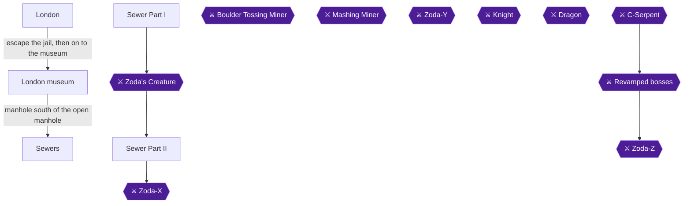

### Area Overview & Preparation

Mike arrives at 221B Baker Street in London and meets Sherlock Holmes [[gf1-9-20]]. The chapter has three main stages:

1. Escape the jail and reach the museum, where Zoda-X steals the Tetrad.
2. Collect the Big Heart from the open manhole to the left of the museum.
3. Clear the two-part sewer dungeon and defeat Zoda-X.

The sewers are the toughest dungeon so far, according to one guide [[gf2-28-8]]. The Big Heart is the reward for the first achievement here, and the Spike Ball (spiked frisbees / throwing stars) in Sewer Part II is the reward for the second. Both must be collected before the Tetrad, which ends the chapter [[gf4-6-3, gf4-6-5]].

> [!WARNING]
> **Missable Achievement Warning:** Take the open manhole to the LEFT of the museum for the Big Heart before you drop into the sewer manhole to the south [[gf2-28-6, gf3-18-3]]. Also pick up the Spike Ball (spiked frisbees / throwing stars) in Sewer Part II before you finish Zoda-X [[gf3-20-1, gf4-5-17]].

### Chapter Items to Collect

| Item | Where Found | Action / Requirement | Citation |
|---|---|---|---|
| Big Heart (heart container) | Open manhole to the left of the museum | **TAKE** before the south manhole | [[gf2-28-6, gf4-5-9]] |
| Funky orb | Sewer Part I start room, top right switch | **HIT** the raft switch | [[gf1-10-2]] |
| Medicine | Sewer Part I, giant rat room | **TAKE** (optional) | [[gf1-10-27, gf3-19-5]] |
| Spiked frisbees (Spike Ball) | Sewer Part II Room 2 chest | **OPEN** after defeating the Zoda spawns | [[gf3-20-1]] |
| Medicine | Sewer Part II Room 5 chest | **OPEN** via the left tile | [[gf3-20-2]] |
| Medicine | Sewer Part II Room 10 chest | **OPEN** via the left tile | [[gf3-20-3]] |
| More spiked frisbees | Sewer Part II raft room (Room 18) | **TAKE** | [[gf3-21-1]] |
| Medicine | Sewer Part II Room 20 | **TAKE** | [[gf3-21-6]] |
| Tetrad | Sewers after Zoda-X | **TAKE** | [[gf4-6-3]] |

Medicine total in Sewer Part II: four, per one guide [[gf4-5-16]]. Throwing stars appear in two locations [[gf4-5-17]].

### London

🗺️ **Map:** [View Chapter 4 Overworld Map on GameFAQs](https://gamefaqs.gamespot.com/nes/587654-zodas-revenge-star-tropics-ii/map/15888-chapter-4-overworld-map)

Follow the trail from the start and you are taken to a scene with Holmes [[gf1-9-20]]. He says a robbery will occur at the museum tonight. A rascal named Zoda-X intends to steal a curious stone [[gf1-9-22, gf2-28-2]]. He asks you to meet him at the museum at midnight [[gf1-9-21]].

#### The Jail Escape

1. Follow the path until you reach a police officer, then talk to him. He throws you in jail for being suspicious [[gf1-9-23, gf2-28-4]].
2. A prisoner in the cell says you should not try to escape [[gf5-5-18]]. Ignore him.
3. Feel along and push against the right wall of the cell until you find the escape path [[gf1-9-24, gf2-28-5]].
4. Follow the path outside.
5. Walk in between the two buildings to find another secret passage [[gf1-9-25]].
6. Continue to the museum.

### London Museum

At the museum, Zoda-X takes the stone, which is a Tetrad, and escapes [[gf1-9-26, gf5-5-20]].

#### The Big Heart Manhole

When you are back on the streets, take the open manhole to the LEFT. A Big Heart container is below [[gf2-28-6, gf3-18-2, gf4-5-9]].


> [!ACHIEVEMENT]
> **Down the Sewers (10 Points)**
> 
> *Obtain the Heart Container in Chapter 4.*


Climb back up. Then head south to the next manhole, which is the chapter's dungeon [[gf2-28-7, gf3-18-3]].

### Sewers: Sewer Part I

🗺️ **Map:** [View Chapter 4 Level 1 Map on GameFAQs](https://gamefaqs.gamespot.com/nes/587654-zodas-revenge-star-tropics-ii/map/2182-chapter-4-level-1-map)

Jump on the raft, then onto the switch in the top right corner of the screen [[gf2-28-9, gf1-10-2]]. Take the funky orb, or run through the question mark, to continue [[gf1-10-2, gf2-28-10]].

1. Hit the top right tile and head out the open doorway to the left [[gf1-10-3]].
2. Kill all the enemies in the next room; a door opens [[gf1-10-4, gf2-28-11]].
3. In the room with monkeys on platforms, a switch is hidden on the second tile from the top on the left side. It opens a passage to the giant rat room [[gf1-10-5]]. Take the switch first, then fight the rats [[gf2-28-12]].
4. Giant rats: hit them a few times, run back, then hit them again [[gf2-28-13]].
5. Collect the medicine in the rat room [[gf2-28-14, gf1-10-27]]. One guide thinks it is not worth it, since you will probably need a potion after the rats anyway [[gf1-10-28]].
6. Go back to the room with the monkeys on the platforms [[gf2-28-15]].
7. In the owl room, hit owls by jumping at them or by standing on higher ground. Defeat all three and the boss door opens [[gf1-10-6, gf1-10-7, gf2-28-16]].

### Zoda's Creature (Boss)

The next room contains the first boss [[gf2-28-17]]. It sits in the middle of the water. A room-by-room guide calls it Zoda's Blob and says you must keep moving and not stand on one tile too long [[gf3-19-1, gf3-19-3]].

- You do not need to kill it in one go [[gf2-28-18, gf2-28-19]].
- Four platforms appear and disappear around it. Hit it a few times, jump to the next platform, and repeat [[gf2-28-20, gf2-28-21]].
- Its shots are weak [[gf2-28-22]].
- From the platform below it, jump down to dry ground and repeat the process [[gf2-28-23]].
- Another guide says the creature appears on a small island in the middle of a lake [[gf4-5-22]].
- After the fight, jumping on a tile the blob was on reveals a question mark that opens the east door [[gf3-19-4]].

After the fight, strange footprints show Zoda is still fleeing. Follow him into the next cave [[gf1-10-1, gf4-5-30, gf4-5-12]].

### Sewer Part II

🗺️ **Map:** [View Chapter 4 Level 2 Map on GameFAQs](https://gamefaqs.gamespot.com/nes/587654-zodas-revenge-star-tropics-ii/map/2183-chapter-4-level-2-map)

Pick up the hearts to your left and right at the start; you will need them [[gf1-10-9]]. Walk on every tile, since some hold secrets [[gf4-5-31]].

**Room 2 (Spike Ball chest):** Defeat the Zoda spawns and jump on the tile to open the chest, which holds spiked frisbees (the Spike Ball) [[gf3-20-1, gf3-41-19]].


> [!ACHIEVEMENT]
> **That Does NOT Look Like a Ball (5 Points)**
> 
> *Pick up the Spike Ball Item in Chapter 4.*


**Larva room:** Kill the larva dudes and the door opens, but do not forget the chest [[gf1-10-10, gf1-10-11]]. The switch is third from the right in its column [[gf1-10-12, gf2-29-2]].

**Giant rats:** They move slowly. Hit them a few times, move back, and repeat [[gf2-29-3]]. Beat both and head out the door [[gf1-10-13]].

**Room 4:** Defeat the owls and the south wall opens to Room 5. A tile here also opens the west door to Room 6 [[gf3-20-4, gf3-20-5]].

**Room 5 (chest):** Jump on the left tile to open the chest, which holds medicine [[gf3-20-2]].

**Secret medicine room:** Killing all enemies opens a secret medicine room. The switch is on the middle left tile [[gf1-10-14, gf1-10-15]]. Hit the switch in the previous room as well [[gf2-29-4]].

**Raft room:** Take the moving raft down to get an item, return to the start of the room, then jump from moving raft to moving raft to exit [[gf2-29-5, gf2-29-6]]. The raft in the second room is tricky and you can fall into the water [[gf4-5-21]].

Kill the green floaty things (and the jumping blue slimes) before moving on [[gf1-10-16, gf2-29-7]].

**Three tile sets:**
1. Step on the middle group's tile to activate a mark. Grab it and the south wall opens [[gf3-20-6, gf3-20-7]]. A switch is hidden on the left of the middle set and gives medicine [[gf1-10-17, gf2-29-8]].
2. Step on the right tile to open a doorway with medicine inside [[gf2-29-9, gf1-10-18]].
3. Head out and up the stairs at the top [[gf1-10-19]].

**Room 10 (chest):** Jump on the left tile to open the chest with medicine [[gf3-20-3]].

**Falling through the floor:** Fall through the middle of one of the tiles to land in Room 11 [[gf3-20-13]]. Fall left first, then right, then center [[gf4-5-33, gf4-5-34]]. You find another medicine this way [[gf4-5-15]]. Going down the middle set leads to more rats; killing them opens a doorway on the right [[gf2-29-10, gf1-10-20, gf1-10-21]].

**Room 11 (three paths):** The middle path leads south to Room 16 [[gf3-20-8]].
- Room 13: after defeating the Zoda spawns, grab two hearts and find the mark to open the east door [[gf3-20-9]].
- Room 12: the ladders at the path ends take you back up to Room 15 [[gf3-20-10]].
- Room 14: defeat three Zoda spawns and a blue blob, then take the path south to Room 17 [[gf3-20-11, gf3-20-12]].

**Halfway point:** You restart here after dying. The Try-Your-Luck sign gives nearly unlimited tries since the boss is close [[gf1-10-22, gf1-10-30]]. Grab the hearts and sign, then jump from raft to raft [[gf1-10-23, gf2-29-11]]. The switch is in the upper middle tile [[gf1-10-24]]. Grab the disc and jump onto the platform when you see the raft coming. The platform disappears, so do not wait on it [[gf1-10-25, gf1-10-26, gf2-29-12, gf2-29-13]].

**Room 18 (raft room):** Jump from raft to raft. More spiked frisbees are here [[gf3-21-1, gf3-21-3]]. You can also take the life sign if you feel lucky [[gf3-21-2]].

**Room 19:** Defeat the four Zoda spawns and the east wall opens [[gf3-21-4]]. Do not use the west switch yet; it opens the boss room [[gf3-21-5]].

Kill the larva to open another secret and grab the medicine (you should have about 3 by now) [[gf1-11-1, gf1-11-2]]. In the next room kill the enemies and grab the medicine [[gf2-29-14]].

**Room 20:** There is a medicine here. Do this before the boss [[gf3-21-6, gf3-21-14]].

Defeat the larvae before hitting the bottom right switch, or you will likely take serious damage [[gf1-11-3, gf2-29-15]].

### Zoda-X (Boss)

Difficulty: Hard [[gf1-18-19]]. Have three medicines for this fight [[gf2-29-22]].

- The whole room is covered with multi-directional conveyor belts (arrows on every tile), so you drift constantly [[gf1-18-22, gf2-29-27, gf3-21-9]].
- Zoda-X teleports around, then fires a spread of bullets or a ring of fire [[gf1-18-20, gf3-21-10]].
- Avoid the fire; it deals lots of damage [[gf1-18-21]].
- He appears in random locations; hit him whenever he becomes visible [[gf3-21-11, gf3-21-12]].
- When you are far away, he shoots four blue flames from the floor. Up close he shoots five skulls you can jump over [[gf2-29-17, gf2-29-18, gf2-29-19, gf2-29-26]].
- Jump near him as soon as he appears, jump over the skeletons, and hit him a few times before he teleports [[gf2-29-21, gf2-29-20]].

> [!CAUTION]
> **Point of No Return:** Recovering the Tetrad from Zoda-X ends Chapter 4. Take the Big Heart from the manhole left of the museum and the spiked frisbees (Spike Ball) in Sewer Part II first [[gf4-6-3, gf4-6-5, gf5-6-6]].

Once Zoda-X is defeated, take the north door to the exit room [[gf3-21-13]]. Pick up the stolen Tetrad; your life level increases [[gf4-6-3, gf1-11-5]].


> [!ACHIEVEMENT]
> **The Mystery of the Tetrad (10 Points)**
> 
> *Finish both dungeons in Chapter 4 and obtain the Tetrad.*


Exit the sewers and head north. Holmes praises you and deduces there must be a Zoda-Y and Zoda-Z [[gf5-6-3, gf2-29-24]]. Mike then uses the Oxford World Wonders book; the right page shows Chapter 5 [[gf5-6-6, gf5-6-7]].

> [!IMPORTANT]
> ### Chapter 4 Cumulative 100% Checkpoint
> - **Big Hearts:** 2 / 4 (manhole left of the museum) [[gf2-28-6]]
> - **Tetrads:** 3 / 7 [[gf4-6-3]]
> - **RetroAchievements Unlocked:** 16 / 31 (135 / 285 points)

### Chapter Checklist

- [ ] Escaped the jail via the right wall and reached the museum
- [ ] Took the Big Heart from the open manhole left of the museum
- [ ] Cleared Sewer Part I and defeated Zoda's Creature
- [ ] Opened the Room 2 chest in Sewer Part II for the spiked frisbees
- [ ] Collected the Sewer Part II medicine and the raft-room frisbees
- [ ] Defeated Zoda-X and took the Tetrad

---

## Chapter 5: Chapter 5: The Wild West

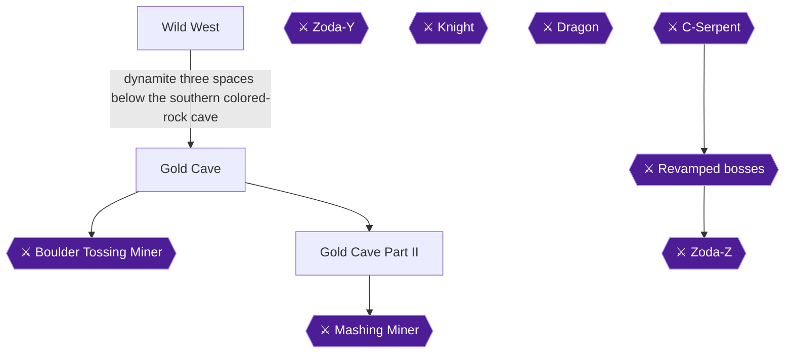

### Area Overview & Preparation

Chapter 5 drops Mike into the Wild West, a desert with a mining town, a mountain wall full of bombable spots, and two dungeons: the Gold Cave and Gold Cave Part II [[gf2-29-25]]. The town work is all dynamite. Do all of it before you enter the Gold Cave. Bob's Store gives you dynamite, and you can return for more whenever you run out [[gf3-23-2, gf3-23-10]].

> [!WARNING]
> **Missable Achievement Warning:** The nugget caves, the Big Heart cave and the gold sale to Bob must all be finished BEFORE you enter the Gold Cave. The gold nugget is lost at the start of the next chapter unless you sell it to Bob [[gf3-23-7]]. Blast every nugget cave and the Big Heart cave first (Heart of Gold, Not Quite a Gold Nugget and Real Gold are all earned in the blasting section below). Selling the gold only gives points [[gf3-23-8]].

Notes on the nugget achievements:
- One nugget cave holds a real gold nugget and another holds a chicken nugget, which you eat and which does nothing [[gf4-6-12, gf4-6-14, gf5-7-6]].
- Open every nugget cave so that both achievements unlock whichever way they are read [[gf2-30-5]].
- A community comment says the passages are found by leaving the village toward the cacti and going straight to the first passage. It also says the area has 4 secret passages besides the main entrance [[ra-comments-19-1, ra-comments-19-2]].

### Chapter Items to Collect (11 Entries)

| Item | Where Found | Action / Requirement | Citation |
|---|---|---|---|
| Dynamite | Bob's Store (restock any time) | **TAKE**, talk to Bob | [[gf1-11-13, gf1-11-16]] |
| Big Heart | West/south mountain wall, between two rocks | **BLAST** | [[gf1-11-15, gf4-6-16]] |
| Gold nugget (end of lower light path) | Lower light-colored pathway | **BLAST**, then sell to Bob | [[gf1-11-18]] |
| Gold nugget | Two spaces north of the northern colored cave | **BLAST** | [[gf4-6-17]] |
| Gold nugget | Southernmost bombable part of wall | **BLAST** | [[gf4-6-18]] |
| Chicken nugget | Other colored-rock cave and other caves | **BLAST** | [[gf4-6-14, gf4-6-40]] |
| Bola | Real chest, Gold Cave | **TAKE** | [[gf1-11-25]] |
| Medicine | Gold Cave secret door / chest | **TAKE** | [[gf1-11-26, gf2-30-20]] |
| Super Psychic Shockwave | Donkey after the Boulder Tossing Miner | **TALK** | [[gf1-11-30]] |
| Invincibility Stars | Gold Cave Part II (two) | **TAKE**, save one for the boss | [[gf4-7-8]] |
| Tetrad | Circle of rocks after the Mashing Miner | **TAKE** | [[gf4-7-18]] |

### Wild West Town

1. Go north from where you appear until you reach the town, which looks like a pile of garbage [[gf1-11-29, gf2-30-1]].
2. Talk to everybody outside, then enter the shop at the top of the screen and talk to the man [[gf1-11-9]]. This shopkeeper gives a clue about where to go next [[gf3-22-3]].
3. Go right and around a house to find a hidden man and talk to him [[gf1-11-10]].
4. Enter the saloon and talk to everyone, including the piano player. Listen to his song [[gf1-11-11, gf2-30-3]].
5. Enter Bob's Store near the town entrance. He gives you a free pack of dynamite [[gf1-11-12, gf1-11-13, gf2-30-4]].

### Blasting the Mountain

🗺️ **Map:** [View Chapter 5 Overworld Map on GameFAQs](https://gamefaqs.gamespot.com/nes/587654-zodas-revenge-star-tropics-ii/map/15889-chapter-5-overworld-map)

Walking against the mountain ridge sets your dynamite, so watch your movement [[gf3-23-2]].

1. **Big Heart:** Go west to the wall of the mountain. Place dynamite between the two rocks near the bottom by walking up to the wall, then walk into the cave. [[gf1-11-14, gf1-11-15, gf2-30-6]]
   
> [!ACHIEVEMENT]
> **Heart of Gold (10 Points)**
> 
> *Find the Heart Container in Chapter 5.*

2. Return to Bob for another pack of dynamite [[gf1-11-16]].
3. **Colored rock trails:** Two trails of differently colored rock run along the mountain. Walk up to the rock wall where a trail ends and Mike sets the dynamite [[gf4-6-11]]. Placing dynamite at the end of the lower light-colored pathway gives a gold nugget [[gf1-11-18]].
   
> [!ACHIEVEMENT]
> **Real Gold (5 Points)**
> 
> *Find the ACTUAL Gold Nugget in Chapter 5.*

4. The other colored trail's cave holds a chicken nugget [[gf4-6-14]]. Eat it and nothing happens [[gf5-7-6]].
   
> [!ACHIEVEMENT]
> **Not Quite a Gold Nugget (10 Points)**
> 
> *Find the Hidden Nugget in Chapter 5.*

5. Also blast two spaces north of the northern colored cave for another gold nugget [[gf4-6-17]], and the southernmost bombable part of the wall for another [[gf4-6-18]]. Other caves on the mountain hold only chicken nuggets [[gf4-6-40]].
6. Restock dynamite at Bob's whenever you run out, and offer him your gold when you return [[gf3-23-10, gf5-7-8]]. Choose yes to make the deal [[gf5-7-9]].

> [!NOTE]
> A man in the storehouse says a strange rock (the Tetrad) is in a mine buried by a landslide, and that blasting in the right place opens the way [[gf5-7-10]]. The guide notes the piano song's directions were never worked out; use the method below instead [[gf4-6-19]].

7. **Gold Cave entrance:** Place dynamite three spaces below (south of) the southern colored-rock cave [[gf4-6-19, gf2-30-7]]. Do this last, after every other cave is open and the gold is sold.

> [!CAUTION]
> **Point of No Return:** The Tetrad after the Mashing Miner ends Chapter 5. Blast every nugget cave and the Big Heart cave before entering the Gold Cave, and sell your gold to Bob before you leave; the nugget is lost at the start of the next chapter [[gf1-12-22, gf3-23-7, gf5-7-15]].

### Gold Cave

🗺️ **Map:** [View Chapter 5 Level 1 Map on GameFAQs](https://gamefaqs.gamespot.com/nes/587654-zodas-revenge-star-tropics-ii/map/2184-chapter-5-level-1-map)

1. First room: kill the scorpions and go through the door. Blue scorpions double their bullets, so jump over them [[gf2-30-8, gf4-6-41]]. Head west, as the north is a dead end [[gf4-6-41]].
2. Next room: green guys fly apart in four directions when killed, so jump or dodge. Destroy the boulder or top portion of the wall to open a passageway, and fire on the north wall to proceed [[gf4-6-42, gf1-11-20, gf2-30-9, gf4-6-21]].
3. Go up the stairs. The boulder room has three skinny platforms with rolling boulders, which are instant death. Jump up or down to the next platform as one approaches. The exit is on the middle platform at the end [[gf2-30-10, gf2-30-11, gf2-30-12, gf2-30-13, gf4-6-43]].
4. Snake room: kill the snakes, and hearts are hidden in some tiles. Then jump on the middle platform to fall into another room [[gf2-30-14, gf1-11-21, gf1-11-22]]. Mike can also proceed by jumping into a small patch of dirt on an island [[gf4-6-22]].
5. Kill the cobras and scorpions, and hit the switch [[gf1-11-23, gf2-30-16]]. Checking the hidden path first gives a medicine [[gf4-6-23]].
6. **Jumping-chest room:** Chests shoot bullets, and a damaged one becomes fast coins. Attack them with the shockwave as quickly as you can [[gf1-11-24, gf2-30-17, gf2-30-18, gf4-6-44]]. Take the Bola from the real chest [[gf1-11-25, gf2-30-19]].
   
> [!ACHIEVEMENT]
> **Not the Traditional Weapon (5 Points)**
> 
> *Pick up the Bola Weapon in Chapter 5.*

7. Kill the enemies in the next room. A secret door opens and a chest gives medicine [[gf1-11-26, gf2-30-20]]. Go back and head left for the boss [[gf2-30-21]].

### Boss: Boulder Tossing Miner

Difficulty is Easy [[gf1-18-24]]. Stay on the skinny platform aligned with him [[gf2-30-23]].
- Use the bola and throw it fast and continuously [[gf1-18-25, gf4-7-1]].
- Shoot low when he holds the rock up. Jump and shoot when it is down [[gf1-18-26, gf2-30-25]].
- Jump over the thrown boulder for a few extra hits [[gf2-30-26]].
- He inches right, and touching him is instant death, so kill him before he gets close [[gf2-30-24, gf2-30-27]].

### Donkey

After the Boulder Tossing Miner you come out in the next room, still inside the mountain. Head north to find a talking donkey [[gf3-25-1, gf2-30-28]].

1. Walk forward and talk to the donkey [[gf1-11-30]]. He says "Welcome, Mike. I am glad that you have come so far." [[gf5-7-12]]
2. He gives you added strength: "You've got the Super Psychic Shock Wave." [[gf5-7-13]]


> [!ACHIEVEMENT]
> **Super Psychic Shock Wave (10 Points)**
> 
> *Obtain the Super Psychic Shock Wave.*


3. The donkey vanishes and the way forward opens to the next cave, Gold Cave Part II [[gf3-25-1]]. The Super Psychic Shockwave is a stronger version of the Psychic Shockwave that travels farther, and it needs 5 hearts to use [[gf1-5-20, gf1-5-21]].

### Gold Cave Part II

🗺️ **Map:** [View Chapter 5 Level 2 Map on GameFAQs](https://gamefaqs.gamespot.com/nes/587654-zodas-revenge-star-tropics-ii/map/2185-chapter-5-level-2-map)

1. Start room: step on the tile switch tucked in the bottom right (south east) corner for hearts, then head north [[gf1-12-1, gf4-7-11]].
2. Next room: use the Super Psychic Shockwave from a distance on the scorpions [[gf1-12-2]]. A narrow arrow path leads to a sealed room. Walk around and fall to the level below [[gf4-7-12, gf4-7-13]].
3. Through the door you land on a fast conveyer belt. In the next room jump off to the right for medicine, jump back on, and jump off at the third room [[gf1-12-3, gf1-12-4, gf1-12-5]].
4. Kill the scorpions to open a wall on the other side. Head up without using the belt and pass the two enemies, who give nothing [[gf1-12-6, gf1-12-7]].
5. Enter the opened wall room. Grab the hearts and hit the switch near them for another medicine [[gf1-12-8, gf2-30-35]]. Go back out and use the shockwave on the chest enemies [[gf2-30-36]].
6. Next room: destroy the crack in the wall for a secret area with more medicine [[gf1-12-9]]. Pass the boulders to the switch for the first invincibility star [[gf1-12-10, gf1-12-11]].
   
> [!ACHIEVEMENT]
> **Just Like Mario (5 Points)**
> 
> *Pick up a Star Magic Item in Chapter 5*

7. Kill all the rock dudes and go through the door [[gf1-12-12]].

### Mine Cart Skeleton

He drives by shooting bullets and dropping little fire guys [[gf1-12-13]]. Jump the bullets and shoot the car when it passes you in the lower track [[gf4-7-14]]. Try to beat him without the star and save it for the boss; use medicine if low [[gf1-12-14, gf1-12-15]].

### Finishing Part II

1. Scorpion room: ignore the loser ghosts and get the switch [[gf1-12-16]].
2. Kill the cobras to open another secret, which has a second crack in the wall. Go in for more medicine [[gf1-12-17, gf1-12-18]].
3. Hit the switch in the bottom right corner for another star [[gf1-12-19, gf1-12-20]].
4. A room of knights is hard to fight; the guide skipped them [[gf4-7-21]].
5. Walk up a few screens dodging spikes from the walls to reach the boss [[gf1-12-21, gf4-7-15, gf4-7-22]].

### Boss: Mashing Miner

Difficulty is Moderate [[gf1-18-28]].
- He slams his hammer at the start: boulders fly out, boulders fall, and Mike freezes. Jump as soon as you enter to avoid the freeze [[gf1-18-29, gf1-18-30, gf2-31-9]].
- He jumps around the room, so avoid him while firing [[gf2-31-10]].
- Use the Shockwave for quick damage and, with a star, run right up to him [[gf1-18-31, gf2-31-11]].
- Boulders protect him, so do not waste time on them [[gf1-18-32]].

### The Tetrad

After the boss head north and out. Then go north in the cave tunnel to a small circular room. Inside a circle of rocks is the Tetrad [[gf4-7-18]]. Your life level increases [[gf1-12-22]].

> [!ACHIEVEMENT]
> **Tetrad in a Western (10 Points)**
> 
> *Finish the second dungeon in Chapter 5 and obtain a Tetrad.*


Mike then uses the Oxford World Wonders book to time slip [[gf5-7-15]].

> [!IMPORTANT]
> ### Chapter 5 Cumulative 100% Checkpoint
> - **Big Hearts:** 3 / 4 (Wild West mountain wall) [[gf2-30-6]]
> - **Tetrads:** 4 / 7 [[gf4-7-18]]
> - **Nugget caves:** all opened, gold sold to Bob [[gf5-7-9]]
> - **RetroAchievements Unlocked:** 23 / 31 (190 / 285 points)

### Chapter Checklist

- [ ] Talked to everyone in town and the piano player
- [ ] Big Heart collected
- [ ] Gold nugget and chicken nugget caves opened
- [ ] Gold sold to Bob
- [ ] Bola from the real chest
- [ ] Boulder Tossing Miner defeated
- [ ] Super Psychic Shockwave from the donkey
- [ ] Invincibility Star picked up (one saved for the boss)
- [ ] Mashing Miner defeated
- [ ] Tetrad collected
- [ ] All seven Chapter 5 achievements unlocked

---

## Chapter 6: Chapter 6: Italy

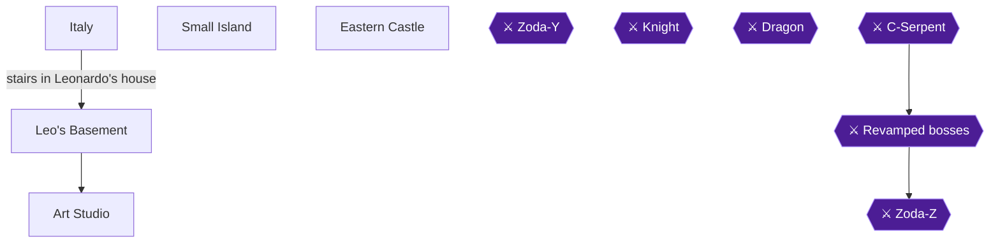

### Area Overview & Preparation

Chapter 6 sends Mike back in time to 15th century Italy [[gf4-8-1, gf2-31-13]]. There is no boss and no major dungeon, only a tiny dungeon and a series of mini-dungeons [[gf2-31-14, gf1-12-25]]. Zoda-Y shows up at the very end, but you do not fight him here [[gf1-13-14]].

Your three goals:

- Free Leonardo da Vinci and take the **Katana** [[gf1-5-17, gf1-12-33]].
- Land on the small island during the flight and get the **Big Heart**.
- Reach the **Tetrad** in the Eastern Castle.

Preparation notes:

- Pick up every medicine you pass in the mini-dungeons. Medicine and other pickups disappear when you leave a dungeon, so use what you need before you exit [[gf4-8-17]].
- Weapons and items collected inside a dungeon do not carry between dungeons [[gf4-8-17]].

### Chapter Items to Collect

| Item | Where Found | Action / Requirement | Citation |
|---|---|---|---|
| Medicine | Second trap room of Leo's Basement | **TAKE** (optional) | [[gf4-8-6]] |
| Hammer and chisel | Art Studio | **TAKE** (starts the cutscene) | [[gf1-12-29, gf2-32-2]] |
| Katana | Leonardo, after he is freed | Received automatically | [[gf1-12-33, gf5-7-27]] |
| Big Heart | Small Island | **WALK AROUND** the island | [[gf3-28-1, gf1-13-2]] |
| Medicines | Some Eastern Castle mini-dungeons | **TAKE** (optional) | [[gf4-8-17]] |
| Tetrad | End of the Eastern Castle maze | **TAKE** | [[gf1-13-13]] |

### Italy (Town)

🗺️ **Map:** [View Chapter 6 Overworld Map on GameFAQs](https://gamefaqs.gamespot.com/nes/587654-zodas-revenge-star-tropics-ii/map/15890-chapter-6-overworld-map)

1. You arrive in a town. Talk to the townspeople. Nobody knows where the Tetrad is, but some mention an old scientist who may help [[gf2-31-15, gf4-8-1]].
2. Talk to the man who is out of maps to Leonardo Da Vinci's place. He sold his last one to a big guy, who is probably Zoda [[gf2-31-16, gf5-7-29]].
3. Walk around until you reach the big house, the only building you can enter [[gf1-12-25, gf4-8-1]].
4. Inside you find a man trapped in plaster and Zoda's tracks. Something is moving inside the statue [[gf2-31-17, gf5-7-17]].
5. Walk to the stairs and go down to Leo's Basement [[gf1-12-26, gf2-31-18]].

### Leo's Basement

🗺️ **Map:** [View Chapter 6 Level 1 Map on GameFAQs](https://gamefaqs.gamespot.com/nes/587654-zodas-revenge-star-tropics-ii/map/2186-chapter-6-level-1-map)

There are no enemies here, only traps [[gf1-12-27, gf3-27-4]].

1. **Circling balls.** Avoid the flying balls that move in a circle [[gf2-31-19, gf4-8-3]].
2. **Ball-dropping machines.** Watch the machines' drop pattern. Wait for the balls to go up, then run underneath [[gf2-31-20]]. Two machines try to crush Mike with a ball [[gf4-8-4]].
3. **Spike platforms.** Next are spikes hanging in mid air with moving platforms. Jump from platform to platform and jump straight forward only. Moving sideways, or jumping straight up, risks hitting the spikes, which means death [[gf2-31-21, gf2-31-22, gf4-8-5]].
4. **Second spike room.** This room has more spikes and moving platforms. Again jump in a straight line and do not sway [[gf2-31-23, gf2-31-24]]. Grab the **Medicine** in this room if you want it [[gf4-8-6]].
5. **Ball-and-hole rooms.** The next two rooms contain balls and a hole. Balls travel in the direction you hit them [[gf2-31-25]]. Knock all of them into the hole with your weapon [[gf1-12-28, gf2-31-26]]. The first room has three balls and the second has five [[gf4-8-8]]. Direct them with weapon fire so they fall down the manhole in each room to proceed [[gf4-8-9]].
6. After the second room you can head out [[gf4-8-10, gf1-12-35]].

### Art Studio

1. You arrive in a different art studio from the one you started in. Grab the hammer and chisel lying on the ground in the western part of the room [[gf4-8-23, gf4-8-2, gf2-32-2]].
2. A cutscene starts and you are warped back to the plaster statue [[gf1-12-29, gf2-32-1, gf4-8-11]]. Mike chips Leonardo out of the statue [[gf5-7-20, gf5-7-21]].
3. Leonardo explains that a monster blasted him with liquid plaster (Zoda-Y). He had been asked about an old stone in a castle to the east [[gf2-32-3, gf5-7-24]].
4. He offers a flying machine to get you to the castle [[gf2-32-5, gf3-27-3]]. He also gives you a weapon from Marco Polo [[gf5-7-26]].


> [!ACHIEVEMENT]
> **Now We Got a Sword (10 Points)**
> 
> *Obtain the Katana.*


You receive the **Katana** [[gf1-12-33, gf5-7-27, gf2-32-4, gf4-8-12]]. It is a more powerful version of Cleopatra's Dagger [[gf1-5-17]].

> [!WARNING]
> **Missable Achievement Warning:** Do not skip ahead through the flight. The Big Heart on Small Island can only be collected during the flight, before you reach the Eastern Castle. Get it before you fly on to the castle [[gf2-32-6]].

### Small Island

Leonardo's crude flying machine carries you toward the castle [[gf4-8-14]]. On the way, Mica contacts Mike again: aliens came to C-Island, hypnotized Dr. J and found out how to time slip, and they may be setting a trap [[gf5-8-2, gf5-8-3]].

The machine then stops on Small Island [[gf3-28-1]]. Get the **Big Heart** here before you proceed to the castle [[gf2-32-6]].

1. Get off the machine. Do not enter the city, and walk toward the mountain [[ra-comments-26-1]].
2. Walk up to the mountain wall from the west [[gf1-13-2]]. Keep going straight until you enter the mountain, as the community comment describes [[ra-comments-26-1]].
3. Walk around the island to find the heart [[gf3-28-1]].


> [!ACHIEVEMENT]
> **Heart on the Lone Island (10 Points)**
> 
> *Obtain the Heart Container in Chapter 6.*


4. Return to the flying machine and take off again [[gf1-13-2, gf3-28-1]].

### Eastern Castle

🗺️ **Map:** [View Chapter 6 Inside the Castle Maze Map on GameFAQs](https://gamefaqs.gamespot.com/nes/587654-zodas-revenge-star-tropics-ii/map/2187-chapter-6-inside-the-castle-maze-map)

This is an overworld maze with fall-through mini-dungeons, not a true dungeon [[gf2-32-8, gf4-8-8]]. There is no boss [[gf4-8-8]]. Every now and then you fall into a cave. Some are small, some larger, and some hold medicines [[gf4-8-25]]. Mini-dungeons are usually random and get harder as you go [[gf1-13-6]]. Use medicine just before exiting, since it is not saved between dungeons [[gf4-8-17]].

Mini-dungeon rule: if there is a switch, get the switch. If not, kill the enemies. If you fall into a hole, kill all enemies and try all the doorways until you are out [[gf1-13-30, gf1-13-4, gf1-13-29]].

1. Walk forward and go into the thick hallway [[gf1-13-3, gf4-8-15]]. Walk up the hallway and you will soon fall into a hole [[gf2-32-8]]. Clear the mini-dungeon.
2. Back in the maze, go down the stairs and head left [[gf1-13-4]]. If you fall into the hole with the green guys, the switch is in the second-last column [[gf1-13-4]]. Keep heading left and ignore other pathways [[gf1-13-4]].
3. You fall into another mini-dungeon before the stairs. Do the same as before [[gf1-13-4, gf2-32-8]].
4. After the stairs, walk two squares left, one down, and all the way left until you are under the next stairway. Go up it [[gf1-13-7, gf2-32-13]].
5. At the fork you fall into another mini-dungeon [[gf1-13-8]]. Kill the red thing, and head up [[gf1-13-9]].
6. Dodge or kill the skulls and head up the stairs [[gf1-13-10]].
7. Stop over the last set of footprints, or you will fall into another dungeon [[gf1-13-11]].
8. From the footprints go down one, right two, up one, right two, down one, then all the way right to the Tetrad [[gf1-13-12, gf2-32-13]]. A final mini-dungeon stands between you and the Tetrad [[gf4-8-22]].

> [!CAUTION]
> **Point of No Return:** Taking the Tetrad ends Chapter 6, and Zoda-Y sends Mike to Transylvania [[gf2-32-14, gf4-9-1, gf4-9-5]]. Make sure you have landed on Small Island for its Big Heart first [[gf2-32-6]].


> [!ACHIEVEMENT]
> **Watch Out for Pits! (10 Points)**
> 
> *Obtain the Tetrad in Chapter 6.*


Mike obtains the **Tetrad** and his life level increases [[gf1-13-13, gf2-32-14, gf5-8-5]]. Zoda-Y then appears, calls Mike a human, and sends him to the land where a count stalks his victims by the light of the moon [[gf1-13-14, gf1-13-15, gf4-9-1]]. This is Transylvania and Dracula's Castle [[gf2-32-15, gf4-9-5]].

> [!IMPORTANT]
> ### Chapter 6 Cumulative 100% Checkpoint
> - **Big Hearts:** 4 / 4 (Small Island) [[gf3-28-1]]
> - **Tetrads:** 5 / 7 (Eastern Castle) [[gf1-13-13]]
> - **Katana:** Obtained [[gf1-12-33]]
> - **RetroAchievements Unlocked:** 26 / 31 (220 / 285 points)

### Chapter Checklist

- [ ] Found Leonardo's house and went down the stairs.
- [ ] Cleared the trap rooms and both ball-and-hole rooms in Leo's Basement.
- [ ] Took the hammer and chisel and freed Leonardo.
- [ ] Received the Katana (36905).
- [ ] Walked around Small Island and got the Big Heart (36906).
- [ ] Cleared the Eastern Castle maze and its mini-dungeons.
- [ ] Took the Tetrad (36907).

---

## Chapter 7: Chapter 7: Transylvania

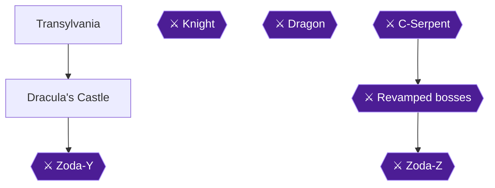

### Area Overview & Preparation

Chapter 7 is set in Transylvania, which holds a single dungeon, Dracula's Castle [[gf2-32-15]]. The guide calls this chapter short, because the dungeon is not too difficult and that is all there is to it [[gf2-32-16]]. Zoda-Y sends you here to "the land where a count stalks his victims by the light of the moon" [[gf1-13-15]], and the game opens on a forest at night [[gf5-8-8]].

Two achievements are available here:

- **Triple the Fun (36908):** pick up the Triple Spike Ball. This is the one item that can be missed.
- **House of the Undead (36909):** obtain the Tetrad after Zoda-Y.

The Triple Spike Ball shoots three spike balls, which gives more range and different directions of attack, and it works well against several enemies at once [[gf2-23-2]]. Spike Balls fire a three-direction spread shot and are first found in Transylvania [[gf3-41-21]].

Preparation: save your medicine for the boss. The author of one guide hopes you kept all the medicine you collected for Zoda-Y [[gf2-33-1]]. Zoda-Y's second form is the hard part, and you will almost certainly need potions [[gf1-19-1]]. The guide also suggests the Mace weapon for the boss and the shockwave when you run out [[gf1-19-1]]. "Mace" is that guide's name for the three-way spike-ball weapon, the Triple Spike Ball from Room 13 [[gf1-6-4]].

The castle is a chain of numbered rooms. The route below uses the room numbers from the room-by-room guide.

### Chapter Items to Collect (1 Achievement Item)

| Item | Where Found | Action / Requirement | Citation |
|---|---|---|---|
| Triple Spike Ball (spike balls) | Dracula's Castle, Room 13, chest on the east wall | **TAKE** before dropping down the hole to Room 14 | [[gf3-30-1, gf3-30-2]] |
| Triple Spike Ball (backup) | Dracula's Castle, Room 26, across the pit on the floating platform | **TAKE** only if you missed Room 13 | [[gf3-31-3]] |
| Tetrad | Overworld, just after Zoda-Y | **TAKE** | [[gf3-32-1, gf2-33-10]] |

### Transylvania (Overworld)

Mike starts on a cold, dark mountainside [[gf3-30-1]]. Head north along the path and you will soon find Dracula's Castle [[gf4-9-3]]. You do not have far to walk [[gf1-13-31]].

Dracula's Castle is a real castle that you have to explore to find the Tetrad [[gf4-9-4]].

### Dracula's Castle

🗺️ **Map:** [View Chapter 7 Level 1 Map on GameFAQs](https://gamefaqs.gamespot.com/nes/587654-zodas-revenge-star-tropics-ii/map/2188-chapter-7-level-1-map)

> [!WARNING]
> **Missable Achievement Warning:** In Room 13, open the chest on the east wall BEFORE you drop down the hole in the middle of the room to Room 14. It holds the spike balls for the Triple the Fun achievement (36908) [[gf3-30-1, gf3-30-2]]. If you miss it, the Room 26 platform has more spike balls as a backup [[gf3-31-3]].

#### Rooms 1-5: The entrance

1. **Room 1:** There are two hearts if you need them. Head west to Room 2 [[gf3-30-1, gf2-32-18]].
2. **Room 2:** Two more hearts are here. You can also take the north path to Room 5 [[gf3-30-1]].
3. **Room 3 (optional medicine):** If you enter from Room 1 you cannot make the jump, so go back. If you enter from Room 4 or Room 5, jump up on the boxes in the middle of the room and grab the medicine [[gf3-30-8]].
4. **Room 4:** Three blue bats are here. Blue Bats take two hits each [[gf3-43-8]]. Defeat them, then follow the open door west to Room 3 [[gf1-13-18, gf2-32-20]].
5. **Room 5:** Three Frankensteins are here. Defeat them to open the north door to Room 6 [[gf1-13-19]].

#### Rooms 6-9: The ghost rooms

These four rooms are connected. They look empty at first, but wait a few moments and ghosts appear [[gf1-13-20, gf2-32-21]]. Go for the ghost that is a different color than the rest [[gf3-30-9]].

- Defeating the ghosts in Room 8 opens the north wall to Room 10 [[gf3-30-10]].
- Defeating the ghosts in Room 9 opens the east wall to Room 11 [[gf3-30-11]].

**Room 10 (secret room with medicine):** Flames guard the medicine, and fire randomly comes up around it, so time your steps [[gf3-30-7, gf1-13-21, gf2-32-22]]. Grab it and return to Room 8 [[gf3-30-7]].

#### Rooms 11-13: The Spike Ball chest

1. **Room 11:** Three pyramid guards are here. Use your psychic blast on them. When all three are defeated, the east door opens [[gf3-30-12, gf1-13-23]].
2. **Room 12:** A Tombstone Ghost can only be hurt from behind. Attack its tombstone, and the east door opens to Room 13 [[gf3-30-13, gf2-32-23, gf1-13-24]].
3. **Room 13:** Walk to the chest on the east wall and open it. It holds the **Triple Spike Ball** [[gf3-30-1]].


> [!ACHIEVEMENT]
> **Triple the Fun (10 Points)**
> 
> *Pick up the Triple Spike Ball in Chapter 7.*


Only after you have the spike balls should you jump to the hole in the middle of the room and wait a moment to fall [[gf3-30-2, gf1-13-32]].

#### Rooms 14-16: The falling sequence

You must keep moving while you fall through the next rooms.

1. **Room 14:** You cannot land safely here when falling from Room 13. You simply fall through to Room 15 [[gf3-30-1]].
2. **Room 15:** As you fall, head diagonally left or right [[gf1-13-25]]. If you moved in any direction while falling from Room 14, you land safely on a tile. Open paths lead west to Room 17 and east to Room 18. If you did not move, you keep falling to Room 16 [[gf3-30-3]]. You do need to fall through the floor in this room, because Room 16 is the way forward [[gf3-30-4]].
3. **Room 16:** Move in any direction as you land and you land safely. Three Frankensteins are here. Defeat them and the east door opens to Room 19. If you stand still, you fall back to Room 13 [[gf3-30-5]].

Optional side rooms off Room 15:

- **Room 17:** An island holds a medicine, but the guide's author never found a way to reach it [[gf3-30-6]].
- **Room 18:** A priest is here. Defeat him to get some of the hearts in the room, otherwise return to Room 16 [[gf3-31-3]].
- A sign here is a Try Your Luck sign. The guide's author always gained +1, though this is unconfirmed [[gf2-32-25, gf1-13-26]].
- A further medicine sits at the tip of the arrow on the left, but you must keep moving in some direction while falling or you will miss it [[gf1-13-27, gf1-13-28]]. Falling into a cave now and then is normal in this castle [[gf4-8-25]].

#### Rooms 19-24: The east loop

1. **Room 19:** Two tombstone ghosts. Defeat them and the east door opens to Room 20 [[gf3-31-1]].
2. **Room 20:** Four skeletons. Avoid them and head up the stairs to Room 21 [[gf3-31-1]].
3. **Room 21:** A magician. Defeat him and the east door opens to Room 22 [[gf3-31-1]].
4. **Room 22:** Five blue bats. Defeat them and head north to Room 23 [[gf3-31-1]].
5. **Room 23:** Two Frankensteins. You do not have to defeat them; find the tile that opens the west door to Room 24 [[gf3-31-4]]. Hearts are here too, and you can grab the switch in the right-hand set [[gf1-14-2]].
6. **Optional extra potion:** In the room with two Frankensteins, where a switch opens the west exit, you can bust through the north wall for an extra potion [[gf1-14-1]].
7. **Room 24:** A priest. Defeat him to open the west door to Room 25 [[gf3-31-1]].

#### Rooms 25-26: Backup spike balls

1. **Room 25:** Three more pyramid guards. Defeat them to open a hidden wall to the west, leading to Room 26. To open the north door to Room 27, activate one of the tiles [[gf3-31-1, gf3-31-2]].
2. **Room 26:** Two Frankensteins are here. Defeating them reveals a floating platform. Use it to cross the pit at the west end and reach a medicine and spike balls. This is the backup if you missed Room 13 [[gf3-31-3]]. Afterward head back to Room 25 and north to Room 27.

#### Rooms 27-29: Toward the boss

1. **Room 27:** Two skeletons and two bats. Defeat the bats and the west door opens to Room 28 [[gf3-31-1]].
2. **Room 28:** A magician. Defeat him to open the north door to Room 29 [[gf3-31-1]].
3. **Sleepwalking and bat-shaped rooms:** Another guide describes a room of sleepwalking enemies. Hit the switch in the top right set, and killing the enemies opens a doorway to medicine and weaponry [[gf1-14-3, gf1-14-4, gf2-32-27, gf2-32-28, gf2-32-29]]. Then comes the bat-shaped tile room: kill the bats to open a doorway, and the tile switches are in the top left and bottom right corners [[gf1-14-5, gf1-14-6, gf2-33-1]].
4. **Room 29:** Five bats; defeating them opens the north door to Room 30. Several tiles here reveal two hearts and a medicine [[gf3-31-5]].

Before the boss, use any spare medicine so you enter with full health. Zoda-Y is the boss at the end [[gf1-14-7]], and the next room contains him; it is not Dracula [[gf2-33-2]].

### Boss: Zoda-Y

Difficulty is rated Hard [[gf1-19-1]].

**Opening:** As soon as you enter, move forward a little, because spikes rise from the floor right in front of the entrance [[gf1-19-3, gf2-33-3]].

**Form 1:**
1. Zoda appears, fires a spray of shots, then disappears. Shoot him when he first appears, then avoid his shots [[gf3-31-6]].
2. He releases bats. Kill the bats, then hit him a few times before he teleports. Repeat this pattern [[gf2-33-4]]. This is slower but keeps the bats off you, and you need all the health you can get for the next form [[gf1-19-1]].

**Form 2 (bird creature):**
1. After enough hits he kneels, then changes into an owl-like bird form [[gf3-31-7, gf1-19-1]].
2. It releases two bats at a time, and they keep coming while he lives [[gf3-31-7]].
3. He flaps his wings and shoots wind that pushes you back toward the floor spikes. Hold up as hard as you can to resist it, because the spikes are instant death [[gf2-33-7, gf3-31-8]].
4. He also fires feathers that can damage you [[gf3-31-9]]. You cannot really avoid them during the gust, since staying clear of the spikes comes first [[gf2-33-1]].
5. Hit him when he is exposed, using the Mace; use the shockwave when it runs out [[gf1-19-1]]. Keep hitting the bird form and you will eventually defeat him, which opens the east door to Room 31 [[gf3-31-10]].

Tip: you cannot really dodge the feathers during a gust, so keep pushing away from the spikes first and take the feather hits [[gf2-33-1, gf3-31-9]].

> [!CAUTION]
> **Point of No Return:** The Tetrad after Zoda-Y ends Chapter 7. Make sure you picked up the Triple Spike Ball in Dracula's Castle before collecting it [[gf2-33-10, gf5-8-11]].

### The Tetrad

Head north out of Room 31 to return to the overworld [[gf3-31-10]]. Mike is back on the overworld with another Tetrad in front of him. Grab it [[gf3-32-1]]. You get a Tetrad and your life meter increases [[gf2-33-10, gf1-14-9]].


> [!ACHIEVEMENT]
> **House of the Undead (10 Points)**
> 
> *Obtain the Tetrad in Chapter 7.*


Mike then opens the book and the next page shows Chapter 8 [[gf3-32-1, gf5-8-11]].

### Chapter Checklist

- Room 13 chest on the east wall opened before the hole drop (Triple Spike Ball) [[gf3-30-1, gf3-30-2]]
- Achievement 36908 unlocked
- Zoda-Y defeated [[gf1-14-7]]
- Tetrad picked up in the overworld [[gf3-32-1]]
- Achievement 36909 unlocked
- Life meter increased [[gf1-14-9]]

> [!IMPORTANT]
> ### Chapter 7 Cumulative 100% Checkpoint
> - **Triple Spike Ball:** 1 / 1 [[gf3-30-1]]
> - **Big Hearts:** 4 / 4
> - **Tetrads:** 6 / 7 [[gf3-32-1]]
> - **RetroAchievements Unlocked:** 28 / 31 (240 / 285 points)

---

## Chapter 8: Chapter 8: Camelot

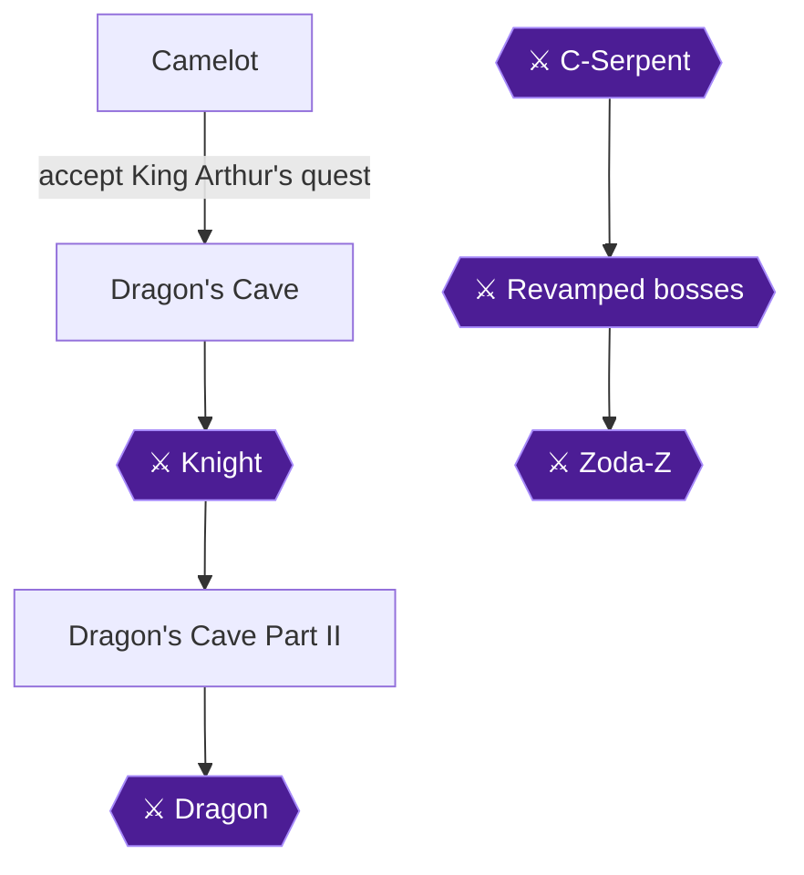

### Area Overview & Preparation

Chapter 8 is the last "main" chapter of the game. You arrive in a forest in daytime [[gf5-8-10]], and the book shows Chapter 8 when Mike turns to the right page [[gf5-8-11]]. The chapter has two goals:

- **Accept King Arthur's quest** and be knighted, which raises Mike's life [[gf2-33-12, gf3-32-4]].
- **Clear Dragon's Cave** in two parts. Along the way Merlin gives you the **Ultra Psychic Shockwave** [[gf1-5-22]], and the Dragon at the end of Part II drops the **final Tetrad** [[gf2-35-5]].

There are no permanent lockouts listed for this chapter, but one dialogue choice can stop your progress (see the warning below). Collect every medicine you can, because the Dragon fight punishes a lack of healing: you should be pretty heavily armed with lots of medicine [[gf1-15-20]].

The Ultra Psychic Shockwave needs at least 10 hearts to use [[gf1-5-23, gf3-41-16]]. Keep your health at 10 hearts or more when you fight the Dragon.

> [!TIP]
> Before you leave Dragon's Cave Part II, make sure you have used every medicine pickup you wanted. Stored items can be used whenever you want, but they disappear when you leave the dungeon [[gf1-5-1]].

Medicine does not count toward any achievement, so the list below is for survival only.

### Chapter Items to Collect

| Item | Where Found | Action / Requirement | Citation |
|---|---|---|---|
| Medicine | Platform below the Dragon's Cave blob room | **TAKE** after falling through the floor | [[gf2-33-16]] |
| Medicine | Left passageway past the skeletons | **TAKE** | [[gf2-33-18, gf1-14-14]] |
| Medicine | Around the left side of the cave | **TAKE** | [[gf2-33-19, gf1-14-15]] |
| Medicine | Room 2 tile reveal (reached by jumping down) | **TAKE** (optional) | [[gf3-33-2]] |
| Medicine | Dragon Cave Room 6 | **TAKE** | [[gf3-33-4]] |
| Medicine | Dragon Cave Room 7 (ledge) | **TAKE** (optional, hard) | [[gf3-33-5, gf3-33-6]] |
| Medicine | Dragon Cave 2 Room 3 | **TAKE** | [[gf3-35-2]] |
| Medicine | Dragon Cave 2 Room 5 (tile reveal) | **TAKE** | [[gf3-35-4]] |
| Medicine | Part II, bottom-right switch area | **TAKE** | [[gf1-15-6]] |
| Medicine | Part II tile switch, third-last row (fire around it) | **TAKE** | [[gf1-15-12]] |
| Medicine | Part II left path | **TAKE** | [[gf1-15-15]] |
| Medicine | Room #17 upper west corner | **TAKE** | [[gf3-36-3]] |
| Medicine | Room #20 (surrounded by flames) | **TAKE** | [[gf3-36-7]] |
| Medicine | Room #25 | **TAKE** | [[gf3-36-6]] |
| Ultra Psychic Shockwave | Merlin, after the Knight | Story | [[gf1-15-1]] |
| Tetrad | After the Dragon | Story | [[gf2-35-5]] |

### Camelot

🗺️ **Map:** [View Chapter 8 Overworld Map on GameFAQs](https://gamefaqs.gamespot.com/nes/587654-zodas-revenge-star-tropics-ii/map/15891-chapter-8-overworld-map)

Walk toward the castle and talk to anyone you like; the townsfolk give only flavor. A knight tells you to see the king [[gf5-8-12]], a second knight says the shadow of a dragon looms over Camelot and the king seeks a hero [[gf5-8-13]], and Sir Lancelot says the dragon is in the northern cave but he is too busy to fight it [[gf5-8-14]]. A guard says the king forbids citizens to travel beyond this point [[gf5-8-15]], and a woman tells you to see Arthur [[gf5-8-16]].

> [!WARNING]
> **Do NOT answer NO to King Arthur.** Answering NO seems to prevent you from going any farther [[gf3-32-3]]. In the script, Arthur calls you a coward and tells you to get out, and talking to him again repeats that [[gf5-9-5]]. If you did say NO, the guide says you will need to reset [[gf3-32-3]].

1. Go into the castle and talk to **King Arthur** [[gf1-14-10]]. He asks you to smite the dragon because his knights are out on quests [[gf2-33-11]].
2. Answer **YES**. Arthur christens you Sir Mike and your life level increases [[gf1-14-29, gf2-33-12]].
3. Go back outside and talk to the guard blocking your path. He now lets you pass [[gf1-14-11, gf5-9-5]].
4. Follow the path north until you reach the cave [[gf3-32-4]].

### Dragon's Cave (Part I)

🗺️ **Map:** [View Chapter 8 Level 1 Map on GameFAQs](https://gamefaqs.gamespot.com/nes/587654-zodas-revenge-star-tropics-ii/map/2190-chapter-8-level-1-map)

#### Opening rooms

1. **Room 1** is empty. Head north [[gf3-33-1]].
2. In **Room 2** kill all the blobs. When you kill the last one, stand near the middle-top of the screen toward the north wall [[gf1-14-12, gf2-33-15, gf3-33-1]]. Do this and Mike falls through the floor onto a platform instead of below it.
3. Take the **medicine** on the platform [[gf2-33-16]]. You can also activate the tile in this room, but you must jump down to get the medicine it reveals and then go around and back [[gf3-33-2]].
4. Go up the left passageway with the pile of bones. Hit the bones so they fall down, then jump over them [[gf1-14-13, gf2-33-17]].
5. Take the **medicine** past them [[gf2-33-18, gf1-14-14]], then go back around the left side.
6. Go around and take **another medicine** [[gf2-33-19, gf1-14-15]].
7. Kill the Frankenstein while standing in the middle of the screen [[gf1-14-16]].

Other rooms in this area: Room 3 has no enemies, and you cannot reach the tile on the ledge, so go west [[gf3-33-1]]. Room 4 has three skeleton heads; avoid them and take the northwest stairs. Room 5 has a tile in the middle that opens the wall east to Room 2 [[gf3-33-3]]. Room 6 has four robed skeletons and a **medicine** [[gf3-33-4]]. Room 7 has a magician; defeating him drops you through the floor, and there is a **medicine** on the ledge if you fall in the middle against the north wall [[gf3-33-5, gf3-33-6]]. Landing on the ledge in Room 8 lets you go straight north to Room 13.

Room 13 has two knights; kill them to open the west wall [[gf1-14-17]].

#### The conveyor rooms

Spikes form at the finish line of each fast conveyor belt, and small daggers appear at some point [[gf1-14-18]]. Move quickly [[gf3-33-7]].

1. **First room:** take the shortcut halfway through [[gf1-14-19, gf2-34-2]].
2. **Second room:** take the up path, then the down path [[gf1-14-20, gf2-34-3]]. Ride the belt up on the first loop and down on the second to avoid ground blades [[gf3-33-8]].
3. **Third room:** up and down again [[gf1-14-21, gf2-34-4]]. Take the first loop down; on the second loop stay in the middle moving west [[gf3-34-2]].
4. **Last room:** down, then middle [[gf1-14-22, gf2-34-5]]. Grab the four hearts after jumping the spikes [[gf3-34-1, gf1-14-23, gf2-34-6]].

### Knight (Boss)

You stand on a ring of conveyor belts that moves you quickly around the level [[gf1-19-14, gf2-34-7]]. The Knight rides a flying horse and moves back and forth shooting bullets in two directions [[gf1-19-13]]. In Room 17 you move in a perpetual counter-clockwise motion [[gf3-34-4]].

- Jump over his shots when they get near [[gf1-19-14]].
- Aim the shockwave diagonally at him and keep firing [[gf3-34-3, gf2-34-7]].
- He occasionally shoots at you; just avoid the shots [[gf3-34-5]].

### Merlin and the Ultra Psychic Shockwave

After the Knight, walk forward. An owl talks to you and reveals itself as Merlin [[gf1-14-24]]. He explains that he was a friend of Hirocon from a faraway planet [[gf1-14-25]], that Hirocon spread the Tetrads across time and space so only a hero could find them [[gf1-14-26]], and that you must collect the last Tetrad and put them together [[gf1-14-27]]. Then he gives you the last and most powerful magic [[gf1-14-28]].


> [!ACHIEVEMENT]
> **Ultra Psychic Shock Wave (10 Points)**
> 
> *Obtain the Ultra Psychic Shock Wave*


You obtain the Ultra Psychic Shockwave [[gf1-15-1, gf5-9-8, gf3-34-6]]. Remember it requires 10 hearts [[gf1-5-23]]. Continue along the path to fight for the final Tetrad [[gf1-15-2]].

### Dragon's Cave Part II

🗺️ **Map:** [View Chapter 8 Level 2 Map on GameFAQs](https://gamefaqs.gamespot.com/nes/587654-zodas-revenge-star-tropics-ii/map/2189-chapter-8-level-2-map)

The music changes. Dragon Cave 2 room numbers below come from the room-by-room guide.

1. Room 2: grab the hearts and kill the bats to open a secret [[gf1-15-3]]. Take the stuff and hit the switch in the bottom left, then the switch in the bottom right [[gf1-15-4, gf1-15-5]].
2. Grab the **medicine** and head back to the first bat room [[gf1-15-6]]. Room 3 has a **medicine** and spike balls; its tile opens the north wall to Room 5 [[gf3-35-2, gf3-35-3]], where a tile reveals another **medicine** [[gf3-35-4]].
3. Kill all enemies until the music changes [[gf1-15-7]]. Room 7 has a Red Triceratops, which you can shoot from a safe distance with the new weapon [[gf3-35-5]].
4. Hearts sit in a tile, but you must kill all blobs to move on [[gf1-15-8]]. Kill the big blobs for more hearts in the bottom left corner of the tile set [[gf1-15-9, gf3-35-6, gf3-35-7]].
5. Room 12: jump on the floating platform, then the moving platform, up to the stationary platform, then to the tile; jump back for the question mark that opens the door [[gf3-35-8, gf3-35-9, gf1-15-10]]. Grab hearts and the orb [[gf1-15-10]].
6. Room 14, moving balls: shoot them once to stop and once to restart [[gf3-35-10]]. Activate the tile, then grab the question mark [[gf3-35-11]].
7. Room 15, mines drop: hit tile switches [[gf1-15-11]]. Find the tile and the question mark fast [[gf3-35-12, gf3-35-13]]. One tile in the third-last row gives a **medicine** (fire around it); one in the third row opens the door [[gf1-15-12, gf1-15-13]].
8. Hearts in the bottom left and top right corners of the next room [[gf1-15-14]]. Take the left path for **medicine**, then go right [[gf1-15-15]].
9. Kill the two enemies for a potion and weapons if needed [[gf1-15-16]], or get the bottom-left switch [[gf1-15-17]].
10. Room 16 has two sets of tiles revealing two sets of four hearts [[gf3-36-4]]. Room 17 has a triceratops (defeat it to open the east door) and a **medicine** in the upper west corner [[gf3-36-10, gf3-36-3]].
11. Room 18: two triceratops open the west door; a tile opens north to Room 19 [[gf3-36-11, gf3-36-20]]. Room 19: two skull heads open the west door [[gf3-36-12]]. Room 20: **medicine** among flames; the question mark opens east to Room 21 (six bats, spike balls) [[gf3-36-7, gf3-36-8, gf3-36-9, gf3-36-19]].
12. Room 22: two armored knights [[gf3-36-13]]. Room 23: four rock guys, plus a tile for four hearts [[gf3-36-14, gf3-36-5]]. Room 24: one armored and two regular knights [[gf3-36-15]]. Room 25: two big green blobs and a **medicine** [[gf3-36-16, gf3-36-6]].
13. Kill all enemies until you reach the Dragon [[gf1-15-21, gf1-15-18, gf1-15-19]].

### Dragon (Boss)

Be heavily armed with lots of medicine [[gf1-15-20]]. The Dragon is in Room 26 [[gf3-35-1]].

- It slowly walks forward blasting fire in three directions while spikes grow [[gf1-19-20]]. Beat it quickly or the spikes consume you [[gf1-19-21]].
- The only way to kill it is hitting its head [[gf2-40-14]]. Jump and fire in midair; do not wait for it to breathe fire [[gf3-36-1]].
- Stay near the bottom right corner, jump, and use the Ultra Psychic Shockwave on its head [[gf1-19-23]].
- When it flies and shoots bullets, walk in a counter-clockwise circle [[gf1-19-22, gf1-19-24]].
- Spend as many medicines as needed to finish quickly.

Defeating it opens the east door to Room 27 [[gf3-36-18]]. Grab the Tetrad.


> [!ACHIEVEMENT]
> **The Middle Ages (10 Points)**
> 
> *Obtain the Tetrad in Chapter 8.*


You obtain the final Tetrad [[gf2-35-5, gf5-9-11, gf1-15-22]]. Exit north to the overworld [[gf3-36-17]]. Mica calls and asks you to return to C-Island [[gf1-15-23]]. Turn to the last page and say the magic words to continue.

> [!IMPORTANT]
> ### Chapter 8 Cumulative 100% Checkpoint
> - **Big Hearts:** 4 / 4
> - **Tetrads:** 7 / 7 (final tetrad obtained after the Dragon fight) [[gf2-35-5]]
> - **RetroAchievements Unlocked:** 30 / 31 (260 / 285 points)

### Chapter Checklist

- [ ] Accepted King Arthur's quest (YES) [[gf3-32-3]]
- [ ] Knighted; life increased [[gf2-33-12]]
- [ ] Medicines collected in Dragon's Cave
- [ ] Knight defeated
- [ ] Ultra Psychic Shockwave obtained (36910)
- [ ] Dragon defeated by hitting its head
- [ ] Final Tetrad obtained (36911)

---

## Chapter 9: Chapter 9: Return to C-Island

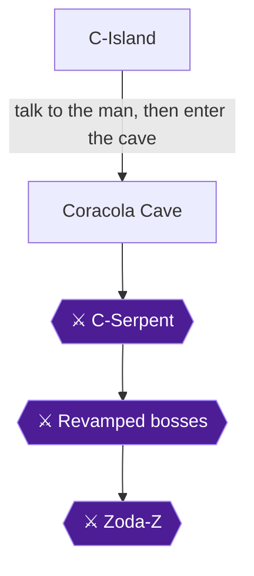

### Area Overview & Preparation

This is the final chapter. After you finish the Dragon's Cave, Mica calls Mike and asks him to return to C-Island [[gf1-15-23]]. Mike turns to the last page of the book and says the magic words, and the book shows Chapter 9 [[gf5-10-2]]. He appears on C-Island and exclaims "I'm on C-Island!" [[gf5-10-1]]. The game then tells him he must hurry to Coralcola to help Mica [[gf5-10-3]].

Mica reports that aliens came to C-Island and hypnotized Dr. J, who then revealed how to time slip [[gf5-8-2, gf5-8-3]].

What to expect in this chapter:

- A village visit in Coralcola, then the original StarTropics cave, which is the same cave as in the first game, sort of [[gf1-15-24]].
- C-Serpent as the first boss, as in the original game [[gf2-35-17]].
- A conveyor-belt section, where the bottom route is the one that gives medicines [[gf2-36-1]].
- Revamped versions of every earlier boss: the same, but faster [[gf2-36-2, gf1-15-31]].
- The final fight against Zoda-Z in three forms.
- Ending and credits, which unlock achievement 36912.

> [!WARNING]
> **Inventory warning:** Medicines are your lifeline in this chapter. Grab as many potions as you can before the final fight [[gf1-15-30]]. Do not waste them on the rematch bosses. You will need all the help you can get against Zoda-Z [[gf2-36-6]]. Unable to verify from collected sources: exact medicine counts per room.

> [!TIP]
> **Before you leave each room:** The guide says to check every tile in the cave for secrets [[gf1-15-24]]. Tiles frequently give hearts, weapons and medicine. There are no listed points of no return in this chapter, but there is also nothing to collect after the ending.

### Chapter Items to Collect

This chapter has no collection achievement. The only achievement is 36912 for the ending. Items worth taking are listed below for survival.

| Item | Where Found | Action / Requirement | Citation |
|---|---|---|---|
| Hearts (two sets of four) | Cave Room #2 | **TAKE** | [[gf3-38-3]] |
| Four hearts | Cave Room #6 (activate tiles) | **ACTIVATE tiles** | [[gf3-38-7]] |
| Medicine | Cave Room #8 | **TAKE** | [[gf3-38-10]] |
| Two hearts, medicine, random life sign | Island in Cave Room #9 | **JUMP to island and back** | [[gf3-38-12, gf3-38-13, gf3-38-14]] |
| 25 torches | Chest in the original cave | **OPEN chest** | [[gf2-35-13]] |
| Medicine | Room via skinny passageway | **TAKE** | [[gf2-35-15]] |
| Hearts and medicines | Conveyor rooms (#14-#18) | **TAKE, avoid spikes** | [[gf3-38-22]] |
| Pill | Cave Room #28 | **ACTIVATE first tile** | [[gf3-39-8]] |

### C-Island and Coralcola

🗺️ **Map:** [View Chapter 9 Overworld Map on GameFAQs](https://gamefaqs.gamespot.com/nes/587654-zodas-revenge-star-tropics-ii/map/15892-chapter-9-overworld-map)

Mike arrives on the beach. Head to the village of Coralcola [[gf5-10-3]].

The villagers have all been turned into wild boars except for one boy [[gf5-10-4]]. Talk to him: he explains that odd sounds have been coming from the tunnel and asks Mike for help [[gf5-10-5]]. The guide's instruction is simply to talk to the only human, then go into the cave [[gf1-15-24, gf2-35-7]]. Follow the path to the town, talk to the man, then enter the original cave [[gf2-35-7]].

### Coracola Cave (The Original Cave)

🗺️ **Map:** [View Chapter 9 Level 1 Map on GameFAQs](https://gamefaqs.gamespot.com/nes/587654-zodas-revenge-star-tropics-ii/map/2191-chapter-9-level-1-map)

This is the original cave, remixed. Check every tile for secrets [[gf1-15-24]].

#### Opening Rooms (Rooms #1-#3)

Room #1: Take the passage north to Room #2 [[gf3-38-1]].

Room #2: Defeat the three pink blobs to open the north passage. Collect the two sets of four hearts here [[gf3-38-2, gf3-38-3]]. The other guide says to move up a screen and kill three snails to unlock a door [[gf2-35-8]].

Room #3: Six pink blobs are here, but you only need to defeat one specific random blob to open the north door to Room #4 [[gf3-38-4]]. Since you cannot tell which it is, simply keep killing blobs.

#### Rooms #4-#6

Room #4: Activate the tile to open the north door to Room #5 [[gf3-38-5]]. Step on the switch in the room to unlock the door [[gf2-35-9]]. Unable to verify from collected sources: which tile specifically in this room.

Room #5: Defeat two purple bats and three blue rats to open the north door [[gf3-38-6]].

Room #6: Activate the tiles to get four hearts and open the north door to Room #7 [[gf3-38-7]].

#### Rooms #7-#9

Room #7: Two purple asps and two pink blobs are here. Of the two tiles, one opens the north door to Room #9 and the other opens the east wall to Room #8 [[gf3-38-8, gf3-38-9]].

Room #8: Take the medicine. A tile here opens the north wall to Room #9 [[gf3-38-10, gf3-38-11]].

Room #9: An island in the middle holds two hearts, a medicine and a random life sign [[gf3-38-12, gf3-38-13, gf3-38-14]]. Jump to it and back while taking as little damage as possible [[gf3-38-15]].

#### Chest Room and Side Rooms

A chest room features in the other guide. Jumping on the tiles reveals three switches that unlock two doors and a chest [[gf2-35-14]]. Open the chest first and take the 25 torches inside [[gf2-35-13]]. Go right through the skinny passageway to a room with a medicine [[gf2-35-15]].

> [!WARNING]
> The room beyond that unlocked side room kills you. Do not go in [[gf2-35-16]].

#### Room #10 and C-Serpent

Room #10: Defeat three bats and two asps quickly to open the north door to Room #11 [[gf3-38-16]]. Kill all enemies in the room to reach the first boss [[gf2-35-17]].

**Boss: C-Serpent (Room #11).** It is the old boss from the first game, now just bones [[gf3-38-17]]. It moves side to side and breathes fire in three directions, like the mace weapon, which you should use [[gf1-19-40]]. Avoid the shots and hit the head when the mouth is open [[gf3-38-17]]. Defeating it makes a platform appear so you can go north to Room #12 [[gf3-38-18]].

Unable to verify from collected sources: C-Serpent's HP.

### Conveyor Section (Rooms #12-#20)

Room #12: Nothing to do except take the path east to Room #13. Unable to verify from collected sources: further detail.

Room #13: Tiles form an arrow leading to one of three conveyor paths. Take any one of them to Room #14 [[gf3-38-19]]. However, the top route has very few potions and the bottom route has the most [[gf1-15-28, gf1-15-29]]. Take the bottom route to get a bunch of medicines [[gf2-36-1]].

Rooms #14-#18 are connected by conveyor belts. Collect hearts and medicines and avoid spikes [[gf3-38-22]].

Room #19: You fall through the floor to Room #20 [[gf3-38-20]].

Room #20: A greyscale room with seemingly no exit. Wait, and a tile in the middle will appear and open the north door to Room #21 [[gf3-38-21]].

### Revamped Bosses (Rooms #21-#27)

All earlier bosses return, the same but faster [[gf2-36-2, gf1-15-31]]. Save your medicines.

| Room | Boss | Tip | Citation |
|---|---|---|---|
| #21 | Yum Yum | No boar on his plate this time. Use the same technique as before; opens east door | [[gf3-39-1]] |
| #22 | Scorpion | Avoid the little scorpions; opens north door | [[gf3-39-2]] |
| #23 | Pharoah (mask) | Avoid his blasts; you then fall through the floor | [[gf3-39-3]] |
| #24 | Zoda-X | Random conveyor belt; avoid getting hit; opens north door | [[gf3-39-4]] |
| #25 | Skeleton Miner | Same way as before; opens north door | [[gf3-39-5]] |
| #26 | Zoda-Y | Turns into a bird halfway; you then fall through the floor | [[gf3-39-6]] |
| #27 | Dragon | Hit his head by jumping in the air; opens east door | [[gf3-39-7]] |

Room #28: Two tiles eventually appear. One makes a pill appear; the other opens the north door to Room #29 [[gf3-39-8, gf3-39-9]]. Take the pill first, then use the other tile.

> [!TIP]
> **Before you leave Room #28:** Use up your preparations. Check you have as many medicines as possible [[gf1-15-30]]; the next room is Zoda-Z.

### Zoda-Z (Room #29)

Zoda-Z is described as ten times the boss the original Zoda was, and a significant challenge [[gf1-19-25]]. The guide says use any and all items you have [[gf2-41-10]].

**Form 1 – Larva.** He starts as a group of tiny creatures (four Zoda balls) and one is a different color [[gf1-19-28, gf2-36-3, gf3-39-10]]. Avoid the matching ones and shoot the off-color one until it is defeated [[gf2-36-3, gf3-39-10]].

**Form 2 – Normal form.** The creatures come together and Zoda appears [[gf2-36-6]]. He fires large energy balls that deal no damage but turn you into a wild boar on impact [[gf1-19-30]]. While a boar you cannot attack, so run around dodging bullets until it wears off [[gf1-19-30]]. Attack him with the shockwave [[gf2-36-6]].

**Form 3 – Minotaur.** After the second form falls, he turns into a minotaur, his final and hardest form [[gf2-36-11]]. New tricks:

- **Spin:** When he spins he is invincible for a little while. Do not touch him until it wears off [[gf2-41-7]].
- **Fire walls:** He shoots fire from both sides of the wall; you can see it coming ahead of time [[gf2-41-8]].
- **Charge:** He comes out of nowhere and tries to slam into you head first [[gf2-41-9]].

Dodge his attacks and nail him with the Shockwave when you can, and be patient [[gf2-41-10]]. Defeating the true form and then the final form opens the west door to Room #30 [[gf3-39-10]].

Unable to verify from collected sources: Zoda-Z's HP and exact attack pattern order.

### Ending

Zoda is fought after the repeated bosses at the end of the game [[gf1-15-32]]. Defeating him finishes the game [[gf1-15-33]]. You beat the game [[gf2-36-17]].


> [!ACHIEVEMENT]
> **C-Island is Normal Again! (25 Points)**
> 
> *Defeat Zoda for good, and enjoy the ending!*


Room #30 is just an exit to the north [[gf3-39-10]]. Mica tells you to check on the villagers; the village is back to normal. Mica will meet Mike at the chief's hut [[gf5-10-6]]. Miss Coral greets Mike in the village [[gf5-10-7]], and a boy says he zapped the Zodas [[gf5-10-8]].

At the chief's hut the chief offers to help with the Tetrads [[gf5-10-9]]. They are put together until they form a scepter, and Hirocon appears [[gf5-10-10]]. He thanks Mike for saving him [[gf5-10-11]], explains he sent Mica away in the escape pod when trouble began on Argonia [[gf5-10-12]], and Mica says they can go back to Argonia and rebuild their society [[gf5-10-13]]. Hirocon says Mike will always hold a place as the hero of Argonia [[gf5-10-14]]. Hirocon flashes and everyone disappears [[gf5-10-15]]. The credits start playing [[gf5-10-16]]. Sit back and watch the ending.

> [!IMPORTANT]
> ### Chapter 9 Cumulative 100% Checkpoint
> - **Big Hearts:** 4 / 4
> - **Tetrads:** 7 / 7
> - **Final boss Zoda-Z defeated and ending watched:** yes [[gf2-36-17]]
> - **RetroAchievements Unlocked:** 31 / 31 (285 / 285 points)

### Chapter Checklist

- [ ] Talked to the boy in Coralcola and entered the cave [[gf1-15-24]]
- [ ] Defeated C-Serpent [[gf3-38-17]]
- [ ] Took the bottom conveyor route for medicines [[gf2-36-1]]
- [ ] Defeated all revamped bosses (Yum Yum, Scorpion, Pharoah, Zoda-X, Skeleton Miner, Zoda-Y, Dragon) [[gf3-39-1, gf3-39-7]]
- [ ] Defeated Zoda-Z in all forms [[gf3-39-10]]
- [ ] Watched the ending and credits; unlocked 36912 [[gf5-10-16]]

---

## Final Checklist

**1. Chapter 1: Seattle**

**2. Chapter 2: The Stone Age**

- [ ] 🏆 Better Than Nothing
- [ ] 🏆 A Caveman Weapon
- [ ] 🏆 Just Like Link
- [ ] 🏆 Your First Tetrad
- [ ] ⛔ Everything above is done before: Chapter 2 Tetrad

**3. Chapter 3: Egypt**

- [ ] ⚠ Jack of All Trades dagger (before: Before Cleopatra gives you her dagger after the pizza delivery (Chapter 3). With a dagger in hand, Jack only offers his axe.)
- [ ] 🏆 Jack of All Trades
- [ ] 🏆 Thrower
- [ ] 🏆 Slowest Pizza Delivery Ever
- [ ] 🏆 Sharp Edge
- [ ] 🏆 What Do These Do?
- [ ] 🏆 Lost in the Tall Grass
- [ ] 🏆 Psychic Power
- [ ] 🏆 Snake Charmer
- [ ] 🏆 Egyptian Tetris
- [ ] ⛔ Everything above is done before: Chapter 3 Tetrad

**4. Chapter 4: London**

- [ ] 🏆 Down the Sewers
- [ ] 🏆 That Does NOT Look Like a Ball
- [ ] 🏆 The Mystery of the Tetrad
- [ ] ⛔ Everything above is done before: Chapter 4 Tetrad

**5. Chapter 5: The Wild West**

- [ ] 🏆 Heart of Gold
- [ ] 🏆 Not Quite a Gold Nugget
- [ ] 🏆 Real Gold
- [ ] 🏆 Not the Traditional Weapon
- [ ] 🏆 Super Psychic Shock Wave
- [ ] 🏆 Just Like Mario
- [ ] 🏆 Tetrad in a Western
- [ ] ⛔ Everything above is done before: Chapter 5 Tetrad

**6. Chapter 6: Italy**

- [ ] 🏆 Now We Got a Sword
- [ ] 🏆 Heart on the Lone Island
- [ ] 🏆 Watch Out for Pits!
- [ ] ⛔ Everything above is done before: Chapter 6 Tetrad

**7. Chapter 7: Transylvania**

- [ ] ⚠ Spike balls in Spooky Castle Room 13 (before: Open the Room 13 east-wall chest before dropping down the hole to Room 14 (Chapter 7). The Room 26 platform has more spike balls as a backup.)
- [ ] 🏆 Triple the Fun
- [ ] 🏆 House of the Undead
- [ ] ⛔ Everything above is done before: Chapter 7 Tetrad

**8. Chapter 8: Camelot**

- [ ] 🏆 Ultra Psychic Shock Wave
- [ ] 🏆 The Middle Ages

**9. Chapter 9: Return to C-Island**

- [ ] 🏆 C-Island is Normal Again!

## 100% Completion Verification Checklist

All 31 achievements (285 points).

| ✔ | Achievement | Points | Type | Chapter |
|---|---|---|---|---|
| ☐ | **Better Than Nothing** — Pick up Rocks in Chapter 2. | 5 |  | [2](#chapter-2-chapter-2-the-stone-age) |
| ☐ | **A Caveman Weapon** — Obtain the Axe. | 10 |  | [2](#chapter-2-chapter-2-the-stone-age) |
| ☐ | **Your First Tetrad** — Complete the first dungeon, and learn about the Tetrads. | 10 | progression | [2](#chapter-2-chapter-2-the-stone-age) |
| ☐ | **Jack of All Trades** — Obtain the Dagger from the Jack of All Trades. | 10 |  | [3](#chapter-3-chapter-3-egypt) |
| ☐ | **Sharp Edge** — Obtain the Dagger. | 10 |  | [3](#chapter-3-chapter-3-egypt) |
| ☐ | **Thrower** — Pick up the Thrower Item in Chapter 3. | 5 |  | [3](#chapter-3-chapter-3-egypt) |
| ☐ | **Just Like Link** — Pick up a Potion. | 5 |  | [2](#chapter-2-chapter-2-the-stone-age) |
| ☐ | **Slowest Pizza Delivery Ever** — Clear the first dungeon in Chapter 3 and get the pizza for the Queen. | 10 | progression | [3](#chapter-3-chapter-3-egypt) |
| ☐ | **What Do These Do?** — Have 4 stars at once. | 10 |  | [3](#chapter-3-chapter-3-egypt) |
| ☐ | **Lost in the Tall Grass** — Find the Heart Container in Chapter 3. | 10 |  | [3](#chapter-3-chapter-3-egypt) |
| ☐ | **Psychic Power** — Obtain the Psychic Shock Wave. | 10 |  | [3](#chapter-3-chapter-3-egypt) |
| ☐ | **Snake Charmer** — Pick up the flute. | 5 |  | [3](#chapter-3-chapter-3-egypt) |
| ☐ | **Egyptian Tetris** — Complete the second dungeon in Chapter 3 and collect the Tetrad. | 10 | progression | [3](#chapter-3-chapter-3-egypt) |
| ☐ | **Down the Sewers** — Obtain the Heart Container in Chapter 4. | 10 |  | [4](#chapter-4-chapter-4-london) |
| ☐ | **That Does NOT Look Like a Ball** — Pick up the Spike Ball Item in Chapter 4. | 5 |  | [4](#chapter-4-chapter-4-london) |
| ☐ | **The Mystery of the Tetrad** — Finish both dungeons in Chapter 4 and obtain the Tetrad. | 10 | progression | [4](#chapter-4-chapter-4-london) |
| ☐ | **Not Quite a Gold Nugget** — Find the Hidden Nugget in Chapter 5. | 10 |  | [5](#chapter-5-chapter-5-the-wild-west) |
| ☐ | **Real Gold** — Find the ACTUAL Gold Nugget in Chapter 5. | 5 |  | [5](#chapter-5-chapter-5-the-wild-west) |
| ☐ | **Heart of Gold** — Find the Heart Container in Chapter 5. | 10 |  | [5](#chapter-5-chapter-5-the-wild-west) |
| ☐ | **Not the Traditional Weapon** — Pick up the Bola Weapon in Chapter 5. | 5 |  | [5](#chapter-5-chapter-5-the-wild-west) |
| ☐ | **Super Psychic Shock Wave** — Obtain the Super Psychic Shock Wave. | 10 |  | [5](#chapter-5-chapter-5-the-wild-west) |
| ☐ | **Just Like Mario** — Pick up a Star Magic Item in Chapter 5 | 5 |  | [5](#chapter-5-chapter-5-the-wild-west) |
| ☐ | **Tetrad in a Western** — Finish the second dungeon in Chapter 5 and obtain a Tetrad. | 10 | progression | [5](#chapter-5-chapter-5-the-wild-west) |
| ☐ | **Now We Got a Sword** — Obtain the Katana. | 10 |  | [6](#chapter-6-chapter-6-italy) |
| ☐ | **Heart on the Lone Island** — Obtain the Heart Container in Chapter 6. | 10 |  | [6](#chapter-6-chapter-6-italy) |
| ☐ | **Watch Out for Pits!** — Obtain the Tetrad in Chapter 6. | 10 | progression | [6](#chapter-6-chapter-6-italy) |
| ☐ | **Triple the Fun** — Pick up the Triple Spike Ball in Chapter 7. | 10 |  | [7](#chapter-7-chapter-7-transylvania) |
| ☐ | **House of the Undead** — Obtain the Tetrad in Chapter 7. | 10 | progression | [7](#chapter-7-chapter-7-transylvania) |
| ☐ | **Ultra Psychic Shock Wave** — Obtain the Ultra Psychic Shock Wave | 10 |  | [8](#chapter-8-chapter-8-camelot) |
| ☐ | **The Middle Ages** — Obtain the Tetrad in Chapter 8. | 10 | progression | [8](#chapter-8-chapter-8-camelot) |
| ☐ | **C-Island is Normal Again!** — Defeat Zoda for good, and enjoy the ending! | 25 | win_condition | [9](#chapter-9-chapter-9-return-to-c-island) |

## Sources

This guide was built only from these sources:

- **RetroAchievements** — StarTropics II: Zoda's Revenge — RetroAchievements community comments: [link](https://retroachievements.org/game/1984)
- **GameFAQs** — Guide and Walkthrough by MacDaddy_Mike: [link](https://gamefaqs.gamespot.com/nes/587654-zodas-revenge-star-tropics-ii/faqs/16494)
- **GameFAQs** — Guide and Walkthrough by PsychoPenguin: [link](https://gamefaqs.gamespot.com/nes/587654-zodas-revenge-star-tropics-ii/faqs/39873)
- **GameFAQs** — Guide and Walkthrough by vindit: [link](https://gamefaqs.gamespot.com/nes/587654-zodas-revenge-star-tropics-ii/faqs/62277)
- **GameFAQs** — Walkthrough by GPolander: [link](https://gamefaqs.gamespot.com/nes/587654-zodas-revenge-star-tropics-ii/faqs/3095)
- **GameFAQs** — Game Script by KFHEWUI: [link](https://gamefaqs.gamespot.com/nes/587654-zodas-revenge-star-tropics-ii/faqs/49934)
- **GameFAQs** — Chapter 2: Dungeon Map by KirbyPufocia: [link](https://gamefaqs.gamespot.com/nes/587654-zodas-revenge-star-tropics-ii/map/1336-chapter-2-dungeon-map)
- **GameFAQs** — Chapter 2: Level 1 Map by StarFighters76: [link](https://gamefaqs.gamespot.com/nes/587654-zodas-revenge-star-tropics-ii/map/15886-chapter-2-level-1-map)
- **GameFAQs** — Chapter 2: Overworld Map by StarFighters76: [link](https://gamefaqs.gamespot.com/nes/587654-zodas-revenge-star-tropics-ii/map/15885-chapter-2-overworld-map)
- **GameFAQs** — Chapter 3: Level 1 Map by StarFighters76: [link](https://gamefaqs.gamespot.com/nes/587654-zodas-revenge-star-tropics-ii/map/2179-chapter-3-level-1-map)
- **GameFAQs** — Chapter 3: Level 2 Map by StarFighters76: [link](https://gamefaqs.gamespot.com/nes/587654-zodas-revenge-star-tropics-ii/map/2180-chapter-3-level-2-map)
- **GameFAQs** — Chapter 3: Monkey Island Maze Map by StarFighters76: [link](https://gamefaqs.gamespot.com/nes/587654-zodas-revenge-star-tropics-ii/map/2178-chapter-3-monkey-island-maze-map)
- **GameFAQs** — Chapter 3: Overworld Map by StarFighters76: [link](https://gamefaqs.gamespot.com/nes/587654-zodas-revenge-star-tropics-ii/map/15887-chapter-3-overworld-map)
- **GameFAQs** — Chapter 4: Level 1 Map by StarFighters76: [link](https://gamefaqs.gamespot.com/nes/587654-zodas-revenge-star-tropics-ii/map/2182-chapter-4-level-1-map)
- **GameFAQs** — Chapter 4: Level 2 Map by StarFighters76: [link](https://gamefaqs.gamespot.com/nes/587654-zodas-revenge-star-tropics-ii/map/2183-chapter-4-level-2-map)
- **GameFAQs** — Chapter 4: Overworld Map by StarFighters76: [link](https://gamefaqs.gamespot.com/nes/587654-zodas-revenge-star-tropics-ii/map/15888-chapter-4-overworld-map)
- **GameFAQs** — Chapter 5: Level 1 Map by StarFighters76: [link](https://gamefaqs.gamespot.com/nes/587654-zodas-revenge-star-tropics-ii/map/2184-chapter-5-level-1-map)
- **GameFAQs** — Chapter 5: Level 2 Map by StarFighters76: [link](https://gamefaqs.gamespot.com/nes/587654-zodas-revenge-star-tropics-ii/map/2185-chapter-5-level-2-map)
- **GameFAQs** — Chapter 5: Overworld Map by StarFighters76: [link](https://gamefaqs.gamespot.com/nes/587654-zodas-revenge-star-tropics-ii/map/15889-chapter-5-overworld-map)
- **GameFAQs** — Chapter 6: Inside The Castle Maze M by StarFighters76: [link](https://gamefaqs.gamespot.com/nes/587654-zodas-revenge-star-tropics-ii/map/2187-chapter-6-inside-the-castle-maze-map)
- **GameFAQs** — Chapter 6: Level 1 Map by StarFighters76: [link](https://gamefaqs.gamespot.com/nes/587654-zodas-revenge-star-tropics-ii/map/2186-chapter-6-level-1-map)
- **GameFAQs** — Chapter 6: Overworld Map by StarFighters76: [link](https://gamefaqs.gamespot.com/nes/587654-zodas-revenge-star-tropics-ii/map/15890-chapter-6-overworld-map)
- **GameFAQs** — Chapter 7: Level 1 Map by StarFighters76: [link](https://gamefaqs.gamespot.com/nes/587654-zodas-revenge-star-tropics-ii/map/2188-chapter-7-level-1-map)
- **GameFAQs** — Chapter 8: Level 1 Map by StarFighters76: [link](https://gamefaqs.gamespot.com/nes/587654-zodas-revenge-star-tropics-ii/map/2190-chapter-8-level-1-map)
- **GameFAQs** — Chapter 8: Level 2 Map by StarFighters76: [link](https://gamefaqs.gamespot.com/nes/587654-zodas-revenge-star-tropics-ii/map/2189-chapter-8-level-2-map)
- **GameFAQs** — Chapter 8: Overworld Map by StarFighters76: [link](https://gamefaqs.gamespot.com/nes/587654-zodas-revenge-star-tropics-ii/map/15891-chapter-8-overworld-map)
- **GameFAQs** — Chapter 9: Level 1 Map by StarFighters76: [link](https://gamefaqs.gamespot.com/nes/587654-zodas-revenge-star-tropics-ii/map/2191-chapter-9-level-1-map)
- **GameFAQs** — Chapter 9: Overworld Map by StarFighters76: [link](https://gamefaqs.gamespot.com/nes/587654-zodas-revenge-star-tropics-ii/map/15892-chapter-9-overworld-map)

Verification: 136 verified · 1566 single-source · 0 resolved conflicts · 2 rejected facts.
