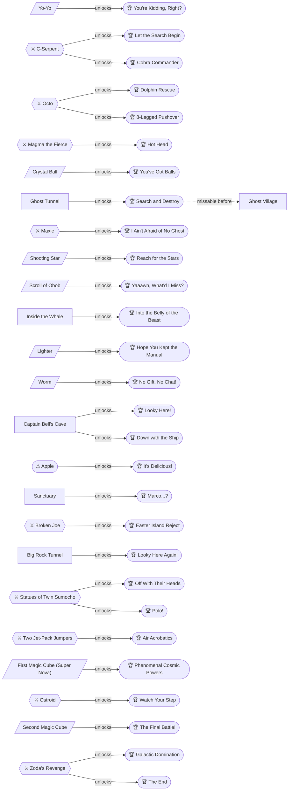
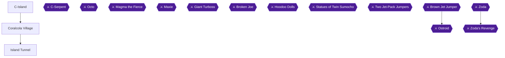
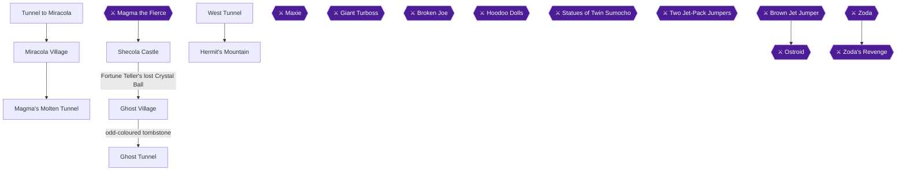
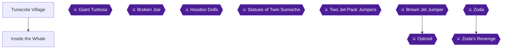
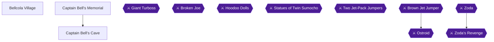
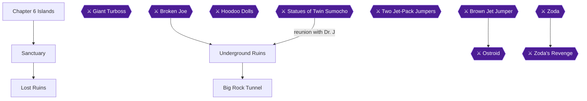
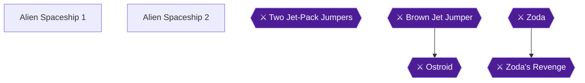
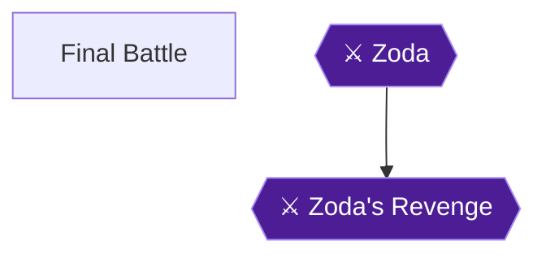

# Knowledge graph — game 1985

Nodes: 76 · Edges: 78

## Progression flow

```mermaid
flowchart TD
  C_Island["C-Island"]
  Coralcola_Village["Coralcola Village"]
  Island_Tunnel["Island Tunnel"]
  Dolphin_Island["Dolphin Island"]
  Octos_Lair["Octo's Lair"]
  Tunnel_to_Miracola["Tunnel to Miracola"]
  Miracola_Village["Miracola Village"]
  Magmas_Molten_Tunnel["Magma's Molten Tunnel"]
  Shecola_Castle["Shecola Castle"]
  Ghost_Village["Ghost Village"]
  Ghost_Tunnel["Ghost Tunnel"]
  West_Tunnel["West Tunnel"]
  Hermits_Mountain["Hermit's Mountain"]
  Tunacola_Village["Tunacola Village"]
  Inside_the_Whale["Inside the Whale"]
  Bellcola_Village["Bellcola Village"]
  Captain_Bells_Memorial["Captain Bell's Memorial"]
  Captain_Bells_Cave["Captain Bell's Cave"]
  Chapter_6_Islands["Chapter 6 Islands"]
  Sanctuary["Sanctuary"]
  Lost_Ruins["Lost Ruins"]
  Underground_Ruins["Underground Ruins"]
  Big_Rock_Tunnel["Big Rock Tunnel"]
  Alien_Spaceship_1["Alien Spaceship 1"]
  Alien_Spaceship_2["Alien Spaceship 2"]
  Final_Battle["Final Battle"]
  C_Serpent{{"⚔ C-Serpent"}}
  Octo{{"⚔ Octo"}}
  Magma{{"⚔ Magma the Fierce"}}
  Maxie{{"⚔ Maxie"}}
  Giant_Turboss{{"⚔ Giant Turboss"}}
  Broken_Joe{{"⚔ Broken Joe"}}
  Hoodoo_Dolls{{"⚔ Hoodoo Dolls"}}
  Twin_Sumocho{{"⚔ Statues of Twin Sumocho"}}
  Jet_Pack_Jumpers{{"⚔ Two Jet-Pack Jumpers"}}
  Brown_Jet_Jumper{{"⚔ Brown Jet Jumper"}}
  Ostroid{{"⚔ Ostroid"}}
  Zoda{{"⚔ Zoda"}}
  Zodas_Revenge{{"⚔ Zoda's Revenge"}}
  C_Island --> Coralcola_Village
  Coralcola_Village --> Island_Tunnel
  C_Serpent -->|Dr. J's lab, Sub-C departs| Dolphin_Island
  Dolphin_Island --> Octos_Lair
  Octo -->|dolphins lead through the coral; storm| Tunnel_to_Miracola
  Tunnel_to_Miracola --> Miracola_Village
  Miracola_Village --> Magmas_Molten_Tunnel
  Magma --> Shecola_Castle
  Shecola_Castle -->|Fortune Teller's lost Crystal Ball| Ghost_Village
  Ghost_Village -->|odd-coloured tombstone| Ghost_Tunnel
  West_Tunnel --> Hermits_Mountain
  Miracola_Village --> Tunacola_Village
  Tunacola_Village --> Inside_the_Whale
  Captain_Bells_Memorial --> Captain_Bells_Cave
  Captain_Bells_Cave -->|ship sinks, strait opens| Chapter_6_Islands
  Chapter_6_Islands --> Sanctuary
  Sanctuary --> Lost_Ruins
  Broken_Joe --> Underground_Ruins
  Underground_Ruins --> Big_Rock_Tunnel
  Twin_Sumocho -->|reunion with Dr. J| Underground_Ruins
  Underground_Ruins --> Alien_Spaceship_1
  Brown_Jet_Jumper --> Ostroid
  Zoda --> Zodas_Revenge
  classDef ponr fill:#7f1d1d,stroke:#f87171,color:#fff;
  classDef boss fill:#4c1d95,stroke:#a78bfa,color:#fff;
  class C_Serpent,Octo,Magma,Maxie,Giant_Turboss,Broken_Joe,Hoodoo_Dolls,Twin_Sumocho,Jet_Pack_Jumpers,Brown_Jet_Jumper,Ostroid,Zoda,Zodas_Revenge boss;
```

## Achievement dependencies

## Chapter 1: Prelude: C-Island and the Island Tunnel

## Chapter 2: Dolphins: Octo's Lair

```mermaid
flowchart TD
  Dolphin_Island["Dolphin Island"]
  Octos_Lair["Octo's Lair"]
  Octo{{"⚔ Octo"}}
  Magma{{"⚔ Magma the Fierce"}}
  Maxie{{"⚔ Maxie"}}
  Giant_Turboss{{"⚔ Giant Turboss"}}
  Broken_Joe{{"⚔ Broken Joe"}}
  Hoodoo_Dolls{{"⚔ Hoodoo Dolls"}}
  Twin_Sumocho{{"⚔ Statues of Twin Sumocho"}}
  Jet_Pack_Jumpers{{"⚔ Two Jet-Pack Jumpers"}}
  Brown_Jet_Jumper{{"⚔ Brown Jet Jumper"}}
  Ostroid{{"⚔ Ostroid"}}
  Zoda{{"⚔ Zoda"}}
  Zodas_Revenge{{"⚔ Zoda's Revenge"}}
  Dolphin_Island --> Octos_Lair
  Brown_Jet_Jumper --> Ostroid
  Zoda --> Zodas_Revenge
  classDef ponr fill:#7f1d1d,stroke:#f87171,color:#fff;
  classDef boss fill:#4c1d95,stroke:#a78bfa,color:#fff;
  class Octo,Magma,Maxie,Giant_Turboss,Broken_Joe,Hoodoo_Dolls,Twin_Sumocho,Jet_Pack_Jumpers,Brown_Jet_Jumper,Ostroid,Zoda,Zodas_Revenge boss;
```

## Chapter 3: Storm and Calm: Miracola, Shecola and the Hermit

## Chapter 4: Confession: Inside the Whale

## Chapter 5: Captain Bell: The Strait

## Chapter 6: Reunion: The Lost Ruins and the Big Rock Tunnel

## Chapter 7: Alien Spaceship: The First and Second Magic Cubes

## Chapter 8: Final Battle: Zoda

