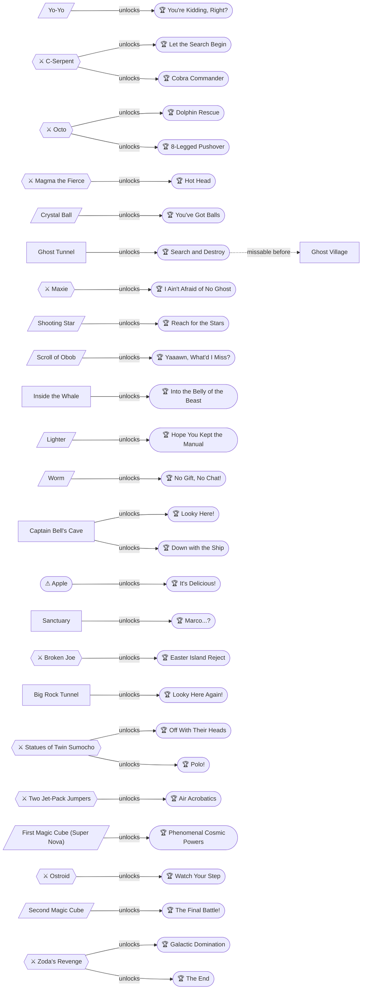
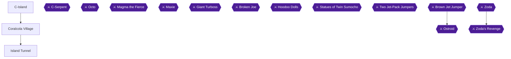
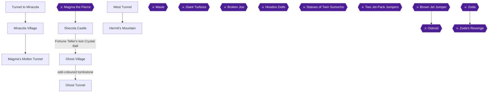
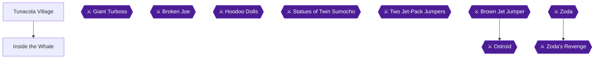
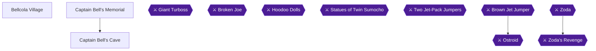
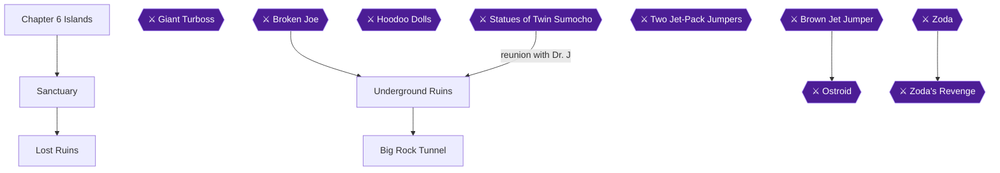
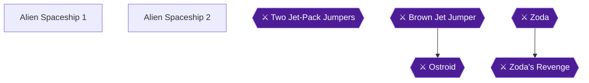
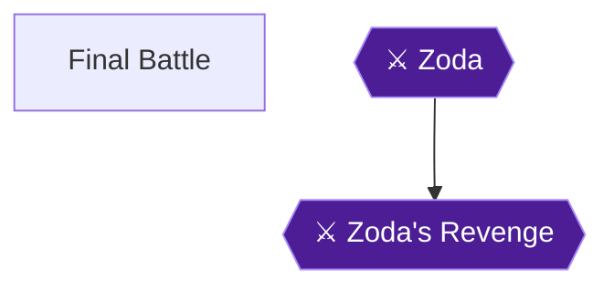

# StarTropics — 100% RetroAchievements Walkthrough

## Metadata

- **Platform:** NES/Famicom
- **Developer:** Unknown
- **Publisher:** Nintendo
- **Genre:** Action-Adventure
- **Released:** 1990-12-26
- **Achievements:** 28 (425 points)

> [!NOTE]
> Every instruction in this guide was extracted from the sources listed at the bottom and checked against them (232 facts confirmed by 2+ sources, 2498 from a single source). Statements marked 🟡 come from only one source. Anything we could not confirm says **"Unable to verify from collected sources."**

## Game Overview


### Premise

StarTropics is an overhead action-adventure game for the NES. The game alternates between two modes: the overworld is simple walking, while dungeons are overhead fights against hordes of creatures [[gf1-4-4]]. The game is split into eight chapters, and this guide covers them in order. The sections below cover what a first-time player needs to know before starting.

### Controls

**Overworld** [[gf1-5-1, gf1-5-2, gf1-5-3, gf1-5-4]]
- **A** talks to people and picks up certain items.
- B, Start and Select do nothing.

**Dungeons** [[gf1-5-5, gf1-5-6, gf1-5-7, gf1-5-8]]
- **A** jumps.
- **B** uses your weapon.
- **Start** pauses the game and selects Magic Items (press Down on the D-Pad) [[gf1-5-7]].
- **Select** switches between weapons.

**Submarine (Sub-C):** pressing B dives, but only once you have the ID Code that unlocks submerging [[gf2-4-5, gf3-3-1]]. Squiggly or black-wave areas on the water are the dive spots [[gf2-9-2, gf4-2-12]], and you can only dive in those areas [[gf5-4-9]]. To keep going underwater, dive, surface, then dive again [[gf5-4-10]]. Bubbles on the water surface at a wall can indicate a secret passage [[gf4-2-6]].

### Core Dungeon Mechanics

- **Switches are hidden.** Jumping on green tiles reveals a button [[gf2-4-1]]. Jumping on that button opens doors or treasure chests [[gf2-4-2]].
- **Other ways to open a door.** To advance, you find the exit, defeat some or all enemies in the room, or find a switch [[gf2-4-3]]. If a locked door has no visible switch, killing every enemy is the key [[gf3-26-3]].
- **Jump distance.** Mike can only jump one tile at a time unless he has a special item that allows two-tile jumps [[gf3-5-4]]. He also takes about half a second to turn after you press a direction [[gf3-5-5]].
- **Sinking tiles.** Submerging tiles require timed jumps, or you sink [[gf1-12-5]]. Some sinking tiles submerge every other second and then come back [[gf2-10-5]].
- **Shadow walls.** A small dark shadow in a wall can be walked through [[gf1-12-9]]. Pushing against a wall where there is a large shadow opens a hidden passage [[gf2-10-4]].
- **Dark rooms.** A tile in the room turns the lights on [[gf1-16-17]].
- **Midway points.** Once you are deep enough into a dungeon, losing a life restarts you at a midway point instead of the entrance [[gf1-6-1]]. All items and puzzles reset when you start a new life [[gf1-6-2]].
- **False exits and traps.** Some dungeons contain false exits that force you out if entered [[gf2-16-2]]. Falling into the opening tiles in the final stages forces you to fight out of a room of Gunners and redo the dungeon [[gf2-35-3]].
- **Instant-death hazards.** Heat Panels cause 7 1/2 hearts of damage [[gf4-10-31]], and jumping on Opening Tiles while they are open drops you through a trapdoor and kills you [[gf4-10-33]]. A rolling boulder kills on one touch, so hide in the crevices in the wall [[gf5-16-21]].

### Health

- Collecting 5 Power Stars refills one lost Heart Point [[gf1-6-4]].
- A One Heart also refills one lost Heart Point [[gf1-6-6]].
- The Try-Your-Luck / Life Sign can give one life, give two lives, or take one away, so use it at your own risk [[gf2-39-6, gf1-18-23]].
- Big Hearts raise your maximum. There are five scattered through the game [[gf1-60-2]].
- Your hearts go back down to where they were initially once you complete a chapter in which you used a temporary boost [[gf4-9-26]].

### Weapons and Items

**Main weapons** have unlimited ammo, and you do not lose them when you leave a dungeon [[gf-items-3-2, gf-items-3-3]].
- The **Shooting Star** only works with at least 6 full heart containers. Below that you use the Yo-Yo [[gf-items-3-5, gf3-21-4]].
- Picking up the first magic cube turns the Shooting Star into the **Super Nova** [[gf-items-3-7]]. It needs at least 11 full heart containers [[gf-items-3-8]].

**Secondary weapons** are used by pressing Select and then B [[gf-items-4-1]]. They have limited uses, and you lose them when you leave a dungeon [[gf3-17-2, gf-items-4-2]]. Examples from the guide:
- The Magic Mirror deflects enemy projectiles back at the thrower [[gf-items-4-13]].
- Pressing B again after throwing Shooting Stars (Asterisks) splits them to attack in two directions [[gf-items-4-18]].

**Stored items** are accessed by pausing and pressing Select [[gf-items-7-2]]. They cannot be carried out of a dungeon into the next one [[gf-items-7-1]]. The Rod of Sight reveals invisible ghosts [[gf3-31-2]]. The Lantern lights a room for about five seconds and can be used five times [[gf2-17-8]].

**Automatic items** can only be found in dungeons [[gf-items-5-5]]. Pills restore health, but if you do not have two full rows of hearts the extra health slowly drains back to what you have attained [[gf-items-6-8]].

### The Codes and the Submarine

- The first code, **1492**, starts up Sub-C and lets you continue to Chapter 2 [[gf2-40-2, gf3-7-2]].
- The second code, **1776**, comes from the note in the Bottle in Chapter 2 and unlocks diving [[gf1-11-1, gf1-11-3]].
- In Chapter 4 you must enter a three-digit frequency into Sub-C. There is no in-game clue, and it is one of 1,000 possible combinations [[gf1-31-33]]. The answer is **747** [[gf1-31-34]]. The number is revealed by dipping the letter that came with the game in water [[gf3-42-1]], so if you do not have the letter, just enter 747 [[gf4-6-18, gf5-14-12]].

### Hardcore Rules and RetroAchievements

This guide targets all 28 achievements (425 points) in **Hardcore mode**, which means no cheat codes, no rewinds and no loading of saved emulator states, so you must play through each dungeon's hazards live. Hardcore rules are a condition of the achievement set itself rather than anything the game's manuals describe. Because the dungeons also reset items and puzzles when you lose a life, careful play matters [[gf1-6-2]].

- **One playthrough is enough.** Nothing in the set is mutually exclusive, and a single run in chapter order earns every achievement. Four achievements are missable (5844, 5854, 5853, 5851), so collect each before its deadline.
- **The server flags all four as Missable** [[ra-comments-10-5, ra-comments-17-2, ra-comments-22-3, ra-comments-19-2]]. Each has a warning in its chapter before the cutoff.
  - **5844 (Chapter 3, Ghost Tunnel):** you must kill the single hidden ghost, using the Rod of Sight, in the room right after the boss fight. You do not need to kill every ghost in the cave [[ra-comments-10-1, ra-comments-10-4]]. It is in the bottom right corner of that room [[ra-comments-10-2]].
  - **5854 (Chapter 5):** look around the starting room of the dungeon [[ra-comments-17-1]]. A shadow wall in the bottom right corner leads to two Hearts [[gf1-34-29]].
  - **5853 (Chapter 6, Sumocho Cave):** a secret room is three steps up in the dark hallway before the boss, through the left wall [[ra-comments-22-1]]. Keep pushing toward the left side of the screen once the hallway goes dark [[ra-comments-22-2]].
  - **5851 (Chapter 6):** an Apple is inside the staircase on one of the islands, and eating it does nothing [[gf1-38-5, ra-comments-19-1]].
- **No-damage boss achievements are one-shot attempts.** Players report you need to take no damage on bosses and find hidden items [[ra-comments-30-1]]. One player reported that Easter Island Reject (5845) did not unlock when they beat the boss without damage four times in review mode [[ra-comments-21-1]]. Treat each no-damage fight as a first-run attempt.
- **Trigger quirks:**
  - Let the Search Begin (5829) unlocks when you board the submarine, not when the C-Serpent dies [[ra-comments-4-1]].
  - Off With Their Heads (5846) unlocks when you leave the boss room, not when the boss dies [[ra-comments-23-1]].
  - At the end, do not keep hitting Zoda once he is beaten. That skips the final scene and the achievements will not pop [[ra-comments-1-6]].

### How the 100% Plan Works

1. **Play the chapters in order, once.** There are eight chapters, and a single playthrough in chapter order earns all 28 achievements. Each chapter's guide lists its own achievements, items and warnings.
2. **Handle missables first.** Four achievements are missable (5844, 5854, 5853, 5851) [[ra-comments-10-5, ra-comments-17-2, ra-comments-22-3, ra-comments-19-2]]. A warning callout appears before each one, so read ahead if you are about to enter that area.
3. **Treat boss fights as one-shot.** Learn each boss's pattern from the guide before engaging, and avoid damage on fights tied to an achievement [[ra-comments-30-1, ra-comments-21-1]].
4. **Keep your hearts up.** The Shooting Star and Super Nova revert to weaker weapons if your hearts fall below the thresholds above [[gf3-21-4, gf3-24-2]].
5. **Check the progress block at the end of each chapter** before moving on. It gives running totals for chests, items and achievements.

## Achievement Roadmap

| Chapter | Achievements | Points |
|---|---|---|
| [1. Prelude: C-Island and the Island Tunnel](#chapter-1-prelude-c-island-and-the-island-tunnel) | You're Kidding, Right?, Cobra Commander, Let the Search Begin | 10 |
| [2. Dolphins: Octo's Lair](#chapter-2-dolphins-octos-lair) | Dolphin Rescue, 8-Legged Pushover | 15 |
| [3. Storm and Calm: Miracola, Shecola and the Hermit](#chapter-3-storm-and-calm-miracola-shecola-and-the-hermit) | Hot Head, I Ain't Afraid of No Ghost, Search and Destroy, You've Got Balls, Reach for the Stars, Yaaawn, What'd I Miss? | 60 |
| [4. Confession: Inside the Whale](#chapter-4-confession-inside-the-whale) | Into the Belly of the Beast, Hope You Kept the Manual | 20 |
| [5. Captain Bell: The Strait](#chapter-5-captain-bell-the-strait) | No Gift, No Chat!, Looky Here!, Down with the Ship | 30 |
| [6. Reunion: The Lost Ruins and the Big Rock Tunnel](#chapter-6-reunion-the-lost-ruins-and-the-big-rock-tunnel) | It's Delicious!, Marco...?, Easter Island Reject, Looky Here Again!, Off With Their Heads, Polo! | 130 |
| [7. Alien Spaceship: The First and Second Magic Cubes](#chapter-7-alien-spaceship-the-first-and-second-magic-cubes) | Air Acrobatics, Phenomenal Cosmic Powers, Watch Your Step, The Final Battle! | 85 |
| [8. Final Battle: Zoda](#chapter-8-final-battle-zoda) | Galactic Domination, The End | 75 |

## Playthrough Planning

**Playthroughs required:** 1

A single playthrough in chapter order earns all 28 achievements. There are no mutually exclusive achievements. Four achievements are missable (5844, 5854, 5853, 5851), so collect each before its deadline. Treat every no-damage boss fight as a one-shot attempt in the main run: one player reported that Easter Island Reject (5845) did not unlock when the boss was beaten without damage in review mode (ra-comments-21-1). Let the Search Begin (5829) unlocks when you board Sub-C, not when the C-Serpent dies (ra-comments-4-1). Off With Their Heads (5846) unlocks when you leave the boss room (ra-comments-23-1). Do not hit Zoda after he is beaten, because that skips the final scene and The End does not unlock (ra-comments-1-6).

**Settings:** Hardcore mode. The Chapter 4 Sub-C frequency is 747, the number printed on the letter that came with the game's manual (gf1-31-34, gf4-6-18).

[[gf1-60-2,ra-comments-4-1,ra-comments-21-1,ra-comments-23-1,ra-comments-1-6,ra-comments-30-1]]

## True 100% In-Game Completion Criteria

This guide covers complete in-game mastery in addition to all RetroAchievements:

| Category | 100% Requirement | Tracking Scope |
|---|---|---|
| **Big Hearts** | Every permanent Big Heart life upgrade found on the overworld (five in the game, per gf1's Game Story Items list). | Per-chapter checkpoint |
| **Hidden Rooms & Secret Items** | The secret rooms RetroAchievements tracks (Captain Bell's Cave starting room, Sumocho Cave dark hallway), the Apple, and the last Minie after Maxie. | Per-chapter checkpoint |
| **Bosses Without Damage** | Every boss with a no-damage achievement (C-Serpent, Octo, Magma, Maxie, Broken Joe, Twin Sumocho, Jet-Pack Jumpers, Ostroid, Zoda Prime), beaten without taking a hit. | Per-chapter checkpoint |

## Missables Summary

| ⚠ Missable | Achievement | Chapter | Must be done before |
|---|---|---|---|
| Last Minie after Maxie (Search and Destroy) [[ra-comments-10-1,ra-comments-10-2,ra-comments-10-4,ra-comments-1-3,ra-comments-2-2,ra-comments-10-5]] | Search and Destroy | [3](#chapter-3-storm-and-calm-miracola-shecola-and-the-hermit) | Before you leave the room directly after Maxie's arena in the Ghost Tunnel: use the Rod of Sight there and kill the single Minie in the corner. Avoid the false-exit room, whose stairs eject you from the dungeon. |
| Secret room in Captain Bell's Cave (Looky Here!) [[gf1-34-3,gf1-34-29,ra-comments-17-1,ra-comments-17-2]] | Looky Here! | [5](#chapter-5-captain-bell-the-strait) | Before you leave the starting room of Captain Bell's Cave: walk through the shadow wall in its bottom-right corner (the room with the Rabbit Slug). This must be done before the cave is drained and Captain Bell's ship sinks. |
| Eat the Apple (It's Delicious!) [[gf1-38-5,gf5-17-6,ra-comments-19-1,ra-comments-19-2]] | It's Delicious! | [6](#chapter-6-reunion-the-lost-ruins-and-the-big-rock-tunnel) | Before the reunion with Dr. J in the Underground Ruins ends Chapter 6. The Apple is inside a staircase on one of the Chapter 6 islands. |
| Secret room in Sumocho Cave (Looky Here Again!) [[ra-comments-22-1,ra-comments-22-2,ra-comments-22-3]] | Looky Here Again! | [6](#chapter-6-reunion-the-lost-ruins-and-the-big-rock-tunnel) | Before the Statues of Twin Sumocho fight at the end of the Big Rock Tunnel: three steps up the dark hallway before the boss, push through the left wall. |

## Points of No Return

| ⛔ Point of No Return | Chapter | What you lose access to |
|---|---|---|
| Captain Bell's ship sinks [[gf2-26-20,gf5-17-1,gf4-7-33]] | [5](#chapter-5-captain-bell-the-strait) | Draining Captain Bell's Cave sinks the ship, and Sub-C sails on through the strait. Get the starting-room secret (Looky Here!) before you drain the cave. |
| Reunion with Dr. J ends Chapter 6 [[gf1-45-17,gf5-22-10]] | [6](#chapter-6-reunion-the-lost-ruins-and-the-big-rock-tunnel) | After the reunion, walking north out of the ruins saves the game and starts Chapter 7. Eat the Apple and find the Sumocho Cave secret room before this. |

## Progression Diagrams

### Game Progression

```mermaid
flowchart TD
  C_Island["C-Island"]
  Coralcola_Village["Coralcola Village"]
  Island_Tunnel["Island Tunnel"]
  Dolphin_Island["Dolphin Island"]
  Octos_Lair["Octo's Lair"]
  Tunnel_to_Miracola["Tunnel to Miracola"]
  Miracola_Village["Miracola Village"]
  Magmas_Molten_Tunnel["Magma's Molten Tunnel"]
  Shecola_Castle["Shecola Castle"]
  Ghost_Village["Ghost Village"]
  Ghost_Tunnel["Ghost Tunnel"]
  West_Tunnel["West Tunnel"]
  Hermits_Mountain["Hermit's Mountain"]
  Tunacola_Village["Tunacola Village"]
  Inside_the_Whale["Inside the Whale"]
  Bellcola_Village["Bellcola Village"]
  Captain_Bells_Memorial["Captain Bell's Memorial"]
  Captain_Bells_Cave["Captain Bell's Cave"]
  Chapter_6_Islands["Chapter 6 Islands"]
  Sanctuary["Sanctuary"]
  Lost_Ruins["Lost Ruins"]
  Underground_Ruins["Underground Ruins"]
  Big_Rock_Tunnel["Big Rock Tunnel"]
  Alien_Spaceship_1["Alien Spaceship 1"]
  Alien_Spaceship_2["Alien Spaceship 2"]
  Final_Battle["Final Battle"]
  C_Serpent{{"⚔ C-Serpent"}}
  Octo{{"⚔ Octo"}}
  Magma{{"⚔ Magma the Fierce"}}
  Maxie{{"⚔ Maxie"}}
  Giant_Turboss{{"⚔ Giant Turboss"}}
  Broken_Joe{{"⚔ Broken Joe"}}
  Hoodoo_Dolls{{"⚔ Hoodoo Dolls"}}
  Twin_Sumocho{{"⚔ Statues of Twin Sumocho"}}
  Jet_Pack_Jumpers{{"⚔ Two Jet-Pack Jumpers"}}
  Brown_Jet_Jumper{{"⚔ Brown Jet Jumper"}}
  Ostroid{{"⚔ Ostroid"}}
  Zoda{{"⚔ Zoda"}}
  Zodas_Revenge{{"⚔ Zoda's Revenge"}}
  C_Island --> Coralcola_Village
  Coralcola_Village --> Island_Tunnel
  C_Serpent -->|Dr. J's lab, Sub-C departs| Dolphin_Island
  Dolphin_Island --> Octos_Lair
  Octo -->|dolphins lead through the coral; storm| Tunnel_to_Miracola
  Tunnel_to_Miracola --> Miracola_Village
  Miracola_Village --> Magmas_Molten_Tunnel
  Magma --> Shecola_Castle
  Shecola_Castle -->|Fortune Teller's lost Crystal Ball| Ghost_Village
  Ghost_Village -->|odd-coloured tombstone| Ghost_Tunnel
  West_Tunnel --> Hermits_Mountain
  Miracola_Village --> Tunacola_Village
  Tunacola_Village --> Inside_the_Whale
  Captain_Bells_Memorial --> Captain_Bells_Cave
  Captain_Bells_Cave -->|ship sinks, strait opens| Chapter_6_Islands
  Chapter_6_Islands --> Sanctuary
  Sanctuary --> Lost_Ruins
  Broken_Joe --> Underground_Ruins
  Underground_Ruins --> Big_Rock_Tunnel
  Twin_Sumocho -->|reunion with Dr. J| Underground_Ruins
  Underground_Ruins --> Alien_Spaceship_1
  Brown_Jet_Jumper --> Ostroid
  Zoda --> Zodas_Revenge
  classDef ponr fill:#7f1d1d,stroke:#f87171,color:#fff;
  classDef boss fill:#4c1d95,stroke:#a78bfa,color:#fff;
  class C_Serpent,Octo,Magma,Maxie,Giant_Turboss,Broken_Joe,Hoodoo_Dolls,Twin_Sumocho,Jet_Pack_Jumpers,Brown_Jet_Jumper,Ostroid,Zoda,Zodas_Revenge boss;
```



### Achievement Dependencies



## Boss Index

Full strategies are in each chapter.

| Boss | Chapter |
|---|---|
| C-Serpent | [1. Prelude: C-Island and the Island Tunnel](#chapter-1-prelude-c-island-and-the-island-tunnel) |
| Octo | [2. Dolphins: Octo's Lair](#chapter-2-dolphins-octos-lair) |
| Magma the Fierce | [3. Storm and Calm: Miracola, Shecola and the Hermit](#chapter-3-storm-and-calm-miracola-shecola-and-the-hermit) |
| Maxie | [3. Storm and Calm: Miracola, Shecola and the Hermit](#chapter-3-storm-and-calm-miracola-shecola-and-the-hermit) |
| Giant Turboss | [6. Reunion: The Lost Ruins and the Big Rock Tunnel](#chapter-6-reunion-the-lost-ruins-and-the-big-rock-tunnel) |
| Broken Joe | [6. Reunion: The Lost Ruins and the Big Rock Tunnel](#chapter-6-reunion-the-lost-ruins-and-the-big-rock-tunnel) |
| Hoodoo Dolls | [6. Reunion: The Lost Ruins and the Big Rock Tunnel](#chapter-6-reunion-the-lost-ruins-and-the-big-rock-tunnel) |
| Statues of Twin Sumocho | [6. Reunion: The Lost Ruins and the Big Rock Tunnel](#chapter-6-reunion-the-lost-ruins-and-the-big-rock-tunnel) |
| Two Jet-Pack Jumpers | [7. Alien Spaceship: The First and Second Magic Cubes](#chapter-7-alien-spaceship-the-first-and-second-magic-cubes) |
| Brown Jet Jumper | [7. Alien Spaceship: The First and Second Magic Cubes](#chapter-7-alien-spaceship-the-first-and-second-magic-cubes) |
| Ostroid | [7. Alien Spaceship: The First and Second Magic Cubes](#chapter-7-alien-spaceship-the-first-and-second-magic-cubes) |
| Zoda | [8. Final Battle: Zoda](#chapter-8-final-battle-zoda) |
| Zoda's Revenge | [8. Final Battle: Zoda](#chapter-8-final-battle-zoda) |

## Walkthrough

## Chapter 1: Prelude: C-Island and the Island Tunnel



### Area Overview & Preparation

You play Mike Jones, who lands on C-Island to visit his uncle, Dr. J, and finds that he has been abducted [[gf1-3-3, gf5-1-3]]. This chapter covers three things:

- Collect the Yo-Yo from the village chief [[gf1-7-7]].
- Clear the first dungeon, the Island Tunnel. One guide calls it Dungeon 1-1 [[gf1-7-6]]; another calls it the "Test of Island Courage" [[gf2-7-1]].
- Board the Sub-C at Dr. J's lab [[gf1-10-4]].

Key points before you start:

- The game saves automatically after the Shaman's talk in the covered hut [[gf1-7-5]]. Hardcore play means you cannot undo mistakes, so take the dungeon carefully.
- One guide splits the tunnel into Part A and Part B, with Room #10 as the join between them [[gf1-6-7, gf1-8-31]].
- Torches are the key weapon for the boss. They are found only in Chapter 1, with an attack power of 2 hearts and a range of 3 tiles [[gf2-36-6]]. Save them for the C-Serpent [[gf1-8-22]].
- A locked door with no visible switch opens when every enemy in the room is dead [[gf3-26-3]].
- Two spots are lethal:
  - The room directly above the two Medicine rooms is a Death Room [[gf2-7-1]].
  - The north opening in Room #14 leads to your doom [[gf1-9-12]].

> [!WARNING]
> **Achievement Trigger Note:** "Let the Search Begin" does NOT unlock when you kill the C-Serpent. It unlocks only after you get aboard the submarine [[ra-comments-4-1]]. Do not stop after the boss; continue to Dr. J's lab and Nav-Com.

> [!WARNING]
> **No-Damage Achievement:** "Cobra Commander" requires beating the C-Serpent without taking damage [[gf2-42-3, gf4-1-17]]. Do not take the "walk past the boss" shortcut, which skips the fight and costs you a heart or two [[gf1-9-15]].

### Chapter Items to Collect (5 Items Total)

| Item | Where Found | Action / Requirement | Citation |
|---|---|---|---|
| Yo-Yo | Chief's hut, Coralcola Village | **TALK** to the Chief | [[gf1-7-7, gf4-1-2]] |
| Fire Torches (25) | Chest in Room #10 | Hit the switch to open the chest; **SAVE** these | [[gf1-8-22, gf4-1-9]] |
| Fire Torches | Chest in Room #12 | Hit the second switch to open the chest | [[gf1-9-2, gf4-1-25]] |
| Magic Potion | Room #13 | **TAKE** | [[gf1-9-9]] |
| Magic Potion | Room #14 | **TAKE** (don't use it yet) | [[gf1-9-11]] |

The ID Code 1492 is a story item, not a collectible. Baboo gives it to you after the tunnel [[gf1-10-2, gf1-10-3]].

### C-Island (Overworld)

🗺️ **Map:** [View C-Island Map on VGMaps](https://www.vgmaps.com/Atlas/NES/StarTropics-Chapter1-Prelude-C-Island.png)

You begin at the helicopter pad on C-Island, and walking left from it leads to the village [[gf4-1-1]].

1. After the opening cutscene, walk left from the helipad [[gf4-1-1, ra-comments-3-2]].
2. Follow the single winding path, going left until you reach some trees, then up and around the trees [[gf1-7-2]].
3. The path ends at Coralcola Village [[gf4-1-1]].

### Coralcola Village

Talk to **every** villager. The guard in front of the tunnel hut will not let you pass until you have [[gf1-7-8]].

1. Follow the dark path to the big central path, then head left to the covered hut in the upper left: the Chief's hut [[gf1-7-7, gf4-1-2, ra-comments-3-1]].
2. Talk to the Chief. He says your uncle was abducted the night before and asks for your help [[gf5-1-3]]. He gives you the Yo-Yo [[gf-items-3-1, gf1-3-2, gf5-1-1]].


> [!ACHIEVEMENT]
> **You're Kidding, Right? (1 Points)**
> 
> *You got the mighty Yo-Yo!*


3. Talk to the other villagers, then return to the guard blocking the tunnel in the northeast corner of the village. He now recognizes you and lets you pass [[gf1-7-3, gf1-7-8]].
4. Enter the small covered hut and take the stairs. The Shaman, the Chief's sister, explains why your uncle was snatched and warns you about the dungeons. The game then saves automatically [[gf1-7-4, gf1-7-5]]. The stairs lead to Dungeon 1-1 [[gf1-7-6]].

Baboo offers Cola in the village, which refills your life meter [[gf1-57-3]].

> [!TIP]
> **Before you leave Coralcola:** Make sure you hold the Yo-Yo and have spoken to every villager. The guard only lets you through once you have [[gf1-7-8]].

### Island Tunnel

🗺️ **Map:** [View Island Tunnel Map on VGMaps](https://www.vgmaps.com/Atlas/NES/StarTropics-Chapter1-Prelude-IslandTunnel.png)

Room #01 to Room #09 is Part A and Room #10 to Room #18 is Part B in one guide's notation [[gf1-6-7]]. Another guide treats Room #11 as the start of Part B [[gf1-9-1]]. The route below follows the Room #10 join into Room #11. Maps exist for Part A and Part B (Part B's header reads 1-2) [[gf1-8-31, gf1-8-32]].

Part B legend: Room 12 holds Fire Torches, Room 13 a Magic Potion, Room 14 a Magic Potion, Room 16 the boss, Room 18 leads to the Overworld [[gf1-8-26, gf1-8-27, gf1-8-28, gf1-8-29, gf1-8-30]].

#### Part A (Rooms 1-10)

**Rooms 1-3.** Go up from the entrance and kill the enemies in each room to open the doors [[gf3-26-3]]. The first room has three Jellies that must be defeated to open the door [[gf2-7-4, gf3-26-4]]. Stepping on the switch in the following room also unlocks its door [[gf3-26-5]]. Unable to verify from collected sources for further exact enemy counts in these rooms.

**Room 4.** The upper tile on the far right causes the door switch [[gf4-1-4]]. Go to the switch to open the north door [[gf1-8-9]].

**Room 5.** It begins with two Blue Rats [[gf1-8-11]]. Jump from tile to tile toward the door [[gf3-26-6]]. The lower tile below the door causes its switch [[gf4-1-5]]. Jump down 1 to reveal a switch, then jump onto it [[gf1-8-12]].

**Room 6.** Three Blue Rats and two Rabbit Slugs. Clear them [[gf1-8-14]].

**Room 7.** Four Rabbit Slugs and a bunch of tiles [[gf1-8-16]]. The two center tiles cause the switches for the side doors, which open the west and east doors [[gf4-1-6, gf1-8-17]]. Do not go left or right here; those lead to a room with flying bats [[gf3-27-14]].

To reach the top section, head to the east door (or west, it does not matter), then cross the tiles: jump up 1, left 2, up 1, then onto solid ground [[gf1-8-20]]. Jump on the far left tile to reveal a switch and step on it; the north wall opens to Room #10 [[gf1-8-21]]. The upper-left tile causes the switch that opens the upper wall [[gf4-1-7]]. Jumping on the leftmost tile in the upper corner unlocks a secret passage [[gf3-27-1]].

**Room 10.** The upper right tile in the bottom set causes the chest switch, and the chest reveals **Fire Torches** (25) [[gf1-8-22, gf4-1-8, gf4-1-9]]. Save these for the boss. Hit the right switch again to open the north door into Room #11 [[gf1-8-23]]. The lower right tile in the top set causes the door switch [[gf4-1-10]].

#### Part B (Rooms 11-18)

**Room 11.** Defeat a Blue Bat and two Blue Rats and the north door opens to Room #12 [[gf1-9-1]].

**Room 12.** Head to the north tiles and jump left 2 to find a switch [[gf1-9-7]]. Jump left 1 from it to find another, which reveals more **Fire Torches** from the chest [[gf1-9-2, gf1-8-26]]. The second tile from the left causes the chest switch, and the chest holds 25 Fires [[gf4-1-24, gf4-1-25]]. The second tile from the right in the upper set causes the door switch [[gf4-1-26]]. From the first switch, jump north 1 to reveal a third; jump to it and the far east wall opens [[gf1-9-8]].

**Room 13.** Take the **Magic Potion** right away [[gf1-9-9, gf1-8-27]]. Find the correct tile to reveal a switch that makes the north wall open [[gf1-9-10]].

**Room 14.** Take the second **Magic Potion** [[gf1-9-11, gf1-8-28]]. The lower tile on the right side causes the switch that opens the upper wall [[gf4-1-27]].

> [!WARNING]
> **Deadly Opening:** Do NOT go up through the north opening in Room #14; it kills you [[gf1-9-12, gf4-1-28, gf5-2-6]].

Go back down to Room #13, leave through the left entrance to Room #12 [[gf1-9-6]]. The monsters in Room #12 have regenerated, so be careful; make your way to the switch that opened the north door and go through it [[gf1-9-6]]. The chest in the Jelly and Loopers room is empty on a second visit [[gf4-1-11]]. Defeat all enemies in the room before the serpent to reach the boss [[gf3-27-8, gf5-2-7]].

#### Room 16: Boss C-Serpent

> [!TIP]
> Switch to the torches before the fight [[gf3-27-12]].

**Boss: C-Serpent** (BOSS #01) is fought in Room #16 [[gf1-9-13, gf1-63-3]].

- **Health:** 33 hearts. With torches it takes only 17 hits instead of 33 with the Yo-Yo [[gf2-42-1, gf2-42-2]].
- **Attack:** it breathes fire roughly 80% of the time [[gf3-27-10]].
- **Bluffing:** sometimes it opens its mouth and does not shoot [[gf5-3-10]].
- **Arena:** three tiles; the left and right tiles are safe from the serpent [[gf3-27-11, gf5-3-1]].

No-damage strategy for **Cobra Commander**:

1. Stand on a side tile until the serpent opens its mouth [[gf4-1-13]].
2. If it breathes fire, stay on the side tile [[gf4-1-14, gf5-3-3]].
3. If it does not, jump to the center tile and throw torches into its mouth [[gf4-1-15, gf1-9-3, gf5-3-2]].
4. When it closes its mouth, jump back to the side [[gf4-1-16]].
5. Repeat. You should not get hit this way [[gf4-1-17]]. If torches run out, finish with your main weapon and use Magic Potions when needed [[gf1-63-6, gf1-9-5]]. A few barrages defeat it [[gf5-3-4]].

Another approach waits on the center tile for the mouth to open, throws a torch or two, then jumps aside from the fire and back when it is done [[gf2-42-3, gf2-42-4, gf1-9-14]]. That is riskier for a no-damage run.

When it dies, go up [[gf4-1-18, gf1-9-4]].


> [!ACHIEVEMENT]
> **Cobra Commander (5 Points)**
> 
> *You defeated the C-Serpent without taking damage!*


Walking up and jumping onto its platform bypasses the fight [[gf1-9-15]]; do not do this if you want the no-damage achievement.

**Room 17.** Jump on the tile to reveal a switch, then hit the switch to open the north door [[gf1-9-16, gf1-9-17, gf4-1-29]].

**Room 18.** Go north and Dungeon 1-1 is complete; this room leads back to the overworld [[gf1-9-18, gf1-8-30]].

### C-Island (After the Tunnel)

The tunnel leads to Dr. J's lab [[gf1-3-4]]. Two more Heart Containers bring you to 5 Heart Points, and the game saves [[gf1-10-7]]. Follow the path around to Baboo, your uncle's assistant [[gf1-10-1]]. He tells you about Sub-C, and you receive the ID Code, 1492 [[gf1-10-2, gf1-10-3, gf1-60-3]].

Head onto the beach and south to the lab in the middle, and talk to Nav-Com; the ID code is given automatically [[gf1-10-4, gf4-2-2]]. A cutscene shows the Sub-C taking off, and the game saves [[gf1-10-5]].


> [!ACHIEVEMENT]
> **Let the Search Begin (4 Points)**
> 
> *You defeated the C-Serpent and began your search for Uncle Steve!*


Chapter 1 is now complete [[gf1-10-6]].

> [!IMPORTANT]
> ### Chapter 1 Cumulative 100% Checkpoint
> - **Big Hearts:** 0 / 5
> - **Torch chests opened:** Rooms #10 and #12 [[gf1-8-22, gf1-9-2]]
> - **RetroAchievements Unlocked:** 3 / 28 (10 / 425 points)

### Chapter Checklist

- [ ] Talked to all villagers in Coralcola [[gf1-7-8]]
- [ ] Received the Yo-Yo from the Chief (5826) [[gf1-7-7]]
- [ ] Cleared Part A and collected the Room #10 torches [[gf1-8-22]]
- [ ] Opened the Room #12 torch chest [[gf1-9-2]]
- [ ] Collected Magic Potions in Rooms #13 and #14 [[gf1-9-9, gf1-9-11]]
- [ ] Avoided the deadly north opening in Room #14 [[gf1-9-12]]
- [ ] Defeated the C-Serpent without taking damage (5836) [[gf4-1-17]]
- [ ] Talked to Baboo and got ID Code 1492 [[gf1-10-3]]
- [ ] Boarded Sub-C via Nav-Com (5829) [[ra-comments-4-1, gf1-10-4]]

---

## Chapter 2: Dolphins: Octo's Lair

```mermaid
flowchart TD
  Dolphin_Island["Dolphin Island"]
  Octos_Lair["Octo's Lair"]
  Octo{{"⚔ Octo"}}
  Magma{{"⚔ Magma the Fierce"}}
  Maxie{{"⚔ Maxie"}}
  Giant_Turboss{{"⚔ Giant Turboss"}}
  Broken_Joe{{"⚔ Broken Joe"}}
  Hoodoo_Dolls{{"⚔ Hoodoo Dolls"}}
  Twin_Sumocho{{"⚔ Statues of Twin Sumocho"}}
  Jet_Pack_Jumpers{{"⚔ Two Jet-Pack Jumpers"}}
  Brown_Jet_Jumper{{"⚔ Brown Jet Jumper"}}
  Ostroid{{"⚔ Ostroid"}}
  Zoda{{"⚔ Zoda"}}
  Zodas_Revenge{{"⚔ Zoda's Revenge"}}
  Dolphin_Island --> Octos_Lair
  Brown_Jet_Jumper --> Ostroid
  Zoda --> Zodas_Revenge
  classDef ponr fill:#7f1d1d,stroke:#f87171,color:#fff;
  classDef boss fill:#4c1d95,stroke:#a78bfa,color:#fff;
  class Octo,Magma,Maxie,Giant_Turboss,Broken_Joe,Hoodoo_Dolls,Twin_Sumocho,Jet_Pack_Jumpers,Brown_Jet_Jumper,Ostroid,Zoda,Zodas_Revenge boss;
```



### Area Overview & Preparation

This chapter covers the open-ocean search for the missing baby dolphin, the lighthouse and hut visits, the Bottle holding a new ID Code, the submerging ability, the Big Heart, and the clearing of Octo's Lair (Dungeon 2-1: 3 parts, 18 rooms) [[gf1-12-1]].

Two things matter for the achievements:

- **Collect the Magic Snowman (Snowman Doll) before the boss.** It is the key to the no-damage achievement. It can only be used twice, so save both uses for Octo [[gf2-10-2, gf2-11-5]].
- **The Baseball Bat breaks after 30 swings**, so do not waste swings on random enemies [[gf2-10-1]].

> [!TIP]
> Medicine and Magic Potions are optional, but a fully healed Mike is safer for the boss. Octo has 50 Hearts of health [[gf2-42-5]].

### Chapter Items to Collect (8 Entries)

| Item | Where Found | Action / Requirement | Citation |
|---|---|---|---|
| Bottle / ID Code 1776 | Beach rocks near the lighthouse keeper's wife's hut | **TAKE** (via the passage in the north rock) | [[gf1-11-2, gf1-11-1]] |
| Big Heart (max 6 hearts) | Narrow path by the cave entrance | **TAKE** via the hidden passage in the rocks | [[gf1-11-5, gf2-9-3, gf2-9-4]] |
| Heart Container (underwater path) | Underwater path before Octo's Cave | **TAKE** | [[gf3-28-2]] |
| Baseball Bat | Octo's Lair room 2 | **TAKE** | [[gf1-12-4, gf4-2-15]] |
| Two Hearts / Baseball Bat | Room 7 | **TAKE** | [[gf1-12-10, gf1-12-11]] |
| Two Hearts | Room 10 | **TAKE** | [[gf1-13-9]] |
| Magic Potion | Room 15 | **TAKE** | [[gf1-13-13]] |
| Magic Snowman | Room 12 (revisited), after the switch | **TAKE** (do not use before the boss) | [[gf1-13-16, gf4-2-35]] |

### Overworld: Dolphin Island

🗺️ **Map:** [View Dolphin Island Map on VGMaps](https://www.vgmaps.com/Atlas/NES/StarTropics-Chapter2-Dolphins-Island.png)

1. A mother dolphin approaches and asks you to locate her missing child. Agree to help [[gf5-4-1]].
2. Head to the lighthouse and talk to the keeper. He has not seen the dolphin and tells you to visit his wife at their house [[gf1-11-7, gf5-4-13]].
3. Return to the ship. Go to the faint bubbles southeast of the ship; you can pass through the wall there [[gf1-11-8]].
4. On land, talk to the wife. She has not seen the boy dolphin but saw a bottle on the beach [[gf1-11-9, gf5-4-4]].
5. Go onto the beach. At the dead end south of the house, go left to find a secret passage through the rocks. Going into the north rock opens the pathway to the Bottle [[gf5-4-5, gf1-11-2]].
6. Read the note in the Bottle: you receive **ID CODE 1776** [[gf1-11-1]].
7. Return to Sub-C and enter the code into Nav-Com. A cutscene plays, and you can now submerge with the B button [[gf1-11-3, gf2-9-1]].
8. Submerging: go up to a dark tile (squiggly lines in the water) and press **B** to travel to the next dark tile [[gf1-11-4, gf3-28-12]].
9. On dry land you will see a tunnel, but **don't enter yet**. Head to the narrow path near the cave entrance and go through the rocks [[gf1-11-5]].
10. Big Heart: the hidden passage in the mountains is right next to the Big Heart. A second Heart sits in a secret passage in the rocks to the left of the Big Heart. Grab the Heart, then exit the passage. Your maximum rises to **6 hearts** [[gf2-9-3, gf2-9-4, gf5-4-11, gf5-4-12]].
11. Now head north to the tunnel; it leads to Dungeon 2-1 [[gf1-11-6, gf5-4-12]].

> [!TIP]
> Before you leave the island, make sure you have the Big Heart. The underwater path before the cave also contains a Heart Container [[gf3-28-2]].

### Octo's Lair (Dungeon 2-1)

🗺️ **Map:** [View Octo's Lair Map on VGMaps](https://www.vgmaps.com/Atlas/NES/StarTropics-Chapter2-Dolphins-Octo'sLair.png)

Submerging tiles appear here: some tiles sink every other second and come back, so watch your timing [[gf2-10-5, gf1-12-5]]. Jump across Up/Down tiles only while they are up, or you will fall into the water and die [[gf4-2-16]]. Wherever a wall has a large shadow, push against it to walk through [[gf2-10-4]].

#### Part A (Rooms 1-5)

```
           [05]-[---04--]-[---03--]  LEGEND FOR PART A:
                                |    01 = Starting Point
                          [---02--]  02 = Baseball Bats
                            |        05 = Leads to Room #06 (Part B)
                          [01]
```

- **Room 1:** Nothing here. Go up from the entrance [[gf4-2-28]].
- **Room 2:** A Mud-O-Fish needs only two Yo-Yo hits [[gf2-10-6]]. Grab the **Baseball Bat** (30 swings only) and go up [[gf1-12-4, gf2-10-1, gf4-2-15]]. Quick-run advice: do not equip it, since it is not as good as the Yo-Yo [[gf2-10-7]].
- **Room 3:** The submerging tiles require timed jumps or you sink [[gf1-12-5]]. Wait until the tile comes back up, then quickly jump across [[gf3-28-13]].
- **Room 4 and Room 5:** Continue left. In Room 5, clear the three Blue Bats and the north door opens to Room 6 (Part B) [[gf1-12-6]].

#### Part B (Rooms 6-10)

```
           [10]        LEGEND FOR PART B:
             |         06 = Starting Point for Part B
           [---09--]   07 = Two Hearts/Baseball Bat
                  |    10 = Two Hearts/Leads to 11 (Part C)
                [08]
                  |
           [---07--]
                  |
           [---06--]
```

- **Room 6:** Go left 2, up 1 to reveal a switch [[gf1-12-7]]. Head back to the switch to open the north door [[gf1-12-8]].
- **Room 7:** The small dark shadow in the wall can be passed through; it is two-way if another shadow is on the far side [[gf1-12-9]]. Take the **Two Hearts** and the **Baseball Bat** [[gf1-12-10, gf1-12-11]]. Hit the switch to open the north door to Room 8 [[gf1-12-12]].
- **Room 8:** Defeat the four Cross Speeders and the north door opens to Room 9 [[gf1-13-1]].
- **Room 9:** Jump up onto the tiles and a Big Fish shoots fireballs at you [[gf1-13-2]]. Defeat the four Red Octojumpers to open the north door [[gf1-13-8]].
- **Room 10:** **Two Hearts** are here, plus a tile that reveals a switch which opens the north door [[gf1-13-9, gf1-13-10]].

#### Part C (Rooms 11-18)

```
                     [18]   LEGEND FOR PART C:
                       |    11 = Starting Point for Part C
                     [17]   12 = Magic Snowman
                       |    15 = Magic Potion
           [14]-[13] [16]   18 = BOSS: Giant Octo
             |    |    |
           [15]-[---12--]
                  |
                [11]
```

- **Room 11:** Defeat the five Blue Bats and the north door opens to Room 12 [[gf1-13-11]].
- **Room 14:** Taking out the right enemy opens the south wall into Room 15 [[gf1-13-12]].
- **Room 15:** Take the **Magic Potion** [[gf1-13-13]]. Hit the right tile to make a switch appear [[gf1-13-14]]; it opens the right wall, leading back to Room 12 [[gf1-13-15]].
- **Room 12 (revisited):** Hit the switch and a **Magic Snowman** appears. Take it, but do not use it yet [[gf1-13-16]]. It can be used only twice, so save it for the boss [[gf2-11-5]]. The Snowman is in a chest opened by the chest switch [[gf4-2-34, gf4-2-35]]. Hit the top tile to reveal a switch that opens the north door [[gf1-13-17]].
- **Room 17:** A lone Red Octojumper guards the boy dolphin; the dolphin is caged until Octo falls [[gf1-13-18, gf3-28-9]].

### Optional Medicine Detour

This detour is optional; skip it if you only want to finish the stage [[gf2-10-3, gf2-11-4]]. The Medicine is reached by the obvious route, then you come back through a door to the Spinistar room.

1. In the Spinistar room, kill the Spinistars by running to the center of them and swinging the Baseball Bat. You must be very fast. If you miss, wait until they slow down and pick them off with the Yo-Yo [[gf4-2-20, gf2-10-8]].
2. Go up into the empty room, then head to the left [[gf2-11-4]].
3. Kill the Loopers and the Noctos, then go down [[gf2-11-4]].
4. Collect the **Medicine** (also listed as a Potion). The lower tile on the right side causes the switch that opens the right wall [[gf4-2-33, gf2-11-4]].
5. Go right through the opened door; it leads back to the Spinistar room [[gf2-11-4]].
6. The Spinistars return, so kill them anew with the center-and-swing method, or simply run through the secret passage in the right wall [[gf4-2-22]].
7. Find the darkened part of the wall and push against it. On the other side are a switch and the Snowman Doll chest. The right tile causes the chest switch; the chest holds the Snowman [[gf2-11-6, gf3-28-8, gf4-2-34, gf4-2-35]].
8. Destroy the Octots and go up to the last room before the boss [[gf2-11-6]].

The Snowman chest in step 7 is the same chest-and-switch Magic Snowman as Room 12 above, told from another guide's route [[gf4-2-34, gf4-2-35, gf1-13-16]]. The Snowman is required for the boss, so make sure you hold it before going up; the Medicine is the only extra this detour adds.

### Boss: Octo (Giant Octo / Octo the Huge)

Octo has 50 Hearts of health [[gf2-42-5]]. At first it is out of range and fires ink pellets [[gf5-6-1, gf3-28-10]].

**Achievement note:** 8-Legged Pushover requires defeating Octo without taking damage; the Snowman freeze shortens the fight and keeps you out of danger [[gf3-44-5, gf2-42-7]].

1. Jump from side to side, avoiding the ink shots. Octo can only be attacked up close when it charges toward the bottom of the screen [[gf2-42-9, gf2-42-10, gf3-44-4]].
2. When Octo gets close, use the first Magic Snowman to freeze it [[gf1-13-5, gf4-2-23, gf5-6-2]].
3. While it is frozen, rapidly fire the Yo-Yo [[gf4-2-25, gf5-6-3]].
4. When the water starts to turn blue, use the second Magic Snowman and keep attacking [[gf1-13-6, gf5-6-4]].
5. With the Snowman, Octo should go down after its second charge; you must use the Snowman twice no matter how fast you are [[gf2-42-8, gf4-2-26]].
6. Use the Snowman when Octo is first down in your area so you get more attacks in before it moves back up [[gf3-44-5]]. If lucky, you can defeat it before it gets away [[gf5-6-5]].


> [!ACHIEVEMENT]
> **8-Legged Pushover (10 Points)**
> 
> *You defeated Octo without taking damage!*


When Octo falls, the baby dolphin is freed and you are teleported outside the cave [[gf2-11-7, gf4-2-27]].


> [!ACHIEVEMENT]
> **Dolphin Rescue (5 Points)**
> 
> *You defeated the evil Octo and helped the dolphins!*


### After the Fight

Go back to Sub-C and talk to the baby dolphin. Nav-Com signals his mother, who offers to lead you through the coral; Sub-C follows the dolphins automatically [[gf1-14-1, gf1-14-2, gf1-14-4, gf1-14-5, gf4-3-1, gf4-3-2, gf4-3-3]]. Chapter 2 is then complete [[gf1-14-3]].

> [!TIP]
> Before you leave: confirm you have the Big Heart (6 hearts) [[gf2-9-4]], and that the Snowman fight earned both achievements [[gf4-2-27]].

> [!IMPORTANT]
> ### Chapter 2 Cumulative 100% Checkpoint
> - **Big Hearts:** 1 / 5 [[gf1-11-5]]
> - **Dungeon items:** Magic Snowman obtained and used on Octo [[gf1-13-16]]
> - **RetroAchievements Unlocked:** 5 / 28 (25 / 425 points)

### Chapter Checklist

- [ ] Agreed to help the mother dolphin, and spoke to the lighthouse keeper and his wife [[gf5-4-1, gf5-4-13, gf5-4-4]]
- [ ] Collected the Bottle and ID Code 1776 [[gf1-11-1]]
- [ ] Learned to submerge (B on dark tiles) [[gf1-11-4]]
- [ ] Collected the Big Heart (maximum 6 hearts) [[gf2-9-4]]
- [ ] Cleared Octo's Lair, collecting the Magic Snowman [[gf1-13-16]]
- [ ] Defeated Octo without damage (earned above) [[gf3-44-4]]
- [ ] Dolphin Rescue (earned above) [[gf2-11-7]]

---

## Chapter 3: Storm and Calm: Miracola, Shecola and the Hermit



### Area Overview & Preparation

Chapter 3 is the longest chapter in the game. You wash up on the shore of an unfamiliar island after a storm, with Sub-C no longer operational [[gf4-3-4]]. You must clear five dungeons in order: Tunnel to Miracola (3-1), Magma's Molten Tunnel (3-2), Ghost Tunnel (3-3), West Tunnel (3-4) and Hermit's Mountain (3-5). The chapter ends when the Hermit's Scroll of Obob wakes Bananette and the villagers repair Sub-C [[gf1-29-19, gf5-13-22]].

Key goals:
- **Hot Head (5842):** defeat Magma without taking damage [[gf1-19-23, gf3-30-1]].
- **I Ain't Afraid of No Ghost (5843):** defeat Maxie without taking damage [[gf3-32-9, gf5-11-2]].
- **Search and Destroy (5844, missable):** kill the last Minie in the room right after Maxie [[ra-comments-10-1, ra-comments-10-5]].
- **You've Got Balls (5831):** exorcise Maxie and retrieve the Crystal Ball [[gf3-32-13, gf2-40-6]].
- **Reach for the Stars (5827):** receive the Shooting Star from Queen SheCola [[gf-items-3-4]].
- **Yaaawn, What'd I Miss? (5832):** use the Scroll of Obob to awaken Bananette [[gf-items-8-3]].
- **Big Heart #2** (7 hearts total) in the staircase north of Shecola Castle [[gf1-20-7, gf2-15-13]].

Useful preparation:
- The Shooting Star only works with at least 6 full heart containers; otherwise you fall back to the Yo-Yo [[gf-items-3-5, gf2-17-14]].
- Bolas are the only weapon that works effectively on Maxie, so keep them in stock and do not equip them early [[gf3-32-9, gf2-17-3]].
- Loose Bolas, Medicine and hearts are scattered through the dungeons. Collect them, but save your Bolas for Maxie [[gf1-24-18]].

> [!TIP]
> Wherever a dungeon has a "false exit" (a staircase or room that ejects you from the dungeon), this guide flags it. Entering one forces you to redo part or all of the dungeon [[gf2-16-2, gf2-12-8]].

### Chapter Items to Collect

| Item | Where Found | Action / Requirement | Citation |
|---|---|---|---|
| Big Heart (#2) | Staircase in the mountains north of Shecola Castle | **TAKE** (7 hearts total) | [[gf1-20-7, gf2-15-13]] |
| Rod of Sight | Chest in Ghost Tunnel | **TAKE** | [[gf3-31-3]] |
| Magic Lantern | Dark-room path in Ghost Tunnel | **TAKE** | [[gf2-16-4, gf3-31-5]] |
| Miracle Mirror / Mirror Shields | Ghost Tunnel | **TAKE** | [[gf2-16-6, gf3-32-3]] |
| Bolas | Ghost Tunnel (save for Maxie) | **TAKE, do not equip yet** | [[gf2-17-3]] |
| Crystal Ball | Drained lake in Ghost Village | **TAKE** | [[gf2-40-6, gf4-5-40]] |
| Shooting Star | Queen SheCola | **TALK** | [[gf1-25-7]] |
| Scroll of Obob | The Hermit | **TALK** | [[gf1-29-15]] |

### Beach and Lone Hut

🗺️ **Map:** [View Chapter 3 Islands Map on VGMaps](https://www.vgmaps.com/Atlas/NES/StarTropics-Chapter3-StormAndCalm-Islands.png)

1. You wake on the beach after the storm; Sub-C is wrecked and cannot be used, so explore on foot [[gf4-3-4, gf5-7-2]].
2. From where you start, make your way up onto the grassy land and follow the path all the way to the lone hut [[gf1-15-2]].
3. Enter the hut and talk to the man. He gives you coconut milk, which refills your life [[gf1-15-2, gf5-7-2, gf3-29-3]]. Drinking it recovers all of your hearts [[gf2-12-1]].
4. He then suggests you go to Miracola to find help for your ship [[gf5-7-22]].
5. Leave the hut and keep following the path around the rocks and trees. Continue right to the tunnel entrance [[gf5-7-3, gf1-15-2]]. This is Dungeon 3-1.

### Tunnel to Miracola (Dungeon 3-1)

🗺️ **Map:** [View Tunnel to Miracola Map on VGMaps](https://www.vgmaps.com/Atlas/NES/StarTropics-Chapter3-StormAndCalm-TunnelToMiracola.png)

This cave has no boss [[gf2-12-10]]. One exit leads to Miracola, and the other leads back outside next to the entrance [[gf2-12-2]]. Stairs in the dark rooms are false exits [[gf3-29-12, gf4-3-13]].

#### Rooms 1-3
1. Room 1 is empty. Go through the north door to Room 2 [[gf1-16-2]]. The Bola weapon is found two rooms up [[gf2-12-3]].
2. Room 2: defeat the three Blue Tucans to open the north door to Room 3 [[gf1-16-3]].
3. Room 3: hit the upper right tile to reveal a switch, then jump on it to reach the chest on the center island [[gf1-16-4, gf1-16-5, gf3-29-5]]. The chest holds **40 Bolas** [[gf2-12-4, gf4-3-6]]. Jumping on a switch also reveals Throwing Bolas [[gf1-16-6]]. Then take the north door [[gf1-16-7]].

#### Rooms 4-5 (Monkeys)
1. Room 4: defeat the four Jumping Monkeys to open the north door [[gf1-16-8]]. Boneheads need 5 Bola hits to open the door [[gf2-12-5]], and the door also opens after the 4 Ninja Monkeys are destroyed [[gf2-12-6]].
2. Room 5: defeat the six Jumping Monkeys to open the north door to Room 6 [[gf1-16-9]]. Jump on the platform to the left to open a button that unlocks a chest with a second bola [[gf3-29-7, gf3-29-8]].

#### Room 6 (Snakes and chest)
1. Walk up to the chest and take out the first Brown Snake [[gf1-16-10]]. Kill the Looper before opening the chest, which holds **40 more Bolas** [[gf2-12-11, gf4-3-7]].
2. Hit the left tile to make a switch appear [[gf1-16-11]]. The left tile in the bottom set causes the chest switch [[gf4-3-8]]. More Throwing Bolas appear after jumping on the switch [[gf1-16-12]].
3. Defeat the Brown Snakes and go through the north door to Room 7 [[gf1-16-13]]. Trick the snakes into moving and run to the top while collecting bolas [[gf5-7-7]].

#### Room 7 (Sinking tiles)
1. Half the tiles submerge, so time your moves. Side tiles are safe spots to rest and collect hearts [[gf1-16-19, gf2-12-9]].
2. Hit the left and right tiles for Two Hearts each [[gf1-16-14, gf4-3-9]]. Jumping to the left in the sinking-tile room reveals two hearts [[gf3-29-9]].

#### Room 8 (Tucans and Skulls)
1. Defeat the two Blue Tucans and two Ostrich Skulls to open the west door to Room 9 [[gf1-16-15]]. Use Bolas on the skull-headed birds [[gf5-7-9]].

#### Dark Room (Room 9)
1. Try to glimpse the room on first entry [[gf4-3-10]]. It holds three Blue Bats [[gf1-16-18]].
2. Step two squares left and jump one square up to turn on the lights [[gf2-12-7, gf3-29-11]]. Jumping on the platform above reveals a crystal [[gf3-29-10]]. Jump up one more for the switch that opens the north door [[gf1-17-1, gf5-7-13]].
3. **Do not go left**: that staircase room is a false exit [[gf2-12-8, gf5-7-10]]. Take the door you just opened to the real exit [[gf5-7-11]]. Room 11 has only the exit pathway north [[gf1-17-13]]. Room 10's staircase returns you to the Overworld, not where you need to be [[gf1-16-20]].

### Miracola Village

1. Talk to everyone. The old lady near the lake says the island chief's daughter is sick [[gf1-17-3]].
2. The little boy in the small hut gives coconut milk; this hut on the right is entered through its left wall [[gf1-17-8, gf4-3-36]].
3. The giant hut guard only moves after you talk to everyone [[gf1-17-9, gf5-7-19]]. The chief's hut is entered through a wall behind the giant hut [[gf1-17-4]].
4. Talk to the chief. He explains his daughter Bananette has not woken since the shooting stars, and says a mountain hermit might be the answer. Do this and he will fix Sub-C [[gf1-17-10, gf5-7-16, gf1-17-16]].
5. See the chief's daughter once: go to the north side of the hut outside and pass through the wall 4 squares from the left [[gf4-3-16, gf1-17-17]]. Alternatively, walk three steps right and press down to find stairs [[gf5-7-18]].
6. The guard in the northeast corner of the maze says nothing, then lets you pass [[gf1-17-5, gf1-17-6, gf5-7-20]]. A man in the far southeast corner tells you not to go to the castle in Shecola [[gf1-17-7]]. Continue east to the next tunnel [[gf1-17-11, gf5-7-21]].

### Magma's Molten Tunnel (Dungeon 3-2, Parts A-B)

🗺️ **Map:** [View Magma's Molten Tunnel Map on VGMaps](https://www.vgmaps.com/Atlas/NES/StarTropics-Chapter3-StormAndCalm-Magma'sMoltenTunnel.png)

The Sling Shot found here is useless and the Baseball Bat is worse than the Yo-Yo; do not equip either [[gf2-14-1, gf2-14-3]].

#### Part A
1. Go up from the entrance. Loopers charge when you are in their line of sight, so walk in the middle and jump over them [[gf2-14-8]]. In Room 2, run between the six Brown Snakes without fighting [[gf1-18-2, gf1-18-3]]. Go north to Room 3 [[gf1-18-4]].
2. Room 3: defeat the two Ostrich Skulls to open the west wall to Room 4 [[gf1-18-5, gf1-18-6]]. Flying skulls must be killed with the Yo-Yo [[gf3-30-9]].
3. Room 4 is dark: jump up 1, left 2, up 1 to turn on the lights [[gf1-18-7]]. Trigger the Loopers to see how far they charge; the third one down is close enough to jump to [[gf4-3-19, gf4-3-20]]. The Octot's jumps mark land, and one tile is the Light tile [[gf4-3-21, gf4-3-22]]. Killing the Octot opens the path left [[gf3-30-7]]. The flooring where the third Brown Snake is keeps you safe [[gf1-18-10]].
4. Jump left 1 and collect the Baseball Bat and Super Slingshot (optional) [[gf1-18-8, gf1-18-9, gf4-3-23]].
5. Jump down via the lone bottom tile to Room 5 [[gf1-18-11]]. Hit the switch and a **Magic Potion** appears from the chest [[gf1-18-12, gf4-3-25]]. A bottle of Medicine is received by going south in the room after the dark room [[gf2-14-4]], and a secret room with Medicine is reached by jumping down after the third Looper path [[gf2-14-5]].
6. In Room 6 step on the left tile to reveal a switch in the right tile; step on it to open the north door to Room 7 [[gf1-18-13, gf1-18-14]].
7. Room 7: the left tile reveals **Two Hearts** [[gf1-18-15]]. Go north to Room 8, then take the staircase to Room 9 [[gf1-18-16, gf1-18-17]]. Taking out the Red Octojumper opens the west wall [[gf1-18-19]]. Another staircase leads to Room 10 [[gf1-18-20]].
8. Room 10 is the basement; head right and jump over to Room 11 [[gf1-18-21]]. Room 11 has four Fire Squids; avoid their fireballs [[gf1-18-22]]. The Life Sign may give or take lives [[gf1-18-23, gf2-15-1]]. Hit the tile near it to reveal a switch that opens the north door to Room 12 and Part B [[gf1-18-24]].
9. The four-volcano room shoots four fireballs every five seconds; hitting the tile next to the sign reveals a switch [[gf2-15-3, gf2-15-4]]. A 1-up Sign is available after dodging the fire [[gf5-8-9]].

#### Part B
1. Room 12: jump on the second tile from the left on the bottom row for a **Stopwatch** [[gf1-19-8, gf2-15-5]]. It slows or stops the enemies [[gf2-15-6, gf1-19-9]]. Then the north door opens to Room 13 [[gf1-19-10]].
2. Room 13: a Red Slime Monster comes out of the water, so avoid its fireballs [[gf1-19-11]]. Step on the lone tile to reveal a switch near the door, jump on it, and go to Room 14 [[gf1-19-12]]. Jump on the far right tile for the switch [[gf2-15-9]]. Mad Muddy pops from the lava; not worth fighting [[gf2-15-7, gf2-15-8]].
3. Room 14: taking out the Speeding Fly opens the north wall but it does no good [[gf1-19-13]]. Take the left tile path first to Room 15 [[gf1-19-14, gf1-19-15]]; it has a **Two Heart** and three Brown Flies [[gf1-19-16]]. The left path leads to hearts if your health is low [[gf2-15-10]]. Hitting the second tile on the right path reveals **Throwing Bolas** [[gf1-19-17]]. Going north in Room 14 is deadly [[gf1-19-1]].
4. Ignore the Brown Flies and head upward to Room 16 [[gf1-19-18]]. It has three submerging tiles and several normal tiles to cross [[gf1-19-19]]. Then you reach Room 17 [[gf1-19-20]], and continue upward to Magma [[gf2-15-2]].

### Magma the Fierce

> [!WARNING]
> **Hot Head (5842) requires no damage.** Weapons do not affect Magma; avoid his fire and fireballs while you find and step on the two switches [[gf3-30-1, gf2-42-11, gf4-3-34]].

Magma has two circling orbs and shoots a trail of fireballs [[gf1-19-2]]. Do not attack him directly [[gf1-19-22]]. Map from the source (`*` are tiles, `#` the switches):

```
    ______________
    |#           |
    |    ****    |
    |** **MM** **|       the * are tiles
    |    ***#    |       the # are the switches
    |*          *|-
    |* *------* *|
    |            |
    | * * ** * * |
    --------------
```
[[gf2-43-1]]

1. From the starting tile, jump up 1 onto solid ground, go left, then jump 2 and up 3 to reveal the first switch. Jump on it to destroy an orb [[gf1-19-3, gf1-19-24]]. The upper left tile causes the switch that destroys the left link of the perch [[gf4-3-32, gf3-44-7]].
2. From there, jump left 1, down 2, right 2, cross the solid ground, walk 5 steps and jump up 1 to reveal the second switch [[gf1-19-4, gf1-19-5]]. The lower right tile on the perch causes the switch that destroys the right link [[gf4-3-33, gf5-9-3]]. This destroys the next orb [[gf1-19-6]].
3. Hit the revealed button and Magma falls into the water [[gf3-44-8, gf5-9-1, gf4-3-31, gf2-43-2]].


> [!ACHIEVEMENT]
> **Hot Head (25 Points)**
> 
> *You defeated Magma without taking damage!*


With that, the boss is defeated [[gf1-19-25]]. Climb the stairs through the following rooms to the final room and out its north door [[gf1-20-3, gf1-20-4, gf1-20-14, gf1-20-5]].

### Shecola Castle and the Big Heart

1. On the Overworld, head north to the rock area. Inside the secret path, go down the stairs for the **Big Heart #2**, bringing you to 7 hearts [[gf1-20-7, gf2-15-13, gf5-9-6]].
2. Enter the castle. The guard turns you away because only women are allowed [[gf1-20-8, gf4-4-60]].
3. Visit the Fortune Teller's Camp. She cannot help because she dropped her crystal ball in the Ghost Village lake [[gf1-20-9, gf2-15-12, gf5-9-5]].

### Ghost Village

1. Make your way to Ghost Village. Unable to verify from collected sources: the exact overland route between the Fortune Teller's Camp and the village.
2. In the field of tombstones to the upper left of the lake (northeast field), find the dark purple one, a different colour from the rest, and walk into it to enter the Ghost Tunnel [[gf2-15-11, gf5-9-8]].

### Ghost Tunnel (Dungeon 3-3, Parts A-C)

🗺️ **Map:** [View Ghost Tunnel Map on VGMaps](https://www.vgmaps.com/Atlas/NES/StarTropics-Chapter3-StormAndCalm-GhostTunnel.png)

Minies are invisible and harm you unless you use the Rod of Sight [[gf2-16-1]]. The tunnel has multiple false exits [[gf2-16-2]].

> [!WARNING]
> **Missable Achievement Warning (5844 Search and Destroy):** In the room directly after Maxie's arena, use the Rod of Sight and kill the single Minie in the corner before you leave. Avoid the false-exit room, whose stairs eject you from the dungeon [[ra-comments-10-1, ra-comments-10-2, ra-comments-10-4, ra-comments-2-2, ra-comments-10-5]].

#### Part A
1. Room 1: nothing here; go north [[gf1-21-1]]. Stand on a tile so Bonedogs cannot reach you and hit them with the Yo-Yo [[gf2-16-12]].
2. Room 2: kill the three Skelepups to open the west wall to Room 3 [[gf1-21-2, gf1-21-3]].
3. Room 3: the north door leads to Room 4 with Two Hearts and an exit back to Ghost Village; avoid the exit [[gf1-21-4, gf1-21-5, gf1-21-6]]. At the far left, step on the only tile for a switch that opens the south door [[gf1-21-7, gf1-21-8]].
4. Room 5: ignore the Floating Ghosts; step on the tile for a switch to open the south door [[gf1-21-9, gf1-21-10]].
5. Room 6: defeat three Black Mummies to open the south door; hit the lone tile and its switch and the chest gives the **Magic Rod** [[gf1-21-11, gf1-21-21]].
6. Room 7: use the Magic Rod to reveal four Floating Ghosts, kill them, hit the tile and step on the new switch [[gf1-21-12, gf1-21-13, gf1-21-14]].
7. Room 8: from the start jump down 2, right 3, across solid ground, up 1 for a switch that opens the east wall. Avoid the south door to Room 9, which has Two Hearts but another exit to Ghost Village [[gf1-21-15, gf1-21-16, gf1-21-17]]. Take the east opening to Room 10 [[gf1-21-18]].
8. Room 10: use the Rod to find four Flying Ghosts; the east wall opens to Room 11 [[gf1-22-21, gf1-22-22]], which has Two Hearts [[gf1-22-1]]. Go back to Room 10 [[gf1-22-2]], then south to Room 12 [[gf1-22-3]].
9. Room 12: kill the Rabbit Slug to reveal a shadow wall to Room 13; avoid the staircase [[gf1-22-4, gf1-22-5]].
10. Room 13: jump across the submerging tile, then up 1, left 1 for a switch that opens the east door. Remove the Floating Ghosts for Two Hearts [[gf1-22-6, gf1-22-7]]. Backtrack to the south opening to Room 14, which has two Two Hearts [[gf1-22-23, gf1-22-8]]. Then take the east door to Part B [[gf1-22-9]].
11. A room with mummies holds one key mummy; defeat them until the bottom door opens [[gf5-10-6, gf5-10-7]]. Hands that throw objects are attacked from the side [[gf5-10-12]].

#### Part B
1. Room 15: a harmless Fire Pipe; step on the tile for a switch to open the east door [[gf1-22-13, gf1-22-12]].
2. Room 16: it goes dark; look at it as you enter. Kill three Blue Bats. Go right, jump right 1 for a switch, and jump down to open the south wall [[gf1-22-14, gf1-22-15]].
3. Room 17: four Black Mummies and a Jumping Skull; clear them to open the south wall [[gf1-22-16, gf1-22-17]].
4. Room 18: the first left tile, then down 2, left 1, down 1 reveals the **Magic Lantern** [[gf1-22-18, gf1-22-19]]. Use another Rod to reveal three Floating Ghosts, then go through the east wall [[gf1-22-20]]. The Lantern lights a room about five seconds, five uses total [[gf2-17-8]].
5. Room 19: a **Magic Potion** and Two Hearts [[gf1-23-1, gf1-23-2]]. Head back through Rooms 18 and 17 to Room 16 [[gf1-23-25, gf1-23-26, gf1-23-27]].
6. Room 16 revisit: use the Lantern (START), memorise the room, jump down 1 for the **Magic Rod**, then jump down 2 for a switch, right 1, up 2 to open the east door [[gf1-23-3, gf1-23-4, gf1-23-5, gf1-23-6]].
7. Room 20: walk right and two Grave Hands rise; kill them to open the east wall [[gf1-23-7, gf1-23-8]].
8. Room 21: avoid the Blue Mummies, hit the bottom-middle right tile for a switch [[gf1-23-10, gf1-23-9, gf1-23-11]]. Once back in Room 22, wait for the Black Mummies to move, then jump from the north side to Room 23 [[gf1-23-12]].
9. Room 23: kill three Skelepups to open the north door to Part C [[gf1-23-13]].

#### Part C
1. Room 24: the Stopwatch is pointless; stand in place and kill the Black Mummies safely [[gf1-23-21, gf1-23-22]]. The north door opens to Room 25 [[gf1-23-23]].
2. Room 25 has Two Hearts; hit an upper tile for a switch to open the north door [[gf1-23-18, gf1-23-24]]. Room 26 is quiet; go west to Room 27 [[gf1-24-1]].
3. Room 27: kill two Grave Hands; an upper left tile reveals a **Magic Rod** [[gf1-24-2, gf1-23-17]].
4. Back in Room 26, use the Rod for two Floating Ghosts; the east wall opens to Room 28 [[gf1-24-10, gf1-24-11]]. In Room 28 use another Rod for two more; the east wall opens to Room 29 [[gf1-24-12, gf1-24-13]].
5. Room 29: step on an upper right tile for **Mirror Shields** [[gf1-24-14, gf1-23-16]]. Room 30: use them each time a fireball is shot to bounce it back at the Red Wizards [[gf1-24-3, gf1-24-4]]. With four defeated, the east door opens to Room 31 [[gf1-24-15]].
6. Room 31: six Blue Zombies; defeat the right one to open the south door [[gf1-24-16, gf1-24-17]].
7. Room 32: **Throwing Bolas** (save these) [[gf1-24-18, gf1-23-15]]. Jump on the tile for a switch to open the south door [[gf1-24-19]]. Use a Rod to reveal a lone Floating Ghost; killing it opens the west wall to Room 33 [[gf1-24-20, gf1-24-21]], with two Two Hearts [[gf1-24-22, gf1-23-19]].
8. Back in Room 32, hit the tile again and take the south door to Room 34 [[gf1-24-23]]. Use Mirror Shields on the Red Wizards and normal attacks on Jumping Skulls; then the west door opens to Room 35 [[gf1-24-24, gf1-24-25]].
9. Room 35 is Maxie's arena. Use the Rod of Sight to make Maxie visible [[gf5-11-1, gf2-17-12]].

### Maxie

> [!WARNING]
> **I Ain't Afraid of No Ghost (5843)** requires no damage. A commenter says the fight is quite random, so be patient [[ra-comments-11-1]].

Maxie has 18 hearts of health and takes 18 Bola hits [[gf2-43-3, gf2-43-6]]. Bolas are the only effective weapon [[gf3-32-9, gf3-44-9]]. He does not take many hits [[gf3-32-12]].

1. Equip the Bolas and stand near the bottom of the room [[gf2-43-4, gf1-24-8]]. Defeat the Floating Ghosts he releases with your main weapon [[gf1-63-16, gf1-24-6]].
2. Avoid the mini volcanoes' fireballs, the damage floors that keep popping up, and occasional Minies [[gf3-32-10, gf3-32-11, gf2-43-5]].
3. Hit Maxie rapidly with Bolas until he starts to move quickly. Then stand at one edge and hit him twice when he is close [[gf5-11-2, gf5-11-3, gf2-43-7]].


> [!ACHIEVEMENT]
> **I Ain't Afraid of No Ghost (10 Points)**
> 
> *You defeated Maxie without taking damage!*


Defeating Maxie opens the west door [[gf1-25-1, gf4-4-56]].

### The Room After Maxie

This is Room 36, the room with a single tile to jump on, which you reach through the west door Maxie opens [[gf1-25-1, gf1-25-2, ra-comments-10-4]]. The Search and Destroy Minie lives here. **Do not leave this room until you have done this** [[ra-comments-10-1, ra-comments-10-4]].

1. Use the Rod of Sight. A single Minie appears in the bottom right corner [[ra-comments-10-2, ra-comments-1-3]].
2. Kill it. You do not need to kill every ghost in the cave [[ra-comments-10-4]].


> [!ACHIEVEMENT]
> **Search and Destroy (5 Points)**
> 
> *You found and defeated the final Minie in the Graveyard!*


### Crystal Ball

1. Room 36: jump on the lone tile to reveal a switch; jump on it to open the north door to Room 37 [[gf1-25-2, gf1-25-3]].
2. Room 37: jump on the top tile three times to drain the lake. You are taken out of the dungeon [[gf1-25-12, gf1-25-13, gf2-16-15]].
3. Pick up the Crystal Ball from the drained lake in Ghost Village [[gf1-25-5, gf4-5-40, gf2-40-6]].


> [!ACHIEVEMENT]
> **You've Got Balls (5 Points)**
> 
> *You exorcised Maxie and retrieved the Crystal Ball!*


### Shooting Star

1. Head west then south back to Shecola Castle and give the Fortune Teller the Crystal Ball; she turns you into a girl [[gf1-25-6, gf1-25-14, gf1-25-15, gf-items-8-7]].
2. Go upstairs and talk to the Queen, who gives you the Shooting Star [[gf1-25-7, gf4-5-2, gf2-17-13]]. You need at least 6 full hearts to use it [[gf1-25-8]].


> [!ACHIEVEMENT]
> **Reach for the Stars (5 Points)**
> 
> *You got the Shooting Star!*


3. Talk to the head warrior in the northeast corner of the main hall; she says to shout ABRACADABRA and jump 10 times at the end of the tunnel [[gf1-25-9, gf1-25-10, gf5-11-9]].
4. Talk to the fortune teller to turn back into Mike [[gf3-32-16]], then follow the sandy beach path to the tunnel [[gf1-25-11]].

> [!TIP]
> Before you leave Shecola, confirm you hold the Shooting Star and have at least 6 full hearts [[gf-items-3-5]].

### West Tunnel (Dungeon 3-4)

🗺️ **Map:** [View West Tunnel Map on VGMaps](https://www.vgmaps.com/Atlas/NES/StarTropics-Chapter3-StormAndCalm-WestTunnel.png)

A short dungeon of 7 rooms with only Chapter 2 enemies [[gf1-26-1, gf2-18-2]].

1. Room 2: jump on the switch 10 times to make a path appear [[gf1-26-6, gf2-18-1, gf5-12-1]], then go through the north door [[gf1-26-7]].
2. Room 3: pick up the two Two Hearts; after defeating the Red Octojumpers the south door opens [[gf1-26-8, gf1-26-9]].
3. Room 4: six Red Octojumpers, optional to fight; head left to Room 5 [[gf1-26-10, gf1-26-11]]. Room 5: Red Crawlers come out; continue left to Room 6 [[gf1-26-12, gf1-26-13]].
4. Room 6: defeat them and the north door opens to Room 7, the exit [[gf1-26-14, gf1-26-15, gf5-12-3]].

Outside, go south to the rocks and left into them to reach Po the Poet's hut and talk to him [[gf1-26-3, gf1-26-4]]. Then go south into the tunnel to Dungeon 3-5 [[gf1-26-16]].

### Hermit's Mountain (Dungeon 3-5, Parts A-C)

🗺️ **Map:** [View Hermit's Mountain Tunnel Map on VGMaps](https://www.vgmaps.com/Atlas/NES/StarTropics-Chapter3-StormAndCalm-HermitTunnel.png)

Sudden Sink Tiles sink as soon as you land, so jump again at once; Phantom Tiles are invisible until you try to jump on them [[gf2-19-1, gf2-19-2]]. The dungeon has 3 parts and 29 rooms [[gf1-27-1]].

#### Part A
1. Room 2: four Brown Snakes; killing the lower right one unlocks the path [[gf1-27-4, gf3-33-2]]. The east wall opens to Room 3 [[gf1-27-5]].
2. Room 3: kill the three Jumping Skulls to open the east door [[gf1-27-6]]. Jump up under the upper right tile, then once more for Baseball Bats (optional) [[gf1-27-7, gf1-27-8]].
3. Room 4: two Ostrich Skulls; the east wall opens to Room 5 [[gf1-27-9, gf1-27-10]]. Boneheads take three hits with the Shooting Star [[gf2-19-10]].
4. Room 5: eight sinking white tiles; jump tile to tile quickly, following the Jumping Skull's pattern [[gf1-27-11, gf1-27-12]]. Hit the switch at the far side to open the east wall [[gf1-27-13, gf1-27-14]].
5. Room 6: jump right into the water to reveal a hidden tile and a switch; Throwing Bolas emerge from the chest [[gf1-27-15, gf1-27-16]]. Jump up one for another switch that opens the north door [[gf1-27-17, gf1-27-18]]. A chest holds a bola, opened by a button next to it [[gf3-33-3]].
6. Room 7 has a staircase to the basement, Room 8 [[gf1-27-19]]. Head east to Room 9 [[gf1-27-20]]. Cross five sinking tiles; a Frog Hopper appears [[gf1-27-21, gf1-27-22]]. Jump on the tile above the submerging tile for the switch that opens the north door to Part B [[gf1-27-23, gf1-27-24, gf1-27-25]].

#### Part B
1. Room 11: defeat the Red Slime Monster to open the north door [[gf1-28-1, gf1-28-2]].
2. Room 12: the Stopwatch freezes the submerging tiles, so time it; the left tile reveals Two Hearts [[gf1-28-3, gf1-28-4]]. The north door leads to Room 13 [[gf1-28-5]].
3. Room 13: reach the left side for a switch that opens the north door [[gf1-28-6, gf1-28-7]]. Room 14 has a Magic Potion and Two Hearts [[gf1-28-8, gf1-28-9]]; return to Room 13 [[gf1-28-10]]. On the revisit cross to the right for a switch that opens the east wall [[gf1-28-11]]. Room 15 holds only a Frog Hopper [[gf1-28-12, gf1-28-13]].
4. Room 16: defeat four Frog Hoppers to open the east door [[gf1-28-14, gf1-28-15]]. Room 17: three Speeding Eyeballs; approach from the side and hit them a couple of times [[gf1-28-16, gf1-28-17]]. The east door leads to Room 18 [[gf1-28-18]].
5. Room 18's staircase leads to Room 19; its north doorway leads to Part C [[gf1-28-19, gf1-28-20, gf1-28-21]].

#### Part C
1. Room 20: step on the tile for a switch, watching for the Green Slime Monster [[gf1-28-23, gf1-28-24]]; the north door leads to Room 21 [[gf1-28-25]].
2. Rooms 21-25 form a maze [[gf1-28-26]]. Room 21: defeat the Purple Minotaur and use the tile switch [[gf1-28-27, gf1-28-28]]. Room 22: kill the lone Speeding Eyeball; go through the north opening [[gf1-29-1, gf1-29-3]]. Room 23: another Purple Minotaur opens the east wall [[gf1-29-4, gf1-29-5]]. Room 24: top tile reveals a bottom switch, and the left tile turns the right tile into a switch opening the east wall [[gf1-29-6, gf1-29-7, gf1-29-8]]. Room 25: Purple Minotaur opens the south wall [[gf1-29-9, gf1-29-10]].
3. Room 26: kill the Brown Snake; ignore the south opening and walk through the left wall in the middle to Room 29 [[gf1-29-11, gf1-29-12, gf1-29-13, gf3-33-9]].
4. Room 29: jump on the geyser to leave the dungeon [[gf1-29-14, gf3-33-8]]. It shoots you to the top of the mountain to meet Po [[gf5-13-20]].

### Scroll of Obob

1. Talk to the Hermit; he gives you the **Scroll of Obob** [[gf1-29-15, gf2-20-2, gf5-13-21]].
2. A cutscene races you back to Miracola. The chief tells you to read the scroll to his daughter; she wakes asking for food [[gf1-29-16, gf1-29-17, gf1-29-18, gf2-20-3]].


> [!ACHIEVEMENT]
> **Yaaawn, What'd I Miss? (10 Points)**
> 
> *You used the Scroll of Obob and awakened Bananette!*


3. The chief orders repairs on Sub-C. Talk to him, then board Sub-C [[gf1-29-19, gf1-29-20]]. The game saves, ending Chapter 3 [[gf1-29-21]].

> [!TIP]
> Before you leave, check that all six chapter achievements have popped, especially the missable 5844 [[ra-comments-10-5]].

> [!IMPORTANT]
> ### Chapter 3 Cumulative 100% Checkpoint
> - **Big Hearts:** 2 / 5 [[gf1-20-7]]
> - **RetroAchievements Unlocked:** 11 / 28 (85 / 425 points)

### Chapter Checklist
- [ ] Hot Head (5842): Magma defeated without damage [[gf1-19-23]]
- [ ] I Ain't Afraid of No Ghost (5843): Maxie defeated without damage [[gf3-32-9]]
- [ ] Search and Destroy (5844): final Minie killed [[ra-comments-10-1]]
- [ ] You've Got Balls (5831): Crystal Ball retrieved [[gf2-40-6]]
- [ ] Reach for the Stars (5827): Shooting Star received [[gf1-25-7]]
- [ ] Yaaawn, What'd I Miss? (5832): Bananette awakened [[gf1-29-18]]
- [ ] Big Heart #2 collected (7 hearts) [[gf1-20-7]]
- [ ] Sub-C repaired and boarded [[gf1-29-20]]

---

## Chapter 4: Confession: Inside the Whale



### Area Overview & Preparation

This chapter is short compared with the marathon before it. Chapter 4 has no true dungeons, only a village, an overhead maze inside a whale, and a code puzzle at the end. [[gf3-34-1, gf1-31-1]]

Your objectives, in order:

1. Visit Tunacola Village on the small island. [[gf1-30-1, gf1-30-2]]
2. Sail east around the island and get swallowed by the whale. [[gf1-30-4]]
3. Meet Baboo, find his Lighter, and use it to build a fire so the whale sneezes you out. [[gf1-31-2, gf1-31-24, gf1-31-31]]
4. Enter the frequency **747** into Sub-C. [[gf1-31-34]]

The guide's own map of the whale is a separate file in the FAQ section. [[gf1-31-36]] The route below uses the screen-by-screen directions instead.

> [!NOTE]
> This chapter has no chests, no Big Hearts, and no bosses. The whale area is a navigation maze, not a combat area. The only item to collect is the Lighter. [[gf-items-8-4, gf1-31-1]]

### Chapter Items to Collect (1 Item Total)

| Item | Where Found | Action / Requirement | Citation |
|---|---|---|---|
| Lighter | Screen 21 inside the whale | **TAKE**, then give it to Baboo to make a fire | [[gf1-31-24, gf1-31-4]] |

### Tunacola Village

1. Sail to the small island. Walk around and up to the small hut you see, and enter it. You are now in Tunacola Village. [[gf1-30-2]]
2. Talk to the villagers. It is a fishing village, and there is nothing to gain here except clues. [[gf1-30-1, gf1-30-3]]
3. Make sure you speak to the boy in the northeast house. He talks about a guy who was sailing along the east ocean, which may be a clue about where to go next. [[gf1-30-3]]
4. When you are done, return to Sub-C. [[gf1-30-2]]

> [!TIP]
> **Before you leave Tunacola:** There is nothing to collect here, so just make sure you have talked to everyone, especially the boy in the northeast house, then head back to the sub. [[gf1-30-3]]

### Sailing East: Getting Swallowed

Board Sub-C, head east around the island, and keep going east (to the right of the island). Soon a giant whale comes out of nowhere and swallows Sub-C. [[gf1-30-4, gf3-34-1, gf2-21-1]]


> [!ACHIEVEMENT]
> **Into the Belly of the Beast (10 Points)**
> 
> *You've been swallowed by a whale?!*


This unlocks automatically when the whale swallows you. [[gf5-14-3, gf4-6-6]]

### Inside the Whale

🗺️ **Map:** [View Tunacola and Whale Map on VGMaps](https://www.vgmaps.com/Atlas/NES/StarTropics-Chapter4-Confession-Tunacola&Whale.png)

🗺️ **Map:** The guide author's map of the whale is listed in the FAQ section on GameFAQs. [[gf1-31-36]]

The whale is a large maze area, not a regular dungeon. [[gf1-31-1]]

#### Screen 01: Meeting Baboo

1. From where you start, go left two screens. You will see Baboo on dry land. [[gf1-31-2, gf5-14-11]]
2. Talk to him. He is Dr. J's assistant. [[gf5-14-11]]
3. Baboo says he witnessed the kidnapping of your uncle. He says he needs a lighter to make the whale sneeze, but he dropped his lighter somewhere inside the whale. Finding it is your mission. [[gf1-31-3, gf1-31-4, gf3-34-3, gf5-14-5]]
4. This spot counts as Screen 01 in the route below. Get back in Sub-C and head to the upper right path, then go right into Screen 02. [[gf1-31-37]]

#### Route to the Lighter (Screens 02 to 21)

Follow these in order.

- **Screen 02:** Follow the right path to Screen 03. [[gf1-31-5]]
- **Screen 03:** Follow the path downwards to Screen 04. [[gf1-31-6]]
- **Screen 04:** Continue onwards to Screen 05. [[gf1-31-7]]
- **Screen 05:** Take the path going north to Screen 06. [[gf1-31-8]]
- **Screen 06:** Submerge at the end to reach Screen 07. [[gf1-31-9]]
- **Screen 07:** Go north to Screen 08. [[gf1-31-10]]
- **Screen 08:** Follow the west path to Screen 09. [[gf1-31-11]]
- **Screen 09:** Continue following the path to Screen 10. [[gf1-31-12]]
- **Screen 10:** Take the lower path to Screen 11. [[gf1-31-13]]
- **Screen 11:** Go over and submerge to reach Screen 12. [[gf1-31-14]]
- **Screen 12:** Take the north path to Screen 13. [[gf1-31-15]]
- **Screen 13:** Take the upper left path to Screen 14. [[gf1-31-16]]
- **Screen 14:** Follow the path to Screen 15. [[gf1-31-17]]
- **Screen 15:** Continue following the path to Screen 16. [[gf1-31-18]]
- **Screen 16:** Take the south path to Screen 17. [[gf1-31-19]]
- **Screen 17:** Head to the left wall and go through it, then go south all the way to Screen 18. [[gf1-31-20]]
- **Screen 18:** Dock the sub and take the south path on foot to Screen 19. [[gf1-31-21, gf2-23-4]]
- **Screen 19:** Follow the path around to Screen 20. [[gf1-31-22]]
- **Screen 20:** Continue following the path to Screen 21. [[gf1-31-23]]
- **Screen 21:** You will now see the Lighter, so go and get it. [[gf1-31-24, gf3-34-2]]

Another source describes the same stretch as: go right, up, right, down on the next screen, right on the next screen, then north. Keep following the path until you find the enclosed area, then follow the path all the way around to get the Lighter. [[gf5-14-7, gf5-14-6]]

**TAKE** the **Lighter** (✅ Item 1/1). [[gf1-31-24, gf-items-8-4]]

#### Route Back to Baboo

1. **Screen 20:** Follow the path back to Screen 19. [[gf1-31-25]]
2. **Screen 19:** Follow the path back to Screen 18. [[gf1-31-26]]
3. **Screen 18:** Board the sub and head north to Screen 17. [[gf1-31-27]]
4. **Screen 17:** Go over and submerge, which takes you to Screen 22. [[gf1-31-28]]
5. **Screen 22:** Follow the south path, going back to Screen 01. [[gf1-31-29]]

#### Building the Fire

1. Once you are back at Screen 01, head over to Baboo and talk to him. [[gf1-31-30]]
2. Give him the Lighter. Together you build a fire, and after several minutes the whale sneezes and you end up landing on a small island. [[gf1-31-31, gf2-23-5, gf5-14-8]]

### The Frequency Puzzle

1. Your uncle's last words are a message for Mike to dip his letter in water. [[gf1-31-32]]
2. Board Sub-C and enter the frequency. [[gf3-34-10]]
3. **If you own the game with the manual:** dip the letter in water and enter the number you see. This reveals the password 747. [[gf4-6-16, gf4-6-17, gf2-23-1]]
4. **If you do not have the letter:** enter **747**. To remember, think of 747 planes. [[gf1-31-34, gf4-6-18, gf3-34-10]]


> [!ACHIEVEMENT]
> **Hope You Kept the Manual (10 Points)**
> 
> *You deciphered the code and began homing in on Uncle Steve's location!*


This unlocks once the frequency is entered. A community note: one player had to call a hotline for the sub code because they had no manual, so you are not alone. [[ra-comments-1-7]]

Sub-C then takes off eastward, and the game saves, completing Chapter 4. [[gf1-31-35]]

> [!TIP]
> **Before you leave:** Boarding the sub after the frequency leads to the next chapter. [[gf5-13-24]]

> [!IMPORTANT]
> ### Chapter 4 Cumulative 100% Checkpoint
> - **Chests Opened:** 0 (none in this chapter) [[gf1-31-1]]
> - **Big Hearts:** 2 / 5
> - **Key Items:** Lighter obtained and used [[gf1-31-24, gf2-23-5]]
> - **RetroAchievements Unlocked:** 13 / 28 (105 / 425 points)

### Chapter Checklist

- [ ] Visited Tunacola Village and talked to the villagers, including the boy in the northeast house [[gf1-30-3]]
- [ ] Sailed east and was swallowed by the whale (Into the Belly of the Beast achievement) [[gf1-30-4]]
- [ ] Met Baboo two screens left of the start [[gf1-31-2]]
- [ ] Found and took the Lighter at Screen 21 [[gf1-31-24]]
- [ ] Returned to Baboo and built the fire; the whale sneezed you out [[gf1-31-31]]
- [ ] Heard your uncle's last words [[gf1-31-32]]
- [ ] Entered 747 (or the number from the dipped letter) in Sub-C (Hope You Kept the Manual achievement) [[gf1-31-34, gf4-6-16]]
- [ ] Game saved after takeoff [[gf1-31-35]]

---

## Chapter 5: Captain Bell: The Strait



### Area Overview & Preparation

Sub-C is searching for Dr. Jones' location, but the strait is blocked by a large ship at the large island [[gf1-32-1]]. This chapter is one village, a worm-for-code trade with a parrot, a musical puzzle, and one long dungeon with no boss [[gf2-25-11, gf3-34-3]].

Your objectives, in order:

1. Talk to everyone in Bellcola Village and get the Chief's story [[gf1-32-5, gf2-24-2]].
2. Get the Worm from Hook the fisherman [[gf1-32-11]].
3. Give the Worm to Peter the Parrot to learn the tune (**No Gift, No Chat!**) [[gf2-24-5]].
4. Play the tune on the organ at Captain Bell's Memorial and collect Big Heart #3 [[gf1-33-12, gf1-33-11]].
5. Clear Captain Bell's Cave, getting the secret room in the starting room first (**Looky Here!**), then drain the cave (**Down with the Ship**) [[gf1-34-3, gf2-26-19]].

> [!WARNING]
> **Missable Achievement Warning:** In Captain Bell's Cave, the **Looky Here!** secret is in the starting room (the room with the Rabbit Slug). Do it before you leave that room, and before you drain the cave [[gf1-34-3, gf1-34-29, ra-comments-17-1, ra-comments-17-2]]. Full steps are in the cave section below.

> [!TIP]
> Peter will not talk without a gift, so get the Worm from Hook before you try to learn the tune [[gf2-24-3, gf3-34-8]]. Also give Peter the worm before playing the organ: one walkthrough warns the notes will not work otherwise, even if played correctly [[gf4-6-36]].

### Chapter Items to Collect (2 Key Items Total)

| Item | Where Found | Action / Requirement | Citation |
|---|---|---|---|
| Worm | Lone hut, fisherman Hook | **TALK** to him, answer yes to the fishing question | [[gf1-32-11, gf2-24-10]] |
| Big Heart #3 (9 hearts) | Lower room of Captain Bell's Memorial, behind the false wall | **WALK** into the wall | [[gf1-33-11, gf2-24-8]] |

### Bellcola Village

🗺️ **Map:** [View Chapter 5 Islands Map on VGMaps](https://www.vgmaps.com/Atlas/NES/StarTropics-Chapter5-CaptainBell-Islands.png)

1. Dock at the nearest harbour and enter the village of Bellcola [[gf2-24-1, gf1-32-1]]. Talk to every villager. The guard will not let you into the Chief's hut until you have talked to everyone [[gf2-24-2]].
2. The covered hut guard refuses entry at first [[gf1-32-2]]. Go to the northeast corner and listen to the songwriter, whose song is a clue [[gf1-32-3]].
3. Return to the covered hut. The guard now lets you through [[gf1-32-4]].
4. Talk to Chief Bellcola. He received a letter from C-Island asking him to share the secret of the strait [[gf1-32-5]]. He says there is a secret in Captain Bell's cave that opens the strait, and that you will need Peter's help [[gf1-32-7, gf1-32-20]].
5. Leave the village.

### Peter the Parrot (first visit)

1. Leave Bellcola and head left along the path of palm trees [[gf2-24-3]]. (Another guide describes it as the little passage to the left of the village [[gf5-15-4]].)
2. Follow it to the end, where Peter the parrot waits [[gf5-15-4]].
3. Talk to Peter. He will not give you the time of day unless you supply a gift [[gf2-24-3, gf3-34-8]]. The Chief said the strait's passage is not easy to open, so Peter's help is needed [[gf3-34-9]].
4. Return to Sub-C to find Peter a gift [[gf2-24-3, gf5-15-4]].

### Worm

1. Take Sub-C and follow the edge of the island to the right and down until you find a wavy area where you can submerge [[gf5-15-4]]. Dive, and when you come up go up and submerge again [[gf3-34-7]]. Keep going north until you reach the white bubbles and go through the wall, then dock [[gf1-32-10]].
2. Enter the lone hut to the north [[gf1-32-10, gf5-15-5]].
3. Talk to Hook. When asked if you want to know the ABCs of fishing, answer **yes**. Answering no makes him wonder if you are Nester [[gf2-24-10]]. He gives you a fresh **Worm** [[gf1-32-11, gf2-24-4]].
4. Head back to Peter.

### Peter the Parrot (second visit)

1. Return to the end of the palm-tree path and talk to Peter [[gf1-32-15]].
2. Give him the Worm, the gift he wanted [[gf1-32-15, gf2-24-4, gf-items-8-5]].
3. In exchange he tells you everything he knows about getting through the strait [[gf2-24-5]]. The important part comes last: "Do Me So Far, Do Me," which translates to the notes Do Mi So Fa Do Mi [[gf2-24-5, gf3-34-7]]. As keys on the organ these are 1 3 5 4 1 3 [[gf2-24-6]].
4. Keep this tune in mind, since it is used at Captain Bell's Memorial next. Played as Do Mi So Fa Do Mi on the giant organ, it makes the flames blocking the stairs vanish [[gf2-24-6]].


> [!ACHIEVEMENT]
> **No Gift, No Chat! (10 Points)**
> 
> *You got Peter to talk!*


### Captain Bell's Memorial

1. Return to the dock near Hook's hut. From the worm spot, go south to a dead end in the rocks [[gf3-35-1, gf5-15-9]].
2. Go left to find a secret passage [[gf5-15-9, gf2-24-7]]. At its end is Captain Bell's Memorial [[gf3-35-1]].
3. Go through the opening on the left to the giant keyboard [[gf1-33-1]]. The leftmost key is Do, so start on key 01 [[gf1-33-2]].
4. Step on the keys in this order: **1, 3, 5, 4, 1, 3** [[gf1-33-12, gf5-15-8, gf3-35-15]]. It may take a few tries [[gf1-33-3]]. The flames blocking the stairs disappear [[gf1-33-4]].
5. Climb the staircase to a basement area [[gf1-33-5]]. Take the stairs to the empty room beyond [[gf2-24-8]].
6. Look for the false wall on the left side of the small room [[gf4-6-36]]. Push against the bottom-left wall and go through the blue wall [[gf2-24-8, gf1-33-7]] to the **Big Heart**, which gives 9 Heart Points [[gf1-33-11, gf5-15-13]].
7. Exit south and out to the beach, then go left and up to reach the cave [[gf3-35-2, gf3-35-3]].

### Captain Bell's Cave

🗺️ **Map:** [View Captain Bell's Cave Map on VGMaps](https://www.vgmaps.com/Atlas/NES/StarTropics-Chapter5-CaptainBell-CaptainBell%27sCave.png)

The cave holds the secret to getting through the strait and has no boss [[gf2-24-1, gf2-25-11]]. It is full of traps [[gf2-25-9]].

#### Part A

**Room 1 (start).** Kill the Rabbit Slug [[gf1-34-2]].

> [!WARNING]
> **Missable (Looky Here!):** Do this BEFORE leaving this room. In the bottom right corner is a shadow wall you can walk through [[gf1-34-3, gf2-25-5, gf4-7-1]].

Walk through the shadow wall in the bottom-right corner to reach two Two Hearts [[gf1-34-29, gf3-35-4]].


> [!ACHIEVEMENT]
> **Looky Here! (10 Points)**
> 
> *You found the secret room in Captain Bell's Cave!*


Go back and continue to the next room.

**Room 2.** Defeat two Blue Bats and three Red Bats. The west door opens [[gf1-34-5, gf1-34-6]].

**Room 3.** Jump down 1 and up 2 to reveal Two Hearts [[gf1-34-7]]. Tiles start disappearing halfway across [[gf1-34-8]]. On the far side jump up 1 to reveal a switch and open the west door [[gf1-34-9]].

**Room 4.** Cross quickly because arrows shoot at you [[gf1-34-10]]. Jump on the revealed switch to open the west wall [[gf1-34-11]].

**Room 5.** Hit the first tile to reveal a switch, hit the Silver Ball to move it, and reach the switch to open the west wall [[gf1-34-12, gf1-34-13, gf1-34-14]].

**Room 6.** All three doors open [[gf1-34-15]].

**Room 7.** Kill four Green Snakes and a Red Bat and collect the Life Sign [[gf1-34-17, gf1-34-18]].

**Room 8.** Two Hearts are here, but taking them triggers arrows; the left tile reveals a switch to leave [[gf1-34-21, gf1-34-22]].

**Room 9 and 10.** Avoid the five Blue Rats [[gf1-34-24]]. In Room 10, climb the bottom-right staircase while avoiding the rising spikes [[gf1-34-26]].

**Room 11.** Kill three Green Snakes and a Red Bat; the south wall opens to Room 8 [[gf1-35-1, gf1-35-2]].

**Room 12.** Blocks vanish starting in the middle as you cross [[gf1-35-4, gf1-35-5]]. Jump down 2 to reveal a switch and go up to it to open the west door to Part B [[gf1-35-6]].

#### Part B

**Room 13.** A Blue Megaton rolls back and forth and kills on contact [[gf1-35-7]]. Duck into a cubby hole and chase it once it passes [[gf1-35-8]]. Hit the bottom tile for Mirror Shields and the top tile for a switch; both open the west door [[gf1-35-9, gf1-35-10, gf1-35-26]].

**Room 14.** One Green Snake and two Ghost Pirates: use Mirror Shields on the pirates, then kill the snake to open the west wall [[gf1-35-11, gf1-35-12, gf1-35-13]].

**Room 15.** Four Silver Balls and a Magic Rod. Hit the first ball to get the Magic Rod [[gf1-35-14, gf1-35-15]]. Hit the top ball for a switch that opens the north door [[gf1-35-16]]. The north room is optional and tricky [[gf1-35-17]]: you land on a sinking tile, so jump up quickly to reveal a switch [[gf1-35-18]]; step on each tile for Two Hearts [[gf1-35-20]]; the switch opens the door back to Room 15 [[gf1-35-19]]. Then hit the left top tile for a switch that opens the west wall [[gf1-35-21, gf1-35-22]].

**Room 17.** Step on the right tile on the island for Baseball Bats [[gf1-35-23]]. Use the Magic Rod to find the Floating Ghost in the corner and kill it; the south door opens [[gf1-35-24, gf1-35-25]].

**Room 18.** Take the Magic Potion [[gf1-36-1]] and hit the right tile for a switch [[gf1-36-2]]. Back in Room 15, hit the bottom-left tile for a switch opening the south door [[gf1-36-3]].

**Room 19.** Defeat the enemies; the south wall opens [[gf1-36-4]].

**Room 20.** Kill three Blue Tucans; the west wall opens [[gf1-36-5]].

**Room 21.** A Green Megaton charges; press the tile to reveal a switch [[gf1-36-6, gf1-36-7]]. Stunning it freezes it for a second, so hit it [[gf1-36-27]]. Reach the switch to open the west wall [[gf1-36-8]].

**Room 22.** Hit the lone middle tile; the switch opens the north door [[gf1-36-9, gf1-36-10]].

**Room 23.** Ignore the six Red Bats and climb the tiles north [[gf1-36-28, gf1-36-11]].

**Room 24.** Kill two Purple Minotaurs, use the Magic Rod to make a Floating Ghost appear, and kill it to open the west wall [[gf1-36-29, gf1-36-13, gf1-36-30]].

**Room 25.** Hit the Silver Balls, then the top tile for a switch; the west door to Part C opens [[gf1-36-14, gf1-36-15, gf1-36-16]].

#### Part C

**Room 26.** The right tile reveals Two Hearts and the middle tile makes a switch appear; jump on it to open the west door [[gf1-36-17, gf1-36-18, gf1-36-19]].

**Room 27.** Collect the Two Hearts, jump across the submerging tile and continue right avoiding arrows [[gf1-36-20, gf1-36-21]]. Step on the tile that reveals a switch to open the west door [[gf1-36-22, gf1-36-23]].

**Room 28.** A Red Megaton comes at you if you stand in its path [[gf1-37-1]]. Two Hearts are in a cubby hole [[gf1-37-2]]. Stun the Megaton, walk a few steps, and stun it again [[gf1-37-3]]. The bottom tile reveals Mirror Shields and the top tile a switch [[gf1-37-4, gf1-37-5]]. Exit west [[gf1-37-6]].

**Room 29.** Use the Mirror Shield on the Ghost Pirates and blast the Green Snakes; the north door opens [[gf1-37-7, gf1-37-8]].

**Room 30.** You stand on a shadow wall; go through it to the right [[gf1-37-9]].

> [!CAUTION]
> **Point of No Return:** Draining Captain Bell's Cave sinks the ship, and Sub-C sails on through the strait. Get the starting-room secret (Looky Here!) before you drain the cave [[gf2-26-20, gf5-17-1, gf4-7-33]].

Jump on the tile three times to open the levee [[gf1-37-10, gf2-26-19]].


> [!ACHIEVEMENT]
> **Down with the Ship (10 Points)**
> 
> *You cleared the Captain's Strait!*


The water spills through, the ship is swept away, and the strait opens [[gf1-37-12, gf2-26-20, gf5-17-1]].

> [!IMPORTANT]
> ### Chapter 5 Cumulative 100% Checkpoint
> - **Big Hearts:** 3 / 5 (Big Heart #3 in Captain Bell's Memorial) [[gf1-33-11]]
> - **RetroAchievements Unlocked:** 16 / 28 (135 / 425 points)

### Chapter Checklist

- [ ] Talked to everyone in Bellcola and the Chief
- [ ] Worm received from Hook
- [ ] Worm given to Peter (**No Gift, No Chat!**)
- [ ] Organ played 1, 3, 5, 4, 1, 3
- [ ] Big Heart #3 collected (9 hearts)
- [ ] Starting-room shadow wall used (**Looky Here!**)
- [ ] Cave drained (**Down with the Ship**)

---

## Chapter 6: Reunion: The Lost Ruins and the Big Rock Tunnel



### Area Overview & Preparation

Chapter 6 has two large dungeons and, per one guide, three bosses [[gf3-36-8]]. The first half is a long Sub-C trip through a maze of islands, following Nav-Com's coordinates. The second half is the Lost Ruins (Dungeon 6-1) and the Big Rock Tunnel (Dungeon 6-2), which ends with the reunion with Dr. J.

The Lost Ruins has two bosses, Giant Turboss and Broken Joe. One of them is a clone of Octo [[gf2-28-6, gf2-28-19]]. The Big Rock Tunnel ends with the Statues of Twin Sumocho [[gf2-30-5]].

Chapter goals:
- Eat the Apple (5851, missable).
- Reach the underground ruins (5838).
- Beat Broken Joe without taking damage (5845).
- Find the Sumocho Cave secret room (5853, missable).
- Beat the Twin Sumocho without taking damage (5846).
- Meet Dr. J (5840).
- Collect Big Heart #4 and Big Heart #5.

Nav-Com gives a new clue each time you board Sub-C after docking [[gf1-38-18]]. An optional map of the overworld maze is mentioned in the source guide [[gf1-38-16]].

> [!WARNING]
> **Missable Achievement Warning:** The Apple is in a staircase on one of the Chapter 6 islands. Eat it before the reunion with Dr. J ends the chapter, or It's Delicious! is lost [[gf1-38-5, ra-comments-19-1, ra-comments-19-2]].

> [!WARNING]
> **Missable Achievement Warning:** The Sumocho Cave secret room (Looky Here Again!) is in the dark hallway before the Twin Sumocho fight. Find it before you fight the boss [[ra-comments-22-1, ra-comments-22-3]].

### Chapter Items to Collect (key items)

| Item | Where Found | Action / Requirement | Citation |
|---|---|---|---|
| Apple | Staircase on the first island, reached through the south submerge spot | **TAKE** and eat it (does nothing) | [[gf1-38-5, gf1-38-7]] |
| Big Heart #4 (12 hearts) | Staircase on an island reached by diving | **TAKE** | [[gf1-38-17, gf2-27-2, gf4-8-3]] |
| Big Heart #5 (13 hearts) | Staircase in the Ruins, Screen #03 | **TAKE** | [[gf1-41-11, gf3-38-1]] |
| Floating Feather | Dungeon 6-1, Room 03 | **TAKE** | [[gf1-39-8]] |
| Super Baseballs | Dungeon 6-1 Part B, Room 12 chest | **TAKE** (needed for Broken Joe) | [[gf1-40-19, gf1-41-7]] |
| Power Skate | Dungeon 6-1 Part B, Room 13 | **TAKE** | [[gf1-40-20]] |
| Star Splitter | Dungeon 6-2 Part B, Room 06 | **TAKE** (save them) | [[gf1-42-11]] |
| Asterisk | Big Rock Tunnel | **TAKE** many | [[gf2-30-1, gf2-31-5]] |

### Overworld: Following Nav-Com

🗺️ **Map:** [View Chapter 6 Islands Map on VGMaps](https://www.vgmaps.com/Atlas/NES/StarTropics-Chapter6-Reunion-Islands.png)

#### Start and Howduyadu-Cola Village

1. From the start, head directly east until you reach a wall [[gf1-38-1]].
2. Go back one step and down six steps until you see tiny white bubbles. Go through the wall there [[gf1-38-2]]. Another guide says to search the side of the large island for a secret passage [[gf2-27-1]].
3. On the other side, go up to the lone hut. Enter it to reach Howduyadu-Cola Village [[gf1-38-2, gf1-38-3]].
4. In the village, talk to the villagers. This reveals a Big Heart location [[gf1-38-4]]. Then return to the overworld.
5. Board Sub-C. Nav-Com detects a signal: your uncle is at north 49, east 28 [[gf1-38-6]].

#### The Apple

6. From the docking area, travel: south 1, west 7, north 13, west 4, north 6, west 8, north 12, west 11, north 3, west 6, north 2, west 7, north 9. You will be near a submerging spot [[gf1-38-19]].
7. Submerge there. You cross to the other side [[gf1-38-20]].
8. From here, take the south submerging spot to travel south to an island and staircase [[gf1-38-7]]. Another guide describes three submerge areas, with the bottom one being correct [[gf5-17-3]].
9. Dock and enter the staircase. Inside is the Apple, which does nothing when eaten [[gf1-38-5, gf5-17-6, gf2-40-11, gf1-60-9]].


> [!ACHIEVEMENT]
> **It's Delicious! (5 Points)**
> 
> *You ate the Apple! But nothing happened...*


10. Board Sub-C again. The new coordinates are north 25, east 59 [[gf1-38-8]].

#### Big Heart #4

11. Follow those coordinates, and when you reach the next submerging spot, submerge to be taken east to the other side [[gf1-38-8, gf1-38-21]].
12. Reach the island with a staircase, reached by diving [[gf4-8-3]].
13. Enter the staircase to get the Big Heart. This takes you to 12 hearts [[gf1-38-17, gf2-27-2, gf2-27-3]].
14. Board Sub-C. New coordinates are north 13, east 53 [[gf1-38-9]].

#### Hut, Skeleton, and the Maze

15. From the submerging spot, go: south 1, east 3, south 1, east 1, south 1, east 1, south 1, east 18, north 6. You will see a hut [[gf1-38-9]].
16. Enter the hut. You will see a skeleton [[gf1-38-10]].
17. Board Sub-C. Coordinates read north 4, east 29 [[gf1-38-11]].
18. Go south 13, east 4, south 2 and through the wall [[gf1-38-12]].
19. Nav-Com then gives coordinates north 20, east 11 [[gf1-38-13]].
20. Continue until new coordinates read north 5, east 6 [[gf1-38-14]].
21. Go north 3, east 3, north 2, east 2, then east once more [[gf1-38-15]].
22. Nav-Com says the signal has stopped. This is the cue to dive [[gf2-27-5, gf4-8-5]].

### Sanctuary

23. Submerge. Head up and you will see a tunnel. The game saves when you enter [[gf1-39-1, gf1-39-2, gf1-39-4]].
24. Go up three screens [[gf1-39-3, gf5-17-8]]. You emerge in a sanctuary, and reaching the ruins earns this achievement.


> [!ACHIEVEMENT]
> **Marco...? (25 Points)**
> 
> *You entered the underground ruins!*


25. Go through the sanctuary's north opening to Dungeon 6-1 [[gf1-39-5, gf1-39-6]].

### Lost Ruins (Dungeon 6-1)

🗺️ **Map:** [View Lost Ruins Map on VGMaps](https://www.vgmaps.com/Atlas/NES/StarTropics-Chapter6-Reunion-LostRuins.png)

This dungeon has 2 parts and 18 rooms [[gf1-39-22]]. The Armlet/Anklet lets Mike jump two tiles, but the effect wears off when you leave the room [[gf2-28-2, gf2-28-3]].

#### Part A

- **Room 01:** Go through the north door [[gf1-39-20]].
- **Room 02:** Several enemies. Killing them does nothing, so go through the north door [[gf1-39-24, gf1-39-25]].
- **Room 03:** Take the **Floating Feather**. It lets you float over two gaps but lasts for one room [[gf1-39-8, gf1-39-9]]. Jump onto the left tile to reveal a switch, which makes Two Hearts appear from the chest [[gf1-39-10]]. The right tile creates another switch, which releases more Two Hearts [[gf1-39-11]]. Leave through the north door [[gf1-39-12]].
- **Room 04:** Three Blue Mummies and three Purple Mummies. Afterward, the west wall opens [[gf1-39-24, gf1-39-13]].
- **Room 05:** A tile on the lower path reveals a **Floating Feather**. Red Octojumpers are here too [[gf1-39-14]]. Return to the feather tile and jump up 1, right 2, up 1 and continue [[gf1-39-15]]. When all are cleared, the west door opens [[gf1-39-16]].
- **Room 06:** Six Red Mummies and sinking tiles [[gf1-39-17]]. Hit the visible switch to open the chest with Two Hearts [[gf1-39-18]]. The hidden tile to the right reveals a **Magic Potion** [[gf1-39-19]].
- **Room 07:** A lone Crawling Snail. Kill it and the north door opens [[gf1-40-1, gf1-40-2]].

#### Giant Turboss (Room 08)

Turboss has 34 hearts of health [[gf2-43-8]]. It is fought the same way as Octo, but without the Snowman doll [[gf2-43-9]].

- It shoots a trail of fireballs at a quicker pace than the earlier octopus. Jump back and forth to dodge them [[gf1-40-4, gf1-40-5]].
- Stay on the three tiles near the door [[gf1-40-6]].
- After several hits when it comes in close, it is defeated [[gf1-40-7]].
- During the fight, a Floating Feather becomes available. Use it to reach the opened west door [[gf1-40-8]]. Another guide says a double-jump item appears after you dodge shots for a while, then you hit it with the Shooting Star until it dies [[gf3-37-3, gf3-37-4, gf3-37-2]].
- About three barrages from the Shooting Star will finish it [[gf5-19-3]].

Exit through the west door to Room 09 [[gf1-40-9]]. Jump up to the lone tile to reveal a switch, and step on it to open the north door to Part B [[gf1-40-10, gf1-40-11]].

#### Part B

- **Room 10:** Three Crawling Snails. Clear them and the north door opens [[gf1-40-12, gf1-40-13]].
- **Room 11:** Ignore the shadow wall. Walk through the bottom left corner to reach Room 12 [[gf1-40-14, gf1-40-28]].
- **Room 12 (dark):** Jump left to reveal a switch. Step on it to open the north wall. Head back into Room 11 [[gf1-40-15, gf1-40-16]]. Go through the upper left corner of Room 11 to return to Room 12 [[gf1-40-29]]. Take the **Floating Feather** [[gf1-40-17]]. A switch on the upper path opens a chest with Two Hearts [[gf1-40-18]]. A third switch opens a chest with **Super Baseballs** [[gf1-40-19]]. Take the north door [[gf1-40-30]].
- **Room 13:** Six Red Crabs and a **Power Skate**. You must use it once to get through [[gf1-40-20, gf1-40-31]]. The west door then opens [[gf1-40-21]].
- **Room 14:** On the lower path, hit the left tile for Two Hearts [[gf1-40-22]]. On the upper path, hit the left tile for a Floating Feather [[gf1-40-23]]. Cross the middle path, collecting Two Hearts [[gf1-40-24]]. The far side has more Two Hearts [[gf1-40-25]]. The lower path tile reveals another Two Hearts [[gf1-40-26]]. Kill all snails and the north door opens [[gf1-40-27]].
- **Room 15:** Six Black Mummies. Use three Power Skates to clear them; without them it is tougher [[gf1-41-20, gf1-41-21]].
- **Room 16:** Two Purple Snakes. Clear them for the north door [[gf1-41-2, gf1-41-3]].

Another guide mentions an Anklet on the bottom path of tiles, an Anklet at the top of a later room, and Spikes for the Squidos [[gf2-28-14, gf2-28-18, gf2-28-9]]. A chest holds 30 Wonder Horse Hide baseballs; save them for the boss [[gf2-28-11, gf2-28-22]].

#### Broken Joe (Room 17)

> [!WARNING]
> **No-damage requirement:** Easter Island Reject requires defeating Broken Joe without taking damage. Make sure you have the Super Baseballs before you walk up to the statue [[gf1-41-7, gf2-43-12]].

In Room 17, a statue in the wall wakes up when you walk up to it [[gf1-41-4]]. Do not attack or approach Joe while he is still part of the wall; you will be killed instantly [[gf3-37-11, gf5-20-1]]. Wait for him to break off the wall and move around [[gf5-20-2]].

- Broken Joe has 13 hearts [[gf2-43-10]].
- When he stops, he shoots out snakes. Dodge them by jumping over them [[gf1-41-6, gf5-20-4]].
- You can only hit him when his mouth is open; he sits with his mouth open after shooting [[gf1-41-5, gf2-43-11]].
- Equip the Wonder Horse Hides (Super Baseballs) and throw baseballs into his open mouth. Jumping and shooting may help [[gf2-43-12, gf1-64-5, gf3-37-12]].
- Repeat the pattern: jump his shots, throw into the mouth. About 10 to 12 baseballs take him down, though another source says about twenty direct hits [[gf5-20-3, gf1-41-8]].
- If you run out of baseballs you are in serious trouble [[gf1-64-6]].
- A single hit costs you the achievement. A player reported it not unlocking in review mode after four clean defeats, so fight it in a normal playthrough [[ra-comments-21-1]].


> [!ACHIEVEMENT]
> **Easter Island Reject (25 Points)**
> 
> *You defeated Broken Joe without taking damage!*


After he falls, the north door opens to Room 18 [[gf1-41-9]]. Room 18 is the exit pathway; go through the north door to finish Dungeon 6-1 [[gf1-41-22, gf1-41-23]].

### Underground Ruins

🗺️ **Map:** [View Underground Ruins Map on VGMaps](https://www.vgmaps.com/Atlas/NES/StarTropics-Chapter6-Reunion-Underground.png)

1. **Screen 01:** Follow the path east to Screen 02 [[gf1-41-12]].
2. **Screen 02:** Continue to the second north path and go to Screen 03 [[gf1-41-13]].
3. **Screen 03:** Take the left path to the staircase. Inside is **Big Heart #5**, which brings you to 13 hearts [[gf1-41-11, gf3-38-1]].
4. Return to Screen 01 and go up the north path to Screen 04 [[gf1-41-14]].
5. **Screen 04:** Follow the path east to Screen 03 [[gf1-41-15]].
6. **Screen 03:** Follow the path right and go north to Screen 05 [[gf1-41-16]].
7. On Screen 05, examine the giant melted rock. It has three holes and an unreadable cipher [[gf1-41-17, gf1-41-18]].
8. Continue to a north opening on the far east side to reach Dungeon 6-2 [[gf1-41-19]].

There is an optional "max hearts" trick: after taking the Big Heart, enter the cave and come back; the Big Heart will be there again, up to 22 hearts, but hearts drop back once the chapter ends [[gf2-29-5, gf2-29-6, gf4-9-3, gf4-9-25, gf4-9-26]]. It is not required for any achievement.

### Big Rock Tunnel (Dungeon 6-2)

🗺️ **Map:** [View Big Rock Tunnel Map on VGMaps](https://www.vgmaps.com/Atlas/NES/StarTropics-Chapter6-Reunion-BigRockTunnel.png)

This dungeon has 4 parts and 29 rooms [[gf1-42-1]]. The Asterisk is the star weapon; press B again in flight to split it to the sides [[gf2-30-6]]. You should have at least 50 by the boss; with none used you would have 99 [[gf2-31-5, gf2-31-6]]. Save at least 40 Star Splitters for later [[gf1-44-27]].

#### Part A

- **Room 02-03:** Three Blue Rats, then five Blue Bats. Go through the east wall to the tile row whose switch opens the north door [[gf1-42-3, gf1-42-4, gf1-42-5]].
- **Room 04:** Three Blue Rats and a Two Heart pickup. Clear the rats and the north door opens to Part B [[gf1-42-6, gf1-42-7]].

#### Part B

- **Room 05:** Two Blue Bats and blades from the ground. Clear the bats for the north door [[gf1-42-9, gf1-42-10]].
- **Room 06:** Six Green Snakes and a **Star Splitter**. Press B again when it is in their path to split it [[gf1-42-11, gf1-42-12]]. The north wall then opens [[gf1-42-13]].
- **Room 07:** Four Green Snakes and a Purple Spike Ball. Use the Star Splitter; the north door opens [[gf1-42-14, gf1-42-15]].
- **Room 08:** Two Blue Flies. Kill them and the west wall opens to Room 09 [[gf1-42-16, gf1-42-17]]. Room 09 has two Two Hearts [[gf1-42-21]]. Return to Room 08, hit the middle left tile to reveal a switch, which opens the north wall [[gf1-42-22, gf1-42-18]].
- **Room 10:** Five Blue Bats. Clear them for the north door [[gf1-42-19, gf1-42-20]].
- **Room 11:** Four Purple Creepers and two Dark Clouds. Touching either costs you your weapon for a while [[gf1-43-1, gf1-43-2]]. Clear the Creepers and the west wall opens [[gf1-43-3]].
- **Rooms 12 and 13:** Head up the narrow path and jump up to Room 13, swing left, and jump down to Room 12 [[gf1-43-25, gf1-43-26]]. Collect the Two Hearts, then go through the left wall for the others [[gf1-43-27, gf1-43-28]]. Jump on the tile to reveal a switch, which opens the west door [[gf1-43-4]].

#### Hoodoo Dolls (Room 14)

The doll spins fast and shoots bullets when you stand in its path [[gf1-43-7]]. Get near it but not in its path. When it comes down in front of you, hit it, then leave its path before it shoots. Repeat [[gf1-43-6, gf1-64-30]]. Step on the tile that appears to reveal a **Life Sign** [[gf1-43-8, gf1-43-9]]. Take the north door to Part C [[gf1-43-10]]. Another guide notes a TYL sign to grab before continuing upward [[gf2-30-8]].

#### Part C

- **Room 15:** Step on the two tiles in front for a Star Splitter and Two Hearts. The right tile reveals a switch that opens the north door; a tile beside it reveals more Two Hearts [[gf1-43-12, gf1-43-13, gf1-43-14]].
- **Room 16:** Four Green Snakes and a Purple Spike Ball. Use the Star Splitter [[gf1-43-16, gf1-43-17]].
- **Room 17:** Two Rock Creatures that must be fully visible to be hit; get close [[gf1-43-18]].
- **Room 18:** Six Blue Flies. Step on the right tile for Star Splitters and the left for Two Hearts, then go north [[gf1-43-20, gf1-43-21, gf1-43-22]].
- **Room 19:** Four Rock Creatures. Clear them for the north door to Part D [[gf1-43-23, gf1-43-24]].

#### Part D

- **Room 20:** Two Two Hearts here. Take the north door [[gf1-44-1, gf1-44-2]].
- **Room 21:** A Red Zombie. Kill it and the north wall opens [[gf1-44-3, gf1-44-4]]. Walk through the left wall to Room 24 and step on the tile for Star Splitters [[gf1-44-5, gf1-44-6]]. Then use the north opening to Room 22 [[gf1-44-7]].
- **Room 22:** Four Red Zombies and two Dark Clouds. Walk through the west wall about halfway up to Room 23 [[gf1-44-8, gf1-44-9]].
- **Room 23:** Empty. Jump to the center island and then down to Room 24 [[gf1-44-10]].
- **Room 24:** Take the **Magic Potion**. Step on the right tile to reveal a switch, then the left tile for a Star Splitter. Hit the switch to open the south door [[gf1-44-11, gf1-44-12, gf1-44-13, gf1-44-14]].

#### Two Hoodoo Dolls (Room 25)

Use the same tactic and keep the dolls far apart. Star Splitters work only when they are in line with each other. Save at least 40 for the next boss. The Magic Potion is your backup [[gf1-44-15, gf1-44-16, gf1-44-27, gf1-64-9, gf1-44-17]]. A good supply of Asterisks helps keep you out of their line of sight [[gf2-31-8, gf2-31-9]]. The west door then opens to Room 26 [[gf1-44-18]].

- **Room 26:** Step on the lone tile, then the switch that appears, to open the north door [[gf1-44-19, gf1-44-20]].

#### Room 27 and the Secret Room

> [!WARNING]
> **Missable Achievement Warning:** Room 27 is the dark hallway before the boss. Looky Here Again! requires finding the secret room here before you fight the Twin Sumocho [[ra-comments-22-1, ra-comments-22-3]].

Room 27 is very dark and the path is north [[gf1-44-21]]. For the secret room, walk three steps up the dark hallway, then keep pushing left through the wall [[ra-comments-22-1, ra-comments-22-2, gf1-44-22]]. Inside is a double heart and more Asterisks [[gf2-30-3, gf2-31-7]].


> [!ACHIEVEMENT]
> **Looky Here Again! (25 Points)**
> 
> *You found the secret room in Sumocho Cave!*


Continue: after the west wall, go down 1 step, then jump left 1 and Two Hearts appear [[gf1-44-23]]. Hit the switch and Star Splitters emerge from the chest [[gf1-44-24]]. Jump left 1 and up 2 to grab them [[gf1-44-25]]. Go back through the wall and north to Room 28 [[gf1-44-26]]. Another source places a chest of Asterisks past a switch in a secret passage [[gf3-38-18, gf3-38-19, gf3-38-20]].

#### Statues of Twin Sumocho (Room 28)

> [!WARNING]
> **No-damage requirement:** Off With Their Heads needs a no-damage win, and it does not unlock when the boss dies; it unlocks when you leave the room [[ra-comments-23-1]].

The twins have 20 hearts total [[gf2-43-13]]. They sit one in each upper corner and shoot fireballs that are easy to avoid [[gf3-38-21, gf3-38-22, gf1-45-3]].

- **Asterisk method:** Throw the Asterisk from the bottom of the room and split it when it is between the twins so it hits both. Aim for the heads. About 9 to 10 hits finish them (another guide says 8 or 10) [[gf5-22-2, gf5-22-3, gf1-45-4]].
- Strike when they stop shooting fireballs [[gf1-45-4]].
- With ten or more Asterisks, you can jump to the top of the screen and hit both heads at once [[gf2-43-14]].
- If out of Asterisks, jump onto the statues' base and attack; you are completely safe from the shots there [[gf2-43-15, gf2-43-16]].
- Hit and run tactics also work [[gf3-38-24]].
- During the fight you can step on the far left tile for Two Hearts and the far right tile for Star Splitters [[gf1-45-6, gf1-45-7]].

After their defeat, a new tile appears and the north door opens [[gf1-45-5]]. Go through the north door to Room 29, then up through the exit [[gf1-45-18, gf1-45-8]].


> [!ACHIEVEMENT]
> **Off With Their Heads (25 Points)**
> 
> *You defeated the Twin Statues of Sumocho without taking damage!*


### Reunion with Dr. J

> [!CAUTION]
> **Point of No Return:** After the reunion, walking north out of the ruins saves the game and starts Chapter 7. Eat the Apple and find the Sumocho Cave secret room before this [[gf1-45-17, gf5-22-10]].

1. After leaving the dungeon, head left and follow the path all the way north [[gf1-45-9]].
2. Go around the big hole to the south side and follow the path east to the next screen [[gf1-45-10]].
3. Follow the path to the man. A cutscene reunites you with your uncle [[gf1-45-11]].


> [!ACHIEVEMENT]
> **Polo! (25 Points)**
> 
> *You found Uncle Steve!*


4. Dr. J says he found a big rock in the ruins a month ago [[gf1-45-12]]. The pod carried three powerful magic cubes [[gf1-45-14, gf5-22-7]]. Agree to go to the alien spaceship to get them back [[gf5-22-8]].
5. After the cutscene, Dr. J moves aside. Follow the path to the staircase and enter it [[gf1-45-19, gf1-45-16]]. On the overworld, walk north. The game saves and Chapter 6 is complete [[gf1-45-16, gf1-45-17, gf5-23-1]].

> [!IMPORTANT]
> ### Chapter 6 Cumulative 100% Checkpoint
> - **Big Hearts:** 5 / 5 (Big Heart #4 on the island staircase [[gf1-38-17]], Big Heart #5 in the Ruins staircase [[gf1-41-11]])
> - **Apple eaten:** 1 / 1 [[gf1-38-5]]
> - **RetroAchievements Unlocked:** 22 / 28 (265 / 425 points)

### Chapter Checklist

- [ ] Apple eaten (5851) [[gf1-38-5]]
- [ ] Reached the underground ruins (5838) [[gf5-17-8]]
- [ ] Big Heart #4 collected (12 hearts) [[gf1-38-17]]
- [ ] Giant Turboss defeated [[gf1-40-7]]
- [ ] Broken Joe defeated without damage (5845) [[gf5-20-3]]
- [ ] Big Heart #5 collected (13 hearts) [[gf1-41-11]]
- [ ] Hoodoo Dolls and Two Hoodoo Dolls defeated [[gf1-43-5, gf1-44-15]]
- [ ] Sumocho Cave secret room found (5853) [[ra-comments-22-1]]
- [ ] Twin Sumocho defeated without damage and room left (5846) [[ra-comments-23-1]]
- [ ] Reunion with Dr. J (5840) [[gf1-45-11]]

---

## Chapter 7: Alien Spaceship: The First and Second Magic Cubes



### Area Overview & Preparation

Chapter 7 is the last "traditional" stretch of the game before the final chapter. The quest is to find the 3 Magic Cubes [[gf2-32-1]]. You board the ship by walking north from the starting point on the overworld [[gf5-23-1, gf4-10-2]]. This chapter holds four achievements:

- **Air Acrobatics (5847)**: beat the Jet-Pack Jumpers without taking damage [[gf1-47-27, gf1-47-28]].
- **Phenomenal Cosmic Powers (5828)**: pick up the first Magic Cube so the Shooting Star becomes the Super Nova [[gf-items-3-7, gf1-48-9]].
- **Watch Your Step (5848)**: beat Ostroid without taking damage [[gf3-40-1, gf5-27-4]].
- **The Final Battle! (5849)**: pick up the second Magic Cube [[gf1-53-1, gf-items-8-10]].

The dungeon rules change here. In Dungeon 7-1 you can only stay on the blue parts of the floor [[gf1-46-5]]. Reaching the end requires the numerous Warp Tiles [[gf2-32-2]].

> [!WARNING]
> **Missable Achievement Warning (Air Acrobatics, 5847):** Do NOT burn the Power Skates / Spikes before the Jet-Pack Jumper fight. Pick them up in Dungeon 7-1 and hold them (do not use them at all) [[gf1-46-16, gf1-46-17]]. They are your damage tool for the boss [[gf1-47-27, gf2-43-19]]. Without them the fight is much harder [[gf2-43-21]]. The achievement requires taking no damage, so get your health topped up first.

> [!NOTE]
> **Super Nova heart requirement:** The Super Nova only works with at least 11 full hearts (one full row) [[gf-items-3-8, gf2-32-9, gf4-10-16]]. Keep your health topped up with hearts and Vitamin-X.

### Chapter Items to Collect

The table below lists the key items on the route; the chapter's collection-related achievements are the two Magic Cubes [[gf1-48-8, gf1-53-1]].

| Item | Where Found | Action / Requirement | Citation |
|---|---|---|---|
| Four Hearts | First room of Alien Spaceship 1 | **TAKE** | [[gf3-39-2]] |
| Spikes | Secret room behind the north wall, before the Vitamin-X | **SHOOT** wall, **TAKE** | [[gf2-32-4, gf3-39-3]] |
| Vitamin-X | Go back down after the Spikes | **TAKE** | [[gf2-32-3, gf3-39-4]] |
| Medicine | Top Warp, jump left | Optional, **TAKE** | [[gf2-32-5, gf3-39-5]] |
| Ray Gun | Before the warp near the Riders | **TAKE** | [[gf2-32-6]] |
| Power Skates | Dungeon 7-1 Room 05 | **TAKE**, do not use | [[gf1-46-16, gf1-46-17]] |
| Laser Gun | Dungeon 7-1 Rooms 07, 13 | **TAKE** | [[gf1-47-2, gf1-47-19]] |
| Floating Feather | Dungeon 7-1 Room 15 | **TAKE** | [[gf1-47-23]] |
| First Magic Cube | Spaceship, lower-right staircase | **TAKE** | [[gf1-48-8, gf3-39-7]] |
| Lightning Blaster | Dungeon 7-2 Room 11 | **TAKE** | [[gf1-50-1]] |
| Second Magic Cube | End of the maze | **TAKE** | [[gf1-53-1]] |

### Alien Spaceship 1

🗺️ **Map:** [View Alien Spaceship (Chapter 7) Map on VGMaps](https://www.vgmaps.com/Atlas/NES/StarTropics-Chapter7-AlienSpaceship-AlienSpaceship.png)

#### Alien Spaceship (Dungeon 7-1 as numbered by the guide)

This dungeon has 1 part and 13 rooms [[gf1-46-4]]. The first room has four hearts to collect [[gf3-39-2]].

> [!TIP]
> Different guides number the rooms differently. The sequence below follows one guide's room numbering [[gf1-46-6, gf1-47-22]].

1. **Room 01:** It is empty; leave through the north door to Room 02 [[gf1-46-6]].
2. **Room 02:** Grab the **Four Heart** [[gf1-46-7]]. The Bullet Shooters here are not safe tiles to jump on [[gf1-46-8]]. Head north along the blue path to Room 03 [[gf1-46-9]].
3. **Room 03:** Dodge the Yellow Alien Soldier's bullets and head north to Room 04 [[gf1-46-10, gf1-46-11]].
4. **Room 04:** Take the **Maximum Pill**, which temporarily raises you to 22 Heart Points [[gf1-46-12, gf1-46-13]]. From that tile jump right 2 and hit the wall [[gf1-46-14]]. Go through the north opening to Room 05 [[gf1-46-15]].
5. **Room 05:** Take the **Power Skates** and hold them; do not use them [[gf1-46-16, gf1-46-17]]. Go back south to Room 04.
6. **Room 04 again:** From the blue path, take the east path to Room 06 [[gf1-46-18]].
7. **Room 06:** Two Yellow Alien Soldiers are easily avoided. Take the south path to Room 07 [[gf1-46-19, gf1-46-20]].
8. **Room 07:** Collect the **Four Heart** [[gf1-47-1]], then the **Laser Gun** [[gf1-47-2]]. Follow the blue path east to Room 08 [[gf1-47-3]].
9. **Room 08:** A Green Alien Soldier and endless Pink Alien Hoppers live here [[gf1-47-4]]. The Warp Tile above the Bullet Shooter takes you to Room 09 [[gf1-47-5]].
10. **Room 09:** Take the right Warp Tile to Room 10 [[gf1-47-6]].
11. **Room 10:** There is a Laser Gun here, but you will get another soon [[gf1-47-7]]. Hit the wall above the Bullet Shooter to open Room 11 [[gf1-47-8]].
12. **Room 11:** Another **Maximum Pill**; only needed if you have lost hearts [[gf1-47-9]]. Head south to Room 10 [[gf1-47-10]].
13. **Optional:** From Room 10 go west to Room 06 for another **Four Heart** [[gf1-47-11, gf1-47-12]]. A **Magic Potion** sits on the far side if you feel gutsy [[gf1-47-13]]. Then return to Room 10.
14. From Room 10 go east then south back to Room 08 [[gf1-47-14]]. Follow the blue path south to Room 12 [[gf1-47-15]].
15. **Room 12:** A Green Alien Soldier at the start, with three more going west [[gf1-47-16]]. Take the **Four Heart** [[gf1-47-17]], then jump south 1 and go west to Room 13 [[gf1-47-18]].
16. **Room 13:** Take the **Laser Gun** [[gf1-47-19]], then the Warp Tile to Room 14 [[gf1-47-20]].
17. **Room 14:** Step on the next Warp Tile (ignore the other pair) to return to Room 03 [[gf1-47-21]]. Go west to Room 15 [[gf1-47-22]].

Other guides describe the same ship with extra pickups: shoot the north wall for the Spikes, return down for the Vitamin-X, then the top warp gives Medicine (jump left) [[gf3-39-3, gf3-39-4, gf3-39-5, gf2-32-5]]. Take the **Ray Gun**, jump onto the warp and follow it to the next warp [[gf3-39-15, gf2-32-6]]. Another guide notes a quad heart in the first room, Vitamin X after destroying the two turrets, and Spiked Shoes in a secret room above the top turret [[gf5-23-2, gf5-23-3, gf5-23-4]]. Walk left at the end to meet the bosses [[gf5-23-9]].

### Two Jet-Pack Jumpers

The Floating Feather is in Room 15; grab it immediately [[gf1-47-23]]. The fight is Boss #10 [[gf1-47-24]]. A double-jump item appears right away and is needed for the fight [[gf3-39-6, gf3-45-7]]; the Winged Anklet lets you jump between the blocks [[gf5-24-1]].

The Jumpers have 24 hearts of health [[gf2-43-17]]. They roam shooting bullets, and there is a Bullet Shooter in the room [[gf1-47-25, gf1-47-26]].

**Strategy:**
1. Use up the Power Skates / Spikes first for serious damage; this also clears the Bullet Shooter [[gf1-47-27, gf1-64-17, gf1-64-18, gf2-43-19, gf5-24-2]].
2. Then jump back and forth across the tiles dodging bullets, and shoot with the Laser Gun [[gf1-47-28, gf1-64-19, gf5-24-3, gf5-24-4]]. 2 or 3 direct hits finish both [[gf1-64-20]]. Alternately two more hits each from the Shooting Star or Ray Gun [[gf2-43-20, gf3-45-14]].

One commenter says the achievement took them "forever" but felt satisfying [[ra-comments-25-1]].


> [!ACHIEVEMENT]
> **Air Acrobatics (25 Points)**
> 
> *You defeated the Jet-Pack Jumpers without taking damage!*


Once defeated, the north door opens to Room 16 [[gf1-48-1]], which is empty; exit north to complete Dungeon 7-1 [[gf1-48-2]].

### First Magic Cube (Super Nova)

The Maximum Pill wears off, dropping you back to 16 Heart Points [[gf1-48-4]]. You are presented with three staircases [[gf1-48-5, gf4-10-12]]. Two connect to each other, so take the lower-right staircase [[gf1-48-6, gf4-10-13, gf4-10-14, gf3-39-7]]. Follow the path all the way to the red cube [[gf1-48-7]].

Picking up the **First Magic Cube** turns the Shooting Star into the Super Nova [[gf1-48-8, gf1-48-9, gf2-32-8, gf4-10-15]]. It has no range limit and fires across the whole screen [[gf2-32-10, gf-items-3-6]]. It needs 11 full hearts [[gf1-48-10]].


> [!ACHIEVEMENT]
> **Phenomenal Cosmic Powers (10 Points)**
> 
> *You got the Super Nova!*


Head through the north opening; save, then it is time for Dungeon 7-2 [[gf1-48-11]].

### Alien Spaceship 2

Dungeon 7-2 has 3 parts and 23 rooms [[gf1-49-1]].

#### Part A

1. **Room 02:** Two **Four Hearts** and a Yellow Alien Soldier [[gf1-49-2]].
2. **Room 03:** Collect a **Laser Gun** and **Four Hearts** along the path and exit east [[gf1-49-3, gf1-49-4]].
3. **Room 04:** Shoot the cracked north wall to reach Room 05 [[gf1-49-5]].
4. **Room 05:** Take the **Magic Potion** and return to Room 04 [[gf1-49-6]].
5. **Room 06:** Head through the east entrance to Room 07 [[gf1-49-7]].
6. **Room 07:** A **Laser Gun** and **Four Hearts** [[gf1-49-8, gf1-49-9]]. Beat the Green Alien Soldier and the north door opens to Room 08 [[gf1-49-10]].
7. **Room 08:** Jump into the Warp Tile to Room 09 [[gf1-49-11]].
8. **Room 09:** Four Bullet Crawlers; dodge and kill them with the Laser Gun [[gf1-49-12]]. The east door opens and a tile appears, leading to Room 10 and Part B [[gf1-49-13]].

Other guides mention along this route: the Ray Gun by going right a couple of screens [[gf3-39-11, gf2-33-4]]; Medicine by shooting the wall in the room with two differently colored Gunners [[gf2-33-5, gf3-39-10]]; four moving Turrets whose defeat opens the right door [[gf2-33-6]]; a cracked north wall hiding an optional Wave Gun [[gf2-33-2, gf3-39-12, gf2-33-1]]; Vitamin-X [[gf3-39-16]]; Gunner shots pass through the Electric Barrier but yours cannot [[gf2-33-7]]; and a second Wave Gun in a secret passage at the top of the next room [[gf2-33-3, gf3-39-14]].

#### Part B

1. **Room 10:** Kill the two Flying Satellites, then jump right 3, up 2 and shoot the wall [[gf1-50-4]].
2. **Room 11:** Take the **Lightning Blaster** [[gf1-50-1]], return to Room 10.
3. **Room 12:** **Maximum Pill** and **Laser Gun** [[gf1-50-5, gf1-50-6]].
4. **Room 14:** Defeat the three Green Alien Hunters to open the east door [[gf1-50-9]].
5. **Room 15:** **Lightning Blaster** and **Four Hearts** [[gf1-50-7, gf1-50-8]]. Clear the enemies and the north door opens [[gf1-50-10]].

### Brown Jet Jumper

Room 16 holds the fight [[gf1-50-10]]. This one jumps back and forth shooting bullets when you are in range; jump back and forth across the tiles to dodge [[gf1-64-21, gf1-50-3]]. Attack after it retreats [[gf1-64-22]]. Start with the Laser Gun for its long range [[gf1-64-23, gf1-50-2]]; if it runs out, use the Lightning Blaster [[gf1-64-24]]. Several hits finish it [[gf1-64-25]].

Another guide advises jumping to the side when the Jumper gets close, then moving back when it flies back [[gf2-33-9, gf2-33-12]]. Skip the empty Room 17 and go east to Room 18 and Part C [[gf1-50-11]].

> [!TIP]
> Before you head into Ostroid's room, restore your health with any Maximum Pill you saved, since Ostroid's achievement requires no damage [[gf1-47-9, gf1-50-5, gf3-40-1]]. Keep 11+ hearts for the Super Nova [[gf-items-3-8]].

#### Part C

1. **Room 18:** **Four Hearts** and a **Laser Gun** [[gf1-50-12, gf1-50-13]]. Break the cracked north wall to Room 19 [[gf1-50-14]].
2. **Room 19:** **Lightning Blaster** [[gf1-50-15]].
3. **Room 20:** Two **Four Hearts**, submerging tiles to cross carefully, and Red Satellites [[gf1-50-16, gf1-50-17, gf1-50-18]].
4. **Room 21:** Red energy bars; jump back and forth between the three blue paths, starting in the middle [[gf1-51-1]].

### Ostroid

Ostroid slowly approaches, shooting energy blasts then lunging [[gf1-64-26]]. Touching it is instant death [[gf5-27-4]], and you must avoid its shots [[gf5-27-5]]. It cannot be damaged directly [[gf3-40-1, gf4-10-27]].

**Steps:**
1. Jump and shoot with the Lightning Blaster, Laser Gun, or Super Nova until Ostroid is knocked back past the switch [[gf1-51-2, gf1-64-27, gf4-10-28, gf5-27-2]].
2. Step on the switch; another switch appears [[gf1-64-28, gf5-27-3]]. Step on it and the blue path on the right disappears (the right of the platform falls) [[gf1-64-29, gf5-27-12, gf4-10-29]].
3. Keep shooting until it backs up and falls into the pit [[gf1-64-31, gf5-27-13, gf3-45-15]].
4. If it gets back onto the section that did not fall, shoot rapidly to drive it off the edge [[gf4-10-30]].

**Community tips:**
- The Super Nova has more range and is safer than the Super Laser [[ra-comments-27-2]]. Attack and jump to dodge the four purple balls as soon as you enter [[ra-comments-27-3]].
- Watch the purple ball range if Ostroid stands up [[ra-comments-27-4]].
- Its pattern can change when you take a step in, ruining timing [[ra-comments-27-5]].
- Stay at the start firing until it reaches the edge, then carefully work over while attacking to keep it there [[ra-comments-27-6]]. Some RNG, but a few tries usually suffices [[ra-comments-27-7]].
- The second weapon's range is a good distance for dodging the purple balls while it stands [[ra-comments-27-9]]. One player used the Super Laser for a quick kill [[ra-comments-27-1]].
- Several players call this the hardest achievement; movements can be erratic [[ra-comments-27-8, ra-comments-27-10, ra-comments-1-4, ra-comments-27-11]]. Another player was crushed by Ostroid jumping forward [[ra-comments-1-9]], and another found the described method easy on the first try [[ra-comments-27-12]].


> [!ACHIEVEMENT]
> **Watch Your Step (25 Points)**
> 
> *You defeated Osteroid without taking damage!*


When Ostroid is gone, the north door opens and two tiles appear; cross them to Room 23 [[gf1-51-6]]. Going north through the door from Room 23 completes Dungeon 7-2 [[gf1-51-7]].

### Second Magic Cube

The Spaceship area is a confusing maze [[gf1-51-5]]. The guide's route from the start: east 4, south 4, east 8, north 4 [[gf1-52-1]]; east 4, north 5, east 10, north 3, then west 6 into the staircase [[gf1-52-2]]. Follow the path south then west into the staircase [[gf1-52-3]]. Then: continue east 10, south 9, west 10 into the staircase [[gf1-53-3]]; follow the path west then north into the staircase, then go west 3 into the staircase [[gf1-53-4]]; follow the path west into the staircase, then head south 5 to the blue cube [[gf1-53-5]].

A shorter description from other guides: head down past the first intersection and take the second path to the right, then follow the paths laid out [[gf2-34-1, gf2-34-2, gf3-40-3]].

Pick up the cube: it is the **Second Magic Cube**, granting Maximum Full Life (22 Heart Points) [[gf1-53-1, gf1-53-2, gf2-34-3, gf3-40-15]].


> [!ACHIEVEMENT]
> **The Final Battle! (25 Points)**
> 
> *You got the second Magic Cube! Let's take out those alien scum!*


Immediately after, the ship takes off, the game saves, and Chapter 7 is complete [[gf1-53-6, gf4-11-3]].

> [!TIP]
> Before you leave: confirm you have 22 hearts so the Super Nova is usable [[gf1-53-2, gf-items-3-8]]. Chapter 8 begins aboard the ship as it circles Earth [[gf1-54-1]].

> [!IMPORTANT]
> ### Chapter 7 Cumulative 100% Checkpoint
> - **Big Hearts:** 5 / 5
> - **Magic Cubes:** 2 / 3 (First: Super Nova; Second: Maximum Full Life) [[gf1-48-8, gf1-53-1]]
> - **Bosses Defeated:** Jet-Pack Jumpers, Brown Jet Jumper, Ostroid [[gf1-47-24, gf1-64-21, gf1-64-26]]
> - **RetroAchievements Unlocked:** 26 / 28 (350 / 425 points)

### Chapter Checklist

- [ ] Power Skates / Spikes held until the Jet-Pack Jumper fight [[gf1-46-17, gf2-43-19]]
- [ ] Jet-Pack Jumpers defeated without damage (5847)
- [ ] First Magic Cube collected; Super Nova obtained (5828)
- [ ] Brown Jet Jumper defeated
- [ ] Ostroid defeated without damage (5848)
- [ ] Second Magic Cube collected (5849)
- [ ] Hearts at 22 and Super Nova ready for Chapter 8 [[gf1-53-2, gf1-54-1]]

---

## Chapter 8: Final Battle: Zoda



### Area Overview & Preparation

This is the last chapter. The alien spaceship is circling the Earth, and you must find the last Magic Cube [[gf2-34-4]]. After the Second Magic Cube, the ship takes off and the game saves, which completes Chapter 7 [[gf1-53-6]]. Chapter 8 begins from that point.

The final dungeon (Dungeon 8-1) has 14 rooms and three main fights. Zoda's image or head comes first, then the Core or Main Engine, then Zoda's final form, which the RA set calls Zoda Prime [[gf1-55-11, gf2-35-1, gf2-35-7]]. There are two achievements here:

- **Galactic Domination (5850):** defeat Zoda Prime without taking damage.
- **The End (5839):** finish the game and watch the ending.

> [!WARNING]
> **Missable Achievement Warning:** After Zoda's final form is beaten, do NOT keep hitting or touching him. A player reports that continuing to hit Zoda once he is beaten skips the final scene, and the achievements will not pop [[ra-comments-1-6]]. Stop attacking as soon as he dies and let the ending play out.

**Preparation**

- Make sure you have full health before entering the final room [[gf3-40-14]]. If you are not at full life, destroy Zoda Membranes near the end of the dungeon to get hearts [[gf2-35-5]].
- Falling into the opening tiles in the Core room sends you into a room full of Gunners, and you must redo the dungeon [[gf2-35-3, gf2-44-11]].
- For Galactic Domination, use the Super Laser. It is in the pit that opens with 10 space men in it. Defeat them all and the upper wall bursts open, revealing 20 Super Lasers and 3 potions [[ra-comments-29-9, ra-comments-29-10, ra-comments-29-11, ra-comments-29-12]]. This is the pit you drop into from Room #05: Room #06 is full of soldiers, and clearing them opens the north wall to the small Room #07 [[gf1-55-19, gf1-55-20, gf1-55-23]]. One guide calls the gun found there the Lightning Blaster and another the Super Ray Gun, beside the Potions [[gf1-55-24, gf1-55-25, gf4-11-13, gf4-11-14]].
- A commenter suggests emptying your normal laser before the boss room so you do not have to cycle through 3 weapons [[ra-comments-29-6]].
- Weapon notes:
  - Keep your life above 11 hearts, because you need the Supernova's range against the last boss [[gf4-11-23]].
  - The Super Ray Gun has short range, so do not use it against the last boss [[gf4-11-25]].

### Chapter Items to Collect (Items in This Chapter)

The guides describe the dungeon differently and list different items, so the table lists every item any source mentions. Only the Third Magic Cube is needed to beat the game [[gf-items-8-12]].

| Item | Where Found | Action / Requirement | Citation |
|---|---|---|---|
| Laser Gun / Ray Gun | Corner of the first boss room (Room #02) | **TAKE** before fighting Zoda | [[gf1-55-10, gf3-40-5, gf5-28-6]] |
| Vitamin-X | Left of the first room after Zoda's image | **TAKE** | [[gf2-35-2, gf3-40-7, gf5-28-9]] |
| Maximum Pill | Room #03 | **TAKE** | [[gf1-55-13]] |
| Laser Gun | Room #06 | **TAKE** | [[gf1-55-21]] |
| Maximum Pill | Room #06 | **TAKE** | [[gf1-55-22]] |
| Lightning Blaster (the Super Laser / Super Ray Gun) | Room #07, above the Room #06 pit | **TAKE** (for Galactic Domination) | [[gf1-55-24, gf4-11-14, ra-comments-29-9]] |
| Magic Potion | Room #07 | **TAKE** | [[gf1-55-25]] |
| Laser Gun | Room #10 | **TAKE** | [[gf1-56-17]] |
| Four Hearts | Room #10 | **TAKE** | [[gf1-56-18]] |
| Hearts and Ray Gun | Along the path before the final room | **TAKE** | [[gf2-35-4, gf3-40-11]] |
| Third (green) Magic Cube | End of the final maze | **TAKE** | [[gf1-56-10]] |

### Step-by-Step Walkthrough

#### Overworld / Spaceship: The Opening Scene

1. Head north inside the spaceship [[gf1-54-2]].
2. An illusion of Zoda appears and challenges you to battle. You jam bananas in your ears and enter the tunnel [[gf1-54-2, gf4-11-4]].

#### Final Battle: Dungeon 8-1

🗺️ **Map:** [View Final Battle Alien Spaceship Map on VGMaps](https://www.vgmaps.com/Atlas/NES/StarTropics-Chapter8-FinalBattle-AlienSpaceship.png)

The guides use two descriptions of this dungeon, a room-by-room numbering (Rooms #01 to #14) and a shorter outline of the same boss order: Zoda's image, the Core, then Zoda's final form [[gf1-55-11, gf2-35-1, gf2-35-7, gf1-56-23]]. They are combined below.

**Room #01 (start).** Head through the north opening to Room #02 [[gf1-55-9]].

**Room #02: Boss #13, Zoda's Image.**

1. Grab the Laser Gun (Ray Gun) from the corner of the room first [[gf1-55-10, gf3-40-5, gf4-11-29]]. Zoda's image has 22 Hearts of health [[gf2-44-5]].
2. Stand in the center of the room [[gf2-44-6]]. His head circles the room shooting eyeballs, and his hand reaches out to grab you [[gf1-55-4, gf1-55-5]].
3. Only the head can be damaged. Shoot it with the Ray Gun whenever it appears [[gf2-44-7, gf3-40-4, gf1-55-3]].
4. When the hand comes out, run to the opposite side of the screen [[gf3-40-6, gf4-11-7]].
5. Get to the other side of the room from him to get room to breathe [[gf1-55-12, gf1-65-11]].
6. Touching Zoda's hand or head causes instant death, and you may take at most one hit from his eyes [[gf4-11-5, gf4-11-6]]. If his head appears, shoot it [[gf4-11-8]].
7. After several shots he is defeated, for now [[gf1-65-4]]. Another guide describes his first form as a floating skull; when it disappears, deadly claws move across the screen, so shoot it rapidly and jump over its eyeballs [[gf5-28-4, gf5-28-5, gf5-28-7]].

After he falls, a doorway to the left opens. Go left and take the Vitamin-X [[gf5-28-8, gf2-35-2, gf3-40-7]]. After Zoda retreats and changes forms, go left [[gf4-11-9]].

**Rooms #03 to #07: Fighting through the soldiers.**

1. **Room #03:** a Brown Alien Soldier guards a Maximum Pill. Defeat it, take the pill, and go through the south doorway to Room #04 [[gf1-55-13, gf1-55-14, gf1-55-15]].
2. **Room #04:** Brown and Red Alien Soldiers are here. After dealing with them, head left and jump to Room #05 [[gf1-55-16, gf1-55-17]].
3. **Room #05:** the tile here pops out Brown Alien Soldiers. When it opens, drop down to Room #06 [[gf1-55-18, gf1-55-19]].
4. **Room #06:** there are five Brown Alien Soldiers and a Green Alien Soldier. A Laser Gun and a Maximum Pill are also here [[gf1-55-20, gf1-55-21, gf1-55-22]]. Taking all the enemies out opens the north wall to Room #07 [[gf1-55-23]].
5. **Room #07:** take the Lightning Blaster and the Magic Potion [[gf1-55-24, gf1-55-25]]. This is the Super Laser cache the Galactic Domination tip refers to, so do not skip it [[ra-comments-29-9, gf4-11-14]]. Then go back down to Room #06 [[gf1-55-26]].
6. **Room #06 again:** take the east door to Room #08 [[gf1-56-1]].
7. **Room #08:** step on the tile, which takes you back to Room #03 [[gf1-56-2]]. Another guide describes the same loop as a warp back to the first area [[gf4-11-15]].
8. **Rooms #03 to #05 again:** clear the soldiers as before. This time do not drop into the pit in Room #05; go left instead [[gf4-11-16]]. Going west through the opening leads to Room #09 [[gf1-56-13]]. Another guide describes this stretch as using the Super Nova to destroy henchmen, then walking left and climbing down the ladders [[gf5-28-10, gf5-28-11]]. Jump to the next screen and shoot the sniper to the left, and cross holes that open with henchmen by dodging snipers and jumping when the hole is closed [[gf5-28-12, gf5-28-13]].

**Room #09: The master power source (the Main Engine core).**

1. You need to destroy the master power source. Star Shooters and Brown Alien Soldiers pop out [[gf1-56-14, gf1-56-16]].
2. You can only hit the power source while it is open. When it reopens it repairs itself slightly [[gf1-56-3, gf1-56-15]].
3. The core has about 40 Hearts of health and periodically closes to heal about 10 Hearts [[gf2-44-8, gf2-44-10]]. Hit it fast and hard when it is open [[gf4-11-18, gf5-28-15]].
4. Fight it from the center trapdoor using the Supernova or Super Ray Gun [[gf4-11-17]].
5. Do not go all the way to the bottom, because Red Stars constantly hit you [[gf4-11-30]].
6. The room has four Gunner Duplicators. Killing the two Gunners at the bottom right gives flying stars you can shoot at the Core [[gf2-44-9, gf3-40-8, gf3-45-11]].
7. Attack from the tiles with the flying stars, then switch to the Ray Gun to continue. The Core occasionally heals itself for 25% of its health [[gf3-40-9, gf3-40-10]].
8. The corner holes shoot spiked balls, and the two holes in front of the core shoot henchmen. Jump on the ones in front of the core when it is open and shoot it [[gf5-28-14, gf5-28-16, gf5-28-17]].

> [!WARNING]
> Do not fall into the opening tiles. If you do, you must fight your way out of a room full of Gunners and do the dungeon over [[gf2-35-3]]. Falling into the Main Engine trapdoors sends you back to the room of Spacemen, requiring a warp all the way back to the start [[gf4-11-19]]. Jumping into the trapdoor when it opens (in the earlier tunnel) does not kill you, but on the second pass do not fall in; go left instead [[gf4-11-11, gf4-11-16]].

When the core is destroyed, the ship goes dark [[gf5-28-18]]. Head left and grab the quad heart and the Laser Gun [[gf5-28-19, gf5-28-20]]. Little spiders come down from the top of the screen; destroy them and head up three screens toward the final battle [[gf5-28-21, gf5-28-22]]. Falling through a core hole puts you in a room with a bunch of henchmen, Vitamin X, and a Laser Gun [[gf5-28-23, gf5-28-24]].

**Room #10.** Take the Laser Gun and the Four Hearts. An army of Red Spiders fills the room. Make your way north, then jump to Room #11 [[gf1-56-17, gf1-56-18, gf1-56-19, gf1-56-20]].

**Rooms #11 and #12.** Head north to Room #12 [[gf1-56-21]], then take the north door to Room #13 [[gf1-56-22]]. You can shoot the constant stream of red creatures to recharge, since they often leave Hearts and Stars [[gf4-11-31]]. Hearts and a Ray Gun are also available along the path before the last room [[gf2-35-4, gf3-40-11]]. A Pill in the last tunnel restores life; save it until the battle is over [[gf4-11-10, gf4-11-12]]. The crowded room also holds 3 Potions and the Super Ray Gun [[gf4-11-13, gf4-11-14]].

> [!TIP]
> Before you leave for the final room: fill your health completely. Destroying Zoda Membranes gives hearts, so you can wait until you are full [[gf2-35-5, gf3-40-14]].

#### Room #13: Boss #14, Zoda's Revenge (Zoda's Final Form / Zoda Prime)

The guides give differing advice on this fight, so the general facts come first, then the Galactic Domination approach [[gf1-56-23, gf2-35-7]].

**General facts**

- Zoda's True Form has 100 Hearts of health [[gf2-44-12]].
- He jumps around quickly and shoots fireballs, launching Red Spawns [[gf1-56-9, gf1-65-12]]. He jumps from tile to tile shooting fireballs [[gf3-46-1]]. Stay off the tiles when fighting him, according to one guide [[gf1-65-5]].
- If you jump into him you die automatically. Always stay one step in front of him [[gf3-46-2, gf3-40-16]]. Never jump into Zoda even when he is dying, or you will lose a life [[gf2-44-15]].
- One guide recommends the Lightning Blaster first for serious damage [[gf1-56-5, gf1-65-6]]. Then use the Laser Gun, but you can only hurt him when he is not jumping [[gf1-56-6, gf1-65-7]]. If that is not enough, use the Super Nova, and Magic Potions are available [[gf1-65-8, gf1-65-9]].
- Another guide says to attack with the Super Nova from a distance, since any touch is instant death [[gf5-29-1, gf5-29-2]]. Keep attacking while avoiding projectiles [[gf5-29-5]]. He also releases spiders [[gf5-29-3, gf5-29-4]].
- Zoda turns a darker shade of red and fights harder [[gf5-29-7]].
- Stay as far from him as you can while keeping him on screen. Jumping into a pit forces you to start the fight over [[gf4-11-22, gf4-11-24]].

**Galactic Domination approach (no damage)**


> [!ACHIEVEMENT]
> **Galactic Domination (50 Points)**
> 
> *You defeated Zoda Prime without taking damage!*


Defeat Zoda Prime without taking damage. Follow this plan:

1. **Get the Super Laser first.** It is the Lightning Blaster in Room #07, above the soldier pit of Room #06 (see the route above). Clear the pit with 10 space men. Once they are all defeated, the upper wall bursts open to 20 Super Lasers and 3 potions [[ra-comments-29-9, ra-comments-29-10, ra-comments-29-11, ra-comments-29-12]]. A commenter found the Super Laser makes the fight a lot easier [[ra-comments-29-5]]. Empty your normal laser beforehand [[ra-comments-29-6]].
2. **Stay on the squares.** Never be in line of Zoda's sight [[ra-comments-29-1, gf2-44-16]].
3. **Stand one square diagonal from Zoda.** He cannot attack diagonally [[ra-comments-1-1]].
4. **Wait for him to jump in line with you, hit him once, then hop away** [[ra-comments-29-2, gf2-44-14]]. Shoot him with the Ray Gun or Super Nova as he jumps between tiles [[gf2-44-13, gf3-46-3, gf3-40-12]].
5. **Stay close.** As long as you stay close, he never drops the little noodle balls [[ra-comments-29-3]].
6. **If Zoda leaves the squares himself, be careful and patient.** Wait for him to come after you again [[ra-comments-29-4]].
7. **Speed tip:** hit Zoda's spawns with the Super Nova, then switch to the Super Laser to get 3 hits per jump. Afterwards he needs about 10 Super Nova hits [[ra-comments-29-7, ra-comments-29-8]].
8. A commenter notes that having a 2x2 and controlling it well makes the fight not too bad, and another found the achievement surprisingly easy [[ra-comments-1-2, ra-comments-1-5]].
9. One player reported the achievement popping after dying to Zoda Prime by touching him and then killing his first form without damage. Treat this as a reported quirk, not a strategy [[ra-comments-1-10]].

The sources disagree on this weapon. One walkthrough says not to use the Super Ray Gun against the last boss because its range is too short [[gf4-11-25]], while a RetroAchievements commenter found the Super Laser made the fight a lot easier, landing 3 hits per jump [[ra-comments-29-5, ra-comments-29-7]]. The close-range diagonal plan above keeps you near Zoda, where the short range matters less.

#### After the Final Hit

> [!WARNING]
> Once Zoda dies, stop shooting and do not touch him. Hitting him after he is beaten skips the final scene [[ra-comments-1-6, gf2-44-15]].

After enormous punishment Zoda dies, and you go up to the exit [[gf4-11-26, gf4-11-27]]. Room #14 contains nothing but the exit pathway [[gf1-56-24]].

#### Spaceship / Overworld: The Third Magic Cube

1. Follow the maze around to find the final Magic Cube [[gf5-29-6]].
2. The spaceship starts to explode [[gf1-56-25]].
3. Take the green cube, the Third Magic Cube [[gf1-56-10, gf4-11-28]]. It is needed to beat the game [[gf-items-8-12]].
4. The maze is a straight path [[gf1-56-11]]. After the explosion, you wake on the first island thanks to a dolphin and head to Coralcola Village [[gf1-56-12]].

#### Coralcola Village: The Ending

1. Everyone congratulates you as you enter [[gf1-57-1]].
2. Watch the final scene without interrupting, then the credits roll [[gf1-57-7]].


> [!ACHIEVEMENT]
> **The End (25 Points)**
> 
> *Congratulations! You've beaten StarTropics!*


Finishing the final scene and credits completes StarTropics [[gf1-57-7, gf2-35-6, gf4-11-26]].

> [!IMPORTANT]
> ### Chapter 8 Cumulative 100% Checkpoint
> - **Big Hearts:** 5 / 5
> - **Third Magic Cube collected:** 1 / 1 [[gf1-56-10]]
> - **RetroAchievements Unlocked:** 28 / 28 (425 / 425 points)

### Chapter Checklist

- [ ] Grabbed the Ray Gun in the corner of the first boss room [[gf3-40-5]]
- [ ] Took the Vitamin-X to the left of the first room [[gf2-35-2]]
- [ ] Picked up the Lightning Blaster and Magic Potion in Room #07 [[gf1-55-24, gf1-55-25]]
- [ ] Got the Super Laser from the opened wall after clearing the space men [[ra-comments-29-10, ra-comments-29-11]]
- [ ] Destroyed the master power source without falling through tiles [[gf1-56-14, gf2-35-3]]
- [ ] Filled health fully before the final room [[gf3-40-14]]
- [ ] Defeated Zoda Prime with no damage (Galactic Domination, 5850) [[ra-comments-29-2]]
- [ ] Stopped attacking Zoda after the final hit [[ra-comments-1-6]]
- [ ] Collected the Third (green) Magic Cube [[gf1-56-10]]
- [ ] Watched the ending and credits (The End, 5839) [[gf1-57-7]]

---

## Final Checklist

**1. Prelude: C-Island and the Island Tunnel**

- [ ] 🏆 You're Kidding, Right?
- [ ] 🏆 Cobra Commander
- [ ] 🏆 Let the Search Begin

**2. Dolphins: Octo's Lair**

- [ ] 🏆 Dolphin Rescue
- [ ] 🏆 8-Legged Pushover

**3. Storm and Calm: Miracola, Shecola and the Hermit**

- [ ] ⚠ Last Minie after Maxie (Search and Destroy) (before: Before you leave the room directly after Maxie's arena in the Ghost Tunnel: use the Rod of Sight there and kill the single Minie in the corner. Avoid the false-exit room, whose stairs eject you from the dungeon.)
- [ ] 🏆 Hot Head
- [ ] 🏆 I Ain't Afraid of No Ghost
- [ ] 🏆 Search and Destroy
- [ ] 🏆 You've Got Balls
- [ ] 🏆 Reach for the Stars
- [ ] 🏆 Yaaawn, What'd I Miss?

**4. Confession: Inside the Whale**

- [ ] 🏆 Into the Belly of the Beast
- [ ] 🏆 Hope You Kept the Manual

**5. Captain Bell: The Strait**

- [ ] ⚠ Secret room in Captain Bell's Cave (Looky Here!) (before: Before you leave the starting room of Captain Bell's Cave: walk through the shadow wall in its bottom-right corner (the room with the Rabbit Slug). This must be done before the cave is drained and Captain Bell's ship sinks.)
- [ ] 🏆 No Gift, No Chat!
- [ ] 🏆 Looky Here!
- [ ] 🏆 Down with the Ship
- [ ] ⛔ Everything above is done before: Captain Bell's ship sinks

**6. Reunion: The Lost Ruins and the Big Rock Tunnel**

- [ ] ⚠ Eat the Apple (It's Delicious!) (before: Before the reunion with Dr. J in the Underground Ruins ends Chapter 6. The Apple is inside a staircase on one of the Chapter 6 islands.)
- [ ] ⚠ Secret room in Sumocho Cave (Looky Here Again!) (before: Before the Statues of Twin Sumocho fight at the end of the Big Rock Tunnel: three steps up the dark hallway before the boss, push through the left wall.)
- [ ] 🏆 It's Delicious!
- [ ] 🏆 Marco...?
- [ ] 🏆 Easter Island Reject
- [ ] 🏆 Looky Here Again!
- [ ] 🏆 Off With Their Heads
- [ ] 🏆 Polo!
- [ ] ⛔ Everything above is done before: Reunion with Dr. J ends Chapter 6

**7. Alien Spaceship: The First and Second Magic Cubes**

- [ ] 🏆 Air Acrobatics
- [ ] 🏆 Phenomenal Cosmic Powers
- [ ] 🏆 Watch Your Step
- [ ] 🏆 The Final Battle!

**8. Final Battle: Zoda**

- [ ] 🏆 Galactic Domination
- [ ] 🏆 The End

## 100% Completion Verification Checklist

All 28 achievements (425 points).

| ✔ | Achievement | Points | Type | Chapter |
|---|---|---|---|---|
| ☐ | **You're Kidding, Right?** — You got the mighty Yo-Yo! | 1 | progression | [1](#chapter-1-prelude-c-island-and-the-island-tunnel) |
| ☐ | **Let the Search Begin** — You defeated the C-Serpent and began your search for Uncle Steve! | 4 | progression | [1](#chapter-1-prelude-c-island-and-the-island-tunnel) |
| ☐ | **Cobra Commander** — You defeated the C-Serpent without taking damage! | 5 |  | [1](#chapter-1-prelude-c-island-and-the-island-tunnel) |
| ☐ | **Dolphin Rescue** — You defeated the evil Octo and helped the dolphins! | 5 | progression | [2](#chapter-2-dolphins-octos-lair) |
| ☐ | **8-Legged Pushover** — You defeated Octo without taking damage! | 10 |  | [2](#chapter-2-dolphins-octos-lair) |
| ☐ | **Hot Head** — You defeated Magma without taking damage! | 25 |  | [3](#chapter-3-storm-and-calm-miracola-shecola-and-the-hermit) |
| ☐ | **You've Got Balls** — You exorcised Maxie and retrieved the Crystal Ball! | 5 | progression | [3](#chapter-3-storm-and-calm-miracola-shecola-and-the-hermit) |
| ☐ | **Search and Destroy** — You found and defeated the final Minie in the Graveyard! | 5 | missable | [3](#chapter-3-storm-and-calm-miracola-shecola-and-the-hermit) |
| ☐ | **I Ain't Afraid of No Ghost** — You defeated Maxie without taking damage! | 10 |  | [3](#chapter-3-storm-and-calm-miracola-shecola-and-the-hermit) |
| ☐ | **Reach for the Stars** — You got the Shooting Star! | 5 | progression | [3](#chapter-3-storm-and-calm-miracola-shecola-and-the-hermit) |
| ☐ | **Yaaawn, What'd I Miss?** — You used the Scroll of Obob and awakened Bananette! | 10 | progression | [3](#chapter-3-storm-and-calm-miracola-shecola-and-the-hermit) |
| ☐ | **Into the Belly of the Beast** — You've been swallowed by a whale?! | 10 | progression | [4](#chapter-4-confession-inside-the-whale) |
| ☐ | **Hope You Kept the Manual** — You deciphered the code and began homing in on Uncle Steve's location! | 10 | progression | [4](#chapter-4-confession-inside-the-whale) |
| ☐ | **No Gift, No Chat!** — You got Peter to talk! | 10 | progression | [5](#chapter-5-captain-bell-the-strait) |
| ☐ | **Looky Here!** — You found the secret room in Captain Bell's Cave! | 10 | missable | [5](#chapter-5-captain-bell-the-strait) |
| ☐ | **Down with the Ship** — You cleared the Captain's Strait! | 10 | progression | [5](#chapter-5-captain-bell-the-strait) |
| ☐ | **It's Delicious!** — You ate the Apple! But nothing happened... | 5 | missable | [6](#chapter-6-reunion-the-lost-ruins-and-the-big-rock-tunnel) |
| ☐ | **Marco...?** — You entered the underground ruins! | 25 | progression | [6](#chapter-6-reunion-the-lost-ruins-and-the-big-rock-tunnel) |
| ☐ | **Easter Island Reject** — You defeated Broken Joe without taking damage! | 25 |  | [6](#chapter-6-reunion-the-lost-ruins-and-the-big-rock-tunnel) |
| ☐ | **Looky Here Again!** — You found the secret room in Sumocho Cave! | 25 | missable | [6](#chapter-6-reunion-the-lost-ruins-and-the-big-rock-tunnel) |
| ☐ | **Off With Their Heads** — You defeated the Twin Statues of Sumocho without taking damage! | 25 |  | [6](#chapter-6-reunion-the-lost-ruins-and-the-big-rock-tunnel) |
| ☐ | **Polo!** — You found Uncle Steve! | 25 | progression | [6](#chapter-6-reunion-the-lost-ruins-and-the-big-rock-tunnel) |
| ☐ | **Air Acrobatics** — You defeated the Jet-Pack Jumpers without taking damage! | 25 |  | [7](#chapter-7-alien-spaceship-the-first-and-second-magic-cubes) |
| ☐ | **Phenomenal Cosmic Powers** — You got the Super Nova! | 10 | progression | [7](#chapter-7-alien-spaceship-the-first-and-second-magic-cubes) |
| ☐ | **Watch Your Step** — You defeated Osteroid without taking damage! | 25 |  | [7](#chapter-7-alien-spaceship-the-first-and-second-magic-cubes) |
| ☐ | **The Final Battle!** — You got the second Magic Cube! Let's take out those alien scum! | 25 | progression | [7](#chapter-7-alien-spaceship-the-first-and-second-magic-cubes) |
| ☐ | **Galactic Domination** — You defeated Zoda Prime without taking damage! | 50 |  | [8](#chapter-8-final-battle-zoda) |
| ☐ | **The End** — Congratulations! You've beaten StarTropics! | 25 | win_condition | [8](#chapter-8-final-battle-zoda) |

## Sources

This guide was built only from these sources:

- **RetroAchievements** — StarTropics — RetroAchievements community comments: [link](https://retroachievements.org/game/1985)
- **GameFAQs** — StarTropics Guide and Walkthrough by StarFighters76: [link](https://gamefaqs.gamespot.com/nes/587653-startropics/faqs/52542)
- **GameFAQs** — StarTropics Guide and Walkthrough by Storm_Hunter: [link](https://gamefaqs.gamespot.com/nes/587653-startropics/faqs/25695)
- **GameFAQs** — StarTropics Guide and Walkthrough by PsychoPenguin: [link](https://gamefaqs.gamespot.com/nes/587653-startropics/faqs/39872)
- **GameFAQs** — StarTropics Walkthrough by JHarring: [link](https://gamefaqs.gamespot.com/nes/587653-startropics/faqs/3094)
- **GameFAQs** — StarTropics Walkthrough by Rolent_X: [link](https://gamefaqs.gamespot.com/nes/587653-startropics/faqs/9234)
- **GameFAQs** — StarTropics Weapons/Items Guide by livetnediser: [link](https://gamefaqs.gamespot.com/nes/587653-startropics/faqs/25771)
- **VGMaps** — Chapter1 Prelude C Island Map by Chiasm: [link](https://www.vgmaps.com/Atlas/NES/StarTropics-Chapter1-Prelude-C-Island.png)
- **VGMaps** — Chapter1 Prelude Island Tunnel Map by Chiasm: [link](https://www.vgmaps.com/Atlas/NES/StarTropics-Chapter1-Prelude-IslandTunnel.png)
- **VGMaps** — Chapter2 Dolphins Island Map by Chiasm: [link](https://www.vgmaps.com/Atlas/NES/StarTropics-Chapter2-Dolphins-Island.png)
- **VGMaps** — Chapter2 Dolphins Octo's Lair Map by Chiasm: [link](https://www.vgmaps.com/Atlas/NES/StarTropics-Chapter2-Dolphins-Octo'sLair.png)
- **VGMaps** — Chapter3 Storm And Calm Islands Map by Chiasm: [link](https://www.vgmaps.com/Atlas/NES/StarTropics-Chapter3-StormAndCalm-Islands.png)
- **VGMaps** — Chapter3 Storm And Calm Ghost Tunnel Map by Chiasm: [link](https://www.vgmaps.com/Atlas/NES/StarTropics-Chapter3-StormAndCalm-GhostTunnel.png)
- **VGMaps** — Chapter3 Storm And Calm West Tunnel Map by Chiasm: [link](https://www.vgmaps.com/Atlas/NES/StarTropics-Chapter3-StormAndCalm-WestTunnel.png)
- **VGMaps** — Chapter3 Storm And Calm Hermit Tunnel Map by Chiasm: [link](https://www.vgmaps.com/Atlas/NES/StarTropics-Chapter3-StormAndCalm-HermitTunnel.png)
- **VGMaps** — Chapter4 Confession Tunacola&Whale Map by Chiasm: [link](https://www.vgmaps.com/Atlas/NES/StarTropics-Chapter4-Confession-Tunacola&Whale.png)
- **VGMaps** — Chapter5 Captain Bell Islands Map by Chiasm: [link](https://www.vgmaps.com/Atlas/NES/StarTropics-Chapter5-CaptainBell-Islands.png)
- **VGMaps** — Chapter6 Reunion Islands Map by Chiasm: [link](https://www.vgmaps.com/Atlas/NES/StarTropics-Chapter6-Reunion-Islands.png)
- **VGMaps** — Chapter6 Reunion Underground Map by Chiasm: [link](https://www.vgmaps.com/Atlas/NES/StarTropics-Chapter6-Reunion-Underground.png)
- **VGMaps** — Chapter6 Reunion Lost Ruins Map by Chiasm: [link](https://www.vgmaps.com/Atlas/NES/StarTropics-Chapter6-Reunion-LostRuins.png)
- **VGMaps** — Chapter6 Reunion Big Rock Tunnel Map by Chiasm: [link](https://www.vgmaps.com/Atlas/NES/StarTropics-Chapter6-Reunion-BigRockTunnel.png)
- **VGMaps** — Chapter8 Final Battle Alien Spaceship Map by Chiasm: [link](https://www.vgmaps.com/Atlas/NES/StarTropics-Chapter8-FinalBattle-AlienSpaceship.png)
- **VGMaps** — Chapter 3 Storm And Calm Tunnel To Miracola Map by Chiasm: [link](https://www.vgmaps.com/Atlas/NES/StarTropics-Chapter3-StormAndCalm-TunnelToMiracola.png)
- **VGMaps** — Chapter 3 Storm And Calm Magma's Molten Tunnel Map by Chiasm: [link](https://www.vgmaps.com/Atlas/NES/StarTropics-Chapter3-StormAndCalm-Magma'sMoltenTunnel.png)
- **VGMaps** — Chapter 7 Alien Spaceship Map by Chiasm: [link](https://www.vgmaps.com/Atlas/NES/StarTropics-Chapter7-AlienSpaceship-AlienSpaceship.png)
- **VGMaps** — Chapter5 Captain Bell Captain Bell's Cave Map by Chiasm: [link](https://www.vgmaps.com/Atlas/NES/StarTropics-Chapter5-CaptainBell-CaptainBell'sCave.png)

Verification: 232 verified · 2498 single-source · 0 resolved conflicts · 1 rejected facts.
