# Knowledge graph — game 22488

Nodes: 237 · Edges: 234

## Progression flow

```mermaid
flowchart TD
  Arc_Sophia["Arc Sophia"]
  Floor_76["Floor 76"]
  Floor_77["Floor 77"]
  Floor_78["Floor 78"]
  Floor_79["Floor 79"]
  Floor_80["Floor 80"]
  Floor_81["Floor 81"]
  Floor_82["Floor 82"]
  Floor_83["Floor 83"]
  Floor_84["Floor 84"]
  Floor_85["Floor 85"]
  Floor_86["Floor 86"]
  Floor_87["Floor 87"]
  Floor_88["Floor 88"]
  Floor_89["Floor 89"]
  Floor_90["Floor 90"]
  Floor_91["Floor 91"]
  Floor_92["Floor 92"]
  Floor_93["Floor 93"]
  Floor_94["Floor 94"]
  Floor_95["Floor 95"]
  Floor_96["Floor 96"]
  Floor_97["Floor 97"]
  Floor_98["Floor 98"]
  Floor_99["Floor 99"]
  Floor_100["Floor 100"]
  Boss_76{{"⚔ Ghastly Gaze (Floor 76 boss, Cauldron Dungeon)"}}
  Boss_77{{"⚔ Crystallize Claw (Floor 77 boss, Treasure Maze)"}}
  Boss_78{{"⚔ Madness Horn (Floor 78 boss, Demons' Cave)"}}
  Boss_79{{"⚔ Tri-Tempest (Floor 79 boss, Dragon Palace)"}}
  Boss_80{{"⚔ Guilty Scythe (Floor 80 boss, Monster Maze)"}}
  Boss_81{{"⚔ The Knight of Darkness (Floor 81 boss, Halls Strong)"}}
  Boss_82{{"⚔ Grand Legacy (Floor 82 boss, Solid Grotto)"}}
  Lab_82["Solid Grotto"]
  Boss_83{{"⚔ Furious Horn (Floor 83 boss, Kingdom Bandits)"}}
  Lab_83["Kingdom Bandits"]
  Boss_84{{"⚔ Ant Queen (Floor 84 boss, Dwell Devour)"}}
  Boss_85{{"⚔ Tri-Maelstrom (Floor 85 boss, Stream Grotto)"}}
  Boss_86{{"⚔ Skeleton King (Floor 86 boss, Forgotten Tower)"}}
  Lab_86["Forgotten Tower"]
  Boss_87{{"⚔ Radiance Eater (Floor 87 boss, Stronghold)"}}
  Lab_87["Stronghold"]
  Boss_88{{"⚔ Rebellious Eyes (Floor 88 boss, Tenants' Work)"}}
  Lab_88["Tenants' Work"]
  Boss_89{{"⚔ Murderer Fang (Floor 89 boss, Temple Turbid)"}}
  Boss_90{{"⚔ Blade Ruler (Floor 90 boss, Tower Monster)"}}
  Boss_91{{"⚔ Absolute Gazer (Floor 91 boss, Groto Enlighten)"}}
  Boss_92{{"⚔ Chaos Dragon (Floor 92 boss, Guardian Maze)"}}
  Lab_92["Guardian Maze"]
  Boss_93{{"⚔ Lava Creeper (Floor 93 boss, Magic Building)"}}
  Lab_93["Magic Building"]
  Boss_94{{"⚔ Blazing Knight (Floor 94 boss, Dark Knight)"}}
  Lab_94["Dark Knight Labyrinth"]
  Boss_95{{"⚔ Genocide Eyes (Floor 95 boss, Beast Master)"}}
  Boss_96{{"⚔ Slaughter Fang (Floor 96 boss, Hall Paladin)"}}
  Lab_96["Hall Paladin"]
  Boss_97{{"⚔ Emperor of Death (Floor 97 boss, Death King)"}}
  Lab_97["Death King Labyrinth"]
  Boss_98{{"⚔ Hollow Avatar (Floor 98 boss, Trial of Ruby / Ruby Site)"}}
  Lab_98["Trial of Ruby"]
  Boss_99{{"⚔ Floor 99 boss rush (Reverse bosses)"}}
  Boss_100{{"⚔ Floor 100 final battles (Ruby Palace)"}}
  Arc_Sophia -->|"Teleport gate"| Floor_76
  Floor_76 -->|"Boss room"| Boss_76
  Boss_76 -->|"Floor cleared"| Floor_77
  Floor_77 -->|"Boss room"| Boss_77
  Boss_77 -->|"Floor cleared"| Floor_78
  Floor_78 -->|"Boss room"| Boss_78
  Boss_78 -->|"Floor cleared"| Floor_79
  Floor_79 -->|"Boss room"| Boss_79
  Boss_79 -->|"Floor cleared"| Floor_80
  Floor_80 -->|"Boss room"| Boss_80
  Boss_80 -->|"Floor cleared"| Floor_81
  Floor_81 -->|"Boss room"| Boss_81
  Boss_81 -->|"Floor cleared"| Floor_82
  Floor_82 -->|"Labyrinth"| Lab_82
  Lab_82 -->|"Boss room"| Boss_82
  Boss_82 -->|"Floor cleared"| Floor_83
  Floor_83 -->|"Labyrinth"| Lab_83
  Lab_83 -->|"Boss room"| Boss_83
  Boss_83 -->|"Floor cleared"| Floor_84
  Floor_84 -->|"Boss room"| Boss_84
  Boss_84 -->|"Floor cleared"| Floor_85
  Floor_85 -->|"Boss room"| Boss_85
  Boss_85 -->|"Floor cleared"| Floor_86
  Floor_86 -->|"Labyrinth"| Lab_86
  Lab_86 -->|"Boss room"| Boss_86
  Boss_86 -->|"Floor cleared"| Floor_87
  Floor_87 -->|"Labyrinth"| Lab_87
  Lab_87 -->|"Boss room"| Boss_87
  Boss_87 -->|"Floor cleared"| Floor_88
  Floor_88 -->|"Labyrinth"| Lab_88
  Lab_88 -->|"Boss room"| Boss_88
  Boss_88 -->|"Floor cleared"| Floor_89
  Floor_89 -->|"Boss room"| Boss_89
  Boss_89 -->|"Floor cleared"| Floor_90
  Floor_90 -->|"Boss room"| Boss_90
  Boss_90 -->|"Floor cleared"| Floor_91
  Floor_91 -->|"Boss room"| Boss_91
  Boss_91 -->|"Floor cleared"| Floor_92
  Floor_92 -->|"Labyrinth"| Lab_92
  Lab_92 -->|"Boss room"| Boss_92
  Boss_92 -->|"Floor cleared"| Floor_93
  Floor_93 -->|"Labyrinth"| Lab_93
  Lab_93 -->|"Boss room"| Boss_93
  Boss_93 -->|"Floor cleared"| Floor_94
  Floor_94 -->|"Labyrinth"| Lab_94
  Lab_94 -->|"Boss room"| Boss_94
  Boss_94 -->|"Floor cleared"| Floor_95
  Floor_95 -->|"Boss room"| Boss_95
  Boss_95 -->|"Floor cleared"| Floor_96
  Floor_96 -->|"Labyrinth"| Lab_96
  Lab_96 -->|"Boss room"| Boss_96
  Boss_96 -->|"Floor cleared"| Floor_97
  Floor_97 -->|"Labyrinth"| Lab_97
  Lab_97 -->|"Boss room"| Boss_97
  Boss_97 -->|"Floor cleared"| Floor_98
  Floor_98 -->|"Labyrinth"| Lab_98
  Lab_98 -->|"Boss room"| Boss_98
  Boss_98 -->|"Floor cleared"| Floor_99
  Floor_99 -->|"Boss rush"| Boss_99
  Boss_99 --> Floor_100
  Floor_100 -->|"Final battles"| Boss_100
  classDef ponr fill:#7f1d1d,stroke:#f87171,color:#fff;
  classDef boss fill:#4c1d95,stroke:#a78bfa,color:#fff;
  class Boss_76,Boss_77,Boss_78,Boss_79,Boss_80,Boss_81,Boss_82,Boss_83,Boss_84,Boss_85,Boss_86,Boss_87,Boss_88,Boss_89,Boss_90,Boss_91,Boss_92,Boss_93,Boss_94,Boss_95,Boss_96,Boss_97,Boss_98,Boss_99,Boss_100 boss;
```

## Achievement dependencies

```mermaid
flowchart LR
  Strea_Deadline(["⚠ Strea bond deadline (finishing Floor 94)"])
  Boss_94{{"⚔ Blazing Knight (Floor 94 boss, Dark Knight)"}}
  Boss_100{{"⚔ Floor 100 final battles (Ruby Palace)"}}
  Ach_370240(["🏆 Onii"])
  Floor_76["Floor 76"]
  Ach_365724(["🏆 This World Is Not The Real World"])
  Ach_365708(["🏆 Lizzard Man's Cave"])
  Ach_365709(["🏆 Treasure Valley"])
  Ach_365710(["🏆 The Gift for the Girl"])
  Ach_365711(["🏆 Poisonous Needles"])
  Ach_365712(["🏆 Protect the Farm Crop"])
  Ach_365713(["🏆 The Poisonous Spider"])
  Ach_365714(["🏆 Black Swordsman"])
  Boss_76{{"⚔ Ghastly Gaze (Floor 76 boss, Cauldron Dungeon)"}}
  Ach_365715(["🏆 GhastlyGaze"])
  Floor_77["Floor 77"]
  Ach_365716(["🏆 The Terrifying Slime"])
  Ach_365717(["🏆 The Gift of the Forest"])
  Ach_365718(["🏆 The Sweetness Challe"])
  Ach_365719(["🏆 Lonely Fairy"])
  Ach_365720(["🏆 Treasaure Labyrinth"])
  Ach_365721(["🏆 Fat Slime"])
  Ach_365722(["🏆 Fat Slime II"])
  Boss_77{{"⚔ Crystallize Claw (Floor 77 boss, Treasure Maze)"}}
  Ach_365723(["🏆 The Crystalize Claw"])
  Floor_78["Floor 78"]
  Ach_365725(["🏆 Flare Dragon"])
  Ach_365726(["🏆 The Flying Dragon"])
  Ach_365727(["🏆 Focusing on a Single Blow"])
  Boss_78{{"⚔ Madness Horn (Floor 78 boss, Demons' Cave)"}}
  Ach_365728(["🏆 The Horn of Madness"])
  Ach_365729(["🏆 Wood Materials"])
  Ach_365730(["🏆 Treasure Cave"])
  Floor_79["Floor 79"]
  Ach_365731(["🏆 Zain Lizardman"])
  Ach_365732(["🏆 Huge Poison Crab"])
  Ach_365733(["🏆 Unforgivable Song"])
  Ach_365734(["🏆 Arrival of Chef"])
  Ach_365735(["🏆 The Endless Crab Roe"])
  Boss_79{{"⚔ Tri-Tempest (Floor 79 boss, Dragon Palace)"}}
  Ach_365736(["🏆 The Tempest of Trihead"])
  Ach_365737(["🏆 Treasure Palace"])
  Floor_80["Floor 80"]
  Ach_365738(["🏆 The Lady's Secret"])
  Ach_365739(["🏆 Bone Collector"])
  Ach_365740(["🏆 Secrets"])
  Ach_365741(["🏆 How Long Do These Corridors Go On?"])
  Ach_365742(["🏆 Darkness"])
  Boss_80{{"⚔ Guilty Scythe (Floor 80 boss, Monster Maze)"}}
  Ach_365743(["🏆 The Guilty Scythe"])
  Ach_365744(["🏆 Papa!"])
  Floor_98["Floor 98"]
  Ach_365745(["🏆 Asuna"])
  Ach_365746(["🏆 Silica"])
  Ach_365747(["🏆 Leafa"])
  Ach_365748(["🏆 Lisbeth"])
  Ach_365749(["🏆 Shinon"])
  Floor_81["Floor 81"]
  Ach_365750(["🏆 The Life Reaping Scythe"])
  Ach_365751(["🏆 Kirito"])
  Ach_365752(["🏆 Treasure Maze"])
  Ach_365753(["🏆 Mimicry"])
  Ach_365754(["🏆 Block Puzzle"])
  Ach_365755(["🏆 Evil Trial"])
  Ach_365756(["🏆 The Deadly Desert"])
  Boss_81{{"⚔ The Knight of Darkness (Floor 81 boss, Halls Strong)"}}
  Ach_365757(["🏆 The Knight of Darkness"])
  Floor_82["Floor 82"]
  Ach_365758(["🏆 Goblin Collector's Cry"])
  Ach_365759(["🏆 Goblin Collector's Cry II"])
  Ach_365760(["🏆 Goblin Collector's Cry III"])
  Ach_365761(["🏆 Yui"])
  Floor_93["Floor 93"]
  Ach_365762(["🏆 Strea"])
  Ach_365763(["🏆 Treasure Strong"])
  Ach_365764(["🏆 Greater Bandit"])
  Ach_365765(["🏆 Goblin Collector's Cry IV"])
  Ach_365766(["🏆 The Legendary Gem"])
  Boss_82{{"⚔ Grand Legacy (Floor 82 boss, Solid Grotto)"}}
  Ach_365767(["🏆 The Legacy of Grand"])
  Floor_83["Floor 83"]
  Ach_365768(["🏆 The Walking Mushroom"])
  Ach_365769(["🏆 Treasure Grotto"])
  Ach_365770(["🏆 Fear Tree"])
  Ach_365771(["🏆 Survivor"])
  Ach_365772(["🏆 Hurry to Destination!"])
  Ach_365773(["🏆 Return My Memory"])
  Boss_83{{"⚔ Furious Horn (Floor 83 boss, Kingdom Bandits)"}}
  Ach_365774(["🏆 The Horn of Furious"])
  Ach_365775(["🏆 Treasure Kingdom"])
  Ach_365776(["🏆 Legendary Black Swordsman"])
  Ach_365777(["🏆 Treasure Fight"])
  Floor_84["Floor 84"]
  Ach_365778(["🏆 Ant Extermination"])
  Ach_365779(["🏆 The Ant's Nest"])
  Ach_365780(["🏆 Hot Spring Area"])
  Boss_84{{"⚔ Ant Queen (Floor 84 boss, Dwell Devour)"}}
  Ach_365781(["🏆 The Queen of Ant"])
  Ach_365782(["🏆 Klein"])
  Ach_365783(["🏆 Treasure Devour"])
  Floor_85["Floor 85"]
  Ach_365784(["🏆 General Orc"])
  Ach_365785(["🏆 Oh, It's This!"])
  Ach_365786(["🏆 Difficult Path"])
  Ach_365787(["🏆 Difficult Path II"])
  Ach_365788(["🏆 Difficult Path III"])
  Ach_365789(["🏆 The Bewildering Forest"])
  Ach_365790(["🏆 Insomnia"])
  Ach_365791(["🏆 Drop of Flower"])
  Boss_85{{"⚔ Tri-Maelstrom (Floor 85 boss, Stream Grotto)"}}
  Ach_365792(["🏆 The Maelstrom of Thrihead"])
  Floor_86["Floor 86"]
  Ach_365793(["🏆 The Treasure Blade"])
  Ach_365794(["🏆 The Undead Return"])
  Ach_365795(["🏆 Treasure Stream"])
  Ach_365796(["🏆 Collect in Field"])
  Boss_86{{"⚔ Skeleton King (Floor 86 boss, Forgotten Tower)"}}
  Ach_365797(["🏆 The King of Skeleton"])
  Floor_87["Floor 87"]
  Ach_365798(["🏆 The Monster's Fangs"])
  Ach_365799(["🏆 Treasure Tower"])
  Ach_365800(["🏆 The Underground Crystal"])
  Boss_87{{"⚔ Radiance Eater (Floor 87 boss, Stronghold)"}}
  Ach_365801(["🏆 The Radiance Eater"])
  Ach_365802(["🏆 Treasure Stronghold"])
  Floor_97["Floor 97"]
  Ach_365803(["🏆 Expert Player"])
  Floor_88["Floor 88"]
  Ach_365804(["🏆 Necro Dragon"])
  Ach_365805(["🏆 Walking Flower of Pollen Doom"])
  Ach_365806(["🏆 Little Wings"])
  Ach_365807(["🏆 Glowing Eyes in the Darkness"])
  Boss_88{{"⚔ Rebellious Eyes (Floor 88 boss, Tenants' Work)"}}
  Ach_365808(["🏆 The Rebellious Eyes"])
  Floor_89["Floor 89"]
  Ach_365809(["🏆 A Fonte Dos Desejos"])
  Ach_365810(["🏆 Treasure Tenants"])
  Ach_365811(["🏆 The Tower of Lizards"])
  Ach_365812(["🏆 Spell of the Tree Man"])
  Ach_365813(["🏆 Treasure Turbid"])
  Boss_89{{"⚔ Murderer Fang (Floor 89 boss, Temple Turbid)"}}
  Ach_365814(["🏆 The Murderer Fang"])
  Ach_365815(["🏆 Professional Player"])
  Floor_90["Floor 90"]
  Ach_365817(["🏆 Impregnable"])
  Ach_365818(["🏆 Project Honey"])
  Ach_365819(["🏆 The Love Kitchen"])
  Ach_365820(["🏆 Love and Ingredients"])
  Boss_90{{"⚔ Blade Ruler (Floor 90 boss, Tower Monster)"}}
  Ach_365821(["🏆 The Ruler of Blade"])
  Ach_365822(["🏆 Treasure Monster"])
  Floor_91["Floor 91"]
  Ach_365823(["🏆 The Fur Collection"])
  Boss_91{{"⚔ Absolute Gazer (Floor 91 boss, Groto Enlighten)"}}
  Ach_365824(["🏆 The Absolute Gazer"])
  Floor_92["Floor 92"]
  Ach_365825(["🏆 Make! Wing of Armour"])
  Ach_365826(["🏆 Treasure Enlighten"])
  Ach_365827(["🏆 Blink Like I Blink"])
  Ach_365828(["🏆 Guardian Dragon and the Boy"])
  Boss_92{{"⚔ Chaos Dragon (Floor 92 boss, Guardian Maze)"}}
  Ach_365829(["🏆 The Chaos Dragon"])
  Ach_365830(["🏆 Treasure Guardian"])
  Ach_365831(["🏆 Crystal Repair"])
  Ach_365832(["🏆 The Top Grade Meat"])
  Boss_93{{"⚔ Lava Creeper (Floor 93 boss, Magic Building)"}}
  Ach_365833(["🏆 The Lava Creeper"])
  Ach_365834(["🏆 Treasure Magic"])
  Floor_94["Floor 94"]
  Ach_365835(["🏆 Inferno Sword"])
  Ach_365836(["🏆 Heavenly Sword"])
  Ach_365837(["🏆 The Ant Army!"])
  Ach_365838(["🏆 Jam SOS"])
  Ach_365839(["🏆 The Knight of Blazing"])
  Ach_365840(["🏆 Perished Lives"])
  Ach_365841(["🏆 Treasure Dark"])
  Floor_95["Floor 95"]
  Ach_365842(["🏆 The Goblin Farm"])
  Ach_365843(["🏆 Horror of the Lizard"])
  Ach_365844(["🏆 The Flower of Life"])
  Boss_95{{"⚔ Genocide Eyes (Floor 95 boss, Beast Master)"}}
  Ach_365845(["🏆 The Genocide Eyes"])
  Ach_365846(["🏆 Treasure Beast"])
  Floor_96["Floor 96"]
  Ach_365847(["🏆 Remains of Demon's Dwelling"])
  Ach_365848(["🏆 The Suspicious Client"])
  Ach_365849(["🏆 Thrill of the Giant Spider"])
  Boss_96{{"⚔ Slaughter Fang (Floor 96 boss, Hall Paladin)"}}
  Ach_365850(["🏆 The Slaughter Fang"])
  Ach_365851(["🏆 Treasure Paladin"])
  Ach_365852(["🏆 The Target Crystal"])
  Ach_365853(["🏆 Defeat That Knight!"])
  Ach_365854(["🏆 Saw The Dragon's Figure"])
  Boss_97{{"⚔ Emperor of Death (Floor 97 boss, Death King)"}}
  Ach_365855(["🏆 The Emperor of Death"])
  Ach_365856(["🏆 Treasure King"])
  Ach_365857(["🏆 Hell Walls"])
  Boss_98{{"⚔ Hollow Avatar (Floor 98 boss, Trial of Ruby / Ruby Site)"}}
  Ach_365858(["🏆 Hollow Fragment"])
  Ach_365859(["🏆 The Ruler of Deities"])
  Ach_365860(["🏆 Treasure Red"])
  Ach_365861(["🏆 Sword Art Online"])
  Ach_365863(["🏆 Hey! Where Are You Looking!"])
  Ach_365864(["🏆 Hehe..."])
  Ach_365865(["🏆 I Won't Look! I Won't Look! At All!"])
  Ach_365868(["🏆 Ohh.......!"])
  Ach_365869(["🏆 Your Armor... Is... Melting!"])
  Ach_365870(["🏆 Oh... I Really Feel Good..."])
  Ach_365871(["🏆 Unsurper of Nest Mabethck"])
  Ach_365872(["🏆 Onii-Chan...!"])
  Ach_365873(["🏆 Before the Gods"])
  Ach_365874(["🏆 Whoa! S... Shinon!"])
  Ach_365875(["🏆 Close... Close Your Eyes..."])
  Ach_365876(["🏆 Kirito, O Rei Delas!"])
  Ach_365877(["🏆 Happy Ending"])
  Ach_365878(["🏆 What a Happy Sleeping Face..."])
  Ach_365879(["🏆 Phew... It's Really Special"])
  Ach_365880(["🏆 Phew, Finally We Can Take A Break"])
  Ach_365881(["🏆 Long Time No See, Papa, Mama..."])
  Strea_Deadline -.->|missable before| Boss_94
  Boss_100 -->|unlocks| Ach_370240
  Floor_76 -->|unlocks| Ach_365724
  Floor_76 -->|unlocks| Ach_365708
  Floor_76 -->|unlocks| Ach_365709
  Floor_76 -->|unlocks| Ach_365710
  Floor_76 -->|unlocks| Ach_365711
  Floor_76 -->|unlocks| Ach_365712
  Floor_76 -->|unlocks| Ach_365713
  Floor_76 -->|unlocks| Ach_365714
  Boss_76 -->|unlocks| Ach_365715
  Floor_77 -->|unlocks| Ach_365716
  Floor_77 -->|unlocks| Ach_365717
  Floor_77 -->|unlocks| Ach_365718
  Floor_76 -->|unlocks| Ach_365719
  Floor_77 -->|unlocks| Ach_365720
  Floor_77 -->|unlocks| Ach_365721
  Floor_77 -->|unlocks| Ach_365722
  Boss_77 -->|unlocks| Ach_365723
  Floor_78 -->|unlocks| Ach_365725
  Floor_78 -->|unlocks| Ach_365726
  Floor_78 -->|unlocks| Ach_365727
  Boss_78 -->|unlocks| Ach_365728
  Floor_78 -->|unlocks| Ach_365729
  Floor_78 -->|unlocks| Ach_365730
  Floor_79 -->|unlocks| Ach_365731
  Floor_79 -->|unlocks| Ach_365732
  Floor_79 -->|unlocks| Ach_365733
  Floor_79 -->|unlocks| Ach_365734
  Floor_79 -->|unlocks| Ach_365735
  Boss_79 -->|unlocks| Ach_365736
  Floor_79 -->|unlocks| Ach_365737
  Floor_80 -->|unlocks| Ach_365738
  Floor_80 -->|unlocks| Ach_365739
  Floor_80 -->|unlocks| Ach_365740
  Floor_80 -->|unlocks| Ach_365741
  Floor_80 -->|unlocks| Ach_365742
  Boss_80 -->|unlocks| Ach_365743
  Floor_80 -->|unlocks| Ach_365744
  Floor_98 -->|unlocks| Ach_365745
  Floor_98 -->|unlocks| Ach_365746
  Floor_98 -->|unlocks| Ach_365747
  Floor_98 -->|unlocks| Ach_365748
  Floor_98 -->|unlocks| Ach_365749
  Floor_81 -->|unlocks| Ach_365750
  Floor_80 -->|unlocks| Ach_365751
  Floor_80 -->|unlocks| Ach_365752
  Floor_81 -->|unlocks| Ach_365753
  Floor_81 -->|unlocks| Ach_365754
  Floor_81 -->|unlocks| Ach_365755
  Floor_81 -->|unlocks| Ach_365756
  Boss_81 -->|unlocks| Ach_365757
  Floor_82 -->|unlocks| Ach_365758
  Floor_82 -->|unlocks| Ach_365759
  Floor_82 -->|unlocks| Ach_365760
  Floor_98 -->|unlocks| Ach_365761
  Floor_93 -->|unlocks| Ach_365762
  Floor_81 -->|unlocks| Ach_365763
  Floor_82 -->|unlocks| Ach_365764
  Floor_82 -->|unlocks| Ach_365765
  Floor_82 -->|unlocks| Ach_365766
  Boss_82 -->|unlocks| Ach_365767
  Floor_83 -->|unlocks| Ach_365768
  Floor_82 -->|unlocks| Ach_365769
  Floor_83 -->|unlocks| Ach_365770
  Floor_83 -->|unlocks| Ach_365771
  Floor_83 -->|unlocks| Ach_365772
  Floor_83 -->|unlocks| Ach_365773
  Boss_83 -->|unlocks| Ach_365774
  Floor_83 -->|unlocks| Ach_365775
  Floor_83 -->|unlocks| Ach_365776
  Floor_80 -->|unlocks| Ach_365777
  Floor_84 -->|unlocks| Ach_365778
  Floor_84 -->|unlocks| Ach_365779
  Floor_84 -->|unlocks| Ach_365780
  Boss_84 -->|unlocks| Ach_365781
  Floor_98 -->|unlocks| Ach_365782
  Floor_84 -->|unlocks| Ach_365783
  Floor_85 -->|unlocks| Ach_365784
  Floor_85 -->|unlocks| Ach_365785
  Floor_85 -->|unlocks| Ach_365786
  Floor_85 -->|unlocks| Ach_365787
  Floor_85 -->|unlocks| Ach_365788
  Floor_85 -->|unlocks| Ach_365789
  Floor_85 -->|unlocks| Ach_365790
  Floor_85 -->|unlocks| Ach_365791
  Boss_85 -->|unlocks| Ach_365792
  Floor_86 -->|unlocks| Ach_365793
  Floor_86 -->|unlocks| Ach_365794
  Floor_85 -->|unlocks| Ach_365795
  Floor_86 -->|unlocks| Ach_365796
  Boss_86 -->|unlocks| Ach_365797
  Floor_87 -->|unlocks| Ach_365798
  Floor_86 -->|unlocks| Ach_365799
  Floor_87 -->|unlocks| Ach_365800
  Boss_87 -->|unlocks| Ach_365801
  Floor_87 -->|unlocks| Ach_365802
  Floor_97 -->|unlocks| Ach_365803
  Floor_88 -->|unlocks| Ach_365804
  Floor_88 -->|unlocks| Ach_365805
  Floor_88 -->|unlocks| Ach_365806
  Floor_88 -->|unlocks| Ach_365807
  Boss_88 -->|unlocks| Ach_365808
  Floor_89 -->|unlocks| Ach_365809
  Floor_88 -->|unlocks| Ach_365810
  Floor_89 -->|unlocks| Ach_365811
  Floor_89 -->|unlocks| Ach_365812
  Floor_89 -->|unlocks| Ach_365813
  Boss_89 -->|unlocks| Ach_365814
  Floor_97 -->|unlocks| Ach_365815
  Floor_90 -->|unlocks| Ach_365817
  Floor_90 -->|unlocks| Ach_365818
  Floor_90 -->|unlocks| Ach_365819
  Floor_90 -->|unlocks| Ach_365820
  Boss_90 -->|unlocks| Ach_365821
  Floor_90 -->|unlocks| Ach_365822
  Floor_91 -->|unlocks| Ach_365823
  Boss_91 -->|unlocks| Ach_365824
  Floor_92 -->|unlocks| Ach_365825
  Floor_91 -->|unlocks| Ach_365826
  Floor_92 -->|unlocks| Ach_365827
  Floor_92 -->|unlocks| Ach_365828
  Boss_92 -->|unlocks| Ach_365829
  Floor_92 -->|unlocks| Ach_365830
  Floor_93 -->|unlocks| Ach_365831
  Floor_93 -->|unlocks| Ach_365832
  Boss_93 -->|unlocks| Ach_365833
  Floor_93 -->|unlocks| Ach_365834
  Floor_94 -->|unlocks| Ach_365835
  Floor_94 -->|unlocks| Ach_365836
  Floor_94 -->|unlocks| Ach_365837
  Floor_94 -->|unlocks| Ach_365838
  Boss_94 -->|unlocks| Ach_365839
  Floor_94 -->|unlocks| Ach_365840
  Floor_94 -->|unlocks| Ach_365841
  Floor_95 -->|unlocks| Ach_365842
  Floor_95 -->|unlocks| Ach_365843
  Floor_95 -->|unlocks| Ach_365844
  Boss_95 -->|unlocks| Ach_365845
  Floor_95 -->|unlocks| Ach_365846
  Floor_96 -->|unlocks| Ach_365847
  Floor_96 -->|unlocks| Ach_365848
  Floor_96 -->|unlocks| Ach_365849
  Boss_96 -->|unlocks| Ach_365850
  Floor_96 -->|unlocks| Ach_365851
  Floor_97 -->|unlocks| Ach_365852
  Floor_97 -->|unlocks| Ach_365853
  Floor_97 -->|unlocks| Ach_365854
  Boss_97 -->|unlocks| Ach_365855
  Floor_97 -->|unlocks| Ach_365856
  Floor_98 -->|unlocks| Ach_365857
  Boss_98 -->|unlocks| Ach_365858
  Boss_98 -->|unlocks| Ach_365859
  Floor_98 -->|unlocks| Ach_365860
  Boss_100 -->|unlocks| Ach_365861
  Floor_76 -->|unlocks| Ach_365863
  Floor_76 -->|unlocks| Ach_365864
  Floor_86 -->|unlocks| Ach_365865
  Floor_84 -->|unlocks| Ach_365868
  Floor_81 -->|unlocks| Ach_365869
  Floor_84 -->|unlocks| Ach_365870
  Floor_84 -->|unlocks| Ach_365871
  Floor_85 -->|unlocks| Ach_365872
  Floor_86 -->|unlocks| Ach_365873
  Floor_86 -->|unlocks| Ach_365874
  Floor_86 -->|unlocks| Ach_365875
  Floor_87 -->|unlocks| Ach_365876
  Boss_100 -->|unlocks| Ach_365877
  Boss_100 -->|unlocks| Ach_365878
  Boss_100 -->|unlocks| Ach_365879
  Boss_100 -->|unlocks| Ach_365880
  Boss_100 -->|unlocks| Ach_365881
  Strea_Deadline -.->|missable before| Ach_365762
```

## Chapter 1: Floor 76: Cauldron Dungeon

```mermaid
flowchart TD
  Arc_Sophia["Arc Sophia"]
  Floor_76["Floor 76"]
  Boss_76{{"⚔ Ghastly Gaze (Floor 76 boss, Cauldron Dungeon)"}}
  Boss_77{{"⚔ Crystallize Claw (Floor 77 boss, Treasure Maze)"}}
  Boss_78{{"⚔ Madness Horn (Floor 78 boss, Demons' Cave)"}}
  Boss_79{{"⚔ Tri-Tempest (Floor 79 boss, Dragon Palace)"}}
  Boss_80{{"⚔ Guilty Scythe (Floor 80 boss, Monster Maze)"}}
  Boss_81{{"⚔ The Knight of Darkness (Floor 81 boss, Halls Strong)"}}
  Boss_82{{"⚔ Grand Legacy (Floor 82 boss, Solid Grotto)"}}
  Boss_83{{"⚔ Furious Horn (Floor 83 boss, Kingdom Bandits)"}}
  Boss_84{{"⚔ Ant Queen (Floor 84 boss, Dwell Devour)"}}
  Boss_85{{"⚔ Tri-Maelstrom (Floor 85 boss, Stream Grotto)"}}
  Boss_86{{"⚔ Skeleton King (Floor 86 boss, Forgotten Tower)"}}
  Boss_87{{"⚔ Radiance Eater (Floor 87 boss, Stronghold)"}}
  Boss_88{{"⚔ Rebellious Eyes (Floor 88 boss, Tenants' Work)"}}
  Boss_89{{"⚔ Murderer Fang (Floor 89 boss, Temple Turbid)"}}
  Boss_90{{"⚔ Blade Ruler (Floor 90 boss, Tower Monster)"}}
  Boss_91{{"⚔ Absolute Gazer (Floor 91 boss, Groto Enlighten)"}}
  Boss_92{{"⚔ Chaos Dragon (Floor 92 boss, Guardian Maze)"}}
  Boss_93{{"⚔ Lava Creeper (Floor 93 boss, Magic Building)"}}
  Boss_94{{"⚔ Blazing Knight (Floor 94 boss, Dark Knight)"}}
  Boss_95{{"⚔ Genocide Eyes (Floor 95 boss, Beast Master)"}}
  Boss_96{{"⚔ Slaughter Fang (Floor 96 boss, Hall Paladin)"}}
  Boss_97{{"⚔ Emperor of Death (Floor 97 boss, Death King)"}}
  Boss_98{{"⚔ Hollow Avatar (Floor 98 boss, Trial of Ruby / Ruby Site)"}}
  Boss_99{{"⚔ Floor 99 boss rush (Reverse bosses)"}}
  Boss_100{{"⚔ Floor 100 final battles (Ruby Palace)"}}
  Arc_Sophia -->|"Teleport gate"| Floor_76
  Floor_76 -->|"Boss room"| Boss_76
  classDef ponr fill:#7f1d1d,stroke:#f87171,color:#fff;
  classDef boss fill:#4c1d95,stroke:#a78bfa,color:#fff;
  class Boss_76,Boss_77,Boss_78,Boss_79,Boss_80,Boss_81,Boss_82,Boss_83,Boss_84,Boss_85,Boss_86,Boss_87,Boss_88,Boss_89,Boss_90,Boss_91,Boss_92,Boss_93,Boss_94,Boss_95,Boss_96,Boss_97,Boss_98,Boss_99,Boss_100 boss;
```

## Chapter 2: Floor 77: Treasure Maze

```mermaid
flowchart TD
  Arc_Sophia["Arc Sophia"]
  Floor_77["Floor 77"]
  Boss_76{{"⚔ Ghastly Gaze (Floor 76 boss, Cauldron Dungeon)"}}
  Boss_77{{"⚔ Crystallize Claw (Floor 77 boss, Treasure Maze)"}}
  Boss_78{{"⚔ Madness Horn (Floor 78 boss, Demons' Cave)"}}
  Boss_79{{"⚔ Tri-Tempest (Floor 79 boss, Dragon Palace)"}}
  Boss_80{{"⚔ Guilty Scythe (Floor 80 boss, Monster Maze)"}}
  Boss_81{{"⚔ The Knight of Darkness (Floor 81 boss, Halls Strong)"}}
  Boss_82{{"⚔ Grand Legacy (Floor 82 boss, Solid Grotto)"}}
  Boss_83{{"⚔ Furious Horn (Floor 83 boss, Kingdom Bandits)"}}
  Boss_84{{"⚔ Ant Queen (Floor 84 boss, Dwell Devour)"}}
  Boss_85{{"⚔ Tri-Maelstrom (Floor 85 boss, Stream Grotto)"}}
  Boss_86{{"⚔ Skeleton King (Floor 86 boss, Forgotten Tower)"}}
  Boss_87{{"⚔ Radiance Eater (Floor 87 boss, Stronghold)"}}
  Boss_88{{"⚔ Rebellious Eyes (Floor 88 boss, Tenants' Work)"}}
  Boss_89{{"⚔ Murderer Fang (Floor 89 boss, Temple Turbid)"}}
  Boss_90{{"⚔ Blade Ruler (Floor 90 boss, Tower Monster)"}}
  Boss_91{{"⚔ Absolute Gazer (Floor 91 boss, Groto Enlighten)"}}
  Boss_92{{"⚔ Chaos Dragon (Floor 92 boss, Guardian Maze)"}}
  Boss_93{{"⚔ Lava Creeper (Floor 93 boss, Magic Building)"}}
  Boss_94{{"⚔ Blazing Knight (Floor 94 boss, Dark Knight)"}}
  Boss_95{{"⚔ Genocide Eyes (Floor 95 boss, Beast Master)"}}
  Boss_96{{"⚔ Slaughter Fang (Floor 96 boss, Hall Paladin)"}}
  Boss_97{{"⚔ Emperor of Death (Floor 97 boss, Death King)"}}
  Boss_98{{"⚔ Hollow Avatar (Floor 98 boss, Trial of Ruby / Ruby Site)"}}
  Boss_99{{"⚔ Floor 99 boss rush (Reverse bosses)"}}
  Boss_100{{"⚔ Floor 100 final battles (Ruby Palace)"}}
  Boss_76 -->|"Floor cleared"| Floor_77
  Floor_77 -->|"Boss room"| Boss_77
  classDef ponr fill:#7f1d1d,stroke:#f87171,color:#fff;
  classDef boss fill:#4c1d95,stroke:#a78bfa,color:#fff;
  class Boss_76,Boss_77,Boss_78,Boss_79,Boss_80,Boss_81,Boss_82,Boss_83,Boss_84,Boss_85,Boss_86,Boss_87,Boss_88,Boss_89,Boss_90,Boss_91,Boss_92,Boss_93,Boss_94,Boss_95,Boss_96,Boss_97,Boss_98,Boss_99,Boss_100 boss;
```

## Chapter 3: Floor 78: Demons' Cave

```mermaid
flowchart TD
  Arc_Sophia["Arc Sophia"]
  Floor_78["Floor 78"]
  Boss_76{{"⚔ Ghastly Gaze (Floor 76 boss, Cauldron Dungeon)"}}
  Boss_77{{"⚔ Crystallize Claw (Floor 77 boss, Treasure Maze)"}}
  Boss_78{{"⚔ Madness Horn (Floor 78 boss, Demons' Cave)"}}
  Boss_79{{"⚔ Tri-Tempest (Floor 79 boss, Dragon Palace)"}}
  Boss_80{{"⚔ Guilty Scythe (Floor 80 boss, Monster Maze)"}}
  Boss_81{{"⚔ The Knight of Darkness (Floor 81 boss, Halls Strong)"}}
  Boss_82{{"⚔ Grand Legacy (Floor 82 boss, Solid Grotto)"}}
  Boss_83{{"⚔ Furious Horn (Floor 83 boss, Kingdom Bandits)"}}
  Boss_84{{"⚔ Ant Queen (Floor 84 boss, Dwell Devour)"}}
  Boss_85{{"⚔ Tri-Maelstrom (Floor 85 boss, Stream Grotto)"}}
  Boss_86{{"⚔ Skeleton King (Floor 86 boss, Forgotten Tower)"}}
  Boss_87{{"⚔ Radiance Eater (Floor 87 boss, Stronghold)"}}
  Boss_88{{"⚔ Rebellious Eyes (Floor 88 boss, Tenants' Work)"}}
  Boss_89{{"⚔ Murderer Fang (Floor 89 boss, Temple Turbid)"}}
  Boss_90{{"⚔ Blade Ruler (Floor 90 boss, Tower Monster)"}}
  Boss_91{{"⚔ Absolute Gazer (Floor 91 boss, Groto Enlighten)"}}
  Boss_92{{"⚔ Chaos Dragon (Floor 92 boss, Guardian Maze)"}}
  Boss_93{{"⚔ Lava Creeper (Floor 93 boss, Magic Building)"}}
  Boss_94{{"⚔ Blazing Knight (Floor 94 boss, Dark Knight)"}}
  Boss_95{{"⚔ Genocide Eyes (Floor 95 boss, Beast Master)"}}
  Boss_96{{"⚔ Slaughter Fang (Floor 96 boss, Hall Paladin)"}}
  Boss_97{{"⚔ Emperor of Death (Floor 97 boss, Death King)"}}
  Boss_98{{"⚔ Hollow Avatar (Floor 98 boss, Trial of Ruby / Ruby Site)"}}
  Boss_99{{"⚔ Floor 99 boss rush (Reverse bosses)"}}
  Boss_100{{"⚔ Floor 100 final battles (Ruby Palace)"}}
  Boss_77 -->|"Floor cleared"| Floor_78
  Floor_78 -->|"Boss room"| Boss_78
  classDef ponr fill:#7f1d1d,stroke:#f87171,color:#fff;
  classDef boss fill:#4c1d95,stroke:#a78bfa,color:#fff;
  class Boss_76,Boss_77,Boss_78,Boss_79,Boss_80,Boss_81,Boss_82,Boss_83,Boss_84,Boss_85,Boss_86,Boss_87,Boss_88,Boss_89,Boss_90,Boss_91,Boss_92,Boss_93,Boss_94,Boss_95,Boss_96,Boss_97,Boss_98,Boss_99,Boss_100 boss;
```

## Chapter 4: Floor 79: Dragon Palace

```mermaid
flowchart TD
  Arc_Sophia["Arc Sophia"]
  Floor_79["Floor 79"]
  Boss_76{{"⚔ Ghastly Gaze (Floor 76 boss, Cauldron Dungeon)"}}
  Boss_77{{"⚔ Crystallize Claw (Floor 77 boss, Treasure Maze)"}}
  Boss_78{{"⚔ Madness Horn (Floor 78 boss, Demons' Cave)"}}
  Boss_79{{"⚔ Tri-Tempest (Floor 79 boss, Dragon Palace)"}}
  Boss_80{{"⚔ Guilty Scythe (Floor 80 boss, Monster Maze)"}}
  Boss_81{{"⚔ The Knight of Darkness (Floor 81 boss, Halls Strong)"}}
  Boss_82{{"⚔ Grand Legacy (Floor 82 boss, Solid Grotto)"}}
  Boss_83{{"⚔ Furious Horn (Floor 83 boss, Kingdom Bandits)"}}
  Boss_84{{"⚔ Ant Queen (Floor 84 boss, Dwell Devour)"}}
  Boss_85{{"⚔ Tri-Maelstrom (Floor 85 boss, Stream Grotto)"}}
  Boss_86{{"⚔ Skeleton King (Floor 86 boss, Forgotten Tower)"}}
  Boss_87{{"⚔ Radiance Eater (Floor 87 boss, Stronghold)"}}
  Boss_88{{"⚔ Rebellious Eyes (Floor 88 boss, Tenants' Work)"}}
  Boss_89{{"⚔ Murderer Fang (Floor 89 boss, Temple Turbid)"}}
  Boss_90{{"⚔ Blade Ruler (Floor 90 boss, Tower Monster)"}}
  Boss_91{{"⚔ Absolute Gazer (Floor 91 boss, Groto Enlighten)"}}
  Boss_92{{"⚔ Chaos Dragon (Floor 92 boss, Guardian Maze)"}}
  Boss_93{{"⚔ Lava Creeper (Floor 93 boss, Magic Building)"}}
  Boss_94{{"⚔ Blazing Knight (Floor 94 boss, Dark Knight)"}}
  Boss_95{{"⚔ Genocide Eyes (Floor 95 boss, Beast Master)"}}
  Boss_96{{"⚔ Slaughter Fang (Floor 96 boss, Hall Paladin)"}}
  Boss_97{{"⚔ Emperor of Death (Floor 97 boss, Death King)"}}
  Boss_98{{"⚔ Hollow Avatar (Floor 98 boss, Trial of Ruby / Ruby Site)"}}
  Boss_99{{"⚔ Floor 99 boss rush (Reverse bosses)"}}
  Boss_100{{"⚔ Floor 100 final battles (Ruby Palace)"}}
  Boss_78 -->|"Floor cleared"| Floor_79
  Floor_79 -->|"Boss room"| Boss_79
  classDef ponr fill:#7f1d1d,stroke:#f87171,color:#fff;
  classDef boss fill:#4c1d95,stroke:#a78bfa,color:#fff;
  class Boss_76,Boss_77,Boss_78,Boss_79,Boss_80,Boss_81,Boss_82,Boss_83,Boss_84,Boss_85,Boss_86,Boss_87,Boss_88,Boss_89,Boss_90,Boss_91,Boss_92,Boss_93,Boss_94,Boss_95,Boss_96,Boss_97,Boss_98,Boss_99,Boss_100 boss;
```

## Chapter 5: Floor 80: Monster Maze

```mermaid
flowchart TD
  Arc_Sophia["Arc Sophia"]
  Floor_80["Floor 80"]
  Boss_76{{"⚔ Ghastly Gaze (Floor 76 boss, Cauldron Dungeon)"}}
  Boss_77{{"⚔ Crystallize Claw (Floor 77 boss, Treasure Maze)"}}
  Boss_78{{"⚔ Madness Horn (Floor 78 boss, Demons' Cave)"}}
  Boss_79{{"⚔ Tri-Tempest (Floor 79 boss, Dragon Palace)"}}
  Boss_80{{"⚔ Guilty Scythe (Floor 80 boss, Monster Maze)"}}
  Boss_81{{"⚔ The Knight of Darkness (Floor 81 boss, Halls Strong)"}}
  Boss_82{{"⚔ Grand Legacy (Floor 82 boss, Solid Grotto)"}}
  Boss_83{{"⚔ Furious Horn (Floor 83 boss, Kingdom Bandits)"}}
  Boss_84{{"⚔ Ant Queen (Floor 84 boss, Dwell Devour)"}}
  Boss_85{{"⚔ Tri-Maelstrom (Floor 85 boss, Stream Grotto)"}}
  Boss_86{{"⚔ Skeleton King (Floor 86 boss, Forgotten Tower)"}}
  Boss_87{{"⚔ Radiance Eater (Floor 87 boss, Stronghold)"}}
  Boss_88{{"⚔ Rebellious Eyes (Floor 88 boss, Tenants' Work)"}}
  Boss_89{{"⚔ Murderer Fang (Floor 89 boss, Temple Turbid)"}}
  Boss_90{{"⚔ Blade Ruler (Floor 90 boss, Tower Monster)"}}
  Boss_91{{"⚔ Absolute Gazer (Floor 91 boss, Groto Enlighten)"}}
  Boss_92{{"⚔ Chaos Dragon (Floor 92 boss, Guardian Maze)"}}
  Boss_93{{"⚔ Lava Creeper (Floor 93 boss, Magic Building)"}}
  Boss_94{{"⚔ Blazing Knight (Floor 94 boss, Dark Knight)"}}
  Boss_95{{"⚔ Genocide Eyes (Floor 95 boss, Beast Master)"}}
  Boss_96{{"⚔ Slaughter Fang (Floor 96 boss, Hall Paladin)"}}
  Boss_97{{"⚔ Emperor of Death (Floor 97 boss, Death King)"}}
  Boss_98{{"⚔ Hollow Avatar (Floor 98 boss, Trial of Ruby / Ruby Site)"}}
  Boss_99{{"⚔ Floor 99 boss rush (Reverse bosses)"}}
  Boss_100{{"⚔ Floor 100 final battles (Ruby Palace)"}}
  Boss_79 -->|"Floor cleared"| Floor_80
  Floor_80 -->|"Boss room"| Boss_80
  classDef ponr fill:#7f1d1d,stroke:#f87171,color:#fff;
  classDef boss fill:#4c1d95,stroke:#a78bfa,color:#fff;
  class Boss_76,Boss_77,Boss_78,Boss_79,Boss_80,Boss_81,Boss_82,Boss_83,Boss_84,Boss_85,Boss_86,Boss_87,Boss_88,Boss_89,Boss_90,Boss_91,Boss_92,Boss_93,Boss_94,Boss_95,Boss_96,Boss_97,Boss_98,Boss_99,Boss_100 boss;
```

## Chapter 6: Floor 81: Halls Strong

```mermaid
flowchart TD
  Arc_Sophia["Arc Sophia"]
  Floor_81["Floor 81"]
  Boss_76{{"⚔ Ghastly Gaze (Floor 76 boss, Cauldron Dungeon)"}}
  Boss_77{{"⚔ Crystallize Claw (Floor 77 boss, Treasure Maze)"}}
  Boss_78{{"⚔ Madness Horn (Floor 78 boss, Demons' Cave)"}}
  Boss_79{{"⚔ Tri-Tempest (Floor 79 boss, Dragon Palace)"}}
  Boss_80{{"⚔ Guilty Scythe (Floor 80 boss, Monster Maze)"}}
  Boss_81{{"⚔ The Knight of Darkness (Floor 81 boss, Halls Strong)"}}
  Boss_82{{"⚔ Grand Legacy (Floor 82 boss, Solid Grotto)"}}
  Boss_83{{"⚔ Furious Horn (Floor 83 boss, Kingdom Bandits)"}}
  Boss_84{{"⚔ Ant Queen (Floor 84 boss, Dwell Devour)"}}
  Boss_85{{"⚔ Tri-Maelstrom (Floor 85 boss, Stream Grotto)"}}
  Boss_86{{"⚔ Skeleton King (Floor 86 boss, Forgotten Tower)"}}
  Boss_87{{"⚔ Radiance Eater (Floor 87 boss, Stronghold)"}}
  Boss_88{{"⚔ Rebellious Eyes (Floor 88 boss, Tenants' Work)"}}
  Boss_89{{"⚔ Murderer Fang (Floor 89 boss, Temple Turbid)"}}
  Boss_90{{"⚔ Blade Ruler (Floor 90 boss, Tower Monster)"}}
  Boss_91{{"⚔ Absolute Gazer (Floor 91 boss, Groto Enlighten)"}}
  Boss_92{{"⚔ Chaos Dragon (Floor 92 boss, Guardian Maze)"}}
  Boss_93{{"⚔ Lava Creeper (Floor 93 boss, Magic Building)"}}
  Boss_94{{"⚔ Blazing Knight (Floor 94 boss, Dark Knight)"}}
  Boss_95{{"⚔ Genocide Eyes (Floor 95 boss, Beast Master)"}}
  Boss_96{{"⚔ Slaughter Fang (Floor 96 boss, Hall Paladin)"}}
  Boss_97{{"⚔ Emperor of Death (Floor 97 boss, Death King)"}}
  Boss_98{{"⚔ Hollow Avatar (Floor 98 boss, Trial of Ruby / Ruby Site)"}}
  Boss_99{{"⚔ Floor 99 boss rush (Reverse bosses)"}}
  Boss_100{{"⚔ Floor 100 final battles (Ruby Palace)"}}
  Boss_80 -->|"Floor cleared"| Floor_81
  Floor_81 -->|"Boss room"| Boss_81
  classDef ponr fill:#7f1d1d,stroke:#f87171,color:#fff;
  classDef boss fill:#4c1d95,stroke:#a78bfa,color:#fff;
  class Boss_76,Boss_77,Boss_78,Boss_79,Boss_80,Boss_81,Boss_82,Boss_83,Boss_84,Boss_85,Boss_86,Boss_87,Boss_88,Boss_89,Boss_90,Boss_91,Boss_92,Boss_93,Boss_94,Boss_95,Boss_96,Boss_97,Boss_98,Boss_99,Boss_100 boss;
```

## Chapter 7: Floor 82: Solid Grotto

```mermaid
flowchart TD
  Arc_Sophia["Arc Sophia"]
  Floor_82["Floor 82"]
  Boss_76{{"⚔ Ghastly Gaze (Floor 76 boss, Cauldron Dungeon)"}}
  Boss_77{{"⚔ Crystallize Claw (Floor 77 boss, Treasure Maze)"}}
  Boss_78{{"⚔ Madness Horn (Floor 78 boss, Demons' Cave)"}}
  Boss_79{{"⚔ Tri-Tempest (Floor 79 boss, Dragon Palace)"}}
  Boss_80{{"⚔ Guilty Scythe (Floor 80 boss, Monster Maze)"}}
  Boss_81{{"⚔ The Knight of Darkness (Floor 81 boss, Halls Strong)"}}
  Boss_82{{"⚔ Grand Legacy (Floor 82 boss, Solid Grotto)"}}
  Lab_82["Solid Grotto"]
  Boss_83{{"⚔ Furious Horn (Floor 83 boss, Kingdom Bandits)"}}
  Boss_84{{"⚔ Ant Queen (Floor 84 boss, Dwell Devour)"}}
  Boss_85{{"⚔ Tri-Maelstrom (Floor 85 boss, Stream Grotto)"}}
  Boss_86{{"⚔ Skeleton King (Floor 86 boss, Forgotten Tower)"}}
  Boss_87{{"⚔ Radiance Eater (Floor 87 boss, Stronghold)"}}
  Boss_88{{"⚔ Rebellious Eyes (Floor 88 boss, Tenants' Work)"}}
  Boss_89{{"⚔ Murderer Fang (Floor 89 boss, Temple Turbid)"}}
  Boss_90{{"⚔ Blade Ruler (Floor 90 boss, Tower Monster)"}}
  Boss_91{{"⚔ Absolute Gazer (Floor 91 boss, Groto Enlighten)"}}
  Boss_92{{"⚔ Chaos Dragon (Floor 92 boss, Guardian Maze)"}}
  Boss_93{{"⚔ Lava Creeper (Floor 93 boss, Magic Building)"}}
  Boss_94{{"⚔ Blazing Knight (Floor 94 boss, Dark Knight)"}}
  Boss_95{{"⚔ Genocide Eyes (Floor 95 boss, Beast Master)"}}
  Boss_96{{"⚔ Slaughter Fang (Floor 96 boss, Hall Paladin)"}}
  Boss_97{{"⚔ Emperor of Death (Floor 97 boss, Death King)"}}
  Boss_98{{"⚔ Hollow Avatar (Floor 98 boss, Trial of Ruby / Ruby Site)"}}
  Boss_99{{"⚔ Floor 99 boss rush (Reverse bosses)"}}
  Boss_100{{"⚔ Floor 100 final battles (Ruby Palace)"}}
  Boss_81 -->|"Floor cleared"| Floor_82
  Floor_82 -->|"Labyrinth"| Lab_82
  Lab_82 -->|"Boss room"| Boss_82
  classDef ponr fill:#7f1d1d,stroke:#f87171,color:#fff;
  classDef boss fill:#4c1d95,stroke:#a78bfa,color:#fff;
  class Boss_76,Boss_77,Boss_78,Boss_79,Boss_80,Boss_81,Boss_82,Boss_83,Boss_84,Boss_85,Boss_86,Boss_87,Boss_88,Boss_89,Boss_90,Boss_91,Boss_92,Boss_93,Boss_94,Boss_95,Boss_96,Boss_97,Boss_98,Boss_99,Boss_100 boss;
```

## Chapter 8: Floor 83: Kingdom Bandits

```mermaid
flowchart TD
  Arc_Sophia["Arc Sophia"]
  Floor_83["Floor 83"]
  Boss_76{{"⚔ Ghastly Gaze (Floor 76 boss, Cauldron Dungeon)"}}
  Boss_77{{"⚔ Crystallize Claw (Floor 77 boss, Treasure Maze)"}}
  Boss_78{{"⚔ Madness Horn (Floor 78 boss, Demons' Cave)"}}
  Boss_79{{"⚔ Tri-Tempest (Floor 79 boss, Dragon Palace)"}}
  Boss_80{{"⚔ Guilty Scythe (Floor 80 boss, Monster Maze)"}}
  Boss_81{{"⚔ The Knight of Darkness (Floor 81 boss, Halls Strong)"}}
  Boss_82{{"⚔ Grand Legacy (Floor 82 boss, Solid Grotto)"}}
  Boss_83{{"⚔ Furious Horn (Floor 83 boss, Kingdom Bandits)"}}
  Lab_83["Kingdom Bandits"]
  Boss_84{{"⚔ Ant Queen (Floor 84 boss, Dwell Devour)"}}
  Boss_85{{"⚔ Tri-Maelstrom (Floor 85 boss, Stream Grotto)"}}
  Boss_86{{"⚔ Skeleton King (Floor 86 boss, Forgotten Tower)"}}
  Boss_87{{"⚔ Radiance Eater (Floor 87 boss, Stronghold)"}}
  Boss_88{{"⚔ Rebellious Eyes (Floor 88 boss, Tenants' Work)"}}
  Boss_89{{"⚔ Murderer Fang (Floor 89 boss, Temple Turbid)"}}
  Boss_90{{"⚔ Blade Ruler (Floor 90 boss, Tower Monster)"}}
  Boss_91{{"⚔ Absolute Gazer (Floor 91 boss, Groto Enlighten)"}}
  Boss_92{{"⚔ Chaos Dragon (Floor 92 boss, Guardian Maze)"}}
  Boss_93{{"⚔ Lava Creeper (Floor 93 boss, Magic Building)"}}
  Boss_94{{"⚔ Blazing Knight (Floor 94 boss, Dark Knight)"}}
  Boss_95{{"⚔ Genocide Eyes (Floor 95 boss, Beast Master)"}}
  Boss_96{{"⚔ Slaughter Fang (Floor 96 boss, Hall Paladin)"}}
  Boss_97{{"⚔ Emperor of Death (Floor 97 boss, Death King)"}}
  Boss_98{{"⚔ Hollow Avatar (Floor 98 boss, Trial of Ruby / Ruby Site)"}}
  Boss_99{{"⚔ Floor 99 boss rush (Reverse bosses)"}}
  Boss_100{{"⚔ Floor 100 final battles (Ruby Palace)"}}
  Boss_82 -->|"Floor cleared"| Floor_83
  Floor_83 -->|"Labyrinth"| Lab_83
  Lab_83 -->|"Boss room"| Boss_83
  classDef ponr fill:#7f1d1d,stroke:#f87171,color:#fff;
  classDef boss fill:#4c1d95,stroke:#a78bfa,color:#fff;
  class Boss_76,Boss_77,Boss_78,Boss_79,Boss_80,Boss_81,Boss_82,Boss_83,Boss_84,Boss_85,Boss_86,Boss_87,Boss_88,Boss_89,Boss_90,Boss_91,Boss_92,Boss_93,Boss_94,Boss_95,Boss_96,Boss_97,Boss_98,Boss_99,Boss_100 boss;
```

## Chapter 9: Floor 84: Dwell Devour

```mermaid
flowchart TD
  Arc_Sophia["Arc Sophia"]
  Floor_84["Floor 84"]
  Boss_76{{"⚔ Ghastly Gaze (Floor 76 boss, Cauldron Dungeon)"}}
  Boss_77{{"⚔ Crystallize Claw (Floor 77 boss, Treasure Maze)"}}
  Boss_78{{"⚔ Madness Horn (Floor 78 boss, Demons' Cave)"}}
  Boss_79{{"⚔ Tri-Tempest (Floor 79 boss, Dragon Palace)"}}
  Boss_80{{"⚔ Guilty Scythe (Floor 80 boss, Monster Maze)"}}
  Boss_81{{"⚔ The Knight of Darkness (Floor 81 boss, Halls Strong)"}}
  Boss_82{{"⚔ Grand Legacy (Floor 82 boss, Solid Grotto)"}}
  Boss_83{{"⚔ Furious Horn (Floor 83 boss, Kingdom Bandits)"}}
  Boss_84{{"⚔ Ant Queen (Floor 84 boss, Dwell Devour)"}}
  Boss_85{{"⚔ Tri-Maelstrom (Floor 85 boss, Stream Grotto)"}}
  Boss_86{{"⚔ Skeleton King (Floor 86 boss, Forgotten Tower)"}}
  Boss_87{{"⚔ Radiance Eater (Floor 87 boss, Stronghold)"}}
  Boss_88{{"⚔ Rebellious Eyes (Floor 88 boss, Tenants' Work)"}}
  Boss_89{{"⚔ Murderer Fang (Floor 89 boss, Temple Turbid)"}}
  Boss_90{{"⚔ Blade Ruler (Floor 90 boss, Tower Monster)"}}
  Boss_91{{"⚔ Absolute Gazer (Floor 91 boss, Groto Enlighten)"}}
  Boss_92{{"⚔ Chaos Dragon (Floor 92 boss, Guardian Maze)"}}
  Boss_93{{"⚔ Lava Creeper (Floor 93 boss, Magic Building)"}}
  Boss_94{{"⚔ Blazing Knight (Floor 94 boss, Dark Knight)"}}
  Boss_95{{"⚔ Genocide Eyes (Floor 95 boss, Beast Master)"}}
  Boss_96{{"⚔ Slaughter Fang (Floor 96 boss, Hall Paladin)"}}
  Boss_97{{"⚔ Emperor of Death (Floor 97 boss, Death King)"}}
  Boss_98{{"⚔ Hollow Avatar (Floor 98 boss, Trial of Ruby / Ruby Site)"}}
  Boss_99{{"⚔ Floor 99 boss rush (Reverse bosses)"}}
  Boss_100{{"⚔ Floor 100 final battles (Ruby Palace)"}}
  Boss_83 -->|"Floor cleared"| Floor_84
  Floor_84 -->|"Boss room"| Boss_84
  classDef ponr fill:#7f1d1d,stroke:#f87171,color:#fff;
  classDef boss fill:#4c1d95,stroke:#a78bfa,color:#fff;
  class Boss_76,Boss_77,Boss_78,Boss_79,Boss_80,Boss_81,Boss_82,Boss_83,Boss_84,Boss_85,Boss_86,Boss_87,Boss_88,Boss_89,Boss_90,Boss_91,Boss_92,Boss_93,Boss_94,Boss_95,Boss_96,Boss_97,Boss_98,Boss_99,Boss_100 boss;
```

## Chapter 10: Floor 85: Stream Grotto

```mermaid
flowchart TD
  Arc_Sophia["Arc Sophia"]
  Floor_85["Floor 85"]
  Boss_76{{"⚔ Ghastly Gaze (Floor 76 boss, Cauldron Dungeon)"}}
  Boss_77{{"⚔ Crystallize Claw (Floor 77 boss, Treasure Maze)"}}
  Boss_78{{"⚔ Madness Horn (Floor 78 boss, Demons' Cave)"}}
  Boss_79{{"⚔ Tri-Tempest (Floor 79 boss, Dragon Palace)"}}
  Boss_80{{"⚔ Guilty Scythe (Floor 80 boss, Monster Maze)"}}
  Boss_81{{"⚔ The Knight of Darkness (Floor 81 boss, Halls Strong)"}}
  Boss_82{{"⚔ Grand Legacy (Floor 82 boss, Solid Grotto)"}}
  Boss_83{{"⚔ Furious Horn (Floor 83 boss, Kingdom Bandits)"}}
  Boss_84{{"⚔ Ant Queen (Floor 84 boss, Dwell Devour)"}}
  Boss_85{{"⚔ Tri-Maelstrom (Floor 85 boss, Stream Grotto)"}}
  Boss_86{{"⚔ Skeleton King (Floor 86 boss, Forgotten Tower)"}}
  Boss_87{{"⚔ Radiance Eater (Floor 87 boss, Stronghold)"}}
  Boss_88{{"⚔ Rebellious Eyes (Floor 88 boss, Tenants' Work)"}}
  Boss_89{{"⚔ Murderer Fang (Floor 89 boss, Temple Turbid)"}}
  Boss_90{{"⚔ Blade Ruler (Floor 90 boss, Tower Monster)"}}
  Boss_91{{"⚔ Absolute Gazer (Floor 91 boss, Groto Enlighten)"}}
  Boss_92{{"⚔ Chaos Dragon (Floor 92 boss, Guardian Maze)"}}
  Boss_93{{"⚔ Lava Creeper (Floor 93 boss, Magic Building)"}}
  Boss_94{{"⚔ Blazing Knight (Floor 94 boss, Dark Knight)"}}
  Boss_95{{"⚔ Genocide Eyes (Floor 95 boss, Beast Master)"}}
  Boss_96{{"⚔ Slaughter Fang (Floor 96 boss, Hall Paladin)"}}
  Boss_97{{"⚔ Emperor of Death (Floor 97 boss, Death King)"}}
  Boss_98{{"⚔ Hollow Avatar (Floor 98 boss, Trial of Ruby / Ruby Site)"}}
  Boss_99{{"⚔ Floor 99 boss rush (Reverse bosses)"}}
  Boss_100{{"⚔ Floor 100 final battles (Ruby Palace)"}}
  Boss_84 -->|"Floor cleared"| Floor_85
  Floor_85 -->|"Boss room"| Boss_85
  classDef ponr fill:#7f1d1d,stroke:#f87171,color:#fff;
  classDef boss fill:#4c1d95,stroke:#a78bfa,color:#fff;
  class Boss_76,Boss_77,Boss_78,Boss_79,Boss_80,Boss_81,Boss_82,Boss_83,Boss_84,Boss_85,Boss_86,Boss_87,Boss_88,Boss_89,Boss_90,Boss_91,Boss_92,Boss_93,Boss_94,Boss_95,Boss_96,Boss_97,Boss_98,Boss_99,Boss_100 boss;
```

## Chapter 11: Floor 86: Forgotten Tower

```mermaid
flowchart TD
  Arc_Sophia["Arc Sophia"]
  Floor_86["Floor 86"]
  Boss_76{{"⚔ Ghastly Gaze (Floor 76 boss, Cauldron Dungeon)"}}
  Boss_77{{"⚔ Crystallize Claw (Floor 77 boss, Treasure Maze)"}}
  Boss_78{{"⚔ Madness Horn (Floor 78 boss, Demons' Cave)"}}
  Boss_79{{"⚔ Tri-Tempest (Floor 79 boss, Dragon Palace)"}}
  Boss_80{{"⚔ Guilty Scythe (Floor 80 boss, Monster Maze)"}}
  Boss_81{{"⚔ The Knight of Darkness (Floor 81 boss, Halls Strong)"}}
  Boss_82{{"⚔ Grand Legacy (Floor 82 boss, Solid Grotto)"}}
  Boss_83{{"⚔ Furious Horn (Floor 83 boss, Kingdom Bandits)"}}
  Boss_84{{"⚔ Ant Queen (Floor 84 boss, Dwell Devour)"}}
  Boss_85{{"⚔ Tri-Maelstrom (Floor 85 boss, Stream Grotto)"}}
  Boss_86{{"⚔ Skeleton King (Floor 86 boss, Forgotten Tower)"}}
  Lab_86["Forgotten Tower"]
  Boss_87{{"⚔ Radiance Eater (Floor 87 boss, Stronghold)"}}
  Boss_88{{"⚔ Rebellious Eyes (Floor 88 boss, Tenants' Work)"}}
  Boss_89{{"⚔ Murderer Fang (Floor 89 boss, Temple Turbid)"}}
  Boss_90{{"⚔ Blade Ruler (Floor 90 boss, Tower Monster)"}}
  Boss_91{{"⚔ Absolute Gazer (Floor 91 boss, Groto Enlighten)"}}
  Boss_92{{"⚔ Chaos Dragon (Floor 92 boss, Guardian Maze)"}}
  Boss_93{{"⚔ Lava Creeper (Floor 93 boss, Magic Building)"}}
  Boss_94{{"⚔ Blazing Knight (Floor 94 boss, Dark Knight)"}}
  Boss_95{{"⚔ Genocide Eyes (Floor 95 boss, Beast Master)"}}
  Boss_96{{"⚔ Slaughter Fang (Floor 96 boss, Hall Paladin)"}}
  Boss_97{{"⚔ Emperor of Death (Floor 97 boss, Death King)"}}
  Boss_98{{"⚔ Hollow Avatar (Floor 98 boss, Trial of Ruby / Ruby Site)"}}
  Boss_99{{"⚔ Floor 99 boss rush (Reverse bosses)"}}
  Boss_100{{"⚔ Floor 100 final battles (Ruby Palace)"}}
  Boss_85 -->|"Floor cleared"| Floor_86
  Floor_86 -->|"Labyrinth"| Lab_86
  Lab_86 -->|"Boss room"| Boss_86
  classDef ponr fill:#7f1d1d,stroke:#f87171,color:#fff;
  classDef boss fill:#4c1d95,stroke:#a78bfa,color:#fff;
  class Boss_76,Boss_77,Boss_78,Boss_79,Boss_80,Boss_81,Boss_82,Boss_83,Boss_84,Boss_85,Boss_86,Boss_87,Boss_88,Boss_89,Boss_90,Boss_91,Boss_92,Boss_93,Boss_94,Boss_95,Boss_96,Boss_97,Boss_98,Boss_99,Boss_100 boss;
```

## Chapter 12: Floor 87: Stronghold

```mermaid
flowchart TD
  Arc_Sophia["Arc Sophia"]
  Floor_87["Floor 87"]
  Boss_76{{"⚔ Ghastly Gaze (Floor 76 boss, Cauldron Dungeon)"}}
  Boss_77{{"⚔ Crystallize Claw (Floor 77 boss, Treasure Maze)"}}
  Boss_78{{"⚔ Madness Horn (Floor 78 boss, Demons' Cave)"}}
  Boss_79{{"⚔ Tri-Tempest (Floor 79 boss, Dragon Palace)"}}
  Boss_80{{"⚔ Guilty Scythe (Floor 80 boss, Monster Maze)"}}
  Boss_81{{"⚔ The Knight of Darkness (Floor 81 boss, Halls Strong)"}}
  Boss_82{{"⚔ Grand Legacy (Floor 82 boss, Solid Grotto)"}}
  Boss_83{{"⚔ Furious Horn (Floor 83 boss, Kingdom Bandits)"}}
  Boss_84{{"⚔ Ant Queen (Floor 84 boss, Dwell Devour)"}}
  Boss_85{{"⚔ Tri-Maelstrom (Floor 85 boss, Stream Grotto)"}}
  Boss_86{{"⚔ Skeleton King (Floor 86 boss, Forgotten Tower)"}}
  Boss_87{{"⚔ Radiance Eater (Floor 87 boss, Stronghold)"}}
  Lab_87["Stronghold"]
  Boss_88{{"⚔ Rebellious Eyes (Floor 88 boss, Tenants' Work)"}}
  Boss_89{{"⚔ Murderer Fang (Floor 89 boss, Temple Turbid)"}}
  Boss_90{{"⚔ Blade Ruler (Floor 90 boss, Tower Monster)"}}
  Boss_91{{"⚔ Absolute Gazer (Floor 91 boss, Groto Enlighten)"}}
  Boss_92{{"⚔ Chaos Dragon (Floor 92 boss, Guardian Maze)"}}
  Boss_93{{"⚔ Lava Creeper (Floor 93 boss, Magic Building)"}}
  Boss_94{{"⚔ Blazing Knight (Floor 94 boss, Dark Knight)"}}
  Boss_95{{"⚔ Genocide Eyes (Floor 95 boss, Beast Master)"}}
  Boss_96{{"⚔ Slaughter Fang (Floor 96 boss, Hall Paladin)"}}
  Boss_97{{"⚔ Emperor of Death (Floor 97 boss, Death King)"}}
  Boss_98{{"⚔ Hollow Avatar (Floor 98 boss, Trial of Ruby / Ruby Site)"}}
  Boss_99{{"⚔ Floor 99 boss rush (Reverse bosses)"}}
  Boss_100{{"⚔ Floor 100 final battles (Ruby Palace)"}}
  Boss_86 -->|"Floor cleared"| Floor_87
  Floor_87 -->|"Labyrinth"| Lab_87
  Lab_87 -->|"Boss room"| Boss_87
  classDef ponr fill:#7f1d1d,stroke:#f87171,color:#fff;
  classDef boss fill:#4c1d95,stroke:#a78bfa,color:#fff;
  class Boss_76,Boss_77,Boss_78,Boss_79,Boss_80,Boss_81,Boss_82,Boss_83,Boss_84,Boss_85,Boss_86,Boss_87,Boss_88,Boss_89,Boss_90,Boss_91,Boss_92,Boss_93,Boss_94,Boss_95,Boss_96,Boss_97,Boss_98,Boss_99,Boss_100 boss;
```

## Chapter 13: Floor 88: Tenants' Work

```mermaid
flowchart TD
  Arc_Sophia["Arc Sophia"]
  Floor_88["Floor 88"]
  Boss_76{{"⚔ Ghastly Gaze (Floor 76 boss, Cauldron Dungeon)"}}
  Boss_77{{"⚔ Crystallize Claw (Floor 77 boss, Treasure Maze)"}}
  Boss_78{{"⚔ Madness Horn (Floor 78 boss, Demons' Cave)"}}
  Boss_79{{"⚔ Tri-Tempest (Floor 79 boss, Dragon Palace)"}}
  Boss_80{{"⚔ Guilty Scythe (Floor 80 boss, Monster Maze)"}}
  Boss_81{{"⚔ The Knight of Darkness (Floor 81 boss, Halls Strong)"}}
  Boss_82{{"⚔ Grand Legacy (Floor 82 boss, Solid Grotto)"}}
  Boss_83{{"⚔ Furious Horn (Floor 83 boss, Kingdom Bandits)"}}
  Boss_84{{"⚔ Ant Queen (Floor 84 boss, Dwell Devour)"}}
  Boss_85{{"⚔ Tri-Maelstrom (Floor 85 boss, Stream Grotto)"}}
  Boss_86{{"⚔ Skeleton King (Floor 86 boss, Forgotten Tower)"}}
  Boss_87{{"⚔ Radiance Eater (Floor 87 boss, Stronghold)"}}
  Boss_88{{"⚔ Rebellious Eyes (Floor 88 boss, Tenants' Work)"}}
  Lab_88["Tenants' Work"]
  Boss_89{{"⚔ Murderer Fang (Floor 89 boss, Temple Turbid)"}}
  Boss_90{{"⚔ Blade Ruler (Floor 90 boss, Tower Monster)"}}
  Boss_91{{"⚔ Absolute Gazer (Floor 91 boss, Groto Enlighten)"}}
  Boss_92{{"⚔ Chaos Dragon (Floor 92 boss, Guardian Maze)"}}
  Boss_93{{"⚔ Lava Creeper (Floor 93 boss, Magic Building)"}}
  Boss_94{{"⚔ Blazing Knight (Floor 94 boss, Dark Knight)"}}
  Boss_95{{"⚔ Genocide Eyes (Floor 95 boss, Beast Master)"}}
  Boss_96{{"⚔ Slaughter Fang (Floor 96 boss, Hall Paladin)"}}
  Boss_97{{"⚔ Emperor of Death (Floor 97 boss, Death King)"}}
  Boss_98{{"⚔ Hollow Avatar (Floor 98 boss, Trial of Ruby / Ruby Site)"}}
  Boss_99{{"⚔ Floor 99 boss rush (Reverse bosses)"}}
  Boss_100{{"⚔ Floor 100 final battles (Ruby Palace)"}}
  Boss_87 -->|"Floor cleared"| Floor_88
  Floor_88 -->|"Labyrinth"| Lab_88
  Lab_88 -->|"Boss room"| Boss_88
  classDef ponr fill:#7f1d1d,stroke:#f87171,color:#fff;
  classDef boss fill:#4c1d95,stroke:#a78bfa,color:#fff;
  class Boss_76,Boss_77,Boss_78,Boss_79,Boss_80,Boss_81,Boss_82,Boss_83,Boss_84,Boss_85,Boss_86,Boss_87,Boss_88,Boss_89,Boss_90,Boss_91,Boss_92,Boss_93,Boss_94,Boss_95,Boss_96,Boss_97,Boss_98,Boss_99,Boss_100 boss;
```

## Chapter 14: Floor 89: Temple Turbid

```mermaid
flowchart TD
  Arc_Sophia["Arc Sophia"]
  Floor_89["Floor 89"]
  Boss_76{{"⚔ Ghastly Gaze (Floor 76 boss, Cauldron Dungeon)"}}
  Boss_77{{"⚔ Crystallize Claw (Floor 77 boss, Treasure Maze)"}}
  Boss_78{{"⚔ Madness Horn (Floor 78 boss, Demons' Cave)"}}
  Boss_79{{"⚔ Tri-Tempest (Floor 79 boss, Dragon Palace)"}}
  Boss_80{{"⚔ Guilty Scythe (Floor 80 boss, Monster Maze)"}}
  Boss_81{{"⚔ The Knight of Darkness (Floor 81 boss, Halls Strong)"}}
  Boss_82{{"⚔ Grand Legacy (Floor 82 boss, Solid Grotto)"}}
  Boss_83{{"⚔ Furious Horn (Floor 83 boss, Kingdom Bandits)"}}
  Boss_84{{"⚔ Ant Queen (Floor 84 boss, Dwell Devour)"}}
  Boss_85{{"⚔ Tri-Maelstrom (Floor 85 boss, Stream Grotto)"}}
  Boss_86{{"⚔ Skeleton King (Floor 86 boss, Forgotten Tower)"}}
  Boss_87{{"⚔ Radiance Eater (Floor 87 boss, Stronghold)"}}
  Boss_88{{"⚔ Rebellious Eyes (Floor 88 boss, Tenants' Work)"}}
  Boss_89{{"⚔ Murderer Fang (Floor 89 boss, Temple Turbid)"}}
  Boss_90{{"⚔ Blade Ruler (Floor 90 boss, Tower Monster)"}}
  Boss_91{{"⚔ Absolute Gazer (Floor 91 boss, Groto Enlighten)"}}
  Boss_92{{"⚔ Chaos Dragon (Floor 92 boss, Guardian Maze)"}}
  Boss_93{{"⚔ Lava Creeper (Floor 93 boss, Magic Building)"}}
  Boss_94{{"⚔ Blazing Knight (Floor 94 boss, Dark Knight)"}}
  Boss_95{{"⚔ Genocide Eyes (Floor 95 boss, Beast Master)"}}
  Boss_96{{"⚔ Slaughter Fang (Floor 96 boss, Hall Paladin)"}}
  Boss_97{{"⚔ Emperor of Death (Floor 97 boss, Death King)"}}
  Boss_98{{"⚔ Hollow Avatar (Floor 98 boss, Trial of Ruby / Ruby Site)"}}
  Boss_99{{"⚔ Floor 99 boss rush (Reverse bosses)"}}
  Boss_100{{"⚔ Floor 100 final battles (Ruby Palace)"}}
  Boss_88 -->|"Floor cleared"| Floor_89
  Floor_89 -->|"Boss room"| Boss_89
  classDef ponr fill:#7f1d1d,stroke:#f87171,color:#fff;
  classDef boss fill:#4c1d95,stroke:#a78bfa,color:#fff;
  class Boss_76,Boss_77,Boss_78,Boss_79,Boss_80,Boss_81,Boss_82,Boss_83,Boss_84,Boss_85,Boss_86,Boss_87,Boss_88,Boss_89,Boss_90,Boss_91,Boss_92,Boss_93,Boss_94,Boss_95,Boss_96,Boss_97,Boss_98,Boss_99,Boss_100 boss;
```

## Chapter 15: Floor 90: Tower Monster

```mermaid
flowchart TD
  Arc_Sophia["Arc Sophia"]
  Floor_90["Floor 90"]
  Boss_76{{"⚔ Ghastly Gaze (Floor 76 boss, Cauldron Dungeon)"}}
  Boss_77{{"⚔ Crystallize Claw (Floor 77 boss, Treasure Maze)"}}
  Boss_78{{"⚔ Madness Horn (Floor 78 boss, Demons' Cave)"}}
  Boss_79{{"⚔ Tri-Tempest (Floor 79 boss, Dragon Palace)"}}
  Boss_80{{"⚔ Guilty Scythe (Floor 80 boss, Monster Maze)"}}
  Boss_81{{"⚔ The Knight of Darkness (Floor 81 boss, Halls Strong)"}}
  Boss_82{{"⚔ Grand Legacy (Floor 82 boss, Solid Grotto)"}}
  Boss_83{{"⚔ Furious Horn (Floor 83 boss, Kingdom Bandits)"}}
  Boss_84{{"⚔ Ant Queen (Floor 84 boss, Dwell Devour)"}}
  Boss_85{{"⚔ Tri-Maelstrom (Floor 85 boss, Stream Grotto)"}}
  Boss_86{{"⚔ Skeleton King (Floor 86 boss, Forgotten Tower)"}}
  Boss_87{{"⚔ Radiance Eater (Floor 87 boss, Stronghold)"}}
  Boss_88{{"⚔ Rebellious Eyes (Floor 88 boss, Tenants' Work)"}}
  Boss_89{{"⚔ Murderer Fang (Floor 89 boss, Temple Turbid)"}}
  Boss_90{{"⚔ Blade Ruler (Floor 90 boss, Tower Monster)"}}
  Boss_91{{"⚔ Absolute Gazer (Floor 91 boss, Groto Enlighten)"}}
  Boss_92{{"⚔ Chaos Dragon (Floor 92 boss, Guardian Maze)"}}
  Boss_93{{"⚔ Lava Creeper (Floor 93 boss, Magic Building)"}}
  Boss_94{{"⚔ Blazing Knight (Floor 94 boss, Dark Knight)"}}
  Boss_95{{"⚔ Genocide Eyes (Floor 95 boss, Beast Master)"}}
  Boss_96{{"⚔ Slaughter Fang (Floor 96 boss, Hall Paladin)"}}
  Boss_97{{"⚔ Emperor of Death (Floor 97 boss, Death King)"}}
  Boss_98{{"⚔ Hollow Avatar (Floor 98 boss, Trial of Ruby / Ruby Site)"}}
  Boss_99{{"⚔ Floor 99 boss rush (Reverse bosses)"}}
  Boss_100{{"⚔ Floor 100 final battles (Ruby Palace)"}}
  Boss_89 -->|"Floor cleared"| Floor_90
  Floor_90 -->|"Boss room"| Boss_90
  classDef ponr fill:#7f1d1d,stroke:#f87171,color:#fff;
  classDef boss fill:#4c1d95,stroke:#a78bfa,color:#fff;
  class Boss_76,Boss_77,Boss_78,Boss_79,Boss_80,Boss_81,Boss_82,Boss_83,Boss_84,Boss_85,Boss_86,Boss_87,Boss_88,Boss_89,Boss_90,Boss_91,Boss_92,Boss_93,Boss_94,Boss_95,Boss_96,Boss_97,Boss_98,Boss_99,Boss_100 boss;
```

## Chapter 16: Floor 91: Groto Enlighten

```mermaid
flowchart TD
  Arc_Sophia["Arc Sophia"]
  Floor_91["Floor 91"]
  Boss_76{{"⚔ Ghastly Gaze (Floor 76 boss, Cauldron Dungeon)"}}
  Boss_77{{"⚔ Crystallize Claw (Floor 77 boss, Treasure Maze)"}}
  Boss_78{{"⚔ Madness Horn (Floor 78 boss, Demons' Cave)"}}
  Boss_79{{"⚔ Tri-Tempest (Floor 79 boss, Dragon Palace)"}}
  Boss_80{{"⚔ Guilty Scythe (Floor 80 boss, Monster Maze)"}}
  Boss_81{{"⚔ The Knight of Darkness (Floor 81 boss, Halls Strong)"}}
  Boss_82{{"⚔ Grand Legacy (Floor 82 boss, Solid Grotto)"}}
  Boss_83{{"⚔ Furious Horn (Floor 83 boss, Kingdom Bandits)"}}
  Boss_84{{"⚔ Ant Queen (Floor 84 boss, Dwell Devour)"}}
  Boss_85{{"⚔ Tri-Maelstrom (Floor 85 boss, Stream Grotto)"}}
  Boss_86{{"⚔ Skeleton King (Floor 86 boss, Forgotten Tower)"}}
  Boss_87{{"⚔ Radiance Eater (Floor 87 boss, Stronghold)"}}
  Boss_88{{"⚔ Rebellious Eyes (Floor 88 boss, Tenants' Work)"}}
  Boss_89{{"⚔ Murderer Fang (Floor 89 boss, Temple Turbid)"}}
  Boss_90{{"⚔ Blade Ruler (Floor 90 boss, Tower Monster)"}}
  Boss_91{{"⚔ Absolute Gazer (Floor 91 boss, Groto Enlighten)"}}
  Boss_92{{"⚔ Chaos Dragon (Floor 92 boss, Guardian Maze)"}}
  Boss_93{{"⚔ Lava Creeper (Floor 93 boss, Magic Building)"}}
  Boss_94{{"⚔ Blazing Knight (Floor 94 boss, Dark Knight)"}}
  Boss_95{{"⚔ Genocide Eyes (Floor 95 boss, Beast Master)"}}
  Boss_96{{"⚔ Slaughter Fang (Floor 96 boss, Hall Paladin)"}}
  Boss_97{{"⚔ Emperor of Death (Floor 97 boss, Death King)"}}
  Boss_98{{"⚔ Hollow Avatar (Floor 98 boss, Trial of Ruby / Ruby Site)"}}
  Boss_99{{"⚔ Floor 99 boss rush (Reverse bosses)"}}
  Boss_100{{"⚔ Floor 100 final battles (Ruby Palace)"}}
  Boss_90 -->|"Floor cleared"| Floor_91
  Floor_91 -->|"Boss room"| Boss_91
  classDef ponr fill:#7f1d1d,stroke:#f87171,color:#fff;
  classDef boss fill:#4c1d95,stroke:#a78bfa,color:#fff;
  class Boss_76,Boss_77,Boss_78,Boss_79,Boss_80,Boss_81,Boss_82,Boss_83,Boss_84,Boss_85,Boss_86,Boss_87,Boss_88,Boss_89,Boss_90,Boss_91,Boss_92,Boss_93,Boss_94,Boss_95,Boss_96,Boss_97,Boss_98,Boss_99,Boss_100 boss;
```

## Chapter 17: Floor 92: Guardian Maze

```mermaid
flowchart TD
  Arc_Sophia["Arc Sophia"]
  Floor_92["Floor 92"]
  Boss_76{{"⚔ Ghastly Gaze (Floor 76 boss, Cauldron Dungeon)"}}
  Boss_77{{"⚔ Crystallize Claw (Floor 77 boss, Treasure Maze)"}}
  Boss_78{{"⚔ Madness Horn (Floor 78 boss, Demons' Cave)"}}
  Boss_79{{"⚔ Tri-Tempest (Floor 79 boss, Dragon Palace)"}}
  Boss_80{{"⚔ Guilty Scythe (Floor 80 boss, Monster Maze)"}}
  Boss_81{{"⚔ The Knight of Darkness (Floor 81 boss, Halls Strong)"}}
  Boss_82{{"⚔ Grand Legacy (Floor 82 boss, Solid Grotto)"}}
  Boss_83{{"⚔ Furious Horn (Floor 83 boss, Kingdom Bandits)"}}
  Boss_84{{"⚔ Ant Queen (Floor 84 boss, Dwell Devour)"}}
  Boss_85{{"⚔ Tri-Maelstrom (Floor 85 boss, Stream Grotto)"}}
  Boss_86{{"⚔ Skeleton King (Floor 86 boss, Forgotten Tower)"}}
  Boss_87{{"⚔ Radiance Eater (Floor 87 boss, Stronghold)"}}
  Boss_88{{"⚔ Rebellious Eyes (Floor 88 boss, Tenants' Work)"}}
  Boss_89{{"⚔ Murderer Fang (Floor 89 boss, Temple Turbid)"}}
  Boss_90{{"⚔ Blade Ruler (Floor 90 boss, Tower Monster)"}}
  Boss_91{{"⚔ Absolute Gazer (Floor 91 boss, Groto Enlighten)"}}
  Boss_92{{"⚔ Chaos Dragon (Floor 92 boss, Guardian Maze)"}}
  Lab_92["Guardian Maze"]
  Boss_93{{"⚔ Lava Creeper (Floor 93 boss, Magic Building)"}}
  Boss_94{{"⚔ Blazing Knight (Floor 94 boss, Dark Knight)"}}
  Boss_95{{"⚔ Genocide Eyes (Floor 95 boss, Beast Master)"}}
  Boss_96{{"⚔ Slaughter Fang (Floor 96 boss, Hall Paladin)"}}
  Boss_97{{"⚔ Emperor of Death (Floor 97 boss, Death King)"}}
  Boss_98{{"⚔ Hollow Avatar (Floor 98 boss, Trial of Ruby / Ruby Site)"}}
  Boss_99{{"⚔ Floor 99 boss rush (Reverse bosses)"}}
  Boss_100{{"⚔ Floor 100 final battles (Ruby Palace)"}}
  Boss_91 -->|"Floor cleared"| Floor_92
  Floor_92 -->|"Labyrinth"| Lab_92
  Lab_92 -->|"Boss room"| Boss_92
  classDef ponr fill:#7f1d1d,stroke:#f87171,color:#fff;
  classDef boss fill:#4c1d95,stroke:#a78bfa,color:#fff;
  class Boss_76,Boss_77,Boss_78,Boss_79,Boss_80,Boss_81,Boss_82,Boss_83,Boss_84,Boss_85,Boss_86,Boss_87,Boss_88,Boss_89,Boss_90,Boss_91,Boss_92,Boss_93,Boss_94,Boss_95,Boss_96,Boss_97,Boss_98,Boss_99,Boss_100 boss;
```

## Chapter 18: Floor 93: Magic Building

```mermaid
flowchart TD
  Arc_Sophia["Arc Sophia"]
  Floor_93["Floor 93"]
  Boss_76{{"⚔ Ghastly Gaze (Floor 76 boss, Cauldron Dungeon)"}}
  Boss_77{{"⚔ Crystallize Claw (Floor 77 boss, Treasure Maze)"}}
  Boss_78{{"⚔ Madness Horn (Floor 78 boss, Demons' Cave)"}}
  Boss_79{{"⚔ Tri-Tempest (Floor 79 boss, Dragon Palace)"}}
  Boss_80{{"⚔ Guilty Scythe (Floor 80 boss, Monster Maze)"}}
  Boss_81{{"⚔ The Knight of Darkness (Floor 81 boss, Halls Strong)"}}
  Boss_82{{"⚔ Grand Legacy (Floor 82 boss, Solid Grotto)"}}
  Boss_83{{"⚔ Furious Horn (Floor 83 boss, Kingdom Bandits)"}}
  Boss_84{{"⚔ Ant Queen (Floor 84 boss, Dwell Devour)"}}
  Boss_85{{"⚔ Tri-Maelstrom (Floor 85 boss, Stream Grotto)"}}
  Boss_86{{"⚔ Skeleton King (Floor 86 boss, Forgotten Tower)"}}
  Boss_87{{"⚔ Radiance Eater (Floor 87 boss, Stronghold)"}}
  Boss_88{{"⚔ Rebellious Eyes (Floor 88 boss, Tenants' Work)"}}
  Boss_89{{"⚔ Murderer Fang (Floor 89 boss, Temple Turbid)"}}
  Boss_90{{"⚔ Blade Ruler (Floor 90 boss, Tower Monster)"}}
  Boss_91{{"⚔ Absolute Gazer (Floor 91 boss, Groto Enlighten)"}}
  Boss_92{{"⚔ Chaos Dragon (Floor 92 boss, Guardian Maze)"}}
  Boss_93{{"⚔ Lava Creeper (Floor 93 boss, Magic Building)"}}
  Lab_93["Magic Building"]
  Boss_94{{"⚔ Blazing Knight (Floor 94 boss, Dark Knight)"}}
  Boss_95{{"⚔ Genocide Eyes (Floor 95 boss, Beast Master)"}}
  Boss_96{{"⚔ Slaughter Fang (Floor 96 boss, Hall Paladin)"}}
  Boss_97{{"⚔ Emperor of Death (Floor 97 boss, Death King)"}}
  Boss_98{{"⚔ Hollow Avatar (Floor 98 boss, Trial of Ruby / Ruby Site)"}}
  Boss_99{{"⚔ Floor 99 boss rush (Reverse bosses)"}}
  Boss_100{{"⚔ Floor 100 final battles (Ruby Palace)"}}
  Boss_92 -->|"Floor cleared"| Floor_93
  Floor_93 -->|"Labyrinth"| Lab_93
  Lab_93 -->|"Boss room"| Boss_93
  classDef ponr fill:#7f1d1d,stroke:#f87171,color:#fff;
  classDef boss fill:#4c1d95,stroke:#a78bfa,color:#fff;
  class Boss_76,Boss_77,Boss_78,Boss_79,Boss_80,Boss_81,Boss_82,Boss_83,Boss_84,Boss_85,Boss_86,Boss_87,Boss_88,Boss_89,Boss_90,Boss_91,Boss_92,Boss_93,Boss_94,Boss_95,Boss_96,Boss_97,Boss_98,Boss_99,Boss_100 boss;
```

## Chapter 19: Floor 94: Dark Knight

```mermaid
flowchart TD
  Arc_Sophia["Arc Sophia"]
  Floor_94["Floor 94"]
  Boss_76{{"⚔ Ghastly Gaze (Floor 76 boss, Cauldron Dungeon)"}}
  Boss_77{{"⚔ Crystallize Claw (Floor 77 boss, Treasure Maze)"}}
  Boss_78{{"⚔ Madness Horn (Floor 78 boss, Demons' Cave)"}}
  Boss_79{{"⚔ Tri-Tempest (Floor 79 boss, Dragon Palace)"}}
  Boss_80{{"⚔ Guilty Scythe (Floor 80 boss, Monster Maze)"}}
  Boss_81{{"⚔ The Knight of Darkness (Floor 81 boss, Halls Strong)"}}
  Boss_82{{"⚔ Grand Legacy (Floor 82 boss, Solid Grotto)"}}
  Boss_83{{"⚔ Furious Horn (Floor 83 boss, Kingdom Bandits)"}}
  Boss_84{{"⚔ Ant Queen (Floor 84 boss, Dwell Devour)"}}
  Boss_85{{"⚔ Tri-Maelstrom (Floor 85 boss, Stream Grotto)"}}
  Boss_86{{"⚔ Skeleton King (Floor 86 boss, Forgotten Tower)"}}
  Boss_87{{"⚔ Radiance Eater (Floor 87 boss, Stronghold)"}}
  Boss_88{{"⚔ Rebellious Eyes (Floor 88 boss, Tenants' Work)"}}
  Boss_89{{"⚔ Murderer Fang (Floor 89 boss, Temple Turbid)"}}
  Boss_90{{"⚔ Blade Ruler (Floor 90 boss, Tower Monster)"}}
  Boss_91{{"⚔ Absolute Gazer (Floor 91 boss, Groto Enlighten)"}}
  Boss_92{{"⚔ Chaos Dragon (Floor 92 boss, Guardian Maze)"}}
  Boss_93{{"⚔ Lava Creeper (Floor 93 boss, Magic Building)"}}
  Boss_94{{"⚔ Blazing Knight (Floor 94 boss, Dark Knight)"}}
  Lab_94["Dark Knight Labyrinth"]
  Boss_95{{"⚔ Genocide Eyes (Floor 95 boss, Beast Master)"}}
  Boss_96{{"⚔ Slaughter Fang (Floor 96 boss, Hall Paladin)"}}
  Boss_97{{"⚔ Emperor of Death (Floor 97 boss, Death King)"}}
  Boss_98{{"⚔ Hollow Avatar (Floor 98 boss, Trial of Ruby / Ruby Site)"}}
  Boss_99{{"⚔ Floor 99 boss rush (Reverse bosses)"}}
  Boss_100{{"⚔ Floor 100 final battles (Ruby Palace)"}}
  Boss_93 -->|"Floor cleared"| Floor_94
  Floor_94 -->|"Labyrinth"| Lab_94
  Lab_94 -->|"Boss room"| Boss_94
  classDef ponr fill:#7f1d1d,stroke:#f87171,color:#fff;
  classDef boss fill:#4c1d95,stroke:#a78bfa,color:#fff;
  class Boss_76,Boss_77,Boss_78,Boss_79,Boss_80,Boss_81,Boss_82,Boss_83,Boss_84,Boss_85,Boss_86,Boss_87,Boss_88,Boss_89,Boss_90,Boss_91,Boss_92,Boss_93,Boss_94,Boss_95,Boss_96,Boss_97,Boss_98,Boss_99,Boss_100 boss;
```

## Chapter 20: Floor 95: Beast Master

```mermaid
flowchart TD
  Arc_Sophia["Arc Sophia"]
  Floor_95["Floor 95"]
  Boss_76{{"⚔ Ghastly Gaze (Floor 76 boss, Cauldron Dungeon)"}}
  Boss_77{{"⚔ Crystallize Claw (Floor 77 boss, Treasure Maze)"}}
  Boss_78{{"⚔ Madness Horn (Floor 78 boss, Demons' Cave)"}}
  Boss_79{{"⚔ Tri-Tempest (Floor 79 boss, Dragon Palace)"}}
  Boss_80{{"⚔ Guilty Scythe (Floor 80 boss, Monster Maze)"}}
  Boss_81{{"⚔ The Knight of Darkness (Floor 81 boss, Halls Strong)"}}
  Boss_82{{"⚔ Grand Legacy (Floor 82 boss, Solid Grotto)"}}
  Boss_83{{"⚔ Furious Horn (Floor 83 boss, Kingdom Bandits)"}}
  Boss_84{{"⚔ Ant Queen (Floor 84 boss, Dwell Devour)"}}
  Boss_85{{"⚔ Tri-Maelstrom (Floor 85 boss, Stream Grotto)"}}
  Boss_86{{"⚔ Skeleton King (Floor 86 boss, Forgotten Tower)"}}
  Boss_87{{"⚔ Radiance Eater (Floor 87 boss, Stronghold)"}}
  Boss_88{{"⚔ Rebellious Eyes (Floor 88 boss, Tenants' Work)"}}
  Boss_89{{"⚔ Murderer Fang (Floor 89 boss, Temple Turbid)"}}
  Boss_90{{"⚔ Blade Ruler (Floor 90 boss, Tower Monster)"}}
  Boss_91{{"⚔ Absolute Gazer (Floor 91 boss, Groto Enlighten)"}}
  Boss_92{{"⚔ Chaos Dragon (Floor 92 boss, Guardian Maze)"}}
  Boss_93{{"⚔ Lava Creeper (Floor 93 boss, Magic Building)"}}
  Boss_94{{"⚔ Blazing Knight (Floor 94 boss, Dark Knight)"}}
  Boss_95{{"⚔ Genocide Eyes (Floor 95 boss, Beast Master)"}}
  Boss_96{{"⚔ Slaughter Fang (Floor 96 boss, Hall Paladin)"}}
  Boss_97{{"⚔ Emperor of Death (Floor 97 boss, Death King)"}}
  Boss_98{{"⚔ Hollow Avatar (Floor 98 boss, Trial of Ruby / Ruby Site)"}}
  Boss_99{{"⚔ Floor 99 boss rush (Reverse bosses)"}}
  Boss_100{{"⚔ Floor 100 final battles (Ruby Palace)"}}
  Boss_94 -->|"Floor cleared"| Floor_95
  Floor_95 -->|"Boss room"| Boss_95
  classDef ponr fill:#7f1d1d,stroke:#f87171,color:#fff;
  classDef boss fill:#4c1d95,stroke:#a78bfa,color:#fff;
  class Boss_76,Boss_77,Boss_78,Boss_79,Boss_80,Boss_81,Boss_82,Boss_83,Boss_84,Boss_85,Boss_86,Boss_87,Boss_88,Boss_89,Boss_90,Boss_91,Boss_92,Boss_93,Boss_94,Boss_95,Boss_96,Boss_97,Boss_98,Boss_99,Boss_100 boss;
```

## Chapter 21: Floor 96: Hall Paladin

```mermaid
flowchart TD
  Arc_Sophia["Arc Sophia"]
  Floor_96["Floor 96"]
  Boss_76{{"⚔ Ghastly Gaze (Floor 76 boss, Cauldron Dungeon)"}}
  Boss_77{{"⚔ Crystallize Claw (Floor 77 boss, Treasure Maze)"}}
  Boss_78{{"⚔ Madness Horn (Floor 78 boss, Demons' Cave)"}}
  Boss_79{{"⚔ Tri-Tempest (Floor 79 boss, Dragon Palace)"}}
  Boss_80{{"⚔ Guilty Scythe (Floor 80 boss, Monster Maze)"}}
  Boss_81{{"⚔ The Knight of Darkness (Floor 81 boss, Halls Strong)"}}
  Boss_82{{"⚔ Grand Legacy (Floor 82 boss, Solid Grotto)"}}
  Boss_83{{"⚔ Furious Horn (Floor 83 boss, Kingdom Bandits)"}}
  Boss_84{{"⚔ Ant Queen (Floor 84 boss, Dwell Devour)"}}
  Boss_85{{"⚔ Tri-Maelstrom (Floor 85 boss, Stream Grotto)"}}
  Boss_86{{"⚔ Skeleton King (Floor 86 boss, Forgotten Tower)"}}
  Boss_87{{"⚔ Radiance Eater (Floor 87 boss, Stronghold)"}}
  Boss_88{{"⚔ Rebellious Eyes (Floor 88 boss, Tenants' Work)"}}
  Boss_89{{"⚔ Murderer Fang (Floor 89 boss, Temple Turbid)"}}
  Boss_90{{"⚔ Blade Ruler (Floor 90 boss, Tower Monster)"}}
  Boss_91{{"⚔ Absolute Gazer (Floor 91 boss, Groto Enlighten)"}}
  Boss_92{{"⚔ Chaos Dragon (Floor 92 boss, Guardian Maze)"}}
  Boss_93{{"⚔ Lava Creeper (Floor 93 boss, Magic Building)"}}
  Boss_94{{"⚔ Blazing Knight (Floor 94 boss, Dark Knight)"}}
  Boss_95{{"⚔ Genocide Eyes (Floor 95 boss, Beast Master)"}}
  Boss_96{{"⚔ Slaughter Fang (Floor 96 boss, Hall Paladin)"}}
  Lab_96["Hall Paladin"]
  Boss_97{{"⚔ Emperor of Death (Floor 97 boss, Death King)"}}
  Boss_98{{"⚔ Hollow Avatar (Floor 98 boss, Trial of Ruby / Ruby Site)"}}
  Boss_99{{"⚔ Floor 99 boss rush (Reverse bosses)"}}
  Boss_100{{"⚔ Floor 100 final battles (Ruby Palace)"}}
  Boss_95 -->|"Floor cleared"| Floor_96
  Floor_96 -->|"Labyrinth"| Lab_96
  Lab_96 -->|"Boss room"| Boss_96
  classDef ponr fill:#7f1d1d,stroke:#f87171,color:#fff;
  classDef boss fill:#4c1d95,stroke:#a78bfa,color:#fff;
  class Boss_76,Boss_77,Boss_78,Boss_79,Boss_80,Boss_81,Boss_82,Boss_83,Boss_84,Boss_85,Boss_86,Boss_87,Boss_88,Boss_89,Boss_90,Boss_91,Boss_92,Boss_93,Boss_94,Boss_95,Boss_96,Boss_97,Boss_98,Boss_99,Boss_100 boss;
```

## Chapter 22: Floor 97: Death King

```mermaid
flowchart TD
  Arc_Sophia["Arc Sophia"]
  Floor_97["Floor 97"]
  Boss_76{{"⚔ Ghastly Gaze (Floor 76 boss, Cauldron Dungeon)"}}
  Boss_77{{"⚔ Crystallize Claw (Floor 77 boss, Treasure Maze)"}}
  Boss_78{{"⚔ Madness Horn (Floor 78 boss, Demons' Cave)"}}
  Boss_79{{"⚔ Tri-Tempest (Floor 79 boss, Dragon Palace)"}}
  Boss_80{{"⚔ Guilty Scythe (Floor 80 boss, Monster Maze)"}}
  Boss_81{{"⚔ The Knight of Darkness (Floor 81 boss, Halls Strong)"}}
  Boss_82{{"⚔ Grand Legacy (Floor 82 boss, Solid Grotto)"}}
  Boss_83{{"⚔ Furious Horn (Floor 83 boss, Kingdom Bandits)"}}
  Boss_84{{"⚔ Ant Queen (Floor 84 boss, Dwell Devour)"}}
  Boss_85{{"⚔ Tri-Maelstrom (Floor 85 boss, Stream Grotto)"}}
  Boss_86{{"⚔ Skeleton King (Floor 86 boss, Forgotten Tower)"}}
  Boss_87{{"⚔ Radiance Eater (Floor 87 boss, Stronghold)"}}
  Boss_88{{"⚔ Rebellious Eyes (Floor 88 boss, Tenants' Work)"}}
  Boss_89{{"⚔ Murderer Fang (Floor 89 boss, Temple Turbid)"}}
  Boss_90{{"⚔ Blade Ruler (Floor 90 boss, Tower Monster)"}}
  Boss_91{{"⚔ Absolute Gazer (Floor 91 boss, Groto Enlighten)"}}
  Boss_92{{"⚔ Chaos Dragon (Floor 92 boss, Guardian Maze)"}}
  Boss_93{{"⚔ Lava Creeper (Floor 93 boss, Magic Building)"}}
  Boss_94{{"⚔ Blazing Knight (Floor 94 boss, Dark Knight)"}}
  Boss_95{{"⚔ Genocide Eyes (Floor 95 boss, Beast Master)"}}
  Boss_96{{"⚔ Slaughter Fang (Floor 96 boss, Hall Paladin)"}}
  Boss_97{{"⚔ Emperor of Death (Floor 97 boss, Death King)"}}
  Lab_97["Death King Labyrinth"]
  Boss_98{{"⚔ Hollow Avatar (Floor 98 boss, Trial of Ruby / Ruby Site)"}}
  Boss_99{{"⚔ Floor 99 boss rush (Reverse bosses)"}}
  Boss_100{{"⚔ Floor 100 final battles (Ruby Palace)"}}
  Boss_96 -->|"Floor cleared"| Floor_97
  Floor_97 -->|"Labyrinth"| Lab_97
  Lab_97 -->|"Boss room"| Boss_97
  classDef ponr fill:#7f1d1d,stroke:#f87171,color:#fff;
  classDef boss fill:#4c1d95,stroke:#a78bfa,color:#fff;
  class Boss_76,Boss_77,Boss_78,Boss_79,Boss_80,Boss_81,Boss_82,Boss_83,Boss_84,Boss_85,Boss_86,Boss_87,Boss_88,Boss_89,Boss_90,Boss_91,Boss_92,Boss_93,Boss_94,Boss_95,Boss_96,Boss_97,Boss_98,Boss_99,Boss_100 boss;
```

## Chapter 23: Floor 98: Trial of Ruby / Ruby Site

```mermaid
flowchart TD
  Arc_Sophia["Arc Sophia"]
  Floor_98["Floor 98"]
  Boss_76{{"⚔ Ghastly Gaze (Floor 76 boss, Cauldron Dungeon)"}}
  Boss_77{{"⚔ Crystallize Claw (Floor 77 boss, Treasure Maze)"}}
  Boss_78{{"⚔ Madness Horn (Floor 78 boss, Demons' Cave)"}}
  Boss_79{{"⚔ Tri-Tempest (Floor 79 boss, Dragon Palace)"}}
  Boss_80{{"⚔ Guilty Scythe (Floor 80 boss, Monster Maze)"}}
  Boss_81{{"⚔ The Knight of Darkness (Floor 81 boss, Halls Strong)"}}
  Boss_82{{"⚔ Grand Legacy (Floor 82 boss, Solid Grotto)"}}
  Boss_83{{"⚔ Furious Horn (Floor 83 boss, Kingdom Bandits)"}}
  Boss_84{{"⚔ Ant Queen (Floor 84 boss, Dwell Devour)"}}
  Boss_85{{"⚔ Tri-Maelstrom (Floor 85 boss, Stream Grotto)"}}
  Boss_86{{"⚔ Skeleton King (Floor 86 boss, Forgotten Tower)"}}
  Boss_87{{"⚔ Radiance Eater (Floor 87 boss, Stronghold)"}}
  Boss_88{{"⚔ Rebellious Eyes (Floor 88 boss, Tenants' Work)"}}
  Boss_89{{"⚔ Murderer Fang (Floor 89 boss, Temple Turbid)"}}
  Boss_90{{"⚔ Blade Ruler (Floor 90 boss, Tower Monster)"}}
  Boss_91{{"⚔ Absolute Gazer (Floor 91 boss, Groto Enlighten)"}}
  Boss_92{{"⚔ Chaos Dragon (Floor 92 boss, Guardian Maze)"}}
  Boss_93{{"⚔ Lava Creeper (Floor 93 boss, Magic Building)"}}
  Boss_94{{"⚔ Blazing Knight (Floor 94 boss, Dark Knight)"}}
  Boss_95{{"⚔ Genocide Eyes (Floor 95 boss, Beast Master)"}}
  Boss_96{{"⚔ Slaughter Fang (Floor 96 boss, Hall Paladin)"}}
  Boss_97{{"⚔ Emperor of Death (Floor 97 boss, Death King)"}}
  Boss_98{{"⚔ Hollow Avatar (Floor 98 boss, Trial of Ruby / Ruby Site)"}}
  Lab_98["Trial of Ruby"]
  Boss_99{{"⚔ Floor 99 boss rush (Reverse bosses)"}}
  Boss_100{{"⚔ Floor 100 final battles (Ruby Palace)"}}
  Boss_97 -->|"Floor cleared"| Floor_98
  Floor_98 -->|"Labyrinth"| Lab_98
  Lab_98 -->|"Boss room"| Boss_98
  classDef ponr fill:#7f1d1d,stroke:#f87171,color:#fff;
  classDef boss fill:#4c1d95,stroke:#a78bfa,color:#fff;
  class Boss_76,Boss_77,Boss_78,Boss_79,Boss_80,Boss_81,Boss_82,Boss_83,Boss_84,Boss_85,Boss_86,Boss_87,Boss_88,Boss_89,Boss_90,Boss_91,Boss_92,Boss_93,Boss_94,Boss_95,Boss_96,Boss_97,Boss_98,Boss_99,Boss_100 boss;
```

## Chapter 24: Floors 99 and 100: The Final Battles and Asuna Ending

```mermaid
flowchart TD
  Arc_Sophia["Arc Sophia"]
  Floor_99["Floor 99"]
  Floor_100["Floor 100"]
  Boss_76{{"⚔ Ghastly Gaze (Floor 76 boss, Cauldron Dungeon)"}}
  Boss_77{{"⚔ Crystallize Claw (Floor 77 boss, Treasure Maze)"}}
  Boss_78{{"⚔ Madness Horn (Floor 78 boss, Demons' Cave)"}}
  Boss_79{{"⚔ Tri-Tempest (Floor 79 boss, Dragon Palace)"}}
  Boss_80{{"⚔ Guilty Scythe (Floor 80 boss, Monster Maze)"}}
  Boss_81{{"⚔ The Knight of Darkness (Floor 81 boss, Halls Strong)"}}
  Boss_82{{"⚔ Grand Legacy (Floor 82 boss, Solid Grotto)"}}
  Boss_83{{"⚔ Furious Horn (Floor 83 boss, Kingdom Bandits)"}}
  Boss_84{{"⚔ Ant Queen (Floor 84 boss, Dwell Devour)"}}
  Boss_85{{"⚔ Tri-Maelstrom (Floor 85 boss, Stream Grotto)"}}
  Boss_86{{"⚔ Skeleton King (Floor 86 boss, Forgotten Tower)"}}
  Boss_87{{"⚔ Radiance Eater (Floor 87 boss, Stronghold)"}}
  Boss_88{{"⚔ Rebellious Eyes (Floor 88 boss, Tenants' Work)"}}
  Boss_89{{"⚔ Murderer Fang (Floor 89 boss, Temple Turbid)"}}
  Boss_90{{"⚔ Blade Ruler (Floor 90 boss, Tower Monster)"}}
  Boss_91{{"⚔ Absolute Gazer (Floor 91 boss, Groto Enlighten)"}}
  Boss_92{{"⚔ Chaos Dragon (Floor 92 boss, Guardian Maze)"}}
  Boss_93{{"⚔ Lava Creeper (Floor 93 boss, Magic Building)"}}
  Boss_94{{"⚔ Blazing Knight (Floor 94 boss, Dark Knight)"}}
  Boss_95{{"⚔ Genocide Eyes (Floor 95 boss, Beast Master)"}}
  Boss_96{{"⚔ Slaughter Fang (Floor 96 boss, Hall Paladin)"}}
  Boss_97{{"⚔ Emperor of Death (Floor 97 boss, Death King)"}}
  Boss_98{{"⚔ Hollow Avatar (Floor 98 boss, Trial of Ruby / Ruby Site)"}}
  Boss_99{{"⚔ Floor 99 boss rush (Reverse bosses)"}}
  Boss_100{{"⚔ Floor 100 final battles (Ruby Palace)"}}
  Boss_98 -->|"Floor cleared"| Floor_99
  Floor_99 -->|"Boss rush"| Boss_99
  Boss_99 --> Floor_100
  Floor_100 -->|"Final battles"| Boss_100
  classDef ponr fill:#7f1d1d,stroke:#f87171,color:#fff;
  classDef boss fill:#4c1d95,stroke:#a78bfa,color:#fff;
  class Boss_76,Boss_77,Boss_78,Boss_79,Boss_80,Boss_81,Boss_82,Boss_83,Boss_84,Boss_85,Boss_86,Boss_87,Boss_88,Boss_89,Boss_90,Boss_91,Boss_92,Boss_93,Boss_94,Boss_95,Boss_96,Boss_97,Boss_98,Boss_99,Boss_100 boss;
```

## Chapter 25: The Other Five Endings

```mermaid
flowchart TD
  Arc_Sophia["Arc Sophia"]
  Floor_100["Floor 100"]
  Boss_76{{"⚔ Ghastly Gaze (Floor 76 boss, Cauldron Dungeon)"}}
  Boss_77{{"⚔ Crystallize Claw (Floor 77 boss, Treasure Maze)"}}
  Boss_78{{"⚔ Madness Horn (Floor 78 boss, Demons' Cave)"}}
  Boss_79{{"⚔ Tri-Tempest (Floor 79 boss, Dragon Palace)"}}
  Boss_80{{"⚔ Guilty Scythe (Floor 80 boss, Monster Maze)"}}
  Boss_81{{"⚔ The Knight of Darkness (Floor 81 boss, Halls Strong)"}}
  Boss_82{{"⚔ Grand Legacy (Floor 82 boss, Solid Grotto)"}}
  Boss_83{{"⚔ Furious Horn (Floor 83 boss, Kingdom Bandits)"}}
  Boss_84{{"⚔ Ant Queen (Floor 84 boss, Dwell Devour)"}}
  Boss_85{{"⚔ Tri-Maelstrom (Floor 85 boss, Stream Grotto)"}}
  Boss_86{{"⚔ Skeleton King (Floor 86 boss, Forgotten Tower)"}}
  Boss_87{{"⚔ Radiance Eater (Floor 87 boss, Stronghold)"}}
  Boss_88{{"⚔ Rebellious Eyes (Floor 88 boss, Tenants' Work)"}}
  Boss_89{{"⚔ Murderer Fang (Floor 89 boss, Temple Turbid)"}}
  Boss_90{{"⚔ Blade Ruler (Floor 90 boss, Tower Monster)"}}
  Boss_91{{"⚔ Absolute Gazer (Floor 91 boss, Groto Enlighten)"}}
  Boss_92{{"⚔ Chaos Dragon (Floor 92 boss, Guardian Maze)"}}
  Boss_93{{"⚔ Lava Creeper (Floor 93 boss, Magic Building)"}}
  Boss_94{{"⚔ Blazing Knight (Floor 94 boss, Dark Knight)"}}
  Boss_95{{"⚔ Genocide Eyes (Floor 95 boss, Beast Master)"}}
  Boss_96{{"⚔ Slaughter Fang (Floor 96 boss, Hall Paladin)"}}
  Boss_97{{"⚔ Emperor of Death (Floor 97 boss, Death King)"}}
  Boss_98{{"⚔ Hollow Avatar (Floor 98 boss, Trial of Ruby / Ruby Site)"}}
  Boss_99{{"⚔ Floor 99 boss rush (Reverse bosses)"}}
  Boss_100{{"⚔ Floor 100 final battles (Ruby Palace)"}}
  Boss_99 --> Floor_100
  Floor_100 -->|"Final battles"| Boss_100
  classDef ponr fill:#7f1d1d,stroke:#f87171,color:#fff;
  classDef boss fill:#4c1d95,stroke:#a78bfa,color:#fff;
  class Boss_76,Boss_77,Boss_78,Boss_79,Boss_80,Boss_81,Boss_82,Boss_83,Boss_84,Boss_85,Boss_86,Boss_87,Boss_88,Boss_89,Boss_90,Boss_91,Boss_92,Boss_93,Boss_94,Boss_95,Boss_96,Boss_97,Boss_98,Boss_99,Boss_100 boss;
```
