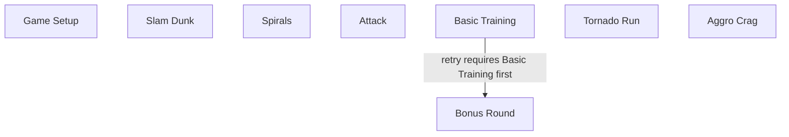
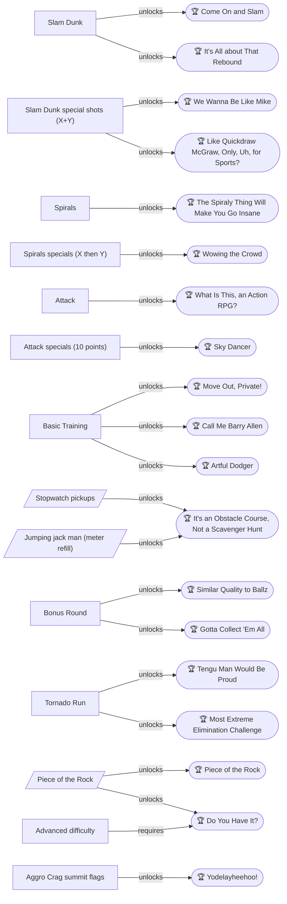
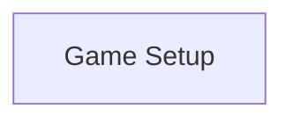
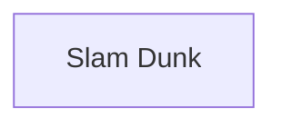
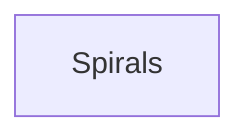
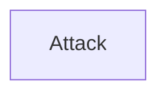
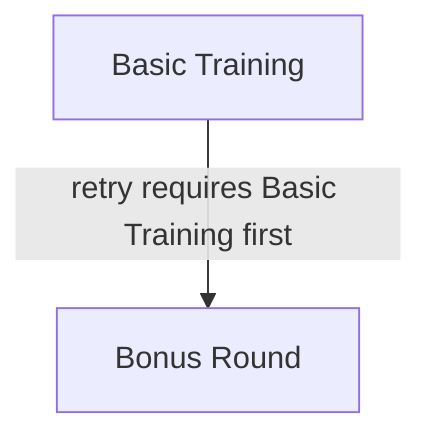
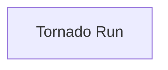
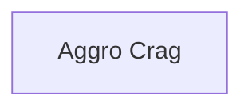

# Knowledge graph — game 23372

Nodes: 39 · Edges: 39

## Progression flow

## Achievement dependencies

## Chapter 1: Game Setup and Options

## Chapter 2: Slam Dunk

## Chapter 3: Spirals

## Chapter 4: Attack

## Chapter 5: Basic Training and the Bonus Round

## Chapter 6: Tornado Run

## Chapter 7: The Aggro Crag

