# Knowledge graph — game 2403

Nodes: 150 · Edges: 172

## Progression flow

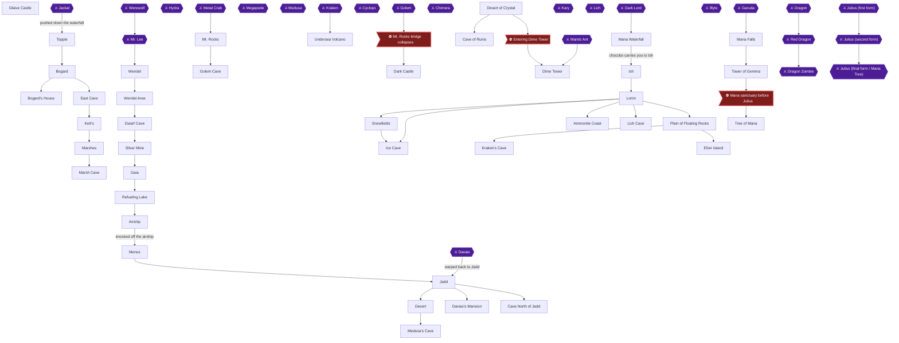

## Achievement dependencies

```mermaid
flowchart LR
  Zeus_Axe(["⚠ Zeus Axe (past the lava pools)"])
  Iflyte{{"⚔ Iflyte"}}
  Wendel_Boy(["⚠ Boy in SW Wendel"])
  PONR_Dime_Tower>"⛔ Entering Dime Tower"]
  Dragon_Sword(["⚠ Dragon Sword"])
  Jackal{{"⚔ Jackal"}}
  Ach_28942(["🏆 Fall to Earth"])
  Topple["Topple"]
  Ach_28943(["🏆 Damsel in Distress"])
  Mattock[/"Mattock (Bogard's chest)"/]
  Ach_28944(["🏆 Pearl of Wisdom"])
  Cure_Spell[/"Cure spell (rest at Kett's)"/]
  Ach_28945(["🏆 Rest and Heal Your Wounds"])
  Mysterious_Man["Mysterious man in Marsh Cave (Julius)"]
  Ach_28946(["🏆 Mysterious Marsh Man"])
  Hydra{{"⚔ Hydra"}}
  Ach_28947(["🏆 Hail Hydra!"])
  Mr_Lee{{"⚔ Mr. Lee"}}
  Ach_29002(["🏆 RIP, Christopher Lee"])
  Wendel["Wendel"]
  Ach_29003(["🏆 You Spoony Bard!"])
  Watts["Watts joins in the Silver Mine"]
  Ach_29004(["🏆 The World Is Mine"])
  Bogard_Joins["Bogard joins outside Gaia"]
  Ach_29005(["🏆 I Taste Like (Silver) Chicken"])
  Airship["Airship"]
  Ach_29006(["🏆 I Believe I Can Fly..."])
  Chocobo["Chocobo egg hatches"]
  Ach_29022(["🏆 Familiar Feathered Friend"])
  Fang["Fang for the boy in Jadd"]
  Ach_29023(["🏆 To Infinity, and Beyond!"])
  Amandas_Tears[/"Amanda's Tears"/]
  Ach_29058(["🏆 Mercy"])
  Lester["Lester freed from the curse"]
  Ach_29059(["🏆 Mystic Tune?! Yeah!"])
  Davias{{"⚔ Davias"}}
  Ach_29060(["🏆 Your Pendant Is in Another Castle"])
  Morning_Star[/"Morning Star (Cyclops chest)"/]
  Ach_29061(["🏆 Balls of Steel"])
  PONR_Mt_Rocks>"⛔ Mt. Rocks bridge collapses"]
  Ach_29062(["🏆 Return of the Gemma"])
  Dark_Lord{{"⚔ Dark Lord"}}
  Ach_29063(["🏆 I Am (Not) Your Father"])
  Mana_Waterfall["Mana Waterfall"]
  Ach_29064(["🏆 Glaive Strikes Back"])
  Chocobot["Dr. Bowow builds the Chocobot"]
  Ach_29065(["🏆 Chocobo 2.0"])
  Kary{{"⚔ Kary"}}
  Ach_29066(["🏆 Defroster"])
  Kraken{{"⚔ Kraken"}}
  Ach_29067(["🏆 Who's Your Octo-Daddy Now?"])
  Rusty_Sword[/"Rusty Sword (Iflyte)"/]
  Ach_29068(["🏆 Through the Fire and Flames"])
  Nuke[/"Nuke spell (Lich)"/]
  Ach_29069(["🏆 Meltdown"])
  Marcie["Marcie joins"]
  Ach_29070(["🏆 Rise of the Robots"])
  Garuda{{"⚔ Garuda"}}
  Ach_29071(["🏆 Robots Can't Jump"])
  Dragon_Zombie{{"⚔ Dragon Zombie"}}
  Ach_29072(["🏆 Dragon Slayer"])
  Excalibur[/"Excalibur restored"/]
  Ach_29073(["🏆 I've Got the Power!"])
  Julius_1{{"⚔ Julius (first form)"}}
  Ach_29074(["🏆 Duel to the Death"])
  Julius_2{{"⚔ Julius (second form)"}}
  Ach_29075(["🏆 The Real Meaning of Power"])
  Julius_3{{"⚔ Julius (final form / Mana Tree)"}}
  Ach_29076(["🏆 The End of Everything"])
  Ach_29077(["🏆 Legacy of Mana"])
  Marsh_Cave["Marsh Cave"]
  Ach_29078(["🏆 Squire"])
  Medusas_Cave["Medusa's Cave"]
  Ach_29079(["🏆 Knight"])
  Tower_of_Gemma["Tower of Gemma"]
  Ach_29080(["🏆 Gemma Knight"])
  Ach_29081(["🏆 The Way of the Warrior"])
  Ach_29082(["🏆 The Way of the Wizard"])
  Ach_29083(["🏆 The Way of the Tank"])
  Ach_29084(["🏆 The Way of the Monk"])
  Ach_29085(["🏆 Wow, You're Rich!"])
  Were_Axe(["⚠ Were Axe (snowman switch room)"])
  Ach_29086(["🏆 Kevin's Worst Nightmare"])
  Blood_Sword(["⚠ Blood Sword (knight room)"])
  Ach_29087(["🏆 Drink the Blood of My Enemies"])
  Ach_29088(["🏆 Duck Hunter"])
  Ach_29089(["🏆 Sierra's Blade"])
  Dragon_Armor(["⚠ Dragon Armor"])
  Ach_29090(["🏆 Larc's Leathers"])
  Samurai_Gear(["⚠ Samurai Armor and Helmet drops"])
  Ach_29091(["🏆 Samurai Style"])
  Aegis(["⚠ Aegis Shield (Elephant drop)"])
  Ach_29092(["🏆 Poacher"])
  Ach_29093(["🏆 War Is Hell"])
  Ach_29094(["🏆 Timber!!!"])
  Zeus_Axe -.->|missable before| Iflyte
  Wendel_Boy -.->|missable before| PONR_Dime_Tower
  Dragon_Sword -.->|missable before| PONR_Dime_Tower
  Jackal -->|unlocks| Ach_28942
  Topple -->|unlocks| Ach_28943
  Mattock -->|unlocks| Ach_28944
  Cure_Spell -->|unlocks| Ach_28945
  Mysterious_Man -->|unlocks| Ach_28946
  Hydra -->|unlocks| Ach_28947
  Mr_Lee -->|unlocks| Ach_29002
  Wendel -->|unlocks| Ach_29003
  Watts -->|unlocks| Ach_29004
  Bogard_Joins -->|unlocks| Ach_29005
  Airship -->|unlocks| Ach_29006
  Chocobo -->|unlocks| Ach_29022
  Fang -->|unlocks| Ach_29023
  Amandas_Tears -->|unlocks| Ach_29058
  Lester -->|unlocks| Ach_29059
  Davias -->|unlocks| Ach_29060
  Morning_Star -->|unlocks| Ach_29061
  PONR_Mt_Rocks -->|unlocks| Ach_29062
  Dark_Lord -->|unlocks| Ach_29063
  Mana_Waterfall -->|unlocks| Ach_29064
  Chocobot -->|unlocks| Ach_29065
  Kary -->|unlocks| Ach_29066
  Kraken -->|unlocks| Ach_29067
  Rusty_Sword -->|unlocks| Ach_29068
  Nuke -->|unlocks| Ach_29069
  Marcie -->|unlocks| Ach_29070
  Garuda -->|unlocks| Ach_29071
  Dragon_Zombie -->|unlocks| Ach_29072
  Excalibur -->|unlocks| Ach_29073
  Julius_1 -->|unlocks| Ach_29074
  Julius_2 -->|unlocks| Ach_29075
  Julius_3 -->|unlocks| Ach_29076
  Julius_3 -->|unlocks| Ach_29077
  Marsh_Cave -->|unlocks| Ach_29078
  Medusas_Cave -->|unlocks| Ach_29079
  Tower_of_Gemma -->|unlocks| Ach_29080
  Tower_of_Gemma -->|unlocks| Ach_29081
  Tower_of_Gemma -->|unlocks| Ach_29082
  Tower_of_Gemma -->|unlocks| Ach_29083
  Tower_of_Gemma -->|unlocks| Ach_29084
  Tower_of_Gemma -->|unlocks| Ach_29085
  Were_Axe -->|unlocks| Ach_29086
  Blood_Sword -->|unlocks| Ach_29087
  Zeus_Axe -->|unlocks| Ach_29088
  Dragon_Sword -->|unlocks| Ach_29089
  Dragon_Armor -->|unlocks| Ach_29090
  Samurai_Gear -->|unlocks| Ach_29091
  Aegis -->|unlocks| Ach_29092
  Wendel_Boy -->|unlocks| Ach_29093
  Julius_3 -->|unlocks| Ach_29094
  Were_Axe -->|requires| Ach_29094
  Zeus_Axe -->|requires| Ach_29094
```

## Chapter 1: Escape from Glaive Castle

```mermaid
flowchart TD
  Glaive_Castle["Glaive Castle"]
  Jackal{{"⚔ Jackal"}}
  Hydra{{"⚔ Hydra"}}
  Werewolf{{"⚔ Werewolf"}}
  Mr_Lee{{"⚔ Mr. Lee"}}
  Megapede{{"⚔ Megapede"}}
  Medusa{{"⚔ Medusa"}}
  Davias{{"⚔ Davias"}}
  Metal_Crab{{"⚔ Metal Crab"}}
  Cyclops{{"⚔ Cyclops"}}
  Golem{{"⚔ Golem"}}
  Chimera{{"⚔ Chimera"}}
  Dark_Lord{{"⚔ Dark Lord"}}
  Kary{{"⚔ Kary"}}
  Lich{{"⚔ Lich"}}
  Kraken{{"⚔ Kraken"}}
  Iflyte{{"⚔ Iflyte"}}
  Mantis_Ant{{"⚔ Mantis Ant"}}
  Garuda{{"⚔ Garuda"}}
  Dragon{{"⚔ Dragon"}}
  Red_Dragon{{"⚔ Red Dragon"}}
  Dragon_Zombie{{"⚔ Dragon Zombie"}}
  Julius_1{{"⚔ Julius (first form)"}}
  Julius_2{{"⚔ Julius (second form)"}}
  Julius_3{{"⚔ Julius (final form / Mana Tree)"}}
  PONR_Mt_Rocks>"⛔ Mt. Rocks bridge collapses"]
  PONR_Dime_Tower>"⛔ Entering Dime Tower"]
  PONR_Mana_Sanctuary>"⛔ Mana sanctuary before Julius"]
  Werewolf --> Mr_Lee
  Golem --> PONR_Mt_Rocks
  Dragon --> Red_Dragon
  Red_Dragon --> Dragon_Zombie
  Julius_1 --> Julius_2
  Julius_2 --> Julius_3
  classDef ponr fill:#7f1d1d,stroke:#f87171,color:#fff;
  classDef boss fill:#4c1d95,stroke:#a78bfa,color:#fff;
  class PONR_Mt_Rocks,PONR_Dime_Tower,PONR_Mana_Sanctuary ponr;
  class Jackal,Hydra,Werewolf,Mr_Lee,Megapede,Medusa,Davias,Metal_Crab,Cyclops,Golem,Chimera,Dark_Lord,Kary,Lich,Kraken,Iflyte,Mantis_Ant,Garuda,Dragon,Red_Dragon,Dragon_Zombie,Julius_1,Julius_2,Julius_3 boss;
```

## Chapter 2: Topple, Bogard and Kett's

```mermaid
flowchart TD
  Topple["Topple"]
  Bogard["Bogard"]
  Bogards_House["Bogard's House"]
  East_Cave["East Cave"]
  Ketts["Kett's"]
  Hydra{{"⚔ Hydra"}}
  Werewolf{{"⚔ Werewolf"}}
  Mr_Lee{{"⚔ Mr. Lee"}}
  Megapede{{"⚔ Megapede"}}
  Medusa{{"⚔ Medusa"}}
  Davias{{"⚔ Davias"}}
  Metal_Crab{{"⚔ Metal Crab"}}
  Cyclops{{"⚔ Cyclops"}}
  Golem{{"⚔ Golem"}}
  Chimera{{"⚔ Chimera"}}
  Dark_Lord{{"⚔ Dark Lord"}}
  Kary{{"⚔ Kary"}}
  Lich{{"⚔ Lich"}}
  Kraken{{"⚔ Kraken"}}
  Iflyte{{"⚔ Iflyte"}}
  Mantis_Ant{{"⚔ Mantis Ant"}}
  Garuda{{"⚔ Garuda"}}
  Dragon{{"⚔ Dragon"}}
  Red_Dragon{{"⚔ Red Dragon"}}
  Dragon_Zombie{{"⚔ Dragon Zombie"}}
  Julius_1{{"⚔ Julius (first form)"}}
  Julius_2{{"⚔ Julius (second form)"}}
  Julius_3{{"⚔ Julius (final form / Mana Tree)"}}
  PONR_Mt_Rocks>"⛔ Mt. Rocks bridge collapses"]
  PONR_Dime_Tower>"⛔ Entering Dime Tower"]
  PONR_Mana_Sanctuary>"⛔ Mana sanctuary before Julius"]
  Topple --> Bogard
  Bogard --> Bogards_House
  Bogard --> East_Cave
  East_Cave --> Ketts
  Werewolf --> Mr_Lee
  Golem --> PONR_Mt_Rocks
  Dragon --> Red_Dragon
  Red_Dragon --> Dragon_Zombie
  Julius_1 --> Julius_2
  Julius_2 --> Julius_3
  classDef ponr fill:#7f1d1d,stroke:#f87171,color:#fff;
  classDef boss fill:#4c1d95,stroke:#a78bfa,color:#fff;
  class PONR_Mt_Rocks,PONR_Dime_Tower,PONR_Mana_Sanctuary ponr;
  class Hydra,Werewolf,Mr_Lee,Megapede,Medusa,Davias,Metal_Crab,Cyclops,Golem,Chimera,Dark_Lord,Kary,Lich,Kraken,Iflyte,Mantis_Ant,Garuda,Dragon,Red_Dragon,Dragon_Zombie,Julius_1,Julius_2,Julius_3 boss;
```

## Chapter 3: Marsh Cave and the Vampire

```mermaid
flowchart TD
  Ketts["Kett's"]
  Marshes["Marshes"]
  Marsh_Cave["Marsh Cave"]
  Hydra{{"⚔ Hydra"}}
  Werewolf{{"⚔ Werewolf"}}
  Mr_Lee{{"⚔ Mr. Lee"}}
  Megapede{{"⚔ Megapede"}}
  Medusa{{"⚔ Medusa"}}
  Davias{{"⚔ Davias"}}
  Metal_Crab{{"⚔ Metal Crab"}}
  Cyclops{{"⚔ Cyclops"}}
  Golem{{"⚔ Golem"}}
  Chimera{{"⚔ Chimera"}}
  Dark_Lord{{"⚔ Dark Lord"}}
  Kary{{"⚔ Kary"}}
  Lich{{"⚔ Lich"}}
  Kraken{{"⚔ Kraken"}}
  Iflyte{{"⚔ Iflyte"}}
  Mantis_Ant{{"⚔ Mantis Ant"}}
  Garuda{{"⚔ Garuda"}}
  Dragon{{"⚔ Dragon"}}
  Red_Dragon{{"⚔ Red Dragon"}}
  Dragon_Zombie{{"⚔ Dragon Zombie"}}
  Julius_1{{"⚔ Julius (first form)"}}
  Julius_2{{"⚔ Julius (second form)"}}
  Julius_3{{"⚔ Julius (final form / Mana Tree)"}}
  PONR_Mt_Rocks>"⛔ Mt. Rocks bridge collapses"]
  PONR_Dime_Tower>"⛔ Entering Dime Tower"]
  PONR_Mana_Sanctuary>"⛔ Mana sanctuary before Julius"]
  Ketts --> Marshes
  Marshes --> Marsh_Cave
  Werewolf --> Mr_Lee
  Golem --> PONR_Mt_Rocks
  Dragon --> Red_Dragon
  Red_Dragon --> Dragon_Zombie
  Julius_1 --> Julius_2
  Julius_2 --> Julius_3
  classDef ponr fill:#7f1d1d,stroke:#f87171,color:#fff;
  classDef boss fill:#4c1d95,stroke:#a78bfa,color:#fff;
  class PONR_Mt_Rocks,PONR_Dime_Tower,PONR_Mana_Sanctuary ponr;
  class Hydra,Werewolf,Mr_Lee,Megapede,Medusa,Davias,Metal_Crab,Cyclops,Golem,Chimera,Dark_Lord,Kary,Lich,Kraken,Iflyte,Mantis_Ant,Garuda,Dragon,Red_Dragon,Dragon_Zombie,Julius_1,Julius_2,Julius_3 boss;
```

## Chapter 4: Wendel, the Silver Mine and Gaia

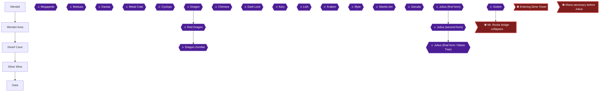

## Chapter 5: The Airship and Menos

```mermaid
flowchart TD
  Refueling_Lake["Refueling Lake"]
  Airship["Airship"]
  Menos["Menos"]
  Medusa{{"⚔ Medusa"}}
  Davias{{"⚔ Davias"}}
  Metal_Crab{{"⚔ Metal Crab"}}
  Cyclops{{"⚔ Cyclops"}}
  Golem{{"⚔ Golem"}}
  Chimera{{"⚔ Chimera"}}
  Dark_Lord{{"⚔ Dark Lord"}}
  Kary{{"⚔ Kary"}}
  Lich{{"⚔ Lich"}}
  Kraken{{"⚔ Kraken"}}
  Iflyte{{"⚔ Iflyte"}}
  Mantis_Ant{{"⚔ Mantis Ant"}}
  Garuda{{"⚔ Garuda"}}
  Dragon{{"⚔ Dragon"}}
  Red_Dragon{{"⚔ Red Dragon"}}
  Dragon_Zombie{{"⚔ Dragon Zombie"}}
  Julius_1{{"⚔ Julius (first form)"}}
  Julius_2{{"⚔ Julius (second form)"}}
  Julius_3{{"⚔ Julius (final form / Mana Tree)"}}
  PONR_Mt_Rocks>"⛔ Mt. Rocks bridge collapses"]
  PONR_Dime_Tower>"⛔ Entering Dime Tower"]
  PONR_Mana_Sanctuary>"⛔ Mana sanctuary before Julius"]
  Refueling_Lake --> Airship
  Airship -->|"knocked off the airship"| Menos
  Golem --> PONR_Mt_Rocks
  Dragon --> Red_Dragon
  Red_Dragon --> Dragon_Zombie
  Julius_1 --> Julius_2
  Julius_2 --> Julius_3
  classDef ponr fill:#7f1d1d,stroke:#f87171,color:#fff;
  classDef boss fill:#4c1d95,stroke:#a78bfa,color:#fff;
  class PONR_Mt_Rocks,PONR_Dime_Tower,PONR_Mana_Sanctuary ponr;
  class Medusa,Davias,Metal_Crab,Cyclops,Golem,Chimera,Dark_Lord,Kary,Lich,Kraken,Iflyte,Mantis_Ant,Garuda,Dragon,Red_Dragon,Dragon_Zombie,Julius_1,Julius_2,Julius_3 boss;
```

## Chapter 6: Jadd, the Oasis and Medusa's Cave

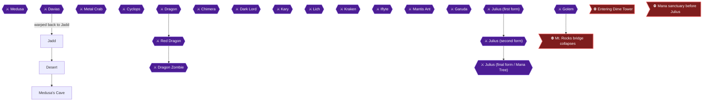

## Chapter 7: Davias's Mansion

```mermaid
flowchart TD
  Davias_Mansion["Davias's Mansion"]
  Davias{{"⚔ Davias"}}
  Metal_Crab{{"⚔ Metal Crab"}}
  Cyclops{{"⚔ Cyclops"}}
  Golem{{"⚔ Golem"}}
  Chimera{{"⚔ Chimera"}}
  Dark_Lord{{"⚔ Dark Lord"}}
  Kary{{"⚔ Kary"}}
  Lich{{"⚔ Lich"}}
  Kraken{{"⚔ Kraken"}}
  Iflyte{{"⚔ Iflyte"}}
  Mantis_Ant{{"⚔ Mantis Ant"}}
  Garuda{{"⚔ Garuda"}}
  Dragon{{"⚔ Dragon"}}
  Red_Dragon{{"⚔ Red Dragon"}}
  Dragon_Zombie{{"⚔ Dragon Zombie"}}
  Julius_1{{"⚔ Julius (first form)"}}
  Julius_2{{"⚔ Julius (second form)"}}
  Julius_3{{"⚔ Julius (final form / Mana Tree)"}}
  PONR_Mt_Rocks>"⛔ Mt. Rocks bridge collapses"]
  PONR_Dime_Tower>"⛔ Entering Dime Tower"]
  PONR_Mana_Sanctuary>"⛔ Mana sanctuary before Julius"]
  Golem --> PONR_Mt_Rocks
  Dragon --> Red_Dragon
  Red_Dragon --> Dragon_Zombie
  Julius_1 --> Julius_2
  Julius_2 --> Julius_3
  classDef ponr fill:#7f1d1d,stroke:#f87171,color:#fff;
  classDef boss fill:#4c1d95,stroke:#a78bfa,color:#fff;
  class PONR_Mt_Rocks,PONR_Dime_Tower,PONR_Mana_Sanctuary ponr;
  class Davias,Metal_Crab,Cyclops,Golem,Chimera,Dark_Lord,Kary,Lich,Kraken,Iflyte,Mantis_Ant,Garuda,Dragon,Red_Dragon,Dragon_Zombie,Julius_1,Julius_2,Julius_3 boss;
```

## Chapter 8: Mt. Rocks and the Golem Cave

```mermaid
flowchart TD
  Cave_North_of_Jadd["Cave North of Jadd"]
  Mt_Rocks["Mt. Rocks"]
  Golem_Cave["Golem Cave"]
  Metal_Crab{{"⚔ Metal Crab"}}
  Cyclops{{"⚔ Cyclops"}}
  Golem{{"⚔ Golem"}}
  Chimera{{"⚔ Chimera"}}
  Dark_Lord{{"⚔ Dark Lord"}}
  Kary{{"⚔ Kary"}}
  Lich{{"⚔ Lich"}}
  Kraken{{"⚔ Kraken"}}
  Iflyte{{"⚔ Iflyte"}}
  Mantis_Ant{{"⚔ Mantis Ant"}}
  Garuda{{"⚔ Garuda"}}
  Dragon{{"⚔ Dragon"}}
  Red_Dragon{{"⚔ Red Dragon"}}
  Dragon_Zombie{{"⚔ Dragon Zombie"}}
  Julius_1{{"⚔ Julius (first form)"}}
  Julius_2{{"⚔ Julius (second form)"}}
  Julius_3{{"⚔ Julius (final form / Mana Tree)"}}
  PONR_Mt_Rocks>"⛔ Mt. Rocks bridge collapses"]
  PONR_Dime_Tower>"⛔ Entering Dime Tower"]
  PONR_Mana_Sanctuary>"⛔ Mana sanctuary before Julius"]
  Metal_Crab --> Mt_Rocks
  Mt_Rocks --> Golem_Cave
  Golem --> PONR_Mt_Rocks
  Dragon --> Red_Dragon
  Red_Dragon --> Dragon_Zombie
  Julius_1 --> Julius_2
  Julius_2 --> Julius_3
  classDef ponr fill:#7f1d1d,stroke:#f87171,color:#fff;
  classDef boss fill:#4c1d95,stroke:#a78bfa,color:#fff;
  class PONR_Mt_Rocks,PONR_Dime_Tower,PONR_Mana_Sanctuary ponr;
  class Metal_Crab,Cyclops,Golem,Chimera,Dark_Lord,Kary,Lich,Kraken,Iflyte,Mantis_Ant,Garuda,Dragon,Red_Dragon,Dragon_Zombie,Julius_1,Julius_2,Julius_3 boss;
```

## Chapter 9: Return to Glaive

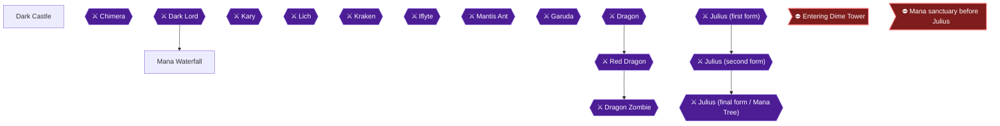

## Chapter 10: Ish, Lorim and the Ice Cave

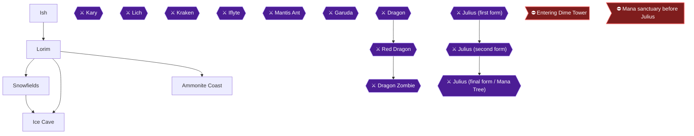

## Chapter 11: The Lich, the Kraken and the Undersea Volcano

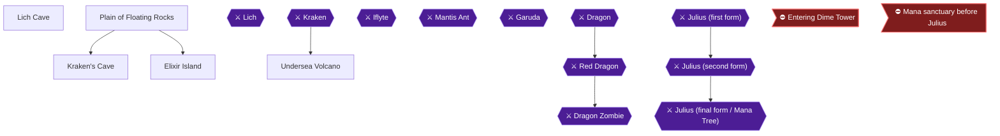

## Chapter 12: The Cave of Ruins and Dime Tower

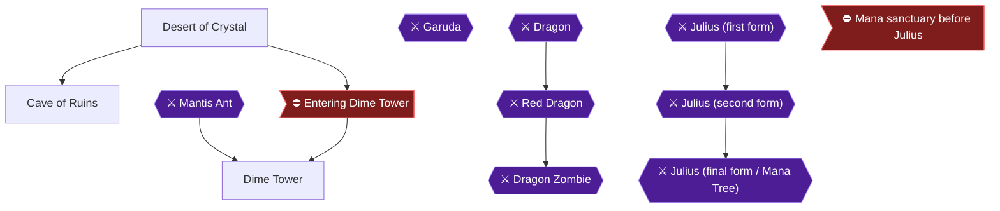

## Chapter 13: The Tower of Gemma and the Tree of Mana

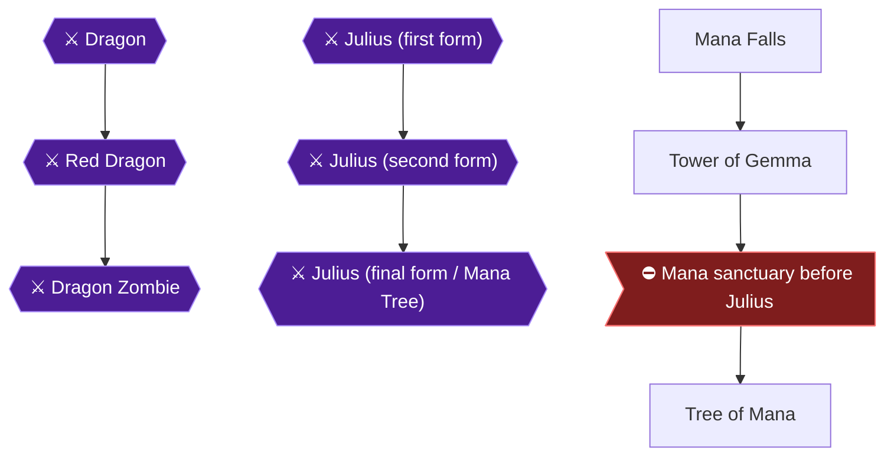
