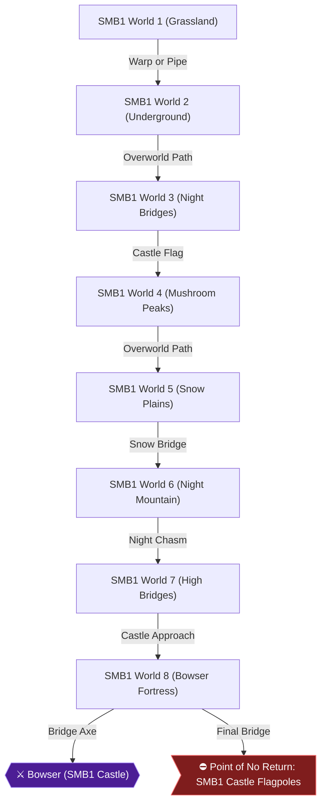
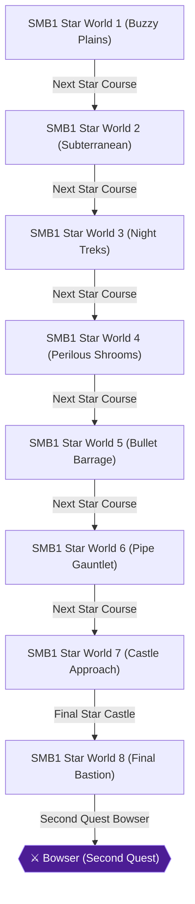
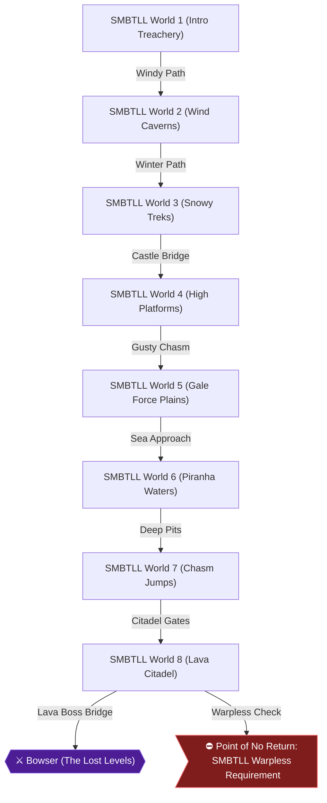
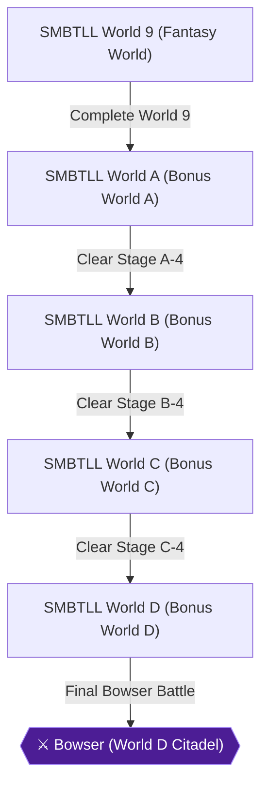
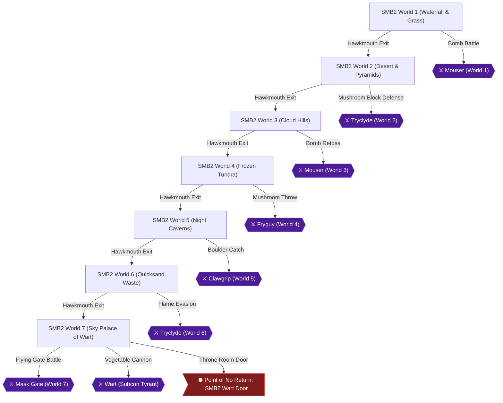
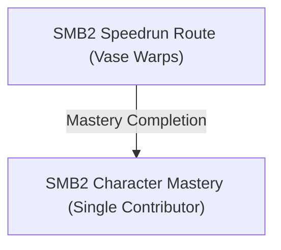
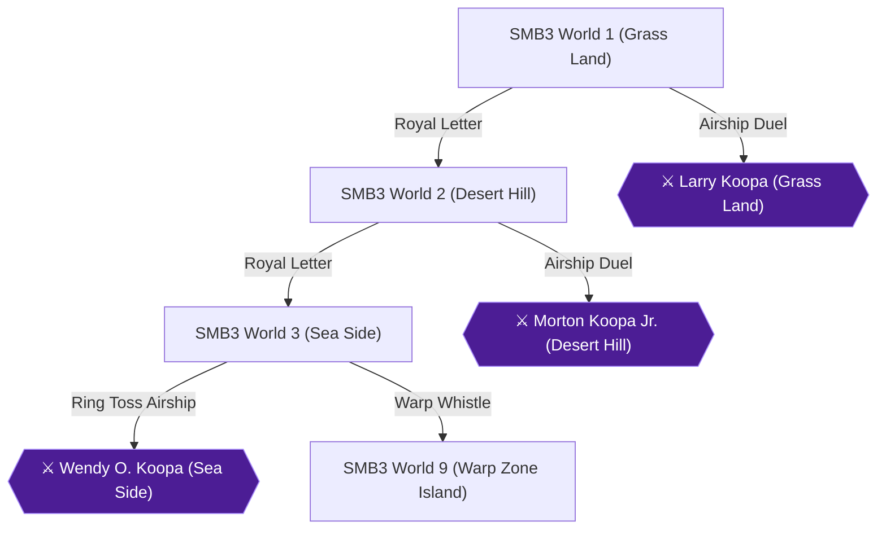
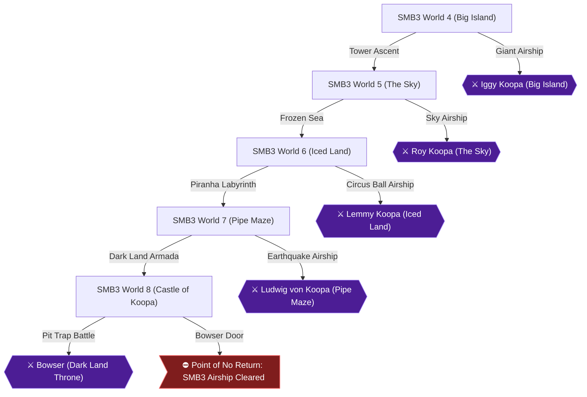

# Knowledge graph — game 253

Nodes: 71 · Edges: 63

## Progression flow

```mermaid
flowchart TD
  SMB1_World1["SMB1 World 1 (Grassland)"]
  SMB1_World2["SMB1 World 2 (Underground)"]
  SMB1_World3["SMB1 World 3 (Night Bridges)"]
  SMB1_World4["SMB1 World 4 (Mushroom Peaks)"]
  SMB1_World5["SMB1 World 5 (Snow Plains)"]
  SMB1_World6["SMB1 World 6 (Night Mountain)"]
  SMB1_World7["SMB1 World 7 (High Bridges)"]
  SMB1_World8["SMB1 World 8 (Bowser Fortress)"]
  SMB1_StarWorld1["SMB1 Star World 1 (Buzzy Plains)"]
  SMB1_StarWorld2["SMB1 Star World 2 (Subterranean)"]
  SMB1_StarWorld3["SMB1 Star World 3 (Night Treks)"]
  SMB1_StarWorld4["SMB1 Star World 4 (Perilous Shrooms)"]
  SMB1_StarWorld5["SMB1 Star World 5 (Bullet Barrage)"]
  SMB1_StarWorld6["SMB1 Star World 6 (Pipe Gauntlet)"]
  SMB1_StarWorld7["SMB1 Star World 7 (Castle Approach)"]
  SMB1_StarWorld8["SMB1 Star World 8 (Final Bastion)"]
  SMBTLL_World1["SMBTLL World 1 (Intro Treachery)"]
  SMBTLL_World2["SMBTLL World 2 (Wind Caverns)"]
  SMBTLL_World3["SMBTLL World 3 (Snowy Treks)"]
  SMBTLL_World4["SMBTLL World 4 (High Platforms)"]
  SMBTLL_World5["SMBTLL World 5 (Gale Force Plains)"]
  SMBTLL_World6["SMBTLL World 6 (Piranha Waters)"]
  SMBTLL_World7["SMBTLL World 7 (Chasm Jumps)"]
  SMBTLL_World8["SMBTLL World 8 (Lava Citadel)"]
  SMBTLL_World9["SMBTLL World 9 (Fantasy World)"]
  SMBTLL_WorldA["SMBTLL World A (Bonus World A)"]
  SMBTLL_WorldB["SMBTLL World B (Bonus World B)"]
  SMBTLL_WorldC["SMBTLL World C (Bonus World C)"]
  SMBTLL_WorldD["SMBTLL World D (Bonus World D)"]
  SMB2_World1["SMB2 World 1 (Waterfall & Grass)"]
  SMB2_World2["SMB2 World 2 (Desert & Pyramids)"]
  SMB2_World3["SMB2 World 3 (Cloud Hills)"]
  SMB2_World4["SMB2 World 4 (Frozen Tundra)"]
  SMB2_World5["SMB2 World 5 (Night Caverns)"]
  SMB2_World6["SMB2 World 6 (Quicksand Waste)"]
  SMB2_World7["SMB2 World 7 (Sky Palace of Wart)"]
  SMB2_SubconSpeedrun["SMB2 Speedrun Route (Vase Warps)"]
  SMB2_CharacterTrial["SMB2 Character Mastery (Single Contributor)"]
  SMB3_GrassLand["SMB3 World 1 (Grass Land)"]
  SMB3_DesertHill["SMB3 World 2 (Desert Hill)"]
  SMB3_SeaSide["SMB3 World 3 (Sea Side)"]
  SMB3_WarpZone["SMB3 World 9 (Warp Zone Island)"]
  SMB3_BigIsland["SMB3 World 4 (Big Island)"]
  SMB3_TheSky["SMB3 World 5 (The Sky)"]
  SMB3_IcedLand["SMB3 World 6 (Iced Land)"]
  SMB3_PipeMaze["SMB3 World 7 (Pipe Maze)"]
  SMB3_CastleOfKoopa["SMB3 World 8 (Castle of Koopa)"]
  Boss_BowserSMB1{{"⚔ Bowser (SMB1 Castle)"}}
  Boss_BowserQuest2{{"⚔ Bowser (Second Quest)"}}
  Boss_BowserTLL{{"⚔ Bowser (The Lost Levels)"}}
  Boss_BowserWorldD{{"⚔ Bowser (World D Citadel)"}}
  Boss_Mouser1{{"⚔ Mouser (World 1)"}}
  Boss_Tryclyde2{{"⚔ Tryclyde (World 2)"}}
  Boss_Mouser3{{"⚔ Mouser (World 3)"}}
  Boss_Fryguy4{{"⚔ Fryguy (World 4)"}}
  Boss_Clawgrip5{{"⚔ Clawgrip (World 5)"}}
  Boss_Tryclyde6{{"⚔ Tryclyde (World 6)"}}
  Boss_MaskGate7{{"⚔ Mask Gate (World 7)"}}
  Boss_Wart7{{"⚔ Wart (Subcon Tyrant)"}}
  Boss_LarryKoopa{{"⚔ Larry Koopa (Grass Land)"}}
  Boss_MortonKoopa{{"⚔ Morton Koopa Jr. (Desert Hill)"}}
  Boss_WendyKoopa{{"⚔ Wendy O. Koopa (Sea Side)"}}
  Boss_IggyKoopa{{"⚔ Iggy Koopa (Big Island)"}}
  Boss_RoyKoopa{{"⚔ Roy Koopa (The Sky)"}}
  Boss_LemmyKoopa{{"⚔ Lemmy Koopa (Iced Land)"}}
  Boss_LudwigKoopa{{"⚔ Ludwig von Koopa (Pipe Maze)"}}
  Boss_BowserSMB3{{"⚔ Bowser (Dark Land Throne)"}}
  PONR_SMB1Warp>"⛔ Point of No Return: SMB1 Castle Flagpoles"]
  PONR_SMBTLLWarpless>"⛔ Point of No Return: SMBTLL Warpless Requirement"]
  PONR_SMB2WartDoor>"⛔ Point of No Return: SMB2 Wart Door"]
  PONR_SMB3Airship>"⛔ Point of No Return: SMB3 Airship Cleared"]
  SMB1_World1 -->|Warp or Pipe| SMB1_World2
  SMB1_World2 -->|Overworld Path| SMB1_World3
  SMB1_World3 -->|Castle Flag| SMB1_World4
  SMB1_World4 -->|Overworld Path| SMB1_World5
  SMB1_World5 -->|Snow Bridge| SMB1_World6
  SMB1_World6 -->|Night Chasm| SMB1_World7
  SMB1_World7 -->|Castle Approach| SMB1_World8
  SMB1_World8 -->|Bridge Axe| Boss_BowserSMB1
  SMB1_World8 -->|Final Bridge| PONR_SMB1Warp
  SMB1_StarWorld1 -->|Next Star Course| SMB1_StarWorld2
  SMB1_StarWorld2 -->|Next Star Course| SMB1_StarWorld3
  SMB1_StarWorld3 -->|Next Star Course| SMB1_StarWorld4
  SMB1_StarWorld4 -->|Next Star Course| SMB1_StarWorld5
  SMB1_StarWorld5 -->|Next Star Course| SMB1_StarWorld6
  SMB1_StarWorld6 -->|Next Star Course| SMB1_StarWorld7
  SMB1_StarWorld7 -->|Final Star Castle| SMB1_StarWorld8
  SMB1_StarWorld8 -->|Second Quest Bowser| Boss_BowserQuest2
  SMBTLL_World1 -->|Windy Path| SMBTLL_World2
  SMBTLL_World2 -->|Winter Path| SMBTLL_World3
  SMBTLL_World3 -->|Castle Bridge| SMBTLL_World4
  SMBTLL_World4 -->|Gusty Chasm| SMBTLL_World5
  SMBTLL_World5 -->|Sea Approach| SMBTLL_World6
  SMBTLL_World6 -->|Deep Pits| SMBTLL_World7
  SMBTLL_World7 -->|Citadel Gates| SMBTLL_World8
  SMBTLL_World8 -->|Lava Boss Bridge| Boss_BowserTLL
  SMBTLL_World8 -->|Warpless Check| PONR_SMBTLLWarpless
  SMBTLL_World9 -->|Complete World 9| SMBTLL_WorldA
  SMBTLL_WorldA -->|Clear Stage A-4| SMBTLL_WorldB
  SMBTLL_WorldB -->|Clear Stage B-4| SMBTLL_WorldC
  SMBTLL_WorldC -->|Clear Stage C-4| SMBTLL_WorldD
  SMBTLL_WorldD -->|Final Bowser Battle| Boss_BowserWorldD
  SMB2_World1 -->|Bomb Battle| Boss_Mouser1
  SMB2_World1 -->|Hawkmouth Exit| SMB2_World2
  SMB2_World2 -->|Mushroom Block Defense| Boss_Tryclyde2
  SMB2_World2 -->|Hawkmouth Exit| SMB2_World3
  SMB2_World3 -->|Bomb Retoss| Boss_Mouser3
  SMB2_World3 -->|Hawkmouth Exit| SMB2_World4
  SMB2_World4 -->|Mushroom Throw| Boss_Fryguy4
  SMB2_World4 -->|Hawkmouth Exit| SMB2_World5
  SMB2_World5 -->|Boulder Catch| Boss_Clawgrip5
  SMB2_World5 -->|Hawkmouth Exit| SMB2_World6
  SMB2_World6 -->|Flame Evasion| Boss_Tryclyde6
  SMB2_World6 -->|Hawkmouth Exit| SMB2_World7
  SMB2_World7 -->|Flying Gate Battle| Boss_MaskGate7
  SMB2_World7 -->|Vegetable Cannon| Boss_Wart7
  SMB2_World7 -->|Throne Room Door| PONR_SMB2WartDoor
  SMB2_SubconSpeedrun -->|Mastery Completion| SMB2_CharacterTrial
  SMB3_GrassLand -->|Airship Duel| Boss_LarryKoopa
  SMB3_GrassLand -->|Royal Letter| SMB3_DesertHill
  SMB3_DesertHill -->|Airship Duel| Boss_MortonKoopa
  SMB3_DesertHill -->|Royal Letter| SMB3_SeaSide
  SMB3_SeaSide -->|Ring Toss Airship| Boss_WendyKoopa
  SMB3_SeaSide -->|Warp Whistle| SMB3_WarpZone
  SMB3_BigIsland -->|Giant Airship| Boss_IggyKoopa
  SMB3_BigIsland -->|Tower Ascent| SMB3_TheSky
  SMB3_TheSky -->|Sky Airship| Boss_RoyKoopa
  SMB3_TheSky -->|Frozen Sea| SMB3_IcedLand
  SMB3_IcedLand -->|Circus Ball Airship| Boss_LemmyKoopa
  SMB3_IcedLand -->|Piranha Labyrinth| SMB3_PipeMaze
  SMB3_PipeMaze -->|Earthquake Airship| Boss_LudwigKoopa
  SMB3_PipeMaze -->|Dark Land Armada| SMB3_CastleOfKoopa
  SMB3_CastleOfKoopa -->|Pit Trap Battle| Boss_BowserSMB3
  SMB3_CastleOfKoopa -->|Bowser Door| PONR_SMB3Airship
  classDef ponr fill:#7f1d1d,stroke:#f87171,color:#fff;
  classDef boss fill:#4c1d95,stroke:#a78bfa,color:#fff;
  class PONR_SMB1Warp,PONR_SMBTLLWarpless,PONR_SMB2WartDoor,PONR_SMB3Airship ponr;
  class Boss_BowserSMB1,Boss_BowserQuest2,Boss_BowserTLL,Boss_BowserWorldD,Boss_Mouser1,Boss_Tryclyde2,Boss_Mouser3,Boss_Fryguy4,Boss_Clawgrip5,Boss_Tryclyde6,Boss_MaskGate7,Boss_Wart7,Boss_LarryKoopa,Boss_MortonKoopa,Boss_WendyKoopa,Boss_IggyKoopa,Boss_RoyKoopa,Boss_LemmyKoopa,Boss_LudwigKoopa,Boss_BowserSMB3 boss;
```

## Chapter 1: Super Mario Bros. — First Quest (Worlds 1–8)

## Chapter 2: Super Mario Bros. — Second Quest & Speedrun

## Chapter 3: Super Mario Bros.: The Lost Levels — Main Quest (Worlds 1–8)

## Chapter 4: Super Mario Bros.: The Lost Levels — Secret Worlds (Worlds 9 & A–D)

## Chapter 5: Super Mario Bros. 2 — Subcon Liberation (Worlds 1–7)

## Chapter 6: Super Mario Bros. 2 — Character Mastery & Speedrun

## Chapter 7: Super Mario Bros. 3 — Grass Land to Sea Side (Worlds 1–3)

## Chapter 8: Super Mario Bros. 3 — Giant Land to Dark Land (Worlds 4–8)

