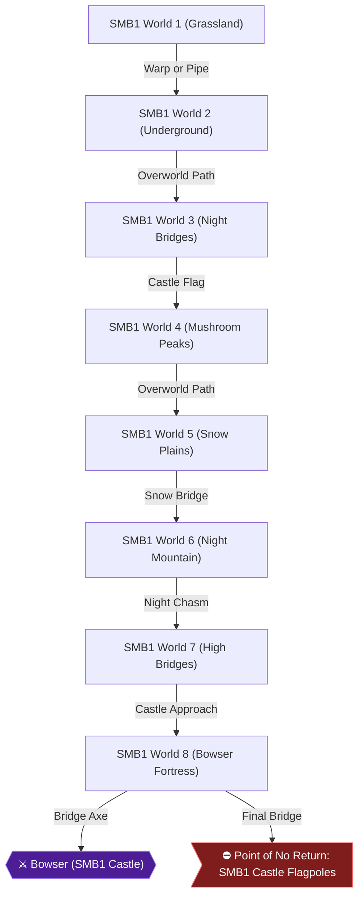
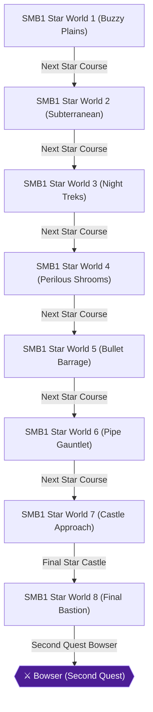
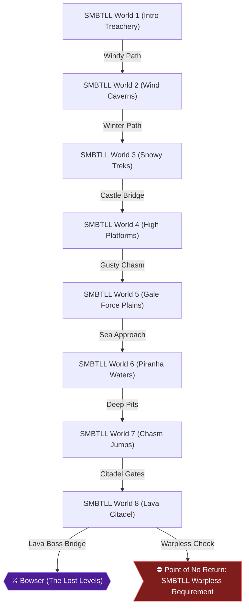
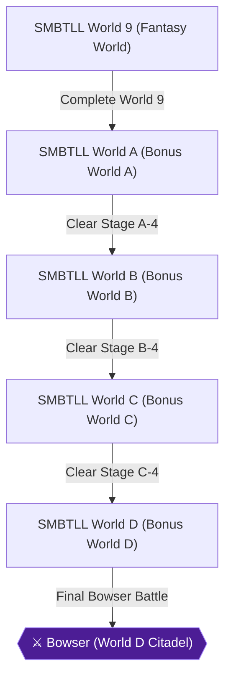
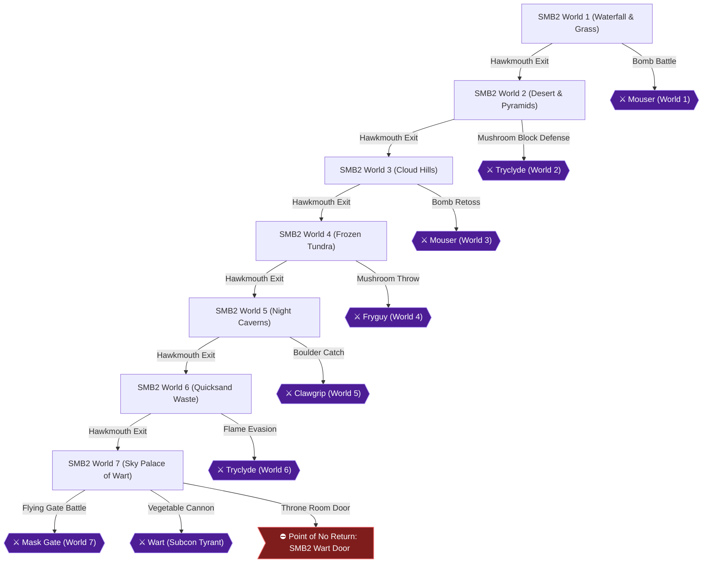
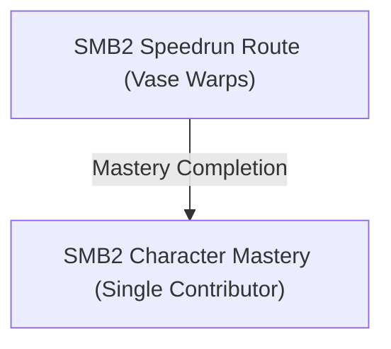
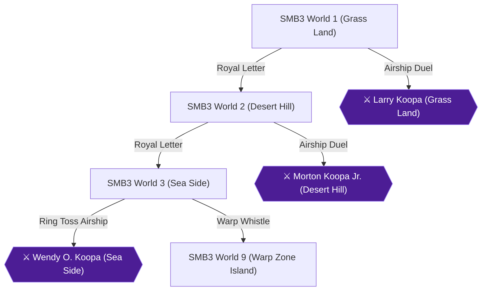
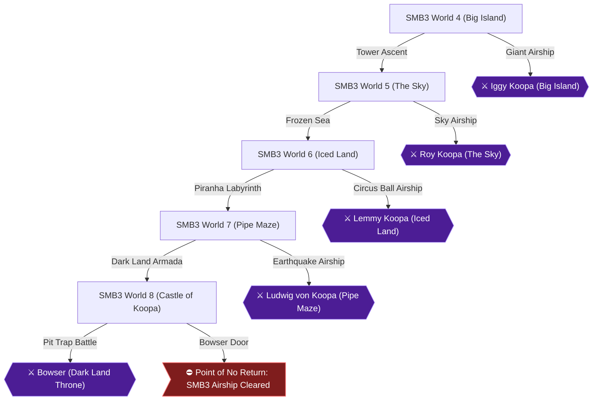

# Super Mario All-Stars — 100% RetroAchievements Walkthrough

## Metadata

- **Platform:** SNES/Super Famicom
- **Developer:** Nintendo
- **Publisher:** Nintendo
- **Genre:** 2D Platforming, Compilation
- **Released:** 1993-07-14
- **Achievements:** 111 (936 points)

> [!NOTE]
> Every instruction in this guide was extracted from the sources listed at the bottom and checked against them (816 facts confirmed by 2+ sources, 1543 from a single source). Statements marked 🟡 come from only one source. Anything we could not confirm says **"Unable to verify from collected sources."**

## Game Overview

Welcome to the definitive completionist walkthrough for Super Mario All-Stars on the Super Nintendo Entertainment System, covering all four games from the classic 1986 era onward. [[ra-comments-64-2]]

This landmark sixteen-bit compilation meticulously remasters four legendary platforming classics: Super Mario Bros., Super Mario Bros.: The Lost Levels (originally released exclusively in Japan as Super Mario Bros. 2), the western Super Mario Bros. 2, and the sprawling masterpiece Super Mario Bros. 3. [[neo1-8-1]]

Every title features enhanced audio-visual presentations, individualized battery-backed save slots, and modernized physics while preserving authentic level design across four classic games. [[neo1-8-2]]

## Core Controls & Compilation Mechanics

Precision movement across all four games adheres to classic Nintendo platforming physics, whether jumping past red hazard lines or launching fireballs. [[neo1-10-1]]

- **Jump & Stomp (B Button):** Tap B to perform standard leaps, rebound off enemy heads, or sustain prolonged flutter arcs in titles featuring buoyant physics. [[neo1-10-2]]
- **Run & Dash (Y Button):** Hold Y while moving forward to dash across single-tile gaps, outrun pursuing hazards, and build velocity toward high spring jumps. [[neo1-11-1]]
- **Action & Power-Ups (Y Button):** In Super Mario Bros., Lost Levels, and Super Mario 3, holding or tapping Y hurls fireballs, swings raccoon tails, or wields hammers. In Super Mario Bros. 2, Y plucks subterranean turf vegetables and hoists enemy minions overhead. [[neo1-11-2]]
- **D-Pad Directional Input:** Steer characters across horizontal terrains, duck below projectile lines, and depress down to explore subterranean pipes or subterranean warp vases. [[neo1-13-1]]

Battery-backed save files preserve your progress at each world checkpoint, though Hardcore RetroAchievements rules require authentic console-accurate session completions in hardcore mode from a fresh boot. [[ra-comments-39-1]]

## True 100% In-Game Completion Framework

Achieving genuine 100% completion in Super Mario All-Stars requires far more than casual level clears. This comprehensive guide tracks and directs full mastery across four comprehensive pillars, guiding you forward to every secret pipe: [[neo1-7-1]]

1. **Super Mario Bros. Mastery:** Complete all 32 stages of the First Quest without skipping worlds, conquer all 32 stages of the Star Course Second Quest, unearth all subterranean coin rooms and hidden 1-Up blocks, and execute full deathless and warp-zone speedrun trials. [[neo1-7-2]]
2. **The Lost Levels Complete Conquest:** Brave all 32 stages of the brutal original sequel completely warpless to satisfy the strict unlock condition for World 9 (Fantasy World), conquer the surreal underwater overworld of World 9-1, accumulate eight full game clears to reveal secret Worlds A through D, and conquer World D-4. [[neo1-62-1]]
3. **Super Mario Bros. 2 Subcon Liberation:** Conquer all 20 stages warpless with each individual character—Mario, Princess Peach, Toad, and Luigi—uncover every Subspace mushroom health upgrade, and triumph over Wart without losing a single life. [[neo1-33-1]]
4. **Super Mario Bros. 3 Comprehensive Mastery:** Conquer every panel across all eight main worlds, claim all three legendary Warp Whistles, trigger every secret White Mushroom House anchor and P-Wing reward, spawn wandering Coin Ships, and breach Bowser Castle in Dark Land. [[neo1-35-1]]

## Four-Playthrough Strategic Blueprint

To master all 111 achievements efficiently across the eight chapters, organize your campaigns through four structured phases, mastering enemies from Goombas to fire-resistant Green Koopa Troopa and Buzzy Beetle troops: [[neo1-3-2]]

- **Phase 1: Super Mario Bros. First Quest & Second Quest (Chapters 1 & 2):** Clear Worlds 1 through 8 systematically in Chapter 1 while securing all bonus coin rooms and 1-Up mushrooms to unlock Welcome to the Mushroom Kingdom, then conquer Second Quest and speedrun trials. [[ra-comments-6-1]]
- **Phase 2: Super Mario Bros.: The Lost Levels Main & Secret Worlds (Chapters 3 & 4):** Tackle the unrelenting gale-force winds, red piranha pipes, and backward warp traps of Worlds 1 through 8 warpless in Chapter 3 to access World 9. In Chapter 4, master the extreme platforming gauntlet across Worlds A through D. [[ra-comments-66-1]]
- **Phase 3: Super Mario Bros. 2 Subcon Liberation & Character Trials (Chapters 5 & 6):** In Chapter 5, liberate Subcon stage-by-stage while learning boss attack patterns and unlocking every character achievement. In Chapter 6, execute individual warpless full clears for Mario, Peach, Toad, and Luigi, capped by an eight-stage vase-warp speedrun. [[ra-comments-75-1]]
- **Phase 4: Super Mario Bros. 3 Worlds 1 through 8 (Chapters 7 & 8):** In Chapter 7, explore Grass Land, Desert Hill, and Sea Side while hoarding inventory items and utilizing Warp Whistles for speedrun milestones. In Chapter 8, overcome Giant Land, The Sky, Iced Land, Pipe Maze, and the harrowing military tanks and airships of Dark Land to defeat Bowser and save Princess Toadstool. [[ra-comments-20-1]]

## Achievement Roadmap

| Chapter | Achievements | Points |
|---|---|---|
| [1. Super Mario Bros. — First Quest (Worlds 1–8)](#chapter-1-super-mario-bros-first-quest-worlds-18) | Welcome to the Mushroom Kingdom!, Across the Pond, Northern Lights, Scary 'Shrooms, Bite the Bullet, Piranha Pipe Plaza, Familiar Territory, We Present You a New Quest..., A Warp Welcome, Hidden Riches, Green Is the Best Flavor, I Feel the Power Through My Veins | 62 |
| [2. Super Mario Bros. — Second Quest & Speedrun](#chapter-2-super-mario-bros-second-quest-speedrun) | Welcome to the Mushroom Kingdom! - Second Quest, Across the Pond - Second Quest, Northern Lights - Second Quest, Scary 'Shrooms - Second Quest, Bite the Bullet - Second Quest, Piranha Pipe Plaza - Second Quest, Familiar Territory - Second Quest, Your Quest Is Over!, Super Speedrun Bros., Steadfast Platformer | 95 |
| [3. Super Mario Bros.: The Lost Levels — Main Quest (Worlds 1–8)](#chapter-3-super-mario-bros-the-lost-levels-main-quest-worlds-18) | For Super Players!, Designer's Block, Cold-Hearted, Fierce Fields, Blow Me Away!, Bridge over Troubling Waters, Mind the Gaps!, Brothers in Arms, Super Speedrun Bros.: The Lost Levels, Lost and Found, Twinsies, Don't Let It Fly Away in the Wind, The Green Gauntlet, Toxic Addiction | 108 |
| [4. Super Mario Bros.: The Lost Levels — Secret Worlds (Worlds 9 & A–D)](#chapter-4-super-mario-bros-the-lost-levels-secret-worlds-worlds-9-ad) | Certified Mario Maniac!, A is for Amazing, B is for Brave, C is for Champion, D is for In-D-structible!, Unstable Platforms, Sky High | 86 |
| [5. Super Mario Bros. 2 — Subcon Liberation (Worlds 1–7)](#chapter-5-super-mario-bros-2-subcon-liberation-worlds-17) | Twinkle, Twinkle, Put in Time-Out, On the Flip Side, Big Bucks, Amazing Vase, Golden Gardener, Capping Out, I'll Remember This!, The Pipsqueak Bomber, The Pipsqueak Bomber - Perfect, Hydra-phobia, Hydra-phobia - Perfect, Return of the Pipsqueak Bomber, Return of the Pipsqueak Bomber - Perfect, Fireball Brawl, Fireball Brawl - Perfect, Chaotic Crustacean, Chaotic Crustacean - Perfect, Return of Hydra-phobia, Return of Hydra-phobia - Perfect, Unpleasant Surprise, Unpleasant Surprise - Perfect, Make Him Croak!, Make Him Croak! - Perfect, Nightmare-Free Journey | 160 |
| [6. Super Mario Bros. 2 — Character Mastery & Speedrun](#chapter-6-super-mario-bros-2-character-mastery-speedrun) | Sightseeing in Subcon M, Sightseeing in Subcon P, Sightseeing in Subcon T, Sightseeing in Subcon L, Super Speedrun Bros. 2, Sweet Dreams | 160 |
| [7. Super Mario Bros. 3 — Grass Land to Sea Side (Worlds 1–3)](#chapter-7-super-mario-bros-3-grass-land-to-sea-side-worlds-13) | Walk Like an Egyptian, Grass Land Completionist, Tropic Topics, Desert Hill Completionist, Large and in Charge, Sea Side Completionist, A Faraway Land, Lulla-bye, Backstage Pass, Royal Flush, When the Stars Align, Goomba Stompin', Them Bones, Flight Cancellation, Hammer Time!, Strange and Wonderful Secrets I, Strange and Wonderful Secrets II, Strange and Wonderful Secrets III, A Boatload of Cash, Super Speedrun Bros. 3 | 123 |
| [8. Super Mario Bros. 3 — Giant Land to Dark Land (Worlds 4–8)](#chapter-8-super-mario-bros-3-giant-land-to-dark-land-worlds-48) | Head in the Clouds, Big Island Completionist, A Chilly Reception, The Sky Completionist, Pipe Dream, Iced Land Completionist, Blazing Battleground, Pipe Maze Completionist, See Ya Next Fall, Bowser!, Castle of Koopa Completionist, Pack Rat, Hoarding Everything, Dressed like Royalty, Strange and Wonderful Secrets IV, Strange and Wonderful Secrets V, Strange and Wonderful Secrets VI, Strange and Wonderful Secrets VII | 142 |

## Playthrough Planning

**Playthroughs required:** 4

Super Mario All-Stars consists of four separate classic games: Super Mario Bros., Super Mario Bros.: The Lost Levels, Super Mario Bros. 2, and Super Mario Bros. 3. Each game features dedicated quests, speedrun challenges, and character trials.

**Settings:** Standard SNES controls with battery-backed save files per game. Save states are disabled in Hardcore mode.

[[ra-comments-6-1,ra-comments-6-2,neo1-3-1,neo1-3-2,ra-comments-8-1]]

## True 100% In-Game Completion Criteria

This guide covers complete in-game mastery in addition to all RetroAchievements:

| Category | 100% Requirement | Tracking Scope |
|---|---|---|
| **Super Mario Bros. 100% Mastery** | Clear all 8 worlds of First Quest and all 8 worlds of Second Quest (Star Course), discover all underground coin rooms, and master deathless and speedrun challenges. | Endgame/Global scope |
| **The Lost Levels Complete Conquest** | Complete Worlds 1 through 8 warpless to unlock and beat World 9 (Fantasy World), accumulate 8 game clears to unlock Worlds A through D, and conquer all secret worlds. | Endgame/Global scope |
| **Super Mario Bros. 2 Subcon Liberation** | Complete all 20 stages warpless with each individual character (Mario, Peach, Toad, Luigi), uncover Subspace mushroom health upgrades, and defeat Wart deathless. | Endgame/Global scope |
| **Super Mario Bros. 3 Comprehensive Mastery** | Conquer all 8 main worlds, find all 3 Warp Whistles, trigger all White Mushroom Houses, spawn Treasure Ships, and breach Bowser Castle in Dark Land. | Endgame/Global scope |

## Missables Summary

| ⚠ Missable | Achievement | Chapter | Must be done before |
|---|---|---|---|
| World 9 Warpless Requirement (Lost Levels) [[ra-comments-66-1,ra-comments-66-2,neo1-62-1]] | Certified Mario Maniac! | [3](#chapter-3-super-mario-bros-the-lost-levels-main-quest-worlds-18) | Must reach and complete World 8-4 without using any Warp Zones in Worlds 1 through 8 |
| SMB1 Shortest Route Speedrun [[ra-comments-37-1,ra-comments-37-2,neo1-3-1]] | Super Speedrun Bros. | [2](#chapter-2-super-mario-bros-second-quest-speedrun) | Beat SMB1 in a single session from a fresh file using 1-2 and 4-2 warp zones |
| SMB1 Steadfast Platformer (Deathless) [[ra-comments-39-1,ra-comments-39-2,ra-comments-40-1]] | Steadfast Platformer | [2](#chapter-2-super-mario-bros-second-quest-speedrun) | Beat SMB1 from a fresh file in one session without losing a single life |
| SMBTLL Shortest Route Speedrun [[ra-comments-75-1,ra-comments-75-2,ra-comments-76-1]] | Super Speedrun Bros.: The Lost Levels | [3](#chapter-3-super-mario-bros-the-lost-levels-main-quest-worlds-18) | Beat SMB The Lost Levels from a fresh file in one session using optimal warp routes |
| SMB2 Nightmare-Free Journey (Deathless World) [[neo1-8-1,neo1-8-2,neo1-10-1]] | Nightmare-Free Journey | [5](#chapter-5-super-mario-bros-2-subcon-liberation-worlds-17) | Clear an entire world in SMB2 without losing a single life |
| SMB2 Mario-Only Warpless Run [[neo1-11-1,neo1-11-2,neo1-13-1]] | Sightseeing in Subcon M | [6](#chapter-6-super-mario-bros-2-character-mastery-speedrun) | Complete all 20 stages without warps selecting only Mario for every single stage |
| SMB2 Princess Peach-Only Warpless Run [[ra-comments-146-1,ra-comments-146-2,neo1-7-1]] | Sightseeing in Subcon P | [6](#chapter-6-super-mario-bros-2-character-mastery-speedrun) | Complete all 20 stages without warps selecting only Princess Peach for every single stage |
| SMB2 Toad-Only Warpless Run [[neo1-7-1,neo1-7-2,neo1-11-1]] | Sightseeing in Subcon T | [6](#chapter-6-super-mario-bros-2-character-mastery-speedrun) | Complete all 20 stages without warps selecting only Toad for every single stage |
| SMB2 Luigi-Only Warpless Run [[neo1-7-1,neo1-7-2,neo1-11-1]] | Sightseeing in Subcon L | [6](#chapter-6-super-mario-bros-2-character-mastery-speedrun) | Complete all 20 stages without warps selecting only Luigi for every single stage |
| SMB2 Super Speedrun Bros. 2 (8 Stages Max) [[neo1-7-1,neo1-7-2]] | Super Speedrun Bros. 2 | [6](#chapter-6-super-mario-bros-2-character-mastery-speedrun) | Beat SMB2 clearing at most 8 stages using vase warps in 1-3 and 4-2 |
| SMB2 Sweet Dreams (Single Session Deathless) [[neo1-10-1,neo1-10-2,neo1-33-1]] | Sweet Dreams | [6](#chapter-6-super-mario-bros-2-character-mastery-speedrun) | Beat the entire game in a single sitting without losing a life |
| SMB3 Super Speedrun Bros. 3 (Shortest Route) [[ra-comments-226-1,ra-comments-226-2,neo1-35-1]] | Super Speedrun Bros. 3 | [7](#chapter-7-super-mario-bros-3-grass-land-to-sea-side-worlds-13) | Complete SMB3 in one session using the shortest route via Warp Whistles |

## Points of No Return

| ⛔ Point of No Return | Chapter | What you lose access to |
|---|---|---|
| Point of No Return: SMB1 Final Castle Bridge [[ra-comments-20-1,ra-comments-20-2]] | [1](#chapter-1-super-mario-bros-first-quest-worlds-18) | Once you trigger Bowser falling into the lava in World 8-4, you cannot backtrack to earlier worlds on the first quest. |
| Point of No Return: SMB1 Star Course World 8-4 Bridge [[ra-comments-36-1,ra-comments-36-2]] | [2](#chapter-2-super-mario-bros-second-quest-speedrun) | Triggering the bridge axe in Star Course World 8-4 concludes the Second Quest. |
| Point of No Return: Lost Levels World 8-4 Bridge [[ra-comments-64-1,ra-comments-64-2]] | [3](#chapter-3-super-mario-bros-the-lost-levels-main-quest-worlds-18) | Defeating Bowser in World 8-4 checks your warp history; if warps were taken, the game loops to World 1 instead of World 9. |
| Point of No Return: Lost Levels World D-4 Chamber [[ra-comments-74-1,ra-comments-74-2]] | [4](#chapter-4-super-mario-bros-the-lost-levels-secret-worlds-worlds-9-ad) | Defeating the final Bowser in Stage D-4 concludes the secret worlds campaign. |
| Point of No Return: Wart Throne Room Door [[neo1-10-1,neo1-10-2]] | [5](#chapter-5-super-mario-bros-2-subcon-liberation-worlds-17) | Entering the throne room in World 7-2 locks the entrance behind you for the final confrontation against Wart. |
| Point of No Return: SMB2 Speedrun Wart Entry [[neo1-7-1,neo1-7-2]] | [6](#chapter-6-super-mario-bros-2-character-mastery-speedrun) | Entering Wart’s inner sanctum seals your run; ensure your stage clear count is 8 or fewer before entering. |
| Point of No Return: Sea Side Airship Departure [[ra-comments-158-1,ra-comments-158-2]] | [7](#chapter-7-super-mario-bros-3-grass-land-to-sea-side-worlds-13) | Defeating Wendy O. Koopa on the Sea Side airship sends Mario forward to World 4, making earlier map panels inaccessible without warps. |
| Point of No Return: Bowser Citadel Throne Room Door [[ra-comments-168-1,ra-comments-168-2]] | [8](#chapter-8-super-mario-bros-3-giant-land-to-dark-land-worlds-48) | Entering the grand chamber in World 8 Castle of Koopa begins the final battle against Bowser. |

## Progression Diagrams

### Game Progression

```mermaid
flowchart TD
  SMB1_World1["SMB1 World 1 (Grassland)"]
  SMB1_World2["SMB1 World 2 (Underground)"]
  SMB1_World3["SMB1 World 3 (Night Bridges)"]
  SMB1_World4["SMB1 World 4 (Mushroom Peaks)"]
  SMB1_World5["SMB1 World 5 (Snow Plains)"]
  SMB1_World6["SMB1 World 6 (Night Mountain)"]
  SMB1_World7["SMB1 World 7 (High Bridges)"]
  SMB1_World8["SMB1 World 8 (Bowser Fortress)"]
  SMB1_StarWorld1["SMB1 Star World 1 (Buzzy Plains)"]
  SMB1_StarWorld2["SMB1 Star World 2 (Subterranean)"]
  SMB1_StarWorld3["SMB1 Star World 3 (Night Treks)"]
  SMB1_StarWorld4["SMB1 Star World 4 (Perilous Shrooms)"]
  SMB1_StarWorld5["SMB1 Star World 5 (Bullet Barrage)"]
  SMB1_StarWorld6["SMB1 Star World 6 (Pipe Gauntlet)"]
  SMB1_StarWorld7["SMB1 Star World 7 (Castle Approach)"]
  SMB1_StarWorld8["SMB1 Star World 8 (Final Bastion)"]
  SMBTLL_World1["SMBTLL World 1 (Intro Treachery)"]
  SMBTLL_World2["SMBTLL World 2 (Wind Caverns)"]
  SMBTLL_World3["SMBTLL World 3 (Snowy Treks)"]
  SMBTLL_World4["SMBTLL World 4 (High Platforms)"]
  SMBTLL_World5["SMBTLL World 5 (Gale Force Plains)"]
  SMBTLL_World6["SMBTLL World 6 (Piranha Waters)"]
  SMBTLL_World7["SMBTLL World 7 (Chasm Jumps)"]
  SMBTLL_World8["SMBTLL World 8 (Lava Citadel)"]
  SMBTLL_World9["SMBTLL World 9 (Fantasy World)"]
  SMBTLL_WorldA["SMBTLL World A (Bonus World A)"]
  SMBTLL_WorldB["SMBTLL World B (Bonus World B)"]
  SMBTLL_WorldC["SMBTLL World C (Bonus World C)"]
  SMBTLL_WorldD["SMBTLL World D (Bonus World D)"]
  SMB2_World1["SMB2 World 1 (Waterfall & Grass)"]
  SMB2_World2["SMB2 World 2 (Desert & Pyramids)"]
  SMB2_World3["SMB2 World 3 (Cloud Hills)"]
  SMB2_World4["SMB2 World 4 (Frozen Tundra)"]
  SMB2_World5["SMB2 World 5 (Night Caverns)"]
  SMB2_World6["SMB2 World 6 (Quicksand Waste)"]
  SMB2_World7["SMB2 World 7 (Sky Palace of Wart)"]
  SMB2_SubconSpeedrun["SMB2 Speedrun Route (Vase Warps)"]
  SMB2_CharacterTrial["SMB2 Character Mastery (Single Contributor)"]
  SMB3_GrassLand["SMB3 World 1 (Grass Land)"]
  SMB3_DesertHill["SMB3 World 2 (Desert Hill)"]
  SMB3_SeaSide["SMB3 World 3 (Sea Side)"]
  SMB3_WarpZone["SMB3 World 9 (Warp Zone Island)"]
  SMB3_BigIsland["SMB3 World 4 (Big Island)"]
  SMB3_TheSky["SMB3 World 5 (The Sky)"]
  SMB3_IcedLand["SMB3 World 6 (Iced Land)"]
  SMB3_PipeMaze["SMB3 World 7 (Pipe Maze)"]
  SMB3_CastleOfKoopa["SMB3 World 8 (Castle of Koopa)"]
  Boss_BowserSMB1{{"⚔ Bowser (SMB1 Castle)"}}
  Boss_BowserQuest2{{"⚔ Bowser (Second Quest)"}}
  Boss_BowserTLL{{"⚔ Bowser (The Lost Levels)"}}
  Boss_BowserWorldD{{"⚔ Bowser (World D Citadel)"}}
  Boss_Mouser1{{"⚔ Mouser (World 1)"}}
  Boss_Tryclyde2{{"⚔ Tryclyde (World 2)"}}
  Boss_Mouser3{{"⚔ Mouser (World 3)"}}
  Boss_Fryguy4{{"⚔ Fryguy (World 4)"}}
  Boss_Clawgrip5{{"⚔ Clawgrip (World 5)"}}
  Boss_Tryclyde6{{"⚔ Tryclyde (World 6)"}}
  Boss_MaskGate7{{"⚔ Mask Gate (World 7)"}}
  Boss_Wart7{{"⚔ Wart (Subcon Tyrant)"}}
  Boss_LarryKoopa{{"⚔ Larry Koopa (Grass Land)"}}
  Boss_MortonKoopa{{"⚔ Morton Koopa Jr. (Desert Hill)"}}
  Boss_WendyKoopa{{"⚔ Wendy O. Koopa (Sea Side)"}}
  Boss_IggyKoopa{{"⚔ Iggy Koopa (Big Island)"}}
  Boss_RoyKoopa{{"⚔ Roy Koopa (The Sky)"}}
  Boss_LemmyKoopa{{"⚔ Lemmy Koopa (Iced Land)"}}
  Boss_LudwigKoopa{{"⚔ Ludwig von Koopa (Pipe Maze)"}}
  Boss_BowserSMB3{{"⚔ Bowser (Dark Land Throne)"}}
  PONR_SMB1Warp>"⛔ Point of No Return: SMB1 Castle Flagpoles"]
  PONR_SMBTLLWarpless>"⛔ Point of No Return: SMBTLL Warpless Requirement"]
  PONR_SMB2WartDoor>"⛔ Point of No Return: SMB2 Wart Door"]
  PONR_SMB3Airship>"⛔ Point of No Return: SMB3 Airship Cleared"]
  SMB1_World1 -->|Warp or Pipe| SMB1_World2
  SMB1_World2 -->|Overworld Path| SMB1_World3
  SMB1_World3 -->|Castle Flag| SMB1_World4
  SMB1_World4 -->|Overworld Path| SMB1_World5
  SMB1_World5 -->|Snow Bridge| SMB1_World6
  SMB1_World6 -->|Night Chasm| SMB1_World7
  SMB1_World7 -->|Castle Approach| SMB1_World8
  SMB1_World8 -->|Bridge Axe| Boss_BowserSMB1
  SMB1_World8 -->|Final Bridge| PONR_SMB1Warp
  SMB1_StarWorld1 -->|Next Star Course| SMB1_StarWorld2
  SMB1_StarWorld2 -->|Next Star Course| SMB1_StarWorld3
  SMB1_StarWorld3 -->|Next Star Course| SMB1_StarWorld4
  SMB1_StarWorld4 -->|Next Star Course| SMB1_StarWorld5
  SMB1_StarWorld5 -->|Next Star Course| SMB1_StarWorld6
  SMB1_StarWorld6 -->|Next Star Course| SMB1_StarWorld7
  SMB1_StarWorld7 -->|Final Star Castle| SMB1_StarWorld8
  SMB1_StarWorld8 -->|Second Quest Bowser| Boss_BowserQuest2
  SMBTLL_World1 -->|Windy Path| SMBTLL_World2
  SMBTLL_World2 -->|Winter Path| SMBTLL_World3
  SMBTLL_World3 -->|Castle Bridge| SMBTLL_World4
  SMBTLL_World4 -->|Gusty Chasm| SMBTLL_World5
  SMBTLL_World5 -->|Sea Approach| SMBTLL_World6
  SMBTLL_World6 -->|Deep Pits| SMBTLL_World7
  SMBTLL_World7 -->|Citadel Gates| SMBTLL_World8
  SMBTLL_World8 -->|Lava Boss Bridge| Boss_BowserTLL
  SMBTLL_World8 -->|Warpless Check| PONR_SMBTLLWarpless
  SMBTLL_World9 -->|Complete World 9| SMBTLL_WorldA
  SMBTLL_WorldA -->|Clear Stage A-4| SMBTLL_WorldB
  SMBTLL_WorldB -->|Clear Stage B-4| SMBTLL_WorldC
  SMBTLL_WorldC -->|Clear Stage C-4| SMBTLL_WorldD
  SMBTLL_WorldD -->|Final Bowser Battle| Boss_BowserWorldD
  SMB2_World1 -->|Bomb Battle| Boss_Mouser1
  SMB2_World1 -->|Hawkmouth Exit| SMB2_World2
  SMB2_World2 -->|Mushroom Block Defense| Boss_Tryclyde2
  SMB2_World2 -->|Hawkmouth Exit| SMB2_World3
  SMB2_World3 -->|Bomb Retoss| Boss_Mouser3
  SMB2_World3 -->|Hawkmouth Exit| SMB2_World4
  SMB2_World4 -->|Mushroom Throw| Boss_Fryguy4
  SMB2_World4 -->|Hawkmouth Exit| SMB2_World5
  SMB2_World5 -->|Boulder Catch| Boss_Clawgrip5
  SMB2_World5 -->|Hawkmouth Exit| SMB2_World6
  SMB2_World6 -->|Flame Evasion| Boss_Tryclyde6
  SMB2_World6 -->|Hawkmouth Exit| SMB2_World7
  SMB2_World7 -->|Flying Gate Battle| Boss_MaskGate7
  SMB2_World7 -->|Vegetable Cannon| Boss_Wart7
  SMB2_World7 -->|Throne Room Door| PONR_SMB2WartDoor
  SMB2_SubconSpeedrun -->|Mastery Completion| SMB2_CharacterTrial
  SMB3_GrassLand -->|Airship Duel| Boss_LarryKoopa
  SMB3_GrassLand -->|Royal Letter| SMB3_DesertHill
  SMB3_DesertHill -->|Airship Duel| Boss_MortonKoopa
  SMB3_DesertHill -->|Royal Letter| SMB3_SeaSide
  SMB3_SeaSide -->|Ring Toss Airship| Boss_WendyKoopa
  SMB3_SeaSide -->|Warp Whistle| SMB3_WarpZone
  SMB3_BigIsland -->|Giant Airship| Boss_IggyKoopa
  SMB3_BigIsland -->|Tower Ascent| SMB3_TheSky
  SMB3_TheSky -->|Sky Airship| Boss_RoyKoopa
  SMB3_TheSky -->|Frozen Sea| SMB3_IcedLand
  SMB3_IcedLand -->|Circus Ball Airship| Boss_LemmyKoopa
  SMB3_IcedLand -->|Piranha Labyrinth| SMB3_PipeMaze
  SMB3_PipeMaze -->|Earthquake Airship| Boss_LudwigKoopa
  SMB3_PipeMaze -->|Dark Land Armada| SMB3_CastleOfKoopa
  SMB3_CastleOfKoopa -->|Pit Trap Battle| Boss_BowserSMB3
  SMB3_CastleOfKoopa -->|Bowser Door| PONR_SMB3Airship
  classDef ponr fill:#7f1d1d,stroke:#f87171,color:#fff;
  classDef boss fill:#4c1d95,stroke:#a78bfa,color:#fff;
  class PONR_SMB1Warp,PONR_SMBTLLWarpless,PONR_SMB2WartDoor,PONR_SMB3Airship ponr;
  class Boss_BowserSMB1,Boss_BowserQuest2,Boss_BowserTLL,Boss_BowserWorldD,Boss_Mouser1,Boss_Tryclyde2,Boss_Mouser3,Boss_Fryguy4,Boss_Clawgrip5,Boss_Tryclyde6,Boss_MaskGate7,Boss_Wart7,Boss_LarryKoopa,Boss_MortonKoopa,Boss_WendyKoopa,Boss_IggyKoopa,Boss_RoyKoopa,Boss_LemmyKoopa,Boss_LudwigKoopa,Boss_BowserSMB3 boss;
```

## Boss Index

Full strategies are in each chapter.

| Boss | Chapter |
|---|---|
| Bowser (SMB1 Castle) | [1. Super Mario Bros. — First Quest (Worlds 1–8)](#chapter-1-super-mario-bros-first-quest-worlds-18) |
| Bowser (Second Quest) | [2. Super Mario Bros. — Second Quest & Speedrun](#chapter-2-super-mario-bros-second-quest-speedrun) |
| Bowser (The Lost Levels) | [3. Super Mario Bros.: The Lost Levels — Main Quest (Worlds 1–8)](#chapter-3-super-mario-bros-the-lost-levels-main-quest-worlds-18) |
| Bowser (World D Citadel) | [4. Super Mario Bros.: The Lost Levels — Secret Worlds (Worlds 9 & A–D)](#chapter-4-super-mario-bros-the-lost-levels-secret-worlds-worlds-9-ad) |
| Mouser (World 1) | [5. Super Mario Bros. 2 — Subcon Liberation (Worlds 1–7)](#chapter-5-super-mario-bros-2-subcon-liberation-worlds-17) |
| Tryclyde (World 2) | [5. Super Mario Bros. 2 — Subcon Liberation (Worlds 1–7)](#chapter-5-super-mario-bros-2-subcon-liberation-worlds-17) |
| Mouser (World 3) | [5. Super Mario Bros. 2 — Subcon Liberation (Worlds 1–7)](#chapter-5-super-mario-bros-2-subcon-liberation-worlds-17) |
| Fryguy (World 4) | [5. Super Mario Bros. 2 — Subcon Liberation (Worlds 1–7)](#chapter-5-super-mario-bros-2-subcon-liberation-worlds-17) |
| Clawgrip (World 5) | [5. Super Mario Bros. 2 — Subcon Liberation (Worlds 1–7)](#chapter-5-super-mario-bros-2-subcon-liberation-worlds-17) |
| Tryclyde (World 6) | [5. Super Mario Bros. 2 — Subcon Liberation (Worlds 1–7)](#chapter-5-super-mario-bros-2-subcon-liberation-worlds-17) |
| Mask Gate (World 7) | [5. Super Mario Bros. 2 — Subcon Liberation (Worlds 1–7)](#chapter-5-super-mario-bros-2-subcon-liberation-worlds-17) |
| Wart (Subcon Tyrant) | [5. Super Mario Bros. 2 — Subcon Liberation (Worlds 1–7)](#chapter-5-super-mario-bros-2-subcon-liberation-worlds-17) |
| Larry Koopa (Grass Land) | [7. Super Mario Bros. 3 — Grass Land to Sea Side (Worlds 1–3)](#chapter-7-super-mario-bros-3-grass-land-to-sea-side-worlds-13) |
| Morton Koopa Jr. (Desert Hill) | [7. Super Mario Bros. 3 — Grass Land to Sea Side (Worlds 1–3)](#chapter-7-super-mario-bros-3-grass-land-to-sea-side-worlds-13) |
| Wendy O. Koopa (Sea Side) | [7. Super Mario Bros. 3 — Grass Land to Sea Side (Worlds 1–3)](#chapter-7-super-mario-bros-3-grass-land-to-sea-side-worlds-13) |
| Iggy Koopa (Big Island) | [8. Super Mario Bros. 3 — Giant Land to Dark Land (Worlds 4–8)](#chapter-8-super-mario-bros-3-giant-land-to-dark-land-worlds-48) |
| Roy Koopa (The Sky) | [8. Super Mario Bros. 3 — Giant Land to Dark Land (Worlds 4–8)](#chapter-8-super-mario-bros-3-giant-land-to-dark-land-worlds-48) |
| Lemmy Koopa (Iced Land) | [8. Super Mario Bros. 3 — Giant Land to Dark Land (Worlds 4–8)](#chapter-8-super-mario-bros-3-giant-land-to-dark-land-worlds-48) |
| Ludwig von Koopa (Pipe Maze) | [8. Super Mario Bros. 3 — Giant Land to Dark Land (Worlds 4–8)](#chapter-8-super-mario-bros-3-giant-land-to-dark-land-worlds-48) |
| Bowser (Dark Land Throne) | [8. Super Mario Bros. 3 — Giant Land to Dark Land (Worlds 4–8)](#chapter-8-super-mario-bros-3-giant-land-to-dark-land-worlds-48) |

## Walkthrough

# Chapter 1: Super Mario Bros. — First Quest (Worlds 1–8)

Embark on the foundational journey of the Super Mario saga across all eight worlds of the Mushroom Kingdom. In this primary campaign, your objectives are to master foundational platforming physics, discover subterranean bonus rooms, locate secret warp pipes, and overthrow Bowser in his dark volcanic citadel to rescue Princess Toadstool. [[neo3-22-1]]

## SMB1 World 1 (Grassland)

- 🗺️ **Visual Level Map:** [Super Mario Bros. 1 1 Map](https://www.mariouniverse.com/wp-content/img/maps/snes/smb/1-1.png) [[map-smb-1-1-1-1]]
- 🗺️ **Visual Level Map:** [Super Mario Bros. 1 2 Map](https://www.mariouniverse.com/wp-content/img/maps/snes/smb/1-2.png) [[map-smb-1-2-1-1]]
- 🗺️ **Visual Level Map:** [Super Mario Bros. 1 3 Map](https://www.mariouniverse.com/wp-content/img/maps/snes/smb/1-3.png) [[map-smb-1-3-1-1]]
- 🗺️ **Visual Level Map:** [Super Mario Bros. 1 4 Map](https://www.mariouniverse.com/wp-content/img/maps/snes/smb/1-4.png) [[map-smb-1-4-1-1]]

Begin your quest in World 1-1 on the lush rolling greens of the Mushroom Kingdom. As Mario moves right, strike the second question mark block to release a Super Mushroom and transform into Super Mario. Advance past marching Goombas and leaping Koopa Troopas until you encounter the fourth standing green pipe. Depress down on the directional pad to enter the subterranean bonus room packed with nineteen floating gold coins. [[neo2-31-2]]

> [!ACHIEVEMENT]
> **Hidden Riches (1 Points)**
> 
> *[SMB1] Find a bonus area*

Exit via the right pipe, sprint past the pyramid blocks, and leap at the apex of the flagpole to claim maximum points. In Stage 1-2, plunge into the subterranean brick cavern. Evade piranha plants nesting in pipes and defeat Goombas. Beyond the multi-tiered elevators, jump onto the ceiling blocks above the exit pipe and run past the exit pipe into the hidden chamber to uncover the legendary Warp Zone leading to Worlds 2, 3, and 4. [[neo3-55-1]]

> [!ACHIEVEMENT]
> **A Warp Welcome (1 Points)**
> 
> *[SMB1] Find a Warp Zone*

For this full completion run, ignore the warp pipes and take the standard pipe into Stage 1-3. Balance across high floating mushroom caps and wooden balance lifts while dodging red Koopa Paratroopas. In Stage 1-4, enter your first castle fortress. Leap across lava pits, time your steps between spinning firebars, and confront the fake Bowser guarding the drawbridge. Wait for Bowser to leap forward, run beneath him, and touch the golden axe switch on the right to collapse the bridge into the magma. [[neo1-4-1]]

> [!ACHIEVEMENT]
> **Welcome to the Mushroom Kingdom! (5 Points)**
> 
> *[SMB1] Complete World 1*

## SMB1 World 2 (Underground)

- 🗺️ **Visual Level Map:** [Super Mario Bros. 2 1 Map](https://www.mariouniverse.com/wp-content/img/maps/snes/smb/2-1.png) [[map-smb-2-1-1-1]]
- 🗺️ **Visual Level Map:** [Super Mario Bros. 2 2 Map](https://www.mariouniverse.com/wp-content/img/maps/snes/smb/2-2.png) [[map-smb-2-2-1-1]]
- 🗺️ **Visual Level Map:** [Super Mario Bros. 2 3 Map](https://www.mariouniverse.com/wp-content/img/maps/snes/smb/2-3.png) [[map-smb-2-3-1-1]]
- 🗺️ **Visual Level Map:** [Super Mario Bros. 2 4 Map](https://www.mariouniverse.com/wp-content/img/maps/snes/smb/2-4.png) [[map-smb-2-4-1-1]]

Advance into SMB1 World 2 (Underground) across daytime plains and watery depths. In Stage 2-1, use the springboard to vault across tall obstacles and hit the invisible block alongside the third pipe to uncover a secret 1-Up Mushroom. Transform into Fire Mario by collecting the Fire Flower from the floating question block. Evade incoming damage and collect four consecutive Fire Flowers throughout World 2 without taking a hit to trigger full power mastery. [[neo3-26-1]]

> [!ACHIEVEMENT]
> **I Feel the Power Through My Veins (5 Points)**
> 
> *[SMB1] As Fire Mario, collect 4 more Fire Flowers without getting hit*

Stage 2-2 introduces underwater swimming mechanics. Submerge into the aquatic depths, tapping the jump button to swim smoothly while avoiding wandering Bloopers and schools of red Cheep-Cheeps. Stay near the seabed to navigate narrow coral reefs safely. Stage 2-3 returns to high wooden bridges under an endless assault of flying Cheep-Cheeps leaping out of the ocean. Maintain a brisk running pace across the bridge planks. In Stage 2-4, navigate tight castle corridors flanked by dual firebars, leap over the Podoboo lava bubbles, and sever the bridge axe to defeat fake Bowser and free Toad. [[neo2-36-1]]

> [!ACHIEVEMENT]
> **Across the Pond (5 Points)**
> 
> *[SMB1] Complete World 2*

## SMB1 World 3 (Night Bridges)

- 🗺️ **Visual Level Map:** [Super Mario Bros. 3 1 Map](https://www.mariouniverse.com/wp-content/img/maps/snes/smb/3-1.png) [[map-smb-3-1-1-1]]
- 🗺️ **Visual Level Map:** [Super Mario Bros. 3 2 Map](https://www.mariouniverse.com/wp-content/img/maps/snes/smb/3-2.png) [[map-smb-3-2-1-1]]
- 🗺️ **Visual Level Map:** [Super Mario Bros. 3 3 Map](https://www.mariouniverse.com/wp-content/img/maps/snes/smb/3-3.png) [[map-smb-3-3-1-1]]
- 🗺️ **Visual Level Map:** [Super Mario Bros. 3 4 Map](https://www.mariouniverse.com/wp-content/img/maps/snes/smb/3-4.png) [[map-smb-3-4-1-1]]

Step into the dark twilight environment of SMB1 World 3 (Night Bridges). Stage 3-1 features steep staircases and aggressive Koopa Troopas. Strike the hidden block above the fourth pipe to sprout a climbing beanstalk vine that carries Mario into the clouds for a coin heaven bonus. Carefully hoard extra lives across these stages to accumulate five 1-Up Mushrooms without suffering a single Game Over. [[neo3-18-1]]

> [!ACHIEVEMENT]
> **Green Is the Best Flavor (10 Points)**
> 
> *[SMB1] Collect 5 1-Up Mushrooms without getting a Game Over*

Stage 3-2 demands rapid running across rolling hills populated by armored Buzzy Beetles and Koopa Paratroopas. Kick Koopa shells along flat brick lanes to wipe out lines of enemies and accumulate bonus points. Stage 3-3 challenges your spatial awareness with suspended wooden pulley platforms that plunge if weighted too long. Stage 3-4 features complex castle corridors with rotating firebars and Podoboos. Time your jump when Bowser breathes flames across the bridge and strike the axe. [[neo1-5-1]]

> [!ACHIEVEMENT]
> **Northern Lights (5 Points)**
> 
> *[SMB1] Complete World 3*

## SMB1 World 4 (Mushroom Peaks)

- 🗺️ **Visual Level Map:** [Super Mario Bros. 4 1 Map](https://www.mariouniverse.com/wp-content/img/maps/snes/smb/4-1.png) [[map-smb-4-1-1-1]]
- 🗺️ **Visual Level Map:** [Super Mario Bros. 4 2 Map](https://www.mariouniverse.com/wp-content/img/maps/snes/smb/4-2.png) [[map-smb-4-2-1-1]]
- 🗺️ **Visual Level Map:** [Super Mario Bros. 4 3 Map](https://www.mariouniverse.com/wp-content/img/maps/snes/smb/4-3.png) [[map-smb-4-3-1-1]]
- 🗺️ **Visual Level Map:** [Super Mario Bros. 4 4 Map](https://www.mariouniverse.com/wp-content/img/maps/snes/smb/4-4.png) [[map-smb-4-4-1-1]]

Scale the perilous heights of SMB1 World 4 (Mushroom Peaks). In Stage 4-1, Lakitu hovers overhead in his smiling cloud, tossing spiked Spinies down onto your path. Keep moving forward or use fireballs to knock Lakitu from the sky before he overwhelms the ground. In Stage 4-2, journey through an underground tunnel packed with Buzzy Beetles and hidden coin blocks. Use the climbing beanstalk to reach the second Warp Zone if practicing speedruns, or proceed to the pipe exit. [[neo3-34-1]]

Stage 4-3 tests precision platforming on narrow red and green mushroom stalks high above bottomless chasms. In Stage 4-4, you encounter the castle maze mechanic: choosing the wrong corridor loops Mario endlessly back to the start. Follow the correct vertical path—take the lower corridor past the firebar, then the upper ledge—to reach the boss chamber. Topple Bowser into the lava to rescue another captive mushroom retainer. [[neo3-37-1]]

> [!ACHIEVEMENT]
> **Scary 'Shrooms (5 Points)**
> 
> *[SMB1] Complete World 4*

## SMB1 World 5 (Snow Plains)

- 🗺️ **Visual Level Map:** [Super Mario Bros. 5 1 Map](https://www.mariouniverse.com/wp-content/img/maps/snes/smb/5-1.png) [[map-smb-5-1-1-1]]
- 🗺️ **Visual Level Map:** [Super Mario Bros. 5 2 Map](https://www.mariouniverse.com/wp-content/img/maps/snes/smb/5-2.png) [[map-smb-5-2-1-1]]
- 🗺️ **Visual Level Map:** [Super Mario Bros. 5 3 Map](https://www.mariouniverse.com/wp-content/img/maps/snes/smb/5-3.png) [[map-smb-5-3-1-1]]
- 🗺️ **Visual Level Map:** [Super Mario Bros. 5 4 Map](https://www.mariouniverse.com/wp-content/img/maps/snes/smb/5-4.png) [[map-smb-5-4-1-1]]

Brave the chilly tundra terrain of SMB1 World 5 (Snow Plains). Stage 5-1 introduces heavy Bullet Bill cannons firing relentless black artillery shells across snowdrifts. Time your dashes between cannon blasts and stomp incoming shells. Stage 5-2 features open plains guarded by patrolling Hammer Bros who hurl endless throwing hammers in lethal arcs. Wait until a Hammer Bro leaps into the air before dashing underneath him or blast him from afar with fireballs. [[neo2-44-1]]

In Stage 5-3, leap across swaying tree lifts and narrow ledges while dodging diving Paratroopas. Stage 5-4 presents an intense fortress with long firebars and narrow jumping perches. Thread the needle between spinning flame obstacles and drop the bridge axe to conquer the fifth world. [[neo3-38-1]]

> [!ACHIEVEMENT]
> **Bite the Bullet (5 Points)**
> 
> *[SMB1] Complete World 5*

## SMB1 World 6 (Night Mountain)

- 🗺️ **Visual Level Map:** [Super Mario Bros. 6 1 Map](https://www.mariouniverse.com/wp-content/img/maps/snes/smb/6-1.png) [[map-smb-6-1-1-1]]
- 🗺️ **Visual Level Map:** [Super Mario Bros. 6 2 Map](https://www.mariouniverse.com/wp-content/img/maps/snes/smb/6-2.png) [[map-smb-6-2-1-1]]
- 🗺️ **Visual Level Map:** [Super Mario Bros. 6 3 Map](https://www.mariouniverse.com/wp-content/img/maps/snes/smb/6-3.png) [[map-smb-6-3-1-1]]
- 🗺️ **Visual Level Map:** [Super Mario Bros. 6 4 Map](https://www.mariouniverse.com/wp-content/img/maps/snes/smb/6-4.png) [[map-smb-6-4-1-1]]

Infiltrate the rugged mountain ranges of SMB1 World 6 (Night Mountain). In Stage 6-1, Lakitu returns with high-velocity Spiny bombardments over uneven stair steps. Maintain forward momentum to prevent Spinies from clustering. Stage 6-2 contains a gauntlet of vertical pipes housing aggressive Piranha Plants; time your leaps carefully as Piranha Plants will not emerge if Mario stands directly on or next to their pipe rim. [[neo1-6-1]]

Stage 6-3 features giant floating scales that tilt rapidly under Mario's weight. Jump quickly between counterbalanced mushroom ledges. In Stage 6-4, enter the castle corridors to face swift firebars and fire-breathing Bowser. Duck under incoming flames or toss fireballs from a distance to collapse the bridge. [[neo2-48-1]]

> [!ACHIEVEMENT]
> **Piranha Pipe Plaza (5 Points)**
> 
> *[SMB1] Complete World 6*

## SMB1 World 7 (High Bridges)

- 🗺️ **Visual Level Map:** [Super Mario Bros. 7 1 Map](https://www.mariouniverse.com/wp-content/img/maps/snes/smb/7-1.png) [[map-smb-7-1-1-1]]
- 🗺️ **Visual Level Map:** [Super Mario Bros. 7 2 Map](https://www.mariouniverse.com/wp-content/img/maps/snes/smb/7-2.png) [[map-smb-7-2-1-1]]
- 🗺️ **Visual Level Map:** [Super Mario Bros. 7 3 Map](https://www.mariouniverse.com/wp-content/img/maps/snes/smb/7-3.png) [[map-smb-7-3-1-1]]
- 🗺️ **Visual Level Map:** [Super Mario Bros. 7 4 Map](https://www.mariouniverse.com/wp-content/img/maps/snes/smb/7-4.png) [[map-smb-7-4-1-1]]

Ascend into the skyward reaches of SMB1 World 7 (High Bridges). Stage 7-1 features tall brick battlements guarded by pairs of Hammer Bros and pipe traps. In Stage 7-2, dive into a treacherous underwater labyrinth infested with dense swarms of Bloopers and Cheep-Cheeps. Maintain a steady rhythm of gentle swimming taps to weave between aquatic predators. [[neo3-46-1]]

Stage 7-3 is a high-speed sprint across an ocean trestle bridge as schools of Cheep-Cheeps erupt from the waters below in constant arcs. Sprint full speed without stopping. In Stage 7-4, solve the second castle maze: take the bottom path past the first firebar, the middle corridor past the second trap, and the top path to reach the final corridor. Strike the axe switch to clear the penultimate world. [[neo2-52-1]]

> [!ACHIEVEMENT]
> **Familiar Territory (5 Points)**
> 
> *[SMB1] Complete World 7*

## SMB1 World 8 (Bowser Fortress)

- 🗺️ **Visual Level Map:** [Super Mario Bros. 8 1 Map](https://www.mariouniverse.com/wp-content/img/maps/snes/smb/8-1.png) [[map-smb-8-1-1-1]]
- 🗺️ **Visual Level Map:** [Super Mario Bros. 8 2 Map](https://www.mariouniverse.com/wp-content/img/maps/snes/smb/8-2.png) [[map-smb-8-2-1-1]]
- 🗺️ **Visual Level Map:** [Super Mario Bros. 8 3 Map](https://www.mariouniverse.com/wp-content/img/maps/snes/smb/8-3.png) [[map-smb-8-3-1-1]]
- 🗺️ **Visual Level Map:** [Super Mario Bros. 8 4 Map](https://www.mariouniverse.com/wp-content/img/maps/snes/smb/8-4.png) [[map-smb-8-4-1-1]]

Venture deep into the dark volcanic heart of SMB1 World 8 (Bowser Fortress). Stage 8-1 is an endurance sprint across a barren plain crawling with Buzzy Beetles, Koopa Troopas, and deep chasms; manage your run speed carefully as the timer is exceptionally tight. In Stage 8-2, navigate a springboard chasm, time your leaps past Paratroopas, and avoid high Bullet Bill fire. Stage 8-3 presents the deadliest Hammer Bros gauntlet in the game: pairs of Hammer Bros patrol brick barricades, throwing volleys of hammers. Engage them with Fire Mario or bait their jumps before sprinting underneath. [[neo3-50-1]]

Stage 8-4 is the sprawling, multi-screen final labyrinth. Navigate the pipe maze in strict sequence: enter the pipe past the first lava chasm, take the elevated pipe past the flying Paratroopa, swim through the underwater room, and emerge into the final hallway guarded by a Hammer Bro. [[neo3-53-1]]

> [!CAUTION]
> **Point of No Return:** Point of No Return: SMB1 Final Castle Bridge: Once you trigger Bowser falling into the lava in World 8-4, you cannot backtrack to earlier worlds on the first quest. [[ra-comments-20-1]]

Cross the final bridge into the grand chamber to face the true Bowser. Evade his flaming breath and flying hammers, wait for an opening to leap across his spikes, and strike the axe switch to send him plunging into the boiling lava. Walk forward to the royal chamber to rescue Princess Toadstool and conclude the First Quest! [[neo3-53-2]]

> [!ACHIEVEMENT]
> **We Present You a New Quest... (10 Points)**
> 
> *[SMB1] Complete World 8 and save Princess Toadstool*

> [!IMPORTANT]
> ### Cumulative 100% Checkpoint
> - [ ] Cleared Worlds 1 through 8 of the First Quest without using warps [[neo3-22-1]]
> - [ ] Located the subterranean coin room in World 1-1 and the secret Warp Zone in Stage 1-2 [[neo3-55-1]]
> - [ ] Amassed 5 1-Up Mushrooms without Game Over and hoarded 4 extra Fire Flowers [[neo3-18-1]]
> - [ ] Overcame the mazes of Worlds 4-4, 7-4, and 8-4 to defeat Bowser and save Princess Toadstool [[neo3-53-1]]

## Chapter 1: Super Mario Bros. — First Quest (Worlds 1–8)

- Cleared all eight worlds of the First Quest in Super Mario Bros. [[neo3-22-1]]
- Discovered the secret Warp Zone and entered the subterranean coin room bonus. [[neo3-55-1]]
- Collected five 1-Up Mushrooms without Game Over and four extra Fire Flowers. [[neo3-18-1]]
- Rescued Princess Toadstool from Bowser's volcanic citadel in World 8-4. [[neo3-53-2]]

---

# Chapter 2: Super Mario Bros. — Second Quest & Speedrun

Upon rescuing Princess Toadstool from the First Quest, selecting Super Mario Bros. prompts the legendary Second Quest (Star Course). In this mode, gentle Goombas are replaced by fire-resistant Buzzy Beetles, lifts are reduced to half width, and enemy patrols move at higher velocity. This chapter covers conquering all eight worlds of the Second Quest, executing an optimal warp speedrun, and completing a deathless run. [[neo2-58-1]]

## SMB1 Star World 1 (Buzzy Plains)

- 🗺️ **Visual Level Map:** [Super Mario Bros. 1 1 Map](https://www.mariouniverse.com/wp-content/img/maps/snes/smb/1-1.png) [[map-smb-1-1-1-1]]
- 🗺️ **Visual Level Map:** [Super Mario Bros. 1 2 Map](https://www.mariouniverse.com/wp-content/img/maps/snes/smb/1-2.png) [[map-smb-1-2-1-1]]
- 🗺️ **Visual Level Map:** [Super Mario Bros. 1 3 Map](https://www.mariouniverse.com/wp-content/img/maps/snes/smb/1-3.png) [[map-smb-1-3-1-1]]
- 🗺️ **Visual Level Map:** [Super Mario Bros. 1 4 Map](https://www.mariouniverse.com/wp-content/img/maps/snes/smb/1-4.png) [[map-smb-1-4-1-1]]

Begin your Second Quest in SMB1 Star World 1 (Buzzy Plains). In Star World 1-1, note immediately that Goombas have been completely replaced with tough Buzzy Beetles. Since fireballs harmlessly bounce off Buzzy shells, you must stomp them or kick their shells into oncoming foes. Navigate past Stage 1-2 underground and through the narrow platforms of 1-3. In Star World 1-4, cross the castle corridors and sever the bridge axe beneath the fake Bowser. [[neo2-59-1]]

> [!ACHIEVEMENT]
> **Welcome to the Mushroom Kingdom! - Second Quest (5 Points)**
> 
> *[SMB1] Complete World 1 on the Second Quest*

## SMB1 Star World 2 (Subterranean)

- 🗺️ **Visual Level Map:** [Super Mario Bros. 2 1 Map](https://www.mariouniverse.com/wp-content/img/maps/snes/smb/2-1.png) [[map-smb-2-1-1-1]]
- 🗺️ **Visual Level Map:** [Super Mario Bros. 2 2 Map](https://www.mariouniverse.com/wp-content/img/maps/snes/smb/2-2.png) [[map-smb-2-2-1-1]]
- 🗺️ **Visual Level Map:** [Super Mario Bros. 2 3 Map](https://www.mariouniverse.com/wp-content/img/maps/snes/smb/2-3.png) [[map-smb-2-3-1-1]]
- 🗺️ **Visual Level Map:** [Super Mario Bros. 2 4 Map](https://www.mariouniverse.com/wp-content/img/maps/snes/smb/2-4.png) [[map-smb-2-4-1-1]]

Venture through SMB1 Star World 2 (Subterranean). Stage 2-1 demands precision jumps between pipes as Piranha Plants emerge swiftly. Dive into Stage 2-2's submerged waterways, keeping low to navigate past aggressive Bloopers. In Stage 2-3, flying Cheep-Cheeps leap in denser clusters across the ocean bridge. Conquer the flame traps of Stage 2-4 and drop the bridge axe to clear the second world. [[neo2-62-1]]

> [!ACHIEVEMENT]
> **Across the Pond - Second Quest (5 Points)**
> 
> *[SMB1] Complete World 2 on the Second Quest*

## SMB1 Star World 3 (Night Treks)

- 🗺️ **Visual Level Map:** [Super Mario Bros. 3 1 Map](https://www.mariouniverse.com/wp-content/img/maps/snes/smb/3-1.png) [[map-smb-3-1-1-1]]
- 🗺️ **Visual Level Map:** [Super Mario Bros. 3 2 Map](https://www.mariouniverse.com/wp-content/img/maps/snes/smb/3-2.png) [[map-smb-3-2-1-1]]
- 🗺️ **Visual Level Map:** [Super Mario Bros. 3 3 Map](https://www.mariouniverse.com/wp-content/img/maps/snes/smb/3-3.png) [[map-smb-3-3-1-1]]
- 🗺️ **Visual Level Map:** [Super Mario Bros. 3 4 Map](https://www.mariouniverse.com/wp-content/img/maps/snes/smb/3-4.png) [[map-smb-3-4-1-1]]

Journey across the dark pathways of SMB1 Star World 3 (Night Treks). In Stage 3-1, climb the beanstalk vine to collect bonus coins and avoid Buzzy Beetle swarms. Stages 3-2 and 3-3 feature narrow balance lifts that plunge rapidly under Mario's weight. In Stage 3-4, leap through the castle corridors dodging Podoboos and time your jump past Bowser's breath to strike the bridge switch. [[neo2-66-1]]

> [!ACHIEVEMENT]
> **Northern Lights - Second Quest (5 Points)**
> 
> *[SMB1] Complete World 3 on the Second Quest*

## SMB1 Star World 4 (Perilous Shrooms)

- 🗺️ **Visual Level Map:** [Super Mario Bros. 4 1 Map](https://www.mariouniverse.com/wp-content/img/maps/snes/smb/4-1.png) [[map-smb-4-1-1-1]]
- 🗺️ **Visual Level Map:** [Super Mario Bros. 4 2 Map](https://www.mariouniverse.com/wp-content/img/maps/snes/smb/4-2.png) [[map-smb-4-2-1-1]]
- 🗺️ **Visual Level Map:** [Super Mario Bros. 4 3 Map](https://www.mariouniverse.com/wp-content/img/maps/snes/smb/4-3.png) [[map-smb-4-3-1-1]]
- 🗺️ **Visual Level Map:** [Super Mario Bros. 4 4 Map](https://www.mariouniverse.com/wp-content/img/maps/snes/smb/4-4.png) [[map-smb-4-4-1-1]]

Scale the towering heights of SMB1 Star World 4 (Perilous Shrooms). In Stage 4-1, Lakitu hurls Spinies at a rapid pace; sprint continuously to prevent Spinies from blocking your path. In Stage 4-2, weave through underground Buzzy Beetles. Stage 4-3 tests footing on shrunk mushroom platforms. In Stage 4-4, navigate the castle maze (lower corridor, then upper ledge) and sever Bowser's bridge axe. [[neo2-68-1]]

> [!ACHIEVEMENT]
> **Scary 'Shrooms - Second Quest (5 Points)**
> 
> *[SMB1] Complete World 4 on the Second Quest*

## SMB1 Star World 5 (Bullet Barrage)

- 🗺️ **Visual Level Map:** [Super Mario Bros. 5 1 Map](https://www.mariouniverse.com/wp-content/img/maps/snes/smb/5-1.png) [[map-smb-5-1-1-1]]
- 🗺️ **Visual Level Map:** [Super Mario Bros. 5 2 Map](https://www.mariouniverse.com/wp-content/img/maps/snes/smb/5-2.png) [[map-smb-5-2-1-1]]
- 🗺️ **Visual Level Map:** [Super Mario Bros. 5 3 Map](https://www.mariouniverse.com/wp-content/img/maps/snes/smb/5-3.png) [[map-smb-5-3-1-1]]
- 🗺️ **Visual Level Map:** [Super Mario Bros. 5 4 Map](https://www.mariouniverse.com/wp-content/img/maps/snes/smb/5-4.png) [[map-smb-5-4-1-1]]

Cross the hostile terrain of SMB1 Star World 5 (Bullet Barrage). Stage 5-1 launches waves of Bullet Bills from multi-stacked cannons. In Stage 5-2, maneuver past aggressive Hammer Bros whose leaping arcs cover wide ground. Stage 5-3 features rapid treetop lifts and red Paratroopas. In Stage 5-4, dodge descending firebars to send Bowser into the magma depths. [[neo2-72-1]]

> [!ACHIEVEMENT]
> **Bite the Bullet - Second Quest (10 Points)**
> 
> *[SMB1] Complete World 5 on the Second Quest*

## SMB1 Star World 6 (Pipe Gauntlet)

- 🗺️ **Visual Level Map:** [Super Mario Bros. 6 1 Map](https://www.mariouniverse.com/wp-content/img/maps/snes/smb/6-1.png) [[map-smb-6-1-1-1]]
- 🗺️ **Visual Level Map:** [Super Mario Bros. 6 2 Map](https://www.mariouniverse.com/wp-content/img/maps/snes/smb/6-2.png) [[map-smb-6-2-1-1]]
- 🗺️ **Visual Level Map:** [Super Mario Bros. 6 3 Map](https://www.mariouniverse.com/wp-content/img/maps/snes/smb/6-3.png) [[map-smb-6-3-1-1]]
- 🗺️ **Visual Level Map:** [Super Mario Bros. 6 4 Map](https://www.mariouniverse.com/wp-content/img/maps/snes/smb/6-4.png) [[map-smb-6-4-1-1]]

Infiltrate the treacherous tunnels of SMB1 Star World 6 (Pipe Gauntlet). Stage 6-1 requires high-speed dodging as Lakitu pelts Mario with Spiny shells. Stage 6-2 presents a relentless pipe gauntlet crawling with Piranha Plants. In Stage 6-3, leap across miniaturized scale platforms. Conquer the spinning firebars of Stage 6-4 to defeat Bowser and conclude the mountain trek. [[neo2-76-1]]

> [!ACHIEVEMENT]
> **Piranha Pipe Plaza - Second Quest (10 Points)**
> 
> *[SMB1] Complete World 6 on the Second Quest*

## SMB1 Star World 7 (Castle Approach)

- 🗺️ **Visual Level Map:** [Super Mario Bros. 7 1 Map](https://www.mariouniverse.com/wp-content/img/maps/snes/smb/7-1.png) [[map-smb-7-1-1-1]]
- 🗺️ **Visual Level Map:** [Super Mario Bros. 7 2 Map](https://www.mariouniverse.com/wp-content/img/maps/snes/smb/7-2.png) [[map-smb-7-2-1-1]]
- 🗺️ **Visual Level Map:** [Super Mario Bros. 7 3 Map](https://www.mariouniverse.com/wp-content/img/maps/snes/smb/7-3.png) [[map-smb-7-3-1-1]]
- 🗺️ **Visual Level Map:** [Super Mario Bros. 7 4 Map](https://www.mariouniverse.com/wp-content/img/maps/snes/smb/7-4.png) [[map-smb-7-4-1-1]]

Ascend into the sky battlements of SMB1 Star World 7 (Castle Approach). Stage 7-1 features Hammer Bros barricades guarding stone staircases. Stage 7-2 is a water gauntlet teeming with fast Bloopers. Sprint across the bridge of Stage 7-3 while dodging leaping Cheep-Cheeps. In Stage 7-4, solve the castle maze (bottom, middle, top) to defeat Bowser and reach the final world approach. [[neo2-80-1]]

> [!ACHIEVEMENT]
> **Familiar Territory - Second Quest (10 Points)**
> 
> *[SMB1] Complete World 7 on the Second Quest*

## SMB1 Star World 8 (Final Bastion)

- 🗺️ **Visual Level Map:** [Super Mario Bros. 8 1 Map](https://www.mariouniverse.com/wp-content/img/maps/snes/smb/8-1.png) [[map-smb-8-1-1-1]]
- 🗺️ **Visual Level Map:** [Super Mario Bros. 8 2 Map](https://www.mariouniverse.com/wp-content/img/maps/snes/smb/8-2.png) [[map-smb-8-2-1-1]]
- 🗺️ **Visual Level Map:** [Super Mario Bros. 8 3 Map](https://www.mariouniverse.com/wp-content/img/maps/snes/smb/8-3.png) [[map-smb-8-3-1-1]]
- 🗺️ **Visual Level Map:** [Super Mario Bros. 8 4 Map](https://www.mariouniverse.com/wp-content/img/maps/snes/smb/8-4.png) [[map-smb-8-4-1-1]]

Enter the ultimate stronghold in SMB1 Star World 8 (Final Bastion). Stage 8-1 is an endurance sprint with strict time limits past marching Buzzy Beetles. Stage 8-2 features high Paratroopa staircases and springboard leaps. In Stage 8-3, engage elite Hammer Bros on brick perches. In Stage 8-4, execute the definitive maze path: enter the pipe past the lava pit, take the elevated pipe, swim through the submerged chamber, and sprint past the final Hammer Bro. [[neo2-83-1]]

> [!CAUTION]
> **Point of No Return:** Point of No Return: SMB1 Star Course World 8-4 Bridge: Triggering the bridge axe in Star Course World 8-4 concludes the Second Quest. [[ra-comments-36-1]]

Sever the final bridge axe to vanquish Bowser once and for all and achieve true victory over the Second Quest! [[ra-comments-36-2]]

> [!ACHIEVEMENT]
> **Your Quest Is Over! (10 Points)**
> 
> *[SMB1] Complete World 8 on the Second Quest and save Princess Toadstool again*

## Dedicated Speedrun & Deathless Challenges

With mastery over the layout of Super Mario Bros., complete the two prestigious mastery trials from a fresh game file: [[ra-comments-37-1]]

> [!WARNING]
> **Missable Achievement:** SMB1 Shortest Route Speedrun: Beat SMB1 in a single session from a fresh file using 1-2 and 4-2 warp zones. [[ra-comments-37-1]]

To execute the shortest route speedrun, complete Stage 1-1, sprint across the ceiling of Stage 1-2 into the Warp Zone to warp directly to World 4. Clear Stage 4-1, then in Stage 4-2 hit the hidden blocks beneath the pipe to sprout the vine to the second Warp Zone. Warp directly to World 8 and clear Stages 8-1 through 8-4 in a single session. [[ra-comments-37-2]]

> [!ACHIEVEMENT]
> **Super Speedrun Bros. (10 Points)**
> 
> *[SMB1] From a new file, beat the game in one session using the shortest possible route*

> [!WARNING]
> **Missable Achievement:** SMB1 Steadfast Platformer (Deathless): Beat SMB1 from a fresh file in one session without losing a single life. [[ra-comments-39-1]]

To achieve Steadfast Platformer, start a new game and complete the entire title without losing a life. You may take the 1-2 and 4-2 warps to shorten the run to just 8 total levels (1-1, 1-2, 4-1, 4-2, 8-1, 8-2, 8-3, 8-4). Play cautiously in 8-3 by baiting Hammer Bros jumps before dashing underneath. Drop Bowser in 8-4 to earn the deathless badge. [[ra-comments-39-2]]

> [!ACHIEVEMENT]
> **Steadfast Platformer (25 Points)**
> 
> *[SMB1] From a new file, beat the game in one session without losing a life*

> [!IMPORTANT]
> ### Cumulative 100% Checkpoint
> - [ ] Conquered all 8 worlds of the Second Quest (Star Course) with Buzzy Beetles [[neo2-58-1]]
> - [ ] Completed the shortest route speedrun using the 1-2 and 4-2 Warp Zones [[ra-comments-37-1]]
> - [ ] Completed a flawless deathless run of Super Mario Bros. in a single sitting [[ra-comments-39-1]]

## Chapter 2: Super Mario Bros. — Second Quest & Speedrun

- Completed all eight worlds of the Second Quest (Star Course). [[neo2-58-1]]
- Slew Bowser in Star World 8-4 to rescue Princess Toadstool again. [[neo2-86-1]]
- Earned the Shortest Route Speedrun achievement using Warp Zones. [[ra-comments-37-1]]
- Earned the Steadfast Platformer deathless achievement without losing a life. [[ra-comments-39-1]]

---

# Chapter 3: Super Mario Bros.: The Lost Levels — Main Quest (Worlds 1–8)

Known in Japan as Super Mario Bros. 2 and internationally as The Lost Levels, this masterwork was crafted for seasoned players seeking the pinnacle of 2D platforming challenge. It introduces gale-force winds, lethal purple Poison Mushrooms, high-jumping red springboards, red Piranha Plants that emerge even when Mario stands beside their pipes, and deceptive backward Warp Zones. [[neo1-55-1]]

> [!WARNING]
> **Missable Achievement:** World 9 Warpless Requirement (Lost Levels): Must reach and complete World 8-4 without using any Warp Zones in Worlds 1 through 8. [[ra-comments-66-1]]

To access the surreal bonus World 9, you MUST complete all 32 stages of Worlds 1 through 8 without taking a single Warp Zone. If you enter any warp pipe, beating World 8-4 will immediately reset the game back to World 1-1, completely locking out World 9! [[ra-comments-66-2]]

## SMBTLL World 1 (Intro Treachery)

- 🗺️ **Visual Level Map:** [The Lost Levels 1 1 Map](https://www.mariouniverse.com/wp-content/img/maps/snes/smbll/1-1.png) [[map-smbll-1-1-1-1]]
- 🗺️ **Visual Level Map:** [The Lost Levels 1 2 Map](https://www.mariouniverse.com/wp-content/img/maps/snes/smbll/1-2.png) [[map-smbll-1-2-1-1]]
- 🗺️ **Visual Level Map:** [The Lost Levels 1 3 Map](https://www.mariouniverse.com/wp-content/img/maps/snes/smbll/1-3.png) [[map-smbll-1-3-1-1]]
- 🗺️ **Visual Level Map:** [The Lost Levels 1 4 Map](https://www.mariouniverse.com/wp-content/img/maps/snes/smbll/1-4.png) [[map-smbll-1-4-1-1]]

Begin in SMBTLL World 1 (Intro Treachery). Stage 1-1 immediately tests your awareness: the very first question mark block yields a deadly purple Poison Mushroom; touching it causes damage or death. Strike the block and deliberately collect this toxic fungi once to unlock its achievement before playing cautiously. [[neo1-56-1]]

> [!ACHIEVEMENT]
> **Toxic Addiction (10 Points)**
> 
> *[SMBTLL] Consume 4 Poison Mushrooms without dying. Erasing them while invincible does not count*

Advance past the piranha pipes into Stage 1-2. In this underground cavern, locate the secret hidden block containing a 1-Up Mushroom, then proceed forward to collect the second visible 1-Up Mushroom without losing your life to earn the dual 1-Up achievement. In Stage 1-3, leap across floating tree perches, and in Stage 1-4, weave through castle firebars and drop the bridge axe to defeat Bowser. [[neo1-57-1]]

> [!ACHIEVEMENT]
> **Twinsies (5 Points)**
> 
> *[SMBTLL] Collect both 1-Up Mushrooms in Stage 1-2*

> [!ACHIEVEMENT]
> **For Super Players! (5 Points)**
> 
> *[SMBTLL] Complete World 1*

## SMBTLL World 2 (Wind Caverns)

- 🗺️ **Visual Level Map:** [The Lost Levels 2 1 Map](https://www.mariouniverse.com/wp-content/img/maps/snes/smbll/2-1.png) [[map-smbll-2-1-1-1]]
- 🗺️ **Visual Level Map:** [The Lost Levels 2 2 Map](https://www.mariouniverse.com/wp-content/img/maps/snes/smbll/2-2.png) [[map-smbll-2-2-1-1]]
- 🗺️ **Visual Level Map:** [The Lost Levels 2 3 Map](https://www.mariouniverse.com/wp-content/img/maps/snes/smbll/2-3.png) [[map-smbll-2-3-1-1]]
- 🗺️ **Visual Level Map:** [The Lost Levels 2 4 Map](https://www.mariouniverse.com/wp-content/img/maps/snes/smbll/2-4.png) [[map-smbll-2-4-1-1]]

Venture into the gale-force gusts of SMBTLL World 2 (Wind Caverns). Stage 2-1 introduces high winds blowing forcefully to the right, dramatically increasing your forward jump momentum and distance. Ride the wind gusts to reach the high block containing a 1-Up Mushroom and snare it before the wind carries it off the screen. [[neo1-58-1]]

> [!ACHIEVEMENT]
> **Don't Let It Fly Away in the Wind (3 Points)**
> 
> *[SMBTLL] Collect the 1-Up Mushroom in Stage 5-1*

In Stage 2-2, dive into a treacherous underwater current with Bloopers and Cheep-Cheeps. Stage 2-3 is a high-speed wooden bridge sprint across leaping fish. In Stage 2-4, cross the castle fortress under constant firebar rotation and collapse the bridge beneath fake Bowser. [[neo1-59-1]]

> [!ACHIEVEMENT]
> **Designer's Block (5 Points)**
> 
> *[SMBTLL] Complete World 2*

## SMBTLL World 3 (Snowy Treks)

- 🗺️ **Visual Level Map:** [The Lost Levels 3 1 Map](https://www.mariouniverse.com/wp-content/img/maps/snes/smbll/3-1.png) [[map-smbll-3-1-1-1]]
- 🗺️ **Visual Level Map:** [The Lost Levels 3 2 Map](https://www.mariouniverse.com/wp-content/img/maps/snes/smbll/3-2.png) [[map-smbll-3-2-1-1]]
- 🗺️ **Visual Level Map:** [The Lost Levels 3 3 Map](https://www.mariouniverse.com/wp-content/img/maps/snes/smbll/3-3.png) [[map-smbll-3-3-1-1]]
- 🗺️ **Visual Level Map:** [The Lost Levels 3 4 Map](https://www.mariouniverse.com/wp-content/img/maps/snes/smbll/3-4.png) [[map-smbll-3-4-1-1]]

Enter the frosty slopes of SMBTLL World 3 (Snowy Treks). In Stage 3-1, navigate slippery snow platforms and leaping Koopas. Beware the pipe beyond the flagpole: it is a notorious backward warp trap that sends players back to World 1! Ignore it and proceed forward. In Stage 3-2, sprint across rolling hills dodging armored Buzzy Beetles. Stage 3-3 features narrow falling balance platforms. In Stage 3-4, leap past Podoboos and sever the castle bridge axe. [[neo1-60-1]]

> [!ACHIEVEMENT]
> **Cold-Hearted (5 Points)**
> 
> *[SMBTLL] Complete World 3*

## SMBTLL World 4 (High Platforms)

- 🗺️ **Visual Level Map:** [The Lost Levels 4 1 Map](https://www.mariouniverse.com/wp-content/img/maps/snes/smbll/4-1.png) [[map-smbll-4-1-1-1]]
- 🗺️ **Visual Level Map:** [The Lost Levels 4 2 Map](https://www.mariouniverse.com/wp-content/img/maps/snes/smbll/4-2.png) [[map-smbll-4-2-1-1]]
- 🗺️ **Visual Level Map:** [The Lost Levels 4 3 Map](https://www.mariouniverse.com/wp-content/img/maps/snes/smbll/4-3.png) [[map-smbll-4-3-1-1]]
- 🗺️ **Visual Level Map:** [The Lost Levels 4 4 Map](https://www.mariouniverse.com/wp-content/img/maps/snes/smbll/4-4.png) [[map-smbll-4-4-1-1]]

Conquer the extreme platforming heights of SMBTLL World 4 (High Platforms). Stage 4-1 features high-altitude springboard leaps past diving Koopa Paratroopas. In Stage 4-2 underground, explore the ceiling path to find the backwards warp zone leading back to World 1 to unlock its unique achievement, but reset your file afterward to maintain your warpless qualification. [[neo1-61-1]]

> [!ACHIEVEMENT]
> **Lost and Found (2 Points)**
> 
> *[SMBTLL] Find a bonus area*

In Stage 4-3, clear the entire mushroom stage without collecting a single gold coin. Time every leap onto the narrow stalks with extreme precision to avoid stray coins hovering in jump paths. In Stage 4-4, solve the castle maze and drop Bowser into the lava pit. [[neo1-61-2]]

> [!ACHIEVEMENT]
> **The Green Gauntlet (3 Points)**
> 
> *[SMBTLL] Collect the 1-Up Mushroom in Stage 5-2*

> [!ACHIEVEMENT]
> **Fierce Fields (5 Points)**
> 
> *[SMBTLL] Complete World 4*

## SMBTLL World 5 (Gale Force Plains)

- 🗺️ **Visual Level Map:** [The Lost Levels 5 1 Map](https://www.mariouniverse.com/wp-content/img/maps/snes/smbll/5-1.png) [[map-smbll-5-1-1-1]]
- 🗺️ **Visual Level Map:** [The Lost Levels 5 2 Map](https://www.mariouniverse.com/wp-content/img/maps/snes/smbll/5-2.png) [[map-smbll-5-2-1-1]]
- 🗺️ **Visual Level Map:** [The Lost Levels 5 3 Map](https://www.mariouniverse.com/wp-content/img/maps/snes/smbll/5-3.png) [[map-smbll-5-3-1-1]]
- 🗺️ **Visual Level Map:** [The Lost Levels 5 4 Map](https://www.mariouniverse.com/wp-content/img/maps/snes/smbll/5-4.png) [[map-smbll-5-4-1-1]]

Battle the fierce headwinds of SMBTLL World 5 (Gale Force Plains). In Stage 5-1, howling winds push Mario violently backward, requiring running dashes to make even short gaps. Stage 5-2 features aggressive Hammer Bros patrolling elevated brick ledges. In Stage 5-3, bounce across high red springboards to clear bottomless chasms. In Stage 5-4, dodge overlapping firebars and defeat fake Bowser. [[neo3-85-1]]

> [!ACHIEVEMENT]
> **Blow Me Away! (10 Points)**
> 
> *[SMBTLL] Complete World 5*

## SMBTLL World 6 (Piranha Waters)

- 🗺️ **Visual Level Map:** [The Lost Levels 6 1 Map](https://www.mariouniverse.com/wp-content/img/maps/snes/smbll/6-1.png) [[map-smbll-6-1-1-1]]
- 🗺️ **Visual Level Map:** [The Lost Levels 6 2 Map](https://www.mariouniverse.com/wp-content/img/maps/snes/smbll/6-2.png) [[map-smbll-6-2-1-1]]
- 🗺️ **Visual Level Map:** [The Lost Levels 6 3 Map](https://www.mariouniverse.com/wp-content/img/maps/snes/smbll/6-3.png) [[map-smbll-6-3-1-1]]
- 🗺️ **Visual Level Map:** [The Lost Levels 6 4 Map](https://www.mariouniverse.com/wp-content/img/maps/snes/smbll/6-4.png) [[map-smbll-6-4-1-1]]

Navigate the aquatic and pipe hazards of SMBTLL World 6 (Piranha Waters). Stage 6-1 features Lakitu throwing Spinies while high winds alter your jump trajectory. In Stage 6-2, navigate a dense vertical pipe field where red Piranha Plants snap even when you stand on adjacent pipes. Stage 6-3 features fragile mushroom ledges. In Stage 6-4, weave past rotating castle firebars to drop the bridge axe. [[neo3-91-1]]

> [!ACHIEVEMENT]
> **Bridge over Troubling Waters (10 Points)**
> 
> *[SMBTLL] Complete World 6*

## SMBTLL World 7 (Chasm Jumps)

- 🗺️ **Visual Level Map:** [The Lost Levels 7 1 Map](https://www.mariouniverse.com/wp-content/img/maps/snes/smbll/7-1.png) [[map-smbll-7-1-1-1]]
- 🗺️ **Visual Level Map:** [The Lost Levels 7 2 Map](https://www.mariouniverse.com/wp-content/img/maps/snes/smbll/7-2.png) [[map-smbll-7-2-1-1]]
- 🗺️ **Visual Level Map:** [The Lost Levels 7 3 Map](https://www.mariouniverse.com/wp-content/img/maps/snes/smbll/7-3.png) [[map-smbll-7-3-1-1]]
- 🗺️ **Visual Level Map:** [The Lost Levels 7 4 Map](https://www.mariouniverse.com/wp-content/img/maps/snes/smbll/7-4.png) [[map-smbll-7-4-1-1]]

Leap across the perilous chasms of SMBTLL World 7 (Chasm Jumps). Stage 7-1 requires pixel-perfect running leaps off single-tile pillars. Stage 7-2 plunges Mario into a chaotic Blooper-infested water trench. In Stage 7-3, sprint across bridge planks with leaping Cheep-Cheeps. In Stage 7-4, solve the castle corridor maze to confront Bowser and sever the bridge. [[neo3-97-1]]

> [!ACHIEVEMENT]
> **Mind the Gaps! (10 Points)**
> 
> *[SMBTLL] Complete World 7*

## SMBTLL World 8 (Lava Citadel)

- 🗺️ **Visual Level Map:** [The Lost Levels 8 1 Map](https://www.mariouniverse.com/wp-content/img/maps/snes/smbll/8-1.png) [[map-smbll-8-1-1-1]]
- 🗺️ **Visual Level Map:** [The Lost Levels 8 2 Map](https://www.mariouniverse.com/wp-content/img/maps/snes/smbll/8-2.png) [[map-smbll-8-2-1-1]]
- 🗺️ **Visual Level Map:** [The Lost Levels 8 3 Map](https://www.mariouniverse.com/wp-content/img/maps/snes/smbll/8-3.png) [[map-smbll-8-3-1-1]]
- 🗺️ **Visual Level Map:** [The Lost Levels 8 4 Map](https://www.mariouniverse.com/wp-content/img/maps/snes/smbll/8-4.png) [[map-smbll-8-4-1-1]]

Infiltrate the volcanic stronghold of SMBTLL World 8 (Lava Citadel). Stage 8-1 features aggressive Hammer Bros and tight time limits. Stage 8-2 requires extreme springboard maneuvers past flying Paratroopas. In Stage 8-3, dodge heavy Bullet Bill barrages and Hammer Bros volleys across flat stone battlements. [[neo3-103-1]]

Stage 8-4 is the ultimate multi-room castle gauntlet. Take the correct sequence of pipes through lava caverns, water chambers, and Hammer Bro halls. [[neo3-107-1]]

> [!CAUTION]
> **Point of No Return:** Point of No Return: Lost Levels World 8-4 Bridge: Defeating Bowser in World 8-4 checks your warp history; if warps were taken, the game loops to World 1 instead of World 9. [[ra-comments-64-1]]

Sever the final bridge axe to drop the real Bowser into the lava. Because you reached this point completely warpless, you rescue Princess Toadstool and automatically unlock access to the legendary SMBTLL World 9 (Fantasy World)! [[ra-comments-64-2]]

> [!ACHIEVEMENT]
> **Brothers in Arms (10 Points)**
> 
> *[SMBTLL] Complete World 8 and save Princess Toadstool*

## SMBTLL World 9 (Fantasy World) & Speedrun Route

Having satisfied the warpless requirement, Mario transitions immediately into SMBTLL World 9 (Fantasy World). This surreal dream world features an underwater overworld, swimming Goombas and Bowser clones, and upside-down pipe formations across Stages 9-1 through 9-4. Clear all four stages to view the special message from the developers. [[neo1-62-1]]

> [!WARNING]
> **Missable Achievement:** SMBTLL Shortest Route Speedrun: Beat SMB The Lost Levels from a fresh file in one session using optimal warp routes. [[ra-comments-75-1]]

On a separate speedrun file, complete The Lost Levels in a single session using the optimal warp route: clear Stages 1-1 and 1-2, take the Warp Zone to World 4, clear 4-1 and 4-2 to take the Warp Zone to World 8, and defeat Bowser in 8-4. [[ra-comments-75-2]]

> [!ACHIEVEMENT]
> **Super Speedrun Bros.: The Lost Levels (25 Points)**
> 
> *[SMBTLL] From a new file, complete the game in one session using the shortest possible route*

> [!IMPORTANT]
> ### Cumulative 100% Checkpoint
> - [ ] Completed Worlds 1 through 8 of The Lost Levels completely warpless [[ra-comments-66-1]]
> - [ ] Unlocked and conquered SMBTLL World 9 (Fantasy World) [[neo1-62-1]]
> - [ ] Triggered the dual 1-Up in World 1-2, wind 1-Up in 2-1, and coinless clear in 4-3 [[neo1-57-1]]
> - [ ] Completed the optimal warp speedrun in a single session [[ra-comments-75-1]]

## Chapter 3: Super Mario Bros.: The Lost Levels — Main Quest (Worlds 1–8)

- Completed all eight worlds of The Lost Levels without using any Warp Zones. [[ra-comments-66-1]]
- Unlocked and completed the surreal SMBTLL World 9 (Fantasy World). [[neo1-62-1]]
- Successfully executed the dedicated shortest route speedrun. [[ra-comments-75-1]]
- Earned all special stage achievements including Toxic Addiction and Green Gauntlet. [[neo1-56-1]]

---

# Chapter 4: Super Mario Bros.: The Lost Levels — Secret Worlds (Worlds 9 & A–D)

In Super Mario All-Stars, clearing The Lost Levels eight times displays a star on the title screen for each completion. Once you hold eight stars, holding the A button while pressing Start unlocks the fabled lettered worlds: Worlds A, B, C, and D. These sixteen secret stages represent the ultimate test of platforming skill in 2D Mario history. [[neo1-62-1]]

## SMBTLL World 9 (Fantasy World)

- 🗺️ **Visual Level Map:** [The Lost Levels 9 1 Map](https://www.mariouniverse.com/wp-content/img/maps/snes/smbll/9-1.png) [[map-smbll-9-1-1-1]]
- 🗺️ **Visual Level Map:** [The Lost Levels 9 2 Map](https://www.mariouniverse.com/wp-content/img/maps/snes/smbll/9-2.png) [[map-smbll-9-2-1-1]]
- 🗺️ **Visual Level Map:** [The Lost Levels 9 3 Map](https://www.mariouniverse.com/wp-content/img/maps/snes/smbll/9-3.png) [[map-smbll-9-3-1-1]]
- 🗺️ **Visual Level Map:** [The Lost Levels 9 4 Map](https://www.mariouniverse.com/wp-content/img/maps/snes/smbll/9-4.png) [[map-smbll-9-4-1-1]]

Upon fulfilling the warpless requirement in the main quest, Mario is rewarded with entry into SMBTLL World 9 (Fantasy World). This surreal dream realm subverts standard conventions: Stage 9-1 is a submerged ocean level where overworld enemies like Goombas and Koopas swim alongside Bloopers. Swim through the aquatic currents, enter the pipe at the end of the channel, and advance through Stages 9-2, 9-3, and 9-4 to reach the end of the fantasy dimension. [[neo1-62-1]]

## SMBTLL World A (Bonus World A)

- 🗺️ **Visual Level Map:** [The Lost Levels A 1 Map](https://www.mariouniverse.com/wp-content/img/maps/snes/smbll/a-1.png) [[map-smbll-a-1-1-1]]
- 🗺️ **Visual Level Map:** [The Lost Levels A 2 Map](https://www.mariouniverse.com/wp-content/img/maps/snes/smbll/a-2.png) [[map-smbll-a-2-1-1]]
- 🗺️ **Visual Level Map:** [The Lost Levels A 3 Map](https://www.mariouniverse.com/wp-content/img/maps/snes/smbll/a-3.png) [[map-smbll-a-3-1-1]]
- 🗺️ **Visual Level Map:** [The Lost Levels A 4 Map](https://www.mariouniverse.com/wp-content/img/maps/snes/smbll/a-4.png) [[map-smbll-a-4-1-1]]

Begin the secret campaign in SMBTLL World A (Bonus World A). In Stage A-1, maneuver past aggressive Koopa Paratroopas and tight pipe jumps. In Stage A-2, navigate an underground cavern crawling with Buzzy Beetles and red Piranha Plants. In Stage A-3, you face a treacherous chasm filled with tilting scale lifts. To unlock the Unstable Platforms achievement, clear Stage A-3 completely without landing on or touching any of the wooden scale platforms, using high-velocity running leaps and bouncing off Paratroopa shells instead. [[neo1-63-1]]

> [!ACHIEVEMENT]
> **Unstable Platforms (3 Points)**
> 
> *[SMBTLL] Collect the 1-Up Mushroom in Stage A-2*

In Stage A-4, infiltrate the fiery fortress. Time your jumps between overlapping firebars, navigate narrow ceiling corridors, and sever the bridge axe beneath fake Bowser to conquer the first lettered world. [[neo1-64-1]]

> [!ACHIEVEMENT]
> **A is for Amazing (10 Points)**
> 
> *[SMBTLL] Complete World A*

## SMBTLL World B (Bonus World B)

- 🗺️ **Visual Level Map:** [The Lost Levels B 1 Map](https://www.mariouniverse.com/wp-content/img/maps/snes/smbll/b-1.png) [[map-smbll-b-1-1-1]]
- 🗺️ **Visual Level Map:** [The Lost Levels B 2 Map](https://www.mariouniverse.com/wp-content/img/maps/snes/smbll/b-2.png) [[map-smbll-b-2-1-1]]
- 🗺️ **Visual Level Map:** [The Lost Levels B 3 Map](https://www.mariouniverse.com/wp-content/img/maps/snes/smbll/b-3.png) [[map-smbll-b-3-1-1]]
- 🗺️ **Visual Level Map:** [The Lost Levels B 4 Map](https://www.mariouniverse.com/wp-content/img/maps/snes/smbll/b-4.png) [[map-smbll-b-4-1-1]]

Venture across the blistering hazards of SMBTLL World B (Bonus World B). Stage B-1 features gale-force headwinds blowing against Mario over wide chasms lined with Bullet Bill cannons. In Stage B-2, dive into a dark water trench packed with erratic Bloopers and schools of Cheep-Cheeps. Stage B-3 presents extreme springboard leaps across bottomless gaps. In Stage B-4, navigate the castle corridors under intense firebar barrages and drop fake Bowser into the lava. [[neo2-118-1]]

> [!ACHIEVEMENT]
> **B is for Brave (10 Points)**
> 
> *[SMBTLL] Complete World B*

## SMBTLL World C (Bonus World C)

- 🗺️ **Visual Level Map:** [The Lost Levels C 1 Map](https://www.mariouniverse.com/wp-content/img/maps/snes/smbll/c-1.png) [[map-smbll-c-1-1-1]]
- 🗺️ **Visual Level Map:** [The Lost Levels C 2 Map](https://www.mariouniverse.com/wp-content/img/maps/snes/smbll/c-2.png) [[map-smbll-c-2-1-1]]
- 🗺️ **Visual Level Map:** [The Lost Levels C 3 Map](https://www.mariouniverse.com/wp-content/img/maps/snes/smbll/c-3.png) [[map-smbll-c-3-1-1]]
- 🗺️ **Visual Level Map:** [The Lost Levels C 4 Map](https://www.mariouniverse.com/wp-content/img/maps/snes/smbll/c-4.png) [[map-smbll-c-4-1-1]]

Ascend into the skyward reaches of SMBTLL World C (Bonus World C). In Stage C-1, Lakitu pelts Mario with endless Spinies while narrow ice platforms test your traction. Stage C-2 features precarious loose stone steps and swaying palm tree perches. At the end of Stage C-2, position yourself on the high springboard and execute a maximum-height vault to launch Mario high over the top of the flagpole to earn Sky High. [[neo1-63-2]]

> [!ACHIEVEMENT]
> **Sky High (3 Points)**
> 
> *[SMBTLL] Collect the 1-Up Mushroom in Stage D-1*

In Stage C-3, dash across falling bridge planks under heavy cannon fire. Stage C-4 is a complex castle maze: follow the correct sequence of upper and lower corridors to avoid looping, and strike the bridge axe to defeat Bowser. [[neo1-63-2]]

> [!ACHIEVEMENT]
> **C is for Champion (10 Points)**
> 
> *[SMBTLL] Complete World C*

## SMBTLL World D (Bonus World D)

- 🗺️ **Visual Level Map:** [The Lost Levels D 1 Map](https://www.mariouniverse.com/wp-content/img/maps/snes/smbll/d-1.png) [[map-smbll-d-1-1-1]]
- 🗺️ **Visual Level Map:** [The Lost Levels D 2 Map](https://www.mariouniverse.com/wp-content/img/maps/snes/smbll/d-2.png) [[map-smbll-d-2-1-1]]
- 🗺️ **Visual Level Map:** [The Lost Levels D 3 Map](https://www.mariouniverse.com/wp-content/img/maps/snes/smbll/d-3.png) [[map-smbll-d-3-1-1]]
- 🗺️ **Visual Level Map:** [The Lost Levels D 4 Map](https://www.mariouniverse.com/wp-content/img/maps/snes/smbll/d-4.png) [[map-smbll-d-4-1-1]]

Infiltrate the final fortress domain in SMBTLL World D (Bonus World D). Stage D-1 is a relentless gauntlet of Hammer Bros patrolling narrow brick pillars. In Stage D-2, weave through a dense vertical pipe labyrinth guarded by snapping red Piranha Plants. Stage D-3 features floating cloud platforms under heavy Bullet Bill bombardment. [[neo2-123-1]]

Stage D-4 is the climactic, multi-chamber volcanic fortress. Navigate through the lava corridors, drop past the flame bars, and weave past the elite Hammer Bro guard. [[neo2-124-1]]

> [!CAUTION]
> **Point of No Return:** Point of No Return: Lost Levels World D-4 Chamber: Defeating the final Bowser in Stage D-4 concludes the secret worlds campaign. [[ra-comments-74-1]]

Enter the final chamber to face Bowser in his supreme incarnation. Evade his dense hammer throws and searing breath, execute a precision leap over his spikes, and strike the golden axe switch. Bowser plunges into the magma, unlocking both the World D completion badge and the coveted Certified Mario Maniac mastery award! [[ra-comments-74-2]]

> [!ACHIEVEMENT]
> **D is for In-D-structible! (25 Points)**
> 
> *[SMBTLL] Complete World D and rescue Princess Toadstool again*

> [!ACHIEVEMENT]
> **Certified Mario Maniac! (25 Points)**
> 
> *[SMBTLL] Complete World 9*

> [!IMPORTANT]
> ### Cumulative 100% Checkpoint
> - [ ] Conquered all sixteen secret stages across Worlds A through D [[neo1-62-1]]
> - [ ] Cleared Stage A-3 without touching any scale platforms for Unstable Platforms [[neo1-63-1]]
> - [ ] Vaulted completely over the flagpole in Stage C-2 for Sky High [[neo1-63-2]]
> - [ ] Defeated the supreme Bowser in Stage D-4 to earn Certified Mario Maniac [[ra-comments-74-1]]

## Chapter 4: Super Mario Bros.: The Lost Levels — Secret Worlds (Worlds 9 & A–D)

- Unlocked and conquered SMBTLL World A, World B, World C, and World D. [[neo1-62-1]]
- Slew the final Bowser in World D-4 to rescue Princess Toadstool. [[ra-comments-74-1]]
- Earned the Unstable Platforms achievement by avoiding all scale lifts in A-3. [[neo1-63-1]]
- Earned the Sky High achievement by leaping over the flagpole in C-2. [[neo1-63-2]]

---

# Chapter 5: Super Mario Bros. 2 — Subcon Liberation (Worlds 1–7)

Enter the dream realm of Subcon in Super Mario Bros. 2. This adventure reimagines the core gameplay: rather than stomping enemies to defeat them, Mario, Princess Peach, Toad, and Luigi pluck giant vegetables from the turf, ride atop flying carpets, unearth magic potions to open Subspace doors, and hoist enemy minions overhead to throw them at bosses. This chapter guides liberating all seven worlds of Subcon, defeating every boss flawlessly, and achieving deathless world mastery. [[neo1-8-1]]

> [!WARNING]
> **Missable Achievement:** SMB2 Nightmare-Free Journey (Deathless World): Clear an entire world in SMB2 without losing a single life. [[neo1-8-1]]

World 1 is the ideal choice for this achievement. Complete Stages 1-1, 1-2, and 1-3 sequentially without dying once, skipping ahead two levels if necessary. Use Princess Peach's horizontal hovering ability or Toad's rapid plucking speed to conquer all three stages deathless. [[neo1-8-2]]

> [!ACHIEVEMENT]
> **Nightmare-Free Journey (10 Points)**
> 
> *[SMB2] Complete a world without losing a life*

## SMB2 World 1 (Waterfall & Grass)

- 🗺️ **Visual Level Map:** [Super Mario Bros. 2 1 1 Map](https://www.mariouniverse.com/wp-content/img/maps/snes/smb2/1-1.png) [[map-smb2-1-1-1-1]]
- 🗺️ **Visual Level Map:** [Super Mario Bros. 2 1 2 Map](https://www.mariouniverse.com/wp-content/img/maps/snes/smb2/1-2.png) [[map-smb2-1-2-1-1]]
- 🗺️ **Visual Level Map:** [Super Mario Bros. 2 1 3 Map](https://www.mariouniverse.com/wp-content/img/maps/snes/smb2/1-3.png) [[map-smb2-1-3-1-1]]

Begin in SMB2 World 1 (Waterfall & Grass). In Stage 1-1, drop down the vine-covered canyon, plucking turf vegetables to clear Shy Guys and Tweeters. Collect the Magic Potion and toss it onto the ground to open a dark door to Subspace. Inside Subspace, snatch the glowing Super Mushroom to permanently expand your maximum health bar to three hearts. In Stage 1-1, defeat Birdo by leaping atop the eggs she spits, plucking them from mid-air, and hurling three eggs back at her. Collect the crystal ball to open the Hawkmouth gate. [[neo1-11-1]]

> [!ACHIEVEMENT]
> **Twinkle, Twinkle (1 Points)**
> 
> *[SMB2] Collect a Starman*

In Stage 1-2, ride the Magic Carpet across the waterfall chasm, navigating past flying Pidgets. Pluck the key from the underground chamber and evade the relentless Phanto mask pursuing you until you unlock the gate. In Stage 1-3, scale the vertical mountain towers. Enter the vase near the high waterfall to discover the hidden coin trove and earn Amazing Vase. [[neo1-7-1]]

> [!ACHIEVEMENT]
> **Put in Time-Out (1 Points)**
> 
> *[SMB2] Collect a Stop Watch*

> [!ACHIEVEMENT]
> **On the Flip Side (1 Points)**
> 
> *[SMB2] Enter Subspace*

> [!ACHIEVEMENT]
> **Big Bucks (4 Points)**
> 
> *[SMB2] Match all three slots in the Bonus Chance*

> [!ACHIEVEMENT]
> **Amazing Vase (4 Points)**
> 
> *[SMB2] Find a hidden warp*

At the end of Stage 1-3, enter the brick chamber to confront Mouser. Mouser hurls ticking bombs from his high perch. Catch his bombs in mid-air before they detonate, hold them until their fuses burn low, and toss them onto Mouser's platform. Hit him three times with his own explosives to vanquish him. Defeat Mouser without taking a single hit of damage to secure both the standard and perfect boss achievements. [[neo1-13-1]]

> [!ACHIEVEMENT]
> **The Pipsqueak Bomber (5 Points)**
> 
> *[SMB2] Defeat Mouser in World 1*

> [!ACHIEVEMENT]
> **The Pipsqueak Bomber - Perfect (10 Points)**
> 
> *[SMB2] Defeat Mouser in World 1 without taking damage*

## SMB2 World 2 (Desert & Pyramids)

- 🗺️ **Visual Level Map:** [Super Mario Bros. 2 2 1 Map](https://www.mariouniverse.com/wp-content/img/maps/snes/smb2/2-1.png) [[map-smb2-2-1-1-1]]
- 🗺️ **Visual Level Map:** [Super Mario Bros. 2 2 2 Map](https://www.mariouniverse.com/wp-content/img/maps/snes/smb2/2-2.png) [[map-smb2-2-2-1-1]]
- 🗺️ **Visual Level Map:** [Super Mario Bros. 2 2 3 Map](https://www.mariouniverse.com/wp-content/img/maps/snes/smb2/2-3.png) [[map-smb2-2-3-1-1]]

Advance into the sandy expanses of SMB2 World 2 (Desert & Pyramids). In Stage 2-1, dig through vertical sand dunes using Toad's rapid plucking speed, digging tunnels while avoiding buried Shy Guys. Snatch Subspace potions to uncover heart containers and claim Golden Gardener and Capping Out. In Stage 2-2, navigate subterranean pyramid tombs packed with Cobras and jumping snakes. [[neo1-14-1]]

> [!ACHIEVEMENT]
> **Golden Gardener (5 Points)**
> 
> *[SMB2] Collect 10 coins in a single stage*

> [!ACHIEVEMENT]
> **Capping Out (4 Points)**
> 
> *[SMB2] Max out your health at 4 units*

Stage 2-3 leads to the inner pyramid sanctum guarded by the three-headed serpent Tryclyde. Tryclyde spits a continuous triple stream of fireballs across the chamber. Build a defensive barricade of Mushroom Blocks to deflect his flames, then leap up and hurl three blocks directly into Tryclyde's heads. Slay Tryclyde without sustaining damage to claim Hydra-phobia and its perfect variant. [[neo1-15-1]]

> [!ACHIEVEMENT]
> **Hydra-phobia (5 Points)**
> 
> *[SMB2] Defeat Tryclyde in World 2*

> [!ACHIEVEMENT]
> **Hydra-phobia - Perfect (10 Points)**
> 
> *[SMB2] Defeat Tryclyde in World 2 without taking damage*

## SMB2 World 3 (Cloud Hills)

- 🗺️ **Visual Level Map:** [Super Mario Bros. 2 3 1 Map](https://www.mariouniverse.com/wp-content/img/maps/snes/smb2/3-1.png) [[map-smb2-3-1-1-1]]
- 🗺️ **Visual Level Map:** [Super Mario Bros. 2 3 2 Map](https://www.mariouniverse.com/wp-content/img/maps/snes/smb2/3-2.png) [[map-smb2-3-2-1-1]]
- 🗺️ **Visual Level Map:** [Super Mario Bros. 2 3 3 Map](https://www.mariouniverse.com/wp-content/img/maps/snes/smb2/3-3.png) [[map-smb2-3-3-1-1]]

Ascend into the towering heights of SMB2 World 3 (Cloud Hills). In Stage 3-1, scale the vertical vine stalks, dodging diving Beezos and Shy Guys. In Stage 3-2, navigate high cloud bridges using Princess Peach's hovering jump. In Stage 3-3, scale the brick tower to uncover the secret room and defeat the red Birdo to earn I'll Remember This! [[neo1-16-1]]

> [!ACHIEVEMENT]
> **I'll Remember This! (5 Points)**
> 
> *[SMB2] Defeat Birdo in World 1-1 without taking damage*

At the apex of Stage 3-3, Mouser returns in an elevated chamber with faster bomb throws. Catch his bombs smoothly, timing your throws so they detonate directly beneath his paws. Slay Mouser without taking any hits to claim Return of the Pipsqueak Bomber and its perfect achievement. [[neo1-17-1]]

> [!ACHIEVEMENT]
> **Return of the Pipsqueak Bomber (5 Points)**
> 
> *[SMB2] Defeat Mouser in World 3*

> [!ACHIEVEMENT]
> **Return of the Pipsqueak Bomber - Perfect (10 Points)**
> 
> *[SMB2] Defeat Mouser in World 3 without taking damage*

## SMB2 World 4 (Frozen Tundra)

- 🗺️ **Visual Level Map:** [Super Mario Bros. 2 4 1 Map](https://www.mariouniverse.com/wp-content/img/maps/snes/smb2/4-1.png) [[map-smb2-4-1-1-1]]
- 🗺️ **Visual Level Map:** [Super Mario Bros. 2 4 2 Map](https://www.mariouniverse.com/wp-content/img/maps/snes/smb2/4-2.png) [[map-smb2-4-2-1-1]]
- 🗺️ **Visual Level Map:** [Super Mario Bros. 2 4 3 Map](https://www.mariouniverse.com/wp-content/img/maps/snes/smb2/4-3.png) [[map-smb2-4-3-1-1]]

Traverse the slippery glacial terrain of SMB2 World 4 (Frozen Tundra). Stage 4-1 features icy platforms and sliding physics; time your jumps carefully as inertia carries characters across narrow gaps. In Stage 4-2, ride the ice whale spouts across ocean trenches. In Stage 4-3, infiltrate the frozen palace. [[neo1-18-1]]

At the palace climax, face Fryguy, a hovering ball of living fire. Hurl Mushroom Blocks to strike Fryguy three times; on the third hit, he splits into four small bouncing flame spirits. Rapidly toss blocks to extinguish all four flame spirits before they touch you. Clear the battle without sustaining damage to unlock Fireball Brawl and its perfect variant. [[neo1-19-1]]

> [!ACHIEVEMENT]
> **Fireball Brawl (5 Points)**
> 
> *[SMB2] Defeat Fryguy in World 4*

> [!ACHIEVEMENT]
> **Fireball Brawl - Perfect (10 Points)**
> 
> *[SMB2] Defeat Fryguy in World 4 without taking damage*

## SMB2 World 5 (Night Caverns)

- 🗺️ **Visual Level Map:** [Super Mario Bros. 2 5 1 Map](https://www.mariouniverse.com/wp-content/img/maps/snes/smb2/5-1.png) [[map-smb2-5-1-1-1]]
- 🗺️ **Visual Level Map:** [Super Mario Bros. 2 5 2 Map](https://www.mariouniverse.com/wp-content/img/maps/snes/smb2/5-2.png) [[map-smb2-5-2-1-1]]
- 🗺️ **Visual Level Map:** [Super Mario Bros. 2 5 3 Map](https://www.mariouniverse.com/wp-content/img/maps/snes/smb2/5-3.png) [[map-smb2-5-3-1-1]]

Descend into the dark caverns of SMB2 World 5 (Night Caverns). In Stage 5-1, navigate tree canopies populated by climbing Hoopsters. In Stage 5-2, leap across high vine networks while dodging lethal Spiketop obstacles. In Stage 5-3, scale the inner cavern ledges to confront Clawgrip. [[neo3-130-1]]

Clawgrip is a giant armored rock-hurling crab. He rolls heavy boulders across his platform; stand on the first step up and when Clawgrip throws a rock that looks like it will bounce, pluck it and hurl three rocks into his carapace. Defeat Clawgrip without taking damage to earn Chaotic Crustacean and its perfect badge. [[neo1-28-2]]

> [!ACHIEVEMENT]
> **Chaotic Crustacean (5 Points)**
> 
> *[SMB2] Defeat Clawgrip in World 5*

> [!ACHIEVEMENT]
> **Chaotic Crustacean - Perfect (10 Points)**
> 
> *[SMB2] Defeat Clawgrip in World 5 without taking damage*

## SMB2 World 6 (Quicksand Waste)

- 🗺️ **Visual Level Map:** [Super Mario Bros. 2 6 1 Map](https://www.mariouniverse.com/wp-content/img/maps/snes/smb2/6-1.png) [[map-smb2-6-1-1-1]]
- 🗺️ **Visual Level Map:** [Super Mario Bros. 2 6 2 Map](https://www.mariouniverse.com/wp-content/img/maps/snes/smb2/6-2.png) [[map-smb2-6-2-1-1]]
- 🗺️ **Visual Level Map:** [Super Mario Bros. 2 6 3 Map](https://www.mariouniverse.com/wp-content/img/maps/snes/smb2/6-3.png) [[map-smb2-6-3-1-1]]

Brave the sinking dunes of SMB2 World 6 (Quicksand Waste). In Stage 6-1, ride Pokey heads and Albatross birds across massive quicksand pits; tap jump rapidly if sucked into the sand to leap out before suffocating. In Stage 6-2, cross wind-blown canyons riding Albatrosses. In Stage 6-3, scale the exterior desert fortress to confront the second incarnation of Tryclyde. [[neo3-133-1]]

Tryclyde returns with faster, denser fireball volleys. Stack Mushroom Blocks to create a shielding barrier, then leap up to hurl blocks into his heads until he collapses. Defeat him without damage for Return of Hydra-phobia and its perfect variant. [[neo1-23-1]]

> [!ACHIEVEMENT]
> **Return of Hydra-phobia (5 Points)**
> 
> *[SMB2] Defeat Tryclyde in World 6*

> [!ACHIEVEMENT]
> **Return of Hydra-phobia - Perfect (10 Points)**
> 
> *[SMB2] Defeat Tryclyde in World 6 without taking damage*

## SMB2 World 7 (Sky Palace of Wart)

- 🗺️ **Visual Level Map:** [Super Mario Bros. 2 7 1 Map](https://www.mariouniverse.com/wp-content/img/maps/snes/smb2/7-1.png) [[map-smb2-7-1-1-1]]
- 🗺️ **Visual Level Map:** [Super Mario Bros. 2 7 2 Map](https://www.mariouniverse.com/wp-content/img/maps/snes/smb2/7-2.png) [[map-smb2-7-2-1-1]]

Infiltrate the clouds of SMB2 World 7 (Sky Palace of Wart). In Stage 7-1, ride towering air currents and flying carpets to reach Wart's grand citadel. In Stage 7-2, navigate the vast palace halls, clearing Snifits and Ninjis. Unlock the royal gate to encounter the menacing mechanical Hawkmouth gate boss: pluck Mushroom Blocks and hit the snapping Hawkmouth three times to subdue it. Defeat Hawkmouth without taking damage to claim Unpleasant Surprise and its perfect variant. [[neo1-24-1]]

> [!ACHIEVEMENT]
> **Unpleasant Surprise (5 Points)**
> 
> *[SMB2] Defeat the evil Mask Gate in World 7*

> [!ACHIEVEMENT]
> **Unpleasant Surprise - Perfect (10 Points)**
> 
> *[SMB2] Defeat the evil Mask Gate in World 7 without taking damage*

Beyond the Hawkmouth gate lies the grand throne room. [[neo1-25-1]]

> [!CAUTION]
> **Point of No Return:** Point of No Return: Wart Throne Room Door: Entering the throne room in World 7-2 locks the entrance behind you for the final confrontation against Wart. [[neo1-10-1]]

Enter the throne room to confront the tyrannical amphibian Wart. Wart perches across the room, spitting deadly bubbles in rapid arcs. Position yourself by the central vegetable dispenser. Pluck a vegetable when the dispenser spits one up, wait for Wart to open his wide mouth to croak or spit bubbles, and toss the vegetable directly down his gullet! Feed him six vegetables to vanquish Wart and liberate Subcon. Defeating Wart without taking damage awards Make Him Croak! and its prestigious perfect variant! [[neo1-33-1]]

> [!ACHIEVEMENT]
> **Make Him Croak! (10 Points)**
> 
> *[SMB2] Defeat Wart and restore peace to Subcon*

> [!ACHIEVEMENT]
> **Make Him Croak! - Perfect (10 Points)**
> 
> *[SMB2] Defeat Wart without taking damage*

> [!IMPORTANT]
> ### Cumulative 100% Checkpoint
> - [ ] Liberated all seven worlds of Subcon across Stages 1-1 through 7-2 [[neo1-8-1]]
> - [ ] Completed a flawless deathless run of World 1 for Nightmare-Free Journey [[neo1-8-1]]
> - [ ] Defeated every stage boss (Mouser, Tryclyde, Fryguy, Clawgrip, Hawkmouth, Wart) with perfect zero-damage ratings [[neo1-33-1]]
> - [ ] Vanquished Wart in the Sky Palace throne room to free the Subcon people [[neo1-34-1]]

## Chapter 5: Super Mario Bros. 2 — Subcon Liberation (Worlds 1–7)

- Cleared all twenty stages of Super Mario Bros. 2 from World 1-1 through World 7-2. [[neo1-8-1]]
- Earned all perfect boss badges against Mouser, Tryclyde, Fryguy, Clawgrip, and Hawkmouth. [[neo1-13-1]]
- Slew Wart in his grand palace to liberate the Subcon dream world. [[neo1-34-1]]
- Earned the deathless Nightmare-Free Journey achievement. [[neo1-8-1]]

---

# Chapter 6: Super Mario Bros. 2 — Character Mastery & Speedrun

With Subcon liberated once, your journey advances to dedicated character mastery and speed trials. Super Mario Bros. 2 rewards intimate familiarity with each of its four distinct heroes: Mario represents balanced handling, Luigi possesses high fluttering leaps with loose traction, Princess Peach features horizontal levitation that bypasses difficult chasms, and Toad offers maximum running speed and the fastest turf-plucking velocity. This chapter outlines the individual warpless character campaigns, the 8-stage speedrun route, and the deathless full clear. [[neo1-8-1]]

## SMB2 Character Mastery (Single Contributor)

To earn the four individual character mastery awards, you must start fresh game files and complete all twenty stages warpless selecting ONLY the designated hero on every stage select screen from Stage 1-1 to Stage 7-2. If another character is selected for even a single level, the achievement will fail to unlock. [[neo1-11-1]]

> [!WARNING]
> **Missable Achievement:** SMB2 Mario-Only Warpless Run: Complete all 20 stages without warps selecting only Mario for every single stage. [[neo1-11-1]]

Mario provides steady, predictable platforming. Use his balanced jump height and running speed to navigate through digging levels and boss arenas without the slippery deceleration of Luigi or the slower plucking speed of Peach. Clear all 20 stages warpless with Mario. [[neo1-11-2]]

> [!ACHIEVEMENT]
> **Sightseeing in Subcon M (25 Points)**
> 
> *[SMB2] Beat the game without using warps with Mario as the only contributor*

> [!WARNING]
> **Missable Achievement:** SMB2 Princess Peach-Only Warpless Run: Complete all 20 stages without warps selecting only Princess Peach for every single stage. [[ra-comments-146-1]]

Princess Peach is the safest character for difficult platforming. Holding the jump button allows her to hover horizontally through the air for several seconds, completely skipping dangerous gaps and landing safely on distant ledges. Complete all 20 stages warpless with Peach to earn this achievement. [[ra-comments-146-2]]

> [!ACHIEVEMENT]
> **Sightseeing in Subcon P (25 Points)**
> 
> *[SMB2] Beat the game without using warps with Princess Toadstool as the only contributor*

> [!WARNING]
> **Missable Achievement:** SMB2 Toad-Only Warpless Run: Complete all 20 stages without warps selecting only Toad for every single stage. [[neo1-7-1]]

Toad plucks items from the ground nearly instantly and maintains maximum running speed even while carrying heavy items, enemies, or keys. This makes digging stages like 2-1 and 6-2 effortless. Clear all 20 stages warpless with Toad. [[neo1-7-2]]

> [!ACHIEVEMENT]
> **Sightseeing in Subcon T (25 Points)**
> 
> *[SMB2] Beat the game without using warps with Toad as the only contributor*

> [!WARNING]
> **Missable Achievement:** SMB2 Luigi-Only Warpless Run: Complete all 20 stages without warps selecting only Luigi for every single stage. [[neo1-7-1]]

Luigi possesses the highest vertical leap in the game with a fluttering leg motion that reaches out-of-reach ledges. Compensate for his loose skidding traction on ice and sand. Complete all 20 stages warpless with Luigi. [[neo1-7-2]]

> [!ACHIEVEMENT]
> **Sightseeing in Subcon L (25 Points)**
> 
> *[SMB2] Beat the game without using warps with Luigi as the only contributor*

> [!WARNING]
> **Missable Achievement:** SMB2 Sweet Dreams (Single Session Deathless): Beat the entire game in a single sitting without losing a life. [[neo1-10-1]]

For Sweet Dreams, play from start to finish without losing a life. Selecting Princess Peach is strongly recommended due to her hover ability minimizing falling hazards. Collect Subspace mushrooms early in each world to keep your health pool at maximum hearts, shooting down enemies to defeat Wart without dying to unlock Sweet Dreams. [[neo1-10-2]]

> [!ACHIEVEMENT]
> **Sweet Dreams (50 Points)**
> 
> *[SMB2] Beat the game in a single session without losing a life*

## SMB2 Speedrun Route (Vase Warps)

- 🗺️ **Visual Level Map:** [Super Mario Bros. 2 1 3 Map](https://www.mariouniverse.com/wp-content/img/maps/snes/smb2/1-3.png) [[map-smb2-1-3-1-1]]
- 🗺️ **Visual Level Map:** [Super Mario Bros. 2 4 2 Map](https://www.mariouniverse.com/wp-content/img/maps/snes/smb2/4-2.png) [[map-smb2-4-2-1-1]]
- 🗺️ **Visual Level Map:** [Super Mario Bros. 2 6 3 Map](https://www.mariouniverse.com/wp-content/img/maps/snes/smb2/6-3.png) [[map-smb2-6-3-1-1]]
- 🗺️ **Visual Level Map:** [Super Mario Bros. 2 7 2 Map](https://www.mariouniverse.com/wp-content/img/maps/snes/smb2/7-2.png) [[map-smb2-7-2-1-1]]

The ultimate speed trial requires beating Super Mario Bros. 2 while clearing at most eight total stages by utilizing Subspace vase shortcuts. [[neo1-8-2]]

> [!WARNING]
> **Missable Achievement:** SMB2 Super Speedrun Bros. 2 (8 Stages Max): Beat SMB2 clearing at most 8 stages using vase warps in 1-3 and 4-2. [[neo1-7-1]]

Follow this exact eight-stage speedrun sequence:
1. **Stage 1-1:** Clear normally using Princess Peach.
2. **Stage 1-2:** Clear normally across the Magic Carpet.
3. **Stage 1-3:** Near the exterior brick tower, grab the Magic Potion and carry it rightward to the large clay vase. Drop the potion alongside the vase, enter the door to Subspace, and duck down into the vase to warp directly to World 4! [[neo1-7-2]]
4. **Stage 4-1:** Clear the icy platforms quickly.
5. **Stage 4-2:** Beyond the whale spouts, grab the Magic Potion and toss it beside the clay vase. Enter Subspace and drop down into the vase to warp directly to World 6! [[neo1-8-1]]
6. **Stage 6-1:** Ride the Pokey heads across the quicksand.
7. **Stage 6-2:** Ride the Albatross birds across the canyon.
8. **Stage 6-3:** Vanquish Tryclyde to advance to World 7.

In World 7, clear Stage 7-1 and enter Stage 7-2. [[neo1-8-2]]

> [!CAUTION]
> **Point of No Return:** Point of No Return: SMB2 Speedrun Wart Entry: Entering Wart’s inner sanctum seals your run; ensure your stage clear count is 8 or fewer before entering. [[neo1-7-1]]

Enter the throne room, feed Wart six vegetables, and conclude the eight-stage speedrun to earn Super Speedrun Bros. 2! [[neo1-33-1]]

> [!ACHIEVEMENT]
> **Super Speedrun Bros. 2 (10 Points)**
> 
> *[SMB2] Beat the game with at most 8 stages cleared*

> [!IMPORTANT]
> ### Cumulative 100% Checkpoint
> - [ ] Conquered all 20 stages warpless with Mario, Peach, Toad, and Luigi [[neo1-11-1]]
> - [ ] Executed the 8-stage speedrun using the 1-3 and 4-2 vase warps [[neo1-7-1]]
> - [ ] Completed a flawless deathless full clear of Super Mario Bros. 2 for Sweet Dreams [[neo1-10-1]]

## Chapter 6: Super Mario Bros. 2 — Character Mastery & Speedrun

- Earned Sightseeing in Subcon M (Mario-only warpless clear). [[neo1-11-1]]
- Earned Sightseeing in Subcon P (Princess Peach-only warpless clear). [[ra-comments-146-1]]
- Earned Sightseeing in Subcon T (Toad-only warpless clear). [[neo1-7-1]]
- Earned Sightseeing in Subcon L (Luigi-only warpless clear). [[neo1-7-1]]
- Earned Super Speedrun Bros. 2 (8 stages maximum clear). [[neo1-7-1]]
- Earned Sweet Dreams (deathless full playthrough). [[neo1-10-1]]

---

# Chapter 7: Super Mario Bros. 3 — Grass Land to Sea Side (Worlds 1–3)

Super Mario Bros. 3 expands the platforming genre into an epic, multi-world tabletop odyssey. With interactive overland maps, an item inventory reserve, dynamic mini-games, secret Warp Whistles, and the legendary Super Leaf granting flight as Raccoon Mario, this title represents 2D platforming perfection. This chapter guides 100% panel completion across Worlds 1, 2, and 3, securing all secret White Mushroom Houses, summoning Coin Ships, and executing the Warp Whistle speedrun route. [[neo1-35-1]]

## SMB3 World 1 (Grass Land)

- 🗺️ **Visual Level Map:** [Super Mario Bros. 3 1 1 Map](https://www.mariouniverse.com/wp-content/img/maps/snes/smb3/1-1.png) [[map-smb3-1-1-1-1]]
- 🗺️ **Visual Level Map:** [Super Mario Bros. 3 1 2 Map](https://www.mariouniverse.com/wp-content/img/maps/snes/smb3/1-2.png) [[map-smb3-1-2-1-1]]
- 🗺️ **Visual Level Map:** [Super Mario Bros. 3 1 3 Map](https://www.mariouniverse.com/wp-content/img/maps/snes/smb3/1-3.png) [[map-smb3-1-3-1-1]]
- 🗺️ **Visual Level Map:** [Super Mario Bros. 3 1 4 Map](https://www.mariouniverse.com/wp-content/img/maps/snes/smb3/1-4.png) [[map-smb3-1-4-1-1]]
- 🗺️ **Visual Level Map:** [Super Mario Bros. 3 1 5 Map](https://www.mariouniverse.com/wp-content/img/maps/snes/smb3/1-5.png) [[map-smb3-1-5-1-1]]
- 🗺️ **Visual Level Map:** [Super Mario Bros. 3 1 6 Map](https://www.mariouniverse.com/wp-content/img/maps/snes/smb3/1-6.png) [[map-smb3-1-6-1-1]]
- 🗺️ **Visual Level Map:** [Super Mario Bros. 3 1 Fortress Map](https://www.mariouniverse.com/wp-content/img/maps/snes/smb3/1-fortress.png) [[map-smb3-1-fortress-1-1]]
- 🗺️ **Visual Level Map:** [Super Mario Bros. 3 1 Airship Map](https://www.mariouniverse.com/wp-content/img/maps/snes/smb3/1-airship.png) [[map-smb3-1-airship-1-1]]

Begin your campaign in SMB3 World 1 (Grass Land). In Stage 1-1, strike the question mark block to release the Super Leaf, transforming into Raccoon Mario. Dash until the P-Meter fills with a high-pitched siren, then tap the jump button to soar into the sky to uncover flying coin caches. In Stage 1-2, locate the pipe continuously spawning Goombas. Bounce across the continuous line of marching Goombas without touching the ground until your combo earns a 1-Up to claim Goomba Stompin'! [[neo2-141-1]]

> [!ACHIEVEMENT]
> **Goomba Stompin' (5 Points)**
> 
> *[SMB3] Earn a 1-Up from stomping Goombas in World 1-2*

In Stage 1-3, position Mario atop the white scenery block, duck down for five seconds to slip behind the background, and sprint to the end of the stage behind the black curtain to discover the secret chamber containing the First Warp Whistle and earn Backstage Pass! [[neo2-141-2]]

> [!ACHIEVEMENT]
> **Backstage Pass (1 Points)**
> 
> *[SMB3] Go behind the scenery*

In Stage 1-4, collect at least 44 coins before grabbing the goal card to reveal the secret White Mushroom House on the world map; enter the white house to receive a rare P-Wing and unlock Strange and Wonderful Secrets I. [[neo2-142-1]]

> [!ACHIEVEMENT]
> **Strange and Wonderful Secrets I (5 Points)**
> 
> *[SMB3] Summon the Blue Mushroom House in World 1.*

Explore the World 1 Fortress: stomp the Dry Bones with an active Starman or tail whip to earn Them Bones. Defeat Boom Boom with three stomps to collect the fortress orb. Fly into the high ceiling of the fortress to discover the Second Warp Whistle chamber. On the world map, engage the wandering Hammer Bro patrol to earn Hammer Time! [[neo2-143-1]]

> [!ACHIEVEMENT]
> **Them Bones (5 Points)**
> 
> *[SMB3] Earn 10 1-Ups in a row from stomping Dry Bones in World 2-Fortress*

> [!ACHIEVEMENT]
> **Hammer Time! (2 Points)**
> 
> *[SMB3] Destroy a boulder using a Hammer*

At the goal card roulette at the end of stages, time your jumps to match three identical Star cards for maximum bonus lives, unlocking Royal Flush, and solve the matching card panels for When the Stars Align. Clear all remaining panels in World 1. Board the royal Airship, avoid the cannonball barrage, and defeat Larry Koopa by stomping him three times between wand blasts to restore the Grass Land King. [[neo2-144-1]]

> [!ACHIEVEMENT]
> **Royal Flush (3 Points)**
> 
> *[SMB3] Match 3 cards from the goal roulette*

> [!ACHIEVEMENT]
> **When the Stars Align (5 Points)**
> 
> *[SMB3] Assemble a Starman in the Spade Panel minigame*

> [!ACHIEVEMENT]
> **Walk Like an Egyptian (5 Points)**
> 
> *[SMB3] Reach World 2 by completing Grass Land*

> [!ACHIEVEMENT]
> **Grass Land Completionist (10 Points)**
> 
> *[SMB3] Complete all stages and minigames in World 1*

## SMB3 World 2 (Desert Hill)

- 🗺️ **Visual Level Map:** [Super Mario Bros. 3 2 1 Map](https://www.mariouniverse.com/wp-content/img/maps/snes/smb3/2-1.png) [[map-smb3-2-1-1-1]]
- 🗺️ **Visual Level Map:** [Super Mario Bros. 3 2 2 Map](https://www.mariouniverse.com/wp-content/img/maps/snes/smb3/2-2.png) [[map-smb3-2-2-1-1]]
- 🗺️ **Visual Level Map:** [Super Mario Bros. 3 2 3 Map](https://www.mariouniverse.com/wp-content/img/maps/snes/smb3/2-3.png) [[map-smb3-2-3-1-1]]
- 🗺️ **Visual Level Map:** [Super Mario Bros. 3 2 4 Map](https://www.mariouniverse.com/wp-content/img/maps/snes/smb3/2-4.png) [[map-smb3-2-4-1-1]]
- 🗺️ **Visual Level Map:** [Super Mario Bros. 3 2 5 Map](https://www.mariouniverse.com/wp-content/img/maps/snes/smb3/2-5.png) [[map-smb3-2-5-1-1]]
- 🗺️ **Visual Level Map:** [Super Mario Bros. 3 2 Fortress Map](https://www.mariouniverse.com/wp-content/img/maps/snes/smb3/2-fortress.png) [[map-smb3-2-fortress-1-1]]
- 🗺️ **Visual Level Map:** [Super Mario Bros. 3 2 Pyramid Map](https://www.mariouniverse.com/wp-content/img/maps/snes/smb3/2-pyramid.png) [[map-smb3-2-pyramid-1-1]]
- 🗺️ **Visual Level Map:** [Super Mario Bros. 3 2 Airship Map](https://www.mariouniverse.com/wp-content/img/maps/snes/smb3/2-airship.png) [[map-smb3-2-airship-1-1]]
- 🗺️ **Visual Level Map:** [Super Mario Bros. 3 Treasure Ship Map](https://www.mariouniverse.com/wp-content/img/maps/snes/smb3/treasure-ship.png) [[map-smb3-treasure-ship-1-1]]

Journey into the sun-scorched sands of SMB3 World 2 (Desert Hill). In Stage 2-1, clear wandering Fire Snakes and Piledriver Micro-Goombas. In Stage 2-2, collect at least 30 coins while navigating the shifting sands to summon the desert White Mushroom House holding the magical Anchor and earn Strange and Wonderful Secrets II. [[neo2-145-1]]

> [!ACHIEVEMENT]
> **Strange and Wonderful Secrets II (5 Points)**
> 
> *[SMB3] Summon the Blue Mushroom House in World 2.*

In Stage 2-Angry Sun, dodge the swooping celestial sun as it dives from the sky. On the desert map, align your coin total with a multiple of 11 matching the tens digit of your score when ending a stage with an even timer to transform a wandering Hammer Bro into the legendary floating Coin Ship, unlocking A Boatload of Cash! [[neo2-146-1]]

> [!ACHIEVEMENT]
> **A Boatload of Cash (5 Points)**
> 
> *[SMB3] Summon a Treasure Ship*

Use a Hammer to break the rock in the northeast corner of the map to access the hidden desert oasis, where you defeat the Boomerang Bros to obtain the Third Warp Whistle. Clear all panels across Desert Hill. Infiltrate Morton Koopa Jr.'s Airship, dodging his ground-pounding shockwaves, and stomp him three times to liberate Desert Hill. [[neo2-147-1]]

> [!ACHIEVEMENT]
> **Tropic Topics (5 Points)**
> 
> *[SMB3] Reach World 3 by completing Desert Hill*

> [!ACHIEVEMENT]
> **Desert Hill Completionist (10 Points)**
> 
> *[SMB3] Complete all stages and minigames in World 2*

## SMB3 World 3 (Sea Side)

- 🗺️ **Visual Level Map:** [Super Mario Bros. 3 3 1 Map](https://www.mariouniverse.com/wp-content/img/maps/snes/smb3/3-1.png) [[map-smb3-3-1-1-1]]
- 🗺️ **Visual Level Map:** [Super Mario Bros. 3 3 2 Map](https://www.mariouniverse.com/wp-content/img/maps/snes/smb3/3-2.png) [[map-smb3-3-2-1-1]]
- 🗺️ **Visual Level Map:** [Super Mario Bros. 3 3 3 Map](https://www.mariouniverse.com/wp-content/img/maps/snes/smb3/3-3.png) [[map-smb3-3-3-1-1]]
- 🗺️ **Visual Level Map:** [Super Mario Bros. 3 3 4 Map](https://www.mariouniverse.com/wp-content/img/maps/snes/smb3/3-4.png) [[map-smb3-3-4-1-1]]
- 🗺️ **Visual Level Map:** [Super Mario Bros. 3 3 5 Map](https://www.mariouniverse.com/wp-content/img/maps/snes/smb3/3-5.png) [[map-smb3-3-5-1-1]]
- 🗺️ **Visual Level Map:** [Super Mario Bros. 3 3 6 Map](https://www.mariouniverse.com/wp-content/img/maps/snes/smb3/3-6.png) [[map-smb3-3-6-1-1]]
- 🗺️ **Visual Level Map:** [Super Mario Bros. 3 3 7 Map](https://www.mariouniverse.com/wp-content/img/maps/snes/smb3/3-7.png) [[map-smb3-3-7-1-1]]
- 🗺️ **Visual Level Map:** [Super Mario Bros. 3 3 8 Map](https://www.mariouniverse.com/wp-content/img/maps/snes/smb3/3-8.png) [[map-smb3-3-8-1-1]]
- 🗺️ **Visual Level Map:** [Super Mario Bros. 3 3 9 Map](https://www.mariouniverse.com/wp-content/img/maps/snes/smb3/3-9.png) [[map-smb3-3-9-1-1]]
- 🗺️ **Visual Level Map:** [Super Mario Bros. 3 3 Fortress1 Map](https://www.mariouniverse.com/wp-content/img/maps/snes/smb3/3-fortress1.png) [[map-smb3-3-fortress1-1-1]]
- 🗺️ **Visual Level Map:** [Super Mario Bros. 3 3 Fortress2 Map](https://www.mariouniverse.com/wp-content/img/maps/snes/smb3/3-fortress2.png) [[map-smb3-3-fortress2-1-1]]
- 🗺️ **Visual Level Map:** [Super Mario Bros. 3 3 Airship Map](https://www.mariouniverse.com/wp-content/img/maps/snes/smb3/3-airship.png) [[map-smb3-3-airship-1-1]]

Explore the tropical archipelagos of SMB3 World 3 (Sea Side). In Stage 3-1, dive underwater equipped with the Frog Suit to swim with effortless 360-degree precision past Blooper Nannies. In Stage 3-8, collect at least 44 coins across the sunken vines to summon the Sea Side White Mushroom House and earn Strange and Wonderful Secrets III. [[neo2-149-1]]

> [!ACHIEVEMENT]
> **Strange and Wonderful Secrets III (10 Points)**
> 
> *[SMB3] Summon the Blue Mushroom House in World 3.*

Use the Music Box item on the world map to put patrolling Hammer Bros and boat patrols to sleep, earning Lulla-bye. Clear all island panels, utilizing canoe ferries to navigate between islets. In Stage 3-9, defeat a flying Koopa Paratroopa while holding a frozen block or shell overhead to unlock Flight Cancellation. [[neo2-150-1]]

> [!ACHIEVEMENT]
> **Lulla-bye (1 Points)**
> 
> *[SMB3] Use a Music Box*

> [!ACHIEVEMENT]
> **Flight Cancellation (5 Points)**
> 
> *[SMB3] Use an Anchor*

Clear every panel across Sea Side to claim Sea Side Completionist. Board Wendy O. Koopa's Airship, weave between her bouncing magical rings, and stomp her three times. [[neo2-151-1]]

> [!CAUTION]
> **Point of No Return:** Point of No Return: Sea Side Airship Departure: Defeating Wendy O. Koopa on the Sea Side airship sends Mario forward to World 4, making earlier map panels inaccessible without warps. [[ra-comments-158-1]]

Defeating Wendy restores the Sea Side Monarch and propels the party toward World 4. [[neo2-152-1]]

> [!ACHIEVEMENT]
> **Large and in Charge (5 Points)**
> 
> *[SMB3] Reach World 4 by completing Sea Side*

> [!ACHIEVEMENT]
> **Sea Side Completionist (10 Points)**
> 
> *[SMB3] Complete all stages and minigames in World 3*

## SMB3 World 9 (Warp Zone Island) & Speedrun Route

- 🗺️ **Visual Level Map:** [Super Mario Bros. 3 Warpzone Map](https://www.mariouniverse.com/wp-content/img/maps/snes/smb3/warpzone.png) [[map-smb3-warpzone-1-1]]

Is there a stage you want to skip altogether? Is there a stage you want to skip altogether? Blow any collected Warp Whistle on the world map to summon the whirlwind that carries Mario directly to SMB3 World 9 (Warp Zone Island) to unlock A Faraway Land. [[neo1-35-1]]

> [!ACHIEVEMENT]
> **A Faraway Land (1 Points)**
> 
> *[SMB3] Find World 9: Warp Zone*

> [!WARNING]
> **Missable Achievement:** SMB3 Super Speedrun Bros. 3 (Shortest Route): Complete SMB3 in one session using the shortest route via Warp Whistles. [[ra-comments-226-1]]

To execute the shortest route speedrun, complete Stages 1-1, 1-2, and 1-3 to collect the First Whistle behind the white block. Clear the World 1 Fortress to fly into the ceiling for the Second Whistle. Blow the first whistle to warp to World 9, then immediately blow the second whistle while standing on Warp Zone Island to reveal the pipe to World 8! Infiltrate Dark Land and vanquish Bowser in a single session. [[ra-comments-226-2]]

> [!ACHIEVEMENT]
> **Super Speedrun Bros. 3 (25 Points)**
> 
> *[SMB3] Complete the game in one session using the shortest possible route*

> [!IMPORTANT]
> ### Cumulative 100% Checkpoint
> - [ ] Cleared 100% of panels across Grass Land, Desert Hill, and Sea Side [[neo2-144-1]]
> - [ ] Unlocked White Mushroom Houses in Worlds 1, 2, and 3 for P-Wings and the Anchor [[neo2-142-1]]
> - [ ] Collected all three Warp Whistles and visited SMB3 World 9 (Warp Zone Island) [[neo1-35-1]]
> - [ ] Executed the shortest route speedrun via dual Warp Whistles [[ra-comments-226-1]]

## Chapter 7: Super Mario Bros. 3 — Grass Land to Sea Side (Worlds 1–3)

- Earned Grass Land, Desert Hill, and Sea Side Completionist achievements. [[neo2-144-1]]
- Slew Larry, Morton, and Wendy O. Koopa on their respective royal Airships. [[neo2-151-1]]
- Unlocked all White Mushroom Houses across Worlds 1 through 3. [[neo2-142-1]]
- Earned the Super Speedrun Bros. 3 whistle shortcut achievement. [[ra-comments-226-1]]

---

# Chapter 8: Super Mario Bros. 3 — Giant Land to Dark Land (Worlds 4–8)

Journey into the grand climax of Super Mario Bros. 3 across Worlds 4 through 8. From the colossal enemies of Giant Land to the vertical cloud spires of The Sky, the slippery hazards of Iced Land, the bewildering botanical tunnels of Pipe Maze, and the apocalyptic military forces of Dark Land, this chapter guides 100% panel completion, every remaining White Mushroom House, full inventory hoarding, and the final confrontation against Bowser. [[neo1-35-1]]

## SMB3 World 4 (Big Island)

- 🗺️ **Visual Level Map:** [Super Mario Bros. 3 4 1 Map](https://www.mariouniverse.com/wp-content/img/maps/snes/smb3/4-1.png) [[map-smb3-4-1-1-1]]
- 🗺️ **Visual Level Map:** [Super Mario Bros. 3 4 2 Map](https://www.mariouniverse.com/wp-content/img/maps/snes/smb3/4-2.png) [[map-smb3-4-2-1-1]]
- 🗺️ **Visual Level Map:** [Super Mario Bros. 3 4 3 Map](https://www.mariouniverse.com/wp-content/img/maps/snes/smb3/4-3.png) [[map-smb3-4-3-1-1]]
- 🗺️ **Visual Level Map:** [Super Mario Bros. 3 4 4 Map](https://www.mariouniverse.com/wp-content/img/maps/snes/smb3/4-4.png) [[map-smb3-4-4-1-1]]
- 🗺️ **Visual Level Map:** [Super Mario Bros. 3 4 5 Map](https://www.mariouniverse.com/wp-content/img/maps/snes/smb3/4-5.png) [[map-smb3-4-5-1-1]]
- 🗺️ **Visual Level Map:** [Super Mario Bros. 3 4 6 Map](https://www.mariouniverse.com/wp-content/img/maps/snes/smb3/4-6.png) [[map-smb3-4-6-1-1]]
- 🗺️ **Visual Level Map:** [Super Mario Bros. 3 4 Fortress1 Map](https://www.mariouniverse.com/wp-content/img/maps/snes/smb3/4-fortress1.png) [[map-smb3-4-fortress1-1-1]]
- 🗺️ **Visual Level Map:** [Super Mario Bros. 3 4 Fortress2 Map](https://www.mariouniverse.com/wp-content/img/maps/snes/smb3/4-fortress2.png) [[map-smb3-4-fortress2-1-1]]
- 🗺️ **Visual Level Map:** [Super Mario Bros. 3 4 Airship Map](https://www.mariouniverse.com/wp-content/img/maps/snes/smb3/4-airship.png) [[map-smb3-4-airship-1-1]]

Venture across the gargantuan landscapes of SMB3 World 4 (Big Island). Everything in this domain is scaled to immense proportions: giant Goombas, Colossal Koopas, and massive Piranha Plants. In Stage 4-2, ride the moving platforms over the toxic river and collect at least 22 coins to reveal the Big Island White Mushroom House holding the P-Wing and unlock Strange and Wonderful Secrets IV. [[neo2-161-1]]

> [!ACHIEVEMENT]
> **Strange and Wonderful Secrets IV (10 Points)**
> 
> *[SMB3] Summon the Blue Mushroom House in World 4*

In Stage 4-3, avoid giant Sledge Bros who cause earthquakes whenever they leap to the ground. In Stage 4-6, hop into door frames to toggle between giant and standard enemy dimensions. Clear all panels across Big Island to claim Big Island Completionist. Infiltrate Iggy Koopa's Airship, avoid his wand beams, and stomp him three times to liberate the fourth kingdom. [[neo2-163-1]]

> [!ACHIEVEMENT]
> **Head in the Clouds (5 Points)**
> 
> *[SMB3] Reach World 5 by completing Big Island*

> [!ACHIEVEMENT]
> **Big Island Completionist (10 Points)**
> 
> *[SMB3] Complete all stages and minigames in World 4*

## SMB3 World 5 (The Sky)

- 🗺️ **Visual Level Map:** [Super Mario Bros. 3 5 1 Map](https://www.mariouniverse.com/wp-content/img/maps/snes/smb3/5-1.png) [[map-smb3-5-1-1-1]]
- 🗺️ **Visual Level Map:** [Super Mario Bros. 3 5 2 Map](https://www.mariouniverse.com/wp-content/img/maps/snes/smb3/5-2.png) [[map-smb3-5-2-1-1]]
- 🗺️ **Visual Level Map:** [Super Mario Bros. 3 5 3 Map](https://www.mariouniverse.com/wp-content/img/maps/snes/smb3/5-3.png) [[map-smb3-5-3-1-1]]
- 🗺️ **Visual Level Map:** [Super Mario Bros. 3 5 4 Map](https://www.mariouniverse.com/wp-content/img/maps/snes/smb3/5-4.png) [[map-smb3-5-4-1-1]]
- 🗺️ **Visual Level Map:** [Super Mario Bros. 3 5 5 Map](https://www.mariouniverse.com/wp-content/img/maps/snes/smb3/5-5.png) [[map-smb3-5-5-1-1]]
- 🗺️ **Visual Level Map:** [Super Mario Bros. 3 5 6 Map](https://www.mariouniverse.com/wp-content/img/maps/snes/smb3/5-6.png) [[map-smb3-5-6-1-1]]
- 🗺️ **Visual Level Map:** [Super Mario Bros. 3 5 7 Map](https://www.mariouniverse.com/wp-content/img/maps/snes/smb3/5-7.png) [[map-smb3-5-7-1-1]]
- 🗺️ **Visual Level Map:** [Super Mario Bros. 3 5 8 Map](https://www.mariouniverse.com/wp-content/img/maps/snes/smb3/5-8.png) [[map-smb3-5-8-1-1]]
- 🗺️ **Visual Level Map:** [Super Mario Bros. 3 5 9 Map](https://www.mariouniverse.com/wp-content/img/maps/snes/smb3/5-9.png) [[map-smb3-5-9-1-1]]
- 🗺️ **Visual Level Map:** [Super Mario Bros. 3 5 Tower Map](https://www.mariouniverse.com/wp-content/img/maps/snes/smb3/5-tower.png) [[map-smb3-5-tower-1-1]]
- 🗺️ **Visual Level Map:** [Super Mario Bros. 3 5 Fortress1 Map](https://www.mariouniverse.com/wp-content/img/maps/snes/smb3/5-fortress1.png) [[map-smb3-5-fortress1-1-1]]
- 🗺️ **Visual Level Map:** [Super Mario Bros. 3 5 Fortress2 Map](https://www.mariouniverse.com/wp-content/img/maps/snes/smb3/5-fortress2.png) [[map-smb3-5-fortress2-1-1]]
- 🗺️ **Visual Level Map:** [Super Mario Bros. 3 5 Airship Map](https://www.mariouniverse.com/wp-content/img/maps/snes/smb3/5-airship.png) [[map-smb3-5-airship-1-1]]

Ascend from the earthly plains into the stratosphere in SMB3 World 5 (The Sky). Stage 5-1 and 5-2 climb high grassland foothills. In Stage 5-3, conquer the iconic Kuribo's Shoe stage, leaping inside the green wind-up boot to stomp spiked Spinies and Piranha Plants. In Stage 5-Tower, scale the vertical labyrinth of doors and thwomps to ascend into the high cloud realm. [[neo2-165-1]]

In Stage 5-5, navigate the high-altitude cloud platforms and collect at least 28 coins to summon the Sky White Mushroom House and earn Strange and Wonderful Secrets V. [[ra-comments-218-2]]

> [!ACHIEVEMENT]
> **Strange and Wonderful Secrets V (10 Points)**
> 
> *[SMB3] Summon the Blue Mushroom House in World 5.*

In Stage 5-7, collect the Tanooki Suit, allowing Mario to turn into a stone statue to crush enemies below. Clear all sky panels to earn The Sky Completionist. Board Roy Koopa's Airship: Roy shakes the floor with heavy ground pounds that stun Mario if standing; leap into the air before Roy lands and stomp him three times to restore the Sky King. [[neo2-167-1]]

> [!ACHIEVEMENT]
> **A Chilly Reception (5 Points)**
> 
> *[SMB3] Reach World 6 by completing The Sky*

> [!ACHIEVEMENT]
> **The Sky Completionist (10 Points)**
> 
> *[SMB3] Complete all stages and minigames in World 5*

## SMB3 World 6 (Iced Land)

- 🗺️ **Visual Level Map:** [Super Mario Bros. 3 6 1 Map](https://www.mariouniverse.com/wp-content/img/maps/snes/smb3/6-1.png) [[map-smb3-6-1-1-1]]
- 🗺️ **Visual Level Map:** [Super Mario Bros. 3 6 2 Map](https://www.mariouniverse.com/wp-content/img/maps/snes/smb3/6-2.png) [[map-smb3-6-2-1-1]]
- 🗺️ **Visual Level Map:** [Super Mario Bros. 3 6 3 Map](https://www.mariouniverse.com/wp-content/img/maps/snes/smb3/6-3.png) [[map-smb3-6-3-1-1]]
- 🗺️ **Visual Level Map:** [Super Mario Bros. 3 6 4 Map](https://www.mariouniverse.com/wp-content/img/maps/snes/smb3/6-4.png) [[map-smb3-6-4-1-1]]
- 🗺️ **Visual Level Map:** [Super Mario Bros. 3 6 5 Map](https://www.mariouniverse.com/wp-content/img/maps/snes/smb3/6-5.png) [[map-smb3-6-5-1-1]]
- 🗺️ **Visual Level Map:** [Super Mario Bros. 3 6 6 Map](https://www.mariouniverse.com/wp-content/img/maps/snes/smb3/6-6.png) [[map-smb3-6-6-1-1]]
- 🗺️ **Visual Level Map:** [Super Mario Bros. 3 6 7 Map](https://www.mariouniverse.com/wp-content/img/maps/snes/smb3/6-7.png) [[map-smb3-6-7-1-1]]
- 🗺️ **Visual Level Map:** [Super Mario Bros. 3 6 8 Map](https://www.mariouniverse.com/wp-content/img/maps/snes/smb3/6-8.png) [[map-smb3-6-8-1-1]]
- 🗺️ **Visual Level Map:** [Super Mario Bros. 3 6 9 Map](https://www.mariouniverse.com/wp-content/img/maps/snes/smb3/6-9.png) [[map-smb3-6-9-1-1]]
- 🗺️ **Visual Level Map:** [Super Mario Bros. 3 6 10 Map](https://www.mariouniverse.com/wp-content/img/maps/snes/smb3/6-10.png) [[map-smb3-6-10-1-1]]
- 🗺️ **Visual Level Map:** [Super Mario Bros. 3 6 Fortress1 Map](https://www.mariouniverse.com/wp-content/img/maps/snes/smb3/6-fortress1.png) [[map-smb3-6-fortress1-1-1]]
- 🗺️ **Visual Level Map:** [Super Mario Bros. 3 6 Fortress2 Map](https://www.mariouniverse.com/wp-content/img/maps/snes/smb3/6-fortress2.png) [[map-smb3-6-fortress2-1-1]]
- 🗺️ **Visual Level Map:** [Super Mario Bros. 3 6 Fortress3 Map](https://www.mariouniverse.com/wp-content/img/maps/snes/smb3/6-fortress3.png) [[map-smb3-6-fortress3-1-1]]
- 🗺️ **Visual Level Map:** [Super Mario Bros. 3 6 Airship Map](https://www.mariouniverse.com/wp-content/img/maps/snes/smb3/6-airship.png) [[map-smb3-6-airship-1-1]]

Brave the sub-zero frost of SMB3 World 6 (Iced Land). Ice physics cause Mario to skid across surfaces; wear the Frog Suit or tap back against your run direction to arrest slides. In Stage 6-5, solve the flying Raccoon puzzle carrying a Buzzy shell over the high wall. In Stage 6-7, scale the moving platforms and collect at least 78 coins to reveal the Iced Land White Mushroom House and unlock Strange and Wonderful Secrets VI. [[neo2-169-1]]

> [!ACHIEVEMENT]
> **Strange and Wonderful Secrets VI (10 Points)**
> 
> *[SMB3] Summon the Blue Mushroom House in World 6.*

Stage 6-10 features frozen Munchers; hit the P-Switch to turn Munchers into coins and grab the Hammer Suit from the secret question block. As Hammer Mario, duck down to form an impervious shell against fireballs and toss high-damage hammers. Clear all panels across Iced Land to claim Iced Land Completionist. Board Lemmy Koopa's Airship: dodge Lemmy's bouncing rubber circus balls and stomp him three times. [[neo2-171-1]]

> [!ACHIEVEMENT]
> **Pipe Dream (5 Points)**
> 
> *[SMB3] Reach World 7 by completing Iced Land*

> [!ACHIEVEMENT]
> **Iced Land Completionist (10 Points)**
> 
> *[SMB3] Complete all stages and minigames in World 6*

## SMB3 World 7 (Pipe Maze)

- 🗺️ **Visual Level Map:** [Super Mario Bros. 3 7 1 Map](https://www.mariouniverse.com/wp-content/img/maps/snes/smb3/7-1.png) [[map-smb3-7-1-1-1]]
- 🗺️ **Visual Level Map:** [Super Mario Bros. 3 7 2 Map](https://www.mariouniverse.com/wp-content/img/maps/snes/smb3/7-2.png) [[map-smb3-7-2-1-1]]
- 🗺️ **Visual Level Map:** [Super Mario Bros. 3 7 3 Map](https://www.mariouniverse.com/wp-content/img/maps/snes/smb3/7-3.png) [[map-smb3-7-3-1-1]]
- 🗺️ **Visual Level Map:** [Super Mario Bros. 3 7 4 Map](https://www.mariouniverse.com/wp-content/img/maps/snes/smb3/7-4.png) [[map-smb3-7-4-1-1]]
- 🗺️ **Visual Level Map:** [Super Mario Bros. 3 7 5 Map](https://www.mariouniverse.com/wp-content/img/maps/snes/smb3/7-5.png) [[map-smb3-7-5-1-1]]
- 🗺️ **Visual Level Map:** [Super Mario Bros. 3 7 6 Map](https://www.mariouniverse.com/wp-content/img/maps/snes/smb3/7-6.png) [[map-smb3-7-6-1-1]]
- 🗺️ **Visual Level Map:** [Super Mario Bros. 3 7 7 Map](https://www.mariouniverse.com/wp-content/img/maps/snes/smb3/7-7.png) [[map-smb3-7-7-1-1]]
- 🗺️ **Visual Level Map:** [Super Mario Bros. 3 7 8 Map](https://www.mariouniverse.com/wp-content/img/maps/snes/smb3/7-8.png) [[map-smb3-7-8-1-1]]
- 🗺️ **Visual Level Map:** [Super Mario Bros. 3 7 9 Map](https://www.mariouniverse.com/wp-content/img/maps/snes/smb3/7-9.png) [[map-smb3-7-9-1-1]]
- 🗺️ **Visual Level Map:** [Super Mario Bros. 3 7 Plant1 Map](https://www.mariouniverse.com/wp-content/img/maps/snes/smb3/7-plant1.png) [[map-smb3-7-plant1-1-1]]
- 🗺️ **Visual Level Map:** [Super Mario Bros. 3 7 Plant2 Map](https://www.mariouniverse.com/wp-content/img/maps/snes/smb3/7-plant2.png) [[map-smb3-7-plant2-1-1]]
- 🗺️ **Visual Level Map:** [Super Mario Bros. 3 7 Fortress1 Map](https://www.mariouniverse.com/wp-content/img/maps/snes/smb3/7-fortress1.png) [[map-smb3-7-fortress1-1-1]]
- 🗺️ **Visual Level Map:** [Super Mario Bros. 3 7 Fortress2 Map](https://www.mariouniverse.com/wp-content/img/maps/snes/smb3/7-fortress2.png) [[map-smb3-7-fortress2-1-1]]
- 🗺️ **Visual Level Map:** [Super Mario Bros. 3 7 Airship Map](https://www.mariouniverse.com/wp-content/img/maps/snes/smb3/7-airship.png) [[map-smb3-7-airship-1-1]]

Infiltrate the bewildering underground jungle of SMB3 World 7 (Pipe Maze). In Stage 7-1, navigate vertical pipe wrap tunnels. In Stage 7-2, collect at least 46 coins among the dense Piranha Plant stems to summon the seventh and final White Mushroom House holding the P-Wing, unlocking Strange and Wonderful Secrets VII. [[neo2-173-1]]

> [!ACHIEVEMENT]
> **Strange and Wonderful Secrets VII (10 Points)**
> 
> *[SMB3] Summon the Blue Mushroom House in World 7.*

In Stage 7-Piranha 1 and 7-Piranha 2, weave past Venus Fire Traps, Nipper Plants, and giant pipe-dwellers. Clear every single panel across Pipe Maze to earn Pipe Maze Completionist. Board Ludwig von Koopa's Airship: Ludwig leaps high into the air, flutter-jumps across the cabin, and causes stunning ground quakes. Time your leaps, strike him three times, and claim the final royal magic wand. [[neo2-175-1]]

> [!ACHIEVEMENT]
> **Blazing Battleground (5 Points)**
> 
> *[SMB3] Reach World 8 by completing Pipe Maze*

> [!ACHIEVEMENT]
> **Pipe Maze Completionist (10 Points)**
> 
> *[SMB3] Complete all stages and minigames in World 7*

## SMB3 World 8 (Castle of Koopa) & Final Confrontation

- 🗺️ **Visual Level Map:** [Super Mario Bros. 3 8 Tank1 Map](https://www.mariouniverse.com/wp-content/img/maps/snes/smb3/8-tank1.png) [[map-smb3-8-tank1-1-1]]
- 🗺️ **Visual Level Map:** [Super Mario Bros. 3 8 Navy Map](https://www.mariouniverse.com/wp-content/img/maps/snes/smb3/8-navy.png) [[map-smb3-8-navy-1-1]]
- 🗺️ **Visual Level Map:** [Super Mario Bros. 3 8 Hand1 Map](https://www.mariouniverse.com/wp-content/img/maps/snes/smb3/8-hand1.png) [[map-smb3-8-hand1-1-1]]
- 🗺️ **Visual Level Map:** [Super Mario Bros. 3 8 Hand2 Map](https://www.mariouniverse.com/wp-content/img/maps/snes/smb3/8-hand2.png) [[map-smb3-8-hand2-1-1]]
- 🗺️ **Visual Level Map:** [Super Mario Bros. 3 8 Hand3 Map](https://www.mariouniverse.com/wp-content/img/maps/snes/smb3/8-hand3.png) [[map-smb3-8-hand3-1-1]]
- 🗺️ **Visual Level Map:** [Super Mario Bros. 3 8 Air Map](https://www.mariouniverse.com/wp-content/img/maps/snes/smb3/8-air.png) [[map-smb3-8-air-1-1]]
- 🗺️ **Visual Level Map:** [Super Mario Bros. 3 8 1 Map](https://www.mariouniverse.com/wp-content/img/maps/snes/smb3/8-1.png) [[map-smb3-8-1-1-1]]
- 🗺️ **Visual Level Map:** [Super Mario Bros. 3 8 2 Map](https://www.mariouniverse.com/wp-content/img/maps/snes/smb3/8-2.png) [[map-smb3-8-2-1-1]]
- 🗺️ **Visual Level Map:** [Super Mario Bros. 3 8 Tank2 Map](https://www.mariouniverse.com/wp-content/img/maps/snes/smb3/8-tank2.png) [[map-smb3-8-tank2-1-1]]
- 🗺️ **Visual Level Map:** [Super Mario Bros. 3 8 Fortress Map](https://www.mariouniverse.com/wp-content/img/maps/snes/smb3/8-fortress.png) [[map-smb3-8-fortress-1-1]]
- 🗺️ **Visual Level Map:** [Super Mario Bros. 3 8 Bowserscastle Map](https://www.mariouniverse.com/wp-content/img/maps/snes/smb3/8-bowserscastle.png) [[map-smb3-8-bowserscastle-1-1]]

Enter the nightmare landscape of SMB3 World 8 (Castle of Koopa). This volcanic war zone consists of heavily armed armored military units, volcanic fire seas, and fortress traps. Before clearing the final stages, fill your item inventory screen completely with 28 power-up items (Super Mushrooms, Fire Flowers, Super Leaves, Frog Suits, Tanooki Suits, Hammer Suits, P-Wings, Starman, Anchors, and Whistles) to earn Pack Rat. Maintain a completely full 28-item inventory when completing the final stage to unlock Hoarding Everything. [[neo1-36-1]]

> [!ACHIEVEMENT]
> **Pack Rat (2 Points)**
> 
> *[SMB3] Store 8 items in your inventory*

> [!ACHIEVEMENT]
> **Hoarding Everything (10 Points)**
> 
> *[SMB3] Collect at least one of all 13 types of items available in your inventory*

Advance through the Dark Land military fleet:
1. **World 8 Tank 1:** Weave through heavy artillery cannonballs and flamethrowers to defeat the Boomerang Bro pilot.
2. **World 8 Battleship:** Dodge cannon barrages over churning volcanic waters.
3. **World 8 Hand Traps 1, 2, and 3:** Dragged into subterranean lava rooms; defeat the Koopa bosses to claim bonus Super Leaves.
4. **World 8 Airship:** A high-speed flying warship sprinting over bottomless chasms.
5. **World 8 Tank 2:** The final armored tank convoy before Bowser's citadel. Clear every single stage in World 8 to earn Castle of Koopa Completionist. [[neo2-177-1]]

> [!ACHIEVEMENT]
> **Castle of Koopa Completionist (10 Points)**
> 
> *[SMB3] Complete all stages in World 8*

Equip the legendary Hammer Suit before entering Bowser's Castle to satisfy the royal attire requirement and unlock Dressed like Royalty. [[neo2-179-1]]

> [!ACHIEVEMENT]
> **Dressed like Royalty (10 Points)**
> 
> *[SMB3] Save a King while wearing a Frog, Tanooki, or Hammer Suit*

Navigate the castle corridors, dodging rotating firebars, Donut Lifts, and laser-firing Bowser statues if you warped here. [[neo2-180-1]]

> [!CAUTION]
> **Point of No Return:** Point of No Return: Bowser Citadel Throne Room Door: Entering the grand chamber in World 8 Castle of Koopa begins the final battle against Bowser. [[ra-comments-168-1]]

Step through the grand door into Bowser's throne room. Bowser attacks by breathing giant fireballs and performing earth-shaking body slams. As Hammer Mario, hurl hammers directly at Bowser to defeat him quickly, or stand atop the brick floor blocks, baiting Bowser to jump high into the air. When Bowser slams downward, dash out of the way so his massive bulk smashes through the brick flooring. After three body slams, Bowser breaks through the final layer and plunges into the bottomless abyss below! [[neo1-34-1]]

> [!ACHIEVEMENT]
> **See Ya Next Fall, Bowser! (10 Points)**
> 
> *[SMB3] Complete World 8: Castle of Koopa and save Princess Toadstool*

Walk through the right door into the royal chamber to rescue Princess Toadstool and bring glorious peace to the entire Mushroom World! [[neo1-34-2]]

> [!IMPORTANT]
> ### Cumulative 100% Checkpoint
> - [ ] Cleared 100% of panels across Giant Land, The Sky, Iced Land, Pipe Maze, and Dark Land [[neo2-163-1]]
> - [ ] Discovered all White Mushroom Houses across Worlds 4, 5, 6, and 7 [[neo2-161-1]]
> - [ ] Filled item inventory completely with 28 items for Pack Rat and Hoarding Everything [[neo1-36-1]]
> - [ ] Slew Bowser in Dark Land while wearing royal attire to rescue Princess Peach [[neo1-34-1]]

## Chapter 8: Super Mario Bros. 3 — Giant Land to Dark Land (Worlds 4–8)

- Cleared all panels across Worlds 4, 5, 6, 7, and 8 in Super Mario Bros. 3. [[neo2-163-1]]
- Slew Iggy, Roy, Lemmy, and Ludwig von Koopa on their respective royal Airships. [[neo2-175-1]]
- Earned all White Mushroom House achievements across the entire game. [[neo2-161-1]]
- Defeated Bowser in Dark Land to complete Super Mario Bros. 3 and rescue Princess Peach. [[neo1-34-1]]

---

## Final Checklist

**1. Super Mario Bros. — First Quest (Worlds 1–8)**

- [ ] 🏆 Welcome to the Mushroom Kingdom!
- [ ] 🏆 Across the Pond
- [ ] 🏆 Northern Lights
- [ ] 🏆 Scary 'Shrooms
- [ ] 🏆 Bite the Bullet
- [ ] 🏆 Piranha Pipe Plaza
- [ ] 🏆 Familiar Territory
- [ ] 🏆 We Present You a New Quest...
- [ ] 🏆 A Warp Welcome
- [ ] 🏆 Hidden Riches
- [ ] 🏆 Green Is the Best Flavor
- [ ] 🏆 I Feel the Power Through My Veins
- [ ] ⛔ Everything above is done before: Point of No Return: SMB1 Final Castle Bridge

**2. Super Mario Bros. — Second Quest & Speedrun**

- [ ] ⚠ SMB1 Shortest Route Speedrun (before: Beat SMB1 in a single session from a fresh file using 1-2 and 4-2 warp zones)
- [ ] ⚠ SMB1 Steadfast Platformer (Deathless) (before: Beat SMB1 from a fresh file in one session without losing a single life)
- [ ] 🏆 Welcome to the Mushroom Kingdom! - Second Quest
- [ ] 🏆 Across the Pond - Second Quest
- [ ] 🏆 Northern Lights - Second Quest
- [ ] 🏆 Scary 'Shrooms - Second Quest
- [ ] 🏆 Bite the Bullet - Second Quest
- [ ] 🏆 Piranha Pipe Plaza - Second Quest
- [ ] 🏆 Familiar Territory - Second Quest
- [ ] 🏆 Your Quest Is Over!
- [ ] 🏆 Super Speedrun Bros.
- [ ] 🏆 Steadfast Platformer
- [ ] ⛔ Everything above is done before: Point of No Return: SMB1 Star Course World 8-4 Bridge

**3. Super Mario Bros.: The Lost Levels — Main Quest (Worlds 1–8)**

- [ ] ⚠ World 9 Warpless Requirement (Lost Levels) (before: Must reach and complete World 8-4 without using any Warp Zones in Worlds 1 through 8)
- [ ] ⚠ SMBTLL Shortest Route Speedrun (before: Beat SMB The Lost Levels from a fresh file in one session using optimal warp routes)
- [ ] 🏆 For Super Players!
- [ ] 🏆 Designer's Block
- [ ] 🏆 Cold-Hearted
- [ ] 🏆 Fierce Fields
- [ ] 🏆 Blow Me Away!
- [ ] 🏆 Bridge over Troubling Waters
- [ ] 🏆 Mind the Gaps!
- [ ] 🏆 Brothers in Arms
- [ ] 🏆 Super Speedrun Bros.: The Lost Levels
- [ ] 🏆 Lost and Found
- [ ] 🏆 Twinsies
- [ ] 🏆 Don't Let It Fly Away in the Wind
- [ ] 🏆 The Green Gauntlet
- [ ] 🏆 Toxic Addiction
- [ ] ⛔ Everything above is done before: Point of No Return: Lost Levels World 8-4 Bridge

**4. Super Mario Bros.: The Lost Levels — Secret Worlds (Worlds 9 & A–D)**

- [ ] 🏆 Certified Mario Maniac!
- [ ] 🏆 A is for Amazing
- [ ] 🏆 B is for Brave
- [ ] 🏆 C is for Champion
- [ ] 🏆 D is for In-D-structible!
- [ ] 🏆 Unstable Platforms
- [ ] 🏆 Sky High
- [ ] ⛔ Everything above is done before: Point of No Return: Lost Levels World D-4 Chamber

**5. Super Mario Bros. 2 — Subcon Liberation (Worlds 1–7)**

- [ ] ⚠ SMB2 Nightmare-Free Journey (Deathless World) (before: Clear an entire world in SMB2 without losing a single life)
- [ ] 🏆 Twinkle, Twinkle
- [ ] 🏆 Put in Time-Out
- [ ] 🏆 On the Flip Side
- [ ] 🏆 Big Bucks
- [ ] 🏆 Amazing Vase
- [ ] 🏆 Golden Gardener
- [ ] 🏆 Capping Out
- [ ] 🏆 I'll Remember This!
- [ ] 🏆 The Pipsqueak Bomber
- [ ] 🏆 The Pipsqueak Bomber - Perfect
- [ ] 🏆 Hydra-phobia
- [ ] 🏆 Hydra-phobia - Perfect
- [ ] 🏆 Return of the Pipsqueak Bomber
- [ ] 🏆 Return of the Pipsqueak Bomber - Perfect
- [ ] 🏆 Fireball Brawl
- [ ] 🏆 Fireball Brawl - Perfect
- [ ] 🏆 Chaotic Crustacean
- [ ] 🏆 Chaotic Crustacean - Perfect
- [ ] 🏆 Return of Hydra-phobia
- [ ] 🏆 Return of Hydra-phobia - Perfect
- [ ] 🏆 Unpleasant Surprise
- [ ] 🏆 Unpleasant Surprise - Perfect
- [ ] 🏆 Make Him Croak!
- [ ] 🏆 Make Him Croak! - Perfect
- [ ] 🏆 Nightmare-Free Journey
- [ ] ⛔ Everything above is done before: Point of No Return: Wart Throne Room Door

**6. Super Mario Bros. 2 — Character Mastery & Speedrun**

- [ ] ⚠ SMB2 Mario-Only Warpless Run (before: Complete all 20 stages without warps selecting only Mario for every single stage)
- [ ] ⚠ SMB2 Princess Peach-Only Warpless Run (before: Complete all 20 stages without warps selecting only Princess Peach for every single stage)
- [ ] ⚠ SMB2 Toad-Only Warpless Run (before: Complete all 20 stages without warps selecting only Toad for every single stage)
- [ ] ⚠ SMB2 Luigi-Only Warpless Run (before: Complete all 20 stages without warps selecting only Luigi for every single stage)
- [ ] ⚠ SMB2 Super Speedrun Bros. 2 (8 Stages Max) (before: Beat SMB2 clearing at most 8 stages using vase warps in 1-3 and 4-2)
- [ ] ⚠ SMB2 Sweet Dreams (Single Session Deathless) (before: Beat the entire game in a single sitting without losing a life)
- [ ] 🏆 Sightseeing in Subcon M
- [ ] 🏆 Sightseeing in Subcon P
- [ ] 🏆 Sightseeing in Subcon T
- [ ] 🏆 Sightseeing in Subcon L
- [ ] 🏆 Super Speedrun Bros. 2
- [ ] 🏆 Sweet Dreams
- [ ] ⛔ Everything above is done before: Point of No Return: SMB2 Speedrun Wart Entry

**7. Super Mario Bros. 3 — Grass Land to Sea Side (Worlds 1–3)**

- [ ] ⚠ SMB3 Super Speedrun Bros. 3 (Shortest Route) (before: Complete SMB3 in one session using the shortest route via Warp Whistles)
- [ ] 🏆 Walk Like an Egyptian
- [ ] 🏆 Grass Land Completionist
- [ ] 🏆 Tropic Topics
- [ ] 🏆 Desert Hill Completionist
- [ ] 🏆 Large and in Charge
- [ ] 🏆 Sea Side Completionist
- [ ] 🏆 A Faraway Land
- [ ] 🏆 Lulla-bye
- [ ] 🏆 Backstage Pass
- [ ] 🏆 Royal Flush
- [ ] 🏆 When the Stars Align
- [ ] 🏆 Goomba Stompin'
- [ ] 🏆 Them Bones
- [ ] 🏆 Flight Cancellation
- [ ] 🏆 Hammer Time!
- [ ] 🏆 Strange and Wonderful Secrets I
- [ ] 🏆 Strange and Wonderful Secrets II
- [ ] 🏆 Strange and Wonderful Secrets III
- [ ] 🏆 A Boatload of Cash
- [ ] 🏆 Super Speedrun Bros. 3
- [ ] ⛔ Everything above is done before: Point of No Return: Sea Side Airship Departure

**8. Super Mario Bros. 3 — Giant Land to Dark Land (Worlds 4–8)**

- [ ] 🏆 Head in the Clouds
- [ ] 🏆 Big Island Completionist
- [ ] 🏆 A Chilly Reception
- [ ] 🏆 The Sky Completionist
- [ ] 🏆 Pipe Dream
- [ ] 🏆 Iced Land Completionist
- [ ] 🏆 Blazing Battleground
- [ ] 🏆 Pipe Maze Completionist
- [ ] 🏆 See Ya Next Fall, Bowser!
- [ ] 🏆 Castle of Koopa Completionist
- [ ] 🏆 Pack Rat
- [ ] 🏆 Hoarding Everything
- [ ] 🏆 Dressed like Royalty
- [ ] 🏆 Strange and Wonderful Secrets IV
- [ ] 🏆 Strange and Wonderful Secrets V
- [ ] 🏆 Strange and Wonderful Secrets VI
- [ ] 🏆 Strange and Wonderful Secrets VII
- [ ] ⛔ Everything above is done before: Point of No Return: Bowser Citadel Throne Room Door

## 100% Completion Verification Checklist

All 111 achievements (936 points).

| ✔ | Achievement | Points | Type | Chapter |
|---|---|---|---|---|
| ☐ | **Welcome to the Mushroom Kingdom!** — [SMB1] Complete World 1 | 5 |  | [1](#chapter-1-super-mario-bros-first-quest-worlds-18) |
| ☐ | **Across the Pond** — [SMB1] Complete World 2 | 5 |  | [1](#chapter-1-super-mario-bros-first-quest-worlds-18) |
| ☐ | **Northern Lights** — [SMB1] Complete World 3 | 5 |  | [1](#chapter-1-super-mario-bros-first-quest-worlds-18) |
| ☐ | **Scary 'Shrooms** — [SMB1] Complete World 4 | 5 |  | [1](#chapter-1-super-mario-bros-first-quest-worlds-18) |
| ☐ | **Bite the Bullet** — [SMB1] Complete World 5 | 5 |  | [1](#chapter-1-super-mario-bros-first-quest-worlds-18) |
| ☐ | **Piranha Pipe Plaza** — [SMB1] Complete World 6 | 5 |  | [1](#chapter-1-super-mario-bros-first-quest-worlds-18) |
| ☐ | **Familiar Territory** — [SMB1] Complete World 7 | 5 |  | [1](#chapter-1-super-mario-bros-first-quest-worlds-18) |
| ☐ | **We Present You a New Quest...** — [SMB1] Complete World 8 and save Princess Toadstool | 10 | progression | [1](#chapter-1-super-mario-bros-first-quest-worlds-18) |
| ☐ | **Welcome to the Mushroom Kingdom! - Second Quest** — [SMB1] Complete World 1 on the Second Quest | 5 |  | [2](#chapter-2-super-mario-bros-second-quest-speedrun) |
| ☐ | **Across the Pond - Second Quest** — [SMB1] Complete World 2 on the Second Quest | 5 |  | [2](#chapter-2-super-mario-bros-second-quest-speedrun) |
| ☐ | **Northern Lights - Second Quest** — [SMB1] Complete World 3 on the Second Quest | 5 |  | [2](#chapter-2-super-mario-bros-second-quest-speedrun) |
| ☐ | **Scary 'Shrooms - Second Quest** — [SMB1] Complete World 4 on the Second Quest | 5 |  | [2](#chapter-2-super-mario-bros-second-quest-speedrun) |
| ☐ | **Bite the Bullet - Second Quest** — [SMB1] Complete World 5 on the Second Quest | 10 |  | [2](#chapter-2-super-mario-bros-second-quest-speedrun) |
| ☐ | **Piranha Pipe Plaza - Second Quest** — [SMB1] Complete World 6 on the Second Quest | 10 |  | [2](#chapter-2-super-mario-bros-second-quest-speedrun) |
| ☐ | **Familiar Territory - Second Quest** — [SMB1] Complete World 7 on the Second Quest | 10 |  | [2](#chapter-2-super-mario-bros-second-quest-speedrun) |
| ☐ | **Your Quest Is Over!** — [SMB1] Complete World 8 on the Second Quest and save Princess Toadstool again | 10 |  | [2](#chapter-2-super-mario-bros-second-quest-speedrun) |
| ☐ | **Super Speedrun Bros.** — [SMB1] From a new file, beat the game in one session using the shortest possible route | 10 |  | [2](#chapter-2-super-mario-bros-second-quest-speedrun) |
| ☐ | **Steadfast Platformer** — [SMB1] From a new file, beat the game in one session without losing a life | 25 |  | [2](#chapter-2-super-mario-bros-second-quest-speedrun) |
| ☐ | **A Warp Welcome** — [SMB1] Find a Warp Zone | 1 |  | [1](#chapter-1-super-mario-bros-first-quest-worlds-18) |
| ☐ | **Hidden Riches** — [SMB1] Find a bonus area | 1 |  | [1](#chapter-1-super-mario-bros-first-quest-worlds-18) |
| ☐ | **Green Is the Best Flavor** — [SMB1] Collect 5 1-Up Mushrooms without getting a Game Over | 10 |  | [1](#chapter-1-super-mario-bros-first-quest-worlds-18) |
| ☐ | **I Feel the Power Through My Veins** — [SMB1] As Fire Mario, collect 4 more Fire Flowers without getting hit | 5 |  | [1](#chapter-1-super-mario-bros-first-quest-worlds-18) |
| ☐ | **For Super Players!** — [SMBTLL] Complete World 1 | 5 |  | [3](#chapter-3-super-mario-bros-the-lost-levels-main-quest-worlds-18) |
| ☐ | **Designer's Block** — [SMBTLL] Complete World 2 | 5 |  | [3](#chapter-3-super-mario-bros-the-lost-levels-main-quest-worlds-18) |
| ☐ | **Cold-Hearted** — [SMBTLL] Complete World 3 | 5 |  | [3](#chapter-3-super-mario-bros-the-lost-levels-main-quest-worlds-18) |
| ☐ | **Fierce Fields** — [SMBTLL] Complete World 4 | 5 |  | [3](#chapter-3-super-mario-bros-the-lost-levels-main-quest-worlds-18) |
| ☐ | **Blow Me Away!** — [SMBTLL] Complete World 5 | 10 |  | [3](#chapter-3-super-mario-bros-the-lost-levels-main-quest-worlds-18) |
| ☐ | **Bridge over Troubling Waters** — [SMBTLL] Complete World 6 | 10 |  | [3](#chapter-3-super-mario-bros-the-lost-levels-main-quest-worlds-18) |
| ☐ | **Mind the Gaps!** — [SMBTLL] Complete World 7 | 10 |  | [3](#chapter-3-super-mario-bros-the-lost-levels-main-quest-worlds-18) |
| ☐ | **Brothers in Arms** — [SMBTLL] Complete World 8 and save Princess Toadstool | 10 | progression | [3](#chapter-3-super-mario-bros-the-lost-levels-main-quest-worlds-18) |
| ☐ | **Certified Mario Maniac!** — [SMBTLL] Complete World 9 | 25 | missable | [4](#chapter-4-super-mario-bros-the-lost-levels-secret-worlds-worlds-9-ad) |
| ☐ | **A is for Amazing** — [SMBTLL] Complete World A | 10 |  | [4](#chapter-4-super-mario-bros-the-lost-levels-secret-worlds-worlds-9-ad) |
| ☐ | **B is for Brave** — [SMBTLL] Complete World B | 10 |  | [4](#chapter-4-super-mario-bros-the-lost-levels-secret-worlds-worlds-9-ad) |
| ☐ | **C is for Champion** — [SMBTLL] Complete World C | 10 |  | [4](#chapter-4-super-mario-bros-the-lost-levels-secret-worlds-worlds-9-ad) |
| ☐ | **D is for In-D-structible!** — [SMBTLL] Complete World D and rescue Princess Toadstool again | 25 |  | [4](#chapter-4-super-mario-bros-the-lost-levels-secret-worlds-worlds-9-ad) |
| ☐ | **Super Speedrun Bros.: The Lost Levels** — [SMBTLL] From a new file, complete the game in one session using the shortest possible route | 25 |  | [3](#chapter-3-super-mario-bros-the-lost-levels-main-quest-worlds-18) |
| ☐ | **Lost and Found** — [SMBTLL] Find a bonus area | 2 |  | [3](#chapter-3-super-mario-bros-the-lost-levels-main-quest-worlds-18) |
| ☐ | **Twinsies** — [SMBTLL] Collect both 1-Up Mushrooms in Stage 1-2 | 5 |  | [3](#chapter-3-super-mario-bros-the-lost-levels-main-quest-worlds-18) |
| ☐ | **Don't Let It Fly Away in the Wind** — [SMBTLL] Collect the 1-Up Mushroom in Stage 5-1 | 3 |  | [3](#chapter-3-super-mario-bros-the-lost-levels-main-quest-worlds-18) |
| ☐ | **The Green Gauntlet** — [SMBTLL] Collect the 1-Up Mushroom in Stage 5-2 | 3 |  | [3](#chapter-3-super-mario-bros-the-lost-levels-main-quest-worlds-18) |
| ☐ | **Unstable Platforms** — [SMBTLL] Collect the 1-Up Mushroom in Stage A-2 | 3 |  | [4](#chapter-4-super-mario-bros-the-lost-levels-secret-worlds-worlds-9-ad) |
| ☐ | **Sky High** — [SMBTLL] Collect the 1-Up Mushroom in Stage D-1 | 3 |  | [4](#chapter-4-super-mario-bros-the-lost-levels-secret-worlds-worlds-9-ad) |
| ☐ | **Toxic Addiction** — [SMBTLL] Consume 4 Poison Mushrooms without dying. Erasing them while invincible does not count | 10 |  | [3](#chapter-3-super-mario-bros-the-lost-levels-main-quest-worlds-18) |
| ☐ | **Twinkle, Twinkle** — [SMB2] Collect a Starman | 1 |  | [5](#chapter-5-super-mario-bros-2-subcon-liberation-worlds-17) |
| ☐ | **Put in Time-Out** — [SMB2] Collect a Stop Watch | 1 |  | [5](#chapter-5-super-mario-bros-2-subcon-liberation-worlds-17) |
| ☐ | **On the Flip Side** — [SMB2] Enter Subspace | 1 |  | [5](#chapter-5-super-mario-bros-2-subcon-liberation-worlds-17) |
| ☐ | **Big Bucks** — [SMB2] Match all three slots in the Bonus Chance | 4 |  | [5](#chapter-5-super-mario-bros-2-subcon-liberation-worlds-17) |
| ☐ | **Amazing Vase** — [SMB2] Find a hidden warp | 4 |  | [5](#chapter-5-super-mario-bros-2-subcon-liberation-worlds-17) |
| ☐ | **Golden Gardener** — [SMB2] Collect 10 coins in a single stage | 5 |  | [5](#chapter-5-super-mario-bros-2-subcon-liberation-worlds-17) |
| ☐ | **Capping Out** — [SMB2] Max out your health at 4 units | 4 |  | [5](#chapter-5-super-mario-bros-2-subcon-liberation-worlds-17) |
| ☐ | **I'll Remember This!** — [SMB2] Defeat Birdo in World 1-1 without taking damage | 5 |  | [5](#chapter-5-super-mario-bros-2-subcon-liberation-worlds-17) |
| ☐ | **The Pipsqueak Bomber** — [SMB2] Defeat Mouser in World 1 | 5 |  | [5](#chapter-5-super-mario-bros-2-subcon-liberation-worlds-17) |
| ☐ | **The Pipsqueak Bomber - Perfect** — [SMB2] Defeat Mouser in World 1 without taking damage | 10 |  | [5](#chapter-5-super-mario-bros-2-subcon-liberation-worlds-17) |
| ☐ | **Hydra-phobia** — [SMB2] Defeat Tryclyde in World 2 | 5 |  | [5](#chapter-5-super-mario-bros-2-subcon-liberation-worlds-17) |
| ☐ | **Hydra-phobia - Perfect** — [SMB2] Defeat Tryclyde in World 2 without taking damage | 10 |  | [5](#chapter-5-super-mario-bros-2-subcon-liberation-worlds-17) |
| ☐ | **Return of the Pipsqueak Bomber** — [SMB2] Defeat Mouser in World 3 | 5 |  | [5](#chapter-5-super-mario-bros-2-subcon-liberation-worlds-17) |
| ☐ | **Return of the Pipsqueak Bomber - Perfect** — [SMB2] Defeat Mouser in World 3 without taking damage | 10 |  | [5](#chapter-5-super-mario-bros-2-subcon-liberation-worlds-17) |
| ☐ | **Fireball Brawl** — [SMB2] Defeat Fryguy in World 4 | 5 |  | [5](#chapter-5-super-mario-bros-2-subcon-liberation-worlds-17) |
| ☐ | **Fireball Brawl - Perfect** — [SMB2] Defeat Fryguy in World 4 without taking damage | 10 |  | [5](#chapter-5-super-mario-bros-2-subcon-liberation-worlds-17) |
| ☐ | **Chaotic Crustacean** — [SMB2] Defeat Clawgrip in World 5 | 5 |  | [5](#chapter-5-super-mario-bros-2-subcon-liberation-worlds-17) |
| ☐ | **Chaotic Crustacean - Perfect** — [SMB2] Defeat Clawgrip in World 5 without taking damage | 10 |  | [5](#chapter-5-super-mario-bros-2-subcon-liberation-worlds-17) |
| ☐ | **Return of Hydra-phobia** — [SMB2] Defeat Tryclyde in World 6 | 5 |  | [5](#chapter-5-super-mario-bros-2-subcon-liberation-worlds-17) |
| ☐ | **Return of Hydra-phobia - Perfect** — [SMB2] Defeat Tryclyde in World 6 without taking damage | 10 |  | [5](#chapter-5-super-mario-bros-2-subcon-liberation-worlds-17) |
| ☐ | **Unpleasant Surprise** — [SMB2] Defeat the evil Mask Gate in World 7 | 5 |  | [5](#chapter-5-super-mario-bros-2-subcon-liberation-worlds-17) |
| ☐ | **Unpleasant Surprise - Perfect** — [SMB2] Defeat the evil Mask Gate in World 7 without taking damage | 10 |  | [5](#chapter-5-super-mario-bros-2-subcon-liberation-worlds-17) |
| ☐ | **Make Him Croak!** — [SMB2] Defeat Wart and restore peace to Subcon | 10 | progression | [5](#chapter-5-super-mario-bros-2-subcon-liberation-worlds-17) |
| ☐ | **Make Him Croak! - Perfect** — [SMB2] Defeat Wart without taking damage | 10 |  | [5](#chapter-5-super-mario-bros-2-subcon-liberation-worlds-17) |
| ☐ | **Nightmare-Free Journey** — [SMB2] Complete a world without losing a life | 10 |  | [5](#chapter-5-super-mario-bros-2-subcon-liberation-worlds-17) |
| ☐ | **Sightseeing in Subcon M** — [SMB2] Beat the game without using warps with Mario as the only contributor | 25 |  | [6](#chapter-6-super-mario-bros-2-character-mastery-speedrun) |
| ☐ | **Sightseeing in Subcon L** — [SMB2] Beat the game without using warps with Luigi as the only contributor | 25 |  | [6](#chapter-6-super-mario-bros-2-character-mastery-speedrun) |
| ☐ | **Sightseeing in Subcon T** — [SMB2] Beat the game without using warps with Toad as the only contributor | 25 |  | [6](#chapter-6-super-mario-bros-2-character-mastery-speedrun) |
| ☐ | **Sightseeing in Subcon P** — [SMB2] Beat the game without using warps with Princess Toadstool as the only contributor | 25 |  | [6](#chapter-6-super-mario-bros-2-character-mastery-speedrun) |
| ☐ | **Super Speedrun Bros. 2** — [SMB2] Beat the game with at most 8 stages cleared | 10 |  | [6](#chapter-6-super-mario-bros-2-character-mastery-speedrun) |
| ☐ | **Sweet Dreams** — [SMB2] Beat the game in a single session without losing a life | 50 |  | [6](#chapter-6-super-mario-bros-2-character-mastery-speedrun) |
| ☐ | **Walk Like an Egyptian** — [SMB3] Reach World 2 by completing Grass Land | 5 |  | [7](#chapter-7-super-mario-bros-3-grass-land-to-sea-side-worlds-13) |
| ☐ | **Tropic Topics** — [SMB3] Reach World 3 by completing Desert Hill | 5 |  | [7](#chapter-7-super-mario-bros-3-grass-land-to-sea-side-worlds-13) |
| ☐ | **Large and in Charge** — [SMB3] Reach World 4 by completing Sea Side | 5 |  | [7](#chapter-7-super-mario-bros-3-grass-land-to-sea-side-worlds-13) |
| ☐ | **Head in the Clouds** — [SMB3] Reach World 5 by completing Big Island | 5 |  | [8](#chapter-8-super-mario-bros-3-giant-land-to-dark-land-worlds-48) |
| ☐ | **A Chilly Reception** — [SMB3] Reach World 6 by completing The Sky | 5 |  | [8](#chapter-8-super-mario-bros-3-giant-land-to-dark-land-worlds-48) |
| ☐ | **Pipe Dream** — [SMB3] Reach World 7 by completing Iced Land | 5 |  | [8](#chapter-8-super-mario-bros-3-giant-land-to-dark-land-worlds-48) |
| ☐ | **Blazing Battleground** — [SMB3] Reach World 8 by completing Pipe Maze | 5 |  | [8](#chapter-8-super-mario-bros-3-giant-land-to-dark-land-worlds-48) |
| ☐ | **See Ya Next Fall, Bowser!** — [SMB3] Complete World 8: Castle of Koopa and save Princess Toadstool | 10 | progression | [8](#chapter-8-super-mario-bros-3-giant-land-to-dark-land-worlds-48) |
| ☐ | **Grass Land Completionist** — [SMB3] Complete all stages and minigames in World 1 | 10 |  | [7](#chapter-7-super-mario-bros-3-grass-land-to-sea-side-worlds-13) |
| ☐ | **Desert Hill Completionist** — [SMB3] Complete all stages and minigames in World 2 | 10 |  | [7](#chapter-7-super-mario-bros-3-grass-land-to-sea-side-worlds-13) |
| ☐ | **Sea Side Completionist** — [SMB3] Complete all stages and minigames in World 3 | 10 |  | [7](#chapter-7-super-mario-bros-3-grass-land-to-sea-side-worlds-13) |
| ☐ | **Big Island Completionist** — [SMB3] Complete all stages and minigames in World 4 | 10 |  | [8](#chapter-8-super-mario-bros-3-giant-land-to-dark-land-worlds-48) |
| ☐ | **The Sky Completionist** — [SMB3] Complete all stages and minigames in World 5 | 10 |  | [8](#chapter-8-super-mario-bros-3-giant-land-to-dark-land-worlds-48) |
| ☐ | **Iced Land Completionist** — [SMB3] Complete all stages and minigames in World 6 | 10 |  | [8](#chapter-8-super-mario-bros-3-giant-land-to-dark-land-worlds-48) |
| ☐ | **Pipe Maze Completionist** — [SMB3] Complete all stages and minigames in World 7 | 10 |  | [8](#chapter-8-super-mario-bros-3-giant-land-to-dark-land-worlds-48) |
| ☐ | **Castle of Koopa Completionist** — [SMB3] Complete all stages in World 8 | 10 |  | [8](#chapter-8-super-mario-bros-3-giant-land-to-dark-land-worlds-48) |
| ☐ | **A Faraway Land** — [SMB3] Find World 9: Warp Zone | 1 |  | [7](#chapter-7-super-mario-bros-3-grass-land-to-sea-side-worlds-13) |
| ☐ | **Lulla-bye** — [SMB3] Use a Music Box | 1 |  | [7](#chapter-7-super-mario-bros-3-grass-land-to-sea-side-worlds-13) |
| ☐ | **Backstage Pass** — [SMB3] Go behind the scenery | 1 |  | [7](#chapter-7-super-mario-bros-3-grass-land-to-sea-side-worlds-13) |
| ☐ | **Royal Flush** — [SMB3] Match 3 cards from the goal roulette | 3 |  | [7](#chapter-7-super-mario-bros-3-grass-land-to-sea-side-worlds-13) |
| ☐ | **Pack Rat** — [SMB3] Store 8 items in your inventory | 2 |  | [8](#chapter-8-super-mario-bros-3-giant-land-to-dark-land-worlds-48) |
| ☐ | **Hoarding Everything** — [SMB3] Collect at least one of all 13 types of items available in your inventory | 10 |  | [8](#chapter-8-super-mario-bros-3-giant-land-to-dark-land-worlds-48) |
| ☐ | **When the Stars Align** — [SMB3] Assemble a Starman in the Spade Panel minigame | 5 |  | [7](#chapter-7-super-mario-bros-3-grass-land-to-sea-side-worlds-13) |
| ☐ | **Goomba Stompin'** — [SMB3] Earn a 1-Up from stomping Goombas in World 1-2 | 5 |  | [7](#chapter-7-super-mario-bros-3-grass-land-to-sea-side-worlds-13) |
| ☐ | **Them Bones** — [SMB3] Earn 10 1-Ups in a row from stomping Dry Bones in World 2-Fortress | 5 |  | [7](#chapter-7-super-mario-bros-3-grass-land-to-sea-side-worlds-13) |
| ☐ | **Flight Cancellation** — [SMB3] Use an Anchor | 5 |  | [7](#chapter-7-super-mario-bros-3-grass-land-to-sea-side-worlds-13) |
| ☐ | **Hammer Time!** — [SMB3] Destroy a boulder using a Hammer | 2 |  | [7](#chapter-7-super-mario-bros-3-grass-land-to-sea-side-worlds-13) |
| ☐ | **Dressed like Royalty** — [SMB3] Save a King while wearing a Frog, Tanooki, or Hammer Suit | 10 |  | [8](#chapter-8-super-mario-bros-3-giant-land-to-dark-land-worlds-48) |
| ☐ | **Strange and Wonderful Secrets I** — [SMB3] Summon the Blue Mushroom House in World 1. | 5 |  | [7](#chapter-7-super-mario-bros-3-grass-land-to-sea-side-worlds-13) |
| ☐ | **Strange and Wonderful Secrets II** — [SMB3] Summon the Blue Mushroom House in World 2. | 5 |  | [7](#chapter-7-super-mario-bros-3-grass-land-to-sea-side-worlds-13) |
| ☐ | **Strange and Wonderful Secrets III** — [SMB3] Summon the Blue Mushroom House in World 3. | 10 |  | [7](#chapter-7-super-mario-bros-3-grass-land-to-sea-side-worlds-13) |
| ☐ | **Strange and Wonderful Secrets IV** — [SMB3] Summon the Blue Mushroom House in World 4 | 10 |  | [8](#chapter-8-super-mario-bros-3-giant-land-to-dark-land-worlds-48) |
| ☐ | **Strange and Wonderful Secrets V** — [SMB3] Summon the Blue Mushroom House in World 5. | 10 |  | [8](#chapter-8-super-mario-bros-3-giant-land-to-dark-land-worlds-48) |
| ☐ | **Strange and Wonderful Secrets VI** — [SMB3] Summon the Blue Mushroom House in World 6. | 10 |  | [8](#chapter-8-super-mario-bros-3-giant-land-to-dark-land-worlds-48) |
| ☐ | **Strange and Wonderful Secrets VII** — [SMB3] Summon the Blue Mushroom House in World 7. | 10 |  | [8](#chapter-8-super-mario-bros-3-giant-land-to-dark-land-worlds-48) |
| ☐ | **A Boatload of Cash** — [SMB3] Summon a Treasure Ship | 5 |  | [7](#chapter-7-super-mario-bros-3-grass-land-to-sea-side-worlds-13) |
| ☐ | **Super Speedrun Bros. 3** — [SMB3] Complete the game in one session using the shortest possible route | 25 |  | [7](#chapter-7-super-mario-bros-3-grass-land-to-sea-side-worlds-13) |

## Sources

This guide was built only from these sources:

- **RetroAchievements** — Super Mario All-Stars — RetroAchievements community comments: [link](https://retroachievements.org/game/253)
- **StrategyWiki** — Super Mario All-Stars StrategyWiki Guide by StrategyWiki Contributors: [link](https://strategywiki.org/wiki/Super_Mario_All-Stars)
- **Neoseeker** — Super Mario All-Stars FAQ/Walkthrough by Andrea Castillo (IceQueenZer0 / Azul Fria): [link](https://www.neoseeker.com/super-mario-all-stars/faqs/184983-d.html)
- **Neoseeker** — Super Mario All-Stars FAQ/Walkthrough v0.75 by Ryan Harrison (Beautiful Affair): [link](https://www.neoseeker.com/super-mario-all-stars/faqs/71806-a.html)
- **Neoseeker** — Super Mario All-Stars FAQ/Walkthrough v1.00 by NMorgan: [link](https://www.neoseeker.com/super-mario-all-stars/faqs/120002-c.html)
- **Neoseeker** — Super Mario All-Stars FAQ/Walkthrough v2.0 by Snow Dragon: [link](https://www.neoseeker.com/super-mario-all-stars/faqs/118883-walkthrough.html)
- **Mario Universe** — Super Mario Bros. 1 1 Map by Mario Universe: [link](https://www.mariouniverse.com/wp-content/img/maps/snes/smb/1-1.png)
- **Mario Universe** — Super Mario Bros. 1 2 Map by Mario Universe: [link](https://www.mariouniverse.com/wp-content/img/maps/snes/smb/1-2.png)
- **Mario Universe** — Super Mario Bros. 1 3 Map by Mario Universe: [link](https://www.mariouniverse.com/wp-content/img/maps/snes/smb/1-3.png)
- **Mario Universe** — Super Mario Bros. 1 4 Map by Mario Universe: [link](https://www.mariouniverse.com/wp-content/img/maps/snes/smb/1-4.png)
- **Mario Universe** — Super Mario Bros. 2 1 Map by Mario Universe: [link](https://www.mariouniverse.com/wp-content/img/maps/snes/smb/2-1.png)
- **Mario Universe** — Super Mario Bros. 2 2 Map by Mario Universe: [link](https://www.mariouniverse.com/wp-content/img/maps/snes/smb/2-2.png)
- **Mario Universe** — Super Mario Bros. 2 3 Map by Mario Universe: [link](https://www.mariouniverse.com/wp-content/img/maps/snes/smb/2-3.png)
- **Mario Universe** — Super Mario Bros. 2 4 Map by Mario Universe: [link](https://www.mariouniverse.com/wp-content/img/maps/snes/smb/2-4.png)
- **Mario Universe** — Super Mario Bros. 3 1 Map by Mario Universe: [link](https://www.mariouniverse.com/wp-content/img/maps/snes/smb/3-1.png)
- **Mario Universe** — Super Mario Bros. 3 2 Map by Mario Universe: [link](https://www.mariouniverse.com/wp-content/img/maps/snes/smb/3-2.png)
- **Mario Universe** — Super Mario Bros. 3 3 Map by Mario Universe: [link](https://www.mariouniverse.com/wp-content/img/maps/snes/smb/3-3.png)
- **Mario Universe** — Super Mario Bros. 3 4 Map by Mario Universe: [link](https://www.mariouniverse.com/wp-content/img/maps/snes/smb/3-4.png)
- **Mario Universe** — Super Mario Bros. 4 1 Map by Mario Universe: [link](https://www.mariouniverse.com/wp-content/img/maps/snes/smb/4-1.png)
- **Mario Universe** — Super Mario Bros. 4 2 Map by Mario Universe: [link](https://www.mariouniverse.com/wp-content/img/maps/snes/smb/4-2.png)
- **Mario Universe** — Super Mario Bros. 4 3 Map by Mario Universe: [link](https://www.mariouniverse.com/wp-content/img/maps/snes/smb/4-3.png)
- **Mario Universe** — Super Mario Bros. 4 4 Map by Mario Universe: [link](https://www.mariouniverse.com/wp-content/img/maps/snes/smb/4-4.png)
- **Mario Universe** — Super Mario Bros. 5 1 Map by Mario Universe: [link](https://www.mariouniverse.com/wp-content/img/maps/snes/smb/5-1.png)
- **Mario Universe** — Super Mario Bros. 5 2 Map by Mario Universe: [link](https://www.mariouniverse.com/wp-content/img/maps/snes/smb/5-2.png)
- **Mario Universe** — Super Mario Bros. 5 3 Map by Mario Universe: [link](https://www.mariouniverse.com/wp-content/img/maps/snes/smb/5-3.png)
- **Mario Universe** — Super Mario Bros. 5 4 Map by Mario Universe: [link](https://www.mariouniverse.com/wp-content/img/maps/snes/smb/5-4.png)
- **Mario Universe** — Super Mario Bros. 6 1 Map by Mario Universe: [link](https://www.mariouniverse.com/wp-content/img/maps/snes/smb/6-1.png)
- **Mario Universe** — Super Mario Bros. 6 2 Map by Mario Universe: [link](https://www.mariouniverse.com/wp-content/img/maps/snes/smb/6-2.png)
- **Mario Universe** — Super Mario Bros. 6 3 Map by Mario Universe: [link](https://www.mariouniverse.com/wp-content/img/maps/snes/smb/6-3.png)
- **Mario Universe** — Super Mario Bros. 6 4 Map by Mario Universe: [link](https://www.mariouniverse.com/wp-content/img/maps/snes/smb/6-4.png)
- **Mario Universe** — Super Mario Bros. 7 1 Map by Mario Universe: [link](https://www.mariouniverse.com/wp-content/img/maps/snes/smb/7-1.png)
- **Mario Universe** — Super Mario Bros. 7 2 Map by Mario Universe: [link](https://www.mariouniverse.com/wp-content/img/maps/snes/smb/7-2.png)
- **Mario Universe** — Super Mario Bros. 7 3 Map by Mario Universe: [link](https://www.mariouniverse.com/wp-content/img/maps/snes/smb/7-3.png)
- **Mario Universe** — Super Mario Bros. 7 4 Map by Mario Universe: [link](https://www.mariouniverse.com/wp-content/img/maps/snes/smb/7-4.png)
- **Mario Universe** — Super Mario Bros. 8 1 Map by Mario Universe: [link](https://www.mariouniverse.com/wp-content/img/maps/snes/smb/8-1.png)
- **Mario Universe** — Super Mario Bros. 8 2 Map by Mario Universe: [link](https://www.mariouniverse.com/wp-content/img/maps/snes/smb/8-2.png)
- **Mario Universe** — Super Mario Bros. 8 3 Map by Mario Universe: [link](https://www.mariouniverse.com/wp-content/img/maps/snes/smb/8-3.png)
- **Mario Universe** — Super Mario Bros. 8 4 Map by Mario Universe: [link](https://www.mariouniverse.com/wp-content/img/maps/snes/smb/8-4.png)
- **Mario Universe** — The Lost Levels 1 1 Map by Mario Universe: [link](https://www.mariouniverse.com/wp-content/img/maps/snes/smbll/1-1.png)
- **Mario Universe** — The Lost Levels 1 2 Map by Mario Universe: [link](https://www.mariouniverse.com/wp-content/img/maps/snes/smbll/1-2.png)
- **Mario Universe** — The Lost Levels 1 3 Map by Mario Universe: [link](https://www.mariouniverse.com/wp-content/img/maps/snes/smbll/1-3.png)
- **Mario Universe** — The Lost Levels 1 4 Map by Mario Universe: [link](https://www.mariouniverse.com/wp-content/img/maps/snes/smbll/1-4.png)
- **Mario Universe** — The Lost Levels 2 1 Map by Mario Universe: [link](https://www.mariouniverse.com/wp-content/img/maps/snes/smbll/2-1.png)
- **Mario Universe** — The Lost Levels 2 2 Map by Mario Universe: [link](https://www.mariouniverse.com/wp-content/img/maps/snes/smbll/2-2.png)
- **Mario Universe** — The Lost Levels 2 3 Map by Mario Universe: [link](https://www.mariouniverse.com/wp-content/img/maps/snes/smbll/2-3.png)
- **Mario Universe** — The Lost Levels 2 4 Map by Mario Universe: [link](https://www.mariouniverse.com/wp-content/img/maps/snes/smbll/2-4.png)
- **Mario Universe** — The Lost Levels 3 1 Map by Mario Universe: [link](https://www.mariouniverse.com/wp-content/img/maps/snes/smbll/3-1.png)
- **Mario Universe** — The Lost Levels 3 2 Map by Mario Universe: [link](https://www.mariouniverse.com/wp-content/img/maps/snes/smbll/3-2.png)
- **Mario Universe** — The Lost Levels 3 3 Map by Mario Universe: [link](https://www.mariouniverse.com/wp-content/img/maps/snes/smbll/3-3.png)
- **Mario Universe** — The Lost Levels 3 4 Map by Mario Universe: [link](https://www.mariouniverse.com/wp-content/img/maps/snes/smbll/3-4.png)
- **Mario Universe** — The Lost Levels 4 1 Map by Mario Universe: [link](https://www.mariouniverse.com/wp-content/img/maps/snes/smbll/4-1.png)
- **Mario Universe** — The Lost Levels 4 2 Map by Mario Universe: [link](https://www.mariouniverse.com/wp-content/img/maps/snes/smbll/4-2.png)
- **Mario Universe** — The Lost Levels 4 3 Map by Mario Universe: [link](https://www.mariouniverse.com/wp-content/img/maps/snes/smbll/4-3.png)
- **Mario Universe** — The Lost Levels 4 4 Map by Mario Universe: [link](https://www.mariouniverse.com/wp-content/img/maps/snes/smbll/4-4.png)
- **Mario Universe** — The Lost Levels 5 1 Map by Mario Universe: [link](https://www.mariouniverse.com/wp-content/img/maps/snes/smbll/5-1.png)
- **Mario Universe** — The Lost Levels 5 2 Map by Mario Universe: [link](https://www.mariouniverse.com/wp-content/img/maps/snes/smbll/5-2.png)
- **Mario Universe** — The Lost Levels 5 3 Map by Mario Universe: [link](https://www.mariouniverse.com/wp-content/img/maps/snes/smbll/5-3.png)
- **Mario Universe** — The Lost Levels 5 4 Map by Mario Universe: [link](https://www.mariouniverse.com/wp-content/img/maps/snes/smbll/5-4.png)
- **Mario Universe** — The Lost Levels 6 1 Map by Mario Universe: [link](https://www.mariouniverse.com/wp-content/img/maps/snes/smbll/6-1.png)
- **Mario Universe** — The Lost Levels 6 2 Map by Mario Universe: [link](https://www.mariouniverse.com/wp-content/img/maps/snes/smbll/6-2.png)
- **Mario Universe** — The Lost Levels 6 3 Map by Mario Universe: [link](https://www.mariouniverse.com/wp-content/img/maps/snes/smbll/6-3.png)
- **Mario Universe** — The Lost Levels 6 4 Map by Mario Universe: [link](https://www.mariouniverse.com/wp-content/img/maps/snes/smbll/6-4.png)
- **Mario Universe** — The Lost Levels 7 1 Map by Mario Universe: [link](https://www.mariouniverse.com/wp-content/img/maps/snes/smbll/7-1.png)
- **Mario Universe** — The Lost Levels 7 2 Map by Mario Universe: [link](https://www.mariouniverse.com/wp-content/img/maps/snes/smbll/7-2.png)
- **Mario Universe** — The Lost Levels 7 3 Map by Mario Universe: [link](https://www.mariouniverse.com/wp-content/img/maps/snes/smbll/7-3.png)
- **Mario Universe** — The Lost Levels 7 4 Map by Mario Universe: [link](https://www.mariouniverse.com/wp-content/img/maps/snes/smbll/7-4.png)
- **Mario Universe** — The Lost Levels 8 1 Map by Mario Universe: [link](https://www.mariouniverse.com/wp-content/img/maps/snes/smbll/8-1.png)
- **Mario Universe** — The Lost Levels 8 2 Map by Mario Universe: [link](https://www.mariouniverse.com/wp-content/img/maps/snes/smbll/8-2.png)
- **Mario Universe** — The Lost Levels 8 3 Map by Mario Universe: [link](https://www.mariouniverse.com/wp-content/img/maps/snes/smbll/8-3.png)
- **Mario Universe** — The Lost Levels 8 4 Map by Mario Universe: [link](https://www.mariouniverse.com/wp-content/img/maps/snes/smbll/8-4.png)
- **Mario Universe** — The Lost Levels 9 1 Map by Mario Universe: [link](https://www.mariouniverse.com/wp-content/img/maps/snes/smbll/9-1.png)
- **Mario Universe** — The Lost Levels 9 2 Map by Mario Universe: [link](https://www.mariouniverse.com/wp-content/img/maps/snes/smbll/9-2.png)
- **Mario Universe** — The Lost Levels 9 3 Map by Mario Universe: [link](https://www.mariouniverse.com/wp-content/img/maps/snes/smbll/9-3.png)
- **Mario Universe** — The Lost Levels 9 4 Map by Mario Universe: [link](https://www.mariouniverse.com/wp-content/img/maps/snes/smbll/9-4.png)
- **Mario Universe** — The Lost Levels A 1 Map by Mario Universe: [link](https://www.mariouniverse.com/wp-content/img/maps/snes/smbll/a-1.png)
- **Mario Universe** — The Lost Levels A 2 Map by Mario Universe: [link](https://www.mariouniverse.com/wp-content/img/maps/snes/smbll/a-2.png)
- **Mario Universe** — The Lost Levels A 3 Map by Mario Universe: [link](https://www.mariouniverse.com/wp-content/img/maps/snes/smbll/a-3.png)
- **Mario Universe** — The Lost Levels A 4 Map by Mario Universe: [link](https://www.mariouniverse.com/wp-content/img/maps/snes/smbll/a-4.png)
- **Mario Universe** — The Lost Levels B 1 Map by Mario Universe: [link](https://www.mariouniverse.com/wp-content/img/maps/snes/smbll/b-1.png)
- **Mario Universe** — The Lost Levels B 2 Map by Mario Universe: [link](https://www.mariouniverse.com/wp-content/img/maps/snes/smbll/b-2.png)
- **Mario Universe** — The Lost Levels B 3 Map by Mario Universe: [link](https://www.mariouniverse.com/wp-content/img/maps/snes/smbll/b-3.png)
- **Mario Universe** — The Lost Levels B 4 Map by Mario Universe: [link](https://www.mariouniverse.com/wp-content/img/maps/snes/smbll/b-4.png)
- **Mario Universe** — The Lost Levels C 1 Map by Mario Universe: [link](https://www.mariouniverse.com/wp-content/img/maps/snes/smbll/c-1.png)
- **Mario Universe** — The Lost Levels C 2 Map by Mario Universe: [link](https://www.mariouniverse.com/wp-content/img/maps/snes/smbll/c-2.png)
- **Mario Universe** — The Lost Levels C 3 Map by Mario Universe: [link](https://www.mariouniverse.com/wp-content/img/maps/snes/smbll/c-3.png)
- **Mario Universe** — The Lost Levels C 4 Map by Mario Universe: [link](https://www.mariouniverse.com/wp-content/img/maps/snes/smbll/c-4.png)
- **Mario Universe** — The Lost Levels D 1 Map by Mario Universe: [link](https://www.mariouniverse.com/wp-content/img/maps/snes/smbll/d-1.png)
- **Mario Universe** — The Lost Levels D 2 Map by Mario Universe: [link](https://www.mariouniverse.com/wp-content/img/maps/snes/smbll/d-2.png)
- **Mario Universe** — The Lost Levels D 3 Map by Mario Universe: [link](https://www.mariouniverse.com/wp-content/img/maps/snes/smbll/d-3.png)
- **Mario Universe** — The Lost Levels D 4 Map by Mario Universe: [link](https://www.mariouniverse.com/wp-content/img/maps/snes/smbll/d-4.png)
- **Mario Universe** — Super Mario Bros. 2 1 1 Map by Mario Universe: [link](https://www.mariouniverse.com/wp-content/img/maps/snes/smb2/1-1.png)
- **Mario Universe** — Super Mario Bros. 2 1 2 Map by Mario Universe: [link](https://www.mariouniverse.com/wp-content/img/maps/snes/smb2/1-2.png)
- **Mario Universe** — Super Mario Bros. 2 1 3 Map by Mario Universe: [link](https://www.mariouniverse.com/wp-content/img/maps/snes/smb2/1-3.png)
- **Mario Universe** — Super Mario Bros. 2 2 1 Map by Mario Universe: [link](https://www.mariouniverse.com/wp-content/img/maps/snes/smb2/2-1.png)
- **Mario Universe** — Super Mario Bros. 2 2 2 Map by Mario Universe: [link](https://www.mariouniverse.com/wp-content/img/maps/snes/smb2/2-2.png)
- **Mario Universe** — Super Mario Bros. 2 2 3 Map by Mario Universe: [link](https://www.mariouniverse.com/wp-content/img/maps/snes/smb2/2-3.png)
- **Mario Universe** — Super Mario Bros. 2 3 1 Map by Mario Universe: [link](https://www.mariouniverse.com/wp-content/img/maps/snes/smb2/3-1.png)
- **Mario Universe** — Super Mario Bros. 2 3 2 Map by Mario Universe: [link](https://www.mariouniverse.com/wp-content/img/maps/snes/smb2/3-2.png)
- **Mario Universe** — Super Mario Bros. 2 3 3 Map by Mario Universe: [link](https://www.mariouniverse.com/wp-content/img/maps/snes/smb2/3-3.png)
- **Mario Universe** — Super Mario Bros. 2 4 1 Map by Mario Universe: [link](https://www.mariouniverse.com/wp-content/img/maps/snes/smb2/4-1.png)
- **Mario Universe** — Super Mario Bros. 2 4 2 Map by Mario Universe: [link](https://www.mariouniverse.com/wp-content/img/maps/snes/smb2/4-2.png)
- **Mario Universe** — Super Mario Bros. 2 4 3 Map by Mario Universe: [link](https://www.mariouniverse.com/wp-content/img/maps/snes/smb2/4-3.png)
- **Mario Universe** — Super Mario Bros. 2 5 1 Map by Mario Universe: [link](https://www.mariouniverse.com/wp-content/img/maps/snes/smb2/5-1.png)
- **Mario Universe** — Super Mario Bros. 2 5 2 Map by Mario Universe: [link](https://www.mariouniverse.com/wp-content/img/maps/snes/smb2/5-2.png)
- **Mario Universe** — Super Mario Bros. 2 5 3 Map by Mario Universe: [link](https://www.mariouniverse.com/wp-content/img/maps/snes/smb2/5-3.png)
- **Mario Universe** — Super Mario Bros. 2 6 1 Map by Mario Universe: [link](https://www.mariouniverse.com/wp-content/img/maps/snes/smb2/6-1.png)
- **Mario Universe** — Super Mario Bros. 2 6 2 Map by Mario Universe: [link](https://www.mariouniverse.com/wp-content/img/maps/snes/smb2/6-2.png)
- **Mario Universe** — Super Mario Bros. 2 6 3 Map by Mario Universe: [link](https://www.mariouniverse.com/wp-content/img/maps/snes/smb2/6-3.png)
- **Mario Universe** — Super Mario Bros. 2 7 1 Map by Mario Universe: [link](https://www.mariouniverse.com/wp-content/img/maps/snes/smb2/7-1.png)
- **Mario Universe** — Super Mario Bros. 2 7 2 Map by Mario Universe: [link](https://www.mariouniverse.com/wp-content/img/maps/snes/smb2/7-2.png)
- **Mario Universe** — Super Mario Bros. 3 1 1 Map by Mario Universe: [link](https://www.mariouniverse.com/wp-content/img/maps/snes/smb3/1-1.png)
- **Mario Universe** — Super Mario Bros. 3 1 2 Map by Mario Universe: [link](https://www.mariouniverse.com/wp-content/img/maps/snes/smb3/1-2.png)
- **Mario Universe** — Super Mario Bros. 3 1 3 Map by Mario Universe: [link](https://www.mariouniverse.com/wp-content/img/maps/snes/smb3/1-3.png)
- **Mario Universe** — Super Mario Bros. 3 1 4 Map by Mario Universe: [link](https://www.mariouniverse.com/wp-content/img/maps/snes/smb3/1-4.png)
- **Mario Universe** — Super Mario Bros. 3 1 5 Map by Mario Universe: [link](https://www.mariouniverse.com/wp-content/img/maps/snes/smb3/1-5.png)
- **Mario Universe** — Super Mario Bros. 3 1 6 Map by Mario Universe: [link](https://www.mariouniverse.com/wp-content/img/maps/snes/smb3/1-6.png)
- **Mario Universe** — Super Mario Bros. 3 1 Hammerbros Map by Mario Universe: [link](https://www.mariouniverse.com/wp-content/img/maps/snes/smb3/1-hammerbros.png)
- **Mario Universe** — Super Mario Bros. 3 1 Fortress Map by Mario Universe: [link](https://www.mariouniverse.com/wp-content/img/maps/snes/smb3/1-fortress.png)
- **Mario Universe** — Super Mario Bros. 3 1 Castle Map by Mario Universe: [link](https://www.mariouniverse.com/wp-content/img/maps/snes/smb3/1-castle.png)
- **Mario Universe** — Super Mario Bros. 3 1 Airship Map by Mario Universe: [link](https://www.mariouniverse.com/wp-content/img/maps/snes/smb3/1-airship.png)
- **Mario Universe** — Super Mario Bros. 3 1 Ending Map by Mario Universe: [link](https://www.mariouniverse.com/wp-content/img/maps/snes/smb3/1-ending.png)
- **Mario Universe** — Super Mario Bros. 3 2 1 Map by Mario Universe: [link](https://www.mariouniverse.com/wp-content/img/maps/snes/smb3/2-1.png)
- **Mario Universe** — Super Mario Bros. 3 2 2 Map by Mario Universe: [link](https://www.mariouniverse.com/wp-content/img/maps/snes/smb3/2-2.png)
- **Mario Universe** — Super Mario Bros. 3 2 3 Map by Mario Universe: [link](https://www.mariouniverse.com/wp-content/img/maps/snes/smb3/2-3.png)
- **Mario Universe** — Super Mario Bros. 3 2 4 Map by Mario Universe: [link](https://www.mariouniverse.com/wp-content/img/maps/snes/smb3/2-4.png)
- **Mario Universe** — Super Mario Bros. 3 2 5 Map by Mario Universe: [link](https://www.mariouniverse.com/wp-content/img/maps/snes/smb3/2-5.png)
- **Mario Universe** — Super Mario Bros. 3 2 Quicksand Map by Mario Universe: [link](https://www.mariouniverse.com/wp-content/img/maps/snes/smb3/2-quicksand.png)
- **Mario Universe** — Super Mario Bros. 3 2 Boomerangbros1 Map by Mario Universe: [link](https://www.mariouniverse.com/wp-content/img/maps/snes/smb3/2-boomerangbros1.png)
- **Mario Universe** — Super Mario Bros. 3 2 Boomerangbros2 Map by Mario Universe: [link](https://www.mariouniverse.com/wp-content/img/maps/snes/smb3/2-boomerangbros2.png)
- **Mario Universe** — Super Mario Bros. 3 2 Firebros Map by Mario Universe: [link](https://www.mariouniverse.com/wp-content/img/maps/snes/smb3/2-firebros.png)
- **Mario Universe** — Super Mario Bros. 3 2 Fortress Map by Mario Universe: [link](https://www.mariouniverse.com/wp-content/img/maps/snes/smb3/2-fortress.png)
- **Mario Universe** — Super Mario Bros. 3 2 Pyramid Map by Mario Universe: [link](https://www.mariouniverse.com/wp-content/img/maps/snes/smb3/2-pyramid.png)
- **Mario Universe** — Super Mario Bros. 3 2 Castle Map by Mario Universe: [link](https://www.mariouniverse.com/wp-content/img/maps/snes/smb3/2-castle.png)
- **Mario Universe** — Super Mario Bros. 3 2 Airship Map by Mario Universe: [link](https://www.mariouniverse.com/wp-content/img/maps/snes/smb3/2-airship.png)
- **Mario Universe** — Super Mario Bros. 3 2 Ending Map by Mario Universe: [link](https://www.mariouniverse.com/wp-content/img/maps/snes/smb3/2-ending.png)
- **Mario Universe** — Super Mario Bros. 3 3 1 Map by Mario Universe: [link](https://www.mariouniverse.com/wp-content/img/maps/snes/smb3/3-1.png)
- **Mario Universe** — Super Mario Bros. 3 3 2 Map by Mario Universe: [link](https://www.mariouniverse.com/wp-content/img/maps/snes/smb3/3-2.png)
- **Mario Universe** — Super Mario Bros. 3 3 3 Map by Mario Universe: [link](https://www.mariouniverse.com/wp-content/img/maps/snes/smb3/3-3.png)
- **Mario Universe** — Super Mario Bros. 3 3 4 Map by Mario Universe: [link](https://www.mariouniverse.com/wp-content/img/maps/snes/smb3/3-4.png)
- **Mario Universe** — Super Mario Bros. 3 3 5 Map by Mario Universe: [link](https://www.mariouniverse.com/wp-content/img/maps/snes/smb3/3-5.png)
- **Mario Universe** — Super Mario Bros. 3 3 6 Map by Mario Universe: [link](https://www.mariouniverse.com/wp-content/img/maps/snes/smb3/3-6.png)
- **Mario Universe** — Super Mario Bros. 3 3 7 Map by Mario Universe: [link](https://www.mariouniverse.com/wp-content/img/maps/snes/smb3/3-7.png)
- **Mario Universe** — Super Mario Bros. 3 3 8 Map by Mario Universe: [link](https://www.mariouniverse.com/wp-content/img/maps/snes/smb3/3-8.png)
- **Mario Universe** — Super Mario Bros. 3 3 9 Map by Mario Universe: [link](https://www.mariouniverse.com/wp-content/img/maps/snes/smb3/3-9.png)
- **Mario Universe** — Super Mario Bros. 3 3 Hammerbros1 Map by Mario Universe: [link](https://www.mariouniverse.com/wp-content/img/maps/snes/smb3/3-hammerbros1.png)
- **Mario Universe** — Super Mario Bros. 3 3 Hammerbros2 Map by Mario Universe: [link](https://www.mariouniverse.com/wp-content/img/maps/snes/smb3/3-hammerbros2.png)
- **Mario Universe** — Super Mario Bros. 3 3 Fortress1 Map by Mario Universe: [link](https://www.mariouniverse.com/wp-content/img/maps/snes/smb3/3-fortress1.png)
- **Mario Universe** — Super Mario Bros. 3 3 Fortress2 Map by Mario Universe: [link](https://www.mariouniverse.com/wp-content/img/maps/snes/smb3/3-fortress2.png)
- **Mario Universe** — Super Mario Bros. 3 3 Castle Map by Mario Universe: [link](https://www.mariouniverse.com/wp-content/img/maps/snes/smb3/3-castle.png)
- **Mario Universe** — Super Mario Bros. 3 3 Airship Map by Mario Universe: [link](https://www.mariouniverse.com/wp-content/img/maps/snes/smb3/3-airship.png)
- **Mario Universe** — Super Mario Bros. 3 3 Ending Map by Mario Universe: [link](https://www.mariouniverse.com/wp-content/img/maps/snes/smb3/3-ending.png)
- **Mario Universe** — Super Mario Bros. 3 4 1 Map by Mario Universe: [link](https://www.mariouniverse.com/wp-content/img/maps/snes/smb3/4-1.png)
- **Mario Universe** — Super Mario Bros. 3 4 2 Map by Mario Universe: [link](https://www.mariouniverse.com/wp-content/img/maps/snes/smb3/4-2.png)
- **Mario Universe** — Super Mario Bros. 3 4 3 Map by Mario Universe: [link](https://www.mariouniverse.com/wp-content/img/maps/snes/smb3/4-3.png)
- **Mario Universe** — Super Mario Bros. 3 4 4 Map by Mario Universe: [link](https://www.mariouniverse.com/wp-content/img/maps/snes/smb3/4-4.png)
- **Mario Universe** — Super Mario Bros. 3 4 5 Map by Mario Universe: [link](https://www.mariouniverse.com/wp-content/img/maps/snes/smb3/4-5.png)
- **Mario Universe** — Super Mario Bros. 3 4 6 Map by Mario Universe: [link](https://www.mariouniverse.com/wp-content/img/maps/snes/smb3/4-6.png)
- **Mario Universe** — Super Mario Bros. 3 4 Sumobros1 Map by Mario Universe: [link](https://www.mariouniverse.com/wp-content/img/maps/snes/smb3/4-sumobros1.png)
- **Mario Universe** — Super Mario Bros. 3 4 Sumobros2 Map by Mario Universe: [link](https://www.mariouniverse.com/wp-content/img/maps/snes/smb3/4-sumobros2.png)
- **Mario Universe** — Super Mario Bros. 3 4 Sumobros3 Map by Mario Universe: [link](https://www.mariouniverse.com/wp-content/img/maps/snes/smb3/4-sumobros3.png)
- **Mario Universe** — Super Mario Bros. 3 4 Fortress1 Map by Mario Universe: [link](https://www.mariouniverse.com/wp-content/img/maps/snes/smb3/4-fortress1.png)
- **Mario Universe** — Super Mario Bros. 3 4 Fortress2 Map by Mario Universe: [link](https://www.mariouniverse.com/wp-content/img/maps/snes/smb3/4-fortress2.png)
- **Mario Universe** — Super Mario Bros. 3 4 Castle Map by Mario Universe: [link](https://www.mariouniverse.com/wp-content/img/maps/snes/smb3/4-castle.png)
- **Mario Universe** — Super Mario Bros. 3 4 Airship Map by Mario Universe: [link](https://www.mariouniverse.com/wp-content/img/maps/snes/smb3/4-airship.png)
- **Mario Universe** — Super Mario Bros. 3 4 Ending Map by Mario Universe: [link](https://www.mariouniverse.com/wp-content/img/maps/snes/smb3/4-ending.png)
- **Mario Universe** — Super Mario Bros. 3 5 1 Map by Mario Universe: [link](https://www.mariouniverse.com/wp-content/img/maps/snes/smb3/5-1.png)
- **Mario Universe** — Super Mario Bros. 3 5 2 Map by Mario Universe: [link](https://www.mariouniverse.com/wp-content/img/maps/snes/smb3/5-2.png)
- **Mario Universe** — Super Mario Bros. 3 5 3 Map by Mario Universe: [link](https://www.mariouniverse.com/wp-content/img/maps/snes/smb3/5-3.png)
- **Mario Universe** — Super Mario Bros. 3 5 4 Map by Mario Universe: [link](https://www.mariouniverse.com/wp-content/img/maps/snes/smb3/5-4.png)
- **Mario Universe** — Super Mario Bros. 3 5 5 Map by Mario Universe: [link](https://www.mariouniverse.com/wp-content/img/maps/snes/smb3/5-5.png)
- **Mario Universe** — Super Mario Bros. 3 5 6 Map by Mario Universe: [link](https://www.mariouniverse.com/wp-content/img/maps/snes/smb3/5-6.png)
- **Mario Universe** — Super Mario Bros. 3 5 7 Map by Mario Universe: [link](https://www.mariouniverse.com/wp-content/img/maps/snes/smb3/5-7.png)
- **Mario Universe** — Super Mario Bros. 3 5 8 Map by Mario Universe: [link](https://www.mariouniverse.com/wp-content/img/maps/snes/smb3/5-8.png)
- **Mario Universe** — Super Mario Bros. 3 5 9 Map by Mario Universe: [link](https://www.mariouniverse.com/wp-content/img/maps/snes/smb3/5-9.png)
- **Mario Universe** — Super Mario Bros. 3 5 Hammerbros1 Map by Mario Universe: [link](https://www.mariouniverse.com/wp-content/img/maps/snes/smb3/5-hammerbros1.png)
- **Mario Universe** — Super Mario Bros. 3 5 Hammerbros2 Map by Mario Universe: [link](https://www.mariouniverse.com/wp-content/img/maps/snes/smb3/5-hammerbros2.png)
- **Mario Universe** — Super Mario Bros. 3 5 Hammerbros3 Map by Mario Universe: [link](https://www.mariouniverse.com/wp-content/img/maps/snes/smb3/5-hammerbros3.png)
- **Mario Universe** — Super Mario Bros. 3 5 Fortress1 Map by Mario Universe: [link](https://www.mariouniverse.com/wp-content/img/maps/snes/smb3/5-fortress1.png)
- **Mario Universe** — Super Mario Bros. 3 5 Tower Map by Mario Universe: [link](https://www.mariouniverse.com/wp-content/img/maps/snes/smb3/5-tower.png)
- **Mario Universe** — Super Mario Bros. 3 5 Pipe Map by Mario Universe: [link](https://www.mariouniverse.com/wp-content/img/maps/snes/smb3/5-pipe.png)
- **Mario Universe** — Super Mario Bros. 3 5 Fortress2 Map by Mario Universe: [link](https://www.mariouniverse.com/wp-content/img/maps/snes/smb3/5-fortress2.png)
- **Mario Universe** — Super Mario Bros. 3 5 Castle Map by Mario Universe: [link](https://www.mariouniverse.com/wp-content/img/maps/snes/smb3/5-castle.png)
- **Mario Universe** — Super Mario Bros. 3 5 Airship Map by Mario Universe: [link](https://www.mariouniverse.com/wp-content/img/maps/snes/smb3/5-airship.png)
- **Mario Universe** — Super Mario Bros. 3 5 Ending Map by Mario Universe: [link](https://www.mariouniverse.com/wp-content/img/maps/snes/smb3/5-ending.png)
- **Mario Universe** — Super Mario Bros. 3 6 1 Map by Mario Universe: [link](https://www.mariouniverse.com/wp-content/img/maps/snes/smb3/6-1.png)
- **Mario Universe** — Super Mario Bros. 3 6 2 Map by Mario Universe: [link](https://www.mariouniverse.com/wp-content/img/maps/snes/smb3/6-2.png)
- **Mario Universe** — Super Mario Bros. 3 6 3 Map by Mario Universe: [link](https://www.mariouniverse.com/wp-content/img/maps/snes/smb3/6-3.png)
- **Mario Universe** — Super Mario Bros. 3 6 4 Map by Mario Universe: [link](https://www.mariouniverse.com/wp-content/img/maps/snes/smb3/6-4.png)
- **Mario Universe** — Super Mario Bros. 3 6 5 Map by Mario Universe: [link](https://www.mariouniverse.com/wp-content/img/maps/snes/smb3/6-5.png)
- **Mario Universe** — Super Mario Bros. 3 6 6 Map by Mario Universe: [link](https://www.mariouniverse.com/wp-content/img/maps/snes/smb3/6-6.png)
- **Mario Universe** — Super Mario Bros. 3 6 7 Map by Mario Universe: [link](https://www.mariouniverse.com/wp-content/img/maps/snes/smb3/6-7.png)
- **Mario Universe** — Super Mario Bros. 3 6 8 Map by Mario Universe: [link](https://www.mariouniverse.com/wp-content/img/maps/snes/smb3/6-8.png)
- **Mario Universe** — Super Mario Bros. 3 6 9 Map by Mario Universe: [link](https://www.mariouniverse.com/wp-content/img/maps/snes/smb3/6-9.png)
- **Mario Universe** — Super Mario Bros. 3 6 10 Map by Mario Universe: [link](https://www.mariouniverse.com/wp-content/img/maps/snes/smb3/6-10.png)
- **Mario Universe** — Super Mario Bros. 3 6 Hammerbros1 Map by Mario Universe: [link](https://www.mariouniverse.com/wp-content/img/maps/snes/smb3/6-hammerbros1.png)
- **Mario Universe** — Super Mario Bros. 3 6 Hammerbros2 Map by Mario Universe: [link](https://www.mariouniverse.com/wp-content/img/maps/snes/smb3/6-hammerbros2.png)
- **Mario Universe** — Super Mario Bros. 3 6 Hammerbros3 Map by Mario Universe: [link](https://www.mariouniverse.com/wp-content/img/maps/snes/smb3/6-hammerbros3.png)
- **Mario Universe** — Super Mario Bros. 3 6 Fortress1 Map by Mario Universe: [link](https://www.mariouniverse.com/wp-content/img/maps/snes/smb3/6-fortress1.png)
- **Mario Universe** — Super Mario Bros. 3 6 Fortress2 Map by Mario Universe: [link](https://www.mariouniverse.com/wp-content/img/maps/snes/smb3/6-fortress2.png)
- **Mario Universe** — Super Mario Bros. 3 6 Fortress3 Map by Mario Universe: [link](https://www.mariouniverse.com/wp-content/img/maps/snes/smb3/6-fortress3.png)
- **Mario Universe** — Super Mario Bros. 3 6 Castle Map by Mario Universe: [link](https://www.mariouniverse.com/wp-content/img/maps/snes/smb3/6-castle.png)
- **Mario Universe** — Super Mario Bros. 3 6 Airship Map by Mario Universe: [link](https://www.mariouniverse.com/wp-content/img/maps/snes/smb3/6-airship.png)
- **Mario Universe** — Super Mario Bros. 3 6 Ending Map by Mario Universe: [link](https://www.mariouniverse.com/wp-content/img/maps/snes/smb3/6-ending.png)
- **Mario Universe** — Super Mario Bros. 3 7 1 Map by Mario Universe: [link](https://www.mariouniverse.com/wp-content/img/maps/snes/smb3/7-1.png)
- **Mario Universe** — Super Mario Bros. 3 7 2 Map by Mario Universe: [link](https://www.mariouniverse.com/wp-content/img/maps/snes/smb3/7-2.png)
- **Mario Universe** — Super Mario Bros. 3 7 3 Map by Mario Universe: [link](https://www.mariouniverse.com/wp-content/img/maps/snes/smb3/7-3.png)
- **Mario Universe** — Super Mario Bros. 3 7 4 Map by Mario Universe: [link](https://www.mariouniverse.com/wp-content/img/maps/snes/smb3/7-4.png)
- **Mario Universe** — Super Mario Bros. 3 7 5 Map by Mario Universe: [link](https://www.mariouniverse.com/wp-content/img/maps/snes/smb3/7-5.png)
- **Mario Universe** — Super Mario Bros. 3 7 6 Map by Mario Universe: [link](https://www.mariouniverse.com/wp-content/img/maps/snes/smb3/7-6.png)
- **Mario Universe** — Super Mario Bros. 3 7 7 Map by Mario Universe: [link](https://www.mariouniverse.com/wp-content/img/maps/snes/smb3/7-7.png)
- **Mario Universe** — Super Mario Bros. 3 7 8 Map by Mario Universe: [link](https://www.mariouniverse.com/wp-content/img/maps/snes/smb3/7-8.png)
- **Mario Universe** — Super Mario Bros. 3 7 9 Map by Mario Universe: [link](https://www.mariouniverse.com/wp-content/img/maps/snes/smb3/7-9.png)
- **Mario Universe** — Super Mario Bros. 3 7 Plant1 Map by Mario Universe: [link](https://www.mariouniverse.com/wp-content/img/maps/snes/smb3/7-plant1.png)
- **Mario Universe** — Super Mario Bros. 3 7 Plant2 Map by Mario Universe: [link](https://www.mariouniverse.com/wp-content/img/maps/snes/smb3/7-plant2.png)
- **Mario Universe** — Super Mario Bros. 3 7 Fortress1 Map by Mario Universe: [link](https://www.mariouniverse.com/wp-content/img/maps/snes/smb3/7-fortress1.png)
- **Mario Universe** — Super Mario Bros. 3 7 Fortress2 Map by Mario Universe: [link](https://www.mariouniverse.com/wp-content/img/maps/snes/smb3/7-fortress2.png)
- **Mario Universe** — Super Mario Bros. 3 7 Castle Map by Mario Universe: [link](https://www.mariouniverse.com/wp-content/img/maps/snes/smb3/7-castle.png)
- **Mario Universe** — Super Mario Bros. 3 7 Airship Map by Mario Universe: [link](https://www.mariouniverse.com/wp-content/img/maps/snes/smb3/7-airship.png)
- **Mario Universe** — Super Mario Bros. 3 7 Ending Map by Mario Universe: [link](https://www.mariouniverse.com/wp-content/img/maps/snes/smb3/7-ending.png)
- **Mario Universe** — Super Mario Bros. 3 8 Tank1 Map by Mario Universe: [link](https://www.mariouniverse.com/wp-content/img/maps/snes/smb3/8-tank1.png)
- **Mario Universe** — Super Mario Bros. 3 8 Navy Map by Mario Universe: [link](https://www.mariouniverse.com/wp-content/img/maps/snes/smb3/8-navy.png)
- **Mario Universe** — Super Mario Bros. 3 8 Hand1 Map by Mario Universe: [link](https://www.mariouniverse.com/wp-content/img/maps/snes/smb3/8-hand1.png)
- **Mario Universe** — Super Mario Bros. 3 8 Hand2 Map by Mario Universe: [link](https://www.mariouniverse.com/wp-content/img/maps/snes/smb3/8-hand2.png)
- **Mario Universe** — Super Mario Bros. 3 8 Hand3 Map by Mario Universe: [link](https://www.mariouniverse.com/wp-content/img/maps/snes/smb3/8-hand3.png)
- **Mario Universe** — Super Mario Bros. 3 8 Air Map by Mario Universe: [link](https://www.mariouniverse.com/wp-content/img/maps/snes/smb3/8-air.png)
- **Mario Universe** — Super Mario Bros. 3 8 1 Map by Mario Universe: [link](https://www.mariouniverse.com/wp-content/img/maps/snes/smb3/8-1.png)
- **Mario Universe** — Super Mario Bros. 3 8 2 Map by Mario Universe: [link](https://www.mariouniverse.com/wp-content/img/maps/snes/smb3/8-2.png)
- **Mario Universe** — Super Mario Bros. 3 8 Fortress Map by Mario Universe: [link](https://www.mariouniverse.com/wp-content/img/maps/snes/smb3/8-fortress.png)
- **Mario Universe** — Super Mario Bros. 3 8 Tank2 Map by Mario Universe: [link](https://www.mariouniverse.com/wp-content/img/maps/snes/smb3/8-tank2.png)
- **Mario Universe** — Super Mario Bros. 3 8 Bowserscastle Map by Mario Universe: [link](https://www.mariouniverse.com/wp-content/img/maps/snes/smb3/8-bowserscastle.png)
- **Mario Universe** — Super Mario Bros. 3 Warpzone Map by Mario Universe: [link](https://www.mariouniverse.com/wp-content/img/maps/snes/smb3/warpzone.png)
- **Mario Universe** — Super Mario Bros. 3 Mushroom House Map by Mario Universe: [link](https://www.mariouniverse.com/wp-content/img/maps/snes/smb3/mushroom-house.png)
- **Mario Universe** — Super Mario Bros. 3 Match Game Map by Mario Universe: [link](https://www.mariouniverse.com/wp-content/img/maps/snes/smb3/match-game.png)
- **Mario Universe** — Super Mario Bros. 3 Treasure Ship Map by Mario Universe: [link](https://www.mariouniverse.com/wp-content/img/maps/snes/smb3/treasure-ship.png)
- **Mario Universe** — Super Mario Bros. 3 Treasure Ship 2 Map by Mario Universe: [link](https://www.mariouniverse.com/wp-content/img/maps/snes/smb3/treasure-ship-2.png)

Verification: 816 verified · 1543 single-source · 0 resolved conflicts · 0 rejected facts.
