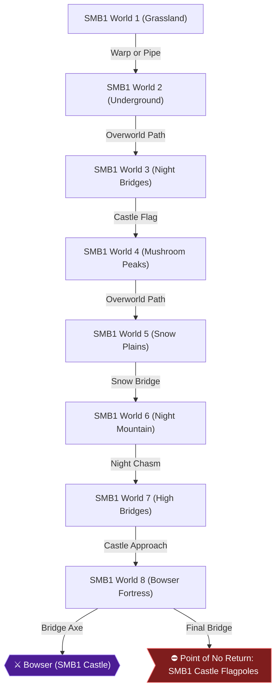

# Writer packet — Chapter 1: Super Mario Bros. — First Quest (Worlds 1–8)

Write `08_chapters/01.md`. Previous chapter: (start of game). Next chapter: 2. Super Mario Bros. — Second Quest & Speedrun.
Planner notes: Journey through the 8 classic worlds of the Mushroom Kingdom in Super Mario Bros., finding warp zones, coin rooms, and collecting power-ups.

## Areas in this chapter (in order)

- `SMB1_World1` — SMB1 World 1 (Grassland)
- `SMB1_World2` — SMB1 World 2 (Underground)
- `SMB1_World3` — SMB1 World 3 (Night Bridges)
- `SMB1_World4` — SMB1 World 4 (Mushroom Peaks)
- `SMB1_World5` — SMB1 World 5 (Snow Plains)
- `SMB1_World6` — SMB1 World 6 (Night Mountain)
- `SMB1_World7` — SMB1 World 7 (High Bridges)
- `SMB1_World8` — SMB1 World 8 (Bowser Fortress)

## Achievements to place in this chapter (each EXACTLY once as `[ACHIEVEMENT:<id>]`)

- **26905** — Welcome to the Mushroom Kingdom! (5 pts): [SMB1] Complete World 1  
  supporting facts: ra-comments-6-1, ra-comments-6-2, neo1-3-1, neo1-3-2, neo1-4-1, neo1-4-2, neo2-30-1, neo2-30-2, neo2-31-1, neo2-31-2, neo2-32-1, neo2-32-2, neo2-34-1, neo2-34-2, neo2-47-1, neo2-47-2, neo2-50-1, neo2-50-2, neo2-58-1, neo2-58-2, neo2-59-1, neo2-59-2, neo2-60-1, neo2-60-2, neo2-62-1, neo2-62-2, neo2-75-1, neo2-75-2, neo2-78-1, neo2-78-2, neo3-22-1, neo3-22-2, neo3-23-1, neo3-23-2, neo3-24-1, neo3-24-2, neo3-25-1, neo3-25-2, neo3-54-1, neo3-54-2, neo3-55-1, neo3-55-2, neo3-56-1, neo3-56-2, neo4-11-1, neo4-11-2, neo4-12-1, neo4-12-2, neo4-13-1, neo4-13-2, neo4-23-1, neo4-23-2, neo4-25-1, neo4-25-2, neo4-26-1, neo4-26-2
- **26906** — Across the Pond (5 pts): [SMB1] Complete World 2  
  supporting facts: ra-comments-8-1, ra-comments-8-2, neo1-4-1, neo1-4-2, neo2-33-1, neo2-33-2, neo2-34-1, neo2-34-2, neo2-35-1, neo2-35-2, neo2-36-1, neo2-36-2, neo2-47-1, neo2-47-2, neo2-61-1, neo2-61-2, neo2-62-1, neo2-62-2, neo2-63-1, neo2-63-2, neo2-64-1, neo2-64-2, neo2-75-1, neo2-75-2, neo2-86-1, neo2-86-2, neo3-26-1, neo3-26-2, neo3-27-1, neo3-27-2, neo3-28-1, neo3-28-2, neo3-29-1, neo3-29-2, neo3-41-1, neo3-41-2, neo3-55-1, neo3-55-2, neo3-56-1, neo3-56-2, neo4-1-1, neo4-1-2, neo4-14-1, neo4-14-2, neo4-15-1, neo4-15-2, neo4-16-1, neo4-16-2, neo4-23-1, neo4-23-2, neo4-27-1, neo4-27-2
- **26907** — Northern Lights (5 pts): [SMB1] Complete World 3  
  supporting facts: ra-comments-10-1, ra-comments-10-2, neo1-4-1, neo1-4-2, neo1-5-1, neo1-5-2, neo1-6-1, neo1-6-2, neo2-37-1, neo2-37-2, neo2-38-1, neo2-38-2, neo2-39-1, neo2-39-2, neo2-65-1, neo2-65-2, neo2-66-1, neo2-66-2, neo2-67-1, neo2-67-2, neo3-29-1, neo3-29-2, neo3-30-1, neo3-30-2, neo3-31-1, neo3-31-2, neo3-32-1, neo3-32-2, neo3-33-1, neo3-33-2, neo3-34-1, neo3-34-2, neo3-55-1, neo3-55-2, neo3-56-1, neo3-56-2, neo3-58-1, neo3-58-2, neo4-2-1, neo4-2-2, neo4-17-1, neo4-17-2, neo4-18-1, neo4-18-2, neo4-19-1, neo4-19-2
- **26908** — Scary 'Shrooms (5 pts): [SMB1] Complete World 4  
  supporting facts: ra-comments-12-1, ra-comments-12-2, neo1-5-1, neo1-5-2, neo2-40-1, neo2-40-2, neo2-41-1, neo2-41-2, neo2-42-1, neo2-42-2, neo2-68-1, neo2-68-2, neo2-69-1, neo2-69-2, neo2-70-1, neo2-70-2, neo2-71-1, neo2-71-2, neo3-21-1, neo3-21-2, neo3-33-1, neo3-33-2, neo3-34-1, neo3-34-2, neo3-35-1, neo3-35-2, neo3-36-1, neo3-36-2, neo3-37-1, neo3-37-2, neo3-38-1, neo3-38-2, neo3-55-1, neo3-55-2, neo3-56-1, neo3-56-2, neo3-57-1, neo3-57-2, neo3-58-1, neo3-58-2, neo4-19-1, neo4-19-2, neo4-20-1, neo4-20-2, neo4-21-1, neo4-21-2
- **26909** — Bite the Bullet (5 pts): [SMB1] Complete World 5  
  supporting facts: ra-comments-14-1, ra-comments-14-2, neo1-5-1, neo1-5-2, neo2-42-1, neo2-42-2, neo2-44-1, neo2-44-2, neo2-45-1, neo2-45-2, neo2-46-1, neo2-46-2, neo2-47-1, neo2-47-2, neo2-70-1, neo2-70-2, neo2-72-1, neo2-72-2, neo2-73-1, neo2-73-2, neo2-74-1, neo2-74-2, neo2-75-1, neo2-75-2, neo3-37-1, neo3-37-2, neo3-38-1, neo3-38-2, neo3-39-1, neo3-39-2, neo3-40-1, neo3-40-2, neo3-41-1, neo3-41-2, neo3-42-1, neo3-42-2, neo3-57-1, neo3-57-2, neo4-20-1, neo4-20-2, neo4-22-1, neo4-22-2, neo4-23-1, neo4-23-2
- **26910** — Piranha Pipe Plaza (5 pts): [SMB1] Complete World 6  
  supporting facts: ra-comments-16-1, ra-comments-16-2, neo1-5-1, neo1-5-2, neo1-6-1, neo1-6-2, neo2-46-1, neo2-46-2, neo2-48-1, neo2-48-2, neo2-49-1, neo2-49-2, neo2-50-1, neo2-50-2, neo2-51-1, neo2-51-2, neo2-74-1, neo2-74-2, neo2-76-1, neo2-76-2, neo2-77-1, neo2-77-2, neo2-78-1, neo2-78-2, neo2-79-1, neo2-79-2, neo3-41-1, neo3-41-2, neo3-42-1, neo3-42-2, neo3-43-1, neo3-43-2, neo3-44-1, neo3-44-2, neo3-45-1, neo3-45-2, neo3-46-1, neo3-46-2, neo3-55-1, neo3-55-2, neo4-24-1, neo4-24-2, neo4-25-1, neo4-25-2
- **26911** — Familiar Territory (5 pts): [SMB1] Complete World 7  
  supporting facts: ra-comments-18-1, ra-comments-18-2, neo1-6-1, neo1-6-2, neo2-51-1, neo2-51-2, neo2-52-1, neo2-52-2, neo2-53-1, neo2-53-2, neo2-79-1, neo2-79-2, neo2-80-1, neo2-80-2, neo2-81-1, neo2-81-2, neo3-46-1, neo3-46-2, neo3-47-1, neo3-47-2, neo3-48-1, neo3-48-2, neo3-49-1, neo3-49-2, neo3-55-1, neo3-55-2, neo4-26-1, neo4-26-2, neo4-27-1, neo4-27-2, neo4-29-1, neo4-29-2
- **26912** — We Present You a New Quest... (10 pts, progression): [SMB1] Complete World 8 and save Princess Toadstool  
  supporting facts: ra-comments-20-1, ra-comments-20-2, neo1-6-1, neo1-6-2, neo2-25-1, neo2-25-2, neo2-54-1, neo2-54-2, neo2-55-1, neo2-55-2, neo2-56-1, neo2-56-2, neo2-82-1, neo2-82-2, neo2-83-1, neo2-83-2, neo2-84-1, neo2-84-2, neo2-86-1, neo2-86-2, neo3-20-1, neo3-20-2, neo3-50-1, neo3-50-2, neo3-51-1, neo3-51-2, neo3-52-1, neo3-52-2, neo3-53-1, neo3-53-2, neo3-54-1, neo3-54-2, neo3-55-1, neo3-55-2, neo3-58-1, neo3-58-2, neo4-28-1, neo4-28-2, neo4-29-1, neo4-29-2, neo4-30-1, neo4-30-2, neo4-31-1, neo4-31-2
- **26923** — A Warp Welcome (1 pts): [SMB1] Find a Warp Zone  
  supporting facts: ra-comments-42-1, ra-comments-42-2, neo1-3-1, neo1-3-2, neo1-5-1, neo1-5-2, neo2-32-1, neo2-32-2, neo2-42-1, neo2-42-2, neo2-60-1, neo2-60-2, neo2-70-1, neo2-70-2, neo3-35-1, neo3-35-2, neo3-54-1, neo3-54-2, neo3-55-1, neo3-55-2, neo4-12-1, neo4-12-2, neo4-20-1, neo4-20-2, neo4-21-1, neo4-21-2
- **26924** — Hidden Riches (1 pts): [SMB1] Find a bonus area  
  supporting facts: ra-comments-44-1, ra-comments-44-2, neo2-24-1, neo2-24-2, neo2-27-1, neo2-27-2, neo2-31-1, neo2-31-2, neo2-32-1, neo2-32-2, neo2-34-1, neo2-34-2, neo2-35-1, neo2-35-2, neo2-37-1, neo2-37-2, neo2-38-1, neo2-38-2, neo2-41-1, neo2-41-2, neo2-42-1, neo2-42-2, neo2-44-1, neo2-44-2, neo2-45-1, neo2-45-2, neo2-49-1, neo2-49-2, neo2-52-1, neo2-52-2, neo2-55-1, neo2-55-2, neo2-59-1, neo2-59-2, neo2-60-1, neo2-60-2, neo2-62-1, neo2-62-2, neo2-63-1, neo2-63-2, neo2-65-1, neo2-65-2, neo2-66-1, neo2-66-2, neo2-69-1, neo2-69-2, neo2-70-1, neo2-70-2, neo2-72-1, neo2-72-2, neo2-73-1, neo2-73-2, neo2-77-1, neo2-77-2, neo2-80-1, neo2-80-2, neo2-83-1, neo2-83-2, neo2-86-1, neo2-86-2, neo3-26-1, neo3-26-2, neo3-30-1, neo3-30-2, neo3-39-1, neo3-39-2, neo3-43-1, neo3-43-2, neo3-46-1, neo3-46-2, neo3-50-1, neo3-50-2, neo4-14-1, neo4-14-2, neo4-17-1, neo4-17-2, neo4-24-1, neo4-24-2, neo4-26-1, neo4-26-2, neo4-28-1, neo4-28-2
- **541017** — Green Is the Best Flavor (10 pts): [SMB1] Collect 5 1-Up Mushrooms without getting a Game Over  
  supporting facts: ra-comments-46-1, ra-comments-46-2, neo1-2-1, neo1-2-2, neo1-3-1, neo1-3-2, neo1-4-1, neo1-4-2, neo1-5-1, neo1-5-2, neo1-6-1, neo1-6-2, neo2-24-1, neo2-24-2, neo2-30-1, neo2-30-2, neo2-31-1, neo2-31-2, neo2-34-1, neo2-34-2, neo2-38-1, neo2-38-2, neo2-40-1, neo2-40-2, neo2-44-1, neo2-44-2, neo2-45-1, neo2-45-2, neo2-46-1, neo2-46-2, neo2-48-1, neo2-48-2, neo2-51-1, neo2-51-2, neo2-52-1, neo2-52-2, neo2-54-1, neo2-54-2, neo2-55-1, neo2-55-2, neo2-58-1, neo2-58-2, neo2-59-1, neo2-59-2, neo2-62-1, neo2-62-2, neo2-66-1, neo2-66-2, neo2-68-1, neo2-68-2, neo2-72-1, neo2-72-2, neo2-73-1, neo2-73-2, neo2-74-1, neo2-74-2, neo2-76-1, neo2-76-2, neo2-79-1, neo2-79-2, neo2-80-1, neo2-80-2, neo2-82-1, neo2-82-2, neo2-83-1, neo2-83-2, neo2-86-1, neo2-86-2, neo3-18-1, neo3-18-2, neo3-19-1, neo3-19-2, neo3-22-1, neo3-22-2, neo3-23-1, neo3-23-2, neo3-26-1, neo3-26-2, neo3-30-1, neo3-30-2, neo3-34-1, neo3-34-2, neo3-38-1, neo3-38-2, neo3-42-1, neo3-42-2, neo3-46-1, neo3-46-2, neo3-51-1, neo3-51-2, neo3-58-1, neo3-58-2, neo4-7-1, neo4-7-2, neo4-11-1, neo4-11-2, neo4-18-1, neo4-18-2, neo4-24-1, neo4-24-2, neo4-29-1, neo4-29-2
- **541026** — I Feel the Power Through My Veins (5 pts): [SMB1] As Fire Mario, collect 4 more Fire Flowers without getting hit  
  supporting facts: ra-comments-48-1, ra-comments-48-2, neo1-2-1, neo1-2-2, neo2-24-1, neo2-24-2, neo2-25-1, neo2-25-2, neo2-26-1, neo2-26-2, neo2-31-1, neo2-31-2, neo2-32-1, neo2-32-2, neo2-34-1, neo2-34-2, neo2-38-1, neo2-38-2, neo2-39-1, neo2-39-2, neo2-42-1, neo2-42-2, neo2-45-1, neo2-45-2, neo2-46-1, neo2-46-2, neo2-50-1, neo2-50-2, neo2-51-1, neo2-51-2, neo2-55-1, neo2-55-2, neo2-56-1, neo2-56-2, neo2-59-1, neo2-59-2, neo2-60-1, neo2-60-2, neo2-62-1, neo2-62-2, neo2-66-1, neo2-66-2, neo2-67-1, neo2-67-2, neo2-70-1, neo2-70-2, neo2-73-1, neo2-73-2, neo2-74-1, neo2-74-2, neo2-78-1, neo2-78-2, neo2-79-1, neo2-79-2, neo2-83-1, neo2-83-2, neo2-84-1, neo2-84-2, neo2-86-1, neo2-86-2, neo3-16-1, neo3-16-2, neo3-17-1, neo3-17-2, neo3-18-1, neo3-18-2, neo3-19-1, neo3-19-2, neo3-20-1, neo3-20-2, neo3-23-1, neo3-23-2, neo3-28-1, neo3-28-2, neo3-46-1, neo3-46-2, neo4-7-1, neo4-7-2, neo4-8-1, neo4-8-2, neo4-11-1, neo4-11-2

## ⛔ Points of no return in this chapter (each needs a `> [!CAUTION]` containing the words "Point of No Return")

- Point of No Return: SMB1 Final Castle Bridge: Once you trigger Bowser falling into the lava in World 8-4, you cannot backtrack to earlier worlds on the first quest. [ra-comments-20-1, ra-comments-20-2]

## Route diagram (inserted automatically where you write `[MERMAID]`)



## Usable facts (286) — cite as [[fact-id]]

Legend: ✅ verified (2+ sources) · ✔ conflict resolved · 🟡 single source

- ✅ **neo1-2-1** (location) This combines Super Mario Bros, Super Mario Bros 2, Super Mario Bros 3, and a — @SMB1 Stage Guide · ach: 541017,541026  
  evidence: neo1#2: "This combines Super Mario Bros, Super Mario Bros 2, Super Mario Bros 3, and a"
- ✅ **neo1-2-2** (location) formerly Japan only exclusive called Super Mario Bros Lost Levels aka Japan's — @SMB1 Stage Guide · ach: 541017,541026  
  evidence: neo1#2: "formerly Japan only exclusive called Super Mario Bros Lost Levels aka Japan's"
- ✅ **neo1-3-1** (location) American Name: Buzzy Beetle — @SMB1 Stage Guide · ach: 26905,26923,26921,541017  
  evidence: neo1#3: "American Name: Buzzy Beetle"
- ✅ **neo1-3-2** (achievement) Description: They behave just like the Green Koopa Troopa except fireballs have — @SMB1 Stage Guide · ach: 26905,26923,26921,541017  
  evidence: neo1#3: "Description: They behave just like the Green Koopa Troopa except fireballs have"
- ✅ **neo1-4-1** (location) 1-4: Run to the right and watch out for the firebar below the power-up question — @SMB1 Stage Guide · ach: 26905,26906,26907,541017  
  evidence: neo1#4: "1-4: Run to the right and watch out for the firebar below the power-up question"
- ✅ **neo1-4-2** (location) block. Keep moving right to avoid the firebars and watch out for firebrath. — @SMB1 Stage Guide · ach: 26905,26906,26907,541017  
  evidence: neo1#4: "block. Keep moving right to avoid the firebars and watch out for firebrath."
- ✅ **neo1-5-1** (location) 3-4: Move right and avoid the Pobodos and firebars. The middle question block — @SMB1 Stage Guide · ach: 26907,26908,26909,26910,26923,26921,541017  
  evidence: neo1#5: "3-4: Move right and avoid the Pobodos and firebars. The middle question block"
- ✅ **neo1-5-2** (location) has a powerup. The next three sets of firebars are tricky as there are on top — @SMB1 Stage Guide · ach: 26907,26908,26909,26910,26923,26921,541017  
  evidence: neo1#5: "has a powerup. The next three sets of firebars are tricky as there are on top"
- ✅ **neo1-6-1** (location) 6-1: Go right and avoid or shoot the spinies and quickly take out Lakitu ASAP. — @SMB1 Stage Guide · ach: 26907,26910,26911,26912,26922,541017  
  evidence: neo1#6: "6-1: Go right and avoid or shoot the spinies and quickly take out Lakitu ASAP."
- ✅ **neo1-6-2** (location) There are two areas to do so, The level is a short and sweet one so no need for — @SMB1 Stage Guide · ach: 26907,26910,26911,26912,26922,541017  
  evidence: neo1#6: "There are two areas to do so, The level is a short and sweet one so no need for"
- ✅ **neo2-24-1** (location) <    > Playing through the levels — @SMB1 Stage Guide · ach: 26924,541017,541026  
  evidence: neo2#24: "<    > Playing through the levels"
- ✅ **neo2-24-2** (location) Each level has a set timer for you to progress before it depletes. In some — @SMB1 Stage Guide · ach: 26924,541017,541026  
  evidence: neo2#24: "Each level has a set timer for you to progress before it depletes. In some"
- ✅ **neo2-25-1** (location) <  | 5000   Not only that, but also, if you reach — @SMB1 Stage Guide · ach: 26912,26922,541026  
  evidence: neo2#25: "<  | 5000   Not only that, but also, if you reach"
- ✅ **neo2-25-2** (location) \|        the flagpole with a 1 on the units — @SMB1 Stage Guide · ach: 26912,26922,541026  
  evidence: neo2#25: "\|        the flagpole with a 1 on the units"
- ✅ **neo2-26-1** (location) Note that Nintendo made two different controller layouts for playing the — @SMB1 Stage Guide · ach: 541026  
  evidence: neo2#26: "Note that Nintendo made two different controller layouts for playing the"
- ✅ **neo2-26-2** (location) game with, I am only doing that of the first layout, however different — @SMB1 Stage Guide · ach: 541026  
  evidence: neo2#26: "game with, I am only doing that of the first layout, however different"
- ✅ **neo2-27-1** (location) While you are Super Mario size, while you run, hold Down on the D-Pad and — @SMB1 Stage Guide · ach: 26924  
  evidence: neo2#27: "While you are Super Mario size, while you run, hold Down on the D-Pad and"
- ✅ **neo2-27-2** (location) you will crouch while you move. This is helpful to get through small gaps — @SMB1 Stage Guide · ach: 26924  
  evidence: neo2#27: "you will crouch while you move. This is helpful to get through small gaps"
- ✅ **neo2-30-1** (location) You're now all set to take on the Koopa tribe by yourself and rescue the — @SMB1 Stage Guide · ach: 26905,541017  
  evidence: neo2#30: "You're now all set to take on the Koopa tribe by yourself and rescue the"
- ✅ **neo2-30-2** (item) Mushroom Princess. If this is your first time playing, I'd suggest reading — @SMB1 Stage Guide · ach: 26905,541017  
  evidence: neo2#30: "Mushroom Princess. If this is your first time playing, I'd suggest reading"
- ✅ **neo2-31-1** (transition) coin. Jump over the next pipe, climb the staircase and grab the flagpole. — @SMB1 Stage Guide · ach: 26905,26924,541017,541026  
  evidence: neo2#31: "coin. Jump over the next pipe, climb the staircase and grab the flagpole."
- ✅ **neo2-31-2** (transition) Down the fourth pipe from the beginning is a coin room (see Section 210 — @SMB1 Stage Guide · ach: 26905,26924,541017,541026  
  evidence: neo2#31: "Down the fourth pipe from the beginning is a coin room (see Section 210"
- ✅ **neo2-32-1** (location) Goombas on the staircase. Climb the staircase and jump over the elevators — @SMB1 Stage Guide · ach: 26905,26923,26921,26924,541026  
  evidence: neo2#32: "Goombas on the staircase. Climb the staircase and jump over the elevators"
- ✅ **neo2-32-2** (location) onto the brick platform with a Red Koopa Troopa below it. The last brick — @SMB1 Stage Guide · ach: 26905,26923,26921,26924,541026  
  evidence: neo2#32: "onto the brick platform with a Red Koopa Troopa below it. The last brick"
- ✅ **neo2-33-1** (location) In this huge pit are six invisible blocks in two layers. There are three — @SMB1 Stage Guide · ach: 26906  
  evidence: neo2#33: "In this huge pit are six invisible blocks in two layers. There are three"
- ✅ **neo2-33-2** (item) just above Mario, and the other three are one coin space to the right in — @SMB1 Stage Guide · ach: 26906  
  evidence: neo2#33: "just above Mario, and the other three are one coin space to the right in"
- 🟡 **neo2-34-1** (location) The centre brick of the first three bricks you come to holds a Power-up in — @+=========+ · ach: 26905,26906,26924,541017,541026  
  evidence: neo2#34: "The centre brick of the first three bricks you come to holds a Power-up in"
- 🟡 **neo2-34-2** (location) it. Kill the Goomba coming down the stairway and jump over the stairs and — @+=========+ · ach: 26905,26906,26924,541017,541026  
  evidence: neo2#34: "it. Kill the Goomba coming down the stairway and jump over the stairs and"
- ✅ **neo2-35-1** (item) approaching you, and bash the '?' Block ahead for a coin. The brick above — @SMB1 Stage Guide · ach: 26906,26924  
  evidence: neo2#35: "approaching you, and bash the '?' Block ahead for a coin. The brick above"
- ✅ **neo2-35-2** (location) it and to its right contains a Power-up. Here's how you can reach it: — @SMB1 Stage Guide · ach: 26906,26924  
  evidence: neo2#35: "it and to its right contains a Power-up. Here's how you can reach it:"
- ✅ **neo2-36-1** (location) From the grass, jump onto the broken bridge part, then onto the next — @SMB1 Stage Guide · ach: 26906  
  evidence: neo2#36: "From the grass, jump onto the broken bridge part, then onto the next"
- ✅ **neo2-36-2** (item) bridge. Grab the six coins in the air and jump onto the next bridge. Get — @SMB1 Stage Guide · ach: 26906  
  evidence: neo2#36: "bridge. Grab the six coins in the air and jump onto the next bridge. Get"
- ✅ **neo2-37-1** (item) The first two '?' Blocks you come to hold coins, and the third has a — @SMB1 Stage Guide · ach: 26907,26924  
  evidence: neo2#37: "The first two '?' Blocks you come to hold coins, and the third has a"
- ✅ **neo2-37-2** (location) Power-up. Kill the Koopa Paratroopas bouncing towards you. Jump over the — @SMB1 Stage Guide · ach: 26907,26924  
  evidence: neo2#37: "Power-up. Kill the Koopa Paratroopas bouncing towards you. Jump over the"
- ✅ **neo2-38-1** (location) on the right hand side of the bridge and jump straight up for a hidden — @SMB1 Stage Guide · ach: 26907,26924,541017,541026  
  evidence: neo2#38: "on the right hand side of the bridge and jump straight up for a hidden"
- ✅ **neo2-38-2** (item) 1-Up Mushroom. Jump over the little pit. In the air is a row of three — @SMB1 Stage Guide · ach: 26907,26924,541017,541026  
  evidence: neo2#38: "1-Up Mushroom. Jump over the little pit. In the air is a row of three"
- ✅ **neo2-39-1** (location) There are no secret areas in this level. — @SMB1 Stage Guide · ach: 26907,541026  
  evidence: neo2#39: "There are no secret areas in this level."
- ✅ **neo2-39-2** (location) Jump up onto the tree, then kill the Goomba on the tree next to it. The — @SMB1 Stage Guide · ach: 26907,541026  
  evidence: neo2#39: "Jump up onto the tree, then kill the Goomba on the tree next to it. The"
- ✅ **neo2-40-1** (transition) Jump over the green pipe. The bottom '?' Block has a Power-up in it, and — @SMB1 Stage Guide · ach: 26908,541017  
  evidence: neo2#40: "Jump over the green pipe. The bottom '?' Block has a Power-up in it, and"
- ✅ **neo2-40-2** (item) the one above it holds a coin. Jump over the gap and start running. Grab — @SMB1 Stage Guide · ach: 26908,541017  
  evidence: neo2#40: "the one above it holds a coin. Jump over the gap and start running. Grab"
- ✅ **neo2-41-1** (location) leaping off the top step to get to the flagpole, drop down and you'll see — @SMB1 Stage Guide · ach: 26908,26924  
  evidence: neo2#41: "leaping off the top step to get to the flagpole, drop down and you'll see"
- ✅ **neo2-41-2** (item) a brick, which is a multi-coin block. Get the coins, and then, do a — @SMB1 Stage Guide · ach: 26908,26924  
  evidence: neo2#41: "a brick, which is a multi-coin block. Get the coins, and then, do a"
- ✅ **neo2-42-1** (location) onto the lowest row of bricks, and above you, should be a row of three — @SMB1 Stage Guide · ach: 26908,26909,26923,26921,26924,541026  
  evidence: neo2#42: "onto the lowest row of bricks, and above you, should be a row of three"
- ✅ **neo2-42-2** (location) bricks. Bash the middle one to get a hidden Power-up. Jump onto the next — @SMB1 Stage Guide · ach: 26908,26909,26923,26921,26924,541026  
  evidence: neo2#42: "bricks. Bash the middle one to get a hidden Power-up. Jump onto the next"
- ✅ **neo2-44-1** (location) Stomp the Koopa Troopa, kick its shell and follow it for many points. Make — @SMB1 Stage Guide · ach: 26909,26924,541017  
  evidence: neo2#44: "Stomp the Koopa Troopa, kick its shell and follow it for many points. Make"
- ✅ **neo2-44-2** (transition) sure to jump when you see the silver pipe. Jump over the pipe, then jump — @SMB1 Stage Guide · ach: 26909,26924,541017  
  evidence: neo2#44: "sure to jump when you see the silver pipe. Jump over the pipe, then jump"
- ✅ **neo2-45-1** (location) Paratroopas. You'll approach the staircase, which now has a gap in it. — @SMB1 Stage Guide · ach: 26909,26924,541017,541026  
  evidence: neo2#45: "Paratroopas. You'll approach the staircase, which now has a gap in it."
- ✅ **neo2-45-2** (location) Jump from the fifth step to the block in the air with the momentum and — @SMB1 Stage Guide · ach: 26909,26924,541017,541026  
  evidence: neo2#45: "Jump from the fifth step to the block in the air with the momentum and"
- ✅ **neo2-46-1** (transition) use the warp pipe mentioned earlier. Anyways, kill them if they are there — @SMB1 Stage Guide · ach: 26909,26910,541017,541026  
  evidence: neo2#46: "use the warp pipe mentioned earlier. Anyways, kill them if they are there"
- ✅ **neo2-46-2** (location) then bash the brick on the very right on the top row of bricks for a — @SMB1 Stage Guide · ach: 26909,26910,541017,541026  
  evidence: neo2#46: "then bash the brick on the very right on the top row of bricks for a"
- ✅ **neo2-47-1** (location) If you have noticed, this level is actually a remix of World 1-3, just — @SMB1 Stage Guide · ach: 26905,26906,26909  
  evidence: neo2#47: "If you have noticed, this level is actually a remix of World 1-3, just"
- ✅ **neo2-47-2** (location) made slightly more difficult. — @SMB1 Stage Guide · ach: 26905,26906,26909  
  evidence: neo2#47: "made slightly more difficult."
- ✅ **neo2-48-1** (item) The first two '?' Blocks have coins in them. Jump over the pit and climb — @SMB1 Stage Guide · ach: 26910,541017  
  evidence: neo2#48: "The first two '?' Blocks have coins in them. Jump over the pit and climb"
- ✅ **neo2-48-2** (location) the stairway. Above the top step are two bricks. Bash the one on the left — @SMB1 Stage Guide · ach: 26910,541017  
  evidence: neo2#48: "the stairway. Above the top step are two bricks. Bash the one on the left"
- ✅ **neo2-49-1** (transition) two pipes with two bricks above him.  Bash the right-hand brick for a — @SMB1 Stage Guide · ach: 26910,26924  
  evidence: neo2#49: "two pipes with two bricks above him.  Bash the right-hand brick for a"
- ✅ **neo2-49-2** (transition) Power-up. You can enter the pipe after this to a water area. If you take — @SMB1 Stage Guide · ach: 26910,26924  
  evidence: neo2#49: "Power-up. You can enter the pipe after this to a water area. If you take"
- ✅ **neo2-50-1** (item) From here jump onto the balance-elevator and get the two coins. Jump over — @SMB1 Stage Guide · ach: 26905,26910,541026  
  evidence: neo2#50: "From here jump onto the balance-elevator and get the two coins. Jump over"
- ✅ **neo2-50-2** (location) into the cluster of trees, and you should see some still girders to your — @SMB1 Stage Guide · ach: 26905,26910,541026  
  evidence: neo2#50: "into the cluster of trees, and you should see some still girders to your"
- ✅ **neo2-51-1** (location) Jump over the first Bullet Bill cannon. Kill/avoid the Koopa Paratroopa. — @SMB1 Stage Guide · ach: 26910,26911,541017,541026  
  evidence: neo2#51: "Jump over the first Bullet Bill cannon. Kill/avoid the Koopa Paratroopa."
- ✅ **neo2-51-2** (location) You'll come to a Bullet Bill cannon on top of another cannon. Above them — @SMB1 Stage Guide · ach: 26910,26911,541017,541026  
  evidence: neo2#51: "You'll come to a Bullet Bill cannon on top of another cannon. Above them"
- ✅ **neo2-52-1** (location) to two more rows of bricks with Hamer Brothers on. Kill or avoid the — @SMB1 Stage Guide · ach: 26911,26924,541017  
  evidence: neo2#52: "to two more rows of bricks with Hamer Brothers on. Kill or avoid the"
- ✅ **neo2-52-2** (location) Hammer Brothers and jump over the pillar, then jump over the two cannons — @SMB1 Stage Guide · ach: 26911,26924,541017  
  evidence: neo2#52: "Hammer Brothers and jump over the pillar, then jump over the two cannons"
- ✅ **neo2-53-1** (item) There are four coins in the air above the next bridge. After the next — @SMB1 Stage Guide · ach: 26911  
  evidence: neo2#53: "There are four coins in the air above the next bridge. After the next"
- ✅ **neo2-53-2** (item) bridge are three broken bridge sections with six coins in the air above — @SMB1 Stage Guide · ach: 26911  
  evidence: neo2#53: "bridge are three broken bridge sections with six coins in the air above"
- ✅ **neo2-54-1** (location) Note: In all of the previous levels, if you got halfway through a level — @SMB1 Stage Guide · ach: 26912,26922,541017  
  evidence: neo2#54: "Note: In all of the previous levels, if you got halfway through a level"
- ✅ **neo2-54-2** (item) (apart from castle levels) and died, you restarted halfway through the — @SMB1 Stage Guide · ach: 26912,26922,541017  
  evidence: neo2#54: "(apart from castle levels) and died, you restarted halfway through the"
- ✅ **neo2-55-1** (location) high, with some bricks in the air above it. Jump over the pillar and go — @SMB1 Stage Guide · ach: 26912,26922,26924,541017,541026  
  evidence: neo2#55: "high, with some bricks in the air above it. Jump over the pillar and go"
- ✅ **neo2-55-2** (location) into the small pit with the Koopa Paratroopa trapped between the two — @SMB1 Stage Guide · ach: 26912,26922,26924,541017,541026  
  evidence: neo2#55: "into the small pit with the Koopa Paratroopa trapped between the two"
- ✅ **neo2-56-1** (location) clear the gap. A Goomba will come down the staircase, so avoid it. You'll — @SMB1 Stage Guide · ach: 26912,26922,541026  
  evidence: neo2#56: "clear the gap. A Goomba will come down the staircase, so avoid it. You'll"
- ✅ **neo2-56-2** (location) see a Buzzy Beetle trapped between this staircase and two Bullet Bill — @SMB1 Stage Guide · ach: 26912,26922,541026  
  evidence: neo2#56: "see a Buzzy Beetle trapped between this staircase and two Bullet Bill"
- ✅ **neo2-58-1** (item) The first '?' Block you come to has a coin in it. Stomp the nearby Buzzy — @SMB1 Stage Guide · ach: 26913,26905,541017  
  evidence: neo2#58: "The first '?' Block you come to has a coin in it. Stomp the nearby Buzzy"
- ✅ **neo2-58-2** (location) Beetle. Next there are two '?' Blocks between three bricks and a '?' Block — @SMB1 Stage Guide · ach: 26913,26905,541017  
  evidence: neo2#58: "Beetle. Next there are two '?' Blocks between three bricks and a '?' Block"
- ✅ **neo2-59-1** (transition) between the bricks for a coin. Jump over the next pipe, climb the — @SMB1 Stage Guide · ach: 26913,26905,26924,541017,541026  
  evidence: neo2#59: "between the bricks for a coin. Jump over the next pipe, climb the"
- ✅ **neo2-59-2** (location) staircase and grab the flagpole. — @SMB1 Stage Guide · ach: 26913,26905,26924,541017,541026  
  evidence: neo2#59: "staircase and grab the flagpole."
- ✅ **neo2-60-1** (location) two Buzzy Beetles on the staircase. Climb the staircase and jump over the — @SMB1 Stage Guide · ach: 26913,26905,26923,26921,26924,541026  
  evidence: neo2#60: "two Buzzy Beetles on the staircase. Climb the staircase and jump over the"
- ✅ **neo2-60-2** (location) elevators onto the brick platform with a Red Koopa Troopa below it. The — @SMB1 Stage Guide · ach: 26913,26905,26923,26921,26924,541026  
  evidence: neo2#60: "elevators onto the brick platform with a Red Koopa Troopa below it. The"
- ✅ **neo2-61-1** (location) In this huge pit are six invisible blocks in two layers. There are three — @SMB1 Stage Guide · ach: 26913,26906  
  evidence: neo2#61: "In this huge pit are six invisible blocks in two layers. There are three"
- ✅ **neo2-61-2** (item) just above Mario, and the other three are one coin space to the right in — @SMB1 Stage Guide · ach: 26913,26906  
  evidence: neo2#61: "just above Mario, and the other three are one coin space to the right in"
- 🟡 **neo2-62-1** (location) The centre brick of the first three bricks you come to holds a Power-up in — @+=========+ · ach: 26913,26914,26905,26906,26924,541017,541026  
  evidence: neo2#62: "The centre brick of the first three bricks you come to holds a Power-up in"
- 🟡 **neo2-62-2** (location) it. Kill the Buzzy Beetle coming down the stairway and jump over the — @+=========+ · ach: 26913,26914,26905,26906,26924,541017,541026  
  evidence: neo2#62: "it. Kill the Buzzy Beetle coming down the stairway and jump over the"
- ✅ **neo2-63-1** (item) approaching you, and bash the '?' Block ahead for a coin. The brick above — @SMB1 Stage Guide · ach: 26914,26906,26924  
  evidence: neo2#63: "approaching you, and bash the '?' Block ahead for a coin. The brick above"
- ✅ **neo2-63-2** (location) it and to its right contains a Power-up. Here's how you can reach it: — @SMB1 Stage Guide · ach: 26914,26906,26924  
  evidence: neo2#63: "it and to its right contains a Power-up. Here's how you can reach it:"
- ✅ **neo2-64-1** (location) From the grass, jump onto the broken bridge part, then onto the next — @SMB1 Stage Guide · ach: 26914,26906  
  evidence: neo2#64: "From the grass, jump onto the broken bridge part, then onto the next"
- ✅ **neo2-64-2** (item) bridge. Grab the six coins in the air and jump onto the next bridge. Get — @SMB1 Stage Guide · ach: 26914,26906  
  evidence: neo2#64: "bridge. Grab the six coins in the air and jump onto the next bridge. Get"
- ✅ **neo2-65-1** (item) The first two '?' Blocks you come to hold coins, and the third has a — @SMB1 Stage Guide · ach: 26915,26907,26924  
  evidence: neo2#65: "The first two '?' Blocks you come to hold coins, and the third has a"
- ✅ **neo2-65-2** (location) Power-up. Kill the Koopa Paratroopas bouncing towards you. Jump over the — @SMB1 Stage Guide · ach: 26915,26907,26924  
  evidence: neo2#65: "Power-up. Kill the Koopa Paratroopas bouncing towards you. Jump over the"
- ✅ **neo2-66-1** (location) Stand on the right hand side of the bridge and jump straight up for a — @SMB1 Stage Guide · ach: 26915,26907,26924,541017,541026  
  evidence: neo2#66: "Stand on the right hand side of the bridge and jump straight up for a"
- ✅ **neo2-66-2** (item) hidden 1-Up Mushroom. Jump over the little pit. In the air is a row of — @SMB1 Stage Guide · ach: 26915,26907,26924,541017,541026  
  evidence: neo2#66: "hidden 1-Up Mushroom. Jump over the little pit. In the air is a row of"
- ✅ **neo2-67-1** (location) There are no secret areas in this level. — @SMB1 Stage Guide · ach: 26915,26907,541026  
  evidence: neo2#67: "There are no secret areas in this level."
- ✅ **neo2-67-2** (location) NOTE: The elevators are shorter so it's a bit tricky when crossing them, — @SMB1 Stage Guide · ach: 26915,26907,541026  
  evidence: neo2#67: "NOTE: The elevators are shorter so it's a bit tricky when crossing them,"
- ✅ **neo2-68-1** (transition) Jump over the green pipe. The bottom '?' Block has a Power-up in it, and — @SMB1 Stage Guide · ach: 26916,26908,541017  
  evidence: neo2#68: "Jump over the green pipe. The bottom '?' Block has a Power-up in it, and"
- ✅ **neo2-68-2** (item) the one above it holds a coin. Jump over the gap and start running. Grab — @SMB1 Stage Guide · ach: 26916,26908,541017  
  evidence: neo2#68: "the one above it holds a coin. Jump over the gap and start running. Grab"
- ✅ **neo2-69-1** (location) leaping off the top step to get to the flagpole, drop down and you'll see — @SMB1 Stage Guide · ach: 26916,26908,26924  
  evidence: neo2#69: "leaping off the top step to get to the flagpole, drop down and you'll see"
- ✅ **neo2-69-2** (item) a brick, which is a multi-coin block. Get the coins, and then, do a — @SMB1 Stage Guide · ach: 26916,26908,26924  
  evidence: neo2#69: "a brick, which is a multi-coin block. Get the coins, and then, do a"
- ✅ **neo2-70-1** (location) onto the lowest row of bricks, and above you, should be a row of three — @SMB1 Stage Guide · ach: 26916,26908,26909,26923,26921,26924,541026  
  evidence: neo2#70: "onto the lowest row of bricks, and above you, should be a row of three"
- ✅ **neo2-70-2** (location) bricks. Bash the middle one to get a hidden Power-up. Jump onto the next — @SMB1 Stage Guide · ach: 26916,26908,26909,26923,26921,26924,541026  
  evidence: neo2#70: "bricks. Bash the middle one to get a hidden Power-up. Jump onto the next"
- ✅ **neo2-71-1** (location) This is the first maze castle. Here's how to get through it. Jump over the — @SMB1 Stage Guide · ach: 26916,26908  
  evidence: neo2#71: "This is the first maze castle. Here's how to get through it. Jump over the"
- ✅ **neo2-71-2** (location) lava pit onto the pillar. Leap over the next lava pit, then jump up on top — @SMB1 Stage Guide · ach: 26916,26908  
  evidence: neo2#71: "lava pit onto the pillar. Leap over the next lava pit, then jump up on top"
- ✅ **neo2-72-1** (location) Stomp the Koopa Troopa, kick its shell and follow it for many points. Make — @SMB1 Stage Guide · ach: 26917,26909,26924,541017  
  evidence: neo2#72: "Stomp the Koopa Troopa, kick its shell and follow it for many points. Make"
- ✅ **neo2-72-2** (transition) sure to jump when you see the silver pipe. Jump over the pipe, then jump — @SMB1 Stage Guide · ach: 26917,26909,26924,541017  
  evidence: neo2#72: "sure to jump when you see the silver pipe. Jump over the pipe, then jump"
- ✅ **neo2-73-1** (location) Paratroopas. You'll approach the staircase, which now has a gap in it. — @SMB1 Stage Guide · ach: 26917,26909,26924,541017,541026  
  evidence: neo2#73: "Paratroopas. You'll approach the staircase, which now has a gap in it."
- ✅ **neo2-73-2** (location) Jump from the fifth step to the block in the air with the momentum and — @SMB1 Stage Guide · ach: 26917,26909,26924,541017,541026  
  evidence: neo2#73: "Jump from the fifth step to the block in the air with the momentum and"
- ✅ **neo2-74-1** (transition) use the warp pipe mentioned earlier. Anyways, kill them if they are there — @SMB1 Stage Guide · ach: 26917,26918,26909,26910,541017,541026  
  evidence: neo2#74: "use the warp pipe mentioned earlier. Anyways, kill them if they are there"
- ✅ **neo2-74-2** (location) then bash the brick on the very right on the top row of bricks for a — @SMB1 Stage Guide · ach: 26917,26918,26909,26910,541017,541026  
  evidence: neo2#74: "then bash the brick on the very right on the top row of bricks for a"
- ✅ **neo2-75-1** (location) If you have noticed, this level is actually a remix of World 1*3, just — @SMB1 Stage Guide · ach: 26913,26914,26917,26905,26906,26909  
  evidence: neo2#75: "If you have noticed, this level is actually a remix of World 1*3, just"
- ✅ **neo2-75-2** (location) made slightly more difficult. — @SMB1 Stage Guide · ach: 26913,26914,26917,26905,26906,26909  
  evidence: neo2#75: "made slightly more difficult."
- ✅ **neo2-76-1** (item) The first two '?' Blocks have coins in them. Jump over the pit and climb — @SMB1 Stage Guide · ach: 26918,26910,541017  
  evidence: neo2#76: "The first two '?' Blocks have coins in them. Jump over the pit and climb"
- ✅ **neo2-76-2** (location) the stairway. Above the top step are two bricks. Bash the one on the left — @SMB1 Stage Guide · ach: 26918,26910,541017  
  evidence: neo2#76: "the stairway. Above the top step are two bricks. Bash the one on the left"
- ✅ **neo2-77-1** (transition) two pipes with two bricks above him. Bash the right-hand brick for a — @SMB1 Stage Guide · ach: 26918,26910,26924  
  evidence: neo2#77: "two pipes with two bricks above him. Bash the right-hand brick for a"
- ✅ **neo2-77-2** (transition) Power-up. You can enter the pipe after this to a water area. If you take — @SMB1 Stage Guide · ach: 26918,26910,26924  
  evidence: neo2#77: "Power-up. You can enter the pipe after this to a water area. If you take"
- ✅ **neo2-78-1** (item) From here jump onto the balance-elevator and get the two coins. Jump over — @SMB1 Stage Guide · ach: 26918,26905,26910,541026  
  evidence: neo2#78: "From here jump onto the balance-elevator and get the two coins. Jump over"
- ✅ **neo2-78-2** (location) into the cluster of trees, and you should see some still girders to your — @SMB1 Stage Guide · ach: 26918,26905,26910,541026  
  evidence: neo2#78: "into the cluster of trees, and you should see some still girders to your"
- ✅ **neo2-79-1** (location) Jump over the first Bullet Bill cannon. Kill/avoid the Koopa Paratroopa. — @SMB1 Stage Guide · ach: 26919,26910,26911,541017,541026  
  evidence: neo2#79: "Jump over the first Bullet Bill cannon. Kill/avoid the Koopa Paratroopa."
- ✅ **neo2-79-2** (location) You'll come to a Bullet Bill cannon on top of another cannon. Above them — @SMB1 Stage Guide · ach: 26919,26910,26911,541017,541026  
  evidence: neo2#79: "You'll come to a Bullet Bill cannon on top of another cannon. Above them"
- ✅ **neo2-80-1** (location) to two more rows of bricks with Hamer Brothers on. Kill or avoid the — @SMB1 Stage Guide · ach: 26919,26911,26924,541017  
  evidence: neo2#80: "to two more rows of bricks with Hamer Brothers on. Kill or avoid the"
- ✅ **neo2-80-2** (location) Hammer Brothers and jump over the pillar, then jump over the two cannons — @SMB1 Stage Guide · ach: 26919,26911,26924,541017  
  evidence: neo2#80: "Hammer Brothers and jump over the pillar, then jump over the two cannons"
- ✅ **neo2-81-1** (item) There are four coins in the air above the next bridge. After the next — @SMB1 Stage Guide · ach: 26919,26911  
  evidence: neo2#81: "There are four coins in the air above the next bridge. After the next"
- ✅ **neo2-81-2** (item) bridge are three broken bridge sections with six coins in the air above — @SMB1 Stage Guide · ach: 26919,26911  
  evidence: neo2#81: "bridge are three broken bridge sections with six coins in the air above"
- ✅ **neo2-82-1** (location) This is the longest level in the game, and you only have 300 seconds to — @SMB1 Stage Guide · ach: 26920,26912,26922,541017  
  evidence: neo2#82: "This is the longest level in the game, and you only have 300 seconds to"
- ✅ **neo2-82-2** (location) get it finished. So time is of the essence. Stomp the Buzzy Beetle, kick — @SMB1 Stage Guide · ach: 26920,26912,26922,541017  
  evidence: neo2#82: "get it finished. So time is of the essence. Stomp the Buzzy Beetle, kick"
- ✅ **neo2-83-1** (location) spaces high, with some bricks in the air above it. Jump over the pillar — @SMB1 Stage Guide · ach: 26920,26912,26922,26924,541017,541026  
  evidence: neo2#83: "spaces high, with some bricks in the air above it. Jump over the pillar"
- ✅ **neo2-83-2** (location) and go into the small pit with the Koopa Paratroopa trapped between the — @SMB1 Stage Guide · ach: 26920,26912,26922,26924,541017,541026  
  evidence: neo2#83: "and go into the small pit with the Koopa Paratroopa trapped between the"
- ✅ **neo2-84-1** (location) clear the gap. A Beetle will come down the staircase, so avoid it. You'll — @SMB1 Stage Guide · ach: 26920,26912,26922,541026  
  evidence: neo2#84: "clear the gap. A Beetle will come down the staircase, so avoid it. You'll"
- ✅ **neo2-84-2** (location) see a Buzzy Beetle trapped between this staircase and two Bullet Bill — @SMB1 Stage Guide · ach: 26920,26912,26922,541026  
  evidence: neo2#84: "see a Buzzy Beetle trapped between this staircase and two Bullet Bill"
- ✅ **neo2-86-1** (item) • '?' Block        - Found in most levels. Some contain coins, some contain — @SMB1 Stage Guide · ach: 26920,26906,26912,26922,26924,541017,541026  
  evidence: neo2#86: "• '?' Block        - Found in most levels. Some contain coins, some contain"
- ✅ **neo2-86-2** (item) power-ups, and some have starmans. Bump them from — @SMB1 Stage Guide · ach: 26920,26906,26912,26922,26924,541017,541026  
  evidence: neo2#86: "power-ups, and some have starmans. Bump them from"
- ✅ **neo3-16-1** (location) Super Mario Bros., which was originally released on the NES in late 1985, is — @SMB1 Stage Guide · ach: 541026  
  evidence: neo3#16: "Super Mario Bros., which was originally released on the NES in late 1985, is"
- ✅ **neo3-16-2** (location) the highest selling game of all time.  Selling well over 30 million copies, — @SMB1 Stage Guide · ach: 541026  
  evidence: neo3#16: "the highest selling game of all time.  Selling well over 30 million copies,"
- ✅ **neo3-17-1** (item) Start - This is a very important button.  It starts the game.  While you are — @SMB1 Stage Guide · ach: 541026  
  evidence: neo3#17: "Start - This is a very important button.  It starts the game.  While you are"
- ✅ **neo3-17-2** (location) playing, press it to pause/unpause when you need a break. — @SMB1 Stage Guide · ach: 541026  
  evidence: neo3#17: "playing, press it to pause/unpause when you need a break."
- 🟡 **neo3-18-1** (item) This yellow mushroom with green spots will award Mario with an extra life. They — @1-Up Mushroom · ach: 541017,541026  
  evidence: neo3#18: "This yellow mushroom with green spots will award Mario with an extra life. They"
- ✅ **neo3-18-2** (location) are very rare to find, and they are very useful. So, if you get a chance to get — @1-Up Mushroom · ach: 541017,541026  
  evidence: neo3#18: "are very rare to find, and they are very useful. So, if you get a chance to get"
- 🟡 **neo3-19-1** (item) This is an orange mushroom with red spots. It will transform Mario/Luigi from — @Power Mushroom · ach: 541017,541026  
  evidence: neo3#19: "This is an orange mushroom with red spots. It will transform Mario/Luigi from"
- 🟡 **neo3-19-2** (location) tiny, to tall. In addition, they will award you with 1000 points. — @Power Mushroom · ach: 541017,541026  
  evidence: neo3#19: "tiny, to tall. In addition, they will award you with 1000 points."
- 🟡 **neo3-20-1** (transition) A warp pipe will lead you to another area in the game. Some warp pipes will — @Warp Pipe · ach: 26912,26922,541026  
  evidence: neo3#20: "A warp pipe will lead you to another area in the game. Some warp pipes will"
- 🟡 **neo3-20-2** (transition) warp you to different areas within the level, others will warp you to — @Warp Pipe · ach: 26912,26922,541026  
  evidence: neo3#20: "warp you to different areas within the level, others will warp you to"
- ✅ **neo3-21-1** (achievement) Description: Lakitu is also a member of the Turtle Empire, whos orders are to — @SMB1 Stage Guide · ach: 26908  
  evidence: neo3#21: "Description: Lakitu is also a member of the Turtle Empire, whos orders are to"
- 🟡 **neo3-21-2** (boss) hunt down and destroy Mario.  Lakitu is the turtle that hides — @SMB1 Stage Guide · ach: 26908  
  evidence: neo3#21: "hunt down and destroy Mario.  Lakitu is the turtle that hides"
- ✅ **neo3-22-1** (location) World 1-1 - Super Mario Bros. Walkthrough — @SMB1 Stage Guide · ach: 26905,541017  
  evidence: neo3#22: "World 1-1 - Super Mario Bros. Walkthrough"
- ✅ **neo3-22-2** (location) Navigate your character to the right until you come to a question mark — @SMB1 Stage Guide · ach: 26905,541017  
  evidence: neo3#22: "Navigate your character to the right until you come to a question mark"
- ✅ **neo3-23-1** (location) World 1-2 - Super Mario Bros. Walkthrough — @SMB1 Stage Guide · ach: 26905,541017,541026  
  evidence: neo3#23: "World 1-2 - Super Mario Bros. Walkthrough"
- ✅ **neo3-23-2** (transition) You'll start off by getting a mini-movie of you walking into a pipe. You — @SMB1 Stage Guide · ach: 26905,541017,541026  
  evidence: neo3#23: "You'll start off by getting a mini-movie of you walking into a pipe. You"
- ✅ **neo3-24-1** (location) World 1-3 - Super Mario Bros. Walkthrough — @SMB1 Stage Guide · ach: 26905  
  evidence: neo3#24: "World 1-3 - Super Mario Bros. Walkthrough"
- ✅ **neo3-24-2** (location) Navigate yourself right and jump onto a tree platform. Jump across the — @SMB1 Stage Guide · ach: 26905  
  evidence: neo3#24: "Navigate yourself right and jump onto a tree platform. Jump across the"
- ✅ **neo3-25-1** (location) World 1-4 - Super Mario Bros. Walkthrough — @SMB1 Stage Guide · ach: 26905  
  evidence: neo3#25: "World 1-4 - Super Mario Bros. Walkthrough"
- ✅ **neo3-25-2** (location) Walk down the stairs to your right until you come to a lava pit. Jump — @SMB1 Stage Guide · ach: 26905  
  evidence: neo3#25: "Walk down the stairs to your right until you come to a lava pit. Jump"
- ✅ **neo3-26-1** (location) World 2-1 - Super Mario Bros. Walkthrough — @SMB1 Stage Guide · ach: 26906,26924,541017  
  evidence: neo3#26: "World 2-1 - Super Mario Bros. Walkthrough"
- ✅ **neo3-26-2** (location) Head right until you see three bricks. The middle brick contains a power — @SMB1 Stage Guide · ach: 26906,26924,541017  
  evidence: neo3#26: "Head right until you see three bricks. The middle brick contains a power"
- ✅ **neo3-27-1** (location) World 2-2 - Super Mario Bros. Walkthrough — @SMB1 Stage Guide · ach: 26906  
  evidence: neo3#27: "World 2-2 - Super Mario Bros. Walkthrough"
- ✅ **neo3-27-2** (item) This is the first underwater level of the game. Upon starting the level, — @SMB1 Stage Guide · ach: 26906  
  evidence: neo3#27: "This is the first underwater level of the game. Upon starting the level,"
- ✅ **neo3-28-1** (location) World 2-3 - Super Mario Bros. Walkthrough — @SMB1 Stage Guide · ach: 26906,541026  
  evidence: neo3#28: "World 2-3 - Super Mario Bros. Walkthrough"
- ✅ **neo3-28-2** (location) Walk to the right over the mini pit, up the stairs and onto the bridge. — @SMB1 Stage Guide · ach: 26906,541026  
  evidence: neo3#28: "Walk to the right over the mini pit, up the stairs and onto the bridge."
- ✅ **neo3-29-1** (location) World 2-4 - Super Mario Bros. Walkthrough — @SMB1 Stage Guide · ach: 26906,26907  
  evidence: neo3#29: "World 2-4 - Super Mario Bros. Walkthrough"
- ✅ **neo3-29-2** (location) Head right down a small white staircase, until you reach a lava pit. A — @SMB1 Stage Guide · ach: 26906,26907  
  evidence: neo3#29: "Head right down a small white staircase, until you reach a lava pit. A"
- ✅ **neo3-30-1** (location) World 3-1 - Super Mario Bros. Walkthrough — @SMB1 Stage Guide · ach: 26907,26924,541017  
  evidence: neo3#30: "World 3-1 - Super Mario Bros. Walkthrough"
- ✅ **neo3-30-2** (location) Head right until you come across three question mark blocks. When you — @SMB1 Stage Guide · ach: 26907,26924,541017  
  evidence: neo3#30: "Head right until you come across three question mark blocks. When you"
- ✅ **neo3-31-1** (location) World 3-2 - Super Mario Bros. Walkthrough — @SMB1 Stage Guide · ach: 26907  
  evidence: neo3#31: "World 3-2 - Super Mario Bros. Walkthrough"
- ✅ **neo3-31-2** (location) This is one of the shorter levels, but you only get 300 seconds, instead — @SMB1 Stage Guide · ach: 26907  
  evidence: neo3#31: "This is one of the shorter levels, but you only get 300 seconds, instead"
- ✅ **neo3-32-1** (location) World 3-3 - Super Mario Bros. Walkthrough — @SMB1 Stage Guide · ach: 26907  
  evidence: neo3#32: "World 3-3 - Super Mario Bros. Walkthrough"
- ✅ **neo3-32-2** (location) Run to the right and now jump on a treetop. From here, jump onto the — @SMB1 Stage Guide · ach: 26907  
  evidence: neo3#32: "Run to the right and now jump on a treetop. From here, jump onto the"
- ✅ **neo3-33-1** (location) World 3-4 - Super Mario Bros. Walkthrough — @SMB1 Stage Guide · ach: 26907,26908  
  evidence: neo3#33: "World 3-4 - Super Mario Bros. Walkthrough"
- ✅ **neo3-33-2** (location) Run down the mini staircase and to the pit. At this time, you'll have to — @SMB1 Stage Guide · ach: 26907,26908  
  evidence: neo3#33: "Run down the mini staircase and to the pit. At this time, you'll have to"
- ✅ **neo3-34-1** (location) World 4-1 - Super Mario Bros. Walkthrough — @SMB1 Stage Guide · ach: 26907,26908,541017  
  evidence: neo3#34: "World 4-1 - Super Mario Bros. Walkthrough"
- ✅ **neo3-34-2** (transition) Walk to the right until you come across a green pipe with a pirahna — @SMB1 Stage Guide · ach: 26907,26908,541017  
  evidence: neo3#34: "Walk to the right until you come across a green pipe with a pirahna"
- ✅ **neo3-35-1** (location) World 4-2 - Super Mario Bros. Walkthrough — @SMB1 Stage Guide · ach: 26908,26923,26921  
  evidence: neo3#35: "World 4-2 - Super Mario Bros. Walkthrough"
- ✅ **neo3-35-2** (transition) The stage will start off with a small movie of you walking into a pipe. — @SMB1 Stage Guide · ach: 26908,26923,26921  
  evidence: neo3#35: "The stage will start off with a small movie of you walking into a pipe."
- ✅ **neo3-36-1** (location) World 4-3 - Super Mario Bros. Walkthrough — @SMB1 Stage Guide · ach: 26908  
  evidence: neo3#36: "World 4-3 - Super Mario Bros. Walkthrough"
- ✅ **neo3-36-2** (location) Run to the right and onto a orange polka dotted platform. From there, — @SMB1 Stage Guide · ach: 26908  
  evidence: neo3#36: "Run to the right and onto a orange polka dotted platform. From there,"
- ✅ **neo3-37-1** (location) World 4-4 - Super Mario Bros. Walkthrough — @SMB1 Stage Guide · ach: 26908,26909  
  evidence: neo3#37: "World 4-4 - Super Mario Bros. Walkthrough"
- ✅ **neo3-37-2** (location) This level is the first of three levels that requires you to navigate a — @SMB1 Stage Guide · ach: 26908,26909  
  evidence: neo3#37: "This level is the first of three levels that requires you to navigate a"
- ✅ **neo3-38-1** (location) World 5-1 - Super Mario Bros. Walkthrough — @SMB1 Stage Guide · ach: 26908,26909,541017  
  evidence: neo3#38: "World 5-1 - Super Mario Bros. Walkthrough"
- ✅ **neo3-38-2** (location) Go to the right just a little bit until you come across a green koopa — @SMB1 Stage Guide · ach: 26908,26909,541017  
  evidence: neo3#38: "Go to the right just a little bit until you come across a green koopa"
- ✅ **neo3-39-1** (location) World 5-2 - Super Mario Bros. Walkthrough — @SMB1 Stage Guide · ach: 26909,26924  
  evidence: neo3#39: "World 5-2 - Super Mario Bros. Walkthrough"
- ✅ **neo3-39-2** (location) Run to the right and up the staircase. Now jump over the bullet bill — @SMB1 Stage Guide · ach: 26909,26924  
  evidence: neo3#39: "Run to the right and up the staircase. Now jump over the bullet bill"
- ✅ **neo3-40-1** (location) World 5-3 - Super Mario Bros. Walkthrough — @SMB1 Stage Guide · ach: 26909  
  evidence: neo3#40: "World 5-3 - Super Mario Bros. Walkthrough"
- ✅ **neo3-40-2** (location) In this level, Bullet Bills will fly toward you throughout the course of — @SMB1 Stage Guide · ach: 26909  
  evidence: neo3#40: "In this level, Bullet Bills will fly toward you throughout the course of"
- ✅ **neo3-41-1** (location) World 5-4 - Super Mario Bros. Walkthrough — @SMB1 Stage Guide · ach: 26906,26909,26910  
  evidence: neo3#41: "World 5-4 - Super Mario Bros. Walkthrough"
- ✅ **neo3-41-2** (location) World 5-4 is almost exactly the same as world 2-4, except many items — @SMB1 Stage Guide · ach: 26906,26909,26910  
  evidence: neo3#41: "World 5-4 is almost exactly the same as world 2-4, except many items"
- ✅ **neo3-42-1** (location) World 6-1 - Super Mario Bros. Walkthrough — @SMB1 Stage Guide · ach: 26909,26910,541017  
  evidence: neo3#42: "World 6-1 - Super Mario Bros. Walkthrough"
- ✅ **neo3-42-2** (location) Run to the right until you find two question mark blocks. Hit both of — @SMB1 Stage Guide · ach: 26909,26910,541017  
  evidence: neo3#42: "Run to the right until you find two question mark blocks. Hit both of"
- ✅ **neo3-43-1** (location) World 6-2 - Super Mario Bros. Walkthrough — @SMB1 Stage Guide · ach: 26910,26924  
  evidence: neo3#43: "World 6-2 - Super Mario Bros. Walkthrough"
- ✅ **neo3-43-2** (location) Head to the right past three consecuitive blocks. You should see a green — @SMB1 Stage Guide · ach: 26910,26924  
  evidence: neo3#43: "Head to the right past three consecuitive blocks. You should see a green"
- ✅ **neo3-44-1** (location) World 6-3 - Super Mario Bros. Walkthrough — @SMB1 Stage Guide · ach: 26910  
  evidence: neo3#44: "World 6-3 - Super Mario Bros. Walkthrough"
- ✅ **neo3-44-2** (location) The first thing that you will realize about this level is that the — @SMB1 Stage Guide · ach: 26910  
  evidence: neo3#44: "The first thing that you will realize about this level is that the"
- ✅ **neo3-45-1** (location) World 6-4 - Super Mario Bros. Walkthrough — @SMB1 Stage Guide · ach: 26910  
  evidence: neo3#45: "World 6-4 - Super Mario Bros. Walkthrough"
- ✅ **neo3-45-2** (location) Run down the mini staircase and jump over the small lava pit. Run to the — @SMB1 Stage Guide · ach: 26910  
  evidence: neo3#45: "Run down the mini staircase and jump over the small lava pit. Run to the"
- ✅ **neo3-46-1** (location) World 7-1 - Super Mario Bros. Walkthrough — @SMB1 Stage Guide · ach: 26910,26911,26924,541017,541026  
  evidence: neo3#46: "World 7-1 - Super Mario Bros. Walkthrough"
- ✅ **neo3-46-2** (location) Run to the right until you come to a bullet bill cannon. Jump over the — @SMB1 Stage Guide · ach: 26910,26911,26924,541017,541026  
  evidence: neo3#46: "Run to the right until you come to a bullet bill cannon. Jump over the"
- ✅ **neo3-47-1** (location) World 7-2 - Super Mario Bros. Walkthrough — @SMB1 Stage Guide · ach: 26911  
  evidence: neo3#47: "World 7-2 - Super Mario Bros. Walkthrough"
- ✅ **neo3-47-2** (transition) You will start off the level with a clip of you walking into a pipe. — @SMB1 Stage Guide · ach: 26911  
  evidence: neo3#47: "You will start off the level with a clip of you walking into a pipe."
- ✅ **neo3-48-1** (location) World 7-3 - Super Mario Bros. Walkthrough — @SMB1 Stage Guide · ach: 26911  
  evidence: neo3#48: "World 7-3 - Super Mario Bros. Walkthrough"
- ✅ **neo3-48-2** (location) Jump onto the tree platform, and then up the staircase to the bridge. At — @SMB1 Stage Guide · ach: 26911  
  evidence: neo3#48: "Jump onto the tree platform, and then up the staircase to the bridge. At"
- ✅ **neo3-49-1** (location) World 7-4 - Super Mario Bros. Walkthrough — @SMB1 Stage Guide · ach: 26911  
  evidence: neo3#49: "World 7-4 - Super Mario Bros. Walkthrough"
- ✅ **neo3-49-2** (location) Run down the tiny staircase, and to the edge. Now jump onto the falling — @SMB1 Stage Guide · ach: 26911  
  evidence: neo3#49: "Run down the tiny staircase, and to the edge. Now jump onto the falling"
- ✅ **neo3-50-1** (location) World 8-1 - Super Mario Bros. Walkthrough — @SMB1 Stage Guide · ach: 26912,26922,26924  
  evidence: neo3#50: "World 8-1 - Super Mario Bros. Walkthrough"
- ✅ **neo3-50-2** (location) Run to the right and jump over the buzzy beatle, and then over the four — @SMB1 Stage Guide · ach: 26912,26922,26924  
  evidence: neo3#50: "Run to the right and jump over the buzzy beatle, and then over the four"
- ✅ **neo3-51-1** (location) World 8-2 - Super Mario Bros. Walkthrough — @SMB1 Stage Guide · ach: 26912,26922,541017  
  evidence: neo3#51: "World 8-2 - Super Mario Bros. Walkthrough"
- ✅ **neo3-51-2** (location) Run to the right over a green koopa paratroopa, and over a tiny pit. At — @SMB1 Stage Guide · ach: 26912,26922,541017  
  evidence: neo3#51: "Run to the right over a green koopa paratroopa, and over a tiny pit. At"
- ✅ **neo3-52-1** (location) World 8-3 - Super Mario Bros. Walkthrough — @SMB1 Stage Guide · ach: 26912,26922  
  evidence: neo3#52: "World 8-3 - Super Mario Bros. Walkthrough"
- ✅ **neo3-52-2** (location) Run to the right and jump over a bullet bill cannon. Avoid the koopa — @SMB1 Stage Guide · ach: 26912,26922  
  evidence: neo3#52: "Run to the right and jump over a bullet bill cannon. Avoid the koopa"
- ✅ **neo3-53-1** (location) World 8-4 - Super Mario Bros. Walkthrough — @SMB1 Stage Guide · ach: 26912,26922  
  evidence: neo3#53: "World 8-4 - Super Mario Bros. Walkthrough"
- ✅ **neo3-53-2** (location) World 8-4 is basically a huge maze level; if you go the wrong way you — @SMB1 Stage Guide · ach: 26912,26922  
  evidence: neo3#53: "World 8-4 is basically a huge maze level; if you go the wrong way you"
- ✅ **neo3-54-1** (item) Now press start and you can play through a "star" quest, which is exactly — @SMB1 Stage Guide · ach: 26905,26912,26922,26923,26921  
  evidence: neo3#54: "Now press start and you can play through a "star" quest, which is exactly"
- ✅ **neo3-54-2** (location) the same as the first quest, except enemies have been sped up, Goombas — @SMB1 Stage Guide · ach: 26905,26912,26922,26923,26921  
  evidence: neo3#54: "the same as the first quest, except enemies have been sped up, Goombas"
- 🟡 **neo3-55-1** (transition) This warp is done in world 1-2, and will warp you to either world 2, 3, — @World 1-2 to 2-1, 3-1, or 4-1 · ach: 26905,26906,26907,26908,26910,26911,26912,26922,26923,26921  
  evidence: neo3#55: "This warp is done in world 1-2, and will warp you to either world 2, 3,"
- 🟡 **neo3-55-2** (item) or 4. To do it, start playing in world 1-2. Get to the two flights of — @World 1-2 to 2-1, 3-1, or 4-1 · ach: 26905,26906,26907,26908,26910,26911,26912,26922,26923,26921  
  evidence: neo3#55: "or 4. To do it, start playing in world 1-2. Get to the two flights of"
- 🟡 **neo3-56-1** (location) In 4-2, get to the area of land just after the first flight of — @World 1-2 to 2-1, 3-1, or 4-1 · ach: 26905,26906,26907,26908  
  evidence: neo3#56: "In 4-2, get to the area of land just after the first flight of"
- 🟡 **neo3-56-2** (location) elevators. You will see three bricks above you in a horizontal row. The — @World 1-2 to 2-1, 3-1, or 4-1 · ach: 26905,26906,26907,26908  
  evidence: neo3#56: "elevators. You will see three bricks above you in a horizontal row. The"
- 🟡 **neo3-57-1** (location) In world 4-2, go through the level until you see the third flight of — @World 4-2 to 5-1 · ach: 26908,26909  
  evidence: neo3#57: "In world 4-2, go through the level until you see the third flight of"
- 🟡 **neo3-57-2** (location) elevators, which will be going in the upward direction. Hitch one for a — @World 4-2 to 5-1 · ach: 26908,26909  
  evidence: neo3#57: "elevators, which will be going in the upward direction. Hitch one for a"
- 🟡 **neo3-58-1** (item) In any ?-3 world, if you get all of the coins, then there will be a — @1-Up Mushrooms · ach: 26907,26908,26912,26922,541017  
  evidence: neo3#58: "In any ?-3 world, if you get all of the coins, then there will be a"
- 🟡 **neo3-58-2** (item) hidden 1-up mushroom in the next ?-1 stage. For example, if you get all — @1-Up Mushrooms · ach: 26907,26908,26912,26922,541017  
  evidence: neo3#58: "hidden 1-up mushroom in the next ?-1 stage. For example, if you get all"
- ✅ **neo4-1-1** (item) [Super Mario All Stars](https://www.neoseeker.com/super-mario-all-stars/) (SNES) — @(start) · ach: 26906  
  evidence: neo4#1: "[Super Mario All Stars](https://www.neoseeker.com/super-mario-all-stars/) (SNES)"
- ✅ **neo4-1-2** (item) Super Mario All Stars FAQ/Walkthrough v2.0 — @(start) · ach: 26906  
  evidence: neo4#1: "Super Mario All Stars FAQ/Walkthrough v2.0"
- ✅ **neo4-2-1** (location) 3-18-03: Since some SMAS cartridges come packed with Super Mario World, it's — @TABLE OF CONTENTS · ach: 26907  
  evidence: neo4#2: "3-18-03: Since some SMAS cartridges come packed with Super Mario World, it's"
- ✅ **neo4-2-2** (location) just a natural progression of this FAQ to include that as well since — @TABLE OF CONTENTS · ach: 26907  
  evidence: neo4#2: "just a natural progression of this FAQ to include that as well since"
- 🟡 **neo4-7-1** (location) Turns Mario into Super Mario. Super Mario can jump a lot higher than normal — @ITEM SUMMARY · ach: 541017,541026  
  evidence: neo4#7: "Turns Mario into Super Mario. Super Mario can jump a lot higher than normal"
- 🟡 **neo4-7-2** (location) Mario, and he can crack bricks with his skull - like some kind of crazy — @ITEM SUMMARY · ach: 541017,541026  
  evidence: neo4#7: "Mario, and he can crack bricks with his skull - like some kind of crazy"
- 🟡 **neo4-8-1** (location) (By the way, these are in no particular order.) — @ENEMY SUMMARY · ach: 541026  
  evidence: neo4#8: "(By the way, these are in no particular order.)"
- 🟡 **neo4-8-2** (location) When I was a kid, I used to call these things "owls." Now I know that they're — @ENEMY SUMMARY · ach: 541026  
  evidence: neo4#8: "When I was a kid, I used to call these things "owls." Now I know that they're"
- 🟡 **neo4-11-1** (location) LEVEL WALKTHROUGHS WORLDS 1-8 — @LEVEL WALKTHROUGHS WORLDS 1-8 · ach: 26905,541017,541026  
  evidence: neo4#11: "LEVEL WALKTHROUGHS WORLDS 1-8"
- 🟡 **neo4-11-2** (location) This level is probably such a classic in the minds of gamers that there's no — @LEVEL WALKTHROUGHS WORLDS 1-8 · ach: 26905,541017,541026  
  evidence: neo4#11: "This level is probably such a classic in the minds of gamers that there's no"
- ✅ **neo4-12-1** (location) Stomp on the two Goombas marching right next to you at the beginning and then — @World 1-2 · ach: 26905,26923,26921  
  evidence: neo4#12: "Stomp on the two Goombas marching right next to you at the beginning and then"
- 🟡 **neo4-12-2** (item) get the flower out of the first question block in the row of five there. Pass — @World 1-2 · ach: 26905,26923,26921  
  evidence: neo4#12: "get the flower out of the first question block in the row of five there. Pass"
- 🟡 **neo4-13-1** (location) This is a simple level, designed to acclimate you to the workings of the — @World 1-3 · ach: 26905  
  evidence: neo4#13: "This is a simple level, designed to acclimate you to the workings of the"
- 🟡 **neo4-13-2** (location) objects in the air. It's very straightforward with no running jumps required. — @World 1-3 · ach: 26905  
  evidence: neo4#13: "objects in the air. It's very straightforward with no running jumps required."
- 🟡 **neo4-14-1** (item) There's a mushroom here at the beginning if you need it. It's in the middle — @World 2-1 · ach: 26906,26924  
  evidence: neo4#14: "There's a mushroom here at the beginning if you need it. It's in the middle"
- 🟡 **neo4-14-2** (location) brick in the row of three. Stomp on the Goomba and avoid the next two Koopa- — @World 2-1 · ach: 26906,26924  
  evidence: neo4#14: "brick in the row of three. Stomp on the Goomba and avoid the next two Koopa-"
- 🟡 **neo4-15-1** (location) Ah, the first water level. How will you fare here? Well, if you follow these — @World 2-2 · ach: 26906  
  evidence: neo4#15: "Ah, the first water level. How will you fare here? Well, if you follow these"
- 🟡 **neo4-15-2** (location) instructions. Actually, you don't need to follow them at all because this is — @World 2-2 · ach: 26906  
  evidence: neo4#15: "instructions. Actually, you don't need to follow them at all because this is"
- 🟡 **neo4-16-1** (location) This level marks your first encounter with those ever-loving Cheep-Cheeps in — @World 2-3 · ach: 26906  
  evidence: neo4#16: "This level marks your first encounter with those ever-loving Cheep-Cheeps in"
- 🟡 **neo4-16-2** (location) the air. They usually come up from behind so long as you're moving forward. — @World 2-3 · ach: 26906  
  evidence: neo4#16: "the air. They usually come up from behind so long as you're moving forward."
- 🟡 **neo4-17-1** (item) In the third question block to your right is a mushroom/flower in case you — @World 3-1 · ach: 26907,26924  
  evidence: neo4#17: "In the third question block to your right is a mushroom/flower in case you"
- 🟡 **neo4-17-2** (transition) lost yours in the previous level. Take it and go ahead two pipes. You can — @World 3-1 · ach: 26907,26924  
  evidence: neo4#17: "lost yours in the previous level. Take it and go ahead two pipes. You can"
- 🟡 **neo4-18-1** (location) You'll be amazed at the sheer monotony of this level. If you jump on the — @World 3-2 · ach: 26907,541017  
  evidence: neo4#18: "You'll be amazed at the sheer monotony of this level. If you jump on the"
- 🟡 **neo4-18-2** (location) Koopa-Troopa at the beginning, kick his shell, and run and follow so that you — @World 3-2 · ach: 26907,541017  
  evidence: neo4#18: "Koopa-Troopa at the beginning, kick his shell, and run and follow so that you"
- 🟡 **neo4-19-1** (item) Podoboos start to come out of the lava at more unpredictable rates here, but — @World 3-4 · ach: 26907,26908  
  evidence: neo4#19: "Podoboos start to come out of the lava at more unpredictable rates here, but"
- 🟡 **neo4-19-2** (location) if you jump as soon as you see one fall back into the magma pit from whence — @World 3-4 · ach: 26907,26908  
  evidence: neo4#19: "if you jump as soon as you see one fall back into the magma pit from whence"
- 🟡 **neo4-20-1** (location) There's a golden opportunity to skip a whole lot of levels here. To do that, — @World 4-2 · ach: 26908,26909,26923,26921  
  evidence: neo4#20: "There's a golden opportunity to skip a whole lot of levels here. To do that,"
- 🟡 **neo4-20-2** (location) you have to find the beanstalk in this level and not screw it up. At the — @World 4-2 · ach: 26908,26909,26923,26921  
  evidence: neo4#20: "you have to find the beanstalk in this level and not screw it up. At the"
- 🟡 **neo4-21-1** (transition) If you chose not to take any warp zones of any sort in the previous level, — @World 4-3 · ach: 26908,26923,26921  
  evidence: neo4#21: "If you chose not to take any warp zones of any sort in the previous level,"
- 🟡 **neo4-21-2** (location) this is where you will end up. Aside from looking cool, this one doesn't have — @World 4-3 · ach: 26908,26923,26921  
  evidence: neo4#21: "this is where you will end up. Aside from looking cool, this one doesn't have"
- 🟡 **neo4-22-1** (location) This level marks the first appearance of Bullet Bills, but their debut goes — @World 5-1 · ach: 26909  
  evidence: neo4#22: "This level marks the first appearance of Bullet Bills, but their debut goes"
- 🟡 **neo4-22-2** (location) relatively unheralded because this happens to be an _extremely_ bland level. — @World 5-1 · ach: 26909  
  evidence: neo4#22: "relatively unheralded because this happens to be an _extremely_ bland level."
- 🟡 **neo4-23-1** (location) This level is identical to World 1-3 in layout, but there are two changes — @World 5-3 · ach: 26905,26906,26909  
  evidence: neo4#23: "This level is identical to World 1-3 in layout, but there are two changes"
- 🟡 **neo4-23-2** (location) that distinguish it and make it a bit trickier: — @World 5-3 · ach: 26905,26906,26909  
  evidence: neo4#23: "that distinguish it and make it a bit trickier:"
- 🟡 **neo4-24-1** (item) Once again, Lakitu is the only real threat here. Get any mushrooms or flowers — @World 6-1 · ach: 26910,26924,541017  
  evidence: neo4#24: "Once again, Lakitu is the only real threat here. Get any mushrooms or flowers"
- ✅ **neo4-24-2** (location) that you can find and run to the highest point in the level that you can — @World 6-1 · ach: 26910,26924,541017  
  evidence: neo4#24: "that you can find and run to the highest point in the level that you can"
- 🟡 **neo4-25-1** (location) Staying on the high road is a necessity in this level. If you get off the — @World 6-3 · ach: 26905,26910  
  evidence: neo4#25: "Staying on the high road is a necessity in this level. If you get off the"
- 🟡 **neo4-25-2** (location) high road, there are plenty of ways to get back on (usually), but for the — @World 6-3 · ach: 26905,26910  
  evidence: neo4#25: "high road, there are plenty of ways to get back on (usually), but for the"
- 🟡 **neo4-26-1** (item) Here's where the game actually starts to get mildly difficult. For the first — @World 7-1 · ach: 26905,26911,26924  
  evidence: neo4#26: "Here's where the game actually starts to get mildly difficult. For the first"
- 🟡 **neo4-26-2** (location) part of the level, all you're doing is avoiding the constant crossfire — @World 7-1 · ach: 26905,26911,26924  
  evidence: neo4#26: "part of the level, all you're doing is avoiding the constant crossfire"
- ✅ **neo4-27-1** (location) Same as the water level that was World 2-2, except this time they've crammed — @World 7-2 · ach: 26906,26911  
  evidence: neo4#27: "Same as the water level that was World 2-2, except this time they've crammed"
- ✅ **neo4-27-2** (location) in about three times as many Bloopers and some faster-swimming Cheep-Cheeps. — @World 7-2 · ach: 26906,26911  
  evidence: neo4#27: "in about three times as many Bloopers and some faster-swimming Cheep-Cheeps."
- ✅ **neo4-28-1** (location) There's no time for pathetic dalliances here. You've got to move fast to — @World 8-1 · ach: 26912,26922,26924  
  evidence: neo4#28: "There's no time for pathetic dalliances here. You've got to move fast to"
- ✅ **neo4-28-2** (location) reach the end of this level by the time the timer peters out. First off, look — @World 8-1 · ach: 26912,26922,26924  
  evidence: neo4#28: "reach the end of this level by the time the timer peters out. First off, look"
- 🟡 **neo4-29-1** (location) Thank goodness! This one doesn't require you to hurry as much as the other — @World 8-2 · ach: 26911,26912,26922,541017  
  evidence: neo4#29: "Thank goodness! This one doesn't require you to hurry as much as the other"
- 🟡 **neo4-29-2** (item) one did. You can get off to a really good start here by pounding Lakitu on — @World 8-2 · ach: 26911,26912,26922,541017  
  evidence: neo4#29: "one did. You can get off to a really good start here by pounding Lakitu on"
- 🟡 **neo4-30-1** (location) This level is still pretty easy in light of all the Bullet Bills and Hammer — @World 8-3 · ach: 26912,26922  
  evidence: neo4#30: "This level is still pretty easy in light of all the Bullet Bills and Hammer"
- 🟡 **neo4-30-2** (location) Brothers hanging around the joint. Make an enormous jump over the first — @World 8-3 · ach: 26912,26922  
  evidence: neo4#30: "Brothers hanging around the joint. Make an enormous jump over the first"
- 🟡 **neo4-31-1** (transition) You can't go in the first pipe, but you can go in the second one. Don't — @World 8-4 · ach: 26912,26922  
  evidence: neo4#31: "You can't go in the first pipe, but you can go in the second one. Don't"
- 🟡 **neo4-31-2** (location) though, because that one loops back to the first one and you'll never get — @World 8-4 · ach: 26912,26922  
  evidence: neo4#31: "though, because that one loops back to the first one and you'll never get"
- 🟡 **ra-comments-6-1** (achievement) [Server] televandalist edited this achievement. — ach: 26905  
  evidence: ra-comments#6: "[Server] televandalist edited this achievement."
- 🟡 **ra-comments-6-2** (achievement) [Server] Layton edited this achievement's badge. — ach: 26905  
  evidence: ra-comments#6: "[Server] Layton edited this achievement's badge."
- 🟡 **ra-comments-8-1** (achievement) [Server] televandalist edited this achievement. — ach: 26906  
  evidence: ra-comments#8: "[Server] televandalist edited this achievement."
- 🟡 **ra-comments-8-2** (achievement) [Server] Layton edited this achievement's badge. — ach: 26906  
  evidence: ra-comments#8: "[Server] Layton edited this achievement's badge."
- 🟡 **ra-comments-10-1** (achievement) [Server] televandalist edited this achievement. — ach: 26907  
  evidence: ra-comments#10: "[Server] televandalist edited this achievement."
- 🟡 **ra-comments-10-2** (achievement) [Server] Layton edited this achievement's badge. — ach: 26907  
  evidence: ra-comments#10: "[Server] Layton edited this achievement's badge."
- 🟡 **ra-comments-12-1** (achievement) [Server] televandalist edited this achievement. — ach: 26908  
  evidence: ra-comments#12: "[Server] televandalist edited this achievement."
- 🟡 **ra-comments-12-2** (achievement) [Server] Layton edited this achievement's badge. — ach: 26908  
  evidence: ra-comments#12: "[Server] Layton edited this achievement's badge."
- 🟡 **ra-comments-14-1** (achievement) [Server] televandalist edited this achievement. — ach: 26909  
  evidence: ra-comments#14: "[Server] televandalist edited this achievement."
- 🟡 **ra-comments-14-2** (achievement) [Server] Layton edited this achievement's badge. — ach: 26909  
  evidence: ra-comments#14: "[Server] Layton edited this achievement's badge."
- 🟡 **ra-comments-16-1** (achievement) [Server] televandalist edited this achievement. — ach: 26910  
  evidence: ra-comments#16: "[Server] televandalist edited this achievement."
- 🟡 **ra-comments-16-2** (achievement) [Server] Layton edited this achievement's badge. — ach: 26910  
  evidence: ra-comments#16: "[Server] Layton edited this achievement's badge."
- 🟡 **ra-comments-18-1** (achievement) [Server] televandalist edited this achievement. — ach: 26911  
  evidence: ra-comments#18: "[Server] televandalist edited this achievement."
- 🟡 **ra-comments-18-2** (achievement) [Server] Layton edited this achievement's badge. — ach: 26911  
  evidence: ra-comments#18: "[Server] Layton edited this achievement's badge."
- 🟡 **ra-comments-20-1** (achievement) [Server] televandalist edited this achievement. — ach: 26912  
  evidence: ra-comments#20: "[Server] televandalist edited this achievement."
- 🟡 **ra-comments-20-2** (achievement) [MetalSnake] I hated 8-3 as a kid. And I still hate it today. I just can't get past it. — ach: 26912  
  evidence: ra-comments#20: "[MetalSnake] I hated 8-3 as a kid. And I still hate it today. I just can't get past it."
- 🟡 **ra-comments-42-1** (achievement) [Server] televandalist edited this achievement. — ach: 26923  
  evidence: ra-comments#42: "[Server] televandalist edited this achievement."
- 🟡 **ra-comments-42-2** (achievement) [ArturMK] Super Mario 1985 — ach: 26923  
  evidence: ra-comments#42: "[ArturMK] Super Mario 1985"
- 🟡 **ra-comments-44-1** (achievement) [Server] televandalist edited this achievement. — ach: 26924  
  evidence: ra-comments#44: "[Server] televandalist edited this achievement."
- 🟡 **ra-comments-44-2** (achievement) [ArturMK] Super Mario 1985 — ach: 26924  
  evidence: ra-comments#44: "[ArturMK] Super Mario 1985"
- 🟡 **ra-comments-46-1** (achievement) [Server] KiwiTaco uploaded this achievement. — ach: 541017  
  evidence: ra-comments#46: "[Server] KiwiTaco uploaded this achievement."
- 🟡 **ra-comments-46-2** (achievement) [Server] KiwiTaco edited this achievement's logic. — ach: 541017  
  evidence: ra-comments#46: "[Server] KiwiTaco edited this achievement's logic."
- 🟡 **ra-comments-48-1** (achievement) [Server] KiwiTaco uploaded this achievement. — ach: 541026  
  evidence: ra-comments#48: "[Server] KiwiTaco uploaded this achievement."
- 🟡 **ra-comments-48-2** (achievement) [Server] KiwiTaco edited this achievement's description. — ach: 541026  
  evidence: ra-comments#48: "[Server] KiwiTaco edited this achievement's description."

## Source passages (60 chunks, 113 omitted for size — use `npm run rw:chunks -- 253 --id <chunk>`)

Use these for detail (directions, chest contents, enemy names, boss patterns, ASCII maps). Every statement you take from a passage must cite a fact id; if no fact covers a detail you need, add a fact to `04_facts/` first (with a verbatim quote) and re-run `rw:verify`.

### neo1#2 — Neoseeker: Super Mario All-Stars FAQ/Walkthrough — [--------------------[Super Nintendo Entertainment System]----------------------]

```text
--------------------[Super Nintendo Entertainment System]----------------------
    -------------------------------------------------------------------------------
    
    o---------------------o
          INTRODUCTION
    o---------------------o
    This combines Super Mario Bros, Super Mario Bros 2, Super Mario Bros 3, and a
    formerly Japan only exclusive called Super Mario Bros Lost Levels aka Japan's
    version of Super Mario Bros 2. The American version was released in Japan as
    Super Mario Bros USA but it is really a hack of Doki Doki Panic.
    
    o---------------------o
           DISCLAIMER
    o---------------------o
    [Super Mario All Stars](https://www.neoseeker.com/super-mario-all-stars/) and its characters are trademarks of Nintendo and all 
    copyrights belong to them.
    
    This FAQ/Walkthrough is the sole copyright of Andrea "Azul Fria" Castillo aka
    Ice Queen Zero and cannot be put on other sites or posted without my given 
    permission nor can it be reproduced w/o proper consent.
    
    
    =============================SUPER MARIO BROS==================================
    
    o---------------------o
          INTRODUCTION
    o---------------------o
    
    The evil King Koopa aka Bowser has kidnapped Princess Toadstool and turned all
    the other Mushroom Kingdom to blocks. These are the things you use as stepping
    stools. As Mario or his brother Luigi in a 2-player game, you got through 32
    levels which is really 8 levels divided into 4 and save the princess whom has
    the power to undo the spell.
    
    
    o---------------------o
           OPTIONS
    o---------------------o
    
    The only options you got are choosing a 1-player or 2-player game at the title
    screen.
    
    o---------------------o
           CONTROLS
    o---------------------o
    
    B button = Jump, stomp enemies, break bricks and hit question blocks above.
    Y button = hold to run faster, shoot fireballs
    Start = Pause the game, start the game
    Select = switch option
    
    left/right = move in that direction
    down = go down special pipes
    
    o---------------------o
           GAMEPLAY
    o---------------------o
    
    There are eight levels and each are seperated into four subsections. Each level
    has their background settings. There is the Overworld (Day time), Underworld,
    Underwater, Overworld (Jungle), Overworld (Night), Overworld (Bayside) and the
    Castle itself.
    
    Red Mushroom - makes you big
    Fire Flower - can shoot fireballs
    Star - Makes you invincible
    Green Mushroom - Extra life.
    Axe - dump Bowser in the abyss and complete the castle level.
    
    o---------------------o
           ENEMIES
    o---------------------o
    
    American Name: Goomba
    Japanese Name: Kuribo
    Description: They are the second most common enemies in the Mario series, they
    try to walk into you.
    
    American Name: Green Koopa Troopa
    Japanese Name: Midori Nokonoko
    Description: They behave like the Goombas, they move into a straight line and
    try to walk into you or place themselves in inconvenient spots.
    
    American Name: Red Koopa Troopa
    Japanese Name: Akai Nokonoko
    Description: When they reach the edge of a platform they'll turn around and go
    in the opposite direction.
    
    American Name: Hammer Bros.
    Japanese Name: Hammer Bros.
    Description: They usually hang out where there is a set of bricks around so
    they can hop up and down a level while tossing Hammers.
```

### neo1#3 — Neoseeker: Super Mario All-Stars FAQ/Walkthrough — [--------------------[Super Nintendo Entertainment System]----------------------]

```text
American Name: Buzzy Beetle
    Japanese Name: Met
    Description: They behave just like the Green Koopa Troopa except fireballs have
    no effect on them. The have a new trick where they walk on the ceiling and drop
    and spin at you when close.
    
    American Name: Spiny
    Japanese Name: Togezo
    Description: They spiky shells protect them from being stomped on. That is if
    you don't wear a Kuribo Shoe.
    
    American Name: Cheep-Cheep
    Japanese Name: Chikkoi Pukupuku
    Description: Cheep-Cheeps in the water place themselves in bad spots but out of
    the water, they leap out of the water.
    
    American Name: Bullet Bill
    Japanese Name: Killer
    Description: They are fired out of special cannons. Stand next to the cannons
    and they will not fire.
    
    American Name: Blooper
    Japanese Name: Gesso
    Description: The Bloopers will swim towards you
    
    American Name: Green Koopa Paratroopa
    Japanese Name: Midori Patapata
    Description: Hops forward in a straight line. Turns into a Koopa Troopa when it
    is stomped.
    
    American Name: Red Koopa Paratroopa
    Japanese Name: Akai Patapata
    Description: All it does is fly up and down and sometimes sideways. You can use
    it for leverage to an otherwise hard-to-reach area.
    
    American Name: Lakitu
    Japanese Name: Jugem
    Description: They continually toss down Spiny Eggs at you. If you kill him, he
    will reappear after a few moments.
    
    American Name: Piranha Plant
    Japanese Name: Pakkun Flower
    Description: They come out of some pipes and munch on anyone who touch them.
    If you stand on or next to the pipe, they won't come out.
    
    American Name: Pobodo
    Japanese Name: Bubble
    Description: In the lava stages, they continually pop out of the lava to catch
    unfortunate jumpers.
    
    American Name: Spiny Egg
    Japanese Name: Paipo
    Description: Tossed by Lakitus, the red ones hatch when they hit the ground and
    turn into a Spiny. 
    
    o---------------------o
             SCORING
    o---------------------o
    
    You score points by killing all enemies. There is a sequence where if you land
    on a group of enemies, the points go from 100, 200, 400, 800, 1000, 2000, 4000,
    8000, and 1-ups for each enemy thereafter. Some enemies are worth more points
    when landed on.
    
    o---------------------o
           WALKTROUGH
    o---------------------o
    
                               *---------------------*
                                      World 1
                               *---------------------*
    
    1-1: Run right and kill a Goomba, and get the Mushroom and kill three more
    Goombas and enter the next pipe after the pair for a shortcut. Skipping the
    pipe, you can get a 1-up. The shortcut leads to the end of the level. Keep
    moving and you can get a flower and a star too.
    
    1-2: Read the info in the warp zone info if you decide to warp. Otherwise just
    stay above the level till you reach the up elevator and exit out the pipe
    and on to the pole.
    
    1-3: As you go right, the jumps here are tricky. On the way tp a platform
    rising and falling, you would have encountered a red Koopa Troopa and a Goomba
    already. Take the low path and get the power up then you have an option of
    getting the four coins above before moving on. Get past a Koopa Paratroopa and
    a Goomba and ride two side moving platforms to the right. Take out a Koopa
    Paratroopa and another Goomba then ride the side-to-side platform and the end
    of the level.
```

### neo1#4 — Neoseeker: Super Mario All-Stars FAQ/Walkthrough — [--------------------[Super Nintendo Entertainment System]----------------------]

```text
1-4: Run to the right and watch out for the firebar below the power-up question
    block. Keep moving right to avoid the firebars and watch out for firebrath.
    Eventually, you will reach one of eight Bowsers in the game but only the last
    one is real. Use fireball to defeat Bowser and reveal who the faker is. In
    level one, the faker is a Goomba. If you lack fireball, make your way to the
    axe and drop Bowser into the lava pit.
    
                               *---------------------*
                                      World 2
                               *---------------------*
    
    2-1: Go right and take care of a Goomba coming down the stairs then get a
    power up from the middle block if needed. Dispose of the two Koopa Troopas and
    there is an invisible coin block just to the left of te bricks above. Stand on
    the block where the coin was and jump to reveal a 1-up. Proceed to the right
    and there are two rowa of five question blocks. One has a power-up. Knock out
    the Goombas and the Koopa Troopas in the way. There is a star in one of the
    blocks to the right jua before the pirhana plant pipe. Run over everything
    in your path and a secret pipe will be the next pipe you see. Once out, there
    are three pipes with pirhana plants. Time your jumps to get past them. There
    are more Goombas, Koopa Troopas, and Koopa Paratroopas on route to a spring
    that vaults you above the wall and to the pole on the right.
    
    2-2: You are now underwater. How in sam hell can Mario breath? Keep swimming
    right and avoid the Bloopers and Cheep Cheeps. It is best to stay low unless
    you have to swim over pink algae or swim over a wall. You'll eventually reach
    a side pipe. It will take you to the mainland. Now proceed to the pole and exit
    
    2-3: This is just a straight path to the right. Be sure to move slowly to avoid
    the Cheep Cheeps and there are times where you
    
    2-4: The Pobodos make their debut here. They are fireballs that leap from the
    lava and pick off jumpers. They are invincible too. Wait for Pobodo to fall
    before you move on. Avoid the firebars as usual. You'll encounter moving 
    elevators which are of no importance. Avoid Bowser's fire and pump fireballs
    into him to reveal him as a Koopa Troopa. The bricks above hinder your jump
    attempt.
    
                               *---------------------*
                                      World 3
                               *---------------------*
    
    3-1: The last pipe in the beginning sequence is a shortcut. Keep moving right
    till you see a set of bricks above.  The leftmost star has a star. Blow past
    everyone even the new Hammer Bros. Use the spring to get on top of the blocks,
    the middle section is has a beanstalk that is another shortcut. Once down, here
    is a 1-up trick. As the Koopa Troopa comes down the stairs, jump on it as it is
    about to fall and leave the controller alone as you continually hop on the
    shell and rack up lots of life. Go above 127 and the lives counter rests.
    
    3-2: Assuming you still have fireballs, run right and shoot everything that
    moves. Soon, there is a spot with a lone Koopa Troopa trapped in it. Kill it 
    then get the coins in the brick and a star above, Now just run over everyone
    while you still can and commence shooting everyone on the way to the pipe.
    
    3-3: Carefully move through the side to side platforms and make it to a scale
    that makes the other side rise when you stand on one side. Stay on it too long
    and you will fall to your doom. It will take you to more side-to-side platforms
    and some red Koopa Troopas and red Koopa Paratroopas. Another side-to-side
    platform leads to another scale and the exit.
```

### neo1#5 — Neoseeker: Super Mario All-Stars FAQ/Walkthrough — [--------------------[Super Nintendo Entertainment System]----------------------]

```text
3-4: Move right and avoid the Pobodos and firebars. The middle question block
    has a powerup. The next three sets of firebars are tricky as there are on top
    and one on bottom. At the end is a group of Pobodos and jump over Bowser's
    breath. The fake Bowser is a Buzzy Beetle who will make its debut later on.
    
                               *---------------------*
                                      World 4
                               *---------------------*
    
    4-1: The new enemies here are the Latiku and the Spiny eggs it drops and turn
    into Spinies. You can't jump on these. Take out Lakitu as fast as you can and
    bolt for the exit. There are four spots to take him out and they all involve 
    where you are high up including a hidden 1-up over four question blocks.
    
    4-2: Take two careful hops across and kill two Goombas. Near the end of the
    corridor, there is a hidden coin box in the bricks. Read the warp zone section
    below for warp zone info.Otherwise, stay at the top of the level till the 
    second down elevator and exit stage right.
    
    4-3: Maneuver through red Koopa Troopas and red Koopa Paratroopas on way to a
    scale. use it to get across faster. Then you have three more scales to trek 
    through then a rising and falling platform before the pole.
    
    4-4: Now this level is real tricky. Take the right path to proceed, the wrong
    path lets you repeat that section. here is the solution: Take the high road,
    then at the steps, there are three more paths, the lowest path is the one to
    take and off to fight Bowser again. The firebar and Pobodo interfere this time.
    The faker is a Spiny.
    
                               *---------------------*
                                      World 5
                               *---------------------*
    
    5-1: Run across and shoot everything that moves and clear the pipes. You'll
    get a star eventually. Now run over everyone. You'll pass a new enemy. Bullet
    Bill. The first one is no threat, The second you need to duck. Like the
    Pirhana Plant with pipes, stand next or on the cannon to be safe, Use the
    cannon for leverage to the shortcut pipe above and the end of the level.
    
    5-2: Take careful steps to the bullet bill cannon and head for the spring. It
    is not really needed. There is a Hammer Brother here on the steps. Use fire
    to get past it or say a prayer and blow past it. keep moving across the top and
    you will come across the Hammer Bros. fave area of a level which is a three
    level section to hop up and down. Smash the blocks below to kill them. Blow
    past the Goombas, Koopa Paratroopas, and Buzzy Beetles to the pole.
    
    5-3: The Bullet Bills come out randomly in this level so watch out for them. 
    Take out any Goombas, Koopa Troopas, and Koopa Paratroopas in the way and touch
    the pole.
    
    5-4: Woah shit! That is one large firebar. Better move fast while avoiding
    the Pobodos to get through this part. There are thankfully smaller firebars to
    get through next. There is one elevator, use it wisely. Make it past a few more
    Pobodos and firebars and Bowser breaths to face Bowser. Is fire all he does?
    There is a Pobodo and a small moving platform above. The faker is a Lakitu.
    
                               *---------------------*
                                      World 6
                               *---------------------*
```

### neo1#6 — Neoseeker: Super Mario All-Stars FAQ/Walkthrough — [--------------------[Super Nintendo Entertainment System]----------------------]

```text
6-1: Go right and avoid or shoot the spinies and quickly take out Lakitu ASAP.
    There are two areas to do so, The level is a short and sweet one so no need for
    detail.
    
    6-2: Nothing special here but some popes to maneuver through till you find a 
    set of bricks with a beanstalk coming out of it. Jump off to the right and
    reveal a hidden coin for leverage to the beanstalk. Just more Pipes to move
    through till you reach a Koopa Paratroopa at the end. Take it out and proceed
    to the pole.
    
    6-3: Scenery? Where's the scenery? Oh there it is now. Aside from Mario and
    the moving platforms, how about some color stupid? Just move through the
    platforms and scales. Bullet bills appear in random spots. Avoid them on route
    to a spring. Carefully land on the moving platform, then take the scale to
    four falling platforms to the pole.
    
    6-4: Nothing you haven't handled before. Just some trickier jumps between
    firebars. Avoid the breath and this fake Bowser throws hammers. Gee, who is 
    this faker? Roast him up to reveal him to be A BLOOPER?!!! WHAT THE HELL?!!!
    I was expecting a Hammer Brother.
    
                               *---------------------*
                                      World 7
                               *---------------------*
    
    7-1: There are a lot of bullet bills to avoid most of this level. The only 
    other dangers are the Hammer Bros. The Koopa Troopas are nothing for you to 
    worry about. There is a shortcut pipe after them. There is another set of
    Hammer Bros and a Buzzy Beetle on the steps before the pole. Hey! Here's 
    another 1-up loop. Do the same thing you did to the Koopa Troopa in 3-1.
    
    7-2: Another underwater level. like last time, just swim to safety and avoid
    or shoot the Bloopers and Cheep Cheeps on route to the pipe then onto the pole.
    
    7-3: Just move slowly to the right and dodge the Cheep Cheeps, Koopa Troopas,
    and Koopa Paratroopas on route to the pole.
    
    7-4: Another "choose the right path" castle. The solution is low, middle, high,
    high, middle, high. The fake Bowser is a Hammer Bros. this time and throws
    Hammers. That Blooper in the last level was a throw off.
    
                               *---------------------*
                                      World 8
                               *---------------------*
    
    8-1: Congratulations! You made it to the last world. Stomp the Buzzy Beetle and
    kick it into Goombas and avoid the rebound. Move right as fast as possible
    since the time runs out fast. Thre is a shortcut pipe before the two coins in
    the air. Once out, take out two Koopa Paratroopas on the way to a star, and 
    make a break for it. Be careful not to jump too fast or you'll fall at the
    pipes. You should be invincible up to the second Buzzy Beetle. Take two careful
    hops and shoot all that move and jump across the narrow walls and hit the pole.
    
    8-2: A Lakitu, Spiny and two Koopa Paratroopas annoy you at the start. Blow
    past them and the Lakitu leaves early. The spring lets you hit a 1-up and break
    a block next to it to avoid chasing it. At the end are Bullet Bills. Take
    careful jumps as you stand on narrow ground, run over a gap and take a leap of
    faith. Hanf on there and you'll reach the pole.
    
    8-3: Avoid the Bullet bills and shoot everything that moves. Hop across the
    small walls to the pole.
```

### neo2#24 — Neoseeker: Super Mario All-Stars FAQ/Walkthrough v0.75 — [## # # # # # # # # # #### # # # # # ##### #####]

```text
_____________________________________________________________________________
    |\-\-\-\-\-\-\-\-\-\-\-\-\-\-\-\-\-\-\-\-\-\-\-\-\-\-\-\-\-\-\-\-\-\-\-\-\-\-\|
     ¯¯¯¯¯¯¯¯¯¯¯¯¯¯¯¯¯¯¯¯¯¯¯¯¯¯¯¯¯¯¯¯¯¯¯¯¯¯¯¯¯¯¯¯¯¯¯¯¯¯¯¯¯¯¯¯¯¯¯¯¯¯¯¯¯¯¯¯¯¯¯¯¯¯¯¯¯
    
      ___________________________________________________________________________
     / _____  __________________________________________________________________ \
    / / 201 \ \                        OVERVIEW                                 \ \
    \ \_____/ /_________________________________________________________________/ /
     \___________________________________________________________________________/
    
      /\
    <    > Playing through the levels
      \/¯¯¯¯¯¯¯¯¯¯¯¯¯¯¯¯¯¯¯¯¯¯¯¯¯¯¯¯¯¯¯¯¯¯¯¯¯¯¯¯¯¯¯¯¯¯¯¯¯¯¯¯¯¯¯¯¯¯¯¯¯¯¯¯¯¯¯¯¯¯¯¯¯¯¯
         Each level has a set timer for you to progress before it depletes. In some
         levels you may have 300 seconds, some you may have 400. The aim is to
         reach the flagpole before running out of time, otherwise you will lose a
         life.
    
      /\
    <    > Thwarting enemies
      \/¯¯¯¯¯¯¯¯¯¯¯¯¯¯¯¯¯¯¯¯¯¯¯¯¯¯¯¯¯¯¯¯¯¯¯¯¯¯¯¯¯¯¯¯¯¯¯¯¯¯¯¯¯¯¯¯¯¯¯¯¯¯¯¯¯¯¯¯¯¯¯¯¯¯¯
         The way to take out enemies is usually to stomp them, however some cannot
         be taken out this way and you may have to use another method, such as
         hitting them from below with bricks, fire flower power or other ways.
         Think on how to take out the baddies before making your move. The enemy
         list section will show methods on how you can beat each individual enemy.
    
      /\
    <    > Coin heavens & Coin rooms
      \/¯¯¯¯¯¯¯¯¯¯¯¯¯¯¯¯¯¯¯¯¯¯¯¯¯¯¯¯¯¯¯¯¯¯¯¯¯¯¯¯¯¯¯¯¯¯¯¯¯¯¯¯¯¯¯¯¯¯¯¯¯¯¯¯¯¯¯¯¯¯¯¯¯¯¯
         In some levels you can find a warp pipe that will lead to one of five
         underground places filled with different layouts of bricks and coins. Also
         you can find vines that lead to the sky in which you must grab coins by
         jumping from a moving cloud platform. Keep an eye out for these!
    
      /\
    <    > Secret 1-Up Mushrooms
      \/¯¯¯¯¯¯¯¯¯¯¯¯¯¯¯¯¯¯¯¯¯¯¯¯¯¯¯¯¯¯¯¯¯¯¯¯¯¯¯¯¯¯¯¯¯¯¯¯¯¯¯¯¯¯¯¯¯¯¯¯¯¯¯¯¯¯¯¯¯¯¯¯¯¯¯
         If you got all coins from World x-3 (x representing a number), in the next
         World x-1 there is a secret 1-Up Mushroom to be found. To be explained in
         the walkthrough, but keep an eye out for these, too.
    
      /\
    <    > Different forms of Mario
      \/¯¯¯¯¯¯¯¯¯¯¯¯¯¯¯¯¯¯¯¯¯¯¯¯¯¯¯¯¯¯¯¯¯¯¯¯¯¯¯¯¯¯¯¯¯¯¯¯¯¯¯¯¯¯¯¯¯¯¯¯¯¯¯¯¯¯¯¯¯¯¯¯¯¯¯
         You start the game as regular Mario. When you find a Super Mushroom you
         transform into Super Mario. In this state you can smash bricks with your
         head but need to duck when running to squeeze into smaller areas. While
         Super Mario, if you grab a Fire Flower you turn into Fiery Mario, which
         enables you to flick fireballs. While Super Mario or Fiery Mario, if you
         get damaged by an enemy you will turn back into regular Mario. If you
         uncover a Fire Flower, get damaged and turn back into regular Mario, then
         grab the flower, you will only become Super Mario.
    
      /\
    <    > The flagpole
      \/¯¯¯¯¯¯¯¯¯¯¯¯¯¯¯¯¯¯¯¯¯¯¯¯¯¯¯¯¯¯¯¯¯¯¯¯¯¯¯¯¯¯¯¯¯¯¯¯¯¯¯¯¯¯¯¯¯¯¯¯¯¯¯¯¯¯¯¯¯¯¯¯¯¯¯
         At the end of level x-1, x-2, and x-3 (x representing a world number) you
         have to climb a staircase or high obstacle and jump into the flagpole. The
         higher the point of the flagpole you reach, the higher the score. Here are
         all the possible scores you can achieve.
```

### neo2#25 — Neoseeker: Super Mario All-Stars FAQ/Walkthrough v0.75 — [/ _____ __________________________________________________________________ \]

```text
O
                /|
              <  | 5000   Not only that, but also, if you reach
                \|        the flagpole with a 1 on the units
                 |        digit on the timer, you will be awarded
                 | 2000   with a firework, giving 500 points. A 3
                 |        on the units digit gives 3 fireworks for
                 |        1500 points, and 6 will award you with 6
                 | 800    fireworks, a total of 3000 points. Try to
                 |        rack up as high a score as you can!
                 |
                 | 400
                 |
                 |
                 | 200
                 |
                 |
                 | 100
                 |
               +---+
               | []|
               +---+
    
      /\
    <    > Bowser
      \/¯¯¯¯¯¯¯¯¯¯¯¯¯¯¯¯¯¯¯¯¯¯¯¯¯¯¯¯¯¯¯¯¯¯¯¯¯¯¯¯¯¯¯¯¯¯¯¯¯¯¯¯¯¯¯¯¯¯¯¯¯¯¯¯¯¯¯¯¯¯¯¯¯¯¯
         At the end of each castle level you have to fight a Bowser clone or the
         real Bowser if you are in World 8. There are two possible ways to take him
         out: if you are fiery Mario, you need to hit him with 5 fireballs to beat
         him and get 5000 points, or somehow get past him and grab the axe and he
         will automatically fall into the lava (although you will not get the
         points). Sometimes he'll also throw hammers, which you must look out for.
```

### neo2#26 — Neoseeker: Super Mario All-Stars FAQ/Walkthrough v0.75 — [/ _____ __________________________________________________________________ \]

```text
___________________________________________________________________________
     / _____  __________________________________________________________________ \
    / / 202 \ \                        CONTROLS                                 \ \
    \ \_____/ /_________________________________________________________________/ /
     \___________________________________________________________________________/
    
         Note that Nintendo made two different controller layouts for playing the
         game with, I am only doing that of the first layout, however different
         buttons can be used at the same time, so I shall describe them all.
    
            ___L________________R___
           /   _                    \
          /  _| |_              (X)  \    SUPER
         |  |_   _|         (Y)       |   NINTENDO
         |    |_|   /   /         (A) |   ENTERTAINMENT
         |        SEL  STR    (B)     |   SYSTEM
          \          ______          /    CONTROLLER
           \________/      \________/
    
         D-Pad        - Left and right will make Mario move, depending on the
                        direction of the pad, of course. If you use this button by
                        itself Mario will walk, but combining it with the Y Button
                        makes him run. Also use this to control the direction you
                        move while swimming, and press up to climb vines, and down
                        to enter pipes or to duck if you are Super or Fiery Mario.
         Select       - Choose the type of game (1-Player or 2-Player) on the intro
                        screen. Note you only need 1 controller to play a 2-Player
                        game, yes!
         Start        - Confirms the type of game you wish to play from intro
                        screen. Also, while playing, press to pause and bring up a
                        menu on continuing, save & exit or save & continue. Use
                        this button to choose one of these three options.
         L Button     - Has no use in this game.
         R Button     - Has no use in this game.
         Y / X Button - This button makes Mario/Luigi accelarate while they are
                        moving. Also, while Fiery Mario, use this button to flick
                        fireballs.
         B / A Button - Jump or bob up in water.
```

### neo2#27 — Neoseeker: Super Mario All-Stars FAQ/Walkthrough v0.75 — [/ _____ __________________________________________________________________ \]

```text
___________________________________________________________________________
     / _____  __________________________________________________________________ \
    / / 203 \ \                    MOVES AND ATTACKS                            \ \
    \ \_____/ /_________________________________________________________________/ /
     \___________________________________________________________________________/
    
      /\
    <    > Duck Slide
      \/¯¯¯¯¯¯¯¯¯¯¯¯¯¯¯¯¯¯¯¯¯¯¯¯¯¯¯¯¯¯¯¯¯¯¯¯¯¯¯¯¯¯¯¯¯¯¯¯¯¯¯¯¯¯¯¯¯¯¯¯¯¯¯¯¯¯¯¯¯¯¯¯¯¯¯
         While you are Super Mario size, while you run, hold Down on the D-Pad and
         you will crouch while you move. This is helpful to get through small gaps
         in some areas that you could only otherwise reach while regular Mario
         size.
    
      /\
    <    > Lip Jump
      \/¯¯¯¯¯¯¯¯¯¯¯¯¯¯¯¯¯¯¯¯¯¯¯¯¯¯¯¯¯¯¯¯¯¯¯¯¯¯¯¯¯¯¯¯¯¯¯¯¯¯¯¯¯¯¯¯¯¯¯¯¯¯¯¯¯¯¯¯¯¯¯¯¯¯¯
         While running, when coming up to a pipe, make a jump to it, and as soon as
         you hit the rim of the pipe, jump again. This is a good technique to use
         to quickly clear pipes or jump over Piranha Plants in them. However it is
         a little difficult to utilize.
    
      /\
    <    > Shell Bulldozer
      \/¯¯¯¯¯¯¯¯¯¯¯¯¯¯¯¯¯¯¯¯¯¯¯¯¯¯¯¯¯¯¯¯¯¯¯¯¯¯¯¯¯¯¯¯¯¯¯¯¯¯¯¯¯¯¯¯¯¯¯¯¯¯¯¯¯¯¯¯¯¯¯¯¯¯¯
         When you kick a shell, follow it and it will knock down any enemies in its
         path. Just watch out though, because if it rebounds off an object and hits
         you, you can get hurt as well!
    
      /\
    <    > Small Gap Crossing
      \/¯¯¯¯¯¯¯¯¯¯¯¯¯¯¯¯¯¯¯¯¯¯¯¯¯¯¯¯¯¯¯¯¯¯¯¯¯¯¯¯¯¯¯¯¯¯¯¯¯¯¯¯¯¯¯¯¯¯¯¯¯¯¯¯¯¯¯¯¯¯¯¯¯¯¯
         When you see a gap that is the length of one block, run across it at full
         speed and Mario will actually just run straight over it. This can actually
         be vital in the later levels, and saves a lot of time having to jump over
         them instead.
    
      /\
    <    > The "Wrap-Around" Jump
      \/¯¯¯¯¯¯¯¯¯¯¯¯¯¯¯¯¯¯¯¯¯¯¯¯¯¯¯¯¯¯¯¯¯¯¯¯¯¯¯¯¯¯¯¯¯¯¯¯¯¯¯¯¯¯¯¯¯¯¯¯¯¯¯¯¯¯¯¯¯¯¯¯¯¯¯
         If you jump in one direction then hold the D-Pad in the opposite direction
         of the direction you jumped, Mairo can change direction and make a bend.
         This can be vital in some areas, such as the coin room with the floating
         hook-shaped platform.
    
      /\
    <    > Triple-Stomp
      \/¯¯¯¯¯¯¯¯¯¯¯¯¯¯¯¯¯¯¯¯¯¯¯¯¯¯¯¯¯¯¯¯¯¯¯¯¯¯¯¯¯¯¯¯¯¯¯¯¯¯¯¯¯¯¯¯¯¯¯¯¯¯¯¯¯¯¯¯¯¯¯¯¯¯¯
         If you see a row of enemies approach, stomp one and Mario will bounce off
         and into the air. You can continue bopping the enemies on the head and get
         more points with this technique.
```

### neo2#30 — Neoseeker: Super Mario All-Stars FAQ/Walkthrough v0.75 — [/ _____ __________________________________________________________________ \]

```text
___________________________________________________________________________
     / _____  __________________________________________________________________ \
    / / 206 \ \                 FIRST QUEST WALKTHROUGH                         \ \
    \ \_____/ /_________________________________________________________________/ /
     \___________________________________________________________________________/
    
    _______________________________________________________________________________
    ¯¯¯¯¯¯¯¯¯¯¯¯¯¯¯¯¯¯¯¯¯¯¯¯¯¯¯¯¯¯¯¯¯¯¯¯¯¯¯¯¯¯¯¯¯¯¯¯¯¯¯¯¯¯¯¯¯¯¯¯¯¯¯¯¯¯¯¯¯¯¯¯¯¯¯¯¯¯¯
    +=========+
    | World 1 |====================================================================
    +=========+
    _______________________________________________________________________________
    ¯¯¯¯¯¯¯¯¯¯¯¯¯¯¯¯¯¯¯¯¯¯¯¯¯¯¯¯¯¯¯¯¯¯¯¯¯¯¯¯¯¯¯¯¯¯¯¯¯¯¯¯¯¯¯¯¯¯¯¯¯¯¯¯¯¯¯¯¯¯¯¯¯¯¯¯¯¯¯
    
      /\
    <    > World 1-1
      \/¯¯¯¯¯¯¯¯¯¯¯¯¯¯¯¯¯¯¯¯¯¯¯¯¯¯¯¯¯¯¯¯¯¯¯¯¯¯¯¯¯¯¯¯¯¯¯¯¯¯¯¯¯¯¯¯¯¯¯¯¯¯¯¯¯¯¯¯¯¯¯¯¯¯¯
         You will encounter:
    
         Goombas
         Koopa Troopas
    
         You're now all set to take on the Koopa tribe by yourself and rescue the
         Mushroom Princess. If this is your first time playing, I'd suggest reading
         the information above first before you read the actual walkthrough.
    
         So, let's begin...
    
         The first '?' Block you come to has a coin in it. Stomp the nearby Goomba.
         Next there are two '?' Blocks between three bricks and a '?' Block above
         them. The first lower '?' Block contains a Super Mushroom and the other
         two contain coins. Jump over the two green pipes and stomp the Goomba.
         Jump over the third pipe and stomp the two Goombas. You can enter the next
         pipe, but I wouldn't recommend it, as you can get a 1-Up Mushroom and two
         Power-ups. However, if you choose going down the pipe, scroll down to the
         ###.
    
         After the pipe you'll see a green hill in the background. It covers three
         of the overworld block spaces. Stand on the block on the left, and jump up
         to get a hidden 1-Up Mushroom. You can just about get the 1-Up Mushroom
         and still get down the pipe if you don't move around too much. Jump over
         the pit and you'll get to a brick layer with a '?' Block in it. Kill the
         two Goombas, and bash the '?' Block for a Power-up.
    
         Cross the gap and stomp the next two Goombas. Below the '?' Block in the
         air (which contains a coin) is a multi-coin block. Carrying on, a Koopa
         Troopa will approach you, so rid it. Then, you'll get to two Brick blocks.
         The second one has a secret Starman in it. Carry on and kill the two
         Goombas. There are four '?' Blocks here. Three are arranged in a layer and
         there is a '?' Block above it. The three blocks on the bottom have coins
         in them and the block above it has a Power-up.
    
         Carry on ahead and kill the four Goombas. There are two bricks with two
         '?' Blocks between bricks above them. The blocks contain coins. Jump over
         the two pairs of staircases and you will approach a pipe.
```

### neo2#31 — Neoseeker: Super Mario All-Stars FAQ/Walkthrough v0.75 — [### Stomp the two Goombas and bash the '?' Block between the bricks for a]

```text
### Stomp the two Goombas and bash the '?' Block between the bricks for a
         coin. Jump over the next pipe, climb the staircase and grab the flagpole.
    
         Secret areas:
    
         Down the fourth pipe from the beginning is a coin room (see Section 210
         for more info).
    
      /\
    <    > World 1-2
      \/¯¯¯¯¯¯¯¯¯¯¯¯¯¯¯¯¯¯¯¯¯¯¯¯¯¯¯¯¯¯¯¯¯¯¯¯¯¯¯¯¯¯¯¯¯¯¯¯¯¯¯¯¯¯¯¯¯¯¯¯¯¯¯¯¯¯¯¯¯¯¯¯¯¯¯
         You will encounter:
    
         Goombas
         Koopa Troopas
         Pirahna Plants
    
         Kill the two Goombas approaching. The first '?' Block in the row of five
         contains a Power-up, and the others have coins. Climb over the six pillars
         and stomp the Goomba in the small pit. There is a Multi-coin block above
         the Goomba. Climb over the next two pillars and kill the two Koopa
         Troopas. In the air is a W-shaped brick formation with six coins. Bash the
         coins on the left side if you are Super/Fiery Mario and grab the coins.
         Then bash the right side of the brick formation and the top brick will
         reveal a Starman. Kill the Koopa Troopa approaching and run under the
         brick wall if you are regular Mario, or bash the bricks above you and
         climb through if you are Super/Fiery Mario.
    
         Two Goombas will approach you, so kill them. There is a ledge with four
         coins on it. Grab the coins and move on. You'll come to a brick formation
         that looks like a L - some say it's a backwards shaped J. Kill the Goombas
         without scrolling the screen past the L. If you're Super Mario, bash the
         bricks on the right side of the L and the top one will reveal a Fire
         Flower (you can only get it while you are Super Mario). Bash the bricks to
         the left of the brick with the coin on and you'll have a little step to
         grab the Fire Flower. You'll then come to a 5 x 2 brick layer. Bash the
         bricks on the right side of it, and the second one up will contain a
         Multi-coin brick.
    
         Then jump onto the brick platform and take a running jump to the right.
         You should land on a brick platform with six coins on top. Step to where
         the sixth coin is, and jump directly up and the brick on the ceiling will
         reveal a 1-Up Mushroom. Bash the brick to the right if you are Super Mario
         to make it fall down. Kill the three Goombas and you'll come to three
         pipes. Enter the first one for a coin room. If you don't do this, keep
         reading, but if you do enter the pipe, scroll to the ###.
    
         Go over the next pipe and watch out for the Pirahna Plant. Stomp the
         Goomba. Jump over the third pipe.
```

### neo2#32 — Neoseeker: Super Mario All-Stars FAQ/Walkthrough v0.75 — [### Jump over the gaps with the bricks in the middle and stomp the two]

```text
### Jump over the gaps with the bricks in the middle and stomp the two
         Goombas on the staircase. Climb the staircase and jump over the elevators
         onto the brick platform with a Red Koopa Troopa below it. The last brick
         to the right of the platform contains a Power-up. Jump onto the elevators.
         Now, from here, you can enter the exit pipe, or you can ride the elevators
         to the top of the screen and run across the ceiling to get to warp zone.
         Check Section 210 for more details. Anyways, if you take the exit pipe,
         you'll emerge in the overworld at the staircase. Climb it and jump over to
         the flagpole.
    
         Secret areas:
    
         At the set of three pipes, you can enter the first to get to a coin room
         (check Section 210 for more info on coin rooms).
    
         Before entering the exit pipe you can access the Minus World if you are
         Super/Fiery Mario (check Section 210).
    
         If you run across the roof above the exit pipe you get to Warp Zone (see
         Section 210).
    
      /\
    <    > World 1-3
      \/¯¯¯¯¯¯¯¯¯¯¯¯¯¯¯¯¯¯¯¯¯¯¯¯¯¯¯¯¯¯¯¯¯¯¯¯¯¯¯¯¯¯¯¯¯¯¯¯¯¯¯¯¯¯¯¯¯¯¯¯¯¯¯¯¯¯¯¯¯¯¯¯¯¯¯
         You will encounter:
    
         Koopa Troopas
         Koopa Paratroopas
         Goombas
    
         Run to the end of the platform and jump onto the tree. Then jump into the
         next one. Above this tree is another tree with a Red Koopa Troopa guarding
         three coins. The next tree, a little lower than this one, has one coin on
         it. In the air above the fourth tree are two coins. There are two Goombas
         on the next tree. Jump down to the next tree and grab the two coins on the
         way down. There are two trees next to the elevator; one on top of the
         other. On the top tree are four coins, and the '?' Block on the lower tree
         contains a Power-up.
    
         Jump over the gap and climb to the next tree. If you are Fiery Mario, you
         should take out the Red Koopa Paratroopa hovering in the air. There is a
         Goomba on the tree to its right. See if you can catch it with a fireball
         while it drops. If you are not Fiery Mario, you will have to do a
         well-timed jump to reach the next tree.
    
         Hop onto the horizontal moving elevators and collect the two coins in the
         air. Jump onto the next elevator and get the four coins in the air. Land
         on the tree and jump onto the next one. Kill the red Koopa Troopa, and see
         if you can kill the Red Koopa Paratroopa to the right of the tree. Below
         you is a short tree with three coins on it. In the air between the next
         two trees are two coins. You will then get to safe ground. Kill the Koopa
         or use the elevator to get past it. Climb the staircase and jump over to
         the flagpole.
    
         There are no secret areas in this level.
    
      /\
    <    > World 1-4
      \/¯¯¯¯¯¯¯¯¯¯¯¯¯¯¯¯¯¯¯¯¯¯¯¯¯¯¯¯¯¯¯¯¯¯¯¯¯¯¯¯¯¯¯¯¯¯¯¯¯¯¯¯¯¯¯¯¯¯¯¯¯¯¯¯¯¯¯¯¯¯¯¯¯¯¯
         You will encounter:
    
         Podoboos
         Bowser Decoy (Goomba)
    
         Go down the staircase and jump over the lava pit. Then you'll come to a
         pillar between two lava pits with a '?' Block above it. There is a
         firerod there, so avoid it by standing on top of the block and waiting for
         it to rotate. In the '?' Block is a Power-up. Jump over the second lava
         pit and run through the tunnel, avoiding the three firebars. In the next
         section are three firebars (two on the ground and one on the ceiling). Get
         past them and you'll reach a huge pit. Bowser's fire breath should start
         coming towards you, so be careful here.
```

### neo2#33 — Neoseeker: Super Mario All-Stars FAQ/Walkthrough v0.75 — [### Jump over the gaps with the bricks in the middle and stomp the two]

```text
In this huge pit are six invisible blocks in two layers. There are three
         just above Mario, and the other three are one coin space to the right in
         the air above these ones. Carry on and you'll come to the bridge with
         Bowser. Either fry him with five fireballs, run underneath him and grab
         the axe, or ride the elevator above him and grab the axe to defeat him.  
         Mario/Luigi will approach a Mushroom Retainer who has been kidnapped by
         Bowser, who will say: "Thank you Mario (Luigi)!  But our princess is in
         another castle!"  Well you've not found the princess yet, so keep going.
    
         There are no secret areas in this level.
    
    _______________________________________________________________________________
    ¯¯¯¯¯¯¯¯¯¯¯¯¯¯¯¯¯¯¯¯¯¯¯¯¯¯¯¯¯¯¯¯¯¯¯¯¯¯¯¯¯¯¯¯¯¯¯¯¯¯¯¯¯¯¯¯¯¯¯¯¯¯¯¯¯¯¯¯¯¯¯¯¯¯¯¯¯¯¯
    +=========+
    | World 2 |====================================================================
```

### neo2#34 — Neoseeker: Super Mario All-Stars FAQ/Walkthrough v0.75 — [+=========+]

```text
+=========+
    _______________________________________________________________________________
    ¯¯¯¯¯¯¯¯¯¯¯¯¯¯¯¯¯¯¯¯¯¯¯¯¯¯¯¯¯¯¯¯¯¯¯¯¯¯¯¯¯¯¯¯¯¯¯¯¯¯¯¯¯¯¯¯¯¯¯¯¯¯¯¯¯¯¯¯¯¯¯¯¯¯¯¯¯¯¯
    
      /\
    <    > World 2-1
      \/¯¯¯¯¯¯¯¯¯¯¯¯¯¯¯¯¯¯¯¯¯¯¯¯¯¯¯¯¯¯¯¯¯¯¯¯¯¯¯¯¯¯¯¯¯¯¯¯¯¯¯¯¯¯¯¯¯¯¯¯¯¯¯¯¯¯¯¯¯¯¯¯¯¯¯
    
         You will encounter:
    
         Goombas
         Koopa Troopas
         Pirahna Plants
    
         The centre brick of the first three bricks you come to holds a Power-up in
         it. Kill the Goomba coming down the stairway and jump over the stairs and
         into the Koopa pit. If you are Fiery Mario, I'd suggest that you fry the
         Koopas because kicked shells bounce around everywhere, and here wouldn't
         be a nice place to do it. Anyway, stand four coin spaces from the left
         stairway and jump up to get an invisible coin block. Jump on top of the
         block then jump straight up again to reveal a second invisible block which
         holds a hidden 1-Up Mushroom (which will only be there if you got all the
         coins in World 1-3, or warped to World 2).
      
         Jump over the wall to your right and kill the two Goombas. Jump over the
         green pipe and you'll see a Koopa Troopa approach you. Stomp it and kick
         the shell at the approaching Goombas. You'll now be at a set of '?' Blocks
         shaped like a '=' sign. The very left block on the bottom row contains a
         Power-up. The other nine hold coins. Kill any more enemies approaching
         you, and hop onto the brick below the row of four bricks before the pipe.
         While on the brick, jump and hit the very left brick in the row above you
         to reveal a Starman. You'll come to seven '?' Blocks with a row of five
         bricks above them. There are three Goombas below, kill them if necessary.
         The '?' Blocks all have coins, and if you bash the centre brick that is
         above them, a vine will appear and grow up to Coin Heaven. If you climb
         the vine, scroll down to the ### (you can find more info on Coin Heavens
         in Section 210). Carry on reading if you choose not to climb the vine.
    
         Jump over the pit and kill the Goomba. Jump onto the pipe and jump over
         the gap. Kill the next Goomba, then jump over the pipe, and kill the next
         Goomba. There is a set of three pipes here, and four bricks above the
         centre one. Bash the brick on the left for a Power-up. Carrying on, kill
         the Koopa Troopa or let it walk into the pit, then jump over it. There is
         a Green Koopa Paratroopa on the island you are on now, kill it. Jump over
         the gap and over the wall and kill the two Goombas.
```

### neo2#35 — Neoseeker: Super Mario All-Stars FAQ/Walkthrough v0.75 — [### The sole brick is a multi-coin block. Kill the two Koopa Paratroopas]

```text
### The sole brick is a multi-coin block. Kill the two Koopa Paratroopas
         approaching you, and bash the '?' Block ahead for a coin. The brick above
         it and to its right contains a Power-up. Here's how you can reach it:
    
         If you are Regular Mario, get a run up and do a running jump onto the '?'
         Block. Immediately jump again while still running on the block and hold
         right hard and you should bump it on the corner. If you are Super/Fiery
         Mario, you can simply reach it with a full-speed running jump from the
         ground.
    
         Jump over the pipe and kill the Koopa Troopa. Stand on the brick platform
         and stand on the brick on the right. Jump straight up to reveal an
         invisible coin block. Use this or the Springboard to get on top of the
         wall and jump over to the flagpole.
    
         Secret areas:
    
         When you get to the seven '?' Blocks with five bricks above them, bash the
         centre brick to get a vine. Climb the vine to get to Coin Heaven.
    
      /\
    <    > World 2-2
      \/¯¯¯¯¯¯¯¯¯¯¯¯¯¯¯¯¯¯¯¯¯¯¯¯¯¯¯¯¯¯¯¯¯¯¯¯¯¯¯¯¯¯¯¯¯¯¯¯¯¯¯¯¯¯¯¯¯¯¯¯¯¯¯¯¯¯¯¯¯¯¯¯¯¯¯
         You will encounter:
    
         Bloobers
         Cheep-cheeps
         Pirahna Plants
    
         Past the pink seaweed are two coins. After the stone platform and the
         seaweed wall you'll see three coins floating in the water. Past the
         seaweed are another three coins, and a Bloober. Keep swimming, and you'll
         get to a bracketed pit with three coins in it. Be careful, as there is an
         unseen whirlpool at the bottom of the screen and it can cost you a life if
         you get sucked in.
    
         Swimming on, you'll encounter a rather large group of Cheep-cheeps and
         Bloobers here. I'd suggest avoiding them rather than fighting them, as
         they can be mighty tricky to avoid in water. Swim on, and below the stone
         platform with seaweed on it are three coins. Carry on, kill or avoid
         Bloober, and grab the three coins floating in the water before the
         seaweed.
    
         Carry on, and you'll come to another bracketed pit with five coins in it.
         Swim through the pit, and you'll approach a bracketed pit where the walls
         are shaped like upside down Ls back-to-back. There are six coins in the
         pit. Swim back out and continue swimming right, and you'll get to the exit
         pipe. You'll warp out of the water and to the staircase. Climb it, and
         jump over to the flagpole to complete the level.
    
         There are no secret areas in this level.
    
      /\
    <    > World 2-3
      \/¯¯¯¯¯¯¯¯¯¯¯¯¯¯¯¯¯¯¯¯¯¯¯¯¯¯¯¯¯¯¯¯¯¯¯¯¯¯¯¯¯¯¯¯¯¯¯¯¯¯¯¯¯¯¯¯¯¯¯¯¯¯¯¯¯¯¯¯¯¯¯¯¯¯¯
         You will encounter:
    
         Cheep-cheeps
    
         Climb the staircase onto the bridge. Here, the best thing you should do is
         RUN, Cheep-cheeps will start flying up towards you. Some part in the
         middle of the first bridge there are four coins in the air, then another
         five in a 'W' shape before the gap. Jump over this gap onto the next
         bridge. Grab the four coins in the air then jump onto the next bridge. Run
         to the end and leap to the next bridge, and grab the three coins in the
         air. The '?' Block here has a Power-up. In the air above the gap between
         this bridge and the wide stump of grass to the right are three coins.
```

### neo2#36 — Neoseeker: Super Mario All-Stars FAQ/Walkthrough v0.75 — [### The sole brick is a multi-coin block. Kill the two Koopa Paratroopas]

```text
From the grass, jump onto the broken bridge part, then onto the next
         bridge. Grab the six coins in the air and jump onto the next bridge. Get
         the four coins here, and jump over to the next bridge. Then you'll come
         to three lined up broken bridge parts with six coins above them. Get the
         coins, jump over to the bridge, then go down the staircase and onto the
         grass. Jump over the gap, and you'll be at the staircase before the flag.
    
         There are no secret areas in this level.
    
      /\
    <    > World 2-4
      \/¯¯¯¯¯¯¯¯¯¯¯¯¯¯¯¯¯¯¯¯¯¯¯¯¯¯¯¯¯¯¯¯¯¯¯¯¯¯¯¯¯¯¯¯¯¯¯¯¯¯¯¯¯¯¯¯¯¯¯¯¯¯¯¯¯¯¯¯¯¯¯¯¯¯¯
         You will encounter:
    
         Podoboos
         Bowser Decoy (Koopa Troopa)
    
         Run to the end of the tunnel and jump over the lava pit, and go to the
         centre platform. The '?' Block in the air above it contains a Power-up.
         Jump over to the tunnel that is split up by a horizontal brick platform.
         Run through it, and watch out for the fire rods. You'll approach two sets
         of elevators. Jump between elevators and jump to the other side, avoiding
         the fire rod, and you'll approach an empty block with six coins around it.
         Collect the coins then jump over the lava pits.
    
         Carry on past the two empty pits and you'll get to the Bowser Decoy. There
         are some bricks in the top-left corner of the battle arena, which makes it
         harder to get to the elevator above him. However it's not much of a
         problem, and you could run underneath him, fry him with five fireballs,
         grab the axe, but whatever you do, you'll approach another Mushroom
         Retainer suo to find out this isn't the castle the princess in either. Oh
         well, you'll have to carry on anyway.
    
         There are no secret areas in this level.
```

### neo2#37 — Neoseeker: Super Mario All-Stars FAQ/Walkthrough v0.75 — [### The sole brick is a multi-coin block. Kill the two Koopa Paratroopas]

```text
_______________________________________________________________________________
    ¯¯¯¯¯¯¯¯¯¯¯¯¯¯¯¯¯¯¯¯¯¯¯¯¯¯¯¯¯¯¯¯¯¯¯¯¯¯¯¯¯¯¯¯¯¯¯¯¯¯¯¯¯¯¯¯¯¯¯¯¯¯¯¯¯¯¯¯¯¯¯¯¯¯¯¯¯¯¯
    +=========+
    | World 3 |====================================================================
    +=========+
    _______________________________________________________________________________
    ¯¯¯¯¯¯¯¯¯¯¯¯¯¯¯¯¯¯¯¯¯¯¯¯¯¯¯¯¯¯¯¯¯¯¯¯¯¯¯¯¯¯¯¯¯¯¯¯¯¯¯¯¯¯¯¯¯¯¯¯¯¯¯¯¯¯¯¯¯¯¯¯¯¯¯¯¯¯¯
    
      /\
    <    > World 3-1
      \/¯¯¯¯¯¯¯¯¯¯¯¯¯¯¯¯¯¯¯¯¯¯¯¯¯¯¯¯¯¯¯¯¯¯¯¯¯¯¯¯¯¯¯¯¯¯¯¯¯¯¯¯¯¯¯¯¯¯¯¯¯¯¯¯¯¯¯¯¯¯¯¯¯¯¯
         You will encounter:
    
         Koopa Paratroopas
         Goombas
         Koopa Troopas
         Pirahna Plants
         Hammer Brothers
    
         The first two '?' Blocks you come to hold coins, and the third has a
         Power-up. Kill the Koopa Paratroopas bouncing towards you. Jump over the
         silver pipe and kill the Goomba trapped between the pipes. You can enter
         the second silver pipe to get to a coin room, and if you choose to enter
         it, scroll down to the ###. Jump over the gap and kill the three Goombas
         and jump over the next two silver pipes.
```

### neo2#38 — Neoseeker: Super Mario All-Stars FAQ/Walkthrough v0.75 — [### Climb the staircase and onto the bridge. Kill the three Goombas. Stand]

```text
### Climb the staircase and onto the bridge. Kill the three Goombas. Stand
         on the right hand side of the bridge and jump straight up for a hidden
         1-Up Mushroom. Jump over the little pit. In the air is a row of three
         bricks. The very left brick holds a Starman, and it's easy to get if
         you're Super/Fiery Mario, while if you're Regular Mario, you'll have to
         get a bit of speed so you can hit it. Once you get the Starman, kill all
         enemies on the ground and jump over the pipe.
    
         Carry on and you'll get to two brick rows with two Hammer Brothers. This
         will be your first encounter with the Hammer Brothers, so I'd suggest
         bumping them from underneath. On the top row of bricks are two '?' Blocks.
         The one on the left has a coin in it, the one on the right holds a
         Power-up. After the Springboard and above the pit you'll see a '=' shaped
         row of bricks. Take a running jump and land between them. Bash the very
         right brick on the top row to reveal a vine. If you climb it you'll get to
         Coin Heaven. If not, carry on reading. Scroll down to the *** if you take
         the vine.
    
         Kill the two Goombas coming down the staircase. Leap over the gap and
         stomp the Koopa Troopa and kick the shell at the Goombas approaching you.
         Here are four clusters of '?' Blocks lodged between bricks. The '?' Block
         in the lower-right hand corner holds a Power-up, and the other three hold
         coins. Kill the Koopas ahead.
    
         *** You'll see a row of five brick blocks here. The second from the left
         is a multi-coin block. Jump over the wall and you'll come to the stairway
         with two Koopa Troopas coming. Here, you can perform the 'Extra Lives
         Cheat' (see Section 210 for more details). Climb the staircase and jump
         over to the flagpole.
    
         Secret Areas:
    
         Down the second pipe you come to is a coin room.
    
         After meeting the Hammer Brothers you'll see a '=' shaped row of bricks.
         Bash the top right one for a vine that leads to Coin Heaven. See Section
         210 for more details on Coin Heavens.
    
      /\
    <    > World 3-2
      \/¯¯¯¯¯¯¯¯¯¯¯¯¯¯¯¯¯¯¯¯¯¯¯¯¯¯¯¯¯¯¯¯¯¯¯¯¯¯¯¯¯¯¯¯¯¯¯¯¯¯¯¯¯¯¯¯¯¯¯¯¯¯¯¯¯¯¯¯¯¯¯¯¯¯¯
         You will encounter:
    
         Koopa Troopas
         Goombas
         Koopa Paratroopas
         Pirahna Plants
    
         Stomp the Koopa Troopa then kick the shell and chase it and it will
         collide with several enemies, racking up several points! Watch out though,
         as it will bounce off a stump and come back towards you! Grab the three
         coins and bash the block above the pillar for a Power-up. Stomp the Koopa
         Troopa and kick the shell. You'll come to two small pillars, each two coin
         spaces high, and with a Koopa Troopa trapped between them. There are two
         bricks above the Koopa. Fry the Koopa, and start hitting the lower brick
         above him, which is a multi-coin block. The brick above that one holds a
         Starman. If you are Regualar or Super Mario, you should get the Starman
         first, use it to kill the Koopa and get the multi-coin block.
    
         Carry on then jump over the gap, over to a small patch of land with a
         small pillar on it. Just jump across over the gap and carry on running.
         Stomp the Koopa Troopa and kick the shell. Follow it, and it will hit
         several more Koopa Troopas and you'll get an extra life, but avoid it when
         it bounces off the pipe! Get the four coins above the pipe, then carry on
         running until you reach the staircase. Climb to the top and jump over to
         the flagpole.
```

### neo2#39 — Neoseeker: Super Mario All-Stars FAQ/Walkthrough v0.75 — [### Climb the staircase and onto the bridge. Kill the three Goombas. Stand]

```text
There are no secret areas in this level.
    
      /\
    <    > World 3-3
      \/¯¯¯¯¯¯¯¯¯¯¯¯¯¯¯¯¯¯¯¯¯¯¯¯¯¯¯¯¯¯¯¯¯¯¯¯¯¯¯¯¯¯¯¯¯¯¯¯¯¯¯¯¯¯¯¯¯¯¯¯¯¯¯¯¯¯¯¯¯¯¯¯¯¯¯
         You will encounter:
    
         Goombas
         Koopa Troopas
         Koopa Paratroopas
    
         Jump up onto the tree, then kill the Goomba on the tree next to it. The
         little tree below the horizontally moving platforms has two coins on it.
         Jump over onto the next tree, and grab the coin in the air. There are
         three coins on the next tree. Stomp the Koopa Troopa on the next tree and
         kick the shell away. The '?' Block has a Power-up. The tree below it has
         three coins and a Red Koopa Troopa. The next tree has two coins on it. Hop
         onto the still elevator then immediately jump onto the tree with the coin
         on it. Jump across from tree to tree getting coins until you end up on the
         fourth one.
    
         Jump onto the balance-elevator, get the coin, and jump over onto the other
         side of the balance-elevator and get the next two coins. Jump onto one of
         the two horizontally moving elevators above the little tree, then jump
         onto the horizontally moving elevator to its right. Jump over to the tree
         cluster and get all the coins. If you are Fiery Mario, fry the Koopa
         Paratroopa and jump onto the tree on the other side of the gap. If you're
         not Fiery Mario, just leap over the Koopa Paratroopa. There are two Koopa
         Troopas on the second tree. Jump onto the horizontally moving elevator
         then jump onto the balance-elevator. Stay on the left side until the right
         side is just about at the same height as the one you are on, then leap
         onto the right side and take a running jump. Mario should collide with the
         top of the flagpole.
    
         There are no secret areas in this level.
    
      /\
    <    > World 3-4
      \/¯¯¯¯¯¯¯¯¯¯¯¯¯¯¯¯¯¯¯¯¯¯¯¯¯¯¯¯¯¯¯¯¯¯¯¯¯¯¯¯¯¯¯¯¯¯¯¯¯¯¯¯¯¯¯¯¯¯¯¯¯¯¯¯¯¯¯¯¯¯¯¯¯¯¯
         You will encounter:
    
         Podoboos
         Bowser Decoy (Buzzy Beetle)
    
         Run to the end of the tunnel, and at this point, you have to leap over
         several pillars, avoiding Podoboos and firebars. Once you safely get
         across, you'll approach three '?' Blocks. The centre one holds a Power-up,
         and the other two have coins. Jump through the firebars at the right time,
         then jump through the next two firebars. The next two firebars rotate in
         opposite directions of the previous firebars, so time your jump and try to
         get the coins to the right of the firebar on the ceiling.
    
         Jump over the lava pit when the Podoboo isn't jumping up, and avoid the
         Bowser Decoy's flames, which should start coming towards you at this
         point. Jump over the lava pits and soon you'll reach the Bowser Decoy. Fry
         him or grab the axe. A third Mushroom Retainer set will be there to tell
         you that the Princess is in another castle. Oh well.
    
         There are no secret areas in this level.
```

### neo2#40 — Neoseeker: Super Mario All-Stars FAQ/Walkthrough v0.75 — [### Climb the staircase and onto the bridge. Kill the three Goombas. Stand]

```text
_______________________________________________________________________________
    ¯¯¯¯¯¯¯¯¯¯¯¯¯¯¯¯¯¯¯¯¯¯¯¯¯¯¯¯¯¯¯¯¯¯¯¯¯¯¯¯¯¯¯¯¯¯¯¯¯¯¯¯¯¯¯¯¯¯¯¯¯¯¯¯¯¯¯¯¯¯¯¯¯¯¯¯¯¯¯
    +=========+
    | World 4 |====================================================================
    +=========+
    _______________________________________________________________________________
    ¯¯¯¯¯¯¯¯¯¯¯¯¯¯¯¯¯¯¯¯¯¯¯¯¯¯¯¯¯¯¯¯¯¯¯¯¯¯¯¯¯¯¯¯¯¯¯¯¯¯¯¯¯¯¯¯¯¯¯¯¯¯¯¯¯¯¯¯¯¯¯¯¯¯¯¯¯¯¯
    
      /\
    <    > World 4-1
      \/¯¯¯¯¯¯¯¯¯¯¯¯¯¯¯¯¯¯¯¯¯¯¯¯¯¯¯¯¯¯¯¯¯¯¯¯¯¯¯¯¯¯¯¯¯¯¯¯¯¯¯¯¯¯¯¯¯¯¯¯¯¯¯¯¯¯¯¯¯¯¯¯¯¯¯
         You will encounter:
    
         Lakitu
         Spiny Eggs
         Spinys
         Pirahna Plants
    
         Jump over the green pipe. The bottom '?' Block has a Power-up in it, and
         the one above it holds a coin. Jump over the gap and start running. Grab
         the four coins, and you'll soon come up to four '?' Blocks arranged like a
         square. They all contain coins. You can jump onto the top two blocks and
         stomp Lakitu from here. Jump over the gap and run up to the row of four
         '?' Blocks that all contain coins. Jump on top of the block row and stand
         on top of the second block from the right. Jump up to get a hidden 1-Up
         Mushroom.
    
         Carrying on, jump onto the pillar and grab the coins in the air. Jump onto
         the pipe and grab the next four coins in the air. You can enter the next
         pipe. If you do, scroll down to the ###. Now you'll come to a huge cluster
         of coins above a gap. The lower row has two bricks between them. All of
         the blocks contain coins apart from the one on the lower row, third from
         the left block on the left side of the gap. Carry on and jump over the
         pipe.
```

### neo2#41 — Neoseeker: Super Mario All-Stars FAQ/Walkthrough v0.75 — [### Jump over the two gaps. You'll come to the stairway. Instead of]

```text
### Jump over the two gaps. You'll come to the stairway. Instead of
         leaping off the top step to get to the flagpole, drop down and you'll see
         a brick, which is a multi-coin block. Get the coins, and then, do a
         walking jump onto the block to get a bit of momentum, then leap up to the
         flagpole. You can get 5000 with a bit of practise.
    
         Secret areas:
    
         You will come to a pipe with four coins in the air to its right. You can
         enter the next pipe after it, it takes you to coin room.
    
    
      /\
    <    > World 4-2
      \/¯¯¯¯¯¯¯¯¯¯¯¯¯¯¯¯¯¯¯¯¯¯¯¯¯¯¯¯¯¯¯¯¯¯¯¯¯¯¯¯¯¯¯¯¯¯¯¯¯¯¯¯¯¯¯¯¯¯¯¯¯¯¯¯¯¯¯¯¯¯¯¯¯¯¯
         You will encounter:
    
         Goombas
         Pirahna Plants
         Koopa Troopas
         Buzzy Beetles
    
         Carefully jump onto the small island, then the even narrower island to its
         right. Jump over the gap and walk over the bricks. Drop down the little
         gap and get the three coins. Down here a couple of bricks should be
         sticking out of the brick rectangle. Bash them, and the second one will
         have a Power-up. Go through the tunnel, and kill the three Goombas. Stand
         five coin spaces away from where the tunnel opens and jump. You will break
         a brick. Jump up again and you'll hit a multi-coin block. Carry on to
         where the '?' blocks are. The first four hold coins. The middle on in the
         row of three next to the gap has a Power-up in it, and the other two hold
         coins. Jump onto the elevator and jump over the gap. Stand four coin
         spaces away from the gap to your left, and jump up to reveal a hidden coin
         block. Go one coin space to your left and jump up to reveal another hidden
         coin block. Use these two blocks to climb, and bash the bricks above you.
         The brick on the very left has a vine in it, which will take you to a Warp
         Zone leading to Worlds 6, 7 and 8. If you don't take it, then jump over
         the next two pipes. You can enter the next pipe (scroll down to the ### if
         you do). Jump over the next pipe and kill the two Koopa Troopas. Climb the 
         stumps and jump onto the pipe.
```

### neo2#42 — Neoseeker: Super Mario All-Stars FAQ/Walkthrough v0.75 — [### Jump over onto the next pillar and jump over onto the elevators. Jump]

```text
### Jump over onto the next pillar and jump over onto the elevators. Jump
         onto the lowest row of bricks, and above you, should be a row of three
         bricks. Bash the middle one to get a hidden Power-up. Jump onto the next
         set of elevators and jump over the gap. Jump over the pipe and kill the
         Koopa Troopa. Jump over the next pipe and stomp the Buzzy Beetle, then
         kick it away. Jump onto a descending elevator then jump onto the ground to
         your right. If you are Fiery Mario, use fireballs to kill the Koopa
         Troopas. There is a long row of bricks with coins on it here. Bash the
         very left brick (the one without a coin on it) for a hidden Power-up. Run
         across the brick row and collect the coins and jump onto the staircase.
         Jump onto the pipe when the Pirahna Plant isn't sticking out. If you are
         Super/Fiery Mario, you can bash the bricks above you and jump through onto
         the ceiling and run past the exit pipe to get to Warp Zone, where it takes
         you to World 5. If you go through the exit pipe, you will emerge at the
         staircase at the end of the level.
    
         Secret areas:
    
         After the first set of elevators you can find a vine hidden in the bricks
         which you can access via using hidden blocks. This takes you to Warp Zone
         where you can get access to Worlds 6, 7 and 8.
    
         There is a pipe just before a Buzzy Beetle with a brick above it. You can
         enter this pipe to get to a coin room.
    
         If you stay on the ceiling and run past the exit pipe you get to a Warp
         Zone taking you to World 5.
    
    
      /\
    <    > World 4-3
      \/¯¯¯¯¯¯¯¯¯¯¯¯¯¯¯¯¯¯¯¯¯¯¯¯¯¯¯¯¯¯¯¯¯¯¯¯¯¯¯¯¯¯¯¯¯¯¯¯¯¯¯¯¯¯¯¯¯¯¯¯¯¯¯¯¯¯¯¯¯¯¯¯¯¯¯
         You will encounter:
    
         Koopa Troopas
         Koopa Paratroopas
    
         Jump onto the first spotted mushroom then take running jump onto the
         mushroom to your right once the Red Koopa Troopas are not on screen. There
         are five coins here, and three coins on the mushroom above you to your
         left. Take a running jump to the next mushroom, and kill the Koopa
         Paratroopa if you are Fiery Mario. Drop down, kill the Koopa Troopa and
         get the three coins here. Climb the mushrooms, and bash the '?' Block for
         a Power-up.
    
         Jump onto the balance-elevator, and get the coin if you're daring enough.
         You can make the elevator snap for 1000 points and get the other coin by
         using the vertically moving elevator to its right. Jump onto the next
         elevator then leap over the patch of mushrooms. There are three coins on
         the mushroom above the one with the Red Koopa Troopa on it, three on the
         one to its right, and one coin on the mushroom below that one. Kill the
         Koopa Troopa on the Mushroom before the balance-elevator. Jump from this
         elevator to the next one and get the coin if you can, then jump over to
         the mushroom with five coins on it. Carry on jumping from mushroom to
         mushroom, and you'll come to a vertically moving elevator. Jump onto this,
         and wait for it to move up to its maximum height. When it does, take a
         running jump and you'll reach the flagpole.
    
         There are no secret areas in this level.
    
    
      /\
    <    > World 4-4
      \/¯¯¯¯¯¯¯¯¯¯¯¯¯¯¯¯¯¯¯¯¯¯¯¯¯¯¯¯¯¯¯¯¯¯¯¯¯¯¯¯¯¯¯¯¯¯¯¯¯¯¯¯¯¯¯¯¯¯¯¯¯¯¯¯¯¯¯¯¯¯¯¯¯¯¯
         You will encounter:
```

### neo2#44 — Neoseeker: Super Mario All-Stars FAQ/Walkthrough v0.75 — [### Jump over onto the next pillar and jump over onto the elevators. Jump]

```text
_______________________________________________________________________________
    ¯¯¯¯¯¯¯¯¯¯¯¯¯¯¯¯¯¯¯¯¯¯¯¯¯¯¯¯¯¯¯¯¯¯¯¯¯¯¯¯¯¯¯¯¯¯¯¯¯¯¯¯¯¯¯¯¯¯¯¯¯¯¯¯¯¯¯¯¯¯¯¯¯¯¯¯¯¯¯
    +=========+
    | World 5 |====================================================================
    +=========+
    _______________________________________________________________________________
    ¯¯¯¯¯¯¯¯¯¯¯¯¯¯¯¯¯¯¯¯¯¯¯¯¯¯¯¯¯¯¯¯¯¯¯¯¯¯¯¯¯¯¯¯¯¯¯¯¯¯¯¯¯¯¯¯¯¯¯¯¯¯¯¯¯¯¯¯¯¯¯¯¯¯¯¯¯¯¯
      /\
    <    > World 5-1
      \/¯¯¯¯¯¯¯¯¯¯¯¯¯¯¯¯¯¯¯¯¯¯¯¯¯¯¯¯¯¯¯¯¯¯¯¯¯¯¯¯¯¯¯¯¯¯¯¯¯¯¯¯¯¯¯¯¯¯¯¯¯¯¯¯¯¯¯¯¯¯¯¯¯¯¯
         You will encounter:
    
         Koopa Troopas
         Goombas
         Pirahna Plants
         Koopa Paratroopas
         Bullet Bills
    
         Stomp the Koopa Troopa, kick its shell and follow it for many points. Make
         sure to jump when you see the silver pipe. Jump over the pipe, then jump
         over the gap and over the second silver pipe. Stomp the Koopa Paratroopa
         then kick the shell and follow it, remembering to jump again. There is a
         block formation shaped like a upside down L with three bricks in the air
         above it. Bump the middle brick for a Starman. Jump down to the ground and
         kill the three Goombas and jump over the Bullet Bill cannon. Jump over the
         gap and over the pillar and kill the next line of enemies. You'll approach
         a pillar with two bricks in the air next to it, to its right. Stand one
         coin space to the right of the pillar and jump up to reveal the hidden
         block containing the 1-Up Mushroom.
    
         You can enter the silver pipe to your right above the Bullet Bill cannon
         to a coin room. If you do, scroll down to the ###. Jump over the gap and
         jump over the Bullet Bill cannon. Jump over the next silver pipe.
```

### neo2#45 — Neoseeker: Super Mario All-Stars FAQ/Walkthrough v0.75 — [### Jump over the Bullet Bill cannon and kill or avoid the two Koopa]

```text
### Jump over the Bullet Bill cannon and kill or avoid the two Koopa
         Paratroopas. You'll approach the staircase, which now has a gap in it.
         Jump from the fifth step to the block in the air with the momentum and
         take a running jump to reach the flagpole. If you fall through the gap,
         you can use a running jump to get back up, as long as you don't scroll the
         screen past the stairs.
    
         Secret areas:
    
         Shortly after the 1-Up Mushroom you can enter the silver pipe in the air
         above and just slightly to the left of the Bullet Bill cannon. It takes
         you to a coin room.
    
    
      /\
    <    > World 5-2
      \/¯¯¯¯¯¯¯¯¯¯¯¯¯¯¯¯¯¯¯¯¯¯¯¯¯¯¯¯¯¯¯¯¯¯¯¯¯¯¯¯¯¯¯¯¯¯¯¯¯¯¯¯¯¯¯¯¯¯¯¯¯¯¯¯¯¯¯¯¯¯¯¯¯¯¯
         You will encounter:
    
         Bullet Bills
         Koopa Troopas
         Hammer Brothers
         Goombas
         Bloobers
         Cheep-cheeps
         Pirahna Plants
         Buzzy Beetles
         Koopa Paratroopas
    
         Run up the staircase and jump over the Bullet Bill cannon when it's not
         firing. Grab the three coins in the air and drop. Avoid the Koopa Troopa
         and use a running jump to get over the trampoline and the gap, and try to
         land between the two brick ledges where the three coins are. The very last
         brick on the right of the top row of bricks holds a Power-up. Next you'll
         come to a staircase with a Hammer Brother on it. If you're Fiery Mario,
         simply take him out with a fireball. If you're Super Mario, you can stomp
         him at the right moment or walk into him and run through him while Mario
         is flashing. If you're regular Mario, you may have some difficulty getting
         past him, but you should notice that Hammer Brothers throw hammers at a
         range, and in patterns. When he pauses throwing the hammers for a second,
         IMMEDIATELY stomp him.
    
         You can enter the silver pipe past him, that leads to a water area, where
         you can have an easier time completing the level. If you do take it,
         scroll down to the ###. Stomp the two Goombas and climb the stairs,
         jumping over the gap while doing so. You'll come to a row of five '?'
         Blocks with a Hammer Brother guarding them. Bump the Hammer Brother from
         underneath when he's on the blocks. All the blocks have coins in them.
    
         Carry on and get the coins on the bricks and on the ground. Jump over the
         gap and kill the Koopa Paratroopa. Jump over the Bullet Bill cannon and
         approach the silver pipe.
```

### neo2#46 — Neoseeker: Super Mario All-Stars FAQ/Walkthrough v0.75 — [### There will be two Hammer Brothers on the brick ledges if you didn't]

```text
### There will be two Hammer Brothers on the brick ledges if you didn't
         use the warp pipe mentioned earlier. Anyways, kill them if they are there
         then bash the brick on the very right on the top row of bricks for a
         Starman. Now jump over the gap and over the pillar and use the Starman to
         kill the Buzzy Beetles. Head right, and just before the gap you'll see two
         low bricks. You can slide underneath them by running and ducking just
         before you hit them if you're regular Mario, and you can simply run under
         them if you're regular Mario. The left brick is a multi-coin block, and
         the other brick holds a Power-up in it. Standing on the blocks, take a
         running jump and land on the bricks above the pit, then jump down to the
         ground on the other side. Kill the Koopa Paratroopa and head right. You'll
         come to a gap with a small island with a silver pipe on it. The brick has
         a Power-up in it. You can jump off this to the row of bricks above the
         pipe and get the two coins. You'll then come to the staircase, which has a
         couple of gaps in it. Carefully climb the staircase and jump over to the
         flagpole.
    
         Secret areas:
    
         After encountering the first Hammer Brother in the level, you can enter
         the silver pipe to a water area. A short walkthrough of this area will be
         included in Section 210.
    
    
      /\
    <    > World 5-3
      \/¯¯¯¯¯¯¯¯¯¯¯¯¯¯¯¯¯¯¯¯¯¯¯¯¯¯¯¯¯¯¯¯¯¯¯¯¯¯¯¯¯¯¯¯¯¯¯¯¯¯¯¯¯¯¯¯¯¯¯¯¯¯¯¯¯¯¯¯¯¯¯¯¯¯¯
         You will encounter:
    
         Bullet Bills
         Koopa Troopas
         Goombas
         Koopa Paratroopas
    
         Bullet Bills will constantly fly towards you at different heights
         throughout the entire level, so be careful to avoid them, and don't take
         any risks. Anyways, run along a little and jump onto the first tree then
         onto the next one. Kill the Koopa Troopa on the tree above you and get the
         three coins. Fall down and grab the coin on the tree next to you. Two
         Goombas should approach; kill them. Get the two coins in the air and leap
         onto the next tree. Jump down to the next tree and grab the two coins
         while falling. Use the elevator to get to the tree with four coins on it.
         The '?' Block in the air above the tree below this one has a Power-up in
         it.
    
         Jump over onto the next tree, then jump up to the tree after it. If you
         are Fiery Mario, kill the Koopa Paratroopa hovering around in the gap
         between the tree you are on and the next tree. Jump up to the next tree
         then jump onto the horizontally moving elevator and get the two coins in
         the air. Jump onto the next horizontally moving elevator and get the two
         coins in the air then jump over to the tree while getting the next two
         coins in the air. Jump over to the next tree and kill the Koopa Troopa. A
         Koopa Paratroopa will be floating above the tree with three coins on it.
         Get the coins if you want a 1-Up Mushroom on World 6-1, and try to avoid
         the Koopa Paratroopa if you are not Fiery Mario and you didn't use the
         Koopa shell to knock it out.
    
         Jump up onto the next tree and get the two coins in the air above the gap
         while jump over to the next tree. Jump onto the ground and kill the Koopa
         Troopa or use the horizontally moving elevator to get to the staircase and
         reach the flagpole.
```

### neo2#47 — Neoseeker: Super Mario All-Stars FAQ/Walkthrough v0.75 — [### There will be two Hammer Brothers on the brick ledges if you didn't]

```text
If you have noticed, this level is actually a remix of World 1-3, just
         made slightly more difficult.
    
         There are no secret areas in this level.
    
    
      /\
    <    > World 5-4
      \/¯¯¯¯¯¯¯¯¯¯¯¯¯¯¯¯¯¯¯¯¯¯¯¯¯¯¯¯¯¯¯¯¯¯¯¯¯¯¯¯¯¯¯¯¯¯¯¯¯¯¯¯¯¯¯¯¯¯¯¯¯¯¯¯¯¯¯¯¯¯¯¯¯¯¯
         You will encounter:
    
         Podoboos
         Bowser Decoy (Lakitu)
    
         Run to the end of the tunnel and jump across the platform, but watch out
         for the long firebar and Podoboos. The '?' Block above the second platform
         has a Power-up in it. Carry on through the tunnel and take either route,
         just watch out for firebars. Next you'll come to two sets of elevators.
         Cross them, and watch out for the Bowser Decoy's fire that should start
         appearing here. You'll come to an empty block with a firebar on, and six
         coins around it. Don't try getting the coin underneath the block unless
         you're Regualar Mario. After, jump across the lava pit and you'll
         eventually get to the Bowser Decoy. Use fireballs or grab the axe and
         approach the fifth Mushroom Retainer group who will greet you with that
         same catchphrase: "Thank you Mario! But our princess is in another
         castle!"
    
         This level is a more difficult remake of World 2*3.
    
         There are no secret areas in this level.
```

### neo2#48 — Neoseeker: Super Mario All-Stars FAQ/Walkthrough v0.75 — [### There will be two Hammer Brothers on the brick ledges if you didn't]

```text
_______________________________________________________________________________
    ¯¯¯¯¯¯¯¯¯¯¯¯¯¯¯¯¯¯¯¯¯¯¯¯¯¯¯¯¯¯¯¯¯¯¯¯¯¯¯¯¯¯¯¯¯¯¯¯¯¯¯¯¯¯¯¯¯¯¯¯¯¯¯¯¯¯¯¯¯¯¯¯¯¯¯¯¯¯¯
    +=========+
    | World 6 |====================================================================
    +=========+
    _______________________________________________________________________________
    ¯¯¯¯¯¯¯¯¯¯¯¯¯¯¯¯¯¯¯¯¯¯¯¯¯¯¯¯¯¯¯¯¯¯¯¯¯¯¯¯¯¯¯¯¯¯¯¯¯¯¯¯¯¯¯¯¯¯¯¯¯¯¯¯¯¯¯¯¯¯¯¯¯¯¯¯¯¯¯
      /\
    <    > World 6-1
      \/¯¯¯¯¯¯¯¯¯¯¯¯¯¯¯¯¯¯¯¯¯¯¯¯¯¯¯¯¯¯¯¯¯¯¯¯¯¯¯¯¯¯¯¯¯¯¯¯¯¯¯¯¯¯¯¯¯¯¯¯¯¯¯¯¯¯¯¯¯¯¯¯¯¯¯
         You will encounter:
    
         Lakitu
         Spiny Eggs
         Spinys
         Pirahna Plants
    
         The first two '?' Blocks have coins in them. Jump over the pit and climb
         the stairway. Above the top step are two bricks. Bash the one on the left
         for a Power-up. On the ground to your right there are three bricks in the
         air. Bash the very right one, as it is a multi-coin block. Head right,
         jump over the pit, and grab the three coins in the air. Climb the
         staircase and jump over the pit, grabbing the two coins. Climb the
         staircase and go underneath the bricks that are attached to the top step.
         Jump up to reveal a hidden 1-Up Mushroom. Carrying on, jump over the pipe
         and grab the three coins. Climb the next staircase. There are two '?'
         Blocks. The one on the left has a Power-up in it; the other has a coin.
         Climb up the next staircase and you'll see a brick staircase to the right.
         Stand on the lowest brick step, and if you're regular Mario, you'll be
         able to step underneath the right-hand brick of the second step. Bash it
         repeatedly for plenty of coins. Jump over the pit and you'll reach the
         staircase. Jump over the gap in the staircase and jump over to the
         flagpole.
    
         There are no secret areas in this level.
    
    
      /\
    <    > World 6-2
      \/¯¯¯¯¯¯¯¯¯¯¯¯¯¯¯¯¯¯¯¯¯¯¯¯¯¯¯¯¯¯¯¯¯¯¯¯¯¯¯¯¯¯¯¯¯¯¯¯¯¯¯¯¯¯¯¯¯¯¯¯¯¯¯¯¯¯¯¯¯¯¯¯¯¯¯
         You will encounter:
    
         Pirahna Plants
         Koopa Troopas
         Buzzy Beetles
         Goombas
         Bloobers
         Cheep-cheeps
         Koopa Paratroopa
    
         Run past the bricks. You can enter the first pipe. If you do, scroll down
         to the ###. There is a Koopa Troopa trapped between this pipe and the one
         to your right. Stand halfway between the pipes and jump up to reveal a
         hidden block. Jump on top of that block then jump up repeatedly, hitting
         the middle brick (a multi-coin block) in the row of three bricks above
         you. Carry on past the next set of pipes.
```

### neo2#49 — Neoseeker: Super Mario All-Stars FAQ/Walkthrough v0.75 — [### You'll come to a spot where there is a Buzzy Beetle trapped between]

```text
### You'll come to a spot where there is a Buzzy Beetle trapped between
         two pipes with two bricks above him.  Bash the right-hand brick for a
         Power-up. You can enter the pipe after this to a water area. If you take
         it, scroll down to the ***. Carry on past the next two pipes, until you
         come to a pipe with a row of five bricks above it. Stand one coin space to
         the right of this pipe and jump up to get a hidden block. Now bash the
         very end block of the row of bricks above the pipe to reveal a hidden
         vine. You can take ths vine to Coin Heaven. If you do take it, scroll down
         to the ~~~. Jump over the next couple of pipes and jump over the trapped
         Buzzy Beetle. Jump over the two pipes and you should now see a pipe in the
         air with one brick on each side of it.
    
         *** Jump onto the brick row in the air or jump over the huge gap to the
         next set of pipes. Carry on past them, and go past the bricks. There is a
         staircase with a pipe next to it. You can enter this pipe to a coin room.
         If you take it, scroll down to the ^^^. Past here, there are two rows of
         bricks shaped like a '=' sign.
    
         ~~~ Kill the Goomba, but don't kick the Buzzy Beetle, as there are pipes 
         everywhere and they can make the shells rebound, which you should know by
         now. Jump over the pipe.
    
         ^^^ Climb over the stair of pipes. Jump over the pipe after it, and carry
         on heading right. You'll arrive at the staircase, which has a pipe
         replacing steps 3 and 4. A Koopa Paratroopa will come down towards you, so
         be careful not to get hit. Then jump over to the flagpole.
    
         Secret areas:
    
         You can enter the first pipe to a coin room.
    
         There is a Buzzy Beetle trapped between two pipes near the beginning of
         the level. You can get to a water area via the warp pipe to its right.
    
         You can take a vine to Coin Heaven which is hidden in some bricks above a
         pipe, as explained in the walkthrough.
    
         There is a pipe between two small staircases. You can enter it to a coin
         room.
    
    
      /\
    <    > World 6-3
      \/¯¯¯¯¯¯¯¯¯¯¯¯¯¯¯¯¯¯¯¯¯¯¯¯¯¯¯¯¯¯¯¯¯¯¯¯¯¯¯¯¯¯¯¯¯¯¯¯¯¯¯¯¯¯¯¯¯¯¯¯¯¯¯¯¯¯¯¯¯¯¯¯¯¯¯
         You will encounter:
    
         Bullet Bills
    
         No snow in this version?!? Awww. Run over to the end of the ledge and jump
         onto the iced tree. Jump into the second iced tree, then drop down onto
         the third one. Jump onto the elevator and grab the two coins in the air.
         Jump over onto the next tree then use the elevator on the tree below you
         and to your right to spring up to the elevator. Use this elevator and the
         elevator next to it to get the seven coins in the air. From that elevator,
         jump over to the next moving elevator, which has a '?' Block in the air
         above it (this contains a Power-up).
    
         Jump onto the vertically moving elevator and then jump onto the iced tree.
         You should see a balance-elevator to your right; get a running jump onto
         it and try to get the two coins between the two balanced elevators. Jump
         onto the next balance-elevator and jump onto the tree to your right with
         three coins on top. Drop down onto the tree to your right, and Bullet
         Bills should start flying towards you. Drop down to the short trees and
         grab the four coins in the air above the gap between the second and third
         short trees. Jump up to the next tree and use the elevator on the tree
         below it to its right to get a high enough jump to reach the horizontally
         moving elevator.
```

### neo2#50 — Neoseeker: Super Mario All-Stars FAQ/Walkthrough v0.75 — [### You'll come to a spot where there is a Buzzy Beetle trapped between]

```text
From here jump onto the balance-elevator and get the two coins. Jump over
         into the cluster of trees, and you should see some still girders to your
         right. Once you step on them, they instantly fall, so be quick here. The
         second girder has two coins beneath it, and the last girder has two coins
         above it next to the tree. Jump onto this tree and do a running jump, and
         Mario will collide with the flagpole.
    
         There are no secret areas in this level.
    
    
      /\
    <    > World 6-4
      \/¯¯¯¯¯¯¯¯¯¯¯¯¯¯¯¯¯¯¯¯¯¯¯¯¯¯¯¯¯¯¯¯¯¯¯¯¯¯¯¯¯¯¯¯¯¯¯¯¯¯¯¯¯¯¯¯¯¯¯¯¯¯¯¯¯¯¯¯¯¯¯¯¯¯¯
         You will encounter:
    
         Podoboos
         Bowser Decoy (Bloober)
    
         Jump over the lava pit in the tunnel shortly after the stairs. At the end
         of the tunnel a firebar is on the ceiling, so be careful. Jump over the
         lava pit and onto the pillar with the firebar on it and a '?' Block above
         it. This block contains a Power-up. Jump over the next lava pit at the
         right time and run under the firebar and into the tunnel. Run through the
         tunnel, avoiding three more firebars and you'll come into an open area
         with more firebars. Get past them and you'll come into a large pit with
         six hidden coin blocks in it (use the same method as in World 1-3). You'll
         come to a trench which you can use to shoot fireballs at the Bowser Decoy
         if you're Fiery Mario. If you're not then just grab the axe. A Mushroom
         Retainer will be there to greet you and inform you that the princess is in
         yet ANOTHER castle.
    
         There are no secret areas in this level.
```

### neo2#51 — Neoseeker: Super Mario All-Stars FAQ/Walkthrough v0.75 — [### You'll come to a spot where there is a Buzzy Beetle trapped between]

```text
_______________________________________________________________________________
    ¯¯¯¯¯¯¯¯¯¯¯¯¯¯¯¯¯¯¯¯¯¯¯¯¯¯¯¯¯¯¯¯¯¯¯¯¯¯¯¯¯¯¯¯¯¯¯¯¯¯¯¯¯¯¯¯¯¯¯¯¯¯¯¯¯¯¯¯¯¯¯¯¯¯¯¯¯¯¯
    +=========+
    | World 7 |====================================================================
    +=========+
    _______________________________________________________________________________
    ¯¯¯¯¯¯¯¯¯¯¯¯¯¯¯¯¯¯¯¯¯¯¯¯¯¯¯¯¯¯¯¯¯¯¯¯¯¯¯¯¯¯¯¯¯¯¯¯¯¯¯¯¯¯¯¯¯¯¯¯¯¯¯¯¯¯¯¯¯¯¯¯¯¯¯¯¯¯¯
      /\
    <    > World 7-1
      \/¯¯¯¯¯¯¯¯¯¯¯¯¯¯¯¯¯¯¯¯¯¯¯¯¯¯¯¯¯¯¯¯¯¯¯¯¯¯¯¯¯¯¯¯¯¯¯¯¯¯¯¯¯¯¯¯¯¯¯¯¯¯¯¯¯¯¯¯¯¯¯¯¯¯¯
         You will encounter:
    
         Bullet Bills
         Koopa Paratroopa
         Pirahna Plants
         Hammer Brothers
    
         Jump over the first Bullet Bill cannon. Kill/avoid the Koopa Paratroopa.
         You'll come to a Bullet Bill cannon on top of another cannon. Above them
         are three bricks. Bash the left one to get a Power-up. If you're Regular
         Mario a Super Mushroom will sprout out and fall off the brick row. I don't
         think you can get it as Super/Fiery Mario.
    
         After the next cannon is a Koopa Paratroopa guarding four '?' Blocks, all
         of which are containing coins. Jump over the cannon and you'll come to a
         Koopa Paratroopa. Avoid it and jump over the Bullet Bill cannons. Around
         here, you'll see a Bullet Bill cannon in the air with two bricks on each
         side of it. Bash the brick on its right hand side nearest to the cannon,
         as it is a multi-coin block. Jump over the next Bullet Bill cannon, then
         jump over the pit, then jump over the silver pipe. You'll come to two
         brick rows with two Hammer Brothers on them. Kill the Hammer Brothers, and
         jump onto the next pipe. Stand on the very left edge of the pipe and jump
         into the air to get the hidden 1-Up Mushroom (depending on if you warped
         here, or if you got all the coins in World 6-3). You can enter this silver
         pipe. If you do, scroll down to the ###. Jump over the Bullet Bill cannon
         and jump over the next two pipes.
```

### neo2#52 — Neoseeker: Super Mario All-Stars FAQ/Walkthrough v0.75 — [### Jump over the next cannon and jump over the next pipe and you'll come]

```text
### Jump over the next cannon and jump over the next pipe and you'll come
         to two more rows of bricks with Hamer Brothers on. Kill or avoid the
         Hammer Brothers and jump over the pillar, then jump over the two cannons
         on top of each other. You should see some bricks in the air round about
         here, and a trampoline on the ground. Bounce on the trampoline and hit the
         brick in the air directly above you to get a Power-up. Now climb over the
         stairs and you'll come to another set of stairs with a Buzzy Beetle coming
         down them (you can do the extra life cheat here, see Section 210). Either
         kick the Buzzy Beetle into the pit or avoid it, them climb the stairs and
         jump over to the flagpole.
    
         Secret areas:
    
         You can enter the silver pipe leading to a coin room after encountering
         the first two Hammer Brothers in the level.
    
    
      /\
    <    > World 7-2
      \/¯¯¯¯¯¯¯¯¯¯¯¯¯¯¯¯¯¯¯¯¯¯¯¯¯¯¯¯¯¯¯¯¯¯¯¯¯¯¯¯¯¯¯¯¯¯¯¯¯¯¯¯¯¯¯¯¯¯¯¯¯¯¯¯¯¯¯¯¯¯¯¯¯¯¯
         You will encounter:
    
         Bloobers
         Cheep-cheeps
         Pirahna Plants
    
         Watch the cool little show of Mario entering the pipe, and then you'll see
         him drop into the sea. There are two coins and a Bloober after the first
         pink seaweed. Swim past, and you'll see another Bloober, and three coins
         floating near the surface. Grab them and swim past the next pink seaweed
         and get the three coins on the sea bottom. Swim carefully past the next
         lot of Bloobers and you'll come to a bracketed pit with three coins in it.
         Get the coins and be careful not to get sucked into the whirlpool. Swim
         past the next tuft of seaweed and get the three coins on the sea bottom,
         being careful not to be touched by the Bloobers.
    
         Carry on swimming and you'll see three coins floating on a platform just
         before some seaweed. Get the coins and carry on swimming and you'll come
         to a huge gap in the water with five coins near the bottom of the screen.
         Swim through it and go past the next two pink seaweed tufts and you'll
         come to another bracketed pit with six coins inside it. Get the coins and
         now swim past the four platforms and exit through the warp pipe in the
         wall. You will emerge at the foot of the staircase. Climb it, and jump
         over to the flagpole.
    
         There are no secret areas in this level.
    
    
      /\
    <    > World 7-3
      \/¯¯¯¯¯¯¯¯¯¯¯¯¯¯¯¯¯¯¯¯¯¯¯¯¯¯¯¯¯¯¯¯¯¯¯¯¯¯¯¯¯¯¯¯¯¯¯¯¯¯¯¯¯¯¯¯¯¯¯¯¯¯¯¯¯¯¯¯¯¯¯¯¯¯¯
         You will encounter:
    
         Cheep-cheeps
         Koopa Troopas
         Koopa Paratroopas
    
         Jump onto the tree and climb the staircase onto the bridge. At this point,
         be alert as Cheep-cheeps will start flying at you and can always sneak up
         from anywhere. There are four coins above the first Koopa Troopa you
         encounter, and after him you'll encounter a Koopa Paratroopa. Kill it, and
         grab the five coins in the air shaped like a W. Jump over the gap onto the
         next bridge. Kill the Red Koopa Troopa and get the four coins in the air.
         Jump over the gap onto the next bridge.
    
         Kill the Koopa Troopa and jump over the gap, getting the three coins in
         the air. The '?' Block in the air above the next bridge holds a Power-up.
         Jump down towards the tree and get the three coins in the air. Kill the
         Koopa Troopa on the tree, and jump onto the broken bridge section, then
         jump over onto the next bridge. A green Koopa Paratroopa flying
         horizontally is guarding six coins in the air. Kill the Koopa Paratroopa,
         then get the coins and carry on.
```

### neo2#53 — Neoseeker: Super Mario All-Stars FAQ/Walkthrough v0.75 — [### Jump over the next cannon and jump over the next pipe and you'll come]

```text
There are four coins in the air above the next bridge. After the next
         bridge are three broken bridge sections with six coins in the air above
         them. Then jump onto the next bridge, go down the staircase, jump over the
         gap, and you'll be at the staircase before the flagpole. Climb it and jump
         over to the flagpole and end the level.
    
         There are no secret areas in this level.
    
    
      /\
    <    > World 7-4
      \/¯¯¯¯¯¯¯¯¯¯¯¯¯¯¯¯¯¯¯¯¯¯¯¯¯¯¯¯¯¯¯¯¯¯¯¯¯¯¯¯¯¯¯¯¯¯¯¯¯¯¯¯¯¯¯¯¯¯¯¯¯¯¯¯¯¯¯¯¯¯¯¯¯¯¯
         You will encounter:
    
         Podoboos
         Bowser Decoy (Hammer Brother)
    
         Run through the tunnel and use the falling girders to get across the lava
         pit. Here, the castle is divided into two routes, as it is a maze. Take
         the route _underneath_ the brick formation, then you'll come to two rows
         of bricks. Jump onto the lower row and travel through it, then jump onto
         the top of the next brick formation. Drop onto the brick stump and you'll
         see near the ceiling to your right, a row of bricks with a firebar
         attached to it. Get a running jump onto the top of the bricks and run to
         the end of the platform. You'll now see some brick rows divided into two
         levels. Travel across the lower brick rows, then jump onto the top of the
         brick platform after it. After that, run to the end of the level jumping
         over the trenches and defeat Bowser. The last Mushroom Retainer set
         (that's right, the princess is in the next castle!) will tell you that the
         princess...is in another castle.
    
         There are no secret areas in this level.
```

### neo2#54 — Neoseeker: Super Mario All-Stars FAQ/Walkthrough v0.75 — [### Jump over the next cannon and jump over the next pipe and you'll come]

```text
_______________________________________________________________________________
    ¯¯¯¯¯¯¯¯¯¯¯¯¯¯¯¯¯¯¯¯¯¯¯¯¯¯¯¯¯¯¯¯¯¯¯¯¯¯¯¯¯¯¯¯¯¯¯¯¯¯¯¯¯¯¯¯¯¯¯¯¯¯¯¯¯¯¯¯¯¯¯¯¯¯¯¯¯¯¯
    +=========+
    | World 8 |====================================================================
    +=========+
    _______________________________________________________________________________
    ¯¯¯¯¯¯¯¯¯¯¯¯¯¯¯¯¯¯¯¯¯¯¯¯¯¯¯¯¯¯¯¯¯¯¯¯¯¯¯¯¯¯¯¯¯¯¯¯¯¯¯¯¯¯¯¯¯¯¯¯¯¯¯¯¯¯¯¯¯¯¯¯¯¯¯¯¯¯¯
    
    Note: In all of the previous levels, if you got halfway through a level 
    (apart from castle levels) and died, you restarted halfway through the 
    level.  In World 8 you restart from the very beginning of the level, no 
    matter where you die.
    
      /\
    <    > World 8-1
      \/¯¯¯¯¯¯¯¯¯¯¯¯¯¯¯¯¯¯¯¯¯¯¯¯¯¯¯¯¯¯¯¯¯¯¯¯¯¯¯¯¯¯¯¯¯¯¯¯¯¯¯¯¯¯¯¯¯¯¯¯¯¯¯¯¯¯¯¯¯¯¯¯¯¯¯
         You will encounter:
    
         Buzzy Beetles
         Goombas
         Pirahna Plants
         Koopa Troopas
         Koopa Paratroopas
    
         This is the longest level in the game, and you only have 300 seconds to
         get it finished. So time is of the essence. Stomp the Buzzy Beetle, kick
         the shell and chase it. It will rack up several points from killing all
         the Goombas, but be sure to jump when it hits the pipe! Jump over the pipe
         and kill the Koopa Troopas. To get across the small islands run at full
         speed and Mario will simply skip over them.
    
         After getting past them, stomp the Koopa Troopa, kick the shell and chase
         it as it kills more Goombas, but be alert when it hits the next pipe.
         You'll see a Buzzy Beetle trapped between this pipe and another pipe a
         short distance away. Stand halfway between the pipes, jump up, and you
         will reveal a hidden 1-Up Mushroom. Jump over the pipe and grab the coin
         in the air. Jump over the next pipe and get the coin in the air to its
         right. You can enter the pipe after this one, if you do, scroll down to
         the ###. There are three Goombas on the ground and two coins in the air.
         Make a running jump and try to land on the green pipe. Kill/avoid the next
         lot of Koopa Troopas, then jump over the pipe.
```

### neo2#55 — Neoseeker: Super Mario All-Stars FAQ/Walkthrough v0.75 — [### Kill the three Goombas and you will approach a pillar four coin spaces]

```text
### Kill the three Goombas and you will approach a pillar four coin spaces
         high, with some bricks in the air above it. Jump over the pillar and go
         into the small pit with the Koopa Paratroopa trapped between the two
         pillars. If you're Fiery Mario, fry the Koopa, if not just stomp it and
         leave it stunned. Stand exactly halfway between the two pillars and jump
         up to reveal an invisible coin block. Jump on top of it and jump
         repeatedly to hit the brick (a multi-coin block) above you. Then, jump
         over the next pillar and kill the Koopa Paratroopa. Now run across the
         little islands and you'll come to a row of bricks. Bash the third one from
         the left to get a hidden Starman. Get the Starman and continue running
         across the small islands.
    
         Kill the Koopa Troopas and jump over the small pillar and jump across the
         gap and try to get the two coins in the air. Kill the three Goombas and
         jump on the pipe. Jump over the gap onto the next pipe, and then onto the
         next. Stomp the Buzzy Beetle and kick the shell. Jump when it bounces off
         the staircase. Climb the staircase and drop down. Kill the Buzzy Beetle.
         Jump across the gaps and grab the two coins in the air. Jump over the
         pillars with the Koopa Troopa trapped inside and carefully jump across the
         gaps, as there is a small island you must accurately land on to continue
         jumping (use the coins in the air as a guide). Kill/avoid the Koopa Troopa
         and jump over the two pipes. Carefully climb the stairs and don't fall
         down the gaps. Once at the top jump over to the flagpole.
    
         Secret areas:
    
         Down the fifth pipe you come to is a coin room.
    
    
      /\
    <    > World 8-2
      \/¯¯¯¯¯¯¯¯¯¯¯¯¯¯¯¯¯¯¯¯¯¯¯¯¯¯¯¯¯¯¯¯¯¯¯¯¯¯¯¯¯¯¯¯¯¯¯¯¯¯¯¯¯¯¯¯¯¯¯¯¯¯¯¯¯¯¯¯¯¯¯¯¯¯¯
         You will encounter:
    
         Koopa Paratroopas
         Lakitu
         Spiny Eggs
         Spinys
         Bullet Bills
         Buzzy Beetles
         Pirahna Plants
         Goombas
    
         Run up to the staircase and _stay on the third step_. The second Koopa
         Paratroopa will bounce over you. Now carefull climb the staircase and
         watch out for the Spiny Eggs Lakitu throws. Drop down from the staircase.
         The four '?' Blocks contain coins. Run over the small gap amd you'll come
         to a trampoline. Bounce on it and hit the brick directly above the
         trampoline for a hidden 1-Up Mushroom. Run across the small gaps, avoiding
         the Koopa Paratroopas, and collect the 1-Up Mushroom when it falls off the
         edge of the brick row.
    
         Jump onto the two-brick row and jump over the Bullet Bill cannon. Avoid
         the Koopa Paratroopa and jump on top of the two Bullet Bill cannons on top
         of each other. You should see two bricks in the air to your right being
         guarded by a Koopa Paratroopa. Bash the right one to get a Power-up. Carry
         on past the cannons and you'll approach a green pipe. Jump over it, and
         past the small gap you'll see another green pipe. What you have to do is
         walk off the edge so you land on one of the small islands then immediately
         run across the gap and jump so you clear the gap. It's a bit difficult to
         explain, but you should know what I mean. After the gap, you can enter the
         first green pipe. Scroll down to the ### if you take it. Jump over the
         next pipe and avoid the Koopa Paratroopas.
```

### neo2#56 — Neoseeker: Super Mario All-Stars FAQ/Walkthrough v0.75 — [### Take a running jump over the Bullet Bill cannon and you should also]

```text
### Take a running jump over the Bullet Bill cannon and you should also
         clear the gap. A Goomba will come down the staircase, so avoid it. You'll
         see a Buzzy Beetle trapped between this staircase and two Bullet Bill
         cannons piled together. Jump over the cannon and you'll approach the
         end-of-level staircase. A Koopa Paratroopa will come bouncing down it, so
         avoid it. Climb the staircase and watch out for the gaps in it. Jump over
         to the flagpole.
    
         Secret areas:
    
         You can enter the third pipe you come to in the level.  It leads to a coin
         room.
    
    
      /\
    <    > World 8-3
      \/¯¯¯¯¯¯¯¯¯¯¯¯¯¯¯¯¯¯¯¯¯¯¯¯¯¯¯¯¯¯¯¯¯¯¯¯¯¯¯¯¯¯¯¯¯¯¯¯¯¯¯¯¯¯¯¯¯¯¯¯¯¯¯¯¯¯¯¯¯¯¯¯¯¯¯
         You will encounter:
    
         Bullet Bills
         Koopa Paratroopas
         Hammer Brothers
         Pirahna Plants
         Koopa Troopas
    
         You are now at the castle walls. This is probably the most difficult
         overworld level of the game, as there are multiple Hammer Brothers. If you
         are Fiery Mario you can put some of this difficulty away. However, if you
         are a Mario veteran like me, you should have no problem getting through
         this rather difficult level. So anyways, jump over the first Bullet Bill
         cannon. Avoid the Koopa Troopa and jump over the next Bullet Bill cannon.
         Jump up onto the green pipe. You'll be at two brick rows one above the
         other, with two Hammer Brothers on them. Kill them by bumping them from
         underneath, and bash the second to last block on the right on the top row
         of bricks for a Power-up.
    
         Jump onto the small staircase and jump over the gap. Jump over the Bullet
         Bill cannon, avoid the Koopa Paratroopa, and jump over the pillar. You'll
         come to another pillar that is 4x2 coin spaces, and two brick rows to your
         right with another two Hammer Brothers on them. Kill the Hammer Brothers
         or do your best to avoid them and jump onto the green pipe to your right
         when the Pirahna Plant isn't sticking out. Jump over the gap and stomp the
         Koopa Troopa. Kick the shell and follow it, and it may knock out the two
         Hammer Brothers ahead. If it doesn't, you'll have to do running jumps over
         them or run under them when they jump.
    
         Jump over the pipe, and do running jumps or run under the Hammer Brothers.
         In the background, you should a white line in the castle wall just near
         the end. This is actually the top of a multi-coin block.  Get the coins,
         and climb the staircase, which is actually a few steps floating in the air
         (be careful not to fall!) Jump over to the flagpole and prepare for the
         last castle of the game.
    
         There are no secret areas in this level.
    
    
      /\
    <    > World 8-4
      \/¯¯¯¯¯¯¯¯¯¯¯¯¯¯¯¯¯¯¯¯¯¯¯¯¯¯¯¯¯¯¯¯¯¯¯¯¯¯¯¯¯¯¯¯¯¯¯¯¯¯¯¯¯¯¯¯¯¯¯¯¯¯¯¯¯¯¯¯¯¯¯¯¯¯¯
         You will encounter:
    
         Podoboos
         Pirahna Plants
         Goombas
         Buzzy Beetles
         Koopa Paratroopas
         Cheep-cheeps
         Bloobers
         A Hammer Brother
         Bowser
    
         Walk to the bottom step and jump over the lava pit. Jump over the first
         two pipes and kill the three Goombas. You'll come to a lava pit with a
         horizontally moving elevator in it. Wait for the elevator to go across a
         way then jump over to the other side. Enter the silver pipe. Now jump over
         the next silver pipe and avoid the Buzzy Beetles. Jump over the next pipe
         and avoid the Koopa Paratroopa. Jump onto the next pipe and jump over the
         lava pit. You should see a pipe in the air. Stand two coin spaces to its
         left and jump up to reveal an invisible coin block. Use this to get into
         the pipe.
```

### neo2#58 — Neoseeker: Super Mario All-Stars FAQ/Walkthrough v0.75 — [### Take a running jump over the Bullet Bill cannon and you should also]

```text
___________________________________________________________________________
     / _____  __________________________________________________________________ \
    / / 207 \ \                STAR COURSES WALKTHROUGH                         \ \
    \ \_____/ /_________________________________________________________________/ /
     \___________________________________________________________________________/
    
    _______________________________________________________________________________
    ¯¯¯¯¯¯¯¯¯¯¯¯¯¯¯¯¯¯¯¯¯¯¯¯¯¯¯¯¯¯¯¯¯¯¯¯¯¯¯¯¯¯¯¯¯¯¯¯¯¯¯¯¯¯¯¯¯¯¯¯¯¯¯¯¯¯¯¯¯¯¯¯¯¯¯¯¯¯¯
    +=========+
    | World 1 |====================================================================
    +=========+
    _______________________________________________________________________________
    ¯¯¯¯¯¯¯¯¯¯¯¯¯¯¯¯¯¯¯¯¯¯¯¯¯¯¯¯¯¯¯¯¯¯¯¯¯¯¯¯¯¯¯¯¯¯¯¯¯¯¯¯¯¯¯¯¯¯¯¯¯¯¯¯¯¯¯¯¯¯¯¯¯¯¯¯¯¯¯
    
      /\
    <    > World 1*1
      \/¯¯¯¯¯¯¯¯¯¯¯¯¯¯¯¯¯¯¯¯¯¯¯¯¯¯¯¯¯¯¯¯¯¯¯¯¯¯¯¯¯¯¯¯¯¯¯¯¯¯¯¯¯¯¯¯¯¯¯¯¯¯¯¯¯¯¯¯¯¯¯¯¯¯¯
         You will encounter:
    
         Buzzy Beetles
         Koopa Troopas
    
         The first '?' Block you come to has a coin in it. Stomp the nearby Buzzy
         Beetle. Next there are two '?' Blocks between three bricks and a '?' Block
         above them. The first lower '?' Block contains a Super Mushroom and the
         other two contain coins. Jump over the two green pipes and stomp the Buzzy
         Beetle and kick it away. Jump over the third pipe and stomp the two Buzzy
         Beetles and get rid of them. You can enter the next pipe, but I wouldn't
         recommend it, as you can get a 1-Up Mushroom and two Power-ups. However,
         if you choose going down the pipe, scroll down to the ###.
    
         After the pipe you'll see a green hill in the background. It covers three
         of the overworld block spaces. Stand on the block on the left, and jump up
         to get a hidden 1-Up Mushroom. You can just about get the 1-Up Mushroom
         and still get down the pipe if you don't move around too much. Jump over
         the pit and you'll get to a brick layer with a '?' Block in it. Kill the
         two Buzzy Beetles, and bash the '?' Block for a Power-up.
    
         Cross the gap and kick away the next two Buzzy Beetles. Below the '?'
         Block in the air (which contains a coin) is a multi-coin block. Carrying
         on, a Koopa Troopa will approach you, so rid it. Then, you'll get to two
         Brick blocks. The second one has a secret Starman in it. Carry on and kill
         the two Buzzy Beetles. There are four '?' Blocks here. Three are arranged
         in a layer and there is a '?' Block above it. The three blocks on the
         bottom have coins in them and the block above it has a Power-up.
    
         Carry on ahead and kill the four Buzzy Beetles. There are two bricks with
         two '?' Blocks between bricks above them. The blocks contain coins. Jump
         over the two pairs of staircases and you will approach a pipe.
```

### neo2#59 — Neoseeker: Super Mario All-Stars FAQ/Walkthrough v0.75 — [### Stomp and kick away the two Buzzy Beetle and bash the '?' Block]

```text
### Stomp and kick away the two Buzzy Beetle and bash the '?' Block
         between the bricks for a coin. Jump over the next pipe, climb the
         staircase and grab the flagpole.
    
         Secret areas:
    
         Down the fourth pipe from the beginning is a coin room (see Section 210
         for more info).
    
      /\
    <    > World 1*2
      \/¯¯¯¯¯¯¯¯¯¯¯¯¯¯¯¯¯¯¯¯¯¯¯¯¯¯¯¯¯¯¯¯¯¯¯¯¯¯¯¯¯¯¯¯¯¯¯¯¯¯¯¯¯¯¯¯¯¯¯¯¯¯¯¯¯¯¯¯¯¯¯¯¯¯¯
         You will encounter:
    
         Buzzy Beetles
         Koopa Troopas
         Pirahna Plants
    
         Kill the two Buzzy Beetless approaching. The first '?' Block in the row of
         five contains a Power-up, and the others have coins. Climb over the six
         pillars and stomp the Buzzy Beetle in the small pit (don't kick it!).
         There is a Multi-coin block above the Buzzy Beetle. Climb over the next
         two pillars and kill the two Koopa Troopas. In the air is a W-shaped brick
         formation with six coins. Bash the coins on the left side if you are
         Super/Fiery Mario and grab the coins. Then bash the right side of the
         brick formation and the top brick will reveal a Starman. Kill the Koopa
         Troopa approaching and run under the brick wall if you are regular Mario,
         or bash the bricks above you and climb through if you are Super/Fiery
         Mario.
    
         Two Buzzy Beetles will approach you, so kill them. There is a ledge with
         four coins on it. Grab the coins and move on. You'll come to a brick
         formation that looks like a L - some say it's a backwards shaped J. Kill
         the Buzzy Beetles without scrolling the screen past the L. If you're Super
         Mario, bash the bricks on the right side of the L and the top one will
         reveal a Fire Flower (you can only get it while you are Super Mario). Bash
         the bricks to the left of the brick with the coin on and you'll have a
         little step to grab the Fire Flower. You'll then come to a 5 x 2 brick
         layer. Bash the bricks on the right side of it, and the second one up will
         contain a Multi-coin brick.
    
         Then jump onto the brick platform and take a running jump to the right.
         You should land on a brick platform with six coins on top. Step to where
         the sixth coin is, and jump directly up and the brick on the ceiling will
         reveal a 1-Up Mushroom. Bash the brick to the right if you are Super Mario
         to make it fall down. Kill the three Goombas and you'll come to three
         pipes. Enter the first one for a coin room. If you don't do this, keep
         reading, but if you do enter the pipe, scroll to the ###.
    
         Go over the next pipe and watch out for the Pirahna Plant. Kill the Buzzy
         Beetle. Jump over the third pipe.
```

### neo2#60 — Neoseeker: Super Mario All-Stars FAQ/Walkthrough v0.75 — [### Jump over the gaps with the bricks in the middle and kill/avoid the]

```text
### Jump over the gaps with the bricks in the middle and kill/avoid the
         two Buzzy Beetles on the staircase. Climb the staircase and jump over the
         elevators onto the brick platform with a Red Koopa Troopa below it. The
         last brick to the right of the platform contains a Power-up. Jump onto the
         elevators. Now, from here, you can enter the exit pipe, or you can ride
         the elevators to the top of the screen and run across the ceiling to get
         to warp zone. Check Section 210 for more details. Anyways, if you take the
         exit pipe, you'll emerge in the overworld at the staircase. Climb it and
         jump over to the flagpole.
    
         Secret areas:
    
         At the set of three pipes, you can enter the first to get to a coin room
         (check Section 210 for more info on coin rooms).
    
         Before entering the exit pipe you can access the Minus World if you are
         Super/Fiery Mario (check Section 210).
    
         If you run across the roof above the exit pipe you get to Warp Zone (see
         Section 210).
    
      /\
    <    > World 1*3
      \/¯¯¯¯¯¯¯¯¯¯¯¯¯¯¯¯¯¯¯¯¯¯¯¯¯¯¯¯¯¯¯¯¯¯¯¯¯¯¯¯¯¯¯¯¯¯¯¯¯¯¯¯¯¯¯¯¯¯¯¯¯¯¯¯¯¯¯¯¯¯¯¯¯¯¯
         You will encounter:
    
         Koopa Troopas
         Koopa Paratroopas
         Buzzy Beetles
         Bullet Bills
    
         NOTE: Bullet Bills appear in this level, exclusive in the second quest.
    
         Run to the end of the platform and jump onto the tree. Then jump into the
         next one. Above this tree is another tree with a Red Koopa Troopa guarding
         three coins. The next tree, a little lower than this one, has one coin on
         it. In the air above the fourth tree are two coins. There are two Buzzy
         Beetles on the next tree. Jump down to the next tree and grab the two
         coins on the way down. There are two trees next to the elevator; one on
         top of the other. On the top tree are four coins, and the '?' Block on the
         lower tree contains a Power-up.
    
         Jump over the gap and climb to the next tree. If you are Fiery Mario, you
         should take out the Red Koopa Paratroopa hovering in the air. There is a
         Buzzy Beetle on the tree to its right. Let it fall before advancing. If
         you are not Fiery Mario, you will have to do a well-timed jump to reach
         the next tree.
    
         Hop onto the horizontal moving elevators and collect the two coins in the
         air. Jump onto the next elevator and get the four coins in the air. Land
         on the tree and jump onto the next one. Kill the red Koopa Troopa, and see
         if you can kill the Red Koopa Paratroopa to the right of the tree. Below
         you is a short tree with three coins on it. In the air between the next
         two trees are two coins. You will then get to safe ground. Kill the Koopa
         or use the elevator to get past it. Climb the staircase and jump over to
         the flagpole.
    
         There are no secret areas in this level.
    
      /\
    <    > World 1*4
      \/¯¯¯¯¯¯¯¯¯¯¯¯¯¯¯¯¯¯¯¯¯¯¯¯¯¯¯¯¯¯¯¯¯¯¯¯¯¯¯¯¯¯¯¯¯¯¯¯¯¯¯¯¯¯¯¯¯¯¯¯¯¯¯¯¯¯¯¯¯¯¯¯¯¯¯
         You will encounter:
    
         Podoboos
         Bowser Decoy (Goomba)
    
         Go down the staircase and jump over the lava pit. Then you'll come to a
         pillar between two lava pits with a '?' Block above it. There is a
         firerod there, so avoid it by standing on top of the block and waiting for
         it to rotate. In the '?' Block is a Power-up. Jump over the second lava
         pit and run through the tunnel, avoiding the firebars. In the next section
         are six firebars (as opposed to three in the First Quest). Get past them
         and you'll reach a huge pit. Bowser's fire breath should start coming
         towards you, so be careful here.
```

### neo2#61 — Neoseeker: Super Mario All-Stars FAQ/Walkthrough v0.75 — [### Jump over the gaps with the bricks in the middle and kill/avoid the]

```text
In this huge pit are six invisible blocks in two layers. There are three
         just above Mario, and the other three are one coin space to the right in
         the air above these ones. Carry on and you'll come to the bridge with
         Bowser. Either fry him with five fireballs, run underneath him and grab
         the axe, or ride the elevator above him and grab the axe to defeat him.  
         Mario/Luigi will approach a Mushroom Retainer who has been kidnapped by
         Bowser, who will say: "Thank you Mario (Luigi)!  But our princess is in
         another castle!"  Well you've not found the princess yet, so keep going.
    
         There are no secret areas in this level.
    
    _______________________________________________________________________________
    ¯¯¯¯¯¯¯¯¯¯¯¯¯¯¯¯¯¯¯¯¯¯¯¯¯¯¯¯¯¯¯¯¯¯¯¯¯¯¯¯¯¯¯¯¯¯¯¯¯¯¯¯¯¯¯¯¯¯¯¯¯¯¯¯¯¯¯¯¯¯¯¯¯¯¯¯¯¯¯
    +=========+
    | World 2 |====================================================================
```

### neo2#62 — Neoseeker: Super Mario All-Stars FAQ/Walkthrough v0.75 — [+=========+]

```text
+=========+
    _______________________________________________________________________________
    ¯¯¯¯¯¯¯¯¯¯¯¯¯¯¯¯¯¯¯¯¯¯¯¯¯¯¯¯¯¯¯¯¯¯¯¯¯¯¯¯¯¯¯¯¯¯¯¯¯¯¯¯¯¯¯¯¯¯¯¯¯¯¯¯¯¯¯¯¯¯¯¯¯¯¯¯¯¯¯
    
      /\
    <    > World 2*1
      \/¯¯¯¯¯¯¯¯¯¯¯¯¯¯¯¯¯¯¯¯¯¯¯¯¯¯¯¯¯¯¯¯¯¯¯¯¯¯¯¯¯¯¯¯¯¯¯¯¯¯¯¯¯¯¯¯¯¯¯¯¯¯¯¯¯¯¯¯¯¯¯¯¯¯¯
         You will encounter:
    
         Buzzy Beetles
         Koopa Troopas
         Pirahna Plants
    
         The centre brick of the first three bricks you come to holds a Power-up in
         it. Kill the Buzzy Beetle coming down the stairway and jump over the
         stairs and into the Koopa pit. If you are Fiery Mario, I'd suggest that
         you fry the Koopas because kicked shells bounce around everywhere, and
         here wouldn't be a nice place to do it. Anyway, stand four coin spaces
         from the left stairway and jump up to get an invisible coin block. Jump on
         top of the block then jump straight up again to reveal a second invisible
         block which holds a hidden 1-Up Mushroom (which will only be there if you
         got all the coins in World 1*3, or warped to World 2).
      
         Jump over the wall to your right and avoid the two Buzzy Beetles. Jump
         over the green pipe and you'll see a Koopa Troopa approach you. Stomp it
         and kick the shell at the approaching Buzzy Beetles. You'll now be at a
         set of '?' Blocks shaped like a '=' sign. The very left block on the
         bottom row contains a Power-up. The other nine hold coins. Kill any more
         enemies approaching you, and hop onto the brick below the row of four
         bricks before the pipe. While on the brick, jump and hit the very left
         brick in the row above you to reveal a Starman. You'll come to seven '?'
         Blocks with a row of five bricks above them. There are three Buzzy Beetles
         below, kill them if necessary. The '?' Blocks all have coins, and if you
         bash the centre brick that is above them, a vine will appear and grow up
         to Coin Heaven. If you climb the vine, scroll down to the ### (you can
         find more info on Coin Heavens in Section 210). Carry on reading if you
         choose not to climb the vine.
    
         Jump over the pit and kill the Goomba. Jump onto the pipe and jump over
         the gap. Kill the next Goomba, then jump over the pipe, and kill the next
         Goomba. There is a set of three pipes here, and four bricks above the
         centre one. Bash the brick on the left for a Power-up. Carrying on, kill
         the Koopa Troopa or let it walk into the pit, then jump over it. There is
         a Green Koopa Paratroopa on the island you are on now, kill it. Jump over
         the gap and over the wall and kill the two Buzzy Beetles.
```

### neo2#63 — Neoseeker: Super Mario All-Stars FAQ/Walkthrough v0.75 — [### The sole brick is a multi-coin block. Kill the two Koopa Paratroopas]

```text
### The sole brick is a multi-coin block. Kill the two Koopa Paratroopas
         approaching you, and bash the '?' Block ahead for a coin. The brick above
         it and to its right contains a Power-up. Here's how you can reach it:
    
         If you are Regular Mario, get a run up and do a running jump onto the '?'
         Block. Immediately jump again while still running on the block and hold
         right hard and you should bump it on the corner. If you are Super/Fiery
         Mario, you can simply reach it with a full-speed running jump from the
         ground.
    
         Jump over the pipe and kill the Koopa Troopa. Stand on the brick platform
         and stand on the brick on the right. Jump straight up to reveal an
         invisible coin block. Use this or the Springboard to get on top of the
         wall and jump over to the flagpole.
    
         Secret areas:
    
         When you get to the seven '?' Blocks with five bricks above them, bash the
         centre brick to get a vine. Climb the vine to get to Coin Heaven.
    
      /\
    <    > World 2*2
      \/¯¯¯¯¯¯¯¯¯¯¯¯¯¯¯¯¯¯¯¯¯¯¯¯¯¯¯¯¯¯¯¯¯¯¯¯¯¯¯¯¯¯¯¯¯¯¯¯¯¯¯¯¯¯¯¯¯¯¯¯¯¯¯¯¯¯¯¯¯¯¯¯¯¯¯
         You will encounter:
    
         Bloobers
         Cheep-cheeps
         Pirahna Plants
    
         Past the pink seaweed are two coins. After the stone platform and the
         seaweed wall you'll see three coins floating in the water. Past the
         seaweed are another three coins, and a Bloober. Keep swimming, and you'll
         get to a bracketed pit with three coins in it. Be careful, as there is an
         unseen whirlpool at the bottom of the screen and it can cost you a life if
         you get sucked in.
    
         Swimming on, you'll encounter a rather large group of Cheep-cheeps and
         Bloobers here. I'd suggest avoiding them rather than fighting them, as
         they can be mighty tricky to avoid in water. Swim on, and below the stone
         platform with seaweed on it are three coins. Carry on, kill or avoid
         Bloober, and grab the three coins floating in the water before the
         seaweed.
    
         Carry on, and you'll come to another bracketed pit with five coins in it.
         Swim through the pit, and you'll approach a bracketed pit where the walls
         are shaped like upside down Ls back-to-back. There are six coins in the
         pit. Swim back out and continue swimming right, and you'll get to the exit
         pipe. You'll warp out of the water and to the staircase. Climb it, and
         jump over to the flagpole to complete the level.
    
         There are no secret areas in this level.
    
      /\
    <    > World 2*3
      \/¯¯¯¯¯¯¯¯¯¯¯¯¯¯¯¯¯¯¯¯¯¯¯¯¯¯¯¯¯¯¯¯¯¯¯¯¯¯¯¯¯¯¯¯¯¯¯¯¯¯¯¯¯¯¯¯¯¯¯¯¯¯¯¯¯¯¯¯¯¯¯¯¯¯¯
         You will encounter:
    
         Cheep-cheeps
    
         Climb the staircase onto the bridge. Here, the best thing you should do is
         RUN, Cheep-cheeps will start flying up towards you. Some part in the
         middle of the first bridge there are four coins in the air, then another
         five in a 'W' shape before the gap. Jump over this gap onto the next
         bridge. Grab the four coins in the air then jump onto the next bridge. Run
         to the end and leap to the next bridge, and grab the three coins in the
         air. The '?' Block here has a Power-up. In the air above the gap between
         this bridge and the wide stump of grass to the right are three coins.
```

### neo2#64 — Neoseeker: Super Mario All-Stars FAQ/Walkthrough v0.75 — [### The sole brick is a multi-coin block. Kill the two Koopa Paratroopas]

```text
From the grass, jump onto the broken bridge part, then onto the next
         bridge. Grab the six coins in the air and jump onto the next bridge. Get
         the four coins here, and jump over to the next bridge. Then you'll come
         to three lined up broken bridge parts with six coins above them. Get the
         coins, jump over to the bridge, then go down the staircase and onto the
         grass. Jump over the gap, and you'll be at the staircase before the flag.
    
         There are no secret areas in this level.
    
      /\
    <    > World 2*4
      \/¯¯¯¯¯¯¯¯¯¯¯¯¯¯¯¯¯¯¯¯¯¯¯¯¯¯¯¯¯¯¯¯¯¯¯¯¯¯¯¯¯¯¯¯¯¯¯¯¯¯¯¯¯¯¯¯¯¯¯¯¯¯¯¯¯¯¯¯¯¯¯¯¯¯¯
         You will encounter:
    
         Podoboos
         Bowser Decoy (Koopa Troopa)
    
         Run to the end of the tunnel and jump over the lava pit, and go to the
         centre platform. The '?' Block in the air above it contains a Power-up.
         Jump over to the tunnel that is split up by a horizontal brick platform.
         Run through it, and watch out for the fire rods. You'll approach two sets
         of elevators. Jump between elevators and jump to the other side, avoiding
         the fire rod, and you'll approach a firebar with some coins around it. If
         you don't want to take any risks, avoid it and just move on.
    
         Carry on past the two empty pits and you'll get to the Bowser Decoy. There
         are some bricks in the top-left corner of the battle arena, which makes it
         harder to get to the elevator above him. However it's not much of a
         problem, and you could run underneath him, fry him with five fireballs,
         grab the axe, but whatever you do, you'll approach another Mushroom
         Retainer duo to find out this isn't the castle the princess in either. Oh
         well, you'll have to carry on anyway.
    
         There are no secret areas in this level.
```

### neo2#65 — Neoseeker: Super Mario All-Stars FAQ/Walkthrough v0.75 — [### The sole brick is a multi-coin block. Kill the two Koopa Paratroopas]

```text
_______________________________________________________________________________
    ¯¯¯¯¯¯¯¯¯¯¯¯¯¯¯¯¯¯¯¯¯¯¯¯¯¯¯¯¯¯¯¯¯¯¯¯¯¯¯¯¯¯¯¯¯¯¯¯¯¯¯¯¯¯¯¯¯¯¯¯¯¯¯¯¯¯¯¯¯¯¯¯¯¯¯¯¯¯¯
    +=========+
    | World 3 |====================================================================
    +=========+
    _______________________________________________________________________________
    ¯¯¯¯¯¯¯¯¯¯¯¯¯¯¯¯¯¯¯¯¯¯¯¯¯¯¯¯¯¯¯¯¯¯¯¯¯¯¯¯¯¯¯¯¯¯¯¯¯¯¯¯¯¯¯¯¯¯¯¯¯¯¯¯¯¯¯¯¯¯¯¯¯¯¯¯¯¯¯
    
      /\
    <    > World 3*1
      \/¯¯¯¯¯¯¯¯¯¯¯¯¯¯¯¯¯¯¯¯¯¯¯¯¯¯¯¯¯¯¯¯¯¯¯¯¯¯¯¯¯¯¯¯¯¯¯¯¯¯¯¯¯¯¯¯¯¯¯¯¯¯¯¯¯¯¯¯¯¯¯¯¯¯¯
         You will encounter:
    
         Koopa Paratroopas
         Buzzy Beetles
         Koopa Troopas
         Pirahna Plants
         Hammer Brothers
    
         The first two '?' Blocks you come to hold coins, and the third has a
         Power-up. Kill the Koopa Paratroopas bouncing towards you. Jump over the
         silver pipe and avoid the Buzzy Beetle trapped between the pipes. You can
         enter the second silver pipe to get to a coin room, and if you choose to
         enter it, scroll down to the ###. Jump over the gap and kill the three
         Buzzy Beetles and jump over the next two silver pipes.
```

### neo2#66 — Neoseeker: Super Mario All-Stars FAQ/Walkthrough v0.75 — [### Climb the staircase and onto the bridge. Kill the three Buzzy Beetles.]

```text
### Climb the staircase and onto the bridge. Kill the three Buzzy Beetles.
         Stand on the right hand side of the bridge and jump straight up for a
         hidden 1-Up Mushroom. Jump over the little pit. In the air is a row of
         three bricks. The very left brick holds a Starman, and it's easy to get if
         you're Super/Fiery Mario, while if you're Regular Mario, you'll have to
         get a bit of speed so you can hit it. Once you get the Starman, kill all
         enemies on the ground and jump over the pipe.
    
         Carry on and you'll get to two brick rows with two Hammer Brothers. This
         will be your first encounter with the Hammer Brothers, so I'd suggest
         bumping them from underneath. On the top row of bricks are two '?' Blocks.
         The one on the left has a coin in it, the one on the right holds a
         Power-up. After the Springboard and above the pit you'll see a '=' shaped
         row of bricks. Take a running jump and land between them. Bash the very
         right brick on the top row to reveal a vine. If you climb it you'll get to
         Coin Heaven. If not, carry on reading. Scroll down to the *** if you take
         the vine.
    
         Kill or avoid the two Buzzy Beetles coming down the staircase. Leap over
         the gap and stomp the Koopa Troopa and kick the shell at the Buzzy Beetles
         approaching you. Here are four clusters of '?' Blocks lodged between
         bricks. The '?' Block in the lower-right hand corner holds a Power-up, and
         the other three hold coins. Kill the Koopas ahead.
    
         *** You'll see a row of five brick blocks here. The second from the left
         is a multi-coin block. Jump over the wall and you'll come to the stairway
         with two Koopa Troopas coming. Here, you can perform the 'Extra Lives
         Cheat' (see Section 210 for more details). Climb the staircase and jump
         over to the flagpole.
    
         Secret Areas:
    
         Down the second pipe you come to is a coin room.
    
         After meeting the Hammer Brothers you'll see a '=' shaped row of bricks.
         Bash the top right one for a vine that leads to Coin Heaven. See Section
         210 for more details on Coin Heavens.
    
      /\
    <    > World 3*2
      \/¯¯¯¯¯¯¯¯¯¯¯¯¯¯¯¯¯¯¯¯¯¯¯¯¯¯¯¯¯¯¯¯¯¯¯¯¯¯¯¯¯¯¯¯¯¯¯¯¯¯¯¯¯¯¯¯¯¯¯¯¯¯¯¯¯¯¯¯¯¯¯¯¯¯¯
         You will encounter:
    
         Koopa Troopas
         Buzzy Beetles
         Koopa Paratroopas
         Pirahna Plants
    
         Stomp the Koopa Troopa then kick the shell and chase it and it will
         collide with several enemies, racking up several points! Watch out though,
         as it will bounce off a stump and come back towards you! Grab the three
         coins and bash the block above the pillar for a Power-up. Stomp the Koopa
         Troopa and kick the shell. You'll come to two small pillars, each two coin
         spaces high, and with a Koopa Troopa trapped between them. There are two
         bricks above the Koopa. Fry the Koopa, and start hitting the lower brick
         above him, which is a multi-coin block. The brick above that one holds a
         Starman. If you are Regualar or Super Mario, you should get the Starman
         first, use it to kill the Koopa and get the multi-coin block.
    
         Carry on then jump over the gap, over to a small patch of land with a
         small pillar on it. Just jump across over the gap and carry on running.
         Stomp the Koopa Troopa and kick the shell. Follow it, and it will hit
         several more Koopa Troopas and you'll get an extra life, but avoid it when
         it bounces off the pipe! Get the four coins above the pipe, then carry on
         running until you reach the staircase. Climb to the top and jump over to
         the flagpole.
```

### neo2#67 — Neoseeker: Super Mario All-Stars FAQ/Walkthrough v0.75 — [### Climb the staircase and onto the bridge. Kill the three Buzzy Beetles.]

```text
There are no secret areas in this level.
    
      /\
    <    > World 3*3
      \/¯¯¯¯¯¯¯¯¯¯¯¯¯¯¯¯¯¯¯¯¯¯¯¯¯¯¯¯¯¯¯¯¯¯¯¯¯¯¯¯¯¯¯¯¯¯¯¯¯¯¯¯¯¯¯¯¯¯¯¯¯¯¯¯¯¯¯¯¯¯¯¯¯¯¯
         You will encounter:
    
         Buzzy Beetles
         Koopa Troopas
         Koopa Paratroopas
    
         NOTE: The elevators are shorter so it's a bit tricky when crossing them,
         so plan your moves carefully here.
    
         Jump up onto the tree, then kill the Buzzy Beetle on the tree next to it.
         The little tree below the horizontally moving platforms has two coins on
         it. Jump over onto the next tree, and grab the coin in the air. There are
         three coins on the next tree. Stomp the Koopa Troopa on the next tree and
         kick the shell away. The '?' Block has a Power-up. The tree below it has
         three coins and a Red Koopa Troopa. The next tree has two coins on it. Hop
         onto the still elevator then immediately jump onto the tree with the coin
         on it. Jump across from tree to tree getting coins until you end up on the
         fourth one.
    
         Jump onto the balance-elevator, get the coin, and jump over onto the other
         side of the balance-elevator and get the next two coins. Jump onto one of
         the two horizontally moving elevators above the little tree, then jump
         onto the horizontally moving elevator to its right. Jump over to the tree
         cluster and get all the coins. If you are Fiery Mario, fry the Koopa
         Paratroopa and jump onto the tree on the other side of the gap. If you're
         not Fiery Mario, just leap over the Koopa Paratroopa. There are two Koopa
         Troopas on the second tree. Jump onto the horizontally moving elevator
         then jump onto the balance-elevator. Stay on the left side until the right
         side is just about at the same height as the one you are on, then leap
         onto the right side and take a running jump. Mario should collide with the
         top of the flagpole.
    
         There are no secret areas in this level.
    
      /\
    <    > World 3*4
      \/¯¯¯¯¯¯¯¯¯¯¯¯¯¯¯¯¯¯¯¯¯¯¯¯¯¯¯¯¯¯¯¯¯¯¯¯¯¯¯¯¯¯¯¯¯¯¯¯¯¯¯¯¯¯¯¯¯¯¯¯¯¯¯¯¯¯¯¯¯¯¯¯¯¯¯
         You will encounter:
    
         Podoboos
         Bowser Decoy (Buzzy Beetle)
    
         Run to the end of the tunnel, and at this point, you have to leap over
         several pillars, avoiding Podoboos and firebars. Once you safely get
         across, you'll approach three '?' Blocks. The centre one holds a Power-up,
         and the other two have coins. Jump through the firebars at the right time,
         then jump through the next two firebars. The next two firebars rotate in
         opposite directions of the previous firebars, so time your jump and try to
         get the coins to the right of the firebar on the ceiling.
    
         Jump over the lava pit when the Podoboo isn't jumping up, and avoid the
         Bowser Decoy's flames, which should start coming towards you at this
         point. Jump over the lava pits and soon you'll reach the Bowser Decoy. Fry
         him or grab the axe. A third Mushroom Retainer set will be there to tell
         you that the Princess is in another castle. Oh well.
    
         There are no secret areas in this level.
```

### neo2#68 — Neoseeker: Super Mario All-Stars FAQ/Walkthrough v0.75 — [### Climb the staircase and onto the bridge. Kill the three Buzzy Beetles.]

```text
_______________________________________________________________________________
    ¯¯¯¯¯¯¯¯¯¯¯¯¯¯¯¯¯¯¯¯¯¯¯¯¯¯¯¯¯¯¯¯¯¯¯¯¯¯¯¯¯¯¯¯¯¯¯¯¯¯¯¯¯¯¯¯¯¯¯¯¯¯¯¯¯¯¯¯¯¯¯¯¯¯¯¯¯¯¯
    +=========+
    | World 4 |====================================================================
    +=========+
    _______________________________________________________________________________
    ¯¯¯¯¯¯¯¯¯¯¯¯¯¯¯¯¯¯¯¯¯¯¯¯¯¯¯¯¯¯¯¯¯¯¯¯¯¯¯¯¯¯¯¯¯¯¯¯¯¯¯¯¯¯¯¯¯¯¯¯¯¯¯¯¯¯¯¯¯¯¯¯¯¯¯¯¯¯¯
    
      /\
    <    > World 4*1
      \/¯¯¯¯¯¯¯¯¯¯¯¯¯¯¯¯¯¯¯¯¯¯¯¯¯¯¯¯¯¯¯¯¯¯¯¯¯¯¯¯¯¯¯¯¯¯¯¯¯¯¯¯¯¯¯¯¯¯¯¯¯¯¯¯¯¯¯¯¯¯¯¯¯¯¯
         You will encounter:
    
         Lakitu
         Spiny Eggs
         Spinys
         Pirahna Plants
    
         Jump over the green pipe. The bottom '?' Block has a Power-up in it, and
         the one above it holds a coin. Jump over the gap and start running. Grab
         the four coins, and you'll soon come up to four '?' Blocks arranged like a
         square. They all contain coins. You can jump onto the top two blocks and
         stomp Lakitu from here. Jump over the gap and run up to the row of four
         '?' Blocks that all contain coins. Jump on top of the block row and stand
         on top of the second block from the right. Jump up to get a hidden 1-Up
         Mushroom.
    
         Carrying on, jump onto the pillar and grab the coins in the air. Jump onto
         the pipe and grab the next four coins in the air. You can enter the next
         pipe. If you do, scroll down to the ###. Now you'll come to a huge cluster
         of coins above a gap. The lower row has two bricks between them. All of
         the blocks contain coins apart from the one on the lower row, third from
         the left block on the left side of the gap. Carry on and jump over the
         pipe.
```

### neo2#69 — Neoseeker: Super Mario All-Stars FAQ/Walkthrough v0.75 — [### Jump over the two gaps. You'll come to the stairway. Instead of]

```text
### Jump over the two gaps. You'll come to the stairway. Instead of
         leaping off the top step to get to the flagpole, drop down and you'll see
         a brick, which is a multi-coin block. Get the coins, and then, do a
         walking jump onto the block to get a bit of momentum, then leap up to the
         flagpole. You can get 5000 with a bit of practise.
    
         Secret areas:
    
         You will come to a pipe with four coins in the air to its right. You can
         enter the next pipe after it, it takes you to coin room.
    
    
      /\
    <    > World 4*2
      \/¯¯¯¯¯¯¯¯¯¯¯¯¯¯¯¯¯¯¯¯¯¯¯¯¯¯¯¯¯¯¯¯¯¯¯¯¯¯¯¯¯¯¯¯¯¯¯¯¯¯¯¯¯¯¯¯¯¯¯¯¯¯¯¯¯¯¯¯¯¯¯¯¯¯¯
         You will encounter:
    
         Pirahna Plants
         Koopa Troopas
         Buzzy Beetles
    
         Carefully jump onto the small island, then the even narrower island to its
         right. Jump over the gap and walk over the bricks. Drop down the little
         gap and get the three coins. Down here a couple of bricks should be
         sticking out of the brick rectangle. Bash them, and the second one will
         have a Power-up. Go through the tunnel, and kill the three Buzzy Beetles.
         Stand five coin spaces away from where the tunnel opens and jump. You will
         break a brick. Jump up again and you'll hit a multi-coin block. Carry on
         to where the '?' blocks are. The first four hold coins. The middle on in
         the row of three next to the gap has a Power-up in it, and the other two
         hold coins. Jump onto the elevator and jump over the gap. Stand four coin
         spaces away from the gap to your left, and jump up to reveal a hidden coin
         block. Go one coin space to your left and jump up to reveal another hidden
         coin block. Use these two blocks to climb, and bash the bricks above you.
         The brick on the very left has a vine in it, which will take you to a Warp
         Zone leading to Worlds 6, 7 and 8. If you don't take it, then jump over
         the next two pipes. You can enter the next pipe (scroll down to the ### if
         you do). Jump over the next pipe and kill the two Koopa Troopas. Climb the 
         stumps and jump onto the pipe.
```

### neo2#70 — Neoseeker: Super Mario All-Stars FAQ/Walkthrough v0.75 — [### Jump over onto the next pillar and jump over onto the elevators. Jump]

```text
### Jump over onto the next pillar and jump over onto the elevators. Jump
         onto the lowest row of bricks, and above you, should be a row of three
         bricks. Bash the middle one to get a hidden Power-up. Jump onto the next
         set of elevators and jump over the gap. Jump over the pipe and kill the
         Koopa Troopa. Jump over the next pipe and stomp the Buzzy Beetle, then
         kick it away. Jump onto a descending elevator then jump onto the ground to
         your right. If you are Fiery Mario, use fireballs to kill the Koopa
         Troopas. There is a long row of bricks with coins on it here. Bash the
         very left brick (the one without a coin on it) for a hidden Power-up. Run
         across the brick row and collect the coins and jump onto the staircase.
         Jump onto the pipe when the Pirahna Plant isn't sticking out. If you are
         Super/Fiery Mario, you can bash the bricks above you and jump through onto
         the ceiling and run past the exit pipe to get to Warp Zone, where it takes
         you to World 5. If you go through the exit pipe, you will emerge at the
         staircase at the end of the level.
    
         Secret areas:
    
         After the first set of elevators you can find a vine hidden in the bricks
         which you can access via using hidden blocks. This takes you to Warp Zone
         where you can get access to Worlds 6, 7 and 8.
    
         There is a pipe just before a Buzzy Beetle with a brick above it. You can
         enter this pipe to get to a coin room.
    
         If you stay on the ceiling and run past the exit pipe you get to a Warp
         Zone taking you to World 5.
    
    
      /\
    <    > World 4*3
      \/¯¯¯¯¯¯¯¯¯¯¯¯¯¯¯¯¯¯¯¯¯¯¯¯¯¯¯¯¯¯¯¯¯¯¯¯¯¯¯¯¯¯¯¯¯¯¯¯¯¯¯¯¯¯¯¯¯¯¯¯¯¯¯¯¯¯¯¯¯¯¯¯¯¯¯
         You will encounter:
    
         Koopa Troopas
         Koopa Paratroopas
    
         NOTE: Some of the elevators are a bit shorter. Watch your step!
    
         Jump onto the first spotted mushroom then take running jump onto the
         mushroom to your right once the Red Koopa Troopas are not on screen. There
         are five coins here, and three coins on the mushroom above you to your
         left. Take a running jump to the next mushroom, and kill the Koopa
         Paratroopa if you are Fiery Mario. Drop down, kill the Koopa Troopa and
         get the three coins here. Climb the mushrooms, and bash the '?' Block for
         a Power-up.
    
         Jump onto the balance-elevator, and get the coin if you're daring enough.
         You can make the elevator snap for 1000 points and get the other coin by
         using the vertically moving elevator to its right. Jump onto the next
         elevator then leap over the patch of mushrooms. There are three coins on
         the mushroom above the one with the Red Koopa Troopa on it, three on the
         one to its right, and one coin on the mushroom below that one. Kill the
         Koopa Troopa on the Mushroom before the balance-elevator. Jump from this
         elevator to the next one and get the coin if you can, then jump over to
         the mushroom with five coins on it. Carry on jumping from mushroom to
         mushroom, and you'll come to a vertically moving elevator. Jump onto this,
         and wait for it to move up to its maximum height. When it does, take a
         running jump and you'll reach the flagpole.
    
         There are no secret areas in this level.
```

### neo2#71 — Neoseeker: Super Mario All-Stars FAQ/Walkthrough v0.75 — [### Jump over onto the next pillar and jump over onto the elevators. Jump]

```text
/\
    <    > World 4*4
      \/¯¯¯¯¯¯¯¯¯¯¯¯¯¯¯¯¯¯¯¯¯¯¯¯¯¯¯¯¯¯¯¯¯¯¯¯¯¯¯¯¯¯¯¯¯¯¯¯¯¯¯¯¯¯¯¯¯¯¯¯¯¯¯¯¯¯¯¯¯¯¯¯¯¯¯
         You will encounter:
    
         Podoboos
         Pirahna Plants
         Bowser Decoy (Spiny)
    
         This is the first maze castle. Here's how to get through it. Jump over the
         lava pit onto the pillar. Leap over the next lava pit, then jump up on top
         of the brick formation. Run right at full speed and Mario will skip over
         the thin strips of brick. Carry on running and avoid the firebar. Jump
         through the tunnel and you'll see some awkwardly shaped bricks on a lava
         pit. Jump up to the top, and you'll see the bricks have been divided into
         three routes. Take the bottom one. Avoid the firebars, and keep running,
         and you'll eventually meet up with the Bowser Decoy. There is a firebar on
         the bridge this time and a Podoboo pops up at times. If you're Fiery
         Mario, I'd suggest staying in the 'trench' to the left of the bridge and
         throw fireballs at the Bowser Decoy from a safe distance. Once he's down,
         carefully cross the bridge. Get the axe, and then you'll find a fourth
         Mushroom Retainer group. Seems like the princess isn't here this time.
    
         There are no secret areas in this level.
```

### neo2#72 — Neoseeker: Super Mario All-Stars FAQ/Walkthrough v0.75 — [### Jump over onto the next pillar and jump over onto the elevators. Jump]

```text
_______________________________________________________________________________
    ¯¯¯¯¯¯¯¯¯¯¯¯¯¯¯¯¯¯¯¯¯¯¯¯¯¯¯¯¯¯¯¯¯¯¯¯¯¯¯¯¯¯¯¯¯¯¯¯¯¯¯¯¯¯¯¯¯¯¯¯¯¯¯¯¯¯¯¯¯¯¯¯¯¯¯¯¯¯¯
    +=========+
    | World 5 |====================================================================
    +=========+
    _______________________________________________________________________________
    ¯¯¯¯¯¯¯¯¯¯¯¯¯¯¯¯¯¯¯¯¯¯¯¯¯¯¯¯¯¯¯¯¯¯¯¯¯¯¯¯¯¯¯¯¯¯¯¯¯¯¯¯¯¯¯¯¯¯¯¯¯¯¯¯¯¯¯¯¯¯¯¯¯¯¯¯¯¯¯
      /\
    <    > World 5*1
      \/¯¯¯¯¯¯¯¯¯¯¯¯¯¯¯¯¯¯¯¯¯¯¯¯¯¯¯¯¯¯¯¯¯¯¯¯¯¯¯¯¯¯¯¯¯¯¯¯¯¯¯¯¯¯¯¯¯¯¯¯¯¯¯¯¯¯¯¯¯¯¯¯¯¯¯
         You will encounter:
    
         Koopa Troopas
         Buzzy Beetles
         Pirahna Plants
         Koopa Paratroopas
         Bullet Bills
    
         Stomp the Koopa Troopa, kick its shell and follow it for many points. Make
         sure to jump when you see the silver pipe. Jump over the pipe, then jump
         over the gap and over the second silver pipe. Stomp the Koopa Paratroopa
         then kick the shell and follow it, remembering to jump again. There is a
         block formation shaped like a upside down L with three bricks in the air
         above it. Bump the middle brick for a Starman. Jump down to the ground and
         kill the three Beetles and jump over the Bullet Bill cannon. Jump over the
         gap and over the pillar and kill the next line of enemies. You'll approach
         a pillar with two bricks in the air next to it, to its right. Stand one
         coin space to the right of the pillar and jump up to reveal the hidden
         block containing the 1-Up Mushroom.
    
         You can enter the silver pipe to your right above the Bullet Bill cannon
         to a coin room. If you do, scroll down to the ###. Jump over the gap and
         jump over the Bullet Bill cannon. Jump over the next silver pipe.
```

### neo2#73 — Neoseeker: Super Mario All-Stars FAQ/Walkthrough v0.75 — [### Jump over the Bullet Bill cannon and kill or avoid the two Koopa]

```text
### Jump over the Bullet Bill cannon and kill or avoid the two Koopa
         Paratroopas. You'll approach the staircase, which now has a gap in it.
         Jump from the fifth step to the block in the air with the momentum and
         take a running jump to reach the flagpole. If you fall through the gap,
         you can use a running jump to get back up, as long as you don't scroll the
         screen past the stairs.
    
         Secret areas:
    
         Shortly after the 1-Up Mushroom you can enter the silver pipe in the air
         above and just slightly to the left of the Bullet Bill cannon. It takes
         you to a coin room.
    
      /\
    <    > World 5*2
      \/¯¯¯¯¯¯¯¯¯¯¯¯¯¯¯¯¯¯¯¯¯¯¯¯¯¯¯¯¯¯¯¯¯¯¯¯¯¯¯¯¯¯¯¯¯¯¯¯¯¯¯¯¯¯¯¯¯¯¯¯¯¯¯¯¯¯¯¯¯¯¯¯¯¯¯
         You will encounter:
    
         Bullet Bills
         Koopa Troopas
         Hammer Brothers
         Bloobers
         Cheep-cheeps
         Pirahna Plants
         Buzzy Beetles
         Koopa Paratroopas
    
         Run up the staircase and jump over the Bullet Bill cannon when it's not
         firing. Grab the three coins in the air and drop. Avoid the Koopa Troopa
         and use a running jump to get over the trampoline and the gap, and try to
         land between the two brick ledges where the three coins are. The very last
         brick on the right of the top row of bricks holds a Power-up. Next you'll
         come to a staircase with a Hammer Brother on it. If you're Fiery Mario,
         simply take him out with a fireball. If you're Super Mario, you can stomp
         him at the right moment or walk into him and run through him while Mario
         is flashing. If you're regular Mario, you may have some difficulty getting
         past him, but you should notice that Hammer Brothers throw hammers at a
         range, and in patterns. When he pauses throwing the hammers for a second,
         IMMEDIATELY stomp him.
    
         You can enter the silver pipe past him, that leads to a water area, where
         you can have an easier time completing the level. If you do take it,
         scroll down to the ###. Stomp the two Buzzy Beetles and climb the stairs,
         jumping over the gap while doing so. You'll come to a row of five '?'
         Blocks with a Hammer Brother guarding them. Bump the Hammer Brother from
         underneath when he's on the blocks. All the blocks have coins in them.
    
         Carry on and get the coins on the bricks and on the ground. Jump over the
         gap and kill the Koopa Paratroopa. Jump over the Bullet Bill cannon and
         approach the silver pipe.
```

### neo2#74 — Neoseeker: Super Mario All-Stars FAQ/Walkthrough v0.75 — [### There will be two Hammer Brothers on the brick ledges if you didn't]

```text
### There will be two Hammer Brothers on the brick ledges if you didn't
         use the warp pipe mentioned earlier. Anyways, kill them if they are there
         then bash the brick on the very right on the top row of bricks for a
         Starman. Now jump over the gap and over the pillar and use the Starman to
         kill the Buzzy Beetles. Head right, and just before the gap you'll see two
         low bricks. You can slide underneath them by running and ducking just
         before you hit them if you're regular Mario, and you can simply run under
         them if you're regular Mario. The left brick is a multi-coin block, and
         the other brick holds a Power-up in it. Standing on the blocks, take a
         running jump and land on the bricks above the pit, then jump down to the
         ground on the other side. Kill the Koopa Paratroopa and head right. You'll
         come to a gap with a small island with a silver pipe on it. The brick has
         a Power-up in it. You can jump off this to the row of bricks above the
         pipe and get the two coins. You'll then come to the staircase, which has a
         couple of gaps in it. Carefully climb the staircase and jump over to the
         flagpole.
    
         Secret areas:
    
         After encountering the first Hammer Brother in the level, you can enter
         the silver pipe to a water area. A short walkthrough of this area will be
         included in Section 210.
    
    
      /\
    <    > World 5*3
      \/¯¯¯¯¯¯¯¯¯¯¯¯¯¯¯¯¯¯¯¯¯¯¯¯¯¯¯¯¯¯¯¯¯¯¯¯¯¯¯¯¯¯¯¯¯¯¯¯¯¯¯¯¯¯¯¯¯¯¯¯¯¯¯¯¯¯¯¯¯¯¯¯¯¯¯
         You will encounter:
    
         Bullet Bills
         Koopa Troopas
         Buzzy Beetles
         Koopa Paratroopas
    
         Bullet Bills will constantly fly towards you at different heights
         throughout the entire level, so be careful to avoid them, and don't take
         any risks. Anyways, run along a little and jump onto the first tree then
         onto the next one. Kill the Koopa Troopa on the tree above you and get the
         three coins. Fall down and grab the coin on the tree next to you. Two
         Beetles should approach; kill them. Get the two coins in the air and leap
         onto the next tree. Jump down to the next tree and grab the two coins
         while falling. Use the elevator to get to the tree with four coins on it.
         The '?' Block in the air above the tree below this one has a Power-up in
         it.
    
         Jump over onto the next tree, then jump up to the tree after it. If you
         are Fiery Mario, kill the Koopa Paratroopa hovering around in the gap
         between the tree you are on and the next tree. Jump up to the next tree
         then jump onto the horizontally moving elevator and get the two coins in
         the air. Jump onto the next horizontally moving elevator and get the two
         coins in the air then jump over to the tree while getting the next two
         coins in the air. Jump over to the next tree and kill the Koopa Troopa. A
         Koopa Paratroopa will be floating above the tree with three coins on it.
         Get the coins if you want a 1-Up Mushroom on World 6*1, and try to avoid
         the Koopa Paratroopa if you are not Fiery Mario and you didn't use the
         Koopa shell to knock it out.
    
         Jump up onto the next tree and get the two coins in the air above the gap
         while jump over to the next tree. Jump onto the ground and kill the Koopa
         Troopa or use the horizontally moving elevator to get to the staircase and
         reach the flagpole.
```

### neo2#75 — Neoseeker: Super Mario All-Stars FAQ/Walkthrough v0.75 — [### There will be two Hammer Brothers on the brick ledges if you didn't]

```text
If you have noticed, this level is actually a remix of World 1*3, just
         made slightly more difficult.
    
         There are no secret areas in this level.
    
    
      /\
    <    > World 5*4
      \/¯¯¯¯¯¯¯¯¯¯¯¯¯¯¯¯¯¯¯¯¯¯¯¯¯¯¯¯¯¯¯¯¯¯¯¯¯¯¯¯¯¯¯¯¯¯¯¯¯¯¯¯¯¯¯¯¯¯¯¯¯¯¯¯¯¯¯¯¯¯¯¯¯¯¯
         You will encounter:
    
         Podoboos
         Bowser Decoy (Lakitu)
    
         Run to the end of the tunnel and jump across the platform, but watch out
         for the long firebar and Podoboos. The '?' Block above the second platform
         has a Power-up in it. Carry on through the tunnel and take either route,
         just watch out for firebars. Next you'll come to two sets of elevators.
         Cross them, and watch out for the Bowser Decoy's fire that should start
         appearing here. You'll come to an empty block with a firebar on, and six
         coins around it. Don't try getting the coin underneath the block unless
         you're Regualar Mario. After, jump across the lava pit and you'll
         eventually get to the Bowser Decoy. Use fireballs or grab the axe and
         approach the fifth Mushroom Retainer group who will greet you with that
         same catchphrase: "Thank you Mario! But our princess is in another
         castle!"
    
         This level is a more difficult remake of World 2*3.
    
         There are no secret areas in this level.
```

### neo2#76 — Neoseeker: Super Mario All-Stars FAQ/Walkthrough v0.75 — [### There will be two Hammer Brothers on the brick ledges if you didn't]

```text
_______________________________________________________________________________
    ¯¯¯¯¯¯¯¯¯¯¯¯¯¯¯¯¯¯¯¯¯¯¯¯¯¯¯¯¯¯¯¯¯¯¯¯¯¯¯¯¯¯¯¯¯¯¯¯¯¯¯¯¯¯¯¯¯¯¯¯¯¯¯¯¯¯¯¯¯¯¯¯¯¯¯¯¯¯¯
    +=========+
    | World 6 |====================================================================
    +=========+
    _______________________________________________________________________________
    ¯¯¯¯¯¯¯¯¯¯¯¯¯¯¯¯¯¯¯¯¯¯¯¯¯¯¯¯¯¯¯¯¯¯¯¯¯¯¯¯¯¯¯¯¯¯¯¯¯¯¯¯¯¯¯¯¯¯¯¯¯¯¯¯¯¯¯¯¯¯¯¯¯¯¯¯¯¯¯
      /\
    <    > World 6*1
      \/¯¯¯¯¯¯¯¯¯¯¯¯¯¯¯¯¯¯¯¯¯¯¯¯¯¯¯¯¯¯¯¯¯¯¯¯¯¯¯¯¯¯¯¯¯¯¯¯¯¯¯¯¯¯¯¯¯¯¯¯¯¯¯¯¯¯¯¯¯¯¯¯¯¯¯
         You will encounter:
    
         Lakitu
         Spiny Eggs
         Spinys
         Pirahna Plants
    
         The first two '?' Blocks have coins in them. Jump over the pit and climb
         the stairway. Above the top step are two bricks. Bash the one on the left
         for a Power-up. On the ground to your right there are three bricks in the
         air. Bash the very right one, as it is a multi-coin block. Head right,
         jump over the pit, and grab the three coins in the air. Climb the
         staircase and jump over the pit, grabbing the two coins. Climb the
         staircase and go underneath the bricks that are attached to the top step.
         Jump up to reveal a hidden 1-Up Mushroom. Carrying on, jump over the pipe
         and grab the three coins. Climb the next staircase. There are two '?'
         Blocks. The one on the left has a Power-up in it; the other has a coin.
         Climb up the next staircase and you'll see a brick staircase to the right.
         Stand on the lowest brick step, and if you're regular Mario, you'll be
         able to step underneath the right-hand brick of the second step. Bash it
         repeatedly for plenty of coins. Jump over the pit and you'll reach the
         staircase. Jump over the gap in the staircase and jump over to the
         flagpole.
    
         There are no secret areas in this level.
    
    
      /\
    <    > World 6*2
      \/¯¯¯¯¯¯¯¯¯¯¯¯¯¯¯¯¯¯¯¯¯¯¯¯¯¯¯¯¯¯¯¯¯¯¯¯¯¯¯¯¯¯¯¯¯¯¯¯¯¯¯¯¯¯¯¯¯¯¯¯¯¯¯¯¯¯¯¯¯¯¯¯¯¯¯
         You will encounter:
    
         Pirahna Plants
         Koopa Troopas
         Buzzy Beetles
         Bloobers
         Cheep-cheeps
         Koopa Paratroopa
    
         Run past the bricks. You can enter the first pipe. If you do, scroll down
         to the ###. There is a Koopa Troopa trapped between this pipe and the one
         to your right. Stand halfway between the pipes and jump up to reveal a
         hidden block. Jump on top of that block then jump up repeatedly, hitting
         the middle brick (a multi-coin block) in the row of three bricks above
         you. Carry on past the next set of pipes.
```

### neo2#77 — Neoseeker: Super Mario All-Stars FAQ/Walkthrough v0.75 — [### You'll come to a spot where there is a Buzzy Beetle trapped between]

```text
### You'll come to a spot where there is a Buzzy Beetle trapped between
         two pipes with two bricks above him. Bash the right-hand brick for a
         Power-up. You can enter the pipe after this to a water area. If you take
         it, scroll down to the ***. Carry on past the next two pipes, until you
         come to a pipe with a row of five bricks above it. Stand one coin space to
         the right of this pipe and jump up to get a hidden block. Now bash the
         very end block of the row of bricks above the pipe to reveal a hidden
         vine. You can take ths vine to Coin Heaven. If you do take it, scroll down
         to the ~~~. Jump over the next couple of pipes and jump over the trapped
         Buzzy Beetle. Jump over the two pipes and you should now see a pipe in the
         air with one brick on each side of it.
    
         *** Jump onto the brick row in the air or jump over the huge gap to the
         next set of pipes. Carry on past them, and go past the bricks. There is a
         staircase with a pipe next to it. You can enter this pipe to a coin room.
         If you take it, scroll down to the ^^^. Past here, there are two rows of
         bricks shaped like a '=' sign.
    
         ~~~ Stomp, but don't kick the Buzzy Beetles, as there are pipes everywhere
         and they can make the shells rebound, which you should know by now. Jump
         over the pipe.
    
         ^^^ Climb over the stair of pipes. Jump over the pipe after it, and carry
         on heading right. You'll arrive at the staircase, which has a pipe
         replacing steps 3 and 4. A Koopa Paratroopa will come down towards you, so
         be careful not to get hit. Then jump over to the flagpole.
    
         Secret areas:
    
         You can enter the first pipe to a coin room.
    
         There is a Buzzy Beetle trapped between two pipes near the beginning of
         the level. You can get to a water area via the warp pipe to its right.
    
         You can take a vine to Coin Heaven which is hidden in some bricks above a
         pipe, as explained in the walkthrough.
    
         There is a pipe between two small staircases. You can enter it to a coin
         room.
    
    
      /\
    <    > World 6*3
      \/¯¯¯¯¯¯¯¯¯¯¯¯¯¯¯¯¯¯¯¯¯¯¯¯¯¯¯¯¯¯¯¯¯¯¯¯¯¯¯¯¯¯¯¯¯¯¯¯¯¯¯¯¯¯¯¯¯¯¯¯¯¯¯¯¯¯¯¯¯¯¯¯¯¯¯
         You will encounter:
    
         Bullet Bills
    
         No snow in this version?!? Awww. Run over to the end of the ledge and jump
         onto the iced tree. Jump into the second iced tree, then drop down onto
         the third one. Jump onto the elevator and grab the two coins in the air.
         Jump over onto the next tree then use the elevator on the tree below you
         and to your right to spring up to the elevator. Use this elevator and the
         elevator next to it to get the seven coins in the air. From that elevator,
         jump over to the next moving elevator, which has a '?' Block in the air
         above it (this contains a Power-up).
    
         Jump onto the vertically moving elevator and then jump onto the iced tree.
         You should see a balance-elevator to your right; get a running jump onto
         it and try to get the two coins between the two balanced elevators. Jump
         onto the next balance-elevator and jump onto the tree to your right with
         three coins on top. Drop down onto the tree to your right, and Bullet
         Bills should start flying towards you. Drop down to the short trees and
         grab the four coins in the air above the gap between the second and third
         short trees. Jump up to the next tree and use the elevator on the tree
         below it to its right to get a high enough jump to reach the horizontally
         moving elevator.
```

### neo2#78 — Neoseeker: Super Mario All-Stars FAQ/Walkthrough v0.75 — [### You'll come to a spot where there is a Buzzy Beetle trapped between]

```text
From here jump onto the balance-elevator and get the two coins. Jump over
         into the cluster of trees, and you should see some still girders to your
         right. Once you step on them, they instantly fall, so be quick here. The
         second girder has two coins beneath it, and the last girder has two coins
         above it next to the tree. Jump onto this tree and do a running jump, and
         Mario will collide with the flagpole.
    
         There are no secret areas in this level.
    
    
      /\
    <    > World 6*4
      \/¯¯¯¯¯¯¯¯¯¯¯¯¯¯¯¯¯¯¯¯¯¯¯¯¯¯¯¯¯¯¯¯¯¯¯¯¯¯¯¯¯¯¯¯¯¯¯¯¯¯¯¯¯¯¯¯¯¯¯¯¯¯¯¯¯¯¯¯¯¯¯¯¯¯¯
         You will encounter:
    
         Podoboos
         Bowser Decoy (Bloober)
    
         Jump over the lava pit in the tunnel shortly after the stairs. At the end
         of the tunnel a firebar is on the ceiling, so be careful. Jump over the
         lava pit and onto the pillar with the firebar on it and a '?' Block above
         it. This block contains a Power-up. Jump over the next lava pit at the
         right time and run under the firebar and into the tunnel. Run through the
         tunnel, avoiding three more firebars and you'll come into an open area
         with more firebars. Get past them and you'll come into a large pit with
         six hidden coin blocks in it (use the same method as in World 1-3). You'll
         come to a trench which you can use to shoot fireballs at the Bowser Decoy
         if you're Fiery Mario. If you're not then just grab the axe. A Mushroom
         Retainer will be there to greet you and inform you that the princess is in
         yet ANOTHER castle.
    
         There are no secret areas in this level.
```

### neo2#79 — Neoseeker: Super Mario All-Stars FAQ/Walkthrough v0.75 — [### You'll come to a spot where there is a Buzzy Beetle trapped between]

```text
_______________________________________________________________________________
    ¯¯¯¯¯¯¯¯¯¯¯¯¯¯¯¯¯¯¯¯¯¯¯¯¯¯¯¯¯¯¯¯¯¯¯¯¯¯¯¯¯¯¯¯¯¯¯¯¯¯¯¯¯¯¯¯¯¯¯¯¯¯¯¯¯¯¯¯¯¯¯¯¯¯¯¯¯¯¯
    +=========+
    | World 7 |====================================================================
    +=========+
    _______________________________________________________________________________
    ¯¯¯¯¯¯¯¯¯¯¯¯¯¯¯¯¯¯¯¯¯¯¯¯¯¯¯¯¯¯¯¯¯¯¯¯¯¯¯¯¯¯¯¯¯¯¯¯¯¯¯¯¯¯¯¯¯¯¯¯¯¯¯¯¯¯¯¯¯¯¯¯¯¯¯¯¯¯¯
      /\
    <    > World 7*1
      \/¯¯¯¯¯¯¯¯¯¯¯¯¯¯¯¯¯¯¯¯¯¯¯¯¯¯¯¯¯¯¯¯¯¯¯¯¯¯¯¯¯¯¯¯¯¯¯¯¯¯¯¯¯¯¯¯¯¯¯¯¯¯¯¯¯¯¯¯¯¯¯¯¯¯¯
         You will encounter:
    
         Bullet Bills
         Koopa Paratroopa
         Pirahna Plants
         Hammer Brothers
    
         Jump over the first Bullet Bill cannon. Kill/avoid the Koopa Paratroopa.
         You'll come to a Bullet Bill cannon on top of another cannon. Above them
         are three bricks. Bash the left one to get a Power-up. If you're Regular
         Mario a Super Mushroom will sprout out and fall off the brick row. I don't
         think you can get it as Super/Fiery Mario.
    
         After the next cannon is a Koopa Paratroopa guarding four '?' Blocks, all
         of which are containing coins. Jump over the cannon and you'll come to a
         Koopa Paratroopa. Avoid it and jump over the Bullet Bill cannons. Around
         here, you'll see a Bullet Bill cannon in the air with two bricks on each
         side of it. Bash the brick on its right hand side nearest to the cannon,
         as it is a multi-coin block. Jump over the next Bullet Bill cannon, then
         jump over the pit, then jump over the silver pipe. You'll come to two
         brick rows with two Hammer Brothers on them. Kill the Hammer Brothers, and
         jump onto the next pipe. Stand on the very left edge of the pipe and jump
         into the air to get the hidden 1-Up Mushroom (depending on if you warped
         here, or if you got all the coins in World 6-3). You can enter this silver
         pipe. If you do, scroll down to the ###. Jump over the Bullet Bill cannon
         and jump over the next two pipes.
```

### neo2#80 — Neoseeker: Super Mario All-Stars FAQ/Walkthrough v0.75 — [### Jump over the next cannon and jump over the next pipe and you'll come]

```text
### Jump over the next cannon and jump over the next pipe and you'll come
         to two more rows of bricks with Hamer Brothers on. Kill or avoid the
         Hammer Brothers and jump over the pillar, then jump over the two cannons
         on top of each other. You should see some bricks in the air round about
         here, and a trampoline on the ground. Bounce on the trampoline and hit the
         brick in the air directly above you to get a Power-up. Now climb over the
         stairs and you'll come to another set of stairs with a Buzzy Beetle coming
         down them (you can do the extra life cheat here, see Section 210). Either
         kick the Buzzy Beetle into the pit or avoid it, them climb the stairs and
         jump over to the flagpole.
    
         Secret areas:
    
         You can enter the silver pipe leading to a coin room after encountering
         the first two Hammer Brothers in the level.
    
    
      /\
    <    > World 7*2
      \/¯¯¯¯¯¯¯¯¯¯¯¯¯¯¯¯¯¯¯¯¯¯¯¯¯¯¯¯¯¯¯¯¯¯¯¯¯¯¯¯¯¯¯¯¯¯¯¯¯¯¯¯¯¯¯¯¯¯¯¯¯¯¯¯¯¯¯¯¯¯¯¯¯¯¯
         You will encounter:
    
         Bloobers
         Cheep-cheeps
         Pirahna Plants
    
         Watch the cool little show of Mario entering the pipe, and then you'll see
         him drop into the sea. There are two coins and a Bloober after the first
         pink seaweed. Swim past, and you'll see another Bloober, and three coins
         floating near the surface. Grab them and swim past the next pink seaweed
         and get the three coins on the sea bottom. Swim carefully past the next
         lot of Bloobers and you'll come to a bracketed pit with three coins in it.
         Get the coins and be careful not to get sucked into the whirlpool. Swim
         past the next tuft of seaweed and get the three coins on the sea bottom,
         being careful not to be touched by the Bloobers.
    
         Carry on swimming and you'll see three coins floating on a platform just
         before some seaweed. Get the coins and carry on swimming and you'll come
         to a huge gap in the water with five coins near the bottom of the screen.
         Swim through it and go past the next two pink seaweed tufts and you'll
         come to another bracketed pit with six coins inside it. Get the coins and
         now swim past the four platforms and exit through the warp pipe in the
         wall. You will emerge at the foot of the staircase. Climb it, and jump
         over to the flagpole.
    
         There are no secret areas in this level.
    
    
      /\
    <    > World 7*3
      \/¯¯¯¯¯¯¯¯¯¯¯¯¯¯¯¯¯¯¯¯¯¯¯¯¯¯¯¯¯¯¯¯¯¯¯¯¯¯¯¯¯¯¯¯¯¯¯¯¯¯¯¯¯¯¯¯¯¯¯¯¯¯¯¯¯¯¯¯¯¯¯¯¯¯¯
         You will encounter:
    
         Cheep-cheeps
         Koopa Troopas
         Koopa Paratroopas
    
         Jump onto the tree and climb the staircase onto the bridge. At this point,
         be alert as Cheep-cheeps will start flying at you and can always sneak up
         from anywhere. There are four coins above the first Koopa Troopa you
         encounter, and after him you'll encounter a Koopa Paratroopa. Kill it, and
         grab the five coins in the air shaped like a W. Jump over the gap onto the
         next bridge. Kill the Red Koopa Troopa and get the four coins in the air.
         Jump over the gap onto the next bridge.
    
         Kill the Koopa Troopa and jump over the gap, getting the three coins in
         the air. The '?' Block in the air above the next bridge holds a Power-up.
         Jump down towards the tree and get the three coins in the air. Kill the
         Koopa Troopa on the tree, and jump onto the broken bridge section, then
         jump over onto the next bridge. A green Koopa Paratroopa flying
         horizontally is guarding six coins in the air. Kill the Koopa Paratroopa,
         then get the coins and carry on.
```

### neo2#81 — Neoseeker: Super Mario All-Stars FAQ/Walkthrough v0.75 — [### Jump over the next cannon and jump over the next pipe and you'll come]

```text
There are four coins in the air above the next bridge. After the next
         bridge are three broken bridge sections with six coins in the air above
         them. Then jump onto the next bridge, go down the staircase, jump over the
         gap, and you'll be at the staircase before the flagpole. Climb it and jump
         over to the flagpole and end the level.
    
         There are no secret areas in this level.
    
    
      /\
    <    > World 7*4
      \/¯¯¯¯¯¯¯¯¯¯¯¯¯¯¯¯¯¯¯¯¯¯¯¯¯¯¯¯¯¯¯¯¯¯¯¯¯¯¯¯¯¯¯¯¯¯¯¯¯¯¯¯¯¯¯¯¯¯¯¯¯¯¯¯¯¯¯¯¯¯¯¯¯¯¯
         You will encounter:
    
         Podoboos
         Bowser Decoy (Hammer Brother)
    
         Run through the tunnel and use the falling girders to get across the lava
         pit. Here, the castle is divided into two routes, as it is a maze. Take
         the route _underneath_ the brick formation, then you'll come to two rows
         of bricks. Jump onto the lower row and travel through it, then jump onto
         the top of the next brick formation. Drop onto the brick stump and you'll
         see near the ceiling to your right, a row of bricks with a firebar
         attached to it. Get a running jump onto the top of the bricks and run to
         the end of the platform. You'll now see some brick rows divided into two
         levels. Travel across the lower brick rows, then jump onto the top of the
         brick platform after it. After that, run to the end of the level jumping
         over the trenches and defeat Bowser. The last Mushroom Retainer set
         (that's right, the princess is in the next castle!) will tell you that the
         princess...is in another castle.
    
         There are no secret areas in this level.
```

### ra-comments#6 — RetroAchievements: Super Mario All-Stars — RetroAchievements community comments — [GAME COMMENTS]

```text
============================================================
Description: [SMB1] Complete World 1

[Server] televandalist edited this achievement.

[Server] Layton edited this achievement's badge.

[Server] Nepiki edited this achievement's title, description.

[cosmickatamari] I went through every level in World 1 and didn't pop at the end with Toad, even at the start of World 2. But I got the fireball achievement. Plus I'm using the nointro set.

[Ric3737] These stack with the 2nd quest. So if you just do a warp run straight to the end, then do all the second quest levels, you also get all the 1st quest achievements. Saves you having to run through all levels twice.
```
