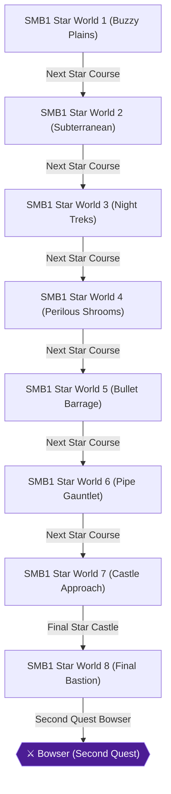

# Writer packet — Chapter 2: Super Mario Bros. — Second Quest & Speedrun

Write `08_chapters/02.md`. Previous chapter: 1. Super Mario Bros. — First Quest (Worlds 1–8). Next chapter: 3. Super Mario Bros.: The Lost Levels — Main Quest (Worlds 1–8).
Planner notes: Conquer the harder Star Courses (Second Quest) where Goombas become Buzzy Beetles and platforms are shorter, plus deathless and shortest-route speedruns.

## Areas in this chapter (in order)

- `SMB1_StarWorld1` — SMB1 Star World 1 (Buzzy Plains)
- `SMB1_StarWorld2` — SMB1 Star World 2 (Subterranean)
- `SMB1_StarWorld3` — SMB1 Star World 3 (Night Treks)
- `SMB1_StarWorld4` — SMB1 Star World 4 (Perilous Shrooms)
- `SMB1_StarWorld5` — SMB1 Star World 5 (Bullet Barrage)
- `SMB1_StarWorld6` — SMB1 Star World 6 (Pipe Gauntlet)
- `SMB1_StarWorld7` — SMB1 Star World 7 (Castle Approach)
- `SMB1_StarWorld8` — SMB1 Star World 8 (Final Bastion)

## Achievements to place in this chapter (each EXACTLY once as `[ACHIEVEMENT:<id>]`)

- **26913** — Welcome to the Mushroom Kingdom! - Second Quest (5 pts): [SMB1] Complete World 1 on the Second Quest  
  supporting facts: ra-comments-22-1, ra-comments-22-2, neo2-58-1, neo2-58-2, neo2-59-1, neo2-59-2, neo2-60-1, neo2-60-2, neo2-61-1, neo2-61-2, neo2-62-1, neo2-62-2, neo2-75-1, neo2-75-2
- **26914** — Across the Pond - Second Quest (5 pts): [SMB1] Complete World 2 on the Second Quest  
  supporting facts: ra-comments-24-1, ra-comments-24-2, neo2-62-1, neo2-62-2, neo2-63-1, neo2-63-2, neo2-64-1, neo2-64-2, neo2-75-1, neo2-75-2
- **26915** — Northern Lights - Second Quest (5 pts): [SMB1] Complete World 3 on the Second Quest  
  supporting facts: ra-comments-26-1, ra-comments-26-2, neo2-65-1, neo2-65-2, neo2-66-1, neo2-66-2, neo2-67-1, neo2-67-2
- **26916** — Scary 'Shrooms - Second Quest (5 pts): [SMB1] Complete World 4 on the Second Quest  
  supporting facts: ra-comments-28-1, ra-comments-28-2, neo2-68-1, neo2-68-2, neo2-69-1, neo2-69-2, neo2-70-1, neo2-70-2, neo2-71-1, neo2-71-2
- **26917** — Bite the Bullet - Second Quest (10 pts): [SMB1] Complete World 5 on the Second Quest  
  supporting facts: ra-comments-30-1, ra-comments-30-2, neo2-72-1, neo2-72-2, neo2-73-1, neo2-73-2, neo2-74-1, neo2-74-2, neo2-75-1, neo2-75-2
- **26918** — Piranha Pipe Plaza - Second Quest (10 pts): [SMB1] Complete World 6 on the Second Quest  
  supporting facts: ra-comments-32-1, ra-comments-32-2, neo2-74-1, neo2-74-2, neo2-76-1, neo2-76-2, neo2-77-1, neo2-77-2, neo2-78-1, neo2-78-2
- **26919** — Familiar Territory - Second Quest (10 pts): [SMB1] Complete World 7 on the Second Quest  
  supporting facts: ra-comments-34-1, ra-comments-34-2, neo2-79-1, neo2-79-2, neo2-80-1, neo2-80-2, neo2-81-1, neo2-81-2
- **26920** — Your Quest Is Over! (10 pts): [SMB1] Complete World 8 on the Second Quest and save Princess Toadstool again  
  supporting facts: ra-comments-36-1, ra-comments-36-2, neo2-82-1, neo2-82-2, neo2-83-1, neo2-83-2, neo2-84-1, neo2-84-2, neo2-85-1, neo2-85-2, neo2-86-1, neo2-86-2
- **26921** — Super Speedrun Bros. (10 pts): [SMB1] From a new file, beat the game in one session using the shortest possible route  
  supporting facts: ra-comments-37-1, ra-comments-37-2, neo1-3-1, neo1-3-2, neo1-5-1, neo1-5-2, neo2-32-1, neo2-32-2, neo2-42-1, neo2-42-2, neo2-60-1, neo2-60-2, neo2-70-1, neo2-70-2, neo3-35-1, neo3-35-2, neo3-54-1, neo3-54-2, neo3-55-1, neo3-55-2, neo4-12-1, neo4-12-2, neo4-20-1, neo4-20-2, neo4-21-1, neo4-21-2
- **26922** — Steadfast Platformer (25 pts): [SMB1] From a new file, beat the game in one session without losing a life  
  supporting facts: ra-comments-39-1, ra-comments-39-2, ra-comments-40-1, ra-comments-40-2, neo1-6-1, neo1-6-2, neo2-25-1, neo2-25-2, neo2-54-1, neo2-54-2, neo2-55-1, neo2-55-2, neo2-56-1, neo2-56-2, neo2-82-1, neo2-82-2, neo2-83-1, neo2-83-2, neo2-84-1, neo2-84-2, neo2-86-1, neo2-86-2, neo3-20-1, neo3-20-2, neo3-50-1, neo3-50-2, neo3-51-1, neo3-51-2, neo3-52-1, neo3-52-2, neo3-53-1, neo3-53-2, neo3-54-1, neo3-54-2, neo3-55-1, neo3-55-2, neo3-58-1, neo3-58-2, neo4-28-1, neo4-28-2, neo4-29-1, neo4-29-2, neo4-30-1, neo4-30-2, neo4-31-1, neo4-31-2

## ⚠ Missables in this chapter (each needs a `> [!WARNING]` BEFORE the point it can be missed)

- SMB1 Shortest Route Speedrun (achievement 26921) — deadline: Beat SMB1 in a single session from a fresh file using 1-2 and 4-2 warp zones [ra-comments-37-1, ra-comments-37-2, neo1-3-1]
- SMB1 Steadfast Platformer (Deathless) (achievement 26922) — deadline: Beat SMB1 from a fresh file in one session without losing a single life [ra-comments-39-1, ra-comments-39-2, ra-comments-40-1]

## ⛔ Points of no return in this chapter (each needs a `> [!CAUTION]` containing the words "Point of No Return")

- Point of No Return: SMB1 Star Course World 8-4 Bridge: Triggering the bridge axe in Star Course World 8-4 concludes the Second Quest. [ra-comments-36-1, ra-comments-36-2]

## Route diagram (inserted automatically where you write `[MERMAID]`)



## Usable facts (130) — cite as [[fact-id]]

Legend: ✅ verified (2+ sources) · ✔ conflict resolved · 🟡 single source

- ✅ **neo1-3-1** (location) American Name: Buzzy Beetle — @SMB1 Stage Guide · ach: 26905,26923,26921,541017  
  evidence: neo1#3: "American Name: Buzzy Beetle"
- ✅ **neo1-3-2** (achievement) Description: They behave just like the Green Koopa Troopa except fireballs have — @SMB1 Stage Guide · ach: 26905,26923,26921,541017  
  evidence: neo1#3: "Description: They behave just like the Green Koopa Troopa except fireballs have"
- ✅ **neo1-5-1** (location) 3-4: Move right and avoid the Pobodos and firebars. The middle question block — @SMB1 Stage Guide · ach: 26907,26908,26909,26910,26923,26921,541017  
  evidence: neo1#5: "3-4: Move right and avoid the Pobodos and firebars. The middle question block"
- ✅ **neo1-5-2** (location) has a powerup. The next three sets of firebars are tricky as there are on top — @SMB1 Stage Guide · ach: 26907,26908,26909,26910,26923,26921,541017  
  evidence: neo1#5: "has a powerup. The next three sets of firebars are tricky as there are on top"
- ✅ **neo1-6-1** (location) 6-1: Go right and avoid or shoot the spinies and quickly take out Lakitu ASAP. — @SMB1 Stage Guide · ach: 26907,26910,26911,26912,26922,541017  
  evidence: neo1#6: "6-1: Go right and avoid or shoot the spinies and quickly take out Lakitu ASAP."
- ✅ **neo1-6-2** (location) There are two areas to do so, The level is a short and sweet one so no need for — @SMB1 Stage Guide · ach: 26907,26910,26911,26912,26922,541017  
  evidence: neo1#6: "There are two areas to do so, The level is a short and sweet one so no need for"
- ✅ **neo2-25-1** (location) <  | 5000   Not only that, but also, if you reach — @SMB1 Stage Guide · ach: 26912,26922,541026  
  evidence: neo2#25: "<  | 5000   Not only that, but also, if you reach"
- ✅ **neo2-25-2** (location) \|        the flagpole with a 1 on the units — @SMB1 Stage Guide · ach: 26912,26922,541026  
  evidence: neo2#25: "\|        the flagpole with a 1 on the units"
- ✅ **neo2-32-1** (location) Goombas on the staircase. Climb the staircase and jump over the elevators — @SMB1 Stage Guide · ach: 26905,26923,26921,26924,541026  
  evidence: neo2#32: "Goombas on the staircase. Climb the staircase and jump over the elevators"
- ✅ **neo2-32-2** (location) onto the brick platform with a Red Koopa Troopa below it. The last brick — @SMB1 Stage Guide · ach: 26905,26923,26921,26924,541026  
  evidence: neo2#32: "onto the brick platform with a Red Koopa Troopa below it. The last brick"
- ✅ **neo2-42-1** (location) onto the lowest row of bricks, and above you, should be a row of three — @SMB1 Stage Guide · ach: 26908,26909,26923,26921,26924,541026  
  evidence: neo2#42: "onto the lowest row of bricks, and above you, should be a row of three"
- ✅ **neo2-42-2** (location) bricks. Bash the middle one to get a hidden Power-up. Jump onto the next — @SMB1 Stage Guide · ach: 26908,26909,26923,26921,26924,541026  
  evidence: neo2#42: "bricks. Bash the middle one to get a hidden Power-up. Jump onto the next"
- ✅ **neo2-54-1** (location) Note: In all of the previous levels, if you got halfway through a level — @SMB1 Stage Guide · ach: 26912,26922,541017  
  evidence: neo2#54: "Note: In all of the previous levels, if you got halfway through a level"
- ✅ **neo2-54-2** (item) (apart from castle levels) and died, you restarted halfway through the — @SMB1 Stage Guide · ach: 26912,26922,541017  
  evidence: neo2#54: "(apart from castle levels) and died, you restarted halfway through the"
- ✅ **neo2-55-1** (location) high, with some bricks in the air above it. Jump over the pillar and go — @SMB1 Stage Guide · ach: 26912,26922,26924,541017,541026  
  evidence: neo2#55: "high, with some bricks in the air above it. Jump over the pillar and go"
- ✅ **neo2-55-2** (location) into the small pit with the Koopa Paratroopa trapped between the two — @SMB1 Stage Guide · ach: 26912,26922,26924,541017,541026  
  evidence: neo2#55: "into the small pit with the Koopa Paratroopa trapped between the two"
- ✅ **neo2-56-1** (location) clear the gap. A Goomba will come down the staircase, so avoid it. You'll — @SMB1 Stage Guide · ach: 26912,26922,541026  
  evidence: neo2#56: "clear the gap. A Goomba will come down the staircase, so avoid it. You'll"
- ✅ **neo2-56-2** (location) see a Buzzy Beetle trapped between this staircase and two Bullet Bill — @SMB1 Stage Guide · ach: 26912,26922,541026  
  evidence: neo2#56: "see a Buzzy Beetle trapped between this staircase and two Bullet Bill"
- ✅ **neo2-58-1** (item) The first '?' Block you come to has a coin in it. Stomp the nearby Buzzy — @SMB1 Stage Guide · ach: 26913,26905,541017  
  evidence: neo2#58: "The first '?' Block you come to has a coin in it. Stomp the nearby Buzzy"
- ✅ **neo2-58-2** (location) Beetle. Next there are two '?' Blocks between three bricks and a '?' Block — @SMB1 Stage Guide · ach: 26913,26905,541017  
  evidence: neo2#58: "Beetle. Next there are two '?' Blocks between three bricks and a '?' Block"
- ✅ **neo2-59-1** (transition) between the bricks for a coin. Jump over the next pipe, climb the — @SMB1 Stage Guide · ach: 26913,26905,26924,541017,541026  
  evidence: neo2#59: "between the bricks for a coin. Jump over the next pipe, climb the"
- ✅ **neo2-59-2** (location) staircase and grab the flagpole. — @SMB1 Stage Guide · ach: 26913,26905,26924,541017,541026  
  evidence: neo2#59: "staircase and grab the flagpole."
- ✅ **neo2-60-1** (location) two Buzzy Beetles on the staircase. Climb the staircase and jump over the — @SMB1 Stage Guide · ach: 26913,26905,26923,26921,26924,541026  
  evidence: neo2#60: "two Buzzy Beetles on the staircase. Climb the staircase and jump over the"
- ✅ **neo2-60-2** (location) elevators onto the brick platform with a Red Koopa Troopa below it. The — @SMB1 Stage Guide · ach: 26913,26905,26923,26921,26924,541026  
  evidence: neo2#60: "elevators onto the brick platform with a Red Koopa Troopa below it. The"
- ✅ **neo2-61-1** (location) In this huge pit are six invisible blocks in two layers. There are three — @SMB1 Stage Guide · ach: 26913,26906  
  evidence: neo2#61: "In this huge pit are six invisible blocks in two layers. There are three"
- ✅ **neo2-61-2** (item) just above Mario, and the other three are one coin space to the right in — @SMB1 Stage Guide · ach: 26913,26906  
  evidence: neo2#61: "just above Mario, and the other three are one coin space to the right in"
- 🟡 **neo2-62-1** (location) The centre brick of the first three bricks you come to holds a Power-up in — @+=========+ · ach: 26913,26914,26905,26906,26924,541017,541026  
  evidence: neo2#62: "The centre brick of the first three bricks you come to holds a Power-up in"
- 🟡 **neo2-62-2** (location) it. Kill the Buzzy Beetle coming down the stairway and jump over the — @+=========+ · ach: 26913,26914,26905,26906,26924,541017,541026  
  evidence: neo2#62: "it. Kill the Buzzy Beetle coming down the stairway and jump over the"
- ✅ **neo2-63-1** (item) approaching you, and bash the '?' Block ahead for a coin. The brick above — @SMB1 Stage Guide · ach: 26914,26906,26924  
  evidence: neo2#63: "approaching you, and bash the '?' Block ahead for a coin. The brick above"
- ✅ **neo2-63-2** (location) it and to its right contains a Power-up. Here's how you can reach it: — @SMB1 Stage Guide · ach: 26914,26906,26924  
  evidence: neo2#63: "it and to its right contains a Power-up. Here's how you can reach it:"
- ✅ **neo2-64-1** (location) From the grass, jump onto the broken bridge part, then onto the next — @SMB1 Stage Guide · ach: 26914,26906  
  evidence: neo2#64: "From the grass, jump onto the broken bridge part, then onto the next"
- ✅ **neo2-64-2** (item) bridge. Grab the six coins in the air and jump onto the next bridge. Get — @SMB1 Stage Guide · ach: 26914,26906  
  evidence: neo2#64: "bridge. Grab the six coins in the air and jump onto the next bridge. Get"
- ✅ **neo2-65-1** (item) The first two '?' Blocks you come to hold coins, and the third has a — @SMB1 Stage Guide · ach: 26915,26907,26924  
  evidence: neo2#65: "The first two '?' Blocks you come to hold coins, and the third has a"
- ✅ **neo2-65-2** (location) Power-up. Kill the Koopa Paratroopas bouncing towards you. Jump over the — @SMB1 Stage Guide · ach: 26915,26907,26924  
  evidence: neo2#65: "Power-up. Kill the Koopa Paratroopas bouncing towards you. Jump over the"
- ✅ **neo2-66-1** (location) Stand on the right hand side of the bridge and jump straight up for a — @SMB1 Stage Guide · ach: 26915,26907,26924,541017,541026  
  evidence: neo2#66: "Stand on the right hand side of the bridge and jump straight up for a"
- ✅ **neo2-66-2** (item) hidden 1-Up Mushroom. Jump over the little pit. In the air is a row of — @SMB1 Stage Guide · ach: 26915,26907,26924,541017,541026  
  evidence: neo2#66: "hidden 1-Up Mushroom. Jump over the little pit. In the air is a row of"
- ✅ **neo2-67-1** (location) There are no secret areas in this level. — @SMB1 Stage Guide · ach: 26915,26907,541026  
  evidence: neo2#67: "There are no secret areas in this level."
- ✅ **neo2-67-2** (location) NOTE: The elevators are shorter so it's a bit tricky when crossing them, — @SMB1 Stage Guide · ach: 26915,26907,541026  
  evidence: neo2#67: "NOTE: The elevators are shorter so it's a bit tricky when crossing them,"
- ✅ **neo2-68-1** (transition) Jump over the green pipe. The bottom '?' Block has a Power-up in it, and — @SMB1 Stage Guide · ach: 26916,26908,541017  
  evidence: neo2#68: "Jump over the green pipe. The bottom '?' Block has a Power-up in it, and"
- ✅ **neo2-68-2** (item) the one above it holds a coin. Jump over the gap and start running. Grab — @SMB1 Stage Guide · ach: 26916,26908,541017  
  evidence: neo2#68: "the one above it holds a coin. Jump over the gap and start running. Grab"
- ✅ **neo2-69-1** (location) leaping off the top step to get to the flagpole, drop down and you'll see — @SMB1 Stage Guide · ach: 26916,26908,26924  
  evidence: neo2#69: "leaping off the top step to get to the flagpole, drop down and you'll see"
- ✅ **neo2-69-2** (item) a brick, which is a multi-coin block. Get the coins, and then, do a — @SMB1 Stage Guide · ach: 26916,26908,26924  
  evidence: neo2#69: "a brick, which is a multi-coin block. Get the coins, and then, do a"
- ✅ **neo2-70-1** (location) onto the lowest row of bricks, and above you, should be a row of three — @SMB1 Stage Guide · ach: 26916,26908,26909,26923,26921,26924,541026  
  evidence: neo2#70: "onto the lowest row of bricks, and above you, should be a row of three"
- ✅ **neo2-70-2** (location) bricks. Bash the middle one to get a hidden Power-up. Jump onto the next — @SMB1 Stage Guide · ach: 26916,26908,26909,26923,26921,26924,541026  
  evidence: neo2#70: "bricks. Bash the middle one to get a hidden Power-up. Jump onto the next"
- ✅ **neo2-71-1** (location) This is the first maze castle. Here's how to get through it. Jump over the — @SMB1 Stage Guide · ach: 26916,26908  
  evidence: neo2#71: "This is the first maze castle. Here's how to get through it. Jump over the"
- ✅ **neo2-71-2** (location) lava pit onto the pillar. Leap over the next lava pit, then jump up on top — @SMB1 Stage Guide · ach: 26916,26908  
  evidence: neo2#71: "lava pit onto the pillar. Leap over the next lava pit, then jump up on top"
- ✅ **neo2-72-1** (location) Stomp the Koopa Troopa, kick its shell and follow it for many points. Make — @SMB1 Stage Guide · ach: 26917,26909,26924,541017  
  evidence: neo2#72: "Stomp the Koopa Troopa, kick its shell and follow it for many points. Make"
- ✅ **neo2-72-2** (transition) sure to jump when you see the silver pipe. Jump over the pipe, then jump — @SMB1 Stage Guide · ach: 26917,26909,26924,541017  
  evidence: neo2#72: "sure to jump when you see the silver pipe. Jump over the pipe, then jump"
- ✅ **neo2-73-1** (location) Paratroopas. You'll approach the staircase, which now has a gap in it. — @SMB1 Stage Guide · ach: 26917,26909,26924,541017,541026  
  evidence: neo2#73: "Paratroopas. You'll approach the staircase, which now has a gap in it."
- ✅ **neo2-73-2** (location) Jump from the fifth step to the block in the air with the momentum and — @SMB1 Stage Guide · ach: 26917,26909,26924,541017,541026  
  evidence: neo2#73: "Jump from the fifth step to the block in the air with the momentum and"
- ✅ **neo2-74-1** (transition) use the warp pipe mentioned earlier. Anyways, kill them if they are there — @SMB1 Stage Guide · ach: 26917,26918,26909,26910,541017,541026  
  evidence: neo2#74: "use the warp pipe mentioned earlier. Anyways, kill them if they are there"
- ✅ **neo2-74-2** (location) then bash the brick on the very right on the top row of bricks for a — @SMB1 Stage Guide · ach: 26917,26918,26909,26910,541017,541026  
  evidence: neo2#74: "then bash the brick on the very right on the top row of bricks for a"
- ✅ **neo2-75-1** (location) If you have noticed, this level is actually a remix of World 1*3, just — @SMB1 Stage Guide · ach: 26913,26914,26917,26905,26906,26909  
  evidence: neo2#75: "If you have noticed, this level is actually a remix of World 1*3, just"
- ✅ **neo2-75-2** (location) made slightly more difficult. — @SMB1 Stage Guide · ach: 26913,26914,26917,26905,26906,26909  
  evidence: neo2#75: "made slightly more difficult."
- ✅ **neo2-76-1** (item) The first two '?' Blocks have coins in them. Jump over the pit and climb — @SMB1 Stage Guide · ach: 26918,26910,541017  
  evidence: neo2#76: "The first two '?' Blocks have coins in them. Jump over the pit and climb"
- ✅ **neo2-76-2** (location) the stairway. Above the top step are two bricks. Bash the one on the left — @SMB1 Stage Guide · ach: 26918,26910,541017  
  evidence: neo2#76: "the stairway. Above the top step are two bricks. Bash the one on the left"
- ✅ **neo2-77-1** (transition) two pipes with two bricks above him. Bash the right-hand brick for a — @SMB1 Stage Guide · ach: 26918,26910,26924  
  evidence: neo2#77: "two pipes with two bricks above him. Bash the right-hand brick for a"
- ✅ **neo2-77-2** (transition) Power-up. You can enter the pipe after this to a water area. If you take — @SMB1 Stage Guide · ach: 26918,26910,26924  
  evidence: neo2#77: "Power-up. You can enter the pipe after this to a water area. If you take"
- ✅ **neo2-78-1** (item) From here jump onto the balance-elevator and get the two coins. Jump over — @SMB1 Stage Guide · ach: 26918,26905,26910,541026  
  evidence: neo2#78: "From here jump onto the balance-elevator and get the two coins. Jump over"
- ✅ **neo2-78-2** (location) into the cluster of trees, and you should see some still girders to your — @SMB1 Stage Guide · ach: 26918,26905,26910,541026  
  evidence: neo2#78: "into the cluster of trees, and you should see some still girders to your"
- ✅ **neo2-79-1** (location) Jump over the first Bullet Bill cannon. Kill/avoid the Koopa Paratroopa. — @SMB1 Stage Guide · ach: 26919,26910,26911,541017,541026  
  evidence: neo2#79: "Jump over the first Bullet Bill cannon. Kill/avoid the Koopa Paratroopa."
- ✅ **neo2-79-2** (location) You'll come to a Bullet Bill cannon on top of another cannon. Above them — @SMB1 Stage Guide · ach: 26919,26910,26911,541017,541026  
  evidence: neo2#79: "You'll come to a Bullet Bill cannon on top of another cannon. Above them"
- ✅ **neo2-80-1** (location) to two more rows of bricks with Hamer Brothers on. Kill or avoid the — @SMB1 Stage Guide · ach: 26919,26911,26924,541017  
  evidence: neo2#80: "to two more rows of bricks with Hamer Brothers on. Kill or avoid the"
- ✅ **neo2-80-2** (location) Hammer Brothers and jump over the pillar, then jump over the two cannons — @SMB1 Stage Guide · ach: 26919,26911,26924,541017  
  evidence: neo2#80: "Hammer Brothers and jump over the pillar, then jump over the two cannons"
- ✅ **neo2-81-1** (item) There are four coins in the air above the next bridge. After the next — @SMB1 Stage Guide · ach: 26919,26911  
  evidence: neo2#81: "There are four coins in the air above the next bridge. After the next"
- ✅ **neo2-81-2** (item) bridge are three broken bridge sections with six coins in the air above — @SMB1 Stage Guide · ach: 26919,26911  
  evidence: neo2#81: "bridge are three broken bridge sections with six coins in the air above"
- ✅ **neo2-82-1** (location) This is the longest level in the game, and you only have 300 seconds to — @SMB1 Stage Guide · ach: 26920,26912,26922,541017  
  evidence: neo2#82: "This is the longest level in the game, and you only have 300 seconds to"
- ✅ **neo2-82-2** (location) get it finished. So time is of the essence. Stomp the Buzzy Beetle, kick — @SMB1 Stage Guide · ach: 26920,26912,26922,541017  
  evidence: neo2#82: "get it finished. So time is of the essence. Stomp the Buzzy Beetle, kick"
- ✅ **neo2-83-1** (location) spaces high, with some bricks in the air above it. Jump over the pillar — @SMB1 Stage Guide · ach: 26920,26912,26922,26924,541017,541026  
  evidence: neo2#83: "spaces high, with some bricks in the air above it. Jump over the pillar"
- ✅ **neo2-83-2** (location) and go into the small pit with the Koopa Paratroopa trapped between the — @SMB1 Stage Guide · ach: 26920,26912,26922,26924,541017,541026  
  evidence: neo2#83: "and go into the small pit with the Koopa Paratroopa trapped between the"
- ✅ **neo2-84-1** (location) clear the gap. A Beetle will come down the staircase, so avoid it. You'll — @SMB1 Stage Guide · ach: 26920,26912,26922,541026  
  evidence: neo2#84: "clear the gap. A Beetle will come down the staircase, so avoid it. You'll"
- ✅ **neo2-84-2** (location) see a Buzzy Beetle trapped between this staircase and two Bullet Bill — @SMB1 Stage Guide · ach: 26920,26912,26922,541026  
  evidence: neo2#84: "see a Buzzy Beetle trapped between this staircase and two Bullet Bill"
- ✅ **neo2-85-1** (transition) Now jump over the next two pipes and Cheep-cheep will start flying up from — @SMB1 Stage Guide · ach: 26920  
  evidence: neo2#85: "Now jump over the next two pipes and Cheep-cheep will start flying up from"
- ✅ **neo2-85-2** (transition) somewhere. Jump over the lava pit and enter the silver pipe. You will now — @SMB1 Stage Guide · ach: 26920  
  evidence: neo2#85: "somewhere. Jump over the lava pit and enter the silver pipe. You will now"
- ✅ **neo2-86-1** (item) • '?' Block        - Found in most levels. Some contain coins, some contain — @SMB1 Stage Guide · ach: 26920,26906,26912,26922,26924,541017,541026  
  evidence: neo2#86: "• '?' Block        - Found in most levels. Some contain coins, some contain"
- ✅ **neo2-86-2** (item) power-ups, and some have starmans. Bump them from — @SMB1 Stage Guide · ach: 26920,26906,26912,26922,26924,541017,541026  
  evidence: neo2#86: "power-ups, and some have starmans. Bump them from"
- 🟡 **neo3-20-1** (transition) A warp pipe will lead you to another area in the game. Some warp pipes will — @Warp Pipe · ach: 26912,26922,541026  
  evidence: neo3#20: "A warp pipe will lead you to another area in the game. Some warp pipes will"
- 🟡 **neo3-20-2** (transition) warp you to different areas within the level, others will warp you to — @Warp Pipe · ach: 26912,26922,541026  
  evidence: neo3#20: "warp you to different areas within the level, others will warp you to"
- ✅ **neo3-35-1** (location) World 4-2 - Super Mario Bros. Walkthrough — @SMB1 Stage Guide · ach: 26908,26923,26921  
  evidence: neo3#35: "World 4-2 - Super Mario Bros. Walkthrough"
- ✅ **neo3-35-2** (transition) The stage will start off with a small movie of you walking into a pipe. — @SMB1 Stage Guide · ach: 26908,26923,26921  
  evidence: neo3#35: "The stage will start off with a small movie of you walking into a pipe."
- ✅ **neo3-50-1** (location) World 8-1 - Super Mario Bros. Walkthrough — @SMB1 Stage Guide · ach: 26912,26922,26924  
  evidence: neo3#50: "World 8-1 - Super Mario Bros. Walkthrough"
- ✅ **neo3-50-2** (location) Run to the right and jump over the buzzy beatle, and then over the four — @SMB1 Stage Guide · ach: 26912,26922,26924  
  evidence: neo3#50: "Run to the right and jump over the buzzy beatle, and then over the four"
- ✅ **neo3-51-1** (location) World 8-2 - Super Mario Bros. Walkthrough — @SMB1 Stage Guide · ach: 26912,26922,541017  
  evidence: neo3#51: "World 8-2 - Super Mario Bros. Walkthrough"
- ✅ **neo3-51-2** (location) Run to the right over a green koopa paratroopa, and over a tiny pit. At — @SMB1 Stage Guide · ach: 26912,26922,541017  
  evidence: neo3#51: "Run to the right over a green koopa paratroopa, and over a tiny pit. At"
- ✅ **neo3-52-1** (location) World 8-3 - Super Mario Bros. Walkthrough — @SMB1 Stage Guide · ach: 26912,26922  
  evidence: neo3#52: "World 8-3 - Super Mario Bros. Walkthrough"
- ✅ **neo3-52-2** (location) Run to the right and jump over a bullet bill cannon. Avoid the koopa — @SMB1 Stage Guide · ach: 26912,26922  
  evidence: neo3#52: "Run to the right and jump over a bullet bill cannon. Avoid the koopa"
- ✅ **neo3-53-1** (location) World 8-4 - Super Mario Bros. Walkthrough — @SMB1 Stage Guide · ach: 26912,26922  
  evidence: neo3#53: "World 8-4 - Super Mario Bros. Walkthrough"
- ✅ **neo3-53-2** (location) World 8-4 is basically a huge maze level; if you go the wrong way you — @SMB1 Stage Guide · ach: 26912,26922  
  evidence: neo3#53: "World 8-4 is basically a huge maze level; if you go the wrong way you"
- ✅ **neo3-54-1** (item) Now press start and you can play through a "star" quest, which is exactly — @SMB1 Stage Guide · ach: 26905,26912,26922,26923,26921  
  evidence: neo3#54: "Now press start and you can play through a "star" quest, which is exactly"
- ✅ **neo3-54-2** (location) the same as the first quest, except enemies have been sped up, Goombas — @SMB1 Stage Guide · ach: 26905,26912,26922,26923,26921  
  evidence: neo3#54: "the same as the first quest, except enemies have been sped up, Goombas"
- 🟡 **neo3-55-1** (transition) This warp is done in world 1-2, and will warp you to either world 2, 3, — @World 1-2 to 2-1, 3-1, or 4-1 · ach: 26905,26906,26907,26908,26910,26911,26912,26922,26923,26921  
  evidence: neo3#55: "This warp is done in world 1-2, and will warp you to either world 2, 3,"
- 🟡 **neo3-55-2** (item) or 4. To do it, start playing in world 1-2. Get to the two flights of — @World 1-2 to 2-1, 3-1, or 4-1 · ach: 26905,26906,26907,26908,26910,26911,26912,26922,26923,26921  
  evidence: neo3#55: "or 4. To do it, start playing in world 1-2. Get to the two flights of"
- 🟡 **neo3-58-1** (item) In any ?-3 world, if you get all of the coins, then there will be a — @1-Up Mushrooms · ach: 26907,26908,26912,26922,541017  
  evidence: neo3#58: "In any ?-3 world, if you get all of the coins, then there will be a"
- 🟡 **neo3-58-2** (item) hidden 1-up mushroom in the next ?-1 stage. For example, if you get all — @1-Up Mushrooms · ach: 26907,26908,26912,26922,541017  
  evidence: neo3#58: "hidden 1-up mushroom in the next ?-1 stage. For example, if you get all"
- ✅ **neo4-12-1** (location) Stomp on the two Goombas marching right next to you at the beginning and then — @World 1-2 · ach: 26905,26923,26921  
  evidence: neo4#12: "Stomp on the two Goombas marching right next to you at the beginning and then"
- 🟡 **neo4-12-2** (item) get the flower out of the first question block in the row of five there. Pass — @World 1-2 · ach: 26905,26923,26921  
  evidence: neo4#12: "get the flower out of the first question block in the row of five there. Pass"
- 🟡 **neo4-20-1** (location) There's a golden opportunity to skip a whole lot of levels here. To do that, — @World 4-2 · ach: 26908,26909,26923,26921  
  evidence: neo4#20: "There's a golden opportunity to skip a whole lot of levels here. To do that,"
- 🟡 **neo4-20-2** (location) you have to find the beanstalk in this level and not screw it up. At the — @World 4-2 · ach: 26908,26909,26923,26921  
  evidence: neo4#20: "you have to find the beanstalk in this level and not screw it up. At the"
- 🟡 **neo4-21-1** (transition) If you chose not to take any warp zones of any sort in the previous level, — @World 4-3 · ach: 26908,26923,26921  
  evidence: neo4#21: "If you chose not to take any warp zones of any sort in the previous level,"
- 🟡 **neo4-21-2** (location) this is where you will end up. Aside from looking cool, this one doesn't have — @World 4-3 · ach: 26908,26923,26921  
  evidence: neo4#21: "this is where you will end up. Aside from looking cool, this one doesn't have"
- ✅ **neo4-28-1** (location) There's no time for pathetic dalliances here. You've got to move fast to — @World 8-1 · ach: 26912,26922,26924  
  evidence: neo4#28: "There's no time for pathetic dalliances here. You've got to move fast to"
- ✅ **neo4-28-2** (location) reach the end of this level by the time the timer peters out. First off, look — @World 8-1 · ach: 26912,26922,26924  
  evidence: neo4#28: "reach the end of this level by the time the timer peters out. First off, look"
- 🟡 **neo4-29-1** (location) Thank goodness! This one doesn't require you to hurry as much as the other — @World 8-2 · ach: 26911,26912,26922,541017  
  evidence: neo4#29: "Thank goodness! This one doesn't require you to hurry as much as the other"
- 🟡 **neo4-29-2** (item) one did. You can get off to a really good start here by pounding Lakitu on — @World 8-2 · ach: 26911,26912,26922,541017  
  evidence: neo4#29: "one did. You can get off to a really good start here by pounding Lakitu on"
- 🟡 **neo4-30-1** (location) This level is still pretty easy in light of all the Bullet Bills and Hammer — @World 8-3 · ach: 26912,26922  
  evidence: neo4#30: "This level is still pretty easy in light of all the Bullet Bills and Hammer"
- 🟡 **neo4-30-2** (location) Brothers hanging around the joint. Make an enormous jump over the first — @World 8-3 · ach: 26912,26922  
  evidence: neo4#30: "Brothers hanging around the joint. Make an enormous jump over the first"
- 🟡 **neo4-31-1** (transition) You can't go in the first pipe, but you can go in the second one. Don't — @World 8-4 · ach: 26912,26922  
  evidence: neo4#31: "You can't go in the first pipe, but you can go in the second one. Don't"
- 🟡 **neo4-31-2** (location) though, because that one loops back to the first one and you'll never get — @World 8-4 · ach: 26912,26922  
  evidence: neo4#31: "though, because that one loops back to the first one and you'll never get"
- 🟡 **ra-comments-22-1** (achievement) [Server] televandalist edited this achievement. — ach: 26913  
  evidence: ra-comments#22: "[Server] televandalist edited this achievement."
- 🟡 **ra-comments-22-2** (achievement) [Server] Layton edited this achievement's badge. — ach: 26913  
  evidence: ra-comments#22: "[Server] Layton edited this achievement's badge."
- 🟡 **ra-comments-24-1** (achievement) [Server] televandalist edited this achievement. — ach: 26914  
  evidence: ra-comments#24: "[Server] televandalist edited this achievement."
- 🟡 **ra-comments-24-2** (achievement) [Server] Layton edited this achievement's badge. — ach: 26914  
  evidence: ra-comments#24: "[Server] Layton edited this achievement's badge."
- 🟡 **ra-comments-26-1** (achievement) [Server] televandalist edited this achievement. — ach: 26915  
  evidence: ra-comments#26: "[Server] televandalist edited this achievement."
- 🟡 **ra-comments-26-2** (achievement) [Server] Layton edited this achievement's badge. — ach: 26915  
  evidence: ra-comments#26: "[Server] Layton edited this achievement's badge."
- 🟡 **ra-comments-28-1** (achievement) [Server] televandalist edited this achievement. — ach: 26916  
  evidence: ra-comments#28: "[Server] televandalist edited this achievement."
- 🟡 **ra-comments-28-2** (achievement) [Server] Layton edited this achievement's badge. — ach: 26916  
  evidence: ra-comments#28: "[Server] Layton edited this achievement's badge."
- 🟡 **ra-comments-30-1** (achievement) [Server] televandalist edited this achievement. — ach: 26917  
  evidence: ra-comments#30: "[Server] televandalist edited this achievement."
- 🟡 **ra-comments-30-2** (achievement) [Server] Layton edited this achievement's badge. — ach: 26917  
  evidence: ra-comments#30: "[Server] Layton edited this achievement's badge."
- 🟡 **ra-comments-32-1** (achievement) [Server] televandalist edited this achievement. — ach: 26918  
  evidence: ra-comments#32: "[Server] televandalist edited this achievement."
- 🟡 **ra-comments-32-2** (achievement) [Server] Layton edited this achievement's badge. — ach: 26918  
  evidence: ra-comments#32: "[Server] Layton edited this achievement's badge."
- 🟡 **ra-comments-34-1** (achievement) [Server] televandalist edited this achievement. — ach: 26919  
  evidence: ra-comments#34: "[Server] televandalist edited this achievement."
- 🟡 **ra-comments-34-2** (achievement) [Server] Layton edited this achievement's badge. — ach: 26919  
  evidence: ra-comments#34: "[Server] Layton edited this achievement's badge."
- 🟡 **ra-comments-36-1** (achievement) [Server] Layton edited this achievement's badge. — ach: 26920  
  evidence: ra-comments#36: "[Server] Layton edited this achievement's badge."
- 🟡 **ra-comments-36-2** (achievement) [Server] Nepiki edited this achievement's title, description. — ach: 26920  
  evidence: ra-comments#36: "[Server] Nepiki edited this achievement's title, description."
- 🟡 **ra-comments-37-1** (achievement) [Server] televandalist edited this achievement. — ach: 26921  
  evidence: ra-comments#37: "[Server] televandalist edited this achievement."
- 🟡 **ra-comments-37-2** (achievement) [Server] wilhitewarrior edited this achievement. — ach: 26921  
  evidence: ra-comments#37: "[Server] wilhitewarrior edited this achievement."
- 🟡 **ra-comments-39-1** (achievement) [Calimero0euf] Can I use savestates in normal mode not hardcore for this achievment ? — ach: 26922  
  evidence: ra-comments#39: "[Calimero0euf] Can I use savestates in normal mode not hardcore for this achievment ?"
- 🟡 **ra-comments-39-2** (achievement) [Skystarmania] it's easier than playing from a save from 8-1 xDDD — ach: 26922  
  evidence: ra-comments#39: "[Skystarmania] it's easier than playing from a save from 8-1 xDDD"
- 🟡 **ra-comments-40-1** (achievement) [r4ndyg] Tem que praticar um pouco mas n e tão dificil assim. Da para fazer sem a flor, mas da para pegar cogumelo + flor na 8-3 se precisar — ach: 26922  
  evidence: ra-comments#40: "[r4ndyg] Tem que praticar um pouco mas n e tão dificil assim. Da para fazer sem a flor, mas da para pegar cogumelo + flor na 8-3 se precisar"
- 🟡 **ra-comments-40-2** (achievement) [Server] KiwiTaco edited this achievement's logic. — ach: 26922  
  evidence: ra-comments#40: "[Server] KiwiTaco edited this achievement's logic."

## Source passages (71 chunks, 30 omitted for size — use `npm run rw:chunks -- 253 --id <chunk>`)

Use these for detail (directions, chest contents, enemy names, boss patterns, ASCII maps). Every statement you take from a passage must cite a fact id; if no fact covers a detail you need, add a fact to `04_facts/` first (with a verbatim quote) and re-run `rw:verify`.

### neo1#2 — Neoseeker: Super Mario All-Stars FAQ/Walkthrough — [--------------------[Super Nintendo Entertainment System]----------------------] (context neighbour)

```text
--------------------[Super Nintendo Entertainment System]----------------------
    -------------------------------------------------------------------------------
    
    o---------------------o
          INTRODUCTION
    o---------------------o
    This combines Super Mario Bros, Super Mario Bros 2, Super Mario Bros 3, and a
    formerly Japan only exclusive called Super Mario Bros Lost Levels aka Japan's
    version of Super Mario Bros 2. The American version was released in Japan as
    Super Mario Bros USA but it is really a hack of Doki Doki Panic.
    
    o---------------------o
           DISCLAIMER
    o---------------------o
    [Super Mario All Stars](https://www.neoseeker.com/super-mario-all-stars/) and its characters are trademarks of Nintendo and all 
    copyrights belong to them.
    
    This FAQ/Walkthrough is the sole copyright of Andrea "Azul Fria" Castillo aka
    Ice Queen Zero and cannot be put on other sites or posted without my given 
    permission nor can it be reproduced w/o proper consent.
    
    
    =============================SUPER MARIO BROS==================================
    
    o---------------------o
          INTRODUCTION
    o---------------------o
    
    The evil King Koopa aka Bowser has kidnapped Princess Toadstool and turned all
    the other Mushroom Kingdom to blocks. These are the things you use as stepping
    stools. As Mario or his brother Luigi in a 2-player game, you got through 32
    levels which is really 8 levels divided into 4 and save the princess whom has
    the power to undo the spell.
    
    
    o---------------------o
           OPTIONS
    o---------------------o
    
    The only options you got are choosing a 1-player or 2-player game at the title
    screen.
    
    o---------------------o
           CONTROLS
    o---------------------o
    
    B button = Jump, stomp enemies, break bricks and hit question blocks above.
    Y button = hold to run faster, shoot fireballs
    Start = Pause the game, start the game
    Select = switch option
    
    left/right = move in that direction
    down = go down special pipes
    
    o---------------------o
           GAMEPLAY
    o---------------------o
    
    There are eight levels and each are seperated into four subsections. Each level
    has their background settings. There is the Overworld (Day time), Underworld,
    Underwater, Overworld (Jungle), Overworld (Night), Overworld (Bayside) and the
    Castle itself.
    
    Red Mushroom - makes you big
    Fire Flower - can shoot fireballs
    Star - Makes you invincible
    Green Mushroom - Extra life.
    Axe - dump Bowser in the abyss and complete the castle level.
    
    o---------------------o
           ENEMIES
    o---------------------o
    
    American Name: Goomba
    Japanese Name: Kuribo
    Description: They are the second most common enemies in the Mario series, they
    try to walk into you.
    
    American Name: Green Koopa Troopa
    Japanese Name: Midori Nokonoko
    Description: They behave like the Goombas, they move into a straight line and
    try to walk into you or place themselves in inconvenient spots.
    
    American Name: Red Koopa Troopa
    Japanese Name: Akai Nokonoko
    Description: When they reach the edge of a platform they'll turn around and go
    in the opposite direction.
    
    American Name: Hammer Bros.
    Japanese Name: Hammer Bros.
    Description: They usually hang out where there is a set of bricks around so
    they can hop up and down a level while tossing Hammers.
```

### neo1#3 — Neoseeker: Super Mario All-Stars FAQ/Walkthrough — [--------------------[Super Nintendo Entertainment System]----------------------]

```text
American Name: Buzzy Beetle
    Japanese Name: Met
    Description: They behave just like the Green Koopa Troopa except fireballs have
    no effect on them. The have a new trick where they walk on the ceiling and drop
    and spin at you when close.
    
    American Name: Spiny
    Japanese Name: Togezo
    Description: They spiky shells protect them from being stomped on. That is if
    you don't wear a Kuribo Shoe.
    
    American Name: Cheep-Cheep
    Japanese Name: Chikkoi Pukupuku
    Description: Cheep-Cheeps in the water place themselves in bad spots but out of
    the water, they leap out of the water.
    
    American Name: Bullet Bill
    Japanese Name: Killer
    Description: They are fired out of special cannons. Stand next to the cannons
    and they will not fire.
    
    American Name: Blooper
    Japanese Name: Gesso
    Description: The Bloopers will swim towards you
    
    American Name: Green Koopa Paratroopa
    Japanese Name: Midori Patapata
    Description: Hops forward in a straight line. Turns into a Koopa Troopa when it
    is stomped.
    
    American Name: Red Koopa Paratroopa
    Japanese Name: Akai Patapata
    Description: All it does is fly up and down and sometimes sideways. You can use
    it for leverage to an otherwise hard-to-reach area.
    
    American Name: Lakitu
    Japanese Name: Jugem
    Description: They continually toss down Spiny Eggs at you. If you kill him, he
    will reappear after a few moments.
    
    American Name: Piranha Plant
    Japanese Name: Pakkun Flower
    Description: They come out of some pipes and munch on anyone who touch them.
    If you stand on or next to the pipe, they won't come out.
    
    American Name: Pobodo
    Japanese Name: Bubble
    Description: In the lava stages, they continually pop out of the lava to catch
    unfortunate jumpers.
    
    American Name: Spiny Egg
    Japanese Name: Paipo
    Description: Tossed by Lakitus, the red ones hatch when they hit the ground and
    turn into a Spiny. 
    
    o---------------------o
             SCORING
    o---------------------o
    
    You score points by killing all enemies. There is a sequence where if you land
    on a group of enemies, the points go from 100, 200, 400, 800, 1000, 2000, 4000,
    8000, and 1-ups for each enemy thereafter. Some enemies are worth more points
    when landed on.
    
    o---------------------o
           WALKTROUGH
    o---------------------o
    
                               *---------------------*
                                      World 1
                               *---------------------*
    
    1-1: Run right and kill a Goomba, and get the Mushroom and kill three more
    Goombas and enter the next pipe after the pair for a shortcut. Skipping the
    pipe, you can get a 1-up. The shortcut leads to the end of the level. Keep
    moving and you can get a flower and a star too.
    
    1-2: Read the info in the warp zone info if you decide to warp. Otherwise just
    stay above the level till you reach the up elevator and exit out the pipe
    and on to the pole.
    
    1-3: As you go right, the jumps here are tricky. On the way tp a platform
    rising and falling, you would have encountered a red Koopa Troopa and a Goomba
    already. Take the low path and get the power up then you have an option of
    getting the four coins above before moving on. Get past a Koopa Paratroopa and
    a Goomba and ride two side moving platforms to the right. Take out a Koopa
    Paratroopa and another Goomba then ride the side-to-side platform and the end
    of the level.
```

### neo1#4 — Neoseeker: Super Mario All-Stars FAQ/Walkthrough — [--------------------[Super Nintendo Entertainment System]----------------------] (context neighbour)

```text
1-4: Run to the right and watch out for the firebar below the power-up question
    block. Keep moving right to avoid the firebars and watch out for firebrath.
    Eventually, you will reach one of eight Bowsers in the game but only the last
    one is real. Use fireball to defeat Bowser and reveal who the faker is. In
    level one, the faker is a Goomba. If you lack fireball, make your way to the
    axe and drop Bowser into the lava pit.
    
                               *---------------------*
                                      World 2
                               *---------------------*
    
    2-1: Go right and take care of a Goomba coming down the stairs then get a
    power up from the middle block if needed. Dispose of the two Koopa Troopas and
    there is an invisible coin block just to the left of te bricks above. Stand on
    the block where the coin was and jump to reveal a 1-up. Proceed to the right
    and there are two rowa of five question blocks. One has a power-up. Knock out
    the Goombas and the Koopa Troopas in the way. There is a star in one of the
    blocks to the right jua before the pirhana plant pipe. Run over everything
    in your path and a secret pipe will be the next pipe you see. Once out, there
    are three pipes with pirhana plants. Time your jumps to get past them. There
    are more Goombas, Koopa Troopas, and Koopa Paratroopas on route to a spring
    that vaults you above the wall and to the pole on the right.
    
    2-2: You are now underwater. How in sam hell can Mario breath? Keep swimming
    right and avoid the Bloopers and Cheep Cheeps. It is best to stay low unless
    you have to swim over pink algae or swim over a wall. You'll eventually reach
    a side pipe. It will take you to the mainland. Now proceed to the pole and exit
    
    2-3: This is just a straight path to the right. Be sure to move slowly to avoid
    the Cheep Cheeps and there are times where you
    
    2-4: The Pobodos make their debut here. They are fireballs that leap from the
    lava and pick off jumpers. They are invincible too. Wait for Pobodo to fall
    before you move on. Avoid the firebars as usual. You'll encounter moving 
    elevators which are of no importance. Avoid Bowser's fire and pump fireballs
    into him to reveal him as a Koopa Troopa. The bricks above hinder your jump
    attempt.
    
                               *---------------------*
                                      World 3
                               *---------------------*
    
    3-1: The last pipe in the beginning sequence is a shortcut. Keep moving right
    till you see a set of bricks above.  The leftmost star has a star. Blow past
    everyone even the new Hammer Bros. Use the spring to get on top of the blocks,
    the middle section is has a beanstalk that is another shortcut. Once down, here
    is a 1-up trick. As the Koopa Troopa comes down the stairs, jump on it as it is
    about to fall and leave the controller alone as you continually hop on the
    shell and rack up lots of life. Go above 127 and the lives counter rests.
    
    3-2: Assuming you still have fireballs, run right and shoot everything that
    moves. Soon, there is a spot with a lone Koopa Troopa trapped in it. Kill it 
    then get the coins in the brick and a star above, Now just run over everyone
    while you still can and commence shooting everyone on the way to the pipe.
    
    3-3: Carefully move through the side to side platforms and make it to a scale
    that makes the other side rise when you stand on one side. Stay on it too long
    and you will fall to your doom. It will take you to more side-to-side platforms
    and some red Koopa Troopas and red Koopa Paratroopas. Another side-to-side
    platform leads to another scale and the exit.
```

### neo1#5 — Neoseeker: Super Mario All-Stars FAQ/Walkthrough — [--------------------[Super Nintendo Entertainment System]----------------------]

```text
3-4: Move right and avoid the Pobodos and firebars. The middle question block
    has a powerup. The next three sets of firebars are tricky as there are on top
    and one on bottom. At the end is a group of Pobodos and jump over Bowser's
    breath. The fake Bowser is a Buzzy Beetle who will make its debut later on.
    
                               *---------------------*
                                      World 4
                               *---------------------*
    
    4-1: The new enemies here are the Latiku and the Spiny eggs it drops and turn
    into Spinies. You can't jump on these. Take out Lakitu as fast as you can and
    bolt for the exit. There are four spots to take him out and they all involve 
    where you are high up including a hidden 1-up over four question blocks.
    
    4-2: Take two careful hops across and kill two Goombas. Near the end of the
    corridor, there is a hidden coin box in the bricks. Read the warp zone section
    below for warp zone info.Otherwise, stay at the top of the level till the 
    second down elevator and exit stage right.
    
    4-3: Maneuver through red Koopa Troopas and red Koopa Paratroopas on way to a
    scale. use it to get across faster. Then you have three more scales to trek 
    through then a rising and falling platform before the pole.
    
    4-4: Now this level is real tricky. Take the right path to proceed, the wrong
    path lets you repeat that section. here is the solution: Take the high road,
    then at the steps, there are three more paths, the lowest path is the one to
    take and off to fight Bowser again. The firebar and Pobodo interfere this time.
    The faker is a Spiny.
    
                               *---------------------*
                                      World 5
                               *---------------------*
    
    5-1: Run across and shoot everything that moves and clear the pipes. You'll
    get a star eventually. Now run over everyone. You'll pass a new enemy. Bullet
    Bill. The first one is no threat, The second you need to duck. Like the
    Pirhana Plant with pipes, stand next or on the cannon to be safe, Use the
    cannon for leverage to the shortcut pipe above and the end of the level.
    
    5-2: Take careful steps to the bullet bill cannon and head for the spring. It
    is not really needed. There is a Hammer Brother here on the steps. Use fire
    to get past it or say a prayer and blow past it. keep moving across the top and
    you will come across the Hammer Bros. fave area of a level which is a three
    level section to hop up and down. Smash the blocks below to kill them. Blow
    past the Goombas, Koopa Paratroopas, and Buzzy Beetles to the pole.
    
    5-3: The Bullet Bills come out randomly in this level so watch out for them. 
    Take out any Goombas, Koopa Troopas, and Koopa Paratroopas in the way and touch
    the pole.
    
    5-4: Woah shit! That is one large firebar. Better move fast while avoiding
    the Pobodos to get through this part. There are thankfully smaller firebars to
    get through next. There is one elevator, use it wisely. Make it past a few more
    Pobodos and firebars and Bowser breaths to face Bowser. Is fire all he does?
    There is a Pobodo and a small moving platform above. The faker is a Lakitu.
    
                               *---------------------*
                                      World 6
                               *---------------------*
```

### neo1#6 — Neoseeker: Super Mario All-Stars FAQ/Walkthrough — [--------------------[Super Nintendo Entertainment System]----------------------]

```text
6-1: Go right and avoid or shoot the spinies and quickly take out Lakitu ASAP.
    There are two areas to do so, The level is a short and sweet one so no need for
    detail.
    
    6-2: Nothing special here but some popes to maneuver through till you find a 
    set of bricks with a beanstalk coming out of it. Jump off to the right and
    reveal a hidden coin for leverage to the beanstalk. Just more Pipes to move
    through till you reach a Koopa Paratroopa at the end. Take it out and proceed
    to the pole.
    
    6-3: Scenery? Where's the scenery? Oh there it is now. Aside from Mario and
    the moving platforms, how about some color stupid? Just move through the
    platforms and scales. Bullet bills appear in random spots. Avoid them on route
    to a spring. Carefully land on the moving platform, then take the scale to
    four falling platforms to the pole.
    
    6-4: Nothing you haven't handled before. Just some trickier jumps between
    firebars. Avoid the breath and this fake Bowser throws hammers. Gee, who is 
    this faker? Roast him up to reveal him to be A BLOOPER?!!! WHAT THE HELL?!!!
    I was expecting a Hammer Brother.
    
                               *---------------------*
                                      World 7
                               *---------------------*
    
    7-1: There are a lot of bullet bills to avoid most of this level. The only 
    other dangers are the Hammer Bros. The Koopa Troopas are nothing for you to 
    worry about. There is a shortcut pipe after them. There is another set of
    Hammer Bros and a Buzzy Beetle on the steps before the pole. Hey! Here's 
    another 1-up loop. Do the same thing you did to the Koopa Troopa in 3-1.
    
    7-2: Another underwater level. like last time, just swim to safety and avoid
    or shoot the Bloopers and Cheep Cheeps on route to the pipe then onto the pole.
    
    7-3: Just move slowly to the right and dodge the Cheep Cheeps, Koopa Troopas,
    and Koopa Paratroopas on route to the pole.
    
    7-4: Another "choose the right path" castle. The solution is low, middle, high,
    high, middle, high. The fake Bowser is a Hammer Bros. this time and throws
    Hammers. That Blooper in the last level was a throw off.
    
                               *---------------------*
                                      World 8
                               *---------------------*
    
    8-1: Congratulations! You made it to the last world. Stomp the Buzzy Beetle and
    kick it into Goombas and avoid the rebound. Move right as fast as possible
    since the time runs out fast. Thre is a shortcut pipe before the two coins in
    the air. Once out, take out two Koopa Paratroopas on the way to a star, and 
    make a break for it. Be careful not to jump too fast or you'll fall at the
    pipes. You should be invincible up to the second Buzzy Beetle. Take two careful
    hops and shoot all that move and jump across the narrow walls and hit the pole.
    
    8-2: A Lakitu, Spiny and two Koopa Paratroopas annoy you at the start. Blow
    past them and the Lakitu leaves early. The spring lets you hit a 1-up and break
    a block next to it to avoid chasing it. At the end are Bullet Bills. Take
    careful jumps as you stand on narrow ground, run over a gap and take a leap of
    faith. Hanf on there and you'll reach the pole.
    
    8-3: Avoid the Bullet bills and shoot everything that moves. Hop across the
    small walls to the pole.
```

### neo2#25 — Neoseeker: Super Mario All-Stars FAQ/Walkthrough v0.75 — [/ _____ __________________________________________________________________ \]

```text
O
                /|
              <  | 5000   Not only that, but also, if you reach
                \|        the flagpole with a 1 on the units
                 |        digit on the timer, you will be awarded
                 | 2000   with a firework, giving 500 points. A 3
                 |        on the units digit gives 3 fireworks for
                 |        1500 points, and 6 will award you with 6
                 | 800    fireworks, a total of 3000 points. Try to
                 |        rack up as high a score as you can!
                 |
                 | 400
                 |
                 |
                 | 200
                 |
                 |
                 | 100
                 |
               +---+
               | []|
               +---+
    
      /\
    <    > Bowser
      \/¯¯¯¯¯¯¯¯¯¯¯¯¯¯¯¯¯¯¯¯¯¯¯¯¯¯¯¯¯¯¯¯¯¯¯¯¯¯¯¯¯¯¯¯¯¯¯¯¯¯¯¯¯¯¯¯¯¯¯¯¯¯¯¯¯¯¯¯¯¯¯¯¯¯¯
         At the end of each castle level you have to fight a Bowser clone or the
         real Bowser if you are in World 8. There are two possible ways to take him
         out: if you are fiery Mario, you need to hit him with 5 fireballs to beat
         him and get 5000 points, or somehow get past him and grab the axe and he
         will automatically fall into the lava (although you will not get the
         points). Sometimes he'll also throw hammers, which you must look out for.
```

### neo2#26 — Neoseeker: Super Mario All-Stars FAQ/Walkthrough v0.75 — [/ _____ __________________________________________________________________ \] (context neighbour)

```text
___________________________________________________________________________
     / _____  __________________________________________________________________ \
    / / 202 \ \                        CONTROLS                                 \ \
    \ \_____/ /_________________________________________________________________/ /
     \___________________________________________________________________________/
    
         Note that Nintendo made two different controller layouts for playing the
         game with, I am only doing that of the first layout, however different
         buttons can be used at the same time, so I shall describe them all.
    
            ___L________________R___
           /   _                    \
          /  _| |_              (X)  \    SUPER
         |  |_   _|         (Y)       |   NINTENDO
         |    |_|   /   /         (A) |   ENTERTAINMENT
         |        SEL  STR    (B)     |   SYSTEM
          \          ______          /    CONTROLLER
           \________/      \________/
    
         D-Pad        - Left and right will make Mario move, depending on the
                        direction of the pad, of course. If you use this button by
                        itself Mario will walk, but combining it with the Y Button
                        makes him run. Also use this to control the direction you
                        move while swimming, and press up to climb vines, and down
                        to enter pipes or to duck if you are Super or Fiery Mario.
         Select       - Choose the type of game (1-Player or 2-Player) on the intro
                        screen. Note you only need 1 controller to play a 2-Player
                        game, yes!
         Start        - Confirms the type of game you wish to play from intro
                        screen. Also, while playing, press to pause and bring up a
                        menu on continuing, save & exit or save & continue. Use
                        this button to choose one of these three options.
         L Button     - Has no use in this game.
         R Button     - Has no use in this game.
         Y / X Button - This button makes Mario/Luigi accelarate while they are
                        moving. Also, while Fiery Mario, use this button to flick
                        fireballs.
         B / A Button - Jump or bob up in water.
```

### neo2#32 — Neoseeker: Super Mario All-Stars FAQ/Walkthrough v0.75 — [### Jump over the gaps with the bricks in the middle and stomp the two]

```text
### Jump over the gaps with the bricks in the middle and stomp the two
         Goombas on the staircase. Climb the staircase and jump over the elevators
         onto the brick platform with a Red Koopa Troopa below it. The last brick
         to the right of the platform contains a Power-up. Jump onto the elevators.
         Now, from here, you can enter the exit pipe, or you can ride the elevators
         to the top of the screen and run across the ceiling to get to warp zone.
         Check Section 210 for more details. Anyways, if you take the exit pipe,
         you'll emerge in the overworld at the staircase. Climb it and jump over to
         the flagpole.
    
         Secret areas:
    
         At the set of three pipes, you can enter the first to get to a coin room
         (check Section 210 for more info on coin rooms).
    
         Before entering the exit pipe you can access the Minus World if you are
         Super/Fiery Mario (check Section 210).
    
         If you run across the roof above the exit pipe you get to Warp Zone (see
         Section 210).
    
      /\
    <    > World 1-3
      \/¯¯¯¯¯¯¯¯¯¯¯¯¯¯¯¯¯¯¯¯¯¯¯¯¯¯¯¯¯¯¯¯¯¯¯¯¯¯¯¯¯¯¯¯¯¯¯¯¯¯¯¯¯¯¯¯¯¯¯¯¯¯¯¯¯¯¯¯¯¯¯¯¯¯¯
         You will encounter:
    
         Koopa Troopas
         Koopa Paratroopas
         Goombas
    
         Run to the end of the platform and jump onto the tree. Then jump into the
         next one. Above this tree is another tree with a Red Koopa Troopa guarding
         three coins. The next tree, a little lower than this one, has one coin on
         it. In the air above the fourth tree are two coins. There are two Goombas
         on the next tree. Jump down to the next tree and grab the two coins on the
         way down. There are two trees next to the elevator; one on top of the
         other. On the top tree are four coins, and the '?' Block on the lower tree
         contains a Power-up.
    
         Jump over the gap and climb to the next tree. If you are Fiery Mario, you
         should take out the Red Koopa Paratroopa hovering in the air. There is a
         Goomba on the tree to its right. See if you can catch it with a fireball
         while it drops. If you are not Fiery Mario, you will have to do a
         well-timed jump to reach the next tree.
    
         Hop onto the horizontal moving elevators and collect the two coins in the
         air. Jump onto the next elevator and get the four coins in the air. Land
         on the tree and jump onto the next one. Kill the red Koopa Troopa, and see
         if you can kill the Red Koopa Paratroopa to the right of the tree. Below
         you is a short tree with three coins on it. In the air between the next
         two trees are two coins. You will then get to safe ground. Kill the Koopa
         or use the elevator to get past it. Climb the staircase and jump over to
         the flagpole.
    
         There are no secret areas in this level.
    
      /\
    <    > World 1-4
      \/¯¯¯¯¯¯¯¯¯¯¯¯¯¯¯¯¯¯¯¯¯¯¯¯¯¯¯¯¯¯¯¯¯¯¯¯¯¯¯¯¯¯¯¯¯¯¯¯¯¯¯¯¯¯¯¯¯¯¯¯¯¯¯¯¯¯¯¯¯¯¯¯¯¯¯
         You will encounter:
    
         Podoboos
         Bowser Decoy (Goomba)
    
         Go down the staircase and jump over the lava pit. Then you'll come to a
         pillar between two lava pits with a '?' Block above it. There is a
         firerod there, so avoid it by standing on top of the block and waiting for
         it to rotate. In the '?' Block is a Power-up. Jump over the second lava
         pit and run through the tunnel, avoiding the three firebars. In the next
         section are three firebars (two on the ground and one on the ceiling). Get
         past them and you'll reach a huge pit. Bowser's fire breath should start
         coming towards you, so be careful here.
```

### neo2#42 — Neoseeker: Super Mario All-Stars FAQ/Walkthrough v0.75 — [### Jump over onto the next pillar and jump over onto the elevators. Jump]

```text
### Jump over onto the next pillar and jump over onto the elevators. Jump
         onto the lowest row of bricks, and above you, should be a row of three
         bricks. Bash the middle one to get a hidden Power-up. Jump onto the next
         set of elevators and jump over the gap. Jump over the pipe and kill the
         Koopa Troopa. Jump over the next pipe and stomp the Buzzy Beetle, then
         kick it away. Jump onto a descending elevator then jump onto the ground to
         your right. If you are Fiery Mario, use fireballs to kill the Koopa
         Troopas. There is a long row of bricks with coins on it here. Bash the
         very left brick (the one without a coin on it) for a hidden Power-up. Run
         across the brick row and collect the coins and jump onto the staircase.
         Jump onto the pipe when the Pirahna Plant isn't sticking out. If you are
         Super/Fiery Mario, you can bash the bricks above you and jump through onto
         the ceiling and run past the exit pipe to get to Warp Zone, where it takes
         you to World 5. If you go through the exit pipe, you will emerge at the
         staircase at the end of the level.
    
         Secret areas:
    
         After the first set of elevators you can find a vine hidden in the bricks
         which you can access via using hidden blocks. This takes you to Warp Zone
         where you can get access to Worlds 6, 7 and 8.
    
         There is a pipe just before a Buzzy Beetle with a brick above it. You can
         enter this pipe to get to a coin room.
    
         If you stay on the ceiling and run past the exit pipe you get to a Warp
         Zone taking you to World 5.
    
    
      /\
    <    > World 4-3
      \/¯¯¯¯¯¯¯¯¯¯¯¯¯¯¯¯¯¯¯¯¯¯¯¯¯¯¯¯¯¯¯¯¯¯¯¯¯¯¯¯¯¯¯¯¯¯¯¯¯¯¯¯¯¯¯¯¯¯¯¯¯¯¯¯¯¯¯¯¯¯¯¯¯¯¯
         You will encounter:
    
         Koopa Troopas
         Koopa Paratroopas
    
         Jump onto the first spotted mushroom then take running jump onto the
         mushroom to your right once the Red Koopa Troopas are not on screen. There
         are five coins here, and three coins on the mushroom above you to your
         left. Take a running jump to the next mushroom, and kill the Koopa
         Paratroopa if you are Fiery Mario. Drop down, kill the Koopa Troopa and
         get the three coins here. Climb the mushrooms, and bash the '?' Block for
         a Power-up.
    
         Jump onto the balance-elevator, and get the coin if you're daring enough.
         You can make the elevator snap for 1000 points and get the other coin by
         using the vertically moving elevator to its right. Jump onto the next
         elevator then leap over the patch of mushrooms. There are three coins on
         the mushroom above the one with the Red Koopa Troopa on it, three on the
         one to its right, and one coin on the mushroom below that one. Kill the
         Koopa Troopa on the Mushroom before the balance-elevator. Jump from this
         elevator to the next one and get the coin if you can, then jump over to
         the mushroom with five coins on it. Carry on jumping from mushroom to
         mushroom, and you'll come to a vertically moving elevator. Jump onto this,
         and wait for it to move up to its maximum height. When it does, take a
         running jump and you'll reach the flagpole.
    
         There are no secret areas in this level.
    
    
      /\
    <    > World 4-4
      \/¯¯¯¯¯¯¯¯¯¯¯¯¯¯¯¯¯¯¯¯¯¯¯¯¯¯¯¯¯¯¯¯¯¯¯¯¯¯¯¯¯¯¯¯¯¯¯¯¯¯¯¯¯¯¯¯¯¯¯¯¯¯¯¯¯¯¯¯¯¯¯¯¯¯¯
         You will encounter:
```

### neo2#54 — Neoseeker: Super Mario All-Stars FAQ/Walkthrough v0.75 — [### Jump over the next cannon and jump over the next pipe and you'll come]

```text
_______________________________________________________________________________
    ¯¯¯¯¯¯¯¯¯¯¯¯¯¯¯¯¯¯¯¯¯¯¯¯¯¯¯¯¯¯¯¯¯¯¯¯¯¯¯¯¯¯¯¯¯¯¯¯¯¯¯¯¯¯¯¯¯¯¯¯¯¯¯¯¯¯¯¯¯¯¯¯¯¯¯¯¯¯¯
    +=========+
    | World 8 |====================================================================
    +=========+
    _______________________________________________________________________________
    ¯¯¯¯¯¯¯¯¯¯¯¯¯¯¯¯¯¯¯¯¯¯¯¯¯¯¯¯¯¯¯¯¯¯¯¯¯¯¯¯¯¯¯¯¯¯¯¯¯¯¯¯¯¯¯¯¯¯¯¯¯¯¯¯¯¯¯¯¯¯¯¯¯¯¯¯¯¯¯
    
    Note: In all of the previous levels, if you got halfway through a level 
    (apart from castle levels) and died, you restarted halfway through the 
    level.  In World 8 you restart from the very beginning of the level, no 
    matter where you die.
    
      /\
    <    > World 8-1
      \/¯¯¯¯¯¯¯¯¯¯¯¯¯¯¯¯¯¯¯¯¯¯¯¯¯¯¯¯¯¯¯¯¯¯¯¯¯¯¯¯¯¯¯¯¯¯¯¯¯¯¯¯¯¯¯¯¯¯¯¯¯¯¯¯¯¯¯¯¯¯¯¯¯¯¯
         You will encounter:
    
         Buzzy Beetles
         Goombas
         Pirahna Plants
         Koopa Troopas
         Koopa Paratroopas
    
         This is the longest level in the game, and you only have 300 seconds to
         get it finished. So time is of the essence. Stomp the Buzzy Beetle, kick
         the shell and chase it. It will rack up several points from killing all
         the Goombas, but be sure to jump when it hits the pipe! Jump over the pipe
         and kill the Koopa Troopas. To get across the small islands run at full
         speed and Mario will simply skip over them.
    
         After getting past them, stomp the Koopa Troopa, kick the shell and chase
         it as it kills more Goombas, but be alert when it hits the next pipe.
         You'll see a Buzzy Beetle trapped between this pipe and another pipe a
         short distance away. Stand halfway between the pipes, jump up, and you
         will reveal a hidden 1-Up Mushroom. Jump over the pipe and grab the coin
         in the air. Jump over the next pipe and get the coin in the air to its
         right. You can enter the pipe after this one, if you do, scroll down to
         the ###. There are three Goombas on the ground and two coins in the air.
         Make a running jump and try to land on the green pipe. Kill/avoid the next
         lot of Koopa Troopas, then jump over the pipe.
```

### neo2#55 — Neoseeker: Super Mario All-Stars FAQ/Walkthrough v0.75 — [### Kill the three Goombas and you will approach a pillar four coin spaces]

```text
### Kill the three Goombas and you will approach a pillar four coin spaces
         high, with some bricks in the air above it. Jump over the pillar and go
         into the small pit with the Koopa Paratroopa trapped between the two
         pillars. If you're Fiery Mario, fry the Koopa, if not just stomp it and
         leave it stunned. Stand exactly halfway between the two pillars and jump
         up to reveal an invisible coin block. Jump on top of it and jump
         repeatedly to hit the brick (a multi-coin block) above you. Then, jump
         over the next pillar and kill the Koopa Paratroopa. Now run across the
         little islands and you'll come to a row of bricks. Bash the third one from
         the left to get a hidden Starman. Get the Starman and continue running
         across the small islands.
    
         Kill the Koopa Troopas and jump over the small pillar and jump across the
         gap and try to get the two coins in the air. Kill the three Goombas and
         jump on the pipe. Jump over the gap onto the next pipe, and then onto the
         next. Stomp the Buzzy Beetle and kick the shell. Jump when it bounces off
         the staircase. Climb the staircase and drop down. Kill the Buzzy Beetle.
         Jump across the gaps and grab the two coins in the air. Jump over the
         pillars with the Koopa Troopa trapped inside and carefully jump across the
         gaps, as there is a small island you must accurately land on to continue
         jumping (use the coins in the air as a guide). Kill/avoid the Koopa Troopa
         and jump over the two pipes. Carefully climb the stairs and don't fall
         down the gaps. Once at the top jump over to the flagpole.
    
         Secret areas:
    
         Down the fifth pipe you come to is a coin room.
    
    
      /\
    <    > World 8-2
      \/¯¯¯¯¯¯¯¯¯¯¯¯¯¯¯¯¯¯¯¯¯¯¯¯¯¯¯¯¯¯¯¯¯¯¯¯¯¯¯¯¯¯¯¯¯¯¯¯¯¯¯¯¯¯¯¯¯¯¯¯¯¯¯¯¯¯¯¯¯¯¯¯¯¯¯
         You will encounter:
    
         Koopa Paratroopas
         Lakitu
         Spiny Eggs
         Spinys
         Bullet Bills
         Buzzy Beetles
         Pirahna Plants
         Goombas
    
         Run up to the staircase and _stay on the third step_. The second Koopa
         Paratroopa will bounce over you. Now carefull climb the staircase and
         watch out for the Spiny Eggs Lakitu throws. Drop down from the staircase.
         The four '?' Blocks contain coins. Run over the small gap amd you'll come
         to a trampoline. Bounce on it and hit the brick directly above the
         trampoline for a hidden 1-Up Mushroom. Run across the small gaps, avoiding
         the Koopa Paratroopas, and collect the 1-Up Mushroom when it falls off the
         edge of the brick row.
    
         Jump onto the two-brick row and jump over the Bullet Bill cannon. Avoid
         the Koopa Paratroopa and jump on top of the two Bullet Bill cannons on top
         of each other. You should see two bricks in the air to your right being
         guarded by a Koopa Paratroopa. Bash the right one to get a Power-up. Carry
         on past the cannons and you'll approach a green pipe. Jump over it, and
         past the small gap you'll see another green pipe. What you have to do is
         walk off the edge so you land on one of the small islands then immediately
         run across the gap and jump so you clear the gap. It's a bit difficult to
         explain, but you should know what I mean. After the gap, you can enter the
         first green pipe. Scroll down to the ### if you take it. Jump over the
         next pipe and avoid the Koopa Paratroopas.
```

### neo2#56 — Neoseeker: Super Mario All-Stars FAQ/Walkthrough v0.75 — [### Take a running jump over the Bullet Bill cannon and you should also]

```text
### Take a running jump over the Bullet Bill cannon and you should also
         clear the gap. A Goomba will come down the staircase, so avoid it. You'll
         see a Buzzy Beetle trapped between this staircase and two Bullet Bill
         cannons piled together. Jump over the cannon and you'll approach the
         end-of-level staircase. A Koopa Paratroopa will come bouncing down it, so
         avoid it. Climb the staircase and watch out for the gaps in it. Jump over
         to the flagpole.
    
         Secret areas:
    
         You can enter the third pipe you come to in the level.  It leads to a coin
         room.
    
    
      /\
    <    > World 8-3
      \/¯¯¯¯¯¯¯¯¯¯¯¯¯¯¯¯¯¯¯¯¯¯¯¯¯¯¯¯¯¯¯¯¯¯¯¯¯¯¯¯¯¯¯¯¯¯¯¯¯¯¯¯¯¯¯¯¯¯¯¯¯¯¯¯¯¯¯¯¯¯¯¯¯¯¯
         You will encounter:
    
         Bullet Bills
         Koopa Paratroopas
         Hammer Brothers
         Pirahna Plants
         Koopa Troopas
    
         You are now at the castle walls. This is probably the most difficult
         overworld level of the game, as there are multiple Hammer Brothers. If you
         are Fiery Mario you can put some of this difficulty away. However, if you
         are a Mario veteran like me, you should have no problem getting through
         this rather difficult level. So anyways, jump over the first Bullet Bill
         cannon. Avoid the Koopa Troopa and jump over the next Bullet Bill cannon.
         Jump up onto the green pipe. You'll be at two brick rows one above the
         other, with two Hammer Brothers on them. Kill them by bumping them from
         underneath, and bash the second to last block on the right on the top row
         of bricks for a Power-up.
    
         Jump onto the small staircase and jump over the gap. Jump over the Bullet
         Bill cannon, avoid the Koopa Paratroopa, and jump over the pillar. You'll
         come to another pillar that is 4x2 coin spaces, and two brick rows to your
         right with another two Hammer Brothers on them. Kill the Hammer Brothers
         or do your best to avoid them and jump onto the green pipe to your right
         when the Pirahna Plant isn't sticking out. Jump over the gap and stomp the
         Koopa Troopa. Kick the shell and follow it, and it may knock out the two
         Hammer Brothers ahead. If it doesn't, you'll have to do running jumps over
         them or run under them when they jump.
    
         Jump over the pipe, and do running jumps or run under the Hammer Brothers.
         In the background, you should a white line in the castle wall just near
         the end. This is actually the top of a multi-coin block.  Get the coins,
         and climb the staircase, which is actually a few steps floating in the air
         (be careful not to fall!) Jump over to the flagpole and prepare for the
         last castle of the game.
    
         There are no secret areas in this level.
    
    
      /\
    <    > World 8-4
      \/¯¯¯¯¯¯¯¯¯¯¯¯¯¯¯¯¯¯¯¯¯¯¯¯¯¯¯¯¯¯¯¯¯¯¯¯¯¯¯¯¯¯¯¯¯¯¯¯¯¯¯¯¯¯¯¯¯¯¯¯¯¯¯¯¯¯¯¯¯¯¯¯¯¯¯
         You will encounter:
    
         Podoboos
         Pirahna Plants
         Goombas
         Buzzy Beetles
         Koopa Paratroopas
         Cheep-cheeps
         Bloobers
         A Hammer Brother
         Bowser
    
         Walk to the bottom step and jump over the lava pit. Jump over the first
         two pipes and kill the three Goombas. You'll come to a lava pit with a
         horizontally moving elevator in it. Wait for the elevator to go across a
         way then jump over to the other side. Enter the silver pipe. Now jump over
         the next silver pipe and avoid the Buzzy Beetles. Jump over the next pipe
         and avoid the Koopa Paratroopa. Jump onto the next pipe and jump over the
         lava pit. You should see a pipe in the air. Stand two coin spaces to its
         left and jump up to reveal an invisible coin block. Use this to get into
         the pipe.
```

### neo2#58 — Neoseeker: Super Mario All-Stars FAQ/Walkthrough v0.75 — [### Take a running jump over the Bullet Bill cannon and you should also]

```text
___________________________________________________________________________
     / _____  __________________________________________________________________ \
    / / 207 \ \                STAR COURSES WALKTHROUGH                         \ \
    \ \_____/ /_________________________________________________________________/ /
     \___________________________________________________________________________/
    
    _______________________________________________________________________________
    ¯¯¯¯¯¯¯¯¯¯¯¯¯¯¯¯¯¯¯¯¯¯¯¯¯¯¯¯¯¯¯¯¯¯¯¯¯¯¯¯¯¯¯¯¯¯¯¯¯¯¯¯¯¯¯¯¯¯¯¯¯¯¯¯¯¯¯¯¯¯¯¯¯¯¯¯¯¯¯
    +=========+
    | World 1 |====================================================================
    +=========+
    _______________________________________________________________________________
    ¯¯¯¯¯¯¯¯¯¯¯¯¯¯¯¯¯¯¯¯¯¯¯¯¯¯¯¯¯¯¯¯¯¯¯¯¯¯¯¯¯¯¯¯¯¯¯¯¯¯¯¯¯¯¯¯¯¯¯¯¯¯¯¯¯¯¯¯¯¯¯¯¯¯¯¯¯¯¯
    
      /\
    <    > World 1*1
      \/¯¯¯¯¯¯¯¯¯¯¯¯¯¯¯¯¯¯¯¯¯¯¯¯¯¯¯¯¯¯¯¯¯¯¯¯¯¯¯¯¯¯¯¯¯¯¯¯¯¯¯¯¯¯¯¯¯¯¯¯¯¯¯¯¯¯¯¯¯¯¯¯¯¯¯
         You will encounter:
    
         Buzzy Beetles
         Koopa Troopas
    
         The first '?' Block you come to has a coin in it. Stomp the nearby Buzzy
         Beetle. Next there are two '?' Blocks between three bricks and a '?' Block
         above them. The first lower '?' Block contains a Super Mushroom and the
         other two contain coins. Jump over the two green pipes and stomp the Buzzy
         Beetle and kick it away. Jump over the third pipe and stomp the two Buzzy
         Beetles and get rid of them. You can enter the next pipe, but I wouldn't
         recommend it, as you can get a 1-Up Mushroom and two Power-ups. However,
         if you choose going down the pipe, scroll down to the ###.
    
         After the pipe you'll see a green hill in the background. It covers three
         of the overworld block spaces. Stand on the block on the left, and jump up
         to get a hidden 1-Up Mushroom. You can just about get the 1-Up Mushroom
         and still get down the pipe if you don't move around too much. Jump over
         the pit and you'll get to a brick layer with a '?' Block in it. Kill the
         two Buzzy Beetles, and bash the '?' Block for a Power-up.
    
         Cross the gap and kick away the next two Buzzy Beetles. Below the '?'
         Block in the air (which contains a coin) is a multi-coin block. Carrying
         on, a Koopa Troopa will approach you, so rid it. Then, you'll get to two
         Brick blocks. The second one has a secret Starman in it. Carry on and kill
         the two Buzzy Beetles. There are four '?' Blocks here. Three are arranged
         in a layer and there is a '?' Block above it. The three blocks on the
         bottom have coins in them and the block above it has a Power-up.
    
         Carry on ahead and kill the four Buzzy Beetles. There are two bricks with
         two '?' Blocks between bricks above them. The blocks contain coins. Jump
         over the two pairs of staircases and you will approach a pipe.
```

### neo2#59 — Neoseeker: Super Mario All-Stars FAQ/Walkthrough v0.75 — [### Stomp and kick away the two Buzzy Beetle and bash the '?' Block]

```text
### Stomp and kick away the two Buzzy Beetle and bash the '?' Block
         between the bricks for a coin. Jump over the next pipe, climb the
         staircase and grab the flagpole.
    
         Secret areas:
    
         Down the fourth pipe from the beginning is a coin room (see Section 210
         for more info).
    
      /\
    <    > World 1*2
      \/¯¯¯¯¯¯¯¯¯¯¯¯¯¯¯¯¯¯¯¯¯¯¯¯¯¯¯¯¯¯¯¯¯¯¯¯¯¯¯¯¯¯¯¯¯¯¯¯¯¯¯¯¯¯¯¯¯¯¯¯¯¯¯¯¯¯¯¯¯¯¯¯¯¯¯
         You will encounter:
    
         Buzzy Beetles
         Koopa Troopas
         Pirahna Plants
    
         Kill the two Buzzy Beetless approaching. The first '?' Block in the row of
         five contains a Power-up, and the others have coins. Climb over the six
         pillars and stomp the Buzzy Beetle in the small pit (don't kick it!).
         There is a Multi-coin block above the Buzzy Beetle. Climb over the next
         two pillars and kill the two Koopa Troopas. In the air is a W-shaped brick
         formation with six coins. Bash the coins on the left side if you are
         Super/Fiery Mario and grab the coins. Then bash the right side of the
         brick formation and the top brick will reveal a Starman. Kill the Koopa
         Troopa approaching and run under the brick wall if you are regular Mario,
         or bash the bricks above you and climb through if you are Super/Fiery
         Mario.
    
         Two Buzzy Beetles will approach you, so kill them. There is a ledge with
         four coins on it. Grab the coins and move on. You'll come to a brick
         formation that looks like a L - some say it's a backwards shaped J. Kill
         the Buzzy Beetles without scrolling the screen past the L. If you're Super
         Mario, bash the bricks on the right side of the L and the top one will
         reveal a Fire Flower (you can only get it while you are Super Mario). Bash
         the bricks to the left of the brick with the coin on and you'll have a
         little step to grab the Fire Flower. You'll then come to a 5 x 2 brick
         layer. Bash the bricks on the right side of it, and the second one up will
         contain a Multi-coin brick.
    
         Then jump onto the brick platform and take a running jump to the right.
         You should land on a brick platform with six coins on top. Step to where
         the sixth coin is, and jump directly up and the brick on the ceiling will
         reveal a 1-Up Mushroom. Bash the brick to the right if you are Super Mario
         to make it fall down. Kill the three Goombas and you'll come to three
         pipes. Enter the first one for a coin room. If you don't do this, keep
         reading, but if you do enter the pipe, scroll to the ###.
    
         Go over the next pipe and watch out for the Pirahna Plant. Kill the Buzzy
         Beetle. Jump over the third pipe.
```

### neo2#60 — Neoseeker: Super Mario All-Stars FAQ/Walkthrough v0.75 — [### Jump over the gaps with the bricks in the middle and kill/avoid the]

```text
### Jump over the gaps with the bricks in the middle and kill/avoid the
         two Buzzy Beetles on the staircase. Climb the staircase and jump over the
         elevators onto the brick platform with a Red Koopa Troopa below it. The
         last brick to the right of the platform contains a Power-up. Jump onto the
         elevators. Now, from here, you can enter the exit pipe, or you can ride
         the elevators to the top of the screen and run across the ceiling to get
         to warp zone. Check Section 210 for more details. Anyways, if you take the
         exit pipe, you'll emerge in the overworld at the staircase. Climb it and
         jump over to the flagpole.
    
         Secret areas:
    
         At the set of three pipes, you can enter the first to get to a coin room
         (check Section 210 for more info on coin rooms).
    
         Before entering the exit pipe you can access the Minus World if you are
         Super/Fiery Mario (check Section 210).
    
         If you run across the roof above the exit pipe you get to Warp Zone (see
         Section 210).
    
      /\
    <    > World 1*3
      \/¯¯¯¯¯¯¯¯¯¯¯¯¯¯¯¯¯¯¯¯¯¯¯¯¯¯¯¯¯¯¯¯¯¯¯¯¯¯¯¯¯¯¯¯¯¯¯¯¯¯¯¯¯¯¯¯¯¯¯¯¯¯¯¯¯¯¯¯¯¯¯¯¯¯¯
         You will encounter:
    
         Koopa Troopas
         Koopa Paratroopas
         Buzzy Beetles
         Bullet Bills
    
         NOTE: Bullet Bills appear in this level, exclusive in the second quest.
    
         Run to the end of the platform and jump onto the tree. Then jump into the
         next one. Above this tree is another tree with a Red Koopa Troopa guarding
         three coins. The next tree, a little lower than this one, has one coin on
         it. In the air above the fourth tree are two coins. There are two Buzzy
         Beetles on the next tree. Jump down to the next tree and grab the two
         coins on the way down. There are two trees next to the elevator; one on
         top of the other. On the top tree are four coins, and the '?' Block on the
         lower tree contains a Power-up.
    
         Jump over the gap and climb to the next tree. If you are Fiery Mario, you
         should take out the Red Koopa Paratroopa hovering in the air. There is a
         Buzzy Beetle on the tree to its right. Let it fall before advancing. If
         you are not Fiery Mario, you will have to do a well-timed jump to reach
         the next tree.
    
         Hop onto the horizontal moving elevators and collect the two coins in the
         air. Jump onto the next elevator and get the four coins in the air. Land
         on the tree and jump onto the next one. Kill the red Koopa Troopa, and see
         if you can kill the Red Koopa Paratroopa to the right of the tree. Below
         you is a short tree with three coins on it. In the air between the next
         two trees are two coins. You will then get to safe ground. Kill the Koopa
         or use the elevator to get past it. Climb the staircase and jump over to
         the flagpole.
    
         There are no secret areas in this level.
    
      /\
    <    > World 1*4
      \/¯¯¯¯¯¯¯¯¯¯¯¯¯¯¯¯¯¯¯¯¯¯¯¯¯¯¯¯¯¯¯¯¯¯¯¯¯¯¯¯¯¯¯¯¯¯¯¯¯¯¯¯¯¯¯¯¯¯¯¯¯¯¯¯¯¯¯¯¯¯¯¯¯¯¯
         You will encounter:
    
         Podoboos
         Bowser Decoy (Goomba)
    
         Go down the staircase and jump over the lava pit. Then you'll come to a
         pillar between two lava pits with a '?' Block above it. There is a
         firerod there, so avoid it by standing on top of the block and waiting for
         it to rotate. In the '?' Block is a Power-up. Jump over the second lava
         pit and run through the tunnel, avoiding the firebars. In the next section
         are six firebars (as opposed to three in the First Quest). Get past them
         and you'll reach a huge pit. Bowser's fire breath should start coming
         towards you, so be careful here.
```

### neo2#61 — Neoseeker: Super Mario All-Stars FAQ/Walkthrough v0.75 — [### Jump over the gaps with the bricks in the middle and kill/avoid the]

```text
In this huge pit are six invisible blocks in two layers. There are three
         just above Mario, and the other three are one coin space to the right in
         the air above these ones. Carry on and you'll come to the bridge with
         Bowser. Either fry him with five fireballs, run underneath him and grab
         the axe, or ride the elevator above him and grab the axe to defeat him.  
         Mario/Luigi will approach a Mushroom Retainer who has been kidnapped by
         Bowser, who will say: "Thank you Mario (Luigi)!  But our princess is in
         another castle!"  Well you've not found the princess yet, so keep going.
    
         There are no secret areas in this level.
    
    _______________________________________________________________________________
    ¯¯¯¯¯¯¯¯¯¯¯¯¯¯¯¯¯¯¯¯¯¯¯¯¯¯¯¯¯¯¯¯¯¯¯¯¯¯¯¯¯¯¯¯¯¯¯¯¯¯¯¯¯¯¯¯¯¯¯¯¯¯¯¯¯¯¯¯¯¯¯¯¯¯¯¯¯¯¯
    +=========+
    | World 2 |====================================================================
```

### neo2#62 — Neoseeker: Super Mario All-Stars FAQ/Walkthrough v0.75 — [+=========+]

```text
+=========+
    _______________________________________________________________________________
    ¯¯¯¯¯¯¯¯¯¯¯¯¯¯¯¯¯¯¯¯¯¯¯¯¯¯¯¯¯¯¯¯¯¯¯¯¯¯¯¯¯¯¯¯¯¯¯¯¯¯¯¯¯¯¯¯¯¯¯¯¯¯¯¯¯¯¯¯¯¯¯¯¯¯¯¯¯¯¯
    
      /\
    <    > World 2*1
      \/¯¯¯¯¯¯¯¯¯¯¯¯¯¯¯¯¯¯¯¯¯¯¯¯¯¯¯¯¯¯¯¯¯¯¯¯¯¯¯¯¯¯¯¯¯¯¯¯¯¯¯¯¯¯¯¯¯¯¯¯¯¯¯¯¯¯¯¯¯¯¯¯¯¯¯
         You will encounter:
    
         Buzzy Beetles
         Koopa Troopas
         Pirahna Plants
    
         The centre brick of the first three bricks you come to holds a Power-up in
         it. Kill the Buzzy Beetle coming down the stairway and jump over the
         stairs and into the Koopa pit. If you are Fiery Mario, I'd suggest that
         you fry the Koopas because kicked shells bounce around everywhere, and
         here wouldn't be a nice place to do it. Anyway, stand four coin spaces
         from the left stairway and jump up to get an invisible coin block. Jump on
         top of the block then jump straight up again to reveal a second invisible
         block which holds a hidden 1-Up Mushroom (which will only be there if you
         got all the coins in World 1*3, or warped to World 2).
      
         Jump over the wall to your right and avoid the two Buzzy Beetles. Jump
         over the green pipe and you'll see a Koopa Troopa approach you. Stomp it
         and kick the shell at the approaching Buzzy Beetles. You'll now be at a
         set of '?' Blocks shaped like a '=' sign. The very left block on the
         bottom row contains a Power-up. The other nine hold coins. Kill any more
         enemies approaching you, and hop onto the brick below the row of four
         bricks before the pipe. While on the brick, jump and hit the very left
         brick in the row above you to reveal a Starman. You'll come to seven '?'
         Blocks with a row of five bricks above them. There are three Buzzy Beetles
         below, kill them if necessary. The '?' Blocks all have coins, and if you
         bash the centre brick that is above them, a vine will appear and grow up
         to Coin Heaven. If you climb the vine, scroll down to the ### (you can
         find more info on Coin Heavens in Section 210). Carry on reading if you
         choose not to climb the vine.
    
         Jump over the pit and kill the Goomba. Jump onto the pipe and jump over
         the gap. Kill the next Goomba, then jump over the pipe, and kill the next
         Goomba. There is a set of three pipes here, and four bricks above the
         centre one. Bash the brick on the left for a Power-up. Carrying on, kill
         the Koopa Troopa or let it walk into the pit, then jump over it. There is
         a Green Koopa Paratroopa on the island you are on now, kill it. Jump over
         the gap and over the wall and kill the two Buzzy Beetles.
```

### neo2#63 — Neoseeker: Super Mario All-Stars FAQ/Walkthrough v0.75 — [### The sole brick is a multi-coin block. Kill the two Koopa Paratroopas]

```text
### The sole brick is a multi-coin block. Kill the two Koopa Paratroopas
         approaching you, and bash the '?' Block ahead for a coin. The brick above
         it and to its right contains a Power-up. Here's how you can reach it:
    
         If you are Regular Mario, get a run up and do a running jump onto the '?'
         Block. Immediately jump again while still running on the block and hold
         right hard and you should bump it on the corner. If you are Super/Fiery
         Mario, you can simply reach it with a full-speed running jump from the
         ground.
    
         Jump over the pipe and kill the Koopa Troopa. Stand on the brick platform
         and stand on the brick on the right. Jump straight up to reveal an
         invisible coin block. Use this or the Springboard to get on top of the
         wall and jump over to the flagpole.
    
         Secret areas:
    
         When you get to the seven '?' Blocks with five bricks above them, bash the
         centre brick to get a vine. Climb the vine to get to Coin Heaven.
    
      /\
    <    > World 2*2
      \/¯¯¯¯¯¯¯¯¯¯¯¯¯¯¯¯¯¯¯¯¯¯¯¯¯¯¯¯¯¯¯¯¯¯¯¯¯¯¯¯¯¯¯¯¯¯¯¯¯¯¯¯¯¯¯¯¯¯¯¯¯¯¯¯¯¯¯¯¯¯¯¯¯¯¯
         You will encounter:
    
         Bloobers
         Cheep-cheeps
         Pirahna Plants
    
         Past the pink seaweed are two coins. After the stone platform and the
         seaweed wall you'll see three coins floating in the water. Past the
         seaweed are another three coins, and a Bloober. Keep swimming, and you'll
         get to a bracketed pit with three coins in it. Be careful, as there is an
         unseen whirlpool at the bottom of the screen and it can cost you a life if
         you get sucked in.
    
         Swimming on, you'll encounter a rather large group of Cheep-cheeps and
         Bloobers here. I'd suggest avoiding them rather than fighting them, as
         they can be mighty tricky to avoid in water. Swim on, and below the stone
         platform with seaweed on it are three coins. Carry on, kill or avoid
         Bloober, and grab the three coins floating in the water before the
         seaweed.
    
         Carry on, and you'll come to another bracketed pit with five coins in it.
         Swim through the pit, and you'll approach a bracketed pit where the walls
         are shaped like upside down Ls back-to-back. There are six coins in the
         pit. Swim back out and continue swimming right, and you'll get to the exit
         pipe. You'll warp out of the water and to the staircase. Climb it, and
         jump over to the flagpole to complete the level.
    
         There are no secret areas in this level.
    
      /\
    <    > World 2*3
      \/¯¯¯¯¯¯¯¯¯¯¯¯¯¯¯¯¯¯¯¯¯¯¯¯¯¯¯¯¯¯¯¯¯¯¯¯¯¯¯¯¯¯¯¯¯¯¯¯¯¯¯¯¯¯¯¯¯¯¯¯¯¯¯¯¯¯¯¯¯¯¯¯¯¯¯
         You will encounter:
    
         Cheep-cheeps
    
         Climb the staircase onto the bridge. Here, the best thing you should do is
         RUN, Cheep-cheeps will start flying up towards you. Some part in the
         middle of the first bridge there are four coins in the air, then another
         five in a 'W' shape before the gap. Jump over this gap onto the next
         bridge. Grab the four coins in the air then jump onto the next bridge. Run
         to the end and leap to the next bridge, and grab the three coins in the
         air. The '?' Block here has a Power-up. In the air above the gap between
         this bridge and the wide stump of grass to the right are three coins.
```

### neo2#64 — Neoseeker: Super Mario All-Stars FAQ/Walkthrough v0.75 — [### The sole brick is a multi-coin block. Kill the two Koopa Paratroopas]

```text
From the grass, jump onto the broken bridge part, then onto the next
         bridge. Grab the six coins in the air and jump onto the next bridge. Get
         the four coins here, and jump over to the next bridge. Then you'll come
         to three lined up broken bridge parts with six coins above them. Get the
         coins, jump over to the bridge, then go down the staircase and onto the
         grass. Jump over the gap, and you'll be at the staircase before the flag.
    
         There are no secret areas in this level.
    
      /\
    <    > World 2*4
      \/¯¯¯¯¯¯¯¯¯¯¯¯¯¯¯¯¯¯¯¯¯¯¯¯¯¯¯¯¯¯¯¯¯¯¯¯¯¯¯¯¯¯¯¯¯¯¯¯¯¯¯¯¯¯¯¯¯¯¯¯¯¯¯¯¯¯¯¯¯¯¯¯¯¯¯
         You will encounter:
    
         Podoboos
         Bowser Decoy (Koopa Troopa)
    
         Run to the end of the tunnel and jump over the lava pit, and go to the
         centre platform. The '?' Block in the air above it contains a Power-up.
         Jump over to the tunnel that is split up by a horizontal brick platform.
         Run through it, and watch out for the fire rods. You'll approach two sets
         of elevators. Jump between elevators and jump to the other side, avoiding
         the fire rod, and you'll approach a firebar with some coins around it. If
         you don't want to take any risks, avoid it and just move on.
    
         Carry on past the two empty pits and you'll get to the Bowser Decoy. There
         are some bricks in the top-left corner of the battle arena, which makes it
         harder to get to the elevator above him. However it's not much of a
         problem, and you could run underneath him, fry him with five fireballs,
         grab the axe, but whatever you do, you'll approach another Mushroom
         Retainer duo to find out this isn't the castle the princess in either. Oh
         well, you'll have to carry on anyway.
    
         There are no secret areas in this level.
```

### neo2#65 — Neoseeker: Super Mario All-Stars FAQ/Walkthrough v0.75 — [### The sole brick is a multi-coin block. Kill the two Koopa Paratroopas]

```text
_______________________________________________________________________________
    ¯¯¯¯¯¯¯¯¯¯¯¯¯¯¯¯¯¯¯¯¯¯¯¯¯¯¯¯¯¯¯¯¯¯¯¯¯¯¯¯¯¯¯¯¯¯¯¯¯¯¯¯¯¯¯¯¯¯¯¯¯¯¯¯¯¯¯¯¯¯¯¯¯¯¯¯¯¯¯
    +=========+
    | World 3 |====================================================================
    +=========+
    _______________________________________________________________________________
    ¯¯¯¯¯¯¯¯¯¯¯¯¯¯¯¯¯¯¯¯¯¯¯¯¯¯¯¯¯¯¯¯¯¯¯¯¯¯¯¯¯¯¯¯¯¯¯¯¯¯¯¯¯¯¯¯¯¯¯¯¯¯¯¯¯¯¯¯¯¯¯¯¯¯¯¯¯¯¯
    
      /\
    <    > World 3*1
      \/¯¯¯¯¯¯¯¯¯¯¯¯¯¯¯¯¯¯¯¯¯¯¯¯¯¯¯¯¯¯¯¯¯¯¯¯¯¯¯¯¯¯¯¯¯¯¯¯¯¯¯¯¯¯¯¯¯¯¯¯¯¯¯¯¯¯¯¯¯¯¯¯¯¯¯
         You will encounter:
    
         Koopa Paratroopas
         Buzzy Beetles
         Koopa Troopas
         Pirahna Plants
         Hammer Brothers
    
         The first two '?' Blocks you come to hold coins, and the third has a
         Power-up. Kill the Koopa Paratroopas bouncing towards you. Jump over the
         silver pipe and avoid the Buzzy Beetle trapped between the pipes. You can
         enter the second silver pipe to get to a coin room, and if you choose to
         enter it, scroll down to the ###. Jump over the gap and kill the three
         Buzzy Beetles and jump over the next two silver pipes.
```

### neo2#66 — Neoseeker: Super Mario All-Stars FAQ/Walkthrough v0.75 — [### Climb the staircase and onto the bridge. Kill the three Buzzy Beetles.]

```text
### Climb the staircase and onto the bridge. Kill the three Buzzy Beetles.
         Stand on the right hand side of the bridge and jump straight up for a
         hidden 1-Up Mushroom. Jump over the little pit. In the air is a row of
         three bricks. The very left brick holds a Starman, and it's easy to get if
         you're Super/Fiery Mario, while if you're Regular Mario, you'll have to
         get a bit of speed so you can hit it. Once you get the Starman, kill all
         enemies on the ground and jump over the pipe.
    
         Carry on and you'll get to two brick rows with two Hammer Brothers. This
         will be your first encounter with the Hammer Brothers, so I'd suggest
         bumping them from underneath. On the top row of bricks are two '?' Blocks.
         The one on the left has a coin in it, the one on the right holds a
         Power-up. After the Springboard and above the pit you'll see a '=' shaped
         row of bricks. Take a running jump and land between them. Bash the very
         right brick on the top row to reveal a vine. If you climb it you'll get to
         Coin Heaven. If not, carry on reading. Scroll down to the *** if you take
         the vine.
    
         Kill or avoid the two Buzzy Beetles coming down the staircase. Leap over
         the gap and stomp the Koopa Troopa and kick the shell at the Buzzy Beetles
         approaching you. Here are four clusters of '?' Blocks lodged between
         bricks. The '?' Block in the lower-right hand corner holds a Power-up, and
         the other three hold coins. Kill the Koopas ahead.
    
         *** You'll see a row of five brick blocks here. The second from the left
         is a multi-coin block. Jump over the wall and you'll come to the stairway
         with two Koopa Troopas coming. Here, you can perform the 'Extra Lives
         Cheat' (see Section 210 for more details). Climb the staircase and jump
         over to the flagpole.
    
         Secret Areas:
    
         Down the second pipe you come to is a coin room.
    
         After meeting the Hammer Brothers you'll see a '=' shaped row of bricks.
         Bash the top right one for a vine that leads to Coin Heaven. See Section
         210 for more details on Coin Heavens.
    
      /\
    <    > World 3*2
      \/¯¯¯¯¯¯¯¯¯¯¯¯¯¯¯¯¯¯¯¯¯¯¯¯¯¯¯¯¯¯¯¯¯¯¯¯¯¯¯¯¯¯¯¯¯¯¯¯¯¯¯¯¯¯¯¯¯¯¯¯¯¯¯¯¯¯¯¯¯¯¯¯¯¯¯
         You will encounter:
    
         Koopa Troopas
         Buzzy Beetles
         Koopa Paratroopas
         Pirahna Plants
    
         Stomp the Koopa Troopa then kick the shell and chase it and it will
         collide with several enemies, racking up several points! Watch out though,
         as it will bounce off a stump and come back towards you! Grab the three
         coins and bash the block above the pillar for a Power-up. Stomp the Koopa
         Troopa and kick the shell. You'll come to two small pillars, each two coin
         spaces high, and with a Koopa Troopa trapped between them. There are two
         bricks above the Koopa. Fry the Koopa, and start hitting the lower brick
         above him, which is a multi-coin block. The brick above that one holds a
         Starman. If you are Regualar or Super Mario, you should get the Starman
         first, use it to kill the Koopa and get the multi-coin block.
    
         Carry on then jump over the gap, over to a small patch of land with a
         small pillar on it. Just jump across over the gap and carry on running.
         Stomp the Koopa Troopa and kick the shell. Follow it, and it will hit
         several more Koopa Troopas and you'll get an extra life, but avoid it when
         it bounces off the pipe! Get the four coins above the pipe, then carry on
         running until you reach the staircase. Climb to the top and jump over to
         the flagpole.
```

### neo2#67 — Neoseeker: Super Mario All-Stars FAQ/Walkthrough v0.75 — [### Climb the staircase and onto the bridge. Kill the three Buzzy Beetles.]

```text
There are no secret areas in this level.
    
      /\
    <    > World 3*3
      \/¯¯¯¯¯¯¯¯¯¯¯¯¯¯¯¯¯¯¯¯¯¯¯¯¯¯¯¯¯¯¯¯¯¯¯¯¯¯¯¯¯¯¯¯¯¯¯¯¯¯¯¯¯¯¯¯¯¯¯¯¯¯¯¯¯¯¯¯¯¯¯¯¯¯¯
         You will encounter:
    
         Buzzy Beetles
         Koopa Troopas
         Koopa Paratroopas
    
         NOTE: The elevators are shorter so it's a bit tricky when crossing them,
         so plan your moves carefully here.
    
         Jump up onto the tree, then kill the Buzzy Beetle on the tree next to it.
         The little tree below the horizontally moving platforms has two coins on
         it. Jump over onto the next tree, and grab the coin in the air. There are
         three coins on the next tree. Stomp the Koopa Troopa on the next tree and
         kick the shell away. The '?' Block has a Power-up. The tree below it has
         three coins and a Red Koopa Troopa. The next tree has two coins on it. Hop
         onto the still elevator then immediately jump onto the tree with the coin
         on it. Jump across from tree to tree getting coins until you end up on the
         fourth one.
    
         Jump onto the balance-elevator, get the coin, and jump over onto the other
         side of the balance-elevator and get the next two coins. Jump onto one of
         the two horizontally moving elevators above the little tree, then jump
         onto the horizontally moving elevator to its right. Jump over to the tree
         cluster and get all the coins. If you are Fiery Mario, fry the Koopa
         Paratroopa and jump onto the tree on the other side of the gap. If you're
         not Fiery Mario, just leap over the Koopa Paratroopa. There are two Koopa
         Troopas on the second tree. Jump onto the horizontally moving elevator
         then jump onto the balance-elevator. Stay on the left side until the right
         side is just about at the same height as the one you are on, then leap
         onto the right side and take a running jump. Mario should collide with the
         top of the flagpole.
    
         There are no secret areas in this level.
    
      /\
    <    > World 3*4
      \/¯¯¯¯¯¯¯¯¯¯¯¯¯¯¯¯¯¯¯¯¯¯¯¯¯¯¯¯¯¯¯¯¯¯¯¯¯¯¯¯¯¯¯¯¯¯¯¯¯¯¯¯¯¯¯¯¯¯¯¯¯¯¯¯¯¯¯¯¯¯¯¯¯¯¯
         You will encounter:
    
         Podoboos
         Bowser Decoy (Buzzy Beetle)
    
         Run to the end of the tunnel, and at this point, you have to leap over
         several pillars, avoiding Podoboos and firebars. Once you safely get
         across, you'll approach three '?' Blocks. The centre one holds a Power-up,
         and the other two have coins. Jump through the firebars at the right time,
         then jump through the next two firebars. The next two firebars rotate in
         opposite directions of the previous firebars, so time your jump and try to
         get the coins to the right of the firebar on the ceiling.
    
         Jump over the lava pit when the Podoboo isn't jumping up, and avoid the
         Bowser Decoy's flames, which should start coming towards you at this
         point. Jump over the lava pits and soon you'll reach the Bowser Decoy. Fry
         him or grab the axe. A third Mushroom Retainer set will be there to tell
         you that the Princess is in another castle. Oh well.
    
         There are no secret areas in this level.
```

### neo2#68 — Neoseeker: Super Mario All-Stars FAQ/Walkthrough v0.75 — [### Climb the staircase and onto the bridge. Kill the three Buzzy Beetles.]

```text
_______________________________________________________________________________
    ¯¯¯¯¯¯¯¯¯¯¯¯¯¯¯¯¯¯¯¯¯¯¯¯¯¯¯¯¯¯¯¯¯¯¯¯¯¯¯¯¯¯¯¯¯¯¯¯¯¯¯¯¯¯¯¯¯¯¯¯¯¯¯¯¯¯¯¯¯¯¯¯¯¯¯¯¯¯¯
    +=========+
    | World 4 |====================================================================
    +=========+
    _______________________________________________________________________________
    ¯¯¯¯¯¯¯¯¯¯¯¯¯¯¯¯¯¯¯¯¯¯¯¯¯¯¯¯¯¯¯¯¯¯¯¯¯¯¯¯¯¯¯¯¯¯¯¯¯¯¯¯¯¯¯¯¯¯¯¯¯¯¯¯¯¯¯¯¯¯¯¯¯¯¯¯¯¯¯
    
      /\
    <    > World 4*1
      \/¯¯¯¯¯¯¯¯¯¯¯¯¯¯¯¯¯¯¯¯¯¯¯¯¯¯¯¯¯¯¯¯¯¯¯¯¯¯¯¯¯¯¯¯¯¯¯¯¯¯¯¯¯¯¯¯¯¯¯¯¯¯¯¯¯¯¯¯¯¯¯¯¯¯¯
         You will encounter:
    
         Lakitu
         Spiny Eggs
         Spinys
         Pirahna Plants
    
         Jump over the green pipe. The bottom '?' Block has a Power-up in it, and
         the one above it holds a coin. Jump over the gap and start running. Grab
         the four coins, and you'll soon come up to four '?' Blocks arranged like a
         square. They all contain coins. You can jump onto the top two blocks and
         stomp Lakitu from here. Jump over the gap and run up to the row of four
         '?' Blocks that all contain coins. Jump on top of the block row and stand
         on top of the second block from the right. Jump up to get a hidden 1-Up
         Mushroom.
    
         Carrying on, jump onto the pillar and grab the coins in the air. Jump onto
         the pipe and grab the next four coins in the air. You can enter the next
         pipe. If you do, scroll down to the ###. Now you'll come to a huge cluster
         of coins above a gap. The lower row has two bricks between them. All of
         the blocks contain coins apart from the one on the lower row, third from
         the left block on the left side of the gap. Carry on and jump over the
         pipe.
```

### neo2#69 — Neoseeker: Super Mario All-Stars FAQ/Walkthrough v0.75 — [### Jump over the two gaps. You'll come to the stairway. Instead of]

```text
### Jump over the two gaps. You'll come to the stairway. Instead of
         leaping off the top step to get to the flagpole, drop down and you'll see
         a brick, which is a multi-coin block. Get the coins, and then, do a
         walking jump onto the block to get a bit of momentum, then leap up to the
         flagpole. You can get 5000 with a bit of practise.
    
         Secret areas:
    
         You will come to a pipe with four coins in the air to its right. You can
         enter the next pipe after it, it takes you to coin room.
    
    
      /\
    <    > World 4*2
      \/¯¯¯¯¯¯¯¯¯¯¯¯¯¯¯¯¯¯¯¯¯¯¯¯¯¯¯¯¯¯¯¯¯¯¯¯¯¯¯¯¯¯¯¯¯¯¯¯¯¯¯¯¯¯¯¯¯¯¯¯¯¯¯¯¯¯¯¯¯¯¯¯¯¯¯
         You will encounter:
    
         Pirahna Plants
         Koopa Troopas
         Buzzy Beetles
    
         Carefully jump onto the small island, then the even narrower island to its
         right. Jump over the gap and walk over the bricks. Drop down the little
         gap and get the three coins. Down here a couple of bricks should be
         sticking out of the brick rectangle. Bash them, and the second one will
         have a Power-up. Go through the tunnel, and kill the three Buzzy Beetles.
         Stand five coin spaces away from where the tunnel opens and jump. You will
         break a brick. Jump up again and you'll hit a multi-coin block. Carry on
         to where the '?' blocks are. The first four hold coins. The middle on in
         the row of three next to the gap has a Power-up in it, and the other two
         hold coins. Jump onto the elevator and jump over the gap. Stand four coin
         spaces away from the gap to your left, and jump up to reveal a hidden coin
         block. Go one coin space to your left and jump up to reveal another hidden
         coin block. Use these two blocks to climb, and bash the bricks above you.
         The brick on the very left has a vine in it, which will take you to a Warp
         Zone leading to Worlds 6, 7 and 8. If you don't take it, then jump over
         the next two pipes. You can enter the next pipe (scroll down to the ### if
         you do). Jump over the next pipe and kill the two Koopa Troopas. Climb the 
         stumps and jump onto the pipe.
```

### neo2#70 — Neoseeker: Super Mario All-Stars FAQ/Walkthrough v0.75 — [### Jump over onto the next pillar and jump over onto the elevators. Jump]

```text
### Jump over onto the next pillar and jump over onto the elevators. Jump
         onto the lowest row of bricks, and above you, should be a row of three
         bricks. Bash the middle one to get a hidden Power-up. Jump onto the next
         set of elevators and jump over the gap. Jump over the pipe and kill the
         Koopa Troopa. Jump over the next pipe and stomp the Buzzy Beetle, then
         kick it away. Jump onto a descending elevator then jump onto the ground to
         your right. If you are Fiery Mario, use fireballs to kill the Koopa
         Troopas. There is a long row of bricks with coins on it here. Bash the
         very left brick (the one without a coin on it) for a hidden Power-up. Run
         across the brick row and collect the coins and jump onto the staircase.
         Jump onto the pipe when the Pirahna Plant isn't sticking out. If you are
         Super/Fiery Mario, you can bash the bricks above you and jump through onto
         the ceiling and run past the exit pipe to get to Warp Zone, where it takes
         you to World 5. If you go through the exit pipe, you will emerge at the
         staircase at the end of the level.
    
         Secret areas:
    
         After the first set of elevators you can find a vine hidden in the bricks
         which you can access via using hidden blocks. This takes you to Warp Zone
         where you can get access to Worlds 6, 7 and 8.
    
         There is a pipe just before a Buzzy Beetle with a brick above it. You can
         enter this pipe to get to a coin room.
    
         If you stay on the ceiling and run past the exit pipe you get to a Warp
         Zone taking you to World 5.
    
    
      /\
    <    > World 4*3
      \/¯¯¯¯¯¯¯¯¯¯¯¯¯¯¯¯¯¯¯¯¯¯¯¯¯¯¯¯¯¯¯¯¯¯¯¯¯¯¯¯¯¯¯¯¯¯¯¯¯¯¯¯¯¯¯¯¯¯¯¯¯¯¯¯¯¯¯¯¯¯¯¯¯¯¯
         You will encounter:
    
         Koopa Troopas
         Koopa Paratroopas
    
         NOTE: Some of the elevators are a bit shorter. Watch your step!
    
         Jump onto the first spotted mushroom then take running jump onto the
         mushroom to your right once the Red Koopa Troopas are not on screen. There
         are five coins here, and three coins on the mushroom above you to your
         left. Take a running jump to the next mushroom, and kill the Koopa
         Paratroopa if you are Fiery Mario. Drop down, kill the Koopa Troopa and
         get the three coins here. Climb the mushrooms, and bash the '?' Block for
         a Power-up.
    
         Jump onto the balance-elevator, and get the coin if you're daring enough.
         You can make the elevator snap for 1000 points and get the other coin by
         using the vertically moving elevator to its right. Jump onto the next
         elevator then leap over the patch of mushrooms. There are three coins on
         the mushroom above the one with the Red Koopa Troopa on it, three on the
         one to its right, and one coin on the mushroom below that one. Kill the
         Koopa Troopa on the Mushroom before the balance-elevator. Jump from this
         elevator to the next one and get the coin if you can, then jump over to
         the mushroom with five coins on it. Carry on jumping from mushroom to
         mushroom, and you'll come to a vertically moving elevator. Jump onto this,
         and wait for it to move up to its maximum height. When it does, take a
         running jump and you'll reach the flagpole.
    
         There are no secret areas in this level.
```

### neo2#71 — Neoseeker: Super Mario All-Stars FAQ/Walkthrough v0.75 — [### Jump over onto the next pillar and jump over onto the elevators. Jump]

```text
/\
    <    > World 4*4
      \/¯¯¯¯¯¯¯¯¯¯¯¯¯¯¯¯¯¯¯¯¯¯¯¯¯¯¯¯¯¯¯¯¯¯¯¯¯¯¯¯¯¯¯¯¯¯¯¯¯¯¯¯¯¯¯¯¯¯¯¯¯¯¯¯¯¯¯¯¯¯¯¯¯¯¯
         You will encounter:
    
         Podoboos
         Pirahna Plants
         Bowser Decoy (Spiny)
    
         This is the first maze castle. Here's how to get through it. Jump over the
         lava pit onto the pillar. Leap over the next lava pit, then jump up on top
         of the brick formation. Run right at full speed and Mario will skip over
         the thin strips of brick. Carry on running and avoid the firebar. Jump
         through the tunnel and you'll see some awkwardly shaped bricks on a lava
         pit. Jump up to the top, and you'll see the bricks have been divided into
         three routes. Take the bottom one. Avoid the firebars, and keep running,
         and you'll eventually meet up with the Bowser Decoy. There is a firebar on
         the bridge this time and a Podoboo pops up at times. If you're Fiery
         Mario, I'd suggest staying in the 'trench' to the left of the bridge and
         throw fireballs at the Bowser Decoy from a safe distance. Once he's down,
         carefully cross the bridge. Get the axe, and then you'll find a fourth
         Mushroom Retainer group. Seems like the princess isn't here this time.
    
         There are no secret areas in this level.
```

### neo2#72 — Neoseeker: Super Mario All-Stars FAQ/Walkthrough v0.75 — [### Jump over onto the next pillar and jump over onto the elevators. Jump]

```text
_______________________________________________________________________________
    ¯¯¯¯¯¯¯¯¯¯¯¯¯¯¯¯¯¯¯¯¯¯¯¯¯¯¯¯¯¯¯¯¯¯¯¯¯¯¯¯¯¯¯¯¯¯¯¯¯¯¯¯¯¯¯¯¯¯¯¯¯¯¯¯¯¯¯¯¯¯¯¯¯¯¯¯¯¯¯
    +=========+
    | World 5 |====================================================================
    +=========+
    _______________________________________________________________________________
    ¯¯¯¯¯¯¯¯¯¯¯¯¯¯¯¯¯¯¯¯¯¯¯¯¯¯¯¯¯¯¯¯¯¯¯¯¯¯¯¯¯¯¯¯¯¯¯¯¯¯¯¯¯¯¯¯¯¯¯¯¯¯¯¯¯¯¯¯¯¯¯¯¯¯¯¯¯¯¯
      /\
    <    > World 5*1
      \/¯¯¯¯¯¯¯¯¯¯¯¯¯¯¯¯¯¯¯¯¯¯¯¯¯¯¯¯¯¯¯¯¯¯¯¯¯¯¯¯¯¯¯¯¯¯¯¯¯¯¯¯¯¯¯¯¯¯¯¯¯¯¯¯¯¯¯¯¯¯¯¯¯¯¯
         You will encounter:
    
         Koopa Troopas
         Buzzy Beetles
         Pirahna Plants
         Koopa Paratroopas
         Bullet Bills
    
         Stomp the Koopa Troopa, kick its shell and follow it for many points. Make
         sure to jump when you see the silver pipe. Jump over the pipe, then jump
         over the gap and over the second silver pipe. Stomp the Koopa Paratroopa
         then kick the shell and follow it, remembering to jump again. There is a
         block formation shaped like a upside down L with three bricks in the air
         above it. Bump the middle brick for a Starman. Jump down to the ground and
         kill the three Beetles and jump over the Bullet Bill cannon. Jump over the
         gap and over the pillar and kill the next line of enemies. You'll approach
         a pillar with two bricks in the air next to it, to its right. Stand one
         coin space to the right of the pillar and jump up to reveal the hidden
         block containing the 1-Up Mushroom.
    
         You can enter the silver pipe to your right above the Bullet Bill cannon
         to a coin room. If you do, scroll down to the ###. Jump over the gap and
         jump over the Bullet Bill cannon. Jump over the next silver pipe.
```

### neo2#73 — Neoseeker: Super Mario All-Stars FAQ/Walkthrough v0.75 — [### Jump over the Bullet Bill cannon and kill or avoid the two Koopa]

```text
### Jump over the Bullet Bill cannon and kill or avoid the two Koopa
         Paratroopas. You'll approach the staircase, which now has a gap in it.
         Jump from the fifth step to the block in the air with the momentum and
         take a running jump to reach the flagpole. If you fall through the gap,
         you can use a running jump to get back up, as long as you don't scroll the
         screen past the stairs.
    
         Secret areas:
    
         Shortly after the 1-Up Mushroom you can enter the silver pipe in the air
         above and just slightly to the left of the Bullet Bill cannon. It takes
         you to a coin room.
    
      /\
    <    > World 5*2
      \/¯¯¯¯¯¯¯¯¯¯¯¯¯¯¯¯¯¯¯¯¯¯¯¯¯¯¯¯¯¯¯¯¯¯¯¯¯¯¯¯¯¯¯¯¯¯¯¯¯¯¯¯¯¯¯¯¯¯¯¯¯¯¯¯¯¯¯¯¯¯¯¯¯¯¯
         You will encounter:
    
         Bullet Bills
         Koopa Troopas
         Hammer Brothers
         Bloobers
         Cheep-cheeps
         Pirahna Plants
         Buzzy Beetles
         Koopa Paratroopas
    
         Run up the staircase and jump over the Bullet Bill cannon when it's not
         firing. Grab the three coins in the air and drop. Avoid the Koopa Troopa
         and use a running jump to get over the trampoline and the gap, and try to
         land between the two brick ledges where the three coins are. The very last
         brick on the right of the top row of bricks holds a Power-up. Next you'll
         come to a staircase with a Hammer Brother on it. If you're Fiery Mario,
         simply take him out with a fireball. If you're Super Mario, you can stomp
         him at the right moment or walk into him and run through him while Mario
         is flashing. If you're regular Mario, you may have some difficulty getting
         past him, but you should notice that Hammer Brothers throw hammers at a
         range, and in patterns. When he pauses throwing the hammers for a second,
         IMMEDIATELY stomp him.
    
         You can enter the silver pipe past him, that leads to a water area, where
         you can have an easier time completing the level. If you do take it,
         scroll down to the ###. Stomp the two Buzzy Beetles and climb the stairs,
         jumping over the gap while doing so. You'll come to a row of five '?'
         Blocks with a Hammer Brother guarding them. Bump the Hammer Brother from
         underneath when he's on the blocks. All the blocks have coins in them.
    
         Carry on and get the coins on the bricks and on the ground. Jump over the
         gap and kill the Koopa Paratroopa. Jump over the Bullet Bill cannon and
         approach the silver pipe.
```

### neo2#74 — Neoseeker: Super Mario All-Stars FAQ/Walkthrough v0.75 — [### There will be two Hammer Brothers on the brick ledges if you didn't]

```text
### There will be two Hammer Brothers on the brick ledges if you didn't
         use the warp pipe mentioned earlier. Anyways, kill them if they are there
         then bash the brick on the very right on the top row of bricks for a
         Starman. Now jump over the gap and over the pillar and use the Starman to
         kill the Buzzy Beetles. Head right, and just before the gap you'll see two
         low bricks. You can slide underneath them by running and ducking just
         before you hit them if you're regular Mario, and you can simply run under
         them if you're regular Mario. The left brick is a multi-coin block, and
         the other brick holds a Power-up in it. Standing on the blocks, take a
         running jump and land on the bricks above the pit, then jump down to the
         ground on the other side. Kill the Koopa Paratroopa and head right. You'll
         come to a gap with a small island with a silver pipe on it. The brick has
         a Power-up in it. You can jump off this to the row of bricks above the
         pipe and get the two coins. You'll then come to the staircase, which has a
         couple of gaps in it. Carefully climb the staircase and jump over to the
         flagpole.
    
         Secret areas:
    
         After encountering the first Hammer Brother in the level, you can enter
         the silver pipe to a water area. A short walkthrough of this area will be
         included in Section 210.
    
    
      /\
    <    > World 5*3
      \/¯¯¯¯¯¯¯¯¯¯¯¯¯¯¯¯¯¯¯¯¯¯¯¯¯¯¯¯¯¯¯¯¯¯¯¯¯¯¯¯¯¯¯¯¯¯¯¯¯¯¯¯¯¯¯¯¯¯¯¯¯¯¯¯¯¯¯¯¯¯¯¯¯¯¯
         You will encounter:
    
         Bullet Bills
         Koopa Troopas
         Buzzy Beetles
         Koopa Paratroopas
    
         Bullet Bills will constantly fly towards you at different heights
         throughout the entire level, so be careful to avoid them, and don't take
         any risks. Anyways, run along a little and jump onto the first tree then
         onto the next one. Kill the Koopa Troopa on the tree above you and get the
         three coins. Fall down and grab the coin on the tree next to you. Two
         Beetles should approach; kill them. Get the two coins in the air and leap
         onto the next tree. Jump down to the next tree and grab the two coins
         while falling. Use the elevator to get to the tree with four coins on it.
         The '?' Block in the air above the tree below this one has a Power-up in
         it.
    
         Jump over onto the next tree, then jump up to the tree after it. If you
         are Fiery Mario, kill the Koopa Paratroopa hovering around in the gap
         between the tree you are on and the next tree. Jump up to the next tree
         then jump onto the horizontally moving elevator and get the two coins in
         the air. Jump onto the next horizontally moving elevator and get the two
         coins in the air then jump over to the tree while getting the next two
         coins in the air. Jump over to the next tree and kill the Koopa Troopa. A
         Koopa Paratroopa will be floating above the tree with three coins on it.
         Get the coins if you want a 1-Up Mushroom on World 6*1, and try to avoid
         the Koopa Paratroopa if you are not Fiery Mario and you didn't use the
         Koopa shell to knock it out.
    
         Jump up onto the next tree and get the two coins in the air above the gap
         while jump over to the next tree. Jump onto the ground and kill the Koopa
         Troopa or use the horizontally moving elevator to get to the staircase and
         reach the flagpole.
```

### neo2#75 — Neoseeker: Super Mario All-Stars FAQ/Walkthrough v0.75 — [### There will be two Hammer Brothers on the brick ledges if you didn't]

```text
If you have noticed, this level is actually a remix of World 1*3, just
         made slightly more difficult.
    
         There are no secret areas in this level.
    
    
      /\
    <    > World 5*4
      \/¯¯¯¯¯¯¯¯¯¯¯¯¯¯¯¯¯¯¯¯¯¯¯¯¯¯¯¯¯¯¯¯¯¯¯¯¯¯¯¯¯¯¯¯¯¯¯¯¯¯¯¯¯¯¯¯¯¯¯¯¯¯¯¯¯¯¯¯¯¯¯¯¯¯¯
         You will encounter:
    
         Podoboos
         Bowser Decoy (Lakitu)
    
         Run to the end of the tunnel and jump across the platform, but watch out
         for the long firebar and Podoboos. The '?' Block above the second platform
         has a Power-up in it. Carry on through the tunnel and take either route,
         just watch out for firebars. Next you'll come to two sets of elevators.
         Cross them, and watch out for the Bowser Decoy's fire that should start
         appearing here. You'll come to an empty block with a firebar on, and six
         coins around it. Don't try getting the coin underneath the block unless
         you're Regualar Mario. After, jump across the lava pit and you'll
         eventually get to the Bowser Decoy. Use fireballs or grab the axe and
         approach the fifth Mushroom Retainer group who will greet you with that
         same catchphrase: "Thank you Mario! But our princess is in another
         castle!"
    
         This level is a more difficult remake of World 2*3.
    
         There are no secret areas in this level.
```

### neo2#76 — Neoseeker: Super Mario All-Stars FAQ/Walkthrough v0.75 — [### There will be two Hammer Brothers on the brick ledges if you didn't]

```text
_______________________________________________________________________________
    ¯¯¯¯¯¯¯¯¯¯¯¯¯¯¯¯¯¯¯¯¯¯¯¯¯¯¯¯¯¯¯¯¯¯¯¯¯¯¯¯¯¯¯¯¯¯¯¯¯¯¯¯¯¯¯¯¯¯¯¯¯¯¯¯¯¯¯¯¯¯¯¯¯¯¯¯¯¯¯
    +=========+
    | World 6 |====================================================================
    +=========+
    _______________________________________________________________________________
    ¯¯¯¯¯¯¯¯¯¯¯¯¯¯¯¯¯¯¯¯¯¯¯¯¯¯¯¯¯¯¯¯¯¯¯¯¯¯¯¯¯¯¯¯¯¯¯¯¯¯¯¯¯¯¯¯¯¯¯¯¯¯¯¯¯¯¯¯¯¯¯¯¯¯¯¯¯¯¯
      /\
    <    > World 6*1
      \/¯¯¯¯¯¯¯¯¯¯¯¯¯¯¯¯¯¯¯¯¯¯¯¯¯¯¯¯¯¯¯¯¯¯¯¯¯¯¯¯¯¯¯¯¯¯¯¯¯¯¯¯¯¯¯¯¯¯¯¯¯¯¯¯¯¯¯¯¯¯¯¯¯¯¯
         You will encounter:
    
         Lakitu
         Spiny Eggs
         Spinys
         Pirahna Plants
    
         The first two '?' Blocks have coins in them. Jump over the pit and climb
         the stairway. Above the top step are two bricks. Bash the one on the left
         for a Power-up. On the ground to your right there are three bricks in the
         air. Bash the very right one, as it is a multi-coin block. Head right,
         jump over the pit, and grab the three coins in the air. Climb the
         staircase and jump over the pit, grabbing the two coins. Climb the
         staircase and go underneath the bricks that are attached to the top step.
         Jump up to reveal a hidden 1-Up Mushroom. Carrying on, jump over the pipe
         and grab the three coins. Climb the next staircase. There are two '?'
         Blocks. The one on the left has a Power-up in it; the other has a coin.
         Climb up the next staircase and you'll see a brick staircase to the right.
         Stand on the lowest brick step, and if you're regular Mario, you'll be
         able to step underneath the right-hand brick of the second step. Bash it
         repeatedly for plenty of coins. Jump over the pit and you'll reach the
         staircase. Jump over the gap in the staircase and jump over to the
         flagpole.
    
         There are no secret areas in this level.
    
    
      /\
    <    > World 6*2
      \/¯¯¯¯¯¯¯¯¯¯¯¯¯¯¯¯¯¯¯¯¯¯¯¯¯¯¯¯¯¯¯¯¯¯¯¯¯¯¯¯¯¯¯¯¯¯¯¯¯¯¯¯¯¯¯¯¯¯¯¯¯¯¯¯¯¯¯¯¯¯¯¯¯¯¯
         You will encounter:
    
         Pirahna Plants
         Koopa Troopas
         Buzzy Beetles
         Bloobers
         Cheep-cheeps
         Koopa Paratroopa
    
         Run past the bricks. You can enter the first pipe. If you do, scroll down
         to the ###. There is a Koopa Troopa trapped between this pipe and the one
         to your right. Stand halfway between the pipes and jump up to reveal a
         hidden block. Jump on top of that block then jump up repeatedly, hitting
         the middle brick (a multi-coin block) in the row of three bricks above
         you. Carry on past the next set of pipes.
```

### neo2#77 — Neoseeker: Super Mario All-Stars FAQ/Walkthrough v0.75 — [### You'll come to a spot where there is a Buzzy Beetle trapped between]

```text
### You'll come to a spot where there is a Buzzy Beetle trapped between
         two pipes with two bricks above him. Bash the right-hand brick for a
         Power-up. You can enter the pipe after this to a water area. If you take
         it, scroll down to the ***. Carry on past the next two pipes, until you
         come to a pipe with a row of five bricks above it. Stand one coin space to
         the right of this pipe and jump up to get a hidden block. Now bash the
         very end block of the row of bricks above the pipe to reveal a hidden
         vine. You can take ths vine to Coin Heaven. If you do take it, scroll down
         to the ~~~. Jump over the next couple of pipes and jump over the trapped
         Buzzy Beetle. Jump over the two pipes and you should now see a pipe in the
         air with one brick on each side of it.
    
         *** Jump onto the brick row in the air or jump over the huge gap to the
         next set of pipes. Carry on past them, and go past the bricks. There is a
         staircase with a pipe next to it. You can enter this pipe to a coin room.
         If you take it, scroll down to the ^^^. Past here, there are two rows of
         bricks shaped like a '=' sign.
    
         ~~~ Stomp, but don't kick the Buzzy Beetles, as there are pipes everywhere
         and they can make the shells rebound, which you should know by now. Jump
         over the pipe.
    
         ^^^ Climb over the stair of pipes. Jump over the pipe after it, and carry
         on heading right. You'll arrive at the staircase, which has a pipe
         replacing steps 3 and 4. A Koopa Paratroopa will come down towards you, so
         be careful not to get hit. Then jump over to the flagpole.
    
         Secret areas:
    
         You can enter the first pipe to a coin room.
    
         There is a Buzzy Beetle trapped between two pipes near the beginning of
         the level. You can get to a water area via the warp pipe to its right.
    
         You can take a vine to Coin Heaven which is hidden in some bricks above a
         pipe, as explained in the walkthrough.
    
         There is a pipe between two small staircases. You can enter it to a coin
         room.
    
    
      /\
    <    > World 6*3
      \/¯¯¯¯¯¯¯¯¯¯¯¯¯¯¯¯¯¯¯¯¯¯¯¯¯¯¯¯¯¯¯¯¯¯¯¯¯¯¯¯¯¯¯¯¯¯¯¯¯¯¯¯¯¯¯¯¯¯¯¯¯¯¯¯¯¯¯¯¯¯¯¯¯¯¯
         You will encounter:
    
         Bullet Bills
    
         No snow in this version?!? Awww. Run over to the end of the ledge and jump
         onto the iced tree. Jump into the second iced tree, then drop down onto
         the third one. Jump onto the elevator and grab the two coins in the air.
         Jump over onto the next tree then use the elevator on the tree below you
         and to your right to spring up to the elevator. Use this elevator and the
         elevator next to it to get the seven coins in the air. From that elevator,
         jump over to the next moving elevator, which has a '?' Block in the air
         above it (this contains a Power-up).
    
         Jump onto the vertically moving elevator and then jump onto the iced tree.
         You should see a balance-elevator to your right; get a running jump onto
         it and try to get the two coins between the two balanced elevators. Jump
         onto the next balance-elevator and jump onto the tree to your right with
         three coins on top. Drop down onto the tree to your right, and Bullet
         Bills should start flying towards you. Drop down to the short trees and
         grab the four coins in the air above the gap between the second and third
         short trees. Jump up to the next tree and use the elevator on the tree
         below it to its right to get a high enough jump to reach the horizontally
         moving elevator.
```

### neo2#78 — Neoseeker: Super Mario All-Stars FAQ/Walkthrough v0.75 — [### You'll come to a spot where there is a Buzzy Beetle trapped between]

```text
From here jump onto the balance-elevator and get the two coins. Jump over
         into the cluster of trees, and you should see some still girders to your
         right. Once you step on them, they instantly fall, so be quick here. The
         second girder has two coins beneath it, and the last girder has two coins
         above it next to the tree. Jump onto this tree and do a running jump, and
         Mario will collide with the flagpole.
    
         There are no secret areas in this level.
    
    
      /\
    <    > World 6*4
      \/¯¯¯¯¯¯¯¯¯¯¯¯¯¯¯¯¯¯¯¯¯¯¯¯¯¯¯¯¯¯¯¯¯¯¯¯¯¯¯¯¯¯¯¯¯¯¯¯¯¯¯¯¯¯¯¯¯¯¯¯¯¯¯¯¯¯¯¯¯¯¯¯¯¯¯
         You will encounter:
    
         Podoboos
         Bowser Decoy (Bloober)
    
         Jump over the lava pit in the tunnel shortly after the stairs. At the end
         of the tunnel a firebar is on the ceiling, so be careful. Jump over the
         lava pit and onto the pillar with the firebar on it and a '?' Block above
         it. This block contains a Power-up. Jump over the next lava pit at the
         right time and run under the firebar and into the tunnel. Run through the
         tunnel, avoiding three more firebars and you'll come into an open area
         with more firebars. Get past them and you'll come into a large pit with
         six hidden coin blocks in it (use the same method as in World 1-3). You'll
         come to a trench which you can use to shoot fireballs at the Bowser Decoy
         if you're Fiery Mario. If you're not then just grab the axe. A Mushroom
         Retainer will be there to greet you and inform you that the princess is in
         yet ANOTHER castle.
    
         There are no secret areas in this level.
```

### neo2#79 — Neoseeker: Super Mario All-Stars FAQ/Walkthrough v0.75 — [### You'll come to a spot where there is a Buzzy Beetle trapped between]

```text
_______________________________________________________________________________
    ¯¯¯¯¯¯¯¯¯¯¯¯¯¯¯¯¯¯¯¯¯¯¯¯¯¯¯¯¯¯¯¯¯¯¯¯¯¯¯¯¯¯¯¯¯¯¯¯¯¯¯¯¯¯¯¯¯¯¯¯¯¯¯¯¯¯¯¯¯¯¯¯¯¯¯¯¯¯¯
    +=========+
    | World 7 |====================================================================
    +=========+
    _______________________________________________________________________________
    ¯¯¯¯¯¯¯¯¯¯¯¯¯¯¯¯¯¯¯¯¯¯¯¯¯¯¯¯¯¯¯¯¯¯¯¯¯¯¯¯¯¯¯¯¯¯¯¯¯¯¯¯¯¯¯¯¯¯¯¯¯¯¯¯¯¯¯¯¯¯¯¯¯¯¯¯¯¯¯
      /\
    <    > World 7*1
      \/¯¯¯¯¯¯¯¯¯¯¯¯¯¯¯¯¯¯¯¯¯¯¯¯¯¯¯¯¯¯¯¯¯¯¯¯¯¯¯¯¯¯¯¯¯¯¯¯¯¯¯¯¯¯¯¯¯¯¯¯¯¯¯¯¯¯¯¯¯¯¯¯¯¯¯
         You will encounter:
    
         Bullet Bills
         Koopa Paratroopa
         Pirahna Plants
         Hammer Brothers
    
         Jump over the first Bullet Bill cannon. Kill/avoid the Koopa Paratroopa.
         You'll come to a Bullet Bill cannon on top of another cannon. Above them
         are three bricks. Bash the left one to get a Power-up. If you're Regular
         Mario a Super Mushroom will sprout out and fall off the brick row. I don't
         think you can get it as Super/Fiery Mario.
    
         After the next cannon is a Koopa Paratroopa guarding four '?' Blocks, all
         of which are containing coins. Jump over the cannon and you'll come to a
         Koopa Paratroopa. Avoid it and jump over the Bullet Bill cannons. Around
         here, you'll see a Bullet Bill cannon in the air with two bricks on each
         side of it. Bash the brick on its right hand side nearest to the cannon,
         as it is a multi-coin block. Jump over the next Bullet Bill cannon, then
         jump over the pit, then jump over the silver pipe. You'll come to two
         brick rows with two Hammer Brothers on them. Kill the Hammer Brothers, and
         jump onto the next pipe. Stand on the very left edge of the pipe and jump
         into the air to get the hidden 1-Up Mushroom (depending on if you warped
         here, or if you got all the coins in World 6-3). You can enter this silver
         pipe. If you do, scroll down to the ###. Jump over the Bullet Bill cannon
         and jump over the next two pipes.
```

### neo2#80 — Neoseeker: Super Mario All-Stars FAQ/Walkthrough v0.75 — [### Jump over the next cannon and jump over the next pipe and you'll come]

```text
### Jump over the next cannon and jump over the next pipe and you'll come
         to two more rows of bricks with Hamer Brothers on. Kill or avoid the
         Hammer Brothers and jump over the pillar, then jump over the two cannons
         on top of each other. You should see some bricks in the air round about
         here, and a trampoline on the ground. Bounce on the trampoline and hit the
         brick in the air directly above you to get a Power-up. Now climb over the
         stairs and you'll come to another set of stairs with a Buzzy Beetle coming
         down them (you can do the extra life cheat here, see Section 210). Either
         kick the Buzzy Beetle into the pit or avoid it, them climb the stairs and
         jump over to the flagpole.
    
         Secret areas:
    
         You can enter the silver pipe leading to a coin room after encountering
         the first two Hammer Brothers in the level.
    
    
      /\
    <    > World 7*2
      \/¯¯¯¯¯¯¯¯¯¯¯¯¯¯¯¯¯¯¯¯¯¯¯¯¯¯¯¯¯¯¯¯¯¯¯¯¯¯¯¯¯¯¯¯¯¯¯¯¯¯¯¯¯¯¯¯¯¯¯¯¯¯¯¯¯¯¯¯¯¯¯¯¯¯¯
         You will encounter:
    
         Bloobers
         Cheep-cheeps
         Pirahna Plants
    
         Watch the cool little show of Mario entering the pipe, and then you'll see
         him drop into the sea. There are two coins and a Bloober after the first
         pink seaweed. Swim past, and you'll see another Bloober, and three coins
         floating near the surface. Grab them and swim past the next pink seaweed
         and get the three coins on the sea bottom. Swim carefully past the next
         lot of Bloobers and you'll come to a bracketed pit with three coins in it.
         Get the coins and be careful not to get sucked into the whirlpool. Swim
         past the next tuft of seaweed and get the three coins on the sea bottom,
         being careful not to be touched by the Bloobers.
    
         Carry on swimming and you'll see three coins floating on a platform just
         before some seaweed. Get the coins and carry on swimming and you'll come
         to a huge gap in the water with five coins near the bottom of the screen.
         Swim through it and go past the next two pink seaweed tufts and you'll
         come to another bracketed pit with six coins inside it. Get the coins and
         now swim past the four platforms and exit through the warp pipe in the
         wall. You will emerge at the foot of the staircase. Climb it, and jump
         over to the flagpole.
    
         There are no secret areas in this level.
    
    
      /\
    <    > World 7*3
      \/¯¯¯¯¯¯¯¯¯¯¯¯¯¯¯¯¯¯¯¯¯¯¯¯¯¯¯¯¯¯¯¯¯¯¯¯¯¯¯¯¯¯¯¯¯¯¯¯¯¯¯¯¯¯¯¯¯¯¯¯¯¯¯¯¯¯¯¯¯¯¯¯¯¯¯
         You will encounter:
    
         Cheep-cheeps
         Koopa Troopas
         Koopa Paratroopas
    
         Jump onto the tree and climb the staircase onto the bridge. At this point,
         be alert as Cheep-cheeps will start flying at you and can always sneak up
         from anywhere. There are four coins above the first Koopa Troopa you
         encounter, and after him you'll encounter a Koopa Paratroopa. Kill it, and
         grab the five coins in the air shaped like a W. Jump over the gap onto the
         next bridge. Kill the Red Koopa Troopa and get the four coins in the air.
         Jump over the gap onto the next bridge.
    
         Kill the Koopa Troopa and jump over the gap, getting the three coins in
         the air. The '?' Block in the air above the next bridge holds a Power-up.
         Jump down towards the tree and get the three coins in the air. Kill the
         Koopa Troopa on the tree, and jump onto the broken bridge section, then
         jump over onto the next bridge. A green Koopa Paratroopa flying
         horizontally is guarding six coins in the air. Kill the Koopa Paratroopa,
         then get the coins and carry on.
```

### neo2#81 — Neoseeker: Super Mario All-Stars FAQ/Walkthrough v0.75 — [### Jump over the next cannon and jump over the next pipe and you'll come]

```text
There are four coins in the air above the next bridge. After the next
         bridge are three broken bridge sections with six coins in the air above
         them. Then jump onto the next bridge, go down the staircase, jump over the
         gap, and you'll be at the staircase before the flagpole. Climb it and jump
         over to the flagpole and end the level.
    
         There are no secret areas in this level.
    
    
      /\
    <    > World 7*4
      \/¯¯¯¯¯¯¯¯¯¯¯¯¯¯¯¯¯¯¯¯¯¯¯¯¯¯¯¯¯¯¯¯¯¯¯¯¯¯¯¯¯¯¯¯¯¯¯¯¯¯¯¯¯¯¯¯¯¯¯¯¯¯¯¯¯¯¯¯¯¯¯¯¯¯¯
         You will encounter:
    
         Podoboos
         Bowser Decoy (Hammer Brother)
    
         Run through the tunnel and use the falling girders to get across the lava
         pit. Here, the castle is divided into two routes, as it is a maze. Take
         the route _underneath_ the brick formation, then you'll come to two rows
         of bricks. Jump onto the lower row and travel through it, then jump onto
         the top of the next brick formation. Drop onto the brick stump and you'll
         see near the ceiling to your right, a row of bricks with a firebar
         attached to it. Get a running jump onto the top of the bricks and run to
         the end of the platform. You'll now see some brick rows divided into two
         levels. Travel across the lower brick rows, then jump onto the top of the
         brick platform after it. After that, run to the end of the level jumping
         over the trenches and defeat Bowser. The last Mushroom Retainer set
         (that's right, the princess is in the next castle!) will tell you that the
         princess...is in another castle.
    
         There are no secret areas in this level.
```

### neo2#82 — Neoseeker: Super Mario All-Stars FAQ/Walkthrough v0.75 — [### Jump over the next cannon and jump over the next pipe and you'll come]

```text
_______________________________________________________________________________
    ¯¯¯¯¯¯¯¯¯¯¯¯¯¯¯¯¯¯¯¯¯¯¯¯¯¯¯¯¯¯¯¯¯¯¯¯¯¯¯¯¯¯¯¯¯¯¯¯¯¯¯¯¯¯¯¯¯¯¯¯¯¯¯¯¯¯¯¯¯¯¯¯¯¯¯¯¯¯¯
    +=========+
    | World 8 |====================================================================
    +=========+
    _______________________________________________________________________________
    ¯¯¯¯¯¯¯¯¯¯¯¯¯¯¯¯¯¯¯¯¯¯¯¯¯¯¯¯¯¯¯¯¯¯¯¯¯¯¯¯¯¯¯¯¯¯¯¯¯¯¯¯¯¯¯¯¯¯¯¯¯¯¯¯¯¯¯¯¯¯¯¯¯¯¯¯¯¯¯
      /\
    <    > World 8*1
      \/¯¯¯¯¯¯¯¯¯¯¯¯¯¯¯¯¯¯¯¯¯¯¯¯¯¯¯¯¯¯¯¯¯¯¯¯¯¯¯¯¯¯¯¯¯¯¯¯¯¯¯¯¯¯¯¯¯¯¯¯¯¯¯¯¯¯¯¯¯¯¯¯¯¯¯
         You will encounter:
    
         Buzzy Beetles
         Pirahna Plants
         Koopa Troopas
         Koopa Paratroopas
    
         This is the longest level in the game, and you only have 300 seconds to
         get it finished. So time is of the essence. Stomp the Buzzy Beetle, kick
         the shell and chase it. It will rack up several points from killing all
         the Beetles, but be sure to jump when it hits the pipe! Jump over the pipe
         and kill the Koopa Troopas. To get across the small islands run at full
         speed and Mario will simply skip over them.
    
         After getting past them, stomp the Koopa Troopa, kick the shell and chase
         it as it kills more Beetles, but be alert when it hits the next pipe.
         You'll see a Buzzy Beetle trapped between this pipe and another pipe a
         short distance away. Stand halfway between the pipes, jump up, and you
         will reveal a hidden 1-Up Mushroom. Jump over the pipe and grab the coin
         in the air. Jump over the next pipe and get the coin in the air to its
         right. You can enter the pipe after this one, if you do, scroll down to
         the ###. There are three Buzzy Beetles on the ground and two coins in the
         air. Make a running jump and try to land on the green pipe. Kill/avoid the
         next lot of Koopa Troopas, then jump over the pipe.
```

### neo2#83 — Neoseeker: Super Mario All-Stars FAQ/Walkthrough v0.75 — [### Avoid the three Buzzy Beetles and you will approach a pillar four coin]

```text
### Avoid the three Buzzy Beetles and you will approach a pillar four coin
         spaces high, with some bricks in the air above it. Jump over the pillar
         and go into the small pit with the Koopa Paratroopa trapped between the
         two pillars. If you're Fiery Mario, fry the Koopa, if not just stomp it
         and leave it stunned. Stand exactly halfway between the two pillars and
         jump up to reveal an invisible coin block. Jump on top of it and jump
         repeatedly to hit the brick (a multi-coin block) above you. Then, jump
         over the next pillar and kill the Koopa Paratroopa. Now run across the
         little islands and you'll come to a row of bricks. Bash the third one from
         the left to get a hidden Starman. Get the Starman and continue running
         across the small islands.
    
         Kill the Koopa Troopas and jump over the small pillar and jump across the
         gap and try to get the two coins in the air. Avoid the three Beetles and
         jump on the pipe. Jump over the gap onto the next pipe, and then onto the
         next. Stomp the Buzzy Beetle and kick the shell. Jump when it bounces off
         the staircase. Climb the staircase and drop down. Kill the Buzzy Beetle.
         Jump across the gaps and grab the two coins in the air. Jump over the
         pillars with the Koopa Troopa trapped inside and carefully jump across the
         gaps, as there is a small island you must accurately land on to continue
         jumping (use the coins in the air as a guide). Kill/avoid the Koopa Troopa
         and jump over the two pipes. Carefully climb the stairs and don't fall
         down the gaps. Once at the top jump over to the flagpole.
    
         Secret areas:
    
         Down the fifth pipe you come to is a coin room.
    
    
      /\
    <    > World 8*2
      \/¯¯¯¯¯¯¯¯¯¯¯¯¯¯¯¯¯¯¯¯¯¯¯¯¯¯¯¯¯¯¯¯¯¯¯¯¯¯¯¯¯¯¯¯¯¯¯¯¯¯¯¯¯¯¯¯¯¯¯¯¯¯¯¯¯¯¯¯¯¯¯¯¯¯¯
         You will encounter:
    
         Koopa Paratroopas
         Lakitu
         Spiny Eggs
         Spinys
         Bullet Bills
         Buzzy Beetles
         Pirahna Plants
    
         Run up to the staircase and _stay on the third step_. The second Koopa
         Paratroopa will bounce over you. Now carefull climb the staircase and
         watch out for the Spiny Eggs Lakitu throws. Drop down from the staircase.
         The four '?' Blocks contain coins. Run over the small gap amd you'll come
         to a trampoline. Bounce on it and hit the brick directly above the
         trampoline for a hidden 1-Up Mushroom. Run across the small gaps, avoiding
         the Koopa Paratroopas, and collect the 1-Up Mushroom when it falls off the
         edge of the brick row.
    
         Jump onto the two-brick row and jump over the Bullet Bill cannon. Avoid
         the Koopa Paratroopa and jump on top of the two Bullet Bill cannons on top
         of each other. You should see two bricks in the air to your right being
         guarded by a Koopa Paratroopa. Bash the right one to get a Power-up. Carry
         on past the cannons and you'll approach a green pipe. Jump over it, and
         past the small gap you'll see another green pipe. What you have to do is
         walk off the edge so you land on one of the small islands then immediately
         run across the gap and jump so you clear the gap. It's a bit difficult to
         explain, but you should know what I mean. After the gap, you can enter the
         first green pipe. Scroll down to the ### if you take it. Jump over the
         next pipe and avoid the Koopa Paratroopas.
```

### neo2#84 — Neoseeker: Super Mario All-Stars FAQ/Walkthrough v0.75 — [### Take a running jump over the Bullet Bill cannon and you should also]

```text
### Take a running jump over the Bullet Bill cannon and you should also
         clear the gap. A Beetle will come down the staircase, so avoid it. You'll
         see a Buzzy Beetle trapped between this staircase and two Bullet Bill
         cannons piled together. Jump over the cannon and you'll approach the
         end-of-level staircase. A Koopa Paratroopa will come bouncing down it, so
         avoid it. Climb the staircase and watch out for the gaps in it. Jump over
         to the flagpole.
    
         Secret areas:
    
         You can enter the third pipe you come to in the level.  It leads to a coin
         room.
    
    
      /\
    <    > World 8*3
      \/¯¯¯¯¯¯¯¯¯¯¯¯¯¯¯¯¯¯¯¯¯¯¯¯¯¯¯¯¯¯¯¯¯¯¯¯¯¯¯¯¯¯¯¯¯¯¯¯¯¯¯¯¯¯¯¯¯¯¯¯¯¯¯¯¯¯¯¯¯¯¯¯¯¯¯
         You will encounter:
    
         Bullet Bills
         Koopa Paratroopas
         Hammer Brothers
         Pirahna Plants
         Koopa Troopas
    
         You are now at the castle walls. This is probably the most difficult
         overworld level of the game, as there are multiple Hammer Brothers. If you
         are Fiery Mario you can put some of this difficulty away. However, if you
         are a Mario veteran like me, you should have no problem getting through
         this rather difficult level. So anyways, jump over the first Bullet Bill
         cannon. Avoid the Koopa Troopa and jump over the next Bullet Bill cannon.
         Jump up onto the green pipe. You'll be at two brick rows one above the
         other, with two Hammer Brothers on them. Kill them by bumping them from
         underneath, and bash the second to last block on the right on the top row
         of bricks for a Power-up.
    
         Jump onto the small staircase and jump over the gap. Jump over the Bullet
         Bill cannon, avoid the Koopa Paratroopa, and jump over the pillar. You'll
         come to another pillar that is 4x2 coin spaces, and two brick rows to your
         right with another two Hammer Brothers on them. Kill the Hammer Brothers
         or do your best to avoid them and jump onto the green pipe to your right
         when the Pirahna Plant isn't sticking out. Jump over the gap and stomp the
         Koopa Troopa. Kick the shell and follow it, and it may knock out the two
         Hammer Brothers ahead. If it doesn't, you'll have to do running jumps over
         them or run under them when they jump.
    
         Jump over the pipe, and do running jumps or run under the Hammer Brothers.
         In the background, you should a white line in the castle wall just near
         the end. This is actually the top of a multi-coin block.  Get the coins,
         and climb the staircase, which is actually a few steps floating in the air
         (be careful not to fall!) Jump over to the flagpole and prepare for the
         last castle of the game.
    
         There are no secret areas in this level.
    
    
      /\
    <    > World 8*4
      \/¯¯¯¯¯¯¯¯¯¯¯¯¯¯¯¯¯¯¯¯¯¯¯¯¯¯¯¯¯¯¯¯¯¯¯¯¯¯¯¯¯¯¯¯¯¯¯¯¯¯¯¯¯¯¯¯¯¯¯¯¯¯¯¯¯¯¯¯¯¯¯¯¯¯¯
         You will encounter:
    
         Podoboos
         Pirahna Plants
         Buzzy Beetles
         Koopa Paratroopas
         Cheep-cheeps
         Bloobers
         A Hammer Brother
         Bowser
    
         Walk to the bottom step and jump over the lava pit. Jump over the first
         two pipes and avoid the three Beetles. You'll come to a lava pit with a
         horizontally moving elevator in it. Wait for the elevator to go across a
         way then jump over to the other side. Enter the silver pipe. Now jump over
         the next silver pipe and avoid the Buzzy Beetles. Jump over the next pipe
         and avoid the Koopa Paratroopa. Jump onto the next pipe and jump over the
         lava pit. You should see a pipe in the air. Stand two coin spaces to its
         left and jump up to reveal an invisible coin block. Use this to get into
         the pipe.
```

### neo2#85 — Neoseeker: Super Mario All-Stars FAQ/Walkthrough v0.75 — [### Take a running jump over the Bullet Bill cannon and you should also]

```text
Now jump over the next two pipes and Cheep-cheep will start flying up from
         somewhere. Jump over the lava pit and enter the silver pipe. You will now
         be in a water area. Swim past the firebars (how can firebars be in water?)
         and the Bloobers and enter the pipe at the end. Jump over the next pipe
         and run underneath the Hammer Brother when he jumps and jump over the lava
         pit and you'll be at the bridge. Prepare for the ultimate showdown. Flame
         Bowser or grab the axe, and after your long and grueling battle, Princess
         Toadstool will be there to greet you and tell you that your quest is over.
         But in this version she gives a better speech and the ending is better! I
         won't spoil it for you, so sit back and enjoy!
```

### neo2#86 — Neoseeker: Super Mario All-Stars FAQ/Walkthrough v0.75 — [### Take a running jump over the Bullet Bill cannon and you should also]

```text
___________________________________________________________________________
     / _____  __________________________________________________________________ \
    / / 208 \ \                        ITEM LIST                                \ \
    \ \_____/ /_________________________________________________________________/ /
     \___________________________________________________________________________/
    
        • '?' Block        - Found in most levels. Some contain coins, some contain
                             power-ups, and some have starmans. Bump them from
                             below to reveal what is inside.
    
        • 1-Up Mushroom    - A green mushroom with white spots. They give Mario an
                             extra life when touched, and are found in World x-1
                             (where x is the world number) but 1-Up Mushrooms in
                             World 2-1 and 8-1 will only be there if you've warped
                             to that world or gotten all the coins from the
                             previous x-3 world.
    
        • Brick            - Like '?' Blocks, these blocks can also contain coins,
                             they can also kill some enemies on top of them.
                             Super/Fiery Mario can smash the bricks into pieces,
                             but Regular Mario only makes them bump up.
    
        • Cloud            - Found in coin heavens, the clouds move right and Mario
                             can jump from them to grab coins in the air.
    
        • Coin             - Some coins are found on the overworld and underworld,
                             while some are in '?' and invisible blocks. Collecting
                             100 gives Mario an extra life.
    
        • Fire Flower      - A white flower giving Super Mario the ability to shoot
                             fireballs. They appear there in place of a mushroom if
                             you are already Super Mario. If you bash one out while
                             Super Mario but get hit by an enemy, you will turn
                             into Super Mario again if you grab the flower.
    
        • Flagpole         - Found at the end of level x-1, x-2 and x-3, these give
                             you a certain number of points depending on the height
                             you grabbed the rope. The number of points you can get
                             goes in a range like this:
    
                             Top: 5000 points
                             Near top: 2000 points
                             Middle: 800 points
                             Near Bottom: 400 points
                             Bottom: 100 points
    
                             If you touch the flag while the last digit on the
                             timer is either 1, 3 or 6, you get a certain number of
                             fireworks (depending on the digit number), and each
                             firework gives Mario 500 points.
    
        • Multi-coin Block - These blocks look like bricks but contain coins. When
                             you hit them, a timer goes off. If you hit the block
                             as many times as you can quicker, you get more coins.
    
        • Springboard      - Bouncing on Springboards gives you a good jump height.
                             When you press A when about to launch, Mario goes
                             higher. They give Mario the ability to launch a
                             maximum of 10-and-a-quarter block spaces.
```

### neo3#20 — Neoseeker: Super Mario All-Stars FAQ/Walkthrough v1.00 — [Warp Pipe]

```text
Warp Pipe
    ---------
    A warp pipe will lead you to another area in the game. Some warp pipes will
    warp you to different areas within the level, others will warp you to
    completely different levels. Most are verticle and are inhabited by pirahna
    plants. However, some warp pipes are horizontal.
    
    
    
    
    
    +=--=+=--=+=--=+=--=+=--=+=--=+=--=+=--=+=--=+=--=+=--=+=--=+=--=+=--=+=--=+=-+
    3.5)                         E N E M Y   L I S T
    +=--=+=--=+=--=+=--=+=--=+=--=+=--=+=--=+=--=+=--=+=--=+=--=+=--=+=--=+=--=+=-+
    This is a list of every enemy in Super Mario Bros., and they are listed in
    alphabetic order.  This section tells you a little bit about each enemy, and
    how many points you recieve for the death of them.
    
    
    Name: Blooper
    Points: 200
    Description: The very annoying squid that chases you around in the water. He
                 will follow you around in the water and not leave you alone. If
                 you walk on the sea floor and duck, they cannot hit you. The only
                 way you can kill them is to shoot them with fireballs as Fiery
                 Mario.
    
    Name: Bullet Bill
    Points: 200
    Description: He is the bullet that gets launced out of cannons in level 8, and
                 in some other parts of the game. Jump ontop of him to defeat him.
    
    Name: Buzzy Beetle
    Points: 100
    Description: They have a tough black shell, which makes it invulnerable to
                 fire power. The only way it can be killed is to jump on it, and
                 kick it off a cliff.  Be sure not to jump on it and kick it at
                 a pipe, because it will bounce back at you!!
    
    Name: Cheep Cheep
    Points: 200
    Description: Cheep Cheeps are the annoying flying fish.  They don't always
                 fly, though, sometimes they are found swimming around with the
                 Bloopers. You can kill them by shooting them with fireballs if
                 you are Fiery Mario, or by jumping on them.  However, you can
                 only jump on them if they are above land.
    
    Name: Hammer Brother
    Points: 1,000
    Description: The Hammer Brothers are the green foes that throw an endless
                 supply of hammers. They are seen in various parts of the game,
                 but are notorious in World 8-3.  To kill them, shoot them with
                 fireballs, or jump on them.  It's dangerous to attempt to jump
                 on them, because you might get clipped with a hammer; be careful.
    
    Name: Koopa Paratroopa
    Points: 400
    Description: There is both a red variation and a green variation of the Koopa
                 Paratroopa. They are nothing but winged Koopa Troopas!  Some of
                 them fly only up and down, while others fly left to right.  Shoot
                 them with fire to kill them, or jump on them twice and kick them
                 far away.
    
    Name: Koopa Troopa
    Points: 100
    Description: There is both a red variation and a green variation of the Koopa
                 Troopa.  They are soldiers of the Turtle Empite, his orders are
                 to find and destroy Mario.  The green ones are not very
                 intellegent -- they will walk right off a cliff.  However, the
                 red variation has some common sense, because it will turn around
                 when it approaches a cliff. They can be killed by shooting them
                 with fireballs, or jumping on them once and kicking them away.
```

### neo3#35 — Neoseeker: Super Mario All-Stars FAQ/Walkthrough v1.00 — [Head right until you come across three question mark blocks. When you]

```text
===========================================================================
    World 4-2 - Super Mario Bros. Walkthrough
    ===========================================================================
    The stage will start off with a small movie of you walking into a pipe.
    When it is done, you will take control of your character. Now run to the
    right until you come to a cliff. Jump onto the island to your right.
    From there, jump onto another even smaller, single block island. Now
    jump off of this tiny island and to the right back onto safe ground.
    Jump up ontop of the gap, and walk to the right a little bit. Now drop
    down to the three coins. There is a powerup in the rightmost block above
    you, get it. Now jump back up the gap and run to the right. Three
    consecuitive goombas should now be coming your way. Kill them by using
    fire power, or if you don't have it you can kill them the old fashioned
    way which is bashing their heads. There is a multi coin block that you
    can get if you are big mario/luigi. To get it, stand 5 coin spaces from
    the right edge and jump up so that you hit and break the block. Jump a
    second time so that your head hits the second block. This second block
    is the multi coin block. You can hit it multiple times. Now once you're
    done in that area, run to the right until you drop. You should see seven
    question mark blocks. All seven of them contain coins except for one,
    which contains a powerup. The powerup is the middle question mark block
    of the rightmost question mark block structure. Hit that block and get
    the powerup that will appear. Now go to the right and jump to the other
    side of the pit by jumping on the elevators. There is a warp zone that
    you can access around here, if you want it, check section 13.3 of this
    guide. Now go to the right until you come to a pipe. When the pirahna
    plant is not peeking out of it, jump ontop of it and jump ontop of the
    two blocks to the right of it. If you look below you, you should see a
    koopa troopa walking back and forth. If you have firepower, kill it with
    your fire. Now jump down and hit the block nearest the pipe which is a
    multi coin block. Hit it until it no longer deals coins and then jump
    ontop of it and, when the time is right, jump ontop of the highest pipe
    to your right. Now jump down and you should see the very first buzzy
    beatle of the entire game. The block above the buzzy beatle, but not
    touching the pipe contains a starman. If you are feeling bold, you can
    hit this block and get the starman. The pipe to your right is a warp
    pipe, you can go down it if you choose to. If you did not opt to go down
    the warp pipe, jump past it and past another similar pipe to the right
    of it. Go right a bit and two koopa troopas should come your way. Unless
    you have firepower, I advise dodging them. Now run to the right and jump
    ontop of a platform made of blocks. From here, jump to the right ontop
    of a green pipe. Now jump from the green pipe to the right so that you
    land on another block structure similar to the one you started on. Now,
    with the assisstance to the elevators, jump to the platform to your
    right. You should notice several platforms above you made by a bunch of
    blocks. If you stand on the lowest block structure and jump up so that
    you hit the middle block in the structure above you, a powerup will come
    out. Get it and continue on the level. Now use the elevators to jump to
    the safe platform on your right. Jump to the right of the small pipe,
    you should see a koopa troopa. Kill it and continue on. Now to the right
    over two more green pipes and over a pit. You should see a buzzy beatle
    coming your way; dodge it. Now jump up a mini staircase and use the
    descending elevators to get to the platform on the right. Two koopa
    troopas should be coming your way, but I advise dodging them rather than
    to try killing them. You should see a large horizontal block structure.
    The leftmost block in this structure is a powerup, get it. There are
    coins ontop of every other block in the horizontal block structure, get
    every one of them. Now go to the right and up a four block staircase.
    Jump over the buzzy beatle below you and onto the huge pipe. Now jump to
    the right over the pit and go into the horizontal pipe. You'll notice
    yourself outside again. Now jump to the right up the stairs and touch
    the flagpole to finish 4-2.
```

### neo3#50 — Neoseeker: Super Mario All-Stars FAQ/Walkthrough v1.00 — [The first thing that you will realize about this level is that the]

```text
===========================================================================
    World 8-1 - Super Mario Bros. Walkthrough
    ===========================================================================
    Run to the right and jump over the buzzy beatle, and then over the four
    goombas that follow. Now jump over the green pipe, and you'll find two
    koopa troopas on the other side. Kill the koopa troopas, and look to the
    right. You will find several small one block length pits. To get across
    all of the tiny pits, run at full speed, and Mario/Luigi will glide
    right over all of them. To the right of all the tiny pits is a green
    koopa troopa, just jump over him and he will walk himself into the pit.
    Grab the lone coin, and then jump over the three goombas that follow it.
    Now head right and jump over the pirahna infested pipe. You will see a
    buzzy beatle trapped in between two pipes. Don't try to do anything with
    this buzzy beatle; just leave him alone. Now jump over another pirahna
    infested pipe, and grab the lone coin to the right of it. Now jump over
    yet another pirahna infested pipe, and get the lone coin that follows.
    Now walk up to the next pipe, which just happenes to be a special warp
    pipe. If you go down the pipe, you'll be transported to a bonus room.
    Moving on, use the top of the pipe to jump up and grab the two coins in
    the air, and then bash the three goombas below you. The following pipe
    is the exit pipe for the bonus room if you chose to go in it earlier on
    in the level. To the right of that pipe is five green koopa troopas.
    Stomp the leftmost koopa troopa and kick him to the right. He will knock
    the remaining four koopa troopas off the screen, but make sure you dodge
    the shell when it bounces off the pipe and richochets back at you. Now,
    head to the right and jump over the pipe there, and kill the three
    goombas in that area. Now go to the right and jump over a four block
    structure. You will find a flying koopa paratroopa here, but try to
    avoid it. There is an invisible coin brick block half way in between the
    two pillars. Jump up to reveal it. Now jump ontop of it, and jump up to
    reveal a multi coin box. Now, jump over the pillar to your right and
    there will be another set of small one block legnth pits. To get across
    them, run at full speed and you will glide right over them. There are
    also, two green koopa paratroopas in the middle of the small pits, so
    you'll have to dodge them as you glide across. Anyway, on the right side
    of the small pits, you will find a row of bricks. The thirdmost left
    brick contains a starman. Get the starman, and take it to the right to
    glide across the small pits, and kill the two koopa troopas there. Jump
    over the small, two brick pillar. Run to the right and jump over the
    large pit, make sure you get the two coins in the air of your jump. Now
    bash the three goombas in that area. Now look to the right and you will
    see a small pit followed by a pipe. While taking careful notice of the
    pirahna plants that will pop out of the pipes, jump on the pipe, and
    then jump on the two following pits to get across the pit. Now you will
    see a buzzy beatle, run past it. Now, run to the right past three
    goombas, then past two more pairs of goombas (seven in all). Now jump
    over a six step staircase, you will find a buzzy beatle. Kill the buzzy
    beatle, and grab the two coins in that vicinity. Now jump over the two
    consecuitive pits, but make sure you get the two coins in the midpoint
    of your leap. Once on the other side of the two pits, run to the right
    and you will find a koopa troopa trapped inside two small pillars.
    Ignore the koopa troopa, and keep running. You will soon find another
    set of consecuitive pits similar to the previous one, except the middle
    platform is a mere single block space. I find this obstical easier to do
    without a running jump. So, just get a normal jump, and don't stop in
    the center island, or you will lose momentum. Instead, just keep your
    pace and jump to the other side. Once past this horrid obstical, run to
    the right past four green koopa troopas until you come to a pipe. Jump
    over this pipe, and then jump over a smaller pipe that follows.
    Carefully jump to the top of the staircase to your right, making sure
    that you don't accidentilly fall into one of the pits. When you get to
    the top, make a running jump to the flagpole at the right to finish 8-1.
```

### neo3#51 — Neoseeker: Super Mario All-Stars FAQ/Walkthrough v1.00 — [Run to the right and jump over the buzzy beatle, and then over the four]

```text
===========================================================================
    World 8-2 - Super Mario Bros. Walkthrough
    ===========================================================================
    Run to the right over a green koopa paratroopa, and over a tiny pit. At
    this time, you should notice a lakitu above you that will drop little
    spinys. Try to ignore the lakitu for now. You should see another koopa
    paratroopa to your right. Jump over it and let it hop into the pit. Now
    climb to the very top of the staircase. At the top of the staircase, you
    will have a chance to kill the annoying lakitu. If you want to kill him,
    just bash him ontop of his head. Now jump off of the staircase to the
    right. You will see four question mark blocks, all of which contain
    coins. Hit them all and proceed to the right. Jump over a tiny pit and
    you will come to a springboard. When you jump on the springboard, the
    lakitu will leave the screen never to be seen again (if you did not
    already kill him). Bounce on the spring board and hit the brick directly
    above you to reveal a hidden 1-up mushroom. The 1-up mushroom will slide
    on the brick formation above you to the right. So, run to the right over
    several single brick pits, and past three koopa paratroopas. When the
    brick formation above you ends, the 1-up mushroom will fall, which is
    when you have the oppurtunity to grab it. Run to the right over two pits
    and overtop of a bullet bill cannon. Ignore the koopa paratroopa, and
    jump over the koopa paratroopa. Run overtop of the double bullet bill
    cannon, and ignore the koopa paratroopa to the right of it. You will see
    a double brick structure here; bash the right brick to reveal a powerup.
    Get the powerup, and then direct yourself over another bullet bill
    cannon. Try your best to ignore the buzzy beatle that is hanging around
    this vicinity. Now jump over the tiny bullet bill cannon, you will find
    two buzzy beatles here along with another cannon above you. Ignore all
    of these objects, and then jump over a relatively tall cannon to your
    right, and you will come across a tiny green pipe. Jump over the green
    pipe and continue over a small pit until you come across a second green
    pipe. Now, look to the right of the green pipe, and you will see two
    tiny island platforms followed by a huge pit. To get across the huge
    pit, make a running jump onto the rightmost island platform, and as soon
    as you touch the island platform, jump off of it. If done correctly, you
    will clear the pit with a few blocks of leighway. As soon as you make it
    across the pit, you will find a green pipe. This green pipe just happens
    to be a special warp pipe; you can go in it if you choose to. If you do
    not go in it, then jump over it and run up to the following green pipe.
    This is the exit pipe from the warp pipe that you could have gone in
    earlier on in the level. Now run past the three koopa paratroopas (which
    may or may not be there depending if you took the warp pipe or not).
    Jump over an island brick that contains a bullet bill cannon so that you
    safely land on the right side. Jump over the two goombas that occupy the
    staircase. Jump past a double bullet bill cannon that is trapping a
    buzzy beatle with the staircase. Now run to the right until you find a
    broken staircase with a koopa paratroopa hopping down it. Avoid the
    koopa paratroopa and carefully navigate your way to the top of the
    staircase. Now make an honest jump to the flagpole to finish world 8-2.
```

### neo3#52 — Neoseeker: Super Mario All-Stars FAQ/Walkthrough v1.00 — [Run to the right over a green koopa paratroopa, and over a tiny pit. At]

```text
===========================================================================
    World 8-3 - Super Mario Bros. Walkthrough
    ===========================================================================
    Run to the right and jump over a bullet bill cannon. Avoid the koopa
    paratroopa, and jump over another, taller bullet bill cannon. Continue
    running to the right and jump onto a green pipe that contains a pirahna
    plant. To the right of you is two parallel horizontal brick rows that
    are occupied by two hammer brothers. While taking careful notice of
    their flying hammers, kill them both by bashing them by underneath or
    by spitting fire at them. When they are both dead, jump onto the lower
    brick platform, and bash the second to last brick in the top row to
    reveal a powerup. Grab the powerup, and continue to the right. Jump over
    a pit and onto a small staircase, and then over the following pit. Keep
    running to the right and jump over another bullet bill cannon. Avoid the
    koopa paratroopa that follows, and jump over a three brick pillar. Now
    continue running to the right until you come to another pillar that is
    wider and taller than the previous one. Jump ontop of it, and then look
    to the right; you will find another set of parallel horizontal bricks
    occupied by two hammer brothers, very similar to the previous one in
    this level. Kill the hammer brothers the same way you killed them
    earlier on in this level. Bash the second brick in the top set of bricks
    to reveal a powerup. Now, grab the powerup. Now jump to the right over
    a pit and onto a green pipe, and then over another pit. You will see a
    green koopa troopa; jump on his head and kick him to the right. Follow
    the shell to the right, and it may knock out two more grounded hammer
    brothers. If the shell doesn't kill the hammer brothers, then you will
    have to either kill them with firepower, or avoid them. To avoid them,
    you can either do one of two things; get a running start and jump over
    their heads, or run under them on one of their jumps, it doesn't matter
    how you do it. Run to the right past two hammer brothers. You will now
    come to a pipe. Jump over the pirhana infested pipe, and drop to the
    right of it. Now, run to the right, and you will find yourself facing a
    hammer brother. Kill/avoid him the same way you did the previous two,
    and then you will be faced with another hammer brother; kill this one
    the same way you did the previous three in the level. Look just a little
    bit past where the last hammer brother was, and you will find a white
    line in the background. This white line is actually a multi coin brick
    that is disguised with the background. Hit the multi coin brick as many
    times as you can until it runs out of coins. Now walk to the right and
    jump over a small two block pillar; you will see several floating bricks
    in the air. Hop on them, and jump to the top as if they were skipping
    stones. When you get to the top, make a running jump to the flagpole at
    the right to finish this level.
```

### neo3#53 — Neoseeker: Super Mario All-Stars FAQ/Walkthrough v1.00 — [Run to the right over a green koopa paratroopa, and over a tiny pit. At]

```text
===========================================================================
    World 8-4 - Super Mario Bros. Walkthrough
    ===========================================================================
    World 8-4 is basically a huge maze level; if you go the wrong way you
    will be lost. I will provide you with the correct path. Run down the
    staircase, and jump over the lava pit. Run to the right over two white
    pipes, both of which contain pirahna plants. Kill the three white
    goombas that are walking back and forth, and then jump above to a higher
    platform. You should see a huge lava pit to your right. Luckily for you,
    there is a sidescrolling elevator at the base of the lava pit. Use the
    sidescrolling elevator to safely cross this pit. Once on the other side,
    you will see a huge white pipe that is barely sticking out of the
    ground. Go in it. It will lead you to the next part of the level. Now,
    head to the right and jump over a pit. Ignore the two buzzy beatles that
    are walking back and forth in that vicinity. Now jump over another white
    pipe, and kill the two green flying koopa paratroopas that are hopping
    in that vicinity. Jump over another pipe and the lava pit that follows
    it. You should see a pipe above in the air that you cannon reach and two
    more koopa paratroopas hopping your way. Eliminate the two koopa
    paratroopas by bashing them twice and kicking them. The pipe that you
    see in the air is the pipe that you need to get into. To get to it,
    there is an invisible coin block that you need to hit that is located
    two brick legnths to the left of the pipe. Hit this coin brick, and then
    use it to jump to the top of the pipe. Now, go in the pipe. When you
    come out of the exit pipe, direct yourself in the right direction and
    jump over a pipe. As soon as you jump over this pipe, a horde of cheep
    cheeps will start flying across the screen. Now run to the right over
    another pirahna infested pipe and you will find yourself at a lava pit.
    Jump over the lava pit, and go down the first pipe to the right of the
    lava pit. This will lead you to an underwater area. In the underwater
    area, swim to the right past a firebar and the room will become much
    wider. Swim past the blooper (squid enemy) and past another firebar.
    Remember that as long as you are walking on the seafloor, the bloopers
    cannot touch you. Now swim past another three firebars, and two more
    bloopers, and you will see a horizontal pipe. Wait for the firebar to
    position itself safely for you, and then walk into the pipe. This pipe
    will lead you onto dry land. Now run to the right and jump over a pipe.
    Now, there will be a lone hammer brother throwing a massive amount of
    hammers. Carefully, do the best that you can to kill him by bashing him
    on the head. Now jump over the podoboo infested lava pit to your right.
    You will now start seeing the flames of the koopa king's fiery breath.
    Run to right some more and you will find yourself face to face with the
    koopa king! This koopa king has no additional help from a firebar, or
    a podoboo, but you still have to be careful. This koopa king throws
    hammers like a hammer brother does, and you still have to watch out for
    his fire breath that he ocasionally shoots. The best way to kill him is
    by shooting him with 5 fireballs. If you do not currently have fire
    power, then you will have to get to the right side of him and touch the
    ax. To get past him, either jump over his head (not safe with all of the
    hammers), or run under him on one of his jumps. Both of them are hard to
    pull off, but I recommend running under him when he jumps. When you
    finally touch the ax, then the screen will scroll to the right.  You will
    be greeted by Princess Toadstool!!  Now peace can finally be brought back
    to the Mushroom Kingdom!!
```

### neo3#54 — Neoseeker: Super Mario All-Stars FAQ/Walkthrough v1.00 — [World 8-4 is basically a huge maze level; if you go the wrong way you]

```text
Now press start and you can play through a "star" quest, which is exactly
    the same as the first quest, except enemies have been sped up, Goombas
    have been replaced with Buzzy Beetles, and the levels will be called 1*1
    instead of 1-1 (that's why it's called the star quest).
    
    Good job. You have defeated the Super Mario Bros. portion of Super Mario
    All-Stars. Now you can either go outside and get some fresh air (doctor
    recommended), or you can try a different Mario game.  Your choice.
    
    
    
    
    +=--=+=--=+=--=+=--=+=--=+=--=+=--=+=--=+=--=+=--=+=--=+=--=+=--=+=--=+=--=+=-+
    3.7)                 W A R P   Z O N E   L O C A T I O N S
    +=--=+=--=+=--=+=--=+=--=+=--=+=--=+=--=+=--=+=--=+=--=+=--=+=--=+=--=+=--=+=-+
    This is the section that explains how to get to and use each Warp Zone in the
    entire game.  Remember, the famous Negative World glitch has been TAKEN OUT
    of Super Mario All-Stars.  You can try to get it for hours for all I care, but
    I assure you that the only game with the Negative World glitch is the original
    Super Mario Bros. game for the NES.  The Super Mario All-Stars version of
    the game has omitted this famous glitch.
```

### neo3#55 — Neoseeker: Super Mario All-Stars FAQ/Walkthrough v1.00 — [World 1-2 to 2-1, 3-1, or 4-1]

```text
World 1-2 to 2-1, 3-1, or 4-1
    -----------------------------
    This warp is done in world 1-2, and will warp you to either world 2, 3,
    or 4. To do it, start playing in world 1-2. Get to the two flights of
    elevator lifts at the very end of the level. Jump on the second set of
    elevator lifts and stand on it until it taked you to the very top. Now,
    when the elevator lift is at the top of the screen, jump to the right so
    that you land on the platform at the top of the screen. Run to the right
    until the platform ends. You will see a message that says "Welcome to
    Warp Zone!" and three pipes. The pipes will have a number above it which
    is the number of the world that you will be warped to if you go down
    that pipe.
    
    World 4-2 to 6-1, 7-1, or 8-1
```

### neo3#58 — Neoseeker: Super Mario All-Stars FAQ/Walkthrough v1.00 — [1-Up Mushrooms]

```text
1-Up Mushrooms
    --------------
    In any ?-3 world, if you get all of the coins, then there will be a
    hidden 1-up mushroom in the next ?-1 stage. For example, if you get all
    the coins in world 3-3, then when you play in world 4-1, there will be
    an invisible 1-up mushroom somewhere in that level. However, if you do
    not get all the coins in world 3-3, then there will not be a 1-up
    mushroom in 4-1. This works for any world except 8. Note: if you had
    warped to world 4-1, then the invisible 1-up mushroom will be present in
    that level.
    
    Blast Koopa King
    ----------------
    In any level where you come to a Koopa King while you have fire power,
    you can shoot the Koopa King 5 times with your fire power. After five
    shots, the Koopa King will die, and his decoy will appear and fall into
    the lava. Now, when you touch the ax, the bridge will not fall, but the
    screen will scroll to the right, and you'll become acquainted with the
    Mushroom Man (or Princess Toadstool if you are on World 8).
```

### neo4#12 — Neoseeker: Super Mario All-Stars FAQ/Walkthrough v2.0 — [World 1-2]

```text
World 1-2
    ---------
    Stomp on the two Goombas marching right next to you at the beginning and then 
    get the flower out of the first question block in the row of five there. Pass 
    over the columns in your way and get the coins out of the brick above the 
    trapped Goomba. From there, jump to the funky-shaped W arrangement of bricks. 
    From here, you can crack the bricks in the ceiling and run over the level to 
    the end. Jump down onto the downward elevators at the end and then across to 
    the pipe to get to the regular exit. If you want, you can go over the ceiling 
    past it to find warp zones to three different worlds (2, 3, and 4). If you 
    plan to get through the game as fast as possible, you'll want to go here.
    
    NOTE: In this world in the original Super Mario Bros. on NES, you could do a 
    trick to access a world from which you can never escape: the Minus World 
    (it's listed as World -1 on the top of the screen). You can't ever get out of 
    this level once you get there. That was in the original version. The bug was 
    fixed for All-Stars, and so we will never know what the Minus World looks 
    like on Super Nintendo.
```

### neo4#20 — Neoseeker: Super Mario All-Stars FAQ/Walkthrough v2.0 — [World 4-2]

```text
World 4-2
    ---------
    There's a golden opportunity to skip a whole lot of levels here. To do that, 
    you have to find the beanstalk in this level and not screw it up. At the 
    first mass of bricks in front of you at the beginning of the level, get the 
    mushroom in the brick jutting out from the top right corner. Within the 
    ceiling above you somewhere is hidden a multiple-coin brick. Find it if you 
    have time; if not, go ahead to the elevators going down. There's a flower in 
    one of these question blocks, so grab that and then, if you intend to get to 
    a muy-awesome warp zone, look below.
    
    There are three bricks above your head that you wouldn't normally be able to 
    reach, but there are invisible question blocks below all of them. Only jump 
    below the second and third bricks. If you jump under the one on the left, 
    there won't be enough space for you to bonk the beanstalk block on the left. 
    Only get those two and jump up there to reveal it. Once you climb it, you can 
    get a lot of coins before finding pipes leading to Worlds 6, 7, and 8 (the 
    final world, mind you).
    
    If you don't intend to skip anything, go ahead and use those bricks where the 
    beanstalk lies to "cheat" by running across the top of the level. If you go 
    too far along the top, you won't be able to get down to the real exit pipe, 
    but you will find a warp zone to World 5 (no real big skip, but every little 
    bit helps). To get to the real exit, fall down to the lower road where the 
    Buzzy Beetle walks down off the tiny staircase. Make sure the piranha plant 
    in the tall pipe at the end is in its pipe before you jump to it.
```

### neo4#21 — Neoseeker: Super Mario All-Stars FAQ/Walkthrough v2.0 — [World 4-3]

```text
World 4-3
    ---------
    If you chose not to take any warp zones of any sort in the previous level, 
    this is where you will end up. Aside from looking cool, this one doesn't have 
    a whole lot to offer you. You need to make one running jump at the beginning, 
    but that's the only one that is actually necessary. Judicious use of the 
    pulley system will ensure that you stay along the airborne road at all times. 
    You shouldn't need much help getting through this level - it's really easy. 
    At the end, wait until the vertically moving ledge is at its optimum height 
    to get the most out of the flagpole.
    
    World 4-4
    ---------
    This castle is the first of the looping variety, wherein if you take the 
    wrong path, you'll go through it until the end of infinity - or your timer, 
    whichever comes first :p
    
    To get through this castle with a minimum amount of friction, take the top 
    path when you come to the humongous block in your way. If you run across the 
    top over the narrow pits, you should eventually hear a "ding" noise, 
    signifying that you've chosen the correct path. From there, go along and 
    climb to the top row of the next looping area. When you are at the top, fall 
    down the hole and drop down to the bottom floor via the narrow hole on the 
    side. Watch out for the Firesnake that dips down to your level as it rotates 
    clockwise. Bowser's fireballs should be the perfect indicator that you're 
    going in the right direction. When you meet up with him, be sure to watch out 
    for not only the Podoboo coming out of the lava below, but the addition of a 
    Firesnake on the bridge. If you kill him with fireballs, he becomes a Spiny. 
    Otherwise, he's the same old Bowser. Make the score 4-0 and go on to the next 
    world.
    
    But our Princess is in another castle......
```

### neo4#28 — Neoseeker: Super Mario All-Stars FAQ/Walkthrough v2.0 — [World 8-1]

```text
World 8-1
    ---------
    There's no time for pathetic dalliances here. You've got to move fast to 
    reach the end of this level by the time the timer peters out. First off, look 
    for the pipe with no piranha plant coming out of it - it should be moderately 
    tall. Inside is a coin room with two rows of coins situated right on top of 
    their respective surfaces. Get the coins and leave, then go to the right, 
    using the brick bridge over the green Koopa-Troopa as a means of skipping 
    him. Run across the narrow gaps without running into the green Koopa-Troopas 
    that bounce moronically around. There will be a Starman in the third brick in 
    the row immediately after these two nimrods. Get it and run as far as you 
    can. A few running jumps are necessary to reach the end of the level, and 
    they will be have to be made in succession. Once you get past those two large 
    pits placed right next to each other, carefully jump to each thin column to 
    the top one, from which the end of the level lies right across from you.
```

### neo4#29 — Neoseeker: Super Mario All-Stars FAQ/Walkthrough v2.0 — [World 8-2]

```text
World 8-2
    ---------
    Thank goodness! This one doesn't require you to hurry as much as the other 
    one did. You can get off to a really good start here by pounding Lakitu on 
    the head once you get to the top of the steps (which is difficult due to the 
    green bouncing Koopa-Troopa). Go ahead to the springboard and jump straight 
    up to reveal a 1-up. Follow it to the end of the row of bricks as it rolls 
    across and jump up to the rendezvous ledge, and you'll have a quick extra 
    life! Sweet!
    
    Next up is another Bullet Bill Brigade like the one from World 7-1. It's a 
    bit easier to get across this one if you stay along the tops of the cannons. 
    Once you're past this area, you'll come to a short pipe with two small sticks 
    of land next to it. Jump to the first one and then run and leap. You'll 
    probably run into the pipe, which is okay. Going in there is a good thing, 
    but it's that one with the really sucky layout, so skip everything in there 
    and then exit. It's an easy trip to the end from here. Be sure to position 
    your landings well at the end.
```

### neo4#30 — Neoseeker: Super Mario All-Stars FAQ/Walkthrough v2.0 — [World 8-3]

```text
World 8-3
    ---------
    This level is still pretty easy in light of all the Bullet Bills and Hammer 
    Brothers hanging around the joint. Make an enormous jump over the first 
    Bullet Bill cannon to avoid it totally. There are a few more to deal with, 
    then it's Hammer Brothers for most of the rest of the way. They usually come 
    in packs of two, so be careful and get them when they jump onto bricks (if 
    they do in fact have bricks around to jump onto). The ones along the ground 
    near the end of the level are the hardest to get past. They make big glaring 
    leaps, however, and are easy to run under. The multiple-coin block near the 
    pit is your landmark telling you the end of the level (and the game) is nigh. 
    Get as many coins as you can out of it, then make careful hops on your way up 
    to the flagpole.
```

### neo4#31 — Neoseeker: Super Mario All-Stars FAQ/Walkthrough v2.0 — [World 8-4]

```text
World 8-4
    ---------
    You can't go in the first pipe, but you can go in the second one. Don't 
    though, because that one loops back to the first one and you'll never get 
    anywhere if you keep going in that second pipe. Jump on the three Goombas 
    behind it and go forward until you get to the next pipe. Go in and don't go 
    in any pipes here. Get past the Buzzy Beetles and the Koopa-Troopas. The 
    first pipe past the small lava pit, suspended in the air, is the one you 
    want. There's an invisible block nearby that will help you get to it.
    
    When you come out, go forward past the Cheep-Cheeps that shoot up from the 
    bottom of the screen, then duck into the first pipe past the lava to find 
    yourself in a watery area. (Hoping to use all the enemies in the game in this 
    one castle, I suppose? Well, in any case, they left out Lakitu and Spiny 
    here, if that's what they were going for.) Swim past the Bloopers and the 
    Firesnakes and to the pipe.
    
    Don't go in the pipe in front of you here. Instead, find your way to the 
    Hammer Brother just beyond that. If you have to sacrifice any items you have 
    that are keeping you large to stomp on his head, do it. Bowser is just as 
    easy as he's always been anyway. If you've managed to keep fireballs up to 
    this point, all the better! Shoot the bugger! When Podoboo regresses back to 
    the lava thanks to gravity, go to Bowser on the plateau above. This is the 
    final face-to-face battle! Who will win? Mario or Bowser? It should be pretty 
    obvious who the victor is supposed to be. When you do emerge from the battle 
    victorious, you'll have saved the Princess and beaten the game!
    
    As a final note, you can now play more difficult levels with harder enemies 
    in place of the originals (for example, Buzzy Beetles now stand in for 
    Goombas). Choose Save & Continue or just plain old Continue if you want to go 
    on and try the Asterisk Levels (as I call them), or Save & Quit and go on to 
    play another game. The choice is yours.
    
    Thus concludes this portion of the Definitive Super Mario All-Stars FAQ.
    
    -----------------------------------------------------------------------------
    -----------------------------------------------------------------------------
```

### ra-comments#21 — RetroAchievements: Super Mario All-Stars — RetroAchievements community comments — [GAME COMMENTS] (context neighbour)

```text
============================================================
ACHIEVEMENT 26913 - Welcome to the Mushroom Kingdom! - Second Quest
```

### ra-comments#22 — RetroAchievements: Super Mario All-Stars — RetroAchievements community comments — [GAME COMMENTS]

```text
============================================================
Description: [SMB1] Complete World 1 on the Second Quest

[Server] televandalist edited this achievement.

[Server] Layton edited this achievement's badge.

[Server] Nepiki edited this achievement's title, description.

[RurruJS] Help! How do I do this achievement? someone help me please!

[TrainDubs] you need to beat the game first and then do the second quest. if you're on second quest there will be a star next to the save file

[Scarletknight] Fun fact beating the star levels also gives you the regular level cheevos
```

### ra-comments#23 — RetroAchievements: Super Mario All-Stars — RetroAchievements community comments — [GAME COMMENTS] (context neighbour)

```text
============================================================
ACHIEVEMENT 26914 - Across the Pond - Second Quest
```

### ra-comments#24 — RetroAchievements: Super Mario All-Stars — RetroAchievements community comments — [GAME COMMENTS]

```text
============================================================
Description: [SMB1] Complete World 2 on the Second Quest

[Server] televandalist edited this achievement.

[Server] Layton edited this achievement's badge.

[Server] Nepiki edited this achievement's title, description.
```

### ra-comments#25 — RetroAchievements: Super Mario All-Stars — RetroAchievements community comments — [GAME COMMENTS] (context neighbour)

```text
============================================================
ACHIEVEMENT 26915 - Northern Lights - Second Quest
```

### ra-comments#26 — RetroAchievements: Super Mario All-Stars — RetroAchievements community comments — [GAME COMMENTS]

```text
============================================================
Description: [SMB1] Complete World 3 on the Second Quest

[Server] televandalist edited this achievement.

[Server] Layton edited this achievement's badge.

[Server] Nepiki edited this achievement's title, description.
```

### ra-comments#28 — RetroAchievements: Super Mario All-Stars — RetroAchievements community comments — [GAME COMMENTS]

```text
============================================================
Description: [SMB1] Complete World 4 on the Second Quest

[Server] televandalist edited this achievement.

[Server] Layton edited this achievement's badge.

[Server] Nepiki edited this achievement's title, description.
```

### ra-comments#30 — RetroAchievements: Super Mario All-Stars — RetroAchievements community comments — [GAME COMMENTS]

```text
============================================================
Description: [SMB1] Complete World 5 on the Second Quest

[Server] televandalist edited this achievement.

[Server] Layton edited this achievement's badge.

[Server] Nepiki edited this achievement's title, description.
```

### ra-comments#32 — RetroAchievements: Super Mario All-Stars — RetroAchievements community comments — [GAME COMMENTS]

```text
============================================================
Description: [SMB1] Complete World 6 on the Second Quest

[Server] televandalist edited this achievement.

[Server] Layton edited this achievement's badge.

[Server] Nepiki edited this achievement's title, description.
```

### ra-comments#34 — RetroAchievements: Super Mario All-Stars — RetroAchievements community comments — [GAME COMMENTS]

```text
============================================================
Description: [SMB1] Complete World 7 on the Second Quest

[Server] televandalist edited this achievement.

[Server] Layton edited this achievement's badge.

[Server] Nepiki edited this achievement's title, description.
```

### ra-comments#36 — RetroAchievements: Super Mario All-Stars — RetroAchievements community comments — [GAME COMMENTS]

```text
============================================================
Description: [SMB1] Complete World 8 on the Second Quest and save Princess Toadstool again

[Server] Layton edited this achievement's badge.

[Server] Nepiki edited this achievement's title, description.
```

### ra-comments#37 — RetroAchievements: Super Mario All-Stars — RetroAchievements community comments — [GAME COMMENTS]

```text
============================================================
ACHIEVEMENT 26921 - Super Speedrun Bros.
============================================================
Description: [SMB1] From a new file, beat the game in one session using the shortest possible route

[Server] televandalist edited this achievement.

[Server] wilhitewarrior edited this achievement.

[Zonlan] any guide/walkthrough for this one?

[dMike] Warp zone A (1-2) -> World 4 -> Warp zone B (4-2) -> World 8 -> End

Not sure if it counts in 2nd quest mode.

[Zonlan] Thanks, at first I thought it included bonus rooms but they're useful anyway so...
not sure if it counts on 2nd quest as well but don't feel like finding out tbh

[TunebaGamer] Complete game 1st Quest, yea?

[dMike] Yep, just 1st quest is enough to get this.

[TunebaGamer] Thx partners

[Server] Layton edited this achievement's badge.

[sukh3GS] doesn't pop during 2nd quest. Must just be 1st quest only

[Server] Nepiki edited this achievement's title, description.

[Server] KiwiTaco edited this achievement's logic.

[Server] KiwiTaco edited this achievement's logic.

[Server] KiwiTaco edited this achievement's description.

[Server] KiwiTaco edited this achievement's logic.

[randresen77] Doesnt count in 2nd quest
```

### ra-comments#39 — RetroAchievements: Super Mario All-Stars — RetroAchievements community comments — [GAME COMMENTS]

```text
============================================================
Description: [SMB1] From a new file, beat the game in one session without losing a life

[Calimero0euf] Can I use savestates in normal mode not hardcore for this achievment ?

[Skystarmania] it's easier than playing from a save from 8-1 xDDD

[Skystarmania] i first tried it after getting stuck on world 8 while just trying to complete the game getting the fire Flower into world 8 just is such a +Point that you have a high Chance to complete it!

[Server] televandalist edited this achievement.

[AmanankaTotoso] FINALLY

[Server] wilhitewarrior edited this achievement.

[Server] siouxerskate edited this achievement.

[MorteTorment] I tried resetting the game when I died, then reloaded a save state, it doesn't work.

[NathielyFreitas] Galera a flor de fogo é essencial nessa conquista. Não a perca. Principalmente no castelo.

[mariodoarmario] ........................

[TunebaGamer] Cara tem que chegar no mundo 8 com a fireflower e não perder ela senão não dá não. Só sendo um ninja cibernético

[GregHouse007] Come on guys, it's the OG Super Mario. You can't call yourself a hardcore gamer if you can't beat this game without dying!

[StonySnowflake] Nobody asked for your gatekeeping opinion on this, Greg. I could beat the game regularly in 5:23 in 2004, but I would still never treat someone that way.

[Server] Layton edited this achievement's badge.

[Acrostiche] I don't undertstand why SMB2 is 50 points and this one, only 25 points. In my humble opinion, SMB2 is far easier. This one took me 2 hours lol

[EddyLance] It's very doable, even with mini Mario (I actually feel like big Mario loses too much movement, in this and Lost Levels). But it requires a lot of training, mainly in 8-1 through 8-4.

[Server] Nepiki edited this achievement's description.

[hisacoolnumber] GG, and goodluck to everyone!

[Dricoverso] It hurts me!!

[Top10names] A flor de fogo e praticamente obrigatoria em 8-4 o hammer bro sem ela e muito dificil

[AviScales] Got it on the first try, lol!

[Danielsonic87] Easy if you do the fastest route requested for the other achivement.
Be sure to get Fire Flower before 4-2, then in the World 8 go slow and steady, there is enough time to beat any level without running a lot (8-4 in particular gives you muuuch time)

[RemedyReverie] I fell inbetween the gaps in 8-1. Gosh dangit.

[TheCrafter70000] I got this achievement, but it hurts a lot

[Sawadadiego] As a person who has did this cheevo in other versions of this game, I can assure you this is doable. If you're feeling unlucky or incapable of doing this, don't be like that. You can. Also, try to beat Lost Levels before this cheevo here, after that come here and try this one, you'll feel like you're in Disney. It'll became cake.

[Truffellooooo] I can't believe I died to Bowser 4 FREAKING TIMES after loosing my Fire Flower to the Stupid Cheep Cheep
And you know what, forget the Hammer Bros. Lakitus are the WORST Enemy in this Game & I have a New Hatred for 8-2

[TrainDubs] This is a really good one. Very hard but completely fair and if you use the warps a run is very quick so it's not too aggravating if you screw up.

[CourierRice] Proud to say that after overcoming the second loop, I started another run and got this on the first try. For anyone as daunted by the final hammer bro as I was, this video (shared elsewhere on here!) shows how to make it effortless. I watched it and got it on the first try, and then got it again on my no deaths run:
https://youtu.be/PInZ2-qfKEU?si=Jbt-WFDVS0CnPgOW
```

### ra-comments#40 — RetroAchievements: Super Mario All-Stars — RetroAchievements community comments — [Description: [SMB1] From a new file, beat the game in one session without losing a life]

```text
[r4ndyg] Tem que praticar um pouco mas n e tão dificil assim. Da para fazer sem a flor, mas da para pegar cogumelo + flor na 8-3 se precisar

[Server] KiwiTaco edited this achievement's logic.

[Server] KiwiTaco edited this achievement's logic.

[Server] KiwiTaco edited this achievement's description.

[ItsXolo] I swear the bullet bills are even more random in this version than the NES. Any time you think "okay maybe it's safe to jump or stand here now", guaranteed rapid machine gun fire at the worst time.

[Server] KiwiTaco edited this achievement's logic.

[EvrtRetro] Embora os warps adiantem bastante pro final do jogo, isso é bem chato de fazer.
Tentem na medida do possivel não perder a flor. Ela é importatissima na fase 8-3 e no castelo.
Os hammers brothers podem te destruir rapidinho caso você esteja sem a flor.
Pratiquem bastante também pulo, pois há alguns muito chatos de fazer e que podem arruinar sua run.

Boa sorte!!

[Scarletknight] I held on to fire flower in 8-3 and 8-4 made it easy at the end

[dentofdoom] Second try. Having a fire flower for the army of hammer bros in 8-3 makes all the difference.
```
