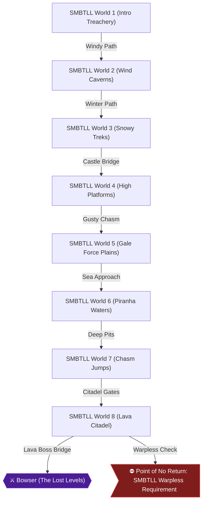

# Writer packet — Chapter 3: Super Mario Bros.: The Lost Levels — Main Quest (Worlds 1–8)

Write `08_chapters/03.md`. Previous chapter: 2. Super Mario Bros. — Second Quest & Speedrun. Next chapter: 4. Super Mario Bros.: The Lost Levels — Secret Worlds (Worlds 9 & A–D).
Planner notes: Survive the punishing original Japanese sequel. Important: do not use any warps if you wish to access World 9!

## Areas in this chapter (in order)

- `SMBTLL_World1` — SMBTLL World 1 (Intro Treachery)
- `SMBTLL_World2` — SMBTLL World 2 (Wind Caverns)
- `SMBTLL_World3` — SMBTLL World 3 (Snowy Treks)
- `SMBTLL_World4` — SMBTLL World 4 (High Platforms)
- `SMBTLL_World5` — SMBTLL World 5 (Gale Force Plains)
- `SMBTLL_World6` — SMBTLL World 6 (Piranha Waters)
- `SMBTLL_World7` — SMBTLL World 7 (Chasm Jumps)
- `SMBTLL_World8` — SMBTLL World 8 (Lava Citadel)

## Achievements to place in this chapter (each EXACTLY once as `[ACHIEVEMENT:<id>]`)

- **26926** — For Super Players! (5 pts): [SMBTLL] Complete World 1  
  supporting facts: ra-comments-50-1, ra-comments-50-2, neo1-57-1, neo1-57-2, neo1-63-1, neo1-63-2, neo3-68-1, neo3-68-2, neo3-69-1, neo3-69-2, neo3-70-1, neo3-70-2, neo3-71-1, neo3-71-2, neo3-76-1, neo3-76-2, neo4-160-1, neo4-160-2, neo4-161-1, neo4-161-2, neo4-162-1, neo4-162-2, neo4-163-1, neo4-163-2, neo4-164-1, neo4-164-2, neo4-169-1, neo4-169-2, neo4-176-1, neo4-176-2, neo4-305-1, neo4-305-2
- **26927** — Designer's Block (5 pts): [SMBTLL] Complete World 2  
  supporting facts: ra-comments-52-1, ra-comments-52-2, neo1-58-1, neo1-58-2, neo1-63-1, neo1-63-2, neo3-71-1, neo3-71-2, neo3-72-1, neo3-72-2, neo3-73-1, neo3-73-2, neo3-74-1, neo3-74-2, neo3-75-1, neo3-75-2, neo4-161-1, neo4-161-2, neo4-165-1, neo4-165-2, neo4-166-1, neo4-166-2, neo4-167-1, neo4-167-2, neo4-168-1, neo4-168-2
- **26928** — Cold-Hearted (5 pts): [SMBTLL] Complete World 3  
  supporting facts: ra-comments-54-1, ra-comments-54-2, neo1-58-1, neo1-58-2, neo1-59-1, neo1-59-2, neo1-63-1, neo1-63-2, neo3-75-1, neo3-75-2, neo3-76-1, neo3-76-2, neo3-77-1, neo3-77-2, neo3-78-1, neo3-78-2, neo3-79-1, neo3-79-2, neo3-80-1, neo3-80-2, neo3-81-1, neo3-81-2, neo3-82-1, neo3-82-2, neo3-89-1, neo3-89-2, neo4-169-1, neo4-169-2, neo4-170-1, neo4-170-2, neo4-171-1, neo4-171-2
- **26929** — Fierce Fields (5 pts): [SMBTLL] Complete World 4  
  supporting facts: ra-comments-56-1, ra-comments-56-2, neo1-59-1, neo1-59-2, neo1-63-1, neo1-63-2, neo3-67-1, neo3-67-2, neo3-79-1, neo3-79-2, neo3-80-1, neo3-80-2, neo3-81-1, neo3-81-2, neo3-82-1, neo3-82-2, neo3-83-1, neo3-83-2, neo4-161-1, neo4-161-2, neo4-172-1, neo4-172-2, neo4-173-1, neo4-173-2, neo4-174-1, neo4-174-2, neo4-175-1, neo4-175-2
- **26930** — Blow Me Away! (10 pts): [SMBTLL] Complete World 5  
  supporting facts: ra-comments-58-1, ra-comments-58-2, neo1-59-1, neo1-59-2, neo1-60-1, neo1-60-2, neo1-63-1, neo1-63-2, neo3-84-1, neo3-84-2, neo3-85-1, neo3-85-2, neo3-86-1, neo3-86-2, neo3-87-1, neo3-87-2, neo3-88-1, neo3-88-2, neo3-89-1, neo3-89-2, neo3-90-1, neo3-90-2, neo4-176-1, neo4-176-2, neo4-177-1, neo4-177-2, neo4-178-1, neo4-178-2, neo4-179-1, neo4-179-2
- **26931** — Bridge over Troubling Waters (10 pts): [SMBTLL] Complete World 6  
  supporting facts: ra-comments-60-1, ra-comments-60-2, neo1-60-1, neo1-60-2, neo1-63-1, neo1-63-2, neo3-86-1, neo3-86-2, neo3-90-1, neo3-90-2, neo3-91-1, neo3-91-2, neo3-93-1, neo3-93-2, neo3-94-1, neo3-94-2, neo3-95-1, neo3-95-2, neo4-176-1, neo4-176-2, neo4-180-1, neo4-180-2, neo4-181-1, neo4-181-2, neo4-182-1, neo4-182-2, neo4-183-1, neo4-183-2
- **26932** — Mind the Gaps! (10 pts): [SMBTLL] Complete World 7  
  supporting facts: ra-comments-62-1, ra-comments-62-2, neo1-60-1, neo1-60-2, neo1-61-1, neo1-61-2, neo1-63-1, neo1-63-2, neo3-97-1, neo3-97-2, neo3-100-1, neo3-100-2, neo3-101-1, neo3-101-2, neo3-102-1, neo3-102-2, neo4-177-1, neo4-177-2, neo4-184-1, neo4-184-2, neo4-185-1, neo4-185-2, neo4-186-1, neo4-186-2, neo4-187-1, neo4-187-2, neo4-202-1, neo4-202-2
- **26933** — Brothers in Arms (10 pts, progression): [SMBTLL] Complete World 8 and save Princess Toadstool  
  supporting facts: ra-comments-64-1, ra-comments-64-2, neo1-57-1, neo1-57-2, neo1-61-1, neo1-61-2, neo1-63-1, neo1-63-2, neo3-66-1, neo3-66-2, neo3-102-1, neo3-102-2, neo3-103-1, neo3-103-2, neo3-105-1, neo3-105-2, neo3-106-1, neo3-106-2, neo3-107-1, neo3-107-2, neo3-108-1, neo3-108-2, neo4-162-1, neo4-162-2, neo4-188-1, neo4-188-2, neo4-189-1, neo4-189-2, neo4-190-1, neo4-190-2, neo4-191-1, neo4-191-2
- **26938** — Super Speedrun Bros.: The Lost Levels (25 pts): [SMBTLL] From a new file, complete the game in one session using the shortest possible route  
  supporting facts: ra-comments-75-1, ra-comments-75-2, ra-comments-76-1, ra-comments-76-2, ra-comments-78-1, ra-comments-78-2, ra-comments-80-1, ra-comments-80-2, ra-comments-82-1, ra-comments-82-2, ra-comments-84-1, ra-comments-84-2, ra-comments-86-1, ra-comments-86-2, ra-comments-88-1, ra-comments-88-2, ra-comments-91-1, ra-comments-91-2, ra-comments-93-1, ra-comments-93-2, ra-comments-95-1, ra-comments-95-2, ra-comments-97-1, ra-comments-97-2, ra-comments-99-1, ra-comments-99-2, ra-comments-101-1, ra-comments-101-2, ra-comments-103-1, ra-comments-103-2, ra-comments-105-1, ra-comments-105-2, ra-comments-107-1, ra-comments-107-2, ra-comments-109-1, ra-comments-109-2, ra-comments-111-1, ra-comments-111-2, ra-comments-113-1, ra-comments-113-2, ra-comments-115-1, ra-comments-115-2, ra-comments-117-1, ra-comments-117-2, ra-comments-119-1, ra-comments-119-2, ra-comments-121-1, ra-comments-121-2, ra-comments-123-1, ra-comments-123-2, ra-comments-125-1, ra-comments-125-2, ra-comments-127-1, ra-comments-127-2, ra-comments-129-1, ra-comments-129-2, ra-comments-131-1, ra-comments-131-2, ra-comments-133-1, ra-comments-133-2, ra-comments-135-1, ra-comments-135-2, ra-comments-137-1, ra-comments-137-2, ra-comments-139-1, ra-comments-139-2, ra-comments-141-1, ra-comments-141-2, ra-comments-143-1, ra-comments-143-2, ra-comments-145-1, ra-comments-145-2, ra-comments-148-1, ra-comments-148-2, ra-comments-150-1, ra-comments-150-2, ra-comments-151-1, ra-comments-151-2, ra-comments-152-1, ra-comments-152-2, neo1-56-1, neo1-56-2, neo1-57-1, neo1-57-2, neo1-58-1, neo1-58-2, neo1-60-1, neo1-60-2, neo1-62-1, neo1-62-2, neo1-63-1, neo1-63-2, neo1-64-1, neo1-64-2, neo3-66-1, neo3-66-2, neo3-67-1, neo3-67-2, neo3-68-1, neo3-68-2, neo3-69-1, neo3-69-2, neo3-70-1, neo3-70-2, neo3-71-1, neo3-71-2, neo3-72-1, neo3-72-2, neo3-76-1, neo3-76-2, neo3-86-1, neo3-86-2, neo3-97-1, neo3-97-2, neo3-98-1, neo3-98-2, neo3-99-1, neo3-99-2, neo3-100-1, neo3-100-2, neo3-105-1, neo3-105-2, neo3-108-1, neo3-108-2, neo4-161-1, neo4-161-2, neo4-162-1, neo4-162-2, neo4-169-1, neo4-169-2, neo4-176-1, neo4-176-2, neo4-177-1, neo4-177-2, neo4-191-1, neo4-191-2, neo4-192-1, neo4-192-2, neo4-195-1, neo4-195-2, neo4-208-1, neo4-208-2, neo4-255-1, neo4-255-2, neo4-263-1, neo4-263-2, neo4-268-1, neo4-268-2, neo4-272-1, neo4-272-2, neo4-277-1, neo4-277-2, neo4-285-1, neo4-285-2, neo4-296-1, neo4-296-2, neo4-297-1, neo4-297-2, neo4-301-1, neo4-301-2
- **26940** — Lost and Found (2 pts): [SMBTLL] Find a bonus area  
  supporting facts: neo1-55-1, neo1-55-2, neo1-56-1, neo1-56-2, neo1-58-1, neo1-58-2, neo1-60-1, neo1-60-2, neo1-61-1, neo1-61-2, neo1-62-1, neo1-62-2, neo1-63-1, neo1-63-2, neo3-61-1, neo3-61-2, neo3-67-1, neo3-67-2, neo3-72-1, neo3-72-2, neo3-76-1, neo3-76-2, neo3-80-1, neo3-80-2, neo3-85-1, neo3-85-2, neo3-86-1, neo3-86-2, neo3-89-1, neo3-89-2, neo3-98-1, neo3-98-2, neo3-100-1, neo3-100-2, neo3-105-1, neo3-105-2, neo3-106-1, neo3-106-2, neo3-107-1, neo3-107-2, neo3-108-1, neo3-108-2, neo4-160-1, neo4-160-2, neo4-165-1, neo4-165-2, neo4-166-1, neo4-166-2, neo4-169-1, neo4-169-2, neo4-172-1, neo4-172-2, neo4-176-1, neo4-176-2, neo4-178-1, neo4-178-2, neo4-184-1, neo4-184-2, neo4-185-1, neo4-185-2, neo4-193-1, neo4-193-2, neo4-194-1, neo4-194-2, neo4-200-1, neo4-200-2, neo4-215-1, neo4-215-2, neo4-217-1, neo4-217-2, neo4-222-1, neo4-222-2, neo4-229-1, neo4-229-2, neo4-251-1, neo4-251-2, neo4-252-1, neo4-252-2, neo4-253-1, neo4-253-2, neo4-254-1, neo4-254-2, neo4-256-1, neo4-256-2, neo4-257-1, neo4-257-2, neo4-259-1, neo4-259-2, neo4-260-1, neo4-260-2, neo4-261-1, neo4-261-2, neo4-265-1, neo4-265-2, neo4-266-1, neo4-266-2, neo4-270-1, neo4-270-2, neo4-271-1, neo4-271-2, neo4-273-1, neo4-273-2, neo4-277-1, neo4-277-2, neo4-278-1, neo4-278-2, neo4-279-1, neo4-279-2, neo4-282-1, neo4-282-2, neo4-290-1, neo4-290-2, neo4-291-1, neo4-291-2, neo4-292-1, neo4-292-2, neo4-293-1, neo4-293-2, neo4-295-1, neo4-295-2, neo4-300-1, neo4-300-2, neo4-303-1, neo4-303-2, neo4-304-1, neo4-304-2
- **541018** — Twinsies (5 pts): [SMBTLL] Collect both 1-Up Mushrooms in Stage 1-2  
  supporting facts: neo1-57-1, neo1-57-2, neo1-63-1, neo1-63-2, neo3-69-1, neo3-69-2, neo4-161-1, neo4-161-2
- **541019** — Don't Let It Fly Away in the Wind (3 pts): [SMBTLL] Collect the 1-Up Mushroom in Stage 5-1  
  supporting facts: neo1-59-1, neo1-59-2, neo1-63-1, neo1-63-2, neo3-85-1, neo3-85-2, neo3-87-1, neo3-87-2, neo4-176-1, neo4-176-2
- **541020** — The Green Gauntlet (3 pts): [SMBTLL] Collect the 1-Up Mushroom in Stage 5-2  
  supporting facts: neo1-60-1, neo1-60-2, neo1-63-1, neo1-63-2, neo3-87-1, neo3-87-2
- **541027** — Toxic Addiction (10 pts): [SMBTLL] Consume 4 Poison Mushrooms without dying. Erasing them while invincible does not count  
  supporting facts: ra-comments-89-1, ra-comments-89-2, neo1-56-1, neo1-56-2, neo1-57-1, neo1-57-2, neo1-58-1, neo1-58-2, neo1-59-1, neo1-59-2, neo1-61-1, neo1-61-2, neo3-65-1, neo3-65-2, neo3-68-1, neo3-68-2, neo3-72-1, neo3-72-2, neo3-76-1, neo3-76-2, neo3-80-1, neo3-80-2, neo3-81-1, neo3-81-2, neo3-87-1, neo3-87-2, neo3-91-1, neo3-91-2, neo3-103-1, neo3-103-2, neo3-106-1, neo3-106-2, neo3-107-1, neo3-107-2, neo4-158-1, neo4-158-2, neo4-160-1, neo4-160-2, neo4-165-1, neo4-165-2, neo4-180-1, neo4-180-2, neo4-188-1, neo4-188-2, neo4-189-1, neo4-189-2, neo4-190-1, neo4-190-2, neo4-194-1, neo4-194-2

## ⚠ Missables in this chapter (each needs a `> [!WARNING]` BEFORE the point it can be missed)

- World 9 Warpless Requirement (Lost Levels) (achievement 28306) — deadline: Must reach and complete World 8-4 without using any Warp Zones in Worlds 1 through 8 [ra-comments-66-1, ra-comments-66-2, neo1-62-1]
- SMBTLL Shortest Route Speedrun (achievement 26938) — deadline: Beat SMB The Lost Levels from a fresh file in one session using optimal warp routes [ra-comments-75-1, ra-comments-75-2, ra-comments-76-1]

## ⛔ Points of no return in this chapter (each needs a `> [!CAUTION]` containing the words "Point of No Return")

- Point of No Return: Lost Levels World 8-4 Bridge: Defeating Bowser in World 8-4 checks your warp history; if warps were taken, the game loops to World 1 instead of World 9. [ra-comments-64-1, ra-comments-64-2]

## Route diagram (inserted automatically where you write `[MERMAID]`)



## Usable facts (362) — cite as [[fact-id]]

Legend: ✅ verified (2+ sources) · ✔ conflict resolved · 🟡 single source

- ✅ **neo1-55-1** (transition) Go past the RotoDiscs and enter the door in the upper right. If you play your — @SMBTLL Stage Guide · ach: 26940  
  evidence: neo1#55: "Go past the RotoDiscs and enter the door in the upper right. If you play your"
- ✅ **neo1-55-2** (transition) cards right then this should be the only door you enter prior to Boom-Boom's — @SMBTLL Stage Guide · ach: 26940  
  evidence: neo1#55: "cards right then this should be the only door you enter prior to Boom-Boom's"
- ✅ **neo1-56-1** (location) left/right = move in that direction — @SMBTLL Stage Guide · ach: 26938,26940,541027  
  evidence: neo1#56: "left/right = move in that direction"
- ✅ **neo1-56-2** (transition) down = go down special pipes — @SMBTLL Stage Guide · ach: 26938,26940,541027  
  evidence: neo1#56: "down = go down special pipes"
- ✅ **neo1-57-1** (achievement) Description: In the lava stages, they continually pop out of the lava to catch — @SMBTLL Stage Guide · ach: 26926,26933,26938,541018,541027  
  evidence: neo1#57: "Description: In the lava stages, they continually pop out of the lava to catch"
- ✅ **neo1-57-2** (achievement) Description: Tossed by Lakitus, the red ones hatch when they hit the ground and — @SMBTLL Stage Guide · ach: 26926,26933,26938,541018,541027  
  evidence: neo1#57: "Description: Tossed by Lakitus, the red ones hatch when they hit the ground and"
- ✅ **neo1-58-1** (location) 2-1: Run right and dodge or kill five Koopa Paratroopas. The Power-Up is in the — @SMBTLL Stage Guide · ach: 26927,26928,26938,26940,541027  
  evidence: neo1#58: "2-1: Run right and dodge or kill five Koopa Paratroopas. The Power-Up is in the"
- ✅ **neo1-58-2** (item) second block. Hop the water and there is a star in the middle brick. Hop on the — @SMBTLL Stage Guide · ach: 26927,26928,26938,26940,541027  
  evidence: neo1#58: "second block. Hop the water and there is a star in the middle brick. Hop on the"
- ✅ **neo1-59-1** (location) 3-3: Kick the Troopa shell into a slew of other Koopa Troopas for a possible — @SMBTLL Stage Guide · ach: 26928,26929,26930,541019,541027  
  evidence: neo1#59: "3-3: Kick the Troopa shell into a slew of other Koopa Troopas for a possible"
- ✅ **neo1-59-2** (location) 1-up. Wait for the Pirhana Plant to go down and then use the scales to proceed, — @SMBTLL Stage Guide · ach: 26928,26929,26930,541019,541027  
  evidence: neo1#59: "1-up. Wait for the Pirhana Plant to go down and then use the scales to proceed,"
- ✅ **neo1-60-1** (location) 5-2: If you are Big Mario/Luigi, the key point to finishing this level is — @SMBTLL Stage Guide · ach: 26930,26931,26932,26938,26940,541020  
  evidence: neo1#60: "5-2: If you are Big Mario/Luigi, the key point to finishing this level is"
- ✅ **neo1-60-2** (transition) getting to the top and staying there until either you drop down and exit or — @SMBTLL Stage Guide · ach: 26930,26931,26932,26938,26940,541020  
  evidence: neo1#60: "getting to the top and staying there until either you drop down and exit or"
- ✅ **neo1-61-1** (item) 7-3: The wind blows early. Watch out. Start off jumping from spring to spring. — @SMBTLL Stage Guide · ach: 26932,26933,26940,541027  
  evidence: neo1#61: "7-3: The wind blows early. Watch out. Start off jumping from spring to spring."
- ✅ **neo1-61-2** (item) When you land on safe ground, get a mushroom and start moving from spring to — @SMBTLL Stage Guide · ach: 26932,26933,26940,541027  
  evidence: neo1#61: "When you land on safe ground, get a mushroom and start moving from spring to"
- ✅ **neo1-62-1** (transition) 9-1: Go down the pipe and swim through an underwater version of the overworld. — @SMBTLL Stage Guide · ach: 28306,26934,26935,26936,26938,26940,541021  
  evidence: neo1#62: "9-1: Go down the pipe and swim through an underwater version of the overworld."
- ✅ **neo1-62-2** (location) The enemies here are mostly from the overworld and you can only kill them with — @SMBTLL Stage Guide · ach: 28306,26934,26935,26936,26938,26940,541021  
  evidence: neo1#62: "The enemies here are mostly from the overworld and you can only kill them with"
- ✅ **neo1-63-1** (location) C-2: Juke and jive through Cheep Cheeps, Bloopers, and Koopa Paratroopas for — @SMBTLL Stage Guide · ach: 26926,26927,26928,26929,26930,26931,26932,26933,26936,26937,26938,26940,541018,541019,541020,541022  
  evidence: neo1#63: "C-2: Juke and jive through Cheep Cheeps, Bloopers, and Koopa Paratroopas for"
- ✅ **neo1-63-2** (location) the first part. Jump carefully across two loose stones and a palm tree, leap — @SMBTLL Stage Guide · ach: 26926,26927,26928,26929,26930,26931,26932,26933,26936,26937,26938,26940,541018,541019,541020,541022  
  evidence: neo1#63: "the first part. Jump carefully across two loose stones and a palm tree, leap"
- ✅ **neo1-64-1** (transition) A-2: Stay on top of the level and go past the exit to warp to World B — @SMBTLL Stage Guide · ach: 26934,26935,26937,26938  
  evidence: neo1#64: "A-2: Stay on top of the level and go past the exit to warp to World B"
- ✅ **neo1-64-2** (transition) B-4: Go down the fifth pipe you see and it leads to World D. — @SMBTLL Stage Guide · ach: 26934,26935,26937,26938  
  evidence: neo1#64: "B-4: Go down the fifth pipe you see and it leads to World D."
- ✅ **neo3-61-1** (location) Super Mario Bros. - The Lost Levels (or "The Lost Levels" for short) was — @SMBTLL Stage Guide · ach: 26940  
  evidence: neo3#61: "Super Mario Bros. - The Lost Levels (or "The Lost Levels" for short) was"
- ✅ **neo3-61-2** (location) originally released in Japan as the sequel to Super Mario Bros., so it was — @SMBTLL Stage Guide · ach: 26940  
  evidence: neo3#61: "originally released in Japan as the sequel to Super Mario Bros., so it was"
- 🟡 **neo3-65-1** (item) This is a very bad to eat spoiled mushroom.  It is purple.  Do not mistake it — @Poisonous Mushroom · ach: 541027  
  evidence: neo3#65: "This is a very bad to eat spoiled mushroom.  It is purple.  Do not mistake it"
- 🟡 **neo3-65-2** (item) for an ordinary mushroom, as it will retract health if you accidentily grab — @Poisonous Mushroom · ach: 541027  
  evidence: neo3#65: "for an ordinary mushroom, as it will retract health if you accidentily grab"
- 🟡 **neo3-66-1** (transition) A warp pipe will lead you to another area in the game. Some warp pipes will — @Warp Pipe · ach: 26933,26938  
  evidence: neo3#66: "A warp pipe will lead you to another area in the game. Some warp pipes will"
- 🟡 **neo3-66-2** (transition) warp you to different areas within the level, others will warp you to — @Warp Pipe · ach: 26933,26938  
  evidence: neo3#66: "warp you to different areas within the level, others will warp you to"
- ✅ **neo3-67-1** (achievement) Description: Lakitu is also a member of the Turtle Empire, whos orders are to — @SMBTLL Stage Guide · ach: 26929,26938,26940  
  evidence: neo3#67: "Description: Lakitu is also a member of the Turtle Empire, whos orders are to"
- ✅ **neo3-67-2** (boss) hunt down and destroy Mario.  Lakitu is the turtle that hides — @SMBTLL Stage Guide · ach: 26929,26938,26940  
  evidence: neo3#67: "hunt down and destroy Mario.  Lakitu is the turtle that hides"
- ✅ **neo3-68-1** (location) World 1-1 - The Lost Levels Walkthrough — @SMBTLL Stage Guide · ach: 26926,26938,541027  
  evidence: neo3#68: "World 1-1 - The Lost Levels Walkthrough"
- ✅ **neo3-68-2** (location) Navigate to the right past a green Koopa Paratroopa.  Look up and you will see — @SMBTLL Stage Guide · ach: 26926,26938,541027  
  evidence: neo3#68: "Navigate to the right past a green Koopa Paratroopa.  Look up and you will see"
- ✅ **neo3-69-1** (location) World 1-2 - The Lost Levels Walkthrough — @SMBTLL Stage Guide · ach: 26926,26938,541018  
  evidence: neo3#69: "World 1-2 - The Lost Levels Walkthrough"
- ✅ **neo3-69-2** (location) In this underground action scene, ignore the Green Koopa Paratroopa, and then — @SMBTLL Stage Guide · ach: 26926,26938,541018  
  evidence: neo3#69: "In this underground action scene, ignore the Green Koopa Paratroopa, and then"
- ✅ **neo3-70-1** (location) World 1-3 - The Lost Levels Walkthrough — @SMBTLL Stage Guide · ach: 26926,26938  
  evidence: neo3#70: "World 1-3 - The Lost Levels Walkthrough"
- ✅ **neo3-70-2** (item) Get a running start to the right and jump onto the lone tree platform.  From — @SMBTLL Stage Guide · ach: 26926,26938  
  evidence: neo3#70: "Get a running start to the right and jump onto the lone tree platform.  From"
- ✅ **neo3-71-1** (location) World 1-4 - The Lost Levels Walkthrough — @SMBTLL Stage Guide · ach: 26926,26927,26938  
  evidence: neo3#71: "World 1-4 - The Lost Levels Walkthrough"
- ✅ **neo3-71-2** (location) Head to the right past the first firebar, and jump over two lava pits.  Hit — @SMBTLL Stage Guide · ach: 26926,26927,26938  
  evidence: neo3#71: "Head to the right past the first firebar, and jump over two lava pits.  Hit"
- ✅ **neo3-72-1** (location) World 2-1 - The Lost Levels Walkthrough — @SMBTLL Stage Guide · ach: 26927,26938,26940,541027  
  evidence: neo3#72: "World 2-1 - The Lost Levels Walkthrough"
- ✅ **neo3-72-2** (location) Run to the right and go up the staircase.  Continue to the right, and five — @SMBTLL Stage Guide · ach: 26927,26938,26940,541027  
  evidence: neo3#72: "Run to the right and go up the staircase.  Continue to the right, and five"
- ✅ **neo3-73-1** (location) World 2-2 - The Lost Levels Walkthrough — @SMBTLL Stage Guide · ach: 26927  
  evidence: neo3#73: "World 2-2 - The Lost Levels Walkthrough"
- ✅ **neo3-73-2** (transition) Go to the right past a green Koopa Paratroopa, and over a Pirahna Pipe. — @SMBTLL Stage Guide · ach: 26927  
  evidence: neo3#73: "Go to the right past a green Koopa Paratroopa, and over a Pirahna Pipe."
- ✅ **neo3-74-1** (location) World 2-3 - The Lost Levels Walkthrough — @SMBTLL Stage Guide · ach: 26927  
  evidence: neo3#74: "World 2-3 - The Lost Levels Walkthrough"
- ✅ **neo3-74-2** (location) World 2-3 is a bridge stage, meaning that there are many bridges, which means — @SMBTLL Stage Guide · ach: 26927  
  evidence: neo3#74: "World 2-3 is a bridge stage, meaning that there are many bridges, which means"
- ✅ **neo3-75-1** (location) World 2-4 - The Lost Levels Walkthrough — @SMBTLL Stage Guide · ach: 26927,26928  
  evidence: neo3#75: "World 2-4 - The Lost Levels Walkthrough"
- ✅ **neo3-75-2** (location) Walk down the 3 steps, and continue to the right.  When you get to the wall, — @SMBTLL Stage Guide · ach: 26927,26928  
  evidence: neo3#75: "Walk down the 3 steps, and continue to the right.  When you get to the wall,"
- ✅ **neo3-76-1** (location) World 3-1 - The Lost Levels Walkthrough — @SMBTLL Stage Guide · ach: 26926,26928,26938,26940,541027  
  evidence: neo3#76: "World 3-1 - The Lost Levels Walkthrough"
- ✅ **neo3-76-2** (location) Walk to the right, and you'll see two Hammer Brothers jumping on two rows of — @SMBTLL Stage Guide · ach: 26926,26928,26938,26940,541027  
  evidence: neo3#76: "Walk to the right, and you'll see two Hammer Brothers jumping on two rows of"
- ✅ **neo3-77-1** (location) After the springboard and the pit, walk up the staircase, and get a good jump — @SMBTLL Stage Guide · ach: 26928  
  evidence: neo3#77: "After the springboard and the pit, walk up the staircase, and get a good jump"
- ✅ **neo3-77-2** (location) toward the flagpole to end the level. — @SMBTLL Stage Guide · ach: 26928  
  evidence: neo3#77: "toward the flagpole to end the level."
- ✅ **neo3-78-1** (location) World 3-3 - The Lost Levels Walkthrough — @SMBTLL Stage Guide · ach: 26928  
  evidence: neo3#78: "World 3-3 - The Lost Levels Walkthrough"
- ✅ **neo3-78-2** (location) Another tree level.  This is one of my favorite levels in the game. — @SMBTLL Stage Guide · ach: 26928  
  evidence: neo3#78: "Another tree level.  This is one of my favorite levels in the game."
- ✅ **neo3-79-1** (location) World 3-4 - The Lost Levels Walkthrough — @SMBTLL Stage Guide · ach: 26928,26929  
  evidence: neo3#79: "World 3-4 - The Lost Levels Walkthrough"
- ✅ **neo3-79-2** (location) World 3-4 is one of those Castles where you have to run through in a certain — @SMBTLL Stage Guide · ach: 26928,26929  
  evidence: neo3#79: "World 3-4 is one of those Castles where you have to run through in a certain"
- ✅ **neo3-80-1** (location) World 4-1 - The Lost Levels Walkthrough — @SMBTLL Stage Guide · ach: 26928,26929,26940,541027  
  evidence: neo3#80: "World 4-1 - The Lost Levels Walkthrough"
- ✅ **neo3-80-2** (transition) Run to the right over a Pirahna Pipe, and you will notice Lakitu from above — @SMBTLL Stage Guide · ach: 26928,26929,26940,541027  
  evidence: neo3#80: "Run to the right over a Pirahna Pipe, and you will notice Lakitu from above"
- ✅ **neo3-81-1** (location) World 4-2 - The Lost Levels Walkthrough — @SMBTLL Stage Guide · ach: 26928,26929,541027  
  evidence: neo3#81: "World 4-2 - The Lost Levels Walkthrough"
- ✅ **neo3-81-2** (location) Run to the right, and you will inevitably see a single Question Mark block — @SMBTLL Stage Guide · ach: 26928,26929,541027  
  evidence: neo3#81: "Run to the right, and you will inevitably see a single Question Mark block"
- ✅ **neo3-82-1** (location) World 4-3 - The Lost Levels Walkthrough — @SMBTLL Stage Guide · ach: 26928,26929  
  evidence: neo3#82: "World 4-3 - The Lost Levels Walkthrough"
- ✅ **neo3-82-2** (item) This is probably the first level where Nintendo starts to really get tricky — @SMBTLL Stage Guide · ach: 26928,26929  
  evidence: neo3#82: "This is probably the first level where Nintendo starts to really get tricky"
- ✅ **neo3-83-1** (location) World 4-4 - The Lost Levels Walkthrough — @SMBTLL Stage Guide · ach: 26929  
  evidence: neo3#83: "World 4-4 - The Lost Levels Walkthrough"
- ✅ **neo3-83-2** (item) When you start, the best way to safely get across the first pit is not to jump, — @SMBTLL Stage Guide · ach: 26929  
  evidence: neo3#83: "When you start, the best way to safely get across the first pit is not to jump,"
- ✅ **neo3-84-1** (item) Like I stated before, the Powerup cannot be obtained if it's a Fire Flower, — @SMBTLL Stage Guide · ach: 26930  
  evidence: neo3#84: "Like I stated before, the Powerup cannot be obtained if it's a Fire Flower,"
- ✅ **neo3-84-2** (item) because you'll hit the Hidden Coin when you try to jump for it.  If it is a — @SMBTLL Stage Guide · ach: 26930  
  evidence: neo3#84: "because you'll hit the Hidden Coin when you try to jump for it.  If it is a"
- ✅ **neo3-85-1** (location) World 5-1 - The Lost Levels Walkthrough — @SMBTLL Stage Guide · ach: 26930,26940,541019  
  evidence: neo3#85: "World 5-1 - The Lost Levels Walkthrough"
- ✅ **neo3-85-2** (location) World 5-1 is a nice level that introduces a new kind of foe: upside down — @SMBTLL Stage Guide · ach: 26930,26940,541019  
  evidence: neo3#85: "World 5-1 is a nice level that introduces a new kind of foe: upside down"
- ✅ **neo3-86-1** (location) To successfully get across this pit, you must stand to the left of the pit, — @SMBTLL Stage Guide · ach: 26930,26931,26938,26940  
  evidence: neo3#86: "To successfully get across this pit, you must stand to the left of the pit,"
- ✅ **neo3-86-2** (item) and get a running start.  Then, jump ontop of the single brick to the left, and — @SMBTLL Stage Guide · ach: 26930,26931,26938,26940  
  evidence: neo3#86: "and get a running start.  Then, jump ontop of the single brick to the left, and"
- ✅ **neo3-87-1** (item) Use these two Hidden Coin Blocks to successfully get ontop of this wall.  When — @SMBTLL Stage Guide · ach: 26930,541019,541020,541027  
  evidence: neo3#87: "Use these two Hidden Coin Blocks to successfully get ontop of this wall.  When"
- ✅ **neo3-87-2** (location) you're ontop of the wall, continue to the right until the wall ends.  When this — @SMBTLL Stage Guide · ach: 26930,541019,541020,541027  
  evidence: neo3#87: "you're ontop of the wall, continue to the right until the wall ends.  When this"
- ✅ **neo3-88-1** (transition) Jump ontop of the large Pirahna Pipe there, and drop to the other side. — @SMBTLL Stage Guide · ach: 26930  
  evidence: neo3#88: "Jump ontop of the large Pirahna Pipe there, and drop to the other side."
- ✅ **neo3-88-2** (location) Carefully jump over the small pit there, and avoid the two Goombas.  Climb the — @SMBTLL Stage Guide · ach: 26930  
  evidence: neo3#88: "Carefully jump over the small pit there, and avoid the two Goombas.  Climb the"
- ✅ **neo3-89-1** (location) World 5-3 - The Lost Levels Walkthrough — @SMBTLL Stage Guide · ach: 26928,26930,26940  
  evidence: neo3#89: "World 5-3 - The Lost Levels Walkthrough"
- ✅ **neo3-89-2** (location) Okay, before I begin, I just want to warn you: This level is bloody hard!  It — @SMBTLL Stage Guide · ach: 26928,26930,26940  
  evidence: neo3#89: "Okay, before I begin, I just want to warn you: This level is bloody hard!  It"
- ✅ **neo3-90-1** (location) World 5-4 - The Lost Levels Walkthrough — @SMBTLL Stage Guide · ach: 26930,26931  
  evidence: neo3#90: "World 5-4 - The Lost Levels Walkthrough"
- ✅ **neo3-90-2** (location) Carefully jump over the two lava pits to the right.  You can get by them by — @SMBTLL Stage Guide · ach: 26930,26931  
  evidence: neo3#90: "Carefully jump over the two lava pits to the right.  You can get by them by"
- ✅ **neo3-91-1** (location) World 6-1 - The Lost Levels Walkthrough — @SMBTLL Stage Guide · ach: 26931,541027  
  evidence: neo3#91: "World 6-1 - The Lost Levels Walkthrough"
- ✅ **neo3-91-2** (location) Run to the right and hit the very first brick to unveil a Powerup.  If it's a — @SMBTLL Stage Guide · ach: 26931,541027  
  evidence: neo3#91: "Run to the right and hit the very first brick to unveil a Powerup.  If it's a"
- 🟡 **neo3-93-1** (location) World 6-2 - The Lost Levels Walkthrough — @Path 1 (Easier, under water) · ach: 26931  
  evidence: neo3#93: "World 6-2 - The Lost Levels Walkthrough"
- 🟡 **neo3-93-2** (location) Great, and underwater level.  This level could be tough without Fire Power. — @Path 1 (Easier, under water) · ach: 26931  
  evidence: neo3#93: "Great, and underwater level.  This level could be tough without Fire Power."
- 🟡 **neo3-94-1** (location) World 6-3 - The Lost Levels Walkthrough — @Path 1 (Easier, under water) · ach: 26931  
  evidence: neo3#94: "World 6-3 - The Lost Levels Walkthrough"
- 🟡 **neo3-94-2** (location) A Cheep Cheep level.  Easy, but there is plenty of room for errors. — @Path 1 (Easier, under water) · ach: 26931  
  evidence: neo3#94: "A Cheep Cheep level.  Easy, but there is plenty of room for errors."
- 🟡 **neo3-95-1** (location) World 6-4 - The Lost Levels Walkthrough — @Path 1 (Easier, under water) · ach: 26931  
  evidence: neo3#95: "World 6-4 - The Lost Levels Walkthrough"
- 🟡 **neo3-95-2** (location) This is a very difficult Castle.  It's one of those Castles that loops over and — @Path 1 (Easier, under water) · ach: 26931  
  evidence: neo3#95: "This is a very difficult Castle.  It's one of those Castles that loops over and"
- ✅ **neo3-97-1** (location) World 7-1 - The Lost Levels Walkthrough — @SMBTLL Stage Guide · ach: 26932,26938  
  evidence: neo3#97: "World 7-1 - The Lost Levels Walkthrough"
- ✅ **neo3-97-2** (location) Run to the right and you'll approach 2 Pirahnas that you'll have to bypass.  If — @SMBTLL Stage Guide · ach: 26932,26938  
  evidence: neo3#97: "Run to the right and you'll approach 2 Pirahnas that you'll have to bypass.  If"
- ✅ **neo3-98-1** (transition) Warp Pipe Paragraph (Chance for 1-Up) — @SMBTLL Stage Guide · ach: 26938,26940  
  evidence: neo3#98: "Warp Pipe Paragraph (Chance for 1-Up)"
- ✅ **neo3-98-2** (item) If you have Star Power, wait for it to wear off.  You need to bounce off of a — @SMBTLL Stage Guide · ach: 26938,26940  
  evidence: neo3#98: "If you have Star Power, wait for it to wear off.  You need to bounce off of a"
- ✅ **neo3-99-1** (transition) Skip The Warp Pipe (Easier, Faster) — @SMBTLL Stage Guide · ach: 26938  
  evidence: neo3#99: "Skip The Warp Pipe (Easier, Faster)"
- ✅ **neo3-99-2** (location) Run to the right and jump over the pit.  Ignore the two Red Paratroopas, and — @SMBTLL Stage Guide · ach: 26938  
  evidence: neo3#99: "Run to the right and jump over the pit.  Ignore the two Red Paratroopas, and"
- ✅ **neo3-100-1** (location) World 7-2 - The Lost Levels Walkthrough — @SMBTLL Stage Guide · ach: 26932,26938,26940  
  evidence: neo3#100: "World 7-2 - The Lost Levels Walkthrough"
- ✅ **neo3-100-2** (transition) This is kind of tricky.  You must go into a difficult to reach pipe, or the — @SMBTLL Stage Guide · ach: 26932,26938,26940  
  evidence: neo3#100: "This is kind of tricky.  You must go into a difficult to reach pipe, or the"
- ✅ **neo3-101-1** (location) To the right, there is a Red Paratroopa, and a Falling Elevator that is too — @SMBTLL Stage Guide · ach: 26932  
  evidence: neo3#101: "To the right, there is a Red Paratroopa, and a Falling Elevator that is too"
- ✅ **neo3-101-2** (location) high to jump onto.  To get onto the Falling Elevator, wait until the Paratroopa — @SMBTLL Stage Guide · ach: 26932  
  evidence: neo3#101: "high to jump onto.  To get onto the Falling Elevator, wait until the Paratroopa"
- ✅ **neo3-102-1** (location) World 7-4 - The Lost Levels Walkthrough — @SMBTLL Stage Guide · ach: 26932,26933  
  evidence: neo3#102: "World 7-4 - The Lost Levels Walkthrough"
- ✅ **neo3-102-2** (location) To the right, there will be a Firebar.  Wait for it to pass you, and quickly — @SMBTLL Stage Guide · ach: 26932,26933  
  evidence: neo3#102: "To the right, there will be a Firebar.  Wait for it to pass you, and quickly"
- ✅ **neo3-103-1** (location) World 8-1 - The Lost Levels Walkthrough — @SMBTLL Stage Guide · ach: 26933,541027  
  evidence: neo3#103: "World 8-1 - The Lost Levels Walkthrough"
- ✅ **neo3-103-2** (location) Run to the right and carefully run through the narrow area enclosed by the 2 — @SMBTLL Stage Guide · ach: 26933,541027  
  evidence: neo3#103: "Run to the right and carefully run through the narrow area enclosed by the 2"
- ✅ **neo3-105-1** (location) World 8-2 - The Lost Levels Walkthrough — @SMBTLL Stage Guide · ach: 26933,26938,26940  
  evidence: neo3#105: "World 8-2 - The Lost Levels Walkthrough"
- ✅ **neo3-105-2** (transition) Run to the right to the Pirahna Pipe.  When the Pirahna seeps back into his — @SMBTLL Stage Guide · ach: 26933,26938,26940  
  evidence: neo3#105: "Run to the right to the Pirahna Pipe.  When the Pirahna seeps back into his"
- ✅ **neo3-106-1** (location) World 8-3 - The Lost Levels Walkthrough — @SMBTLL Stage Guide · ach: 26933,26940,541027  
  evidence: neo3#106: "World 8-3 - The Lost Levels Walkthrough"
- ✅ **neo3-106-2** (location) Jump over the first pit using the Falling Elevator to help you, and take out — @SMBTLL Stage Guide · ach: 26933,26940,541027  
  evidence: neo3#106: "Jump over the first pit using the Falling Elevator to help you, and take out"
- ✅ **neo3-107-1** (location) World 8-4 - The Lost Levels Walkthrough — @SMBTLL Stage Guide · ach: 26933,26940,541027  
  evidence: neo3#107: "World 8-4 - The Lost Levels Walkthrough"
- ✅ **neo3-107-2** (location) This is it...the final stage of the game (if you don't count the bonus levels). — @SMBTLL Stage Guide · ach: 26933,26940,541027  
  evidence: neo3#107: "This is it...the final stage of the game (if you don't count the bonus levels)."
- ✅ **neo3-108-1** (location) Now the screen will scroll to the right, and you'll find a disheartened Princess — @SMBTLL Stage Guide · ach: 26933,28306,26934,26938,26940  
  evidence: neo3#108: "Now the screen will scroll to the right, and you'll find a disheartened Princess"
- ✅ **neo3-108-2** (location) Toadstool inside a huge cage.  You will jump into her cage and save her, then — @SMBTLL Stage Guide · ach: 26933,28306,26934,26938,26940  
  evidence: neo3#108: "Toadstool inside a huge cage.  You will jump into her cage and save her, then"
- 🟡 **neo4-158-1** (location) I'll do here what I did in the Controls section. Since all items from the — @ITEM SUMMARY · ach: 541027  
  evidence: neo4#158: "I'll do here what I did in the Controls section. Since all items from the"
- 🟡 **neo4-158-2** (location) first game are in this one, I'll only go to the trouble of cataloguing those — @ITEM SUMMARY · ach: 541027  
  evidence: neo4#158: "first game are in this one, I'll only go to the trouble of cataloguing those"
- ✅ **neo4-160-1** (location) Either jump over the green bouncing Koopa-Troopa that comes your way or let — @World 1-1 · ach: 26926,26940,541027  
  evidence: neo4#160: "Either jump over the green bouncing Koopa-Troopa that comes your way or let"
- 🟡 **neo4-160-2** (transition) it hop over you as you stand inside the castle door. There's a red Koopa- — @World 1-1 · ach: 26926,26940,541027  
  evidence: neo4#160: "it hop over you as you stand inside the castle door. There's a red Koopa-"
- ✅ **neo4-161-1** (location) Fall in to the ground below and jump over the bouncing green Koopa-Troopa, — @World 1-2 · ach: 26926,26927,26929,26934,26938,541018  
  evidence: neo4#161: "Fall in to the ground below and jump over the bouncing green Koopa-Troopa,"
- ✅ **neo4-161-2** (location) then run and jump over the pit before you run into the block. At the top of — @World 1-2 · ach: 26926,26927,26929,26934,26938,541018  
  evidence: neo4#161: "then run and jump over the pit before you run into the block. At the top of"
- 🟡 **neo4-162-1** (transition) The thing about warp zones in this game is that, unlike in the first Super — @World 1-2 · ach: 26926,26933,28306,26934,26938  
  evidence: neo4#162: "The thing about warp zones in this game is that, unlike in the first Super"
- 🟡 **neo4-162-2** (transition) Mario Bros., they're not always a benefit to your fellow plumber. Many warp — @World 1-2 · ach: 26926,26933,28306,26934,26938  
  evidence: neo4#162: "Mario Bros., they're not always a benefit to your fellow plumber. Many warp"
- 🟡 **neo4-163-1** (location) This is a fairly short level, so do what needs to be done and no more. Go — @That is all. · ach: 26926  
  evidence: neo4#163: "This is a fairly short level, so do what needs to be done and no more. Go"
- 🟡 **neo4-163-2** (location) forward and jump to the tree and the tipping scales in succession. Make the — @That is all. · ach: 26926  
  evidence: neo4#163: "forward and jump to the tree and the tipping scales in succession. Make the"
- 🟡 **neo4-164-1** (item) If the question block up ahead ends up giving you a flower, don't go to any — @World 1-4 · ach: 26926  
  evidence: neo4#164: "If the question block up ahead ends up giving you a flower, don't go to any"
- 🟡 **neo4-164-2** (item) lengths to get it. Only jump out to the next ledge if it's a mushroom and it — @World 1-4 · ach: 26926  
  evidence: neo4#164: "lengths to get it. Only jump out to the next ledge if it's a mushroom and it"
- 🟡 **neo4-165-1** (location) Go forward through a barrage of Koopa-Troopas to three question blocks. The — @World 2-1 · ach: 26927,26940,541027  
  evidence: neo4#165: "Go forward through a barrage of Koopa-Troopas to three question blocks. The"
- 🟡 **neo4-165-2** (item) middle one contains a mushroom/flower, so you're guaranteed some kind of — @World 2-1 · ach: 26927,26940,541027  
  evidence: neo4#165: "middle one contains a mushroom/flower, so you're guaranteed some kind of"
- 🟡 **neo4-166-1** (transition) Normal jumps can be used to get to most of the staircases and pipes past the — @World 2-2 · ach: 26927,26940  
  evidence: neo4#166: "Normal jumps can be used to get to most of the staircases and pipes past the"
- 🟡 **neo4-166-2** (location) water in this first area. Focus on jumping over or stomping on enemies as you — @World 2-2 · ach: 26927,26940  
  evidence: neo4#166: "water in this first area. Focus on jumping over or stomping on enemies as you"
- 🟡 **neo4-167-1** (location) Like the third level of the first world, this one is pretty short, but now — @World 2-3 · ach: 26927  
  evidence: neo4#167: "Like the third level of the first world, this one is pretty short, but now"
- 🟡 **neo4-167-2** (location) you have wave after wave of arcing Cheep-Cheeps to deal with. Their — @World 2-3 · ach: 26927  
  evidence: neo4#167: "you have wave after wave of arcing Cheep-Cheeps to deal with. Their"
- 🟡 **neo4-168-1** (location) Do what you will with the green Koopa-Troopa, then try carefully not to fall — @World 2-4 · ach: 26927  
  evidence: neo4#168: "Do what you will with the green Koopa-Troopa, then try carefully not to fall"
- 🟡 **neo4-168-2** (location) into the lava below as you work your way into the hallway below. Your best — @World 2-4 · ach: 26927  
  evidence: neo4#168: "into the lava below as you work your way into the hallway below. Your best"
- 🟡 **neo4-169-1** (location) Just ahead, you'll meet Hammer Brothers for the first time. If you're small — @World 3-1 · ach: 26926,26928,28306,26938,26940  
  evidence: neo4#169: "Just ahead, you'll meet Hammer Brothers for the first time. If you're small"
- 🟡 **neo4-169-2** (location) and need to get around them, the fifth block from the right on the bottom row — @World 3-1 · ach: 26926,26928,28306,26938,26940  
  evidence: neo4#169: "and need to get around them, the fifth block from the right on the bottom row"
- 🟡 **neo4-170-1** (location) Ah, our first water level. Take a dive into the deep blue sea and deal with — @World 3-2 · ach: 26928  
  evidence: neo4#170: "Ah, our first water level. Take a dive into the deep blue sea and deal with"
- 🟡 **neo4-170-2** (location) the Bloopers with firepower if you possess it. If you don't have the ability — @World 3-2 · ach: 26928  
  evidence: neo4#170: "the Bloopers with firepower if you possess it. If you don't have the ability"
- 🟡 **neo4-171-1** (transition) Move forward along the one-way path until you reach a short pipe at the top — @World 3-3 · ach: 26928  
  evidence: neo4#171: "Move forward along the one-way path until you reach a short pipe at the top"
- 🟡 **neo4-171-2** (location) of a tall tree. Tip the scales past it in your favor, then stay along the — @World 3-3 · ach: 26928  
  evidence: neo4#171: "of a tall tree. Tip the scales past it in your favor, then stay along the"
- ✅ **neo4-172-1** (location) As in the first Mario game, you'll meet Lakitu for the first time in the — @World 4-1 · ach: 26929,26940  
  evidence: neo4#172: "As in the first Mario game, you'll meet Lakitu for the first time in the"
- ✅ **neo4-172-2** (location) fourth world. Run past his Spiny ammunition and he should back off shortly. — @World 4-1 · ach: 26929,26940  
  evidence: neo4#172: "fourth world. Run past his Spiny ammunition and he should back off shortly."
- 🟡 **neo4-173-1** (location) Don't go for the question block wedged between the mess of Bullet Bill — @World 4-2 · ach: 26929  
  evidence: neo4#173: "Don't go for the question block wedged between the mess of Bullet Bill"
- 🟡 **neo4-173-2** (item) machines at the beginning. All it contains is a mushroom/flower, and there's — @World 4-2 · ach: 26929  
  evidence: neo4#173: "machines at the beginning. All it contains is a mushroom/flower, and there's"
- 🟡 **neo4-174-1** (location) Take the biggest running jump you know how at the beginning, then wait until — @World 4-3 · ach: 26929  
  evidence: neo4#174: "Take the biggest running jump you know how at the beginning, then wait until"
- 🟡 **neo4-174-2** (location) the moving platform is near the stationary one to spring up to it. Move along — @World 4-3 · ach: 26929  
  evidence: neo4#174: "the moving platform is near the stationary one to spring up to it. Move along"
- 🟡 **neo4-175-1** (location) Run straight down from your standpoint on the steps. Avoid the extremely long — @World 4-4 · ach: 26929  
  evidence: neo4#175: "Run straight down from your standpoint on the steps. Avoid the extremely long"
- 🟡 **neo4-175-2** (location) Firesnake unless you're feeling gutsy. In the third question block from the — @World 4-4 · ach: 26929  
  evidence: neo4#175: "Firesnake unless you're feeling gutsy. In the third question block from the"
- 🟡 **neo4-176-1** (location) Kill as many Buzzy Beetles as you can with the first one's shell, then jump — @World 5-1 · ach: 26926,26930,26931,28306,26938,26940,541019  
  evidence: neo4#176: "Kill as many Buzzy Beetles as you can with the first one's shell, then jump"
- 🟡 **neo4-176-2** (location) methodically through the mess of red piranha plants up ahead (unless you have — @World 5-1 · ach: 26926,26930,26931,28306,26938,26940,541019  
  evidence: neo4#176: "methodically through the mess of red piranha plants up ahead (unless you have"
- 🟡 **neo4-177-1** (location) If you're large Mario or Luigi, you can skip over this entire level just by — @World 5-2 · ach: 26930,26932,26938  
  evidence: neo4#177: "If you're large Mario or Luigi, you can skip over this entire level just by"
- 🟡 **neo4-177-2** (location) going across the top of it. When you get to the first set of six question — @World 5-2 · ach: 26930,26932,26938  
  evidence: neo4#177: "going across the top of it. When you get to the first set of six question"
- 🟡 **neo4-178-1** (item) If you don't realize what's going on when you start this level out, you soon — @World 5-3 · ach: 26930,26940  
  evidence: neo4#178: "If you don't realize what's going on when you start this level out, you soon"
- 🟡 **neo4-178-2** (location) will. Riding the platform a few times, you get the impression that you're — @World 5-3 · ach: 26930,26940  
  evidence: neo4#178: "will. Riding the platform a few times, you get the impression that you're"
- 🟡 **neo4-179-1** (location) Definitely the hardest castle we've come upon thus far. Run off the stairs — @World 5-4 · ach: 26930  
  evidence: neo4#179: "Definitely the hardest castle we've come upon thus far. Run off the stairs"
- 🟡 **neo4-179-2** (location) and the next ledge that you land on (you will make it there). This next part — @World 5-4 · ach: 26930  
  evidence: neo4#179: "and the next ledge that you land on (you will make it there). This next part"
- ✅ **neo4-180-1** (location) The first two alcoves with brick floors contain a few treats. Knock the Buzzy — @World 6-1 · ach: 26931,541027  
  evidence: neo4#180: "The first two alcoves with brick floors contain a few treats. Knock the Buzzy"
- 🟡 **neo4-180-2** (item) Beetle out of the first one to find a flower/mushroom in the first brick. — @World 6-1 · ach: 26931,541027  
  evidence: neo4#180: "Beetle out of the first one to find a flower/mushroom in the first brick."
- 🟡 **neo4-181-1** (location) Unless you are a very good swimmer, navigating the first few parts of this — @World 6-2 · ach: 26931  
  evidence: neo4#181: "Unless you are a very good swimmer, navigating the first few parts of this"
- 🟡 **neo4-181-2** (location) level is going to be a real toughie. Go over the coral walls and around the — @World 6-2 · ach: 26931  
  evidence: neo4#181: "level is going to be a real toughie. Go over the coral walls and around the"
- 🟡 **neo4-182-1** (location) No time for dilly-dallying here - the Cheep-Cheeps tend to arc upward in sets — @World 6-3 · ach: 26931  
  evidence: neo4#182: "No time for dilly-dallying here - the Cheep-Cheeps tend to arc upward in sets"
- 🟡 **neo4-182-2** (location) of four, meaning you'll constantly have to be on the move forward to avoid — @World 6-3 · ach: 26931  
  evidence: neo4#182: "of four, meaning you'll constantly have to be on the move forward to avoid"
- 🟡 **neo4-183-1** (transition) In this looping castle, jump over the first pipe and take the bottom path — @World 6-4 · ach: 26931  
  evidence: neo4#183: "In this looping castle, jump over the first pipe and take the bottom path"
- 🟡 **neo4-183-2** (location) while the extremely long Firesnake is up above you to hear that reassuring — @World 6-4 · ach: 26931  
  evidence: neo4#183: "while the extremely long Firesnake is up above you to hear that reassuring"
- 🟡 **neo4-184-1** (item) The wind starts to pick up awfully early here, but it doesn't get too bad — @World 7-1 · ach: 26932,26940  
  evidence: neo4#184: "The wind starts to pick up awfully early here, but it doesn't get too bad"
- 🟡 **neo4-184-2** (item) until you have to start dealing with Cheep-Cheeps at the same time as well. — @World 7-1 · ach: 26932,26940  
  evidence: neo4#184: "until you have to start dealing with Cheep-Cheeps at the same time as well."
- ✅ **neo4-185-1** (location) You might recall that once you see the platform that keeps moving that this — @World 7-2 · ach: 26932,26940  
  evidence: neo4#185: "You might recall that once you see the platform that keeps moving that this"
- ✅ **neo4-185-2** (location) is going to be a level that goes in an endless loop if you don't find the — @World 7-2 · ach: 26932,26940  
  evidence: neo4#185: "is going to be a level that goes in an endless loop if you don't find the"
- 🟡 **neo4-186-1** (location) This level is all about super springboards. You're going to have to get a — @World 7-3 · ach: 26932  
  evidence: neo4#186: "This level is all about super springboards. You're going to have to get a"
- 🟡 **neo4-186-2** (location) good boost off of them, combined with the gusty high-speed winds involved, to — @World 7-3 · ach: 26932  
  evidence: neo4#186: "good boost off of them, combined with the gusty high-speed winds involved, to"
- 🟡 **neo4-187-1** (location) Avoid the Firesnake by passing through him as he swoops below, then drop to — @World 7-4 · ach: 26932  
  evidence: neo4#187: "Avoid the Firesnake by passing through him as he swoops below, then drop to"
- 🟡 **neo4-187-2** (location) the ledge moving back and forth. It's hidden in the lava once again, so look — @World 7-4 · ach: 26932  
  evidence: neo4#187: "the ledge moving back and forth. It's hidden in the lava once again, so look"
- 🟡 **neo4-188-1** (item) In the long row of question blocks, you can find both a mushroom of the — @World 8-1 · ach: 26933,541027  
  evidence: neo4#188: "In the long row of question blocks, you can find both a mushroom of the"
- 🟡 **neo4-188-2** (item) healthy variety and a mushroom of the venomous variety. The healthy one is — @World 8-1 · ach: 26933,541027  
  evidence: neo4#188: "healthy variety and a mushroom of the venomous variety. The healthy one is"
- 🟡 **neo4-189-1** (location) Use the sinking platform as an aid to get to what's in the brick above it - — @World 8-2 · ach: 26933,541027  
  evidence: neo4#189: "Use the sinking platform as an aid to get to what's in the brick above it -"
- 🟡 **neo4-189-2** (item) namely, a mushroom. Use this and you'll have a lot easier time playing — @World 8-2 · ach: 26933,541027  
  evidence: neo4#189: "namely, a mushroom. Use this and you'll have a lot easier time playing"
- 🟡 **neo4-190-1** (location) Again, Lakitu's latitude is lacking (more alliteration!), so use the first — @World 8-3 · ach: 26933,541027  
  evidence: neo4#190: "Again, Lakitu's latitude is lacking (more alliteration!), so use the first"
- 🟡 **neo4-190-2** (location) chances you get to put him out of the picture. He comes back with alarming — @World 8-3 · ach: 26933,541027  
  evidence: neo4#190: "chances you get to put him out of the picture. He comes back with alarming"
- 🟡 **neo4-191-1** (location) Drop down to the lower area so you can successfully run and jump across the — @World 8-4 · ach: 26933,28306,26934,26938  
  evidence: neo4#191: "Drop down to the lower area so you can successfully run and jump across the"
- 🟡 **neo4-191-2** (location) lava. Squat and slide when you get there to go under the Firesnakes in case — @World 8-4 · ach: 26933,28306,26934,26938  
  evidence: neo4#191: "lava. Squat and slide when you get there to go under the Firesnakes in case"
- 🟡 **neo4-192-1** (location) LEVEL WALKTHROUGHS WORLD 9 — @LEVEL WALKTHROUGHS WORLD 9 · ach: 28306,26938  
  evidence: neo4#192: "LEVEL WALKTHROUGHS WORLD 9"
- 🟡 **neo4-192-2** (transition) It looks like this is going to be a warp zone at first (and oh, a cruel joke — @LEVEL WALKTHROUGHS WORLD 9 · ach: 28306,26938  
  evidence: neo4#192: "It looks like this is going to be a warp zone at first (and oh, a cruel joke"
- 🟡 **neo4-193-1** (location) Okay, so maybe I touted this world's difficulty a bit too much. This level is — @World 9-2 · ach: 28306,26940  
  evidence: neo4#193: "Okay, so maybe I touted this world's difficulty a bit too much. This level is"
- 🟡 **neo4-193-2** (location) unforgivably easy. All you have to do is swim under Lakitu and a bunch of — @World 9-2 · ach: 28306,26940  
  evidence: neo4#193: "unforgivably easy. All you have to do is swim under Lakitu and a bunch of"
- 🟡 **neo4-194-1** (location) This level is just meant to be a congratulatory level, though the — @World 9-4 · ach: 28306,26934,26940,541027  
  evidence: neo4#194: "This level is just meant to be a congratulatory level, though the"
- 🟡 **neo4-194-2** (location) congratulatory message is obviously written in Japanese lettering (if anyone — @World 9-4 · ach: 28306,26934,26940,541027  
  evidence: neo4#194: "congratulatory message is obviously written in Japanese lettering (if anyone"
- 🟡 **neo4-195-1** (location) You should still have retained your largeness from the last level (it wasn't — @World A-2 · ach: 26934,26935,26938,541021  
  evidence: neo4#195: "You should still have retained your largeness from the last level (it wasn't"
- 🟡 **neo4-195-2** (location) hard to, anyway), so use the springboard and bounce so that you break one — @World A-2 · ach: 26934,26935,26938,541021  
  evidence: neo4#195: "hard to, anyway), so use the springboard and bounce so that you break one"
- 🟡 **neo4-200-1** (location) Most of the hassle in this winter wonderland comes from bouncing green Koopa- — @World C-1 · ach: 26936,26940  
  evidence: neo4#200: "Most of the hassle in this winter wonderland comes from bouncing green Koopa-"
- 🟡 **neo4-200-2** (location) Troopas and question blocks that are just barely impossible to get to. Keep — @World C-1 · ach: 26936,26940  
  evidence: neo4#200: "Troopas and question blocks that are just barely impossible to get to. Keep"
- 🟡 **neo4-202-1** (location) This level is totally identical to World 7-3, wherein you used the super — @World C-3 · ach: 26932,26936  
  evidence: neo4#202: "This level is totally identical to World 7-3, wherein you used the super"
- 🟡 **neo4-202-2** (location) springboards in conjunction with the heavy breeze to travel long distances in — @World C-3 · ach: 26932,26936  
  evidence: neo4#202: "springboards in conjunction with the heavy breeze to travel long distances in"
- 🟡 **neo4-208-1** (location) VI. Walkthrough of All Areas — @SUPER MARIO WORLD · ach: 26938  
  evidence: neo4#208: "VI. Walkthrough of All Areas"
- 🟡 **neo4-208-2** (location) VII. Epilogue **SPOILERS WITHIN** — @SUPER MARIO WORLD · ach: 26938  
  evidence: neo4#208: "VII. Epilogue **SPOILERS WITHIN**"
- 🟡 **neo4-215-1** (item) They have the same basic shape and appearance as a normal Mushroom, but they — @ITEMS & POWER-UPS · ach: 26940  
  evidence: neo4#215: "They have the same basic shape and appearance as a normal Mushroom, but they"
- 🟡 **neo4-215-2** (location) are a light green on the cap. If you've played SMB1 or SMB3 at all, you have a — @ITEMS & POWER-UPS · ach: 26940  
  evidence: neo4#215: "are a light green on the cap. If you've played SMB1 or SMB3 at all, you have a"
- 🟡 **neo4-217-1** (location) Exclamation Point ("!") Blocks — @ITEMS & POWER-UPS · ach: 26940  
  evidence: neo4#217: "Exclamation Point ("!") Blocks"
- 🟡 **neo4-217-2** (location) If you haven't completed the Switch Palace that goes with a certain color of — @ITEMS & POWER-UPS · ach: 26940  
  evidence: neo4#217: "If you haven't completed the Switch Palace that goes with a certain color of"
- 🟡 **neo4-222-1** (location) Yoshi can eat red berries that grow on bushes if you stick your tongue out at — @ITEMS & POWER-UPS · ach: 26940  
  evidence: neo4#222: "Yoshi can eat red berries that grow on bushes if you stick your tongue out at"
- 🟡 **neo4-222-2** (location) them or simply run his mouth into them. If he eats enough of them, he'll poop — @ITEMS & POWER-UPS · ach: 26940  
  evidence: neo4#222: "them or simply run his mouth into them. If he eats enough of them, he'll poop"
- 🟡 **neo4-229-1** (location) These reclusive bugs wisely choose to remain as cave dwellers. They are — @Buzzy Beetle · ach: 26940  
  evidence: neo4#229: "These reclusive bugs wisely choose to remain as cave dwellers. They are"
- 🟡 **neo4-229-2** (location) impervious to fire but can't seem to withstand being jumped on. As with almost — @Buzzy Beetle · ach: 26940  
  evidence: neo4#229: "impervious to fire but can't seem to withstand being jumped on. As with almost"
- 🟡 **neo4-251-1** (location) There is quite literally nothing to do here except read the message Yoshi has — @Yoshi's Island Walkthrough · ach: 26940  
  evidence: neo4#251: "There is quite literally nothing to do here except read the message Yoshi has"
- 🟡 **neo4-251-2** (location) left behind for you in the message box. These blue boxes with a red globe — @Yoshi's Island Walkthrough · ach: 26940  
  evidence: neo4#251: "left behind for you in the message box. These blue boxes with a red globe"
- 🟡 **neo4-252-1** (location) YOSHI'S ISLAND 1 SECRET: HIDDEN 3-UP MOON — @Yoshi's Island Walkthrough · ach: 26940  
  evidence: neo4#252: "YOSHI'S ISLAND 1 SECRET: HIDDEN 3-UP MOON"
- 🟡 **neo4-252-2** (location) You wouldn't expect one to be in the first level, of all places, but, well, — @Yoshi's Island Walkthrough · ach: 26940  
  evidence: neo4#252: "You wouldn't expect one to be in the first level, of all places, but, well,"
- ✅ **neo4-253-1** (location) Hop up to each successive plateau and go right to the ledge that swings around — @SMBTLL Stage Guide · ach: 26940  
  evidence: neo4#253: "Hop up to each successive plateau and go right to the ledge that swings around"
- ✅ **neo4-253-2** (item) 360 degrees when you stand on it. Get the coins just by standing there, then — @SMBTLL Stage Guide · ach: 26940  
  evidence: neo4#253: "360 degrees when you stand on it. Get the coins just by standing there, then"
- ✅ **neo4-254-1** (location) INVISIBLE 1-UP CHECKPOINTS: YOSHI'S ISLAND 4 — @SMBTLL Stage Guide · ach: 26940  
  evidence: neo4#254: "INVISIBLE 1-UP CHECKPOINTS: YOSHI'S ISLAND 4"
- ✅ **neo4-254-2** (item) At the beginning of the level, with Yoshi, walk to the right of the mushroom — @SMBTLL Stage Guide · ach: 26940  
  evidence: neo4#254: "At the beginning of the level, with Yoshi, walk to the right of the mushroom"
- 🟡 **neo4-255-1** (transition) P# - Refers to the pipe number. Pipes are numbered by the order in which you — @Area Map · ach: 26938  
  evidence: neo4#255: "P# - Refers to the pipe number. Pipes are numbered by the order in which you"
- 🟡 **neo4-255-2** (location) encounter them. There are two of each P#, meaning that they will both — @Area Map · ach: 26938  
  evidence: neo4#255: "encounter them. There are two of each P#, meaning that they will both"
- 🟡 **neo4-256-1** (location) This level introduces you to Super Koopas and then crams them down your throat — @Donut Plains Walkthrough · ach: 26940  
  evidence: neo4#256: "This level introduces you to Super Koopas and then crams them down your throat"
- 🟡 **neo4-256-2** (location) with two different varieties. It's easy to bounce off the yellow ones with no — @Donut Plains Walkthrough · ach: 26940  
  evidence: neo4#256: "with two different varieties. It's easy to bounce off the yellow ones with no"
- 🟡 **neo4-257-1** (location) INVISIBLE 1-UP CHECKPOINTS: DONUT PLAINS 1 — @Donut Plains Walkthrough · ach: 26940  
  evidence: neo4#257: "INVISIBLE 1-UP CHECKPOINTS: DONUT PLAINS 1"
- 🟡 **neo4-257-2** (location) At the spot just after the Yoshi block, where you jump across the turn blocks — @Donut Plains Walkthrough · ach: 26940  
  evidence: neo4#257: "At the spot just after the Yoshi block, where you jump across the turn blocks"
- ✅ **neo4-259-1** (transition) For the second exit, go all the way to the right of the initial room, avoiding — @SMBTLL Stage Guide · ach: 26940  
  evidence: neo4#259: "For the second exit, go all the way to the right of the initial room, avoiding"
- ✅ **neo4-259-2** (transition) the so-called solid Boo Buddies (the translucent ones will not hurt you). Enter — @SMBTLL Stage Guide · ach: 26940  
  evidence: neo4#259: "the so-called solid Boo Buddies (the translucent ones will not hurt you). Enter"
- ✅ **neo4-260-1** (item) As soon as the level starts, run up and hold Y. You'll grab a shell and knock — @SMBTLL Stage Guide · ach: 26940  
  evidence: neo4#260: "As soon as the level starts, run up and hold Y. You'll grab a shell and knock"
- ✅ **neo4-260-2** (location) out the small naked Koopa Troopa that was about to jump in it. This prevents a — @SMBTLL Stage Guide · ach: 26940  
  evidence: neo4#260: "out the small naked Koopa Troopa that was about to jump in it. This prevents a"
- ✅ **neo4-261-1** (location) INVISIBLE 1-UP CHECKPOINTS: DONUT PLAINS 4 — @SMBTLL Stage Guide · ach: 26940  
  evidence: neo4#261: "INVISIBLE 1-UP CHECKPOINTS: DONUT PLAINS 4"
- ✅ **neo4-261-2** (location) At the part with the first Hammer Brother (where you also see the purple — @SMBTLL Stage Guide · ach: 26940  
  evidence: neo4#261: "At the part with the first Hammer Brother (where you also see the purple"
- ✅ **neo4-263-1** (transition) The other exit, which is more important in the big scheme of things, can be — @SMBTLL Stage Guide · ach: 26938  
  evidence: neo4#263: "The other exit, which is more important in the big scheme of things, can be"
- ✅ **neo4-263-2** (transition) found just to the left of the silver door. You'll notice some new question — @SMBTLL Stage Guide · ach: 26938  
  evidence: neo4#263: "found just to the left of the silver door. You'll notice some new question"
- ✅ **neo4-265-1** (boss) INVISIBLE 1-UP CHECKPOINTS: MORTON JR'S CASTLE #2 — @SMBTLL Stage Guide · ach: 26940  
  evidence: neo4#265: "INVISIBLE 1-UP CHECKPOINTS: MORTON JR'S CASTLE #2"
- ✅ **neo4-265-2** (location) Across from where the hidden 1-up is in the room with the ledges that move in — @SMBTLL Stage Guide · ach: 26940  
  evidence: neo4#265: "Across from where the hidden 1-up is in the room with the ledges that move in"
- ✅ **neo4-266-1** (location) with the invisible 1-up checkpoints. — @SMBTLL Stage Guide · ach: 26940  
  evidence: neo4#266: "with the invisible 1-up checkpoints."
- ✅ **neo4-266-2** (location) IF I MAY INTERRUPT FOR A SECOND..... — @SMBTLL Stage Guide · ach: 26940  
  evidence: neo4#266: "IF I MAY INTERRUPT FOR A SECOND....."
- ✅ **neo4-268-1** (transition) # - Here the pound signs are meant to portray the rocks surrounding Warp Star — @SMBTLL Stage Guide · ach: 26938  
  evidence: neo4#268: "# - Here the pound signs are meant to portray the rocks surrounding Warp Star"
- ✅ **neo4-268-2** (transition) #2 before you find the second exit in Vanilla Secret 1. Crude, yes, but — @SMBTLL Stage Guide · ach: 26938  
  evidence: neo4#268: "#2 before you find the second exit in Vanilla Secret 1. Crude, yes, but"
- 🟡 **neo4-270-1** (location) INVISIBLE 1-UP CHECKPOINTS: VANILLA GHOST HOUSE — @Vanilla Dome Walkthrough · ach: 26940  
  evidence: neo4#270: "INVISIBLE 1-UP CHECKPOINTS: VANILLA GHOST HOUSE"
- 🟡 **neo4-270-2** (item) After the first Dragon Coin there is a series of platforms of varying heights — @Vanilla Dome Walkthrough · ach: 26940  
  evidence: neo4#270: "After the first Dragon Coin there is a series of platforms of varying heights"
- 🟡 **neo4-271-1** (location) VANILLA DOME 3 SECRETS: ANOTHER 3-UP MOON AND A NEARBY BONUS STAGE — @Vanilla Dome Walkthrough · ach: 26940  
  evidence: neo4#271: "VANILLA DOME 3 SECRETS: ANOTHER 3-UP MOON AND A NEARBY BONUS STAGE"
- 🟡 **neo4-271-2** (transition) Where you find the invisible coin block right beside the orange pipe, run to — @Vanilla Dome Walkthrough · ach: 26940  
  evidence: neo4#271: "Where you find the invisible coin block right beside the orange pipe, run to"
- 🟡 **neo4-272-1** (location) INVISIBLE 1-UP CHECKPOINTS: VANILLA DOME 4 — @Vanilla Dome Walkthrough · ach: 26938  
  evidence: neo4#272: "INVISIBLE 1-UP CHECKPOINTS: VANILLA DOME 4"
- 🟡 **neo4-272-2** (transition) There's another block in this level that the checkpoints are all centered — @Vanilla Dome Walkthrough · ach: 26938  
  evidence: neo4#272: "There's another block in this level that the checkpoints are all centered"
- ✅ **neo4-273-1** (transition) When you come out of the pipe and into the water, you'll be faced mainly with — @SMBTLL Stage Guide · ach: 26940  
  evidence: neo4#273: "When you come out of the pipe and into the water, you'll be faced mainly with"
- ✅ **neo4-273-2** (location) balls-and-chains and Fishbones, annoying little skeletal enemies that swim — @SMBTLL Stage Guide · ach: 26940  
  evidence: neo4#273: "balls-and-chains and Fishbones, annoying little skeletal enemies that swim"
- ✅ **neo4-277-1** (item) At the end of the level, you'll be on the two mushroom ledges facing the goal — @SMBTLL Stage Guide · ach: 26938,26940  
  evidence: neo4#277: "At the end of the level, you'll be on the two mushroom ledges facing the goal"
- ✅ **neo4-277-2** (location) marker. If you go ahead and touch that goal marker, you'll go on the normal — @SMBTLL Stage Guide · ach: 26938,26940  
  evidence: neo4#277: "marker. If you go ahead and touch that goal marker, you'll go on the normal"
- ✅ **neo4-278-1** (location) INVISIBLE 1-UP CHECKPOINTS: COOKIE MOUNTAIN — @SMBTLL Stage Guide · ach: 26940  
  evidence: neo4#278: "INVISIBLE 1-UP CHECKPOINTS: COOKIE MOUNTAIN"
- ✅ **neo4-278-2** (location) Even if you're not looking for 1-up checkpoints, this one is the one a novice — @SMBTLL Stage Guide · ach: 26940  
  evidence: neo4#278: "Even if you're not looking for 1-up checkpoints, this one is the one a novice"
- ✅ **neo4-279-1** (boss) LUDWIG VON KOOPA'S CASTLE #4 SECRET: AN EXTREMELY WELL-HIDDEN BONUS STAGE — @SMBTLL Stage Guide · ach: 26940  
  evidence: neo4#279: "LUDWIG VON KOOPA'S CASTLE #4 SECRET: AN EXTREMELY WELL-HIDDEN BONUS STAGE"
- ✅ **neo4-279-2** (transition) Just before the door that leads to the room with the automatically lowering — @SMBTLL Stage Guide · ach: 26940  
  evidence: neo4#279: "Just before the door that leads to the room with the automatically lowering"
- 🟡 **neo4-282-1** (location) Forest of Illusion Walkthrough — @Forest of Illusion Walkthrough · ach: 26940  
  evidence: neo4#282: "Forest of Illusion Walkthrough"
- 🟡 **neo4-282-2** (location) If you have Yoshi, it's good to note that most of the berries here are located — @Forest of Illusion Walkthrough · ach: 26940  
  evidence: neo4#282: "If you have Yoshi, it's good to note that most of the berries here are located"
- ✅ **neo4-285-1** (transition) This is probably one of the most, if not THE most, entertaining levels in the — @SMBTLL Stage Guide · ach: 26938  
  evidence: neo4#285: "This is probably one of the most, if not THE most, entertaining levels in the"
- ✅ **neo4-285-2** (item) game. Once you land on one of the elongated flying platforms, things start — @SMBTLL Stage Guide · ach: 26938  
  evidence: neo4#285: "game. Once you land on one of the elongated flying platforms, things start"
- 🟡 **neo4-290-1** (location) CHOCOLATE ISLAND 1 SECRET: ANOTHER 3-UP MOON - LIKE YOU NEED IT BY NOW THOUGH — @Chocolate Island Walkthrough · ach: 26940  
  evidence: neo4#290: "CHOCOLATE ISLAND 1 SECRET: ANOTHER 3-UP MOON - LIKE YOU NEED IT BY NOW THOUGH"
- 🟡 **neo4-290-2** (location) With a feather, go to the bowl-shaped slope where you find the flying question — @Chocolate Island Walkthrough · ach: 26940  
  evidence: neo4#290: "With a feather, go to the bowl-shaped slope where you find the flying question"
- 🟡 **neo4-291-1** (location) Skip the Spike Tops in the next pitch-black room. There are a bunch of them in — @Cloud pedestal. · ach: 26940  
  evidence: neo4#291: "Skip the Spike Tops in the next pitch-black room. There are a bunch of them in"
- 🟡 **neo4-291-2** (location) addition to the sinking ledges that bear a strong resemblance to sharp cheddar. — @Cloud pedestal. · ach: 26940  
  evidence: neo4#291: "addition to the sinking ledges that bear a strong resemblance to sharp cheddar."
- 🟡 **neo4-292-1** (location) Ha ha! The lava looks like mud! (ahem) — @Cloud pedestal. · ach: 26940  
  evidence: neo4#292: "Ha ha! The lava looks like mud! (ahem)"
- 🟡 **neo4-292-2** (location) Slide down the big hill and jump on the carrot lift. These things move slowly, — @Cloud pedestal. · ach: 26940  
  evidence: neo4#292: "Slide down the big hill and jump on the carrot lift. These things move slowly,"
- 🟡 **neo4-293-1** (boss) INVISIBLE 1-UP CHECKPOINTS: WENDY O.'S CASTLE #6 — @Cloud pedestal. · ach: 26940  
  evidence: neo4#293: "INVISIBLE 1-UP CHECKPOINTS: WENDY O.'S CASTLE #6"
- 🟡 **neo4-293-2** (location) After the seven large spikes situated among the Grinders, there is a cement — @Cloud pedestal. · ach: 26940  
  evidence: neo4#293: "After the seven large spikes situated among the Grinders, there is a cement"
- 🟡 **neo4-295-1** (location) Run through the enormous spikes before they fall and get the Cape Feather from — @Area Map · ach: 26940  
  evidence: neo4#295: "Run through the enormous spikes before they fall and get the Cape Feather from"
- 🟡 **neo4-295-2** (location) the green exclamation point block. Float down through the weird arrangement of — @Area Map · ach: 26940  
  evidence: neo4#295: "the green exclamation point block. Float down through the weird arrangement of"
- 🟡 **neo4-296-1** (item) Hop up the successive mushroom ledges and run along the silver wire attached to — @Area Map · ach: 26938  
  evidence: neo4#296: "Hop up the successive mushroom ledges and run along the silver wire attached to"
- 🟡 **neo4-296-2** (location) the vegetable columns. Take the carrot lift down to the 4-second timed lift, — @Area Map · ach: 26938  
  evidence: neo4#296: "the vegetable columns. Take the carrot lift down to the 4-second timed lift,"
- 🟡 **neo4-297-1** (boss) Larry Koopa's roots go all the way back to the first castle. His arena is a — @Area Map · ach: 26938  
  evidence: neo4#297: "Larry Koopa's roots go all the way back to the first castle. His arena is a"
- 🟡 **neo4-297-2** (boss) duplicate of Iggy Koopa's, save for the fact that three fireballs shoot — @Area Map · ach: 26938  
  evidence: neo4#297: "duplicate of Iggy Koopa's, save for the fact that three fireballs shoot"
- 🟡 **neo4-300-1** (location) You are a fool if I have to tell you how to do this. — @STAR ROAD 3 · ach: 26940  
  evidence: neo4#300: "You are a fool if I have to tell you how to do this."
- 🟡 **neo4-300-2** (location) Now this I understand, it's a bit tricky and requires some decent timing. It is — @STAR ROAD 3 · ach: 26940  
  evidence: neo4#300: "Now this I understand, it's a bit tricky and requires some decent timing. It is"
- 🟡 **neo4-301-1** (location) Don't waste your time fooling around with all these stinkin' falling platforms. — @STAR ROAD 5 · ach: 26938  
  evidence: neo4#301: "Don't waste your time fooling around with all these stinkin' falling platforms."
- 🟡 **neo4-301-2** (item) Get the Blue Yoshi out of Star Road 2 and have him eat the first Koopa Troopa — @STAR ROAD 5 · ach: 26938  
  evidence: neo4#301: "Get the Blue Yoshi out of Star Road 2 and have him eat the first Koopa Troopa"
- 🟡 **neo4-303-1** (location) INVISIBLE 1-UP CHECKPOINTS: GNARLY — @Area Map · ach: 26940  
  evidence: neo4#303: "INVISIBLE 1-UP CHECKPOINTS: GNARLY"
- 🟡 **neo4-303-2** (location) At the top of the level, fall and hug the rope wall on the left when you fall — @Area Map · ach: 26940  
  evidence: neo4#303: "At the top of the level, fall and hug the rope wall on the left when you fall"
- ✅ **neo4-304-1** (location) The rising and falling tide definitely makes this a much harder level, as — @SMBTLL Stage Guide · ach: 26940  
  evidence: neo4#304: "The rising and falling tide definitely makes this a much harder level, as"
- ✅ **neo4-304-2** (location) evidenced by the struggle to kill the first Hammer Brother. Get the feather up — @SMBTLL Stage Guide · ach: 26940  
  evidence: neo4#304: "evidenced by the struggle to kill the first Hammer Brother. Get the feather up"
- ✅ **neo4-305-1** (transition) A pipe will now open up, and you'll be taken back to a brave new world..... — @SMBTLL Stage Guide · ach: 26926  
  evidence: neo4#305: "A pipe will now open up, and you'll be taken back to a brave new world....."
- ✅ **neo4-305-2** (location) okay, it's just Yoshi's Island, but you'll now notice that the terrain has — @SMBTLL Stage Guide · ach: 26926  
  evidence: neo4#305: "okay, it's just Yoshi's Island, but you'll now notice that the terrain has"
- 🟡 **ra-comments-50-1** (achievement) [Server] televandalist edited this achievement. — ach: 26926  
  evidence: ra-comments#50: "[Server] televandalist edited this achievement."
- 🟡 **ra-comments-50-2** (achievement) [ArturMK] SUPER MARIO THE LOST LEVELS 1986 — ach: 26926  
  evidence: ra-comments#50: "[ArturMK] SUPER MARIO THE LOST LEVELS 1986"
- 🟡 **ra-comments-52-1** (achievement) [Server] televandalist edited this achievement. — ach: 26927  
  evidence: ra-comments#52: "[Server] televandalist edited this achievement."
- 🟡 **ra-comments-52-2** (achievement) [ArturMK] SUPER MARIO THE LOST LEVELS 1986 — ach: 26927  
  evidence: ra-comments#52: "[ArturMK] SUPER MARIO THE LOST LEVELS 1986"
- 🟡 **ra-comments-54-1** (achievement) [Server] televandalist edited this achievement. — ach: 26928  
  evidence: ra-comments#54: "[Server] televandalist edited this achievement."
- 🟡 **ra-comments-54-2** (achievement) [ArturMK] SUPER MARIO THE LOST LEVELS 1986 — ach: 26928  
  evidence: ra-comments#54: "[ArturMK] SUPER MARIO THE LOST LEVELS 1986"
- 🟡 **ra-comments-56-1** (achievement) [Server] televandalist edited this achievement. — ach: 26929  
  evidence: ra-comments#56: "[Server] televandalist edited this achievement."
- 🟡 **ra-comments-56-2** (achievement) [ArturMK] SUPER MARIO THE LOST LEVELS 1986 — ach: 26929  
  evidence: ra-comments#56: "[ArturMK] SUPER MARIO THE LOST LEVELS 1986"
- 🟡 **ra-comments-58-1** (achievement) [Server] televandalist edited this achievement. — ach: 26930  
  evidence: ra-comments#58: "[Server] televandalist edited this achievement."
- 🟡 **ra-comments-58-2** (achievement) [ArturMK] SUPER MARIO THE LOST LEVELS 1986 — ach: 26930  
  evidence: ra-comments#58: "[ArturMK] SUPER MARIO THE LOST LEVELS 1986"
- 🟡 **ra-comments-60-1** (achievement) [Server] televandalist edited this achievement. — ach: 26931  
  evidence: ra-comments#60: "[Server] televandalist edited this achievement."
- 🟡 **ra-comments-60-2** (achievement) [ArturMK] SUPER MARIO THE LOST LEVELS 1986 — ach: 26931  
  evidence: ra-comments#60: "[ArturMK] SUPER MARIO THE LOST LEVELS 1986"
- 🟡 **ra-comments-62-1** (achievement) [Server] televandalist edited this achievement. — ach: 26932  
  evidence: ra-comments#62: "[Server] televandalist edited this achievement."
- 🟡 **ra-comments-62-2** (achievement) [ArturMK] SUPER MARIO THE LOST LEVELS 1986 — ach: 26932  
  evidence: ra-comments#62: "[ArturMK] SUPER MARIO THE LOST LEVELS 1986"
- 🟡 **ra-comments-64-1** (achievement) [Server] televandalist edited this achievement. — ach: 26933  
  evidence: ra-comments#64: "[Server] televandalist edited this achievement."
- 🟡 **ra-comments-64-2** (achievement) [ArturMK] SUPER MARIO THE LOST LEVELS 1986 — ach: 26933  
  evidence: ra-comments#64: "[ArturMK] SUPER MARIO THE LOST LEVELS 1986"
- 🟡 **ra-comments-66-1** (achievement) [Server] televandalist edited this achievement. — ach: 28306  
  evidence: ra-comments#66: "[Server] televandalist edited this achievement."
- 🟡 **ra-comments-66-2** (achievement) [Useless] I cleared TLL but did not See World 9 can anybody explain — ach: 28306  
  evidence: ra-comments#66: "[Useless] I cleared TLL but did not See World 9 can anybody explain"
- 🟡 **ra-comments-75-1** (achievement) [SamuraiGoroh] I recommend to check either the SDA or TAS video for the path. Or at least vgmaps for the path needed (which is similar to SMB1: 1-1, 1-2, 4-1 to 4-4, 5-1, 5-2, 8-1 to 8-4) — ach: 26938  
  evidence: ra-comments#75: "[SamuraiGoroh] I recommend to check either the SDA or TAS video for the path. Or at least vgmaps for the path needed (which is similar to SMB1: 1-1, 1-2, 4-1 to 4-4, 5-1, 5-2, 8-1 to 8-4)"
- 🟡 **ra-comments-75-2** (achievement) [ShadwSonic] Accidentally took the World 7 warp instead of the World 8 warp... Darn Gamefaqs for listing those out of order! — ach: 26938  
  evidence: ra-comments#75: "[ShadwSonic] Accidentally took the World 7 warp instead of the World 8 warp... Darn Gamefaqs for listing those out of order!"
- 🟡 **ra-comments-76-1** (achievement) [Lynxkawa] I did it. 12 levels at total. But the game is hard as well. — ach: 26938  
  evidence: ra-comments#76: "[Lynxkawa] I did it. 12 levels at total. But the game is hard as well."
- 🟡 **ra-comments-76-2** (achievement) [CHECHAPIXELS] Just got this with 24 left on the timer lol, what is that 8-4 level — ach: 26938  
  evidence: ra-comments#76: "[CHECHAPIXELS] Just got this with 24 left on the timer lol, what is that 8-4 level"
- 🟡 **ra-comments-78-1** (achievement) [ArturMK] Wolrd 2-1 After you get the star, enter the first green pipe below. — ach: 26938  
  evidence: ra-comments#78: "[ArturMK] Wolrd 2-1 After you get the star, enter the first green pipe below."
- 🟡 **ra-comments-78-2** (achievement) [ArturMK] In this phase 2-1 has 2 bonuses, it should have conquered the other one too — ach: 26938  
  evidence: ra-comments#78: "[ArturMK] In this phase 2-1 has 2 bonuses, it should have conquered the other one too"
- 🟡 **ra-comments-80-1** (achievement) [Server] KiwiTaco uploaded this achievement. — ach: 26938  
  evidence: ra-comments#80: "[Server] KiwiTaco uploaded this achievement."
- 🟡 **ra-comments-80-2** (achievement) [Server] KiwiTaco edited this achievement's logic. — ach: 26938  
  evidence: ra-comments#80: "[Server] KiwiTaco edited this achievement's logic."
- 🟡 **ra-comments-82-1** (achievement) [Server] KiwiTaco uploaded this achievement. — ach: 26938  
  evidence: ra-comments#82: "[Server] KiwiTaco uploaded this achievement."
- 🟡 **ra-comments-82-2** (achievement) [Server] KiwiTaco edited this achievement's logic. — ach: 26938  
  evidence: ra-comments#82: "[Server] KiwiTaco edited this achievement's logic."
- 🟡 **ra-comments-84-1** (achievement) [Server] KiwiTaco uploaded this achievement. — ach: 26938  
  evidence: ra-comments#84: "[Server] KiwiTaco uploaded this achievement."
- 🟡 **ra-comments-84-2** (achievement) [Server] KiwiTaco edited this achievement's logic. — ach: 26938  
  evidence: ra-comments#84: "[Server] KiwiTaco edited this achievement's logic."
- 🟡 **ra-comments-86-1** (achievement) [Server] KiwiTaco uploaded this achievement. — ach: 26938  
  evidence: ra-comments#86: "[Server] KiwiTaco uploaded this achievement."
- 🟡 **ra-comments-86-2** (achievement) [Server] KiwiTaco edited this achievement's logic. — ach: 26938  
  evidence: ra-comments#86: "[Server] KiwiTaco edited this achievement's logic."
- 🟡 **ra-comments-88-1** (achievement) [Server] KiwiTaco uploaded this achievement. — ach: 26938  
  evidence: ra-comments#88: "[Server] KiwiTaco uploaded this achievement."
- 🟡 **ra-comments-88-2** (achievement) [Server] KiwiTaco edited this achievement's logic. — ach: 26938  
  evidence: ra-comments#88: "[Server] KiwiTaco edited this achievement's logic."
- 🟡 **ra-comments-89-1** (achievement) [Server] KiwiTaco uploaded this achievement. — ach: 541027  
  evidence: ra-comments#89: "[Server] KiwiTaco uploaded this achievement."
- 🟡 **ra-comments-89-2** (achievement) [Server] KiwiTaco edited this achievement's description, logic. — ach: 541027  
  evidence: ra-comments#89: "[Server] KiwiTaco edited this achievement's description, logic."
- 🟡 **ra-comments-91-1** (achievement) [Server] televandalist edited this achievement. — ach: 26938  
  evidence: ra-comments#91: "[Server] televandalist edited this achievement."
- 🟡 **ra-comments-91-2** (achievement) [Server] Layton edited this achievement's badge. — ach: 26938  
  evidence: ra-comments#91: "[Server] Layton edited this achievement's badge."
- 🟡 **ra-comments-93-1** (achievement) [Server] televandalist edited this achievement. — ach: 26938  
  evidence: ra-comments#93: "[Server] televandalist edited this achievement."
- 🟡 **ra-comments-93-2** (achievement) [Server] Layton edited this achievement's badge. — ach: 26938  
  evidence: ra-comments#93: "[Server] Layton edited this achievement's badge."
- 🟡 **ra-comments-95-1** (achievement) [Server] televandalist edited this achievement. — ach: 26938  
  evidence: ra-comments#95: "[Server] televandalist edited this achievement."
- 🟡 **ra-comments-95-2** (achievement) [Server] Layton edited this achievement's badge. — ach: 26938  
  evidence: ra-comments#95: "[Server] Layton edited this achievement's badge."
- 🟡 **ra-comments-97-1** (achievement) [Server] televandalist edited this achievement. — ach: 26938  
  evidence: ra-comments#97: "[Server] televandalist edited this achievement."
- 🟡 **ra-comments-97-2** (achievement) [Lockirby2] This triggered for me even though I didn't match all three slots. — ach: 26938  
  evidence: ra-comments#97: "[Lockirby2] This triggered for me even though I didn't match all three slots."
- 🟡 **ra-comments-99-1** (achievement) [Server] televandalist edited this achievement. — ach: 26938  
  evidence: ra-comments#99: "[Server] televandalist edited this achievement."
- 🟡 **ra-comments-99-2** (achievement) [Painsama] Alguem consegue explicar esse troféu? — ach: 26938  
  evidence: ra-comments#99: "[Painsama] Alguem consegue explicar esse troféu?"
- 🟡 **ra-comments-101-1** (achievement) [Server] televandalist edited this achievement. — ach: 26938  
  evidence: ra-comments#101: "[Server] televandalist edited this achievement."
- 🟡 **ra-comments-101-2** (achievement) [Server] Layton edited this achievement's badge. — ach: 26938  
  evidence: ra-comments#101: "[Server] Layton edited this achievement's badge."
- 🟡 **ra-comments-103-1** (achievement) [Server] televandalist edited this achievement. — ach: 26938  
  evidence: ra-comments#103: "[Server] televandalist edited this achievement."
- 🟡 **ra-comments-103-2** (achievement) [Server] Layton edited this achievement's badge. — ach: 26938  
  evidence: ra-comments#103: "[Server] Layton edited this achievement's badge."
- 🟡 **ra-comments-105-1** (achievement) [Server] televandalist edited this achievement. — ach: 26938  
  evidence: ra-comments#105: "[Server] televandalist edited this achievement."
- 🟡 **ra-comments-105-2** (achievement) [Server] kdecks edited this achievement. — ach: 26938  
  evidence: ra-comments#105: "[Server] kdecks edited this achievement."
- 🟡 **ra-comments-107-1** (achievement) [Server] televandalist edited this achievement. — ach: 26938  
  evidence: ra-comments#107: "[Server] televandalist edited this achievement."
- 🟡 **ra-comments-107-2** (achievement) [Server] Layton edited this achievement's badge. — ach: 26938  
  evidence: ra-comments#107: "[Server] Layton edited this achievement's badge."
- 🟡 **ra-comments-109-1** (achievement) [Server] televandalist edited this achievement. — ach: 26938  
  evidence: ra-comments#109: "[Server] televandalist edited this achievement."
- 🟡 **ra-comments-109-2** (achievement) [Server] kdecks edited this achievement. — ach: 26938  
  evidence: ra-comments#109: "[Server] kdecks edited this achievement."
- 🟡 **ra-comments-111-1** (achievement) [Server] televandalist edited this achievement. — ach: 26938  
  evidence: ra-comments#111: "[Server] televandalist edited this achievement."
- 🟡 **ra-comments-111-2** (achievement) [Server] Layton edited this achievement's badge. — ach: 26938  
  evidence: ra-comments#111: "[Server] Layton edited this achievement's badge."
- 🟡 **ra-comments-113-1** (achievement) [Server] televandalist edited this achievement. — ach: 26938  
  evidence: ra-comments#113: "[Server] televandalist edited this achievement."
- 🟡 **ra-comments-113-2** (achievement) [Server] siouxerskate edited this achievement. — ach: 26938  
  evidence: ra-comments#113: "[Server] siouxerskate edited this achievement."
- 🟡 **ra-comments-115-1** (achievement) [Server] televandalist edited this achievement. — ach: 26938  
  evidence: ra-comments#115: "[Server] televandalist edited this achievement."
- 🟡 **ra-comments-115-2** (achievement) [Server] Layton edited this achievement's badge. — ach: 26938  
  evidence: ra-comments#115: "[Server] Layton edited this achievement's badge."
- 🟡 **ra-comments-117-1** (achievement) [Server] televandalist edited this achievement. — ach: 26938  
  evidence: ra-comments#117: "[Server] televandalist edited this achievement."
- 🟡 **ra-comments-117-2** (achievement) [Server] siouxerskate edited this achievement. — ach: 26938  
  evidence: ra-comments#117: "[Server] siouxerskate edited this achievement."
- 🟡 **ra-comments-119-1** (achievement) [Server] televandalist edited this achievement. — ach: 26938  
  evidence: ra-comments#119: "[Server] televandalist edited this achievement."
- 🟡 **ra-comments-119-2** (achievement) [Server] Layton edited this achievement's badge. — ach: 26938  
  evidence: ra-comments#119: "[Server] Layton edited this achievement's badge."
- 🟡 **ra-comments-121-1** (achievement) [Server] televandalist edited this achievement. — ach: 26938  
  evidence: ra-comments#121: "[Server] televandalist edited this achievement."
- 🟡 **ra-comments-121-2** (achievement) [Server] siouxerskate edited this achievement. — ach: 26938  
  evidence: ra-comments#121: "[Server] siouxerskate edited this achievement."
- 🟡 **ra-comments-123-1** (achievement) [Server] televandalist edited this achievement. — ach: 26938  
  evidence: ra-comments#123: "[Server] televandalist edited this achievement."
- 🟡 **ra-comments-123-2** (achievement) [Server] Layton edited this achievement's badge. — ach: 26938  
  evidence: ra-comments#123: "[Server] Layton edited this achievement's badge."
- 🟡 **ra-comments-125-1** (achievement) [Server] televandalist edited this achievement. — ach: 26938  
  evidence: ra-comments#125: "[Server] televandalist edited this achievement."
- 🟡 **ra-comments-125-2** (achievement) [Server] siouxerskate edited this achievement. — ach: 26938  
  evidence: ra-comments#125: "[Server] siouxerskate edited this achievement."
- 🟡 **ra-comments-127-1** (achievement) [Server] televandalist edited this achievement. — ach: 26938  
  evidence: ra-comments#127: "[Server] televandalist edited this achievement."
- 🟡 **ra-comments-127-2** (achievement) [Server] Layton edited this achievement's badge. — ach: 26938  
  evidence: ra-comments#127: "[Server] Layton edited this achievement's badge."
- 🟡 **ra-comments-129-1** (achievement) [Server] televandalist edited this achievement. — ach: 26938  
  evidence: ra-comments#129: "[Server] televandalist edited this achievement."
- 🟡 **ra-comments-129-2** (achievement) [Lockirby2] This achievement popped for me even though I took damage during the fight. — ach: 26938  
  evidence: ra-comments#129: "[Lockirby2] This achievement popped for me even though I took damage during the fight."
- 🟡 **ra-comments-131-1** (achievement) [Server] televandalist edited this achievement. — ach: 26938  
  evidence: ra-comments#131: "[Server] televandalist edited this achievement."
- 🟡 **ra-comments-131-2** (achievement) [Server] Layton edited this achievement's badge. — ach: 26938  
  evidence: ra-comments#131: "[Server] Layton edited this achievement's badge."
- 🟡 **ra-comments-133-1** (achievement) [Server] televandalist edited this achievement. — ach: 26938  
  evidence: ra-comments#133: "[Server] televandalist edited this achievement."
- 🟡 **ra-comments-133-2** (achievement) [Server] siouxerskate edited this achievement. — ach: 26938  
  evidence: ra-comments#133: "[Server] siouxerskate edited this achievement."
- 🟡 **ra-comments-135-1** (achievement) [Server] televandalist edited this achievement. — ach: 26938  
  evidence: ra-comments#135: "[Server] televandalist edited this achievement."
- 🟡 **ra-comments-135-2** (achievement) [Server] Layton edited this achievement's badge. — ach: 26938  
  evidence: ra-comments#135: "[Server] Layton edited this achievement's badge."
- 🟡 **ra-comments-137-1** (achievement) [Server] televandalist edited this achievement. — ach: 26938  
  evidence: ra-comments#137: "[Server] televandalist edited this achievement."
- 🟡 **ra-comments-137-2** (achievement) [Server] siouxerskate edited this achievement. — ach: 26938  
  evidence: ra-comments#137: "[Server] siouxerskate edited this achievement."
- 🟡 **ra-comments-139-1** (achievement) [Server] televandalist edited this achievement. — ach: 26938  
  evidence: ra-comments#139: "[Server] televandalist edited this achievement."
- 🟡 **ra-comments-139-2** (achievement) [Server] Layton edited this achievement's badge. — ach: 26938  
  evidence: ra-comments#139: "[Server] Layton edited this achievement's badge."
- 🟡 **ra-comments-141-1** (achievement) [Server] siouxerskate edited this achievement. — ach: 26938  
  evidence: ra-comments#141: "[Server] siouxerskate edited this achievement."
- 🟡 **ra-comments-141-2** (achievement) [ShadwSonic] Alright, just got this cheev for finishing all... twenty-SIX levels? What are you smoking game, there's only 20! — ach: 26938  
  evidence: ra-comments#141: "[ShadwSonic] Alright, just got this cheev for finishing all... twenty-SIX levels? What are you smoking game, there's only 20!"
- 🟡 **ra-comments-143-1** (achievement) [Server] siouxerskate edited this achievement. — ach: 26938  
  evidence: ra-comments#143: "[Server] siouxerskate edited this achievement."
- 🟡 **ra-comments-143-2** (achievement) [Server] televandalist edited this achievement. — ach: 26938  
  evidence: ra-comments#143: "[Server] televandalist edited this achievement."
- 🟡 **ra-comments-145-1** (achievement) [Server] siouxerskate edited this achievement. — ach: 26938  
  evidence: ra-comments#145: "[Server] siouxerskate edited this achievement."
- 🟡 **ra-comments-145-2** (achievement) [Server] televandalist edited this achievement. — ach: 26938  
  evidence: ra-comments#145: "[Server] televandalist edited this achievement."
- 🟡 **ra-comments-148-1** (achievement) [DiamondTrainer] Cortei do mundo 1 pro 4 e do 5 pro 7, fiz final e no liberou, como tem que ser? — ach: 26938  
  evidence: ra-comments#148: "[DiamondTrainer] Cortei do mundo 1 pro 4 e do 5 pro 7, fiz final e no liberou, como tem que ser?"
- 🟡 **ra-comments-148-2** (achievement) [jerkwad152] Doesn't work. — ach: 26938  
  evidence: ra-comments#148: "[jerkwad152] Doesn't work."
- 🟡 **ra-comments-150-1** (achievement) [Calimero0euf] do cheat or save state work in normal not hardcore mode for this achievment ? — ach: 26938  
  evidence: ra-comments#150: "[Calimero0euf] do cheat or save state work in normal not hardcore mode for this achievment ?"
- 🟡 **ra-comments-150-2** (achievement) [Artwork] Yes, they should work. — ach: 26938  
  evidence: ra-comments#150: "[Artwork] Yes, they should work."
- 🟡 **ra-comments-151-1** (achievement) [pranvictor] Esse com certeza é o mais difícil de todos do All-Star! — ach: 26938  
  evidence: ra-comments#151: "[pranvictor] Esse com certeza é o mais difícil de todos do All-Star!"
- 🟡 **ra-comments-151-2** (achievement) [TunebaGamer] é uma das mais difíceis do all-stars, ai vc ve o smb2 de gba e me colocam zerar sem morrer passando TODAS as fase, ah me poupe hahahaha — ach: 26938  
  evidence: ra-comments#151: "[TunebaGamer] é uma das mais difíceis do all-stars, ai vc ve o smb2 de gba e me colocam zerar sem morrer passando TODAS as fase, ah me poupe hahahaha"
- 🟡 **ra-comments-152-1** (achievement) [Piratax10] YES i got it! :D — ach: 26938  
  evidence: ra-comments#152: "[Piratax10] YES i got it! :D"
- 🟡 **ra-comments-152-2** (achievement) [Kazeaje] Damn, this took me longer than expected. — ach: 26938  
  evidence: ra-comments#152: "[Kazeaje] Damn, this took me longer than expected."

## Source passages (54 chunks, 218 omitted for size — use `npm run rw:chunks -- 253 --id <chunk>`)

Use these for detail (directions, chest contents, enemy names, boss patterns, ASCII maps). Every statement you take from a passage must cite a fact id; if no fact covers a detail you need, add a fact to `04_facts/` first (with a verbatim quote) and re-run `rw:verify`.

### neo1#55 — Neoseeker: Super Mario All-Stars FAQ/Walkthrough — [# #]

```text
+Fortress+
    
    Go past the RotoDiscs and enter the door in the upper right. If you play your
    cards right then this should be the only door you enter prior to Boom-Boom's
    room. Go left and get a Super Leaf if you don't have it already and keep on
    pushing to the right as you break blocks in your path. Stay on your toes as you
    go through some conveyor belts and Thwomp Traps. At the end, avoid the Thwomp 
    Trap and drop down and go left. Hit the right block to bring up a P-switch and
    hit it to make a door appear in the upper right. Defeat the Boom-Boom while you
    are battling him on the conveyor belt that moves.
    
    +Super Tank Level+
    
    This is the same as the previous tank level with more cannons and Bom-ombs to
    deal with. At the end of the level is the final battle with Boom Boom. This one
    also sprouts wings after the first stomp.
    
    +Bowser's Castle+
    
    Congratulations on making it this far. Are you ready to take Bowser down? Are
    you ready to save princess Toadstool? Are you ready to show the world who is
    the number 1 hero? Let's go.
    
    At the beginning, make a run for it because those statues spit lasers at you.
    Ride the platform upwards and go right. Stay on the donut lift as it fall until
    you see an opening on the right and leap to safety. Avoid the Roto Discs as you
    go up the "stairs" and down the other flight of "stairs." Work your way up to
    the top as you avoid the Pobodos. Don't stay on the donut lifts too long unless
    you don't mind a lava bath. Once at the top, stay up there and enter the door.
    This shortcut provides a path leading to Bowser. Get past the laser statues and
    the fire breaths and enter the door at the end. It's Bowser time.
    
    The best way to defeat Bowser is to let him defeat himself. If you got a Fire
    Suit or a Hammer Suit then  you can kill him outright. Othereise, avoid his 
    fireballs and stand on any red bricks that hover over the pit. He will leap in
    the air and try to crash down on you. Move out of the way and he'll break away
    some brick. Avoid his fireballs again and get away from his next stomp. If he
    lands in the same spot three times then he will take a dive into the bottomless
    pit and die. Enter the door and save the princess.
    
    =======================SUPER MARIO BROS LOST LEVELS============================
    
    o---------------------o
          INTRODUCTION
    o---------------------o
    
    The evil King Koopa aka Bowser has kidnapped Princess Toadstool and turned all
    the other Mushroom Kingdom to blocks. These are the things you use as stepping
    stools. As Mario or his brother Luigi , you go through 32 normal levels and 20
    bonus levels which is really 13 levels divided into 4 substages and save the 
    princess whom has the power to undo the spell. Basically the same story as the
    first game its just Super Mario Bros. with a facelift.
    
    o---------------------o
           OPTIONS
    o---------------------o
    
    Unlike the first game, this is only a one player game where you choose to play
    as Mario or Luigi. Luigi is a much better jumper than Mario so most players 
    will find themselves using him more often but he has the ability to skid a lot
    so that's the price you got to pay for jumping longer distances.
    
    
    o---------------------o
           CONTROLS
    o---------------------o
    
    B button = Jump, stomp enemies, break bricks and hit question blocks above.
    Y button = hold to run faster, shoot fireballs
    Start = Pause the game, start the game
    Select = switch option
```

### neo1#56 — Neoseeker: Super Mario All-Stars FAQ/Walkthrough — [# #]

```text
left/right = move in that direction
    down = go down special pipes
    
    o---------------------o
           GAMEPLAY
    o---------------------o
    
    There are eight normal levels and each are seperated into four subsections. 
    Each level has their background settings. There is the Overworld (Day time),
    Underworld, Underwater, Overworld (Jungle), Overworld (Night), Overworld (Snow),
    Clouds and the Castle itself.
    
    If you beat level 8 without using warp zones you go to Level 9 which is mostly
    underwater. To get to Level A-D. You must beat the game 8 times.
    
    Red Mushroom - makes you big
    Poison Mushroom - makes you small or kills you
    Fire Flower - can shoot fireballs
    Star - Makes you invincible
    Green Mushroom - Extra life.
    Axe - dump Bowser in the abyss and complete the castle level.
    
    o---------------------o
           ENEMIES
    o---------------------o
    
    American Name: Goomba
    Japanese Name: Kuribo
    Description: They are the second most common enemies in the Mario series, they
    try to walk into you.
    
    American Name: Green Koopa Troopa
    Japanese Name: Midori Nokonoko
    Description: They behave like the Goombas, they move into a straight line and
    try to walk into you or place themselves in inconvenient spots.
    
    American Name: Red Koopa Troopa
    Japanese Name: Akai Nokonoko
    Description: When they reach the edge of a platform they'll turn around and go
    in the opposite direction.
    
    American Name: Hammer Bros.
    Japanese Name: Hammer Bros.
    Description: They usually hang out where there is a set of bricks around so
    they can hop up and down a level while tossing Hammers.
    
    American Name: Buzzy Beetle
    Japanese Name: Met
    Description: They behave just like the Green Koopa Troopa except fireballs have
    no effect on them. The have a new trick where they walk on the ceiling and drop
    and spin at you when close.
    
    American Name: Spiny
    Japanese Name: Togezo
    Description: They spiky shells protect them from being stomped on. That is if
    you don't wear a Kuribo Shoe.
    
    American Name: Cheep-Cheep
    Japanese Name: Chikkoi Pukupuku
    Description: Cheep-Cheeps in the water place themselves in bad spots but out of
    the water, they leap out of the water.
    
    American Name: Bullet Bill
    Japanese Name: Killer
    Description: They are fired out of special cannons. Stand next to the cannons
    and they will not fire.
    
    American Name: Blooper
    Japanese Name: Gesso
    Description: The Bloopers will swim towards you
    
    American Name: Green Koopa Paratroopa
    Japanese Name: Midori Patapata
    Description: Hops forward in a straight line. Turns into a Koopa Troopa when it
    is stomped.
    
    American Name: Red Koopa Paratroopa
    Japanese Name: Akai Patapata
    Description: All it does is fly up and down and sometimes sideways. You can use
    it for leverage to an otherwise hard-to-reach area.
    
    American Name: Lakitu
    Japanese Name: Jugem
    Description: They continually toss down Spiny Eggs at you. If you kill him, he
    will reappear after a few moments.
    
    American Name: Piranha Plant
    Japanese Name: Pakkun Flower
    Description: They come out of some pipes and munch on anyone who touch them.
    If you stand on or next to the pipe, they won't come out. The red ones however,
    still come out if you are not directly on the pipe. They also come from above
    pipes too.
```

### neo1#57 — Neoseeker: Super Mario All-Stars FAQ/Walkthrough — [# #]

```text
American Name: Pobodo
    Japanese Name: Bubble
    Description: In the lava stages, they continually pop out of the lava to catch
    unfortunate jumpers.
    
    American Name: Spiny Egg
    Japanese Name: Paipo
    Description: Tossed by Lakitus, the red ones hatch when they hit the ground and
    turn into a Spiny. 
    
    o---------------------o
           SCORING
    o---------------------o
    
    You score points by killing all enemies. There is a sequence where if you land
    on a group of enemies, the points go from 100, 200, 400, 800, 1000, 2000, 4000,
    8000, and 1-ups for each enemy thereafter. Some enemies are worth more points.
    
    
    
                               *---------------------*
                                      World 1
                               *---------------------*
    
    1-1: This guide assumes you are playing as Luigi like we are since he has 
    better jumping. At the beginning is a chance to build up to 127 lives. Get past
    the green Koopa Troopa and there is a red Koopa Troopa encased in an area. Hit
    the second block to uncover a Mushroom then bump it over the wall without
    hitting the Koopa Troopa and wait for it to come back to you and get big. Break
    the first and third block without hitting the Koopa and it should be marching
    back and forth on te forth block. Break the first three blocks up top then jump
    against the side of the fourth top block and let go. Mari/Luigi will bounce
    continuously against the Koopa Troopa shell and rack up 1-up after 1-up. Once
    you're done, go right and avoid the Pirhana Plant on the ground. On the lower
    level is a multicoin block. Take the high road now and kick the red Koopa
    Troopa to the right and it will ricochet and kill the enemies at the bottom. At
    the end of the path is two pipes. Go over the second one but don't go too far.
    Jump back to the second pipe and go down, You get a few coins. Do not get the
    Poison Mushroom on the far left hidden block. Once out, go right and hit the
    flagpole.
    
    1-2: Jump past the Koopa Paratroopa and hop the gap. Jump over the pipe or
    stand on it when the Pirhana Plant is down and kill or get past the Goombas 
    then run across the high road. Mario has to hop across the falling platforms
    to get across. Sucks to be Mario, while Luigi can stay on top, Mario has to get
    past a series of pipes with Pirhana plants. There is an elevator of platforms
    going up. Mario can use this to get to the top of the screen or stay low. 
    Luigi can come down to exit the pipe on the right. Once out you can touch the
    flagpole. You could have stayed on top and use the warp in 1-2 but there is a
    special surprise for defeating Bowser in World 8 without warping. More on this
    later. We'll reveal the warp zones in the end of this guide too.
    
    1-3: Run right and hop on a palm then use a scale to proceed. Take out the
    Koopa Troopas or avoid them and watch for the Blooper which is outside its
    natural habitat. Hop on the side to side moving platform. Use the scale then
    take the high or low road and there is two stones in the air in the center to
    take you to the next palm tree, Get the powerup, use the side to side moving
    platform, a scake and hop on two palm trees and hit the pole.
    
    1-4: Avoid the firebar at the beginning. Hop over the pits carefully. Luigi
    skids a lot and jumps high enough to hit the ceiling. Avoid the firebars. Small
    Mario/Luigi can avoid the top ones easily. Watch for the Koopa Troopa in the
    way and avoid the Fire Breaths and when you face bowser, wait the right moment
    and run or jump over him andget the axe or shoot fireballs at him.
```

### neo1#58 — Neoseeker: Super Mario All-Stars FAQ/Walkthrough — [# #]

```text
*---------------------*
                                      World 2
                               *---------------------*
    
    2-1: Run right and dodge or kill five Koopa Paratroopas. The Power-Up is in the
    second block. Hop the water and there is a star in the middle brick. Hop on the
    second pipe and hop left to go down a special pipe. The bonus area has a small
    gap so run across it instead. Once out, hop across te two pipes and a big palm
    tree. Hop on the side to side platform and use the spring to get over the pit.
    At the end of the set of bricks where there is a green Koopa Paratroopa in the
    area, hit the top blocks and find a beanstalk. Once down, avoid the mushroom on
    the left block. Use the spring and vault over the huge pit and kill all enemies
    on route to the exit.
    
    2-2: Run past the Green Paratroopa, kill the goombas and avoid the pirhana on
    the floor. Get rid of the Koopa Troopas. Hip over the gap and onto the block,
    then hop on the pipe and then head forward and make a hard jump to the right
    onto the high blocks then make a series of long jumps. There is a thin wall 
    with a star in it, When you reach a place where there is a Green Koopa Troopa
    and two blocks above it, the pipe before it is a special one. Go down and do 
    not jump at the far left because there is a hidden mushroom there. Once out,
    jump on it. Jump and hit a hidden coin and Luigi can jump onto the pipe easily
    but Mario must hit another hidden coin. Get past the Koopa Troopas and Goombas.
    Use the Koopa Paratroopa for leverage if you are mario. Hop to the right and
    stomp or avoid the Goombas and hit the flagpole.
    
    2-3: As you go right, there are Koopa Troopas, Koopa Paratroopas, Cheep-Cheeps
    and bloopers in the way. Use careful steps and the broken bridges. After a
    couple palm trees after the last broken area, then the flagpole is ahead.
    
    2-4: Run right and jump up the narrow passage before the Koopa Troopa comes
    then jump on it and kick it to the right and it will knock out more enemies up
    to a 1-up. Watch for its ricochet off the firebar block. Avoid the firebar and
    stand on the block and hop across the lava. Run across the gaps avoiding more
    firebars. The Pobodo appears for the first time here. There is a hidden block
    before the next set of firebars. After the last two firebars, you meet Bowser.
    Fry him or run under him since the blocks stop your jump and get the axe.
    
                               *---------------------*
                                      World 3
                               *---------------------*
    3-1: Go right and hit the Hammer Brothers from below to get rid of them. Hop
    the gap and avoid the poison mushroom in the last coin block. Hop on the brick
    then you hit the first coin block for a power-up. Luigi can hop over the large
    gap. 
    
    Optional: Go down the grey pipe. Watch out for the bullet bill here and you are
    out. You have a free trip to the warp zone that takes you back to level 1.
    
    Get past the Bullet Bills and use the Koopa Paratroopa for leverage to the pipe
    and hop across the
    
    3-2: The object of this level as with the other underground levels is to stay
    low to the ground and never coming up unless it is necessary. in order to move
    on. There are red and blue Cheep-Cheeps and Bloopers in this level. You'll also
    encounter a Koopa Paratroopa who doesn't belong in the water is only harmed by
    fireballs. Same with the Koopa Troopas. Hell, all enemies can't be stomp on
    in the water. After some tricky swimming, you'll come out through a side pipe
    and be back on dry land and on the way to the flagpole.
```

### neo1#59 — Neoseeker: Super Mario All-Stars FAQ/Walkthrough — [# #]

```text
3-3: Kick the Troopa shell into a slew of other Koopa Troopas for a possible
    1-up. Wait for the Pirhana Plant to go down and then use the scales to proceed,
    wair for the two pirhana plants to go down and move to the catapult and spring
    over the scale and land next to the palm tree with a Koopa Toopa. Run across
    the falling platforms then jump on the shell on the small steps in the air.
    Jump over the Koopa Paratroopa or use it for leverage to get a high score on 
    the pole.
    
    3-4: This is one of those castle levels where you need to take the right path
    to proceed, the wrong path makes you try again. Take the low path first then
    the lowest path again but you'll need to be small. Next, stay at the highest
    path and avoid the firebars and take the highest path again. Jump carefully and
    jump right to face Bowser if you're Luigi or under him if you're Mario and take
    the axe.
    
                               *---------------------*
                                      World 4
                               *---------------------*
    
    4-1: The red pirhana plants and the Lakitu n' Spinys make their debut here.
    Move right and avoid the Spinys if you aren't Fire Mario or Fire Luigi. Lakitu
    will leeave when you reach coin blocks. The last block has a power-up. To get
    across the water, do a running jump on the spring and push forward till you
    are safely across. Lakitu reappears. Do not touch the poison mushroom next to
    the pipe. The beanstalk is the lone brick above the pipe. When you come down,
    you'll be brought back to the mushroom area before Lakitu reappeared. This time
    ignore the beanstalk and head for the pole.
    
    4-2: Watch out for the Bullet Bills and get a Power-up. Grab the star from the
    brick next to the two question blocks and trudge your way to the right. Time
    your jumps to hop over the first Hammer Brother then take the low road and run
    past the red Pirhana plants when they are down and jump right. The pole is 
    close by.
    
    4-3: Use the scales, side-to-side platform, and falling platform to the right
    and land on a Paratroopa to land safely on the next platform. Get the power-up
    if needed then continue right. Watch out for the bullet bills as you use the
    falling platform and scale to move right. Use the Koopa Paratroopa for leverage
    to the stones and reach the pole.
    
    4-4: There is a large firebar. Get past it then kill three Goombas. Get past
    another long firebar and a short one. Then wait for the Koopa Troopas to fall
    then hop up the block when the firebar is out of the way. Mario needs a running
    jump to do this. Hop past the Hammer Brother and take the low road. Defeat the
    Goombas and Koopa Troopas and watch for the fire. When you reach Bowser, watch
    for the Pobodo first then the firebar then run under Bowser the first chance
    you get an grab the axe.
    
                               *---------------------*
                                      World 5
                               *---------------------*
    
    5-1: Get rid of the Buzzy Beetle and watch for the overhead red pirhanas. Move
    right then at the steps, the wind blows you to the right, time your jumps to
    land safely. After the fourth jump, the wind stops. Time your jumps past the
    two red pirhanas. Safely make your way to the right till you reach a small step
    on the ground, Use it to reach other steps then hop over the Koopa Paratroopas
    or use them for levrtage. The beanstake has a lot of coins and leads to level
    6 but ignore the beanstalk if you like and reach the pole at the end.
```

### neo1#60 — Neoseeker: Super Mario All-Stars FAQ/Walkthrough — [# #]

```text
5-2: If you are Big Mario/Luigi, the key point to finishing this level is
    getting to the top and staying there until either you drop down and exit or
    keep going to reach the warp to level 7. Otherwise, watch for the overhead
    pirhana plants and this level is yours. A mushroom or Fire Flower is in an
    invisible block at the start.
    
    5-3: Stay on the moving platform until you see two Koopa Paratroopa and use
    them to reach the pipe and go down. When you exit, hop across a pipe, scale,
    and a big palm tree and watch for Bullet Bills. Hop over the Blooper and land
    on a side to side platform and then jump on a Koopa Paratroopa to reach the
    palm tree. Use the falling platforms to reach the palm tree after that. After
    a scale and small blocks in the area, the pole is ahead.
    
    5-4: Use the falling platforms and get through two Pobodos. Watch for the
    firebar in the next corridor. As Luigi, take the high road since you can reach
    it easily if he is small. Just watch for the Pobodo. Come down when the firebar
    is out of range then watch for the Pobodos afterwards. Avoid the firebars and
    take the low road if you're small and you'll be untouched. Hop right carefully
    and get through a Pobodo and a long ass firebar and now you got fire breath to
    get through. Take the low road again if you are small and get ready to face
    Bowser. Nothing changes here.
    
                               *---------------------*
                                      World 6
                               *---------------------*
    
    6-1: Get the power up where Buzzy Beetle is and ignore the Koopa Paratroopa.
    Move through the enemies and try to kick a Koopa Troopa shell into the Hammer 
    Brother and hit a hidden coin near the pipe for leverage. Hop onto the Bullet
    Bill Cannon and hop right. Avoid the Pirhana plants and bop the Hammer Brothers
    from below but try to reach the pipe in the corner. It's a shortcut that takes
    you to close to the end.
    
    6-2: Another underwater level. This one is a little harder than the others. Be
    careful while swimming high or low. THe enemies are out in full force.
    
    6-3: Cheep-Cheeps and Koopa Troopas and Koopa Paratroopas everywhere. Both
    powerups are in a coin block and brick.
    
    6-4: Another maze castle. Take the low road under the long firebar. After the
    pipe, get past the Hammer Brother and take the top path, now take the bottom 
    path next under the pipes and use the side to side platform at the bottom. Stay
    low and get past Bowser. He throws Hammers this time.
    
                               *---------------------*
                                      World 7
                               *---------------------*
    
    7-1: The wind blows early but it helps a little to get you across the first
    pit. Maneuver through the pipes and run across the gaps. Watch for the Bullet
    Bills and Cheep-Cheeps and get the star. Now it's time to rampage through the
    level. The exit will not be far ahead once the invincibility wears off.
    
    7-2: Use the moving platform and get a Power-up and bounce off two Koopa
    Paratroopas and go down a high pipe. You should have fireballs now after
    getting the flower from the bonus area. Shoot everything in sight then avoid
    the firebars and use the two falling platforms to reach safe ground then use a
    Koopa Paratroopa to reach the next falling platform and a pipe. The pole is a
    leap to the right.
```

### neo1#61 — Neoseeker: Super Mario All-Stars FAQ/Walkthrough — [# #]

```text
7-3: The wind blows early. Watch out. Start off jumping from spring to spring.
    When you land on safe ground, get a mushroom and start moving from spring to
    spring again. Watch for the firebars and the exit is shortly after the wind
    stops.
    
    7-4: General tip. Stay away from the top of level. Once you go up there, you
    won't come back down and will have to die of time out. This is the hardest of
    all castles. Avoid the firebars and get a hidden mushroom on the wall before
    the elevators and before the firebar touches you. Get acroos the elevator and
    don't go up there. Go down and zigzag past the firebar. Kick the last Koopa
    Troopa into the swarm of Buzzy Beetles and get a 1-up. Carefully sacrifice
    your power-uo in the first firebar and use the invincibility to get past the
    second one quickly. Get past the fire breath and Pobodos and run under Bowser
    and avoid the hammers and dump him.
    
                               *---------------------*
                                      World 8
                               *---------------------*
    
    8-1: Kick the Buzzy Beetle aside and get a Mushroom which you know you need
    since you sacrificed it in World 7-4. The wind blows. Use the Koopa Paratroopas
    for leverage to get across. Watch for the Hammer Brothers here and take the
    high road or low road to avoid the next one. Be careful and the exit is just
    ahead.
    
    8-2: This level is tricky because the exit is elsewhere. Use the falling
    platform to reach a brick with a mushroom. Use the spring to get on the wall
    then jump onto some steps. keep moving and go past the Koopa Paratroopa but
    don't scroll past it. Stand on the brick on the right and let the Hammer
    Brother fall to its death then bounce off the Koopa Paratroopa and reveal a
    beanstalk that leads to  the flagpole. If you mess up, go to the end and go
    down the bonus pipe and try again.
    
    8-3: Kill the Lakitu and jump to the clouds and as Luigi, you can jump off the
    edge of the clouds and land on the falling platform. Get rid of the Lakitu and
    Koopa Troopas and start jumping past the Hammer Brothers hammers when safe but
    watch for a Poison Mushroom hidden block that messes you up when jumping past
    the second Hammer Brother. Use the spring to hop onto the Koopa Paratroopas and
    get past the second set of Hammer Brothers. Use two hidden coins to reach the
    scales and the exit is straight ahead.
    
    8-4: Curve your jump to get below then hop across the lava pit. Get past the
    Pobodo and firebar and use the Koopa Paratroopa for leverage then get in the
    pipe below the blocks. Swim your way carefully to the exit pipe. Curve your
    jump to  get on the right pipe but watch for the Pirahana plant then go down.
    Hop to the right and avoid the Posion Mushroom in the thrid coin block. Use the
    side to side platform below and stay low and hop over the long firebar and at
    the end of the corridor, wait for the Koopa Paratroopas to be one down and one
    right and hop on them to get through. There is a Mushroom above the exit pipe.
    Run under Bowser then get past the Buzzy Beetle and Pirhana plant to face the
    real Bowser. Get past him to save the princess and she'll recite a poem.
    
    Peace is paved
    The kingdom is saved
    Hurrah to Mario/Luigi
    our only hero
    This ends your trip
    of a long friendship
    
    100000pts added for each player left in the FDS version.
```

### neo1#62 — Neoseeker: Super Mario All-Stars FAQ/Walkthrough — [# #]

```text
*---------------------*
                                      World 9
                               *---------------------*
    
    9-1: Go down the pipe and swim through an underwater version of the overworld.
    The enemies here are mostly from the overworld and you can only kill them with
    fireballs.
    
    9-2: Another underwater level. Juke and jive through Pirhana plants and Lakitu
    n Spinies and that's it.
    
    9-3: What the hell? Bowser outside of his castle? Stay at the very top of this
    level to complete it
    
    9-4: This is a short level, you'll notice the walls are shaped funny. We'll
    they are Kanji characters aka Japanese letters that spell arigatou which means
    "thank you" in English.
    
                               *---------------------*
                                      World A
                               *---------------------*
    
    A-1: There is a Mushroom hidden in between the blocks, and once you get rid of
    the green Koopa Troopas, check the bricks above for a beanstalk and get coins
    in the clouds. Once down, there is a 1-up in the block next to you. Kick the
    top Koopa Troopa to the left to get rid of other enemies and a 1-up as it
    zigzags down. Get past the hammer brothers and the Koopa Paratroopas and the
    Pirhana Plants. Get rid of the Koopa Troopas on the thin walls and the exit
    is ahead.
    
    A-2: Use the spring to reveal a 1-up and move right but slow down so it can 
    catch up to you then catch it as it falls. Get to the top of the level ASAP
    and stay there, its hell making it to the exit via bottom. You can drop down
    and go to A-3 or keep moving and warp to World B-1
    
    A-3: This is an easy level. The wind blows temporarily. All you have to worry
    about are the Cheep Cheeps landing on you and that's it. The other enemies are
    no real threat.
    
    A-4: Avoid the Pobodo and firebars especially the long one that can get you if
    you are on the coin block containing a power-up. Avoid two more firebars and a
    Pobodo and hop a pit. Go up the steps and kick a Koopa Troopa shell and what's
    this? Pobodos aren't invincible after all as you'll find out. Watch for the 
    gang of Pobodos then some Bullet Bills and fire breath and now its time to
    dump hammer-throwing Bowser.
    
                               *---------------------*
                                      World B
                               *---------------------*
    
    B-1: Get the coins and leap on two pipes carefully. A power-up is the 3rd loose
    coin block. Now the general rule us to stay on top of the level as much as you
    can to beat this level easily.
    
    B-2: This is an underwater level. Nothing fancy here. Just be careful. There is
    a long firebar in this level and a Koopa Paratroopa at the end.
    
    B-3: This level is simple until you get to the spring. By this time, the Bullet
    Bills appear and the jumps are trickier. But we think you'll still make it out
    of here with hardly any trouble.
    
    B-4: Avoid going down all pipes. If you want to warp to level D (there is no
    penalty for doing so), go down the fifth pipe from the start. Otherwise, just
    keep going till you face and defeat Bowser.
    
                               *---------------------*
                                      World C
                               *---------------------*
    
    C-1: Maneuver through pirhana plants and Koopa Paratroopas and you'll be fine
    for the first part. Just watch for the overhead pirhana plants the most. Luigi
    can make it over the pit almost but almost doesn't count. Use the Koopa
    Paratroopa to get by. Get past a Hammer Brother and use the Koopa Paratroopa
    for leverage. The exit is a little ways ahead.
```

### neo1#63 — Neoseeker: Super Mario All-Stars FAQ/Walkthrough — [# #]

```text
C-2: Juke and jive through Cheep Cheeps, Bloopers, and Koopa Paratroopas for 
    the first part. Jump carefully across two loose stones and a palm tree, leap
    onto a Koopa Paratroopa to get across safely. Watch for Bullet bills and this
    level is over.
    
    C-3: This is World 7-3 all over again. Only difference is that there is a
    Lakitu that throws Spinies and that's it. Refer to World 7-3 for more info.
    
    C-4: Another case of dejavu as this is a remake of World 7-4 with a couple
    added obstacles. Like before, stay away from the top of the level because once
    you go up, you ain't getting back down.
    
                               *---------------------*
                                      World D
                               *---------------------*
    
    D-1: The Hammer Brothers arrive early and their pattern is hard. Try to bop
    them from below if you are lucky enough. Otherwise, creep slowly and wait for
    the top one to arrive first and approach then jump past it. Then deal with the
    second one by any means. Use the Koopa Paratroopa to make it across. Go down
    one pipe and get bonus coins and when you come out, a mushroom is near the 
    river. The Hammer Brothers arrive later on again. The wind blows temporarily
    but stops as you near the pole.
    
    D-2: Kick a Koopa Troopa shell down the gap. Watch for overhead Pirhana Plants.
    Hop onto the top area from the Bullet Bill Cannon if you are Luigi. You can go
    down the pipe. Use the stone to reach the stone and pole.
    
    D-3: Watch out for the Bullet Blls here. Get the powerup and use the hidden
    coin to avoid the Hammer Brothers. Spring over the wall, get past another
    Hammer Brother. Get past more bullet bills and Hammer Brothers and the exit is
    after the last set of cannons you'll need for leverage.
    
    D-4: The beginning is just like World 8-4 except you keep on going instead of
    going down the pipe below the blocks. At the end is a pipe leading to the
    Overworld. Stay on the pipe until you can safely leap over the Hammer Brother.
    The wind blows shortly. Go down the pipe when it is safe to jump. Its a bonus
    area that leads back to the Castle. Run under Bowser, get past the Hammer 
    Brother and Bowser is not too far. Beat him and you survive the ultimate
    challenge that Nintendo was afraid to bring to the US.
    
    o---------------------o
           WARP ZONES
    o---------------------o
    There are 10 Warp Zones in all.
    
    World 1-2: Hit one of the blocks above the second pipe from the start of the
    level to create a beanstalk. It leads to World 3
    
    World 1-2: Get to the top and go past the exit and go down the pipe. Go to
    the far right as you can and use the two invisible blocks before the lava to
    get to the top and reach the warp to World 4
    
    World 1-2: Same as getting to World 4 except instead of going down the pipe,
    you just keep going till you reach a warp to World 2
    
    3-1: The are two ways to get to this warp. Go down the first pipe or spring
    over the flagpole. This leads back to World 1
    
    5-1: Climb the beanstalk near the end and it leads to World 6
    
    5-2: Hit the hanging block near the up elevator to reveal a beanstalk that
    leads to World 8
    
    5-2: Stay on top of the level and get past the exit pipe and it leads to World
    7.
    
    8-1: Go into the first pipe after the fifth upside down pipe and it leads to
    World 5.
```

### neo1#64 — Neoseeker: Super Mario All-Stars FAQ/Walkthrough — [# #]

```text
A-2: Stay on top of the level and go past the exit to warp to World B
    
    B-4: Go down the fifth pipe you see and it leads to World D.
    
    o---------------------o
            SECRETS
    o---------------------o
    To play level 9, you must beat Level 8 without using any warps zones throughout
    the game.
    
    o---------------------o
            CREDITS
    o---------------------o
    
    Nintendo - created the game
    GameFAQs for hosting
    You for reading.
    
    o---------------------o
           CONTACT ME
    o---------------------o
    azulfria[at]hotmail[dot]com 
    [at] = @ and [dot] = .
    Don't want any email bots.
    
    Thank you for reading
    
    -Ice Queen Zero
    
    

This document is copyright IceQueenZer0 and hosted by Neoseeker with permission.

  * [Super Mario All Stars faqs and walkthroughs](https://www.neoseeker.com/super-mario-all-stars/faqs/)
  * [Super Mario All Stars cheats](https://www.neoseeker.com/super-mario-all-stars/cheats/snes/)
  * [Super Mario All Stars forum](https://forums.neoseeker.com/7052/)


(0.0138/d/wwwo1 RDM)
```

### neo3#61 — Neoseeker: Super Mario All-Stars FAQ/Walkthrough v1.00 — [§=§=§=§=§=§=§=§=§=§=§=§=§=§=§=§=§=§=§=§=§=§=§=§=§=§=§=§=§=§=§=§=§=§=§=§=§=§=§=§]

```text
§=§=§=§=§=§=§=§=§=§=§=§=§=§=§=§=§=§=§=§=§=§=§=§=§=§=§=§=§=§=§=§=§=§=§=§=§=§=§=§
    -------------------------------------------------------------------------------
    
    
    +=--=+=--=+=--=+=--=+=--=+=--=+=--=+=--=+=--=+=--=+=--=+=--=+=--=+=--=+=--=+=-+
    4.1)             I N T R O D U C T I O N / E X P L A N A T I O N
    +=--=+=--=+=--=+=--=+=--=+=--=+=--=+=--=+=--=+=--=+=--=+=--=+=--=+=--=+=--=+=-+
    
    Super Mario Bros. - The Lost Levels (or "The Lost Levels" for short) was
    originally released in Japan as the sequel to Super Mario Bros., so it was
    called Super Mario Bros. 2 in Japan.  However, American gamers recieved a
    completely different sequel to Super Mario Bros.  There was a game called
    Super Mario Bros. 2 released in America, but it was completely different to
    the Super Mario Bros. 2 that Japanese gamers recieved.
    
    You might have heard people talking about The Lost Levels, and not thought
    anything about the name, but that's exactly what they are to American gamers --
    lost.  This game is commonly refered to as The Lost Levels, but believe it or
    not, it was never called "The Lost Levels" until Super Mario All-Stars came
    around and gave it that name.  Before hand it was always just called Super
    Mario Bros. 2 (Japan), and never really had a better name.  Personally, I think
    The Lost Levels is a much cooler name.
    
    Now that you understand what happened, you might be wondering: why?  Why did
    Nintendo release a different Super Mario Bros. sequel to the American gamers?
    If they already had the game developed, why didn't they just release it?  The
    reason for this is quite insulting.  Basically, a bunch of idiotic CEO officials
    at Nintendo decided that The Lost Levels was too hard for American gamers. They
    decided that all American gamers don't like challenges and find great
    satisfaction in themselves when they beat an easy game.  Of course, this wasn't
    their exact words, but that's basically what they thought.  After all, The Lost
    Levels IS much harder than the original Mario game. It's is a lot more
    challenging, but that's still a bit of an insult.  After all, who wants a
    challenge? (sarcasm)
    
    Anyway, the solution that our big name CEO personelle officials came up with
    was to take an already existing Famicom game, change the main characters into
    Mario Bros. characters, mildly change the graphics, change the title screen,
    and BAM, new game.  And this is exactly what happened.  Nintendo took the
    already existing game Yokemojo Doki Doki Panic (Translation: Dream Factory
    Throbbing Panic), made some tweaks, and BAM!, it was turned into the American
    version of Super Mario Bros. 2.  If you think about it, the American Super
    Mario Bros. 2 was so much different from all other Mario games, and that's
    because it originally wasn't a Mario game at all!  Observe this timeline:
    
    
    - Super Mario Bros. (J) is the same exact game as Super Mario Bros. (U).
    
    - Super Mario Bros. 2 (J) was released in Japan, but was never brought to
      America until Super Mario All-Stars.  It was also released as a bonus
      called "Super Mario Bros. for Super Players" onto Super Mario Bros. Deluxe
      for Gameboy Color.  It was never released in America as it's own game.
    
    - Yokemojo Doki Doki Panic, a game for the Japanese Famicom console, is
      essentially what American gamers recieved for Super Mario Bros. 2.  After
      much editing and facelifting, Yokemojo Doki Doki Panic was turned into
      Super Mario Bros. 2 (U).  The characters were turned into Mario, Luigi,
      Toad, & Peach, and the title screen was changed to say "Super Mario Bros.
      2", rather than Japanese text saying "Yokemojo Doki Doki Panic".  Also,
      many sprites were altered a little bit, and Nintendo also added the scene
      at the end where Wart dies, and you see Mario sleeping.
```

### neo3#65 — Neoseeker: Super Mario All-Stars FAQ/Walkthrough v1.00 — [Poisonous Mushroom]

```text
Poisonous Mushroom
    ------------------
    This is a very bad to eat spoiled mushroom.  It is purple.  Do not mistake it
    for an ordinary mushroom, as it will retract health if you accidentily grab
    it.
    
    Power Mushroom
    --------------
    This is an orange mushroom with red spots and a face. It will transform
    Mario/Luigi from tiny, to tall. In addition, they will award you with 1000
    points.
    
    Question Mark Block
    -------------------
    A question mark block is simply a block with a question mark on it. If you hit
    it from below, something will pop out. It could be a coin, a number of coins,
    a 1-up mushroom, a power mushroom, a fire flower, or starman.
    
    Spring Board
    ------------
    Tese are only found every once in a while. They act as a mini trampoline. If
    you jump on one, you will launch up in the air. If you jump as you are being
    springed, you will spring even higher.
    
    Starman
    -------
    A starman can be found in certain question mark blocks. If you grab a starman,
    it will give you temporary invicibility power. You will be invicible for about
    10 seconds. When you invicibility starts to wear off, you will start to
    flicker, and the music will change.
```

### neo3#66 — Neoseeker: Super Mario All-Stars FAQ/Walkthrough v1.00 — [Warp Pipe]

```text
Warp Pipe
    ---------
    A warp pipe will lead you to another area in the game. Some warp pipes will
    warp you to different areas within the level, others will warp you to
    completely different levels. Most are verticle and are inhabited by pirahna
    plants. However, some warp pipes are horizontal.
    
    
    
    
    +=--=+=--=+=--=+=--=+=--=+=--=+=--=+=--=+=--=+=--=+=--=+=--=+=--=+=--=+=--=+=-+
    4.5)                         E N E M Y   L I S T
    +=--=+=--=+=--=+=--=+=--=+=--=+=--=+=--=+=--=+=--=+=--=+=--=+=--=+=--=+=--=+=-+
    This is a list of every enemy in The Lost Levels, and they are listed in
    alphabetic order.  This section tells you a little bit about each enemy, and
    how many points you recieve for the death of them.
    
    
    Name: Blooper
    Points: 200
    Description: The very annoying squid that chases you around in the water. They
                 are also found outside of water in this game. He  will follow you
                 around and not leave you alone. They cannot harm you if you are
                 on the floor and ducking; for some reason they cannot sink that
                 low. If they are underwater, you can only kill them with
                 fireballs, but you can defeat them with fireballs and by jumping
                 on them if they are above water.
    
    
    Name: Bullet Bill
    Points: 200
    Description: He is the bullet that gets launced out of cannons in level 8, and
                 in some other parts of the game. Jump ontop of him to defeat him.
    
    Name: Buzzy Beetle
    Points: 100
    Description: They have a tough black shell, which makes it invulnerable to
                 fire power. The only way it can be killed is to jump on it, and
                 kick it off a cliff.  Be sure not to jump on it and kick it at
                 a pipe, because it will bounce back at you!!
    
    Name: Cheep Cheep
    Points: 200
    Description: Cheep Cheeps are the annoying flying fish.  They don't always
                 fly, though, sometimes they are found swimming around with the
                 Bloopers. You can kill them by shooting them with fireballs if
                 you are Fiery Mario, or by jumping on them.  However, you can
                 only jump on them if they are above land.
    
    Name: Hammer Brother
    Points: 1,000
    Description: The Hammer Brothers are the green foes that throw an endless
                 supply of hammers. They are seen in various parts of the game,
                 but are notorious in World 8-3.  To kill them, shoot them with
                 fireballs, or jump on them.  It's dangerous to attempt to jump
                 on them, because you might get clipped with a hammer; be careful.
    
    Name: Koopa Paratroopa
    Points: 400
    Description: There is both a red variation and a green variation of the Koopa
                 Paratroopa. They are nothing but winged Koopa Troopas!  Some of
                 them fly only up and down, while others fly left to right.  Shoot
                 them with fire to kill them, or jump on them twice and kick them
                 far away.
    
    Name: Koopa Troopa
    Points: 100
    Description: There is both a red variation and a green variation of the Koopa
                 Troopa.  They are soldiers of the Turtle Empite, his orders are
                 to find and destroy Mario.  The green ones are not very
                 intellegent -- they will walk right off a cliff.  However, the
                 red variation has some common sense, because it will turn around
                 when it approaches a cliff. They can be killed by shooting them
                 with fireballs, or jumping on them once and kicking them away.
```

### neo3#67 — Neoseeker: Super Mario All-Stars FAQ/Walkthrough v1.00 — [A warp pipe will lead you to another area in the game. Some warp pipes will]

```text
Name: Lakitu
    Points: 200
    Description: Lakitu is also a member of the Turtle Empire, whos orders are to
                 hunt down and destroy Mario.  Lakitu is the turtle that hides
                 in the clouds and throws spinys down at you.  His first appearance
                 is in 4-1, but he will appear several other times after that.
                 He can be killed by jumping on his head, or by using firepower.
    
    Name: Goomba
    Points: 100
    Description: A Goomba is the most common enemy in the entire game. He is the
                 first guy you come across.  They don't do anything special, just
                 walk around.  To kill them, simply jump on their heads, or shoot
                 them with firepower.
    
    Name: Pirahna Plant
    Points: 200
    Description: The Pirahna Plant is only found in vertical pipes.  You will never
                 see them in any horizontal pipes.  They will rise and lower from
                 the pipes called their home.  They can only be killed with
                 firepower.
    
    Name: Podoboo
    Points: They cannot be killed.
    Description: Podoboos are the lava engulfed foes that jump out of lava pits
                 when you least expect it.  They are only found in Koopa Palace
                 stages.  Sadly, they cannot be defeated.
    
    Name: Spiny
    Points: 200
    Description: The enemy that Lakitu throws from his cloud. To avoid being
                 stomped on, they have a sharp, spiked back. You can only kill
                 them by using fire power, or by kicking a shell at it.
    
    
    
    
    
    
    +=--=+=--=+=--=+=--=+=--=+=--=+=--=+=--=+=--=+=--=+=--=+=--=+=--=+=--=+=--=+=-+
    4.6)              W A L K T H R O U G H   W O R L D S   1 - 8
    +=--=+=--=+=--=+=--=+=--=+=--=+=--=+=--=+=--=+=--=+=--=+=--=+=--=+=--=+=--=+=-+
    This is the main section of the Super Mario Bros. - The Lost Levels portion of
    this guide.  Please find it useful.
```

### neo3#68 — Neoseeker: Super Mario All-Stars FAQ/Walkthrough v1.00 — [A warp pipe will lead you to another area in the game. Some warp pipes will]

```text
===============================================================================
    World 1-1 - The Lost Levels Walkthrough
    ===============================================================================
    Navigate to the right past a green Koopa Paratroopa.  Look up and you will see
    a block structure with a Red Koopa Troopa in it.  If you hit the 2nd block,
    a Power Mushroom will emerge, but it will not fall down from the block
    structure it is in.  To get it down, you must bump the 3rd block from below
    at the same time the Power Mushroom is overtop of it.  If done correctly, the
    Power Mushroom will hop over the brick high wall to the right.  Collect the
    Mushroom and head to the right.  There is a row of five Question Mark blocks.
    The middle of these Question Mark blocks is a Poisonous Mushroom, but the
    other four blocks are coins.  Get the four coins, then continue to the right
    past 3 different pipes with Pirahna Plants in them, and 3 Goombas.  Jump over
    the pit, and then there will be an area with two rows of bricks, that makes
    3 different rows you can take.  There is a Koopa Troopa in the bottom row,
    a Koopa Paratroopa in the middle row, and a Goomba in the top row.  I recommend
    getting to the top row so that you can get the extra coins, but the choice is
    yours.  After the 3 rows, there will be a pit below, and a row of bricks
    at the top of the screen.  The pit is too far to jump, so navigate ontop of
    the row of bricks above.  Jump on the Red Koopa Troopa, and kick it to the
    right.  It will bounce off of two solid bricks, and wipe out the four green
    Koopa Troopas below.  Now hurry and follow the traveling red shell to the right
    and it will take out 3 more Green Koopa Troopas, then (watch out) it will
    bounce off of a pipe back at you, so be sure it doesn't catch you offguard.
    Ignore the Green Koopa Paratroopa, then use the row of bricks above to get
    past the two green pipes with Pirahna Plants in them.  Continue to the
    right over two more Pirahna infested pipes and you will see another pipe with
    a row of 4 Question Mark blocks beneath it.  The left 3 blocks contain coins,
    while the right block is a Powerup, which is possibly a Fire Flower.  Now
    continue to the right past a Koopa Troopa, another Pirahna pipe, and a Goomba.
    Climb the huge staircase to the top, and make a huge leap toward the flagpole,
    and the level is completed!
```

### neo3#69 — Neoseeker: Super Mario All-Stars FAQ/Walkthrough v1.00 — [A warp pipe will lead you to another area in the game. Some warp pipes will] — contains ASCII map (copy verbatim if used)

```text
===============================================================================
    World 1-2 - The Lost Levels Walkthrough
    ===============================================================================
    In this underground action scene, ignore the Green Koopa Paratroopa, and then
    get a running start to the right and jump over the huge pit.  Be sure to make
    your jump BEFORE the lone block.  If you try to stand on the lone block and
    then jump over the pit, you will not have enough momentum, and you'll fall in.
    So be sure to get a running start and jump BEFORE the lone block.
    
    Walk to the right some to the top of the staircase.  There is a powerup above,
    which is hard to get, follow my ASCII map to see where it is.
    
    .--.--.--.--.--.--.--.--.--.--.--.--.--.
    |  |  |  |  |  |  |  |  |  |  |PU|  |  |
    '--'--'--'--'--'--'--'--'--'--'--'--'--'
                                   ^
                                   |
             Powerup --------------'
    
             Stand Here
                        |
                        |
                        '------>   \/
                                   /\
                      .--.--.--.--.--.
                      |  |  |  |  |  |
                   .--|--|--|--|--|--|
                   |  |  |  |  |  |  |
                .--|--|--|--|--|--|--|
                |  |  |  |  |  |  |  |
             .--|--|--|--|--|--|--|--|
             |  |  |  |  |  |  |  |  |
    .--.--.--|--|--|--|--|--|--|--|--|
    |  |  |  |  |  |  |  |  |  |  |  |
    '--'--'--'--'--'--'--'--'--'--'--'
    
    
    After hitting the Powerup, there still lies the extra tough realization of
    obtaining it.  If the Powerup is a Fire Flower, then you will not be able to
    get it, so give up now.  However, if it is a Power Mushroom, then follow it
    to the right past the Pirahna pipe and two Goombas, and it will drop from
    above, this is where you grab the Power Mushroom.  Now continue over another
    Pirahna pipe, and you'll see a Buzzy Beetle below.  There is an invisible
    coin block above the Buzzy Beetle.  The invisible coin block is there to aid
    you in getting to the blocks above.  If you wish to get to the blocks above,
    which will essentially allow you to run overtop of the entire level, then
    hit the invisible coin block, jump on it, and then jump onto the bricks there,
    and run overtop of the entire level, and skip to 1-3.  However, if you're
    taking the harder, fairer way, continue with this text.
    
    Continue to the right and you'll see a standing still elevator platform. As
    soon as you jump on this, it will lower, so jump on it, and quickly jump to
    the next elevator platform to the right.  There are four of these elevator
    platforms in a row, so navigate through all 4 of them.  When you pass these
    elevator platforms, continue past 7 more Pirahna pipes, and then eliminate
    the three Koopa Troopas there.  Jump over the pit to the right and land on
    another still standing elevator platform.  Quickly jump off of it onto an
    ascending set of elevators to the right, then land gracefully on solid ground
    to the right.  Jump over the two small pits and go into the pipe.
    
    In the new area, go to the right, and climb up the huge staircase, and lunge
    as high as you can at the flagpole.  This ends the level.
```

### neo3#70 — Neoseeker: Super Mario All-Stars FAQ/Walkthrough v1.00 — [A warp pipe will lead you to another area in the game. Some warp pipes will]

```text
===============================================================================
    World 1-3 - The Lost Levels Walkthrough
    ===============================================================================
    Get a running start to the right and jump onto the lone tree platform.  From
    there, jump to the right onto the balance elevators, and then onto the tree
    platform to the right.  Get the five coins here, and kill the red Koopa Troopa,
    then drop to the platform below.  Kill the two Red Koopa Troopas there, and
    you will see a Blooper out of water!  You can kill the Blooper by jumping on
    his head if you wish.  Head to the right over two more pits, a red Koopa
    Paratroopa, and onto the sidescrolling elevator platform.  From here, jump to
    the tree platform above and collect the coins there.  Another Blooper will
    annoy you now, kill it if you wish.  Now make a long jump onto the balance
    elevators, and from there, onto the tree platform below.  Defeat the red
    Koopa Troopa there, then jump onto the double set of bricks, and then onto
    the high tree platform to the right.  Continue to the right past 2 more tree
    platforms, and defeat the red Koopa Troopa there.  There is a Question Mark
    block which contains a powerup, which I highly advise you to get.  Jump to
    the right onto the next tree platform, get the four coins there, and then
    jump onto the side scroller elevator.  From there, jump onto the balance
    elevators, and then onto the next tree platform.  Now jump to the tree
    platform to the right, and then make a huge leap towards the flagpole, as
    huge a leap as you can!  Touching the flagpole will end the level, sending
    you to 1-4!
```

### neo3#71 — Neoseeker: Super Mario All-Stars FAQ/Walkthrough v1.00 — [A warp pipe will lead you to another area in the game. Some warp pipes will]

```text
===============================================================================
    World 1-4 - The Lost Levels Walkthrough
    ===============================================================================
    Head to the right past the first firebar, and jump over two lava pits.  Hit
    the Question Mark block and a powerup will emerge, which is always a good
    thing to have inside the walls of a castle.  Jump over the next pit to the
    right and dodge past the next firebar.  Continue to the right until the
    platform you are on ends.  Now there will be a row of horizontal bricks with
    two firebars on it, which divides the path in half.  You can either go ontop
    of the bricks or underneath them, but I recommend going above them.  So go
    above them, and navigate past the two firebars there, and jump over the pit
    to the right.  Walk up the small staircase, past two more firebars, and defeat
    the green Koopa Troopa there.  Continue past two more firebars to the edge of
    the platform there.  By now, you should start to see Bowser's flames shooting
    toward you, which is an extra obstical you will have to dodge.  Continue to
    the right over a pit, and past the firebar there.  Continue past several small
    pits (you can run over them if you're going fast enough), and then overtop of
    three small pillars.  Now continue to the right and BAM!, it's the evil Koopa
    King also known as Bowser.  There is a small moving elevator platform you can
    use to get by him, or you can just jump over him.  If you have firepower, you
    can also shoot him five times with fireballs to kill him.  Either way, just
    touch the ax that Bowser defends, and the screen will scroll to the right, thus
    ending the World.  You will free Toad from the bag he was put in, and Toad will
    tell you that Princess Toadstool is in a different Castle, which is your cue
    to go to World 2.
```

### neo3#72 — Neoseeker: Super Mario All-Stars FAQ/Walkthrough v1.00 — [A warp pipe will lead you to another area in the game. Some warp pipes will]

```text
===============================================================================
    World 2-1 - The Lost Levels Walkthrough
    ===============================================================================
    Run to the right and go up the staircase.  Continue to the right, and five
    green Koopa Paratroopas will hop your way.  Ignore them all.  There is also
    three Question Mark blocks there, the outer two are coins, but the middle
    Question Mark block is a powerup, so be sure to hit at least the middle
    one.  Continue to the right and jump over the huge water pit.  Start going up
    the stairs there, and you'll see a set of three bricks above.  Hit the middle
    brick and a Power Star will emerge.  Grab the Power Star, and head to the
    right.  When you get to the edge, jump onto the Pirahna Pipe below.  Don't
    worry about hitting the Pirahna, because the Power Star will automatically
    kill it.  Jump to the right onto two more Pirahna pipes, and then onto a tree
    platform.  Walk to the right and jump onto the side scrolling elevator
    platform, and then jump onto the tree platform to the right.  There is a spring
    board here.  This is a super spring board.  Jump on it, and it will spring you
    very high and very far.  Be sure to press Y as you bounce on the spring board
    to spring high into the air.  Spring high into the air and to the right, and
    you will skip the water pit below.  When you land back on solid ground,
    continue to the right to a Pirahna Plant pipe.  Wait for the Piranha to descend
    into the pipe, and jump ontop of the pipe.  One of the bricks above will reveal
    a vine when you hit it, and a few below are invisible coin blocks.  View my
    ASCII map below:
    
    
    
    .--.--.--.--.--.--.--.--.
    |  |  |  |VN|  |  |  |  |
    '--'--'--'--'--'--'--'--'
               ^
               '------------Vine Brick
    
               .--.---------Invisible Coin Bricks
               v  v
             .--.--.--.--.--.
             |IC|IC|  |  |  |
       .-----.--'--'--'--'--'
       |_____|
       |     |
       |     |
    
    
    I highly advise you hit this vine brick.  However, if you do not want to hit
    it, then just move to the right to the set of four Question Mark Blocks, and
    skip the paragraph below.
    
    Climb up the vine into the Bonus Area.  Walk to the right and jump on the
    cloud.  This will cause the cloud to move to the right.  Stay on the cloud
    and jump up to get the coins above.  When you get to the vertical wall of
    bricks, quickly fall to the ground, and then back onto the moving cloud to
    continue getting the coins.  Continue to follow the moving cloud to the
    right, and soon there will not be any ground, so you will have to stay on the
    moving cloud.  Continue getting the coins, and when the screen stops, fall
    down and try to get the 3 coins below, and you'll fall out of the Bonus
    Area, and back into 2-1.
    
    There will now the four Question Mark blocks.  The left one is a Poisonous
    Mushroom, so don't hit that Question Mark block.  The other three Question
    Mark blocks are single coins, so you should get them.  Now continue to the
    right, and use the spring board to spring past the water pit.  Continue to
    the right and defeat the two green Koopa Paratroopas, then go up the stairs
    and defeat the three Goombas.  At the top of the staircase, make a huge leap
    toward the flagpole to finish the level.
```

### neo3#73 — Neoseeker: Super Mario All-Stars FAQ/Walkthrough v1.00 — [Run to the right and go up the staircase. Continue to the right, and five]

```text
===============================================================================
    World 2-2 - The Lost Levels Walkthrough
    ===============================================================================
    Go to the right past a green Koopa Paratroopa, and over a Pirahna Pipe.
    Continue past 3 Goombas, two Pirahna pipes, and three Koopa Troopas.  Grab the
    three coins there, and then over the pit to the right.  Now look to the right
    and wait for the Pirahna plant to lower into the pipe, and then jump onto the
    pipe.  Continue to the right past two more green Koopa Troopas, grab the set
    of coins there, then past two green Koopa Paratroopas.  Continue walking to
    the right and then there will be single block right before the pit.  Be sure
    to get a running start, and jump BEFORE the lone block.  If you stand on the
    lone block and jump, you will not have enough momentum, and you'll fall into
    the pit.  When you're finally across the pit, slowly move to the right onto the
    grass.  Wait for the Pirahna plant to the right to lower into his pipe, and
    then jump onto the pipe.  Jump over the pit to the right, and continue past
    a series of Goombas and a Koopa Paratroopa.  Continue to the right until you
    get to the edge.  This part is tricky.  You will have to jump over the pit, and
    land onto the single block, but below the brick above.  When you do this, jump
    up and hit the brick, which will make a Power Star emerge.  Grab the Power
    Star, and run to the right through 9 green Koopa Troopas.  Jump over the
    Pirahna Pipe, and if you still have Star Power, kill the green Koopa Troopa
    to the right of the pipe.  The bottom brick there is a Coin Box, while the top
    brick is a Powerup.  The bottom brick isn't too important, but be sure to get
    the Powerup.  Now jump onto the pipe to the right and kick the Red Koopa Troopa
    off the edge.  Now walk to the right to the edge.  The pit is much too far for
    you to jump across.  Luckily, there are two invisible blocks above that will
    allow you to get onto the Pirahna pipe above.  Examine my ASCII map to see
    where the coins are.
    
    
    Pipe -----------------.
    Invisible Coins ---.  |    _____
                       |  |   |_____|
                       |  '-> |     |
              __       |      |_____|
             |IC| <----|      |  |  |
             '--'      |      '--'--'
                       |
                       |
                 __    |
                |IC| <-'
                '--'
    
    
                                                               __
                                                              |  |
                                                              |--|
    __________________                                        |__|________________
                      |                                       |
    
    
    Now you know where the Invisible Coin Blocks are.  Hit the lower Coin Block,
    and then jump on it, and hit the higher Coin Block, then jump on it.  Wait for
    the Pirahna plant to lower into the pipe, then jump onto the pipe, and then
    jump all the way to the right to the other side of the pit.  Continue past two
    Koopa Troopas, a Pirahna pipe, a pit, a red Koopa Troopa, two Goombas, a green
    Koopa Paratroopa, and continue to the right until you get to a pit.  Jump onto
    the set of three bricks above, and from there, jump across the pit.  Climb
    the giant staircase, and dodge the set of three Goombas.  From the top of the
    staircase, jump to the right into the flagpole to finish the level.
```

### neo3#74 — Neoseeker: Super Mario All-Stars FAQ/Walkthrough v1.00 — [Go to the right past a green Koopa Paratroopa, and over a Pirahna Pipe.]

```text
===============================================================================
    World 2-3 - The Lost Levels Walkthrough
    ===============================================================================
    World 2-3 is a bridge stage, meaning that there are many bridges, which means
    that you will have to jump a lot.
    
    Start 2-3 off by running to the right up the 3 stairs, and continuing onto the
    bridge.  Jump over (or kill) the three Koopa Troopas there, then jump to the
    right over two pits two bridges to the right.  Flying Cheep Cheeps should
    start attack you at about now.  Continue three bridges to the right past a
    green and red Koopa Paratroopa, then you'll see four Question Mark blocks above
    you.  The top left Question Mark block here is a Powerup, so hit it for either
    a Mushroom or a Fire Flower, depending on your current size.  Continue to the
    right past a red Koopa Troopa, and an Air Blooper.  Jump over the pit to your
    right, and you'll be on a tree top.  Continue to the right onto another
    treetop, and then retire from the treetops onto a set of 3 small bridges.  Kill
    the green Koopa Paratroopa, and get the 4 coins there, then make a long jump to
    the right of the 3 small bridges onto another treetop platform.  Jump over the
    pit to the right onto another treetop platform, and then over another pit onto
    the small bridge there.  Continue to the right onto a longer bridge with a red
    Koopa Troopa on it and 9 coins.  Collect the 9 coins and kick away the Koopa
    Troopa, then jump over the pit to the right onto the treetop platform.  From
    there, continue to the next treetop platform, and from there, make a long
    dashing leap towards the flagpole to finish the level.
```

### neo3#75 — Neoseeker: Super Mario All-Stars FAQ/Walkthrough v1.00 — [Go to the right past a green Koopa Paratroopa, and over a Pirahna Pipe.]

```text
===============================================================================
    World 2-4 - The Lost Levels Walkthrough
    ===============================================================================
    Walk down the 3 steps, and continue to the right.  When you get to the wall,
    jump to the platform above, then kick away the green Koopa Troopa there.  Walk
    a few more steps to the right until you get to the edge of the platform, and
    wait there for the three Goombas to unknowingly walk themselves into the pit
    below.  When this happens, fall down the pit, and hold RIGHT so that you land
    on the platform and do not fall into the lava pit.  Continue to the right past
    a set of two Koopa Troopas, and then a set of three Koopa Troopas, totaling
    five of them all together.  A firebar is spinning from a used block, positioned
    at the base of a lava pit.  To successfully get across the lava pit, you must
    wait for the firebar to spin down low, and then quickly run onto the used
    block, and then make a leap across the huge pit.  Once across the pit, walk up
    the three steps.  There is a hidden powerup block here, use my ASCII map below
    to see where it is:
    
                             |
                          .--.
                          |PU|
                          '--'------------
    
    
    
    
    
                             .------------
                             |
                          .--|
                          |  |
                       .--'  |
                       |     |
                    .--'     |
                    |        |
                 .--'--------'
     lavapit     |
    
    I highly recommend to get the powerup.  It is designed so that you you can't
    get to it if it's a Fire Flower, but if it's a Fire Flower, you can still get
    it by slowly walking to the right so that the block space to the left of the
    powerup is HALF off the screen, then walk all the way back to the left and
    jump up (the screen will then push you into the Fire Flower).
    
    The area to the right gets pretty hard.  There are two rows you can take, and
    firebars and a Podoboo will infest each row.  If you choose the bottom row,
    you will have to run across those tiny one-block length lava pits.  When you
    get past this part, jump over a Podoboo infested lava pit and land on the
    ground.  To the right is a clockwise spinning firebar spinning on a used
    block.  When the time is safe, quickly jump on the used block, and then
    quickly onto the two block length platform slightly to the right.  There is
    another firebar to the right, this one is spinning counterclockwise.  When the
    time is safe, drop down from the platform you are on onto the used block, and
    then quickly run across the one-block length lava pit to the right onto a
    small clean platform.  There are two more lava pits to the right, Podoboos
    infest both of them.  Wait for the Podoboos to fall back into the lava homes,
    and then jump over both pits.  After jumping over both pits, the battle
    against the vile Bowser will begin.  Bowser is easy.  You should know how to
    kill him by now.  Just jump over him and touch the ax to make the bridge fall,
    making you victorious.  If you have Fire Power, you can also shoot him with
    five fireballs.  On a side note, there is a coin box located in the bottom
    right box of the left brick formation.  After beating Bowser, you will open a
    bag, but it will not be Princess, it will be two Toads.  Set them free, and
    they'll inform you to try the next castle.  Well, it's onto World 3...
```

### neo3#76 — Neoseeker: Super Mario All-Stars FAQ/Walkthrough v1.00 — [Walk down the 3 steps, and continue to the right. When you get to the wall,]

```text
===============================================================================
    World 3-1 - The Lost Levels Walkthrough
    ===============================================================================
    Walk to the right, and you'll see two Hammer Brothers jumping on two rows of
    horizontal bricks.  Defeat these two pests, then hit the 5th brick to the left
    on the bottom row for a Starman.  Jump over the pit to the right, and there
    will be a row of Question Mark blocks.  Get the 3 leftmost Question Mark blocks
    for single coins, but leave the rightmost block alone, as it contains a
    Poisonous Mushroom.  Stand on the lone brick, and hit the Question Mark block
    above it for a Powerup.  Quickly grab it if it's a Power Mushroom, but take
    your time if it's a Fire Flower.  Continue on the Question Mark blocks platform
    to the right, and jump over the pit.  Defeat the Red Koopa Troopa and Red
    Koopa Paratroopa there.  When the Pirahna Plant is inside his pipe, jump onto
    his pipe, and jump up where the brick is missing to reveal a hidden coin
    block.  To the left of this pipe, use the lone block there to jump up onto the
    horizontal brick platform to the upper right, and continue along this platform
    until it ends.
    
    Past the pipe there, defeat the 3 Red Paratroopas and the Green Troopa.  Jump
    over the small pit to the right, and jump ontop of the Bullet Bill Cannon.
    To the right, there are 3 Question Mark blocks.  There is a powerup in the
    leftmost one, so if you want to risk hitting a Green Koopa Troopa, or getting
    shot at by a Cannon, then try to get this Powerup, but if you already have
    Fire Power, or don't want to risk it, I don't recommend trying for it.  Jump
    over the two Cannons to the right, and then kill the Red Paratroopa there.
    
    Jump ontop of the Pirahna pipe there, you might need to get a running start to
    do this.  Once ontop of the Pirahna Pipe, there are 3 more pipes to the right
    of you.  The leftmost of these 3 pipes you can go into, which will lead you to
    a bonus room.  If you want to go into the bonus room, read the rest of this
    paragraph, but if you want to skip it, skip down to the next paragraph.  Inside
    the bonus room, get as many coins as you can, and then exit via the pipe to the
    bottom right.  You will be brought back into 3-1 from a pipe that you already
    passed.  When this happens, there is a hidden block pressed up against the left
    side of the vertical blocks, hit it to reveal a Powerup.  Get the Powerup, and
    stand ontop of the used block that the Powerup came from, and then jump up to
    break a brick above, then jump through this hole you just made, and fall to the
    right.  Continue past a Pirahna Pipe, 3 Red Paratroopas, a small pit, a Cannon,
    3 Koopa Troopas, 3 Question Mark Blocks, 2 more Cannons, and over one more
    Pirahna Pipe, and you will be back at the same pipe that you started from.  You
    can go into the bonus room as many times as you'd like, but don't do it too
    many times, as Time runs out quickly.
    
    Continue to the right past two more Pirahna Pipes that both have Red Troopas on
    them.  As you progress, avoid the Green Paratroopa, and jump over the small
    pit.  The springboard there is a super spring board, which will spring you
    high above the level.  It will actually allow you to BYPASS the flagpole to
    end the level, BUT DO NOT DO THIS!!  If you spring yourself over the flagpole,
    you will be forced to go into a Warp Pipe that leads back to World 1-1!  I
    recommend jumping over the 2nd pit without the help of the springboard, but if
    you must use the springboard, be sure you do not fly over the flagpole (and if
    you do, you can still jump on it from the right side, or if you landed too far
    to the right, just let time expire).
```

### neo3#77 — Neoseeker: Super Mario All-Stars FAQ/Walkthrough v1.00 — [Walk to the right, and you'll see two Hammer Brothers jumping on two rows of]

```text
After the springboard and the pit, walk up the staircase, and get a good jump
    toward the flagpole to end the level.
    
    
    
    
    
    
    ===============================================================================
    World 3-2 - The Lost Levels Walkthrough
    ===============================================================================
    Ah, the first underwater stage!
    
    Swim to the right past a Blooper and a pit.  Continue past a 2nd Blooper, and
    there will be 3 coins directly above a 2nd pit, get them if you are feeling
    risky.  Continue swimming to the right past several miscellaneous fish, and you
    will soon come to an area where there are bricks down low, and up high, which
    will force you to swim through the center of the stage.  Do this, and then get
    the 4 coins directly afterwards.  Continue to the right past some seaweed, and
    get the long string of horizontal coins, but avoid the Green Koopa troopa that
    seems to be holding his breath just well.  Continue past another Blooper and
    two more pits, then another Blooper.  Continue past the red Koopa Paratroopa
    somehow flying underwater, and then swim over the row of Horizontal blocks, and
    under the seaweed.  Get the coins that follow, and then swim clear of the pit.
    
    Swim past a Red Koopa Troopa, another Blooper, and a pit, you can get the 3
    coins at the left side of the pit if you are feeling risky.
    
    Continue swimming to the right past 3 pits and some random seaweed, get the
    five coins in between the seaweed if you want.  Continue past a block structure
    that looks like a backwards C with a block missing on the bottom.  Continue
    to the right past this pit, and avoid the Red Koopa Troopa walking along the
    sea surface, but get the coins he is guarding.  A little bit more to the right
    is the pipe that leads back onto dry land.  Go into this pipe.  Back on dry
    land, continue up the giant staircase to the right and make a large leap into
    the flagpole to end the level.
```

### neo3#78 — Neoseeker: Super Mario All-Stars FAQ/Walkthrough v1.00 — [Walk to the right, and you'll see two Hammer Brothers jumping on two rows of]

```text
===============================================================================
    World 3-3 - The Lost Levels Walkthrough
    ===============================================================================
    Another tree level.  This is one of my favorite levels in the game.
    
    To the right, jump onto a tree, then drop onto another tree that has 3 Koopa
    Troopas on it.  Proceed past them, killing them if need be, and drop onto a
    lower tree platform with 3 more Koopa Troopas on it, kill them to.  To the
    right, jump onto another, smaller tree platform and kill the Koopa Troopa that
    will fall from it, then jump onto the high tree platform with the Pirahna
    pipe on it.  Jump over the Pirahna pipe, and onto the left side of the Balance
    elevators.
    
    Let the left side descend, because this will rise the right side.  When the
    right side is high, jump onto it, and then onto the tree platform to the
    right.  Fall down onto the Pirahna pipe underneath you, and then jump onto the
    next tree platform, and then onto the next Pirahna pipe.  Use the springboard
    there to ONLY spring ontop of the tree platform above you.  I highly do not
    recommend using it to spring farther into the level, as there are many holes,
    and you can't control where you land, and chances are high that you'll fall in
    one as you descend.
    
    Once ontop of the tree platform above the springboard, grab the 3 coins there,
    and jump onto the falling elevator to the right.  Quickly make a very large
    leap to the right onto the tree platform high into the air.  There is another
    balance elevator to your right.  This time, jump onto the right side of the
    balance elevator, and quickly jump off of it and land on the tree platform
    to the bottom right.  From there, jump onto the next tree platform and kick
    away the Red Koopa Troopa.  Walk to the right edge of this platform, and wait
    for the Red Paratroopa there to fly to his lowest position.  When this happens,
    jump over the pit, onto the next tree platform.
    
    This next part is tricky.  You will need to make a large jump onto a falling
    elevator, followed by another large jump onto a 2nd falling elevator, followed
    by another large jump onto a tree platform with 4 coins on it, but you must do
    this without stopping, or the falling elevators will fall too low, and you'll
    fall into the pit below.  Go ahead and do this now.  After you've done this,
    jump onto the lone block to the upper right, and then onto the set of two
    blocks sitting horizontally next to each other.  Do not worry about the coins
    or two pipes below you.  Instead, proceed onto the tree platform to the right,
    and make a giant leap into the flagpole to end the level.
    
    It is possible to use the Koopa Paratroopa to spring over the Flagpole, but
    if you do this, the screen will stop scrolling, and you will be forced to
    jump into the right side of the flagpole to end the level.
```

### neo3#79 — Neoseeker: Super Mario All-Stars FAQ/Walkthrough v1.00 — [Walk to the right, and you'll see two Hammer Brothers jumping on two rows of]

```text
===============================================================================
    World 3-4 - The Lost Levels Walkthrough
    ===============================================================================
    World 3-4 is one of those Castles where you have to run through in a certain
    pattern or the castle will loop over and over again.  If you go the wrong way,
    you will hear a sound that signals "incorrect", but if you go the right way,
    you will hear a sound that signals "correct".  But don't worry, though, because
    I am here to show you the way.
    
    Start out by running down the steps onto the ledge across the lava.  Jump up
    to the next ledge.  Get a running start on this ledges, but DO NOT JUMP, and
    you will fall onto the ledge below.  You should hear a "correct" sound about
    now.  Walk up to the Pirahna plant.  If you are Super Mario or have Fire Power,
    purposely let the Pirahna hit you so that you are small.  Continue running
    to the right, and you will see an area where the path is so narrow that you
    must be small to run through it.  There is a larger path above it, but you
    MUST go through the narrow one (this is why the Pirahna had to hurt you if you
    were big).  Run through this narrow platform and you will near another chime
    signalling correct.  When you get to the end, there is a hidden Mushroom Block,
    use my ASCII art to find out where it is:
    
    .--.--.--.--.--.--.--.  .--.
    |  |  |  |  |  |  |  |  |  |
    '--'--'--'--'--'--'--'  '--'
    
                         .--.
                         |HM| <--------Hidden Mushroom Block
    .--.--.--.--.--.--.--'--'--.
    |  |  |  |  |  |  |  |  |  |
    '--'--'--'--'--'--'--'  '--'
    
    
    
    .--.--.--.--.--.--.--.  .--.
    |  |  |  |  |  |  |BK|  |BK|
    '--'--'--'--'--'--'--'  '--'
    
    If you want the Power Mushroom, and I recommend that you get it, then stand on
    the edge of one of the blocks that I marked "BK", and jump up to the hidden
    Mushroom block to hit it from underneath.
    
    To the right, jump up onto the Pirahna Pipe, and then jump up onto the block
    platform that is on the top right.  Run to the right on this, and keep running
    until this platform ends and you drop to the ground.  Immediately when this
    platform ends, STOP, do not keep running.  There are 4 hidden coin blocks that
    you must hit that are located underneath the platform that you just fell from.
    Hit all 4 of these hidden coin blocks to create a platform to stand on.  Stand
    on this platform, and use it to jump up to the platform to the top right.  Once
    again, continue running, and you will again hear a "correct" sound in the
    background signifying that you're headed in the right direction.  Finally, when
    the Firebar yields no danger, jump up onto the highest platform.  Run to the
    right past 2 more Firebars, and you will AGAIN hear the "correct" chime.  When
    you get to the end of this platform, drop down and land onto the small island
    platform in the lava, and then jump to the platform to the right.  This is
    where the fight between the Koopa King takes place!
    
    The Koopa King isn't that hard, honestly.  Like all the others, all you have to
    do is jump past him and jump on the ax.  There is a Podoboo that leaps out of
    the lava that adds to the difficulty, but Bowser does not have any special
    attacks besides his fire breath.  He does not throw hammers or anything like
    that.  Just run past him and press the Ax to send him into the lava pit and
    hopefully to hell.  To the right, there is somebody in the bag.  As you unwrap
    it, you hope to God that it's Peach, but nope...it's one...nay 3 Mushroom
    Retainers.  Well, onto World 4!
```

### neo3#80 — Neoseeker: Super Mario All-Stars FAQ/Walkthrough v1.00 — [World 3-4 is one of those Castles where you have to run through in a certain]

```text
===============================================================================
    World 4-1 - The Lost Levels Walkthrough
    ===============================================================================
    Run to the right over a Pirahna Pipe, and you will notice Lakitu from above
    throwing Spiny shells down at you.  The best you can do for now is ignore him
    but when you have the chance, he should be killed.
    
    The vertical brick platform is too high to jump over normally.  If you are
    Super Mario or have Fire Power, you must get a running start to get enough air
    to jump over it.  However, if you are small, you can creep through the small
    hole in it, and get the multi coin block also.
    
    To the right, jump over the vertical set of 3 bricks, and also the next Pirahna
    Pipe.  At this time, the Lakitu will trail off to the left of the screen
    leaving you...for now.  There is a set of 7 Question Mark blocks here, the
    first six are only coins, but the right most one is a Powerup, so be sure to
    at least get that one.  After that, get a running start, and bounce on the
    Spring Board across the water pit.  This is an ordinary Spring Board, not a
    super one, and the water pit is quite large, so be sure to get a good spring
    or you probably wont make it across the pit.
    
    After the water pit, head right until you come to stairs.  Lakitu will be kind
    enough to join you again at this point.  My recommendation is to climb to the
    very top of the stairs, and wait for the right point to jump on his head to
    eliminate him from your list of troubles, or you can shoot him with fire also
    if you have Fire Power.  To the right of these stairs, there is a set of 3
    Question Mark blocks, but definitely DO NOT GET the right of these Question
    Mark blocks.  It is a Poisonous Mushroom, and this is a trap set up so that you
    can't get out of the little area.  You can get the coins if you want, but do
    not mess with the Poisonous Mushroom.
    
    After this Poisonous Mushroom area, jump over the Pirahna Pipe, and head to the
    right.  You will come to two Question Mark blocks, which are a Coin and a
    Powerup respectfully.  There is also a row of 6 Question Mark blocks that have
    3 Pirahna Pipes sitting on them, but all 6 of these are only coins.  The left
    of these 3 Pirahna Pipes leads to an underwater area, but I don't recommend it.
    To the right, jump over a small grounded Pirahna Pipe, and you will see a
    single Question Mark Block down low, and a single brick up high.  The brick is
    actually a vine that leads to a bonus area, lots of coins.  If you want some
    extra coins, then hit this vine and enter Bonus land.  To the right, jump over
    two more Pirahna Pipes, and you'll see the staircase that ends the level.
    Careful not to run into the Goomba that will descend from the staircase there.
    From the top of the staircase, get a good jump to the flagpole.  There is a
    single brick length pit directly infront of the flagpole that actually a
    surprisingly large amount of people fall into, due to there only being one
    brick of running room at the top of the staircase, as opposed to the ordinary
    two.  Anyway, just touch the flagpole to end the level.  Viola!
```

### neo3#81 — Neoseeker: Super Mario All-Stars FAQ/Walkthrough v1.00 — [World 3-4 is one of those Castles where you have to run through in a certain]

```text
===============================================================================
    World 4-2 - The Lost Levels Walkthrough
    ===============================================================================
    Run to the right, and you will inevitably see a single Question Mark block
    that is sitting right in between three sets of Bullet Bill cannons.  This
    Question Mark Block is a Powerup, so it's a desireable item.  If you want to
    take the risk, though, then you can go ahead and try for it, but when a Bullet
    Bill is shot at you and you have no time to react, don't say I didn't warn
    ya...
    
    After the Bullet Bill cannons there is a row of 3, an ordinary Block and two
    Question Mark Blocks, which is a Power Star and two Coins respectfully.  I
    recommend to get the Star.  Kill the two Buzzy Beatles nearby with Star Power,
    and run to the right until you come to a springboard.  At this time, stand
    there until your Star Power has been depleted.  When your Star Power is up,
    use the Springboard to spring to the platform high and to the right.  There is
    a possibility for a few 1-Ups here if you do this correctly.  A Lakitu will
    appear on screen.  First, jump on the Red Koopa Troopa to knock him into his
    shell.  Wait for Lakitu to throw down TWO Spiny shells, then kick the red shell
    at the Spinys.  The red shell will deflect down, and will richochet twice,
    until it reaches the bottom, where it will continue to the right.  Follow the
    red shell as it rushes to the right.  Follow it as it goes to the right.  If
    done correctly, it will knock out the 2 Spinys, 2 Goombas, 3 Koopa Troopas, and
    then 2 more Koopa Troopas.  If you hit all these guys with the red shell, two
    extra lives will be earned.  In addition, it will hit a pipe and richochet back
    at you after hitting a pipe.  You can jump on the shell, and then kick it back
    at some more Spiny's that Lakitu will drop for even more 1-Ups.
    
    To the right of the Pirahna Pipe, there is a row of 9 Question Mark blocks.
    The left Question Mark block is a Powerup, while the right Question Mark block
    is a Poisonous Mushroom, and the rest of them are just coins.  Due to the
    Bullet Bill cannon right underneath the Powerup, it's difficult to get the
    Powerup if you are big, it's designed only for small Mario.  Though, it is
    still possible to get it if you are big, just duck and jump.
    
    After this, head to the right a bit more until you come to a Hammer Brother.
    Take out the Hammer Brother, and immediately afterward you will see a long
    row of bricks.  I highly recommend that you jump ONTOP of these bricks, as
    going underneath is MUCh harder.  Continue to the right past another Hammer
    Brother, and another Pirahna Pipe.
    
    Here, there are two single bricks sort of down low, a Green Koopa Paratroopa
    flying above them, and a row of two horizontal bricks above.  Jump on the right
    single brick, and from there, jump up onto the set of two horizontal bricks
    that are above.  Here, get a running start to the right, and make a huge leap
    at the flagpole to end the level.  Be sure to get a good jump, though, because
    that water gap doesn't look too friendly...
```

### neo3#82 — Neoseeker: Super Mario All-Stars FAQ/Walkthrough v1.00 — [World 3-4 is one of those Castles where you have to run through in a certain]

```text
===============================================================================
    World 4-3 - The Lost Levels Walkthrough
    ===============================================================================
    This is probably the first level where Nintendo starts to really get tricky
    with the levels.
    
    Get a running start to the right, and make the largest leap you can across the
    first gap.  With a large leap, you will cross the pit, but anything short of
    that will result in death.  After that pit, use the Spring Board to spring onto
    the Dropping elevator above, and then quickly jump onto the Left&Right elevator
    platform.  From there, jump onto the left side of the balance elevators, and
    let the left side drop so that the right side rises.  When the right side
    rises, jump onto it.  From there, jump onto the 2nd Left&Right elevator, and
    then leave this platform and land on a Tree platform.  You will have to jump
    over a red Koopa Paratroopa to do this.  This is the tricky part.
    
    Slowly and carefully, walk as far to the right of this tree platform as you
    can.  Now, walk back to the left side, and then back to the right side.  Doing
    this will scroll the screen as far to the right as it can go.  Scroll the
    screen until you see another Red Koopa Paratroopa on the very right side of the
    screen.  He should barely be there, and will be flying up and down.  Stand at
    the left side of this tree platform, and patiently wait for this Koopa
    Paratroopa to lower.  This is what you'll have to do:  When the Paratroopa is
    at a low position, run and jump.  The gap is too big to jump across yourself,
    so you will need to land on the Paratroopa's head, and his his head to get an
    extra spring upwards so that you can cross the huge pit.  This is not an
    easy task for those that have not done it before, so read this paragraph over
    again until you understand exactly what you must do, then do it.  Use the
    Paratroopa's head to cross the pit!
    
    Once across this pit, get the 5 coins that are sitting there.  Do not worry
    about the 2 single coins that are to the top right.  They are designed there
    to tempt you to use the Spring Board to get them, which is extremely dangerous
    and usually results in death.  Instead, ignore the Spring Board, and simply
    jump onto the Left&Right elevator platform.  If you want a Powerup, there is
    one in the Question Mark block there, but remember that there is a pit below
    you and you should not take any risks.  When you are ready, jump onto the
    tree platform to the right.
    
    From here, jump onto the next tree platform, which is to the right and slightly
    higher elevated.  From there, jump onto the Dropping elevator there, and
    quickly jump onto the left side of the Balance elevators.  Wild Bullet Bill
    cannons will start shooting your way from the right side of the screen, so
    be sure to avoid them.  Let the left side of the Balance elevator drop, and
    then when the right side is risen, jump onto it, and get a running jump to the
    right, and land on a high tree platform there.  Get the 5 coins on this tree
    platform, and then jump on the Dropping elevator to the right, and then jump
    to the tree platform to the bottom right.  Ignore the two Red Koopa Paratroopas
    that are there.  To the right of this platform, there are two single bricks
    that you must jump on.  Jump on the first one, and then the 2nd one, and get
    as big of a jump as you can to the right straight into the flagpole to end
    the level.
```

### neo3#83 — Neoseeker: Super Mario All-Stars FAQ/Walkthrough v1.00 — [This is probably the first level where Nintendo starts to really get tricky]

```text
===============================================================================
    World 4-4 - The Lost Levels Walkthrough
    ===============================================================================
    When you start, the best way to safely get across the first pit is not to jump,
    but instead just get a running start, and your momentum will carry you across
    the first pit.
    
    The third Question Mark block is a Powerup, but the giant Firebar makes it
    quite a challenge to get.  The rest of the Question Mark blocks are just coins,
    but they're not worth the risk with that giant Firebar there.  Get the Powerup
    if you want to risk it.
    
    After the huge Firebar, jump up to the platform above and pass 3 Goombas and an
    ordinary sized Firebar.  Continue walking to the right until you get to the
    edge.  When you're at the edge, you will be able to see another giant Firebar.
    When it is safe, jump onto the platform that the giant Firebar is on, and
    quickly drop to the platform to the bottom right before the giant Firebar comes
    around for another rotation.  This 2nd platform also has a Firebar on it, but
    it is an ordinary sized one.  From here, jump onto the small elevator to the
    right, and use it to squeeze through the narrow opening that leads farther to
    the right.
    
    Walk to the right, and 3 Green Koopa Troopas will drop from a ledge above.  The
    area you're in is very narrow, so you can't just jump over them.  Instead, jump
    on the first one, and kick his shell to the right, which will kill the other
    two Koopa Troopas, but be sure to jump over the shell yourself when it hits the
    wall and richochets back at you.  Then, wait for the right time with the
    Firebar, and get a running start, and land ontop of the single brick that the
    Firebar is coming from, then quickly jump up to the platform above where the 3
    Koopa Troopas came from.
    
    To the right, use the small Dropping elevator to drop down, and go into the
    next narrow opening to the right.  I advise ducking, then jumping into the
    narrow opening if you are Super Mario or have Fire Power.  Once in this narrow
    opening, ignore the Firebar, and you'll come to a Hammer Brother.  The way I
    like to get past this Hammer Brother is to shoot him with Fire, but I don't
    always have Fire Power, so this is my alternative: get really close to the
    Hammer Brother, so close so that he throws all of his hammers over your head,
    and wait for him to jump.  When he jumps, just run underneath of him.  However
    you do it, after the Hammer Brother, head to the right, and jump up to the
    ledge above.  Continue until you get to a Pirahna Pipe.  Wait until the Pirahna
    plant is inside his pipe, then jump ontop of the Pipe.  From here, it really
    doesn't matter if you proceed to the right up high, or down low, or via the
    middle path, but due to the Firebars, I usually find it easiest to go through
    the top path.  However you do it, just do it.
    
    There is an oppurtunity for a Power Mushroom here.  Due to the way it's set up,
    you can't get the Powerup if it's a Fire Flower.  There are 2 hidden coins and
    a hidden Powerup.  The Powerup can ONLY be obtained if it's a Mushroom.
    Observe my ASCII map:
    
    
    KEY:
    HC=Hidden Coin
    HP=Hidden Powerup
    
    
    .--------------------.--.--.
    |                    |HC|HP|
    '--------------------'--'--'---------------------------------
                               |                                /
                               |                                \
                               |                                /
                               |                                \
                               |                                /
                               |                                \
    .-----------------------.--.                                /
    |                       |HC|                                \
    '-----------------------'--'---------------------------------
```

### neo3#84 — Neoseeker: Super Mario All-Stars FAQ/Walkthrough v1.00 — [When you start, the best way to safely get across the first pit is not to jump,]

```text
Like I stated before, the Powerup cannot be obtained if it's a Fire Flower,
    because you'll hit the Hidden Coin when you try to jump for it.  If it is a
    Mushroom, follow it to the right, killing the 3 Koopa Troopas as you do so,
    and get the Mushroom when it falls down.
    
    Jump onto the island platforms where the next Pirahna Plant is, and from there,
    jump onto the Left&Right elevator.  From there, jump onto the single brick to
    the right, and then jump onto the platform that is to the right of the single
    brick.  Avoid the Podoboo and jump across the next lava pit, and you are now
    face to face with the evil Koopa King A.K.A. Bowser!
    
    This Koopa King is a little more difficult, because it adds those vertical
    bricks that prevent you from jumping over him.  Well, you CAN still jump over
    him, but now it is much more difficult.  There is also a Firebar added that
    will increase the difficulty.  If Bowser comes too far out, you can jump over
    his head, and walk underneath the vertical bricks and touch the ax, but usually
    I just run underneath Bowser when he jumps.  However you do it, touch the Ax
    to send this lizard back into that lava pit like you've done 3 times already!
    
    Of course Princess Toadstool is not in the bag, instead it is 4 Mushroom
    Retainers.  They tell you that the Princess is NOT in this castle, and that you
    must keep searching.  Well, it's onto World 5!
```

### neo3#85 — Neoseeker: Super Mario All-Stars FAQ/Walkthrough v1.00 — [When you start, the best way to safely get across the first pit is not to jump,]

```text
===============================================================================
    World 5-1 - The Lost Levels Walkthrough
    ===============================================================================
    World 5-1 is a nice level that introduces a new kind of foe: upside down
    Pirahna Plants.  Upside down Pirahna plants are basically the same as
    ordinary Pirahnas, but they are found inside upside down pipes, and are red
    instead of green.
    
    Start by walking to the right and jumping on the Buzzy Beatle and kicking
    him to the right.  The four Question Mark blocks there are all coins, so you
    should get them.  To the right is the first upside Pirahna of the game.  Nimbly
    run underneath him, and jump over the pit.  Run underneath another upside
    down Pirahna.  To the right is 3 pits, all with upside down Pirahna pipes
    directly above them.  To get across these pits you must jump at the right time,
    which is when the Pirahnas are inside the pipe.  If you have Fire Power, I
    recommend killing them with fire before jumping over the pits.  However, if
    you do not have fire power, you will have to jump over the 3 pits while
    avoiding the Pirahnas.  Good luck!
    
    Directly after the 3 pits is a green Koopa Paratroopa, just jump over him to
    avoid him.  Continue some more past a set of two Bullet Bill cannons piled
    ontop of each other, and continue to a pipe.  You can go inside this pipe if
    you want for a bonus area.  If you go into the bonus area, get the coins, and
    know that there is a Powerup and a Multi-Coin block to the left and the right
    of the ceiling, respectfully.  After leaving the bonus room, you will be
    two pipes forward of the entrance, so if you didn't want to go into the
    bonus room, just proceed two pipes forward.
    
    To the right, climb up the huge staircase here, and stand close to the top,
    and wind will start to blow!  The wind is also a new thing in the Mario series
    introduced in this level!  This part is very tricky.  You must jump across a
    total of 3 HUGE pits.  The wind can throw you off, because it pushes you to
    the right, but it is actually necessary to get across the HUGE pits, because
    it will give you an extra boost.  My advice is: once you start jumping, do
    NOT stop.  If you stop on an island platform to regroup, you will lose all your
    momentum, and most likely not be able to get another good jump.  So like I
    said before, DO NOT STOP until you've jumped over the 3rd huge pit.
    
    After you've passed the 3rd huge pit, drop down to the ground, and jump over
    another smaller pit, and approach a Bullet Bill cannon and the wind will stop.
    
    To the right are two vertical pipes, both with Pirahnas coming out of them.
    However, the pipes are positioned so that one is above, and one is below,
    making one of the Pirahnas upside down.  If you have firepower, this is easy,
    but it is very difficult if you are small or are Super Mario.  To safely get
    through it as small Mario or Super Mario, you have to wait for the area to
    be clear.  The top Pirahna moves faster than the bottom Pirahna, so eventually
    the path will be clear.  I like to stand ontop of the left edge of the bottom
    pipe, and wait for the path to be clear.  When it is, run through.  Good job.
    
    To the right, advance past 3 Pirahnas, a Koopa Paratroopa, a Buzzy Beatle,
    two Goombas, another Pirahna, 6 Green Koopa Troopas, and another Pirahna
    Plant, and finally you will come to an area where there is a pit, and a single
    block located on the ground to the left of the pit.  It looks like this:
```

### neo3#86 — Neoseeker: Super Mario All-Stars FAQ/Walkthrough v1.00 — [World 5-1 is a nice level that introduces a new kind of foe: upside down] — contains ASCII map (copy verbatim if used)

```text
.--.--.
                                          |  |  |
                                       .--|--|--|
                                       |  |  |  |
                                    .--|--|--|--|
                                    |  |  |  |  |
                                 .--|--|--|--|--|
                                 |  |  |  |  |  |
                              .--|--|--|--|--|--|
                              |  |  |  |  |  |  |
                              |--|--|--|--|--|--|
                              |  |  |  |  |  |  |
                              |--|--|--|--|--|--|
                              |  |  |  |  |  |  |
    .--.                      |--|--|--|--|--|--|
    |  |                      |  |  |  |  |  |  |
    '--'                      |--'--'--'--'--'--'
       |         Pit          |
    
    To successfully get across this pit, you must stand to the left of the pit,
    and get a running start.  Then, jump ontop of the single brick to the left, and
    quickly get another jump off, and land onto the staircase to the right.  The
    staircase is high, so you'll have to get a good jump to get across.
    
    Once on the staircase, stand on the very top, and make a running leap over the
    pit to the right.  There are two Up&Down moving Red Koopa Paratroopas, you can
    bounce off of one of their heads if you want, but it's not necessary.  Now you
    will see a row of two horizontal bricks.  The rightmost brick in the upper row
    is a Vine, which will lead to a Bonus area, and eventually to a Warp World to
    World 6.  If you want this Bonus area and Warp Zone, you must be Super Mario or
    have Fire Power, or you wont be able to reach the Vine (you must break a
    brick).  Of course, if you are small Mario, you can always spring off of the
    Red Paratroopa, but this is difficult, and you only have one chance to do it.
    Anyway, if you want the Vine, get it.  If not, go to the next paragraph.
    
    Skipping the Vine, head right past two Green Koopa Paratroopas, and you will
    approach a HUGE brick wall.  To get over this wall, there are two Hidden Coins
    that you must hit, and then stand on to get over it.  Use my ASCII diagram to
    find the hidden coins, and pass this wall:
    
    
    
                                            .--.--.--.--.--.--.--.--.--.--.--.--.
                                            |  |  |  |  |  |  |  |  |  |  |  |  |
                                            |--|--|--|--|--|--|--|--|--|--|--|--|
                                            |  |  |  |  |  |  |  |  |  |  |  |  |
                                            |--|--|--|--|--|--|--|--|--|--|--|--|
                                            |  |  |  |  |  |  |  |  |  |  |  |  |
                                   .--.     |--|--|--|--|--|--|--|--|--|--|--|--|
             Hidden Coin  .----->  |HC|     |  |  |  |  |  |  |  |  |  |  |  |  |
                Blocks----|        '--'     |--|--|--|--|--|--|--|--|--|--|--|--|
                          |                 |  |  |  |  |  |  |  |  |  |  |  |  |
                          |                 |--|--|--|--|--|--|--|--|--|--|--|--|
                          |                 |  |  |  |  |  |  |  |  |  |  |  |  |
                          |     .--.        |--|--|--|--|--|--|--|--|--|--|--|--|
                          '-->  |HC|        |  |  |  |  |  |  |  |  |  |  |  |  |
                                '--'        |--|--|--|--|--|--|--|--|--|--|--|--|
                                            |  |  |  |  |  |  |  |  |  |  |  |  |
                                            |--|--|--|--|--|--|--|--|--|--|--|--|
                                            |  |  |  |  |  |  |  |  |  |  |  |  |
                                            |--|--|--|--|--|--|--|--|--|--|--|--|
                                            |  |  |  |  |  |  |  |  |  |  |  |  |
                                            |--|--|--|--|--|--|--|--|--|--|--|--|
                                            |  |  |  |  |  |  |  |  |  |  |  |  |
    ----------------------------------------'--'--'--'--'--'--'--'--'--'--'--'--'
```

### neo3#87 — Neoseeker: Super Mario All-Stars FAQ/Walkthrough v1.00 — [World 5-1 is a nice level that introduces a new kind of foe: upside down] — contains ASCII map (copy verbatim if used)

```text
Use these two Hidden Coin Blocks to successfully get ontop of this wall.  When
    you're ontop of the wall, continue to the right until the wall ends.  When this
    happens, there is a single pipe.  Wait for the Pirahna to descend into the
    Pipe, then stand on the pipe.  Get a huge leap to the right to tough the
    Flagpole, and end the level!
    
    
    
    
    
    ===============================================================================
    World 5-2 - The Lost Levels Walkthrough
    ===============================================================================
    When you start World 5-2, the computer will control Mario as he walks into a
    pipe.  After you walk into that pipe, you will be able to control Mario.
    
    Jump over the pit to the right, but don't jump too high or you could hit the
    upside down Pirahna there.  Jump on the Koopa Troopa, and kick him away.  Wait
    for the 2nd upside down Pirahna to go into his pipe, and then jump over the
    next pit to the right, and land on the platform high and to the right.
    
    There is a row of 6 Question Mark blocks there.  The 5th one is a poisonous
    mushroom, but the rest are coins.  Get all the coins, but avoid the poisonous
    mushroom.  This is also an oppurtunity for you to skip most of the level.  If
    you are either Super Mario or Fire Mario, you can break a hole in the bricks
    above, and then jump up through the hole, and run over the entire level!  If
    you are small Mario, or don't want to be cheap, then you wont be able to do
    this.
    
    After the 6 Question Mark blocks, head to the right.  There is a brick structure
    here, which contains a Powerup oppurtunity.  You must be Super Mario to get the
    Powerup, because you must be able to break bricks.  The Powerup brick is the
    3rd brick on the top row.  Use my ASCII map to see where the Powerup is:
    
    .--.--.--.--.--.--.--.
    |  |  |PU|  |  |  |  |     PU = PowerUp
    |--|--|--|--|--|--|--|
    |  |  |  |  |  |  |  |
    |--|--|--|--|--|--|--|
    |  |  |  |  |  |  |  |
    |--|--|--|--|--|--|--|
    |  |  |  |  |  |  |  |
    '--'--'--'--'--'--'--'
    
    To get the Powerup, as Super Mario or Fire Mario, you must hit and break the
    bricks underneath the Powerup.  Stand underneath, and break the bricks above.
    The powerup is too high to jump normally, so you'll have to get a running
    start.  Start your running jump from the left, and hit the Powerup brick.
    Finally, to get the Powerup, use the platform to the left to jump up and
    collect the powerup.
    
    To the left of the Pirahna pipe there, there is also ANOTHER powerup
    oppurtunity!  Once again, use my ASCII map to find out where it is:
    
    .--.--.--.--.--.
    |  |  |  |  |  |
    |--|--|--|--|--|
    |  |  |  |  |  |
    |--|--|--|--|--|--.--.--.--.--.--.--.--.--.
    |  |  |  |  |  |PU|  |  |  |  |  |  |  |  |
    '--'--'--'--'--'--'--'--|--|--|--|--|--|--|
                            |  |  |  |  |  |  |
                            |--|--|--|--|--|--|
                            |  |  |  |  |  |  |
                            '--'--'--'--'--'--'
    
    If you hit this Powerup, and you are small Mario, then it will be a Mushroom,
    and you will have to follow it from underneath as it moves to the right.
    However, if you are Super or Fire Mario, it will be a Fire Flower, and you can
    easily get it by breaking the bricks, and jumping up to it.
    
    Moving on, as you pass another Pirahna plant, there is a row of horizontal
    bricks, which creates two "paths", and upper path and an under path.  The upper
    path contains a Red Koopa Troopa, and the under path has a few Buzzy Beatles.
    It really doesn't matter which path you take, just follow that path until they
    meet up again.
```

### neo3#88 — Neoseeker: Super Mario All-Stars FAQ/Walkthrough v1.00 — [When you start World 5-2, the computer will control Mario as he walks into a]

```text
Jump ontop of the large Pirahna Pipe there, and drop to the other side.
    Carefully jump over the small pit there, and avoid the two Goombas.  Climb the
    staircase, and there will be two more Pirahna pipes that are sitting right next
    to each other.  Wait for the left one to go into his pipe, then jump on the
    left pipe, then do the same for the right one.  Drop to the platform to the
    lower right, and pass an upside down Pirahna plant, and then jump over the pit.
    
    The leftmost brick after you cross that pit is a Multi Coin brick, so hit it
    for some extra coins.  To the right is a HUGE pit, but there are 3 sets of
    elevators that you must use to cross it.  The first elevator set goes from down
    to up, while the 2nd and 3rd elevator sets go from up to down.  Carefully use
    these elevators to get to the other side of the pit.  Once there, get the 8
    coins that are sitting there, and then jump over the pit to the right and land
    on the Pirahna Pipe.
    
    This next part is pretty tricky.  There is an upside down Pirahna Pipe to the
    right, and two very small pits.  The small pits are small enough that you can
    run over them and not fall in.  However, the upside down Pirahna Pipe is
    directly overtop of them, which has a good chance of hitting you as you run
    overtop of the small pits.  It's all about timing here.  From the Pirahna pipe
    on the left, stand there and wait for the oppurtune moment to jump over the
    pit to the right, so that you wont hit the 2nd Pirahna plant.  Then, after you
    have done this, walk into the horizontal pipe to transport to a new area.
    
    You should now be outside.  Simply walk to the right, climb the staircase, and
    make a large jump to the right to touch the flagpole and end the level!
```

### neo3#89 — Neoseeker: Super Mario All-Stars FAQ/Walkthrough v1.00 — [When you start World 5-2, the computer will control Mario as he walks into a]

```text
===============================================================================
    World 5-3 - The Lost Levels Walkthrough
    ===============================================================================
    Okay, before I begin, I just want to warn you: This level is bloody hard!  It
    is a maze/loop level, similar to World 3-4 where you must go a certain way or
    the path will keep on looping over and over again.
    
    Start by walking to the right, climbing the small staircase, and then jumping
    on the small elevator platform.  As soon as you jump on this platform, it will
    begin to move to the right.  You wont need to stay on this platform for long,
    though!  It will take you past a Pirahna Pipe, and then there will be a green
    treetop platform.  This is where you must get off the elevator platform.  Get
    off the elevator platform and stay on the tree platform!  If you stand on the
    right side of this treetop platform, you will see a Pirahna Pipe to the upper
    right.  You MUST get to this pirahna pipe.  To do this, wait for the 2nd Red
    Koopa Paratroopa to fly to his uppermost position.  When this happens, jump to
    the right, and bounce on the Paratroopa's head, which will give you an extra
    boost, enough to propel you onto the platform where the Pirahna Pipe is.  Now,
    wait for the Pirahna to descend into his pipe, and then stand on the pipe and
    press down on it to descend into it also.
    
    The pipe will lead you to a bonus area.  Get the 16 coins scattered on the
    floor, and then continue to the right to the pipe that leads out of the Bonus
    area.  Before you go into this pipe, know that there is also a Multi Coin
    brick located above the closest brick to the pipe.  So break the brick that is
    closest to the pipe, and then start hitting the Multi Coin brick.  If you are
    small Mario, you cannot get this Multi Coin brick.  Now go into the pipe, to
    leave the bonus area.
    
    Now you will be back outside, ontop of a pipe.  Jump onto the treetop platform
    to the right, and from there, onto the next Pirahna Pipe to the right.  At
    about this time, Bullet Bill bullets will start flying your way, which adds
    difficulty to the level.  Jump onto the left side of the balance elevator, and
    then onto the right side, and drop onto the treetop platform to the right.
    Walk to the right side of this treetop platform, and you will notice a
    Left&Right elevator, which is being guarded by an Air Blooper.  Carefully dodge
    the Air Blooper as you make a jump and land on the Left&Right elevator
    platform.  From there, there is a treetop platform to the upper right, but it
    is way too far, and you cannot simply jump onto it.  Luckily, there is a Red
    Koopa Paratroopa there.  To get onto the treetop platform, you must stand on
    the Left&Right elevator platform, and wait until two conditions apply:
    
      (1) Wait until the Red Koopa Troopa is at his highest point, or close to
          his highest point.
    
      (2) Wait until the Left&Right elevator is at its rightmost point, or close
          to its rightmost point.
    
    Wait until BOTH of these conditions apply, and then jump to the right, landing
    on the Red Koopa Paratroopa's head, which will give you an extra boost onto
    the treetop platform.
    
    Now, there is a series of 3 falling elevator platforms in a row.  Quickly jump
    onto the first one, then the 2nd one, then the 3rd one, and from the 3rd one,
    jump onto the treetop platform there.  At about this time, the Bullet Bill
    cannons will stop shooting.  There is a set of balance elevators to the right,
    but the left side is much higher than the right side.  Jump on the left side,
    and wait a few minutes for the right side to rise, then jump onto the right
    side.  From there, jump onto the set of 2 vertical blocks, and make a huge
    leap to the right at the flagpole to end the level.
```

### neo3#90 — Neoseeker: Super Mario All-Stars FAQ/Walkthrough v1.00 — [Okay, before I begin, I just want to warn you: This level is bloody hard! It]

```text
===============================================================================
    World 5-4 - The Lost Levels Walkthrough
    ===============================================================================
    Carefully jump over the two lava pits to the right.  You can get by them by
    either jumping over them manually, or simply by running overtop of them from
    the position where you start the level out.  Yes I know the 2nd gap looks too
    big to run over, but trust me you wont fall in.
    
    There is another lava pit to the right that contains a Downwards Falling
    Elevator, which is quickly followed by a Podoboo.  Jump on the Elevator, and
    from there, carefully jump the rest of the way across the pit without hitting
    the Podoboo.  Then, jump across the next lava pit, but be sure not to hit the
    Podoboo, or the Firebar that is located across the pit.  To the right you will
    notice a single brick that is kind of surrounded by 3 Firebars.  This brick is
    a Powerup, so will either be a Power Mushroom or a Fire Flower depending on
    your current size.  It's very risky, but if you want the Powerup, then you can
    try for it.
    
    After the Powerup area, use the two tiny single brick width pillars to the
    right to get across the next lava pit.  From here you have two options to get
    across the next lava pit.  The first option is harder and involves using the
    Falling Elevators, and is not recommended, so I will not go into how to do it.
    The 2nd, easier, and smarter way, is to get a running start, and jump onto the
    platform above that has the 6 coins there.  While you're up on that platform,
    however, you are vulnerable to the Podoboo, so be sure it doesn't hit you.
    When you're ready, stand on the right side of this platform, and wait for the
    Firebar to the bottom right to spin out of the way, and drop onto that
    platform.  From here, jump over a set of small platforms until you get across
    this huge lava pit.
    
    When you finally cross that lava pit, you will be on a platform, and there
    will be a Firebar above you.  Avoid this Firebar, and run to the right.  You
    will run over a small single brick pit, and then there will be two Firebars
    below you, so don't let those hit you either.  To the right there is another
    huge fire pit that you must cross, and you are provided with a set of four
    small platforms to jump on.  Use these platforms to cross this fire pit, and
    be sure to avoid the Firebars, including the Giant Firebar that can easily
    burn you if you're both quick and careful.
    
    At this point, you should start to see Bowser's scorching flame, so obviously
    avoid it.  Jump over the fire pit to the right, and you'll see two structures
    with Firebars on them.  If you are currently small, it's much easier to just
    run underneath, because you wont have to worry about the Firebars.  However,
    if you are Super or Fire Mario, you will have to get past this platform from
    above.  After these Firebars, you will find Bowser.  There is a Podoboo and
    a bunch of bricks above to make this fight more difficult for you, and also
    remember to constantly dodge Bowser's fire.  As usual, you can defeat Bowser
    by either shooting five fireballs at him if you have Firepower, or you can
    always just touch the ax to cut the bridge, and cause Bowser to fall into the
    lava pit below.  After beating Bowser, you will scroll to the right, where
    you will free a total of 5 Toads from the bag!  The Princess is not here, so
    it looks like we're on to World 6!
```

### neo3#91 — Neoseeker: Super Mario All-Stars FAQ/Walkthrough v1.00 — [Carefully jump over the two lava pits to the right. You can get by them by]

```text
===============================================================================
    World 6-1 - The Lost Levels Walkthrough
    ===============================================================================
    Run to the right and hit the very first brick to unveil a Powerup.  If it's a
    Mushroom, you must bump the bricks from underneath to pop it up over the bricks
    to get it.  If it's a Fire Flower, just get a running start and jump onto that
    area, but be careful of the Buzzy Beetle.  A bit to the right, there is a
    set of 3 bricks and some vertical blocks that have trapped a Green Paratroopa.
    There is a Starman in the 3rd brick, so hit that brick if you want the Starman.
    To get the Starman, break the brick from underneath, or jump up using the Buzzy
    Beetle's platform to get into that area.
    
    To the right, jump over a moderately sized pit, and then you'll see a long row
    of horizontal bricks with 2 Green Troopas ontop of them.  Don't worry about
    this entire area, because there is nothing but plain bricks and enemies here.
    Past this area, run to the right past the 3 Goombas, get the coins in the air,
    and jump over the Koopa Troopas walking in your direction.  There is a Hammer
    Brother to the right, which could cause you trouble.  If the Koopa Troopas are
    still on screen, you can kick a shell to the right, and follow it so that it
    hits the Hammer Brother and doesn't disappear into the distance, OR you could
    take the Hammer Brother on 1 on 1 like a true plumber.  Either way you do it,
    get past the Hammer Brother.  Past the Hammer Brother, there is a large pipe
    that is too high to jump over.  Press yourself up against the left side of the
    pipe and jump to unveil a hidden coin.  Jump on the used hidden coin block, and
    then over the pipe, careful of the Pirahna.  Fall to the right.  There is a
    small single blocked Bullet Bill cannon to the right positioned directly on the
    edge of a pit.  This part is tricky.  You must get a running start, jump on the
    single brick Cannon, and then quickly jump again to make it over the pit.
    
    To the right, there is an upside down Pirahna Pipe and an ordinary Pirahna Pipe.
    Carefully navigate past them.  I recommend waiting until the Hammer Brother
    there is ontop of the bricks and then run past.  There is no powerups in the
    bricks or anything like that, so don't worry.
    
    Run to the right and avoid the 2 Green Koopa Paratroopas.  Jump ontop of the
    horizontal row of bricks so that the Question Mark Blocks are above you.  Most
    of these blocks are coins, but the 4th one in is a Powerup.  The rest are coins,
    with the exception of the 5th-last one, which is a Poisonous Mushroom.
    Obviously don't hit the Poisonous Mushroom block.  To get the Powerup, it MUST
    be a Power Mushroom.  Follow the Mushroom to the right and collect it when it
    falls from the row of Question Mark Blocks.  If it's a Fire Flower, it will stay
    stationary and you wont be able to get it.
    
    Walk to the right and wait for the right moment to pass the 2 Pirahna plants.
    Get a running start and you will run right over that small single block width
    pit there.  Now climb up that staircase and wind will begin to blow in the
    eastern direction.  You now have 2 paths.
```

### neo3#93 — Neoseeker: Super Mario All-Stars FAQ/Walkthrough v1.00 — [Path 1 (Easier, under water)]

```text
===============================================================================
    World 6-2 - The Lost Levels Walkthrough
    ===============================================================================
    Great, and underwater level.  This level could be tough without Fire Power.
    
    Start by swimming to the right past some Bloopers and some seaweed.  After the
    3rd seaweed plant, drop down to the ground, and proceed to swim to the right
    directly overtop of the pit.  Be careful not to let the vortex suck you into
    the pit.  Once you cross this pit, continue to the right.  Do not worry about
    the 2 coins sitting inside the brick structure, it could be dangrous if an
    enemy approaches while you're still in there -- NOT recommended.  Continue to
    the right, the next pit has a set of Downwards Elevators ontop of it, so do
    not get stuck under the elevator and get pushed down.  Get the 3 coins to the
    right and then cross a 2nd pit with Downwards Elevators above it.  Continue to
    the right 2 more pits.  This next pit is very dangrous.  It is very large, and
    there is horizontal seaweed above you which restricts you from swimming up high.
    Therefore, you must stay down low, which increases the chances of falling into
    the pit.  Also the Blooper here is quite an annoyance.  Get the coins here if
    you want, but be grateful if you cross this pit without any damage.  After this
    pit, get the 2 rows of 5 coins if you want them, and continue to the right past
    some Cheep Cheeps.  DO NOT, I repeat, DO NOT worry about those 8 coins located
    extremely close to the pit underneath the bricks.  It's possible to get all 8
    without dying, but very difficult, and they're just not worth it.
    
    To the right some more, continue past some more Cheep Cheeps, a Red Koopa
    Paratroopa, and another Blooper, and you'll see the exit pipe.  Go into this
    pipe and you'll find yourself back on solid ground.  Here, simply walk up the
    staircase and you'll see the flagpole.  Your first reaction is to immediately
    jump into the flagpole, which is fine.  But just for fun, there are hidden
    coin blocks located after the staircase and before the flagpole, which will
    allow you to jump over the flagpole.  If you jump over the flagpole, the screen
    will not scroll to the right any more, so this doesn't unlock any secrets or
    anything; it is strictly added into the game for fun.
```

### neo3#94 — Neoseeker: Super Mario All-Stars FAQ/Walkthrough v1.00 — [Path 1 (Easier, under water)]

```text
===============================================================================
    World 6-3 - The Lost Levels Walkthrough
    ===============================================================================
    A Cheep Cheep level.  Easy, but there is plenty of room for errors.
    
    Run to the right and use the first set of blocks to jump onto the bridge.  The
    Cheep Cheeps will now undoubtedly be flying at you through the air.  Get the
    coins if you want, and jump over 3 pits, onto the 4th bridge.  This is a very
    small bridge with no support beams.  Carefully jump to the right onto 2 more
    very small bridges, and you'll see a Red Up&Down Paratroopa flying directly
    underneath a Question Mark Block.  The way to get the contents of the Question
    Mark Block is to jump (Hold A), and bounce off of the Paratroopa's head to get
    the Block, which is a Powerup, and the land on the bridge to the right of the
    block.  If the power up is a Mushroom, it will be easy to get because it will
    fall onto the bridge you're standing on.  However, if it's a Fire Flower, it
    will be much harder to get, and will require a bounce on a Cheep Cheep to get
    up that high (For experts only).
    
    Jump to the bridge to the right, and avoid the Red Troopa and Green Paratroopa.
    Run to the right pit of this bridge, and then jump onto the treetop platform
    there.  Kick the Red Troopa off the edge and then hit the single brick for a
    Powerup.  From here, stand to the left side of this treetop platform, and get
    a running start and jump to the right onto the next treetop.  To the right
    there are a total of six (6) small bridges without support beams.  Navigate
    through them, avoiding the Green Paratroopa above the 3rd bridge, and end up
    on the final 6th bridge.  Jump to the right onto the longer bridge, and get
    the coins there.  Jump onto the small supportless bridge platform to the right
    and now the flying Cheep Cheeps will stop.
    
    This part is pretty tricky.  There is a treetop platform to the high right,
    that is too high for you to jump, so you must use the Red Koopa Paratroopa's
    head to get onto that platform.  When the Paratroopa is at a relatively high
    location, jump to the right (HOLD A!) and land on the Paratroopa's head.  If
    you were holding A, you will bounce high into the air, which is enough to
    propel you onto the treetop platform.  From here, jump to the next treetop
    platform, and then jump into the flagpole to end the level.
    
    NOTE: You can use the Red Koopa Paratroopa right before the flagpole to bounce
    over the flagpole for fun, but the screen will not scroll to the right, and
    you'd be forced to touch the flagpole anyway.  Just something to do for fun.
```

### neo3#95 — Neoseeker: Super Mario All-Stars FAQ/Walkthrough v1.00 — [Path 1 (Easier, under water)]

```text
===============================================================================
    World 6-4 - The Lost Levels Walkthrough
    ===============================================================================
    This is a very difficult Castle.  It's one of those Castles that loops over and
    over again if you do not take the right path.  Don't worry, though, I'll provide
    the right path.
    
    You start out positioned ontop of a very small staircase.  Carefully walk down
    to the bottom step.  This part is tricky.  Jump onto the 2 block width
    horizontal platform, and gain enough momentum to RUN and jump across the lava
    pit.  If you simply walk and jump, you'll fall in, so you must gain enough
    momentum to run and jump.
    
    After this lava pit, jump onto the Pirahna Pipe and stay there.  There is a
    huge Firebar to the right.  You must go underneath the Firebar or the Castle
    will loop.  Due to its direction, clockwise, the Firebar is very difficult to
    safely go underneath without harm.  Get a quick running start and go underneath
    it, and hopefully you'll be slick enough to avoid damage.  After the Firebar
    (you'll hear a ching sound meaning you went the right way), jump over the small
    lava pit, and run underneath the Upside Down Pirahna Pipe.  There is a Hammer
    Brother to the right.  If you have Firepower knock him out immediately.  If
    not, he will probably give you some trouble.  To the right of the Hammer
    Brother, there is 3 possible rows you can take.  you MUST take the top row or
    the Castle will loop around and you will start back at the Firebar.  Be
    absolutely sure you take the top route.  You can run, that way you'll pass over
    the small hole without falling down, but be sure not to hit the Podoboo.  At the
    end of this platform, there is a small Firebar.  Avoid this Firebar, and drop
    down to the ground.  At about this time you should hear another ching sound
    signifying that you went the right way.
    
    To the right, jump over the Pirahna Pipe.  Here you can go underneath, or above,
    be sure to go underneath or the castle will loop.  Run past the Upside Down
    Pirahna, and you will hear another ching.  Finally go overtop of the 2 ordinary
    Pirahna Pipes.
    
    Jump over the lava pit to the right and land on the small platform with the
    Firebar on it.  Avoid the Firebar, and jump down onto the small Left&Right
    Elevator located down low close to the lava pit.  Jump to the right onto the
    single block with the Firebar there, but don't stay on this block for long!
    To the right there are small Downwards Elevators, jump onto one of them, and
    let it take you to the ground.  Do not hop off on one of the platforms above
    the ground, make sure you're on the ground.  If you're on one of the 2 platforms
    above and run to the right you'll go the wrong way and the Castle will loop.
    On the ground, RUN to the right and you will pass directly overtop of the small
    lava pit.  However, as soon as you cross the small lava pit, STOP.  There is a
    large Firebar twirling in clockwise direction very quickly.  Slowly approach to
    the right until the Firebar is on screen so you will know when to get a good
    running start.  When the time is right, quickly run to the right as quickly as
    you can and you'll pass the Firebar.  You will hear another ching signifying
    that you went the right way, and you will also see Bowser's hot flaming
    malicious fire breath shooting your way.
```

### neo3#97 — Neoseeker: Super Mario All-Stars FAQ/Walkthrough v1.00 — [This is a very difficult Castle. It's one of those Castles that loops over and]

```text
===============================================================================
    World 7-1 - The Lost Levels Walkthrough
    ===============================================================================
    Run to the right and you'll approach 2 Pirahnas that you'll have to bypass.  If
    you have Fire Power, the easy solution is to just blast them and run through.
    But if you're Super or regular Mario, you will have to wait for the right moment
    to run through.  Luckily the Pirahnas go up and down at different intervals, so
    just wait for the right moment and run through.
    
    To the right, climb up the staircase and defeat the two Red Koopa Troopas.  Now
    the wind will start frantically blowing to the right.  Use the wind to your
    advantage and jump over the huge pit to the right.  There will now be a set of
    2 regular Pirahna Pipes and 2 Upside Down Pirahna Pipes in alternating order.
    Carefully navigate past these, and ignore the Green Koopa that's in the middle
    of the 2 regular Pirahna Pipes as well as the small hole underneath the last
    pipe.  After this area, jump over the small pit, and you'll come to a water
    edge.  Jump up onto the platform above, and run to the right, avoiding the small
    Bullet Bill cannon when you come to it.  At this time the flying Cheep Cheeps
    will start to invade.  To the right, the single brick pressed up against the
    right side of the Pirahna Pipe is a Starman, so you can get the Starman if you
    want it.  Jump up onto the platform above.  There is a warp pipe to the right
    that leads to extra coins and an oppurtunity for a 1-Up if you want it.  If you
    want this warp pipe, read the first paragraph below, then skip down to "Paths
    Rejoined".  If not, obviously read the 2nd paragraph and skip the "Warp Pipe"
    paragraph.
```

### neo3#98 — Neoseeker: Super Mario All-Stars FAQ/Walkthrough v1.00 — [Warp Pipe Paragraph (Chance for 1-Up)]

```text
Warp Pipe Paragraph (Chance for 1-Up)
     -------------------------------------
     If you have Star Power, wait for it to wear off.  You need to bounce off of a
     Red Up&Down Paratroopa to get into a pipe.  Run to the right, and bounce on the
     2nd Paratroopa's head to propel yourself farther upwards, and land on the small
     platform high in the air with the pipe.  Now go into the pipe.
    
     Here, run to the right.  If you want the coins, be sure not to hit the
     Pirahnas.  Finally, exit this area via the horizontal pipe to the very right of
     the screen.
    
     This next area is your chance for a 1-Up.  Run to the right until you come to a
     Paratroopa.  Tame this Paratroopa by bouncing on his head.  Now kick his shell
     to the right.  The shell will knock out 2 Goombas, 3 Koopa Troopas, and then
     3 more Koopa Troopas.  After the shell knocks out the 8th enemy, you will get
     the 1-Up.  Remember, though, that because of the wind, you actually run faster
     than the shell, and it will hurt you if you run into the shell.  After you get
     the 1-Up, jump over 2 Cannons, a pit, and then you'll come to a Pirahna Pipe.
     Avoid the Pirahna and go into the pipe.  Congrats.
    
     Now you'll be in another bonus area.  Run to the right, getting all the coins
     along the ground.  JUST before the pipe, there is an oppurtunity for a Multi
     Coin block.  If you want it, you must be Super or Fire Mario.  Break the first
     brick, and then the 2nd brick there is the Multi coin brick.  Now go into the
     pipe.  You have completed this path, so skip the next paragraph and begin
     reading again where it says "Paths Rejoined".
```

### neo3#99 — Neoseeker: Super Mario All-Stars FAQ/Walkthrough v1.00 — [Skip The Warp Pipe (Easier, Faster)]

```text
Skip The Warp Pipe (Easier, Faster)
     -----------------------------------
     Run to the right and jump over the pit.  Ignore the two Red Paratroopas, and
     you will see a green Koopa Troopa on the ground.  Jump on this Koopa Troopa,
     then walk to the right.  2 Hammer Brothers will approach you now.  If the shell
     of the green Koopa Troopa are still on the screen, then you can kick it at the
     Hammer Brothers to kill them.  If not, you'll have to kill them the normal way,
     or just avoid them.  There is a row of Question Mark Blocks, and a row of
     normal bricks above the Question Mark Blocks.  There is nothing but ordinary
     coins inside the Question Mark Blocks, but there is a Powerup in the bricks.
     The 4th last brick is a Powerup, so get the Powerup.  Also, there is an
     invisible block located to the right of the bricks that holds a 1-Up Mushroom,
     so be sure to get that also.  Drop down to the ground again, wait for the
     Pirahna to lower into his pipe, and get a running start and jump over the large
     pit.  Jump over the Red Koopa Troopa, and then over the small pipe.
    
    
    (Paths Rejoined)  To the right there is a Hammer Brother.  Usually I just ignore
    them by jumping over them, but if you have fire power, I recommend flaming him.
    Jump over the small staircase, and you'll see a Buzzy Beetle.  Continue to the
    right, and jump ontop of the small brick right before the pit.  Jump up ontop
    of the Cannon, and then onto the set of 2 horizontal blocks, and leap to the
    right into the flagpole to finish the level.
```

### neo3#100 — Neoseeker: Super Mario All-Stars FAQ/Walkthrough v1.00 — [Skip The Warp Pipe (Easier, Faster)] — contains ASCII map (copy verbatim if used)

```text
===============================================================================
    World 7-2 - The Lost Levels Walkthrough
    ===============================================================================
    This is kind of tricky.  You must go into a difficult to reach pipe, or the
    level will completely loop and repeat itself forever.
    
    Start the level by walking to the right and jumping onto the small elevator
    there.  As soon as you jump onto it, it will begin moving to the right.  Stay
    on this elevator.  You will pass a Question Mark Block above you, which holds
    a Powerup.  You can only get the Powerup if it is a Power Mushroom, because it
    will fall onto the treetop platform to the left.  Now get off the elevator and
    fall onto the treetop platform.  It doesn't matter if you're trying to get the
    powerup or not, because you must drop onto this treetop platform to complete
    the level, so do it regardless of the powerup.  On the treetop platform, walk
    to the right edge, and you will see two Red Up&Down Koopa Paratroopas there.
    We are going to concentrate on the left Paratroopa, don't worry about the right
    Paratroopa.  You will have to wait until this Paratroopa is high in the air,
    get a running start, jump, bounce on his head, and land on the small platform
    with the Pirahna pipe high in the air.  This is pretty difficult to do if you
    haven't done it before, so it may take a few tries.  If you fail your first
    time, just continue to the next elevator, the level will loop, and you'll get
    another chance.
    
    Inside the pipe, it will look something like this.  Of course, be sure to get
    the 16 coins, but also get the Power-Up brick (marked PU) and the Multi-Coin
    brick (marked MC).  Then, go into the pipe at the bottom right of the room.
    
    
              .--.--.--.--.--.--.--.--.--.--.--.
              |PU|  |  |  |  |  |  |  |MC|  |  |
              '--'--'--'--'--'--'--'--'--'--'--'
    
    
                  () () () () () () ()
    
              .--.                    .--.
              |  |() () () () () () ()|  |
              |--|                    |--|
              |  |                    |  |
              |--|--.--.--.--.--.--.--|--|
              |  |  |  |  |  |  |  |  |  |
              '--'--'--'--'--'--'--'--'--'
    
    
    After leaving the Bonus Area, go to the right and you'll soon come to a Green
    Koopa Paratroopa and a Lakitu.  Avoid the Koopa Paratroopa, and jump to the
    top of the small staircase to the right.  I highly recommend waiting on the
    top of the staircase to jump on Lakitu to kill him.  Although Lakitu will come
    back later in the level, I still recommend killing him every time he shows up.
    Carefully use the two Firebar infested bricks to the right to get across the
    huge pit.  Kick the Red Koopa Troopa off the edge, and then jump on the next
    platform and defeat the Red Koopa Troopa there also.  To the right is a
    staircase and a green Koopa Paratroopa.  Jump onto the staircase, avoiding the
    Paratroopa.  About this time, the Lakitu should show up again.  Once again, I
    highly recommend killing him, but it is not required.  From the staircase, jump
    to the next platform, and walk to the right.  Avoid the Firebar, and then jump
    to the right, bouncing on the Red Koopa Paratroopa and then landing on the
    Falling Elevator.  Quickly jump onto the next falling elevator, and then jump
    onto the ground to the right.
```

### neo3#101 — Neoseeker: Super Mario All-Stars FAQ/Walkthrough v1.00 — [This is kind of tricky. You must go into a difficult to reach pipe, or the]

```text
To the right, there is a Red Paratroopa, and a Falling Elevator that is too
    high to jump onto.  To get onto the Falling Elevator, wait until the Paratroopa
    is at a high position, and then bounce off of his head to propel higher into
    the air and land on the Falling Elevator.  From here, quickly jump onto the
    large Pirahna Pipe to the right, and then make another large leap into the
    flagpole to finish the level.
    
    
    
    
    ===============================================================================
    World 7-3 - The Lost Levels Walkthrough
    ===============================================================================
    This level is very tricky, and somewhat unique to all the other levels in the
    game.
    
    Start out the level by running to the right and jumping over the pit.  The
    wind will now be drastically blowing.  Jump on the Springboard and press A as
    you bounce to bounce high into the air.  You will now be above the screen.
    Hold right, and you will begin moving to the right, even though you can't even
    see yourself.  When there is another treetop platform with a springboard below
    you, press left, and land on it.  Landing in a specific area is tricky, it may
    take a few lives to get used to it.
    
    On this platform, once again spring high above the screen, and scroll the screen
    to the right and land on the next set of treetop platforms.  Once again, use
    the springboard to spring high above the screen, except this time make sure the
    Green Koopa Paratroopa isn't above you when you spring or you'll hit him.  Now
    that you're above the screen, scroll to the right some more, and land on ANOTHER
    treetop/sprinboard platform, this being the 4th you've landed on.  Once again
    spring above the screen to the right.  This time, scroll past a bunch of Pirahna
    Pipes, and land on another treetop/springboard platform.  Once again spring up
    into the air and scroll to the left.  This time, land on a set of treetop
    platforms, but this one doesn't have a springboard on it like the others, and
    it is much larger, too.  There is a Question Mark Block to the left, which
    contains a Powerup.  If you want it, be sure not to scroll the screen past it
    or you will never be able to get it.
    
    After this, walk to the very right edge of the treetop platform, and you'll see
    a Pirahna infested Pipe to the left.  Time your jump accordingly so that when
    you land on the Pipe the Pirahna will not be present, and therefore you will not
    be harmed.  From that pipe, jump onto yet another treetop/springboard platform
    to the right.  Once again spring high into the air, and glide to the right.
    This time glide above the screen and scroll the screen past a set of Balance
    Elevators and 3 ordinary treetop platforms.  Once again you are trying to land
    on another treetop/springboard platform.  When you land on this, spring high
    into the air, and this time land on the first treetop platform you come across.
    It does not have a springboard on it, but instead it has 6 coins.  Get all 6
    coins, then jump onto the small platform to the top right.  From there, jump
    on the next platform, and then you'll see two single brick Firebar platforms.
    Yes I know it is difficult with the wind, but you must wait for the right time
    to jump on these platforms so that you don't get harmed by the Firebars to get
    across the huge pit.  After jumping on both of these Firebar platforms, jump
    onto the small platform to the top right.  From here you have two options:
    (1) ignore the Red Paratroopa by jumping over him and land on the next platform,
    or (2), use the Paratroopa's head to spring higher into the air, and land on
    the next platform.  However you do it, after landing on the next platform, drop
    back down and land on the next platform and the wind will stop!  Now wait for
    the Firebar to the top right to be in a lower position, and jump onto that
    platform, and from there get a good leap to the right and touch the flagpole
    to end the level.
```

### neo3#102 — Neoseeker: Super Mario All-Stars FAQ/Walkthrough v1.00 — [This level is very tricky, and somewhat unique to all the other levels in the]

```text
===============================================================================
    World 7-4 - The Lost Levels Walkthrough
    ===============================================================================
    To the right, there will be a Firebar.  Wait for it to pass you, and quickly
    jump onto the platform above it and run past it.  Now run to the right until
    you come to the edge.  Underneath, you will just be able to notice a very small
    Left&Right Elevator just above the lava.  Wait for the right time, and drop
    onto it, and then exit it to the right.
    
    To the right edge, there is a Firebar, so avoid it.  There is a huge pit here,
    and FIVE (5) sets of downward falling Elevators.  Avoid the Firebar, and jump
    onto the first set of Elevators.  From here, jump to the 2nd, to the 3rd, 4th,
    and 5th set of Elevators until you get to the safe ground on the other end.
    Remember to jump onto a higher elevator each time, if possible, because if the
    elevator falls into the pit, you will die.  This can be tricky, just move fast.
    Do not stop or you will lose momentum.
    
    After the Elevators, run to the right until you get to the wall.  There is a
    zig-zagged area there, with a Firebar.  To safely get by this, wait for the
    right time, and jump up onto the middle area, and then quickly press yourself
    up against the left wall, if you are Super or Fire Mario, you MUST DUCK.  After
    the Firebar passes you, quickly jump up onto the top platform and run to the
    right past the Firebar.
    
    To the right, jump over the small pit and kick the Koopa Troopa into the pit.
    Do the same thing with the 2nd Koopa Troopa, but do not harm the 3nd Koopa
    Troopa JUST YET.  There is a 1-Up oppurtunity here, and you just use the shell
    of the 3rd Koopa Troopa in order to get it.  Jump on his shell, and kick it to
    the right.  The shell will fall into the small hole, and then richochet to the
    right, and begin to kill a bunch of Buzzy Beetles.  Quickly follow this shell
    to the right as it kills Buzzy Beetles.  If you can keep the shell on screen as
    it kills all 8 Buzzy Beatles, you will get a 1-Up, and a bunch of points too!
    
    After the Buzzy Beetles, jump up the platforms until you see a Firebar.  The
    Firebar spins clockwise, and there is not much space underneath of it, making
    it very difficult to pass without harm.  What you have to do is press yourself
    up against the left wall and wait for the Firebar to pass you.  IF YOU ARE BIG,
    YOU MUST DUCK!  When the Firebar passes you, quickly press yourself up against
    the right wall, ducking once again if you are big.  Now jump up and you have
    successfully passed the Firebar.  Jump past the 2 Buzzy Beetles underneath, and
    you'll come to another Firebar set up the same way as the last one.  Once again
    pass it the same way as you did the previous one.
    
    You should now start to see Bowser's evil flaming breath gliding toward you.
    Fall onto the platform to the right, and jump to the next platform, taking
    careful watch of the Podoboo that will jump out of the lava.  Jump to the
    right onto another platform.  The next platform has a Firebar on it, so be
    sure to jump at the right time so that the Firebar doesn't harm you.  Quickly
    jump off of this platform so that the Firebar doesn't harm you, and onto the
    platform to the right.
    
    To the right is the evil Bowser.  There is a Firebar right next to him which
    will give you some trouble, and the fact that Bowser throws Hammers will give
    you some problems.  Just get past this Bowser the same way you would normally,
    and touch the axe to kill him.  Like always, you can also kill Bowser by
    shooting him with 5 Fireballs if you have Fire Power.  If you decide to kill
    him this way, you will learn that his true decoy in this level is a Hammer
    Brother.  Anyway, however you kill Bowser, the screen will scroll to the
    right, and you will open the bag, and out will walk 7 tiny Mushroom Retainers.
    The Princess is not in this castle, so it's time to go to World 8...
```

### neo3#103 — Neoseeker: Super Mario All-Stars FAQ/Walkthrough v1.00 — [To the right, there will be a Firebar. Wait for it to pass you, and quickly] — contains ASCII map (copy verbatim if used)

```text
===============================================================================
    World 8-1 - The Lost Levels Walkthrough
    ===============================================================================
    Run to the right and carefully run through the narrow area enclosed by the 2
    Pirahna Plants.  Kill them if you have Fire Power, and you will now be in an
    area with a long row of horizontal Question Mark Blocks.  On the ground, kick
    the first Buzzy Beetle to the right to knock out all the other enemies, and
    now let's concentrate on the Question Mark Blocks above.  The 7th, count 'em,
    7th block in is a Powerup.  However, you can only get the Powerup if it is a
    Power Mushroom.  If it's a Power Mushroom, follow it to the right until it
    drops from the row of Question Mark blocks and you can grab it.  However, if
    it's a Fire Flower, then keep hitting the Question Mark Blocks for extra
    coins.  The 2nd to last Question Mark Block is a Poisonous Mushroom, but the
    rest are simple coins.
    
    After all the Question Mark Blocks, run to the right underneath a Pirahna Pipe,
    and then the wind will begin to viciously blow to the right.  Jump on the top
    of the tiny horizontal pillar, and then jump over the pit to the right.  Kill
    the Red Koopa Paratroopa on that platform, and then do the same to the pair of
    Buzzy Beetles.  Walk to the right edge of this platform.  To the right, you
    will notice 3 Red Koopa Paratroopas flying Up&Down above the pit.  This part
    is very tricky, and if you haven't already guessed, you will have to bounce on
    the first 2 Koopa Paratroopa's heads at a minimum, if not all 3 Paratroopa's,
    to get across the pit.  Yes, folks, one Paratroopa is not good enough anymore,
    now we must bounce off the first one, THEN the 2nd one, (3rd Paratroopa
    optional), then land on the safe ground platform.  Be sure to start your jump
    when the Koopas are pretty high in the air, as it increases your chances of
    successfully making it across this pit.  Go ahead and execute this difficult
    jump.  It may give you trouble if you've never done it before, so don't get
    discouraged.
    
    After this evil jump, carefully manage to run underneath the Pirahna Plant
    while not getting blasted from a Bullet Bill Cannon, which is located to the
    right.  Run under this Pirahna Pipe, and then jump over the Cannon.  There is
    a Buzzy Beetle to the right.  I recommend kicking his shell to the right, and
    following it, and it should kill a Hammer Brother.  To the right, run underneath
    of a Pirahna Pipe, and then overtop of another.  Soon you will get to something
    that looks like this:
    
    
      .----Pirahna Pipe
      |
      v
    
    .----.   .--.  .--.
    |____|   |  |  |  |
    |    |   |--|  |--|
    |    |   |  |  |  |
    '----'---'--'--'--|                                                      .-----
                      |                      (huge pit)                      |
                      |                                                      |
    
    Once again, the only possible way you can get over the pit is by relying on
    the extra spring from a Koopa Paratroopa's head.  Scroll the screen to the
    right as much as you can by repeadidly moving back and forth left and right
    until the screen scrolls as much to the right as it can (without actually
    jumping over the pit).  You will notice a Red Koopa Paratroopa in th distance
    innocently flying Up&Down.  Wait for a time when the Paratroopa is at about
    his middle position.  When this occurs, make a leaping jump, bounce off the
    Paratroopa's head, and if done correctly, you will land on a single brick
    waiting there.
```

### neo3#105 — Neoseeker: Super Mario All-Stars FAQ/Walkthrough v1.00 — [Run to the right and carefully run through the narrow area enclosed by the 2]

```text
===============================================================================
    World 8-2 - The Lost Levels Walkthrough
    ===============================================================================
    Run to the right to the Pirahna Pipe.  When the Pirahna seeps back into his
    pipe, run onto his pipe, and jump on the Falling Elevator to the right.
    Quickly jump off the elevator, hit the lone brick sitting there, and land on
    the platform below.  The lone brick will hold a Power Up, but you'll only be
    able to get it if it's a Power Mushroom.
    
    To the right, walk underneath a brick structure, and kick the first Green Koopa
    Troopa to the right, which will in turn knock out 2 more Troopas and a Buzzy
    Beetle.  Continue to the right past 4 more Buzzy Beetles, and a Green Koopa
    Paratroopa, and you'll arrive at a pipe.  Jump over the pipe, and over the pit
    also.  At about this time, the wind will start to quickly blow to the right.
    This part is tricky.  You'll have to get a running start, jump on the Spring
    Board, and propel yourself over the huge water pit, and land on the platform
    to the right.  The wind actually will help you by giving you a small but
    necessary boost, but this is still difficult.  Be sure you get a RUNNING
    start!  Anything short of a running start is sure to end up in death.
    
    After crossing the huge gap with the Spring Board, jump over another, smaller
    pit, and jump onto a set of 3 bricks.  To the right, you will see a Red Up&Down
    Koopa Paratroopa flying directly underneath a lone brick.  THIS PART IS
    IMPORTANT!  The lone brick is actually a vine that leads to the end of the
    level.  In order to hit the brick, you will need to bounce off of the Koopa
    Paratroopa's head, hit the brick, and then land on the platform to the right.
    Hit this vine, and then jump up to it and climb it to the top.  NOTE: If you
    mess up and miss the vine, you will have to travel all the way to the end
    of the level, and go into a Warp Pipe, which will take you back before the
    Vine (so you'll essentially get a second try).
    
    After climbing the vine, you will be high in the clouds!  Simply jump onto the
    small cloud platforms to the right, and jump into the flagpole to finish the
    level!
```

### neo3#106 — Neoseeker: Super Mario All-Stars FAQ/Walkthrough v1.00 — [Run to the right and carefully run through the narrow area enclosed by the 2]

```text
===============================================================================
    World 8-3 - The Lost Levels Walkthrough
    ===============================================================================
    Jump over the first pit using the Falling Elevator to help you, and take out
    the Lakitu and the Green Paratroopa.  Get a running start, and jump onto the
    highest Cloud platform, and then from there drop onto the small cloud platform
    with the Spring Board on it.  Spring to the right and land on the Falling
    Elevator, and from there jump off and land on the low cloud platform to your
    right.  Jump over one pit, and kill the two Red Koopa Troopas there.  Run to
    the right some more and you'll come in contact with 2 Hammer Brothers.  If you
    have fire, blast them, if not...well then good luck jumping over them.  There
    are 3 hidden blocks in this area, the first 2 are poisonous Mushrooms, while
    the 3rd hidden block is a Powerup.  The hidden Powerup block is located
    slightly after the starting location of the 2nd Hammer Brother.
    
    Jump over another pit, and then over a pipe.  Run to the end of a VERY LONG
    vacant cloud platform, and you will come to a Spring Board followed by a huge
    pit.  Get a running start, jump on the Springboard, and use one of the
    Paratroopa's heads to get across the whole pit.  To the right, there is another
    VERY long cloud platform, but this one has 2 Hammer Brothers on it.  Once again
    if you have Fire Power, blast the Hammer Brothers into oblivion.  If not, then
    you'll have to jump over them.  When you get to the end of this platform, there
    is a pit with a Balance Elevator, but the balance Elevator is way too high to
    simply jump on to.  Lucky for you, there is a hidden block there that holds a
    Poisonous Mushroom.  Hit this block, but let the Poisonous Mushroom roll off
    the edge.  Now, get a running start, jump onto the single block, and then jump
    onto the left side of the Balance Elevator.
    
    Let the Left side of the balance elevator fall so that the right side is high
    in the air.  When the time seems opportune, jump onto the right side, and
    without stopping, proceed to jump onto the set of 2 blocks way to the right.
    From here, get a running start if you can and jump into the flagpole to finish
    the level.
```

### neo3#107 — Neoseeker: Super Mario All-Stars FAQ/Walkthrough v1.00 — [Run to the right and carefully run through the narrow area enclosed by the 2]

```text
===============================================================================
    World 8-4 - The Lost Levels Walkthrough
    ===============================================================================
    This is it...the final stage of the game (if you don't count the bonus levels).
    Can you defeat the final Bowser?  The fate is in your hands!
    
    Just getting across the first lava pit is a challenge!  You will have to drop
    down to the platform underneath of where you start out at, and get a running
    start if you ever want to make it across that tricky first lava pit.  Due to
    the way the steps and the ceiling is set up, this is necessary to cross the
    first pit.  After the first pit, run underneath the 2 Firebars there.  There is
    a hidden Poisonous Mushroom above, but obviously don't get it.  To cross the
    lava pit to the right, you'll have to get a running start.  Cross this lava
    pit, and then you'll be on a descending staircase.  Walk to the bottom step
    on this small staircase, and use the bounce off the Red Paratroopa's head to
    get across the next lava pit.  YOU HAVE TO GO INTO THE PIPE BELOW YOU!  To do
    this, jump on the 2nd pipe, and then from there jump back to the left onto the
    correct pipe, and go down into it.  NOTE: If you just continue going as normal,
    the level will loop back to the beginning.
    
    After going into the pipe, you will now be in an underwater area.  Swim to the
    right past a Blooper, and 3 Firebars, and finally go into the pipe at the very
    right of this area.  Now back on dry land, there is an oppurtunity for you to
    get a Powerup.  To get the powerup, walk to the left and jump up and you will
    hit an invisible block, and a Powerup will appear!  This will be very helpful!
    Get the Powerup, then jump across the pit, and go into the rightmost Pipe, which
    will lead you to the next area.
    
    Here, wisely use the given space to the left to help you get a running start to
    safely jump over the lava pit.  Of the 4 Question Mark Blocks there, you can
    and should hit the first 2, and the last 1, but don't hit the 3rd Question Mark
    Block, as it is a Poisonous Mushroom.  Jump over the next Pipe and run past the
    Air Blooper.  Jump over the next pipe, and kill the Koopa Troopa.  To the right
    there is a lava pit.  Although it's difficult to see, there is a small
    Left&Right elevator located directly above the lava pit.  Jump onto this
    elevator and use it to get to the right.  Run, and you'll cross right over the
    small single block pit.  At this point you will hear a chime, which signify's
    that you took the correct route (if you took the wrong route, you'll hear a
    bad sound).  Jump to the right above the giant Firebar, and then run to the
    right so that the Firebar is off screen.  Run to the right through a VERY VERY
    long corridor, and when you get to the end, you'll need to use the Red Koopa
    Paratroopa's head to get across the lava pit.  Once across the lava pit, there
    is a pipe you must go into.  However, before you go into this pipe, be sure you
    get the invisible Powerup block located ontop of the pipe.  Only after getting
    the Powerup shall you go into the pipe.
    
    From here, go to the right, and you'll see a Pipe, but DO NOT GO INTO THIS PIPE!
    Even if you fall into the hole where the pipe is, there are invisible bricks
    above that will restrict you from jumping up, so take extreme caution NOT to
    fall into this Pipe-trap!  To the right is ... BOWSER!  But it's not the final
    Bowser, there are actually 2 Bowser's in this stage.  Just run right by this
    Bowser, and continue running until you get to a pit.  From here, use the
    falling elevator to jump onto the platform to the right.  Ignore the upside
    down Pirahna Plant, and jump over the next lava pit.  Pass a Buzzy Beetle, and
    then continue to the right until you get to another Bowser!  Yes this is it,
    this is the final Bowser, the only man that stand before you and the Princess!
    This Bowser throws hammers, and there is a Firebar that will give you quite an
    obstacle to dodge.  Also, the low walls can be quite a challenge, too.  The
    best way to get by this Bowser if you don't have Fire Power is to simply wait
    for the right time and run underneath him.  Of course, if you have Fire Power,
    just blast him to his death.  However you do it, just touch the Ax to finish
    the level.
```

### ra-comments#49 — RetroAchievements: Super Mario All-Stars — RetroAchievements community comments — [Description: [SMB1] From a new file, beat the game in one session without losing a life] (context neighbour)

```text
============================================================
ACHIEVEMENT 26926 - For Super Players!
```

### ra-comments#50 — RetroAchievements: Super Mario All-Stars — RetroAchievements community comments — [Description: [SMB1] From a new file, beat the game in one session without losing a life]

```text
============================================================
Description: [SMBTLL] Complete World 1

[Server] televandalist edited this achievement.

[ArturMK] SUPER MARIO THE LOST LEVELS 1986

[Server] Layton edited this achievement's badge.

[Server] Nepiki edited this achievement's title, description.
```

### ra-comments#52 — RetroAchievements: Super Mario All-Stars — RetroAchievements community comments — [Description: [SMB1] From a new file, beat the game in one session without losing a life]

```text
============================================================
Description: [SMBTLL] Complete World 2

[Server] televandalist edited this achievement.

[ArturMK] SUPER MARIO THE LOST LEVELS 1986

[Server] Layton edited this achievement's badge.

[Server] Nepiki edited this achievement's title, description.
```
