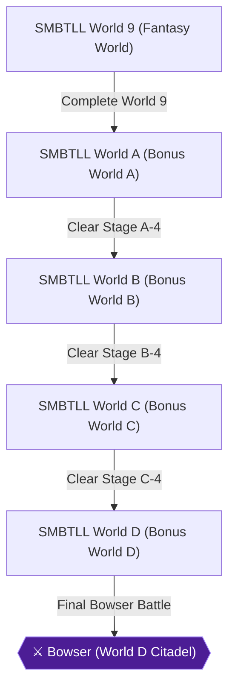

# Writer packet — Chapter 4: Super Mario Bros.: The Lost Levels — Secret Worlds (Worlds 9 & A–D)

Write `08_chapters/04.md`. Previous chapter: 3. Super Mario Bros.: The Lost Levels — Main Quest (Worlds 1–8). Next chapter: 5. Super Mario Bros. 2 — Subcon Liberation (Worlds 1–7).
Planner notes: Explore the surreal bonus World 9 (unlocked by beating Worlds 1-8 warpless) and the post-game Worlds A through D.

## Areas in this chapter (in order)

- `SMBTLL_World9` — SMBTLL World 9 (Fantasy World)
- `SMBTLL_WorldA` — SMBTLL World A (Bonus World A)
- `SMBTLL_WorldB` — SMBTLL World B (Bonus World B)
- `SMBTLL_WorldC` — SMBTLL World C (Bonus World C)
- `SMBTLL_WorldD` — SMBTLL World D (Bonus World D)

## Achievements to place in this chapter (each EXACTLY once as `[ACHIEVEMENT:<id>]`)

- **28306** — Certified Mario Maniac! (25 pts, missable): [SMBTLL] Complete World 9  
  supporting facts: ra-comments-66-1, ra-comments-66-2, neo1-62-1, neo1-62-2, neo3-108-1, neo3-108-2, neo4-156-1, neo4-156-2, neo4-162-1, neo4-162-2, neo4-169-1, neo4-169-2, neo4-176-1, neo4-176-2, neo4-191-1, neo4-191-2, neo4-192-1, neo4-192-2, neo4-193-1, neo4-193-2, neo4-194-1, neo4-194-2
- **26934** — A is for Amazing (10 pts): [SMBTLL] Complete World A  
  supporting facts: ra-comments-68-1, ra-comments-68-2, neo1-62-1, neo1-62-2, neo1-64-1, neo1-64-2, neo3-108-1, neo3-108-2, neo4-161-1, neo4-161-2, neo4-162-1, neo4-162-2, neo4-191-1, neo4-191-2, neo4-194-1, neo4-194-2, neo4-195-1, neo4-195-2, neo4-196-1, neo4-196-2
- **26935** — B is for Brave (10 pts): [SMBTLL] Complete World B  
  supporting facts: ra-comments-70-1, ra-comments-70-2, neo1-62-1, neo1-62-2, neo1-64-1, neo1-64-2, neo4-195-1, neo4-195-2, neo4-197-1, neo4-197-2, neo4-198-1, neo4-198-2, neo4-199-1, neo4-199-2
- **26936** — C is for Champion (10 pts): [SMBTLL] Complete World C  
  supporting facts: ra-comments-72-1, ra-comments-72-2, neo1-62-1, neo1-62-2, neo1-63-1, neo1-63-2, neo4-199-1, neo4-199-2, neo4-200-1, neo4-200-2, neo4-201-1, neo4-201-2, neo4-202-1, neo4-202-2, neo4-203-1, neo4-203-2
- **26937** — D is for In-D-structible! (25 pts): [SMBTLL] Complete World D and rescue Princess Toadstool again  
  supporting facts: ra-comments-74-1, ra-comments-74-2, neo1-63-1, neo1-63-2, neo1-64-1, neo1-64-2, neo4-204-1, neo4-204-2, neo4-205-1, neo4-205-2, neo4-206-1, neo4-206-2, neo4-207-1, neo4-207-2
- **541021** — Unstable Platforms (3 pts): [SMBTLL] Collect the 1-Up Mushroom in Stage A-2  
  supporting facts: neo1-62-1, neo1-62-2, neo4-195-1, neo4-195-2
- **541022** — Sky High (3 pts): [SMBTLL] Collect the 1-Up Mushroom in Stage D-1  
  supporting facts: neo1-63-1, neo1-63-2

## ⛔ Points of no return in this chapter (each needs a `> [!CAUTION]` containing the words "Point of No Return")

- Point of No Return: Lost Levels World D-4 Chamber: Defeating the final Bowser in Stage D-4 concludes the secret worlds campaign. [ra-comments-74-1, ra-comments-74-2]

## Route diagram (inserted automatically where you write `[MERMAID]`)



## Usable facts (62) — cite as [[fact-id]]

Legend: ✅ verified (2+ sources) · ✔ conflict resolved · 🟡 single source

- ✅ **neo1-62-1** (transition) 9-1: Go down the pipe and swim through an underwater version of the overworld. — @SMBTLL Stage Guide · ach: 28306,26934,26935,26936,26938,26940,541021  
  evidence: neo1#62: "9-1: Go down the pipe and swim through an underwater version of the overworld."
- ✅ **neo1-62-2** (location) The enemies here are mostly from the overworld and you can only kill them with — @SMBTLL Stage Guide · ach: 28306,26934,26935,26936,26938,26940,541021  
  evidence: neo1#62: "The enemies here are mostly from the overworld and you can only kill them with"
- ✅ **neo1-63-1** (location) C-2: Juke and jive through Cheep Cheeps, Bloopers, and Koopa Paratroopas for — @SMBTLL Stage Guide · ach: 26926,26927,26928,26929,26930,26931,26932,26933,26936,26937,26938,26940,541018,541019,541020,541022  
  evidence: neo1#63: "C-2: Juke and jive through Cheep Cheeps, Bloopers, and Koopa Paratroopas for"
- ✅ **neo1-63-2** (location) the first part. Jump carefully across two loose stones and a palm tree, leap — @SMBTLL Stage Guide · ach: 26926,26927,26928,26929,26930,26931,26932,26933,26936,26937,26938,26940,541018,541019,541020,541022  
  evidence: neo1#63: "the first part. Jump carefully across two loose stones and a palm tree, leap"
- ✅ **neo1-64-1** (transition) A-2: Stay on top of the level and go past the exit to warp to World B — @SMBTLL Stage Guide · ach: 26934,26935,26937,26938  
  evidence: neo1#64: "A-2: Stay on top of the level and go past the exit to warp to World B"
- ✅ **neo1-64-2** (transition) B-4: Go down the fifth pipe you see and it leads to World D. — @SMBTLL Stage Guide · ach: 26934,26935,26937,26938  
  evidence: neo1#64: "B-4: Go down the fifth pipe you see and it leads to World D."
- ✅ **neo3-108-1** (location) Now the screen will scroll to the right, and you'll find a disheartened Princess — @SMBTLL Stage Guide · ach: 26933,28306,26934,26938,26940  
  evidence: neo3#108: "Now the screen will scroll to the right, and you'll find a disheartened Princess"
- ✅ **neo3-108-2** (location) Toadstool inside a huge cage.  You will jump into her cage and save her, then — @SMBTLL Stage Guide · ach: 26933,28306,26934,26938,26940  
  evidence: neo3#108: "Toadstool inside a huge cage.  You will jump into her cage and save her, then"
- 🟡 **neo4-156-1** (location) V. Level Walkthroughs Worlds 1-8 — @THE LOST LEVELS · ach: 28306  
  evidence: neo4#156: "V. Level Walkthroughs Worlds 1-8"
- 🟡 **neo4-156-2** (location) VI. Level Walkthroughs World 9 — @THE LOST LEVELS · ach: 28306  
  evidence: neo4#156: "VI. Level Walkthroughs World 9"
- ✅ **neo4-161-1** (location) Fall in to the ground below and jump over the bouncing green Koopa-Troopa, — @World 1-2 · ach: 26926,26927,26929,26934,26938,541018  
  evidence: neo4#161: "Fall in to the ground below and jump over the bouncing green Koopa-Troopa,"
- ✅ **neo4-161-2** (location) then run and jump over the pit before you run into the block. At the top of — @World 1-2 · ach: 26926,26927,26929,26934,26938,541018  
  evidence: neo4#161: "then run and jump over the pit before you run into the block. At the top of"
- 🟡 **neo4-162-1** (transition) The thing about warp zones in this game is that, unlike in the first Super — @World 1-2 · ach: 26926,26933,28306,26934,26938  
  evidence: neo4#162: "The thing about warp zones in this game is that, unlike in the first Super"
- 🟡 **neo4-162-2** (transition) Mario Bros., they're not always a benefit to your fellow plumber. Many warp — @World 1-2 · ach: 26926,26933,28306,26934,26938  
  evidence: neo4#162: "Mario Bros., they're not always a benefit to your fellow plumber. Many warp"
- 🟡 **neo4-169-1** (location) Just ahead, you'll meet Hammer Brothers for the first time. If you're small — @World 3-1 · ach: 26926,26928,28306,26938,26940  
  evidence: neo4#169: "Just ahead, you'll meet Hammer Brothers for the first time. If you're small"
- 🟡 **neo4-169-2** (location) and need to get around them, the fifth block from the right on the bottom row — @World 3-1 · ach: 26926,26928,28306,26938,26940  
  evidence: neo4#169: "and need to get around them, the fifth block from the right on the bottom row"
- 🟡 **neo4-176-1** (location) Kill as many Buzzy Beetles as you can with the first one's shell, then jump — @World 5-1 · ach: 26926,26930,26931,28306,26938,26940,541019  
  evidence: neo4#176: "Kill as many Buzzy Beetles as you can with the first one's shell, then jump"
- 🟡 **neo4-176-2** (location) methodically through the mess of red piranha plants up ahead (unless you have — @World 5-1 · ach: 26926,26930,26931,28306,26938,26940,541019  
  evidence: neo4#176: "methodically through the mess of red piranha plants up ahead (unless you have"
- 🟡 **neo4-191-1** (location) Drop down to the lower area so you can successfully run and jump across the — @World 8-4 · ach: 26933,28306,26934,26938  
  evidence: neo4#191: "Drop down to the lower area so you can successfully run and jump across the"
- 🟡 **neo4-191-2** (location) lava. Squat and slide when you get there to go under the Firesnakes in case — @World 8-4 · ach: 26933,28306,26934,26938  
  evidence: neo4#191: "lava. Squat and slide when you get there to go under the Firesnakes in case"
- 🟡 **neo4-192-1** (location) LEVEL WALKTHROUGHS WORLD 9 — @LEVEL WALKTHROUGHS WORLD 9 · ach: 28306,26938  
  evidence: neo4#192: "LEVEL WALKTHROUGHS WORLD 9"
- 🟡 **neo4-192-2** (transition) It looks like this is going to be a warp zone at first (and oh, a cruel joke — @LEVEL WALKTHROUGHS WORLD 9 · ach: 28306,26938  
  evidence: neo4#192: "It looks like this is going to be a warp zone at first (and oh, a cruel joke"
- 🟡 **neo4-193-1** (location) Okay, so maybe I touted this world's difficulty a bit too much. This level is — @World 9-2 · ach: 28306,26940  
  evidence: neo4#193: "Okay, so maybe I touted this world's difficulty a bit too much. This level is"
- 🟡 **neo4-193-2** (location) unforgivably easy. All you have to do is swim under Lakitu and a bunch of — @World 9-2 · ach: 28306,26940  
  evidence: neo4#193: "unforgivably easy. All you have to do is swim under Lakitu and a bunch of"
- 🟡 **neo4-194-1** (location) This level is just meant to be a congratulatory level, though the — @World 9-4 · ach: 28306,26934,26940,541027  
  evidence: neo4#194: "This level is just meant to be a congratulatory level, though the"
- 🟡 **neo4-194-2** (location) congratulatory message is obviously written in Japanese lettering (if anyone — @World 9-4 · ach: 28306,26934,26940,541027  
  evidence: neo4#194: "congratulatory message is obviously written in Japanese lettering (if anyone"
- 🟡 **neo4-195-1** (location) You should still have retained your largeness from the last level (it wasn't — @World A-2 · ach: 26934,26935,26938,541021  
  evidence: neo4#195: "You should still have retained your largeness from the last level (it wasn't"
- 🟡 **neo4-195-2** (location) hard to, anyway), so use the springboard and bounce so that you break one — @World A-2 · ach: 26934,26935,26938,541021  
  evidence: neo4#195: "hard to, anyway), so use the springboard and bounce so that you break one"
- 🟡 **neo4-196-1** (location) Wind and Cheep-Cheeps are a deadly combination in this level. Keep going — @World A-3 · ach: 26934  
  evidence: neo4#196: "Wind and Cheep-Cheeps are a deadly combination in this level. Keep going"
- 🟡 **neo4-196-2** (location) forward and you should stay completely ahead of the Cheep-Cheeps, who come in — @World A-3 · ach: 26934  
  evidence: neo4#196: "forward and you should stay completely ahead of the Cheep-Cheeps, who come in"
- 🟡 **neo4-197-1** (location) There's nothing to really look out for at the beginning of this level unless — @World B-1 · ach: 26935  
  evidence: neo4#197: "There's nothing to really look out for at the beginning of this level unless"
- 🟡 **neo4-197-2** (location) you're small. You can get a few rewards from the bricks that lie low to the — @World B-1 · ach: 26935  
  evidence: neo4#197: "you're small. You can get a few rewards from the bricks that lie low to the"
- 🟡 **neo4-198-1** (location) In spite of the current that draws you into death and the fact that I usually — @World B-2 · ach: 26935  
  evidence: neo4#198: "In spite of the current that draws you into death and the fact that I usually"
- 🟡 **neo4-198-2** (location) tell you to stay away from it, it's actually a good idea to stay as low to — @World B-2 · ach: 26935  
  evidence: neo4#198: "tell you to stay away from it, it's actually a good idea to stay as low to"
- 🟡 **neo4-199-1** (location) Heh heh, this level comes B-4 C-1. [awaits impending tomato onslaught] — @World B-4 · ach: 26935,26936  
  evidence: neo4#199: "Heh heh, this level comes B-4 C-1. [awaits impending tomato onslaught]"
- 🟡 **neo4-199-2** (item) Despite the mushroom's location in that little alcove below the first — @World B-4 · ach: 26935,26936  
  evidence: neo4#199: "Despite the mushroom's location in that little alcove below the first"
- 🟡 **neo4-200-1** (location) Most of the hassle in this winter wonderland comes from bouncing green Koopa- — @World C-1 · ach: 26936,26940  
  evidence: neo4#200: "Most of the hassle in this winter wonderland comes from bouncing green Koopa-"
- 🟡 **neo4-200-2** (location) Troopas and question blocks that are just barely impossible to get to. Keep — @World C-1 · ach: 26936,26940  
  evidence: neo4#200: "Troopas and question blocks that are just barely impossible to get to. Keep"
- 🟡 **neo4-201-1** (location) Many floating Bloopers inhabit this first part of the level along with the — @World C-2 · ach: 26936  
  evidence: neo4#201: "Many floating Bloopers inhabit this first part of the level along with the"
- 🟡 **neo4-201-2** (location) Cheep-Cheeps that are generated incessantly from below the screen. Keep going — @World C-2 · ach: 26936  
  evidence: neo4#201: "Cheep-Cheeps that are generated incessantly from below the screen. Keep going"
- 🟡 **neo4-202-1** (location) This level is totally identical to World 7-3, wherein you used the super — @World C-3 · ach: 26932,26936  
  evidence: neo4#202: "This level is totally identical to World 7-3, wherein you used the super"
- 🟡 **neo4-202-2** (location) springboards in conjunction with the heavy breeze to travel long distances in — @World C-3 · ach: 26932,26936  
  evidence: neo4#202: "springboards in conjunction with the heavy breeze to travel long distances in"
- 🟡 **neo4-203-1** (location) This should be an "explosive" castle ... get it? C-4? Oh, never mind. — @World C-4 · ach: 26936  
  evidence: neo4#203: "This should be an "explosive" castle ... get it? C-4? Oh, never mind."
- 🟡 **neo4-203-2** (location) [prepares for a second onslaught of tomatoes] — @World C-4 · ach: 26936  
  evidence: neo4#203: "[prepares for a second onslaught of tomatoes]"
- 🟡 **neo4-204-1** (location) Bounce the Hammer Brothers out of joint by bumping the bricks with your head. — @World D-1 · ach: 26937  
  evidence: neo4#204: "Bounce the Hammer Brothers out of joint by bumping the bricks with your head."
- 🟡 **neo4-204-2** (location) When you're past them, run and jump, getting a minor boost off the green — @World D-1 · ach: 26937  
  evidence: neo4#204: "When you're past them, run and jump, getting a minor boost off the green"
- 🟡 **neo4-205-1** (location) Hop over the small pit at the beginning and then stay on the high road to — @World D-2 · ach: 26937  
  evidence: neo4#205: "Hop over the small pit at the beginning and then stay on the high road to"
- 🟡 **neo4-205-2** (location) avoid Buzzy Beetlemania (bad pun, I know). The green Koopa-Troopas don't make — @World D-2 · ach: 26937  
  evidence: neo4#205: "avoid Buzzy Beetlemania (bad pun, I know). The green Koopa-Troopas don't make"
- 🟡 **neo4-206-1** (item) You'll have to be nimble to get the mushroom/flower at the beginning - Bullet — @World D-3 · ach: 26937  
  evidence: neo4#206: "You'll have to be nimble to get the mushroom/flower at the beginning - Bullet"
- 🟡 **neo4-206-2** (location) Bills can reach you from almost any point. If you manage to get it, hop on — @World D-3 · ach: 26937  
  evidence: neo4#206: "Bills can reach you from almost any point. If you manage to get it, hop on"
- 🟡 **neo4-207-1** (item) As soon as the long Firesnake starts to go up from the nine o'clock position — @World D-4 · ach: 26937  
  evidence: neo4#207: "As soon as the long Firesnake starts to go up from the nine o'clock position"
- 🟡 **neo4-207-2** (item) (think clockwise), make a jump to that ledge, but not too big of one or you — @World D-4 · ach: 26937  
  evidence: neo4#207: "(think clockwise), make a jump to that ledge, but not too big of one or you"
- 🟡 **ra-comments-66-1** (achievement) [Server] televandalist edited this achievement. — ach: 28306  
  evidence: ra-comments#66: "[Server] televandalist edited this achievement."
- 🟡 **ra-comments-66-2** (achievement) [Useless] I cleared TLL but did not See World 9 can anybody explain — ach: 28306  
  evidence: ra-comments#66: "[Useless] I cleared TLL but did not See World 9 can anybody explain"
- 🟡 **ra-comments-68-1** (achievement) [Server] televandalist edited this achievement. — ach: 26934  
  evidence: ra-comments#68: "[Server] televandalist edited this achievement."
- 🟡 **ra-comments-68-2** (achievement) [Ernesto] How do you unlock these worlds? World A-B-C-D. — ach: 26934  
  evidence: ra-comments#68: "[Ernesto] How do you unlock these worlds? World A-B-C-D."
- 🟡 **ra-comments-70-1** (achievement) [Server] televandalist edited this achievement. — ach: 26935  
  evidence: ra-comments#70: "[Server] televandalist edited this achievement."
- 🟡 **ra-comments-70-2** (achievement) [ArturMK] SUPER MARIO THE LOST LEVELS 1986 — ach: 26935  
  evidence: ra-comments#70: "[ArturMK] SUPER MARIO THE LOST LEVELS 1986"
- 🟡 **ra-comments-72-1** (achievement) [Server] televandalist edited this achievement. — ach: 26936  
  evidence: ra-comments#72: "[Server] televandalist edited this achievement."
- 🟡 **ra-comments-72-2** (achievement) [Meatbro] C-4 can go to hell — ach: 26936  
  evidence: ra-comments#72: "[Meatbro] C-4 can go to hell"
- 🟡 **ra-comments-74-1** (achievement) [Server] televandalist edited this achievement. — ach: 26937  
  evidence: ra-comments#74: "[Server] televandalist edited this achievement."
- 🟡 **ra-comments-74-2** (achievement) [ArturMK] SUPER MARIO THE LOST LEVELS 1986 — ach: 26937  
  evidence: ra-comments#74: "[ArturMK] SUPER MARIO THE LOST LEVELS 1986"

## Source passages (50 chunks)

Use these for detail (directions, chest contents, enemy names, boss patterns, ASCII maps). Every statement you take from a passage must cite a fact id; if no fact covers a detail you need, add a fact to `04_facts/` first (with a verbatim quote) and re-run `rw:verify`.

### neo1#61 — Neoseeker: Super Mario All-Stars FAQ/Walkthrough — [# #] (context neighbour)

```text
7-3: The wind blows early. Watch out. Start off jumping from spring to spring.
    When you land on safe ground, get a mushroom and start moving from spring to
    spring again. Watch for the firebars and the exit is shortly after the wind
    stops.
    
    7-4: General tip. Stay away from the top of level. Once you go up there, you
    won't come back down and will have to die of time out. This is the hardest of
    all castles. Avoid the firebars and get a hidden mushroom on the wall before
    the elevators and before the firebar touches you. Get acroos the elevator and
    don't go up there. Go down and zigzag past the firebar. Kick the last Koopa
    Troopa into the swarm of Buzzy Beetles and get a 1-up. Carefully sacrifice
    your power-uo in the first firebar and use the invincibility to get past the
    second one quickly. Get past the fire breath and Pobodos and run under Bowser
    and avoid the hammers and dump him.
    
                               *---------------------*
                                      World 8
                               *---------------------*
    
    8-1: Kick the Buzzy Beetle aside and get a Mushroom which you know you need
    since you sacrificed it in World 7-4. The wind blows. Use the Koopa Paratroopas
    for leverage to get across. Watch for the Hammer Brothers here and take the
    high road or low road to avoid the next one. Be careful and the exit is just
    ahead.
    
    8-2: This level is tricky because the exit is elsewhere. Use the falling
    platform to reach a brick with a mushroom. Use the spring to get on the wall
    then jump onto some steps. keep moving and go past the Koopa Paratroopa but
    don't scroll past it. Stand on the brick on the right and let the Hammer
    Brother fall to its death then bounce off the Koopa Paratroopa and reveal a
    beanstalk that leads to  the flagpole. If you mess up, go to the end and go
    down the bonus pipe and try again.
    
    8-3: Kill the Lakitu and jump to the clouds and as Luigi, you can jump off the
    edge of the clouds and land on the falling platform. Get rid of the Lakitu and
    Koopa Troopas and start jumping past the Hammer Brothers hammers when safe but
    watch for a Poison Mushroom hidden block that messes you up when jumping past
    the second Hammer Brother. Use the spring to hop onto the Koopa Paratroopas and
    get past the second set of Hammer Brothers. Use two hidden coins to reach the
    scales and the exit is straight ahead.
    
    8-4: Curve your jump to get below then hop across the lava pit. Get past the
    Pobodo and firebar and use the Koopa Paratroopa for leverage then get in the
    pipe below the blocks. Swim your way carefully to the exit pipe. Curve your
    jump to  get on the right pipe but watch for the Pirahana plant then go down.
    Hop to the right and avoid the Posion Mushroom in the thrid coin block. Use the
    side to side platform below and stay low and hop over the long firebar and at
    the end of the corridor, wait for the Koopa Paratroopas to be one down and one
    right and hop on them to get through. There is a Mushroom above the exit pipe.
    Run under Bowser then get past the Buzzy Beetle and Pirhana plant to face the
    real Bowser. Get past him to save the princess and she'll recite a poem.
    
    Peace is paved
    The kingdom is saved
    Hurrah to Mario/Luigi
    our only hero
    This ends your trip
    of a long friendship
    
    100000pts added for each player left in the FDS version.
```

### neo1#62 — Neoseeker: Super Mario All-Stars FAQ/Walkthrough — [# #]

```text
*---------------------*
                                      World 9
                               *---------------------*
    
    9-1: Go down the pipe and swim through an underwater version of the overworld.
    The enemies here are mostly from the overworld and you can only kill them with
    fireballs.
    
    9-2: Another underwater level. Juke and jive through Pirhana plants and Lakitu
    n Spinies and that's it.
    
    9-3: What the hell? Bowser outside of his castle? Stay at the very top of this
    level to complete it
    
    9-4: This is a short level, you'll notice the walls are shaped funny. We'll
    they are Kanji characters aka Japanese letters that spell arigatou which means
    "thank you" in English.
    
                               *---------------------*
                                      World A
                               *---------------------*
    
    A-1: There is a Mushroom hidden in between the blocks, and once you get rid of
    the green Koopa Troopas, check the bricks above for a beanstalk and get coins
    in the clouds. Once down, there is a 1-up in the block next to you. Kick the
    top Koopa Troopa to the left to get rid of other enemies and a 1-up as it
    zigzags down. Get past the hammer brothers and the Koopa Paratroopas and the
    Pirhana Plants. Get rid of the Koopa Troopas on the thin walls and the exit
    is ahead.
    
    A-2: Use the spring to reveal a 1-up and move right but slow down so it can 
    catch up to you then catch it as it falls. Get to the top of the level ASAP
    and stay there, its hell making it to the exit via bottom. You can drop down
    and go to A-3 or keep moving and warp to World B-1
    
    A-3: This is an easy level. The wind blows temporarily. All you have to worry
    about are the Cheep Cheeps landing on you and that's it. The other enemies are
    no real threat.
    
    A-4: Avoid the Pobodo and firebars especially the long one that can get you if
    you are on the coin block containing a power-up. Avoid two more firebars and a
    Pobodo and hop a pit. Go up the steps and kick a Koopa Troopa shell and what's
    this? Pobodos aren't invincible after all as you'll find out. Watch for the 
    gang of Pobodos then some Bullet Bills and fire breath and now its time to
    dump hammer-throwing Bowser.
    
                               *---------------------*
                                      World B
                               *---------------------*
    
    B-1: Get the coins and leap on two pipes carefully. A power-up is the 3rd loose
    coin block. Now the general rule us to stay on top of the level as much as you
    can to beat this level easily.
    
    B-2: This is an underwater level. Nothing fancy here. Just be careful. There is
    a long firebar in this level and a Koopa Paratroopa at the end.
    
    B-3: This level is simple until you get to the spring. By this time, the Bullet
    Bills appear and the jumps are trickier. But we think you'll still make it out
    of here with hardly any trouble.
    
    B-4: Avoid going down all pipes. If you want to warp to level D (there is no
    penalty for doing so), go down the fifth pipe from the start. Otherwise, just
    keep going till you face and defeat Bowser.
    
                               *---------------------*
                                      World C
                               *---------------------*
    
    C-1: Maneuver through pirhana plants and Koopa Paratroopas and you'll be fine
    for the first part. Just watch for the overhead pirhana plants the most. Luigi
    can make it over the pit almost but almost doesn't count. Use the Koopa
    Paratroopa to get by. Get past a Hammer Brother and use the Koopa Paratroopa
    for leverage. The exit is a little ways ahead.
```

### neo1#63 — Neoseeker: Super Mario All-Stars FAQ/Walkthrough — [# #]

```text
C-2: Juke and jive through Cheep Cheeps, Bloopers, and Koopa Paratroopas for 
    the first part. Jump carefully across two loose stones and a palm tree, leap
    onto a Koopa Paratroopa to get across safely. Watch for Bullet bills and this
    level is over.
    
    C-3: This is World 7-3 all over again. Only difference is that there is a
    Lakitu that throws Spinies and that's it. Refer to World 7-3 for more info.
    
    C-4: Another case of dejavu as this is a remake of World 7-4 with a couple
    added obstacles. Like before, stay away from the top of the level because once
    you go up, you ain't getting back down.
    
                               *---------------------*
                                      World D
                               *---------------------*
    
    D-1: The Hammer Brothers arrive early and their pattern is hard. Try to bop
    them from below if you are lucky enough. Otherwise, creep slowly and wait for
    the top one to arrive first and approach then jump past it. Then deal with the
    second one by any means. Use the Koopa Paratroopa to make it across. Go down
    one pipe and get bonus coins and when you come out, a mushroom is near the 
    river. The Hammer Brothers arrive later on again. The wind blows temporarily
    but stops as you near the pole.
    
    D-2: Kick a Koopa Troopa shell down the gap. Watch for overhead Pirhana Plants.
    Hop onto the top area from the Bullet Bill Cannon if you are Luigi. You can go
    down the pipe. Use the stone to reach the stone and pole.
    
    D-3: Watch out for the Bullet Blls here. Get the powerup and use the hidden
    coin to avoid the Hammer Brothers. Spring over the wall, get past another
    Hammer Brother. Get past more bullet bills and Hammer Brothers and the exit is
    after the last set of cannons you'll need for leverage.
    
    D-4: The beginning is just like World 8-4 except you keep on going instead of
    going down the pipe below the blocks. At the end is a pipe leading to the
    Overworld. Stay on the pipe until you can safely leap over the Hammer Brother.
    The wind blows shortly. Go down the pipe when it is safe to jump. Its a bonus
    area that leads back to the Castle. Run under Bowser, get past the Hammer 
    Brother and Bowser is not too far. Beat him and you survive the ultimate
    challenge that Nintendo was afraid to bring to the US.
    
    o---------------------o
           WARP ZONES
    o---------------------o
    There are 10 Warp Zones in all.
    
    World 1-2: Hit one of the blocks above the second pipe from the start of the
    level to create a beanstalk. It leads to World 3
    
    World 1-2: Get to the top and go past the exit and go down the pipe. Go to
    the far right as you can and use the two invisible blocks before the lava to
    get to the top and reach the warp to World 4
    
    World 1-2: Same as getting to World 4 except instead of going down the pipe,
    you just keep going till you reach a warp to World 2
    
    3-1: The are two ways to get to this warp. Go down the first pipe or spring
    over the flagpole. This leads back to World 1
    
    5-1: Climb the beanstalk near the end and it leads to World 6
    
    5-2: Hit the hanging block near the up elevator to reveal a beanstalk that
    leads to World 8
    
    5-2: Stay on top of the level and get past the exit pipe and it leads to World
    7.
    
    8-1: Go into the first pipe after the fifth upside down pipe and it leads to
    World 5.
```

### neo1#64 — Neoseeker: Super Mario All-Stars FAQ/Walkthrough — [# #]

```text
A-2: Stay on top of the level and go past the exit to warp to World B
    
    B-4: Go down the fifth pipe you see and it leads to World D.
    
    o---------------------o
            SECRETS
    o---------------------o
    To play level 9, you must beat Level 8 without using any warps zones throughout
    the game.
    
    o---------------------o
            CREDITS
    o---------------------o
    
    Nintendo - created the game
    GameFAQs for hosting
    You for reading.
    
    o---------------------o
           CONTACT ME
    o---------------------o
    azulfria[at]hotmail[dot]com 
    [at] = @ and [dot] = .
    Don't want any email bots.
    
    Thank you for reading
    
    -Ice Queen Zero
    
    

This document is copyright IceQueenZer0 and hosted by Neoseeker with permission.

  * [Super Mario All Stars faqs and walkthroughs](https://www.neoseeker.com/super-mario-all-stars/faqs/)
  * [Super Mario All Stars cheats](https://www.neoseeker.com/super-mario-all-stars/cheats/snes/)
  * [Super Mario All Stars forum](https://forums.neoseeker.com/7052/)


(0.0138/d/wwwo1 RDM)
```

### neo3#107 — Neoseeker: Super Mario All-Stars FAQ/Walkthrough v1.00 — [Run to the right and carefully run through the narrow area enclosed by the 2] (context neighbour)

```text
===============================================================================
    World 8-4 - The Lost Levels Walkthrough
    ===============================================================================
    This is it...the final stage of the game (if you don't count the bonus levels).
    Can you defeat the final Bowser?  The fate is in your hands!
    
    Just getting across the first lava pit is a challenge!  You will have to drop
    down to the platform underneath of where you start out at, and get a running
    start if you ever want to make it across that tricky first lava pit.  Due to
    the way the steps and the ceiling is set up, this is necessary to cross the
    first pit.  After the first pit, run underneath the 2 Firebars there.  There is
    a hidden Poisonous Mushroom above, but obviously don't get it.  To cross the
    lava pit to the right, you'll have to get a running start.  Cross this lava
    pit, and then you'll be on a descending staircase.  Walk to the bottom step
    on this small staircase, and use the bounce off the Red Paratroopa's head to
    get across the next lava pit.  YOU HAVE TO GO INTO THE PIPE BELOW YOU!  To do
    this, jump on the 2nd pipe, and then from there jump back to the left onto the
    correct pipe, and go down into it.  NOTE: If you just continue going as normal,
    the level will loop back to the beginning.
    
    After going into the pipe, you will now be in an underwater area.  Swim to the
    right past a Blooper, and 3 Firebars, and finally go into the pipe at the very
    right of this area.  Now back on dry land, there is an oppurtunity for you to
    get a Powerup.  To get the powerup, walk to the left and jump up and you will
    hit an invisible block, and a Powerup will appear!  This will be very helpful!
    Get the Powerup, then jump across the pit, and go into the rightmost Pipe, which
    will lead you to the next area.
    
    Here, wisely use the given space to the left to help you get a running start to
    safely jump over the lava pit.  Of the 4 Question Mark Blocks there, you can
    and should hit the first 2, and the last 1, but don't hit the 3rd Question Mark
    Block, as it is a Poisonous Mushroom.  Jump over the next Pipe and run past the
    Air Blooper.  Jump over the next pipe, and kill the Koopa Troopa.  To the right
    there is a lava pit.  Although it's difficult to see, there is a small
    Left&Right elevator located directly above the lava pit.  Jump onto this
    elevator and use it to get to the right.  Run, and you'll cross right over the
    small single block pit.  At this point you will hear a chime, which signify's
    that you took the correct route (if you took the wrong route, you'll hear a
    bad sound).  Jump to the right above the giant Firebar, and then run to the
    right so that the Firebar is off screen.  Run to the right through a VERY VERY
    long corridor, and when you get to the end, you'll need to use the Red Koopa
    Paratroopa's head to get across the lava pit.  Once across the lava pit, there
    is a pipe you must go into.  However, before you go into this pipe, be sure you
    get the invisible Powerup block located ontop of the pipe.  Only after getting
    the Powerup shall you go into the pipe.
    
    From here, go to the right, and you'll see a Pipe, but DO NOT GO INTO THIS PIPE!
    Even if you fall into the hole where the pipe is, there are invisible bricks
    above that will restrict you from jumping up, so take extreme caution NOT to
    fall into this Pipe-trap!  To the right is ... BOWSER!  But it's not the final
    Bowser, there are actually 2 Bowser's in this stage.  Just run right by this
    Bowser, and continue running until you get to a pit.  From here, use the
    falling elevator to jump onto the platform to the right.  Ignore the upside
    down Pirahna Plant, and jump over the next lava pit.  Pass a Buzzy Beetle, and
    then continue to the right until you get to another Bowser!  Yes this is it,
    this is the final Bowser, the only man that stand before you and the Princess!
    This Bowser throws hammers, and there is a Firebar that will give you quite an
    obstacle to dodge.  Also, the low walls can be quite a challenge, too.  The
    best way to get by this Bowser if you don't have Fire Power is to simply wait
    for the right time and run underneath him.  Of course, if you have Fire Power,
    just blast him to his death.  However you do it, just touch the Ax to finish
    the level.
```

### neo3#108 — Neoseeker: Super Mario All-Stars FAQ/Walkthrough v1.00 — [This is it...the final stage of the game (if you don't count the bonus levels).]

```text
Now the screen will scroll to the right, and you'll find a disheartened Princess
    Toadstool inside a huge cage.  You will jump into her cage and save her, then
    get one crazy kiss that makes you go crazy!!  Congratulations on beating The
    Lost Levels.  However, there are still many more Worlds in the game, such as the
    Hidden World 9, and Worlds A-D, IF you are up for the challenge...
    
    
    
    
    
    +=--=+=--=+=--=+=--=+=--=+=--=+=--=+=--=+=--=+=--=+=--=+=--=+=--=+=--=+=--=+=-+
    4.7)                      H I D D E N    W O R L D S
    +=--=+=--=+=--=+=--=+=--=+=--=+=--=+=--=+=--=+=--=+=--=+=--=+=--=+=--=+=--=+=-+
    NOTE: This is not a Walkthrough of World 9, or A-D, but rather a quick
    explanation of how to get to the hidden level.
    
    Yes it is true!  After beating World 8, there are added hidden levels that you
    can access depending on weather or not you used Warp Pipes to get to the end.
    You can access a super secret World 9 if you DID NOT WARP, but if you DID
    WARP, you will skip World 9, and go straight to World A.  Either way, you will
    eventually end up at World A.
    
    World 9
    -------
    Like I said before, to get to World 9, you must have gotten to and beaten World
    8 without having used a single Warp Pipe throughout the entire game.  That means
    you must have gone through all 32 levels.  Even if you Warp backwards (ie to a
    previous level), you will have voided World 9.  If you get to World 9, and beat
    it, you will then be taken to World A.  One other note -- World 9 is pretty
    difficult, and you're only given 1 life to complete it.  So if you die even
    once, you're through.  Better be careful!
```

### neo3#109 — Neoseeker: Super Mario All-Stars FAQ/Walkthrough v1.00 — [World A-D] (context neighbour) — contains ASCII map (copy verbatim if used)

```text
World A-D
    ---------
    If you USED Warp Zones throughout the game, even once, even if it was a
    backwards Warp (ie to a previous level), you still have vioded out World 9, and
    you will go immediately to World A after beating World 8.  After beating World
    A, you will then go onto B, then C, then D.  There is no World E; after beating
    World D, you will have finally beaten the game for good.
    
    
    
    
    
    
    
    
    
    --------------------------------------------------------------------#SMB2SEARCH
    §=§=§=§=§=§=§=§=§=§=§=§=§=§=§=§=§=§=§=§=§=§=§=§=§=§=§=§=§=§=§=§=§=§=§=§=§=§=§=§
    
       • 05)  Super Mario Bros. 2 •
                  ________
                  __  ___/___  ______________________
                  _____ \_  / / /__  __ \  _ \_  ___/
                  ____/ // /_/ /__  /_/ /  __/  /
                  /____/ \__,_/ _  .___/\___//_/
                                /_/
            __  __            _         ____
           |  \/  | __ _ _ __(_) ___   | __ ) _ __ ___  ___
           | |\/| |/ _` | '__| |/ _ \  |  _ \| '__/ _ \/ __|
           | |  | | (_| | |  | | (_) | | |_) | | | (_) \__ \_
           |_|  |_|\__,_|_|  |_|\___/  |____/|_|  \___/|___(_)
                                  ___
                                 |__ \
                                    ) |
                                   / /
                                  / /_
                                 |____|
```

### neo4#155 — Neoseeker: Super Mario All-Stars FAQ/Walkthrough v2.0 — [Hammer Brother] (context neighbour)

```text
Hammer Brother
    --------------
    Hey, you! Can I borrow your clothes? No dice? What a drag.
    
    
    WHITE MUSHROOM HOUSES
    Certain levels will allow you to get special items from a mystical white 
    Mushroom House if you get a certain amount of coins in a given level. 
    Although I specifically denote when you can access a white Mushroom House in 
    a level, I will tell you the levels where you can access them and the amount 
    of coins needed to reveal them. You will get a P-Wing in odd-numbered worlds 
    and an anchor in even-numbered worlds.
     1-4: 44 coins
     2-2: 30 coins
     3-8: 44 coins
     4-2: 22 coins
     5-5: 28 coins
     6-7: 78 coins
     7-2: 46 coins
    
    CARD GAME PATTERNS REVEALED!
    Yeah, you know, the annoying spade with an N that pops up every time you get 
    80,000 points. Well, listed here are the eight sets of cards that will let 
    you get all the prizes available through this game. Here is the legend for 
    the eight sets:
    
    ** Each symbol is composed of three letters.
    FLR - Flower        STR - Starman
    1UP - Extra life    10C - 10 coins
    20C - 20 coins      MSH - Mushroom
    
    Pattern 1                         Pattern 2
    ---------                         ---------
    FLR  STR  1UP  FLR  1UP  MSH      1UP  MSH  10C  MSH  FLR  STR
    10C  MSH  FLR  STR  MSH  10C      MSH  10C  STR  20C  20C  FLR
    STR  20C  20C  MSH  FLR  STR      STR  1UP  FLR  MSH  FLR  STR
    
    Pattern 3                         Pattern 4
    ---------                         ---------
    MSH  FLR  20C  MSH  10C  STR      MSH  FLR  1UP  FLR  STR  STR
    FLR  1UP  MSH  1OC  1UP  2OC      20C  STR  MSH  10C  1UP  FLR
    STR  FLR  STR  MSH  FLR  STR      2OC  MSH  10C  MSH  FLR  STR
    
    Pattern 5                         Pattern 6
    ---------                         ---------
    FLR  20C  MSH  STR  1UP  FLR      FLR  1OC  1UP  FLR  1UP  MSH
    1UP  FLR  10C  MSH  20C  STR      STR  MSH  20C  STR  MSH  10C
    MSH  1OC  STR  MSH  FLR  STR      STR  FLR  20C  MSH  FLR  STR
    
    Pattern 7                         Pattern 8
    ---------                         ---------
    FLR  STR  1UP  FLR  20C  MSH      MSH  FLR  20C  FLR  10C  STR
    1OC  MSH  20C  1UP  MSH  10C      2OC  1UP  MSH  1OC  1UP  FLR
    STR  FLR  STR  MSH  FLR  STR      STR  MSH  STR  MSH  FLR  STR
    
    And finally, how to deduce which pattern you have:
    
    Flip over the fifth card on the first row.
    
    If that card is a 1-up, flip over the third card in the first row. If it is 
    not a 1-up, you have Pattern 5. If it is a 1-up, flip over the second card in 
    the first row. If it is a Starman, you have Pattern 1; if it is 10 coins, you 
    have Pattern 6.
    
    If the fifth card in the first row is 20 coins, you have Pattern 7.
    
    If it is a flower, you have Pattern 2.
    
    If it is a Starman, you have Pattern 4.
    
    If the fifth card in the first row is 10 coins, flip over the last card in 
    the second row. If it is 20 coins, you have Pattern 3; if it is a flower, you 
    have Pattern 8.
    
    There you have it! That's how to tell which setup of cards you have.
    
    Thus concludes this portion of the Definitive Super Mario All-Stars FAQ.
    
    -----------------------------------------------------------------------------
    -----------------------------------------------------------------------------
```

### neo4#156 — Neoseeker: Super Mario All-Stars FAQ/Walkthrough v2.0 — [THE LOST LEVELS]

```text
THE LOST LEVELS
                                    ===============
    
        SECTIONS
        --------
        I. Basic Concept
        II. Controls
        III. Item Summary
        IV. Enemy Summary
        V. Level Walkthroughs Worlds 1-8
        VI. Level Walkthroughs World 9
        VII. Level Walkthroughs Worlds A-D
    
    
    BASIC CONCEPT
    =============
    Super Mario Bros. Lost Levels is basically a continuation of the first Mario 
    game that we in the States never got to experience when it was first 
    released. This is what people are talking about when they refer to the 
    Japanese Mario 2. What we call Mario 2 and they call Mario USA is in 
    actuality a total rip-off of another Japanese game called Doki Doki Panic (or 
    something like that). Therefore, since we never got to play this game upon 
    its release, these 52 new levels were "lost" to us - ergo, the "lost levels."
    
    Gameplay in it is almost exactly as it was in the original, with minor 
    changes peppered throughout. Again, you travel through a linear set of worlds 
    in order to save the Princess Toadstool/Peach/whatever you call her, facing 
    Bowser at the end of every set of four levels. It is much harder this time 
    around, however. Terrain is tougher to cross due to certain elements that 
    have been added, such as wind and the new, improved, and slightly tweaked 
    springboard. All in all, its spirit remains in the original, and every enemy 
    from the first game is back to get you. The satisfaction you will feel upon 
    beating this game will be great.
```

### neo4#157 — Neoseeker: Super Mario All-Stars FAQ/Walkthrough v2.0 — [CONTROLS] (context neighbour)

```text
CONTROLS
    ========
    Control here remains similar to the original Super Mario Bros. game, but 
    there are some minor changes needing to be addressed. Since it is a 
    painstaking process to have to go through all the controls from the first 
    one, seeing as how they are for the most part identical, I will only mention 
    those changes which stand out in this game.
    
    Select
    ------
    -> Choose between Mario Game and Luigi Game at the Main Menu screen. Lost
       Levels is only one player, and the main difference between Mario and
       Luigi is that Luigi can jump higher.
    
    Tap A
    -----
    -> If you do this at the moment that you hit the springboard, you should
       skyrocket into the air, getting a major boost off of the springboard. This
       only works on certain ones, and is necessary to get through some areas.
    
    Start
    -----
    -> Brings up a menu from which you can continue the game, save and continue,
       or save and quit to come back later.
```

### neo4#160 — Neoseeker: Super Mario All-Stars FAQ/Walkthrough v2.0 — [World 1-1] (context neighbour)

```text
World 1-1
    ---------
    Either jump over the green bouncing Koopa-Troopa that comes your way or let 
    it hop over you as you stand inside the castle door. There's a red Koopa-
    Troopa caught in the alcove up ahead. Bump the second brick from the left to 
    reveal a healthy mushroom, then bump another brick from the left to make it 
    hop out of the hole. Grab it, then hit the five question blocks up ahead. One 
    contains a Poison Mushroom, so make it turn around or jump over it when it 
    comes back off the pipe.
    
    Jump over the pipe that the Poison Mushroom came back off of and go forward 
    to reveal a hidden 1-up. Just flatten the three Goombas and jump directly up 
    in front of the tree. You'll hit a block that doesn't show up there normally, 
    and you'll already have an extra life under your belt! Cool beans! So then, 
    take the high road once you get over the pit to rack up a few coins, then go 
    down to the brick at the end of the stairs below. It contains several coins. 
    Beat it with your skull a few times to squeeze it dry and return to the upper 
    path. There is another Poison Mushroom in the row of coin blocks below on the 
    other side. Avoid it and make your way right through a battalion of Koopa-
    Troopas and Goombas. Jump on the pipe at the end and go up onto the bricks. 
    When you land, position yourself so that if you run and jump onto the pipe to 
    the left, you won't skid off into a pit (in other words, put it on the far 
    left side with room to duck in). Squat into it to get to a bonus room with 
    coins in it. You'll come out right by the exit. Run and jump off the top of 
    the staircase to get the maximum score out of the flagpole (i.e. 5000).
```

### neo4#161 — Neoseeker: Super Mario All-Stars FAQ/Walkthrough v2.0 — [World 1-2]

```text
World 1-2
    ---------
    Fall in to the ground below and jump over the bouncing green Koopa-Troopa, 
    then run and jump over the pit before you run into the block. At the top of 
    the steps, go to the far right end and jump to reveal a mushroom or a flower, 
    depending on your current state of affairs. If it's a mushroom, follow it to 
    the end where it falls off and grow when it comes down. If it's a flower, 
    Mario won't be able to reach it, but Luigi can barely touch it if the running 
    jump is right. When you have either item and you're on the other side of the 
    low-reaching wall, jump up to the top from the pipe and run across the level, 
    leaping over gaps as required, until you reach the platforms that rise 
    slowly. There is an invisible block to help you reach the top if you need to. 
    Bouncing off the Buzzy Beetle should help you get to it.
    
    Once you reach the platforms, go down into the pipe against the wall if you 
    want to find the outside world and end the level. If you don't and you want 
    to go exploring a little bit, keep reading.
    
    From one of the platforms going up, take a running jump to the brick ledge 
    above the pipe and then go over the large wall. Drop to the bottom. You can 
    go in the short pipe and explore some more, or head to the right to find a 
    warp zone to World 2. There's an important note up ahead about warp zones, 
    and you need to read it if you intend to reach some of the later worlds.
    
    If you choose to go in the short pipe, there are three question blocks up 
    ahead. The one on the right will contain a flower/mushroom. It's easier to 
    get it if it's a flower. Jump to the platform to the right that dips when you 
    stand on it. It may be difficult to time this against the emergence and 
    regression of the piranha plant in front of it, so be ready to do some 
    shooting to claim your flower still. Keep going until you come to a low-
    reaching wall over a narrow pit of lava. Run and slide under it if you are 
    large, jumping as you slide to break bricks to avoid falling into the lava. 
    Ahead is a short pipe that will circle you back to the main level, and ahead 
    is an enormous wall in front of a small pool of lava. Jump while standing by 
    the lava to reveal a question block. Jump on that one and scoot to the very 
    right edge, as far over as is allowed. Jumping reveals another invisible coin 
    block that'll set you over the wall. Run to the right and you'll find a warp 
    zone leading to World 4. That's all the possible ways to beat this level, but 
    there's a note ahead for anyone interested in the way warp zones work in this 
    game.
```

### neo4#162 — Neoseeker: Super Mario All-Stars FAQ/Walkthrough v2.0 — [World 1-2]

```text
=============================================================================
    E X T R E M E L Y   I M P O R T A N T   W A R P   Z O N E   N O T E ! ! ! ! !
    -----------------------------------------------------------------------------
    The thing about warp zones in this game is that, unlike in the first Super 
    Mario Bros., they're not always a benefit to your fellow plumber. Many warp 
    zones in this game can be quite deceptive and lead you back, some even as far 
    behind as the first world! There aren't any like that in this level, thank 
    goodness, but they are still a force to be reckoned with. It takes a lot of 
    trial and error to figure out where the warp zones are, but even using them 
    can be a fatal mistake if you're looking to explore everything there is to 
    see in this game.
    
    In addition to sometimes sending you backwards, using a warp zone anytime 
    during the game - even once - bars you from accessing the mystical World 9, a 
    set of levels so difficult it gets its own special section in this 
    walkthrough! Also, you must not get Game Over once in order to access this 
    special world. No continues and no warp zones (you can save and quit, though) 
    means you'll get to play this special world once you reach it. If this 
    condition is breached, you will be transported directly to World A when you 
    beat the World 8 castle.
```

### neo4#163 — Neoseeker: Super Mario All-Stars FAQ/Walkthrough v2.0 — [That is all.] (context neighbour)

```text
That is all.
    =============================================================================
    
    World 1-3
    ---------
    This is a fairly short level, so do what needs to be done and no more. Go 
    forward and jump to the tree and the tipping scales in succession. Make the 
    one on the right high enough so that you can get to the tree with the six 
    coins on it. Drop below and try to stomp on the Blooper floating through the 
    air if you can. At the next high tree, keep going until you meet another 
    Blooper. Pounce on him from above. The next few trees should keep rising 
    until they lead to a mushroom/flower. Get whichever item comes out and jump 
    from the next tree to the moving platform. Tip the scales so the platform on 
    the right is high up, but not so high that it falls. Jump from there to each 
    tree all the way to the exit, which leads to the first of many castles to 
    come.
```

### neo4#168 — Neoseeker: Super Mario All-Stars FAQ/Walkthrough v2.0 — [World 2-4] (context neighbour)

```text
World 2-4
    ---------
    Do what you will with the green Koopa-Troopa, then try carefully not to fall 
    into the lava below as you work your way into the hallway below. Your best 
    bet, if you're big, is to stomp on a Goomba who's on his way into the lava 
    and using the subsequent boost to reach land. If you're small, wait for them 
    to fall and then hold right as you fall.
    
    Past that point, you'll walk into a large open room where a few green turtles 
    walk at you. Get a running leap off the Firesnake at the edge of the pit and 
    go upstairs. Take the low road this time around, which makes it especially 
    easier if you're small Mario/Luigi. If you're large, skid to avoid swooping 
    Firesnakes and jump through to the second large open area when it's safe. 
    Bowser doesn't fire any warning shots this time, you just reach him. If you 
    have fireballs and you take him down with those, he turns into a green Koopa-
    Troopa shell. If you're small, use the old over-his-head technique to seize 
    the key and take the bridge out from under him. There's also a coin block to 
    be found in here, in case any Stalwart Explorers are interested.
    
    But our Princess is in another castle......
```

### neo4#169 — Neoseeker: Super Mario All-Stars FAQ/Walkthrough v2.0 — [World 3-1]

```text
World 3-1
    ---------
    Just ahead, you'll meet Hammer Brothers for the first time. If you're small 
    and need to get around them, the fifth block from the right on the bottom row 
    contains a Starman. Run recklessly with it, but don't die. As you run with 
    the Starman in your possession, it's likely that you'll come across the first 
    silver pipe. Inside is a coin room with a row of coins centered around a 
    Bullet Bill machine. This coin room is all fine and dandy, but DON'T GO IN! 
    Once you leave, you'll find a warp zone that takes you back to World 1. And 
    in all reality, this one screws you twice: you go all the way back to the 
    beginning of the game, and you can't reach World 9 because you took a warp 
    zone! Therefore, AVOID THIS PIPE LIKE THE PLAGUE!
    
    Starting from that pipe, go forward. You'll notice another pipe that you 
    can't reach at this point. You'll never have any use for it, so it's best to 
    move forward. It is in reality an exit pipe linked to a pipe farther ahead, 
    and therefore you're going in circles if you take the pipe up ahead. You'll 
    know which one I'm talking about when I get to it.
    
    Jump on each of the three vertically flying red Koopa-Troopas to reach the 
    ledge with the Bullet Bill machines on it. Don't go below and get caught in 
    their crossfire, because that could lead to a very nasty situation. Go ahead 
    and focus on the tall pipe to the right. If you bounce on the red flying 
    Koopa-Troopa when he's low enough, the momentum will cause you to hit your 
    head on an unseen 1-up block. Get up to the pipe quickly to grab it, because 
    it will roll onto it and then off into the pit. Skip the next several pipes 
    (the second one is the one that sends you in a loop) and find the super 
    springboard. Use its momentum to assure yourself a comfy high spot on the 
    flagpole.
    
    NOTE: You can use the springboard's heightening capabilities to send you past 
    the flagpole, but it will only lead to the World 1 warp zone I mentioned 
    earlier. And you don't want that.
```

### neo4#170 — Neoseeker: Super Mario All-Stars FAQ/Walkthrough v2.0 — [World 3-2] (context neighbour)

```text
World 3-2
    ---------
    Ah, our first water level. Take a dive into the deep blue sea and deal with 
    the Bloopers with firepower if you possess it. If you don't have the ability 
    to shoot fireballs, you're in for a world of hurt, because you'll have to 
    deal with them, a variety of Cheep-Cheeps, and a current that seems to change 
    direction every two seconds. Don't get any coins near the bottomless pits if 
    you don't have to. There's usually a current down there to suck you in. Stay 
    down on the low ground whenever possible, and swim very high over currents 
    unless you're a master tapper of the swimming button. A fireball will prove 
    invaluable here, but there's really nothing to do except avoid all the deep-
    sea creatures and make it to the exit. Very straightforward, yet moderately 
    difficult. Be sure to take a large leap from the top of the stairs at the end 
    to secure more points.
```

### neo4#175 — Neoseeker: Super Mario All-Stars FAQ/Walkthrough v2.0 — [World 4-4] (context neighbour)

```text
World 4-4
    ---------
    Run straight down from your standpoint on the steps. Avoid the extremely long 
    Firesnake unless you're feeling gutsy. In the third question block from the 
    left is a mushroom/flower. If you were able to get a mushroom in the last 
    level and keep it somehow, a flower will do you good here. Go above the 
    really long Firesnake when it dips below and bypass it enough that it 
    disappears. Take out the three Goombas in the corridor and then hop down each 
    successive ledge, avoiding the large and small Firesnake, until you're at the 
    bottom floor.
    
    Here, you'll have to make a very tricky leap, and the three green Koopa-
    Troopas don't make things any easier. Do away with them first, then make a 
    brave jump up on top of the block that the Firesnake is on when it's away 
    from your jumping area. Leap to the top and ride the small elevator down, but 
    not too far down (it's a down-only variety, if you get my drift). It can be 
    tough to leap to the safe ground here, because holding right and running into 
    the wall means you probably won't make it there, but will instead plunge into 
    the lava. You'll probably have to make the ledge sink a little farther than 
    you're comfortable with to successfully seal the jump.
    
    Ahead, go under the Hammer Brother if you don't have a flower equipped. Then, 
    for all practical purposes and to make this level a lot easier, stay totally 
    on the bottom path for this part up ahead. Bowser's fireballs will start to 
    invade the premises when you get to the edge of the lava. Since the ledges 
    are so short, the jumps to Bowser will be hard to execute properly, and 
    you'll probably skid into some lava on accident a few times. Once you do 
    reach Bowser, beware of the Firesnake on his bridge. That low-reaching 
    column, which he's not likely to come out in front of to make things easier 
    on you, is best dealt with if you have a Fire Flower. If you don't, attempt 
    to run under him as he jumps instead of trying to bound over him. If you 
    manage to kill him with fireballs, he shows himself as a Spiny. Once again, 
    not the real Bowser - only a poor decoy.
    
    But our Princess is in another castle......
```

### neo4#176 — Neoseeker: Super Mario All-Stars FAQ/Walkthrough v2.0 — [World 5-1]

```text
World 5-1
    ---------
    Kill as many Buzzy Beetles as you can with the first one's shell, then jump 
    methodically through the mess of red piranha plants up ahead (unless you have 
    fireballs somehow, then you can kill them each as you come to them). Go past 
    the Bullet Bill machines stacked on top of each and duck into the first 
    silver pipe you see after that. If you're small, it will be easier to get to 
    the coins in the bonus room that if you're tall. But if you're tall, go ahead 
    and crack the bricks with your skull skills. There is a flower and a 
    multiple-coin brick hidden in this room as well.
    
    Come out and ascend the large stairs on your right. For the first time, you 
    will deal here with a phenomenon heretofore unseen in a Mario game until this 
    point or since then: wind. The wind pushes you forward, so use this advantage 
    to run and jump to each ledge up ahead without plummeting into the pits. 
    After this, things become pretty straightforward. Keep going until you find a 
    group of red flying Koopa-Troopas. In the bricks beyond them is a beanstalk. 
    If you don't want to use warp zones, you would do well to skip it, since 
    ultimately you'll find yourself at a pipe leading to World 6. If you feel you 
    need the boost, take it, but that means no World 9 for you.
    
    Going from the brick containing the beanstalk (in case you choose not to take 
    it, and in the interest of time you probably shouldn't), go forward until you 
    come to a large, seemingly uncrossable wall. If you remember the area leading 
    to the warp zone that we covered in World 1-2, you'll know what to do here. 
    Whether you're playing as Mario or Luigi, give yourself some running space to 
    get up to that first coin block. The second one is located just to the right 
    above the first one. Run along the top of the wall, then use the pipe 
    opposite the flagpole to get to your 5000-point ride.
```

### neo4#177 — Neoseeker: Super Mario All-Stars FAQ/Walkthrough v2.0 — [World 5-2] (context neighbour)

```text
World 5-2
    ---------
    If you're large Mario or Luigi, you can skip over this entire level just by 
    going across the top of it. When you get to the first set of six question 
    blocks, jump on top of them and crunch a brick, then get started on your free 
    ride. You'll have to use the elevators going up and down a bit strategically, 
    but all in all it's easy this way. If you decide to go on past the pipe that 
    leads outside, you'll get to a warp zone that leads to World 7. Even if you 
    don't have the luxury of living large, there's nothing noteworthy about this 
    cave level. All you have to do is avoid the piranha plants and Koopa-Troopas 
    up to the very end. Making the last few jumps can be difficult due to the 
    wonky arrangement of bricks and pipes with red piranha plants in them, but 
    this isn't really a difficult level. Face the music and move on.
```

### neo4#190 — Neoseeker: Super Mario All-Stars FAQ/Walkthrough v2.0 — [World 8-3] (context neighbour)

```text
World 8-3
    ---------
    Again, Lakitu's latitude is lacking (more alliteration!), so use the first 
    chances you get to put him out of the picture. He comes back with alarming 
    frequency though, so be on the lookout for him. Don't use the Koopa-Troopa at 
    the first springboard as an intermediary to the sinking ledge. Just go 
    straight to it and hit the next set of ledges. Enemies become sparse from 
    here except for a group of Hammer Brothers. Go under them or shoot them with 
    fire. You should come to two ledges on a rope that seem impossible to jump 
    to. There is an invisible coin block and, in front of it, an invisible block 
    with a poison mushroom. Let that roll off into oblivion, then give yourself 
    plenty of room to get up to the used blocks. Run and jump to the tilting 
    platforms. Tip them up enough so that you can get to the two-block ledge high 
    up in the air, and from there to the flagpole.
```

### neo4#191 — Neoseeker: Super Mario All-Stars FAQ/Walkthrough v2.0 — [World 8-4]

```text
World 8-4
    ---------
    Drop down to the lower area so you can successfully run and jump across the 
    lava. Squat and slide when you get there to go under the Firesnakes in case 
    they're low enough to injure you. Go over the lava and past the Podoboo and 
    the Firesnake (easier said than done). Once safely across, use the Koopa-
    Troopa to get to the pipe under the ledge. Go in and navigate the water area 
    to come out near another pipe. Curve around when you go off the ledge and 
    enter it.
    
    When you come out, go on top of the question blocks instead of under them 
    (you'll see why if you haven't already figured it out). When you find the 
    platform floating in the lava, wait until it reaches the far right end of its 
    trajectory, then run along the bottom and jump to where the long Firesnake 
    is. You should hear a "ding," meaning you can safely go forward. There is a 
    long corridor here, and when you get to the end of it, you see a red and a 
    green Koopa-Troopa criss-crossing each other. Run and jump at the right 
    moment to get a boost of both of them. If you're small, you'll want to get 
    the mushroom in the invisible block above the pipe before you proceed.
    
    Ahead is a fake Bowser. DON'T FALL IN THE PIPE IN FRONT OF YOU! You can't 
    jump out because of coin blocks and it's hard to get back to where you were 
    from that point anyway. If you have a flower, pelt him with fireballs rapidly 
    while standing inside the arc of his hammers. This isn't the real Bowser, 
    like I said; after you bust him, run ahead. Use the sinking platform and 
    avoid the piranha plant, then jump on the Buzzy Beetle and knock him back 
    behind you. At the next stopping point is the real Bowser. Getting past him 
    is VERY hard - he blows fire _and_ throws hammers! Find a hole in either 
    method of his and take the key, or get him with the fireballs should you 
    actually have them at this point. Either way, he doesn't turn into anything 
    (he's the real deal!), and you get big-time smooches from the Princess for 
    saving her.
    
    Now, if you went all the way through the first eight worlds without the aid 
    of warp zones or without dying and having to continue, you'll get to play 
    four levels of the hallowed World 9. If you didn't make it this far without 
    doing that (which is admittedly very hard), you'll skip directly to World A. 
    However, this next section is for people who are absolutely sick to death of 
    dying on World 9. It's so hard, it gets its own section!
```

### neo4#192 — Neoseeker: Super Mario All-Stars FAQ/Walkthrough v2.0 — [LEVEL WALKTHROUGHS WORLD 9]

```text
LEVEL WALKTHROUGHS WORLD 9
    ==========================
    
    World 9-1
    ---------
    It looks like this is going to be a warp zone at first (and oh, a cruel joke 
    that would be!), but it's not. It leads you straight into one of the 
    trickiest water levels ever conceived by the hand of man.
    
    The current is so strong pushing down on you at the beginning that you can't 
    even get what is in the question blocks below the Bullet Bill cannon, which 
    isn't operational, thank goodness. Swim ahead to the elevators - I can feel 
    your disappointment, yes - and through the winding pipes with the piranha 
    plants in them. Don't be scared of Lakitu - he can't throw his Spinys when 
    he's underwater, but you can't jump on him either, so it's even. Swim past 
    him and avoid being on his level at all costs. From here on out, if you stay 
    near the top of the water, you should cruise on through the rest of this 
    level to the flagpole (yes, the flagpole). Okay, so maybe this level wasn't 
    so much difficult as ... quirky, but there's still more to come!
```

### neo4#193 — Neoseeker: Super Mario All-Stars FAQ/Walkthrough v2.0 — [World 9-2]

```text
World 9-2
    ---------
    Okay, so maybe I touted this world's difficulty a bit too much. This level is 
    unforgivably easy. All you have to do is swim under Lakitu and a bunch of 
    piranha plant pipes at the beginning. He can release his Spinys now, so 
    you're in a lot of trouble if you end up right under him and he lets one fly. 
    The ceiling at the beginning is almost 100% of what makes this level a chore. 
    Once it's gone, you can cruise along the top to the end, considering how much 
    Lakitu seems to be bogged down. Again, way too easy, even if you're small.
    
    World 9-3
    ---------
    This level can be difficult because its theme really throws a lot of people 
    off guard, but if you're focused and doing what you need to do, this one is a 
    cinch as well. Take either path that you want at the beginning. Its layout 
    can lead you to believe that it will loop endlessly if you go the wrong way, 
    but it doesn't. The springboard is totally useless, so skip it and make a big 
    leap to the brick on the platform over the lava. Climb the resulting 
    beanstalk to play a short little bonus round. When you fall, jump up the 
    stairs above, then go up to the bricks that comprise the ceiling and run 
    across them (you'll have to jump once). Taking this absolute highest path 
    lets you avoid Bowser totally and gets you some prime real estate on the 
    flagpole.
```

### neo4#194 — Neoseeker: Super Mario All-Stars FAQ/Walkthrough v2.0 — [World 9-4]

```text
World 9-4
    ---------
    This level is just meant to be a congratulatory level, though the 
    congratulatory message is obviously written in Japanese lettering (if anyone 
    knows what it says for real, e-mail me - I have a feeling it's a 
    congratulatory message - yeah). Just cruise over the top to victory and World 
    A. I have a sinking feeling - the one that tells me that I've played this 
    many times and I should have known this wasn't this hard ... ah well, it was 
    still fun while it lasted.
    
    
    LEVEL WALKTHROUGHS WORLDS A-D
    =============================
    
    NOTE: If you die at any point during a level in Worlds A through D, you will 
    start back at the very beginning, no matter how far you've gotten.
    
    World A-1
    ---------
    Bump the Koopa-Troopas out of their spots in the little chamber by hitting 
    the blocks farthest from the narrow opening. The space in the top is really 
    an invisible block with a mushroom inside. Grab it and go forward to the next 
    spot with the three green Koopa-Troopas. The brick in the upper right corner 
    contains a beanstalk. Climb it, play the bonus game, and come back down. That 
    brick you land next to has a 1-up in it - convenient.
    
    Keep going forward from there until you reach five question blocks in front 
    of two rows of bricks, on top of which there is a pipe. Two Hammer Brothers 
    will come swiftly at you here, so jump on top of the blocks and make a 
    running jump to the pipe overhead. You won't get anything out of the bonus 
    game unless you're big, and you can get a flower in there. When you have that 
    and you've avoided the poison mushroom in the joint, go through the pipe to 
    the outside world. The flower will be handy for killing the piranha plants 
    and Koopa-Troopas that block your forward progress to the end of the level.
```

### neo4#195 — Neoseeker: Super Mario All-Stars FAQ/Walkthrough v2.0 — [World A-2]

```text
World A-2
    ---------
    You should still have retained your largeness from the last level (it wasn't 
    hard to, anyway), so use the springboard and bounce so that you break one 
    brick to the right of it. Bump the one just above it next and a 1-up should 
    fall to your level. Now, take the high road for the short distance that you 
    can.
    
    There's a mushroom/flower in the row of bricks below, and getting it will 
    help you immensely. Get it and jump to the platform moving the short distance 
    left and right. Stand on each piranha plant's pipe to keep it from getting 
    you, or shoot them with fireballs to kill them. Go to the top of the stairs 
    ahead and break a brick. From here you can skip right to the end of the 
    level. Since using warp zones doesn't affect your forward progress anymore, 
    you can take the one leading to World B past the real exit pipe, or you can 
    take the real exit pipe if you're a purist and must explore every level.
```

### neo4#196 — Neoseeker: Super Mario All-Stars FAQ/Walkthrough v2.0 — [World A-3]

```text
World A-3
    ---------
    Wind and Cheep-Cheeps are a deadly combination in this level. Keep going 
    forward and you should stay completely ahead of the Cheep-Cheeps, who come in 
    behind you most times here. The wind will stop when you get to the floating 
    Blooper, who is easy to take out with a stomp on the noggin. Fortunately, 
    this level's extreme lack of length makes it an easy one, and when you get to 
    the end, get as big a boost off the springboard as possible for the maximum 
    score. There's honestly not a whole lot to this one.
    
    World A-4
    ---------
    Jumping across the Firesnakes here isn't a real big thing, but you have to 
    watch out because the long one (the third one) can still reach you while you 
    stand on the question block containing the mushroom. Keep going until you 
    have to jump the columns between Podoboos. Normal jumps will do for the 
    entire distance. When you get to the bottom, run forward and anticipate the 
    Bullet Bill shots, but don't overanticipate them, if you get what I'm saying. 
    When you get to the one by the lava, Bowser starts to breathe his trademark 
    fireballs. The wall near the key makes it hard to jump and get past him, as 
    do the hammers he throws, but as usual, if you're small, stay under the arc 
    of his hammers and run under him when he leaps. He'll turn into a red Koopa-
    Troopa if you slay him with fire.
    
    But our Princess is in another castle......
```

### neo4#197 — Neoseeker: Super Mario All-Stars FAQ/Walkthrough v2.0 — [World B-1]

```text
World B-1
    ---------
    There's nothing to really look out for at the beginning of this level unless 
    you're small. You can get a few rewards from the bricks that lie low to the 
    ground. The three question blocks high up in the air later on contain a coin, 
    a coin, and a mushroom/flower, in that order. In the top row of bricks above 
    the next pipe, you'll find a beanstalk. Go for as many coins as you can in 
    that area and then drop to the later area in this level. There's a Starman in 
    the top row of bricks, and an invisible coin block between every gap in the 
    bricks in the bottom row. Get the Starman and make jumps to each new spot on 
    the higher-up path for as long as possible. You'll probably make it to the 
    pipe just before the end of the level. The very thin but very tall column 
    makes it tough to get the 5000 points at the flagpole's peak, so go with what 
    you can get.
```

### neo4#198 — Neoseeker: Super Mario All-Stars FAQ/Walkthrough v2.0 — [World B-2]

```text
World B-2
    ---------
    In spite of the current that draws you into death and the fact that I usually 
    tell you to stay away from it, it's actually a good idea to stay as low to 
    the lowest terrain there is as possible. If you just stay the course and only 
    occasionally divert off the path to go for coins, you should be just fine. 
    The only major obstacle comes at the end of the level, when you have to time 
    your swimming to get out of the way of a long Firesnake rotating clockwise. 
    Take the upper road there, then go on the usual path to victory.
    
    World B-3
    ---------
    Kill the Koopa-Troopa between the balancing ledges before you make them go in 
    favor of the right side. After this, I wouldn't advise going for that first 
    question block - it seems like it's there just to provide a resting spot, 
    which is a bad place for it anyway. Just make three successive running jumps 
    to the high tree up ahead (note: VERY HARD, ONLY IF YOU'RE A PROFESSIONAL). 
    At the springboard below, take a token jump to the nearest tree ahead. Stand 
    on the pipes in the middle to make sure the piranha plants don't poke out and 
    eat you, then springboard up to the small moving ledge. Here Bullet Bills 
    will start popping out to get you.
    
    Springboard upward to the tipping scale ledges, then stay on the high road if 
    it is within all human possibility that you can. From here, you will need to 
    make some spectacular running jumps, one of which involves getting a boost 
    off a green flying Koopa-Troopa and the other of which involves jumping from 
    as close to the edge of the tree as you can so that you can make it to the 
    other one. After this, it's a simple marathon leap to the flagpole and the 
    third-to-last castle.
```

### neo4#199 — Neoseeker: Super Mario All-Stars FAQ/Walkthrough v2.0 — [World B-4]

```text
World B-4
    ---------
    Heh heh, this level comes B-4 C-1. [awaits impending tomato onslaught]
    
    Despite the mushroom's location in that little alcove below the first 
    Firesnake, it's actually pretty easy to get, and I'd recommend chancing the 
    drop down there if you have lives to spare. Run and jump to the next ledge, 
    remembering to duck and slide if you come within Firesnake's reach, then jump 
    to the top. Get as far to the right on the moving ledge as you can and DUCK. 
    I can't stress that enough. You shouldn't just be on the other side 
    instantly, but if you stand up when the ledge is as far over as it can go, 
    you'll pop out on the right and will be able to make the jump provided you 
    move quickly.
    
    Don't go in the pipe ahead or you'll be sent back to the beginning of the 
    level. This may seem like a looping portion, but if you keep trudging ahead 
    you'll find it's not and they were just trying to trick you. Bowser's 
    fireballs should alert you to your nearness to the castle's end. Jump to the 
    Firesnake's home block and then ahead to him. Repeat any methods you have for 
    going under or over him here and proceed to World C.
    
    But our Princess is in another castle......
```

### neo4#200 — Neoseeker: Super Mario All-Stars FAQ/Walkthrough v2.0 — [World C-1]

```text
World C-1
    ---------
    Most of the hassle in this winter wonderland comes from bouncing green Koopa-
    Troopas and question blocks that are just barely impossible to get to. Keep 
    going forward, however, until you get past a group of question blocks above a 
    row of bricks. In the pipe past that, you should be able to go in and 
    experience a coin room. Don't go along the top row if you're large, as you'll 
    have a difficult time squeezing through the gap at the end. Just run down the 
    steps, get the coins, and exit.
    
    When you leave the pipe, you'll have to jump on the green flying Koopa-Troopa 
    to make it across the wide chasm in front of you. A Hammer Brother will walk 
    at a pretty uncomfortable pace towards you. If you jump over him at running 
    speed as soon as you see him and then get him out of the screen's range, he 
    should leave you alone. Jump past the pipe hanging down and use the red 
    Koopa-Troopa to reach that row of bricks ahead. From here it's a cakewalk to 
    the exit.
```

### neo4#201 — Neoseeker: Super Mario All-Stars FAQ/Walkthrough v2.0 — [World C-2]

```text
World C-2
    ---------
    Many floating Bloopers inhabit this first part of the level along with the 
    Cheep-Cheeps that are generated incessantly from below the screen. Keep going 
    past all enemies. After you pass three Bloopers, the Cheep-Cheeps should 
    cease to accost you, and you'll have to make some jumps to single blocks at 
    the low tree. Normal-jump to the first one and second one, then get a running 
    boost off that second one to make it to the tree. It seems from here that 
    there is nothing ahead - you sure can't get much in your line of view, 
    anyway. There is a turtle that you need to get momentum from though. The 
    super springboard behind him ought to give you plenty of air time to get near 
    the end of the level - try to ride it to the tipping scales, but watch out 
    for Bullet Bill fire along the way. From the tipping scales, make a long jump 
    to the high tree. The scales have to be pretty high up for this to work, so 
    make it work and from there go on to the end of the level with a sufficient 
    running leap.
```

### neo4#202 — Neoseeker: Super Mario All-Stars FAQ/Walkthrough v2.0 — [World C-3]

```text
World C-3
    ---------
    This level is totally identical to World 7-3, wherein you used the super 
    springboards in conjunction with the heavy breeze to travel long distances in 
    a short amount of time. The layout is the same, but the key difference is 
    that now Lakitu is following you around. He should be easy to avoid, because 
    he won't really launch into any Spiny assaults unless you're on his level. If 
    you stay up above the screen a whole lot, his little minions shouldn't be too 
    bothersome to you. You can kill him at one point when you get close above 
    him, at which point he won't come back. Again, this level's hardest jumps are 
    derived from the fact that you have to deal with wind and out-of-setting 
    Firesnakes. Clear those and the level is practically yours.
```

### neo4#203 — Neoseeker: Super Mario All-Stars FAQ/Walkthrough v2.0 — [World C-4]

```text
World C-4
    ---------
    This should be an "explosive" castle ... get it? C-4? Oh, never mind. 
    [prepares for a second onslaught of tomatoes]
    
    Again, this is one of those levels that's identical to an earlier one. The 
    paramount difference here is that there are a lot more Firesnakes to deal 
    with. The first two at the beginning are hard to get past, but if you run and 
    jump from the outset when they're below the corridor, you'll make it just 
    fine. Drop down to the ledge tucked away in the lava and go to the edge, but 
    not on top of the Firesnake block. Jump up to the left of it against the wall 
    to reveal a hidden mushroom, then go across the five elevators.
    
    The hole you have to jump up that winds to the top is a little wider in this 
    version of the level than previously. You will need to stay along the top row 
    again. Going down isn't worth it because you'll have to deal with a boatload 
    of Buzzy Beetles. You can still avoid the first Firesnake, but you have to be 
    little to get past the second one due to strategic block placement. After 
    this, jump to each successive ledge to get to Bowser, then find the gaps in 
    his system and touch the key. Note that you will have to be small at this 
    point, so fireballing him to death isn't an option.
    
    But our Princess is in another castle......
```

### neo4#204 — Neoseeker: Super Mario All-Stars FAQ/Walkthrough v2.0 — [World D-1]

```text
World D-1
    ---------
    Bounce the Hammer Brothers out of joint by bumping the bricks with your head. 
    When you're past them, run and jump, getting a minor boost off the green 
    Koopa-Troopa to make it to the stairs. Go through the Bullet Bill crossfire. 
    There's nothing useful in the bricks above, so just go to the pipe on the 
    long row of question blocks and enter it. You won't be able to get anything 
    in here due to the frustrating layout, so just check out for now.
    
    When you come out, jump from the block over the water to the pipe as the 
    piranha plant ducks back in. Let the first Hammer Brother walk into the water 
    before you continue, then take the top row of bricks to avoid the second one. 
    Run under the pipes that hang down and you'll soon find some wind, which 
    you'll pleasantly find isn't too much of a bother here. When you get just 
    past the last pipe, it stops. Backward-jump onto that pipe, then jump to each 
    block to the flagpole.
```

### neo4#205 — Neoseeker: Super Mario All-Stars FAQ/Walkthrough v2.0 — [World D-2]

```text
World D-2
    ---------
    Hop over the small pit at the beginning and then stay on the high road to 
    avoid Buzzy Beetlemania (bad pun, I know). The green Koopa-Troopas don't make 
    your life any easier, so it's simpler to bounce on them and send them away 
    from you. Keep going and then get a good running jump off of the next Bullet 
    Bill cannon to a pipe overhead. Inside, stand on the tall rectangular brick 
    layout and jump on the right edge of it. You'll reveal a mushroom, but bump 
    it back so that it doesn't roll away.
    
    When you come out, don't get the beanstalk in the row of bricks overhead to 
    the right. It sends you back to that pipe you just entered and came out of, 
    and unless you want a flower, you won't need to be going in there. Ahead at 
    the springboard, don't worry about getting on top of the block for 5000 
    flagpole points - it's way way WAY too difficult. Even getting 100 is a bit 
    of a stretch, but it's the safest way to go.
```

### neo4#206 — Neoseeker: Super Mario All-Stars FAQ/Walkthrough v2.0 — [World D-3]

```text
World D-3
    ---------
    You'll have to be nimble to get the mushroom/flower at the beginning - Bullet 
    Bills can reach you from almost any point. If you manage to get it, hop on 
    ahead to the two Hammer Brothers. Run and jump them as soon as you see them 
    and you'll avoid some major headache. It's hard to get by the next two Hammer 
    Brothers because there's a Bullet Bill cannon hampering your progress and 
    there are so many invisible coin blocks around that inhibit your ability to 
    perform well. Once you're past them, go forward without messing with the 
    bricks or question blocks (there's nothing of value in them) and springboard 
    over the wall.
    
    A Hammer Brother lies immediately past that wall - fireball him or jump over 
    him as soon as you see him. Bullet Bills up ahead will come at you in the 
    same fashion as they did at the beginning, and almost all of them can reach 
    you somehow. When you get past them, go past the next Hammer Brother and jump 
    up onto each cannon. From the tallest one, you can leap to the flagpole and 
    slide down it to the final level of the game.
```

### neo4#207 — Neoseeker: Super Mario All-Stars FAQ/Walkthrough v2.0 — [World D-4]

```text
World D-4
    ---------
    As soon as the long Firesnake starts to go up from the nine o'clock position 
    (think clockwise), make a jump to that ledge, but not too big of one or you 
    won't be able to run past him. If you're tall, duck and slide under the next 
    one, a short one, and jump against the wall to find a hidden mushroom/flower. 
    Make a running jump from that single block near the lava and then go forward. 
    You can't go in any of the pipes like you could the last time you played this 
    level, so just keep on going forward until you're at a dead end with a pipe. 
    You'll be outside when you enter.
    
    Kill or bypass the Hammer Brother and keep going forward over the pipes. 
    You'll pass a few bouncing Koopa-Troopas and floating Bloopers and it will 
    get kind of windy, but it's nothing too terribly difficult. Go in the pipe 
    next to the wall made of many small hard blocks. There's nothing over it, so 
    don't even consider trying.
    
    When you go back in, you can either fight the decoy Bowser or go untouched 
    down the lower road. If you want a mushroom, you can skip under him and hit 
    the fifth question block from the right. Follow its tracks so you can grab it 
    and then move silently under the floating Bloopers. There are several of them 
    at this point, not to mention a Hammer Brother who doesn't make the load any 
    lighter. If you're large when you pass him, you'll have to duck and slide 
    under the tiny gap. Time your leap so that you land on the ledge as it rises 
    from the lava. Run across and fall into the corridor where the final fight 
    with Bowser is (watch out for the Podoboo there). If you employ the same 
    tactics you've been using since the beginning of time itself, this Bowser 
    should be just as easy to beat as all the others were. When you touch the 
    key, you'll save the Princess and get the game's true ending.
    
    From here you can save and quit, recording your excellent progress for 
    posterity (or until the battery backup wears out), or you can quit without 
    saving. The choice is yours, but do you really want to go without being able 
    to replay such a great file? Maybe, maybe not. I leave the decision up to 
    you. 
    
    Thus concludes this portion of the Definitive Super Mario All-Stars 
    FAQ/Walkthrough.
    
    -----------------------------------------------------------------------------
    -----------------------------------------------------------------------------
```

### neo4#208 — Neoseeker: Super Mario All-Stars FAQ/Walkthrough v2.0 — [SUPER MARIO WORLD] (context neighbour)

```text
SUPER MARIO WORLD
                                   =================
    
        SECTIONS
        --------
        I. Basic Concept
        II. Basic Controls
        III. Items & Power-ups
        IV. Special Techniques
        V. Bestiary
        VI. Walkthrough of All Areas
        VII. Epilogue **SPOILERS WITHIN**
    
    
         BASIC CONCEPT
         =============
    
    *lifted right out of my Super Mario World FAQ
    
    Super Mario World took the series into further uncharted territory, sending 
    Mario and Co. to a prehistoric archipelago known as Dinosaur Land. Bowser 
    Koopa, that mean old Mushroom Kingdom dictator and single father of seven, 
    has captured Princess Toadstool (Peach, Princess P.T., or what have you) 
    AGAIN (yawn) and carted her off to his seemingly impenetrable fortress, 
    presumably to make him his ever-loving wife through the bonds of holy 
    matrimony. In order to thwart any attempt by the islanders to stage an 
    upheaval, he's encased the indigenous reptilian life, known as Yoshis, inside 
    spotted eggs to keep them from rising up and defeating him themselves.
    
    Ever the intrepid hero, Mario crashes bravely onto the island and brings 
    along his brother Luigi, who stands in the shadows for yet _another_ turn, to 
    save Peach from Bowser, his seven ugly, dwarfish Koopa runt kids, and the 
    gruesome aftereffects of unholy Koopa love. Are they up to the challenge? Of 
    course they are! They're the Mario Bros., and plumbing's their game! They 
    found the secret warp zone while they were workin' on the ....... sorry, it 
    was a profound nostalgic moment. Couldn't resist. Anyway, on with the 
    walkthrough!
```

### ra-comments#65 — RetroAchievements: Super Mario All-Stars — RetroAchievements community comments — [Description: [SMB1] From a new file, beat the game in one session without losing a life] (context neighbour)

```text
============================================================
ACHIEVEMENT 28306 - Certified Mario Maniac!
```

### ra-comments#66 — RetroAchievements: Super Mario All-Stars — RetroAchievements community comments — [Description: [SMB1] From a new file, beat the game in one session without losing a life]

```text
============================================================
Description: [SMBTLL] Complete World 9

[Server] televandalist edited this achievement.

[Useless] I cleared TLL but did not See World 9 can anybody explain

[Nyxondra] You have to clear TLL without using any warps, aka you have to go through all the levels up to 8-4 in ONE sitting, no save and quitting.

[Server] DanielARP edited this achievement.

[MrDynamite92] I know only 9-3, never seen 9-4

[MetalSnake] MrDynamite what do you mean? 9-4 comes after 9-3. 9-3 is a daylight Bowser level. 9-4 is an easy underwater level where the rocks spell Arigatou (=thanks) in japanese letters.

[MrDynamite92] yes. never mind :D i have played LL again. i wonder hat i don't remember about this one^^

[Zonlan] Well, I confirm that what Andrevus said above is wrong. I just went through W9 with nelle tue mani playing in the background after having resigned to never unlock this at all, since a no warp one sitting kinda thing would've been too much for me. I even took the time to farm lives, which requires save and quiting beyond estimation, so don't bother and just play the game normally. Although I must say, I never used a warp zone, and if one sitting is not required for this one, I can only asume that if you used a warp zone anywhen and saved then W9 will be PERMANENTLY LOCKED for that particular savefile and you would need to start a new one

[RJAIN] As Zonlan said, Andrevus is wrong. You must complete every level up until 8-4 without using warps. Saving/quitting/dying does not matter. After completing every level, you will proceed from 8-4 to 9-1.

[Server] Layton edited this achievement's badge.

[crash46] Well, in regards to unlocking 9-1, I eventually got it, but at first I thought I could be smooth and make a few runs through 1-1 and 1-2 to collect all their 1-ups, then save&quit so that I could start at 1-1 with like 30 lives. That will not unlock 9-1. Fortunately all the playthroughs I made of the first 8 worlds plus as many flagpole 1-ups as I could possibly get gave me enough practice to be able to make it 1 through 8 on the default 5 lives without warps or game overs.

[DJD3] This one should be marked as missable

[Orligon] I am kinda confused about unlocking world 9, when you beat the game without using warps the A-D levels come afterwards. So how can the conditions be same for unlocking World 9?

[hangafortune] You MUST open a new file starting from 1-1 to 8-4 without warping to unlock 9-1.

[Server] Nepiki edited this achievement's title, description.

[jarccc] no tienes que usar warps.

[guysir] What are these garbage levels lol. They feel like the glitched levels from smb1. I hope they are glitched levels and Nintendo didn't design these.

[TrashMammal] SUPER MARIO THE LOST LEVELS 1986

[Adorableflower] Great. Because I took the trap warp to world 1 and then started over, I didn't got to world 9 at the end. This should definitely be tagged as missable.

[Adorableflower] This is now correctly tagged as a missable. Thanks QA team for the quick response! Hopefully it won't screw up other anymore going forward.
```

### ra-comments#67 — RetroAchievements: Super Mario All-Stars — RetroAchievements community comments — [Description: [SMB1] From a new file, beat the game in one session without losing a life] (context neighbour)

```text
============================================================
ACHIEVEMENT 26934 - A is for Amazing
```

### ra-comments#68 — RetroAchievements: Super Mario All-Stars — RetroAchievements community comments — [Description: [SMB1] From a new file, beat the game in one session without losing a life]

```text
============================================================
Description: [SMBTLL] Complete World A

[Server] televandalist edited this achievement.

[Ernesto] How do you unlock these worlds? World A-B-C-D.

[MetalSnake] They will unlock after finishing World 8.

[ArturMK] SUPER MARIO THE LOST LEVELS 1986

[Server] Layton edited this achievement's badge.

[Server] Nepiki edited this achievement's title, description.
```

### ra-comments#69 — RetroAchievements: Super Mario All-Stars — RetroAchievements community comments — [Description: [SMB1] From a new file, beat the game in one session without losing a life] (context neighbour)

```text
============================================================
ACHIEVEMENT 26935 - B is for Brave
```

### ra-comments#70 — RetroAchievements: Super Mario All-Stars — RetroAchievements community comments — [Description: [SMB1] From a new file, beat the game in one session without losing a life]

```text
============================================================
Description: [SMBTLL] Complete World B

[Server] televandalist edited this achievement.

[ArturMK] SUPER MARIO THE LOST LEVELS 1986

[Server] Layton edited this achievement's badge.

[Server] Nepiki edited this achievement's title, description.
```

### ra-comments#71 — RetroAchievements: Super Mario All-Stars — RetroAchievements community comments — [Description: [SMB1] From a new file, beat the game in one session without losing a life] (context neighbour)

```text
============================================================
ACHIEVEMENT 26936 - C is for Champion
```

### ra-comments#72 — RetroAchievements: Super Mario All-Stars — RetroAchievements community comments — [Description: [SMB1] From a new file, beat the game in one session without losing a life]

```text
============================================================
Description: [SMBTLL] Complete World C

[Server] televandalist edited this achievement.

[Meatbro] C-4 can go to hell

[ArturMK] SUPER MARIO THE LOST LEVELS 1986

[Server] Layton edited this achievement's badge.

[Server] Nepiki edited this achievement's title, description.

[dsto3ds] I died on every stage but C-3 which I thought would give me a Game Over.

[Sawadadiego] In C-4, there is a hidden mushroom next to the 3rd firebar. It still sucks to beat the stage, at least now you have a chance to do it, tho

[Sawadadiego] Lost Levels simply is the poorest Mario design I ever played. I hate this game so much. I'm doing this just for achieventements, then never'll touch this one again.

[qAkiba] Yeah it's crazy to think about that this game really was designed at Nintendo. It's so constantly cruel to the player it's like the devs are laughing and flipping you the finger the entire time. It even has literal kaizo blocks to screw you over in some levels. But there is something satisfying about being able to do it when in the past you'd just fail over and over.
```

### ra-comments#73 — RetroAchievements: Super Mario All-Stars — RetroAchievements community comments — [Description: [SMB1] From a new file, beat the game in one session without losing a life] (context neighbour)

```text
============================================================
ACHIEVEMENT 26937 - D is for In-D-structible!
```

### ra-comments#74 — RetroAchievements: Super Mario All-Stars — RetroAchievements community comments — [Description: [SMB1] From a new file, beat the game in one session without losing a life]

```text
============================================================
Description: [SMBTLL] Complete World D and rescue Princess Toadstool again

[Server] televandalist edited this achievement.

[ArturMK] SUPER MARIO THE LOST LEVELS 1986

[TunebaGamer] Jogo difícil da peste KKK

[Server] Layton edited this achievement's badge.

[CassetteCobra] How to easily bypass the spring in D-2, use the bill blasters to shoot two bullet bills to the right, jump on them to reach the goal post.

[Server] Nepiki edited this achievement's title, description.

[ChrisBGR] That was *D*ifficult!!!
I've never even come close to beating TLL before.  Thanks to these achievements existing, now I have!

[Lynxkawa] Difficult a lot. This game will be in top 3 of the hardest games of NES easily. I did it only 'cause the game permits save on the same stage that you've died. I will try to play the NES version, after this, NEVER AGAIN I will play this game at all

[Machiate] ok...
```

### ra-comments#75 — RetroAchievements: Super Mario All-Stars — RetroAchievements community comments — [Description: [SMB1] From a new file, beat the game in one session without losing a life] (context neighbour)

```text
============================================================
ACHIEVEMENT 26938 - Super Speedrun Bros.: The Lost Levels
============================================================
Description: [SMBTLL] From a new file, complete the game in one session using the shortest possible route

[SamuraiGoroh] I recommend to check either the SDA or TAS video for the path. Or at least vgmaps for the path needed (which is similar to SMB1: 1-1, 1-2, 4-1 to 4-4, 5-1, 5-2, 8-1 to 8-4)

[ShadwSonic] Accidentally took the World 7 warp instead of the World 8 warp... Darn Gamefaqs for listing those out of order!

[TSOUL822] question for those who already have this, do you still need to complete worlds A-D to unlock?

[brainimpact] is the route, use warp on 1-2 to 4-1 then play up until 5-2 then warp to 8-1?

[brainimpact] to answer the A-D question, it unlocked for me once finishing world 8-4

[professorgascan] Anyone know the shortest route for this? I did 1-2 to 4 and then 5-2 to 8 but it didn't trigger? Is there another warp I don't know about?

[professorgascan] Ok, the shortest route is the one I mentioned but you have to do it in a single session.

[Skystarmania] Ist allowed to get game over screens!

[Server] televandalist edited this achievement.

[SuplexJackson] I can confirm that continues are ok, as long as you do it all in one session. I must have died a million times. I warped at 1-2 and then again at 5-2. It triggered after beating 8-4.

[KnightOfDragon92] I just did 1-2, 4-1 to 4-4, 5-1, 5-2, 8-1 to 8-4 and nothing happen :(

[KnightOfDragon92] Never Mind... I just got it.. :)

[Shinjimx01] Yeah you usually get the cheevo after getting the kiss from Peach!

[Server] wilhitewarrior edited this achievement.

[ThePixelJunkie] Use the life exploit on 1-1 for an easier time. Gives 128 lives

https://www.youtube.com/watch?v=NoT9MaA-Hhc

[Server] Layton edited this achievement's badge.

[Leeu] Just want to finally finish this and cheevo decided to NOT trigger...

[CassetteCobra] Lost about 100 lives attempting this....100 lives for only 11 levels. Ugh I'm gonna hate playing the game fully.

Do have to thank the dev for not making us play the game deathless though.

[hangafortune] I opened a new file and playing 1-1, 1-2 to 4-1, 4-1 to 5-2, 8-1 to 8-4, and it works

[Server] Nepiki edited this achievement's title, description.

[jarccc] Atajos: 1-2 a 4-1(5-1), 5-2 a 8-1(8-4).

[Brazly] i did 1-1 to 1-2 to 4-1 until i got to 5-2 to go to the warp to 8-1 and then went to beat bowser but i got achievement after the kiss? I got no game overs and I only paused the game a couple of times but never went out of it or saved my progress

[Damniel] To see if you write things right:
the shortest way is the following:
1-1,1-2 (warpzone world 4)
4-1, 4-2, 4-3,4-4
5-1, 5-2 (warpzone world 8)
8-1,8-2,8-3 and 8-4

[sandroRetro] If you want to prevent game over just do the 1 up trick in 1-1 on the first red cooper. The one with the mushroom.

[Sawadadiego] Now I have done it, I'll never play this game again. Worst Mario ever.

[TrainDubs] whew. tough one to do in one session. at least you can use continues as much as you want though!

[Headshot84] Inferno de jogo!!! Nunca mais volto jogar essa bomba!

[GrumpyDadTV] Not sure if continues are allowed but you can get 128 lives in 1-1 using that first red turtle

[Renan007] Eu consegui usando Continues, jogo maldito de difícil kkk

[Server] KiwiTaco edited this achievement's logic.

[Server] KiwiTaco edited this achievement's description.
```
