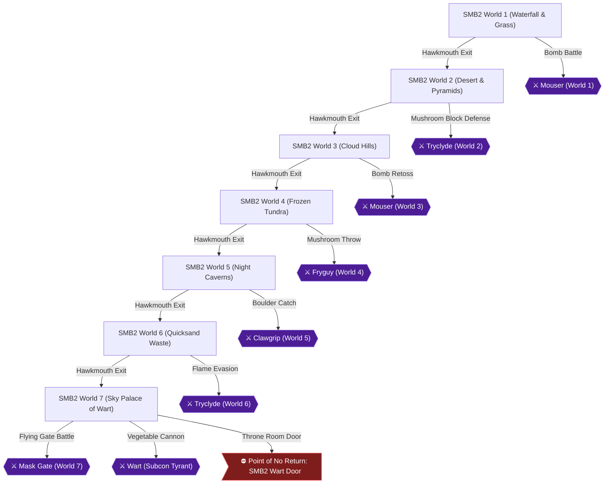

# Writer packet — Chapter 5: Super Mario Bros. 2 — Subcon Liberation (Worlds 1–7)

Write `08_chapters/05.md`. Previous chapter: 4. Super Mario Bros.: The Lost Levels — Secret Worlds (Worlds 9 & A–D). Next chapter: 6. Super Mario Bros. 2 — Character Mastery & Speedrun.
Planner notes: Pluck vegetables, enter Subspace, and defeat Wart and his 8th-in-command bosses without taking damage in the dream world of Subcon.

## Areas in this chapter (in order)

- `SMB2_World1` — SMB2 World 1 (Waterfall & Grass)
- `SMB2_World2` — SMB2 World 2 (Desert & Pyramids)
- `SMB2_World3` — SMB2 World 3 (Cloud Hills)
- `SMB2_World4` — SMB2 World 4 (Frozen Tundra)
- `SMB2_World5` — SMB2 World 5 (Night Caverns)
- `SMB2_World6` — SMB2 World 6 (Quicksand Waste)
- `SMB2_World7` — SMB2 World 7 (Sky Palace of Wart)

## Achievements to place in this chapter (each EXACTLY once as `[ACHIEVEMENT:<id>]`)

- **26941** — Twinkle, Twinkle (1 pts): [SMB2] Collect a Starman  
  supporting facts: neo1-8-1, neo1-8-2, neo1-9-1, neo1-9-2, neo2-87-1, neo2-87-2, neo2-88-1, neo2-88-2, neo2-89-1, neo2-89-2, neo2-90-1, neo2-90-2, neo2-91-1, neo2-91-2, neo2-115-1, neo2-115-2, neo2-120-1, neo2-120-2, neo2-121-1, neo2-121-2, neo2-122-1, neo2-122-2, neo2-142-1, neo2-142-2, neo2-144-1, neo2-144-2, neo3-113-1, neo3-113-2, neo4-35-1, neo4-35-2, neo4-45-1, neo4-45-2, neo4-48-1, neo4-48-2, neo4-63-1, neo4-63-2
- **26942** — Put in Time-Out (1 pts): [SMB2] Collect a Stop Watch  
  supporting facts: neo1-8-1, neo1-8-2, neo2-116-1, neo2-116-2, neo2-138-1, neo2-138-2, neo3-114-1, neo3-114-2, neo4-34-1, neo4-34-2, neo4-46-1, neo4-46-2, neo4-57-1, neo4-57-2, neo4-58-1, neo4-58-2
- **26943** — On the Flip Side (1 pts): [SMB2] Enter Subspace  
  supporting facts: neo1-8-1, neo1-8-2, neo1-11-1, neo1-11-2, neo1-12-1, neo1-12-2, neo1-13-1, neo1-13-2, neo1-15-1, neo1-15-2, neo1-16-1, neo1-16-2, neo1-17-1, neo1-17-2, neo1-19-1, neo1-19-2, neo1-20-1, neo1-20-2, neo1-21-1, neo1-21-2, neo1-22-1, neo1-22-2, neo1-23-1, neo1-23-2, neo1-24-1, neo1-24-2, neo1-25-1, neo1-25-2, neo1-26-1, neo1-26-2, neo1-27-1, neo1-27-2, neo1-29-1, neo1-29-2, neo1-30-1, neo1-30-2, neo1-32-1, neo1-32-2, neo2-112-1, neo2-112-2, neo2-114-1, neo2-114-2, neo2-115-1, neo2-115-2, neo2-116-1, neo2-116-2, neo2-119-1, neo2-119-2, neo2-120-1, neo2-120-2, neo2-121-1, neo2-121-2, neo2-123-1, neo2-123-2, neo2-124-1, neo2-124-2, neo2-125-1, neo2-125-2, neo2-126-1, neo2-126-2, neo2-129-1, neo2-129-2, neo2-130-1, neo2-130-2, neo2-131-1, neo2-131-2, neo2-134-1, neo2-134-2, neo2-135-1, neo2-135-2, neo2-137-1, neo2-137-2, neo2-140-1, neo2-140-2, neo2-141-1, neo2-141-2, neo2-142-1, neo2-142-2, neo2-144-1, neo2-144-2, neo2-145-1, neo2-145-2, neo3-112-1, neo3-112-2, neo3-113-1, neo3-113-2, neo3-118-1, neo3-118-2, neo3-119-1, neo3-119-2, neo3-120-1, neo3-120-2, neo3-122-1, neo3-122-2, neo3-123-1, neo3-123-2, neo3-124-1, neo3-124-2, neo3-125-1, neo3-125-2, neo3-126-1, neo3-126-2, neo3-127-1, neo3-127-2, neo3-128-1, neo3-128-2, neo3-129-1, neo3-129-2, neo3-130-1, neo3-130-2, neo3-131-1, neo3-131-2, neo3-132-1, neo3-132-2, neo3-133-1, neo3-133-2, neo3-134-1, neo3-134-2, neo3-135-1, neo3-135-2, neo3-136-1, neo3-136-2, neo3-137-1, neo3-137-2, neo3-138-1, neo3-138-2, neo4-36-1, neo4-36-2, neo4-37-1, neo4-37-2, neo4-44-1, neo4-44-2, neo4-45-1, neo4-45-2, neo4-46-1, neo4-46-2, neo4-47-1, neo4-47-2, neo4-48-1, neo4-48-2, neo4-49-1, neo4-49-2, neo4-50-1, neo4-50-2, neo4-51-1, neo4-51-2, neo4-52-1, neo4-52-2, neo4-53-1, neo4-53-2, neo4-54-1, neo4-54-2, neo4-55-1, neo4-55-2, neo4-56-1, neo4-56-2, neo4-57-1, neo4-57-2, neo4-58-1, neo4-58-2, neo4-59-1, neo4-59-2, neo4-60-1, neo4-60-2, neo4-61-1, neo4-61-2, neo4-62-1, neo4-62-2, neo4-63-1, neo4-63-2
- **26944** — Big Bucks (4 pts): [SMB2] Match all three slots in the Bonus Chance  
  supporting facts: neo1-9-1, neo1-9-2, neo2-107-1, neo2-107-2, neo2-115-1, neo2-115-2, neo2-123-1, neo2-123-2, neo3-111-1, neo3-111-2, neo3-112-1, neo3-112-2, neo3-128-1, neo3-128-2, neo4-33-1, neo4-33-2, neo4-36-1, neo4-36-2, neo4-38-1, neo4-38-2, neo4-44-1, neo4-44-2, neo4-46-1, neo4-46-2, neo4-49-1, neo4-49-2, neo4-62-1, neo4-62-2
- **26945** — Amazing Vase (4 pts): [SMB2] Find a hidden warp  
  supporting facts: neo1-7-1, neo1-7-2
- **26946** — Golden Gardener (5 pts): [SMB2] Collect 10 coins in a single stage  
  supporting facts: neo1-8-1, neo1-8-2, neo1-11-1, neo1-11-2, neo1-12-1, neo1-12-2, neo1-13-1, neo1-13-2, neo1-15-1, neo1-15-2, neo1-16-1, neo1-16-2, neo1-17-1, neo1-17-2, neo1-19-1, neo1-19-2, neo1-20-1, neo1-20-2, neo1-21-1, neo1-21-2, neo1-22-1, neo1-22-2, neo1-23-1, neo1-23-2, neo1-24-1, neo1-24-2, neo1-25-1, neo1-25-2, neo1-26-1, neo1-26-2, neo1-27-1, neo1-27-2, neo1-29-1, neo1-29-2, neo1-30-1, neo1-30-2, neo1-32-1, neo1-32-2, neo2-112-1, neo2-112-2, neo2-114-1, neo2-114-2, neo2-115-1, neo2-115-2, neo2-116-1, neo2-116-2, neo2-119-1, neo2-119-2, neo2-120-1, neo2-120-2, neo2-121-1, neo2-121-2, neo2-123-1, neo2-123-2, neo2-124-1, neo2-124-2, neo2-125-1, neo2-125-2, neo2-126-1, neo2-126-2, neo2-129-1, neo2-129-2, neo2-130-1, neo2-130-2, neo2-131-1, neo2-131-2, neo2-134-1, neo2-134-2, neo2-135-1, neo2-135-2, neo2-137-1, neo2-137-2, neo2-140-1, neo2-140-2, neo2-141-1, neo2-141-2, neo2-142-1, neo2-142-2, neo2-144-1, neo2-144-2, neo2-145-1, neo2-145-2, neo3-112-1, neo3-112-2, neo3-113-1, neo3-113-2, neo3-118-1, neo3-118-2, neo3-119-1, neo3-119-2, neo3-120-1, neo3-120-2, neo3-122-1, neo3-122-2, neo3-123-1, neo3-123-2, neo3-124-1, neo3-124-2, neo3-125-1, neo3-125-2, neo3-126-1, neo3-126-2, neo3-127-1, neo3-127-2, neo3-128-1, neo3-128-2, neo3-129-1, neo3-129-2, neo3-130-1, neo3-130-2, neo3-131-1, neo3-131-2, neo3-132-1, neo3-132-2, neo3-133-1, neo3-133-2, neo3-134-1, neo3-134-2, neo3-135-1, neo3-135-2, neo3-136-1, neo3-136-2, neo3-137-1, neo3-137-2, neo3-138-1, neo3-138-2, neo4-36-1, neo4-36-2, neo4-37-1, neo4-37-2, neo4-44-1, neo4-44-2, neo4-45-1, neo4-45-2, neo4-46-1, neo4-46-2, neo4-47-1, neo4-47-2, neo4-48-1, neo4-48-2, neo4-49-1, neo4-49-2, neo4-50-1, neo4-50-2, neo4-51-1, neo4-51-2, neo4-52-1, neo4-52-2, neo4-53-1, neo4-53-2, neo4-54-1, neo4-54-2, neo4-55-1, neo4-55-2, neo4-56-1, neo4-56-2, neo4-57-1, neo4-57-2, neo4-58-1, neo4-58-2, neo4-59-1, neo4-59-2, neo4-60-1, neo4-60-2, neo4-61-1, neo4-61-2, neo4-62-1, neo4-62-2, neo4-63-1, neo4-63-2
- **26948** — Capping Out (4 pts): [SMB2] Max out your health at 4 units  
  supporting facts: neo1-8-1, neo1-8-2, neo3-112-1, neo3-112-2, neo3-113-1, neo3-113-2, neo3-118-1, neo3-118-2, neo4-34-1, neo4-34-2, neo4-36-1, neo4-36-2, neo4-37-1, neo4-37-2, neo4-44-1, neo4-44-2, neo4-49-1, neo4-49-2, neo4-52-1, neo4-52-2, neo4-54-1, neo4-54-2, neo4-55-1, neo4-55-2, neo4-59-1, neo4-59-2, neo4-63-1, neo4-63-2
- **26949** — I'll Remember This! (5 pts): [SMB2] Defeat Birdo in World 1-1 without taking damage  
  supporting facts: neo1-10-1, neo1-10-2, neo1-11-1, neo1-11-2, neo1-12-1, neo1-12-2, neo1-13-1, neo1-13-2, neo1-15-1, neo1-15-2, neo1-17-1, neo1-17-2, neo1-20-1, neo1-20-2, neo1-21-1, neo1-21-2, neo1-24-1, neo1-24-2, neo1-26-1, neo1-26-2, neo1-27-1, neo1-27-2, neo1-30-1, neo1-30-2, neo1-31-1, neo1-31-2, neo1-32-1, neo1-32-2, neo2-106-1, neo2-106-2, neo2-115-1, neo2-115-2, neo2-116-1, neo2-116-2, neo2-117-1, neo2-117-2, neo2-120-1, neo2-120-2, neo2-121-1, neo2-121-2, neo2-124-1, neo2-124-2, neo2-125-1, neo2-125-2, neo2-126-1, neo2-126-2, neo2-131-1, neo2-131-2, neo2-135-1, neo2-135-2, neo2-136-1, neo2-136-2, neo2-137-1, neo2-137-2, neo2-138-1, neo2-138-2, neo2-141-1, neo2-141-2, neo2-142-1, neo2-142-2, neo2-143-1, neo2-143-2, neo2-145-1, neo2-145-2, neo2-146-1, neo2-146-2, neo3-112-1, neo3-112-2, neo3-113-1, neo3-113-2, neo3-115-1, neo3-115-2, neo3-118-1, neo3-118-2, neo3-119-1, neo3-119-2, neo3-121-1, neo3-121-2, neo3-122-1, neo3-122-2, neo3-124-1, neo3-124-2, neo3-125-1, neo3-125-2, neo3-128-1, neo3-128-2, neo3-129-1, neo3-129-2, neo3-130-1, neo3-130-2, neo3-131-1, neo3-131-2, neo3-132-1, neo3-132-2, neo3-133-1, neo3-133-2, neo3-134-1, neo3-134-2, neo3-135-1, neo3-135-2, neo3-136-1, neo3-136-2, neo3-137-1, neo3-137-2, neo3-139-1, neo3-139-2, neo4-38-1, neo4-38-2, neo4-41-1, neo4-41-2, neo4-42-1, neo4-42-2, neo4-44-1, neo4-44-2, neo4-45-1, neo4-45-2, neo4-47-1, neo4-47-2, neo4-48-1, neo4-48-2, neo4-50-1, neo4-50-2, neo4-51-1, neo4-51-2, neo4-53-1, neo4-53-2, neo4-54-1, neo4-54-2, neo4-55-1, neo4-55-2, neo4-56-1, neo4-56-2, neo4-57-1, neo4-57-2, neo4-58-1, neo4-58-2, neo4-59-1, neo4-59-2, neo4-60-1, neo4-60-2, neo4-61-1, neo4-61-2, neo4-62-1, neo4-62-2, neo4-63-1, neo4-63-2
- **26960** — The Pipsqueak Bomber (5 pts): [SMB2] Defeat Mouser in World 1  
  supporting facts: neo1-10-1, neo1-10-2, neo1-14-1, neo1-14-2, neo1-22-1, neo1-22-2, neo2-118-1, neo2-118-2, neo2-119-1, neo2-119-2, neo2-128-1, neo2-128-2, neo3-116-1, neo3-116-2, neo3-120-1, neo3-120-2, neo3-126-1, neo3-126-2, neo4-42-1, neo4-42-2, neo4-46-1, neo4-46-2, neo4-52-1, neo4-52-2, neo4-58-1, neo4-58-2
- **26951** — The Pipsqueak Bomber - Perfect (10 pts): [SMB2] Defeat Mouser in World 1 without taking damage  
  supporting facts: neo1-10-1, neo1-10-2, neo1-14-1, neo1-14-2, neo1-22-1, neo1-22-2, neo2-118-1, neo2-118-2, neo2-119-1, neo2-119-2, neo2-128-1, neo2-128-2, neo3-116-1, neo3-116-2, neo3-120-1, neo3-120-2, neo3-126-1, neo3-126-2, neo4-42-1, neo4-42-2, neo4-46-1, neo4-46-2, neo4-52-1, neo4-52-2, neo4-58-1, neo4-58-2
- **26957** — Hydra-phobia (5 pts): [SMB2] Defeat Tryclyde in World 2  
  supporting facts: neo1-10-1, neo1-10-2, neo2-122-1, neo2-122-2, neo2-143-1, neo2-143-2, neo4-43-1, neo4-43-2
- **26950** — Hydra-phobia - Perfect (10 pts): [SMB2] Defeat Tryclyde in World 2 without taking damage  
  supporting facts: neo1-10-1, neo1-10-2, neo2-122-1, neo2-122-2, neo2-143-1, neo2-143-2, neo4-43-1, neo4-43-2
- **26962** — Return of the Pipsqueak Bomber (5 pts): [SMB2] Defeat Mouser in World 3  
  supporting facts: neo1-10-1, neo1-10-2, neo1-14-1, neo1-14-2, neo1-22-1, neo1-22-2, neo2-118-1, neo2-118-2, neo2-119-1, neo2-119-2, neo2-128-1, neo2-128-2, neo3-116-1, neo3-116-2, neo3-120-1, neo3-120-2, neo3-126-1, neo3-126-2, neo4-42-1, neo4-42-2, neo4-46-1, neo4-46-2, neo4-52-1, neo4-52-2, neo4-58-1, neo4-58-2
- **26952** — Return of the Pipsqueak Bomber - Perfect (10 pts): [SMB2] Defeat Mouser in World 3 without taking damage  
  supporting facts: neo1-10-1, neo1-10-2, neo1-14-1, neo1-14-2, neo1-22-1, neo1-22-2, neo2-118-1, neo2-118-2, neo2-119-1, neo2-119-2, neo2-128-1, neo2-128-2, neo3-116-1, neo3-116-2, neo3-120-1, neo3-120-2, neo3-126-1, neo3-126-2, neo4-42-1, neo4-42-2, neo4-46-1, neo4-46-2, neo4-52-1, neo4-52-2, neo4-58-1, neo4-58-2
- **26958** — Fireball Brawl (5 pts): [SMB2] Defeat Fryguy in World 4  
  supporting facts: neo1-10-1, neo1-10-2, neo1-25-1, neo1-25-2, neo2-133-1, neo2-133-2, neo2-134-1, neo2-134-2, neo3-129-1, neo3-129-2, neo4-42-1, neo4-42-2, neo4-55-1, neo4-55-2
- **26953** — Fireball Brawl - Perfect (10 pts): [SMB2] Defeat Fryguy in World 4 without taking damage  
  supporting facts: neo1-10-1, neo1-10-2, neo1-25-1, neo1-25-2, neo2-133-1, neo2-133-2, neo2-134-1, neo2-134-2, neo3-129-1, neo3-129-2, neo4-42-1, neo4-42-2, neo4-55-1, neo4-55-2
- **26959** — Chaotic Crustacean (5 pts): [SMB2] Defeat Clawgrip in World 5  
  supporting facts: neo1-10-1, neo1-10-2, neo1-28-1, neo1-28-2, neo2-139-1, neo2-139-2, neo2-140-1, neo2-140-2, neo3-116-1, neo3-116-2, neo3-132-1, neo3-132-2, neo4-43-1, neo4-43-2, neo4-58-1, neo4-58-2
- **26954** — Chaotic Crustacean - Perfect (10 pts): [SMB2] Defeat Clawgrip in World 5 without taking damage  
  supporting facts: neo1-10-1, neo1-10-2, neo1-28-1, neo1-28-2, neo2-139-1, neo2-139-2, neo2-140-1, neo2-140-2, neo3-116-1, neo3-116-2, neo3-132-1, neo3-132-2, neo4-43-1, neo4-43-2, neo4-58-1, neo4-58-2
- **26963** — Return of Hydra-phobia (5 pts): [SMB2] Defeat Tryclyde in World 6  
  supporting facts: neo1-10-1, neo1-10-2, neo2-122-1, neo2-122-2, neo2-143-1, neo2-143-2, neo4-43-1, neo4-43-2
- **26955** — Return of Hydra-phobia - Perfect (10 pts): [SMB2] Defeat Tryclyde in World 6 without taking damage  
  supporting facts: neo1-10-1, neo1-10-2, neo2-122-1, neo2-122-2, neo2-143-1, neo2-143-2, neo4-43-1, neo4-43-2
- **26964** — Unpleasant Surprise (5 pts): [SMB2] Defeat the evil Mask Gate in World 7  
  supporting facts: neo1-8-1, neo1-8-2, neo1-10-1, neo1-10-2, neo1-17-1, neo1-17-2, neo1-31-1, neo1-31-2, neo1-32-1, neo1-32-2, neo2-106-1, neo2-106-2, neo2-137-1, neo2-137-2, neo2-144-1, neo2-144-2, neo2-145-1, neo2-145-2, neo3-112-1, neo3-112-2, neo3-117-1, neo3-117-2, neo3-118-1, neo3-118-2, neo3-120-1, neo3-120-2, neo3-123-1, neo3-123-2, neo3-126-1, neo3-126-2, neo3-127-1, neo3-127-2, neo3-128-1, neo3-128-2, neo3-129-1, neo3-129-2, neo3-131-1, neo3-131-2, neo3-132-1, neo3-132-2, neo3-133-1, neo3-133-2, neo3-134-1, neo3-134-2, neo3-135-1, neo3-135-2, neo3-136-1, neo3-136-2, neo3-137-1, neo3-137-2, neo3-138-1, neo3-138-2, neo4-38-1, neo4-38-2, neo4-42-1, neo4-42-2, neo4-62-1, neo4-62-2, neo4-63-1, neo4-63-2
- **26956** — Unpleasant Surprise - Perfect (10 pts): [SMB2] Defeat the evil Mask Gate in World 7 without taking damage  
  supporting facts: neo1-8-1, neo1-8-2, neo1-10-1, neo1-10-2, neo1-17-1, neo1-17-2, neo1-31-1, neo1-31-2, neo1-32-1, neo1-32-2, neo2-106-1, neo2-106-2, neo2-137-1, neo2-137-2, neo2-144-1, neo2-144-2, neo2-145-1, neo2-145-2, neo3-112-1, neo3-112-2, neo3-117-1, neo3-117-2, neo3-118-1, neo3-118-2, neo3-120-1, neo3-120-2, neo3-123-1, neo3-123-2, neo3-126-1, neo3-126-2, neo3-127-1, neo3-127-2, neo3-128-1, neo3-128-2, neo3-129-1, neo3-129-2, neo3-131-1, neo3-131-2, neo3-132-1, neo3-132-2, neo3-133-1, neo3-133-2, neo3-134-1, neo3-134-2, neo3-135-1, neo3-135-2, neo3-136-1, neo3-136-2, neo3-137-1, neo3-137-2, neo3-138-1, neo3-138-2, neo4-38-1, neo4-38-2, neo4-42-1, neo4-42-2, neo4-62-1, neo4-62-2, neo4-63-1, neo4-63-2
- **26965** — Make Him Croak! (10 pts, progression): [SMB2] Defeat Wart and restore peace to Subcon  
  supporting facts: neo1-10-1, neo1-10-2, neo1-33-1, neo1-33-2, neo2-106-1, neo2-106-2, neo2-108-1, neo2-108-2, neo2-143-1, neo2-143-2, neo2-145-1, neo2-145-2, neo2-147-1, neo2-147-2, neo3-117-1, neo3-117-2, neo3-137-1, neo3-137-2, neo3-139-1, neo3-139-2, neo4-32-1, neo4-32-2, neo4-43-1, neo4-43-2, neo4-57-1, neo4-57-2, neo4-63-1, neo4-63-2
- **26961** — Make Him Croak! - Perfect (10 pts): [SMB2] Defeat Wart without taking damage  
  supporting facts: neo1-10-1, neo1-10-2, neo1-33-1, neo1-33-2, neo2-106-1, neo2-106-2, neo2-108-1, neo2-108-2, neo2-143-1, neo2-143-2, neo2-145-1, neo2-145-2, neo2-147-1, neo2-147-2, neo3-117-1, neo3-117-2, neo3-137-1, neo3-137-2, neo3-139-1, neo3-139-2, neo4-32-1, neo4-32-2, neo4-43-1, neo4-43-2, neo4-57-1, neo4-57-2, neo4-63-1, neo4-63-2
- **26966** — Nightmare-Free Journey (10 pts): [SMB2] Complete a world without losing a life  
  supporting facts: neo1-8-1, neo1-8-2, neo1-10-1, neo1-10-2, neo1-11-1, neo1-11-2, neo1-12-1, neo1-12-2, neo1-13-1, neo1-13-2, neo1-14-1, neo1-14-2, neo1-15-1, neo1-15-2, neo2-95-1, neo2-95-2, neo2-115-1, neo2-115-2, neo2-116-1, neo2-116-2, neo2-118-1, neo2-118-2, neo2-128-1, neo2-128-2, neo3-116-1, neo3-116-2, neo3-118-1, neo3-118-2, neo3-119-1, neo3-119-2, neo3-120-1, neo3-120-2, neo3-126-1, neo3-126-2, neo4-44-1, neo4-44-2, neo4-45-1, neo4-45-2, neo4-46-1, neo4-46-2, neo4-50-1, neo4-50-2, neo4-51-1, neo4-51-2, neo4-52-1, neo4-52-2

## ⚠ Missables in this chapter (each needs a `> [!WARNING]` BEFORE the point it can be missed)

- SMB2 Nightmare-Free Journey (Deathless World) (achievement 26966) — deadline: Clear an entire world in SMB2 without losing a single life [neo1-8-1, neo1-8-2, neo1-10-1]

## ⛔ Points of no return in this chapter (each needs a `> [!CAUTION]` containing the words "Point of No Return")

- Point of No Return: Wart Throne Room Door: Entering the throne room in World 7-2 locks the entrance behind you for the final confrontation against Wart. [neo1-10-1, neo1-10-2]

## Route diagram (inserted automatically where you write `[MERMAID]`)



## Usable facts (254) — cite as [[fact-id]]

Legend: ✅ verified (2+ sources) · ✔ conflict resolved · 🟡 single source

- ✅ **neo1-7-1** (transition) 8-4: I'll be brief, move forward to the 3rd pipe, then take the 5th pipe which — @SMB2 Stage Guide · ach: 26945,26971,26968,26969,26970  
  evidence: neo1#7: "8-4: I'll be brief, move forward to the 3rd pipe, then take the 5th pipe which"
- ✅ **neo1-7-2** (item) is in the air so you hit a hidden coin to get there. Avoid the cheep cheep on — @SMB2 Stage Guide · ach: 26945,26971,26968,26969,26970  
  evidence: neo1#7: "is in the air so you hit a hidden coin to get there. Avoid the cheep cheep on"
- ✅ **neo1-8-1** (transition) There are twenty levels to complete total. If you manage to find the warp zones — @SMB2 Stage Guide · ach: 26941,26942,26943,26946,26948,26964,26956,26966  
  evidence: neo1#8: "There are twenty levels to complete total. If you manage to find the warp zones"
- ✅ **neo1-8-2** (transition) then you can skip ahead two levels. There are four warp zones total but they — @SMB2 Stage Guide · ach: 26941,26942,26943,26946,26948,26964,26956,26966  
  evidence: neo1#8: "then you can skip ahead two levels. There are four warp zones total but they"
- ✅ **neo1-9-1** (item) At the end of each stage is a slot machine. As you collect coins, you are given — @SMB2 Stage Guide · ach: 26941,26944  
  evidence: neo1#9: "At the end of each stage is a slot machine. As you collect coins, you are given"
- ✅ **neo1-9-2** (location) extra chances to earn extra lives. Below is the winning combinations and how — @SMB2 Stage Guide · ach: 26941,26944  
  evidence: neo1#9: "extra chances to earn extra lives. Below is the winning combinations and how"
- ✅ **neo1-10-1** (location) They come in three colors: red, grey, and pink. Red ones can spit fireballs — @SMB2 Stage Guide · ach: 26949,26960,26951,26962,26952,26957,26950,26963,26955,26958,26953,26959,26954,26964,26956,26965,26961,26966,26972  
  evidence: neo1#10: "They come in three colors: red, grey, and pink. Red ones can spit fireballs"
- ✅ **neo1-10-2** (location) that arch at the character. Grey ones shoot them straight up and down and the — @SMB2 Stage Guide · ach: 26949,26960,26951,26962,26952,26957,26950,26963,26955,26958,26953,26959,26954,26964,26956,26965,26961,26966,26972  
  evidence: neo1#10: "that arch at the character. Grey ones shoot them straight up and down and the"
- ✅ **neo1-11-1** (transition) Fall straight to the bottom. The Pink Shyguys are no threat. Enter thendoor. — @SMB2 Stage Guide · ach: 26943,26946,26949,26966,26967,26969,26970  
  evidence: neo1#11: "Fall straight to the bottom. The Pink Shyguys are no threat. Enter thendoor."
- ✅ **neo1-11-2** (location) Kill the Shyguys and Tweeters and climb up the vine. DUmp the Pink Shyguy — @SMB2 Stage Guide · ach: 26943,26946,26949,26966,26967,26969,26970  
  evidence: neo1#11: "Kill the Shyguys and Tweeters and climb up the vine. DUmp the Pink Shyguy"
- ✅ **neo1-12-1** (boss) This fight is simple. Jump on an egg that Birdo spits out then pick it up. Run — @SMB2 Stage Guide · ach: 26943,26946,26949,26966,26969  
  evidence: neo1#12: "This fight is simple. Jump on an egg that Birdo spits out then pick it up. Run"
- ✅ **neo1-12-2** (boss) up to Birdo and toss the egg. Do this three times to defeat Birdo. — @SMB2 Stage Guide · ach: 26943,26946,26949,26966,26969  
  evidence: neo1#12: "up to Birdo and toss the egg. Do this three times to defeat Birdo."
- ✅ **neo1-13-1** (location) This is just like the first fight. Nothing changes here except for the layout — @SMB2 Stage Guide · ach: 26943,26946,26949,26966,26967,26968,26969,26970  
  evidence: neo1#13: "This is just like the first fight. Nothing changes here except for the layout"
- ✅ **neo1-13-2** (transition) Pick up the crystal ball, enter the mouth and on to the bonus round. — @SMB2 Stage Guide · ach: 26943,26946,26949,26966,26967,26968,26969,26970  
  evidence: neo1#13: "Pick up the crystal ball, enter the mouth and on to the bonus round."
- ✅ **neo1-14-1** (transition) Careful not to touch the Spark as you enter. First thing you do is blow away — @SMB2 Stage Guide · ach: 26960,26951,26962,26952,26966  
  evidence: neo1#14: "Careful not to touch the Spark as you enter. First thing you do is blow away"
- ✅ **neo1-14-2** (boss) the wall. If you want to save bombs, have the Mouser blow up the wall for you. — @SMB2 Stage Guide · ach: 26960,26951,26962,26952,26966  
  evidence: neo1#14: "the wall. If you want to save bombs, have the Mouser blow up the wall for you."
- ✅ **neo1-15-1** (location) Toad's digging ability is a major help in this whole world itself. Princess can — @SMB2 Stage Guide · ach: 26943,26946,26949,26966,26968,26969  
  evidence: neo1#15: "Toad's digging ability is a major help in this whole world itself. Princess can"
- ✅ **neo1-15-2** (location) also get through this level by making over jumps on the outside to avoid some — @SMB2 Stage Guide · ach: 26943,26946,26949,26966,26968,26969  
  evidence: neo1#15: "also get through this level by making over jumps on the outside to avoid some"
- 🟡 **neo1-16-1** (location) We played this level with Princess Toadstool. Watch out for the Red Beezos as — @always. · ach: 26943,26946,26968,26969  
  evidence: neo1#16: "We played this level with Princess Toadstool. Watch out for the Red Beezos as"
- 🟡 **neo1-16-2** (location) they come in for surprise attacks. This would be a good time to hitch a ride on — @always. · ach: 26943,26946,26968,26969  
  evidence: neo1#16: "they come in for surprise attacks. This would be a good time to hitch a ride on"
- 🟡 **neo1-17-1** (boss) This battle is more different than the pink Birdos you have been facing. To — @always. · ach: 26943,26946,26949,26964,26956,26967  
  evidence: neo1#17: "This battle is more different than the pink Birdos you have been facing. To"
- 🟡 **neo1-17-2** (boss) defeat Red Birdo, carry a mushroom block to the top at toss it at Birdo. This — @always. · ach: 26943,26946,26949,26964,26956,26967  
  evidence: neo1#17: "defeat Red Birdo, carry a mushroom block to the top at toss it at Birdo. This"
- 🟡 **neo1-19-1** (transition) We'll let Mario have this one. Enter the opening at the very right. From here — @always. · ach: 26943,26946,26967  
  evidence: neo1#19: "We'll let Mario have this one. Enter the opening at the very right. From here"
- 🟡 **neo1-19-2** (location) you can fall down or climb up. — @always. · ach: 26943,26946,26967  
  evidence: neo1#19: "you can fall down or climb up."
- 🟡 **neo1-20-1** (location) Keep an eye on its third projectile and act accordingly. As a reminder, eggs — @always. · ach: 26943,26946,26949,26968,26969  
  evidence: neo1#20: "Keep an eye on its third projectile and act accordingly. As a reminder, eggs"
- 🟡 **neo1-20-2** (item) you jump on and fireballs you don't. There are two Mushroom Blocks but ignore — @always. · ach: 26943,26946,26949,26968,26969  
  evidence: neo1#20: "you jump on and fireballs you don't. There are two Mushroom Blocks but ignore"
- 🟡 **neo1-21-1** (boss) Fight him like you fight the Red Birdos. Ignore the Mushroom Blocks behind him — @always. · ach: 26943,26946,26949,26970  
  evidence: neo1#21: "Fight him like you fight the Red Birdos. Ignore the Mushroom Blocks behind him"
- 🟡 **neo1-21-2** (boss) they are of no use until after you beat Birdo. — @always. · ach: 26943,26946,26949,26970  
  evidence: neo1#21: "they are of no use until after you beat Birdo."
- 🟡 **neo1-22-1** (boss) Boss Fight: Mouser Mk. II — @always. · ach: 26943,26946,26960,26951,26962,26952,26969  
  evidence: neo1#22: "Boss Fight: Mouser Mk. II"
- 🟡 **neo1-22-2** (boss) The Spark may be a nuisance but you can make Mouser blow him up by accident. — @always. · ach: 26943,26946,26960,26951,26962,26952,26969  
  evidence: neo1#22: "The Spark may be a nuisance but you can make Mouser blow him up by accident."
- 🟡 **neo1-23-1** (location) Princess Toadstool takes the spotlight. Climb the vine and get ready for a — @always. · ach: 26943,26946,26968,26969  
  evidence: neo1#23: "Princess Toadstool takes the spotlight. Climb the vine and get ready for a"
- 🟡 **neo1-23-2** (location) tough sequence as the Beezos come in from all planes, you are better ducking — @always. · ach: 26943,26946,26968,26969  
  evidence: neo1#23: "tough sequence as the Beezos come in from all planes, you are better ducking"
- 🟡 **neo1-24-1** (location) The ground is slippery and that's all that's new. — @always. · ach: 26943,26946,26949  
  evidence: neo1#24: "The ground is slippery and that's all that's new."
- 🟡 **neo1-24-2** (transition) Climb the ladder and exit. Take the potion and go left and drop it. Super Jump — @always. · ach: 26943,26946,26949  
  evidence: neo1#24: "Climb the ladder and exit. Take the potion and go left and drop it. Super Jump"
- 🟡 **neo1-25-1** (boss) The Fryguy moves in a wierd pattern, it will dip up and down as it flies back — @always. · ach: 26943,26946,26958,26953  
  evidence: neo1#25: "The Fryguy moves in a wierd pattern, it will dip up and down as it flies back"
- 🟡 **neo1-25-2** (item) and forth and spit fireballs. Stay between the fireballs and use the Mushroom — @always. · ach: 26943,26946,26958,26953  
  evidence: neo1#25: "and forth and spit fireballs. Stay between the fireballs and use the Mushroom"
- 🟡 **neo1-26-1** (boss) Boss Fight: Birdo (green) — @always. · ach: 26943,26946,26949,26968  
  evidence: neo1#26: "Boss Fight: Birdo (green)"
- 🟡 **neo1-26-2** (location) He may appear to be gray but he's really green. The room makes his color look — @always. · ach: 26943,26946,26949,26968  
  evidence: neo1#26: "He may appear to be gray but he's really green. The room makes his color look"
- 🟡 **neo1-27-1** (location) There is a Trouter during this fight. You can use it to help you in this battle — @always. · ach: 26943,26946,26949,26970  
  evidence: neo1#27: "There is a Trouter during this fight. You can use it to help you in this battle"
- 🟡 **neo1-27-2** (location) Pick Luigi. Climb the ladder and Super Jump up the top of the ledge and pick up — @always. · ach: 26943,26946,26949,26970  
  evidence: neo1#27: "Pick Luigi. Climb the ladder and Super Jump up the top of the ledge and pick up"
- 🟡 **neo1-28-1** (location) THis fight may be tough for Luigi because of his high jump. We suggest that you — @always. · ach: 26959,26954,26970  
  evidence: neo1#28: "THis fight may be tough for Luigi because of his high jump. We suggest that you"
- 🟡 **neo1-28-2** (boss) stand on the first step up and when Clawgrip throws a rock that looks like it — @always. · ach: 26959,26954,26970  
  evidence: neo1#28: "stand on the first step up and when Clawgrip throws a rock that looks like it"
- 🟡 **neo1-29-1** (item) Go down the first jar and get the potion. Throw it down when on the tumbleweed — @always. · ach: 26943,26946  
  evidence: neo1#29: "Go down the first jar and get the potion. Throw it down when on the tumbleweed"
- 🟡 **neo1-29-2** (item) and get the Mushroom before it completely sinks. Jump your way past the Cobrats — @always. · ach: 26943,26946  
  evidence: neo1#29: "and get the Mushroom before it completely sinks. Jump your way past the Cobrats"
- 🟡 **neo1-30-1** (boss) Boss Fight: Birdo (green) — @always. · ach: 26943,26946,26949  
  evidence: neo1#30: "Boss Fight: Birdo (green)"
- 🟡 **neo1-30-2** (boss) This time the Birdo is green like it should be, you already know that it spits — @always. · ach: 26943,26946,26949  
  evidence: neo1#30: "This time the Birdo is green like it should be, you already know that it spits"
- 🟡 **neo1-31-1** (boss) Boss Fight: Birdo (green) — @always. · ach: 26949,26964,26956  
  evidence: neo1#31: "Boss Fight: Birdo (green)"
- 🟡 **neo1-31-2** (location) Utilize the blocks inside — @always. · ach: 26949,26964,26956  
  evidence: neo1#31: "Utilize the blocks inside"
- 🟡 **neo1-32-1** (location) Super Jump on top of the Albatross and ride it back to the rocket. Get the — @always. · ach: 26943,26946,26949,26964,26956,26968  
  evidence: neo1#32: "Super Jump on top of the Albatross and ride it back to the rocket. Get the"
- 🟡 **neo1-32-2** (item) cherries for a star and make it to the ladder and climb up. Watch out for the — @always. · ach: 26943,26946,26949,26964,26956,26968  
  evidence: neo1#32: "cherries for a star and make it to the ladder and climb up. Watch out for the"
- 🟡 **neo1-33-1** (location) Avoid the bubbles he spits and grab a vegetable and when he opens his mouth to — @always. · ach: 26965,26961,26972  
  evidence: neo1#33: "Avoid the bubbles he spits and grab a vegetable and when he opens his mouth to"
- 🟡 **neo1-33-2** (location) spit more bubbles toss it at him. He dies in six hits. For most of the fight, — @always. · ach: 26965,26961,26972  
  evidence: neo1#33: "spit more bubbles toss it at him. He dies in six hits. For most of the fight,"
- ✅ **neo2-87-1** (item) • Starman          - A star that bounces along the ground. When Mario grabs — @SMB2 Stage Guide · ach: 26941,26970  
  evidence: neo2#87: "• Starman          - A star that bounces along the ground. When Mario grabs"
- ✅ **neo2-87-2** (location) it, he will be temporarily invincible, but can still — @SMB2 Stage Guide · ach: 26941,26970  
  evidence: neo2#87: "it, he will be temporarily invincible, but can still"
- ✅ **neo2-88-1** (boss) • Bowser, King of the Koopas - A nine-foot turtle found at the end of each — @SMB2 Stage Guide · ach: 26941,26967  
  evidence: neo2#88: "• Bowser, King of the Koopas - A nine-foot turtle found at the end of each"
- ✅ **neo2-88-2** (location) castle level. The first seven castles have — @SMB2 Stage Guide · ach: 26941,26967  
  evidence: neo2#88: "castle level. The first seven castles have"
- ✅ **neo2-89-1** (location) • Buzzy Beetle               - These black-shelled beetles act like Green — @SMB2 Stage Guide · ach: 26941,26967  
  evidence: neo2#89: "• Buzzy Beetle               - These black-shelled beetles act like Green"
- ✅ **neo2-89-2** (location) Koopa Troopas, the only difference is that — @SMB2 Stage Guide · ach: 26941,26967  
  evidence: neo2#89: "Koopa Troopas, the only difference is that"
- ✅ **neo2-90-1** (location) • Hammer Bros.               - Turtles that throw hammers at Mario. They — @SMB2 Stage Guide · ach: 26941,26967  
  evidence: neo2#90: "• Hammer Bros.               - Turtles that throw hammers at Mario. They"
- ✅ **neo2-90-2** (location) can jump through ledges, and usually come in — @SMB2 Stage Guide · ach: 26941,26967  
  evidence: neo2#90: "can jump through ledges, and usually come in"
- ✅ **neo2-91-1** (location) • Red Koopa Paratroopa       - Red Koopa Paratroopas fly vertically as — @SMB2 Stage Guide · ach: 26941  
  evidence: neo2#91: "• Red Koopa Paratroopa       - Red Koopa Paratroopas fly vertically as"
- ✅ **neo2-91-2** (location) opposed to the green ones, which fly — @SMB2 Stage Guide · ach: 26941  
  evidence: neo2#91: "opposed to the green ones, which fly"
- ✅ **neo2-95-1** (location) This level, simple as it may be, does not require any kind of strategy to — @World 1-1 · ach: 26966  
  evidence: neo2#95: "This level, simple as it may be, does not require any kind of strategy to"
- ✅ **neo2-95-2** (item) be completed, but what I do is grab the hidden 1-Up Mushroom and don't — @World 1-1 · ach: 26966  
  evidence: neo2#95: "be completed, but what I do is grab the hidden 1-Up Mushroom and don't"
- ✅ **neo2-106-1** (location) After completing a level except 7-2, you get a mini-game called Bonus — @SMB2 Stage Guide · ach: 26949,26964,26956,26965,26961,26972,26967  
  evidence: neo2#106: "After completing a level except 7-2, you get a mini-game called Bonus"
- ✅ **neo2-106-2** (item) Round. If you collected coins in that certain level you can gamble them to — @SMB2 Stage Guide · ach: 26949,26964,26956,26965,26961,26972,26967  
  evidence: neo2#106: "Round. If you collected coins in that certain level you can gamble them to"
- ✅ **neo2-107-1** (location) D-Pad        - These buttons will control your character. When you combine — @SMB2 Stage Guide · ach: 26944  
  evidence: neo2#107: "D-Pad        - These buttons will control your character. When you combine"
- ✅ **neo2-107-2** (location) it with the Y or X button, they'll accerlate when walking — @SMB2 Stage Guide · ach: 26944  
  evidence: neo2#107: "it with the Y or X button, they'll accerlate when walking"
- ✅ **neo2-108-1** (location) One evening, Mario had a strange dream. He dreamt of a long, long stairway — @SMB2 Stage Guide · ach: 26965,26961,26972,26967,26968,26969,26970  
  evidence: neo2#108: "One evening, Mario had a strange dream. He dreamt of a long, long stairway"
- ✅ **neo2-108-2** (transition) leading up to a door. As soon as the door opened, he was confronted with a — @SMB2 Stage Guide · ach: 26965,26961,26972,26967,26968,26969,26970  
  evidence: neo2#108: "leading up to a door. As soon as the door opened, he was confronted with a"
- 🟡 **neo2-112-1** (location) Toad is the fastest character in the game. His speed isn't affected — @Abilities · ach: 26943,26946,26967,26968,26969,26970  
  evidence: neo2#112: "Toad is the fastest character in the game. His speed isn't affected"
- 🟡 **neo2-112-2** (location) when he's holding something either! — @Abilities · ach: 26943,26946,26967,26968,26969,26970  
  evidence: neo2#112: "when he's holding something either!"
- 🟡 **neo2-114-1** (location) You begin the game falling through a now bright sky and landing on top of — @Abilities · ach: 26943,26946  
  evidence: neo2#114: "You begin the game falling through a now bright sky and landing on top of"
- 🟡 **neo2-114-2** (location) a big grassy hill, on top of a series of hills. Drop down to the ground, — @Abilities · ach: 26943,26946  
  evidence: neo2#114: "a big grassy hill, on top of a series of hills. Drop down to the ground,"
- ✅ **neo2-115-1** (location) Climb the grass pillars, killing the Ninjis and Blue Shyguy if you wish. — @SMB2 Stage Guide · ach: 26941,26943,26946,26944,26949,26966  
  evidence: neo2#115: "Climb the grass pillars, killing the Ninjis and Blue Shyguy if you wish."
- ✅ **neo2-115-2** (location) When you reach the cloud with the vine on, climb it to the top and step — @SMB2 Stage Guide · ach: 26941,26943,26946,26944,26949,26966  
  evidence: neo2#115: "When you reach the cloud with the vine on, climb it to the top and step"
- ✅ **neo2-116-1** (location) You'll emerge outside underneath a grass hill ledge. Jump up onto it and — @SMB2 Stage Guide · ach: 26942,26943,26946,26949,26966  
  evidence: neo2#116: "You'll emerge outside underneath a grass hill ledge. Jump up onto it and"
- ✅ **neo2-116-2** (location) head left. Pick up the Ninji and use it to take out the Gray Snifit. Get — @SMB2 Stage Guide · ach: 26942,26943,26946,26949,26966  
  evidence: neo2#116: "head left. Pick up the Ninji and use it to take out the Gray Snifit. Get"
- ✅ **neo2-117-1** (location) Jump onto the steel platform above you (watch out for the Spark) and take — @SMB2 Stage Guide · ach: 26949  
  evidence: neo2#117: "Jump onto the steel platform above you (watch out for the Spark) and take"
- ✅ **neo2-117-2** (location) the key. Quickly leave the room. — @SMB2 Stage Guide · ach: 26949  
  evidence: neo2#117: "the key. Quickly leave the room."
- 🟡 **neo2-118-1** (location) Your first World boss, and he may be a little tricky if this is your — @BOSS FIGHT: Mouser · ach: 26960,26951,26962,26952,26966  
  evidence: neo2#118: "Your first World boss, and he may be a little tricky if this is your"
- 🟡 **neo2-118-2** (location) first time. First of all, blow away the weak wall with some bombs you'll — @BOSS FIGHT: Mouser · ach: 26960,26951,26962,26952,26966  
  evidence: neo2#118: "first time. First of all, blow away the weak wall with some bombs you'll"
- 🟡 **neo2-119-1** (location) You've now arrived at the desert. So, head right towards the pile of — @BOSS FIGHT: Mouser · ach: 26943,26946,26960,26951,26962,26952  
  evidence: neo2#119: "You've now arrived at the desert. So, head right towards the pile of"
- 🟡 **neo2-119-2** (location) bones, and watch out for the Cobrat that pops out of the sand. Go past the — @BOSS FIGHT: Mouser · ach: 26943,26946,26960,26951,26962,26952  
  evidence: neo2#119: "bones, and watch out for the Cobrat that pops out of the sand. Go past the"
- 🟡 **neo2-120-1** (boss) Climb the steps and jump onto the platform with Birdo on. This battle — @BOSS FIGHT: Pink Birdo · ach: 26941,26943,26946,26949  
  evidence: neo2#120: "Climb the steps and jump onto the platform with Birdo on. This battle"
- 🟡 **neo2-120-2** (location) may be a touch harder, so pick up the eggs quickly or you may find — @BOSS FIGHT: Pink Birdo · ach: 26941,26943,26946,26949  
  evidence: neo2#120: "may be a touch harder, so pick up the eggs quickly or you may find"
- 🟡 **neo2-121-1** (location) There are two strategies which you could use in this battle. You could — @BOSS FIGHT: Red Birdo · ach: 26941,26943,26946,26949,26969,26970  
  evidence: neo2#121: "There are two strategies which you could use in this battle. You could"
- 🟡 **neo2-121-2** (boss) either get the three Mushroom Blocks below the Birdo and bring them up — @BOSS FIGHT: Red Birdo · ach: 26941,26943,26946,26949,26969,26970  
  evidence: neo2#121: "either get the three Mushroom Blocks below the Birdo and bring them up"
- ✅ **neo2-122-1** (location) In this next room is a pile of sand containing Red Shyguys and four — @SMB2 Stage Guide · ach: 26941,26957,26950,26963,26955  
  evidence: neo2#122: "In this next room is a pile of sand containing Red Shyguys and four"
- ✅ **neo2-122-2** (location) cherries. There is a nearby fifth cherry just to the right of the sand, so — @SMB2 Stage Guide · ach: 26941,26957,26950,26963,26955  
  evidence: neo2#122: "cherries. There is a nearby fifth cherry just to the right of the sand, so"
- ✅ **neo2-123-1** (location) Head right until you get to a cluster of four grass hills. Jump over the — @SMB2 Stage Guide · ach: 26943,26946,26944,26968,26969,26970  
  evidence: neo2#123: "Head right until you get to a cluster of four grass hills. Jump over the"
- ✅ **neo2-123-2** (transition) small gap and enter the door in the fourth grass hill. — @SMB2 Stage Guide · ach: 26943,26946,26944,26968,26969,26970  
  evidence: neo2#123: "small gap and enter the door in the fourth grass hill."
- 🟡 **neo2-124-1** (boss) There are three steel platforms in this area, and Birdo is on the middle — @BOSS FIGHT: Red Birdo · ach: 26943,26946,26949  
  evidence: neo2#124: "There are three steel platforms in this area, and Birdo is on the middle"
- 🟡 **neo2-124-2** (location) one. This battle is simple as always, and to make it even easier, there — @BOSS FIGHT: Red Birdo · ach: 26943,26946,26949  
  evidence: neo2#124: "one. This battle is simple as always, and to make it even easier, there"
- ✅ **neo2-125-1** (location) You'll arrive in the overworld again (but still underground). Beezos will — @SMB2 Stage Guide · ach: 26943,26946,26949  
  evidence: neo2#125: "You'll arrive in the overworld again (but still underground). Beezos will"
- ✅ **neo2-125-2** (location) swoop down at you, so quickly move left and descend the next ladder. — @SMB2 Stage Guide · ach: 26943,26946,26949  
  evidence: neo2#125: "swoop down at you, so quickly move left and descend the next ladder."
- 🟡 **neo2-126-1** (location) This boss is relatively simple. Just head left onto the steel platform — @BOSS FIGHT: Red Birdo · ach: 26943,26946,26949  
  evidence: neo2#126: "This boss is relatively simple. Just head left onto the steel platform"
- 🟡 **neo2-126-2** (boss) to meet Birdo. In this fight you have plenty of space to maneuver and — @BOSS FIGHT: Red Birdo · ach: 26943,26946,26949  
  evidence: neo2#126: "to meet Birdo. In this fight you have plenty of space to maneuver and"
- 🟡 **neo2-128-1** (location) There are two sections of this room with Sparks going around each one. — @BOSS FIGHT: Mouser · ach: 26960,26951,26962,26952,26966  
  evidence: neo2#128: "There are two sections of this room with Sparks going around each one."
- 🟡 **neo2-128-2** (location) Between the two rooms is a little area between two chains to prevent the — @BOSS FIGHT: Mouser · ach: 26960,26951,26962,26952,26966  
  evidence: neo2#128: "Between the two rooms is a little area between two chains to prevent the"
- 🟡 **neo2-129-1** (item) Your first icy level, and this is where the difficulty starts to go up a — @+=========+ · ach: 26943,26946  
  evidence: neo2#129: "Your first icy level, and this is where the difficulty starts to go up a"
- 🟡 **neo2-129-2** (location) notch. Head right across the ice, avoid the Flurry and the Trouters, over — @+=========+ · ach: 26943,26946  
  evidence: neo2#129: "notch. Head right across the ice, avoid the Flurry and the Trouters, over"
- 🟡 **neo2-130-1** (location) When you reach the next area, the rocket will drop you off then explode — @BOSS FIGHT: Auto-bombs · ach: 26943,26946  
  evidence: neo2#130: "When you reach the next area, the rocket will drop you off then explode"
- 🟡 **neo2-130-2** (location) (maybe it was a firework). This area isn't actually a boss fight, but it — @BOSS FIGHT: Auto-bombs · ach: 26943,26946  
  evidence: neo2#130: "(maybe it was a firework). This area isn't actually a boss fight, but it"
- ✅ **neo2-131-1** (location) In the next area head right and drop into the small gap to get the cherry. — @SMB2 Stage Guide · ach: 26943,26946,26949  
  evidence: neo2#131: "In the next area head right and drop into the small gap to get the cherry."
- ✅ **neo2-131-2** (location) Jump over the pillar and a Red Shyguy on a Autobomb will approach. Throw — @SMB2 Stage Guide · ach: 26943,26946,26949  
  evidence: neo2#131: "Jump over the pillar and a Red Shyguy on a Autobomb will approach. Throw"
- 🟡 **neo2-133-1** (item) You land on two rusty steel platforms joined up by two Mushroom Blocks. — @BOSS FIGHT: Fryguy · ach: 26958,26953  
  evidence: neo2#133: "You land on two rusty steel platforms joined up by two Mushroom Blocks."
- 🟡 **neo2-133-2** (item) Below are three Mushroom Blocks. A good strategy to use is getting one — @BOSS FIGHT: Fryguy · ach: 26958,26953  
  evidence: neo2#133: "Below are three Mushroom Blocks. A good strategy to use is getting one"
- 🟡 **neo2-134-1** (location) When you head right an Ostro will come towards you carrying a Red Shyguy. — @BOSS FIGHT: Fryguy · ach: 26943,26946,26958,26953  
  evidence: neo2#134: "When you head right an Ostro will come towards you carrying a Red Shyguy."
- 🟡 **neo2-134-2** (location) Pull the Shyguy off its back and carry it to the right, and take out the — @BOSS FIGHT: Fryguy · ach: 26943,26946,26958,26953  
  evidence: neo2#134: "Pull the Shyguy off its back and carry it to the right, and take out the"
- 🟡 **neo2-135-1** (boss) When you enter the area, you'll see the Birdo on a steel platform in the — @BOSS FIGHT: Green Birdo · ach: 26943,26946,26949  
  evidence: neo2#135: "When you enter the area, you'll see the Birdo on a steel platform in the"
- 🟡 **neo2-135-2** (location) air. Sooner or later, though, it'll fall off so you can battle it on the — @BOSS FIGHT: Green Birdo · ach: 26943,26946,26949  
  evidence: neo2#135: "air. Sooner or later, though, it'll fall off so you can battle it on the"
- ✅ **neo2-136-1** (location) The next area involves a big drop, spike evading and direction swinging. — @SMB2 Stage Guide · ach: 26949  
  evidence: neo2#136: "The next area involves a big drop, spike evading and direction swinging."
- ✅ **neo2-136-2** (location) It's a bit hard to make out a decent strategy, but here I go anyway: — @SMB2 Stage Guide · ach: 26949  
  evidence: neo2#136: "It's a bit hard to make out a decent strategy, but here I go anyway:"
- ✅ **neo2-137-1** (location) Head to the right and jump across the little gap in the bridge to meet — @SMB2 Stage Guide · ach: 26943,26946,26949,26964,26956,26970  
  evidence: neo2#137: "Head to the right and jump across the little gap in the bridge to meet"
- ✅ **neo2-137-2** (boss) Birdo. There is a Trouter jumping out of the water, which you can use to — @SMB2 Stage Guide · ach: 26943,26946,26949,26964,26956,26970  
  evidence: neo2#137: "Birdo. There is a Trouter jumping out of the water, which you can use to"
- ✅ **neo2-138-1** (location) Head right. There are four weeds on the log. You don't have to bother with — @SMB2 Stage Guide · ach: 26942,26949  
  evidence: neo2#138: "Head right. There are four weeds on the log. You don't have to bother with"
- ✅ **neo2-138-2** (location) these if you don't want to, but you can get a stopwatch if you want. Cross — @SMB2 Stage Guide · ach: 26942,26949  
  evidence: neo2#138: "these if you don't want to, but you can get a stopwatch if you want. Cross"
- 🟡 **neo2-139-1** (transition) When you enter this area, jump over the first little gap onto the — @BOSS FIGHT: Clawgrip · ach: 26959,26954  
  evidence: neo2#139: "When you enter this area, jump over the first little gap onto the"
- 🟡 **neo2-139-2** (boss) stranded platform. Clawgrip will throw rocks at you. What you have to do — @BOSS FIGHT: Clawgrip · ach: 26959,26954  
  evidence: neo2#139: "stranded platform. Clawgrip will throw rocks at you. What you have to do"
- 🟡 **neo2-140-1** (item) Back to the desert. :P When you start, there is a big gap of quicksand — @BOSS FIGHT: Clawgrip · ach: 26943,26946,26959,26954  
  evidence: neo2#140: "Back to the desert. :P When you start, there is a big gap of quicksand"
- 🟡 **neo2-140-2** (location) ahead of you with a Cobrat in it. Kill the Cobrat to avoid annoyance from — @BOSS FIGHT: Clawgrip · ach: 26943,26946,26959,26954  
  evidence: neo2#140: "ahead of you with a Cobrat in it. Kill the Cobrat to avoid annoyance from"
- 🟡 **neo2-141-1** (boss) This one's a bit frustrating. You and the Green Birdo are cut off by — @BOSS FIGHT: Green Birdo · ach: 26943,26946,26949,26970  
  evidence: neo2#141: "This one's a bit frustrating. You and the Green Birdo are cut off by"
- 🟡 **neo2-141-2** (item) some sand blocks, a dirt pillar and three Mushroom Blocks. Creating a — @BOSS FIGHT: Green Birdo · ach: 26943,26946,26949,26970  
  evidence: neo2#141: "some sand blocks, a dirt pillar and three Mushroom Blocks. Creating a"
- 🟡 **neo2-142-1** (location) This boss fight is somewhat easier than the fight in World 6-1, that's a — @BOSS FIGHT: Green Birdo · ach: 26941,26943,26946,26949  
  evidence: neo2#142: "This boss fight is somewhat easier than the fight in World 6-1, that's a"
- 🟡 **neo2-142-2** (boss) relief. :) The Birdo is on some steel blocks on the floor in the pit. To — @BOSS FIGHT: Green Birdo · ach: 26941,26943,26946,26949  
  evidence: neo2#142: "relief. :) The Birdo is on some steel blocks on the floor in the pit. To"
- ✅ **neo2-143-1** (location) Once you're up into the night sky, head right across the cloud platform — @SMB2 Stage Guide · ach: 26949,26957,26950,26963,26955,26965,26961,26972  
  evidence: neo2#143: "Once you're up into the night sky, head right across the cloud platform"
- ✅ **neo2-143-2** (transition) and jump onto the sand block platform. Keep heading right and enter the — @SMB2 Stage Guide · ach: 26949,26957,26950,26963,26955,26965,26961,26972  
  evidence: neo2#143: "and jump onto the sand block platform. Keep heading right and enter the"
- ✅ **neo2-144-1** (location) Climb the clouds and ascend the ladder on the highest one. — @SMB2 Stage Guide · ach: 26941,26943,26946,26964,26956  
  evidence: neo2#144: "Climb the clouds and ascend the ladder on the highest one."
- ✅ **neo2-144-2** (location) Head right and jump over the pillar. Watch out for Albatosses dropping — @SMB2 Stage Guide · ach: 26941,26943,26946,26964,26956  
  evidence: neo2#144: "Head right and jump over the pillar. Watch out for Albatosses dropping"
- 🟡 **neo2-145-1** (boss) A fireball-spurting Birdo with an infinite supply of fireballs. And your — @BOSS FIGHT: Green Birdo · ach: 26943,26946,26949,26964,26956,26965,26961,26972  
  evidence: neo2#145: "A fireball-spurting Birdo with an infinite supply of fireballs. And your"
- 🟡 **neo2-145-2** (item) great arsenal to fight against it: one Mushroom Block. Heh. A pretty — @BOSS FIGHT: Green Birdo · ach: 26943,26946,26949,26964,26956,26965,26961,26972  
  evidence: neo2#145: "great arsenal to fight against it: one Mushroom Block. Heh. A pretty"
- ✅ **neo2-146-1** (boss) You'll come into an area with Birdo and a conveyor belt. Pick up the eggs — @SMB2 Stage Guide · ach: 26949  
  evidence: neo2#146: "You'll come into an area with Birdo and a conveyor belt. Pick up the eggs"
- ✅ **neo2-146-2** (boss) the Birdo spits at you and throw them back three times as you would — @SMB2 Stage Guide · ach: 26949  
  evidence: neo2#146: "the Birdo spits at you and throw them back three times as you would"
- 🟡 **neo2-147-1** (location) Okay, it's the showdown, the finale, the grand daddy of 'em all, the — @BOSS FIGHT: Wart · ach: 26965,26961,26972  
  evidence: neo2#147: "Okay, it's the showdown, the finale, the grand daddy of 'em all, the"
- 🟡 **neo2-147-2** (boss) most anticipated battle in the...well, you know what I mean. Wart is — @BOSS FIGHT: Wart · ach: 26965,26961,26972  
  evidence: neo2#147: "most anticipated battle in the...well, you know what I mean. Wart is"
- ✅ **neo3-111-1** (item) Start - This is a very important button.  It starts the game.  While you are — @SMB2 Stage Guide · ach: 26944,26967,26968,26969,26970  
  evidence: neo3#111: "Start - This is a very important button.  It starts the game.  While you are"
- ✅ **neo3-111-2** (location) playing, press it to pause/unpause when you need a break. — @SMB2 Stage Guide · ach: 26944,26967,26968,26969,26970  
  evidence: neo3#111: "playing, press it to pause/unpause when you need a break."
- 🟡 **neo3-112-1** (location) Although she is just a lady, Princess Peach doesn't take any crap! She likes — @Princess Peach · ach: 26943,26946,26944,26948,26949,26964,26956,26967,26968,26969  
  evidence: neo3#112: "Although she is just a lady, Princess Peach doesn't take any crap! She likes"
- 🟡 **neo3-112-2** (location) Mario a lot, and often bakes cakes for him. Toad is a guard for her at the — @Princess Peach · ach: 26943,26946,26944,26948,26949,26964,26956,26967,26968,26969  
  evidence: neo3#112: "Mario a lot, and often bakes cakes for him. Toad is a guard for her at the"
- ✅ **neo3-113-1** (location) Increases life by one unit. The more you get, the more life units you will — @Mushroom · ach: 26941,26943,26946,26948,26949  
  evidence: neo3#113: "Increases life by one unit. The more you get, the more life units you will"
- ✅ **neo3-113-2** (location) have. It will also refill your health. — @Mushroom · ach: 26941,26943,26946,26948,26949  
  evidence: neo3#113: "have. It will also refill your health."
- 🟡 **neo3-114-1** (location) Getting one of these will freeze every enemy for about 7 seconds. They are — @Stopwatch · ach: 26942  
  evidence: neo3#114: "Getting one of these will freeze every enemy for about 7 seconds. They are"
- 🟡 **neo3-114-2** (location) not found very often, but when they are found, they are very useful. — @Stopwatch · ach: 26942  
  evidence: neo3#114: "not found very often, but when they are found, they are very useful."
- 🟡 **neo3-115-1** (location) The bird. Jump on his head for transportation. He can be killed by throwing — @Albatross · ach: 26949  
  evidence: neo3#115: "The bird. Jump on his head for transportation. He can be killed by throwing"
- 🟡 **neo3-115-2** (location) another enemy at him, but killing him is not recommended. — @Albatross · ach: 26949  
  evidence: neo3#115: "another enemy at him, but killing him is not recommended."
- 🟡 **neo3-116-1** (location) Climbs up and down vines. Kill him by throwing another enemy at him or by — @Hoopstar · ach: 26960,26951,26962,26952,26959,26954,26966  
  evidence: neo3#116: "Climbs up and down vines. Kill him by throwing another enemy at him or by"
- 🟡 **neo3-116-2** (location) throwing him off the edge. — @Hoopstar · ach: 26960,26951,26962,26952,26959,26954,26966  
  evidence: neo3#116: "throwing him off the edge."
- ✅ **neo3-117-1** (location) Boss of: World 2 and World 6 — @SMB2 Stage Guide · ach: 26964,26956,26965,26961,26972  
  evidence: neo3#117: "Boss of: World 2 and World 6"
- 🟡 **neo3-117-2** (achievement) Description:  This three headed snake will keep shooting flames at you. It is — @SMB2 Stage Guide · ach: 26964,26956,26965,26961,26972  
  evidence: neo3#117: "Description:  This three headed snake will keep shooting flames at you. It is"
- ✅ **neo3-118-1** (location) World 1-1 - Super Mario Bros. 2 Walkthrough — @SMB2 Stage Guide · ach: 26943,26946,26948,26949,26964,26956,26966  
  evidence: neo3#118: "World 1-1 - Super Mario Bros. 2 Walkthrough"
- ✅ **neo3-118-2** (transition) You will start the game falling from a door in the middle of nowhere. — @SMB2 Stage Guide · ach: 26943,26946,26948,26949,26964,26956,26966  
  evidence: neo3#118: "You will start the game falling from a door in the middle of nowhere."
- ✅ **neo3-119-1** (location) World 1-2 - Super Mario Bros. 2 Walkthrough — @SMB2 Stage Guide · ach: 26943,26946,26949,26966  
  evidence: neo3#119: "World 1-2 - Super Mario Bros. 2 Walkthrough"
- ✅ **neo3-119-2** (item) At the start of this level, you are on a platform surrounded by what looks — @SMB2 Stage Guide · ach: 26943,26946,26949,26966  
  evidence: neo3#119: "At the start of this level, you are on a platform surrounded by what looks"
- ✅ **neo3-120-1** (location) World 1-3 - Super Mario Bros. 2 Walkthrough — @SMB2 Stage Guide · ach: 26943,26946,26960,26951,26962,26952,26964,26956,26966  
  evidence: neo3#120: "World 1-3 - Super Mario Bros. 2 Walkthrough"
- ✅ **neo3-120-2** (transition) Before you start this level, I want you to know that there is a warp in this — @SMB2 Stage Guide · ach: 26943,26946,26960,26951,26962,26952,26964,26956,26966  
  evidence: neo3#120: "Before you start this level, I want you to know that there is a warp in this"
- ✅ **neo3-121-1** (location) World 2-1 - Super Mario Bros. 2 Walkthrough — @SMB2 Stage Guide · ach: 26949  
  evidence: neo3#121: "World 2-1 - Super Mario Bros. 2 Walkthrough"
- ✅ **neo3-121-2** (item) You will start the level in what looks like Egypt because of the desert and — @SMB2 Stage Guide · ach: 26949  
  evidence: neo3#121: "You will start the level in what looks like Egypt because of the desert and"
- ✅ **neo3-122-1** (location) World 2-2 - Super Mario Bros. 2 Walkthrough — @SMB2 Stage Guide · ach: 26943,26946,26949  
  evidence: neo3#122: "World 2-2 - Super Mario Bros. 2 Walkthrough"
- ✅ **neo3-122-2** (location) Jump out of the cave and into the desert. Jump over the few cactuses — @SMB2 Stage Guide · ach: 26943,26946,26949  
  evidence: neo3#122: "Jump out of the cave and into the desert. Jump over the few cactuses"
- ✅ **neo3-123-1** (location) World 2-3 - Super Mario Bros. 2 Walkthrough — @SMB2 Stage Guide · ach: 26943,26946,26964,26956  
  evidence: neo3#123: "World 2-3 - Super Mario Bros. 2 Walkthrough"
- ✅ **neo3-123-2** (location) Climb out of the cave and into the desert again. Pick up the first plant to — @SMB2 Stage Guide · ach: 26943,26946,26964,26956  
  evidence: neo3#123: "Climb out of the cave and into the desert again. Pick up the first plant to"
- ✅ **neo3-124-1** (location) World 3-1 - Super Mario Bros. 2 Walkthrough — @SMB2 Stage Guide · ach: 26943,26946,26949  
  evidence: neo3#124: "World 3-1 - Super Mario Bros. 2 Walkthrough"
- ✅ **neo3-124-2** (transition) In this world, there is a warp that leads to world 5. If you want it, take — @SMB2 Stage Guide · ach: 26943,26946,26949  
  evidence: neo3#124: "In this world, there is a warp that leads to world 5. If you want it, take"
- ✅ **neo3-125-1** (location) World 3-2 - Super Mario Bros. 2 Walkthrough — @SMB2 Stage Guide · ach: 26943,26946,26949  
  evidence: neo3#125: "World 3-2 - Super Mario Bros. 2 Walkthrough"
- ✅ **neo3-125-2** (item) You will start out this level with an Ostro coming toward you with a shy guy — @SMB2 Stage Guide · ach: 26943,26946,26949  
  evidence: neo3#125: "You will start out this level with an Ostro coming toward you with a shy guy"
- ✅ **neo3-126-1** (location) World 3-3 - Super Mario Bros. 2 Walkthrough — @SMB2 Stage Guide · ach: 26943,26946,26960,26951,26962,26952,26964,26956,26966  
  evidence: neo3#126: "World 3-3 - Super Mario Bros. 2 Walkthrough"
- ✅ **neo3-126-2** (transition) You will start out this level in a cave. Exit the cave so that you are outside — @SMB2 Stage Guide · ach: 26943,26946,26960,26951,26962,26952,26964,26956,26966  
  evidence: neo3#126: "You will start out this level in a cave. Exit the cave so that you are outside"
- ✅ **neo3-127-1** (location) World 4-1 - Super Mario Bros. 2 Walkthrough — @SMB2 Stage Guide · ach: 26943,26946,26964,26956  
  evidence: neo3#127: "World 4-1 - Super Mario Bros. 2 Walkthrough"
- ✅ **neo3-127-2** (location) While slipping on the ice, carefully navigate yourself to the right as far as — @SMB2 Stage Guide · ach: 26943,26946,26964,26956  
  evidence: neo3#127: "While slipping on the ice, carefully navigate yourself to the right as far as"
- ✅ **neo3-128-1** (location) World 4-2 - Super Mario Bros. 2 Walkthrough — @SMB2 Stage Guide · ach: 26943,26946,26944,26949,26964,26956  
  evidence: neo3#128: "World 4-2 - Super Mario Bros. 2 Walkthrough"
- ✅ **neo3-128-2** (transition) Before I begin, I'd like to tell you that there is a warp oppurtunity if you — @SMB2 Stage Guide · ach: 26943,26946,26944,26949,26964,26956  
  evidence: neo3#128: "Before I begin, I'd like to tell you that there is a warp oppurtunity if you"
- ✅ **neo3-129-1** (location) World 4-3 - Super Mario Bros. 2 Walkthrough — @SMB2 Stage Guide · ach: 26943,26946,26949,26958,26953,26964,26956  
  evidence: neo3#129: "World 4-3 - Super Mario Bros. 2 Walkthrough"
- ✅ **neo3-129-2** (boss) Climb up the ladder and go outside. You should see a Birdo, but do not kill it, — @SMB2 Stage Guide · ach: 26943,26946,26949,26958,26953,26964,26956  
  evidence: neo3#129: "Climb up the ladder and go outside. You should see a Birdo, but do not kill it,"
- ✅ **neo3-130-1** (location) World 5-1 - Super Mario Bros. 2 Walkthrough — @SMB2 Stage Guide · ach: 26943,26946,26949  
  evidence: neo3#130: "World 5-1 - Super Mario Bros. 2 Walkthrough"
- ✅ **neo3-130-2** (location) Take the Shyguy off the Ostro and use him to kill the red Panser ahead. Fall — @SMB2 Stage Guide · ach: 26943,26946,26949  
  evidence: neo3#130: "Take the Shyguy off the Ostro and use him to kill the red Panser ahead. Fall"
- ✅ **neo3-131-1** (location) World 5-2 - Super Mario Bros. 2 Walkthrough — @SMB2 Stage Guide · ach: 26943,26946,26949,26964,26956  
  evidence: neo3#131: "World 5-2 - Super Mario Bros. 2 Walkthrough"
- ✅ **neo3-131-2** (location) Go left a little and up the ladder until you reach the outside. Jump up past — @SMB2 Stage Guide · ach: 26943,26946,26949,26964,26956  
  evidence: neo3#131: "Go left a little and up the ladder until you reach the outside. Jump up past"
- ✅ **neo3-132-1** (location) World 5-3 - Super Mario Bros. 2 Walkthrough — @SMB2 Stage Guide · ach: 26943,26946,26949,26959,26954,26964,26956  
  evidence: neo3#132: "World 5-3 - Super Mario Bros. 2 Walkthrough"
- ✅ **neo3-132-2** (transition) There is a warp in this level that leads to World 7. If you want the warp, — @SMB2 Stage Guide · ach: 26943,26946,26949,26959,26954,26964,26956  
  evidence: neo3#132: "There is a warp in this level that leads to World 7. If you want the warp,"
- ✅ **neo3-133-1** (location) World 6-1 - Super Mario Bros. 2 Walkthrough — @SMB2 Stage Guide · ach: 26943,26946,26949,26964,26956  
  evidence: neo3#133: "World 6-1 - Super Mario Bros. 2 Walkthrough"
- ✅ **neo3-133-2** (transition) Make your way into the first pipe. Pick up the potion plant at the bottom and — @SMB2 Stage Guide · ach: 26943,26946,26949,26964,26956  
  evidence: neo3#133: "Make your way into the first pipe. Pick up the potion plant at the bottom and"
- ✅ **neo3-134-1** (location) World 6-2 - Super Mario Bros. 2 Walkthrough — @SMB2 Stage Guide · ach: 26943,26946,26949,26964,26956  
  evidence: neo3#134: "World 6-2 - Super Mario Bros. 2 Walkthrough"
- ✅ **neo3-134-2** (transition) Exit the cave. You should now see a very large, almost endless pit. To get — @SMB2 Stage Guide · ach: 26943,26946,26949,26964,26956  
  evidence: neo3#134: "Exit the cave. You should now see a very large, almost endless pit. To get"
- ✅ **neo3-135-1** (location) World 6-3 - Super Mario Bros. 2 Walkthrough — @SMB2 Stage Guide · ach: 26943,26946,26949,26964,26956  
  evidence: neo3#135: "World 6-3 - Super Mario Bros. 2 Walkthrough"
- ✅ **neo3-135-2** (item) Uproot the plant at the top of the ladder, it is a potion. Take it to the — @SMB2 Stage Guide · ach: 26943,26946,26949,26964,26956  
  evidence: neo3#135: "Uproot the plant at the top of the ladder, it is a potion. Take it to the"
- ✅ **neo3-136-1** (location) World 7-1 - Super Mario Bros. 2 Walkthrough — @SMB2 Stage Guide · ach: 26943,26946,26949,26964,26956  
  evidence: neo3#136: "World 7-1 - Super Mario Bros. 2 Walkthrough"
- ✅ **neo3-136-2** (item) Climb onto the clouds and up the ladder. To get the potion, go all the way to — @SMB2 Stage Guide · ach: 26943,26946,26949,26964,26956  
  evidence: neo3#136: "Climb onto the clouds and up the ladder. To get the potion, go all the way to"
- ✅ **neo3-137-1** (location) World 7-2 - Super Mario Bros. 2 Walkthrough — @SMB2 Stage Guide · ach: 26943,26946,26949,26964,26956,26965,26961,26972  
  evidence: neo3#137: "World 7-2 - Super Mario Bros. 2 Walkthrough"
- ✅ **neo3-137-2** (transition) Kill or dodge the three Snifits and go into the door at the right. You will now — @SMB2 Stage Guide · ach: 26943,26946,26949,26964,26956,26965,26961,26972  
  evidence: neo3#137: "Kill or dodge the three Snifits and go into the door at the right. You will now"
- ✅ **neo3-138-1** (item) Congrats for beating the Super Mario Bros. 2 part of Super Mario All-Stars. — @SMB2 Stage Guide · ach: 26943,26946,26964,26956,26970  
  evidence: neo3#138: "Congrats for beating the Super Mario Bros. 2 part of Super Mario All-Stars."
- ✅ **neo3-138-2** (location) Now try playing a different Mario game. — @SMB2 Stage Guide · ach: 26943,26946,26964,26956,26970  
  evidence: neo3#138: "Now try playing a different Mario game."
- 🟡 **neo3-139-1** (boss) As Princess or Luigi, grab a veggie and jump behind Wart. You will be safe from — @Cheap Way to Defeat Wart · ach: 26949,26965,26961,26972,26968,26970  
  evidence: neo3#139: "As Princess or Luigi, grab a veggie and jump behind Wart. You will be safe from"
- 🟡 **neo3-139-2** (boss) Wart, as long as you are behind him. Wait for his mouth to open and throw the — @Cheap Way to Defeat Wart · ach: 26949,26965,26961,26972,26968,26970  
  evidence: neo3#139: "Wart, as long as you are behind him. Wait for his mouth to open and throw the"
- 🟡 **neo4-32-1** (location) V. Level Walkthroughs Worlds 1-7 — @SUPER MARIO BROS. 2 · ach: 26965,26961,26972,26968,26969,26970  
  evidence: neo4#32: "V. Level Walkthroughs Worlds 1-7"
- 🟡 **neo4-32-2** (location) Derived from a Japanese game called Doki Doki Panic, Super Mario Bros. 2 can — @SUPER MARIO BROS. 2 · ach: 26965,26961,26972,26968,26969,26970  
  evidence: neo4#32: "Derived from a Japanese game called Doki Doki Panic, Super Mario Bros. 2 can"
- 🟡 **neo4-33-1** (transition) Mario 2 doesn't have a control scheme like the others, so the transition — @CONTROLS · ach: 26944,26967,26968,26969,26970  
  evidence: neo4#33: "Mario 2 doesn't have a control scheme like the others, so the transition"
- 🟡 **neo4-33-2** (location) won't be as smooth from Mario 1 to this as it normally would be, for — @CONTROLS · ach: 26944,26967,26968,26969,26970  
  evidence: neo4#33: "won't be as smooth from Mario 1 to this as it normally would be, for"
- 🟡 **neo4-34-1** (location) Super Mario Bros. 2 is not without a weird assortment of items, and they are — @ITEM SUMMARY · ach: 26942,26948  
  evidence: neo4#34: "Super Mario Bros. 2 is not without a weird assortment of items, and they are"
- 🟡 **neo4-34-2** (location) listed here in no particular order. — @ITEM SUMMARY · ach: 26942,26948  
  evidence: neo4#34: "listed here in no particular order."
- 🟡 **neo4-35-1** (location) These seem to be an odd little treat to be in this game, but picking up — @Cherries · ach: 26941  
  evidence: neo4#35: "These seem to be an odd little treat to be in this game, but picking up"
- 🟡 **neo4-35-2** (location) several yields a generous reward. Just you wait. — @Cherries · ach: 26941  
  evidence: neo4#35: "several yields a generous reward. Just you wait."
- 🟡 **neo4-36-1** (item) They look like mushrooms and can be thrown at enemies. That's pretty much all — @Mushroom Block · ach: 26943,26946,26944,26948  
  evidence: neo4#36: "They look like mushrooms and can be thrown at enemies. That's pretty much all"
- 🟡 **neo4-36-2** (location) they're good for. Oh, and if you stack them up, sometimes you can get to — @Mushroom Block · ach: 26943,26946,26944,26948  
  evidence: neo4#36: "they're good for. Oh, and if you stack them up, sometimes you can get to"
- ✅ **neo4-37-1** (location) Also only found in Subspace. They'll add a heart to your life meter. You — @Mushroom · ach: 26943,26946,26948  
  evidence: neo4#37: "Also only found in Subspace. They'll add a heart to your life meter. You"
- ✅ **neo4-37-2** (location) can't more than four hearts per level, and they don't carry over into other — @Mushroom · ach: 26943,26946,26948  
  evidence: neo4#37: "can't more than four hearts per level, and they don't carry over into other"
- ✅ **neo4-38-1** (location) 1-ups are plucked from the ground in this game when you're not earning them — @1-up Mushroom · ach: 26944,26949,26964,26956  
  evidence: neo4#38: "1-ups are plucked from the ground in this game when you're not earning them"
- ✅ **neo4-38-2** (location) at the slots at the end of a level. Just uproot one and you'll have an extra — @1-up Mushroom · ach: 26944,26949,26964,26956  
  evidence: neo4#38: "at the slots at the end of a level. Just uproot one and you'll have an extra"
- 🟡 **neo4-41-1** (location) You can't pick Albatosses up, so they can be used as handy rides across long — @Albatoss · ach: 26949  
  evidence: neo4#41: "You can't pick Albatosses up, so they can be used as handy rides across long"
- 🟡 **neo4-41-2** (location) expanses of abyss. Sometimes they fly solo; other times they use their talons — @Albatoss · ach: 26949  
  evidence: neo4#41: "expanses of abyss. Sometimes they fly solo; other times they use their talons"
- 🟡 **neo4-42-1** (location) Grab the Shyguy off the top and take a ride on this rolling cannon device — @Autobomb · ach: 26949,26960,26951,26962,26952,26958,26953,26964,26956  
  evidence: neo4#42: "Grab the Shyguy off the top and take a ride on this rolling cannon device"
- 🟡 **neo4-42-2** (location) that blows fire. You will occasionally have to hitch a ride on one to get — @Autobomb · ach: 26949,26960,26951,26962,26952,26958,26953,26964,26956  
  evidence: neo4#42: "that blows fire. You will occasionally have to hitch a ride on one to get"
- 🟡 **neo4-43-1** (location) A three-headed snake who can't do much else aside from spout fire at you with — @Tryclyde · ach: 26957,26950,26963,26955,26959,26954,26965,26961,26972  
  evidence: neo4#43: "A three-headed snake who can't do much else aside from spout fire at you with"
- 🟡 **neo4-43-2** (location) its three craniums. It's not triply difficult to defeat though, just chunk a — @Tryclyde · ach: 26957,26950,26963,26955,26959,26954,26965,26961,26972  
  evidence: neo4#43: "its three craniums. It's not triply difficult to defeat though, just chunk a"
- 🟡 **neo4-44-1** (location) LEVEL WALKTHROUGHS WORLDS 1-7 — @LEVEL WALKTHROUGHS WORLDS 1-7 · ach: 26943,26946,26944,26948,26949,26966  
  evidence: neo4#44: "LEVEL WALKTHROUGHS WORLDS 1-7"
- 🟡 **neo4-44-2** (location) It's a massive drop through the daytime sky [changed from the dark black sky — @LEVEL WALKTHROUGHS WORLDS 1-7 · ach: 26943,26946,26944,26948,26949,26966  
  evidence: neo4#44: "It's a massive drop through the daytime sky [changed from the dark black sky"
- ✅ **neo4-45-1** (location) Pull Pidgit off his carpet and ride it across the pit, dodging Beezos — @World 1-2 · ach: 26941,26943,26946,26949,26966,26968,26970  
  evidence: neo4#45: "Pull Pidgit off his carpet and ride it across the pit, dodging Beezos"
- ✅ **neo4-45-2** (location) as necessary. Ride it until you reach the safe ground, or you can keep — @World 1-2 · ach: 26941,26943,26946,26949,26966,26968,26970  
  evidence: neo4#45: "as necessary. Ride it until you reach the safe ground, or you can keep"
- 🟡 **neo4-46-1** (location) Use the hawk's head to get up to the first plateau and then move along, — @World 1-3 · ach: 26942,26943,26946,26944,26960,26951,26962,26952,26966  
  evidence: neo4#46: "Use the hawk's head to get up to the first plateau and then move along,"
- 🟡 **neo4-46-2** (item) killing Snifits and collecting cherries. Get the potion and place it — @World 1-3 · ach: 26942,26943,26946,26944,26960,26951,26962,26952,26966  
  evidence: neo4#46: "killing Snifits and collecting cherries. Get the potion and place it"
- 🟡 **neo4-47-1** (location) Watch out for the Cobrats that pop up out of the ground and out of — @World 2-1 · ach: 26943,26946,26949  
  evidence: neo4#47: "Watch out for the Cobrats that pop up out of the ground and out of"
- 🟡 **neo4-47-2** (transition) pipes; they fire bullets at you. If you go in one of the tubes along — @World 2-1 · ach: 26943,26946,26949  
  evidence: neo4#47: "pipes; they fire bullets at you. If you go in one of the tubes along"
- 🟡 **neo4-48-1** (location) Jump up the ledges in the cave and go outside, being wary of Cobrats — @World 2-2 · ach: 26941,26943,26946,26949  
  evidence: neo4#48: "Jump up the ledges in the cave and go outside, being wary of Cobrats"
- 🟡 **neo4-48-2** (location) hiding in quicksand. Make it over to the first Cobrat stowing away in a — @World 2-2 · ach: 26941,26943,26946,26949  
  evidence: neo4#48: "hiding in quicksand. Make it over to the first Cobrat stowing away in a"
- 🟡 **neo4-49-1** (location) Climb out of the cave and get the first plant on your right, which is a — @World 2-3 · ach: 26943,26946,26944,26948,26970  
  evidence: neo4#49: "Climb out of the cave and get the first plant on your right, which is a"
- 🟡 **neo4-49-2** (item) potion. Take it all the way to the left for only one coin, but also a — @World 2-3 · ach: 26943,26946,26944,26948,26970  
  evidence: neo4#49: "potion. Take it all the way to the left for only one coin, but also a"
- 🟡 **neo4-50-1** (transition) Go into the door to the right, and instead of making your way up, fall — @World 3-1 · ach: 26943,26946,26949,26966,26967,26968,26969,26970  
  evidence: neo4#50: "Go into the door to the right, and instead of making your way up, fall"
- 🟡 **neo4-50-2** (location) down the waterfall. Stay in the middle so you don't die in the foam at — @World 3-1 · ach: 26943,26946,26949,26966,26967,26968,26969,26970  
  evidence: neo4#50: "down the waterfall. Stay in the middle so you don't die in the foam at"
- 🟡 **neo4-51-1** (location) ** Unfortunately, because of some experimentation I was doing, I had to — @World 3-2 · ach: 26943,26946,26949,26966,26968,26969  
  evidence: neo4#51: "** Unfortunately, because of some experimentation I was doing, I had to"
- 🟡 **neo4-51-2** (location) play this level as the Princess. Now for you fans of Toadstool, I'm — @World 3-2 · ach: 26943,26946,26949,26966,26968,26969  
  evidence: neo4#51: "play this level as the Princess. Now for you fans of Toadstool, I'm"
- 🟡 **neo4-52-1** (transition) From the entrance, jump up to the door and enter it. Outside are — @World 3-3 · ach: 26943,26946,26948,26960,26951,26962,26952,26966  
  evidence: neo4#52: "From the entrance, jump up to the door and enter it. Outside are"
- 🟡 **neo4-52-2** (location) several Albatosses, so named because they toss Bob-ombs down onto you, — @World 3-3 · ach: 26943,26946,26948,26960,26951,26962,26952,26966  
  evidence: neo4#52: "several Albatosses, so named because they toss Bob-ombs down onto you,"
- ✅ **neo4-53-1** (location) Ah, an ice world. How discomforting. — @World 4-1 · ach: 26943,26946,26949  
  evidence: neo4#53: "Ah, an ice world. How discomforting."
- 🟡 **neo4-53-2** (item) Avoid the Flurrys as they fly at you on their skates. Go get the potion — @World 4-1 · ach: 26943,26946,26949  
  evidence: neo4#53: "Avoid the Flurrys as they fly at you on their skates. Go get the potion"
- 🟡 **neo4-54-1** (location) Go to the right and climb up the vine, then do whatever you have to do — @World 4-2 · ach: 26943,26946,26948,26949  
  evidence: neo4#54: "Go to the right and climb up the vine, then do whatever you have to do"
- 🟡 **neo4-54-2** (location) to evade the Beezos. Unlike most of the time where they swoop down at — @World 4-2 · ach: 26943,26946,26948,26949  
  evidence: neo4#54: "to evade the Beezos. Unlike most of the time where they swoop down at"
- 🟡 **neo4-55-1** (boss) Climb up the ladder to the outside and - huh? Wh-wh-what? Birdo??!? — @World 4-3 · ach: 26943,26946,26948,26949,26958,26953  
  evidence: neo4#55: "Climb up the ladder to the outside and - huh? Wh-wh-what? Birdo??!?"
- 🟡 **neo4-55-2** (boss) Yes, sadly, it's Birdo, but don't kill him. You need his help to get — @World 4-3 · ach: 26943,26946,26948,26949,26958,26953  
  evidence: neo4#55: "Yes, sadly, it's Birdo, but don't kill him. You need his help to get"
- 🟡 **neo4-56-1** (location) Use Luigi throughout all of this world - his supreme jumping abilities — @World 5-1 · ach: 26943,26946,26949,26970  
  evidence: neo4#56: "Use Luigi throughout all of this world - his supreme jumping abilities"
- 🟡 **neo4-56-2** (location) will pay off in each level. Take the red Shyguy off his Ostro and use — @World 5-1 · ach: 26943,26946,26949,26970  
  evidence: neo4#56: "will pay off in each level. Take the red Shyguy off his Ostro and use"
- 🟡 **neo4-57-1** (transition) Go up the ladder and all the way to the right until you see a pipe. The — @World 5-2 · ach: 26942,26943,26946,26949,26965,26961,26972  
  evidence: neo4#57: "Go up the ladder and all the way to the right until you see a pipe. The"
- 🟡 **neo4-57-2** (item) potion you need for the mushroom is inside, so duck into it and bomb — @World 5-2 · ach: 26942,26943,26946,26949,26965,26961,26972  
  evidence: neo4#57: "potion you need for the mushroom is inside, so duck into it and bomb"
- 🟡 **neo4-58-1** (transition) If you're looking for warp zones, Luigi is the only one who can get to — @World 5-3 · ach: 26942,26943,26946,26949,26960,26951,26962,26952,26959,26954,26970  
  evidence: neo4#58: "If you're looking for warp zones, Luigi is the only one who can get to"
- 🟡 **neo4-58-2** (transition) this one. Climb up the ladder and observe the pipe above you. Have — @World 5-3 · ach: 26942,26943,26946,26949,26960,26951,26962,26952,26959,26954,26970  
  evidence: neo4#58: "this one. Climb up the ladder and observe the pipe above you. Have"
- ✅ **neo4-59-1** (location) It's your triumphant return to the desert world! Ha ha ha haaaa ...... — @World 6-1 · ach: 26943,26946,26948,26949  
  evidence: neo4#59: "It's your triumphant return to the desert world! Ha ha ha haaaa ......"
- ✅ **neo4-59-2** (location) bleah. That means more Cobrats = more enemies = less fun. This is not — @World 6-1 · ach: 26943,26946,26948,26949  
  evidence: neo4#59: "bleah. That means more Cobrats = more enemies = less fun. This is not"
- 🟡 **neo4-60-1** (location) If you have an aversion to heights, avoid this level. — @World 6-2 · ach: 26943,26946,26949,26968  
  evidence: neo4#60: "If you have an aversion to heights, avoid this level."
- 🟡 **neo4-60-2** (location) What I mean by that is that this level will have you high up in the — @World 6-2 · ach: 26943,26946,26949,26968  
  evidence: neo4#60: "What I mean by that is that this level will have you high up in the"
- 🟡 **neo4-61-1** (location) Climb up the ladder, then if you want it, go to the left for a nifty — @World 6-3 · ach: 26943,26946,26949,26967  
  evidence: neo4#61: "Climb up the ladder, then if you want it, go to the left for a nifty"
- 🟡 **neo4-61-2** (location) trick. (Okay, so I know this one. Sue me). — @World 6-3 · ach: 26943,26946,26949,26967  
  evidence: neo4#61: "trick. (Okay, so I know this one. Sue me)."
- 🟡 **neo4-62-1** (location) Don't celebrate yet. You haven't beaten the game. Even though there's — @World 7-1 · ach: 26943,26946,26944,26949,26964,26956  
  evidence: neo4#62: "Don't celebrate yet. You haven't beaten the game. Even though there's"
- 🟡 **neo4-62-2** (location) only two levels left, you're still a long way away. — @World 7-1 · ach: 26943,26946,26944,26949,26964,26956  
  evidence: neo4#62: "only two levels left, you're still a long way away."
- ✅ **neo4-63-1** (location) Kill as many people as possible outside before going in. Having two — @World 7-2 · ach: 26941,26943,26946,26948,26949,26964,26956,26965,26961,26972,26967  
  evidence: neo4#63: "Kill as many people as possible outside before going in. Having two"
- 🟡 **neo4-63-2** (transition) hearts when entering the castle is to your advantage. — @World 7-2 · ach: 26941,26943,26946,26948,26949,26964,26956,26965,26961,26972,26967  
  evidence: neo4#63: "hearts when entering the castle is to your advantage."

## Source passages (74 chunks, 73 omitted for size — use `npm run rw:chunks -- 253 --id <chunk>`)

Use these for detail (directions, chest contents, enemy names, boss patterns, ASCII maps). Every statement you take from a passage must cite a fact id; if no fact covers a detail you need, add a fact to `04_facts/` first (with a verbatim quote) and re-run `rw:verify`.

### neo1#7 — Neoseeker: Super Mario All-Stars FAQ/Walkthrough — [--------------------[Super Nintendo Entertainment System]----------------------]

```text
8-4: I'll be brief, move forward to the 3rd pipe, then take the 5th pipe which
    is in the air so you hit a hidden coin to get there. Avoid the cheep cheep on
    the way to the 4th pipe which is after the pit. Swim to the end then when you
    come out get past the Hammer Brother and the Pobodo and you now face the real
    Bowser. Avoid his fire and hammers and wait for him to jump then run under him
    and get the axe. You can also shoot him too. If you are Super Mario or Fire
    Mario, just take the hit and grab the axe.
    
    +++++++++++++++++++++++++++++++++++++++++++++++++++++++++++++++++++++++++++++++
    Warp Zones
    +++++++++++++++++++++++++++++++++++++++++++++++++++++++++++++++++++++++++++++++
    World 1-2: Basically stay on top of the level as much as possible till you
    reach the very end. You can warb to World 2,3, or 4.
    
    World 4-2: Just do the same as above and you'll get to warp to level 5.
    
    World 4-2: There is an area early in 4-2 where there are four blocks above.
    Hit the two right bricks and stand on the one to the left and scoot to the left
    and hit the brick second from the left and a beanstalk rises. Get on the
    beanstalk and go through a little part of a new level and you can warp to World
    6,7, or 8.
    
    =============================SUPER MARIO BROS 2================================
    
    o---------------------o
          INTRODUCTION
    o---------------------o
    
    When Mario opened a door after climbing a long stair in his dream, another 
    World spread before him, and he heard a voice call for help to be freed from
    a spell. After awakening, Mario went to a cave nearby, and to his surprise, he
    saw exactly what he saw in his dream.
    
    
    o---------------------o
         OPTIONS/HEROES
    o---------------------o
    This a one player game and before each level, you get to choose one of the
    four characters.
    
    Mario is an all around character in running, jumping, and carrying an item when
    jumping.
    
    Luigi is an excellent jumper who can leap very high and very far places this is
    in part to his bicycle kicks as he jumps that propels him but his jumping
    ability suffers when holding an item.
    
    Toad is a short guy that doesn't seem like a good character to play as but he
    is the strongest of the four storywise and it shows whenever he picks up an
    item. He lifts it up before you can blink. His jump ability doesn't go down
    when holding an item.
    
    Princess Toadstool takes a break from the damsel in distress to fight alongside
    Mario, Luigi, and Toad. With her dress, she can float for a few seconds when
    you are holding the jump button. This helps you get out of situations that can
    spell the end for the other three heroes.
    
    o---------------------o
           CONTROLS
    o---------------------o
    
    B button: Jump. The strength of the jump depends on how hard you press the Jump
    button. Tap to do a small hop. Hold the Jump button for a higher jump
    
    Y button: Pick up, throw, dig.
    
    Start button: Start game, pause, unpause, choose character for the level.
    
    Up: enter doors and passageways. Climb up vines and ropes.
    
    Down: Crouch. Climb dopwn vines and ropes. Hold Down to power up. Go down the
    vases.
    
    Left/Right: move left or right
    
    Hold Y and left/right: run left or right
    
    Down + B: Crouch jump
    
    Hold Down to power up then press B: Super Jump
```

### neo1#8 — Neoseeker: Super Mario All-Stars FAQ/Walkthrough — [World 1-2: Basically stay on top of the level as much as possible till you]

```text
o---------------------o
           GAMEPLAY
    o---------------------o
    There are twenty levels to complete total. If you manage to find the warp zones
    then you can skip ahead two levels. There are four warp zones total but they
    are found by going down certain jars in Subcon.
    
    o---------------------o
        CHANGES FROM DDP
    o---------------------o
    
    The Mushroom in Sub-Con used to be a Heart Container.
    
    The tune played in Sub-Con (SMB1 Overworld) was originally an Egyptian tune.
    
    Potions were actually Magic Lamps.
    
    Shells were actually heads.
    
    Mushroom Blocks were masks.
    
    No need to beat the game with all characters to see the actual ending.
    
    1-ups were different.
    
    o---------------------o
            ITEMS
    o---------------------o
    
    American Name: Vegetable
    Japanese Name: Yasai
    ---
    Pluck these out of the ground to toss at enemies. They have faces on them, so
    you can tell if they are ripe. They come in turnips, carrots, and pumpkins.
    ---
    
    American Name: Unripened Vegetable
    Japanese Name: Chiisai Yasai
    ---
    Small versions of vegetables. They don't have faces and they have a shorter hit
    rang than the ripe ones.
    ---
    
    American Name: Stopwatch
    Japanese Name: Stopwatch
    ---
    Pluck five Vegetables and the fifth one becomes a Stopwatch that freezes the
    enemies for five seconds.
    ---
    
    American Name: Potion
    Japanese Name: Kusuri
    ---
    Toss this onto the ground to reveal a door that leads to Sub-Con.
    ---
    
    American Name: Mushroom
    Japanese Name: Life-Up Kinoko
    ---
    Found in Sub-Con, this will increase the maximum life by one bar (Four is the
    maximum number of bars)
    ---
    
    American Name: Coin
    Japanese Name: Coin
    ---
    In Sub-Con, pluck the weeds to get coins for the bonus area. This only works
    twice per level. Any other time after that and only small vegetables will come
    out instead.
    ---
    
    American Name: Small Heart
    Japanese Name: Heart
    ---
    Restore any lost health by one. These appear after defeating five enemies.
    ---
    
    American Name: Cherries
    Japanese Name: Cherry
    ---
    Collect five of these to make a Starman appear.
    ---
    
    American Name: Starman
    Japanese Name: Star
    ---
    You'll be invincible for a set period of time.
    ---
    
    American Name: Mushroom Block
    Japanese Name: Kinoko Block
    ---
    Use these as weapons or stepping stools
    ---
    
    American Name: POW Block
    Japanese Name: POW Block
    ---
    Kill all on-screen enemies
    ---
    
    American Name: Key
    Japanese Name: Kagi
    ---
    Use to unlock doors. Beware of Phanto.
    ---
    
    American Name: Bomb
    Japanese Name: Bakudan
    ---
    Throw it and clear out before it explodes.
    ---
    
    American Name: Shell
    Japanese Name: Koura
    ---
    Throw it at the enemies and it will kill them as it slides along the ground.
    ---
    
    American Name: 1-Up Mushroom
    Japanese Name: 1-Up Kinoko
    ---
    Extra Life
    ---
    
    American Name: Rocket
    Japanese Name: Rocket
    ---
    Takes you to another part of the level
    ---
    
    American Name: Crystal Ball
    Japanese Name: Crystal
    ---
    Opens the Hawkmouth to exit the level.
    
    o---------------------o
         BONUS ROUND
    o---------------------o
```

### neo1#9 — Neoseeker: Super Mario All-Stars FAQ/Walkthrough — [World 1-2: Basically stay on top of the level as much as possible till you]

```text
At the end of each stage is a slot machine. As you collect coins, you are given
    extra chances to earn extra lives. Below is the winning combinations and how
    many lives you earn
    
    X means the it doesn't matter as long as it's not a cherry
    
    Cherry - X - X = 1-up
    Cherry - Cherry - X = 2-up
    Cherry - Cherry - Cherry = 5-up
    Snifit - Snifit - Snifit = 1-up
    Turnip - Turnip - Turnip = 1-up
    Star - Star - Star = 1-up
    
    o---------------------o
           ENEMIES
    o---------------------o
    
    American Name: Shyguy
    Japanese Name: Hey-ho
    ---
    They come in Red and Pink. The red ones will move in a straight line while the
    pink ones move back and forth at the edges.
    ---
    
    American Name: Beezo
    Japanese Name: Tondaria
    ---
    They come in two colors: red and pink. They carry pitchfork and like to attack
    you directly. The red ones swoop down and the pink ones charge. You can not 
    jump on them and stay on them since they are too slick but there is a cheap way
    to right them. When you jump on them, press the D-pad in the direction they are
    moving in and because you'd normally slip off behind it, but if you run in the
    same direction it's going then you'll stay on it because its head keep you from
    falling off.
    ---
    
    American Name: Snifit
    Japanese Name: Muucho
    ---
    They come in three colors: red, grey, and pink. They all spit bullets but the 
    red ones stay still, grey ones jump up and down and pink ones move back and 
    forth.
    ---
    
    American Name: Tweeter
    Japanese Name: Riiton
    ---
    They look like mumified birds with their red beaks sticking out. It bounces 
    towards your character and like they don't turn around till they hit a wall or
    fall to their death.
    ---
    
    American Name: Ninji
    Japanese Name: Hakkun
    ---
    This star-shaped enemy either jumps up and down in one spot or run at you and 
    jump at random times.
    ---
    
    American Name: Hoopster
    Japanese Name: Turpen
    ---
    These look like lady bugs that crawl up a vine and then once it gets to the top
    it will make a mad dash back down and repeat its pattern.
    ---
    
    American Name: Pidgit
    Japanese Name: Dodoriges
    ---
    They fly around on a magic carpet and swoop down at you. You can jump on it an
    steal it ride until the carpet disappears.
    ---
    
    American Name: Phanto
    Japanese Name: Kameen
    ---
    Pick up the key and this guy will come to life. He will constantly chase and 
    harass you as long as you are holding the key. He is invincible so don't get 
    any ideas about using the key to kill it. Put down the key for a moment to get
    it out of your hair for a while and when it safe, get the key to the locked 
    door.
    ---
    
    American Name: Trouter
    Japanese Name: Totos
    ---
    You'll see them jumping out of waterfalls and pits. Don't let them land on you.
    In some levels, using them as stepping stones are required to pass the level.
    ---
    
    American Name: Spark
    Japanese Name: Spark
    ---
    They skim all surfaces including objects.
    ---
    
    American Name: Cobrat
    Japanese Name: Garageero
    ---
    Some will pop out of vases and spit bullets and others will pop out the ground
    or quicksand and walk across it. At least these guys can be treated like an 
    item. Throw it and it's gone.
    ---
    
    American Name: Pokey
    Japanese Name: Sanbo
    ---
    A walking cactus that has four sections. To kill pokey in one shot, toss
    something at it's bottom segment.
    ---
```

### neo1#10 — Neoseeker: Super Mario All-Stars FAQ/Walkthrough — [World 1-2: Basically stay on top of the level as much as possible till you]

```text
American Name: Panser
    Japanese Name: Ponkey
    ---
    They come in three colors: red, grey, and pink. Red ones can spit fireballs 
    that arch at the character. Grey ones shoot them straight up and down and the 
    pink ones behave like the red ones except they can walk too.
    ---
    
    American Name: Ostro
    Japanese Name: Daucho
    ---
    A running ostrich that sometimes gives shyguys a piggy back ride.
    ---
    
    American Name: Flurry
    Japanese Name: Nakabon
    ---
    These guys are relentless pursers. Luckily, they are only in the icy areas and 
    they have a tendency to move past you and accidently fall to their doom.
    ---
    
    American Name: Autobomb
    Japanese Name: Turbomb
    ---
    A rolling cannon that shoots out fireballs.
    ---
    
    American Name: Porcupo
    Japanese Name: Harimannen
    ---
    He has spikes on his back so don't bother jumping on him.
    ---
    
    American Name: Albatoss
    Japanese Name: Tondor
    ---
    A flying bird that can be used for a ride as well. Sometimes it will fly by and
    drop Bob-ombs
    ---
    
    American Name: Bob-omb
    Japanese Name: Bob
    ---
    A walking bomb that'll explode if you get nearby. Stay clear of it at
    all costs.
    
    o---------------------o
           BOSSES
    o---------------------o
    
    American Name: Birdo
    Japanese Name: Catherine
    ---
    comes in three colors: red, pink, and green. Pink ones shoot only eggs. Red 
    ones shoot eggs and fireballs. Green ones shoot fireballs only.
    ---
    
    American Name: Mouser
    Japanese Name: Don Churuge
    ---
    A giant mouse that hurls bombs at you. The bombs go off after a few seconds. He
    dies after tossing three bombs of your own and blowing him up.
    ---
    
    American Name: Tryclyde
    Japanese Name: Gabucho
    ---
    A three headed monster that constantly spits out fireballs. There are mushroom
    blocks in the room you can use as offense and defense against him or is it 
    them?
    ---
    
    American Name: Fryguy
    Japanese Name: Hibobo
    ---
    He shoots fireballs while he is flying. The battle is not yet over
    after you defeat him. You must take out the fires left behind too.
    ---
    
    American Name: Clawgrip
    Japanese Name: Chokky
    ---
    He hurls rocks. Unlike most of the bosses minus Wart and the Second Mouser, you
    need five hits to defeat him instead of the usual three.
    ---
    
    American Name: Hawkmouth
    Japanese Name: Mask Gate
    ---
    At the end of 7-2 before you face Wart. It would seem the Hawkmouth would send
    you on your way but instead it will come to life and attack you. Get in three 
    hits and jump into it's mouth immediately.
    ---
    
    American Name: Wart
    Japanese Name: Mamu
    ---
    The final boss of the game. He spits deadly bubbles and in order damage him, 
    you must wait for a vegetable from the machine to come to you and time a throw
    to hit Wart as he is opening his mouth to spit more bubbles.
    
    o---------------------o
          WALKTHROUGH       
    o---------------------o
```

### neo1#11 — Neoseeker: Super Mario All-Stars FAQ/Walkthrough — [World 1-2: Basically stay on top of the level as much as possible till you]

```text
+++++++++++++++++++++++++++++++++++++++++++++++++++++++++++++++++++++++++++++++
    World 1 - Grassland
    +++++++++++++++++++++++++++++++++++++++++++++++++++++++++++++++++++++++++++++++
    -------------------------------------------------------------------------------
    1-1
    -------------------------------------------------------------------------------
    Fall straight to the bottom. The Pink Shyguys are no threat. Enter thendoor. 
    Kill the Shyguys and Tweeters and climb up the vine. DUmp the Pink Shyguy
    somewhere and pick up the potion on the very right and throw it down. There is
    a mushroom inside. Grab it for three hit points maximum. and get three coins as
    well. Get the POW block and use it in a good spot you feel is good. With Luigi
    or thr Pricess, you can hop over the waterfall with ease but for Mario and Toad
    you need to use the logs to get a cross. There is a 1-up mushroom next to the
    second POW block. Go inside the cave and get past the Ninji. Climb up the vine.
    
    From here you have two paths. Go right which is the normal path or hop the pit
    on the left and take the shortcut to Birdo. Let's examine the left path first.
    After you hop the pit, super jump up and toss the Pink Shyguy somewhere. Hold
    the bomb for a few seconds and throw it down so it'll explode and destroy some
    blocks and enter the door. Run across the top of the screen to the left and go
    against Birdo.
    
    If you decided to go the normal route, which Luigi can take a shortcut before 
    even setting foot in the cave by superjumping to the top area which you'll end 
    up after coming out of the cave. But first, let's do the cave bit for the other
    guys. Hell, just exit the door to the right once at the top. Once outside, pick
    up a potion and drop. The Mushroom is outside. Run to the vine on the right and
    kill the Hoopster and climb. Jump the mountain and some of the Ninjis can give
    a boost up the mountain. When you reach the cloud area. Climb up the vines and
    get through the hoopsters. At the top, move right and fight Birdo.
```

### neo1#12 — Neoseeker: Super Mario All-Stars FAQ/Walkthrough — [World 1-2: Basically stay on top of the level as much as possible till you]

```text
---------
    Boss Fight: Birdo (pink)
    
    This fight is simple. Jump on an egg that Birdo spits out then pick it up. Run
    up to Birdo and toss the egg. Do this three times to defeat Birdo.
    ---------
    
    Pick up the crystal ball, enter the mouth and on to the bonus round.
    
    -------------------------------------------------------------------------------
    1-2
    ------------------------------------------------------------------------------- 
    We chose Toad for this level because of how fast he picks stuff up and there
    is one section where there is a shitload of coins to pickup in sub-con but more
    on this later. Wait for the Pidget to swoop down and steal it's carpet. Watch
    out for the Red Beezos coming down at you. When you reach the jars, pick up the
    potion to the left of the first jar and throw it between the two jars where the
    mushroom will be in sub-con.
    
    Remember the strategy we mentioned about the Beezos if you want to take the
    shortcut this is the place to utilize them as your "friend". Get at a high 
    enough point to jump up the cliff and jump onto the Beezo and run right. When
    in range, hop up the cliff and that eliminates the hassle of Phanto. 
    
    If you decide to skip the shortcut and take the normal path then.... The left
    jar has a 1-up at the bottom. In the right jar is the key. Drop the key and
    wait for Phanto to leave then pick up the key and leave. Drop the key again to
    make Phanto leave again. Kill a Ninji with the key for good measure. Now pick
    up the key and enter the door. Hopefully you get enough cherries for a Star.
    Use the bombs to blow up the blocks and get the last cherries to get the star
    and get through the Gray Sniffit. Climb the ladder and destroy to blocks with
    the bombs and pick up a potion and drop it near where the blocks were blown
    away for the mushroom. Now just exit out the door pass the Ninjis. Once outside
    get them coins that we spoke of earlier and then enter the door
```

### neo1#13 — Neoseeker: Super Mario All-Stars FAQ/Walkthrough — [World 1-2: Basically stay on top of the level as much as possible till you]

```text
---------
    Boss Fight: Birdo (pink)
    
    This is just like the first fight. Nothing changes here except for the layout
    of the area.
    ---------
    
    Pick up the crystal ball, enter the mouth and on to the bonus round.
    
    -------------------------------------------------------------------------------
    1-3
    -------------------------------------------------------------------------------
    We could have use Luigi or Princess for this level but we chose Princess for
    the warp circumstance since she can zip through the level with help of her
    hovering ability. If you decide to play the whole level then play as Luigi. OK
    enough of the small talk.
    
    Gather four cherries as you get past the Pink Snifits. Pluck the grass on the
    right (next to the log) for the potion and immediately throw it down for a
    nearby Mushroom. Hop across the two pits with Luigi or Princess or use the logs
    if you have Mario or Toad and toss the Pink Shyguy somewhere. Pluck the potion
    on the ground (1st one). Backtrack across the pit to the left while using the
    logs if needed and toss down the potion. Super Jump to the Mushroom above. If
    you want to warp instead take the potion to the very right and drop it near the
    jar then when in Subcon area. Go down the jar to warp to level 4. Otherwise,
    enter the door. 
    
    Once inside, make your upwards trek to the door and avoid the Sparks. It does
    not matter how you get there, just do it. Enter and pick up the key and drop it
    to get rid of Phanto and try to kill the Spark with the key if you can. Take
    the key out the door and drop it again to get rid of Phanto. Make your way down
    use the key both as a way to keep Phanto from appearing and as a weapon too.
    That is an effective way to kill the Gray Sniffit. Careful not to touch the
    spikes at the bottom. Enter the locked door.
    
    Try to get the cherries by going in and getting one (jump to one and pull back)
    the exit reenter and repeat till a star appears. Use it to get past everyone as
    fast as you can and make it to the crystal ball and enter the Hawk's mouth.
```

### neo1#14 — Neoseeker: Super Mario All-Stars FAQ/Walkthrough — [World 1-2: Basically stay on top of the level as much as possible till you]

```text
---------
    Boss Fight: Mouser
    
    Careful not to touch the Spark as you enter. First thing you do is blow away
    the wall. If you want to save bombs, have the Mouser blow up the wall for you.
    Pick up a bomb and hurl it to where you think Mouser is going to stand and let
    it explode on him. Now for the other two hits, catch one of his bombs and run
    to the right and toss it on the corner when Mouser is on the opposite corner
    and he'll get blown up each time and die after three blasts.
    ---------
    
    Nothing left to do but enter the door.
    
    +++++++++++++++++++++++++++++++++++++++++++++++++++++++++++++++++++++++++++++++
    World 2 - Desert
    +++++++++++++++++++++++++++++++++++++++++++++++++++++++++++++++++++++++++++++++
```

### neo1#15 — Neoseeker: Super Mario All-Stars FAQ/Walkthrough — [World 1-2: Basically stay on top of the level as much as possible till you]

```text
-------------------------------------------------------------------------------
    2-1
    -------------------------------------------------------------------------------
    Toad's digging ability is a major help in this whole world itself. Princess can
    also get through this level by making over jumps on the outside to avoid some
    of the Cobrat's bullets. Get to the first pile of sandy-looking blocks and the
    potion is on the very left on top. Throw it down immediately for the first 
    Mushroom. Watch out for the Red Panser and make a break for the Pyramid and
    enter. Dig your way to the bottom but watch out for the Shyguys as they follow
    you down as you dig. Try to get past the gray Sniffit quickly and climb down
    the ladder.
    
    ---------
    Boss Fight: Birdo (pink)
    
    Stay close to Birdo since the is not much ground in this fight. Defeat him as
```

### neo1#16 — Neoseeker: Super Mario All-Stars FAQ/Walkthrough — [always.]

```text
always.
    ---------
    
    -------------------------------------------------------------------------------
    2-2
    -------------------------------------------------------------------------------
    We played this level with Princess Toadstool. Watch out for the Red Beezos as
    they come in for surprise attacks. This would be a good time to hitch a ride on
    one. If you want the mushroom. The moment you pick up a Potion, move a little
    to the right and drop it and get the mushroom. Get past the quicksand and go
    inside an opening. Blow up the wall when you enter and get the potion and drop
    it immediately for the Mushroom. Get past the Cobrats and the Pokey and climb
    down the vine.
    
    Dig your way down and get the cherries and the star to rid yourself of those
    pesky red Shyguys and dig to the left till the Gray Sniffit passed by and then
    go back up and dig to the right down to the door.
```

### neo1#17 — Neoseeker: Super Mario All-Stars FAQ/Walkthrough — [always.]

```text
---------
    Boss Fight: Birdo (red)
    
    This battle is more different than the pink Birdos you have been facing. To
    defeat Red Birdo, carry a mushroom block to the top at toss it at Birdo. This
    Birdo can spit fireballs too. It's better to run back and retrieve the other
    Mushroom blocks than to pick up the eggs. For the record, Red Birdo spits in
    threes. Whatever he spits is random.
    ---------
    
    Off to the bonus round.
    
    -------------------------------------------------------------------------------
    2-3
    -------------------------------------------------------------------------------
    We decided to give Mario a chance. Climb the ladder and pick up the potion to
    the right and carry it to the very left of the level and drop it for a Mushroom
    and then go forward. The beezos can help you reach the upper area. Ride on then
    jump at the opening. Get the potion and drop it for a mushroom. Get past the
    Beezos and Cobrats and enter the opening at the end.
    
    Fall down the right side to the bottom and pick up a POW block. Dig down until
    you reach the door and enter. Pick up the key and kill the Spark with it. Exit
    and drop immediately. Guide the key to the top and enter the locked door. Make
    your way to the right through all enemies and gather the crystall ball and then
    enter the Hawkmouth.
```

### neo1#19 — Neoseeker: Super Mario All-Stars FAQ/Walkthrough — [always.]

```text
-------------------------------------------------------------------------------
    We'll let Mario have this one. Enter the opening at the very right. From here
    you can fall down or climb up.
    
    Fall down: You'll fall a few screens. Land in the middle and careful not to
    slip down as you enter the opening. Pull up the 10th weed to the left for a
    Potion. Get as many coins as you can. If you don't care for the coins, you can
    run to the jar with the potion and drop it and then use the jar to warp to
    world 5. If you decide not to warp, enter the door. Skip to climb up.
    
    Climb up: Avoid or kill the Pink Shyguys as you hop your way up the clouds. At
    the top, jump on a Pidgit and steal his carpet. Watch out for the red Beezos as
    you guide the carpet up to the vine and climb it.Get past the Gray Panser's
    fireball and jump onto that island with two weeds and get the potion and drop
    it where you are standing. Hop to the Mushroom. Take the mushroom block and 
    kill the Red Panser with it. Kill teh Pink Panser with the Pink Shyguy and
    climb down the ladder for a potion, carry it to the left and drop it. In Subcon
    climb the ladder and head for the Mushroom. Sacrifice a life point and enter
    the opening.
```

### neo1#20 — Neoseeker: Super Mario All-Stars FAQ/Walkthrough — [always.]

```text
---------
    Boss Fight: Birdo (red)
    
    Keep an eye on its third projectile and act accordingly. As a reminder, eggs
    you jump on and fireballs you don't. There are two Mushroom Blocks but ignore
    them.
    ---------
    
    Bonus round time
    
    -------------------------------------------------------------------------------
    3-2
    -------------------------------------------------------------------------------
    If you play as Princess Toadstool then you have a very good shortcut on your
    hands. Dispose of the Ostros and the Shyguys they carry and avoid the red
    Beezos. Use a turnip on the Gray Panser and dispose of more Ostros n Shyguys
    and pick up a POW Block. Get a running start and hover over the pit. Run past
    the falling fireballs and climb down the ladder. Make it to another ladder
    but don't climb up. Float off further to the left and pick up a bomb and time 
    it to blow up the wall. There are Porcupos below at the end. Blow up the right
    side of the floor and use the potion near it. A mushroom can be reach from that
    spot. Now climb that ladder and enter the door.
```

### neo1#21 — Neoseeker: Super Mario All-Stars FAQ/Walkthrough — [always.]

```text
---------
    Boss Fight: Birdo (red)
    
    Fight him like you fight the Red Birdos. Ignore the Mushroom Blocks behind him
    they are of no use until after you beat Birdo.
    ---------
    
    -------------------------------------------------------------------------------
    3-3
    -------------------------------------------------------------------------------
    Pick Luigi for this Level. The Albatrosses drop Bob-Ombs. Get the potion and
    head left and drop it for a mushroom. Get to the door safely. Throw a turtle
    shell at the Ninjis. Carry the Potion to the ladder. Drop it and when in Subcon
    climb up and get the Mushroom. Once out of Subcon, get the POW Block on the
    left. Use it on either the Ninji or the Sparks and enter the door. Work your
    way up to door at the top. It's best to keep running right and jumping as you
    will ome out of the other side. Enter the door and carefully get the key. You
    know the other part. Just work your way down and make it to the locked door
    you saw earlier. Make your way through the sparks and use the chains to
    avoid the Red Panser's fireballs. Get past the Gray Sniffit and enter the door.
    To carefully get past the Sparks here, wait for the bottom Spark to pass by and
    Super Jump onto the top of the middle wall when safe. Try to get the five
    cherries if you can and get the star and get to the ladder and climb up. Use
    the turtle shell to kill the Ninjis. Get the Crystal Ball.
```

### neo1#22 — Neoseeker: Super Mario All-Stars FAQ/Walkthrough — [always.]

```text
---------
    Boss Fight: Mouser Mk. II
    
    The Spark may be a nuisance but you can make Mouser blow him up by accident.
    The fight is like before except you need five hits instead of three.
    ---------
    
    +++++++++++++++++++++++++++++++++++++++++++++++++++++++++++++++++++++++++++++++
    World 4 - Icy Land
    +++++++++++++++++++++++++++++++++++++++++++++++++++++++++++++++++++++++++++++++
    -------------------------------------------------------------------------------
    4-1
    -------------------------------------------------------------------------------
    We chose Toad here. You can run and jump your way through the first part of the
    level like it's nothing as you go past Trouters and Flurees. The state is real
    slippery so be careful at the end of the icy area. Get the potion and drop it
    and get the mushroom to the right in Subcon. Once out, go below and use the
    rocket to get to the next area.
    
    There is no boss on this level despite the music. All you do is make it to the
    crystal ball and the end of the level.
```

### neo1#23 — Neoseeker: Super Mario All-Stars FAQ/Walkthrough — [always.]

```text
-------------------------------------------------------------------------------
    4-2
    -------------------------------------------------------------------------------
    Princess Toadstool takes the spotlight. Climb the vine and get ready for a
    tough sequence as the Beezos come in from all planes, you are better ducking
    n sliding to skid under some and only squat jump over the low ones. You'll
    encounter the Flurees along the way but make it to the door and you made it.
    
    Go to the whale on the left and get the potion and drop it. The Mushroom is on
    the tail. For the level it's safe to stand on the water coming from the whale's
    spout not safe to touch the side. When you see three platforms with weeds. The
    potion is on the top one. If you want to warp to level six then carry it to the
    potion. Otherwise pick up the rocket at the end. Pick up the Shyguy and toss it
    away then get the potion and grab the potion and ride the Autobomb over the 
    spikes while crouching. Hover over the Porcupos and drop the potion and get the
    Mushroom. Enter the opening.
```

### neo1#24 — Neoseeker: Super Mario All-Stars FAQ/Walkthrough — [always.]

```text
---------
    Boss Fight: Birdo (red)
    
    The ground is slippery and that's all that's new.
    ---------
    
    -------------------------------------------------------------------------------
    4-3
    -------------------------------------------------------------------------------
    Climb the ladder and exit. Take the potion and go left and drop it. Super Jump
    to the Mushroom. Now as for Birdo. Don't kill him. Use his egg to get across
    the water. If you wanted some coins you can enter the cave and exit then carry
    the potion to the island as you are riding the egg. Enter the door and work
    your way up the ice and avoid the Flurries and don't land on the spikes and
    enter the door at the top.
    
    Pick up the potion and guide yourself across the top of the castles and drop it
    onto one of the platforms high up for a mushroom. Drop down and enter the 
    castle. Let the red Shyguy give you a piggyback ride along the spikes till you
    reach a door. Doo the little key bit, till you reach the locked door below. Go
    to the door and duck under the Beezo.
```

### neo1#25 — Neoseeker: Super Mario All-Stars FAQ/Walkthrough — [always.]

```text
---------
    Boss Fight: Fryguy
    
    The Fryguy moves in a wierd pattern, it will dip up and down as it flies back
    and forth and spit fireballs. Stay between the fireballs and use the Mushroom
    blocks to kill him. WHen he dies, it's not over yet. You must eliminate the
    tiny fireballs left behind with the mushroom blocks
    ---------
    
    +++++++++++++++++++++++++++++++++++++++++++++++++++++++++++++++++++++++++++++++
    World 5 - Cave
    +++++++++++++++++++++++++++++++++++++++++++++++++++++++++++++++++++++++++++++++
    -------------------------------------------------------------------------------
    5-1
    -------------------------------------------------------------------------------
    Jump past the Ostro n Shyguy and then jump over the Red Panser between its
    fireballs and then at the bottom, get past the fireballs anf go left to the
    door. Use the logs to get across then you'll have to rely on the Trouters as
    stepping stones in this level. If you managed to get over the ceiling at the
    end of the passage, pick up the right Mushroom Block and then at the bottom
    get the potion. The Mushroom will fall to the floor for you to collect. Now
    just enter the opening.
```

### neo1#26 — Neoseeker: Super Mario All-Stars FAQ/Walkthrough — [always.]

```text
---------
    Boss Fight: Birdo (green)
    
    He may appear to be gray but he's really green. The room makes his color look
    different. Anyway, he'll strictly spit fireballs so utalize that Mushroom Block
    in the room and hit him three times.
    ---------
    
    -------------------------------------------------------------------------------
    5-2
    -------------------------------------------------------------------------------
    Climb the ladder at the start. There are Hoopster galore in this level. Some of
    them are needed for leverage. When you reach the first jar, go inside and use
    the bomb to go to the bottom and carefully get the potion and exit the jar.
    Throw down the jar and get the mushroom. With the Princess, you can utilize
    your floating ability from here and reach the vine. Climb up and get through
    the Gray Sniffits' bullets and climb all the way to top via the left vine and
    enter the opening. Inside, pick up the POW block and as you fall, try not to
    fall onto the spikes. The princess has it lucky if you miss the small platforms
    because you can make her float a little bit and have a Trouter give her a boost
    and then just enter the opening.
```

### neo1#27 — Neoseeker: Super Mario All-Stars FAQ/Walkthrough — [always.]

```text
---------
    Boss Fight: Birdo (red)
    
    There is a Trouter during this fight. You can use it to help you in this battle
    as a weapon.
    ---------
    
    -------------------------------------------------------------------------------
    5-3
    -------------------------------------------------------------------------------
    Pick Luigi. Climb the ladder and Super Jump up the top of the ledge and pick up
    the potion and throw it down. In Subcon go down the jar and warp to Level 7.
    
    Wanna skip the warp? In that case move forward instead and avoid the Bob-ombs
    being dropped by the Albatrosses. If you are lucky enough you can have the
    Bob-Ombs blow away blocks because once you get the potion and enter Subcon then
    the Mushroom is free. Go down the ladder, Avoid the Bob-ombs and the Red Panser
    and enter the opening. Avoid the Sparks and climb down then climb back up the
    other side. As a shortcut, hold down as you ride a Red Shyguy to go through the
    open spot then climb up and get through the Pink Pansers and enter the opening.
    Get past the Pink Sniffit anmd steal the Pidgit's carpet and fly right till the
    carpet vanishes. Steal another carpet as you go right. Kill the Red Birdo.
```

### neo1#28 — Neoseeker: Super Mario All-Stars FAQ/Walkthrough — [always.]

```text
---------
    Boss Fight: Clawgrip
    
    THis fight may be tough for Luigi because of his high jump. We suggest that you
    stand on the first step up and when Clawgrip throws a rock that looks like it
    will roll over the gap, walk on it if it does and pick up and try to get a hit
    in on Clawgrip. Repeat this pattern to defeat him. He dies in five hits. There
    is a double hit trick you can use on Clawgrip too. If you hit the rock that
    Clawgrip gets ready to throw and it will "kill" the rock but the two rocks will
    bounce back and hit Clawgrip at least twice.
    ---------
    
    +++++++++++++++++++++++++++++++++++++++++++++++++++++++++++++++++++++++++++++++
    World 6 - Desert 2
    +++++++++++++++++++++++++++++++++++++++++++++++++++++++++++++++++++++++++++++++
```

### neo1#29 — Neoseeker: Super Mario All-Stars FAQ/Walkthrough — [always.]

```text
-------------------------------------------------------------------------------
    6-1
    -------------------------------------------------------------------------------
    Go down the first jar and get the potion. Throw it down when on the tumbleweed
    and get the Mushroom before it completely sinks. Jump your way past the Cobrats
    Pokies, and Shyguys and when you get the potion, get past the Pink Pansers
    frieballs and get to the opening and throw it down. The Mushroom is on top of
    the sand blocks. Once you get it, feel free to enter the opening.
    
    Grab the Cobrat you see and toss it at the jar with the Mushroom Block on it
    and kill the Cobrat that was under it. Enter the jar and dig to the bottom, a
    1-up awaits you below. Go to the last set of jars then go three jars down and
    duck into it. Carry the key and do the key bit and enter the door to the right
    once you exit the jar.
```

### neo1#30 — Neoseeker: Super Mario All-Stars FAQ/Walkthrough — [always.]

```text
---------
    Boss Fight: Birdo (green)
    
    This time the Birdo is green like it should be, you already know that it spits
    only fireballs. Use the Mushroom Blocks to beat him
    ---------
    
    -------------------------------------------------------------------------------
    6-2
    -------------------------------------------------------------------------------
    Enter the opening and this level is a little simple since it's a ride along the
    Albatrosses and watch for the Beezos. They appear green here. The Panser will
    not bother you. On the first piece of land, get off the Albatross and get the
    potion and Mushroom. Ride the Albatross back to the beginning and hold up the
    pumpkin you should have picked up before boarding to kill the Panser on the way
    back. Then do the whole thing over again. Hop over the three Albatrosses when
    you get to them. Enter the opening at the end.
```

### neo1#31 — Neoseeker: Super Mario All-Stars FAQ/Walkthrough — [always.]

```text
---------
    Boss Fight: Birdo (green)
    
    Utilize the blocks inside
    ---------
    
    -------------------------------------------------------------------------------
    6-3
    -------------------------------------------------------------------------------
    MAJOR SHORTCUT!
    
    Go up the ladder. Sink inside the quicksand and try to move under the wall and
    when you emerge, enter the door. Move along the clouds and onto the sand. Enter
    the door and defeat the Red Birdo.
    
    ---------
    Boss Fight: Triclyde Mk. II
    
    USe the Mushroom blocks below as you move back and forth to avoid the fireballs
    and just try to get in three hits.
    ---------
    
    
    +++++++++++++++++++++++++++++++++++++++++++++++++++++++++++++++++++++++++++++++
    World 7 - Clouds
    +++++++++++++++++++++++++++++++++++++++++++++++++++++++++++++++++++++++++++++++
```

### neo1#32 — Neoseeker: Super Mario All-Stars FAQ/Walkthrough — [always.]

```text
-------------------------------------------------------------------------------
    7-1
    -------------------------------------------------------------------------------
    ANOTHER MAJOR SHORTCUT!
    
    Super Jump on top of the Albatross and ride it back to the rocket. Get the
    cherries for a star and make it to the ladder and climb up. Watch out for the
    Sparks in this level as you move up the clouds. Watch out for the Hoopster and
    the Snifit bullets and enter the door.
    
    ---------
    Boss Fight: Birdo (green)
    
    One Mushroom Block is all you got at your disposal
    ---------
    
    -------------------------------------------------------------------------------
    7-2
    -------------------------------------------------------------------------------
    We chose the Princess to finish things off. Jump up to the ledge on the upper
    left at the start then from there, you can make floationg jumps on route to the
    castle.
    
    Once you get past the Shyguys and Ninji, you got two paths: up or down.
    
    We chose down.
    
    Down: Time a floating jump low enough to clear the spikes and reach the chain.
    Kill the Sparks or avoid them as you pick up Mushroom Blocks on the way down to
    the door. Avoid the Sparks and enter the door with a potion and Mushroom inside
    of it. Exit and reach the door. Climb up the chains. The Sparks can touch you
    if you are in the middle of the chains and enter the door at the top. Get past
    two more Sparks and climb the chain to the left. Now you go up through the
    treadmill with enemies in the way. Make it past them and climb the chain. You
    can defeat the Red Birdo if you want but if you time a floating crouch jump,
    you can sail over his head and climb the chain. Get past the sparks and the
    next door is locked. The door past it has a Birdo who guards the key. Kill it
    and rid of Phanto and get the key to the locked door. Defeat the Hawkmouth as
    we explained earlier in the boss description.
```

### neo1#33 — Neoseeker: Super Mario All-Stars FAQ/Walkthrough — [always.]

```text
---------
    Final Boss Fight: Wart
    
    Avoid the bubbles he spits and grab a vegetable and when he opens his mouth to
    spit more bubbles toss it at him. He dies in six hits. For most of the fight,
    you are safe at the wall just below him and if a veggie pops up or a bubble is
    going tio hit you, then move. You won
    ---------
    
    +++++++++++++++++++++++++++++++++++++++++++++++++++++++++++++++++++++++++++++++
    Secrets
    +++++++++++++++++++++++++++++++++++++++++++++++++++++++++++++++++++++++++++++++
    I explained the warps earlier. Check 1-3, 3-1, 4-2, and 5-3. There was one in
    world 6 but hell with it.
    
    ===============================================================================
    Epilogue
```

### neo2#87 — Neoseeker: Super Mario All-Stars FAQ/Walkthrough v0.75 — [/ _____ __________________________________________________________________ \]

```text
• Starman          - A star that bounces along the ground. When Mario grabs
                             it, he will be temporarily invincible, but can still
                             be killed if he falls down a pit. Mario will be
                             invincible for 18 game seconds when in Starman mode.
                             Mario's overalls and shirt flicker when he is
                             invincible.
    
        • Super Mushroom   - A red mushroom with white spots. Making Regular Mario
                             touch one will transform him into Super Mario. They
                             move around in one direction, and change direction
                             when they hit something stationary, like a pipe.
    
        • Warp Pipe        - Some green pipes give Mario and Luigi the ability to
                             warp to different loactions in the Mushroom Kingdom.
```

### neo2#88 — Neoseeker: Super Mario All-Stars FAQ/Walkthrough v0.75 — [/ _____ __________________________________________________________________ \]

```text
___________________________________________________________________________
     / _____  __________________________________________________________________ \
    / / 209 \ \                       ENEMY LIST                                \ \
    \ \_____/ /_________________________________________________________________/ /
     \___________________________________________________________________________/
    
        • Bowser, King of the Koopas - A nine-foot turtle found at the end of each
                                       castle level. The first seven castles have
                                       Bowser decoys. When you defeat these Bowsers
                                       with fireballs they turn into weaker enemies
                                       and drop into the lava. The Bowsers in
                                       castles 6-8 can throw hammers. They all spit
                                       fire.
    
                                       Can be killed with:
    
                                       Touching the axe to his right
                                       Five fireballs
    
                                       Cannot be killed with:
    
                                       A stomp
                                       A kicked shell
                                       Invincibility
                                       A bump from underneath
    
                                       Worth 5000 points (only using fireballs)
    
                                       When killed with fireballs, the decoy
                                       Bowsers turn into the following enemies:
    
                                       Castle 1: Goomba
                                       Castle 2: Koopa Troopa
                                       Castle 3: Buzzy Beetle
                                       Castle 4: Spiny
                                       Castle 5: Lakitu
                                       Castle 6: Bloober
                                       Castle 7: Hammer Brother
    
        • Bloober                    - A squid-like creature that appears in water
                                       levels. They move in spurts and in random
                                       directions, which makes them difficult to
                                       avoid. However, if you are on the sea floor
                                       while Regualar Mario they can't touch you
                                       (duck if you are Super/Fiery Mario, they can
                                       still touch you).
    
                                       Can be killed with:
    
                                       A fireball
    
                                       Worth 200 points.
    
        • Bullet Bill                - A bullet shaped enemy that is either fired
                                       from a cannon in some levels, or fired from
                                       the right side of the screen in others. Like
                                       Pirahna Plants, they do not come out of the
                                       cannons if you stand on top of, or next to
                                       them.
    
                                       Can be killed with:
    
                                       A stomp
                                       A kicked shell (this doesn't always work)
                                       Invincibility
```

### neo2#89 — Neoseeker: Super Mario All-Stars FAQ/Walkthrough v0.75 — [/ _____ __________________________________________________________________ \]

```text
Cannot be killed with:
    
                                       A bump from underneath
                                       A fireball
    
                                       Worth 200 points.
    
        • Buzzy Beetle               - These black-shelled beetles act like Green
                                       Koopa Troopas, the only difference is that
                                       fireballs don't affect them. They replace
                                       Goombas in the second game (also known as
                                       the 'More Difficult Quest').
    
                                       Can be killed with:
    
                                       A kicked shell
                                       Invincibility
    
                                       Can be stunned with:
    
                                       A stomp
                                       A bump from underneath
    
                                       Cannot be killed with:
    
                                       A fireball
    
                                       Worth 100 points.
    
        • Cheep-cheep                - These fishy creatures come in two varieties
                                       but both do the same things, however, the
                                       green Cheep-Cheeps are slightly faster than
                                       the red ones. Mario can encounter them in
                                       water levels, and they also jump up towards
                                       Mario on bridge levels.
    
                                       Can be killed with:
    
                                       A stomp (overworld)
                                       A kicked shell (overworld)
                                       Invincibility
                                       A fireball
    
                                       Worth 200 points.
    
        • Green Koopa Paratroopa     - A Green Koopa Troopa with wings. Green ones
                                       tend to hop around rather than fly (except
                                       for the ones on bridge levels - they fly
                                       horizontally). One stomp will make them lose
                                       their wings.
    
                                       Can be killed with:
    
                                       A kicked shell
                                       Invincibility
                                       A fireball
    
                                       Can be stunned with:
    
                                       Two stomps
                                       A bump from underneath
    
                                       Worth 400 points (combined total).
    
        • Green Koopa Troopa         - A turtle with a green shell.  They fall off
                                       cliff edges when they reach them.
    
                                       Can be killed with:
    
                                       A kicked shell
                                       Invincibility
                                       A fireball
    
                                       Can be stunned with:
    
                                       A stomp
                                       A bump from underneath
    
                                       Worth 100 points.
```

### neo2#90 — Neoseeker: Super Mario All-Stars FAQ/Walkthrough v0.75 — [/ _____ __________________________________________________________________ \]

```text
• Hammer Bros.               - Turtles that throw hammers at Mario. They
                                       can jump through ledges, and usually come in
                                       pairs of two. They jump up between throwing
                                       hammers, and take some time in getting used
                                       to avoid.
    
                                       Can be killed with:
    
                                       A stomp
                                       A kicked shell (this doesn't always work)
                                       Invincibility
                                       A bump from underneath
                                       A fireball
    
                                       Worth 1000 points.
    
        • Lakitu                     - A Koopa sitting in a cloud in some levels.
                                       They follow Mario and drop Spiny Eggs. They
                                       stay at a high level, but can still be
                                       reached. When they are knocked out they will
                                       reappear in a few moments.
    
                                       Can be killed with:
    
                                       A stomp
                                       Invincibility
                                       A fireball
    
                                       Worth 200 points.
    
        • Little Goomba              - A Mushroom being who betrayed the Mushroom
                                       Kingdom. They look like brown mushrooms with
                                       eyes. They slowly walk in one direction and
                                       change when they bump into something.
    
                                       Can be killed with:
    
                                       A stomp
                                       A kicked shell
                                       Invincibility
                                       A bump from underneath
                                       A fireball
    
                                       Worth 100 points.
    
        • Pirahna Plant              - These plants pop out of certain pipes to
                                       have a chomp at Mario. However, if you stand
                                       on top of, or next to their pipes they won't
                                       emerge.
    
                                       Can be killed with:
    
                                       Invincibility
                                       A fireball
    
                                       Can be stunned with:
    
                                       Standing on or next to their pipes
    
                                       Cannot be killed with:
    
                                       A stomp
                                       A kicked shell
    
                                       Worth 200 points.
    
        • Podoboo                    - The fireballs that leap from lava pits in
                                       castle levels. They cannot be killed.
    
                                       Cannot be killed with:
    
                                       A stomp
                                       A kicked shell
                                       Invincibility
                                       A bump from underneath
                                       A fireball
```

### neo2#91 — Neoseeker: Super Mario All-Stars FAQ/Walkthrough v0.75 — [/ _____ __________________________________________________________________ \]

```text
Worth 0 points.
    
        • Red Koopa Paratroopa       - Red Koopa Paratroopas fly vertically as
                                       opposed to the green ones, which fly
                                       horizontally and bounce around. One stomp
                                       and they lose their wings.
    
                                       Can be killed with:
    
                                       A kicked shell
                                       Invincibility
                                       A fireball
    
                                       Can be stunned with:
    
                                       Two stomps
                                       A bump from underneath
    
                                       Worth 400 points (combined total).
    
        • Red Koopa Troopa           - Like Green Koopas, these ones act the same
                                       but turn around when they encounter a cliff
                                       edge. I think they walk slightly slower as
                                       well.
    
                                       Can be killed with:
    
                                       A kicked shell
                                       Invincibility
                                       A fireball
    
                                       Can be stunned with:
    
                                       A stomp
                                       A bump from underneath
    
                                       Worth 100 points.
    
        • Spiny                      - The red hedgehogs that are hatched from
                                       Spiny Eggs. They behave like Goombas, but
                                       cannot be stomped because of the spikes on
                                       their backs.
    
                                       Can be killed with:
    
                                       A kicked shell
                                       Invincibility
                                       A fireball
    
                                       Cannot be killed with:
    
                                       A stomp
                                       A bump from underneath
    
                                       Worth 200 points.
    
        • Spiny Egg                  - The red eggs that Lakitu drops. They hatch
                                       into Spinys once they reach the ground.
    
                                       Can be killed with:
    
                                       A kicked shell
                                       Invincibility
                                       A fireball
    
                                       Cannot be killed with:
    
                                       A stomp
    
                                       Worth 200 points.
```

### neo2#95 — Neoseeker: Super Mario All-Stars FAQ/Walkthrough v0.75 — [World 1-1]

```text
World 1-1
         ---------
         This level, simple as it may be, does not require any kind of strategy to
         be completed, but what I do is grab the hidden 1-Up Mushroom and don't
         take the warp pipe in order to get a Fire Flower for an early start. But
         you can complete this level any way you prefer.
    
         World 1-2
         ---------
         Here's the first level where we take a step into getting the game done in
         8 levels.  First off all, you can do the level any way you want until you
         get to the two sets of elevators each moving in alternating directions,
         and a Koopa Troopa and a brick platform between them. Jump onto the
         elevators moving up, and when the one you are on is near the top of the
         screen, jump onto the roof of bricks to the right above the exit pipe.
         Head right to another secret area, and you are greeted with the words:
         WELCOME TO WARP ZONE! There are three pipes here, and the numbers above
         each one indicates which world it takes you to. Enter the pipe with the
         number '4' above it, to be warped to World 4.
```

### neo2#106 — Neoseeker: Super Mario All-Stars FAQ/Walkthrough v0.75 — [## # # # # # # # # # #### # # # # # ##### #####]

```text
_____________________________________________________________________________
    |\-\-\-\-\-\-\-\-\-\-\-\-\-\-\-\-\-\-\-\-\-\-\-\-\-\-\-\-\-\-\-\-\-\-\-\-\-\-\|
     ¯¯¯¯¯¯¯¯¯¯¯¯¯¯¯¯¯¯¯¯¯¯¯¯¯¯¯¯¯¯¯¯¯¯¯¯¯¯¯¯¯¯¯¯¯¯¯¯¯¯¯¯¯¯¯¯¯¯¯¯¯¯¯¯¯¯¯¯¯¯¯¯¯¯¯¯¯
    
    
      ___________________________________________________________________________
     / _____  __________________________________________________________________ \
    / / 401 \ \                        OVERVIEW                                 \ \
    \ \_____/ /_________________________________________________________________/ /
     \___________________________________________________________________________/
    
      /\
    <    > Bonus Round
      \/¯¯¯¯¯¯¯¯¯¯¯¯¯¯¯¯¯¯¯¯¯¯¯¯¯¯¯¯¯¯¯¯¯¯¯¯¯¯¯¯¯¯¯¯¯¯¯¯¯¯¯¯¯¯¯¯¯¯¯¯¯¯¯¯¯¯¯¯¯¯¯¯¯¯¯
         After completing a level except 7-2, you get a mini-game called Bonus
         Round. If you collected coins in that certain level you can gamble them to
         try to obtain extra lives. More details and information on this can be
         found in section 409.
    
      /\
    <    > Handling the Enemies
      \/¯¯¯¯¯¯¯¯¯¯¯¯¯¯¯¯¯¯¯¯¯¯¯¯¯¯¯¯¯¯¯¯¯¯¯¯¯¯¯¯¯¯¯¯¯¯¯¯¯¯¯¯¯¯¯¯¯¯¯¯¯¯¯¯¯¯¯¯¯¯¯¯¯¯¯
         Unlike the other Mario games, you must take all the enemies out by hurling
         things at them, rather than stomping. You can pluck veggies out of the
         ground or pick up other enemies, or using POW Blocks.
    
      /\
    <    > Mini-Bosses and Bosses
      \/¯¯¯¯¯¯¯¯¯¯¯¯¯¯¯¯¯¯¯¯¯¯¯¯¯¯¯¯¯¯¯¯¯¯¯¯¯¯¯¯¯¯¯¯¯¯¯¯¯¯¯¯¯¯¯¯¯¯¯¯¯¯¯¯¯¯¯¯¯¯¯¯¯¯¯
         At the end of each level that is x-1 or x-2 you'll face a Birdo of some
         kind but there are some exceptions. These are the Mini-Bosses. The real
         Bosses are in each World x-3 at the end of the level, and in World 7-2 for
         when you are facing Wart.
```

### neo2#107 — Neoseeker: Super Mario All-Stars FAQ/Walkthrough v0.75 — [## # # # # # # # # # #### # # # # # ##### #####]

```text
___________________________________________________________________________
     / _____  __________________________________________________________________ \
    / / 402 \ \                        CONTROLS                                 \ \
    \ \_____/ /_________________________________________________________________/ /
     \___________________________________________________________________________/
    
            ___L________________R___
           /   _                    \
          /  _| |_              (X)  \    SUPER
         |  |_   _|         (Y)       |   NINTENDO
         |    |_|   /   /         (A) |   ENTERTAINMENT
         |        SEL  STR    (B)     |   SYSTEM
          \          ______          /    CONTROLLER
           \________/      \________/
    
         D-Pad        - These buttons will control your character. When you combine
                        it with the Y or X button, they'll accerlate when walking
                        (holding Left or Right). Up will make you climb ladders or
                        enter doors, while Down makes you crouch or descend ladders
                        when you are in front of them.
    
         Select       - Choose your character.
    
         Start        - This will make you start your game from the story screen or
                        pause the game or resume when paused.
    
         L Button     - No proper use.
    
         R Button     - No proper use.
    
         Y / X Button - Use these buttons to accelarate when moving, pluck up
                        vegetables or enemies, and throw them when you are holding
                        them.
    
         B / A Button - Use these buttons to jump or stop the moving slots in the
                        Bonus Round.
```

### neo2#108 — Neoseeker: Super Mario All-Stars FAQ/Walkthrough v0.75 — [## # # # # # # # # # #### # # # # # ##### #####]

```text
___________________________________________________________________________
     / _____  __________________________________________________________________ \
    / / 403 \ \                          STORY                                  \ \
    \ \_____/ /_________________________________________________________________/ /
     \___________________________________________________________________________/
    
         One evening, Mario had a strange dream. He dreamt of a long, long stairway
         leading up to a door. As soon as the door opened, he was confronted with a
         world he had never seen before spreading out as far as his eyes could see.
         When he strained his ears to listen, he heard a faint voice saying
         "Welcome to 'Subcon', the land of dreams. We have been cursed by Wart and
         we are completely under his evil spell. We have been awaiting your
         arrival. Please defeat Wart and return Subcon to its natural state. The
         curse Wart has put on you in the real world will not have any effect upon
         you here. Remember, Wart hates vegetables. Please help us!" At the same
         time this was heard, a bolt of lightning flashed before Mario's eyes.
         Stunned, Mario lost his footing and tumbled upside down. He awoke with a
         start to find himself sitting up in his bed. To clear his head, Mario
         talked to Luigi, Toad and Princess about the strange dream he had. They
         decide to go to a nearby mountain for a picnic. After arriving at the
         picnic area and looking at the scenery, they see a small cave nearby. When
         they enter this cave, to their great surprise, there's a stairway leading
         up, up and up. It is exactly like the one Mario saw in his dream. They all
         walk together up the stairs and at the top, find a door just like the one
         is Mario's dream. When Mario and his friends, in fear, open the door, to
         their surprise, the world that he saw in his dream spreads out before
         them!...
```

### neo2#112 — Neoseeker: Super Mario All-Stars FAQ/Walkthrough v0.75 — [Abilities]

```text
Abilities
           ---------
             Speed
               Rating: 5 out of 5
               Toad is the fastest character in the game. His speed isn't affected
               when he's holding something either!
    
             Jump
               Rating: 2 out of 5
               Toad's weak point. When you're playing a level where much climbing
               and jumping is involved, Toad won't be very effective.
    
             Power
               Rating: 5 out of 5
               Toad can pull up items quicker than any other character, so he's
               best used for pulling up coins in Subspace.
    
      /\
    <    > Princess Toadstool
      \/¯¯¯¯¯¯¯¯¯¯¯¯¯¯¯¯¯¯¯¯¯¯¯¯¯¯¯¯¯¯¯¯¯¯¯¯¯¯¯¯¯¯¯¯¯¯¯¯¯¯¯¯¯¯¯¯¯¯¯¯¯¯¯¯¯¯¯¯¯¯¯¯¯¯¯
         In Mario and Luigi's previous adventure, they had set out to rescue
         Princess Toadstool, who had been kidnapped by Bowser in the Mushroom
         Kingdom. This time she's joining the crew to rescue the SubConians.
         Princess's floating ability is great to use for beginners.
```

### neo2#114 — Neoseeker: Super Mario All-Stars FAQ/Walkthrough v0.75 — [Abilities]

```text
_______________________________________________________________________________
    ¯¯¯¯¯¯¯¯¯¯¯¯¯¯¯¯¯¯¯¯¯¯¯¯¯¯¯¯¯¯¯¯¯¯¯¯¯¯¯¯¯¯¯¯¯¯¯¯¯¯¯¯¯¯¯¯¯¯¯¯¯¯¯¯¯¯¯¯¯¯¯¯¯¯¯¯¯¯¯
    +=========+
    | World 1 |====================================================================
    +=========+
    _______________________________________________________________________________
    ¯¯¯¯¯¯¯¯¯¯¯¯¯¯¯¯¯¯¯¯¯¯¯¯¯¯¯¯¯¯¯¯¯¯¯¯¯¯¯¯¯¯¯¯¯¯¯¯¯¯¯¯¯¯¯¯¯¯¯¯¯¯¯¯¯¯¯¯¯¯¯¯¯¯¯¯¯¯¯
    
      /\
    <    > World 1-1
      \/¯¯¯¯¯¯¯¯¯¯¯¯¯¯¯¯¯¯¯¯¯¯¯¯¯¯¯¯¯¯¯¯¯¯¯¯¯¯¯¯¯¯¯¯¯¯¯¯¯¯¯¯¯¯¯¯¯¯¯¯¯¯¯¯¯¯¯¯¯¯¯¯¯¯¯
         You begin the game falling through a now bright sky and landing on top of
         a big grassy hill, on top of a series of hills. Drop down to the ground,
         killing the two Blue Shyguys if you'd like. The weed in the third hill
         contains a vegetable. Head to the ground and enter the door to enter the
         next area.
    
         Two Red Shyguys will approach you. Kill or avoid them (there are
         vegetables in the ground). Ahead is another Shyguy and a Tweeter, kill
         them or avoid them. You'll come to a grass hill with a vine next to it.
         Climb the vine and step off onto the hill. Throw the Shyguy and pull up
         the weed furthest to the right for a Potion Bottle. Throw it down next to
         the weeds and enter Subspace. Pull up the three weeds while in Subspace
         for three coins and grab the Super Mushroom. If the cherry is on the
         screen, get that too. Leave Subspace and continue progressing right to a
         set of three pillars. Above the first one is a cherry, and on top of the
         second one is a POW Block. Between the first and second pillars are a Red
         Shyguy and a Tweeter, and a Red Shyguy is between the second and third
         pillars. Kill them all with the POW Block, and head on right. Grab the
         cherry past the third pillar and kill the Blue Shyguy with the young
         vegetable in the ground. Climb the grass hills and jump onto the log
         spanning the waterfalls. Kill the two Red Shyguys & Tweeter (there are two
         young vegetables in the left side of the log). Run across the log and
         you'll come to a second waterfall with logs falling down it. Cross the
         waterfall by jumping across the two falling logs and from the second log,
         jump onto the high grass hill. Then jump over to the set of three grass
         hills one atop the other with Blue Shyguys on. Use the POW Block to kill
         them all, and pull up the weed in the highest hill for a 1-Up Mushroom.
         Carrying on, grab the cherry in the air, and pull up the second weed in
         the ground from the grass hills for a shell. Throw it to the right and
         follow it as it kills the Red Shyguys and the Tweeter, collecting cherries
         along the way. Cross the short log and enter the door.
    
         To your left are two weeds and a Ninji. You can kill the Ninji with the
         veggies in the ground, or you can simply jump over it and climb the vine
         to the next area.
    
         From here, you can jump left to take a shortcut to the end of the level
         (check out the Secrets section). If you take the right route you'll come
         to a door that leads outside again.
    
         Head right and pick up the first weed you come to for a Potion Bottle. A
         little more to the right is a pair of 2 weeds, a short gap, and a set of 5
         weeds. Throw the Bottle down directly between the two sets of weeds and
         try to enter the Subspace door while all the weeds are on the screen. In
         Subspace, grab the Super Mushroom, and try to quickly pull up as many
         weeds as you can for plenty of coins in the gambling game! After leaving
         Subspace, throw the Hoopster off the vine and climb it into the cloudy
         area.
```

### neo2#115 — Neoseeker: Super Mario All-Stars FAQ/Walkthrough v0.75 — [¯¯¯¯¯¯¯¯¯¯¯¯¯¯¯¯¯¯¯¯¯¯¯¯¯¯¯¯¯¯¯¯¯¯¯¯¯¯¯¯¯¯¯¯¯¯¯¯¯¯¯¯¯¯¯¯¯¯¯¯¯¯¯¯¯¯¯¯¯¯¯¯¯¯¯¯¯¯¯]

```text
Climb the grass pillars, killing the Ninjis and Blue Shyguy if you wish.
         When you reach the cloud with the vine on, climb it to the top and step
         onto the cloud to the left. Jump over onto the cloud at the very left of
         the screen and from here jump onto the cloud with three vines on. Climb
         either the very left vine or the very right vine but make sure that the
         Hoopster on it is below you before you begin ascending. After reaching the
         top of the vine, step onto the centre cloud and climb the vine to the boss
         area.
    
           BOSS FIGHT: Pink Birdo
           ----------------------
           Your first Birdo boss. If you haven't played this game before, you may
           have a little bit of difficulty, but overall, it's not too much of a big
           problem. Run right across the clouds and jump over onto the dirt and
           onto the steel platform where you will meet a Pink Birdo with the
           Crystal (in this version, in its belly O_o). All you have to do is jump
           on top of the eggs it spurts at you, pick up the egg while on top of it
           and throw it back at the Birdo and hit it. Do this twice more to knock
           Birdo out then grab the Crystal and enter the Hawkhead to the right. If
           you have coins, then gamble away at the Bonus Chance Slot machine Game.
    
      /\
    <    > World 1-2
      \/¯¯¯¯¯¯¯¯¯¯¯¯¯¯¯¯¯¯¯¯¯¯¯¯¯¯¯¯¯¯¯¯¯¯¯¯¯¯¯¯¯¯¯¯¯¯¯¯¯¯¯¯¯¯¯¯¯¯¯¯¯¯¯¯¯¯¯¯¯¯¯¯¯¯¯
         Leap up onto the middle grass hill and wait for the Pidgit to swoop down.
         When it does, jump on its head, pick it up, throw it away and fly over the
         giant chasm, but watch out for Beezos. You'll go past two short grass
         hills sticking out from the bottom of the screen, and then to the
         overworld. Jump into the first jar. Pull up the weed at the bottom for a
         1-Up Mushroom. Now pull up the weed to the left of this jar for a Potion
         Bottle and throw it down near the second jar and enter Subspace. Grab the
         Super Mushroom and pull up the three weeds to the left of the jar for
         three coins, then leave Subspace. Enter the second jar. Pick up the key
         being guarded by Phantos and quickly escape from the jar. When you get
         out, throw the key down STRAIGHT AWAY. The Phanto will stop stalking you,
         but beware, it will begin chasing you again when you pick the key up
         again. So grab the key and kill the two Ninjis with it, then head right
         and unlock the door by walking in front of it and pushing UP on the D-Pad
         while the key is in your hands. Grab any nearby cherries before you enter.
    
         In this area, a Red Shyguy will approach you, so just jump over it or grab
         the three cherries and you should have enough to get a Starman. Jump over
         onto the small dirt island and kill the Blue Shyguy. Then jump over to the
         next area with the weaker wall. The two nearby weeds are bombs, use this
         to blow it away. Be careful, there is a Snifit inside the alcove, so be
         sure to watch out for the nightmare bullets. Climb the ladder. If you look
         to the right, you'll see some weak stone blocking the way down to the next
         area. Pull up a weed that is next to the ladder on its LEFT, for a bomb.
         Throw the bomb onto the weak stone to blow it away. Then pull up the weed
         nearest the weak stone for a second bomb, and throw this onto the weak
         stone to blow another part away. Then pull up the weed that was to the
         left of the weed you just pulled up for a third bomb. Throw it onto the
         weak stone to blow the final part away. Then pull up the weed next to the
         ladder on the right for a Potion Bottle and throw it down the drop you
         made into the next area, drop down and enter Subspace. Grab the Super
         Mushroom and leave Subspace. Jump up to the ledge and carry on right. Grab
         the cherry and try to take out the Ninjis. You'll come to to a wall with
         the door leading outside, and it can't be reached by a normal jump, so
         hold DOWN on the D-Pad until your character charges up, and super jump up
         the wall and leave through the door.
```

### neo2#116 — Neoseeker: Super Mario All-Stars FAQ/Walkthrough v0.75 — [Your first Birdo boss. If you haven't played this game before, you may]

```text
You'll emerge outside underneath a grass hill ledge. Jump up onto it and
         head left. Pick up the Ninji and use it to take out the Gray Snifit. Get
         the cherry and pull up the weed for a Potion Bottle. Now head all the way
         back right and throw it down near the cluster of weeds, enter Subspace,
         and pull up all those weeds for lots of coins! After leaving Subspace head
         right and fall off the ledge, and carry on to the door in the big cliff.
    
           BOSS FIGHT: Pink Birdo
           ----------------------
           Head right to the steel platform where Birdo is. Defeat it by jumping on
           the eggs it spits at you, picking them up and throwing them at the Birdo
           three times for another easy victory. Grab the Crystal, head right and
           enter the Hawkhead to complete the level.
    
    
      /\
    <    > World 1-3
      \/¯¯¯¯¯¯¯¯¯¯¯¯¯¯¯¯¯¯¯¯¯¯¯¯¯¯¯¯¯¯¯¯¯¯¯¯¯¯¯¯¯¯¯¯¯¯¯¯¯¯¯¯¯¯¯¯¯¯¯¯¯¯¯¯¯¯¯¯¯¯¯¯¯¯¯
         You can use the Hawkhead to reach the higher grass hills and grab the
         cherries, or you can cross the lower ones and climb up to reach them. Kill
         or avoid the two Blue Snifits. You'll come to a long log resting on grass
         hills, with two cherries and two weeds to its left. Pull up the weed on
         the right for a Potion Bottle and throw it down on the log and enter
         Subspace. Grab the Super Mushroom but DON'T get the cherries until you
         leave Subspace. You now have to jump over a short series of waterfalls by
         jumping on the logs resting on top of the narrow grass hills, and watch
         out for Trouters jumping up from the bottom of the waterfalls. Once you
         have reached the fourth log you have to cross a waterfall over logs. If
         you want, try grabbing the two cherries above the waterfall. If you're
         quite high up you can leap over to the high grass hill with five weeds on
         it. The five weeds are all vegetables, so pulling up the last one gives
         you a stopwatch. Cross the next waterfall and you'll come to a log resting
         on top of two grass hills with five weeds around it. First, get rid of all
         surrounding enemies WITHOUT using any of the weeds. When that's taken care
         of, look underneath the log. There are two weeds. Pull up the one on the
         left-hand side for a Potion Bottle. Throw it down in this area and enter
         Subspace. Grab the four surrounding weeds for coins and leave Subspace.
    
         NOTE: If you take the bottle past the warehouse you'll come to a jar which
         you can use to warp to World 4. See the Secrets section for more info.
    
         Cross the small waterfall and kill or avoid the two Ninjis or Tweeters,
         evading them would be a better choice, really. Find the warehouse door and
         enter it.
    
         Look up at the top of the screen and you'll see a chain. Grab onto this
         and climb it like you would with a vine. When you get to the top, kill the
         Blue Shyguy with one of the four nearby Mushroom Blocks. Then take the
         four blocks and place them on the steel platform holding the chain. Now
         use them to be able to reach the little steel platforms in the upper
         left-hand corner of the screen and carry on climbing up. When you get up
         you should see three platforms with Sparks circling them. Carefully climb
         them watching out for the sparks and enter the door on the top platform.
```

### neo2#117 — Neoseeker: Super Mario All-Stars FAQ/Walkthrough v0.75 — [Head right to the steel platform where Birdo is. Defeat it by jumping on]

```text
Jump onto the steel platform above you (watch out for the Spark) and take
         the key. Quickly leave the room.
    
         As soon as you're out, throw the key down IMMEDIATELY so the Phanto
         doesn't touch you. When it's gone, pick it up again and drop down past the
         platform and down to where you found the Mushroom Blocks. Then drop down
         past the door in which you entered and you'll be at some steel platforms.
         Carry on descending and you'll come to a platform with three chains and a
         nearby Gray Snifit. Wait until it's not firing any bullets and drop down
         past the chains and STAY TO THE RIGHT HAND SIDE OF THE SCREEN. You'll
         arrive at the locked door, so enter with the key.
    
         Grab the cherry in the air as you fall down onto the platform (watch out
         for the Spark!). Then jump across the next three platforms and you'll come
         to a platform with a Spark on it. Jump across it when it's safe, and jump
         over to the wooden bridges attached to the steel blocks. There is a POW
         Block you can use if ever the need arises, and three cherries just waiting
         to be taken. Carry on jumping across the brick pillars grabbing cherries,
         and watch out for Sparks. After getting across the brick platforms, head
         right, kill the Ninjis and get the Crystal next to the Hawkhead which
         opens after you grab it. Enter it.
```

### neo2#118 — Neoseeker: Super Mario All-Stars FAQ/Walkthrough v0.75 — [BOSS FIGHT: Mouser]

```text
BOSS FIGHT: Mouser
           ------------------
           Your first World boss, and he may be a little tricky if this is your
           first time. First of all, blow away the weak wall with some bombs you'll
           find near it in the ground. When the wall is blown away, the battle can
           begin. Mouser will throw bombs at you. Catch them (your character grabs
           them if they land on your head) and throw them back when they start
           blinking. Mouser moves around on the platform quite a lot, so make sure
           you know when to throw the bombs. A good place to fight would be on the
           edge of the platform where the weak wall was. If he's touching the bomb
           when it explodes, that counts as a successful hit. You need to do this
           three times in order to defeat him, and when you do, the door with light
           protruding appears, and you can leave the area to complete World 1!
```

### neo2#119 — Neoseeker: Super Mario All-Stars FAQ/Walkthrough v0.75 — [BOSS FIGHT: Mouser]

```text
_______________________________________________________________________________
    ¯¯¯¯¯¯¯¯¯¯¯¯¯¯¯¯¯¯¯¯¯¯¯¯¯¯¯¯¯¯¯¯¯¯¯¯¯¯¯¯¯¯¯¯¯¯¯¯¯¯¯¯¯¯¯¯¯¯¯¯¯¯¯¯¯¯¯¯¯¯¯¯¯¯¯¯¯¯¯
    +=========+
    | World 2 |====================================================================
    +=========+
    _______________________________________________________________________________
    ¯¯¯¯¯¯¯¯¯¯¯¯¯¯¯¯¯¯¯¯¯¯¯¯¯¯¯¯¯¯¯¯¯¯¯¯¯¯¯¯¯¯¯¯¯¯¯¯¯¯¯¯¯¯¯¯¯¯¯¯¯¯¯¯¯¯¯¯¯¯¯¯¯¯¯¯¯¯¯
    
      /\
    <    > World 2-1
      \/¯¯¯¯¯¯¯¯¯¯¯¯¯¯¯¯¯¯¯¯¯¯¯¯¯¯¯¯¯¯¯¯¯¯¯¯¯¯¯¯¯¯¯¯¯¯¯¯¯¯¯¯¯¯¯¯¯¯¯¯¯¯¯¯¯¯¯¯¯¯¯¯¯¯¯
         You've now arrived at the desert. So, head right towards the pile of
         bones, and watch out for the Cobrat that pops out of the sand. Go past the
         pile of bones and jump over the jar with the Cobrat in it. Continue past
         the next set of bones and grab the cherry in the air above the gap with
         the Red and Blue Shyguys in. Carry on past the next set of bones and jump
         over the jar, killing the Cobrat if you wish. You'll come to some sand
         blocks with four weeds on top. Pull up the weed furthest to the left for a
         Potion Bottle and throw it down here. Enter Subspace for a Super Mushroom
         and three coins from the weeds. After leaving, you have to cross the
         quicksand, so if you start sinking in, repeatedly press the A button to
         escape. A little distance into the sand and you'll see two cactuses with a
         cherry in the air above them. Grab it. To the right is a pile of bones
         with a Blue Shyguy on it. Throw the Shyguy off or just evade it and carry
         on right, past a giant cactus and you'll arrive at a pyramid of sand
         blocks. There are two Red Shyguys here and a Panser on the top of the
         pyramid, so only grab the two cherries in the air if you're willing enough
         to get them. Go past the next cactus, and you end up having to cross sand
         again. There's a cherry in the air just past the cactus, but be sure not
         to get close to the Cobrat lurking in the sand. Cross the sand and jump
         over the cactus. Head right and you'll come to a pyramid with a door on
         the front. Enter it.
    
         In this room you have to dig through the sand to reach your next
         destination. Start digging at the right hand side of the screen and get
         the cherry, but watch out for the Red Shyguy. The next cherry is at the
         left hand side of the screen, but there's also a nearby Red Shyguy. Carry
         on digging down and approach the ladder. Watch out for the Gray Snifit.
         There are two cherries near the ladder, get them if you want. Descend the
         ladder and enter the door to the right.
```

### neo2#120 — Neoseeker: Super Mario All-Stars FAQ/Walkthrough v0.75 — [BOSS FIGHT: Pink Birdo]

```text
BOSS FIGHT: Pink Birdo
           ----------------------
           Climb the steps and jump onto the platform with Birdo on. This battle
           may be a touch harder, so pick up the eggs quickly or you may find
           yourself falling down the gaps at either side. Anyway, just use the
           normal method of hitting it with eggs three times, and Bob's your uncle.
    
    
      /\
    <    > World 2-2
      \/¯¯¯¯¯¯¯¯¯¯¯¯¯¯¯¯¯¯¯¯¯¯¯¯¯¯¯¯¯¯¯¯¯¯¯¯¯¯¯¯¯¯¯¯¯¯¯¯¯¯¯¯¯¯¯¯¯¯¯¯¯¯¯¯¯¯¯¯¯¯¯¯¯¯¯
         Climb the steps and exit through the light door.
    
         Head right to the pile of bones next to the quicksand. Watch out for the
         Cobrat in the sand as you cross. There is a line of the cactuses next with
         two cherries in the air above them. Watch out for the Beezos that swoop
         down. Get the cherries and carry on heading right. Jump over the jar with
         the Cobrat in it (you may want to kill the Cobrat to stop it bothering you
         while you collect the Potion Bottle). Anyway, there are three weeds
         between this jar and the next two jars to the right. Pull up the one on
         the left and throw it down near the other two weeds so they are on the
         screen in Subspace. Enter to get a couple of coins and a Super Mushroom.
         After leaving, go past the next two jars (the contents are irrelevant).
         Jump over the three cactuses in the quicksand and kill the Cobrat in the
         small jar which you can use as a stand. The next area of quicksand sinks
         quicker, so is therefore harder to escape. Some bones fall down the sand,
         so you can use them as stands to get across it. So when the bones pop up,
         jump on them quickly and cross the quicksand. Before the pots there is a
         door in the wall, enter it.
    
         To the right is a cherry above three weeds. To their right is a lone weed
         in the little pit. Pull up this weed for a Super Mushroom. Now stand over
         the very left weed in the set of three. Charge up a super jump, then pull
         up the weed without moving, for a bomb. Quickly super jump back up and
         throw it at the weak wall to blow it up. Head left across the gap to some
         sand blocks with five weeds and three Blue Shyguys. Pull up the center
         weed for a Potion Bottle and throw it down while all the other weeds are
         on screen. Enter Subspace, grab the Super Mushroom and pull up the weeds
         for some coins. Leave this cave area.
    
         Back out in the overworld, continue heading right and jump over all the
         jars and avoid the Cobrat bullets as best you can. Don't bother entering
         any of them, as there's nothing decent in any of them. After the jars,
         jump over the cactus and continue heading right, past the pile of sand
         blocks with Pansers on. You'll come to a vine leading down underground.
    
         You'll come to another 'digging' area. The first cherry in the sand is at
         the center of the screen. Watch out for the Red Shyguy while getting it.
         Carry on digging down past more Shyguys and a Ninji, getting two more
         cherries. A little further down, and you'll see a cherry by itself in a
         large space in the sand. Grab this one and you'll have enough for a
         Starman to get rid of all those annoying enemies in the sand! Now you'll
         come to an area where the path of sand splits two ways, take the right
         hand side. Just carry on digging down and avoid the Shyguys and Snifit,
         and enter the door at the bottom.
```

### neo2#121 — Neoseeker: Super Mario All-Stars FAQ/Walkthrough v0.75 — [BOSS FIGHT: Red Birdo]

```text
BOSS FIGHT: Red Birdo
           ---------------------
           There are two strategies which you could use in this battle. You could
           either get the three Mushroom Blocks below the Birdo and bring them up
           to the platform to throw at the Birdo, or you could just go up there and
           fight it with its eggs. Either way, hit it three times and it's dead.
           Easy.
    
    
      /\
    <    > World 2-3
      \/¯¯¯¯¯¯¯¯¯¯¯¯¯¯¯¯¯¯¯¯¯¯¯¯¯¯¯¯¯¯¯¯¯¯¯¯¯¯¯¯¯¯¯¯¯¯¯¯¯¯¯¯¯¯¯¯¯¯¯¯¯¯¯¯¯¯¯¯¯¯¯¯¯¯¯
         You start this world underground next to a ladder leading into the
         overworld. So to start things off, climb the ladder to the top.
    
         Head right to the first cactus with the weeds around it. Pull up the weed
         on the very left for a Potion Bottle. You can do one of two things with it
         - either throw it down here for some coins to collect in Subspace or carry
         it left back past the ladder to the two grass hills with the Blue Shyguy &
         cherries for a Super Mushroom. You cannot have both ways, I'm afraid. :(
         Anyway, carrying on past the cactus, you'll see four high grass hills, and
         the one on the very left has a door which leads to a room full of weeds.
         To get up there you have to jump on top of the Beezos that swoop down.
         Toad isn't very good at this, but Luigi is a great choice. If you don't
         want to or can't get in here, you can just carry on and scroll down to the
         ***.
    
         In this room there are nine vegetables. Pull up the nearest one to your
         right for a Potion Bottle and throw it down and enter Subspace for a Super
         Mushroom and lotsa coins!! Then leave and head back into the overworld.
    
         *** Carrying on past the grass hills you'll come to a set of cactuses.
         Above the second cactus is a cherry. Carry on and jump over the two
         quicksand traps across the cactuses and you'll come to three piles of
         bones between quicksand traps with cherries in the air between each one.
         Get the cherries while crossing. Jump over the cactus and watch out for
         the Cobrat. Pick it up and throw it at the Pokey. Jump over the next
         cactus and enter the pyramid via the door on the front.
    
         In here you're standing on a giant pillar with two great drops to either
         side. Drop down the right hand side and try to grab the two cherries as
         you fall. You'll safely land on a little log bridge with some Red Shyguys.
         Jump up onto the little platform to the left and pull up the weed for a
         POW Block, which you can kill the Shyguys with. Now continue falling until
         you land in an area with some digging sand and a locked door. You now have
         to dig to the bottom of the pyramid to get the key! So as you start
         digging, the first cherry is to the right hand side of the sand pit. The
         second is on the very left side. The third is on the left side, and the
         fourth on the right side. Remember to watch out for Red Shyguys while
         you're digging. You'll come to a spot where the path splits in two, but
         this time, it doesn't matter which route you take. However, you get a
         cherry in the right route. Both routes meet at the bottom and lead to a
         door to a room containing the key. Super Jump onto the platform avoiding
         the Spark. Take the key and quickly get out. When you are out, throw the
         key down STRAIGHT AWAY to stop the Phanto stalking you. When it's gone,
         pick the key up again and start jumping up to the top of the sandpit to
         get to the locked door. All the cherries have been replenished, so it is
         easy to get a Starman. Remember to throw the key down occassionally to
         avoid Phanto.
```

### neo2#122 — Neoseeker: Super Mario All-Stars FAQ/Walkthrough v0.75 — [There are two strategies which you could use in this battle. You could]

```text
In this next room is a pile of sand containing Red Shyguys and four
         cherries. There is a nearby fifth cherry just to the right of the sand, so
         here's another easy chance for a Starman. Go past the sand pyramid with
         the Panser and Blue Shyguys. Jump over the cactuses and jar containing a
         Cobrat. Continue heading right, and pick up the Crystal, which is between
         two jars with Cobrats in. Don't bother entering any jars either. Head
         right and enter the Hawkhead.
    
           BOSS FIGHT: Tryclyde
           --------------------
           This battle is a fair difficulty, but it's your evading skills that
           count here, not your fighting skills. There are 6 Mushroom Blocks to
           fight him with, so you should pick three up one at at time, jump onto
           the block platform to your left and leap over to the three-block
           platform to drop them off, them throw them at him plain and simple. Be
           sure to keep away from his flame breath; otherwise you should be fine.
           If you are really good at this you could defeat Tryclyde in as short a
           time as 15 seconds, a personal record of mine. :) On to World 3!
```

### neo2#123 — Neoseeker: Super Mario All-Stars FAQ/Walkthrough v0.75 — [There are two strategies which you could use in this battle. You could]

```text
_______________________________________________________________________________
    ¯¯¯¯¯¯¯¯¯¯¯¯¯¯¯¯¯¯¯¯¯¯¯¯¯¯¯¯¯¯¯¯¯¯¯¯¯¯¯¯¯¯¯¯¯¯¯¯¯¯¯¯¯¯¯¯¯¯¯¯¯¯¯¯¯¯¯¯¯¯¯¯¯¯¯¯¯¯¯
    +=========+
    | World 3 |====================================================================
    +=========+
    _______________________________________________________________________________
    ¯¯¯¯¯¯¯¯¯¯¯¯¯¯¯¯¯¯¯¯¯¯¯¯¯¯¯¯¯¯¯¯¯¯¯¯¯¯¯¯¯¯¯¯¯¯¯¯¯¯¯¯¯¯¯¯¯¯¯¯¯¯¯¯¯¯¯¯¯¯¯¯¯¯¯¯¯¯¯
    
      /\
    <    > World 3-1
      \/¯¯¯¯¯¯¯¯¯¯¯¯¯¯¯¯¯¯¯¯¯¯¯¯¯¯¯¯¯¯¯¯¯¯¯¯¯¯¯¯¯¯¯¯¯¯¯¯¯¯¯¯¯¯¯¯¯¯¯¯¯¯¯¯¯¯¯¯¯¯¯¯¯¯¯
         Head right until you get to a cluster of four grass hills. Jump over the
         small gap and enter the door in the fourth grass hill.
    
         In this area is a giant waterfall and some clouds leading up into the sky
         which is the route you eventually will take but for now jump into the pit
         to your right and fall down the waterfall. Make sure you keep to the
         centre of the screen, so you land safely on some grass hills. If you
         don't, you'll plummet to your watery grave, not to mention an untimely
         death. Enter the door on the little hill.
    
         This room here contains 15 vegetables and a little jar to the right. Pull
         up the sixth weed from the right for a Potion Bottle. You can either throw
         it down here to get lots of coins to use in Subspace, or you can throw it
         down near the jar for a Warp Zone to World 5 (check Secrets section for
         more info). Anyway, if you get the coins, after leaving Subspace, head
         right and exit via the door to the right of the jar.
    
         You'll come back to the waterfall area with the clouds. Now, climb the
         clouds as high up as you can, and kill the three Blue Shyguys if you want.
         At the top cloud you'll see a Pidgit hovering above you. When it swoops
         down, jump on it, pluck it up, throw it away, and immediately start flying
         the carpet upwards. Try staying near the center of the screen, because
         Beezos start swooping at you, and it takes them longer to reach you if you
         are on center screen. Anyway, further up you'll see a vine. Jump from the
         carpet and start climbing it into the next area.
    
         If you are Luigi or Princess Toadstool, you can jump across the giant
         gorge to the left of the cloud platform to an area that has a shortcut to
         the boss. For more info, check the Secrets section. If you head right,
         there are three clouds with a Panser resting atop the highest one, and
         four nearby Mushroom Blocks. Use one to take out the Panser. To the right
         is a very narrow grass hill with two weeds on it. The left one is a Potion
         Bottle. If you throw it down near where the Mushroom Blocks originally
         were, you can get a Super Mushroom in Subspace, which lands next to the
         three Mushroom Blocks. After leaving Subspace and carrying on, past the
         grass hill are three clouds in a stairway-like fashion, and a Mushroom
         Block is atop the highest one. Use it to take out the Panser to the right.
         Head right a little further, and jump over onto the dirt. Head right, and
         use the Blue Shyguy to kill the moving Panser. Descend the ladder to the
         area with six weeds. Pull up the one on the very left for a Potion Bottle,
         and throw it down here for five coins to use in the Bonus Chance
         mini-game. After leaving Subspace, head back up the ladder (watch out for
         that Panser), go right, jump over the pit and enter the door in the cliff.
```

### neo2#124 — Neoseeker: Super Mario All-Stars FAQ/Walkthrough v0.75 — [BOSS FIGHT: Red Birdo]

```text
BOSS FIGHT: Red Birdo
           ---------------------
           There are three steel platforms in this area, and Birdo is on the middle
           one. This battle is simple as always, and to make it even easier, there
           are three Mushroom Blocks to the Birdo's right for some easy ammuntion.
           When Birdo drops the key, grab it and Super Jump onto the higher steel
           platform and enter the Hawkhead.
    
    
      /\
    <    > World 3-2
      \/¯¯¯¯¯¯¯¯¯¯¯¯¯¯¯¯¯¯¯¯¯¯¯¯¯¯¯¯¯¯¯¯¯¯¯¯¯¯¯¯¯¯¯¯¯¯¯¯¯¯¯¯¯¯¯¯¯¯¯¯¯¯¯¯¯¯¯¯¯¯¯¯¯¯¯
         An Ostro carrying a Red Shyguy will immediately charge towards you, so
         pick the Shyguy up off its back and kill the Ostro with it. Head right and
         jump over the four stumps. Beezos will start coming down here, so be sure
         to keep a careful foot. Head right past the two grass hills and you'll
         approach two stumps with two weeds between them. Pull up any for a Young
         Vegetable and carry it with you to the right to kill the Panser with to
         get by without any annoyance. Carry on heading right, and watch out for
         the two Ostros. Ignore the two POW Blocks set in the ground, so carry on
         heading right. Go past the next three stumps (watch out for the Snifit on
         the third one). Heading further right, you'll come to some weak stone held
         in the ground. There are two weeds to its left, and a grass hill with
         three weeds on, to the right. Avoid the Snifit (throwing it away would be
         a better choice, actually), and pull up the very left weed on the grass
         hill for a Potion Bottle. Throw it down where all weeds are on screen, so
         you can get some coins, and a Super Mushroom which appears on the hill.
         Leave Subspace, and pull up a weed to the left of the weak stone floor for
         a bomb. Blow up the floor and go underground. Head left and descend the
         first ladder you come to.
    
         This next area requires some quick maneuvering, blowing walls up, and two
         platforms, which I will name the 'Upper Platform' and 'Lower Platform' for
         easy convenience. To star off, pull up a weed on the first part of the
         Upper Platform for a bomb. Quickly drop down off the edge at the right to
         the Lower Platform, and throw the bomb against the weak wall to blow it
         up. Go back up to the area where you got the bomb and pull up another weed
         for another bomb. Quickly take it back down again by dropping off the
         ledge and blow up the next part of the weak wall. There are two weeds on
         the ground near the second weak wall which are both bombs, you can use
         these to blow up the next two weak walls and therefore get through. Three
         Tweeters will approach you, so dispatch them or avoid them. Carry on left,
         then jump onto the small ledge to the left, from there jump onto the steel
         platform, and climb the ladder into the next area.
    
         You'll arrive in the overworld while still underground. A Panser is
         shooting fireballs directly down, so make sure to run past when it stops
         shooting (it shoots in quick 1-2 patterns before stopping for a couple of
         seconds before repeating the process again). Get past the fireballs, head
         left, and descend the next ladder.
    
         This next area is pretty simple. Just cross the pillars to the left to the
         next ladder. There's a Blue Shyguy on the second pillar, but that
         shouldn't pose a serious problem. Climb the ladder.
```

### neo2#125 — Neoseeker: Super Mario All-Stars FAQ/Walkthrough v0.75 — [There are three steel platforms in this area, and Birdo is on the middle]

```text
You'll arrive in the overworld again (but still underground). Beezos will
         swoop down at you, so quickly move left and descend the next ladder.
    
         In this next area you'll be on a platform with three weeds, and a weak
         wall blocking the path to your left. Pull up one of the weeds for a bomb,
         and stand on the very left edge of the platform. A couple of seconds after
         it starts flashing, throw it down to blow the wall up. Head left and
         you'll come to a ladder. Climb it but don't go to the very top just yet.
         Instead climb it to near the top and head through the left tunnel into an
         area with two sealed pits each containing two Porcupos, and four weeds.
         Pull up the weed on the very left for a bomb and blow up the stone sealing
         the pit on the RIGHT. Then pull up the weed on the very right for a Potion
         Bottle and throw it down near the pit you've just blown the stone off, and
         enter Subspace. Get the Super Mushroom in the pit and leave Subspace. Now
         head back right and climb the ladder mentioned earlier.
    
         Head left and enter the door.
```

### neo2#126 — Neoseeker: Super Mario All-Stars FAQ/Walkthrough v0.75 — [BOSS FIGHT: Red Birdo]

```text
BOSS FIGHT: Red Birdo
           ---------------------
           This boss is relatively simple. Just head left onto the steel platform
           to meet Birdo. In this fight you have plenty of space to maneuver and
           escape incoming fireballs. Just use the usual strategy of hitting it
           with three of its eggs, and get the Crystal after defeating it. Head
           left and pull up a Mushroom Block to drop down into the lower area, and
           head right to enter the Hawkhead.
    
    
      /\
    <    > World 3-3
      \/¯¯¯¯¯¯¯¯¯¯¯¯¯¯¯¯¯¯¯¯¯¯¯¯¯¯¯¯¯¯¯¯¯¯¯¯¯¯¯¯¯¯¯¯¯¯¯¯¯¯¯¯¯¯¯¯¯¯¯¯¯¯¯¯¯¯¯¯¯¯¯¯¯¯¯
         You start this level in a cave. Go right, climb the dirt stairs, and exit
         through the door with the protruding light, into the overworld.
    
         Head right and jump over the three stumps, to the POW Block and four
         weeds. Pull up the weed on the very right for a Potion Bottle. Throw it
         down where the remaining three weeds and the three stumps are on screen.
         Enter Subspace, get some coins, and grab the Super Mushroom, which is on
         top of the highest barrier, then leave Subspace. Now head right and watch
         out for Albatosses dropping Bob-ombs, and an Ostro carrying a Red Shyguy.
         Jump over the next stump and enter the door to the warehouse.
    
         To your left are three weeds and to your right is a lone weed. Pull up the
         weed in the centre of the three weeds to your left for a Potion Bottle and
         throw it down for some coins while in Subspace. When you leave, head left,
         avoiding or killing the Ninjis. Keep heading left to a ladder between a
         locked door and an unlocked door. Don't bother entering the unlocked door,
         as there's nothing of importance inside. Instead, climb the ladder onto
         the suspended platforms. If you jump over onto the platform to the left
         you can get a POW Block and take it back right to kill the Shyguys and
         nearby Sparks. Jump over the next two platforms to the right and onto the
         'J'-shaped platform with a door on it. Enter this door.
    
         In this next room you have to climb several steel platforms to the top of
         the room, but also watch out for Red Shyguys, which emerge from the small
         pots on the steel platforms. Once you reach the top, enter the door.
    
         A Spark is quickly circling the steel platform with the key on it, so grab
         it carefully, and take out the Spark with it if you want. But remember to
         watch out for Phanto! After exiting with the key, just quickly descend
         back down to the bottom of the room with the steel platforms and
         Shyguy-generating pots. Remember to throw the key down occassionally, and
         take out Shyguys with it if you have to.
    
         Back in the warehouse entrance room, take the key and jump off the
         'J'-shaped platform and onto the floor. Carry the key left and unlock the
         door near the ladder metioned earlier, then enter it.
    
         In this next room you have to climb several '+'-shaped platforms to the
         next area to proceed. When you start in this area, you should see two
         '+'-shaped platforms separated by a steel platform inbetween them, to your
         right. A Spark is circling the higher one. Start by jumping onto the first
         '+'-shaped platform, jumping over onto the steel platform, from there
         jumping onto the next '+'-shaped platform and jump onto the giant ledge to
         the left. Get over onto the ladder hugging the very left wall, climb it to
         the top, and drop onto the giant '+'-shaped platform to the right, but be
         sure to avoid the Spark circling it. Climb the next two '+'-shaped
         platforms, and above the top one is a steel platform, and above that is a
         hollow steel box with two Sparks moving around it (one on the interior and
         one on the exterior). Jump onto the platform, then leap over and grab hold
         of the ladder against the right wall. Climb it to the top, then drop left
         onto the steel box when the Spark surrounding the outside isn't going to
         touch you. Then jump up to the next steel platform above that and jump
         over to the ledge to the right with a door on it. Enter this door.
```

### neo2#128 — Neoseeker: Super Mario All-Stars FAQ/Walkthrough v0.75 — [BOSS FIGHT: Mouser]

```text
BOSS FIGHT: Mouser
           ------------------
           There are two sections of this room with Sparks going around each one.
           Between the two rooms is a little area between two chains to prevent the
           Sparks from attacking you. Use this as your fighting spot. Mouser, who
           is to the right will start throwing bombs at you. Do the same as you did
           in World 1-3, just pick up the bombs and throw them back. However, this
           time it takes 5 hits to defeat him, not three. But he's not any much
           bigger a threat than that. Once he's kicked the bucket, enter the light
           door and say hello to World 4!
    
    
    _______________________________________________________________________________
    ¯¯¯¯¯¯¯¯¯¯¯¯¯¯¯¯¯¯¯¯¯¯¯¯¯¯¯¯¯¯¯¯¯¯¯¯¯¯¯¯¯¯¯¯¯¯¯¯¯¯¯¯¯¯¯¯¯¯¯¯¯¯¯¯¯¯¯¯¯¯¯¯¯¯¯¯¯¯¯
    +=========+
    | World 4 |====================================================================
```

### neo2#129 — Neoseeker: Super Mario All-Stars FAQ/Walkthrough v0.75 — [+=========+]

```text
+=========+
    _______________________________________________________________________________
    ¯¯¯¯¯¯¯¯¯¯¯¯¯¯¯¯¯¯¯¯¯¯¯¯¯¯¯¯¯¯¯¯¯¯¯¯¯¯¯¯¯¯¯¯¯¯¯¯¯¯¯¯¯¯¯¯¯¯¯¯¯¯¯¯¯¯¯¯¯¯¯¯¯¯¯¯¯¯¯
    
      /\
    <    > World 4-1
      \/¯¯¯¯¯¯¯¯¯¯¯¯¯¯¯¯¯¯¯¯¯¯¯¯¯¯¯¯¯¯¯¯¯¯¯¯¯¯¯¯¯¯¯¯¯¯¯¯¯¯¯¯¯¯¯¯¯¯¯¯¯¯¯¯¯¯¯¯¯¯¯¯¯¯¯
         Your first icy level, and this is where the difficulty starts to go up a
         notch. Head right across the ice, avoid the Flurry and the Trouters, over
         the next two ice block platforms and carry on right. Jump over the two
         approaching Flurrys and keep heading right. Jump up to the next ice
         platform and head right and jump over the gap. Avoid incoming Flurries in
         the next part, where there should be two horizontal ice platforms only
         separated very slightly. On the lower one is a weed, which is a Potion
         Bottle. Grab it (watch out for Flurrys), and jump over the gap to the next
         five weeds and throw it down here. Enter Subspace for five coins, then
         leave. Carry on right and jump up to the next icy platform. Head right,
         watching out for Flurrys, jump over the little gap, and at the end are
         some icy stairs. Jump over the gap to the little snow island. On the top
         of the snow island are two weeds. Pull up the left one for a Potion Bottle
         and throw it down here. Enter Subspace. Get some coins, and the Super
         Mushroom, which appears to the right. After leaving Subspace, you'll see a
         weed underneath the ice blocks hanging off the upper-right corner of the
         snow island. This weed is actually a rocket which takes you to the next
         area. To get it, you have to jump down the little gap to the very right,
         and hold left hard to do a turn in midair, and you should land on the
         little ledge with the weed. Pull it up and blast off.
```

### neo2#130 — Neoseeker: Super Mario All-Stars FAQ/Walkthrough v0.75 — [BOSS FIGHT: Auto-bombs]

```text
BOSS FIGHT: Auto-bombs
           ----------------------
           When you reach the next area, the rocket will drop you off then explode
           (maybe it was a firework). This area isn't actually a boss fight, but it
           is pretty tough. Run right and drop onto the ice. Avoid the incoming
           Auto-bomb and continue heading right, using the pillar to reach the high
           area. Continue right and get past the next five pillars. There's two
           Flurrys here and an Auto-bomb, the best option would actually be to
           evade them. Head right and jump over the pillar. Keep going, drop to the
           next area and jump over the next two pillars. Avoid the Flurry, head
           right, and watch out for the Auto-bomb coming down the stairs. Jump over
           it, climb the stairs and drop down to the next area. Use the Flurry to
           kill the Auto-bomb coming down the next flight of stairs, or just plain
           avoid them. Climb these stairs, grab the Crystal and enter the Hawkhead
           to finish the level.
    
    
      /\
    <    > World 4-2
      \/¯¯¯¯¯¯¯¯¯¯¯¯¯¯¯¯¯¯¯¯¯¯¯¯¯¯¯¯¯¯¯¯¯¯¯¯¯¯¯¯¯¯¯¯¯¯¯¯¯¯¯¯¯¯¯¯¯¯¯¯¯¯¯¯¯¯¯¯¯¯¯¯¯¯¯
         Head right, run along the ice platform, and climb the vine against the
         wall into the overworld.
    
         To the right are some icy block platforms in a stairway-looking fashion.
         Climb onto the highest one and begin heading right. In this area, Pink
         Beezos will begin flying towards you. I can't describe in accurate detail
         in what kind of order they come, but if one is aiming at your character's
         feet, the best option is to jump. If it's at the head, duck. The process
         is a bit difficult to get used to, but essential to survive. Soon after,
         Flurries will come charging at you to make matters even worse. Just keep
         jumping and ducking and you shouldn't have too much of a hard time. Then
         there's a little drop onto a lower icy platform, and another higher icy
         platform to the right of it. Get onto this one and begin heading right
         again. At the end are some icy stairs and a Flurry which is best to avoid
         due to all the Beezos around. Jump over to the right of the icy stairs and
         onto the icy platform. Jump onto the cloud above and enter the door.
    
         You are now on a cloud above a giant whale. Jump onto the whale to the
         LEFT of the one you are above, and you'll see three weeds on its back.
         Pull up the one on the very left for a Potion Bottle. You can either throw
         it down here to get a Super Mushroom in Subspace (which is on the whale's
         tail) and a couple of coins, or you can carry it to the right to the three
         snowy platforms with several weeds for a LOT of coins in Subspace. Either
         way, it doesn't matter which way you choose.
    
         NOTE: You can get a warp zone to World 6 using this bottle and a jar
         further on in the level. Check the Secrets section for more information on
         how to do it.
    
         But for now, head back over onto the whale you were above when you first
         entered this area. Look for where it spits the water, and stand on that
         spot. When it spits, the bronco will take you up into the air! Jump onto
         the cloud with the door, then make a big jump to the right onto the icy
         platform. Jump right across the icy platforms, using the water the whales
         spit as stepping stones, and grab cherries while you're in the air. You'll
         come to three snowy platforms. The first two have three weeds and the
         highest one has a weed which is a Potion Bottle. You can throw it down
         here for lots of coins in Subspace, or carry it with you to the right to
         get warped to World 6 (check Secrets for more info). There are also some
         icy blocks to the right which hold the Super Mushroom while in Subspace.
         After leaving Subspace, go past these icy blocks and onto the whale. Stand
         on the water bronco and jump up to get the cherry when you are shot into
         the air. Jump over onto the next whale and do the same thing (watch out
         for the Pink Snifit). Now start crossing the whales and look out for the
         Blue Shyguys. On the third one, stand on the bronco and when it shoots you
         into the air, jump onto the icy platform, jump to the right onto the next
         icy platform, and begin heading right again. Watch out for the Flurry, and
         at the end of the platform, jump right, over onto the icy platform with
         steel on, and grab the weed for one of those rocket/firework things.
```

### neo2#131 — Neoseeker: Super Mario All-Stars FAQ/Walkthrough v0.75 — [When you reach the next area, the rocket will drop you off then explode]

```text
In the next area head right and drop into the small gap to get the cherry.
         Jump over the pillar and a Red Shyguy on a Autobomb will approach. Throw
         the Shyguy away and stay on the Autobomb. It will carry you across the
         spike pit and you can get cherries while riding. At the end of the pit,
         jump onto the ledge, avoid the Porcupos, and enter the door.
    
           BOSS FIGHT: Red Birdo
           ---------------------
           Head right and jump up onto the higher raised ground. From the end of
           here, jump right, onto the icy platform in the little tunnel area.
           Fighting Birdo here will be tough, as you must be careful not to fall
           down the pits at either side of the icy platform (this means pulling
           eggs up quickly), watching out for when it spits fireballs, and the
           slippery ice which can make evasion a little more tricky here. But you
           know the strategy for beating Birdos, so just heed these warnings, grab
           the Crystal, head right, jump over the gaps and enter the Hawkhead!
    
    
      /\
    <    > World 4-3
      \/¯¯¯¯¯¯¯¯¯¯¯¯¯¯¯¯¯¯¯¯¯¯¯¯¯¯¯¯¯¯¯¯¯¯¯¯¯¯¯¯¯¯¯¯¯¯¯¯¯¯¯¯¯¯¯¯¯¯¯¯¯¯¯¯¯¯¯¯¯¯¯¯¯¯¯
         Climb the ladder to the right and exit via the door with light protruding.
    
         You begin the area underneath three icy hills. The left and center icy
         hills have weeds on them. The left one has two, pull up the one on the
         left for a Potion Bottle. Now carry it with you to the left of the screen.
         Keep heading left until you get to three pillars clustered together. Throw
         the bottle down around here and enter Subspace. The Super Mushroom is on
         top of the highest pillar. Exit Subspace, and begin heading right again.
         Go back to where you started, and jump over the Birdo, to its right hand
         side. When it spurts an egg in your direction, jump on the egg, but DON'T
         pick it up and throw it back. Instead, it will give you a ride across the
         giant ocean! The egg stops when you get to the snowy island with six weeds
         on.  From here, jump onto the wooden bridge to the right, head right and
         enter the door into the warehouse.
    
         Start climbing the icy blocks, but watch out for the Flurries that come
         down charging at you. About halfway up there is a platform with drilling
         spikes on in the left wall. Carry on climbing but be more careful as not
         to fall! Just keep climbing and watch out for Flurries and enter the door
         at the top left side of the room when you've ascended this area.
    
         You're now at the castle battlements, and you're at the left castle on the
         wooden bridge. Between the castle you are at now, and the castle to the
         right are two weeds in the bridge. Pull up the one on the left for a
         Potion Bottle, and go left past the door in the left castle. There are
         some clouds in the air. Carefully climb them while holding the potion then
         start crossing the stone battlements with it. Jump over onto the castle on
         the right and throw it down on one of the stone battlements, but make sure
         the very end stone battlement is on the screen. Enter Subspace, and grab
         the Super Mushroom, which appears on the end stone battlement. After
         leaving Subspace, enter the door in the right-hand castle.
    
         Below you is a Red Shyguy and a Blue Shyguy. Jump onto the Red one. Don't
         pick it up, though. It will drop onto the ledge of spikes, but won't get
         hurt, so you can ride it safely. It will then drop onto a second set of
         spikes, then down a huge drop with cherries that you can try to grab.
         You'll land on an icy platform with a door. Enter it.
```

### neo2#133 — Neoseeker: Super Mario All-Stars FAQ/Walkthrough v0.75 — [BOSS FIGHT: Fryguy]

```text
BOSS FIGHT: Fryguy
           ------------------
           You land on two rusty steel platforms joined up by two Mushroom Blocks.
           Below are three Mushroom Blocks. A good strategy to use is getting one
           of the Mushroom Blocks that joins the platforms and standing on the
           ledge. When Fryguy appears just below, throw the block down and hit him.
           It works pretty well. What I wouldn't do is try to fight him from
           underneath, as he spits fireballs at the floor. When you hit him three
           times, he'll split into four little fireball creatures. Hitting them
           once with a Mushroom Block will expel them, and you can exit through the
           light-door to World 5!
```

### neo2#134 — Neoseeker: Super Mario All-Stars FAQ/Walkthrough v0.75 — [BOSS FIGHT: Fryguy]

```text
_______________________________________________________________________________
    ¯¯¯¯¯¯¯¯¯¯¯¯¯¯¯¯¯¯¯¯¯¯¯¯¯¯¯¯¯¯¯¯¯¯¯¯¯¯¯¯¯¯¯¯¯¯¯¯¯¯¯¯¯¯¯¯¯¯¯¯¯¯¯¯¯¯¯¯¯¯¯¯¯¯¯¯¯¯¯
    +=========+
    | World 5 |====================================================================
    +=========+
    _______________________________________________________________________________
    ¯¯¯¯¯¯¯¯¯¯¯¯¯¯¯¯¯¯¯¯¯¯¯¯¯¯¯¯¯¯¯¯¯¯¯¯¯¯¯¯¯¯¯¯¯¯¯¯¯¯¯¯¯¯¯¯¯¯¯¯¯¯¯¯¯¯¯¯¯¯¯¯¯¯¯¯¯¯¯
    
      /\
    <    > World 5-1
      \/¯¯¯¯¯¯¯¯¯¯¯¯¯¯¯¯¯¯¯¯¯¯¯¯¯¯¯¯¯¯¯¯¯¯¯¯¯¯¯¯¯¯¯¯¯¯¯¯¯¯¯¯¯¯¯¯¯¯¯¯¯¯¯¯¯¯¯¯¯¯¯¯¯¯¯
         When you head right an Ostro will come towards you carrying a Red Shyguy.
         Pull the Shyguy off its back and carry it to the right, and take out the
         Panser to avoid being hit by fireballs. Drop off the edge of the hill onto
         the dirt platform. Jump across the platforms to the left and enter the one
         with the door on it.
    
         The next area is a cave with several waterfalls. To your right are seven
         weeds, two on the ledge you are standing on, and a cluster of five on the
         lower ledge next to it. Pull up the one on the right in the set of two for
         a Potion Bottle. You can throw it down here for several coins to grab
         while in Subspace. Anyway, once that's done, jump across the gap onto the
         little dirt pillar. Jump onto the higher section, and cross the giant
         waterfall by using the falling logs. After you cross four, there's a
         little ledge of dirt you can jump onto. This next crossing is fairly
         difficult. You will see Trouters jumping up the waterfall. You have to
         jump on top of their heads to cross the waterfall. What I do is memorise
         the places where the Trouters jump, and leap to that area, JUST before the
         Trouters jump. You should be caught and taken into the air if you do it
         right. When you cross the waterfall via three Trouters you can jump onto
         the dirt pillar. You can cross the next section of the waterfall just by
         using the log that falls down it. The next crossing requires you to jump
         over Trouters again, and after a three-Trouter span there is a dirt
         platform with another dirt platform above it, with two weeds on. Pull up
         the one on the left for a 1-Up Mushroom. The other is a Potion Bottle. You
         can carry it with you after all the next crossings and get some coins in
         Subspace shortly before the door. Once you've got some coins, enter the
         door into the boss area.
```

### neo2#135 — Neoseeker: Super Mario All-Stars FAQ/Walkthrough v0.75 — [BOSS FIGHT: Green Birdo]

```text
BOSS FIGHT: Green Birdo
           -----------------------
           When you enter the area, you'll see the Birdo on a steel platform in the
           air. Sooner or later, though, it'll fall off so you can battle it on the
           ground. There is a Mushroom Block to the right which you can battle it
           with. The best method of fighting is NOT GETTING TOO CLOSE. This fight
           is tough, and the Mushroom Block is your only arsenal. So as soon as you
           hit the Birdo, you should get the block again while it is temporarily
           stunned. This may take a few tries to get used to, but you'll get used
           to it in the end. Get the crystal and enter the Hawkhead.
    
    
      /\
    <    > World 5-2
      \/¯¯¯¯¯¯¯¯¯¯¯¯¯¯¯¯¯¯¯¯¯¯¯¯¯¯¯¯¯¯¯¯¯¯¯¯¯¯¯¯¯¯¯¯¯¯¯¯¯¯¯¯¯¯¯¯¯¯¯¯¯¯¯¯¯¯¯¯¯¯¯¯¯¯¯
         Head right to the end of the cave and climb the ladder into the overworld.
    
         On top of the grass hill to your right are four weeds. None of them are of
         importance, though. Head right, and you'll see three trees with Hoopsters
         climbing up and down them. Get past them and kill/avoid the Ostro with the
         Red Shyguy. Head right and ignore the weed. Super Jump up to the high
         ledge with three Hoopsters climbing trees. Head past them and you'll see a
         jar with four weeds around it. The weeds are irrelevant; enter the jar
         instead. At the bottom of the jar is some weak stone with a weed on it.
         Pull up the weed for a bomb and blow up the floor to reveal a second area
         of the jar. Go down here. In this next area are three wooden platforms and
         two weeds and two Porcupos at the bottom. Pull up the weed on the right
         for a Potion Bottle and carry it out of the jar with you. Back in the
         overworld, make sure you can see the ground to the right of the gap at the
         end of the ledge you are currently on. Throw down the Bottle and get the
         coins in Subspace and the Super Mushroom that appears. After that, carry
         on heading right, and watch out for the three Porcupos, Ostro and Red
         Shyguy. Go right and you'll come to some Hoopsters climbing trees. DON'T
         KILL ANY OF THEM. Instead, jump on them to get a ride to the top of the
         trees and you can cross the pits with any bother. To the right of the
         fifth Hoopster is a Panser shooting fireballs directly upwards. You could
         kill it with the Hoopster but remember to land on the pillar and continue
         crossing the gaps carefully. Once you've finished doing that, to the right
         is a grass hill with three weeds on it and two nearby Ninjis. To the right
         are two more weeds. The one on the right is a POW Block which you can take
         the Ninjis out with. Cross the gap and avoid the Porcupo, and either kill
         or avoid the Ostro with the Red Shyguy on its back. Then climb the vine
         into the sky.
    
         Start climbing the vine, and up the next section of the screen is a second
         vine to your left, and on either side are two Snifits firing bullets at
         the vines, so plan your timing and climb with care. Watch out for Beezos.
         A word of caution: one Hoopster is one each vine, so be sure to switch
         vines when one is nearby. The rest of the climb isn't that long however,
         so don't be too worried. When you get to the top of the vine you are on,
         drop onto the cloud to the right and enter the door in the face of the
         cliff to your right.
```

### neo2#136 — Neoseeker: Super Mario All-Stars FAQ/Walkthrough v0.75 — [When you enter the area, you'll see the Birdo on a steel platform in the]

```text
The next area involves a big drop, spike evading and direction swinging.
         It's a bit hard to make out a decent strategy, but here I go anyway:
    
         Pull up the POW Block and throw it away. Now while you drop, stay about
         three-eights to the left of the screen, then swing right. You'll go past
         some spikes, then quickly swing left. You'll fall into an open area, and
         try to stay to the left of the screen, but not against the wall, as there
         are two spikes at the bottom of the fall, and a few gaps to watch out for.
         Find this little strategy useful? Didn't think so. Hehe. :P Anyways, once
         you get down to the broken bridge, enter the door at the very right-hand
         side of the screen.
    
           BOSS FIGHT: Red Birdo
```

### neo2#137 — Neoseeker: Super Mario All-Stars FAQ/Walkthrough v0.75 — [When you enter the area, you'll see the Birdo on a steel platform in the]

```text
---------------------
           Head to the right and jump across the little gap in the bridge to meet
           Birdo. There is a Trouter jumping out of the water, which you can use to
           hit Birdo with. You can also use the eggs it spurts. Just don't fall
           down the gap and you should do fine. Grab the Crystal when it is
           relinquished, jump onto the higher section of the bridge and head right
           and enter the Hawkhead to finish the level.
    
    
      /\
    <    > World 5-3
      \/¯¯¯¯¯¯¯¯¯¯¯¯¯¯¯¯¯¯¯¯¯¯¯¯¯¯¯¯¯¯¯¯¯¯¯¯¯¯¯¯¯¯¯¯¯¯¯¯¯¯¯¯¯¯¯¯¯¯¯¯¯¯¯¯¯¯¯¯¯¯¯¯¯¯¯
         NOTE: There is a warp zone in this level that leads to World 7. However,
         Luigi is the only character who can reach it. See Secrets section for more
         info.
    
         When you start the level in the cavern, head right and climb the ladder
         into the overworld.
    
         Above you is a jar with three weeds around it, but only Luigi can reach
         this area, as stated earlier. Head right and you'll come to three weeds,
         nearby cherries and some weak stone. Albatosses will start appearing and
         dropping Bob-ombs down at you, so be on your toes. Grab the weed on the
         left for a Potion Bottle and cross the weak stone pillars and grab
         cherries while crossing. You'll then come to a patch of five weeds. Throw
         the Potion Bottle down here, and keep the weak stone pillar to the left
         on-screen. Enter Subspace, get coins and the Super Mushroom which appears
         next to the weak stone pillar. Then leave Subspace and continue
         progressing right, and grab the cherry while doing so. Jump over the
         'T'-shaped set of logs. Go right and jump onto the log with the weed on
         it. Cross the grass hill and jump on the log to the right with a weed on
         it. Continue heading right and watch out for the approaching Bob-ombs.
         You'll come to a weak wall. Super Jump onto the top of it and jump onto
         the grass with three weeds on it. Pull up the middle one and throw it down
         onto the ground, next to the weak wall to the left. Blow up the wall with
         a Bob-omb to reveal a little area with a weed inside. Enter Subspace and a
         Super Mushroom appears here. Get it, leave Subspace and go back to where
         you got the Potion Bottle. Drop onto the log to your right and avoid the
         Bob-ombs. Drop off the edge of the log onto the ground and head left until
         you get to a ladder. Descend it.
    
         Head left in this next area and jump over the Bob-ombs and drop onto the
         steel platform. Jump over the gap and climb the log stairs (watch out for
         the Bob-omb. On the very left side of the log is a Vegetable, use this to
         kill the Panser on the log to the left. Jump onto that log, go left, drop
         onto the ground and enter the door.
    
         This next room has you inside a little sealed off room with a Spark
         circling around. Pull up the Mushroom Block on the bottom-left hand side
         of the screen to drop down into the next section of the room. Drop down
         past the wooden platform and put the Mushroom Block on top of the pot to
         stop the Red Shyguys from getting out. Pull up the Mushroom Block to the
         right to drop into the next area. Pull up the next Mushroom Block and
         you'll drop into another area with a Spark, which you should make sure is
         not below you before pulling up. Place the Mushroom Block on top of the
         Shyguy-generating pot and drop down into the bottom area. There is a
         wooden platform in the air above the pit with a Spark circling it. To the
         left are three Mushroom Blocks, one atop another. Use these to start
         climbing the little wooden platforms, but watch out for the Spark on the
         bottom one. Just keep climbing, but watch out for the two Bob-ombs that
         appear when you get to the top of the set of wooden platforms. In this
         next section, the wooden platforms are scattered about. Climb them, and
         watch out for Pansers that move around on them, they're a pain to avoid.
         Once you get to the top, enter the door with light coming out of it.
```

### neo2#138 — Neoseeker: Super Mario All-Stars FAQ/Walkthrough v0.75 — [Head to the right and jump across the little gap in the bridge to meet]

```text
Head right. There are four weeds on the log. You don't have to bother with
         these if you don't want to, but you can get a stopwatch if you want. Cross
         the logs and throw away the Pink Snifit on the last one. A Pidgit is
         swooping about nearby, get its carpet when it swoops down and quickly go
         right. You should be able to get to the log just as the carpet starts to
         flash. There are three weeds on this log, irrelevant to get, though. To
         the right are some clouds, climb these, and watch out for the Beezo. On
         the third, fourth, fifth and sicth clouds are Blue Shyguys, be careful
         when you are ditching them. Cross the 'T'-shaped sets of logs, and you'll
         have to fight a Red Birdo on the third one (it's not the level's boss,
         either! >_<) You must be quick in the process of grabbing the Birdo's
         eggs, as not to fall down into the giant pit when grabbing them. Once you
         kill the Birdo, get the Crystal. Jump onto the set of stairs to the right
         and enter the Hawkhead.
```

### neo2#139 — Neoseeker: Super Mario All-Stars FAQ/Walkthrough v0.75 — [BOSS FIGHT: Clawgrip]

```text
BOSS FIGHT: Clawgrip
           --------------------
           When you enter this area, jump over the first little gap onto the
           stranded platform. Clawgrip will throw rocks at you. What you have to do
           is jump on top of the rocks as they bounce, then throw them back at
           Clawgrip. This process is not as easy as it seems, as Clawgrip can throw
           rocks in all directions. I wouldn't get too close to him while he's
           throwing the rocks either, as they do go at a wild force. But heed this
           advice well and you should get the hang of it. Once you hit him five
           times he'll die, and you can enter the light-door to go to World 6!
```

### neo2#140 — Neoseeker: Super Mario All-Stars FAQ/Walkthrough v0.75 — [BOSS FIGHT: Clawgrip]

```text
_______________________________________________________________________________
    ¯¯¯¯¯¯¯¯¯¯¯¯¯¯¯¯¯¯¯¯¯¯¯¯¯¯¯¯¯¯¯¯¯¯¯¯¯¯¯¯¯¯¯¯¯¯¯¯¯¯¯¯¯¯¯¯¯¯¯¯¯¯¯¯¯¯¯¯¯¯¯¯¯¯¯¯¯¯¯
    +=========+
    | World 6 |====================================================================
    +=========+
    _______________________________________________________________________________
    ¯¯¯¯¯¯¯¯¯¯¯¯¯¯¯¯¯¯¯¯¯¯¯¯¯¯¯¯¯¯¯¯¯¯¯¯¯¯¯¯¯¯¯¯¯¯¯¯¯¯¯¯¯¯¯¯¯¯¯¯¯¯¯¯¯¯¯¯¯¯¯¯¯¯¯¯¯¯¯
    
      /\
    <    > World 6-1
      \/¯¯¯¯¯¯¯¯¯¯¯¯¯¯¯¯¯¯¯¯¯¯¯¯¯¯¯¯¯¯¯¯¯¯¯¯¯¯¯¯¯¯¯¯¯¯¯¯¯¯¯¯¯¯¯¯¯¯¯¯¯¯¯¯¯¯¯¯¯¯¯¯¯¯¯
         Back to the desert. :P When you start, there is a big gap of quicksand
         ahead of you with a Cobrat in it. Kill the Cobrat to avoid annoyance from
         it. Then are two piles of bones; there is a Pink Shyguy on the second pile
         of bones, which you can use to kill the Cobrat to the right. Head right
         across the quicksand and you'll come to a jar with a Cobrat in it. Throw
         the Cobrat away and enter the jar. Inside the jar is a Red Shyguy and a
         weed at the bottom, which is a Potion Bottle. Pull it up and exit the jar
         with the Potion Bottle. Back in the overworld, see that pile of bones to
         the right? Throw the Potion Bottle down on that and enter Subspace. The
         Super Mushroom will fall into the quicksand. Quickly jump on it and grab
         it before it is totally absorbed. Then leave Subspace. To the right of the
         two cactuses is a Pokey, I'd suggest killing it or throwing the body parts
         away. Head right and go past the next couple of cactuses. A Cobrat is in
         the quicksand, so approach with caution. This quicksand moves very fast,
         so if you fall in, you'd better start mashing those buttons. To the right
         of the Cobrat is two piles of bones, a Blue Shyguy and another Cobrat. Use
         one to knock out the other. To the right of the second pile of bones,
         there is some sand that doesn't sink, which you can jump to. Then jump
         right, into the next batch of quicksand, and jump onto the bones. To the
         right are some jars. However, entering them is unnecessary. To the right
         of the jars is a pile of bones and two Cobrats. Jump up to the high ledge.
         There are seven cactuses here, and two weeds. The first one is a
         Vegetable, which you can use to kill the Pokey to the right. The second is
         a Potion Bottle. Carry it past the second Pokey, the cactuses and the
         Panser and you'll come to a door encased in sand blocks with four weeds on
         top. Throw the Potion Bottle down here, enter Subspace and get the coins
         and Super Mushroom. After leaving Subspace, enter the door.
    
         In this room is a huge row of jars. The third one from the left has a
         Mushroom Block on it, but beware, once you pull it up, a Cobrat jumps out.
         Kill the Cobrat and enter the jar. Dig down through the sand, and at the
         bottom of the jar are four weeds. Pull up the furthest one on the right
         for a 1-Up Mushroom, then leave the jar. Head to the end of the row of
         jars and you'll see a Cobrat lurking in the sixth jar from the end. Enter
         the jar next to it on the right. Dig to the bottom and you'll find a key
         and a Phanto. Pick up the key but throw it down immediately to avoid being
         stalked by the Phanto. When it leaves, pick up the key and exit the jar
         with it. You know the drill. Just throw the key down whenever Phanto comes
         near. Anyways, take the key to the right through the tunnel and you'll
         come to a locked door surrounded by sand blocks. Open the door with the
         key, and enter.
```

### neo2#141 — Neoseeker: Super Mario All-Stars FAQ/Walkthrough v0.75 — [BOSS FIGHT: Green Birdo]

```text
BOSS FIGHT: Green Birdo
           -----------------------
           This one's a bit frustrating. You and the Green Birdo are cut off by
           some sand blocks, a dirt pillar and three Mushroom Blocks. Creating a
           barrier is somewhat effective, but you have to take a Mushroom Block
           into the area where you are fighting the Birdo, so you must take
           precaution. Be quick, and try to throw the blocks as fast as you can to
           avoid being hit. It's a bit hard to get used to this, but just keep
           trying, and you'll pull through, then get the crystal and enter the
           Hawkhead.
    
    
      /\
    <    > World 6-2
      \/¯¯¯¯¯¯¯¯¯¯¯¯¯¯¯¯¯¯¯¯¯¯¯¯¯¯¯¯¯¯¯¯¯¯¯¯¯¯¯¯¯¯¯¯¯¯¯¯¯¯¯¯¯¯¯¯¯¯¯¯¯¯¯¯¯¯¯¯¯¯¯¯¯¯¯
         NOTE: This level involves a big gorge cross and lots of jumping is
         required, so I strongly suggest using Luigi.
    
         Head right, jump up the ledges and exit through the light-door.
    
         To the right is a weed. Pull it up for a Vegetable, and keep it in your
         grasp. Jump onto an Albatoss heading right. You go past three Albatosses
         heading left and one of them is on your flight path, so jump between the
         lower and middle-height flying ones to avoid getting hurt. As you're being
         carried right you'll come to a Panser on a dirt island. Kill it with the
         Vegetable to avoid being hit by a fireball. Jump over the island and back
         onto the Albatoss. Charge up a super jump to reach the top of the dirt
         island with two weeds on it and a thinner island next to it. Pull up the
         weed on the left for a Potion Bottle and throw it down here. Enter
         Subspace and get the coin and Super Mushroom, which appears on the other
         pillar. Leave Subspace, and jump onto an Albatoss heading left, and go
         back to the start of the level. Another Albatoss is heading right at a
         higher flight-level, jump on this. It will carry you right again, but
         watch out for incoming Beezos. After the two pillar-islands where you got
         the Super Mushroom, three Albatosses will fly towards you, so be ready for
         a jump (a Super Jump if you're really being careful). After a big round of
         gorge-crossing you'll be taken to a pillar with a weed on it, and a higher
         ledge to the right. Just jump onto the ledge and ignore the weed. Head
         right and enter the door in the cliff face.
```

### neo2#142 — Neoseeker: Super Mario All-Stars FAQ/Walkthrough v0.75 — [BOSS FIGHT: Green Birdo]

```text
BOSS FIGHT: Green Birdo
           -----------------------
           This boss fight is somewhat easier than the fight in World 6-1, that's a
           relief. :) The Birdo is on some steel blocks on the floor in the pit. To
           the left of the steel blocks is a Mushroom Block, and there are some
           sand-block platforms around the pit. There is a Mushroom Block on the
           platform above the Birdo. Just perch above it and throw the block down
           when it's directly below you. Quickly get back down, grab the Mushroom
           Block next to the steel blocks and carry it to the platform where you
           got the first block, and throw it down at the Birdo. Repeat the process
           once more, and that's an easy victory. Get the crystal, head right, jump
           over the little pit, and enter the Hawkhead to finish this level.
    
    
      /\
    <    > World 6-3
      \/¯¯¯¯¯¯¯¯¯¯¯¯¯¯¯¯¯¯¯¯¯¯¯¯¯¯¯¯¯¯¯¯¯¯¯¯¯¯¯¯¯¯¯¯¯¯¯¯¯¯¯¯¯¯¯¯¯¯¯¯¯¯¯¯¯¯¯¯¯¯¯¯¯¯¯
         Climb the ladder above you into the overworld.
    
         NOTE: In this area is a shortcut to get to the end of the level quickly.
         See the Secrets section for more info!
    
         The first weed on the right is a Potion Bottle. Pull it up and keep hold.
         Jump past the three cactuses and onto the pile of bones in the quicksand.
         Go past the second pile of bones and throw the Potion Bottle onto the
         first cactus stump (avoid the Pokey!). Enter Subspace and you'll see the
         Super Mushroom on the cactus to the right. Grab it and leave Subspace.
         Keep progressing to the right and watch out for the Cobrat in the sand.
         After the second set of bones the quicksand stops. Head right and enter
         the big hole in the cliff to some cavernated area.
    
         To the right is a pot that generates Bob-ombs. Above it is a ladder with
         two cherries on either side. Try to get them both. To the right is a sand
         pit with a cherry in. Grab it if you want, but remember to watch out for
         the Bob-ombs! The next sand pit also has a cherry in it. Then there's a
         sand wall to the right of some steel blocks. On the platform are two
         weeds.
    
         Pull up either one for a bomb, and blow up the weak wall to the right. You
         can dig through the sand and enter the niche to the left for a fifth
         cherry and a Starman. Now go back up to the higher level and just keep
         bombing the walls. Once you've done that, descend the ladder at the end,
         head right, and climb the vine.
    
         Back into the sky area. Once you leave the rocky surface, you'll see three
         vines above you with Hoopsters patrolling them. But when you get higher,
         it becomes several vines! Just climb one of the side vines (preferably the
         one to the right) and when you get to the top, climb the vine that goes
         through the clouds. A Red Shyguy is on the cloud platform, but it's no
         bother. Start climbing the vine to the left, but watch out for the Snifit
         once you get to the next section of the screen. There is another Snifit as
         you go up, so climb with caution. The next area has two clouds on each
         side of the screen, each with a Mushroom Block on it. Climb the vine to
         the right and at the top, drop onto the cloud. Jump over to the bunch of
         vines to the left and climb the very left vine and go onto the cloud. Now
         it's just a simple case of climbing vines to the top of the sky. (Whew,
         all this vine climbing reminds me of DK Jr.)
```

### neo2#143 — Neoseeker: Super Mario All-Stars FAQ/Walkthrough v0.75 — [This boss fight is somewhat easier than the fight in World 6-1, that's a]

```text
Once you're up into the night sky, head right across the cloud platform
         and jump onto the sand block platform. Keep heading right and enter the
         door in the pyramid.
    
         In this next area, you'll see a Mushroom Block below some steel blocks
         with a Red Birdo on it. Pick it up, jump onto the Hawkhead and onto the
         steel platform and fight the Birdo. Just use the normal strategy, this
         fight isn't too hard. Once you kill it, get the Crystal and enter the
         Hawkhead for the REAL boss fight.
    
           BOSS FIGHT: Tryclyde
           --------------------
           You'll drop into the next room. Jump onto the higher ledge, and in the
           pit you'll see a steel block platform and seven Mushroom Blocks on the
           ground. What you must do is pick up a Mushroom Block, jump onto the
           platform and throw it at Tryclide, who is atop the pillar, and evade
           flames, as they come out very quickly. This fight isn't as hard as it
           seems. If you just stick to the strategy you used in World 2-3, this
           fight should be no trouble at all. Once you've killed it, enter the
           light-door. You're one step away from Wart's lair!
```

### neo2#144 — Neoseeker: Super Mario All-Stars FAQ/Walkthrough v0.75 — [This boss fight is somewhat easier than the fight in World 6-1, that's a]

```text
_______________________________________________________________________________
    ¯¯¯¯¯¯¯¯¯¯¯¯¯¯¯¯¯¯¯¯¯¯¯¯¯¯¯¯¯¯¯¯¯¯¯¯¯¯¯¯¯¯¯¯¯¯¯¯¯¯¯¯¯¯¯¯¯¯¯¯¯¯¯¯¯¯¯¯¯¯¯¯¯¯¯¯¯¯¯
    +=========+
    | World 7 |====================================================================
    +=========+
    _______________________________________________________________________________
    ¯¯¯¯¯¯¯¯¯¯¯¯¯¯¯¯¯¯¯¯¯¯¯¯¯¯¯¯¯¯¯¯¯¯¯¯¯¯¯¯¯¯¯¯¯¯¯¯¯¯¯¯¯¯¯¯¯¯¯¯¯¯¯¯¯¯¯¯¯¯¯¯¯¯¯¯¯¯¯
    
      /\
    <    > World 7-1
      \/¯¯¯¯¯¯¯¯¯¯¯¯¯¯¯¯¯¯¯¯¯¯¯¯¯¯¯¯¯¯¯¯¯¯¯¯¯¯¯¯¯¯¯¯¯¯¯¯¯¯¯¯¯¯¯¯¯¯¯¯¯¯¯¯¯¯¯¯¯¯¯¯¯¯¯
         Climb the clouds and ascend the ladder on the highest one.
    
         Head right and jump over the pillar. Watch out for Albatosses dropping
         Bob-ombs. On the next pillar is a POW Block, use this to soften up the
         area of enemies. Jump past the next pillar and onto the grass pillar with
         three weeds on it. Go past here and keep heading right until you get to a
         grassy building with a weed on top, on the cloud platform. Enter.
    
         In this room are two steel platforms. A Spark is circling the lower one,
         and on the higher one are seven weeds. A Spark is circling a Mushroom
         Block in the air. Jump onto the platform with the weeds on, and pull up
         the third weed from the right. Throw it down and enter Subspace to get
         lots of coins and a Super Mushroom! When all's been said and done, leave
         this area back into the overworld.
    
         Jump onto the top of the grassy building quickly, and jump on top of an
         Albatoss heading left. It will take you back past the ladder which you
         used to enter this area. To left is a giant pillar. Jump over it but keep
         on the Albatoss. To the left is another giant pillar. Do the same. It will
         then take you past a giant pillar with a cloud resting on top. When you
         see some clouds near the bottom of the screen, you can dismount. Climb the
         ladder and drop into the secluded area between the pillars. Pull up the
         weed for a rocket-firework.
    
         In the next area, head right and get the cherry. Head right past the
         Tweeter. There is a Snifit on top of the pillar. Get the cherry above it.
         Head right, jump over the next pillar and get the third cherry in the air,
         which is just before the next pillar. Jump over the pillar and onto the
         cloudy area. Get the fourth cherry. Head left, drop down one cloud level,
         go right and get the fifth cherry for a Starman. Now just go around the
         clouds until you are at the bottom level. Try to jump onto the platform
         the Ninji is on, without getting hit. Drop onto the cloud with the Snifit
         on, and throw it away. From here, charge up a super jump and climb the
         ladder above you which is next to the pillar.
    
         Jump onto the cloud platform to the right, and keep heading up, avoiding
         Sparks. On the third cloud platform, jump up and climb the ladder to the
         left into the next section with a Mushroom Block barrage with a Spark
         circling around inside. Jump on the top of the Blocks and charge up a
         super jump to reach on of the four ladders above you. Start climbing and
         when you get to the top, climb the ladder which meets between the second
         and third ladders. Watch out for the Snifit, which is firing bullets from
         the left. Once you get to the top, climb one of the two ladders on the
         clouds and enter the grassy house.
```

### neo2#145 — Neoseeker: Super Mario All-Stars FAQ/Walkthrough v0.75 — [BOSS FIGHT: Green Birdo]

```text
BOSS FIGHT: Green Birdo
           -----------------------
           A fireball-spurting Birdo with an infinite supply of fireballs. And your
           great arsenal to fight against it: one Mushroom Block. Heh. A pretty
           tough situation here. Get the Mushroom Block and jump onto the steel
           platform. What you should do is throw the Block at the Birdo. When you
           hit it, it is temporarily stunned, allowing you time to grab the
           Mushroom Block again and repeat the process another two times. Be quick!
           Once it's all done and dusted, get the Crystal and enter the Hawkhead,
           and the final level awaits you...
    
    
      /\
    <    > World 7-2
      \/¯¯¯¯¯¯¯¯¯¯¯¯¯¯¯¯¯¯¯¯¯¯¯¯¯¯¯¯¯¯¯¯¯¯¯¯¯¯¯¯¯¯¯¯¯¯¯¯¯¯¯¯¯¯¯¯¯¯¯¯¯¯¯¯¯¯¯¯¯¯¯¯¯¯¯
         Head up the cloud platforms, and throw away the Snifit on the pillar, on
         the third one. Keep heading right and kill or avoid more Snifits. Then
         you'll be at the drawbridge of Wart's tower. Be prepared, and enter.
    
         You're now on a conveyor belt. It will take you to the right, and watch
         out for Red Shyguys heading left as there is a Shyguy generating pot at
         the end of the conveyor belt. Jump onto the next conveyor belt. There are
         three Ninjis on it; kill them or avoid them. Go right and drop down onto
         the next conveyor belt. Head right and jump over the Bob-omb generating
         pot. Jump over onto the next conveyor belt and head right. Drop down onto
         the next one, head right and jump over the Panser flames. Then climb the
         chain at the very right end of the area.
    
         Head left into the section of the room with a Spark circling around. Keep
         heading left, and climb the chain that goes through the top of the screen.
    
         In the next area, there are some chains to the right. Climb up to the next
         section of the area via these chains. To the left, four Sparks are moving
         up and down between the gaps in the chains. Head through when you're sure
         it's safe, and climb the chain at the very left of the room. The next part
         has some steel platforms, and two chains above each end. Climb the one on
         the left, and enter the door on the steel platform.
    
         Descend the ladders to the ground. Watch out for the Panser spitting
         flames. It's resting on top of a mass of steel blocks with a Tweeter;
         below it is a ladder, descend this and you'll come to a door. Enter it.
    
         There are four pillars in this room. There is a weed between the first and
         second ones, and a weed between the third and fourth ones. Pull it up for
         a Potion Bottle. Throw it down somewhere where the leftmost pillar is on
         screen. Enter Subspace and get the Super Mushroom, on top of the pillar,
         and a coin from the other weed. Leave Subspace and exit this area.
    
         Climb back up the ladder, and use a Tweeter to kill the Panser so you can
         climb back up the top safely. Go back into the tower.
    
         Start climbing the platforms, and watch out for the Sparks. At the top of
         the room is a chain. Climb it to get to a platform with a door on it.
         Enter this door.
    
         Pick up the POW Block to the right to kill off the Sparks. Climb the chain
         to the right and go onto the conveyor belt. While heading right, duck to
         avoid Sparks coming your way. At the end of the conveyor belt, descend the
         chain against the right wall.
```

### neo2#146 — Neoseeker: Super Mario All-Stars FAQ/Walkthrough v0.75 — [A fireball-spurting Birdo with an infinite supply of fireballs. And your]

```text
You'll come into an area with Birdo and a conveyor belt. Pick up the eggs
         the Birdo spits at you and throw them back three times as you would
         normally in the boss fights. Once you kill it, it will release the key.
         Pick it up and leave the room with it.
    
         Remember to throw the key down as soon as you enter the next area to stop
         the Phanto from chasing you. Carry the key to the left and use it to open
         the locked door between the four pillars.
    
         Head right. There are two pillars with Mushroom Blocks on them. Take each
         Mushroom Block with you to the cluster of pillars with the Crystal. When
         you pick up the Crystal, the Hawkhead comes to life, and you have to fight
         it! Just be quick and hit it three times using the Mushroom Blocks
         mentioned earlier. When you hit it three times, it will open its mouth.
         QUICKLY jump inside. 'Cus if you're not quick, the mouth will close and
         you have to fight it again. Don't say I didn't warn you.
```

### neo2#147 — Neoseeker: Super Mario All-Stars FAQ/Walkthrough v0.75 — [BOSS FIGHT: Wart]

```text
BOSS FIGHT: Wart
           ----------------
           Okay, it's the showdown, the finale, the grand daddy of 'em all, the
           most anticipated battle in the...well, you know what I mean. Wart is
           tough, but with this strategy I have here for you, you'll be throwing
           him out of Subcon in no time. So, go to the Vegetable Machine. When it
           spits a Vegetable out, Wart will fire nightmare bubbles at it from his
           mouth. Catch the Vegetable and avoid the bubbles. When he opens his
           mouth again, pop the veggie in. It's then as simple as doing it five
           more times, he'll then go petrified and die. Enter the light-door. I'm
           not going to spoil the ending for you, so sit back and watch the great
           epilogue!
    
           Well done! You have completed Super Mario Brothers 2!
```

### neo3#111 — Neoseeker: Super Mario All-Stars FAQ/Walkthrough v1.00 — [§=§=§=§=§=§=§=§=§=§=§=§=§=§=§=§=§=§=§=§=§=§=§=§=§=§=§=§=§=§=§=§=§=§=§=§=§=§=§=§]

```text
Start - This is a very important button.  It starts the game.  While you are
               playing, press it to pause/unpause when you need a break.
    
       Select - The only use is to select is to choose what character you want to
                play as.
    
       Y Button - Hold this button while moving your character to make them run.
                  You can also use it to pluck plants from the ground, or to
                  throw an item if you are holding it.
    
       X Button - Same as Y button.
    
       A Button - Use this button to jump.  If you are running while you jump, you
                  will jump even farther.  You can also use this button to freeze
                  the slots in the slot machine game.
    
       B Button - Same as A button.
    
       L/R Buttons - No use.
    
    
    
    
    
    
    +=--=+=--=+=--=+=--=+=--=+=--=+=--=+=--=+=--=+=--=+=--=+=--=+=--=+=--=+=--=+=-+
    5.4)                          C H A R A C T E R S
    +=--=+=--=+=--=+=--=+=--=+=--=+=--=+=--=+=--=+=--=+=--=+=--=+=--=+=--=+=--=+=-+
    Note: All of these stats are estimates.  I have made them up.  While they are
    approximately correct, they are not official, and should not be assumed
    official stats by Nintendo.
    
    MEET THE CHARACTERS!
    
    
    Mario
    -----
    Mario is an Italian plumber who can simply not resist pasta. He is the brother
    of Luigi and friends with Toad. Mario Likes Princess Peach as a friend and as
    a girlfriend.
    
    Speed:     4
    Power:     3
    Jump:      2
    Air Time:  3
    Run:       4
    Pickup:    3
    Overall:   3
    
    
    Luigi
    -----
    Like Mario, Luigi is Italian and loves pasta. He is also a friend of Toad.
    Luigi is a little clumsy but always means to do good. Mario and Luigi work
    together with Toad to save Princess Peach every time she is kidnapped by
    Bowser.
    
    Speed:     3
    Power:     4
    Jump:      5
    Air Time:  4
    Run:       3
    Pickup:    3
    Overall:   4
    
    
    Toad
    ----
    As you probably already know, Toad has a mushroom head. This is because he
    comes from the Mushroom Kingdom. Toad isn't very well at action like Mario
    and Luigi are, instead he mostly gives the two clues about their adventure.
    Although in this game, he wised up and started Fighting.
    
    Speed:     4
    Power:     3
    Jump:      2
    Air Time:  1
    Run:       3
    Pickup:    5
    Overall:   2
```

### neo3#112 — Neoseeker: Super Mario All-Stars FAQ/Walkthrough v1.00 — [Princess Peach]

```text
Princess Peach
    --------------
    Although she is just a lady, Princess Peach doesn't take any crap! She likes
    Mario a lot, and often bakes cakes for him. Toad is a guard for her at the
    castle. When Bowser kidnaps her, she doesn't just let him do it. She puts up
    a good fight. But in the end, Bowser always gets Peach.
    
    Speed:     4
    Power:     3
    Jump:      4
    Air Time:  5
    Run:       4
    Pickup:    3
    Overall:   4
    
    
    
    
    +=--=+=--=+=--=+=--=+=--=+=--=+=--=+=--=+=--=+=--=+=--=+=--=+=--=+=--=+=--=+=-+
    5.5)                           I T E M   L I S T
    +=--=+=--=+=--=+=--=+=--=+=--=+=--=+=--=+=--=+=--=+=--=+=--=+=--=+=--=+=--=+=-+
    This is a list of every single item in the entire game, all listed
    alphabetically. A brief description is given for each item.
    
    1-Up
    ----
    Increases life by 1. You can either get these by picking up a certain plant
    or winning in the slot machine
    
    Bomb
    ----
    After a few seconds, it will blow up and either kill an enemy, or blow up
    crumbled walls.
    
    Cherry
    ------
    If you collect five of these, you will earn a star.
    
    Coin
    ----
    Lets you play the Bonus Chance at the end of each level. The more you have,
    the more chances you get to earn extra lives.  You acquire them by going into
    subspace and pulling plants.  You will earn one coin for each plant you pull.
    
    Crystal
    -------
    This is the name of my beautiful girlfriend....I mean....
    Picking this up will force Hawkmouth to open his mouth. They are usually
    guarded by a Birdo, but sometimes they wont be guarded at all.
    
    Heart
    -----
    Fills up damaged health. These randomly appear across the screen.  They are
    more likely to appear if you kill enemies and grab  cherries.
    
    Key
    ---
    You will need one of these to open locked doors. You can get them by
    stealing it from a Phanto, but once you take it, be warned. The Phanto will
    start attacking you!
```

### neo3#113 — Neoseeker: Super Mario All-Stars FAQ/Walkthrough v1.00 — [Mushroom]

```text
Mushroom
    --------
    Increases life by one unit. The more you get, the more life units you will
    have. It will also refill your health.
    
    Mushroom Block--------------
    These blocks can be picked up, and thrown around. They make a great weapon.
    If piled up, they can block enemies.
    
    Potion
    ------
    Brings you to mirror world. Drop it on the ground and a door will appear. Go
    in it to get to mirror world where the mushrooms are.
    
    POW Box
    -------
    Lift this up and drop it on the ground. This will kill every enemy on the
    screen at the time it was dropped.
    
    Rocket
    ------
    When you pick it up, it will blast you off to another area. When you reach
    the other area, you will be ejected just in the nick of time before it blows
    up.
    
    Star
    ----
    Getting one of these bad boys will make you invincible for approximately ten
    seconds.  Every time you touch an enemy, it will die.  There is also a part
    in the game where you can kill a Birdo with a star! To get a star, you will
    need to collect 5 cherries, and it will appear from below.
```

### neo3#114 — Neoseeker: Super Mario All-Stars FAQ/Walkthrough v1.00 — [Stopwatch]

```text
Stopwatch
    ---------
    Getting one of these will freeze every enemy for about 7 seconds. They are
    not found very often, but when they are found, they are very useful.
    
    Turtle Shell
    ------------
    Throw it on the ground. It will slide across the screen and kill every enemy
    in its path.
    
    Vegetable/Fruit
    ---------------
    Pick this up out of the ground and throw it at an enemy to kill it.
    
    
    
    
    
    
    
    +=--=+=--=+=--=+=--=+=--=+=--=+=--=+=--=+=--=+=--=+=--=+=--=+=--=+=--=+=--=+=-+
    5.6)                          E N E M Y   L I S T
    +=--=+=--=+=--=+=--=+=--=+=--=+=--=+=--=+=--=+=--=+=--=+=--=+=--=+=--=+=--=+=-+
    This is a list of every enemy in the game, all listed alphabetically.  In
    addition, there is some text describing the enemy, and how to kill it.
```

### neo3#115 — Neoseeker: Super Mario All-Stars FAQ/Walkthrough v1.00 — [Albatross]

```text
Albatross
    ---------
    The bird. Jump on his head for transportation. He can be killed by throwing
    another enemy at him, but killing him is not recommended.
    
    AutoBomb
    --------
    Machine that carries either enemies or bombs. It cannot be picked up because
    it is too large. Kill it by throwing another enemy at it.
    
    Beezo
    -----
    Flying insect that usually gets in your way. You can ride on him if you have
    enough skill. Kill him by throwing another enemy at him or by throwing him
    off the edge.
    
    Birdo
    -----
    The sub-boss at the end of every level. Kill him by throwing the eggs that
    he shoots out of his nostrils back at him three times.  If he only shoots
    fire, you will need to throw something else at him three times.
    
    BombOmb
    -------
    If roaming around, he will randomly detonate. If you pick him up, you better
    get rid of him fast, because he blows up almost immediately after you pick
    him up.
    
    Cobrat
    ------
    Snake enemy that shoots pellets at you. He will either jump up and down or
    walk in quicksand. Kill him by throwing another enemy at him or by throwing
    him off the edge.
    
    Flurry
    ------
    Only appears on ice in level 4. Kill him by throwing another enemy at him or
    by throwing him off the edge.
```

### neo3#116 — Neoseeker: Super Mario All-Stars FAQ/Walkthrough v1.00 — [Hoopstar]

```text
Hoopstar
    --------
    Climbs up and down vines. Kill him by throwing another enemy at him or by
    throwing him off the edge.
    
    Ninja
    -----
    Jumps up and down across the screen. Kill him by throwing another enemy at
    him or by throwing him off the edge.
    
    Ostro
    -----
    Pigeon that runs back and forth. Sometimes is carrying another enemy. Kill
    him by throwing another enemy at him or by throwing him off the edge.
    
    Panser
    ------
    Flower that shoots fire from its petals. It can either move or stay still. He
    cannot be picked up. Kill him by throwing another enemy at him.
    
    Phanto
    ------
    When a key is picked up, he will charge at you. He cannot be killed but when
    you drop the key he is deactivated.
    
    Pidgit
    ------
    Bird used for transportation. Jump on his head to pick up his head. Then his
    wings can be steered to another platform. Kill him by picking up his head.
    
    Pokey
    -----
    Cactus guy in the sand levels. Kill him by throwing an enemy at each or its 4
    parts or pick up its 4 parts and throw them before he grows back.
    
    Porcupo
    -------
    Porcupine guy. Has spikes on his head so he cannot be picked up. Kill him by
    throwing something at him
    
    Shy Guy
    -------
    A Shy Guy only walks around. Use as bait to throw at other enemies. Kill him
    by throwing another enemy at him or by throwing him off the edge.
    
    Snifit
    ------
    Only walks around like ShyGuy except he shoots out pellets from his nose. Kill
    him by throwing another enemy at him or by throwing him off the edge.
    
    Spark
    -----
    The spark that roams around the outside of a surface. He cannot be picked up.
    Kill him by throwing another enemy at him.
    
    Trouter
    -------
    The fish that jumps up and down in the water. Kill him by throwing another
    enemy at him or by throwing him off the edge.
    
    Tweeter
    -------
    Bounces up and down while walking forward. Kill him by throwing another enemy
    at him or by throwing him off the edge.
    
    
    
    
    
    
    
    +=--=+=--=+=--=+=--=+=--=+=--=+=--=+=--=+=--=+=--=+=--=+=--=+=--=+=--=+=--=+=-+
    5.7)                            B O S S   F A Q
    +=--=+=--=+=--=+=--=+=--=+=--=+=--=+=--=+=--=+=--=+=--=+=--=+=--=+=--=+=--=+=-+
    This section is dedicated to explaining how to defeat each boss in each game,
    as well with description of each boss, and strategies on how to defeat them.
    
    
    Name: Mouser
    Boss of: World 1 and World 3
    Description: Mouser will throw bombs at you until either you or he is dead.
                 To kill him, pick up the bombs that he throws, and throw them back
                 at him so that the bombs explode on him and hurt him. To defeat
                 him, you must hit him with 3 bombs if you are playing him in World
                 1, or five bombs if you are playing him in World 3.
    
    Name: Fry Guy
    Boss of: World 4
    Description:  Fry Guy will flame across the screen shooting smaller fireballs
                  out from underneath him. He will continue to do this until you
                  hit him with the quark 3 times. Then he will turn into 4 smaller
                  Fry Guys that do not fly. kill them by hitting them one time each
                  with the quark. When you hit all 4, you will advance to level 5.
    
    
    Name: Clawgrip
    Boss of: World 5
    Description:  Clawgrip throws rocks at you until you or he dies. To kill him,
                  throw the rocks he throws at you back at him. It is best to wait
                  until he doesn't throw the rocks that hard. After 5 hits, he will
                  die.
```
