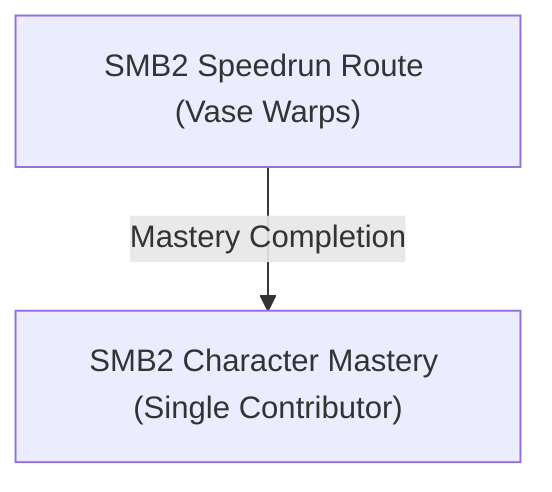

# Writer packet — Chapter 6: Super Mario Bros. 2 — Character Mastery & Speedrun

Write `08_chapters/06.md`. Previous chapter: 5. Super Mario Bros. 2 — Subcon Liberation (Worlds 1–7). Next chapter: 7. Super Mario Bros. 3 — Grass Land to Sea Side (Worlds 1–3).
Planner notes: Clear the game warpless using exclusively Mario, Luigi, Toad, and Princess Peach, along with deathless and 8-stage speedrun restrictions.

## Areas in this chapter (in order)

- `SMB2_SubconSpeedrun` — SMB2 Speedrun Route (Vase Warps)
- `SMB2_CharacterTrial` — SMB2 Character Mastery (Single Contributor)

## Achievements to place in this chapter (each EXACTLY once as `[ACHIEVEMENT:<id>]`)

- **26967** — Sightseeing in Subcon M (25 pts): [SMB2] Beat the game without using warps with Mario as the only contributor  
  supporting facts: neo1-11-1, neo1-11-2, neo1-13-1, neo1-13-2, neo1-17-1, neo1-17-2, neo1-19-1, neo1-19-2, neo2-88-1, neo2-88-2, neo2-89-1, neo2-89-2, neo2-90-1, neo2-90-2, neo2-92-1, neo2-92-2, neo2-94-1, neo2-94-2, neo2-96-1, neo2-96-2, neo2-106-1, neo2-106-2, neo2-108-1, neo2-108-2, neo2-109-1, neo2-109-2, neo2-111-1, neo2-111-2, neo2-112-1, neo2-112-2, neo3-111-1, neo3-111-2, neo3-112-1, neo3-112-2, neo3-140-1, neo3-140-2, neo4-33-1, neo4-33-2, neo4-39-1, neo4-39-2, neo4-50-1, neo4-50-2, neo4-61-1, neo4-61-2, neo4-63-1, neo4-63-2
- **26968** — Sightseeing in Subcon P (25 pts): [SMB2] Beat the game without using warps with Princess Toadstool as the only contributor  
  supporting facts: ra-comments-146-1, ra-comments-146-2, neo1-7-1, neo1-7-2, neo1-13-1, neo1-13-2, neo1-15-1, neo1-15-2, neo1-16-1, neo1-16-2, neo1-20-1, neo1-20-2, neo1-23-1, neo1-23-2, neo1-26-1, neo1-26-2, neo1-32-1, neo1-32-2, neo2-98-1, neo2-98-2, neo2-108-1, neo2-108-2, neo2-111-1, neo2-111-2, neo2-112-1, neo2-112-2, neo2-113-1, neo2-113-2, neo2-123-1, neo2-123-2, neo3-111-1, neo3-111-2, neo3-112-1, neo3-112-2, neo3-139-1, neo3-139-2, neo4-32-1, neo4-32-2, neo4-33-1, neo4-33-2, neo4-45-1, neo4-45-2, neo4-50-1, neo4-50-2, neo4-51-1, neo4-51-2, neo4-60-1, neo4-60-2
- **26969** — Sightseeing in Subcon T (25 pts): [SMB2] Beat the game without using warps with Toad as the only contributor  
  supporting facts: neo1-7-1, neo1-7-2, neo1-11-1, neo1-11-2, neo1-12-1, neo1-12-2, neo1-13-1, neo1-13-2, neo1-15-1, neo1-15-2, neo1-16-1, neo1-16-2, neo1-20-1, neo1-20-2, neo1-22-1, neo1-22-2, neo1-23-1, neo1-23-2, neo2-108-1, neo2-108-2, neo2-110-1, neo2-110-2, neo2-111-1, neo2-111-2, neo2-112-1, neo2-112-2, neo2-113-1, neo2-113-2, neo2-121-1, neo2-121-2, neo2-123-1, neo2-123-2, neo3-111-1, neo3-111-2, neo3-112-1, neo3-112-2, neo3-140-1, neo3-140-2, neo4-32-1, neo4-32-2, neo4-33-1, neo4-33-2, neo4-50-1, neo4-50-2, neo4-51-1, neo4-51-2
- **26970** — Sightseeing in Subcon L (25 pts): [SMB2] Beat the game without using warps with Luigi as the only contributor  
  supporting facts: neo1-7-1, neo1-7-2, neo1-11-1, neo1-11-2, neo1-13-1, neo1-13-2, neo1-21-1, neo1-21-2, neo1-27-1, neo1-27-2, neo1-28-1, neo1-28-2, neo2-87-1, neo2-87-2, neo2-108-1, neo2-108-2, neo2-110-1, neo2-110-2, neo2-111-1, neo2-111-2, neo2-112-1, neo2-112-2, neo2-121-1, neo2-121-2, neo2-123-1, neo2-123-2, neo2-137-1, neo2-137-2, neo2-141-1, neo2-141-2, neo3-111-1, neo3-111-2, neo3-138-1, neo3-138-2, neo3-139-1, neo3-139-2, neo4-32-1, neo4-32-2, neo4-33-1, neo4-33-2, neo4-45-1, neo4-45-2, neo4-49-1, neo4-49-2, neo4-50-1, neo4-50-2, neo4-56-1, neo4-56-2, neo4-58-1, neo4-58-2
- **26971** — Super Speedrun Bros. 2 (10 pts): [SMB2] Beat the game with at most 8 stages cleared  
  supporting facts: neo1-7-1, neo1-7-2
- **26972** — Sweet Dreams (50 pts): [SMB2] Beat the game in a single session without losing a life  
  supporting facts: neo1-10-1, neo1-10-2, neo1-33-1, neo1-33-2, neo2-106-1, neo2-106-2, neo2-108-1, neo2-108-2, neo2-143-1, neo2-143-2, neo2-145-1, neo2-145-2, neo2-147-1, neo2-147-2, neo3-117-1, neo3-117-2, neo3-137-1, neo3-137-2, neo3-139-1, neo3-139-2, neo4-32-1, neo4-32-2, neo4-43-1, neo4-43-2, neo4-57-1, neo4-57-2, neo4-63-1, neo4-63-2

## ⚠ Missables in this chapter (each needs a `> [!WARNING]` BEFORE the point it can be missed)

- SMB2 Mario-Only Warpless Run (achievement 26967) — deadline: Complete all 20 stages without warps selecting only Mario for every single stage [neo1-11-1, neo1-11-2, neo1-13-1]
- SMB2 Princess Peach-Only Warpless Run (achievement 26968) — deadline: Complete all 20 stages without warps selecting only Princess Peach for every single stage [ra-comments-146-1, ra-comments-146-2, neo1-7-1]
- SMB2 Toad-Only Warpless Run (achievement 26969) — deadline: Complete all 20 stages without warps selecting only Toad for every single stage [neo1-7-1, neo1-7-2, neo1-11-1]
- SMB2 Luigi-Only Warpless Run (achievement 26970) — deadline: Complete all 20 stages without warps selecting only Luigi for every single stage [neo1-7-1, neo1-7-2, neo1-11-1]
- SMB2 Super Speedrun Bros. 2 (8 Stages Max) (achievement 26971) — deadline: Beat SMB2 clearing at most 8 stages using vase warps in 1-3 and 4-2 [neo1-7-1, neo1-7-2]
- SMB2 Sweet Dreams (Single Session Deathless) (achievement 26972) — deadline: Beat the entire game in a single sitting without losing a life [neo1-10-1, neo1-10-2, neo1-33-1]

## ⛔ Points of no return in this chapter (each needs a `> [!CAUTION]` containing the words "Point of No Return")

- Point of No Return: SMB2 Speedrun Wart Entry: Entering Wart’s inner sanctum seals your run; ensure your stage clear count is 8 or fewer before entering. [neo1-7-1, neo1-7-2]

## Route diagram (inserted automatically where you write `[MERMAID]`)



## Usable facts (124) — cite as [[fact-id]]

Legend: ✅ verified (2+ sources) · ✔ conflict resolved · 🟡 single source

- ✅ **neo1-7-1** (transition) 8-4: I'll be brief, move forward to the 3rd pipe, then take the 5th pipe which — @SMB2 Stage Guide · ach: 26945,26971,26968,26969,26970  
  evidence: neo1#7: "8-4: I'll be brief, move forward to the 3rd pipe, then take the 5th pipe which"
- ✅ **neo1-7-2** (item) is in the air so you hit a hidden coin to get there. Avoid the cheep cheep on — @SMB2 Stage Guide · ach: 26945,26971,26968,26969,26970  
  evidence: neo1#7: "is in the air so you hit a hidden coin to get there. Avoid the cheep cheep on"
- ✅ **neo1-10-1** (location) They come in three colors: red, grey, and pink. Red ones can spit fireballs — @SMB2 Stage Guide · ach: 26949,26960,26951,26962,26952,26957,26950,26963,26955,26958,26953,26959,26954,26964,26956,26965,26961,26966,26972  
  evidence: neo1#10: "They come in three colors: red, grey, and pink. Red ones can spit fireballs"
- ✅ **neo1-10-2** (location) that arch at the character. Grey ones shoot them straight up and down and the — @SMB2 Stage Guide · ach: 26949,26960,26951,26962,26952,26957,26950,26963,26955,26958,26953,26959,26954,26964,26956,26965,26961,26966,26972  
  evidence: neo1#10: "that arch at the character. Grey ones shoot them straight up and down and the"
- ✅ **neo1-11-1** (transition) Fall straight to the bottom. The Pink Shyguys are no threat. Enter thendoor. — @SMB2 Stage Guide · ach: 26943,26946,26949,26966,26967,26969,26970  
  evidence: neo1#11: "Fall straight to the bottom. The Pink Shyguys are no threat. Enter thendoor."
- ✅ **neo1-11-2** (location) Kill the Shyguys and Tweeters and climb up the vine. DUmp the Pink Shyguy — @SMB2 Stage Guide · ach: 26943,26946,26949,26966,26967,26969,26970  
  evidence: neo1#11: "Kill the Shyguys and Tweeters and climb up the vine. DUmp the Pink Shyguy"
- ✅ **neo1-12-1** (boss) This fight is simple. Jump on an egg that Birdo spits out then pick it up. Run — @SMB2 Stage Guide · ach: 26943,26946,26949,26966,26969  
  evidence: neo1#12: "This fight is simple. Jump on an egg that Birdo spits out then pick it up. Run"
- ✅ **neo1-12-2** (boss) up to Birdo and toss the egg. Do this three times to defeat Birdo. — @SMB2 Stage Guide · ach: 26943,26946,26949,26966,26969  
  evidence: neo1#12: "up to Birdo and toss the egg. Do this three times to defeat Birdo."
- ✅ **neo1-13-1** (location) This is just like the first fight. Nothing changes here except for the layout — @SMB2 Stage Guide · ach: 26943,26946,26949,26966,26967,26968,26969,26970  
  evidence: neo1#13: "This is just like the first fight. Nothing changes here except for the layout"
- ✅ **neo1-13-2** (transition) Pick up the crystal ball, enter the mouth and on to the bonus round. — @SMB2 Stage Guide · ach: 26943,26946,26949,26966,26967,26968,26969,26970  
  evidence: neo1#13: "Pick up the crystal ball, enter the mouth and on to the bonus round."
- ✅ **neo1-15-1** (location) Toad's digging ability is a major help in this whole world itself. Princess can — @SMB2 Stage Guide · ach: 26943,26946,26949,26966,26968,26969  
  evidence: neo1#15: "Toad's digging ability is a major help in this whole world itself. Princess can"
- ✅ **neo1-15-2** (location) also get through this level by making over jumps on the outside to avoid some — @SMB2 Stage Guide · ach: 26943,26946,26949,26966,26968,26969  
  evidence: neo1#15: "also get through this level by making over jumps on the outside to avoid some"
- 🟡 **neo1-16-1** (location) We played this level with Princess Toadstool. Watch out for the Red Beezos as — @always. · ach: 26943,26946,26968,26969  
  evidence: neo1#16: "We played this level with Princess Toadstool. Watch out for the Red Beezos as"
- 🟡 **neo1-16-2** (location) they come in for surprise attacks. This would be a good time to hitch a ride on — @always. · ach: 26943,26946,26968,26969  
  evidence: neo1#16: "they come in for surprise attacks. This would be a good time to hitch a ride on"
- 🟡 **neo1-17-1** (boss) This battle is more different than the pink Birdos you have been facing. To — @always. · ach: 26943,26946,26949,26964,26956,26967  
  evidence: neo1#17: "This battle is more different than the pink Birdos you have been facing. To"
- 🟡 **neo1-17-2** (boss) defeat Red Birdo, carry a mushroom block to the top at toss it at Birdo. This — @always. · ach: 26943,26946,26949,26964,26956,26967  
  evidence: neo1#17: "defeat Red Birdo, carry a mushroom block to the top at toss it at Birdo. This"
- 🟡 **neo1-19-1** (transition) We'll let Mario have this one. Enter the opening at the very right. From here — @always. · ach: 26943,26946,26967  
  evidence: neo1#19: "We'll let Mario have this one. Enter the opening at the very right. From here"
- 🟡 **neo1-19-2** (location) you can fall down or climb up. — @always. · ach: 26943,26946,26967  
  evidence: neo1#19: "you can fall down or climb up."
- 🟡 **neo1-20-1** (location) Keep an eye on its third projectile and act accordingly. As a reminder, eggs — @always. · ach: 26943,26946,26949,26968,26969  
  evidence: neo1#20: "Keep an eye on its third projectile and act accordingly. As a reminder, eggs"
- 🟡 **neo1-20-2** (item) you jump on and fireballs you don't. There are two Mushroom Blocks but ignore — @always. · ach: 26943,26946,26949,26968,26969  
  evidence: neo1#20: "you jump on and fireballs you don't. There are two Mushroom Blocks but ignore"
- 🟡 **neo1-21-1** (boss) Fight him like you fight the Red Birdos. Ignore the Mushroom Blocks behind him — @always. · ach: 26943,26946,26949,26970  
  evidence: neo1#21: "Fight him like you fight the Red Birdos. Ignore the Mushroom Blocks behind him"
- 🟡 **neo1-21-2** (boss) they are of no use until after you beat Birdo. — @always. · ach: 26943,26946,26949,26970  
  evidence: neo1#21: "they are of no use until after you beat Birdo."
- 🟡 **neo1-22-1** (boss) Boss Fight: Mouser Mk. II — @always. · ach: 26943,26946,26960,26951,26962,26952,26969  
  evidence: neo1#22: "Boss Fight: Mouser Mk. II"
- 🟡 **neo1-22-2** (boss) The Spark may be a nuisance but you can make Mouser blow him up by accident. — @always. · ach: 26943,26946,26960,26951,26962,26952,26969  
  evidence: neo1#22: "The Spark may be a nuisance but you can make Mouser blow him up by accident."
- 🟡 **neo1-23-1** (location) Princess Toadstool takes the spotlight. Climb the vine and get ready for a — @always. · ach: 26943,26946,26968,26969  
  evidence: neo1#23: "Princess Toadstool takes the spotlight. Climb the vine and get ready for a"
- 🟡 **neo1-23-2** (location) tough sequence as the Beezos come in from all planes, you are better ducking — @always. · ach: 26943,26946,26968,26969  
  evidence: neo1#23: "tough sequence as the Beezos come in from all planes, you are better ducking"
- 🟡 **neo1-26-1** (boss) Boss Fight: Birdo (green) — @always. · ach: 26943,26946,26949,26968  
  evidence: neo1#26: "Boss Fight: Birdo (green)"
- 🟡 **neo1-26-2** (location) He may appear to be gray but he's really green. The room makes his color look — @always. · ach: 26943,26946,26949,26968  
  evidence: neo1#26: "He may appear to be gray but he's really green. The room makes his color look"
- 🟡 **neo1-27-1** (location) There is a Trouter during this fight. You can use it to help you in this battle — @always. · ach: 26943,26946,26949,26970  
  evidence: neo1#27: "There is a Trouter during this fight. You can use it to help you in this battle"
- 🟡 **neo1-27-2** (location) Pick Luigi. Climb the ladder and Super Jump up the top of the ledge and pick up — @always. · ach: 26943,26946,26949,26970  
  evidence: neo1#27: "Pick Luigi. Climb the ladder and Super Jump up the top of the ledge and pick up"
- 🟡 **neo1-28-1** (location) THis fight may be tough for Luigi because of his high jump. We suggest that you — @always. · ach: 26959,26954,26970  
  evidence: neo1#28: "THis fight may be tough for Luigi because of his high jump. We suggest that you"
- 🟡 **neo1-28-2** (boss) stand on the first step up and when Clawgrip throws a rock that looks like it — @always. · ach: 26959,26954,26970  
  evidence: neo1#28: "stand on the first step up and when Clawgrip throws a rock that looks like it"
- 🟡 **neo1-32-1** (location) Super Jump on top of the Albatross and ride it back to the rocket. Get the — @always. · ach: 26943,26946,26949,26964,26956,26968  
  evidence: neo1#32: "Super Jump on top of the Albatross and ride it back to the rocket. Get the"
- 🟡 **neo1-32-2** (item) cherries for a star and make it to the ladder and climb up. Watch out for the — @always. · ach: 26943,26946,26949,26964,26956,26968  
  evidence: neo1#32: "cherries for a star and make it to the ladder and climb up. Watch out for the"
- 🟡 **neo1-33-1** (location) Avoid the bubbles he spits and grab a vegetable and when he opens his mouth to — @always. · ach: 26965,26961,26972  
  evidence: neo1#33: "Avoid the bubbles he spits and grab a vegetable and when he opens his mouth to"
- 🟡 **neo1-33-2** (location) spit more bubbles toss it at him. He dies in six hits. For most of the fight, — @always. · ach: 26965,26961,26972  
  evidence: neo1#33: "spit more bubbles toss it at him. He dies in six hits. For most of the fight,"
- ✅ **neo2-87-1** (item) • Starman          - A star that bounces along the ground. When Mario grabs — @SMB2 Stage Guide · ach: 26941,26970  
  evidence: neo2#87: "• Starman          - A star that bounces along the ground. When Mario grabs"
- ✅ **neo2-87-2** (location) it, he will be temporarily invincible, but can still — @SMB2 Stage Guide · ach: 26941,26970  
  evidence: neo2#87: "it, he will be temporarily invincible, but can still"
- ✅ **neo2-88-1** (boss) • Bowser, King of the Koopas - A nine-foot turtle found at the end of each — @SMB2 Stage Guide · ach: 26941,26967  
  evidence: neo2#88: "• Bowser, King of the Koopas - A nine-foot turtle found at the end of each"
- ✅ **neo2-88-2** (location) castle level. The first seven castles have — @SMB2 Stage Guide · ach: 26941,26967  
  evidence: neo2#88: "castle level. The first seven castles have"
- ✅ **neo2-89-1** (location) • Buzzy Beetle               - These black-shelled beetles act like Green — @SMB2 Stage Guide · ach: 26941,26967  
  evidence: neo2#89: "• Buzzy Beetle               - These black-shelled beetles act like Green"
- ✅ **neo2-89-2** (location) Koopa Troopas, the only difference is that — @SMB2 Stage Guide · ach: 26941,26967  
  evidence: neo2#89: "Koopa Troopas, the only difference is that"
- ✅ **neo2-90-1** (location) • Hammer Bros.               - Turtles that throw hammers at Mario. They — @SMB2 Stage Guide · ach: 26941,26967  
  evidence: neo2#90: "• Hammer Bros.               - Turtles that throw hammers at Mario. They"
- ✅ **neo2-90-2** (location) can jump through ledges, and usually come in — @SMB2 Stage Guide · ach: 26941,26967  
  evidence: neo2#90: "can jump through ledges, and usually come in"
- ✅ **neo2-92-1** (location) If you are Super/Fiery Mario, stomp a Koopa Troopa or Buzzy Beetle as it — @SMB2 Stage Guide · ach: 26967  
  evidence: neo2#92: "If you are Super/Fiery Mario, stomp a Koopa Troopa or Buzzy Beetle as it"
- ✅ **neo2-92-2** (location) descends a staircase. Now approach the shell from the step beneath the one — @SMB2 Stage Guide · ach: 26967  
  evidence: neo2#92: "descends a staircase. Now approach the shell from the step beneath the one"
- ✅ **neo2-94-1** (transition) In some levels you can enter a pipe that takes you to a water area. Here — @SMB2 Stage Guide · ach: 26967  
  evidence: neo2#94: "In some levels you can enter a pipe that takes you to a water area. Here"
- ✅ **neo2-94-2** (location) is a short walkthrough of this area: — @SMB2 Stage Guide · ach: 26967  
  evidence: neo2#94: "is a short walkthrough of this area:"
- ✅ **neo2-96-1** (location) The Lakitu level can be completed any way you wish, as it's yet another — @World 4-1 · ach: 26967  
  evidence: neo2#96: "The Lakitu level can be completed any way you wish, as it's yet another"
- ✅ **neo2-96-2** (location) irrelevant level to deal with. Just get past Lakitu safely and complete — @World 4-1 · ach: 26967  
  evidence: neo2#96: "irrelevant level to deal with. Just get past Lakitu safely and complete"
- 🟡 **neo2-98-1** (transition) Enter the pipe after the lava pit with the elevator. Then enter the pipe — @World 8-1 · ach: 26968  
  evidence: neo2#98: "Enter the pipe after the lava pit with the elevator. Then enter the pipe"
- ✅ **neo2-98-2** (location) in the air with two Koopa Paratroopas nearby. There is a hidden block in — @World 8-1 · ach: 26968  
  evidence: neo2#98: "in the air with two Koopa Paratroopas nearby. There is a hidden block in"
- ✅ **neo2-106-1** (location) After completing a level except 7-2, you get a mini-game called Bonus — @SMB2 Stage Guide · ach: 26949,26964,26956,26965,26961,26972,26967  
  evidence: neo2#106: "After completing a level except 7-2, you get a mini-game called Bonus"
- ✅ **neo2-106-2** (item) Round. If you collected coins in that certain level you can gamble them to — @SMB2 Stage Guide · ach: 26949,26964,26956,26965,26961,26972,26967  
  evidence: neo2#106: "Round. If you collected coins in that certain level you can gamble them to"
- ✅ **neo2-108-1** (location) One evening, Mario had a strange dream. He dreamt of a long, long stairway — @SMB2 Stage Guide · ach: 26965,26961,26972,26967,26968,26969,26970  
  evidence: neo2#108: "One evening, Mario had a strange dream. He dreamt of a long, long stairway"
- ✅ **neo2-108-2** (transition) leading up to a door. As soon as the door opened, he was confronted with a — @SMB2 Stage Guide · ach: 26965,26961,26972,26967,26968,26969,26970  
  evidence: neo2#108: "leading up to a door. As soon as the door opened, he was confronted with a"
- ✅ **neo2-109-1** (location) NOTE: Each character has individual skills that make them each unique. — @SMB2 Stage Guide · ach: 26967  
  evidence: neo2#109: "NOTE: Each character has individual skills that make them each unique."
- ✅ **neo2-109-2** (location) They each have different running, jumping, and power skills which could — @SMB2 Stage Guide · ach: 26967  
  evidence: neo2#109: "They each have different running, jumping, and power skills which could"
- 🟡 **neo2-110-1** (location) Mario is reasonably fast. When holding a vegetable he isn't slowed — @Abilities · ach: 26969,26970  
  evidence: neo2#110: "Mario is reasonably fast. When holding a vegetable he isn't slowed"
- 🟡 **neo2-110-2** (location) Mario has a reasonably high jump, similar to the one from SMB, he — @Abilities · ach: 26969,26970  
  evidence: neo2#110: "Mario has a reasonably high jump, similar to the one from SMB, he"
- 🟡 **neo2-111-1** (location) Luigi has an average running speed. — @Abilities · ach: 26967,26968,26969,26970  
  evidence: neo2#111: "Luigi has an average running speed."
- 🟡 **neo2-111-2** (location) Luigi has the best jump out of all 4 characters. He can jump very — @Abilities · ach: 26967,26968,26969,26970  
  evidence: neo2#111: "Luigi has the best jump out of all 4 characters. He can jump very"
- 🟡 **neo2-112-1** (location) Toad is the fastest character in the game. His speed isn't affected — @Abilities · ach: 26943,26946,26967,26968,26969,26970  
  evidence: neo2#112: "Toad is the fastest character in the game. His speed isn't affected"
- 🟡 **neo2-112-2** (location) when he's holding something either! — @Abilities · ach: 26943,26946,26967,26968,26969,26970  
  evidence: neo2#112: "when he's holding something either!"
- 🟡 **neo2-113-1** (location) Princess Toadstool is the slowest of all the characters. — @Abilities · ach: 26968,26969  
  evidence: neo2#113: "Princess Toadstool is the slowest of all the characters."
- 🟡 **neo2-113-2** (location) Princess Toadstool's jump is one of the best. Her floating ability — @Abilities · ach: 26968,26969  
  evidence: neo2#113: "Princess Toadstool's jump is one of the best. Her floating ability"
- 🟡 **neo2-121-1** (location) There are two strategies which you could use in this battle. You could — @BOSS FIGHT: Red Birdo · ach: 26941,26943,26946,26949,26969,26970  
  evidence: neo2#121: "There are two strategies which you could use in this battle. You could"
- 🟡 **neo2-121-2** (boss) either get the three Mushroom Blocks below the Birdo and bring them up — @BOSS FIGHT: Red Birdo · ach: 26941,26943,26946,26949,26969,26970  
  evidence: neo2#121: "either get the three Mushroom Blocks below the Birdo and bring them up"
- ✅ **neo2-123-1** (location) Head right until you get to a cluster of four grass hills. Jump over the — @SMB2 Stage Guide · ach: 26943,26946,26944,26968,26969,26970  
  evidence: neo2#123: "Head right until you get to a cluster of four grass hills. Jump over the"
- ✅ **neo2-123-2** (transition) small gap and enter the door in the fourth grass hill. — @SMB2 Stage Guide · ach: 26943,26946,26944,26968,26969,26970  
  evidence: neo2#123: "small gap and enter the door in the fourth grass hill."
- ✅ **neo2-137-1** (location) Head to the right and jump across the little gap in the bridge to meet — @SMB2 Stage Guide · ach: 26943,26946,26949,26964,26956,26970  
  evidence: neo2#137: "Head to the right and jump across the little gap in the bridge to meet"
- ✅ **neo2-137-2** (boss) Birdo. There is a Trouter jumping out of the water, which you can use to — @SMB2 Stage Guide · ach: 26943,26946,26949,26964,26956,26970  
  evidence: neo2#137: "Birdo. There is a Trouter jumping out of the water, which you can use to"
- 🟡 **neo2-141-1** (boss) This one's a bit frustrating. You and the Green Birdo are cut off by — @BOSS FIGHT: Green Birdo · ach: 26943,26946,26949,26970  
  evidence: neo2#141: "This one's a bit frustrating. You and the Green Birdo are cut off by"
- 🟡 **neo2-141-2** (item) some sand blocks, a dirt pillar and three Mushroom Blocks. Creating a — @BOSS FIGHT: Green Birdo · ach: 26943,26946,26949,26970  
  evidence: neo2#141: "some sand blocks, a dirt pillar and three Mushroom Blocks. Creating a"
- ✅ **neo2-143-1** (location) Once you're up into the night sky, head right across the cloud platform — @SMB2 Stage Guide · ach: 26949,26957,26950,26963,26955,26965,26961,26972  
  evidence: neo2#143: "Once you're up into the night sky, head right across the cloud platform"
- ✅ **neo2-143-2** (transition) and jump onto the sand block platform. Keep heading right and enter the — @SMB2 Stage Guide · ach: 26949,26957,26950,26963,26955,26965,26961,26972  
  evidence: neo2#143: "and jump onto the sand block platform. Keep heading right and enter the"
- 🟡 **neo2-145-1** (boss) A fireball-spurting Birdo with an infinite supply of fireballs. And your — @BOSS FIGHT: Green Birdo · ach: 26943,26946,26949,26964,26956,26965,26961,26972  
  evidence: neo2#145: "A fireball-spurting Birdo with an infinite supply of fireballs. And your"
- 🟡 **neo2-145-2** (item) great arsenal to fight against it: one Mushroom Block. Heh. A pretty — @BOSS FIGHT: Green Birdo · ach: 26943,26946,26949,26964,26956,26965,26961,26972  
  evidence: neo2#145: "great arsenal to fight against it: one Mushroom Block. Heh. A pretty"
- 🟡 **neo2-147-1** (location) Okay, it's the showdown, the finale, the grand daddy of 'em all, the — @BOSS FIGHT: Wart · ach: 26965,26961,26972  
  evidence: neo2#147: "Okay, it's the showdown, the finale, the grand daddy of 'em all, the"
- 🟡 **neo2-147-2** (boss) most anticipated battle in the...well, you know what I mean. Wart is — @BOSS FIGHT: Wart · ach: 26965,26961,26972  
  evidence: neo2#147: "most anticipated battle in the...well, you know what I mean. Wart is"
- ✅ **neo3-111-1** (item) Start - This is a very important button.  It starts the game.  While you are — @SMB2 Stage Guide · ach: 26944,26967,26968,26969,26970  
  evidence: neo3#111: "Start - This is a very important button.  It starts the game.  While you are"
- ✅ **neo3-111-2** (location) playing, press it to pause/unpause when you need a break. — @SMB2 Stage Guide · ach: 26944,26967,26968,26969,26970  
  evidence: neo3#111: "playing, press it to pause/unpause when you need a break."
- 🟡 **neo3-112-1** (location) Although she is just a lady, Princess Peach doesn't take any crap! She likes — @Princess Peach · ach: 26943,26946,26944,26948,26949,26964,26956,26967,26968,26969  
  evidence: neo3#112: "Although she is just a lady, Princess Peach doesn't take any crap! She likes"
- 🟡 **neo3-112-2** (location) Mario a lot, and often bakes cakes for him. Toad is a guard for her at the — @Princess Peach · ach: 26943,26946,26944,26948,26949,26964,26956,26967,26968,26969  
  evidence: neo3#112: "Mario a lot, and often bakes cakes for him. Toad is a guard for her at the"
- ✅ **neo3-117-1** (location) Boss of: World 2 and World 6 — @SMB2 Stage Guide · ach: 26964,26956,26965,26961,26972  
  evidence: neo3#117: "Boss of: World 2 and World 6"
- 🟡 **neo3-117-2** (achievement) Description:  This three headed snake will keep shooting flames at you. It is — @SMB2 Stage Guide · ach: 26964,26956,26965,26961,26972  
  evidence: neo3#117: "Description:  This three headed snake will keep shooting flames at you. It is"
- ✅ **neo3-137-1** (location) World 7-2 - Super Mario Bros. 2 Walkthrough — @SMB2 Stage Guide · ach: 26943,26946,26949,26964,26956,26965,26961,26972  
  evidence: neo3#137: "World 7-2 - Super Mario Bros. 2 Walkthrough"
- ✅ **neo3-137-2** (transition) Kill or dodge the three Snifits and go into the door at the right. You will now — @SMB2 Stage Guide · ach: 26943,26946,26949,26964,26956,26965,26961,26972  
  evidence: neo3#137: "Kill or dodge the three Snifits and go into the door at the right. You will now"
- ✅ **neo3-138-1** (item) Congrats for beating the Super Mario Bros. 2 part of Super Mario All-Stars. — @SMB2 Stage Guide · ach: 26943,26946,26964,26956,26970  
  evidence: neo3#138: "Congrats for beating the Super Mario Bros. 2 part of Super Mario All-Stars."
- ✅ **neo3-138-2** (location) Now try playing a different Mario game. — @SMB2 Stage Guide · ach: 26943,26946,26964,26956,26970  
  evidence: neo3#138: "Now try playing a different Mario game."
- 🟡 **neo3-139-1** (boss) As Princess or Luigi, grab a veggie and jump behind Wart. You will be safe from — @Cheap Way to Defeat Wart · ach: 26949,26965,26961,26972,26968,26970  
  evidence: neo3#139: "As Princess or Luigi, grab a veggie and jump behind Wart. You will be safe from"
- 🟡 **neo3-139-2** (boss) Wart, as long as you are behind him. Wait for his mouth to open and throw the — @Cheap Way to Defeat Wart · ach: 26949,26965,26961,26972,26968,26970  
  evidence: neo3#139: "Wart, as long as you are behind him. Wait for his mouth to open and throw the"
- 🟡 **neo3-140-1** (location) In World 6-1, select either Mario or Toad for their fast picking up abilities. — @Two 1-Ups Glitch · ach: 26967,26969  
  evidence: neo3#140: "In World 6-1, select either Mario or Toad for their fast picking up abilities."
- 🟡 **neo3-140-2** (transition) Go to the room with all the pipes and cobrats. Go into the pipe that has 4 — @Two 1-Ups Glitch · ach: 26967,26969  
  evidence: neo3#140: "Go to the room with all the pipes and cobrats. Go into the pipe that has 4"
- 🟡 **neo4-32-1** (location) V. Level Walkthroughs Worlds 1-7 — @SUPER MARIO BROS. 2 · ach: 26965,26961,26972,26968,26969,26970  
  evidence: neo4#32: "V. Level Walkthroughs Worlds 1-7"
- 🟡 **neo4-32-2** (location) Derived from a Japanese game called Doki Doki Panic, Super Mario Bros. 2 can — @SUPER MARIO BROS. 2 · ach: 26965,26961,26972,26968,26969,26970  
  evidence: neo4#32: "Derived from a Japanese game called Doki Doki Panic, Super Mario Bros. 2 can"
- 🟡 **neo4-33-1** (transition) Mario 2 doesn't have a control scheme like the others, so the transition — @CONTROLS · ach: 26944,26967,26968,26969,26970  
  evidence: neo4#33: "Mario 2 doesn't have a control scheme like the others, so the transition"
- 🟡 **neo4-33-2** (location) won't be as smooth from Mario 1 to this as it normally would be, for — @CONTROLS · ach: 26944,26967,26968,26969,26970  
  evidence: neo4#33: "won't be as smooth from Mario 1 to this as it normally would be, for"
- 🟡 **neo4-39-1** (location) Occasionally you can pull a rocketship out of the ground. This occurs only — @Rocketship · ach: 26967  
  evidence: neo4#39: "Occasionally you can pull a rocketship out of the ground. This occurs only"
- 🟡 **neo4-39-2** (location) whenever you've come to a dead end and the only way to go from there is up. — @Rocketship · ach: 26967  
  evidence: neo4#39: "whenever you've come to a dead end and the only way to go from there is up."
- 🟡 **neo4-43-1** (location) A three-headed snake who can't do much else aside from spout fire at you with — @Tryclyde · ach: 26957,26950,26963,26955,26959,26954,26965,26961,26972  
  evidence: neo4#43: "A three-headed snake who can't do much else aside from spout fire at you with"
- 🟡 **neo4-43-2** (location) its three craniums. It's not triply difficult to defeat though, just chunk a — @Tryclyde · ach: 26957,26950,26963,26955,26959,26954,26965,26961,26972  
  evidence: neo4#43: "its three craniums. It's not triply difficult to defeat though, just chunk a"
- ✅ **neo4-45-1** (location) Pull Pidgit off his carpet and ride it across the pit, dodging Beezos — @World 1-2 · ach: 26941,26943,26946,26949,26966,26968,26970  
  evidence: neo4#45: "Pull Pidgit off his carpet and ride it across the pit, dodging Beezos"
- ✅ **neo4-45-2** (location) as necessary. Ride it until you reach the safe ground, or you can keep — @World 1-2 · ach: 26941,26943,26946,26949,26966,26968,26970  
  evidence: neo4#45: "as necessary. Ride it until you reach the safe ground, or you can keep"
- 🟡 **neo4-49-1** (location) Climb out of the cave and get the first plant on your right, which is a — @World 2-3 · ach: 26943,26946,26944,26948,26970  
  evidence: neo4#49: "Climb out of the cave and get the first plant on your right, which is a"
- 🟡 **neo4-49-2** (item) potion. Take it all the way to the left for only one coin, but also a — @World 2-3 · ach: 26943,26946,26944,26948,26970  
  evidence: neo4#49: "potion. Take it all the way to the left for only one coin, but also a"
- 🟡 **neo4-50-1** (transition) Go into the door to the right, and instead of making your way up, fall — @World 3-1 · ach: 26943,26946,26949,26966,26967,26968,26969,26970  
  evidence: neo4#50: "Go into the door to the right, and instead of making your way up, fall"
- 🟡 **neo4-50-2** (location) down the waterfall. Stay in the middle so you don't die in the foam at — @World 3-1 · ach: 26943,26946,26949,26966,26967,26968,26969,26970  
  evidence: neo4#50: "down the waterfall. Stay in the middle so you don't die in the foam at"
- 🟡 **neo4-51-1** (location) ** Unfortunately, because of some experimentation I was doing, I had to — @World 3-2 · ach: 26943,26946,26949,26966,26968,26969  
  evidence: neo4#51: "** Unfortunately, because of some experimentation I was doing, I had to"
- 🟡 **neo4-51-2** (location) play this level as the Princess. Now for you fans of Toadstool, I'm — @World 3-2 · ach: 26943,26946,26949,26966,26968,26969  
  evidence: neo4#51: "play this level as the Princess. Now for you fans of Toadstool, I'm"
- 🟡 **neo4-56-1** (location) Use Luigi throughout all of this world - his supreme jumping abilities — @World 5-1 · ach: 26943,26946,26949,26970  
  evidence: neo4#56: "Use Luigi throughout all of this world - his supreme jumping abilities"
- 🟡 **neo4-56-2** (location) will pay off in each level. Take the red Shyguy off his Ostro and use — @World 5-1 · ach: 26943,26946,26949,26970  
  evidence: neo4#56: "will pay off in each level. Take the red Shyguy off his Ostro and use"
- 🟡 **neo4-57-1** (transition) Go up the ladder and all the way to the right until you see a pipe. The — @World 5-2 · ach: 26942,26943,26946,26949,26965,26961,26972  
  evidence: neo4#57: "Go up the ladder and all the way to the right until you see a pipe. The"
- 🟡 **neo4-57-2** (item) potion you need for the mushroom is inside, so duck into it and bomb — @World 5-2 · ach: 26942,26943,26946,26949,26965,26961,26972  
  evidence: neo4#57: "potion you need for the mushroom is inside, so duck into it and bomb"
- 🟡 **neo4-58-1** (transition) If you're looking for warp zones, Luigi is the only one who can get to — @World 5-3 · ach: 26942,26943,26946,26949,26960,26951,26962,26952,26959,26954,26970  
  evidence: neo4#58: "If you're looking for warp zones, Luigi is the only one who can get to"
- 🟡 **neo4-58-2** (transition) this one. Climb up the ladder and observe the pipe above you. Have — @World 5-3 · ach: 26942,26943,26946,26949,26960,26951,26962,26952,26959,26954,26970  
  evidence: neo4#58: "this one. Climb up the ladder and observe the pipe above you. Have"
- 🟡 **neo4-60-1** (location) If you have an aversion to heights, avoid this level. — @World 6-2 · ach: 26943,26946,26949,26968  
  evidence: neo4#60: "If you have an aversion to heights, avoid this level."
- 🟡 **neo4-60-2** (location) What I mean by that is that this level will have you high up in the — @World 6-2 · ach: 26943,26946,26949,26968  
  evidence: neo4#60: "What I mean by that is that this level will have you high up in the"
- 🟡 **neo4-61-1** (location) Climb up the ladder, then if you want it, go to the left for a nifty — @World 6-3 · ach: 26943,26946,26949,26967  
  evidence: neo4#61: "Climb up the ladder, then if you want it, go to the left for a nifty"
- 🟡 **neo4-61-2** (location) trick. (Okay, so I know this one. Sue me). — @World 6-3 · ach: 26943,26946,26949,26967  
  evidence: neo4#61: "trick. (Okay, so I know this one. Sue me)."
- ✅ **neo4-63-1** (location) Kill as many people as possible outside before going in. Having two — @World 7-2 · ach: 26941,26943,26946,26948,26949,26964,26956,26965,26961,26972,26967  
  evidence: neo4#63: "Kill as many people as possible outside before going in. Having two"
- 🟡 **neo4-63-2** (transition) hearts when entering the castle is to your advantage. — @World 7-2 · ach: 26941,26943,26946,26948,26949,26964,26956,26965,26961,26972,26967  
  evidence: neo4#63: "hearts when entering the castle is to your advantage."
- 🟡 **ra-comments-146-1** (achievement) [Server] siouxerskate edited this achievement. — ach: 26968  
  evidence: ra-comments#146: "[Server] siouxerskate edited this achievement."
- 🟡 **ra-comments-146-2** (achievement) [Server] televandalist edited this achievement. — ach: 26968  
  evidence: ra-comments#146: "[Server] televandalist edited this achievement."

## Source passages (80 chunks, 32 omitted for size — use `npm run rw:chunks -- 253 --id <chunk>`)

Use these for detail (directions, chest contents, enemy names, boss patterns, ASCII maps). Every statement you take from a passage must cite a fact id; if no fact covers a detail you need, add a fact to `04_facts/` first (with a verbatim quote) and re-run `rw:verify`.

### neo1#6 — Neoseeker: Super Mario All-Stars FAQ/Walkthrough — [--------------------[Super Nintendo Entertainment System]----------------------] (context neighbour)

```text
6-1: Go right and avoid or shoot the spinies and quickly take out Lakitu ASAP.
    There are two areas to do so, The level is a short and sweet one so no need for
    detail.
    
    6-2: Nothing special here but some popes to maneuver through till you find a 
    set of bricks with a beanstalk coming out of it. Jump off to the right and
    reveal a hidden coin for leverage to the beanstalk. Just more Pipes to move
    through till you reach a Koopa Paratroopa at the end. Take it out and proceed
    to the pole.
    
    6-3: Scenery? Where's the scenery? Oh there it is now. Aside from Mario and
    the moving platforms, how about some color stupid? Just move through the
    platforms and scales. Bullet bills appear in random spots. Avoid them on route
    to a spring. Carefully land on the moving platform, then take the scale to
    four falling platforms to the pole.
    
    6-4: Nothing you haven't handled before. Just some trickier jumps between
    firebars. Avoid the breath and this fake Bowser throws hammers. Gee, who is 
    this faker? Roast him up to reveal him to be A BLOOPER?!!! WHAT THE HELL?!!!
    I was expecting a Hammer Brother.
    
                               *---------------------*
                                      World 7
                               *---------------------*
    
    7-1: There are a lot of bullet bills to avoid most of this level. The only 
    other dangers are the Hammer Bros. The Koopa Troopas are nothing for you to 
    worry about. There is a shortcut pipe after them. There is another set of
    Hammer Bros and a Buzzy Beetle on the steps before the pole. Hey! Here's 
    another 1-up loop. Do the same thing you did to the Koopa Troopa in 3-1.
    
    7-2: Another underwater level. like last time, just swim to safety and avoid
    or shoot the Bloopers and Cheep Cheeps on route to the pipe then onto the pole.
    
    7-3: Just move slowly to the right and dodge the Cheep Cheeps, Koopa Troopas,
    and Koopa Paratroopas on route to the pole.
    
    7-4: Another "choose the right path" castle. The solution is low, middle, high,
    high, middle, high. The fake Bowser is a Hammer Bros. this time and throws
    Hammers. That Blooper in the last level was a throw off.
    
                               *---------------------*
                                      World 8
                               *---------------------*
    
    8-1: Congratulations! You made it to the last world. Stomp the Buzzy Beetle and
    kick it into Goombas and avoid the rebound. Move right as fast as possible
    since the time runs out fast. Thre is a shortcut pipe before the two coins in
    the air. Once out, take out two Koopa Paratroopas on the way to a star, and 
    make a break for it. Be careful not to jump too fast or you'll fall at the
    pipes. You should be invincible up to the second Buzzy Beetle. Take two careful
    hops and shoot all that move and jump across the narrow walls and hit the pole.
    
    8-2: A Lakitu, Spiny and two Koopa Paratroopas annoy you at the start. Blow
    past them and the Lakitu leaves early. The spring lets you hit a 1-up and break
    a block next to it to avoid chasing it. At the end are Bullet Bills. Take
    careful jumps as you stand on narrow ground, run over a gap and take a leap of
    faith. Hanf on there and you'll reach the pole.
    
    8-3: Avoid the Bullet bills and shoot everything that moves. Hop across the
    small walls to the pole.
```

### neo1#7 — Neoseeker: Super Mario All-Stars FAQ/Walkthrough — [--------------------[Super Nintendo Entertainment System]----------------------]

```text
8-4: I'll be brief, move forward to the 3rd pipe, then take the 5th pipe which
    is in the air so you hit a hidden coin to get there. Avoid the cheep cheep on
    the way to the 4th pipe which is after the pit. Swim to the end then when you
    come out get past the Hammer Brother and the Pobodo and you now face the real
    Bowser. Avoid his fire and hammers and wait for him to jump then run under him
    and get the axe. You can also shoot him too. If you are Super Mario or Fire
    Mario, just take the hit and grab the axe.
    
    +++++++++++++++++++++++++++++++++++++++++++++++++++++++++++++++++++++++++++++++
    Warp Zones
    +++++++++++++++++++++++++++++++++++++++++++++++++++++++++++++++++++++++++++++++
    World 1-2: Basically stay on top of the level as much as possible till you
    reach the very end. You can warb to World 2,3, or 4.
    
    World 4-2: Just do the same as above and you'll get to warp to level 5.
    
    World 4-2: There is an area early in 4-2 where there are four blocks above.
    Hit the two right bricks and stand on the one to the left and scoot to the left
    and hit the brick second from the left and a beanstalk rises. Get on the
    beanstalk and go through a little part of a new level and you can warp to World
    6,7, or 8.
    
    =============================SUPER MARIO BROS 2================================
    
    o---------------------o
          INTRODUCTION
    o---------------------o
    
    When Mario opened a door after climbing a long stair in his dream, another 
    World spread before him, and he heard a voice call for help to be freed from
    a spell. After awakening, Mario went to a cave nearby, and to his surprise, he
    saw exactly what he saw in his dream.
    
    
    o---------------------o
         OPTIONS/HEROES
    o---------------------o
    This a one player game and before each level, you get to choose one of the
    four characters.
    
    Mario is an all around character in running, jumping, and carrying an item when
    jumping.
    
    Luigi is an excellent jumper who can leap very high and very far places this is
    in part to his bicycle kicks as he jumps that propels him but his jumping
    ability suffers when holding an item.
    
    Toad is a short guy that doesn't seem like a good character to play as but he
    is the strongest of the four storywise and it shows whenever he picks up an
    item. He lifts it up before you can blink. His jump ability doesn't go down
    when holding an item.
    
    Princess Toadstool takes a break from the damsel in distress to fight alongside
    Mario, Luigi, and Toad. With her dress, she can float for a few seconds when
    you are holding the jump button. This helps you get out of situations that can
    spell the end for the other three heroes.
    
    o---------------------o
           CONTROLS
    o---------------------o
    
    B button: Jump. The strength of the jump depends on how hard you press the Jump
    button. Tap to do a small hop. Hold the Jump button for a higher jump
    
    Y button: Pick up, throw, dig.
    
    Start button: Start game, pause, unpause, choose character for the level.
    
    Up: enter doors and passageways. Climb up vines and ropes.
    
    Down: Crouch. Climb dopwn vines and ropes. Hold Down to power up. Go down the
    vases.
    
    Left/Right: move left or right
    
    Hold Y and left/right: run left or right
    
    Down + B: Crouch jump
    
    Hold Down to power up then press B: Super Jump
```

### neo1#8 — Neoseeker: Super Mario All-Stars FAQ/Walkthrough — [World 1-2: Basically stay on top of the level as much as possible till you] (context neighbour)

```text
o---------------------o
           GAMEPLAY
    o---------------------o
    There are twenty levels to complete total. If you manage to find the warp zones
    then you can skip ahead two levels. There are four warp zones total but they
    are found by going down certain jars in Subcon.
    
    o---------------------o
        CHANGES FROM DDP
    o---------------------o
    
    The Mushroom in Sub-Con used to be a Heart Container.
    
    The tune played in Sub-Con (SMB1 Overworld) was originally an Egyptian tune.
    
    Potions were actually Magic Lamps.
    
    Shells were actually heads.
    
    Mushroom Blocks were masks.
    
    No need to beat the game with all characters to see the actual ending.
    
    1-ups were different.
    
    o---------------------o
            ITEMS
    o---------------------o
    
    American Name: Vegetable
    Japanese Name: Yasai
    ---
    Pluck these out of the ground to toss at enemies. They have faces on them, so
    you can tell if they are ripe. They come in turnips, carrots, and pumpkins.
    ---
    
    American Name: Unripened Vegetable
    Japanese Name: Chiisai Yasai
    ---
    Small versions of vegetables. They don't have faces and they have a shorter hit
    rang than the ripe ones.
    ---
    
    American Name: Stopwatch
    Japanese Name: Stopwatch
    ---
    Pluck five Vegetables and the fifth one becomes a Stopwatch that freezes the
    enemies for five seconds.
    ---
    
    American Name: Potion
    Japanese Name: Kusuri
    ---
    Toss this onto the ground to reveal a door that leads to Sub-Con.
    ---
    
    American Name: Mushroom
    Japanese Name: Life-Up Kinoko
    ---
    Found in Sub-Con, this will increase the maximum life by one bar (Four is the
    maximum number of bars)
    ---
    
    American Name: Coin
    Japanese Name: Coin
    ---
    In Sub-Con, pluck the weeds to get coins for the bonus area. This only works
    twice per level. Any other time after that and only small vegetables will come
    out instead.
    ---
    
    American Name: Small Heart
    Japanese Name: Heart
    ---
    Restore any lost health by one. These appear after defeating five enemies.
    ---
    
    American Name: Cherries
    Japanese Name: Cherry
    ---
    Collect five of these to make a Starman appear.
    ---
    
    American Name: Starman
    Japanese Name: Star
    ---
    You'll be invincible for a set period of time.
    ---
    
    American Name: Mushroom Block
    Japanese Name: Kinoko Block
    ---
    Use these as weapons or stepping stools
    ---
    
    American Name: POW Block
    Japanese Name: POW Block
    ---
    Kill all on-screen enemies
    ---
    
    American Name: Key
    Japanese Name: Kagi
    ---
    Use to unlock doors. Beware of Phanto.
    ---
    
    American Name: Bomb
    Japanese Name: Bakudan
    ---
    Throw it and clear out before it explodes.
    ---
    
    American Name: Shell
    Japanese Name: Koura
    ---
    Throw it at the enemies and it will kill them as it slides along the ground.
    ---
    
    American Name: 1-Up Mushroom
    Japanese Name: 1-Up Kinoko
    ---
    Extra Life
    ---
    
    American Name: Rocket
    Japanese Name: Rocket
    ---
    Takes you to another part of the level
    ---
    
    American Name: Crystal Ball
    Japanese Name: Crystal
    ---
    Opens the Hawkmouth to exit the level.
    
    o---------------------o
         BONUS ROUND
    o---------------------o
```

### neo1#9 — Neoseeker: Super Mario All-Stars FAQ/Walkthrough — [World 1-2: Basically stay on top of the level as much as possible till you] (context neighbour)

```text
At the end of each stage is a slot machine. As you collect coins, you are given
    extra chances to earn extra lives. Below is the winning combinations and how
    many lives you earn
    
    X means the it doesn't matter as long as it's not a cherry
    
    Cherry - X - X = 1-up
    Cherry - Cherry - X = 2-up
    Cherry - Cherry - Cherry = 5-up
    Snifit - Snifit - Snifit = 1-up
    Turnip - Turnip - Turnip = 1-up
    Star - Star - Star = 1-up
    
    o---------------------o
           ENEMIES
    o---------------------o
    
    American Name: Shyguy
    Japanese Name: Hey-ho
    ---
    They come in Red and Pink. The red ones will move in a straight line while the
    pink ones move back and forth at the edges.
    ---
    
    American Name: Beezo
    Japanese Name: Tondaria
    ---
    They come in two colors: red and pink. They carry pitchfork and like to attack
    you directly. The red ones swoop down and the pink ones charge. You can not 
    jump on them and stay on them since they are too slick but there is a cheap way
    to right them. When you jump on them, press the D-pad in the direction they are
    moving in and because you'd normally slip off behind it, but if you run in the
    same direction it's going then you'll stay on it because its head keep you from
    falling off.
    ---
    
    American Name: Snifit
    Japanese Name: Muucho
    ---
    They come in three colors: red, grey, and pink. They all spit bullets but the 
    red ones stay still, grey ones jump up and down and pink ones move back and 
    forth.
    ---
    
    American Name: Tweeter
    Japanese Name: Riiton
    ---
    They look like mumified birds with their red beaks sticking out. It bounces 
    towards your character and like they don't turn around till they hit a wall or
    fall to their death.
    ---
    
    American Name: Ninji
    Japanese Name: Hakkun
    ---
    This star-shaped enemy either jumps up and down in one spot or run at you and 
    jump at random times.
    ---
    
    American Name: Hoopster
    Japanese Name: Turpen
    ---
    These look like lady bugs that crawl up a vine and then once it gets to the top
    it will make a mad dash back down and repeat its pattern.
    ---
    
    American Name: Pidgit
    Japanese Name: Dodoriges
    ---
    They fly around on a magic carpet and swoop down at you. You can jump on it an
    steal it ride until the carpet disappears.
    ---
    
    American Name: Phanto
    Japanese Name: Kameen
    ---
    Pick up the key and this guy will come to life. He will constantly chase and 
    harass you as long as you are holding the key. He is invincible so don't get 
    any ideas about using the key to kill it. Put down the key for a moment to get
    it out of your hair for a while and when it safe, get the key to the locked 
    door.
    ---
    
    American Name: Trouter
    Japanese Name: Totos
    ---
    You'll see them jumping out of waterfalls and pits. Don't let them land on you.
    In some levels, using them as stepping stones are required to pass the level.
    ---
    
    American Name: Spark
    Japanese Name: Spark
    ---
    They skim all surfaces including objects.
    ---
    
    American Name: Cobrat
    Japanese Name: Garageero
    ---
    Some will pop out of vases and spit bullets and others will pop out the ground
    or quicksand and walk across it. At least these guys can be treated like an 
    item. Throw it and it's gone.
    ---
    
    American Name: Pokey
    Japanese Name: Sanbo
    ---
    A walking cactus that has four sections. To kill pokey in one shot, toss
    something at it's bottom segment.
    ---
```

### neo1#10 — Neoseeker: Super Mario All-Stars FAQ/Walkthrough — [World 1-2: Basically stay on top of the level as much as possible till you]

```text
American Name: Panser
    Japanese Name: Ponkey
    ---
    They come in three colors: red, grey, and pink. Red ones can spit fireballs 
    that arch at the character. Grey ones shoot them straight up and down and the 
    pink ones behave like the red ones except they can walk too.
    ---
    
    American Name: Ostro
    Japanese Name: Daucho
    ---
    A running ostrich that sometimes gives shyguys a piggy back ride.
    ---
    
    American Name: Flurry
    Japanese Name: Nakabon
    ---
    These guys are relentless pursers. Luckily, they are only in the icy areas and 
    they have a tendency to move past you and accidently fall to their doom.
    ---
    
    American Name: Autobomb
    Japanese Name: Turbomb
    ---
    A rolling cannon that shoots out fireballs.
    ---
    
    American Name: Porcupo
    Japanese Name: Harimannen
    ---
    He has spikes on his back so don't bother jumping on him.
    ---
    
    American Name: Albatoss
    Japanese Name: Tondor
    ---
    A flying bird that can be used for a ride as well. Sometimes it will fly by and
    drop Bob-ombs
    ---
    
    American Name: Bob-omb
    Japanese Name: Bob
    ---
    A walking bomb that'll explode if you get nearby. Stay clear of it at
    all costs.
    
    o---------------------o
           BOSSES
    o---------------------o
    
    American Name: Birdo
    Japanese Name: Catherine
    ---
    comes in three colors: red, pink, and green. Pink ones shoot only eggs. Red 
    ones shoot eggs and fireballs. Green ones shoot fireballs only.
    ---
    
    American Name: Mouser
    Japanese Name: Don Churuge
    ---
    A giant mouse that hurls bombs at you. The bombs go off after a few seconds. He
    dies after tossing three bombs of your own and blowing him up.
    ---
    
    American Name: Tryclyde
    Japanese Name: Gabucho
    ---
    A three headed monster that constantly spits out fireballs. There are mushroom
    blocks in the room you can use as offense and defense against him or is it 
    them?
    ---
    
    American Name: Fryguy
    Japanese Name: Hibobo
    ---
    He shoots fireballs while he is flying. The battle is not yet over
    after you defeat him. You must take out the fires left behind too.
    ---
    
    American Name: Clawgrip
    Japanese Name: Chokky
    ---
    He hurls rocks. Unlike most of the bosses minus Wart and the Second Mouser, you
    need five hits to defeat him instead of the usual three.
    ---
    
    American Name: Hawkmouth
    Japanese Name: Mask Gate
    ---
    At the end of 7-2 before you face Wart. It would seem the Hawkmouth would send
    you on your way but instead it will come to life and attack you. Get in three 
    hits and jump into it's mouth immediately.
    ---
    
    American Name: Wart
    Japanese Name: Mamu
    ---
    The final boss of the game. He spits deadly bubbles and in order damage him, 
    you must wait for a vegetable from the machine to come to you and time a throw
    to hit Wart as he is opening his mouth to spit more bubbles.
    
    o---------------------o
          WALKTHROUGH       
    o---------------------o
```

### neo1#11 — Neoseeker: Super Mario All-Stars FAQ/Walkthrough — [World 1-2: Basically stay on top of the level as much as possible till you]

```text
+++++++++++++++++++++++++++++++++++++++++++++++++++++++++++++++++++++++++++++++
    World 1 - Grassland
    +++++++++++++++++++++++++++++++++++++++++++++++++++++++++++++++++++++++++++++++
    -------------------------------------------------------------------------------
    1-1
    -------------------------------------------------------------------------------
    Fall straight to the bottom. The Pink Shyguys are no threat. Enter thendoor. 
    Kill the Shyguys and Tweeters and climb up the vine. DUmp the Pink Shyguy
    somewhere and pick up the potion on the very right and throw it down. There is
    a mushroom inside. Grab it for three hit points maximum. and get three coins as
    well. Get the POW block and use it in a good spot you feel is good. With Luigi
    or thr Pricess, you can hop over the waterfall with ease but for Mario and Toad
    you need to use the logs to get a cross. There is a 1-up mushroom next to the
    second POW block. Go inside the cave and get past the Ninji. Climb up the vine.
    
    From here you have two paths. Go right which is the normal path or hop the pit
    on the left and take the shortcut to Birdo. Let's examine the left path first.
    After you hop the pit, super jump up and toss the Pink Shyguy somewhere. Hold
    the bomb for a few seconds and throw it down so it'll explode and destroy some
    blocks and enter the door. Run across the top of the screen to the left and go
    against Birdo.
    
    If you decided to go the normal route, which Luigi can take a shortcut before 
    even setting foot in the cave by superjumping to the top area which you'll end 
    up after coming out of the cave. But first, let's do the cave bit for the other
    guys. Hell, just exit the door to the right once at the top. Once outside, pick
    up a potion and drop. The Mushroom is outside. Run to the vine on the right and
    kill the Hoopster and climb. Jump the mountain and some of the Ninjis can give
    a boost up the mountain. When you reach the cloud area. Climb up the vines and
    get through the hoopsters. At the top, move right and fight Birdo.
```

### neo1#12 — Neoseeker: Super Mario All-Stars FAQ/Walkthrough — [World 1-2: Basically stay on top of the level as much as possible till you]

```text
---------
    Boss Fight: Birdo (pink)
    
    This fight is simple. Jump on an egg that Birdo spits out then pick it up. Run
    up to Birdo and toss the egg. Do this three times to defeat Birdo.
    ---------
    
    Pick up the crystal ball, enter the mouth and on to the bonus round.
    
    -------------------------------------------------------------------------------
    1-2
    ------------------------------------------------------------------------------- 
    We chose Toad for this level because of how fast he picks stuff up and there
    is one section where there is a shitload of coins to pickup in sub-con but more
    on this later. Wait for the Pidget to swoop down and steal it's carpet. Watch
    out for the Red Beezos coming down at you. When you reach the jars, pick up the
    potion to the left of the first jar and throw it between the two jars where the
    mushroom will be in sub-con.
    
    Remember the strategy we mentioned about the Beezos if you want to take the
    shortcut this is the place to utilize them as your "friend". Get at a high 
    enough point to jump up the cliff and jump onto the Beezo and run right. When
    in range, hop up the cliff and that eliminates the hassle of Phanto. 
    
    If you decide to skip the shortcut and take the normal path then.... The left
    jar has a 1-up at the bottom. In the right jar is the key. Drop the key and
    wait for Phanto to leave then pick up the key and leave. Drop the key again to
    make Phanto leave again. Kill a Ninji with the key for good measure. Now pick
    up the key and enter the door. Hopefully you get enough cherries for a Star.
    Use the bombs to blow up the blocks and get the last cherries to get the star
    and get through the Gray Sniffit. Climb the ladder and destroy to blocks with
    the bombs and pick up a potion and drop it near where the blocks were blown
    away for the mushroom. Now just exit out the door pass the Ninjis. Once outside
    get them coins that we spoke of earlier and then enter the door
```

### neo1#13 — Neoseeker: Super Mario All-Stars FAQ/Walkthrough — [World 1-2: Basically stay on top of the level as much as possible till you]

```text
---------
    Boss Fight: Birdo (pink)
    
    This is just like the first fight. Nothing changes here except for the layout
    of the area.
    ---------
    
    Pick up the crystal ball, enter the mouth and on to the bonus round.
    
    -------------------------------------------------------------------------------
    1-3
    -------------------------------------------------------------------------------
    We could have use Luigi or Princess for this level but we chose Princess for
    the warp circumstance since she can zip through the level with help of her
    hovering ability. If you decide to play the whole level then play as Luigi. OK
    enough of the small talk.
    
    Gather four cherries as you get past the Pink Snifits. Pluck the grass on the
    right (next to the log) for the potion and immediately throw it down for a
    nearby Mushroom. Hop across the two pits with Luigi or Princess or use the logs
    if you have Mario or Toad and toss the Pink Shyguy somewhere. Pluck the potion
    on the ground (1st one). Backtrack across the pit to the left while using the
    logs if needed and toss down the potion. Super Jump to the Mushroom above. If
    you want to warp instead take the potion to the very right and drop it near the
    jar then when in Subcon area. Go down the jar to warp to level 4. Otherwise,
    enter the door. 
    
    Once inside, make your upwards trek to the door and avoid the Sparks. It does
    not matter how you get there, just do it. Enter and pick up the key and drop it
    to get rid of Phanto and try to kill the Spark with the key if you can. Take
    the key out the door and drop it again to get rid of Phanto. Make your way down
    use the key both as a way to keep Phanto from appearing and as a weapon too.
    That is an effective way to kill the Gray Sniffit. Careful not to touch the
    spikes at the bottom. Enter the locked door.
    
    Try to get the cherries by going in and getting one (jump to one and pull back)
    the exit reenter and repeat till a star appears. Use it to get past everyone as
    fast as you can and make it to the crystal ball and enter the Hawk's mouth.
```

### neo1#14 — Neoseeker: Super Mario All-Stars FAQ/Walkthrough — [World 1-2: Basically stay on top of the level as much as possible till you] (context neighbour)

```text
---------
    Boss Fight: Mouser
    
    Careful not to touch the Spark as you enter. First thing you do is blow away
    the wall. If you want to save bombs, have the Mouser blow up the wall for you.
    Pick up a bomb and hurl it to where you think Mouser is going to stand and let
    it explode on him. Now for the other two hits, catch one of his bombs and run
    to the right and toss it on the corner when Mouser is on the opposite corner
    and he'll get blown up each time and die after three blasts.
    ---------
    
    Nothing left to do but enter the door.
    
    +++++++++++++++++++++++++++++++++++++++++++++++++++++++++++++++++++++++++++++++
    World 2 - Desert
    +++++++++++++++++++++++++++++++++++++++++++++++++++++++++++++++++++++++++++++++
```

### neo1#15 — Neoseeker: Super Mario All-Stars FAQ/Walkthrough — [World 1-2: Basically stay on top of the level as much as possible till you]

```text
-------------------------------------------------------------------------------
    2-1
    -------------------------------------------------------------------------------
    Toad's digging ability is a major help in this whole world itself. Princess can
    also get through this level by making over jumps on the outside to avoid some
    of the Cobrat's bullets. Get to the first pile of sandy-looking blocks and the
    potion is on the very left on top. Throw it down immediately for the first 
    Mushroom. Watch out for the Red Panser and make a break for the Pyramid and
    enter. Dig your way to the bottom but watch out for the Shyguys as they follow
    you down as you dig. Try to get past the gray Sniffit quickly and climb down
    the ladder.
    
    ---------
    Boss Fight: Birdo (pink)
    
    Stay close to Birdo since the is not much ground in this fight. Defeat him as
```

### neo1#16 — Neoseeker: Super Mario All-Stars FAQ/Walkthrough — [always.]

```text
always.
    ---------
    
    -------------------------------------------------------------------------------
    2-2
    -------------------------------------------------------------------------------
    We played this level with Princess Toadstool. Watch out for the Red Beezos as
    they come in for surprise attacks. This would be a good time to hitch a ride on
    one. If you want the mushroom. The moment you pick up a Potion, move a little
    to the right and drop it and get the mushroom. Get past the quicksand and go
    inside an opening. Blow up the wall when you enter and get the potion and drop
    it immediately for the Mushroom. Get past the Cobrats and the Pokey and climb
    down the vine.
    
    Dig your way down and get the cherries and the star to rid yourself of those
    pesky red Shyguys and dig to the left till the Gray Sniffit passed by and then
    go back up and dig to the right down to the door.
```

### neo1#17 — Neoseeker: Super Mario All-Stars FAQ/Walkthrough — [always.]

```text
---------
    Boss Fight: Birdo (red)
    
    This battle is more different than the pink Birdos you have been facing. To
    defeat Red Birdo, carry a mushroom block to the top at toss it at Birdo. This
    Birdo can spit fireballs too. It's better to run back and retrieve the other
    Mushroom blocks than to pick up the eggs. For the record, Red Birdo spits in
    threes. Whatever he spits is random.
    ---------
    
    Off to the bonus round.
    
    -------------------------------------------------------------------------------
    2-3
    -------------------------------------------------------------------------------
    We decided to give Mario a chance. Climb the ladder and pick up the potion to
    the right and carry it to the very left of the level and drop it for a Mushroom
    and then go forward. The beezos can help you reach the upper area. Ride on then
    jump at the opening. Get the potion and drop it for a mushroom. Get past the
    Beezos and Cobrats and enter the opening at the end.
    
    Fall down the right side to the bottom and pick up a POW block. Dig down until
    you reach the door and enter. Pick up the key and kill the Spark with it. Exit
    and drop immediately. Guide the key to the top and enter the locked door. Make
    your way to the right through all enemies and gather the crystall ball and then
    enter the Hawkmouth.
```

### neo1#18 — Neoseeker: Super Mario All-Stars FAQ/Walkthrough — [always.] (context neighbour)

```text
---------
    Boss Fight: Triclyde
    
    The mushroom blocks can be used as a shield or a weapon. When it is safe to get
    one. Toss a mushroom block at Tricylde. Hmmm. What's a Tweeter doing in here.
    Maybe he can be of some use. Actually there is. This trick worked in Doki Doki
    Panic so it should work it. If you toss the Tweeter at Triclyde in a correct
    way then you can kill Triclyde in record time.
    ---------
    
    Enter the door and bonus round.
    
    
    +++++++++++++++++++++++++++++++++++++++++++++++++++++++++++++++++++++++++++++++
    World 3 - Mountain
    +++++++++++++++++++++++++++++++++++++++++++++++++++++++++++++++++++++++++++++++
    -------------------------------------------------------------------------------
    3-1
```

### neo1#19 — Neoseeker: Super Mario All-Stars FAQ/Walkthrough — [always.]

```text
-------------------------------------------------------------------------------
    We'll let Mario have this one. Enter the opening at the very right. From here
    you can fall down or climb up.
    
    Fall down: You'll fall a few screens. Land in the middle and careful not to
    slip down as you enter the opening. Pull up the 10th weed to the left for a
    Potion. Get as many coins as you can. If you don't care for the coins, you can
    run to the jar with the potion and drop it and then use the jar to warp to
    world 5. If you decide not to warp, enter the door. Skip to climb up.
    
    Climb up: Avoid or kill the Pink Shyguys as you hop your way up the clouds. At
    the top, jump on a Pidgit and steal his carpet. Watch out for the red Beezos as
    you guide the carpet up to the vine and climb it.Get past the Gray Panser's
    fireball and jump onto that island with two weeds and get the potion and drop
    it where you are standing. Hop to the Mushroom. Take the mushroom block and 
    kill the Red Panser with it. Kill teh Pink Panser with the Pink Shyguy and
    climb down the ladder for a potion, carry it to the left and drop it. In Subcon
    climb the ladder and head for the Mushroom. Sacrifice a life point and enter
    the opening.
```

### neo1#20 — Neoseeker: Super Mario All-Stars FAQ/Walkthrough — [always.]

```text
---------
    Boss Fight: Birdo (red)
    
    Keep an eye on its third projectile and act accordingly. As a reminder, eggs
    you jump on and fireballs you don't. There are two Mushroom Blocks but ignore
    them.
    ---------
    
    Bonus round time
    
    -------------------------------------------------------------------------------
    3-2
    -------------------------------------------------------------------------------
    If you play as Princess Toadstool then you have a very good shortcut on your
    hands. Dispose of the Ostros and the Shyguys they carry and avoid the red
    Beezos. Use a turnip on the Gray Panser and dispose of more Ostros n Shyguys
    and pick up a POW Block. Get a running start and hover over the pit. Run past
    the falling fireballs and climb down the ladder. Make it to another ladder
    but don't climb up. Float off further to the left and pick up a bomb and time 
    it to blow up the wall. There are Porcupos below at the end. Blow up the right
    side of the floor and use the potion near it. A mushroom can be reach from that
    spot. Now climb that ladder and enter the door.
```

### neo1#21 — Neoseeker: Super Mario All-Stars FAQ/Walkthrough — [always.]

```text
---------
    Boss Fight: Birdo (red)
    
    Fight him like you fight the Red Birdos. Ignore the Mushroom Blocks behind him
    they are of no use until after you beat Birdo.
    ---------
    
    -------------------------------------------------------------------------------
    3-3
    -------------------------------------------------------------------------------
    Pick Luigi for this Level. The Albatrosses drop Bob-Ombs. Get the potion and
    head left and drop it for a mushroom. Get to the door safely. Throw a turtle
    shell at the Ninjis. Carry the Potion to the ladder. Drop it and when in Subcon
    climb up and get the Mushroom. Once out of Subcon, get the POW Block on the
    left. Use it on either the Ninji or the Sparks and enter the door. Work your
    way up to door at the top. It's best to keep running right and jumping as you
    will ome out of the other side. Enter the door and carefully get the key. You
    know the other part. Just work your way down and make it to the locked door
    you saw earlier. Make your way through the sparks and use the chains to
    avoid the Red Panser's fireballs. Get past the Gray Sniffit and enter the door.
    To carefully get past the Sparks here, wait for the bottom Spark to pass by and
    Super Jump onto the top of the middle wall when safe. Try to get the five
    cherries if you can and get the star and get to the ladder and climb up. Use
    the turtle shell to kill the Ninjis. Get the Crystal Ball.
```

### neo1#22 — Neoseeker: Super Mario All-Stars FAQ/Walkthrough — [always.]

```text
---------
    Boss Fight: Mouser Mk. II
    
    The Spark may be a nuisance but you can make Mouser blow him up by accident.
    The fight is like before except you need five hits instead of three.
    ---------
    
    +++++++++++++++++++++++++++++++++++++++++++++++++++++++++++++++++++++++++++++++
    World 4 - Icy Land
    +++++++++++++++++++++++++++++++++++++++++++++++++++++++++++++++++++++++++++++++
    -------------------------------------------------------------------------------
    4-1
    -------------------------------------------------------------------------------
    We chose Toad here. You can run and jump your way through the first part of the
    level like it's nothing as you go past Trouters and Flurees. The state is real
    slippery so be careful at the end of the icy area. Get the potion and drop it
    and get the mushroom to the right in Subcon. Once out, go below and use the
    rocket to get to the next area.
    
    There is no boss on this level despite the music. All you do is make it to the
    crystal ball and the end of the level.
```

### neo1#23 — Neoseeker: Super Mario All-Stars FAQ/Walkthrough — [always.]

```text
-------------------------------------------------------------------------------
    4-2
    -------------------------------------------------------------------------------
    Princess Toadstool takes the spotlight. Climb the vine and get ready for a
    tough sequence as the Beezos come in from all planes, you are better ducking
    n sliding to skid under some and only squat jump over the low ones. You'll
    encounter the Flurees along the way but make it to the door and you made it.
    
    Go to the whale on the left and get the potion and drop it. The Mushroom is on
    the tail. For the level it's safe to stand on the water coming from the whale's
    spout not safe to touch the side. When you see three platforms with weeds. The
    potion is on the top one. If you want to warp to level six then carry it to the
    potion. Otherwise pick up the rocket at the end. Pick up the Shyguy and toss it
    away then get the potion and grab the potion and ride the Autobomb over the 
    spikes while crouching. Hover over the Porcupos and drop the potion and get the
    Mushroom. Enter the opening.
```

### neo1#24 — Neoseeker: Super Mario All-Stars FAQ/Walkthrough — [always.] (context neighbour)

```text
---------
    Boss Fight: Birdo (red)
    
    The ground is slippery and that's all that's new.
    ---------
    
    -------------------------------------------------------------------------------
    4-3
    -------------------------------------------------------------------------------
    Climb the ladder and exit. Take the potion and go left and drop it. Super Jump
    to the Mushroom. Now as for Birdo. Don't kill him. Use his egg to get across
    the water. If you wanted some coins you can enter the cave and exit then carry
    the potion to the island as you are riding the egg. Enter the door and work
    your way up the ice and avoid the Flurries and don't land on the spikes and
    enter the door at the top.
    
    Pick up the potion and guide yourself across the top of the castles and drop it
    onto one of the platforms high up for a mushroom. Drop down and enter the 
    castle. Let the red Shyguy give you a piggyback ride along the spikes till you
    reach a door. Doo the little key bit, till you reach the locked door below. Go
    to the door and duck under the Beezo.
```

### neo1#25 — Neoseeker: Super Mario All-Stars FAQ/Walkthrough — [always.] (context neighbour)

```text
---------
    Boss Fight: Fryguy
    
    The Fryguy moves in a wierd pattern, it will dip up and down as it flies back
    and forth and spit fireballs. Stay between the fireballs and use the Mushroom
    blocks to kill him. WHen he dies, it's not over yet. You must eliminate the
    tiny fireballs left behind with the mushroom blocks
    ---------
    
    +++++++++++++++++++++++++++++++++++++++++++++++++++++++++++++++++++++++++++++++
    World 5 - Cave
    +++++++++++++++++++++++++++++++++++++++++++++++++++++++++++++++++++++++++++++++
    -------------------------------------------------------------------------------
    5-1
    -------------------------------------------------------------------------------
    Jump past the Ostro n Shyguy and then jump over the Red Panser between its
    fireballs and then at the bottom, get past the fireballs anf go left to the
    door. Use the logs to get across then you'll have to rely on the Trouters as
    stepping stones in this level. If you managed to get over the ceiling at the
    end of the passage, pick up the right Mushroom Block and then at the bottom
    get the potion. The Mushroom will fall to the floor for you to collect. Now
    just enter the opening.
```

### neo1#26 — Neoseeker: Super Mario All-Stars FAQ/Walkthrough — [always.]

```text
---------
    Boss Fight: Birdo (green)
    
    He may appear to be gray but he's really green. The room makes his color look
    different. Anyway, he'll strictly spit fireballs so utalize that Mushroom Block
    in the room and hit him three times.
    ---------
    
    -------------------------------------------------------------------------------
    5-2
    -------------------------------------------------------------------------------
    Climb the ladder at the start. There are Hoopster galore in this level. Some of
    them are needed for leverage. When you reach the first jar, go inside and use
    the bomb to go to the bottom and carefully get the potion and exit the jar.
    Throw down the jar and get the mushroom. With the Princess, you can utilize
    your floating ability from here and reach the vine. Climb up and get through
    the Gray Sniffits' bullets and climb all the way to top via the left vine and
    enter the opening. Inside, pick up the POW block and as you fall, try not to
    fall onto the spikes. The princess has it lucky if you miss the small platforms
    because you can make her float a little bit and have a Trouter give her a boost
    and then just enter the opening.
```

### neo1#27 — Neoseeker: Super Mario All-Stars FAQ/Walkthrough — [always.]

```text
---------
    Boss Fight: Birdo (red)
    
    There is a Trouter during this fight. You can use it to help you in this battle
    as a weapon.
    ---------
    
    -------------------------------------------------------------------------------
    5-3
    -------------------------------------------------------------------------------
    Pick Luigi. Climb the ladder and Super Jump up the top of the ledge and pick up
    the potion and throw it down. In Subcon go down the jar and warp to Level 7.
    
    Wanna skip the warp? In that case move forward instead and avoid the Bob-ombs
    being dropped by the Albatrosses. If you are lucky enough you can have the
    Bob-Ombs blow away blocks because once you get the potion and enter Subcon then
    the Mushroom is free. Go down the ladder, Avoid the Bob-ombs and the Red Panser
    and enter the opening. Avoid the Sparks and climb down then climb back up the
    other side. As a shortcut, hold down as you ride a Red Shyguy to go through the
    open spot then climb up and get through the Pink Pansers and enter the opening.
    Get past the Pink Sniffit anmd steal the Pidgit's carpet and fly right till the
    carpet vanishes. Steal another carpet as you go right. Kill the Red Birdo.
```

### neo1#28 — Neoseeker: Super Mario All-Stars FAQ/Walkthrough — [always.]

```text
---------
    Boss Fight: Clawgrip
    
    THis fight may be tough for Luigi because of his high jump. We suggest that you
    stand on the first step up and when Clawgrip throws a rock that looks like it
    will roll over the gap, walk on it if it does and pick up and try to get a hit
    in on Clawgrip. Repeat this pattern to defeat him. He dies in five hits. There
    is a double hit trick you can use on Clawgrip too. If you hit the rock that
    Clawgrip gets ready to throw and it will "kill" the rock but the two rocks will
    bounce back and hit Clawgrip at least twice.
    ---------
    
    +++++++++++++++++++++++++++++++++++++++++++++++++++++++++++++++++++++++++++++++
    World 6 - Desert 2
    +++++++++++++++++++++++++++++++++++++++++++++++++++++++++++++++++++++++++++++++
```

### neo1#29 — Neoseeker: Super Mario All-Stars FAQ/Walkthrough — [always.] (context neighbour)

```text
-------------------------------------------------------------------------------
    6-1
    -------------------------------------------------------------------------------
    Go down the first jar and get the potion. Throw it down when on the tumbleweed
    and get the Mushroom before it completely sinks. Jump your way past the Cobrats
    Pokies, and Shyguys and when you get the potion, get past the Pink Pansers
    frieballs and get to the opening and throw it down. The Mushroom is on top of
    the sand blocks. Once you get it, feel free to enter the opening.
    
    Grab the Cobrat you see and toss it at the jar with the Mushroom Block on it
    and kill the Cobrat that was under it. Enter the jar and dig to the bottom, a
    1-up awaits you below. Go to the last set of jars then go three jars down and
    duck into it. Carry the key and do the key bit and enter the door to the right
    once you exit the jar.
```

### neo1#31 — Neoseeker: Super Mario All-Stars FAQ/Walkthrough — [always.] (context neighbour)

```text
---------
    Boss Fight: Birdo (green)
    
    Utilize the blocks inside
    ---------
    
    -------------------------------------------------------------------------------
    6-3
    -------------------------------------------------------------------------------
    MAJOR SHORTCUT!
    
    Go up the ladder. Sink inside the quicksand and try to move under the wall and
    when you emerge, enter the door. Move along the clouds and onto the sand. Enter
    the door and defeat the Red Birdo.
    
    ---------
    Boss Fight: Triclyde Mk. II
    
    USe the Mushroom blocks below as you move back and forth to avoid the fireballs
    and just try to get in three hits.
    ---------
    
    
    +++++++++++++++++++++++++++++++++++++++++++++++++++++++++++++++++++++++++++++++
    World 7 - Clouds
    +++++++++++++++++++++++++++++++++++++++++++++++++++++++++++++++++++++++++++++++
```

### neo1#32 — Neoseeker: Super Mario All-Stars FAQ/Walkthrough — [always.]

```text
-------------------------------------------------------------------------------
    7-1
    -------------------------------------------------------------------------------
    ANOTHER MAJOR SHORTCUT!
    
    Super Jump on top of the Albatross and ride it back to the rocket. Get the
    cherries for a star and make it to the ladder and climb up. Watch out for the
    Sparks in this level as you move up the clouds. Watch out for the Hoopster and
    the Snifit bullets and enter the door.
    
    ---------
    Boss Fight: Birdo (green)
    
    One Mushroom Block is all you got at your disposal
    ---------
    
    -------------------------------------------------------------------------------
    7-2
    -------------------------------------------------------------------------------
    We chose the Princess to finish things off. Jump up to the ledge on the upper
    left at the start then from there, you can make floationg jumps on route to the
    castle.
    
    Once you get past the Shyguys and Ninji, you got two paths: up or down.
    
    We chose down.
    
    Down: Time a floating jump low enough to clear the spikes and reach the chain.
    Kill the Sparks or avoid them as you pick up Mushroom Blocks on the way down to
    the door. Avoid the Sparks and enter the door with a potion and Mushroom inside
    of it. Exit and reach the door. Climb up the chains. The Sparks can touch you
    if you are in the middle of the chains and enter the door at the top. Get past
    two more Sparks and climb the chain to the left. Now you go up through the
    treadmill with enemies in the way. Make it past them and climb the chain. You
    can defeat the Red Birdo if you want but if you time a floating crouch jump,
    you can sail over his head and climb the chain. Get past the sparks and the
    next door is locked. The door past it has a Birdo who guards the key. Kill it
    and rid of Phanto and get the key to the locked door. Defeat the Hawkmouth as
    we explained earlier in the boss description.
```

### neo1#33 — Neoseeker: Super Mario All-Stars FAQ/Walkthrough — [always.]

```text
---------
    Final Boss Fight: Wart
    
    Avoid the bubbles he spits and grab a vegetable and when he opens his mouth to
    spit more bubbles toss it at him. He dies in six hits. For most of the fight,
    you are safe at the wall just below him and if a veggie pops up or a bubble is
    going tio hit you, then move. You won
    ---------
    
    +++++++++++++++++++++++++++++++++++++++++++++++++++++++++++++++++++++++++++++++
    Secrets
    +++++++++++++++++++++++++++++++++++++++++++++++++++++++++++++++++++++++++++++++
    I explained the warps earlier. Check 1-3, 3-1, 4-2, and 5-3. There was one in
    world 6 but hell with it.
    
    ===============================================================================
    Epilogue
```

### neo1#34 — Neoseeker: Super Mario All-Stars FAQ/Walkthrough — [always.] (context neighbour)

```text
===============================================================================
    The winning character pulls up the cork and frees the Subcons. They say thank
    you to the character but if all characters completed equal levels, they say
    nothing. You then get a scene of Wart being carried away and all the levels
    that each character completed. The contributor is the one who completed the
    most levels indicated by the number of above. If more than one contributor is
    named, it'll switch through the names. We see Mario asleep, he opens an eye and
    goes back to sleep while the cast goes by. The end.
    
    
    =============================SUPER MARIO BROS 3================================
    
    o---------------------o
          INTRODUCTION
    o---------------------o
    
    This is the third installment of the Super Mario Bros series and the fourth and
    final one in the Super Mario Advance series. As with the other games in the
    Super Mario Advance series, you have an option of playing the original Mario
    Bros game that lasts forever but you can play minigames with up to 4-players.
    
    o---------------------o
             STORY
    o---------------------o
    
    The evil King Bowser (aka Koopa) and his Koopalings have terrorized the lands
    surrounding the Mushroom Kingdom and the kids have stolen the wands of each of
    the kings who rule that land and turned them into strange creatures. It's up to
    you as Mario and Luigi to restore peace to the kingdoms.
    
    o---------------------o
       ITEMS N' POWERUPS
    o---------------------o
    
    ~Items~
    
    Anchor
    ------
    If you die on the fortress stages then using an anchor will prevent the airship
    from moving anywhere.
```

### neo2#86 — Neoseeker: Super Mario All-Stars FAQ/Walkthrough v0.75 — [### Take a running jump over the Bullet Bill cannon and you should also] (context neighbour)

```text
___________________________________________________________________________
     / _____  __________________________________________________________________ \
    / / 208 \ \                        ITEM LIST                                \ \
    \ \_____/ /_________________________________________________________________/ /
     \___________________________________________________________________________/
    
        • '?' Block        - Found in most levels. Some contain coins, some contain
                             power-ups, and some have starmans. Bump them from
                             below to reveal what is inside.
    
        • 1-Up Mushroom    - A green mushroom with white spots. They give Mario an
                             extra life when touched, and are found in World x-1
                             (where x is the world number) but 1-Up Mushrooms in
                             World 2-1 and 8-1 will only be there if you've warped
                             to that world or gotten all the coins from the
                             previous x-3 world.
    
        • Brick            - Like '?' Blocks, these blocks can also contain coins,
                             they can also kill some enemies on top of them.
                             Super/Fiery Mario can smash the bricks into pieces,
                             but Regular Mario only makes them bump up.
    
        • Cloud            - Found in coin heavens, the clouds move right and Mario
                             can jump from them to grab coins in the air.
    
        • Coin             - Some coins are found on the overworld and underworld,
                             while some are in '?' and invisible blocks. Collecting
                             100 gives Mario an extra life.
    
        • Fire Flower      - A white flower giving Super Mario the ability to shoot
                             fireballs. They appear there in place of a mushroom if
                             you are already Super Mario. If you bash one out while
                             Super Mario but get hit by an enemy, you will turn
                             into Super Mario again if you grab the flower.
    
        • Flagpole         - Found at the end of level x-1, x-2 and x-3, these give
                             you a certain number of points depending on the height
                             you grabbed the rope. The number of points you can get
                             goes in a range like this:
    
                             Top: 5000 points
                             Near top: 2000 points
                             Middle: 800 points
                             Near Bottom: 400 points
                             Bottom: 100 points
    
                             If you touch the flag while the last digit on the
                             timer is either 1, 3 or 6, you get a certain number of
                             fireworks (depending on the digit number), and each
                             firework gives Mario 500 points.
    
        • Multi-coin Block - These blocks look like bricks but contain coins. When
                             you hit them, a timer goes off. If you hit the block
                             as many times as you can quicker, you get more coins.
    
        • Springboard      - Bouncing on Springboards gives you a good jump height.
                             When you press A when about to launch, Mario goes
                             higher. They give Mario the ability to launch a
                             maximum of 10-and-a-quarter block spaces.
```

### neo2#87 — Neoseeker: Super Mario All-Stars FAQ/Walkthrough v0.75 — [/ _____ __________________________________________________________________ \]

```text
• Starman          - A star that bounces along the ground. When Mario grabs
                             it, he will be temporarily invincible, but can still
                             be killed if he falls down a pit. Mario will be
                             invincible for 18 game seconds when in Starman mode.
                             Mario's overalls and shirt flicker when he is
                             invincible.
    
        • Super Mushroom   - A red mushroom with white spots. Making Regular Mario
                             touch one will transform him into Super Mario. They
                             move around in one direction, and change direction
                             when they hit something stationary, like a pipe.
    
        • Warp Pipe        - Some green pipes give Mario and Luigi the ability to
                             warp to different loactions in the Mushroom Kingdom.
```

### neo2#88 — Neoseeker: Super Mario All-Stars FAQ/Walkthrough v0.75 — [/ _____ __________________________________________________________________ \]

```text
___________________________________________________________________________
     / _____  __________________________________________________________________ \
    / / 209 \ \                       ENEMY LIST                                \ \
    \ \_____/ /_________________________________________________________________/ /
     \___________________________________________________________________________/
    
        • Bowser, King of the Koopas - A nine-foot turtle found at the end of each
                                       castle level. The first seven castles have
                                       Bowser decoys. When you defeat these Bowsers
                                       with fireballs they turn into weaker enemies
                                       and drop into the lava. The Bowsers in
                                       castles 6-8 can throw hammers. They all spit
                                       fire.
    
                                       Can be killed with:
    
                                       Touching the axe to his right
                                       Five fireballs
    
                                       Cannot be killed with:
    
                                       A stomp
                                       A kicked shell
                                       Invincibility
                                       A bump from underneath
    
                                       Worth 5000 points (only using fireballs)
    
                                       When killed with fireballs, the decoy
                                       Bowsers turn into the following enemies:
    
                                       Castle 1: Goomba
                                       Castle 2: Koopa Troopa
                                       Castle 3: Buzzy Beetle
                                       Castle 4: Spiny
                                       Castle 5: Lakitu
                                       Castle 6: Bloober
                                       Castle 7: Hammer Brother
    
        • Bloober                    - A squid-like creature that appears in water
                                       levels. They move in spurts and in random
                                       directions, which makes them difficult to
                                       avoid. However, if you are on the sea floor
                                       while Regualar Mario they can't touch you
                                       (duck if you are Super/Fiery Mario, they can
                                       still touch you).
    
                                       Can be killed with:
    
                                       A fireball
    
                                       Worth 200 points.
    
        • Bullet Bill                - A bullet shaped enemy that is either fired
                                       from a cannon in some levels, or fired from
                                       the right side of the screen in others. Like
                                       Pirahna Plants, they do not come out of the
                                       cannons if you stand on top of, or next to
                                       them.
    
                                       Can be killed with:
    
                                       A stomp
                                       A kicked shell (this doesn't always work)
                                       Invincibility
```

### neo2#89 — Neoseeker: Super Mario All-Stars FAQ/Walkthrough v0.75 — [/ _____ __________________________________________________________________ \]

```text
Cannot be killed with:
    
                                       A bump from underneath
                                       A fireball
    
                                       Worth 200 points.
    
        • Buzzy Beetle               - These black-shelled beetles act like Green
                                       Koopa Troopas, the only difference is that
                                       fireballs don't affect them. They replace
                                       Goombas in the second game (also known as
                                       the 'More Difficult Quest').
    
                                       Can be killed with:
    
                                       A kicked shell
                                       Invincibility
    
                                       Can be stunned with:
    
                                       A stomp
                                       A bump from underneath
    
                                       Cannot be killed with:
    
                                       A fireball
    
                                       Worth 100 points.
    
        • Cheep-cheep                - These fishy creatures come in two varieties
                                       but both do the same things, however, the
                                       green Cheep-Cheeps are slightly faster than
                                       the red ones. Mario can encounter them in
                                       water levels, and they also jump up towards
                                       Mario on bridge levels.
    
                                       Can be killed with:
    
                                       A stomp (overworld)
                                       A kicked shell (overworld)
                                       Invincibility
                                       A fireball
    
                                       Worth 200 points.
    
        • Green Koopa Paratroopa     - A Green Koopa Troopa with wings. Green ones
                                       tend to hop around rather than fly (except
                                       for the ones on bridge levels - they fly
                                       horizontally). One stomp will make them lose
                                       their wings.
    
                                       Can be killed with:
    
                                       A kicked shell
                                       Invincibility
                                       A fireball
    
                                       Can be stunned with:
    
                                       Two stomps
                                       A bump from underneath
    
                                       Worth 400 points (combined total).
    
        • Green Koopa Troopa         - A turtle with a green shell.  They fall off
                                       cliff edges when they reach them.
    
                                       Can be killed with:
    
                                       A kicked shell
                                       Invincibility
                                       A fireball
    
                                       Can be stunned with:
    
                                       A stomp
                                       A bump from underneath
    
                                       Worth 100 points.
```

### neo2#90 — Neoseeker: Super Mario All-Stars FAQ/Walkthrough v0.75 — [/ _____ __________________________________________________________________ \]

```text
• Hammer Bros.               - Turtles that throw hammers at Mario. They
                                       can jump through ledges, and usually come in
                                       pairs of two. They jump up between throwing
                                       hammers, and take some time in getting used
                                       to avoid.
    
                                       Can be killed with:
    
                                       A stomp
                                       A kicked shell (this doesn't always work)
                                       Invincibility
                                       A bump from underneath
                                       A fireball
    
                                       Worth 1000 points.
    
        • Lakitu                     - A Koopa sitting in a cloud in some levels.
                                       They follow Mario and drop Spiny Eggs. They
                                       stay at a high level, but can still be
                                       reached. When they are knocked out they will
                                       reappear in a few moments.
    
                                       Can be killed with:
    
                                       A stomp
                                       Invincibility
                                       A fireball
    
                                       Worth 200 points.
    
        • Little Goomba              - A Mushroom being who betrayed the Mushroom
                                       Kingdom. They look like brown mushrooms with
                                       eyes. They slowly walk in one direction and
                                       change when they bump into something.
    
                                       Can be killed with:
    
                                       A stomp
                                       A kicked shell
                                       Invincibility
                                       A bump from underneath
                                       A fireball
    
                                       Worth 100 points.
    
        • Pirahna Plant              - These plants pop out of certain pipes to
                                       have a chomp at Mario. However, if you stand
                                       on top of, or next to their pipes they won't
                                       emerge.
    
                                       Can be killed with:
    
                                       Invincibility
                                       A fireball
    
                                       Can be stunned with:
    
                                       Standing on or next to their pipes
    
                                       Cannot be killed with:
    
                                       A stomp
                                       A kicked shell
    
                                       Worth 200 points.
    
        • Podoboo                    - The fireballs that leap from lava pits in
                                       castle levels. They cannot be killed.
    
                                       Cannot be killed with:
    
                                       A stomp
                                       A kicked shell
                                       Invincibility
                                       A bump from underneath
                                       A fireball
```

### neo2#91 — Neoseeker: Super Mario All-Stars FAQ/Walkthrough v0.75 — [/ _____ __________________________________________________________________ \] (context neighbour)

```text
Worth 0 points.
    
        • Red Koopa Paratroopa       - Red Koopa Paratroopas fly vertically as
                                       opposed to the green ones, which fly
                                       horizontally and bounce around. One stomp
                                       and they lose their wings.
    
                                       Can be killed with:
    
                                       A kicked shell
                                       Invincibility
                                       A fireball
    
                                       Can be stunned with:
    
                                       Two stomps
                                       A bump from underneath
    
                                       Worth 400 points (combined total).
    
        • Red Koopa Troopa           - Like Green Koopas, these ones act the same
                                       but turn around when they encounter a cliff
                                       edge. I think they walk slightly slower as
                                       well.
    
                                       Can be killed with:
    
                                       A kicked shell
                                       Invincibility
                                       A fireball
    
                                       Can be stunned with:
    
                                       A stomp
                                       A bump from underneath
    
                                       Worth 100 points.
    
        • Spiny                      - The red hedgehogs that are hatched from
                                       Spiny Eggs. They behave like Goombas, but
                                       cannot be stomped because of the spikes on
                                       their backs.
    
                                       Can be killed with:
    
                                       A kicked shell
                                       Invincibility
                                       A fireball
    
                                       Cannot be killed with:
    
                                       A stomp
                                       A bump from underneath
    
                                       Worth 200 points.
    
        • Spiny Egg                  - The red eggs that Lakitu drops. They hatch
                                       into Spinys once they reach the ground.
    
                                       Can be killed with:
    
                                       A kicked shell
                                       Invincibility
                                       A fireball
    
                                       Cannot be killed with:
    
                                       A stomp
    
                                       Worth 200 points.
```

### neo2#92 — Neoseeker: Super Mario All-Stars FAQ/Walkthrough v0.75 — [/ _____ __________________________________________________________________ \]

```text
___________________________________________________________________________
     / _____  __________________________________________________________________ \
    / / 210 \ \                         SECRETS                                 \ \
    \ \_____/ /_________________________________________________________________/ /
     \___________________________________________________________________________/
    
      /\
    <    > Extra Lives Cheat
      \/¯¯¯¯¯¯¯¯¯¯¯¯¯¯¯¯¯¯¯¯¯¯¯¯¯¯¯¯¯¯¯¯¯¯¯¯¯¯¯¯¯¯¯¯¯¯¯¯¯¯¯¯¯¯¯¯¯¯¯¯¯¯¯¯¯¯¯¯¯¯¯¯¯¯¯
         If you are Super/Fiery Mario, stomp a Koopa Troopa or Buzzy Beetle as it
         descends a staircase. Now approach the shell from the step beneath the one
         that it is on and have Mario's body just slightly touching the shell. Jump
         up and Mario should bounce on the shell and he'll begin clocking up 1-Ups.
         Note that the shell has to be positioned so that it can be touched from
         below. It's a bit difficult to explain, but you should soon get used to
         doing this trick.
    
      /\
    <    > Warp Zone to Worlds 2, 3 and 4
      \/¯¯¯¯¯¯¯¯¯¯¯¯¯¯¯¯¯¯¯¯¯¯¯¯¯¯¯¯¯¯¯¯¯¯¯¯¯¯¯¯¯¯¯¯¯¯¯¯¯¯¯¯¯¯¯¯¯¯¯¯¯¯¯¯¯¯¯¯¯¯¯¯¯¯¯
         If you stay on the ceiling and go past the exit pipe in World 1-2 you will
         come to Warp Zone. Enter the pipe with the number above it to go to its
         respective world.
    
      /\
    <    > Warp Zone to World 5
      \/¯¯¯¯¯¯¯¯¯¯¯¯¯¯¯¯¯¯¯¯¯¯¯¯¯¯¯¯¯¯¯¯¯¯¯¯¯¯¯¯¯¯¯¯¯¯¯¯¯¯¯¯¯¯¯¯¯¯¯¯¯¯¯¯¯¯¯¯¯¯¯¯¯¯¯
         Do the same thing as mentioned in the 'Warp Zone to Worlds 2, 3 and 4'
         trick on World 4-2 and you will come to a Warp Zone leading to World 5.
    
      /\
    <    > Warp Zone to Worlds 6, 7 and 8
      \/¯¯¯¯¯¯¯¯¯¯¯¯¯¯¯¯¯¯¯¯¯¯¯¯¯¯¯¯¯¯¯¯¯¯¯¯¯¯¯¯¯¯¯¯¯¯¯¯¯¯¯¯¯¯¯¯¯¯¯¯¯¯¯¯¯¯¯¯¯¯¯¯¯¯¯
         In World 4-2 you should come out a tunnel into an area with seven '?'
         Blocks. To your right is a pit with elevators descending into it. Jump
         over the pit. Now you should see some bricks above you. Stand four coin
         spaces from the pit and jump up to reveal a hidden block. Stand one coin
         space to the left of it and jump up to reveal another. Use these blocks as
         steps to bash the bricks. The left brick in the row of three holds a vine.
         Climb the vine and you will enter a world with spotted mushrooms. Grab the
         coins on the mushrooms and head right and you will come to a staircase.
         Climb it and drop through the small gap and you will see three pipes
         leading to Worlds 6, 7 and 8.
    
      /\
    <    > Coin Rooms
      \/¯¯¯¯¯¯¯¯¯¯¯¯¯¯¯¯¯¯¯¯¯¯¯¯¯¯¯¯¯¯¯¯¯¯¯¯¯¯¯¯¯¯¯¯¯¯¯¯¯¯¯¯¯¯¯¯¯¯¯¯¯¯¯¯¯¯¯¯¯¯¯¯¯¯¯
         Here are some ASCII drawings of the coin rooms found in the game through
         different warp pipes.
    
         KEY
         ---
         B = Brick
         O = Coin
    
         Coin Room #1
```

### neo2#93 — Neoseeker: Super Mario All-Stars FAQ/Walkthrough v0.75 — [/ _____ __________________________________________________________________ \] (context neighbour)

```text
_______________
         |  BBBBBBBBBBB  |
         |               |
         |               |
         |     OOOOO     |
         |    OOOOOOO    |
         |    OOOOOOO    |
         |    BBBBBBB  _ |
         |    BBBBBBB | -|
         |____BBBBBBB_|_-|
    
         Coin Room #2
    
          _______________
         |  BBBBBBBBBBBBB|
         |  BBBBBBBBBBBBB|
         |  BBBBBBBBBBBBB|
         |               |
         |       OOOOOOOO|
         |     BBBBBBBBBB<----Multi-coin block
         |             _ |
         |            | -|
         |___OOOOOOOOO|_-|
    
         Coin Room #3
    
          _______________
         |  Power-up     |
         |    | OO       |
         |    |OOOO      |
         |  BBB BB BBB   |
         |  BB OBBO BB   |
         |  B OB  BO B   |
         |  BOB    BOB   |
         |   B      B    |
         |             _ |
         |            | -|
         |____________|_-|
    
         Coin Room #4
```

### neo2#94 — Neoseeker: Super Mario All-Stars FAQ/Walkthrough v0.75 — [/ _____ __________________________________________________________________ \]

```text
_______________
         |    BBBBBBBBBBB|
         |               |
         |       Power-up|
         |             | |
         |  OOOOOOOO   | |
         |  BBBBBBBB   B |
         |  B      B   _ |
         |  B      B  | -|
         |__OOOOOOOOOO|_-|
    
         Coin Room #5
    
          _______________
         |    BBBBBBB    |
         |          B    |
         |          B    |
         |     OOOOOB    |
         |    BOOOOOBBB  |
         |    BBBBBBB   B<----Multi-coin block
         |               |
         |             _ |
         |            | -|
         |____________|_-|
    
      /\
    <    > Hidden Water Area
      \/¯¯¯¯¯¯¯¯¯¯¯¯¯¯¯¯¯¯¯¯¯¯¯¯¯¯¯¯¯¯¯¯¯¯¯¯¯¯¯¯¯¯¯¯¯¯¯¯¯¯¯¯¯¯¯¯¯¯¯¯¯¯¯¯¯¯¯¯¯¯¯¯¯¯¯
         In some levels you can enter a pipe that takes you to a water area. Here
         is a short walkthrough of this area:
    
         Swim past the three tufts of seaweed and the Bloober. Swim over the two
         pits with ten coins above them, and avoid the elevators coming down.
         You'll come to a platform with two tufts of pink seaweed hanging from each
         end of it. Beneath the platform is a cut off piece of land with two coins
         on it. Swim on, and you'll come to two platforms, each with four coins on
         them. After these platforms you'll come to a warp pipe taking you out of
         this area.
    
      /\
    <    > Coin Heavens
      \/¯¯¯¯¯¯¯¯¯¯¯¯¯¯¯¯¯¯¯¯¯¯¯¯¯¯¯¯¯¯¯¯¯¯¯¯¯¯¯¯¯¯¯¯¯¯¯¯¯¯¯¯¯¯¯¯¯¯¯¯¯¯¯¯¯¯¯¯¯¯¯¯¯¯¯
         In a few levels you can find hidden vines in some bricks that lead up to
         Coin Heaven. You'll see a cloud which moves to the right once you jump on
         it. Use the cloud to reach the coins in the air. Being Super/Fiery Mario
         helps a lot, as it makes it easier to reach them. Here are some brief
         explanations of the two different types of Coin Heavens.
    
         Day Coin Heaven: Jump on the cloud and grab the sixteen coins in the air.
         Then there are three coins at a higher level in the air, then another
         sixteen coins, and another three coins. Then, take a running jump off the
         cloud floor and try to get the three coins above the gap. Falling down
         this gap doesn't kill you; it simply takes you back to another part of the
         level.
    
         Night Coin Heaven: Jump on the cloud platform. There are sixteen coins in
         the air, then past the smiley cloud in the air, there are another sixteen
         coins in the air. Past the two smiley clouds are seven coins in the air.
         Then jump on top of the two smiley clouds next to each other, and you'll
         see five spaced out smiley clouds with ten coins above them. Run across
         the spaced out clouds to get the coins. Jump off the cloud floor and get
         the three coins above the gap.
    
      /\
    <    > Koopa Shell Kick 1-Up
      \/¯¯¯¯¯¯¯¯¯¯¯¯¯¯¯¯¯¯¯¯¯¯¯¯¯¯¯¯¯¯¯¯¯¯¯¯¯¯¯¯¯¯¯¯¯¯¯¯¯¯¯¯¯¯¯¯¯¯¯¯¯¯¯¯¯¯¯¯¯¯¯¯¯¯¯
         Kick a Koopa shell and follow it. If it hits eight enemies in a row,
         you'll get an extra life.
    
      /\
    <    > Bounce off Walls (thanks to brent4president for giving me this trick)
      \/¯¯¯¯¯¯¯¯¯¯¯¯¯¯¯¯¯¯¯¯¯¯¯¯¯¯¯¯¯¯¯¯¯¯¯¯¯¯¯¯¯¯¯¯¯¯¯¯¯¯¯¯¯¯¯¯¯¯¯¯¯¯¯¯¯¯¯¯¯¯¯¯¯¯¯
         If you run at full speed and jump at a wall and hit the jump button again,
         Mario should bounce off if you hit it at the right angle. I've tried this
         and it DOES work.
    
      /\
    <    > 8-Level Game
      \/¯¯¯¯¯¯¯¯¯¯¯¯¯¯¯¯¯¯¯¯¯¯¯¯¯¯¯¯¯¯¯¯¯¯¯¯¯¯¯¯¯¯¯¯¯¯¯¯¯¯¯¯¯¯¯¯¯¯¯¯¯¯¯¯¯¯¯¯¯¯¯¯¯¯¯
```

### neo2#95 — Neoseeker: Super Mario All-Stars FAQ/Walkthrough v0.75 — [World 1-1] (context neighbour)

```text
World 1-1
         ---------
         This level, simple as it may be, does not require any kind of strategy to
         be completed, but what I do is grab the hidden 1-Up Mushroom and don't
         take the warp pipe in order to get a Fire Flower for an early start. But
         you can complete this level any way you prefer.
    
         World 1-2
         ---------
         Here's the first level where we take a step into getting the game done in
         8 levels.  First off all, you can do the level any way you want until you
         get to the two sets of elevators each moving in alternating directions,
         and a Koopa Troopa and a brick platform between them. Jump onto the
         elevators moving up, and when the one you are on is near the top of the
         screen, jump onto the roof of bricks to the right above the exit pipe.
         Head right to another secret area, and you are greeted with the words:
         WELCOME TO WARP ZONE! There are three pipes here, and the numbers above
         each one indicates which world it takes you to. Enter the pipe with the
         number '4' above it, to be warped to World 4.
```

### neo2#96 — Neoseeker: Super Mario All-Stars FAQ/Walkthrough v0.75 — [World 4-1]

```text
World 4-1
         ---------
         The Lakitu level can be completed any way you wish, as it's yet another
         irrelevant level to deal with. Just get past Lakitu safely and complete
         the level. Easy as pie.
    
         World 4-2
         ---------
         Another level where one has to take a strategic step to make this game
         shorter. You start the level at the short islands with the gaps. Carefully
         cross the islands, jump across the giant gap, and head into the tunnel.
         Three Goombas approach, so be on the ready for them. Head out of the
         tunnel mouth into an area with some '?' Blocks around, containing coins
         and a Power-up. Jump over the gap to the right and above Mario you should
         see some bricks. Go four spaces from the edge to your left and jump to get
         a hidden block. Go one space to the left and jump up to reveal another
         hidden block. Use the blocks to reach the bricks, then bash the one with
         the vine in it and climb the vine. You'll now be in the spotted mushrooms
         area. Head right and you'll get to Warp Zone. There are three pipes that
         lead to World 6, 7 and 8. Take the pipe leading to World 8.
```

### neo2#97 — Neoseeker: Super Mario All-Stars FAQ/Walkthrough v0.75 — [World 8-1] (context neighbour)

```text
World 8-1
         ---------
         Wow, a massive four-world jump. Get through the level quickly, taking the
         warp pipe to speed up time if necessary. Nothing required completing this
         level.
    
         World 8-2
         ---------
         Like World 8-1, nothing needs to be done with any set requirements to
         complete the level, so just rush through. You can take the warp pipe to
         speed up the process if you want, and I recommend that you should, too.
    
         World 8-3
         ---------
         The Hammer Brothers are a real pain in the backside to get past, but if
         you need any help, just take a peep at my full walkthrough. Complete the
         level in the normal fashion, as nothing is needed to be done.
    
         World 8-4
```

### neo2#98 — Neoseeker: Super Mario All-Stars FAQ/Walkthrough v0.75 — [World 8-1]

```text
---------
         Enter the pipe after the lava pit with the elevator. Then enter the pipe
         in the air with two Koopa Paratroopas nearby. There is a hidden block in
         the air two steps to the left of the pipe, use this to enter it. Then in
         the next room carry on and Cheep-Cheeps should start flying through the
         air. Jump over the pit and enter the pipe. You'll now be in an underwater
         section. Swim to the end of this section and go through the pipe. Carry on
         right and you'll approach a Hammer Brother. Get past it and leap over the
         pit up to the battle bridge with Bowser. Defeat him with the axe or with
         fireballs and rescue the princess. There, you've completed the game in
         only 8 levels!
```

### neo2#99 — Neoseeker: Super Mario All-Stars FAQ/Walkthrough v0.75 — [World 8-1] (context neighbour)

```text
_____________________________________________________________________________
    |/-/-/-/-/-/-/-/-/-/-/-/-/-/-/-/-/-/-/-/-/-/-/-/-/-/-/-/-/-/-/-/-/-/-/-/-/-/-/|
     ¯¯¯¯¯¯¯¯¯¯¯¯¯¯¯¯¯¯¯¯¯¯¯¯¯¯¯¯¯¯¯¯¯¯¯¯¯¯¯¯¯¯¯¯¯¯¯¯¯¯¯¯¯¯¯¯¯¯¯¯¯¯¯¯¯¯¯¯¯¯¯¯¯¯¯¯¯
    
    03.############################################################################
    ##  #######################################################################  ##
    ###############################################################################
    ###      ##   #   #     ###      #      #######################################
    ##        #   #   #      #   #####       ######################################
    ###    ####   #   #  #   #  #    #  ##   ######################################
    #####    ##   #   #  #  ##  #    #  #   #######################################
```

### neo2#105 — Neoseeker: Super Mario All-Stars FAQ/Walkthrough v0.75 — [## # # # # # # # # # #### # # # # # ##### #####] (context neighbour)

```text
_____________________________________________________________________________
    |/-/-/-/-/-/-/-/-/-/-/-/-/-/-/-/-/-/-/-/-/-/-/-/-/-/-/-/-/-/-/-/-/-/-/-/-/-/-/|
     ¯¯¯¯¯¯¯¯¯¯¯¯¯¯¯¯¯¯¯¯¯¯¯¯¯¯¯¯¯¯¯¯¯¯¯¯¯¯¯¯¯¯¯¯¯¯¯¯¯¯¯¯¯¯¯¯¯¯¯¯¯¯¯¯¯¯¯¯¯¯¯¯¯¯¯¯¯
    
     04.                                                             %%%%%%%%%%%%%
                                                                   %%%%%%%%%%%%%%%
                                                   %%%%%%%%       @%%%%%%%%%%%%%%%%
                                                  #%%%%%%%%       %%%%%%%%#%%%%%%%%
                                           %%%%%  @%%%%%#%%%      %%%%%%#%%@%%%%%%%
                                        %%%%%%#@% @%%%  #%%%     @%%%%%%@  @%%%%%%%
                                  %%%%% @ %%      @%%# @%%%      @%%%%%%@ %@%%%%%%@
                           % %#%%%%%%%# @ %%      @%%%%%%%%      @        @%%%%%%%%
                        @%%# %#%%@ #%%% @%%%%%%%  @%%%%%%%%              %%%%%%%%%
                  %%%%  @%%@ %%%%@ #%%% @%%%%%%%  #%%@ %%%%%            %@%%%%%%%%
            %%%   @%%%  @%%@ %%%%@%%%%@ @%%%%%%%  %%%@ %%%%%            %%%%%%%%%
         %%%%%%%% @%%%  @%%@ %%%%%%%%%  @%%%      %%%@ %%%%%           @%%%%%%%#
        %%%%@%%%% @%%#  @%%@ %%%%%%@%   @%%%    % %%%@ %%%@#          #%%%%%%%%
       #%%%  %%%% @%%#  @%%@ %%%%#      @%%%%%%%% %%%  %             @%%%%%%%#
       %%%%%      @%%#  @%%@ %%%%#      #%%%%%%@%%                  @%%%%%%%%
       %%%%%%#%   @%%@  @%%@ %%%%       %            @%%%%%        @%%%%%%%#
        @%%%%%%%% @%%@  @%%@ %%%%            @%%  %%%%%%%%%%      @%%%%%%%
          %@%%%%% @%%%%@%%%% %%%#           @%%%  @%%%%%%%%#     @%%%%%%%%
       %#@@  %%%@ #%%%%%%%%% %      %%%%%%  @%%% %%%%#  #%%#    @%%%%%%%%#@@%%%%%#
      %%%%# @%%%   @%%%@         %%%%%%%%%  @%%% %%%%#  #%%#   @%%%%%%%%%%%%%%%%%%
       #%%%%%%%%                 %%%% @%%%  #%%% %%%%   #%%#  @%%%%%%%%%%%%%%%%%#
       %%%%%%#%        %%%%%%    %%%% @%%%  %%%% %%%%   %%%#  @%%%%%%%%%%%%%%%%%@
                %%     %%#%%#    %%%#@%%%@  %%%# %%%%  %%%%%  @%%%%%%%%%%%%#@
            @%%%%%    #%%@%%%%   %%%%%%%#%  %%%# %%%%  %%%%%  @%%%%%#@@%%
            %%%%%%    @%% %%%%   %%%%@%%%%  %%%@ %%%%#@%%%%   @%@
    %%%%   %%%%%%%    %%% @%%%%  %%%  #%%%  %%%@  %%%%%%%%%
    %%%%%  %%%%%%%   @%%# #%%%%  %%%% #%%%  %%%@   #%
    %%%%%% @%%%%%%   %%%@%%%%%%  %%%% #%%%  %%%#
    %%%%%%%#%%%%%%  %%%%%%%%%%#  %%%% @%@@
    %%%@%%@%%% %%%  @%%@@  #%%%  @@@
    %%%@%%#%%# %%% %@%%%%  %%@@
    %%% %%%%%@ %%% %%%%%
    %%% %%%%%  %%% @@
    %%%  %%%@  %@%   .
    %%%  %%#%      S
    %%%       O
         R
    B
```

### neo2#106 — Neoseeker: Super Mario All-Stars FAQ/Walkthrough v0.75 — [## # # # # # # # # # #### # # # # # ##### #####]

```text
_____________________________________________________________________________
    |\-\-\-\-\-\-\-\-\-\-\-\-\-\-\-\-\-\-\-\-\-\-\-\-\-\-\-\-\-\-\-\-\-\-\-\-\-\-\|
     ¯¯¯¯¯¯¯¯¯¯¯¯¯¯¯¯¯¯¯¯¯¯¯¯¯¯¯¯¯¯¯¯¯¯¯¯¯¯¯¯¯¯¯¯¯¯¯¯¯¯¯¯¯¯¯¯¯¯¯¯¯¯¯¯¯¯¯¯¯¯¯¯¯¯¯¯¯
    
    
      ___________________________________________________________________________
     / _____  __________________________________________________________________ \
    / / 401 \ \                        OVERVIEW                                 \ \
    \ \_____/ /_________________________________________________________________/ /
     \___________________________________________________________________________/
    
      /\
    <    > Bonus Round
      \/¯¯¯¯¯¯¯¯¯¯¯¯¯¯¯¯¯¯¯¯¯¯¯¯¯¯¯¯¯¯¯¯¯¯¯¯¯¯¯¯¯¯¯¯¯¯¯¯¯¯¯¯¯¯¯¯¯¯¯¯¯¯¯¯¯¯¯¯¯¯¯¯¯¯¯
         After completing a level except 7-2, you get a mini-game called Bonus
         Round. If you collected coins in that certain level you can gamble them to
         try to obtain extra lives. More details and information on this can be
         found in section 409.
    
      /\
    <    > Handling the Enemies
      \/¯¯¯¯¯¯¯¯¯¯¯¯¯¯¯¯¯¯¯¯¯¯¯¯¯¯¯¯¯¯¯¯¯¯¯¯¯¯¯¯¯¯¯¯¯¯¯¯¯¯¯¯¯¯¯¯¯¯¯¯¯¯¯¯¯¯¯¯¯¯¯¯¯¯¯
         Unlike the other Mario games, you must take all the enemies out by hurling
         things at them, rather than stomping. You can pluck veggies out of the
         ground or pick up other enemies, or using POW Blocks.
    
      /\
    <    > Mini-Bosses and Bosses
      \/¯¯¯¯¯¯¯¯¯¯¯¯¯¯¯¯¯¯¯¯¯¯¯¯¯¯¯¯¯¯¯¯¯¯¯¯¯¯¯¯¯¯¯¯¯¯¯¯¯¯¯¯¯¯¯¯¯¯¯¯¯¯¯¯¯¯¯¯¯¯¯¯¯¯¯
         At the end of each level that is x-1 or x-2 you'll face a Birdo of some
         kind but there are some exceptions. These are the Mini-Bosses. The real
         Bosses are in each World x-3 at the end of the level, and in World 7-2 for
         when you are facing Wart.
```

### neo2#108 — Neoseeker: Super Mario All-Stars FAQ/Walkthrough v0.75 — [## # # # # # # # # # #### # # # # # ##### #####]

```text
___________________________________________________________________________
     / _____  __________________________________________________________________ \
    / / 403 \ \                          STORY                                  \ \
    \ \_____/ /_________________________________________________________________/ /
     \___________________________________________________________________________/
    
         One evening, Mario had a strange dream. He dreamt of a long, long stairway
         leading up to a door. As soon as the door opened, he was confronted with a
         world he had never seen before spreading out as far as his eyes could see.
         When he strained his ears to listen, he heard a faint voice saying
         "Welcome to 'Subcon', the land of dreams. We have been cursed by Wart and
         we are completely under his evil spell. We have been awaiting your
         arrival. Please defeat Wart and return Subcon to its natural state. The
         curse Wart has put on you in the real world will not have any effect upon
         you here. Remember, Wart hates vegetables. Please help us!" At the same
         time this was heard, a bolt of lightning flashed before Mario's eyes.
         Stunned, Mario lost his footing and tumbled upside down. He awoke with a
         start to find himself sitting up in his bed. To clear his head, Mario
         talked to Luigi, Toad and Princess about the strange dream he had. They
         decide to go to a nearby mountain for a picnic. After arriving at the
         picnic area and looking at the scenery, they see a small cave nearby. When
         they enter this cave, to their great surprise, there's a stairway leading
         up, up and up. It is exactly like the one Mario saw in his dream. They all
         walk together up the stairs and at the top, find a door just like the one
         is Mario's dream. When Mario and his friends, in fear, open the door, to
         their surprise, the world that he saw in his dream spreads out before
         them!...
```

### neo2#109 — Neoseeker: Super Mario All-Stars FAQ/Walkthrough v0.75 — [## # # # # # # # # # #### # # # # # ##### #####]

```text
___________________________________________________________________________
     / _____  __________________________________________________________________ \
    / / 404 \ \                       CHARACTERS                                \ \
    \ \_____/ /_________________________________________________________________/ /
     \___________________________________________________________________________/
    
         NOTE: Each character has individual skills that make them each unique.
         They each have different running, jumping, and power skills which could
         make each different character more appropriate to use in some levels, and
         another character for others. Included with each bio is a short rundown of
         their abilities.
    
      /\
    <    > Mario
      \/¯¯¯¯¯¯¯¯¯¯¯¯¯¯¯¯¯¯¯¯¯¯¯¯¯¯¯¯¯¯¯¯¯¯¯¯¯¯¯¯¯¯¯¯¯¯¯¯¯¯¯¯¯¯¯¯¯¯¯¯¯¯¯¯¯¯¯¯¯¯¯¯¯¯¯
         The most popular video-game character of all-time is back for yet another
         great adventure! Mario is the most well-rounded of all the characters, and
         he is a perfect choice for beginners.
```

### neo2#110 — Neoseeker: Super Mario All-Stars FAQ/Walkthrough v0.75 — [Abilities]

```text
Abilities
           ---------
             Speed
               Rating: 4 out of 5
               Mario is reasonably fast. When holding a vegetable he isn't slowed
               down too much.
    
             Jump
               Rating: 4 out of 5
               Mario has a reasonably high jump, similar to the one from SMB, he
               has a fair amount of air time.
    
             Power
               Rating: 4 out of 5
               Mario can pull up vegetables fairly quickly.
    
      /\
    <    > Luigi
      \/¯¯¯¯¯¯¯¯¯¯¯¯¯¯¯¯¯¯¯¯¯¯¯¯¯¯¯¯¯¯¯¯¯¯¯¯¯¯¯¯¯¯¯¯¯¯¯¯¯¯¯¯¯¯¯¯¯¯¯¯¯¯¯¯¯¯¯¯¯¯¯¯¯¯¯
         Mario's taller, younger, slimmer brother has joined him to help him rescue
         the Subcon World, hence the name Super Mario BROTHERS 2! Luigi is better
         for advanced players, as he has the best jump, but a little weaker than
         Mario and Toad.
```

### neo2#111 — Neoseeker: Super Mario All-Stars FAQ/Walkthrough v0.75 — [Abilities]

```text
Abilities
           ---------
             Speed
               Rating: 3 out of 5
               Luigi has an average running speed.
    
             Jump
               Rating: 5 out of 5
               Luigi has the best jump out of all 4 characters. He can jump very
               high, and has plenty of air time!
    
             Power
               Rating: 3 out of 5
               Luigi is ok here but pulling up vegetables in a quick amount of time
               isn't one of his strongest abilities.
    
      /\
    <    > Toad
      \/¯¯¯¯¯¯¯¯¯¯¯¯¯¯¯¯¯¯¯¯¯¯¯¯¯¯¯¯¯¯¯¯¯¯¯¯¯¯¯¯¯¯¯¯¯¯¯¯¯¯¯¯¯¯¯¯¯¯¯¯¯¯¯¯¯¯¯¯¯¯¯¯¯¯¯
         The Princess's servant has decided to aid you in this game. Toad is really
         great for running and pulling up weeds! But because he's also about as
         tall as a sandbag, his jumping is quite poor. Like Luigi, he's better for
         Mario 2 veterans.
```

### neo2#112 — Neoseeker: Super Mario All-Stars FAQ/Walkthrough v0.75 — [Abilities]

```text
Abilities
           ---------
             Speed
               Rating: 5 out of 5
               Toad is the fastest character in the game. His speed isn't affected
               when he's holding something either!
    
             Jump
               Rating: 2 out of 5
               Toad's weak point. When you're playing a level where much climbing
               and jumping is involved, Toad won't be very effective.
    
             Power
               Rating: 5 out of 5
               Toad can pull up items quicker than any other character, so he's
               best used for pulling up coins in Subspace.
    
      /\
    <    > Princess Toadstool
      \/¯¯¯¯¯¯¯¯¯¯¯¯¯¯¯¯¯¯¯¯¯¯¯¯¯¯¯¯¯¯¯¯¯¯¯¯¯¯¯¯¯¯¯¯¯¯¯¯¯¯¯¯¯¯¯¯¯¯¯¯¯¯¯¯¯¯¯¯¯¯¯¯¯¯¯
         In Mario and Luigi's previous adventure, they had set out to rescue
         Princess Toadstool, who had been kidnapped by Bowser in the Mushroom
         Kingdom. This time she's joining the crew to rescue the SubConians.
         Princess's floating ability is great to use for beginners.
```

### neo2#113 — Neoseeker: Super Mario All-Stars FAQ/Walkthrough v0.75 — [Abilities]

```text
Abilities
           ---------
             Speed
               Rating: 2 out of 5
               Princess Toadstool is the slowest of all the characters.
    
             Jump
               Rating: 3 out of 5
               Princess Toadstool's jump is one of the best. Her floating ability
               can allow her to cross vast gaps with ease.
    
             Power
               Rating: 2 out of 5
               Princess Toadstool can take a bit of time pulling items up.
    
    
      ___________________________________________________________________________
     / _____  __________________________________________________________________ \
    / / 405 \ \                       WALKTHROUGH                               \ \
    \ \_____/ /_________________________________________________________________/ /
     \___________________________________________________________________________/
```

### neo2#121 — Neoseeker: Super Mario All-Stars FAQ/Walkthrough v0.75 — [BOSS FIGHT: Red Birdo]

```text
BOSS FIGHT: Red Birdo
           ---------------------
           There are two strategies which you could use in this battle. You could
           either get the three Mushroom Blocks below the Birdo and bring them up
           to the platform to throw at the Birdo, or you could just go up there and
           fight it with its eggs. Either way, hit it three times and it's dead.
           Easy.
    
    
      /\
    <    > World 2-3
      \/¯¯¯¯¯¯¯¯¯¯¯¯¯¯¯¯¯¯¯¯¯¯¯¯¯¯¯¯¯¯¯¯¯¯¯¯¯¯¯¯¯¯¯¯¯¯¯¯¯¯¯¯¯¯¯¯¯¯¯¯¯¯¯¯¯¯¯¯¯¯¯¯¯¯¯
         You start this world underground next to a ladder leading into the
         overworld. So to start things off, climb the ladder to the top.
    
         Head right to the first cactus with the weeds around it. Pull up the weed
         on the very left for a Potion Bottle. You can do one of two things with it
         - either throw it down here for some coins to collect in Subspace or carry
         it left back past the ladder to the two grass hills with the Blue Shyguy &
         cherries for a Super Mushroom. You cannot have both ways, I'm afraid. :(
         Anyway, carrying on past the cactus, you'll see four high grass hills, and
         the one on the very left has a door which leads to a room full of weeds.
         To get up there you have to jump on top of the Beezos that swoop down.
         Toad isn't very good at this, but Luigi is a great choice. If you don't
         want to or can't get in here, you can just carry on and scroll down to the
         ***.
    
         In this room there are nine vegetables. Pull up the nearest one to your
         right for a Potion Bottle and throw it down and enter Subspace for a Super
         Mushroom and lotsa coins!! Then leave and head back into the overworld.
    
         *** Carrying on past the grass hills you'll come to a set of cactuses.
         Above the second cactus is a cherry. Carry on and jump over the two
         quicksand traps across the cactuses and you'll come to three piles of
         bones between quicksand traps with cherries in the air between each one.
         Get the cherries while crossing. Jump over the cactus and watch out for
         the Cobrat. Pick it up and throw it at the Pokey. Jump over the next
         cactus and enter the pyramid via the door on the front.
    
         In here you're standing on a giant pillar with two great drops to either
         side. Drop down the right hand side and try to grab the two cherries as
         you fall. You'll safely land on a little log bridge with some Red Shyguys.
         Jump up onto the little platform to the left and pull up the weed for a
         POW Block, which you can kill the Shyguys with. Now continue falling until
         you land in an area with some digging sand and a locked door. You now have
         to dig to the bottom of the pyramid to get the key! So as you start
         digging, the first cherry is to the right hand side of the sand pit. The
         second is on the very left side. The third is on the left side, and the
         fourth on the right side. Remember to watch out for Red Shyguys while
         you're digging. You'll come to a spot where the path splits in two, but
         this time, it doesn't matter which route you take. However, you get a
         cherry in the right route. Both routes meet at the bottom and lead to a
         door to a room containing the key. Super Jump onto the platform avoiding
         the Spark. Take the key and quickly get out. When you are out, throw the
         key down STRAIGHT AWAY to stop the Phanto stalking you. When it's gone,
         pick the key up again and start jumping up to the top of the sandpit to
         get to the locked door. All the cherries have been replenished, so it is
         easy to get a Starman. Remember to throw the key down occassionally to
         avoid Phanto.
```

### neo2#123 — Neoseeker: Super Mario All-Stars FAQ/Walkthrough v0.75 — [There are two strategies which you could use in this battle. You could]

```text
_______________________________________________________________________________
    ¯¯¯¯¯¯¯¯¯¯¯¯¯¯¯¯¯¯¯¯¯¯¯¯¯¯¯¯¯¯¯¯¯¯¯¯¯¯¯¯¯¯¯¯¯¯¯¯¯¯¯¯¯¯¯¯¯¯¯¯¯¯¯¯¯¯¯¯¯¯¯¯¯¯¯¯¯¯¯
    +=========+
    | World 3 |====================================================================
    +=========+
    _______________________________________________________________________________
    ¯¯¯¯¯¯¯¯¯¯¯¯¯¯¯¯¯¯¯¯¯¯¯¯¯¯¯¯¯¯¯¯¯¯¯¯¯¯¯¯¯¯¯¯¯¯¯¯¯¯¯¯¯¯¯¯¯¯¯¯¯¯¯¯¯¯¯¯¯¯¯¯¯¯¯¯¯¯¯
    
      /\
    <    > World 3-1
      \/¯¯¯¯¯¯¯¯¯¯¯¯¯¯¯¯¯¯¯¯¯¯¯¯¯¯¯¯¯¯¯¯¯¯¯¯¯¯¯¯¯¯¯¯¯¯¯¯¯¯¯¯¯¯¯¯¯¯¯¯¯¯¯¯¯¯¯¯¯¯¯¯¯¯¯
         Head right until you get to a cluster of four grass hills. Jump over the
         small gap and enter the door in the fourth grass hill.
    
         In this area is a giant waterfall and some clouds leading up into the sky
         which is the route you eventually will take but for now jump into the pit
         to your right and fall down the waterfall. Make sure you keep to the
         centre of the screen, so you land safely on some grass hills. If you
         don't, you'll plummet to your watery grave, not to mention an untimely
         death. Enter the door on the little hill.
    
         This room here contains 15 vegetables and a little jar to the right. Pull
         up the sixth weed from the right for a Potion Bottle. You can either throw
         it down here to get lots of coins to use in Subspace, or you can throw it
         down near the jar for a Warp Zone to World 5 (check Secrets section for
         more info). Anyway, if you get the coins, after leaving Subspace, head
         right and exit via the door to the right of the jar.
    
         You'll come back to the waterfall area with the clouds. Now, climb the
         clouds as high up as you can, and kill the three Blue Shyguys if you want.
         At the top cloud you'll see a Pidgit hovering above you. When it swoops
         down, jump on it, pluck it up, throw it away, and immediately start flying
         the carpet upwards. Try staying near the center of the screen, because
         Beezos start swooping at you, and it takes them longer to reach you if you
         are on center screen. Anyway, further up you'll see a vine. Jump from the
         carpet and start climbing it into the next area.
    
         If you are Luigi or Princess Toadstool, you can jump across the giant
         gorge to the left of the cloud platform to an area that has a shortcut to
         the boss. For more info, check the Secrets section. If you head right,
         there are three clouds with a Panser resting atop the highest one, and
         four nearby Mushroom Blocks. Use one to take out the Panser. To the right
         is a very narrow grass hill with two weeds on it. The left one is a Potion
         Bottle. If you throw it down near where the Mushroom Blocks originally
         were, you can get a Super Mushroom in Subspace, which lands next to the
         three Mushroom Blocks. After leaving Subspace and carrying on, past the
         grass hill are three clouds in a stairway-like fashion, and a Mushroom
         Block is atop the highest one. Use it to take out the Panser to the right.
         Head right a little further, and jump over onto the dirt. Head right, and
         use the Blue Shyguy to kill the moving Panser. Descend the ladder to the
         area with six weeds. Pull up the one on the very left for a Potion Bottle,
         and throw it down here for five coins to use in the Bonus Chance
         mini-game. After leaving Subspace, head back up the ladder (watch out for
         that Panser), go right, jump over the pit and enter the door in the cliff.
```

### neo2#137 — Neoseeker: Super Mario All-Stars FAQ/Walkthrough v0.75 — [When you enter the area, you'll see the Birdo on a steel platform in the]

```text
---------------------
           Head to the right and jump across the little gap in the bridge to meet
           Birdo. There is a Trouter jumping out of the water, which you can use to
           hit Birdo with. You can also use the eggs it spurts. Just don't fall
           down the gap and you should do fine. Grab the Crystal when it is
           relinquished, jump onto the higher section of the bridge and head right
           and enter the Hawkhead to finish the level.
    
    
      /\
    <    > World 5-3
      \/¯¯¯¯¯¯¯¯¯¯¯¯¯¯¯¯¯¯¯¯¯¯¯¯¯¯¯¯¯¯¯¯¯¯¯¯¯¯¯¯¯¯¯¯¯¯¯¯¯¯¯¯¯¯¯¯¯¯¯¯¯¯¯¯¯¯¯¯¯¯¯¯¯¯¯
         NOTE: There is a warp zone in this level that leads to World 7. However,
         Luigi is the only character who can reach it. See Secrets section for more
         info.
    
         When you start the level in the cavern, head right and climb the ladder
         into the overworld.
    
         Above you is a jar with three weeds around it, but only Luigi can reach
         this area, as stated earlier. Head right and you'll come to three weeds,
         nearby cherries and some weak stone. Albatosses will start appearing and
         dropping Bob-ombs down at you, so be on your toes. Grab the weed on the
         left for a Potion Bottle and cross the weak stone pillars and grab
         cherries while crossing. You'll then come to a patch of five weeds. Throw
         the Potion Bottle down here, and keep the weak stone pillar to the left
         on-screen. Enter Subspace, get coins and the Super Mushroom which appears
         next to the weak stone pillar. Then leave Subspace and continue
         progressing right, and grab the cherry while doing so. Jump over the
         'T'-shaped set of logs. Go right and jump onto the log with the weed on
         it. Cross the grass hill and jump on the log to the right with a weed on
         it. Continue heading right and watch out for the approaching Bob-ombs.
         You'll come to a weak wall. Super Jump onto the top of it and jump onto
         the grass with three weeds on it. Pull up the middle one and throw it down
         onto the ground, next to the weak wall to the left. Blow up the wall with
         a Bob-omb to reveal a little area with a weed inside. Enter Subspace and a
         Super Mushroom appears here. Get it, leave Subspace and go back to where
         you got the Potion Bottle. Drop onto the log to your right and avoid the
         Bob-ombs. Drop off the edge of the log onto the ground and head left until
         you get to a ladder. Descend it.
    
         Head left in this next area and jump over the Bob-ombs and drop onto the
         steel platform. Jump over the gap and climb the log stairs (watch out for
         the Bob-omb. On the very left side of the log is a Vegetable, use this to
         kill the Panser on the log to the left. Jump onto that log, go left, drop
         onto the ground and enter the door.
    
         This next room has you inside a little sealed off room with a Spark
         circling around. Pull up the Mushroom Block on the bottom-left hand side
         of the screen to drop down into the next section of the room. Drop down
         past the wooden platform and put the Mushroom Block on top of the pot to
         stop the Red Shyguys from getting out. Pull up the Mushroom Block to the
         right to drop into the next area. Pull up the next Mushroom Block and
         you'll drop into another area with a Spark, which you should make sure is
         not below you before pulling up. Place the Mushroom Block on top of the
         Shyguy-generating pot and drop down into the bottom area. There is a
         wooden platform in the air above the pit with a Spark circling it. To the
         left are three Mushroom Blocks, one atop another. Use these to start
         climbing the little wooden platforms, but watch out for the Spark on the
         bottom one. Just keep climbing, but watch out for the two Bob-ombs that
         appear when you get to the top of the set of wooden platforms. In this
         next section, the wooden platforms are scattered about. Climb them, and
         watch out for Pansers that move around on them, they're a pain to avoid.
         Once you get to the top, enter the door with light coming out of it.
```

### neo2#141 — Neoseeker: Super Mario All-Stars FAQ/Walkthrough v0.75 — [BOSS FIGHT: Green Birdo]

```text
BOSS FIGHT: Green Birdo
           -----------------------
           This one's a bit frustrating. You and the Green Birdo are cut off by
           some sand blocks, a dirt pillar and three Mushroom Blocks. Creating a
           barrier is somewhat effective, but you have to take a Mushroom Block
           into the area where you are fighting the Birdo, so you must take
           precaution. Be quick, and try to throw the blocks as fast as you can to
           avoid being hit. It's a bit hard to get used to this, but just keep
           trying, and you'll pull through, then get the crystal and enter the
           Hawkhead.
    
    
      /\
    <    > World 6-2
      \/¯¯¯¯¯¯¯¯¯¯¯¯¯¯¯¯¯¯¯¯¯¯¯¯¯¯¯¯¯¯¯¯¯¯¯¯¯¯¯¯¯¯¯¯¯¯¯¯¯¯¯¯¯¯¯¯¯¯¯¯¯¯¯¯¯¯¯¯¯¯¯¯¯¯¯
         NOTE: This level involves a big gorge cross and lots of jumping is
         required, so I strongly suggest using Luigi.
    
         Head right, jump up the ledges and exit through the light-door.
    
         To the right is a weed. Pull it up for a Vegetable, and keep it in your
         grasp. Jump onto an Albatoss heading right. You go past three Albatosses
         heading left and one of them is on your flight path, so jump between the
         lower and middle-height flying ones to avoid getting hurt. As you're being
         carried right you'll come to a Panser on a dirt island. Kill it with the
         Vegetable to avoid being hit by a fireball. Jump over the island and back
         onto the Albatoss. Charge up a super jump to reach the top of the dirt
         island with two weeds on it and a thinner island next to it. Pull up the
         weed on the left for a Potion Bottle and throw it down here. Enter
         Subspace and get the coin and Super Mushroom, which appears on the other
         pillar. Leave Subspace, and jump onto an Albatoss heading left, and go
         back to the start of the level. Another Albatoss is heading right at a
         higher flight-level, jump on this. It will carry you right again, but
         watch out for incoming Beezos. After the two pillar-islands where you got
         the Super Mushroom, three Albatosses will fly towards you, so be ready for
         a jump (a Super Jump if you're really being careful). After a big round of
         gorge-crossing you'll be taken to a pillar with a weed on it, and a higher
         ledge to the right. Just jump onto the ledge and ignore the weed. Head
         right and enter the door in the cliff face.
```

### neo2#143 — Neoseeker: Super Mario All-Stars FAQ/Walkthrough v0.75 — [This boss fight is somewhat easier than the fight in World 6-1, that's a]

```text
Once you're up into the night sky, head right across the cloud platform
         and jump onto the sand block platform. Keep heading right and enter the
         door in the pyramid.
    
         In this next area, you'll see a Mushroom Block below some steel blocks
         with a Red Birdo on it. Pick it up, jump onto the Hawkhead and onto the
         steel platform and fight the Birdo. Just use the normal strategy, this
         fight isn't too hard. Once you kill it, get the Crystal and enter the
         Hawkhead for the REAL boss fight.
    
           BOSS FIGHT: Tryclyde
           --------------------
           You'll drop into the next room. Jump onto the higher ledge, and in the
           pit you'll see a steel block platform and seven Mushroom Blocks on the
           ground. What you must do is pick up a Mushroom Block, jump onto the
           platform and throw it at Tryclide, who is atop the pillar, and evade
           flames, as they come out very quickly. This fight isn't as hard as it
           seems. If you just stick to the strategy you used in World 2-3, this
           fight should be no trouble at all. Once you've killed it, enter the
           light-door. You're one step away from Wart's lair!
```

### neo2#145 — Neoseeker: Super Mario All-Stars FAQ/Walkthrough v0.75 — [BOSS FIGHT: Green Birdo]

```text
BOSS FIGHT: Green Birdo
           -----------------------
           A fireball-spurting Birdo with an infinite supply of fireballs. And your
           great arsenal to fight against it: one Mushroom Block. Heh. A pretty
           tough situation here. Get the Mushroom Block and jump onto the steel
           platform. What you should do is throw the Block at the Birdo. When you
           hit it, it is temporarily stunned, allowing you time to grab the
           Mushroom Block again and repeat the process another two times. Be quick!
           Once it's all done and dusted, get the Crystal and enter the Hawkhead,
           and the final level awaits you...
    
    
      /\
    <    > World 7-2
      \/¯¯¯¯¯¯¯¯¯¯¯¯¯¯¯¯¯¯¯¯¯¯¯¯¯¯¯¯¯¯¯¯¯¯¯¯¯¯¯¯¯¯¯¯¯¯¯¯¯¯¯¯¯¯¯¯¯¯¯¯¯¯¯¯¯¯¯¯¯¯¯¯¯¯¯
         Head up the cloud platforms, and throw away the Snifit on the pillar, on
         the third one. Keep heading right and kill or avoid more Snifits. Then
         you'll be at the drawbridge of Wart's tower. Be prepared, and enter.
    
         You're now on a conveyor belt. It will take you to the right, and watch
         out for Red Shyguys heading left as there is a Shyguy generating pot at
         the end of the conveyor belt. Jump onto the next conveyor belt. There are
         three Ninjis on it; kill them or avoid them. Go right and drop down onto
         the next conveyor belt. Head right and jump over the Bob-omb generating
         pot. Jump over onto the next conveyor belt and head right. Drop down onto
         the next one, head right and jump over the Panser flames. Then climb the
         chain at the very right end of the area.
    
         Head left into the section of the room with a Spark circling around. Keep
         heading left, and climb the chain that goes through the top of the screen.
    
         In the next area, there are some chains to the right. Climb up to the next
         section of the area via these chains. To the left, four Sparks are moving
         up and down between the gaps in the chains. Head through when you're sure
         it's safe, and climb the chain at the very left of the room. The next part
         has some steel platforms, and two chains above each end. Climb the one on
         the left, and enter the door on the steel platform.
    
         Descend the ladders to the ground. Watch out for the Panser spitting
         flames. It's resting on top of a mass of steel blocks with a Tweeter;
         below it is a ladder, descend this and you'll come to a door. Enter it.
    
         There are four pillars in this room. There is a weed between the first and
         second ones, and a weed between the third and fourth ones. Pull it up for
         a Potion Bottle. Throw it down somewhere where the leftmost pillar is on
         screen. Enter Subspace and get the Super Mushroom, on top of the pillar,
         and a coin from the other weed. Leave Subspace and exit this area.
    
         Climb back up the ladder, and use a Tweeter to kill the Panser so you can
         climb back up the top safely. Go back into the tower.
    
         Start climbing the platforms, and watch out for the Sparks. At the top of
         the room is a chain. Climb it to get to a platform with a door on it.
         Enter this door.
    
         Pick up the POW Block to the right to kill off the Sparks. Climb the chain
         to the right and go onto the conveyor belt. While heading right, duck to
         avoid Sparks coming your way. At the end of the conveyor belt, descend the
         chain against the right wall.
```

### neo2#147 — Neoseeker: Super Mario All-Stars FAQ/Walkthrough v0.75 — [BOSS FIGHT: Wart]

```text
BOSS FIGHT: Wart
           ----------------
           Okay, it's the showdown, the finale, the grand daddy of 'em all, the
           most anticipated battle in the...well, you know what I mean. Wart is
           tough, but with this strategy I have here for you, you'll be throwing
           him out of Subcon in no time. So, go to the Vegetable Machine. When it
           spits a Vegetable out, Wart will fire nightmare bubbles at it from his
           mouth. Catch the Vegetable and avoid the bubbles. When he opens his
           mouth again, pop the veggie in. It's then as simple as doing it five
           more times, he'll then go petrified and die. Enter the light-door. I'm
           not going to spoil the ending for you, so sit back and watch the great
           epilogue!
    
           Well done! You have completed Super Mario Brothers 2!
```

### neo3#111 — Neoseeker: Super Mario All-Stars FAQ/Walkthrough v1.00 — [§=§=§=§=§=§=§=§=§=§=§=§=§=§=§=§=§=§=§=§=§=§=§=§=§=§=§=§=§=§=§=§=§=§=§=§=§=§=§=§]

```text
Start - This is a very important button.  It starts the game.  While you are
               playing, press it to pause/unpause when you need a break.
    
       Select - The only use is to select is to choose what character you want to
                play as.
    
       Y Button - Hold this button while moving your character to make them run.
                  You can also use it to pluck plants from the ground, or to
                  throw an item if you are holding it.
    
       X Button - Same as Y button.
    
       A Button - Use this button to jump.  If you are running while you jump, you
                  will jump even farther.  You can also use this button to freeze
                  the slots in the slot machine game.
    
       B Button - Same as A button.
    
       L/R Buttons - No use.
    
    
    
    
    
    
    +=--=+=--=+=--=+=--=+=--=+=--=+=--=+=--=+=--=+=--=+=--=+=--=+=--=+=--=+=--=+=-+
    5.4)                          C H A R A C T E R S
    +=--=+=--=+=--=+=--=+=--=+=--=+=--=+=--=+=--=+=--=+=--=+=--=+=--=+=--=+=--=+=-+
    Note: All of these stats are estimates.  I have made them up.  While they are
    approximately correct, they are not official, and should not be assumed
    official stats by Nintendo.
    
    MEET THE CHARACTERS!
    
    
    Mario
    -----
    Mario is an Italian plumber who can simply not resist pasta. He is the brother
    of Luigi and friends with Toad. Mario Likes Princess Peach as a friend and as
    a girlfriend.
    
    Speed:     4
    Power:     3
    Jump:      2
    Air Time:  3
    Run:       4
    Pickup:    3
    Overall:   3
    
    
    Luigi
    -----
    Like Mario, Luigi is Italian and loves pasta. He is also a friend of Toad.
    Luigi is a little clumsy but always means to do good. Mario and Luigi work
    together with Toad to save Princess Peach every time she is kidnapped by
    Bowser.
    
    Speed:     3
    Power:     4
    Jump:      5
    Air Time:  4
    Run:       3
    Pickup:    3
    Overall:   4
    
    
    Toad
    ----
    As you probably already know, Toad has a mushroom head. This is because he
    comes from the Mushroom Kingdom. Toad isn't very well at action like Mario
    and Luigi are, instead he mostly gives the two clues about their adventure.
    Although in this game, he wised up and started Fighting.
    
    Speed:     4
    Power:     3
    Jump:      2
    Air Time:  1
    Run:       3
    Pickup:    5
    Overall:   2
```

### neo3#112 — Neoseeker: Super Mario All-Stars FAQ/Walkthrough v1.00 — [Princess Peach]

```text
Princess Peach
    --------------
    Although she is just a lady, Princess Peach doesn't take any crap! She likes
    Mario a lot, and often bakes cakes for him. Toad is a guard for her at the
    castle. When Bowser kidnaps her, she doesn't just let him do it. She puts up
    a good fight. But in the end, Bowser always gets Peach.
    
    Speed:     4
    Power:     3
    Jump:      4
    Air Time:  5
    Run:       4
    Pickup:    3
    Overall:   4
    
    
    
    
    +=--=+=--=+=--=+=--=+=--=+=--=+=--=+=--=+=--=+=--=+=--=+=--=+=--=+=--=+=--=+=-+
    5.5)                           I T E M   L I S T
    +=--=+=--=+=--=+=--=+=--=+=--=+=--=+=--=+=--=+=--=+=--=+=--=+=--=+=--=+=--=+=-+
    This is a list of every single item in the entire game, all listed
    alphabetically. A brief description is given for each item.
    
    1-Up
    ----
    Increases life by 1. You can either get these by picking up a certain plant
    or winning in the slot machine
    
    Bomb
    ----
    After a few seconds, it will blow up and either kill an enemy, or blow up
    crumbled walls.
    
    Cherry
    ------
    If you collect five of these, you will earn a star.
    
    Coin
    ----
    Lets you play the Bonus Chance at the end of each level. The more you have,
    the more chances you get to earn extra lives.  You acquire them by going into
    subspace and pulling plants.  You will earn one coin for each plant you pull.
    
    Crystal
    -------
    This is the name of my beautiful girlfriend....I mean....
    Picking this up will force Hawkmouth to open his mouth. They are usually
    guarded by a Birdo, but sometimes they wont be guarded at all.
    
    Heart
    -----
    Fills up damaged health. These randomly appear across the screen.  They are
    more likely to appear if you kill enemies and grab  cherries.
    
    Key
    ---
    You will need one of these to open locked doors. You can get them by
    stealing it from a Phanto, but once you take it, be warned. The Phanto will
    start attacking you!
```

### neo3#117 — Neoseeker: Super Mario All-Stars FAQ/Walkthrough v1.00 — [Climbs up and down vines. Kill him by throwing another enemy at him or by]

```text
Name: Triclide
    Boss of: World 2 and World 6
    Description:  This three headed snake will keep shooting flames at you. It is
                  a good idea to pile quarks ontop of each other to act as a
                  shield. Throw three of these quarks at him and hit him all
                  three times to kill him.
    
    Name: Wart!!
    Boss of: World 7, the final boss of the game.
    Description:  To kill the evil Wart, pick up the vegetables that come out of
                  the trumpets. Be sure to avoid the bubbles coming out of Wart's
                  mouth. Now you must throw the vegetables at him. You can only
                  hit Wart when his mouth is open. Right before the bubbles shoot
                  out of his mouth, throw the vegetable at him and hit him (this is
                  hard to do, but with practice, it can be done correctly). Hit him
                  6 times and he will die. Then Enter the door for the final movie
                  of the game.
    
    
    
    
    
    +=--=+=--=+=--=+=--=+=--=+=--=+=--=+=--=+=--=+=--=+=--=+=--=+=--=+=--=+=--=+=-+
    5.8)                     F U L L   W A L K T H R O U G H
    +=--=+=--=+=--=+=--=+=--=+=--=+=--=+=--=+=--=+=--=+=--=+=--=+=--=+=--=+=--=+=-+
    This is the main section of the Super Mario Bros. 2 section of this Super Mario
    All-Stars FAQ.  This is 1/4th of the document, right here baby!
```

### neo3#137 — Neoseeker: Super Mario All-Stars FAQ/Walkthrough v1.00 — [Climbs up and down vines. Kill him by throwing another enemy at him or by]

```text
===============================================================================
    World 7-2 - Super Mario Bros. 2 Walkthrough
    ===============================================================================
    Kill or dodge the three Snifits and go into the door at the right. You will now
    find yourself on a conveyor belt pulling yourself to the right. Climb up the
    chain at the end of this room, dodging all Shyguys, Ninjas, Pansers, and
    Bombombs as necessary. Now you must go to the left, so dodge the small amount
    of Sparks and go up the next chain.
    
    Climb up yet another chain sitting there. Climb up the chain on the left side,
    and here you will see two chains above four more Sparks. Take the chain on your
    left, and enter the door at the top.
    
    Now fall down to the very bottom, but do not land in the center, because a
    Panser is there. Go down another ladder that leads underground. Now pick up the
    plant on the right, it is a potion. Now go back up the long ladder and back
    from where you came from.
    
    As you make your way to the top, dodge all Sparks. Once at the top, climb up
    the chain.
    
    Pick up the Pow block and throw it to knock out all of the Sparks in the room.
    Using the chain, climb onto the conveyor belt. Head east ducking for an
    ocasional Spark until you get to a chain at the end. Go down it, and you will
    be face to face with Birdo. Notice the Phanto in the background. Kill the Birdo
    to get the Phanto's key. Take this key in the door. You should start hearing
    different music.
    
    With the key in you hand, start heading west. You will come in contact with
    several Sparks. You can use your key as ammo to throw at them, but be sure to
    get it back, because you need it to get into the locked door. Head west until
    you come to a locked door. Enter the door, and head east a little bit until
    you see a crystal and a Hawkmouth. Pickup the crystal, and watch out. The
    Hawkmouth will actually come to life and attack you! Hit him three times with
    the mushroom blocks in the room and he will open his mouth. Go in his mouth
    and get ready for the showdown between yourself and the final boss of the
    game, Wart.
    
    To kill Wart, you will have to hit him six times with the vegetables that he
    hates. Watch out, Wart shoots bubbles out of his mouth every time he sees a
    vegetable. That means, when you are going to grab a vegetable, be cautious,
    because you could get hit by bubbles. When you get a vegetable, you can throw
    it at him, but it will only cause damage if his mouth is open. However, Wart
    only opens his mouth to shoot out bubbles, and if the vegetable hits bubbles,
    it will dissappear. See the dilemma? You will have to aim pretty darn well to
    throw the veggie in Wart's mouth, but not hit the bubbles. And you will have
    to hit him 6 times, which makes it even harder. Once you hit him 6 times, he
    will fall off the screen and you will be victorious.
    
    When you finally beat Wart, and enter the door, you will get a final movie.
    In the final movie, you will free a large family of Subcons, which is what the
    whole game is about. Now you will get to watch a cool little movie where the
    Subcons beat up Warts dead body and honor the Mario Brothers. Then it turns
    into a cloud bubble and it all turns out to be one of Mario's dreams. Then,
    the cast of the game is displayed and the game will be over.
```

### neo3#138 — Neoseeker: Super Mario All-Stars FAQ/Walkthrough v1.00 — [Kill or dodge the three Snifits and go into the door at the right. You will now]

```text
Congrats for beating the Super Mario Bros. 2 part of Super Mario All-Stars.
    Now try playing a different Mario game.
    
    
    
    
    +=--=+=--=+=--=+=--=+=--=+=--=+=--=+=--=+=--=+=--=+=--=+=--=+=--=+=--=+=--=+=-+
    5.9)                  W A R P   Z O N E   L O C A T I O N S
    +=--=+=--=+=--=+=--=+=--=+=--=+=--=+=--=+=--=+=--=+=--=+=--=+=--=+=--=+=--=+=-+
    This is a list of all the Warp Zones in the entire game.  This nifty section
    will tell you where all the warps are, how to get to them, and how to execute
    them correctly.  Go nuts.
    
    Warp Location: World 1-3
    Warp Destination: World 4-1
    Description:    Right after you pass the moving logs in the water, you
                    will find two plants in the ground, and three plants ontop
                    of a log. Pick up the first plant on the ground to get a
                    potion. Take the potion to the right, over the water, and
                    past the door. You should see a pipe. Now drop the
                    potion somewhere close to the pipe sitting there. Enter
                    mirror land and go down the pipe. You should now be in
                    world 4
    
    
    Warp Location: World 3-1
    Warp Destination: World 5-1
    Description:    Just after you enter the very first door, you will see a
                    series of clouds and a pit. Fall down the middle of the pit.
                    Eventually you will hit the ground and see a door. Go in it.
                    In the door you will find a nice garden. The 10th plant to
                    the left is a potion. Pick it up and throw it at the pipe
                    at the end of the room. go in the door and down the pipe.
                    You should now warp to world 5.
    
    
    Warp Location: World 4-2
    Warp Destination: World 6-1
    Description:    When you get to the part of World 4-2 with all the whales,
                    you will come across three rock ledges covered in snow,
                    each with three blades of grass. Go to the rightmost rock
                    ledge and pick up the plant on the right, it is a potion.
                    Take the potion to the pipe farther on in the level. Drop
                    the potion next to the pipe and enter mirror world. Go down
                    the pipe to get to warp world 6.
    
    
    Warp Location: World 5-3
    Warp Destination: World 7-1
    Description:    Just as you come up the very first ladder, you will see a
                    pipe on the ledge above you. This ledge is too far to jump,
                    unless you are Luigi and you use your super jump. If you
                    are not Luigi, relax. You can still get to the warp but it
                    is much harder to do. you will need to ride an albatross to
                    the pipe. To do this, go ahead a little farther. Wait for
                    an Albatross that is going left toward the pipe. Hop on it
                    and ride it to the pipe. One of the blades of grass sitting
                    there is a potion. Pick it up, enter mirror land, and go down
                    the pipe. It'll lead you to World 7.
    
    
    
    
    
    
    
    +=--=+=--=+=--=+=--=+=--=+=--=+=--=+=--=+=--=+=--=+=--=+=--=+=--=+=--=+=--=+=-+
    5.A)                           N E A T   S T U F F
    +=--=+=--=+=--=+=--=+=--=+=--=+=--=+=--=+=--=+=--=+=--=+=--=+=--=+=--=+=--=+=-+
```

### neo3#139 — Neoseeker: Super Mario All-Stars FAQ/Walkthrough v1.00 — [Cheap Way to Defeat Wart]

```text
Cheap Way to Defeat Wart
    ------------------------
    As Princess or Luigi, grab a veggie and jump behind Wart. You will be safe from
    Wart, as long as you are behind him. Wait for his mouth to open and throw the
    veggie at him to easily hurt him without dealing with trying to dodge the
    bubbles! Repeat this process 5 more time until he is dead.
    
    
    Kill Birdo With A Star
    ----------------------
    In World 4-2, after you get done blasting off from the part with all the
    whales, you will see a Shyguy riding on an autobomb. Pull the Shyguy off of his
    Autobomb, and wait for the Autobomb to roll away. Now, throw the Shyguy
    anywhere on the ground, and wait for him to fall on the spikes to your right.
    Now that the Shyguy is on the spikes, jump on his head and ride him across
    the pit. Be sure to get all of the cherries to make a star appear. Grab the
    star and quickly rush as fast as you can, past the porcupos, and into the door
    that Birdo is in. You will have to super jump over the ledge, and simply touch
    Birdo to kill him. You will have to be fast, because if you wimper around, your
    star power will run out.
```

### neo3#140 — Neoseeker: Super Mario All-Stars FAQ/Walkthrough v1.00 — [Two 1-Ups Glitch]

```text
Two 1-Ups Glitch
    ----------------
    In World 6-1, select either Mario or Toad for their fast picking up abilities.
    Go to the room with all the pipes and cobrats. Go into the pipe that has 4
    blades of grass buried under the sand. Pick up the two middle plants and throw
    them away. Now, this is the part where you have to be fast. Stand on the right
    edge of the left plant. Pick it up and quickly run to the right plant and pick
    it up. If you can pick up the right plant before the left 1-Up vanishes, you
    will be rewarded with a second 1-Up.
    
    
    Flying Logs Glitch
    ------------------
    This trick can be done in any world with a POW block and a log falling down a
    waterfall, such as World 1-1. Grab the POW block and take it to the waterfall.
    This is the hard part. Get a running start toward the waterfall and jump onto
    the log. While you are in the air, throw the POW block, and be sure that it
    hits solid ground. If done correctly the log should fly into the air. The log
    will not come back until you reenter the screen.
```

### neo4#32 — Neoseeker: Super Mario All-Stars FAQ/Walkthrough v2.0 — [SUPER MARIO BROS. 2]

```text
SUPER MARIO BROS. 2
                                  ===================
    
        SECTIONS
        --------
        I. Basic Concept
        II. Controls
        III. Item Summary
        IV. Enemy Summary
        V. Level Walkthroughs Worlds 1-7
    
    
    BASIC CONCEPT
    =============
    Derived from a Japanese game called Doki Doki Panic, Super Mario Bros. 2 can 
    easily be considered the black sheep of the U.S. trilogy (this is Super Mario 
    USA in Japan). However, being a black sheep doesn't mean that it's a crappy 
    game, because this easily holds its own with the best of them. The concept 
    was sort of built around the existing premises of the original Japanese game, 
    which sort of stifled its creative genius, but still made for a great game.
    
    In it, you can be either Mario, Luigi, Toad, or the Princess (the latter two 
    of which haven't been playable in a platformer even to this day). Your job is 
    to awaken Mario from a slumber in which he has entered to the land of Subcon, 
    a world being terrorized and vandalized by the malicious King Wart. Only 
    Nintendo could get away with badly knocking off one of its primary villain 
    mainstays.
    
    Super Mario Bros. 2's quirks make it a great game. In no other Mario game - 
    or video game period, for that matter - have you been able to hurl vegetables 
    both large and small at opponents, ride in rocketships to new areas, and go 
    mano-a-mano with a three-headed snake, a pyromaniac mouse, and a crab with a 
    shell of hard rock and the throwing arm of Nolan Ryan and Roger Clemens 
    combined. You won't know what to think when you play this game, honestly. It 
    seems to be the only Mario game that is an acquired taste, but once you do 
    acquire that taste, it turns into a very fun game.
```

### neo4#33 — Neoseeker: Super Mario All-Stars FAQ/Walkthrough v2.0 — [CONTROLS]

```text
CONTROLS
    ========
    Mario 2 doesn't have a control scheme like the others, so the transition 
    won't be as smooth from Mario 1 to this as it normally would be, for 
    instance, to Lost Levels. Here's a quick rundown of how everybody works in 
    this game.
    
    D-pad
    -----
    -> Left and Right let you walk left and right.
    -> Up and Down are used to climb ladders, vines, etc. and go through doors.
    
    A or B
    ------
    -> Jump. Each character has a different sort of jump, which is explained in
       further detail below.
    
      Mario: An average jump. It should be able to get you most places.
    
      Luigi: When Luigi jumps, I can't help but think he's wiggling his legs as
             if he's doing the Peepee Dance and has to go to the restroom really
             bad. In spite of his bladder control problem, Luigi can jump quite
             high and can reach some spots that Mario cannot. You'll have to
             trade in handling for vertical distance though. It can be hard to
             get Luigi to stop on a dime.
    
      Toad: This little Mushroom Kingdom citizen is short and therefore doesn't
            get much height from his jumps. Because of the little bugger's speed
            though, he can get some major length from his running leaps.
    
      Princess: She probably has what is the most useful and coolest jump in the
                entire game. Maybe that dress of hers has some super wind-storing
                capability, because if you hold down the jump button, she'll do a
                sort of gravity-defying float in the air and will stay there for
                a few good seconds. Because of the distance you can get out of
                this one, the Princess is good for finding secret places that lie
                far out of reach of those characters of the masculine gender.
                Running before you do the lunar float can get even better mileage
                out of the fair lady.
    
    -> A and B also stop the slot machine spaces in the bonus game.
    
    X or Y
    ------
    -> Hold down while walking to make a character run.
    -> Uproot vegetables or other items in the ground.
    -> Pick up items and enemies that are visible on the surface.
    
    Start
    -----
    -> Brings up the menu from which you can save the game and continue, continue
       without saving, or save the game and quit, thereby returning to your real
       life.
    -> Confirm character selections.
    
    Select
    ------
    -> Choose a character at the selection screen.
    -> Cycle between menu choices.
```

### neo4#39 — Neoseeker: Super Mario All-Stars FAQ/Walkthrough v2.0 — [Rocketship]

```text
Rocketship
    ----------
    Occasionally you can pull a rocketship out of the ground. This occurs only 
    whenever you've come to a dead end and the only way to go from there is up. 
    It's fun to hear the noise it makes and then watch the animation that ensues.
    
    
    ENEMY SUMMARY
    =============
    Being the black sheep and all, Mario 2 has enemies that weren't anything like 
    the ones in its predecessor but have still found their way into some Mario 
    games of the present day, such as Mario 64. Although all of these can be 
    found in the credits at the end of the game, I'll catalog them here for your 
    reference convenience. Enemies are listed in the order that you find them in 
    the game's original instruction manual. I don't have the original copy 
    anymore, but I found one thanks to the miracle of the Internet! Oh, I love it 
    so. 
    
    Shyguy
    ------
    Shyguys come in two varieties, red and pink. Red ones walk mindlessly off 
    ledges, akin to the green Koopa-Troopas from Mario 1, whereas pink ones stay 
    on a given platform much as the red Koopa-Troopas once did.
    
    Tweeter
    -------
    These birds hop around in fairly predictable patterns. The hop is more like a 
    bumble, so it's easy to get on top of one and use it as a projectile.
    
    Snifit
    ------
    Red Snifits just stay in one spot and spit out bullets. Gray Snifits jump and 
    spit bullets, but they still only stay in one spot. The pink ones are 
    probably the biggest problem, walking and firing at the same time. Either 
    way, the key is to avoid the bullets.
    
    Ninji
    -----
    Like most enemies we've listed so far, there are two varieties: one that 
    walks and tries to pounce on you, and another one that just stands in place 
    and jumps up and down. Neither is too difficult to deal with.
    
    Beezo
    -----
    Red ones swoop at you from the sky while pink ones come straight at you like 
    little torpedoes carrying tridents. You'll either be jumping or ducking a lot 
    around these guys - or both.
```

### neo4#43 — Neoseeker: Super Mario All-Stars FAQ/Walkthrough v2.0 — [Tryclyde]

```text
Tryclyde
    --------
    A three-headed snake who can't do much else aside from spout fire at you with 
    its three craniums. It's not triply difficult to defeat though, just chunk a 
    lot of Mushroom Blocks at it and it'll be down for the count.
    
    Clawgrip
    --------
    For a crab, Clawgrip has quite the throwing arm. Were it not for the fact 
    that the NFL discriminates against crabs, he'd probably be a shoo-in for a 
    quarterback on some team. The key against him is to pick up the rocks he 
    throws at you and use them against him. Give him a dose of his own medicine, 
    so to speak.
    
    Wart
    ----
    The main bad guy in the game. Wart has a strong aversion to vegetables, which 
    doesn't explain why he would choose to invade a land that is so rife with 
    them. He has proclaimed himself the king of Subcon and created all kinds of 
    monsters - the ones you've presumably read about above - using the "dream 
    machine" (that funky-looking device in the middle of his lair). Beat him and 
    you'll beat the game. It's that simple.
```

### neo4#45 — Neoseeker: Super Mario All-Stars FAQ/Walkthrough v2.0 — [World 1-2]

```text
World 1-2
    ---------
    Pull Pidgit off his carpet and ride it across the pit, dodging Beezos 
    as necessary. Ride it until you reach the safe ground, or you can keep 
    riding it to reach the high-up cherry. Near the edge there is a potion. 
    Drop it about in the middle between the two pipes and get the mushroom 
    and whatever coins are available.
    
    Inside the first pipe are a Tweeter and a lone blade of grass in the 
    middle. It's a 1-up - take it.
    
    The second pipe is a different story, although you really don't have to 
    go in it at all. To avoid the mess involved in the second pipe, take 
    one of the Ninjis and throw him next to the locked door. Stand on him 
    and squat until you begin flashing, then pull a mega-jump to the top 
    plateau. This works best with either Luigi or the Princess.
    
    If you have to do it the long way though, go in the second pipe and 
    grab the key. Taking the key will awaken one of the Phantos, who will 
    follow you until you unlock the door or you drop the key. Luckily, it's 
    a short trek to the locked door, so get out of the pipe as fast as 
    possible and unlock the door, killing the Ninjis with the key to get 
    Phanto off your tail if you wish.
    
    Inside are three cherries. Getting them all will almost certainly 
    result in you getting a star. While you're invincible, quickly blow up 
    the wall and kill the gray Snifit.
    
    Climb up the ladder and place bombs at the far right end until you can 
    get through. If you pick up the potion at the top that's all right, but 
    take it to the far right and don't go in until you have a clear path to 
    the bottom. At the bottom is a mushroom that you can't get unless you 
    bomb a path to the bottom beforehand. Avoid the walking Ninjis and jump 
    to the exit.
    
    Once outside, go to the top platform and kill the Snifit with the 
    walking Ninji. Get the potion and take it to the area with several 
    spots of grass to rake in the dough for the slot game.
    
    When you've amassed a plentiful amount of coins, go into the door on 
    the right and face Birdo, using the same tactic as before to bring him 
    down.
```

### neo4#49 — Neoseeker: Super Mario All-Stars FAQ/Walkthrough v2.0 — [World 2-3]

```text
World 2-3
    ---------
    Climb out of the cave and get the first plant on your right, which is a 
    potion. Take it all the way to the left for only one coin, but also a 
    very valuable mushroom.
    
    Be careful when you go back to the right. A swarm of Beezos are 
    infesting this area. There is a potion in the door at the top, but it 
    is very hard to get unless you are Luigi. If you can jump up on Beezos 
    as stepping stones to make it to the top you can try, but don't try 
    mega-jumping as you won't stay standing on a Beezo while you try to 
    squat.
    
    If you do happen to make it into that room however, the potion is the 
    first plant to your right. Do not throw it in the same spot as the door 
    or the door to subspace will not appear. You have the potential to get 
    nine coins in this room, but five or six is a more reasonable number to 
    aim for. You also will already have four hearts, making you well-
    equipped for this level.
    
    Go out the door and head right, grabbing cherries until they yield a 
    star. When you reach the Cobrat, pick him up and throw him at Pokey, 
    then go into the pyramid.
    
    Fall down to the left, but stay to the right so you can kill the red 
    Shyguys in the small alcove with a POW block and hopefully gain a heart 
    if you're hurt. When you reach the sand, starting digging to the 
    bottom. Seeing those Phantos is definitely not a good thing...
    
    The key is in the door at the bottom, and you have to take it up to the 
    locked door to get any farther. If Phanto gets too close to you, throw 
    the key somewhere in the sand, then jump and dig to it to pick it back 
    up. If you get a star, it will be extremely helpful; just keep jumping 
    and jumping with reckless abandon until you make it to the door.
    
    The boss music starts playing when you get in this door. Get more 
    cherries by digging through the sand and hopefully getting another 
    star. If you get the star, no matter what you're doing, plow ahead to 
    the hawk exit. Once you get there, you will be confronted by Triclyde, 
    a three-headed snake that blows fire so much it's a wonder its lungs 
    aren't wearing out.
    
    When you hit him three times, he will die and the door will materialize 
    for you to enter and hopefully play some slots in.
```

### neo4#50 — Neoseeker: Super Mario All-Stars FAQ/Walkthrough v2.0 — [World 3-1]

```text
World 3-1
    ---------
    Go into the door to the right, and instead of making your way up, fall 
    down the waterfall. Stay in the middle so you don't die in the foam at 
    the bottom though.
    
    Once you go in the door, you will see a plentiful garden inside. With 
    this grass around, you're going to wonder which one is a potion so you 
    can get as many coins as your hands can pull out of the ground. Well, 
    here's a little hint: if you count from the right, it's the sixth one 
    down the row. Drop it here for your cash flow, and if you wish, come 
    back again; the pipe next to the exit is a warp to World 5. Going in 
    the exit will send you back to the cliff you took the plunge from.
    
    Go all the way up on the clouds. When you get to the Pidgit, steal his 
    magic rug from him and just make a straight beeline up. The Beezos 
    won't get you as long you're moving straight up. Jump to the vine when 
    you get there. There is a special shortcut at the top of the level 
    here.
    
    If you are Luigi or the Princess, you can either make a running jump 
    with Luigi or use the Princess's super floating abilities and make a 
    huge leap to the left. There is a door much like the one in World 1-1 
    that takes you to a spot where you can easily reach Birdo and the end 
    of the level.
    
    If you are Mario or Toad, or you are Luigi or the Princess and feel 
    like going the long way, here's what you're looking for. Kill the gray 
    Panser with a Mushroom Block or the pink Shyguy wandering around, then 
    take the leap to the narrow ledge with the two plants. Drop the potion 
    (the one on the left) on the narrow ledge, then go in and bound over to 
    the mushroom. This is probably by now a much-needed energy refill. The 
    other plant is a small radish which you should use to take out the red 
    Panser up ahead.
    
    On the mountain here with the ladder is a pink Panser that moves and 
    shoots fire. The first time you see it, kill it with either a vegetable 
    or the pink Shyguy sharing the ground with him. Climb down the ladder 
    and find the potion in the row of six plants here - it's the first one 
    in front of you. Take it over to the left by the ladder and drop it. 
    When you go in, you have to be quick - the mushroom is on the other 
    side of the wall, so you have to go in, climb up the ladder, and 
    basically run down and hope you land on the mushroom and grab it in 
    time. The pink Panser will be back, so take the hit and run forward to 
    the door.
    
    Inside is another red Birdo. Since the Mushroom Blocks are behind 
    Birdo, it's best to just chance it with the eggs.
```

### neo4#51 — Neoseeker: Super Mario All-Stars FAQ/Walkthrough v2.0 — [World 3-2]

```text
World 3-2
    ---------
    ** Unfortunately, because of some experimentation I was doing, I had to 
       play this level as the Princess. Now for you fans of Toadstool, I'm 
       not saying she's a bad character - I'm just not the first in line to 
       play as her when I pick up this game.
    
    You start off with a Shyguy riding an Ostro coming at you. Clear them, 
    then either pick up one of the Beezos and keep it in your hand or pick 
    up one of the two plants you see just ahead. You're going to need 
    either one to take out the gray Panser shooting fire as an obstacle 
    ahead of you. When you get to the pairs of Ostros and Shyguys, either 
    pick up a Shyguy and do them all in or eradicate them as best you can 
    with a POW block.
    
    I tried clearing the pit to your left in the sand cave with the black 
    background - even with the Princess, it is just beyond your reach.
    
    On the surface, go all the way to the right and kill the gray Snifit 
    with something - anything - and get the leftmost blade of grass on the 
    green ledge. It's a potion. Just throw it down and get the mushroom and 
    coins. When you get all that, either bomb to the underground or go back 
    and pick up one of the POW blocks (the bombing is easier).
    
    This cave is going to require more than a little thinking to get 
    through. When you first move down the ladder, you'll see a ton of 
    destructible walls. Take a bomb from the top and blow up the first wall 
    on the bottom floor with it. Before the next wall are two tufts of 
    grass which are also bombs. DO NOT USE THEM BOTH FOR THE NEXT TWO 
    WALLS! If you do, you'll have to take a bomb from the top floor all the 
    way to the fourth wall on the far left of the bottom floor and it will 
    blow up in your hands. Instead, use a bomb from the top floor for the 
    second wall. You can then use both bombs on the bottom floor to 
    excavate forward. Ahead are three Tweeters. Kill them all and jump up 
    to the ladder, which of course you should climb.
    
    Back outside, run through the sporadic bursts of falling fire when it's 
    safe.
    
    Once again, you will climb a ladder down to the underground. Jump the 
    narrow cliffs until you get to the ladder. If you are the Princess, you 
    can skip going up the ladder and float across to what would ordinarily 
    be the next room anyway. If you're not the Princess, climb this ladder 
    and go down the next one.
    
    If you took the shortcut in World 1-1, you'll know how to do this next 
    part. Wait until the bomb is about to explode all over you, then throw 
    it down. Executed perfectly, this can actually blow up three bricks at 
    once.
    
    Climb up the ladder and move to the left. There are two holes bricked 
    off, and each contains two Porcupos, an enemy you haven't encountered 
    yet. Blow a hole in the bricks to the right. The first blade of grass 
    (from the left) is a bomb, the second is the potion, and the other two 
    are vegetables you can kill the Porcupos with. Drop the potion after 
    you bomb the hole and heave up the mushroom down inside. Go and climb 
    back up the ladder.
    
    To the left is the door to Birdo. Once again, Birdo is red, so you can 
    either use the Mushroom Blocks or take your chances with the eggs and 
    fire. I wouldn't suggest using the Mushroom Blocks unless you hold 
    right or left while you're picking them up to avoid falling to the 
    lower level.
```

### neo4#56 — Neoseeker: Super Mario All-Stars FAQ/Walkthrough v2.0 — [World 5-1]

```text
World 5-1
    ---------
    Use Luigi throughout all of this world - his supreme jumping abilities 
    will pay off in each level. Take the red Shyguy off his Ostro and use 
    either the Shyguy or the Ostro to kill the red Panser up ahead. Fall 
    down to the rock ledges and jump to each one until you reach the door.
    
    There is a potion on the very tip of the ledge you enter this cave on. 
    This one is merely a coin opportunity, so get what you can.
    
    This next part is a true test of your jumping ability. You will have to 
    hop successfully over several falling logs, and in some cases, leaping 
    fish. You can't pick up the logs, but you can pick up the fish, so be 
    careful when you hold down the run button.
    
    When you get to the ledge with two blades of grass, the one on the left 
    is a 1-up and the one on the right is a potion. Take the potion to the 
    low ledge near where the lone Trouter is capering to get a mushroom.
    
    The next mushroom is a little harder to get but is not far from where 
    you are, and any character can make the jump needed to get it. At the 
    last log, make a running jump above the screen so that you land in an 
    area where two Mushroom Blocks are wedged between the walls. Go over to 
    the one on the right and pull it out of its tight spot. The potion is 
    all the way to the left, so when you throw it on the ground and enter 
    the door, the mushroom will fall all the way down to the ground where 
    you are. If you didn't make it up there to pull out the Mushroom Block 
    ... tsk, tsk.
    
    In the next room is a Birdo unlike any you've seen yet - a gray Birdo. 
    Since it blows nothing but fire at you, you'll have to use the Mushroom 
    Block provided to kill him. Jar its brain with the Mushroom Block three 
    times and this one's in the bag.
```

### neo4#57 — Neoseeker: Super Mario All-Stars FAQ/Walkthrough v2.0 — [World 5-2]

```text
World 5-2
    ---------
    Go up the ladder and all the way to the right until you see a pipe. The 
    potion you need for the mushroom is inside, so duck into it and bomb 
    through the floor with the explosive device provided. Avoid the 
    Porcupos and seize the potion, then make your way outside with it and 
    just drop it to the right. The mushroom is on the low ledge below, so 
    get coins first.
    
    Use the Hoopstars scaling the palm trees to get up to the higher 
    ledges. When you get to the gray Panser, kill it with a Hoopstar. The 
    fiery flower is nearly impossible to vault over. After pulling up so 
    many vegetables, there should be a stopwatch up ahead. Skip the Ninjis 
    and pull up the POW block. Take it over to the Porcupo, Ostro, and 
    Shyguy at the vine, but wait until they unfreeze to drop the POW - it 
    won't work while the stopwatch is in effect.
    
    Climbing the vines on the next screen is easy - just avoid the Snifits, 
    Beezos, and Hoopstars trying to thwart you.
    
    When you enter through the next door, there is a POW block that is 
    getting in your way to the bottom. It's a pain to have to fall with it, 
    so take it and move right or left while you're picking it up to keep it 
    up where you are. Toss it on the thin red ground to rid yourself of it.
    
    The spikes at the bottom can be hard to evade, but with a few tries 
    it's nothing. Stay to the left, then hang a hard right, then move left 
    some, then move to the right, but not all the way to the right. There's 
    still a spike or two at the bottom. Birdo is through the next door, and 
    luckily, he's red this time. You can actually get a freebie on him by 
    tossing the Trouter that's leaping up and down at him, but the rest of 
    the hits will have to be with eggs.
```

### neo4#58 — Neoseeker: Super Mario All-Stars FAQ/Walkthrough v2.0 — [World 5-3]

```text
World 5-3
    ---------
    If you're looking for warp zones, Luigi is the only one who can get to 
    this one. Climb up the ladder and observe the pipe above you. Have 
    Luigi squat and do a mega-jump to get up to the pipe. Just pull the 
    potion out of the ground and enter the pipe for quick transit to World 
    7 - the last world!
    
    If you don't want to or can't use the warp, move cautiously to the 
    right and prepare for a massive air attack. Albatosses will be coming 
    from every which direction releasing Bob-ombs on you, and you're going 
    to have to engage in some hot-footed jumping to get by them all. The 
    first blade of grass is a potion; throw it near the last brick wall to 
    get a mushroom which you more than likely need desperately right now. 
    There is another potion just after it; use it for getting coins.
    
    Run until you see a brick wall blocking a plant. Jump on top of the 
    wall and get the potion (it's the middle of the three), then drop it on 
    the brick wall to the left. You'll have to get one of the Bob-ombs to 
    blow through the wall successfully to get the second mushroom. The 
    plant inside is a normal bomb that will let you get to the ladder 
    faster.
    
    Down the ladder is a small pot held shut by a spotted Mushroom Block. 
    Take it off and make one of the Bob-ombs blow through the hole in the 
    floor. You can use a bomb to blow through the wall in front of you 
    easily enough, and there is a turtle shell on the opposite side of the 
    wall. Kill the next Bob-omb with it. Take out the red Panser with 
    either the vegetable in the ground or a Bob-omb who comes around as a 
    result of backtracking. Go through the teal-colored door to the left.
    
    Avoid the Sparks as you extricate the Mushroom Blocks from their cozy 
    spots in the wall. Plug up any small pots you see. Red Shyguys will 
    flow out like crazy if you don't.
    
    Making the trip up through the left side is easy. Just avoid the pink 
    Pansers that move and shoot fire at the same time. Boss music starts 
    playing when you go through the door at the top, so be ready to fight 
    Clawgrip. This is the only time you'll fight this boss, and that's 
    probably a good thing.
    
    Pull up all the vegetables and get the stopwatch. You can kill the 
    Pidgit with the Snifit or wait for time to start going again and burgle 
    his carpet yourself. Stay high on this carpet - another Pidgit lies in 
    wait when you make it back to land.
    
    There are more vegetables on land - enough, in fact, for another 
    stopwatch opportunity. Hop across the clouds and pick up a frozen pink 
    Shyguy. Take him with you to the log bridges and ... aw, geez, you 
    gotta fight Birdo first. He's red, so chunk your stupid Shyguy at him, 
    then finish him off with eggs. The hawk's maw will expand, and when you 
    go in you'll have to fight Clawgrip.
    
    Clawgrip is not like Mouser in that you cannot catch what he throws at 
    you, which is some really hard rocks. You'll have to wait till they 
    tumble across the ground and pick them up as you would a POW block or a 
    vegetable. Five hits will do Clawgrip in for good. Be warned: this guy 
    can chunk these rocks at you pretty hard, and if you're keeping your 
    distance, he can go long too. The best strategy is probably just to 
    stay in close and jump when boulders start dropping to your level. From 
    there you can pick them up and toss them at him. As usual, go through 
    the door when it materializes.
```

### neo4#60 — Neoseeker: Super Mario All-Stars FAQ/Walkthrough v2.0 — [World 6-2]

```text
World 6-2
    ---------
    If you have an aversion to heights, avoid this level.
    
    What I mean by that is that this level will have you high up in the 
    sky, fearing for your life. You have to fly across Albatosses (don't 
    worry, they have no Bob-ombs this time) to make it to the Birdo at the 
    end of the level. First, pick up the pumpkin at the beginning and keep 
    it in your hands. Throw it at the green Panser when you come to him. 
    After defeating him, quickly reboard your Albatoss.
    
    Squat until you are flashing, because it will take a mega-jump to get 
    up to the next ledge. There are two plants up here. One is a potion. 
    Gee, I wonder where they're going to put the mushroom...? :)
    
    After getting the mushroom, catch the Albatoss flying to the left (yes, 
    the left) and fly back to the beginning of the level. There is one 
    flying at a higher altitude that you need to catch. Fly back over 
    familiar territory, leaping over the Beezos and the wall of Albatosses 
    when you come to them. From here it's a steady, non-turbulent flight to 
    the end of the level.
    
    Another green Birdo awaits you inside the cave. Employ the usual 
    Mushroom Blocks and you'll easily succeed.
    
    Also, an anonymous source has given me the Game Genie code PPXAOIAA, 
    which allows the Princess to clear the whole chasm in an enormous lunar 
    float. If you like the Princess and want to get out of this one quick, 
    use this code, as her floating capacities are gazillionupled with this 
    code in place.
```

### neo4#61 — Neoseeker: Super Mario All-Stars FAQ/Walkthrough v2.0 — [World 6-3]

```text
World 6-3
    ---------
    Climb up the ladder, then if you want it, go to the left for a nifty 
    trick. (Okay, so I know this one. Sue me).
    
    It works best with Mario's measurements, if you want to pull this off 
    the easiest. With Mario, hold left against the wall and sink in the 
    quicksand until all you can see is Mario's hat. You will amazingly 
    start moving to the left! Yes, it's a secret passageway, the only one 
    in the game. Keep jumping and holding left until you make it to the 
    other side of the wall. Go in the door and you'll be high up on a 
    cloud. Jump across the other clouds to the pyramid at the bottom and go 
    in, where you'll have to fight a red Birdo to get to the boss. I'm not 
    saying who the boss is yet. (No Tony Danza jokes, please.)
    
    If you think that sounds too complicated, here's the long way, as if 
    it's not. Pick up the potion and fall in the quicksand, throwing the 
    potion on one of the two small cacti sticking up at the same time. This 
    is the only way to get the mushroom, and you will have to do some major 
    A-tapping, both to avoid the incoming Pokey and to keep the quagmire 
    from bogging you down, because it's the kind that pulls you down really 
    fast. Kill everyone in your way and go into the cave that is supposed 
    to look like a scary face but instead looks like a sad, depressed face. 
    (I do like how big the door is on the inside, though.)
    
    There are a lot of cherries in here, and a lot of small pots that 
    release Bob-ombs. Actually these should not be a threat to you. If you 
    get them close enough to the pots when they're flashing, they'll blow 
    up the pots and you won't have to worry about them at all!
    
    Bomb through the wall and prepare for a Ninji onslaught. Really, only 
    one can get you, so dig up one patch of dirt and throw him in it. 
    Chances are he'll leave you alone.
    
    Unless you want the mushroom (which requires a lot of bombing to get 
    to), just bomb through all the walls on the top level to make it to the 
    exit. The mushroom here just isn't worth the effort.
    
    Everyone in the vine-filled area is easy to go by, so just skip past 
    everyone and go to the top. Lo and behold: to your right is the pyramid 
    that you STILL COULD'VE GOTTEN TO JUST AS EASILY BY TAKING THE 
    SHORTCUT. Don't you feel like a fool? :)
    
    Kill the red Birdo with eggs (easier) and go through the door. It's the 
    Triclyde from the previous desert world! He still takes three hits to 
    kill and he spits out fire more aggressively, but he's still the same 
    old easy Triclyde. Slaughter him with Mushroom Blocks and he'll be 
    kaput in no time.
```

### neo4#63 — Neoseeker: Super Mario All-Stars FAQ/Walkthrough v2.0 — [World 7-2]

```text
World 7-2
    ---------
    Kill as many people as possible outside before going in. Having two 
    hearts when entering the castle is to your advantage.
    
    You'll enter the castle on a conveyor belt - not the best way to start 
    out. Shyguys will be pushing toward you. Jump over the first one and 
    pick up the second one. Throw it at the one that comes out of the small 
    pot at the end of the belt.
    
    If you get hit, killing the Ninjis at the top should bring up a heart.
    
    Avoid the Bob-ombs coming out of the pot and run down to the chain 
    leading down to a lower floor. If you lose a heart, just make sure you 
    don't get hit. Gaining one back in this lower room would be nice.
    
    When you pull up enough Mushroom Blocks to make it to the bottom, go 
    through the door. Staying on chains will keep you from being hit by 
    Sparks; this is especially useful in the small compartment with three 
    Sparks (two are moving fast). Go in the first new door you see. It is 
    an empty room with a potion and an easily accessible mushroom. The 
    potion is the one on the left - if you pick up the one on the right, 
    get rid of it fast, because it's a Bob-omb.
    
    With three newly replenished hearts, go back through the door and keep 
    moving right until you enter another door. Climb up the chain provided. 
    There are plenty of cherries in here, so move past the Sparks when 
    it's safe. Kill them with your invincibility until it yields a heart.
    
    When you go in the next door, there's a large room with chains for 
    walls. Stand inside the chains to keep from getting hit by the Sparks, 
    and run under the vertically-moving Sparks when he's moving up. Climb 
    the chain to the next room. The only thing making this difficult is the 
    conveyor belts. Make your way swiftly to the top and climb up the next 
    chain for a pleasant surprise.... ;)
    
    Yes, yes, it's a red Birdo. Not exactly welcome at this hour, or any 
    hour, but it's too hard to move past him so kill him while you still 
    can. Funny, it starts playing the boss music AFTER Birdo this time.... 
    You notice a locked door to the right. I promise this is the last time 
    you'll ever have to worry about Phanto ever again.
    
    Go in the door to the right of the locked door to meet your archnemesis 
    Birdo AGAIN! You have to kill him because he has the key to the locked 
    door in his stomach. Throw three eggs at him to make him barf it up. 
    Throw the key as much as possible to avoid Phanto's hovering face. Kill 
    at least one Sparks with it to keep from doing anything stupid.
    
    Pick up the crystal inside the door and RUN. Wart's not letting you off 
    this easy. The hawk's face will come to life and start chasing you 
    down, and it's even more annoying than that stupid Phanto. You'll have 
    to hit him three times square in the jaws with Mushroom Blocks, at 
    which time he will submit and open up, leading you to the final battle.
    
    Wart hates vegetables, but for some reason, in his lair he has a 
    machine that dispenses vegetables at random. You will have to toss 
    vegetables when he opens up his mouth to blow death bubbles at you. If 
    you're holding onto a vegetable and you see his mouth open, throw it 
    in. Once you victoriously lob six veggies into his mouth, he will die 
    and you will be able to save all the inhabitants of Subcon. Now watch 
    the little cartoon where the Subconners beat up Wart and they honor the 
    contributor (whoever you used the most - in my case Mario).
```

### ra-comments#146 — RetroAchievements: Super Mario All-Stars — RetroAchievements community comments — [ACHIEVEMENT 26938 - Super Speedrun Bros.: The Lost Levels]

```text
============================================================
ACHIEVEMENT 26968 - Sightseeing in Subcon P
============================================================
Description: [SMB2] Beat the game without using warps with Princess Toadstool as the only contributor

[Server] siouxerskate edited this achievement.

[Server] televandalist edited this achievement.

[Kyluya] Does this need to be done in one sitting or can I load my save and continue?

[Blatancy] I did this in multiple sittings (Save and Quit) including with a game over and I still got the achievement

[Server] Layton edited this achievement's badge.

[Server] Nepiki edited this achievement's title, description.

[ThePotato4242] Seems like this might just check for at least 20 stages complete with the character, I did my deathless run attempts only using Peach and warping but still got this achievement since I had 43 stages with her in the end

[Server] Hotscrock edited this achievement's logic.

[Server] Searo edited this achievement's description.

[istv4n] Can someone please describe what needs to happen -can you game over? can you take short cut in 6-3, can you save and quit?

[Buck3tFl0ss] So tedious.  Why not have one achievement for beating with Mario or Luigi and another for beating with Toadstool or Toad.

[Server] suspect15 edited this achievement's logic.

[Server] suspect15 edited this achievement's logic.

[Server] suspect15 edited this achievement's logic.

[Server] suspect15 edited this achievement's logic.

[Server] suspect15 edited this achievement's description.

[Server] suspect15 edited this achievement's description.

[Server] KiwiTaco edited this achievement's logic.

[Server] KiwiTaco edited this achievement's logic.
```

### ra-comments#147 — RetroAchievements: Super Mario All-Stars — RetroAchievements community comments — [ACHIEVEMENT 26938 - Super Speedrun Bros.: The Lost Levels] (context neighbour)

```text
============================================================
ACHIEVEMENT 26971 - Super Speedrun Bros. 2
```
