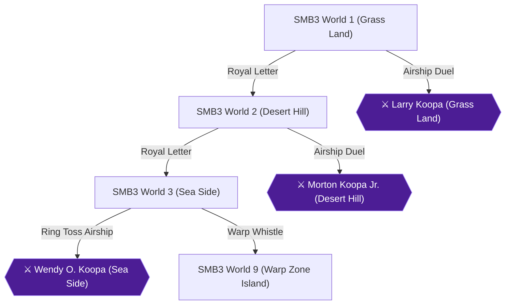

# Writer packet — Chapter 7: Super Mario Bros. 3 — Grass Land to Sea Side (Worlds 1–3)

Write `08_chapters/07.md`. Previous chapter: 6. Super Mario Bros. 2 — Character Mastery & Speedrun. Next chapter: 8. Super Mario Bros. 3 — Giant Land to Dark Land (Worlds 4–8).
Planner notes: Journey through the first three kingdoms of Super Mario Bros. 3, mastering minigames, White Mushroom Houses, and Warp Whistles.

## Areas in this chapter (in order)

- `SMB3_GrassLand` — SMB3 World 1 (Grass Land)
- `SMB3_DesertHill` — SMB3 World 2 (Desert Hill)
- `SMB3_SeaSide` — SMB3 World 3 (Sea Side)
- `SMB3_WarpZone` — SMB3 World 9 (Warp Zone Island)

## Achievements to place in this chapter (each EXACTLY once as `[ACHIEVEMENT:<id>]`)

- **26973** — Walk Like an Egyptian (5 pts): [SMB3] Reach World 2 by completing Grass Land  
  supporting facts: ra-comments-154-1, ra-comments-154-2, neo1-40-1, neo1-40-2, neo1-41-1, neo1-41-2, neo1-42-1, neo1-42-2, neo2-154-1, neo2-154-2, neo2-155-1, neo2-155-2, neo2-156-1, neo2-156-2, neo2-167-1, neo2-167-2, neo2-169-1, neo2-169-2, neo2-171-1, neo2-171-2, neo2-173-1, neo2-173-2, neo2-174-1, neo2-174-2, neo2-220-1, neo2-220-2, neo2-251-1, neo2-251-2, neo2-252-1, neo2-252-2, neo2-253-1, neo2-253-2, neo3-164-1, neo3-164-2, neo3-167-1, neo3-167-2, neo3-170-1, neo3-170-2, neo3-172-1, neo3-172-2, neo3-173-1, neo3-173-2, neo3-174-1, neo3-174-2, neo3-175-1, neo3-175-2, neo3-176-1, neo3-176-2, neo3-177-1, neo3-177-2, neo3-178-1, neo3-178-2, neo3-180-1, neo3-180-2, neo3-182-1, neo3-182-2, neo3-199-1, neo3-199-2, neo3-216-1, neo3-216-2, neo3-238-1, neo3-238-2, neo3-277-1, neo3-277-2, neo3-301-1, neo3-301-2, neo3-308-1, neo3-308-2, neo3-314-1, neo3-314-2, neo3-315-1, neo3-315-2, neo3-316-1, neo3-316-2, neo4-70-1, neo4-70-2, neo4-89-1, neo4-89-2, neo4-90-1, neo4-90-2, neo4-91-1, neo4-91-2, neo4-92-1, neo4-92-2, neo4-93-1, neo4-93-2, neo4-94-1, neo4-94-2, neo4-110-1, neo4-110-2, neo4-155-1, neo4-155-2
- **26980** — Grass Land Completionist (10 pts): [SMB3] Complete all stages and minigames in World 1  
  supporting facts: ra-comments-170-1, ra-comments-170-2, neo1-40-1, neo1-40-2, neo1-41-1, neo1-41-2, neo1-42-1, neo1-42-2, neo2-154-1, neo2-154-2, neo2-155-1, neo2-155-2, neo2-156-1, neo2-156-2, neo2-167-1, neo2-167-2, neo2-169-1, neo2-169-2, neo2-171-1, neo2-171-2, neo2-173-1, neo2-173-2, neo2-174-1, neo2-174-2, neo2-220-1, neo2-220-2, neo2-251-1, neo2-251-2, neo2-252-1, neo2-252-2, neo2-253-1, neo2-253-2, neo3-164-1, neo3-164-2, neo3-167-1, neo3-167-2, neo3-170-1, neo3-170-2, neo3-172-1, neo3-172-2, neo3-173-1, neo3-173-2, neo3-174-1, neo3-174-2, neo3-175-1, neo3-175-2, neo3-176-1, neo3-176-2, neo3-177-1, neo3-177-2, neo3-178-1, neo3-178-2, neo3-180-1, neo3-180-2, neo3-182-1, neo3-182-2, neo3-199-1, neo3-199-2, neo3-216-1, neo3-216-2, neo3-238-1, neo3-238-2, neo3-277-1, neo3-277-2, neo3-301-1, neo3-301-2, neo3-308-1, neo3-308-2, neo3-314-1, neo3-314-2, neo3-315-1, neo3-315-2, neo3-316-1, neo3-316-2, neo4-70-1, neo4-70-2, neo4-89-1, neo4-89-2, neo4-90-1, neo4-90-2, neo4-91-1, neo4-91-2, neo4-92-1, neo4-92-2, neo4-93-1, neo4-93-2, neo4-94-1, neo4-94-2, neo4-110-1, neo4-110-2, neo4-155-1, neo4-155-2
- **26974** — Tropic Topics (5 pts): [SMB3] Reach World 3 by completing Desert Hill  
  supporting facts: ra-comments-156-1, ra-comments-156-2, sw1-6-1, sw1-6-2, neo1-39-1, neo1-39-2, neo1-42-1, neo1-42-2, neo1-43-1, neo1-43-2, neo2-152-1, neo2-152-2, neo2-176-1, neo2-176-2, neo2-177-1, neo2-177-2, neo2-178-1, neo2-178-2, neo2-179-1, neo2-179-2, neo2-180-1, neo2-180-2, neo2-181-1, neo2-181-2, neo2-182-1, neo2-182-2, neo2-245-1, neo2-245-2, neo2-247-1, neo2-247-2, neo2-251-1, neo2-251-2, neo2-253-1, neo2-253-2, neo3-152-1, neo3-152-2, neo3-158-1, neo3-158-2, neo3-162-1, neo3-162-2, neo3-167-1, neo3-167-2, neo3-183-1, neo3-183-2, neo3-185-1, neo3-185-2, neo3-188-1, neo3-188-2, neo3-189-1, neo3-189-2, neo3-190-1, neo3-190-2, neo3-191-1, neo3-191-2, neo3-193-1, neo3-193-2, neo3-195-1, neo3-195-2, neo3-199-1, neo3-199-2, neo3-238-1, neo3-238-2, neo3-313-1, neo3-313-2, neo3-317-1, neo3-317-2, neo4-95-1, neo4-95-2, neo4-96-1, neo4-96-2, neo4-97-1, neo4-97-2, neo4-98-1, neo4-98-2, neo4-99-1, neo4-99-2, neo4-100-1, neo4-100-2, neo4-101-1, neo4-101-2, neo4-120-1, neo4-120-2, neo4-148-1, neo4-148-2, neo4-155-1, neo4-155-2
- **26981** — Desert Hill Completionist (10 pts): [SMB3] Complete all stages and minigames in World 2  
  supporting facts: ra-comments-172-1, ra-comments-172-2, sw1-6-1, sw1-6-2, neo1-39-1, neo1-39-2, neo1-42-1, neo1-42-2, neo1-43-1, neo1-43-2, neo2-152-1, neo2-152-2, neo2-176-1, neo2-176-2, neo2-177-1, neo2-177-2, neo2-178-1, neo2-178-2, neo2-179-1, neo2-179-2, neo2-180-1, neo2-180-2, neo2-181-1, neo2-181-2, neo2-182-1, neo2-182-2, neo2-245-1, neo2-245-2, neo2-247-1, neo2-247-2, neo2-251-1, neo2-251-2, neo2-253-1, neo2-253-2, neo3-152-1, neo3-152-2, neo3-158-1, neo3-158-2, neo3-162-1, neo3-162-2, neo3-167-1, neo3-167-2, neo3-183-1, neo3-183-2, neo3-185-1, neo3-185-2, neo3-188-1, neo3-188-2, neo3-189-1, neo3-189-2, neo3-190-1, neo3-190-2, neo3-191-1, neo3-191-2, neo3-193-1, neo3-193-2, neo3-195-1, neo3-195-2, neo3-199-1, neo3-199-2, neo3-238-1, neo3-238-2, neo3-313-1, neo3-313-2, neo3-317-1, neo3-317-2, neo4-95-1, neo4-95-2, neo4-96-1, neo4-96-2, neo4-97-1, neo4-97-2, neo4-98-1, neo4-98-2, neo4-99-1, neo4-99-2, neo4-100-1, neo4-100-2, neo4-101-1, neo4-101-2, neo4-120-1, neo4-120-2, neo4-148-1, neo4-148-2, neo4-155-1, neo4-155-2
- **26975** — Large and in Charge (5 pts): [SMB3] Reach World 4 by completing Sea Side  
  supporting facts: ra-comments-158-1, ra-comments-158-2, neo1-36-1, neo1-36-2, neo1-37-1, neo1-37-2, neo1-39-1, neo1-39-2, neo1-41-1, neo1-41-2, neo1-42-1, neo1-42-2, neo1-43-1, neo1-43-2, neo1-44-1, neo1-44-2, neo1-46-1, neo1-46-2, neo1-47-1, neo1-47-2, neo2-151-1, neo2-151-2, neo2-154-1, neo2-154-2, neo2-156-1, neo2-156-2, neo2-161-1, neo2-161-2, neo2-162-1, neo2-162-2, neo2-180-1, neo2-180-2, neo2-181-1, neo2-181-2, neo2-184-1, neo2-184-2, neo2-185-1, neo2-185-2, neo2-186-1, neo2-186-2, neo2-187-1, neo2-187-2, neo2-188-1, neo2-188-2, neo2-189-1, neo2-189-2, neo2-190-1, neo2-190-2, neo2-191-1, neo2-191-2, neo2-192-1, neo2-192-2, neo2-195-1, neo2-195-2, neo2-198-1, neo2-198-2, neo2-204-1, neo2-204-2, neo2-207-1, neo2-207-2, neo2-214-1, neo2-214-2, neo2-217-1, neo2-217-2, neo2-218-1, neo2-218-2, neo2-220-1, neo2-220-2, neo2-221-1, neo2-221-2, neo2-228-1, neo2-228-2, neo2-246-1, neo2-246-2, neo2-247-1, neo2-247-2, neo2-249-1, neo2-249-2, neo2-250-1, neo2-250-2, neo2-251-1, neo2-251-2, neo2-253-1, neo2-253-2, neo2-260-1, neo2-260-2, neo2-262-1, neo2-262-2, neo3-145-1, neo3-145-2, neo3-147-1, neo3-147-2, neo3-149-1, neo3-149-2, neo3-151-1, neo3-151-2, neo3-165-1, neo3-165-2, neo3-167-1, neo3-167-2, neo3-178-1, neo3-178-2, neo3-179-1, neo3-179-2, neo3-185-1, neo3-185-2, neo3-186-1, neo3-186-2, neo3-187-1, neo3-187-2, neo3-192-1, neo3-192-2, neo3-193-1, neo3-193-2, neo3-200-1, neo3-200-2, neo3-201-1, neo3-201-2, neo3-202-1, neo3-202-2, neo3-203-1, neo3-203-2, neo3-204-1, neo3-204-2, neo3-205-1, neo3-205-2, neo3-206-1, neo3-206-2, neo3-207-1, neo3-207-2, neo3-208-1, neo3-208-2, neo3-211-1, neo3-211-2, neo3-212-1, neo3-212-2, neo3-213-1, neo3-213-2, neo3-214-1, neo3-214-2, neo3-215-1, neo3-215-2, neo3-216-1, neo3-216-2, neo3-218-1, neo3-218-2, neo3-219-1, neo3-219-2, neo3-225-1, neo3-225-2, neo3-226-1, neo3-226-2, neo3-244-1, neo3-244-2, neo3-250-1, neo3-250-2, neo3-268-1, neo3-268-2, neo3-272-1, neo3-272-2, neo3-274-1, neo3-274-2, neo3-297-1, neo3-297-2, neo4-67-1, neo4-67-2, neo4-80-1, neo4-80-2, neo4-81-1, neo4-81-2, neo4-97-1, neo4-97-2, neo4-102-1, neo4-102-2, neo4-103-1, neo4-103-2, neo4-104-1, neo4-104-2, neo4-105-1, neo4-105-2, neo4-106-1, neo4-106-2, neo4-107-1, neo4-107-2, neo4-108-1, neo4-108-2, neo4-109-1, neo4-109-2, neo4-110-1, neo4-110-2, neo4-111-1, neo4-111-2, neo4-112-1, neo4-112-2, neo4-113-1, neo4-113-2, neo4-114-1, neo4-114-2, neo4-116-1, neo4-116-2, neo4-125-1, neo4-125-2, neo4-132-1, neo4-132-2, neo4-135-1, neo4-135-2, neo4-139-1, neo4-139-2, neo4-147-1, neo4-147-2
- **26982** — Sea Side Completionist (10 pts): [SMB3] Complete all stages and minigames in World 3  
  supporting facts: ra-comments-174-1, ra-comments-174-2, neo1-36-1, neo1-36-2, neo1-37-1, neo1-37-2, neo1-39-1, neo1-39-2, neo1-41-1, neo1-41-2, neo1-42-1, neo1-42-2, neo1-43-1, neo1-43-2, neo1-44-1, neo1-44-2, neo1-46-1, neo1-46-2, neo1-47-1, neo1-47-2, neo2-151-1, neo2-151-2, neo2-154-1, neo2-154-2, neo2-156-1, neo2-156-2, neo2-161-1, neo2-161-2, neo2-162-1, neo2-162-2, neo2-180-1, neo2-180-2, neo2-181-1, neo2-181-2, neo2-184-1, neo2-184-2, neo2-185-1, neo2-185-2, neo2-186-1, neo2-186-2, neo2-187-1, neo2-187-2, neo2-188-1, neo2-188-2, neo2-189-1, neo2-189-2, neo2-190-1, neo2-190-2, neo2-191-1, neo2-191-2, neo2-192-1, neo2-192-2, neo2-195-1, neo2-195-2, neo2-198-1, neo2-198-2, neo2-204-1, neo2-204-2, neo2-207-1, neo2-207-2, neo2-214-1, neo2-214-2, neo2-217-1, neo2-217-2, neo2-218-1, neo2-218-2, neo2-220-1, neo2-220-2, neo2-221-1, neo2-221-2, neo2-228-1, neo2-228-2, neo2-246-1, neo2-246-2, neo2-247-1, neo2-247-2, neo2-249-1, neo2-249-2, neo2-250-1, neo2-250-2, neo2-251-1, neo2-251-2, neo2-253-1, neo2-253-2, neo2-260-1, neo2-260-2, neo2-262-1, neo2-262-2, neo3-145-1, neo3-145-2, neo3-147-1, neo3-147-2, neo3-149-1, neo3-149-2, neo3-151-1, neo3-151-2, neo3-165-1, neo3-165-2, neo3-167-1, neo3-167-2, neo3-178-1, neo3-178-2, neo3-179-1, neo3-179-2, neo3-185-1, neo3-185-2, neo3-186-1, neo3-186-2, neo3-187-1, neo3-187-2, neo3-192-1, neo3-192-2, neo3-193-1, neo3-193-2, neo3-200-1, neo3-200-2, neo3-201-1, neo3-201-2, neo3-202-1, neo3-202-2, neo3-203-1, neo3-203-2, neo3-204-1, neo3-204-2, neo3-205-1, neo3-205-2, neo3-206-1, neo3-206-2, neo3-207-1, neo3-207-2, neo3-208-1, neo3-208-2, neo3-211-1, neo3-211-2, neo3-212-1, neo3-212-2, neo3-213-1, neo3-213-2, neo3-214-1, neo3-214-2, neo3-215-1, neo3-215-2, neo3-216-1, neo3-216-2, neo3-218-1, neo3-218-2, neo3-219-1, neo3-219-2, neo3-225-1, neo3-225-2, neo3-226-1, neo3-226-2, neo3-244-1, neo3-244-2, neo3-250-1, neo3-250-2, neo3-268-1, neo3-268-2, neo3-272-1, neo3-272-2, neo3-274-1, neo3-274-2, neo3-297-1, neo3-297-2, neo4-67-1, neo4-67-2, neo4-80-1, neo4-80-2, neo4-81-1, neo4-81-2, neo4-97-1, neo4-97-2, neo4-102-1, neo4-102-2, neo4-103-1, neo4-103-2, neo4-104-1, neo4-104-2, neo4-105-1, neo4-105-2, neo4-106-1, neo4-106-2, neo4-107-1, neo4-107-2, neo4-108-1, neo4-108-2, neo4-109-1, neo4-109-2, neo4-110-1, neo4-110-2, neo4-111-1, neo4-111-2, neo4-112-1, neo4-112-2, neo4-113-1, neo4-113-2, neo4-114-1, neo4-114-2, neo4-116-1, neo4-116-2, neo4-125-1, neo4-125-2, neo4-132-1, neo4-132-2, neo4-135-1, neo4-135-2, neo4-139-1, neo4-139-2, neo4-147-1, neo4-147-2
- **26989** — A Faraway Land (1 pts): [SMB3] Find World 9: Warp Zone  
  supporting facts: ra-comments-186-1, ra-comments-186-2, neo1-35-1, neo1-35-2, neo1-40-1, neo1-40-2, neo1-41-1, neo1-41-2, neo1-43-1, neo1-43-2, neo2-170-1, neo2-170-2, neo2-172-1, neo2-172-2, neo2-176-1, neo2-176-2, neo2-202-1, neo2-202-2, neo2-224-1, neo2-224-2, neo2-245-1, neo2-245-2, neo2-252-1, neo2-252-2, neo2-253-1, neo2-253-2, neo3-164-1, neo3-164-2, neo3-277-1, neo3-277-2, neo3-314-1, neo3-314-2, neo3-315-1, neo3-315-2, neo3-316-1, neo3-316-2, neo3-317-1, neo3-317-2, neo4-70-1, neo4-70-2, neo4-91-1, neo4-91-2, neo4-93-1, neo4-93-2, neo4-101-1, neo4-101-2
- **26990** — Lulla-bye (1 pts): [SMB3] Use a Music Box  
  supporting facts: ra-comments-188-1, ra-comments-188-2, neo1-35-1, neo1-35-2, neo1-48-1, neo1-48-2, neo1-50-1, neo1-50-2, neo1-53-1, neo1-53-2, neo2-193-1, neo2-193-2, neo2-244-1, neo2-244-2, neo3-143-1, neo3-143-2, neo3-164-1, neo3-164-2, neo3-216-1, neo3-216-2, neo3-239-1, neo3-239-2, neo3-240-1, neo3-240-2, neo3-317-1, neo3-317-2, neo4-69-1, neo4-69-2, neo4-120-1, neo4-120-2
- **26991** — Backstage Pass (1 pts): [SMB3] Go behind the scenery  
  supporting facts: ra-comments-190-1, ra-comments-190-2, neo1-39-1, neo1-39-2, neo1-40-1, neo1-40-2, neo2-189-1, neo2-189-2, neo2-191-1, neo2-191-2, neo2-192-1, neo2-192-2, neo2-193-1, neo2-193-2, neo2-195-1, neo2-195-2, neo2-204-1, neo2-204-2, neo2-205-1, neo2-205-2, neo2-213-1, neo2-213-2, neo2-214-1, neo2-214-2, neo2-217-1, neo2-217-2, neo2-220-1, neo2-220-2, neo2-221-1, neo2-221-2, neo2-222-1, neo2-222-2, neo2-226-1, neo2-226-2, neo2-228-1, neo2-228-2, neo2-229-1, neo2-229-2, neo2-232-1, neo2-232-2, neo2-233-1, neo2-233-2, neo2-247-1, neo2-247-2, neo2-252-1, neo2-252-2, neo2-253-1, neo2-253-2, neo3-315-1, neo3-315-2, neo4-85-1, neo4-85-2, neo4-91-1, neo4-91-2
- **26992** — Royal Flush (3 pts): [SMB3] Match 3 cards from the goal roulette  
  supporting facts: ra-comments-192-1, ra-comments-192-2, neo1-37-1, neo1-37-2, neo1-51-1, neo1-51-2, neo2-161-1, neo2-161-2, neo2-162-1, neo2-162-2, neo2-165-1, neo2-165-2, neo2-169-1, neo2-169-2, neo2-170-1, neo2-170-2, neo2-171-1, neo2-171-2, neo2-172-1, neo2-172-2, neo2-173-1, neo2-173-2, neo2-174-1, neo2-174-2, neo2-177-1, neo2-177-2, neo2-179-1, neo2-179-2, neo2-180-1, neo2-180-2, neo2-181-1, neo2-181-2, neo2-182-1, neo2-182-2, neo2-185-1, neo2-185-2, neo2-186-1, neo2-186-2, neo2-188-1, neo2-188-2, neo2-189-1, neo2-189-2, neo2-190-1, neo2-190-2, neo2-191-1, neo2-191-2, neo2-192-1, neo2-192-2, neo2-195-1, neo2-195-2, neo2-196-1, neo2-196-2, neo2-198-1, neo2-198-2, neo2-199-1, neo2-199-2, neo2-204-1, neo2-204-2, neo2-205-1, neo2-205-2, neo2-208-1, neo2-208-2, neo2-209-1, neo2-209-2, neo2-210-1, neo2-210-2, neo2-213-1, neo2-213-2, neo2-214-1, neo2-214-2, neo2-216-1, neo2-216-2, neo2-217-1, neo2-217-2, neo2-218-1, neo2-218-2, neo2-219-1, neo2-219-2, neo2-220-1, neo2-220-2, neo2-221-1, neo2-221-2, neo2-222-1, neo2-222-2, neo2-226-1, neo2-226-2, neo2-227-1, neo2-227-2, neo2-228-1, neo2-228-2, neo2-229-1, neo2-229-2, neo2-231-1, neo2-231-2, neo2-232-1, neo2-232-2, neo2-233-1, neo2-233-2, neo2-240-1, neo2-240-2, neo2-244-1, neo2-244-2, neo2-246-1, neo2-246-2, neo2-252-1, neo2-252-2, neo2-253-1, neo2-253-2, neo2-254-1, neo2-254-2, neo2-255-1, neo2-255-2, neo3-144-1, neo3-144-2, neo3-164-1, neo3-164-2, neo3-172-1, neo3-172-2, neo3-173-1, neo3-173-2, neo3-176-1, neo3-176-2, neo3-179-1, neo3-179-2, neo3-181-1, neo3-181-2, neo3-184-1, neo3-184-2, neo3-187-1, neo3-187-2, neo3-190-1, neo3-190-2, neo3-193-1, neo3-193-2, neo3-195-1, neo3-195-2, neo3-198-1, neo3-198-2, neo3-201-1, neo3-201-2, neo3-202-1, neo3-202-2, neo3-203-1, neo3-203-2, neo3-205-1, neo3-205-2, neo3-206-1, neo3-206-2, neo3-207-1, neo3-207-2, neo3-210-1, neo3-210-2, neo3-213-1, neo3-213-2, neo3-214-1, neo3-214-2, neo3-219-1, neo3-219-2, neo3-220-1, neo3-220-2, neo3-221-1, neo3-221-2, neo3-227-1, neo3-227-2, neo3-230-1, neo3-230-2, neo3-231-1, neo3-231-2, neo3-232-1, neo3-232-2, neo3-242-1, neo3-242-2, neo3-245-1, neo3-245-2, neo3-251-1, neo3-251-2, neo3-253-1, neo3-253-2, neo3-254-1, neo3-254-2, neo3-255-1, neo3-255-2, neo3-257-1, neo3-257-2, neo3-258-1, neo3-258-2, neo3-260-1, neo3-260-2, neo3-261-1, neo3-261-2, neo3-262-1, neo3-262-2, neo3-266-1, neo3-266-2, neo3-267-1, neo3-267-2, neo3-268-1, neo3-268-2, neo3-269-1, neo3-269-2, neo3-271-1, neo3-271-2, neo3-274-1, neo3-274-2, neo3-275-1, neo3-275-2, neo3-279-1, neo3-279-2, neo3-280-1, neo3-280-2, neo3-281-1, neo3-281-2, neo3-283-1, neo3-283-2, neo3-286-1, neo3-286-2, neo3-287-1, neo3-287-2, neo3-291-1, neo3-291-2, neo3-293-1, neo3-293-2, neo3-304-1, neo3-304-2, neo3-307-1, neo3-307-2, neo3-317-1, neo3-317-2, neo3-318-1, neo3-318-2, neo4-91-1, neo4-91-2, neo4-100-1, neo4-100-2, neo4-120-1, neo4-120-2, neo4-124-1, neo4-124-2, neo4-155-1, neo4-155-2
- **26994** — When the Stars Align (5 pts): [SMB3] Assemble a Starman in the Spade Panel minigame  
  supporting facts: ra-comments-197-1, ra-comments-197-2, neo1-34-1, neo1-34-2, neo1-37-1, neo1-37-2, neo2-253-1, neo2-253-2, neo4-66-1, neo4-66-2, neo4-89-1, neo4-89-2, neo4-155-1, neo4-155-2
- **26995** — Goomba Stompin' (5 pts): [SMB3] Earn a 1-Up from stomping Goombas in World 1-2  
  supporting facts: ra-comments-199-1, ra-comments-199-2, neo1-40-1, neo1-40-2, neo2-169-1, neo2-169-2, neo3-173-1, neo3-173-2, neo4-90-1, neo4-90-2
- **26996** — Them Bones (5 pts): [SMB3] Earn 10 1-Ups in a row from stomping Dry Bones in World 2-Fortress  
  supporting facts: ra-comments-201-1, ra-comments-201-2, neo1-41-1, neo1-41-2, neo1-42-1, neo1-42-2, neo1-47-1, neo1-47-2, neo2-171-1, neo2-171-2, neo2-178-1, neo2-178-2, neo2-186-1, neo2-186-2, neo2-196-1, neo2-196-2, neo2-199-1, neo2-199-2, neo2-200-1, neo2-200-2, neo2-209-1, neo2-209-2, neo2-234-1, neo2-234-2, neo2-240-1, neo2-240-2, neo2-252-1, neo2-252-2, neo3-151-1, neo3-151-2, neo3-177-1, neo3-177-2, neo3-188-1, neo3-188-2, neo3-204-1, neo3-204-2, neo3-233-1, neo3-233-2, neo3-256-1, neo3-256-2, neo3-293-1, neo3-293-2, neo3-307-1, neo3-307-2, neo3-316-1, neo3-316-2, neo4-72-1, neo4-72-2
- **26997** — Flight Cancellation (5 pts): [SMB3] Use an Anchor  
  supporting facts: ra-comments-203-1, ra-comments-203-2, neo1-34-1, neo1-34-2, neo1-42-1, neo1-42-2, neo1-43-1, neo1-43-2, neo1-48-1, neo1-48-2, neo1-51-1, neo1-51-2, neo1-52-1, neo1-52-2, neo2-174-1, neo2-174-2, neo2-210-1, neo2-210-2, neo2-244-1, neo2-244-2, neo2-253-1, neo2-253-2, neo3-163-1, neo3-163-2, neo4-68-1, neo4-68-2, neo4-97-1, neo4-97-2, neo4-115-1, neo4-115-2, neo4-133-1, neo4-133-2, neo4-155-1, neo4-155-2
- **26998** — Hammer Time! (2 pts): [SMB3] Destroy a boulder using a Hammer  
  supporting facts: ra-comments-205-1, ra-comments-205-2, neo1-35-1, neo1-35-2, neo1-43-1, neo1-43-2, neo2-176-1, neo2-176-2, neo2-184-1, neo2-184-2, neo2-194-1, neo2-194-2, neo2-212-1, neo2-212-2, neo2-238-1, neo2-238-2, neo2-244-1, neo2-244-2, neo2-250-1, neo2-250-2, neo3-159-1, neo3-159-2, neo3-163-1, neo3-163-2, neo3-216-1, neo3-216-2, neo3-269-1, neo3-269-2, neo3-297-1, neo3-297-2, neo3-301-1, neo3-301-2, neo3-308-1, neo3-308-2, neo3-317-1, neo3-317-2, neo4-67-1, neo4-67-2, neo4-69-1, neo4-69-2, neo4-89-1, neo4-89-2, neo4-101-1, neo4-101-2, neo4-112-1, neo4-112-2, neo4-113-1, neo4-113-2, neo4-153-1, neo4-153-2
- **27001** — Strange and Wonderful Secrets I (5 pts): [SMB3] Summon the Blue Mushroom House in World 1.  
  supporting facts: ra-comments-210-1, ra-comments-210-2, neo2-195-1, neo2-195-2, neo2-218-1, neo2-218-2, neo2-253-1, neo2-253-2, neo4-68-1, neo4-68-2, neo4-92-1, neo4-92-2, neo4-97-1, neo4-97-2, neo4-111-1, neo4-111-2, neo4-124-1, neo4-124-2, neo4-133-1, neo4-133-2, neo4-137-1, neo4-137-2, neo4-155-1, neo4-155-2
- **27002** — Strange and Wonderful Secrets II (5 pts): [SMB3] Summon the Blue Mushroom House in World 2.  
  supporting facts: ra-comments-212-1, ra-comments-212-2, neo2-195-1, neo2-195-2, neo2-218-1, neo2-218-2, neo2-253-1, neo2-253-2, neo4-68-1, neo4-68-2, neo4-92-1, neo4-92-2, neo4-97-1, neo4-97-2, neo4-111-1, neo4-111-2, neo4-124-1, neo4-124-2, neo4-133-1, neo4-133-2, neo4-137-1, neo4-137-2, neo4-155-1, neo4-155-2
- **27003** — Strange and Wonderful Secrets III (10 pts): [SMB3] Summon the Blue Mushroom House in World 3.  
  supporting facts: ra-comments-214-1, ra-comments-214-2, neo2-195-1, neo2-195-2, neo2-218-1, neo2-218-2, neo2-253-1, neo2-253-2, neo4-68-1, neo4-68-2, neo4-92-1, neo4-92-2, neo4-97-1, neo4-97-2, neo4-111-1, neo4-111-2, neo4-124-1, neo4-124-2, neo4-133-1, neo4-133-2, neo4-137-1, neo4-137-2, neo4-155-1, neo4-155-2
- **27008** — A Boatload of Cash (5 pts): [SMB3] Summon a Treasure Ship  
  supporting facts: ra-comments-224-1, ra-comments-224-2, neo1-34-1, neo1-34-2, neo1-39-1, neo1-39-2, neo1-42-1, neo1-42-2, neo1-43-1, neo1-43-2, neo1-46-1, neo1-46-2, neo1-48-1, neo1-48-2, neo1-50-1, neo1-50-2, neo1-52-1, neo1-52-2, neo1-53-1, neo1-53-2, neo1-54-1, neo1-54-2, neo2-174-1, neo2-174-2, neo2-182-1, neo2-182-2, neo2-192-1, neo2-192-2, neo2-201-1, neo2-201-2, neo2-210-1, neo2-210-2, neo2-223-1, neo2-223-2, neo2-234-1, neo2-234-2, neo2-236-1, neo2-236-2, neo2-237-1, neo2-237-2, neo2-238-1, neo2-238-2, neo2-239-1, neo2-239-2, neo2-244-1, neo2-244-2, neo2-250-1, neo2-250-2, neo2-251-1, neo2-251-2, neo2-253-1, neo2-253-2, neo3-159-1, neo3-159-2, neo3-163-1, neo3-163-2, neo3-199-1, neo3-199-2, neo3-215-1, neo3-215-2, neo3-277-1, neo3-277-2, neo3-297-1, neo3-297-2, neo3-301-1, neo3-301-2, neo3-313-1, neo3-313-2, neo4-66-1, neo4-66-2, neo4-68-1, neo4-68-2, neo4-87-1, neo4-87-2, neo4-88-1, neo4-88-2, neo4-89-1, neo4-89-2, neo4-95-1, neo4-95-2, neo4-102-1, neo4-102-2, neo4-112-1, neo4-112-2, neo4-113-1, neo4-113-2, neo4-119-1, neo4-119-2, neo4-123-1, neo4-123-2, neo4-124-1, neo4-124-2, neo4-127-1, neo4-127-2, neo4-136-1, neo4-136-2, neo4-147-1, neo4-147-2, neo4-148-1, neo4-148-2, neo4-149-1, neo4-149-2, neo4-154-1, neo4-154-2
- **27009** — Super Speedrun Bros. 3 (25 pts): [SMB3] Complete the game in one session using the shortest possible route  
  supporting facts: ra-comments-226-1, ra-comments-226-2, neo1-35-1, neo1-35-2, neo1-40-1, neo1-40-2, neo1-41-1, neo1-41-2, neo1-43-1, neo1-43-2, neo2-170-1, neo2-170-2, neo2-172-1, neo2-172-2, neo2-176-1, neo2-176-2, neo2-202-1, neo2-202-2, neo2-224-1, neo2-224-2, neo2-245-1, neo2-245-2, neo2-252-1, neo2-252-2, neo2-253-1, neo2-253-2, neo3-164-1, neo3-164-2, neo3-277-1, neo3-277-2, neo3-314-1, neo3-314-2, neo3-315-1, neo3-315-2, neo3-316-1, neo3-316-2, neo3-317-1, neo3-317-2, neo4-70-1, neo4-70-2, neo4-91-1, neo4-91-2, neo4-93-1, neo4-93-2, neo4-101-1, neo4-101-2

## ⚠ Missables in this chapter (each needs a `> [!WARNING]` BEFORE the point it can be missed)

- SMB3 Super Speedrun Bros. 3 (Shortest Route) (achievement 27009) — deadline: Complete SMB3 in one session using the shortest route via Warp Whistles [ra-comments-226-1, ra-comments-226-2, neo1-35-1]

## ⛔ Points of no return in this chapter (each needs a `> [!CAUTION]` containing the words "Point of No Return")

- Point of No Return: Sea Side Airship Departure: Defeating Wendy O. Koopa on the Sea Side airship sends Mario forward to World 4, making earlier map panels inaccessible without warps. [ra-comments-158-1, ra-comments-158-2]

## Route diagram (inserted automatically where you write `[MERMAID]`)



## Usable facts (584) — cite as [[fact-id]]

Legend: ✅ verified (2+ sources) · ✔ conflict resolved · 🟡 single source

- 🟡 **neo1-34-1** (location) The winning character pulls up the cork and frees the Subcons. They say thank — @always. · ach: 26993,541025,26994,26997,27000,27008  
  evidence: neo1#34: "The winning character pulls up the cork and frees the Subcons. They say thank"
- 🟡 **neo1-34-2** (location) you to the character but if all characters completed equal levels, they say — @always. · ach: 26993,541025,26994,26997,27000,27008  
  evidence: neo1#34: "you to the character but if all characters completed equal levels, they say"
- 🟡 **neo1-35-1** (location) Is there a stage you just can't beat and you just want to skip it altogether? — @Jugem Cloud · ach: 26979,26986,26989,27009,26990,26993,541025,26998  
  evidence: neo1#35: "Is there a stage you just can't beat and you just want to skip it altogether?"
- 🟡 **neo1-35-2** (location) This is the item you need. Just don't die on the level after that or you'll be — @Jugem Cloud · ach: 26979,26986,26989,27009,26990,26993,541025,26998  
  evidence: neo1#35: "This is the item you need. Just don't die on the level after that or you'll be"
- 🟡 **neo1-36-1** (item) Turns coins to bricks and vice versa. — @P-Switch · ach: 26975,26982,27000  
  evidence: neo1#36: "Turns coins to bricks and vice versa."
- 🟡 **neo1-36-2** (location) Turns Mario/Luigi into SUper Mario/Luigi. Now Mario/Luigi can break bricks from — @P-Switch · ach: 26975,26982,27000  
  evidence: neo1#36: "Turns Mario/Luigi into SUper Mario/Luigi. Now Mario/Luigi can break bricks from"
- 🟡 **neo1-37-1** (item) Turns Mario/Luigi into Hammer Mario/Luigi. This suit launches hammers similar — @Hammer Suit · ach: 26975,26982,26992,26993,541025,26994,27000  
  evidence: neo1#37: "Turns Mario/Luigi into Hammer Mario/Luigi. This suit launches hammers similar"
- 🟡 **neo1-37-2** (location) to those of the Hammer Bros. These hammer can kill enemies that fireballs can't — @Hammer Suit · ach: 26975,26982,26992,26993,541025,26994,27000  
  evidence: neo1#37: "to those of the Hammer Bros. These hammer can kill enemies that fireballs can't"
- ✅ **neo1-39-1** (achievement) Description: The only enemy from SMB2 USA. When stomped on, they'll explode in — @SMB3 Stage Guide · ach: 26974,26981,26975,26982,26988,26987,26991,27000,27008  
  evidence: neo1#39: "Description: The only enemy from SMB2 USA. When stomped on, they'll explode in"
- ✅ **neo1-39-2** (location) a few seconds. The ones in World 8 will explode on their own. — @SMB3 Stage Guide · ach: 26974,26981,26975,26982,26988,26987,26991,27000,27008  
  evidence: neo1#39: "a few seconds. The ones in World 8 will explode on their own."
- ✅ **neo1-40-1** (achievement) Description: Miniboss who guards the Fortresses — @SMB3 Stage Guide · ach: 26973,26980,26977,26984,26989,27009,26991,26995,27000  
  evidence: neo1#40: "Description: Miniboss who guards the Fortresses"
- ✅ **neo1-40-2** (item) Upon start up, you got Goombas to eliminate if you choose to do so. The fourth — @SMB3 Stage Guide · ach: 26973,26980,26977,26984,26989,27009,26991,26995,27000  
  evidence: neo1#40: "Upon start up, you got Goombas to eliminate if you choose to do so. The fourth"
- ✅ **neo1-41-1** (location) This is the game's first auto-scrolling stage. In this level, you must collect — @SMB3 Stage Guide · ach: 26973,26980,26975,26982,26989,27009,26996,27000  
  evidence: neo1#41: "This is the game's first auto-scrolling stage. In this level, you must collect"
- ✅ **neo1-41-2** (item) all 44 coins to make a white Toad house appear on the map (which contains a P- — @SMB3 Stage Guide · ach: 26973,26980,26975,26982,26989,27009,26996,27000  
  evidence: neo1#41: "all 44 coins to make a white Toad house appear on the map (which contains a P-"
- ✅ **neo1-42-1** (location) This is a hint of things to come in future airships too. The ship is full of — @SMB3 Stage Guide · ach: 26973,26980,26974,26981,26975,26982,26993,541025,26996,26997,27000,27008  
  evidence: neo1#42: "This is a hint of things to come in future airships too. The ship is full of"
- ✅ **neo1-42-2** (item) Bullet Bills and cannons coming from all directions. There is a Fire Flower in — @SMB3 Stage Guide · ach: 26973,26980,26974,26981,26975,26982,26993,541025,26996,26997,27000,27008  
  evidence: neo1#42: "Bullet Bills and cannons coming from all directions. There is a Fire Flower in"
- ✅ **neo1-43-1** (location) Notice that angry sun in the upper-left hand corner. It will stay there for the — @SMB3 Stage Guide · ach: 26974,26981,26975,26982,26989,27009,26993,541025,26997,26998,27000,27008  
  evidence: neo1#43: "Notice that angry sun in the upper-left hand corner. It will stay there for the"
- ✅ **neo1-43-2** (location) first part of the level. Stay out of the quicksand because there are Venus Fire — @SMB3 Stage Guide · ach: 26974,26981,26975,26982,26989,27009,26993,541025,26997,26998,27000,27008  
  evidence: neo1#43: "first part of the level. Stay out of the quicksand because there are Venus Fire"
- ✅ **neo1-44-1** (location) Beware of the Cheep Cheeps in this area. They like nothing better to do than to — @SMB3 Stage Guide · ach: 26975,26982,27000  
  evidence: neo1#44: "Beware of the Cheep Cheeps in this area. They like nothing better to do than to"
- ✅ **neo1-44-2** (location) jump out of the water and crash into you. Stay above the water as much as you — @SMB3 Stage Guide · ach: 26975,26982,27000  
  evidence: neo1#44: "jump out of the water and crash into you. Stay above the water as much as you"
- ✅ **neo1-46-1** (item) Hit the brick which I indicated as the star and a vine will appear. Climb it — @SMB3 Stage Guide · ach: 26975,26982,26976,26983,26977,26984,26993,541025,27000,27008  
  evidence: neo1#46: "Hit the brick which I indicated as the star and a vine will appear. Climb it"
- ✅ **neo1-46-2** (item) to reach the clouds. Use the clouds to get a running start to the right and fly — @SMB3 Stage Guide · ach: 26975,26982,26976,26983,26977,26984,26993,541025,27000,27008  
  evidence: neo1#46: "to reach the clouds. Use the clouds to get a running start to the right and fly"
- ✅ **neo1-47-1** (location) The Cheep Cheeps are out in full force in this level. Beware of the Piranhacus — @SMB3 Stage Guide · ach: 26975,26982,26976,26983,26996,27000  
  evidence: neo1#47: "The Cheep Cheeps are out in full force in this level. Beware of the Piranhacus"
- ✅ **neo1-47-2** (location) Gigantcus. They are bigger versions of Piranha Plants and those things are very — @SMB3 Stage Guide · ach: 26975,26982,26976,26983,26996,27000  
  evidence: neo1#47: "Gigantcus. They are bigger versions of Piranha Plants and those things are very"
- ✅ **neo1-48-1** (location) Try to avoid falling into the lava while making your way across the Donut Lifts — @SMB3 Stage Guide · ach: 26976,26983,26977,26984,26990,26993,541025,26997,27000,27008  
  evidence: neo1#48: "Try to avoid falling into the lava while making your way across the Donut Lifts"
- ✅ **neo1-48-2** (item) and watch out for Pobodos.There is a Fire Flower during your journey. At some — @SMB3 Stage Guide · ach: 26976,26983,26977,26984,26990,26993,541025,26997,27000,27008  
  evidence: neo1#48: "and watch out for Pobodos.There is a Fire Flower during your journey. At some"
- ✅ **neo1-50-1** (location) Run for your life. Lakitu is on the prowl once again. Don't stop for anything.. — @SMB3 Stage Guide · ach: 26977,26984,26978,26985,26990,26993,541025,27000,27008  
  evidence: neo1#50: "Run for your life. Lakitu is on the prowl once again. Don't stop for anything.."
- ✅ **neo1-50-2** (location) well except for a few Koopa Troopas in the way but they are the least of your — @SMB3 Stage Guide · ach: 26977,26984,26978,26985,26990,26993,541025,27000,27008  
  evidence: neo1#50: "well except for a few Koopa Troopas in the way but they are the least of your"
- ✅ **neo1-51-1** (location) Stay on the moving block and be wary of the Pobodos. Ignore the question block. — @SMB3 Stage Guide · ach: 26977,26984,26978,26985,26992,26993,541025,26997,27000  
  evidence: neo1#51: "Stay on the moving block and be wary of the Pobodos. Ignore the question block."
- ✅ **neo1-51-2** (location) Near the end of the ride, watch out for the RotoDisc and hop off while you hole — @SMB3 Stage Guide · ach: 26977,26984,26978,26985,26992,26993,541025,26997,27000  
  evidence: neo1#51: "Near the end of the ride, watch out for the RotoDisc and hop off while you hole"
- ✅ **neo1-52-1** (item) Got a P-wing, Racoon Suit, or Tanooki Suit? If you do, you'll finish this level — @SMB3 Stage Guide · ach: 26978,26985,26979,26986,26993,541025,26997,27000,27008  
  evidence: neo1#52: "Got a P-wing, Racoon Suit, or Tanooki Suit? If you do, you'll finish this level"
- ✅ **neo1-52-2** (transition) in record time. Instead of going down the pipe. Just fly over the ice wall and — @SMB3 Stage Guide · ach: 26978,26985,26979,26986,26993,541025,26997,27000,27008  
  evidence: neo1#52: "in record time. Instead of going down the pipe. Just fly over the ice wall and"
- ✅ **neo1-53-1** (transition) It is easy to get lost in this level. Some of the pipes leading to pipes with — @SMB3 Stage Guide · ach: 26979,26986,26990,26993,541025,27000,27008  
  evidence: neo1#53: "It is easy to get lost in this level. Some of the pipes leading to pipes with"
- ✅ **neo1-53-2** (transition) hidden coins that block you path. Here is the solution. Go up the pipe at the — @SMB3 Stage Guide · ach: 26979,26986,26990,26993,541025,27000,27008  
  evidence: neo1#53: "hidden coins that block you path. Here is the solution. Go up the pipe at the"
- ✅ **neo1-54-1** (location) Ignore the Bolt Lifts and just safely cross through the pit via the bottom as — @SMB3 Stage Guide · ach: 26979,26986,26988,26987,26993,541025,27000,27008  
  evidence: neo1#54: "Ignore the Bolt Lifts and just safely cross through the pit via the bottom as"
- ✅ **neo1-54-2** (item) you avoid the jetfire. With a Racoon Suit this airship is easier to jump over — @SMB3 Stage Guide · ach: 26979,26986,26988,26987,26993,541025,27000,27008  
  evidence: neo1#54: "you avoid the jetfire. With a Racoon Suit this airship is easier to jump over"
- ✅ **neo2-151-1** (location) • Pidgit       - They fly yellow magic carpets around and try to swoop at — @SMB3 Stage Guide · ach: 26975,26982,26977,26984,27000  
  evidence: neo2#151: "• Pidgit       - They fly yellow magic carpets around and try to swoop at"
- ✅ **neo2-151-2** (location) you every so often. When you throw it away you can use its — @SMB3 Stage Guide · ach: 26975,26982,26977,26984,27000  
  evidence: neo2#151: "you every so often. When you throw it away you can use its"
- ✅ **neo2-152-1** (location) The simplest and most common of all bosses. They spurt eggs at you and — @SMB3 Stage Guide · ach: 26974,26981,26976,26983,27000  
  evidence: neo2#152: "The simplest and most common of all bosses. They spurt eggs at you and"
- ✅ **neo2-152-2** (location) move around and jump a little. You can take her out by picking up three of — @SMB3 Stage Guide · ach: 26974,26981,26976,26983,27000  
  evidence: neo2#152: "move around and jump a little. You can take her out by picking up three of"
- ✅ **neo2-154-1** (location) <    > Shorcut to Boss in World 1-1 — @SMB3 Stage Guide · ach: 26973,26980,26975,26982,26976,26983,26977,26984,26978,26985,26979,26986  
  evidence: neo2#154: "<    > Shorcut to Boss in World 1-1"
- ✅ **neo2-154-2** (location) In the cave area of the level when you reach the top half of the vine, — @SMB3 Stage Guide · ach: 26973,26980,26975,26982,26976,26983,26977,26984,26978,26985,26979,26986  
  evidence: neo2#154: "In the cave area of the level when you reach the top half of the vine,"
- ✅ **neo2-155-1** (location) Don't really see much of a point of making this trick, nonetheless it is a — @SMB3 Stage Guide · ach: 26973,26980,27000  
  evidence: neo2#155: "Don't really see much of a point of making this trick, nonetheless it is a"
- ✅ **neo2-155-2** (location) funny one to try out. Pause while playing, hold the L and R Buttons and — @SMB3 Stage Guide · ach: 26973,26980,27000  
  evidence: neo2#155: "funny one to try out. Pause while playing, hold the L and R Buttons and"
- ✅ **neo2-156-1** (location) Like World 1-1, this level does not require any specific strategies to be — @World 1-2 · ach: 26973,26980,26975,26982,26976,26983  
  evidence: neo2#156: "Like World 1-1, this level does not require any specific strategies to be"
- ✅ **neo2-156-2** (location) completed with. Be sure to get the 1-Up in the first jar, and get as many — @World 1-2 · ach: 26973,26980,26975,26982,26976,26983  
  evidence: neo2#156: "completed with. Be sure to get the 1-Up in the first jar, and get as many"
- 🟡 **neo2-161-1** (item) Try to use suits to their fullest advantage. Remember that the — @World 7-2 · ach: 26975,26982,26979,26986,26992,26993,541025,27000  
  evidence: neo2#161: "Try to use suits to their fullest advantage. Remember that the"
- 🟡 **neo2-161-2** (item) surroundings of Mario can determine which suit is best to carry around. In — @World 7-2 · ach: 26975,26982,26979,26986,26992,26993,541025,27000  
  evidence: neo2#161: "surroundings of Mario can determine which suit is best to carry around. In"
- ✅ **neo2-162-1** (item) Each suits have their own special use. Please refer to the 'Moves and — @SMB3 Stage Guide · ach: 26975,26982,26992,26993,541025,27000  
  evidence: neo2#162: "Each suits have their own special use. Please refer to the 'Moves and"
- ✅ **neo2-162-2** (location) Attacks' section for more detail on how to execute them. — @SMB3 Stage Guide · ach: 26975,26982,26992,26993,541025,27000  
  evidence: neo2#162: "Attacks' section for more detail on how to execute them."
- ✅ **neo2-165-1** (location) He's the most popular video-game character of all time, and he's back, — @SMB3 Stage Guide · ach: 26992,27000  
  evidence: neo2#165: "He's the most popular video-game character of all time, and he's back,"
- ✅ **neo2-165-2** (location) better than ever, and ready to kick some Koopa Tail in another classic — @SMB3 Stage Guide · ach: 26992,27000  
  evidence: neo2#165: "better than ever, and ready to kick some Koopa Tail in another classic"
- ✅ **neo2-167-1** (location) NOTE: The padlock disappears once you complete the Fortress level. — @SMB3 Stage Guide · ach: 26973,26980,26993,541025  
  evidence: neo2#167: "NOTE: The padlock disappears once you complete the Fortress level."
- ✅ **neo2-167-2** (location) Let the adventure begin! Run right and stomp the Goomba. The first two '?' — @SMB3 Stage Guide · ach: 26973,26980,26993,541025  
  evidence: neo2#167: "Let the adventure begin! Run right and stomp the Goomba. The first two '?'"
- 🟡 **neo2-169-1** (location) Run right, into the dark area and grab the card in the box to finish the — @Routes join up here · ach: 26973,26980,26992,26995,27000  
  evidence: neo2#169: "Run right, into the dark area and grab the card in the box to finish the"
- 🟡 **neo2-169-2** (transition) Run right up the hill and jump over the Goomba-generating pipe laying on — @Routes join up here · ach: 26973,26980,26992,26995,27000  
  evidence: neo2#169: "Run right up the hill and jump over the Goomba-generating pipe laying on"
- ✅ **neo2-170-1** (location) Stand one block space to the right of the 2x3 cluster of bricks to your — @SMB3 Stage Guide · ach: 26977,26984,26989,27009,26992  
  evidence: neo2#170: "Stand one block space to the right of the 2x3 cluster of bricks to your"
- ✅ **neo2-170-2** (location) left. Jump up and you should reveal a Red Music Note Block. Jump onto it — @SMB3 Stage Guide · ach: 26977,26984,26989,27009,26992  
  evidence: neo2#170: "left. Jump up and you should reveal a Red Music Note Block. Jump onto it"
- 🟡 **neo2-171-1** (location) Head right into the dark, get the card, and finish level 3. — @Routes join up here · ach: 26973,26980,26992,26996,27000  
  evidence: neo2#171: "Head right into the dark, get the card, and finish level 3."
- 🟡 **neo2-171-2** (location) When the screen scrolls right, jump onto the first platform of bricks. — @Routes join up here · ach: 26973,26980,26992,26996,27000  
  evidence: neo2#171: "When the screen scrolls right, jump onto the first platform of bricks."
- ✅ **neo2-172-1** (transition) NOTE: Here there is another chance to find a second Warp Whistle. For more — @SMB3 Stage Guide · ach: 26989,27009,26992  
  evidence: neo2#172: "NOTE: Here there is another chance to find a second Warp Whistle. For more"
- ✅ **neo2-172-2** (location) info, check out the Secrets and Side Areas section! — @SMB3 Stage Guide · ach: 26989,27009,26992  
  evidence: neo2#172: "info, check out the Secrets and Side Areas section!"
- ✅ **neo2-173-1** (location) Run to the end of this room where you'll find Boom-Boom. When you — @SMB3 Stage Guide · ach: 26973,26980,26992  
  evidence: neo2#173: "Run to the end of this room where you'll find Boom-Boom. When you"
- ✅ **neo2-173-2** (item) approach him, he'll jump up and start running around. You can kill him — @SMB3 Stage Guide · ach: 26973,26980,26992  
  evidence: neo2#173: "approach him, he'll jump up and start running around. You can kill him"
- 🟡 **neo2-174-1** (location) Down the next slope is a Green Koopa Troopa. Kill it if you want. Go down — @Routes join up here · ach: 26973,26980,26992,26993,541025,26997,27000,27008  
  evidence: neo2#174: "Down the next slope is a Green Koopa Troopa. Kill it if you want. Go down"
- 🟡 **neo2-174-2** (location) the pit, but watch out for the fireball-emitting Piranha Plant at the end — @Routes join up here · ach: 26973,26980,26992,26993,541025,26997,27000,27008  
  evidence: neo2#174: "the pit, but watch out for the fireball-emitting Piranha Plant at the end"
- 🟡 **neo2-176-1** (location) NOTE: The Rock can be taken out using a Hammer. — @BOSS FIGHT: Larry Koopa · ach: 26974,26981,26989,27009,26993,541025,26998,27000  
  evidence: neo2#176: "NOTE: The Rock can be taken out using a Hammer."
- 🟡 **neo2-176-2** (location) NOTE: The Padlock disappears once you complete the Fortress level on map — @BOSS FIGHT: Larry Koopa · ach: 26974,26981,26989,27009,26993,541025,26998,27000  
  evidence: neo2#176: "NOTE: The Padlock disappears once you complete the Fortress level on map"
- ✅ **neo2-177-1** (location) Two optional things to do here. If you have a Raccoon Tail, get a run-up — @SMB3 Stage Guide · ach: 26974,26981,26992,27000  
  evidence: neo2#177: "Two optional things to do here. If you have a Raccoon Tail, get a run-up"
- ✅ **neo2-177-2** (location) and fill the P-Meter then fly into the air about the left-hand side of the — @SMB3 Stage Guide · ach: 26974,26981,26992,27000  
  evidence: neo2#177: "and fill the P-Meter then fly into the air about the left-hand side of the"
- ✅ **neo2-178-1** (location) Go down the flight of stone stairs.  Stomp the Dry Bones and head right. — @SMB3 Stage Guide · ach: 26974,26981,26996  
  evidence: neo2#178: "Go down the flight of stone stairs.  Stomp the Dry Bones and head right."
- ✅ **neo2-178-2** (location) There are two more Dry Bones ahead. Either stomp them or avoid them as you — @SMB3 Stage Guide · ach: 26974,26981,26996  
  evidence: neo2#178: "There are two more Dry Bones ahead. Either stomp them or avoid them as you"
- 🟡 **neo2-179-1** (location) Run to the end of the room to meet up with Boom-Boom a second time. Just — @MINI-BOSS FIGHT: Boom-Boom · ach: 26974,26981,26992,26993,541025  
  evidence: neo2#179: "Run to the end of the room to meet up with Boom-Boom a second time. Just"
- 🟡 **neo2-179-2** (location) use the same strategy to beat him as you used before: three stomps, five — @MINI-BOSS FIGHT: Boom-Boom · ach: 26974,26981,26992,26993,541025  
  evidence: neo2#179: "use the same strategy to beat him as you used before: three stomps, five"
- ✅ **neo2-180-1** (transition) If you want to save it for later/you already used it/you warped here, — @SMB3 Stage Guide · ach: 26974,26981,26975,26982,26992  
  evidence: neo2#180: "If you want to save it for later/you already used it/you warped here,"
- ✅ **neo2-180-2** (location) here's a normal walkthrough. — @SMB3 Stage Guide · ach: 26974,26981,26975,26982,26992  
  evidence: neo2#180: "here's a normal walkthrough."
- 🟡 **neo2-181-1** (location) Go right into the dark area. When grabbing the card, watch out for the — @Routes join up here · ach: 26974,26981,26975,26982,26977,26984,26992,27000  
  evidence: neo2#181: "Go right into the dark area. When grabbing the card, watch out for the"
- 🟡 **neo2-181-2** (item) At the very starting area of this level there's a Chain Chomp. So you — @Routes join up here · ach: 26974,26981,26975,26982,26977,26984,26992,27000  
  evidence: neo2#181: "At the very starting area of this level there's a Chain Chomp. So you"
- ✅ **neo2-182-1** (item) Outside, there are two rows of bricks with coins on them. Hit the lone — @SMB3 Stage Guide · ach: 26974,26981,26992,27000,27008  
  evidence: neo2#182: "Outside, there are two rows of bricks with coins on them. Hit the lone"
- ✅ **neo2-182-2** (location) brick beneath the lower platform for a hidden P-Switch. Hit it so you can — @SMB3 Stage Guide · ach: 26974,26981,26992,27000,27008  
  evidence: neo2#182: "brick beneath the lower platform for a hidden P-Switch. Hit it so you can"
- 🟡 **neo2-184-1** (location) NOTE: Rocks can be taken out using a Hammer. — @BOSS FIGHT: Morton Koopa · ach: 26975,26982,26993,541025,26998  
  evidence: neo2#184: "NOTE: Rocks can be taken out using a Hammer."
- 🟡 **neo2-184-2** (location) NOTE: The padlock disappears when you beat the Fortress level. — @BOSS FIGHT: Morton Koopa · ach: 26975,26982,26993,541025,26998  
  evidence: neo2#184: "NOTE: The padlock disappears when you beat the Fortress level."
- ✅ **neo2-185-1** (location) NOTE: You can only board and leave the boat at a dock. — @SMB3 Stage Guide · ach: 26975,26982,26992  
  evidence: neo2#185: "NOTE: You can only board and leave the boat at a dock."
- ✅ **neo2-185-2** (location) NOTE: The padlock disappears when you beat the Fortress level. — @SMB3 Stage Guide · ach: 26975,26982,26992  
  evidence: neo2#185: "NOTE: The padlock disappears when you beat the Fortress level."
- ✅ **neo2-186-1** (location) You'll emerge in another area on a connection of wooden platforms — @SMB3 Stage Guide · ach: 26975,26982,26992,26996,27000  
  evidence: neo2#186: "You'll emerge in another area on a connection of wooden platforms"
- ✅ **neo2-186-2** (location) suspended by ropes. Watch out for the Cheep-Cheep lurking around here. Go — @SMB3 Stage Guide · ach: 26975,26982,26992,26996,27000  
  evidence: neo2#186: "suspended by ropes. Watch out for the Cheep-Cheep lurking around here. Go"
- ✅ **neo2-187-1** (transition) In the upper-left hand corner of where you are now, you should see a door. — @SMB3 Stage Guide · ach: 26975,26982,27000  
  evidence: neo2#187: "In the upper-left hand corner of where you are now, you should see a door."
- ✅ **neo2-187-2** (location) Stomp him, and he'll grow wings. Stomp him again, and he'll lose them. — @SMB3 Stage Guide · ach: 26975,26982,27000  
  evidence: neo2#187: "Stomp him, and he'll grow wings. Stomp him again, and he'll lose them."
- ✅ **neo2-188-1** (location) Now slide down the next slope and you'll knock out three Koopa Troopas. — @SMB3 Stage Guide · ach: 26975,26982,26992,27000  
  evidence: neo2#188: "Now slide down the next slope and you'll knock out three Koopa Troopas."
- ✅ **neo2-188-2** (item) Then you'll approach two '?' Blocks. They both hold coins. The '?' Block — @SMB3 Stage Guide · ach: 26975,26982,26992,27000  
  evidence: neo2#188: "Then you'll approach two '?' Blocks. They both hold coins. The '?' Block"
- 🟡 **neo2-189-1** (transition) You're spat out of a pipe in another wall. Now hop onto the wooden — @.--. / · ach: 26975,26982,26991,26992  
  evidence: neo2#189: "You're spat out of a pipe in another wall. Now hop onto the wooden"
- 🟡 **neo2-189-2** (location) platform. Then jump across to the land, run right into the dark area, grab — @.--. / · ach: 26975,26982,26991,26992  
  evidence: neo2#189: "platform. Then jump across to the land, run right into the dark area, grab"
- 🟡 **neo2-190-1** (location) Now carry on right and look out for more Spikes. Jump over the pit and — @.--. / · ach: 26975,26982,26992  
  evidence: neo2#190: "Now carry on right and look out for more Spikes. Jump over the pit and"
- 🟡 **neo2-190-2** (location) you'll come to a small island with two wooden blocks on each side and a — @.--. / · ach: 26975,26982,26992  
  evidence: neo2#190: "you'll come to a small island with two wooden blocks on each side and a"
- 🟡 **neo2-191-1** (location) There are two blocks in this room to let you gain air, but also limit — @MINI-BOSS FIGHT: Boom-Boom · ach: 26975,26982,26991,26992  
  evidence: neo2#191: "There are two blocks in this room to let you gain air, but also limit"
- 🟡 **neo2-191-2** (location) your jumping...barely. Stomp, stomp, stomp, fireballs. It's all in the — @MINI-BOSS FIGHT: Boom-Boom · ach: 26975,26982,26991,26992  
  evidence: neo2#191: "your jumping...barely. Stomp, stomp, stomp, fireballs. It's all in the"
- ✅ **neo2-192-1** (item) Get the three coins in the air, go past the Green Koopa Paratroopas and — @SMB3 Stage Guide · ach: 26975,26982,26991,26992,27000,27008  
  evidence: neo2#192: "Get the three coins in the air, go past the Green Koopa Paratroopas and"
- ✅ **neo2-192-2** (transition) kick away some of the white blocks so you can enter the warp pipe. — @SMB3 Stage Guide · ach: 26975,26982,26991,26992,27000,27008  
  evidence: neo2#192: "kick away some of the white blocks so you can enter the warp pipe."
- 🟡 **neo2-193-1** (boss) BOSS FIGHT: Wendy O. Koopa — @BOSS FIGHT: Wendy O. Koopa · ach: 26990,26991,27000  
  evidence: neo2#193: "BOSS FIGHT: Wendy O. Koopa"
- 🟡 **neo2-193-2** (boss) At the start, Wendy will fire a ring that flies around the room. Avoid — @BOSS FIGHT: Wendy O. Koopa · ach: 26990,26991,27000  
  evidence: neo2#193: "At the start, Wendy will fire a ring that flies around the room. Avoid"
- 🟡 **neo2-194-1** (location) NOTE: A path to the castle appears when you beat the Fortress level. — @BOSS FIGHT: Wendy O. Koopa · ach: 26976,26983,26993,541025,26998  
  evidence: neo2#194: "NOTE: A path to the castle appears when you beat the Fortress level."
- 🟡 **neo2-194-2** (location) |            (Numbers represent levels) — @BOSS FIGHT: Wendy O. Koopa · ach: 26976,26983,26993,541025,26998  
  evidence: neo2#194: "|            (Numbers represent levels)"
- ✅ **neo2-195-1** (transition) Now cross the gap and onto the normal sized pipe, and get the three coins — @SMB3 Stage Guide · ach: 26975,26982,26976,26983,26991,26992,27000,27001,27002,27003,27004,27005,27006,27007  
  evidence: neo2#195: "Now cross the gap and onto the normal sized pipe, and get the three coins"
- ✅ **neo2-195-2** (location) if you're careful. Move right and you come to a green Colossal Koopa — @SMB3 Stage Guide · ach: 26975,26982,26976,26983,26991,26992,27000,27001,27002,27003,27004,27005,27006,27007  
  evidence: neo2#195: "if you're careful. Move right and you come to a green Colossal Koopa"
- ✅ **neo2-196-1** (location) As you run right you will encounter a Sledge Brother. Now beware, as the — @SMB3 Stage Guide · ach: 26976,26983,26992,26993,541025,26996  
  evidence: neo2#196: "As you run right you will encounter a Sledge Brother. Now beware, as the"
- ✅ **neo2-196-2** (location) rumble jump can stun Mario and leave you open for a hammer attack. What I — @SMB3 Stage Guide · ach: 26976,26983,26992,26993,541025,26996  
  evidence: neo2#196: "rumble jump can stun Mario and leave you open for a hammer attack. What I"
- 🟡 **neo2-198-1** (location) Run to the end of the room to encounter yet another Boom-Boom. — @Routes join up here · ach: 26975,26982,26976,26983,26992  
  evidence: neo2#198: "Run to the end of the room to encounter yet another Boom-Boom."
- 🟡 **neo2-198-2** (location) There is a steel platform in the middle of the room, which limits your — @Routes join up here · ach: 26975,26982,26976,26983,26992  
  evidence: neo2#198: "There is a steel platform in the middle of the room, which limits your"
- ✅ **neo2-199-1** (transition) Now progress right and stomp the Goomba and jump in between the two pipes. — @SMB3 Stage Guide · ach: 26976,26983,26992,26996,27000  
  evidence: neo2#199: "Now progress right and stomp the Goomba and jump in between the two pipes."
- ✅ **neo2-199-2** (transition) Against the right-hand pipe are three invisible blocks in the air in a — @SMB3 Stage Guide · ach: 26976,26983,26992,26996,27000  
  evidence: neo2#199: "Against the right-hand pipe are three invisible blocks in the air in a"
- ✅ **neo2-200-1** (transition) Now enter the other of the two pipes. It takes you to a secluded area of — @SMB3 Stage Guide · ach: 26996  
  evidence: neo2#200: "Now enter the other of the two pipes. It takes you to a secluded area of"
- ✅ **neo2-200-2** (transition) pipes. Enter the one to your right that is hanging vertically. Now — @SMB3 Stage Guide · ach: 26996  
  evidence: neo2#200: "pipes. Enter the one to your right that is hanging vertically. Now"
- 🟡 **neo2-201-1** (location) Get past the Roto-Disc, run to the end of the tunnel and drop down into — @Routes join up here · ach: 26976,26983,27000,27008  
  evidence: neo2#201: "Get past the Roto-Disc, run to the end of the tunnel and drop down into"
- 🟡 **neo2-201-2** (location) the battle arena to encounter Boom-Boom. — @Routes join up here · ach: 26976,26983,27000,27008  
  evidence: neo2#201: "the battle arena to encounter Boom-Boom."
- 🟡 **neo2-202-1** (boss) Iggy tends to make quick, low jumps, and fires rings at a high speed, — @BOSS FIGHT: Iggy Koopa · ach: 26989,27009,26993,541025,27000  
  evidence: neo2#202: "Iggy tends to make quick, low jumps, and fires rings at a high speed,"
- 🟡 **neo2-202-2** (item) but not too often. When you stomp him twice, he'll start jumping very — @BOSS FIGHT: Iggy Koopa · ach: 26989,27009,26993,541025,27000  
  evidence: neo2#202: "but not too often. When you stomp him twice, he'll start jumping very"
- ✅ **neo2-204-1** (location) After dropping off the structure, go right and jump over the first Nipper — @SMB3 Stage Guide · ach: 26975,26982,26977,26984,26991,26992,27000  
  evidence: neo2#204: "After dropping off the structure, go right and jump over the first Nipper"
- ✅ **neo2-204-2** (item) and get the coins. Watch out for the Para-Goomba who makes a landing here. — @SMB3 Stage Guide · ach: 26975,26982,26977,26984,26991,26992,27000  
  evidence: neo2#204: "and get the coins. Watch out for the Para-Goomba who makes a landing here."
- 🟡 **neo2-205-1** (transition) You'll emerge out of a pipe at the dark area, so you can immediately run — @Routes join up here · ach: 26977,26984,26991,26992,27000  
  evidence: neo2#205: "You'll emerge out of a pipe at the dark area, so you can immediately run"
- 🟡 **neo2-205-2** (location) right and get the card to finish the level! — @Routes join up here · ach: 26977,26984,26991,26992,27000  
  evidence: neo2#205: "right and get the card to finish the level!"
- 🟡 **neo2-207-1** (location) For some strange reason they made it simple here. He does not grow — @MINI-BOSS FIGHT: Boom-Boom · ach: 26975,26982,26977,26984,26993,541025,27000  
  evidence: neo2#207: "For some strange reason they made it simple here. He does not grow"
- 🟡 **neo2-207-2** (location) wings, run fast, there are no platforms to limit your jumping, and it — @MINI-BOSS FIGHT: Boom-Boom · ach: 26975,26982,26977,26984,26993,541025,27000  
  evidence: neo2#207: "wings, run fast, there are no platforms to limit your jumping, and it"
- 🟡 **neo2-208-1** (location) You're at the dark area. Be aware of Lakitu, who'll throw Red Spinys down — @Routes join up here · ach: 26977,26984,26992,27000  
  evidence: neo2#208: "You're at the dark area. Be aware of Lakitu, who'll throw Red Spinys down"
- 🟡 **neo2-208-2** (location) at you. Go right and get the card to abolish him and finish this cheesy — @Routes join up here · ach: 26977,26984,26992,27000  
  evidence: neo2#208: "at you. Go right and get the card to abolish him and finish this cheesy"
- ✅ **neo2-209-1** (item) After that is a brick platform and you'll have to start moving across on — @SMB3 Stage Guide · ach: 26977,26984,26992,26996,27000  
  evidence: neo2#209: "After that is a brick platform and you'll have to start moving across on"
- ✅ **neo2-209-2** (location) the brick platforms while avoiding a Fire Chomp. Very difficult. After — @SMB3 Stage Guide · ach: 26977,26984,26992,26996,27000  
  evidence: neo2#209: "the brick platforms while avoiding a Fire Chomp. Very difficult. After"
- 🟡 **neo2-210-1** (location) Simple again, like the last Boom-Boom. But this time he grows wings — @MINI-BOSS FIGHT: Boom-Boom · ach: 26977,26984,26992,26993,541025,26997,27000,27008  
  evidence: neo2#210: "Simple again, like the last Boom-Boom. But this time he grows wings"
- 🟡 **neo2-210-2** (location) after a stomp and loses them. It's still simple, though, just three — @MINI-BOSS FIGHT: Boom-Boom · ach: 26977,26984,26992,26993,541025,26997,27000,27008  
  evidence: neo2#210: "after a stomp and loses them. It's still simple, though, just three"
- 🟡 **neo2-212-1** (location) NOTE: The Padlock disappears once you beat the Fortress level. — @BOSS FIGHT: Roy Koopa · ach: 26978,26985,26993,541025,26998  
  evidence: neo2#212: "NOTE: The Padlock disappears once you beat the Fortress level."
- 🟡 **neo2-212-2** (location) NOTE: The Rock can be taken out using a Hammer. — @BOSS FIGHT: Roy Koopa · ach: 26978,26985,26993,541025,26998  
  evidence: neo2#212: "NOTE: The Rock can be taken out using a Hammer."
- ✅ **neo2-213-1** (transition) NOTE: A path to the Warp Pipe appears after you beat the Fortress level. — @SMB3 Stage Guide · ach: 26978,26985,26991,26992,27000  
  evidence: neo2#213: "NOTE: A path to the Warp Pipe appears after you beat the Fortress level."
- ✅ **neo2-213-2** (location) Jump onto the ice platform and jump onto the one onto the right. There are — @SMB3 Stage Guide · ach: 26978,26985,26991,26992,27000  
  evidence: neo2#213: "Jump onto the ice platform and jump onto the one onto the right. There are"
- ✅ **neo2-214-1** (location) To the right is a wooden platform with a pile of bricks on it. Climb over — @SMB3 Stage Guide · ach: 26975,26982,26978,26985,26991,26992  
  evidence: neo2#214: "To the right is a wooden platform with a pile of bricks on it. Climb over"
- ✅ **neo2-214-2** (location) them using the clouds that float through it or bash them with a Raccoon — @SMB3 Stage Guide · ach: 26975,26982,26978,26985,26991,26992  
  evidence: neo2#214: "them using the clouds that float through it or bash them with a Raccoon"
- 🟡 **neo2-216-1** (location) There's two steel blocks in the room but they'll hardly be of bother. — @MINI-BOSS FIGHT: Boom-Boom · ach: 26978,26985,26992,26993,541025,27000  
  evidence: neo2#216: "There's two steel blocks in the room but they'll hardly be of bother."
- 🟡 **neo2-216-2** (location) When you stomp Boom-Boom, he'll grow wings but he's still easy to topple — @MINI-BOSS FIGHT: Boom-Boom · ach: 26978,26985,26992,26993,541025,27000  
  evidence: neo2#216: "When you stomp Boom-Boom, he'll grow wings but he's still easy to topple"
- ✅ **neo2-217-1** (transition) Climb over the giant ice block staircase and enter the green horizontal — @SMB3 Stage Guide · ach: 26975,26982,26978,26985,26991,26992  
  evidence: neo2#217: "Climb over the giant ice block staircase and enter the green horizontal"
- ✅ **neo2-217-2** (transition) pipe in the ice wall. You arrive underground, and you should see some — @SMB3 Stage Guide · ach: 26975,26982,26978,26985,26991,26992  
  evidence: neo2#217: "pipe in the ice wall. You arrive underground, and you should see some"
- ✅ **neo2-218-1** (location) Swim through the tunnel and watch out for the Cheep Cheep in it. Wait — @SMB3 Stage Guide · ach: 26975,26982,26978,26985,26992,27000,27001,27002,27003,27004,27005,27006,27007  
  evidence: neo2#218: "Swim through the tunnel and watch out for the Cheep Cheep in it. Wait"
- ✅ **neo2-218-2** (location) until it swims off to the right before you can go into the open. There are — @SMB3 Stage Guide · ach: 26975,26982,26978,26985,26992,27000,27001,27002,27003,27004,27005,27006,27007  
  evidence: neo2#218: "until it swims off to the right before you can go into the open. There are"
- ✅ **neo2-219-1** (item) You fall down onto a cage of iced coins with a Koopa Paratroopa hopping — @SMB3 Stage Guide · ach: 26978,26985,26992,27000  
  evidence: neo2#219: "You fall down onto a cage of iced coins with a Koopa Paratroopa hopping"
- ✅ **neo2-219-2** (item) around inside it. You can melt the ice if you have a Fire Flower equipped. — @SMB3 Stage Guide · ach: 26978,26985,26992,27000  
  evidence: neo2#219: "around inside it. You can melt the ice if you have a Fire Flower equipped."
- 🟡 **neo2-220-1** (location) There are a few obstacles to overcome here. First of all, there are a — @MINI-BOSS FIGHT: Boom-Boom · ach: 26973,26980,26975,26982,26978,26985,26991,26992,27000  
  evidence: neo2#220: "There are a few obstacles to overcome here. First of all, there are a"
- 🟡 **neo2-220-2** (location) couple of ice blocks in the room and a platform against the right wall — @MINI-BOSS FIGHT: Boom-Boom · ach: 26973,26980,26975,26982,26978,26985,26991,26992,27000  
  evidence: neo2#220: "couple of ice blocks in the room and a platform against the right wall"
- ✅ **neo2-221-1** (location) You'll see four Munchers between two wooden block stumps up here, so jump — @SMB3 Stage Guide · ach: 26975,26982,26978,26985,26991,26992,27000  
  evidence: neo2#221: "You'll see four Munchers between two wooden block stumps up here, so jump"
- ✅ **neo2-221-2** (location) over them. Now, you'll see a gap, and on the other side are some more — @SMB3 Stage Guide · ach: 26975,26982,26978,26985,26991,26992,27000  
  evidence: neo2#221: "over them. Now, you'll see a gap, and on the other side are some more"
- ✅ **neo2-222-1** (location) In the next part of the level you'll see some more white blocks on the — @SMB3 Stage Guide · ach: 26978,26985,26991,26992,27000  
  evidence: neo2#222: "In the next part of the level you'll see some more white blocks on the"
- ✅ **neo2-222-2** (location) ground and three '?' Blocks. To the right are some extra white blocks and — @SMB3 Stage Guide · ach: 26978,26985,26991,26992,27000  
  evidence: neo2#222: "ground and three '?' Blocks. To the right are some extra white blocks and"
- ✅ **neo2-223-1** (location) You fall into a room. Don't move while you fall. You'll land between a — @SMB3 Stage Guide · ach: 26978,26985,27000,27008  
  evidence: neo2#223: "You fall into a room. Don't move while you fall. You'll land between a"
- ✅ **neo2-223-2** (item) group of three Boo Buddies. The floor will start to move upwards. When it — @SMB3 Stage Guide · ach: 26978,26985,27000,27008  
  evidence: neo2#223: "group of three Boo Buddies. The floor will start to move upwards. When it"
- 🟡 **neo2-224-1** (location) This guy is relatively easy, surprisingly. He'll roll around his flat — @BOSS FIGHT: Lemmy Koopa · ach: 26989,27009,26993,541025  
  evidence: neo2#224: "This guy is relatively easy, surprisingly. He'll roll around his flat"
- 🟡 **neo2-224-2** (location) room on a ball and fire more balls at you. You can bounce on top of — @BOSS FIGHT: Lemmy Koopa · ach: 26989,27009,26993,541025  
  evidence: neo2#224: "room on a ball and fire more balls at you. You can bounce on top of"
- ✅ **neo2-226-1** (transition) When you emerge at the other end of the pipe there are three '?' Blocks — @SMB3 Stage Guide · ach: 26979,26986,26991,26992,27000  
  evidence: neo2#226: "When you emerge at the other end of the pipe there are three '?' Blocks"
- ✅ **neo2-226-2** (transition) above you. They all hold coins. Drop onto the lower end of the pipe to — @SMB3 Stage Guide · ach: 26979,26986,26991,26992,27000  
  evidence: neo2#226: "above you. They all hold coins. Drop onto the lower end of the pipe to"
- ✅ **neo2-227-1** (transition) Once you've entered the pipe you emerge next to a '?' Block that has a — @SMB3 Stage Guide · ach: 26979,26986,26992  
  evidence: neo2#227: "Once you've entered the pipe you emerge next to a '?' Block that has a"
- ✅ **neo2-227-2** (item) Super Leaf Power-up in it. Grab this and go back to the previous area, go — @SMB3 Stage Guide · ach: 26979,26986,26992  
  evidence: neo2#227: "Super Leaf Power-up in it. Grab this and go back to the previous area, go"
- ✅ **neo2-228-1** (transition) Ah...the ol' Spiny Cheep-Cheep level. Start by entering one of the two — @SMB3 Stage Guide · ach: 26975,26982,26979,26986,26991,26992  
  evidence: neo2#228: "Ah...the ol' Spiny Cheep-Cheep level. Start by entering one of the two"
- ✅ **neo2-228-2** (transition) crossed pipes to your right (they both lead to the same place, so it — @SMB3 Stage Guide · ach: 26975,26982,26979,26986,26991,26992  
  evidence: neo2#228: "crossed pipes to your right (they both lead to the same place, so it"
- ✅ **neo2-229-1** (item) Grab the three coins and kill or avoid the Green Koopa Paratroopas here. — @SMB3 Stage Guide · ach: 26979,26986,26991,26992,26993,541025,27000  
  evidence: neo2#229: "Grab the three coins and kill or avoid the Green Koopa Paratroopas here."
- ✅ **neo2-229-2** (transition) There is a pipe in the ceiling here, half-surrounded by a 'L'-shaped — @SMB3 Stage Guide · ach: 26979,26986,26991,26992,26993,541025,27000  
  evidence: neo2#229: "There is a pipe in the ceiling here, half-surrounded by a 'L'-shaped"
- 🟡 **neo2-231-1** (location) Nothing to be of an obstacle in this room surprisingly, although — @MINI-BOSS FIGHT: Boom-Boom · ach: 26979,26986,26992,27000  
  evidence: neo2#231: "Nothing to be of an obstacle in this room surprisingly, although"
- 🟡 **neo2-231-2** (location) Boom-Boom grows wings after the first stomp, although he loses them — @MINI-BOSS FIGHT: Boom-Boom · ach: 26979,26986,26992,27000  
  evidence: neo2#231: "Boom-Boom grows wings after the first stomp, although he loses them"
- ✅ **neo2-232-1** (transition) Start the level off by entering the pipe to your right. Jump over the next — @SMB3 Stage Guide · ach: 26979,26986,26991,26992,27000  
  evidence: neo2#232: "Start the level off by entering the pipe to your right. Jump over the next"
- ✅ **neo2-232-2** (transition) two pipes when the Piranha Plants aren't sticking out. In the '?' Block is — @SMB3 Stage Guide · ach: 26979,26986,26991,26992,27000  
  evidence: neo2#232: "two pipes when the Piranha Plants aren't sticking out. In the '?' Block is"
- ✅ **neo2-233-1** (location) At the end once you drop off you'll see two wooden platforms and a wooden — @SMB3 Stage Guide · ach: 26979,26986,26991,26992,27000  
  evidence: neo2#233: "At the end once you drop off you'll see two wooden platforms and a wooden"
- ✅ **neo2-233-2** (location) block in the air. Use these to cross and stay on the top of the next part — @SMB3 Stage Guide · ach: 26979,26986,26991,26992,27000  
  evidence: neo2#233: "block in the air. Use these to cross and stay on the top of the next part"
- ✅ **neo2-234-1** (location) Next, move to the right and you'll see a steel wall hanging from the — @SMB3 Stage Guide · ach: 26979,26986,26996,27000,27008  
  evidence: neo2#234: "Next, move to the right and you'll see a steel wall hanging from the"
- ✅ **neo2-234-2** (location) ceiling with a small gap in the bottom, and a Roto-Disc going around. Wait — @SMB3 Stage Guide · ach: 26979,26986,26996,27000,27008  
  evidence: neo2#234: "ceiling with a small gap in the bottom, and a Roto-Disc going around. Wait"
- 🟡 **neo2-236-1** (location) NOTE: The padlock disappears when you beat the Lava Ship Level. — @BOSS FIGHT: Ludwig Von Koopa · ach: 26988,26987,27008  
  evidence: neo2#236: "NOTE: The padlock disappears when you beat the Lava Ship Level."
- 🟡 **neo2-236-2** (location) NOTE: While moving across the dungeon squares, a hand can grab you at random — @BOSS FIGHT: Ludwig Von Koopa · ach: 26988,26987,27008  
  evidence: neo2#236: "NOTE: While moving across the dungeon squares, a hand can grab you at random"
- ✅ **neo2-237-1** (location) Jump onto the next tank and stomp or avoid Rocky Wrench, who is inside the — @SMB3 Stage Guide · ach: 26988,26987,27000,27008  
  evidence: neo2#237: "Jump onto the next tank and stomp or avoid Rocky Wrench, who is inside the"
- ✅ **neo2-237-2** (location) top. There is a short gap before the next tank, with a cannon firing — @SMB3 Stage Guide · ach: 26988,26987,27000,27008  
  evidence: neo2#237: "top. There is a short gap before the next tank, with a cannon firing"
- ✅ **neo2-238-1** (location) To the right you'll see a Bob-omb cannon, and to the right of that are — @SMB3 Stage Guide · ach: 26988,26987,26993,541025,26998,27000,27008  
  evidence: neo2#238: "To the right you'll see a Bob-omb cannon, and to the right of that are"
- ✅ **neo2-238-2** (location) three cannons lined like steps. These fire cannonballs in order from — @SMB3 Stage Guide · ach: 26988,26987,26993,541025,26998,27000,27008  
  evidence: neo2#238: "three cannons lined like steps. These fire cannonballs in order from"
- ✅ **neo2-239-1** (location) From this next part, make a jump to the right to a higher area of ship and — @SMB3 Stage Guide · ach: 26988,26987,27000,27008  
  evidence: neo2#239: "From this next part, make a jump to the right to a higher area of ship and"
- ✅ **neo2-239-2** (location) carry on jumping to the right while looking out for Rocky Wrenches and — @SMB3 Stage Guide · ach: 26988,26987,27000,27008  
  evidence: neo2#239: "carry on jumping to the right while looking out for Rocky Wrenches and"
- ✅ **neo2-240-1** (transition) Now, make another jump over the pit onto another pipe whilst making sure — @SMB3 Stage Guide · ach: 26988,26987,26992,26996,27000  
  evidence: neo2#240: "Now, make another jump over the pit onto another pipe whilst making sure"
- ✅ **neo2-240-2** (location) the Piranha Plant inside it is not sticking out, drop off and run right — @SMB3 Stage Guide · ach: 26988,26987,26992,26996,27000  
  evidence: neo2#240: "the Piranha Plant inside it is not sticking out, drop off and run right"
- 🟡 **neo2-244-1** (item) • 1-Up Mushroom        - Similar in looks to the Super Mushroom, only these — @BOSS FIGHT: Bowser · ach: 26977,26984,26990,26992,26993,541025,26997,26998,27000,27008  
  evidence: neo2#244: "• 1-Up Mushroom        - Similar in looks to the Super Mushroom, only these"
- 🟡 **neo2-244-2** (location) have green dots on top, rather than the Super — @BOSS FIGHT: Bowser · ach: 26977,26984,26990,26992,26993,541025,26997,26998,27000,27008  
  evidence: neo2#244: "have green dots on top, rather than the Super"
- ✅ **neo2-245-1** (location) • Music Note Block     - These bouncy blocks can give Mario a spring, and — @SMB3 Stage Guide · ach: 26974,26981,26977,26984,26988,26987,26989,27009,26993,541025,27000  
  evidence: neo2#245: "• Music Note Block     - These bouncy blocks can give Mario a spring, and"
- ✅ **neo2-245-2** (location) sometimes contain hidden items. — @SMB3 Stage Guide · ach: 26974,26981,26977,26984,26988,26987,26989,27009,26993,541025,27000  
  evidence: neo2#245: "sometimes contain hidden items."
- ✅ **neo2-246-1** (location) can only be taken out with a shell or by — @SMB3 Stage Guide · ach: 26975,26982,26977,26984,26992,26993,541025,27000  
  evidence: neo2#246: "can only be taken out with a shell or by"
- ✅ **neo2-246-2** (location) grabbing the card at the end of the level. — @SMB3 Stage Guide · ach: 26975,26982,26977,26984,26992,26993,541025,27000  
  evidence: neo2#246: "grabbing the card at the end of the level."
- ✅ **neo2-247-1** (location) • Buster Beetle                - These blue beetles have the ability to — @SMB3 Stage Guide · ach: 26974,26981,26975,26982,26991  
  evidence: neo2#247: "• Buster Beetle                - These blue beetles have the ability to"
- ✅ **neo2-247-2** (location) pick up white blocks and throw them at — @SMB3 Stage Guide · ach: 26974,26981,26975,26982,26991  
  evidence: neo2#247: "pick up white blocks and throw them at"
- ✅ **neo2-249-1** (location) • Lava Lotus                   - Plants that appear in water levels, and — @SMB3 Stage Guide · ach: 26975,26982,26976,26983  
  evidence: neo2#249: "• Lava Lotus                   - Plants that appear in water levels, and"
- ✅ **neo2-249-2** (location) like to release little lava balls at you, — @SMB3 Stage Guide · ach: 26975,26982,26976,26983  
  evidence: neo2#249: "like to release little lava balls at you,"
- ✅ **neo2-250-1** (location) • Red Koopa Paratroopa         - These tend to fly vertically over pits. — @SMB3 Stage Guide · ach: 26975,26982,26979,26986,26993,541025,26998,27008  
  evidence: neo2#250: "• Red Koopa Paratroopa         - These tend to fly vertically over pits."
- ✅ **neo2-250-2** (location) They are taken care of the same way as — @SMB3 Stage Guide · ach: 26975,26982,26979,26986,26993,541025,26998,27008  
  evidence: neo2#250: "They are taken care of the same way as"
- ✅ **neo2-251-1** (location) • Venus Fire Trap              - A Piranha Plant-like creature that spits — @SMB3 Stage Guide · ach: 26973,26980,26974,26981,26975,26982,26976,26983,26977,26984,26978,26985,26979,26986,27008  
  evidence: neo2#251: "• Venus Fire Trap              - A Piranha Plant-like creature that spits"
- ✅ **neo2-251-2** (location) fireballs at Mario at a slow speed. You — @SMB3 Stage Guide · ach: 26973,26980,26974,26981,26975,26982,26976,26983,26977,26984,26978,26985,26979,26986,27008  
  evidence: neo2#251: "fireballs at Mario at a slow speed. You"
- ✅ **neo2-252-1** (location) The boss of the World 8 castle. He's definitely the toughest of all — @SMB3 Stage Guide · ach: 26973,26980,26988,26987,26989,27009,26991,26992,26993,541025,26996  
  evidence: neo2#252: "The boss of the World 8 castle. He's definitely the toughest of all"
- ✅ **neo2-252-2** (location) bosses. He'll shoot flames at you and use a ground pound attack by jumping — @SMB3 Stage Guide · ach: 26973,26980,26988,26987,26989,27009,26991,26992,26993,541025,26996  
  evidence: neo2#252: "bosses. He'll shoot flames at you and use a ground pound attack by jumping"
- ✅ **neo2-253-1** (location) <    > Different Thanks from the King — @SMB3 Stage Guide · ach: 26973,26980,26974,26981,26975,26982,26976,26983,26977,26984,26978,26985,26979,26986,26988,26987,26989,27009,26991,26992,26993,541025,26994,26997,27000,27001,27002,27003,27004,27005,27006,27007,27008  
  evidence: neo2#253: "<    > Different Thanks from the King"
- ✅ **neo2-253-2** (item) Complete an airship stage while wearing a Tanooki Suit, Frog Suit or — @SMB3 Stage Guide · ach: 26973,26980,26974,26981,26975,26982,26976,26983,26977,26984,26978,26985,26979,26986,26988,26987,26989,27009,26991,26992,26993,541025,26994,26997,27000,27001,27002,27003,27004,27005,27006,27007,27008  
  evidence: neo2#253: "Complete an airship stage while wearing a Tanooki Suit, Frog Suit or"
- ✅ **neo2-254-1** (location) Ok, to figure out which pattern you have, flip over the card fifth on the — @SMB3 Stage Guide · ach: 26992  
  evidence: neo2#254: "Ok, to figure out which pattern you have, flip over the card fifth on the"
- ✅ **neo2-254-2** (location) right on the highest row. — @SMB3 Stage Guide · ach: 26992  
  evidence: neo2#254: "right on the highest row."
- ✅ **neo2-255-1** (item) You have Pattern: Two, if it is a Fire Flower. — @SMB3 Stage Guide · ach: 26992  
  evidence: neo2#255: "You have Pattern: Two, if it is a Fire Flower."
- ✅ **neo2-255-2** (item) Seven: if it is 20 coins. — @SMB3 Stage Guide · ach: 26992  
  evidence: neo2#255: "Seven: if it is 20 coins."
- ✅ **neo2-260-1** (location) My Offline Friends I Know Personally — @SMB3 Stage Guide · ach: 26975,26982,27000  
  evidence: neo2#260: "My Offline Friends I Know Personally"
- ✅ **neo2-260-2** (location) Stephen Child (aka Ste C. on GameFAQs), Jared Scott (aka OnceInALifeTime), — @SMB3 Stage Guide · ach: 26975,26982,27000  
  evidence: neo2#260: "Stephen Child (aka Ste C. on GameFAQs), Jared Scott (aka OnceInALifeTime),"
- ✅ **neo2-262-1** (item) * [Super Mario All Stars faqs and walkthroughs](https://www.neoseeker.com/super-mario-all-stars/faqs/) — @SMB3 Stage Guide · ach: 26975,26982  
  evidence: neo2#262: "* [Super Mario All Stars faqs and walkthroughs](https://www.neoseeker.com/super-mario-all-stars/faqs/)"
- ✅ **neo2-262-2** (item) * [Super Mario All Stars cheats](https://www.neoseeker.com/super-mario-all-stars/cheats/snes/) — @SMB3 Stage Guide · ach: 26975,26982  
  evidence: neo2#262: "* [Super Mario All Stars cheats](https://www.neoseeker.com/super-mario-all-stars/cheats/snes/)"
- ✅ **neo3-143-1** (item) Super Mario Bros. 3 is an essential addition to Super Mario All-Stars.  Though — @SMB3 Stage Guide · ach: 26990,26993,541025,27000  
  evidence: neo3#143: "Super Mario Bros. 3 is an essential addition to Super Mario All-Stars.  Though"
- ✅ **neo3-143-2** (location) it would have still been good without Super Mario Bros. 3, it is so much — @SMB3 Stage Guide · ach: 26990,26993,541025,27000  
  evidence: neo3#143: "it would have still been good without Super Mario Bros. 3, it is so much"
- ✅ **neo3-144-1** (location) D-Pad - This moves you along the Map screen. For each time you press the — @SMB3 Stage Guide · ach: 26992,26993,541025  
  evidence: neo3#144: "D-Pad - This moves you along the Map screen. For each time you press the"
- ✅ **neo3-144-2** (location) D-Pad, you will move one unit in that direction.  Use this to — @SMB3 Stage Guide · ach: 26992,26993,541025  
  evidence: neo3#144: "D-Pad, you will move one unit in that direction.  Use this to"
- 🟡 **neo3-145-1** (location) WHILE IN AN ACTION SCENES — @WHILE IN AN ACTION SCENES · ach: 26975,26982,26993,541025,27000  
  evidence: neo3#145: "WHILE IN AN ACTION SCENES"
- 🟡 **neo3-145-2** (location) D-Pad - The D Pad is the directional pad, and you use it to control the — @WHILE IN AN ACTION SCENES · ach: 26975,26982,26993,541025,27000  
  evidence: neo3#145: "D-Pad - The D Pad is the directional pad, and you use it to control the"
- 🟡 **neo3-147-1** (location) Don't ask me why, but for some reason, this sun doesn't like you, and will — @Angry Sun · ach: 26975,26982,26977,26984  
  evidence: neo3#147: "Don't ask me why, but for some reason, this sun doesn't like you, and will"
- 🟡 **neo3-147-2** (location) swoop down from the sky to make you suffer! Luckily, he only appears twice in — @Angry Sun · ach: 26975,26982,26977,26984  
  evidence: neo3#147: "swoop down from the sky to make you suffer! Luckily, he only appears twice in"
- 🟡 **neo3-149-1** (location) This guy is basically a boomerang version of a Hammer Brother. Instead of — @Boomerang Brother · ach: 26975,26982,26993,541025  
  evidence: neo3#149: "This guy is basically a boomerang version of a Hammer Brother. Instead of"
- 🟡 **neo3-149-2** (location) throwing hammers, he will throw boomerangs. Watch out for the boomerangs, — @Boomerang Brother · ach: 26975,26982,26993,541025  
  evidence: neo3#149: "throwing hammers, he will throw boomerangs. Watch out for the boomerangs,"
- 🟡 **neo3-151-1** (location) This fish enemy was taken almost directly from SMB1. They are the fish enemy — @Cheep Cheep · ach: 26975,26982,26993,541025,26996  
  evidence: neo3#151: "This fish enemy was taken almost directly from SMB1. They are the fish enemy"
- 🟡 **neo3-151-2** (location) that are found underwater. There are two different variations of the Cheep- — @Cheep Cheep · ach: 26975,26982,26993,541025,26996  
  evidence: neo3#151: "that are found underwater. There are two different variations of the Cheep-"
- 🟡 **neo3-152-1** (location) These guys are basically a fire version of the Hammer Brothers, instead of — @Cheep Cheep · ach: 26974,26981,26993,541025  
  evidence: neo3#152: "These guys are basically a fire version of the Hammer Brothers, instead of"
- 🟡 **neo3-152-2** (location) throwing hammers at you, they will shoot fire. They aren't nearly as common — @Cheep Cheep · ach: 26974,26981,26993,541025  
  evidence: neo3#152: "throwing hammers at you, they will shoot fire. They aren't nearly as common"
- 🟡 **neo3-158-1** (location) These red-shelled beetles are only found in world 5-6. They are pretty cool. — @Para-Beetle · ach: 26974,26981,26977,26984,26979,26986  
  evidence: neo3#158: "These red-shelled beetles are only found in world 5-6. They are pretty cool."
- 🟡 **neo3-158-2** (location) You can jump on their heads and ride them. They have two wings that enable — @Para-Beetle · ach: 26974,26981,26977,26984,26979,26986  
  evidence: neo3#158: "You can jump on their heads and ride them. They have two wings that enable"
- 🟡 **neo3-159-1** (location) This guy can be quite troublesome. He is a turtle that hangs out underneath — @Rocky Wrench · ach: 26993,541025,26998,27000,27008  
  evidence: neo3#159: "This guy can be quite troublesome. He is a turtle that hangs out underneath"
- 🟡 **neo3-159-2** (location) sewer lids in airship levels. When you approach the sewer he is in, he will — @Rocky Wrench · ach: 26993,541025,26998,27000,27008  
  evidence: neo3#159: "sewer lids in airship levels. When you approach the sewer he is in, he will"
- 🟡 **neo3-162-1** (location) This the THE most basic item in the entire game. They are scattered about — @Venus Fly Trap · ach: 26974,26981,26977,26984  
  evidence: neo3#162: "This the THE most basic item in the entire game. They are scattered about"
- 🟡 **neo3-162-2** (location) each stage you play. Collect 100 for an extra life. — @Venus Fly Trap · ach: 26974,26981,26977,26984  
  evidence: neo3#162: "each stage you play. Collect 100 for an extra life."
- 🟡 **neo3-163-1** (location) You will receive a Question Mark Ball for defeating Boom-Boom, which is the — @Question Mark Ball · ach: 26993,541025,26997,26998,27008  
  evidence: neo3#163: "You will receive a Question Mark Ball for defeating Boom-Boom, which is the"
- 🟡 **neo3-163-2** (location) boss of the fortresses. Touch it to end the fortress levels. — @Question Mark Ball · ach: 26993,541025,26997,26998,27008  
  evidence: neo3#163: "boss of the fortresses. Touch it to end the fortress levels."
- 🟡 **neo3-164-1** (location) Jugem's Cloud translates from Japaneese literally into 'Lakitu's Cloud.' — @Jugem's Cloud · ach: 26973,26980,26988,26987,26989,27009,26990,26992,26993,541025  
  evidence: neo3#164: "Jugem's Cloud translates from Japaneese literally into 'Lakitu's Cloud.'"
- 🟡 **neo3-164-2** (location) Lakitu is the guy who rides around in that cloud, so it makes perfect sence. — @Jugem's Cloud · ach: 26973,26980,26988,26987,26989,27009,26990,26992,26993,541025  
  evidence: neo3#164: "Lakitu is the guy who rides around in that cloud, so it makes perfect sence."
- 🟡 **neo3-165-1** (location) If you find one of these beauties, you'll be rewarded with an additional — @Jugem's Cloud · ach: 26975,26982,26993,541025,27000  
  evidence: neo3#165: "If you find one of these beauties, you'll be rewarded with an additional"
- 🟡 **neo3-165-2** (location) life. You don't come across them often. — @Jugem's Cloud · ach: 26975,26982,26993,541025,27000  
  evidence: neo3#165: "life. You don't come across them often."
- 🟡 **neo3-167-1** (item) This is basically the same exact thing as the Raccoon Leaf, except it will — @Tanooki Suit · ach: 26973,26980,26974,26981,26975,26982,26976,26983,26977,26984,27000  
  evidence: neo3#167: "This is basically the same exact thing as the Raccoon Leaf, except it will"
- 🟡 **neo3-167-2** (location) give you the ability to briefly turn into a statue. As a statue, any enemy — @Tanooki Suit · ach: 26973,26980,26974,26981,26975,26982,26976,26983,26977,26984,27000  
  evidence: neo3#167: "give you the ability to briefly turn into a statue. As a statue, any enemy"
- ✅ **neo3-170-1** (location) World 1  -  Grass Land  -  Super Mario Bros 3. Walkthrough — @SMB3 Stage Guide · ach: 26973,26980  
  evidence: neo3#170: "World 1  -  Grass Land  -  Super Mario Bros 3. Walkthrough"
- ✅ **neo3-170-2** (location) World 1-1 - Super Mario Bros 3. Walkthrough — @SMB3 Stage Guide · ach: 26973,26980  
  evidence: neo3#170: "World 1-1 - Super Mario Bros 3. Walkthrough"
- 🟡 **neo3-172-1** (transition) Jump over two pipes to the right side of you that both contian Pirahna — @Rejoined · ach: 26973,26980,26992,27000  
  evidence: neo3#172: "Jump over two pipes to the right side of you that both contian Pirahna"
- 🟡 **neo3-172-2** (location) Plants. Keep heading right over a bunch of bricks. There will be a Koopa — @Rejoined · ach: 26973,26980,26992,27000  
  evidence: neo3#172: "Plants. Keep heading right over a bunch of bricks. There will be a Koopa"
- 🟡 **neo3-173-1** (location) World 1-2 - Super Mario Bros 3. Walkthrough — @Rejoined · ach: 26973,26980,26992,26995  
  evidence: neo3#173: "World 1-2 - Super Mario Bros 3. Walkthrough"
- 🟡 **neo3-173-2** (transition) Run up the hill and jump over the horizontal pipe. Avoid the Little Goombas, — @Rejoined · ach: 26973,26980,26992,26995  
  evidence: neo3#173: "Run up the hill and jump over the horizontal pipe. Avoid the Little Goombas,"
- 🟡 **neo3-174-1** (location) World 1-3 - Super Mario Bros 3. Walkthrough — @Rejoined · ach: 26973,26980,27000  
  evidence: neo3#174: "World 1-3 - Super Mario Bros 3. Walkthrough"
- 🟡 **neo3-174-2** (location) Jump ontop of the green Koopa Troopa to knock him into his shell. Now pick — @Rejoined · ach: 26973,26980,27000  
  evidence: neo3#174: "Jump ontop of the green Koopa Troopa to knock him into his shell. Now pick"
- 🟡 **neo3-175-1** (location) Jump ontop of the peach-colored note box and press A just as you bounce on — @Option 1 · ach: 26973,26980,26977,26984  
  evidence: neo3#175: "Jump ontop of the peach-colored note box and press A just as you bounce on"
- 🟡 **neo3-175-2** (location) it to bounce up into the clouds! The clouds are like a secret bonus room; — @Option 1 · ach: 26973,26980,26977,26984  
  evidence: neo3#175: "it to bounce up into the clouds! The clouds are like a secret bonus room;"
- 🟡 **neo3-176-1** (location) You will now find yourself in the vicinity of a Para-Goomba that is — @Rejoined · ach: 26973,26980,26992,27000  
  evidence: neo3#176: "You will now find yourself in the vicinity of a Para-Goomba that is"
- 🟡 **neo3-176-2** (location) releasing tiny Micro-Goomba Clingers. Simply ignore it, and go to the right. — @Rejoined · ach: 26973,26980,26992,27000  
  evidence: neo3#176: "releasing tiny Micro-Goomba Clingers. Simply ignore it, and go to the right."
- 🟡 **neo3-177-1** (location) World 1-Fortress - Super Mario Bros 3. Walkthrough — @Rejoined · ach: 26973,26980,26996  
  evidence: neo3#177: "World 1-Fortress - Super Mario Bros 3. Walkthrough"
- 🟡 **neo3-177-2** (location) Run to the right, jump up the mini staircase, and stop when you get to a — @Rejoined · ach: 26973,26980,26996  
  evidence: neo3#177: "Run to the right, jump up the mini staircase, and stop when you get to a"
- 🟡 **neo3-178-1** (location) World 1-5 - Super Mario Bros 3. Walkthrough — @Rejoined · ach: 26973,26980,26975,26982  
  evidence: neo3#178: "World 1-5 - Super Mario Bros 3. Walkthrough"
- 🟡 **neo3-178-2** (item) As soon as you start the level, immediately hold down and you will slide — @Rejoined · ach: 26973,26980,26975,26982  
  evidence: neo3#178: "As soon as you start the level, immediately hold down and you will slide"
- 🟡 **neo3-179-1** (transition) Take the lower path! Take the lower path where the second pipe is. Drop — @Option 2 · ach: 26975,26982,26992  
  evidence: neo3#179: "Take the lower path! Take the lower path where the second pipe is. Drop"
- 🟡 **neo3-179-2** (transition) down the hole in the ground and land on the pipe. Go to the right into a — @Option 2 · ach: 26975,26982,26992  
  evidence: neo3#179: "down the hole in the ground and land on the pipe. Go to the right into a"
- 🟡 **neo3-180-1** (location) World 1-6 - Super Mario Bros 3. Walkthrough — @Option 2 · ach: 26973,26980  
  evidence: neo3#180: "World 1-6 - Super Mario Bros 3. Walkthrough"
- 🟡 **neo3-180-2** (location) Jump to the right from platform to platform until you come to a high up — @Option 2 · ach: 26973,26980  
  evidence: neo3#180: "Jump to the right from platform to platform until you come to a high up"
- 🟡 **neo3-181-1** (item) To get the single coin and the multi-coin, jump on the green Koopa Troopa — @'--'==========='--'=== · ach: 26992  
  evidence: neo3#181: "To get the single coin and the multi-coin, jump on the green Koopa Troopa"
- 🟡 **neo3-181-2** (location) once, and kick his shell inside this area. His shell will break the two — @'--'==========='--'=== · ach: 26992  
  evidence: neo3#181: "once, and kick his shell inside this area. His shell will break the two"
- 🟡 **neo3-182-1** (location) World 1-Castle - Super Mario Bros 3. Walkthrough — @'--'==========='--'=== · ach: 26973,26980,26993,541025,27000  
  evidence: neo3#182: "World 1-Castle - Super Mario Bros 3. Walkthrough"
- 🟡 **neo3-182-2** (location) Carefully head right over the two Ball Cannons and a Bullet Bill Cannon. Try — @'--'==========='--'=== · ach: 26973,26980,26993,541025,27000  
  evidence: neo3#182: "Carefully head right over the two Ball Cannons and a Bullet Bill Cannon. Try"
- 🟡 **neo3-183-1** (location) World 2  -  Desert Land  -  Super Mario Bros 3. Walkthrough — @'--'==========='--'=== · ach: 26974,26981  
  evidence: neo3#183: "World 2  -  Desert Land  -  Super Mario Bros 3. Walkthrough"
- 🟡 **neo3-183-2** (location) World 2-1 - Super Mario Bros 3. Walkthrough — @'--'==========='--'=== · ach: 26974,26981  
  evidence: neo3#183: "World 2-1 - Super Mario Bros 3. Walkthrough"
- 🟡 **neo3-184-1** (location) Jump ontop of the note box, and spring onto the right wooden brick. Jump — @Option 1 · ach: 26992  
  evidence: neo3#184: "Jump ontop of the note box, and spring onto the right wooden brick. Jump"
- 🟡 **neo3-184-2** (location) off of the wooden brick and land on the upper-right platform. — @Option 1 · ach: 26992  
  evidence: neo3#184: "off of the wooden brick and land on the upper-right platform."
- 🟡 **neo3-185-1** (location) World 2-2 - Super Mario Bros 3. Walkthrough — @Option 1 · ach: 26974,26981,26975,26982  
  evidence: neo3#185: "World 2-2 - Super Mario Bros 3. Walkthrough"
- 🟡 **neo3-185-2** (location) To the right, advance over the hill, and jump over the Little Goomba there. — @Option 1 · ach: 26974,26981,26975,26982  
  evidence: neo3#185: "To the right, advance over the hill, and jump over the Little Goomba there."
- 🟡 **neo3-186-1** (item) Stay on the wooden platform. Get the 6 coins you'll come across, then jump — @DRY Option · ach: 26975,26982  
  evidence: neo3#186: "Stay on the wooden platform. Get the 6 coins you'll come across, then jump"
- 🟡 **neo3-186-2** (location) over the green Koopa Paratroopa. You will now come to 2 bricks lined up — @DRY Option · ach: 26975,26982  
  evidence: neo3#186: "over the green Koopa Paratroopa. You will now come to 2 bricks lined up"
- 🟡 **neo3-187-1** (item) Drop into the water. Swim past a Cheep-Cheep. Start swimming a bit to the — @WET Option · ach: 26975,26982,26992  
  evidence: neo3#187: "Drop into the water. Swim past a Cheep-Cheep. Start swimming a bit to the"
- 🟡 **neo3-187-2** (location) right, and then swim past another Cheep-Cheep. Now swim into the cluster of — @WET Option · ach: 26975,26982,26992  
  evidence: neo3#187: "right, and then swim past another Cheep-Cheep. Now swim into the cluster of"
- 🟡 **neo3-188-1** (location) World 2-Fortress - Super Mario Bros 3. Walkthrough — @WET Option · ach: 26974,26981,26996  
  evidence: neo3#188: "World 2-Fortress - Super Mario Bros 3. Walkthrough"
- 🟡 **neo3-188-2** (location) Go to the right down the tiny staircase, and jump over the three Dry Bones. — @WET Option · ach: 26974,26981,26996  
  evidence: neo3#188: "Go to the right down the tiny staircase, and jump over the three Dry Bones."
- 🟡 **neo3-189-1** (location) World 2-3 - Super Mario Bros 3. Walkthrough — @WET Option · ach: 26974,26981  
  evidence: neo3#189: "World 2-3 - Super Mario Bros 3. Walkthrough"
- 🟡 **neo3-189-2** (location) There are two question mark blocks sitting ontop of the first piramid, but — @WET Option · ach: 26974,26981  
  evidence: neo3#189: "There are two question mark blocks sitting ontop of the first piramid, but"
- ✅ **neo3-190-1** (location) In the new area, walk to the right and touch the Shuffling Card Roulette. — @SMB3 Stage Guide · ach: 26974,26981,26992,27000  
  evidence: neo3#190: "In the new area, walk to the right and touch the Shuffling Card Roulette."
- ✅ **neo3-190-2** (location) Doing so will end the level, which is good. — @SMB3 Stage Guide · ach: 26974,26981,26992,27000  
  evidence: neo3#190: "Doing so will end the level, which is good."
- ✅ **neo3-191-1** (location) World 2-4 - Super Mario Bros 3. Walkthrough — @SMB3 Stage Guide · ach: 26974,26981  
  evidence: neo3#191: "World 2-4 - Super Mario Bros 3. Walkthrough"
- ✅ **neo3-191-2** (location) Right at the beginning of the level, there are two options you can take. — @SMB3 Stage Guide · ach: 26974,26981  
  evidence: neo3#191: "Right at the beginning of the level, there are two options you can take."
- 🟡 **neo3-192-1** (location) This path only pertains to those of you that are Raccoon Mario, as you must — @Option 2 · ach: 26975,26982  
  evidence: neo3#192: "This path only pertains to those of you that are Raccoon Mario, as you must"
- 🟡 **neo3-192-2** (location) be able to fly. Go to the right and kill the Para-Goomba. Now run at full — @Option 2 · ach: 26975,26982  
  evidence: neo3#192: "be able to fly. Go to the right and kill the Para-Goomba. Now run at full"
- 🟡 **neo3-193-1** (location) Advance to the right and go into the dark area. There will be a Boomerang — @Rejoined · ach: 26974,26981,26975,26982,26992,27000  
  evidence: neo3#193: "Advance to the right and go into the dark area. There will be a Boomerang"
- 🟡 **neo3-193-2** (location) Brother just before the Shuffling Card Roulette, watch out for him. Finally, — @Rejoined · ach: 26974,26981,26975,26982,26992,27000  
  evidence: neo3#193: "Brother just before the Shuffling Card Roulette, watch out for him. Finally,"
- 🟡 **neo3-195-1** (location) Ignore the vine. Go to the right and you will come across a red Koopa — @Option 2 · ach: 26974,26981,26992  
  evidence: neo3#195: "Ignore the vine. Go to the right and you will come across a red Koopa"
- 🟡 **neo3-195-2** (location) Troopa. Kick the red Koopa Troopa into his shell and kick his shell to the — @Option 2 · ach: 26974,26981,26992  
  evidence: neo3#195: "Troopa. Kick the red Koopa Troopa into his shell and kick his shell to the"
- 🟡 **neo3-198-1** (transition) Ignore the pipe above you. Go to the right and slide down the hill to kill — @Option 2 · ach: 26992,27000  
  evidence: neo3#198: "Ignore the pipe above you. Go to the right and slide down the hill to kill"
- 🟡 **neo3-198-2** (location) two Buzzy Beetles. At the base of the hill, there is a hole; make sure you — @Option 2 · ach: 26992,27000  
  evidence: neo3#198: "two Buzzy Beetles. At the base of the hill, there is a hole; make sure you"
- 🟡 **neo3-199-1** (location) World 2-Castle - Super Mario Bros 3. Walkthrough — @Option 2 · ach: 26973,26980,26974,26981,27000,27008  
  evidence: neo3#199: "World 2-Castle - Super Mario Bros 3. Walkthrough"
- 🟡 **neo3-199-2** (location) When you gain control of your character, go to the right down the steps, — @Option 2 · ach: 26973,26980,26974,26981,27000,27008  
  evidence: neo3#199: "When you gain control of your character, go to the right down the steps,"
- 🟡 **neo3-200-1** (location) World 3  -  Water Land  -  Super Mario Bros 3. Walkthrough — @Option 2 · ach: 26975,26982  
  evidence: neo3#200: "World 3  -  Water Land  -  Super Mario Bros 3. Walkthrough"
- 🟡 **neo3-200-2** (location) World 3-1 - Super Mario Bros 3. Walkthrough — @Option 2 · ach: 26975,26982  
  evidence: neo3#200: "World 3-1 - Super Mario Bros 3. Walkthrough"
- 🟡 **neo3-201-1** (location) Avoid the Blooper Nanny and swim to the right past a yellow platform. — @Option 1 · ach: 26975,26982,26992  
  evidence: neo3#201: "Avoid the Blooper Nanny and swim to the right past a yellow platform."
- 🟡 **neo3-201-2** (transition) Avoid the Blooper which will be in the vicinity, and go up the pipe. — @Option 1 · ach: 26975,26982,26992  
  evidence: neo3#201: "Avoid the Blooper which will be in the vicinity, and go up the pipe."
- 🟡 **neo3-202-1** (location) World 3-2 - Super Mario Bros 3. Walkthrough — @Option 1 · ach: 26975,26982,26992  
  evidence: neo3#202: "World 3-2 - Super Mario Bros 3. Walkthrough"
- 🟡 **neo3-202-2** (location) This level is relatively easy, but if you fall into the water and your — @Option 1 · ach: 26975,26982,26992  
  evidence: neo3#202: "This level is relatively easy, but if you fall into the water and your"
- 🟡 **neo3-203-1** (location) World 3-3 - Super Mario Bros 3. Walkthrough — @Option 1 · ach: 26975,26982,26992  
  evidence: neo3#203: "World 3-3 - Super Mario Bros 3. Walkthrough"
- 🟡 **neo3-203-2** (location) This entire level consists of a constantly moving platform with a Boss Bass — @Option 1 · ach: 26975,26982,26992  
  evidence: neo3#203: "This entire level consists of a constantly moving platform with a Boss Bass"
- 🟡 **neo3-204-1** (location) World 3-Fortress (1) - Super Mario Bros 3. Walkthrough — @Option 1 · ach: 26975,26982,26996  
  evidence: neo3#204: "World 3-Fortress (1) - Super Mario Bros 3. Walkthrough"
- 🟡 **neo3-204-2** (transition) This one is simple. This fortress consists only of several doorways, you — @Option 1 · ach: 26975,26982,26996  
  evidence: neo3#204: "This one is simple. This fortress consists only of several doorways, you"
- 🟡 **neo3-205-1** (location) World 3-4 - Super Mario Bros 3. Walkthrough — @Option 1 · ach: 26975,26982,26992  
  evidence: neo3#205: "World 3-4 - Super Mario Bros 3. Walkthrough"
- 🟡 **neo3-205-2** (location) Go to the right past the two little goombas and past the pirahna plant. Jump — @Option 1 · ach: 26975,26982,26992  
  evidence: neo3#205: "Go to the right past the two little goombas and past the pirahna plant. Jump"
- 🟡 **neo3-206-1** (location) World 3-5 - Super Mario Bros 3. Walkthrough — @Option 1 · ach: 26975,26982,26992,27000  
  evidence: neo3#206: "World 3-5 - Super Mario Bros 3. Walkthrough"
- 🟡 **neo3-206-2** (item) If you have one, a Frog Suit would help greatly in this level. — @Option 1 · ach: 26975,26982,26992,27000  
  evidence: neo3#206: "If you have one, a Frog Suit would help greatly in this level."
- 🟡 **neo3-207-1** (location) World 3-6 - Super Mario Bros 3. Walkthrough — @Option 1 · ach: 26975,26982,26992  
  evidence: neo3#207: "World 3-6 - Super Mario Bros 3. Walkthrough"
- 🟡 **neo3-207-2** (location) Move right and jump onto the pair of donut lifts (falling bricks). Jump onto — @Option 1 · ach: 26975,26982,26992  
  evidence: neo3#207: "Move right and jump onto the pair of donut lifts (falling bricks). Jump onto"
- 🟡 **neo3-208-1** (location) World 3-7 - Super Mario Bros 3. Walkthrough — @Option 1 · ach: 26975,26982  
  evidence: neo3#208: "World 3-7 - Super Mario Bros 3. Walkthrough"
- 🟡 **neo3-208-2** (item) Immediately jump up and hit the question mark block for a coin. Now fall off — @Option 1 · ach: 26975,26982  
  evidence: neo3#208: "Immediately jump up and hit the question mark block for a coin. Now fall off"
- 🟡 **neo3-210-1** (location) Jump to the right over the pit and ignore the venus fly trap. Run past — @Option 2 · ach: 26992  
  evidence: neo3#210: "Jump to the right over the pit and ignore the venus fly trap. Run past"
- 🟡 **neo3-210-2** (transition) another spike, and then over another pipe with a venus fly trap inside. — @Option 2 · ach: 26992  
  evidence: neo3#210: "another spike, and then over another pipe with a venus fly trap inside."
- 🟡 **neo3-211-1** (location) World 3-Fortress(2) - Super Mario Bros 3. Walkthrough — @Option 2 · ach: 26975,26982,26993,541025  
  evidence: neo3#211: "World 3-Fortress(2) - Super Mario Bros 3. Walkthrough"
- 🟡 **neo3-211-2** (transition) Jump into the water, and go down the pipe. Swim to the right past the — @Option 2 · ach: 26975,26982,26993,541025  
  evidence: neo3#211: "Jump into the water, and go down the pipe. Swim to the right past the"
- 🟡 **neo3-212-1** (location) World 3-8 - Super Mario Bros 3. Walkthrough — @Option 2 · ach: 26975,26982  
  evidence: neo3#212: "World 3-8 - Super Mario Bros 3. Walkthrough"
- 🟡 **neo3-212-2** (location) This level is similar to 3-3. A Boss Bass fish will roam the screen at all — @Option 2 · ach: 26975,26982  
  evidence: neo3#212: "This level is similar to 3-3. A Boss Bass fish will roam the screen at all"
- 🟡 **neo3-213-1** (location) Play it safe! Ignore the floating lift, and jump ontop of the high — @Option 1 · ach: 26975,26982,26992  
  evidence: neo3#213: "Play it safe! Ignore the floating lift, and jump ontop of the high"
- 🟡 **neo3-213-2** (location) platform. Proceed to the right and jump over a set of three bricks. — @Option 1 · ach: 26975,26982,26992  
  evidence: neo3#213: "platform. Proceed to the right and jump over a set of three bricks."
- 🟡 **neo3-214-1** (location) World 3-9 - Super Mario Bros 3. Walkthrough — @Option 1 · ach: 26975,26982,26992  
  evidence: neo3#214: "World 3-9 - Super Mario Bros 3. Walkthrough"
- 🟡 **neo3-214-2** (location) Head to the right and jump over a green Koopa Paratroopa, and then over a — @Option 1 · ach: 26975,26982,26992  
  evidence: neo3#214: "Head to the right and jump over a green Koopa Paratroopa, and then over a"
- 🟡 **neo3-215-1** (location) World 3-Castle - Super Mario Bros 3. Walkthrough — @Option 1 · ach: 26975,26982,27008  
  evidence: neo3#215: "World 3-Castle - Super Mario Bros 3. Walkthrough"
- 🟡 **neo3-215-2** (transition) Once you have beaten 3-9, enter the pipe and you will be transported to a — @Option 1 · ach: 26975,26982,27008  
  evidence: neo3#215: "Once you have beaten 3-9, enter the pipe and you will be transported to a"
- 🟡 **neo3-216-1** (location) Jump onto the nutt and repeadidly jump up and down. The nutt will slowly — @Option 1 · ach: 26973,26980,26975,26982,26977,26984,26990,26993,541025,26998,27000  
  evidence: neo3#216: "Jump onto the nutt and repeadidly jump up and down. The nutt will slowly"
- 🟡 **neo3-216-2** (location) work its way down the screw until it comes to the end. It wont make it all — @Option 1 · ach: 26973,26980,26975,26982,26977,26984,26990,26993,541025,26998,27000  
  evidence: neo3#216: "work its way down the screw until it comes to the end. It wont make it all"
- 🟡 **neo3-218-1** (location) This path is only available to those of you that currently are Raccoon — @Option 1 · ach: 26975,26982,26977,26984  
  evidence: neo3#218: "This path is only available to those of you that currently are Raccoon"
- 🟡 **neo3-218-2** (location) Mario, because you need to be able to fly. Go back to the left in the area — @Option 1 · ach: 26975,26982,26977,26984  
  evidence: neo3#218: "Mario, because you need to be able to fly. Go back to the left in the area"
- 🟡 **neo3-219-1** (item) Go to the right and jump over the pit; get the three coins if you choose to. — @Option 2 · ach: 26975,26982,26992  
  evidence: neo3#219: "Go to the right and jump over the pit; get the three coins if you choose to."
- 🟡 **neo3-219-2** (item) Ignore the koopa paratroopa that will start hopping your way. Get past the — @Option 2 · ach: 26975,26982,26992  
  evidence: neo3#219: "Ignore the koopa paratroopa that will start hopping your way. Get past the"
- 🟡 **neo3-220-1** (location) World 4-2 - Super Mario Bros 3. Walkthrough — @Option 2 · ach: 26976,26983,26992  
  evidence: neo3#220: "World 4-2 - Super Mario Bros 3. Walkthrough"
- 🟡 **neo3-220-2** (transition) Start by jumping to the right onto the green giant pipe. Now jump to the — @Option 2 · ach: 26976,26983,26992  
  evidence: neo3#220: "Start by jumping to the right onto the green giant pipe. Now jump to the"
- 🟡 **neo3-221-1** (location) World 4-3 - Super Mario Bros 3. Walkthrough — @Option 2 · ach: 26976,26983,26992,27000  
  evidence: neo3#221: "World 4-3 - Super Mario Bros 3. Walkthrough"
- 🟡 **neo3-221-2** (location) Run to the right and you will come into an encounter with a Giant Sledge — @Option 2 · ach: 26976,26983,26992,27000  
  evidence: neo3#221: "Run to the right and you will come into an encounter with a Giant Sledge"
- 🟡 **neo3-225-1** (transition) Fall to the right side of the pipe and run through the hallway. At the end of — @Rejoined · ach: 26975,26982,26976,26983,26977,26984,26993,541025,27000  
  evidence: neo3#225: "Fall to the right side of the pipe and run through the hallway. At the end of"
- 🟡 **neo3-225-2** (location) the hallway is a Boom-Boom! Kill Boom-Boom the way you normall do, by jumping — @Rejoined · ach: 26975,26982,26976,26983,26977,26984,26993,541025,27000  
  evidence: neo3#225: "the hallway is a Boom-Boom! Kill Boom-Boom the way you normall do, by jumping"
- 🟡 **neo3-226-1** (location) If, and only if you are frog Mario, you can take this path. Swim into the — @Option 1 · ach: 26975,26982  
  evidence: neo3#226: "If, and only if you are frog Mario, you can take this path. Swim into the"
- 🟡 **neo3-226-2** (location) bubbles, you should be able to swim through the bubbles and not be affected. — @Option 1 · ach: 26975,26982  
  evidence: neo3#226: "bubbles, you should be able to swim through the bubbles and not be affected."
- 🟡 **neo3-227-1** (transition) Ignore the pipe that is blowing bubbles, and swim to the right past a giant — @Option 2 · ach: 26992  
  evidence: neo3#227: "Ignore the pipe that is blowing bubbles, and swim to the right past a giant"
- 🟡 **neo3-227-2** (location) set of seaweed and you will come to a wall of giant bricks. Follow the giant — @Option 2 · ach: 26992  
  evidence: neo3#227: "set of seaweed and you will come to a wall of giant bricks. Follow the giant"
- 🟡 **neo3-230-1** (transition) Jump over the giant Bullet Bill Cannon and over the giant pipe. Jump over — @Option 2 · ach: 26976,26983,26992  
  evidence: neo3#230: "Jump over the giant Bullet Bill Cannon and over the giant pipe. Jump over"
- 🟡 **neo3-230-2** (transition) the pipe and run past two more Bullet Bill Cannons until you come to a pit. — @Option 2 · ach: 26976,26983,26992  
  evidence: neo3#230: "the pipe and run past two more Bullet Bill Cannons until you come to a pit."
- 🟡 **neo3-231-1** (location) Go to the right past the two Little Goombas, and over the pit. Continue — @Normal Sized Path · ach: 26992  
  evidence: neo3#231: "Go to the right past the two Little Goombas, and over the pit. Continue"
- 🟡 **neo3-231-2** (transition) past the pipe and you should see a question mark block. Hit the question — @Normal Sized Path · ach: 26992  
  evidence: neo3#231: "past the pipe and you should see a question mark block. Hit the question"
- 🟡 **neo3-232-1** (location) Go to the right past the two Giant Goombas, and over the pit. Continue past — @Giant Path · ach: 26992  
  evidence: neo3#232: "Go to the right past the two Giant Goombas, and over the pit. Continue past"
- 🟡 **neo3-232-2** (transition) the pipe and you should see a question mark block. Hit the question mark — @Giant Path · ach: 26992  
  evidence: neo3#232: "the pipe and you should see a question mark block. Hit the question mark"
- 🟡 **neo3-233-1** (location) World 4-Fortress(2) - Super Mario Bros 3. Walkthrough — @Giant Path · ach: 26976,26983,26996  
  evidence: neo3#233: "World 4-Fortress(2) - Super Mario Bros 3. Walkthrough"
- 🟡 **neo3-233-2** (location) Go to the right up the staircase. Jump to the right over the lava pit and — @Giant Path · ach: 26976,26983,26996  
  evidence: neo3#233: "Go to the right up the staircase. Jump to the right over the lava pit and"
- 🟡 **neo3-238-1** (location) Jump up to the right ontop of the L shaped wooden platform. Jump ontop of the — @Rejoined · ach: 26973,26980,26974,26981,26977,26984,26993,541025,27000  
  evidence: neo3#238: "Jump up to the right ontop of the L shaped wooden platform. Jump ontop of the"
- 🟡 **neo3-238-2** (location) Flame Cannon above you. When the screen scrolls far enough, go to the right — @Rejoined · ach: 26973,26980,26974,26981,26977,26984,26993,541025,27000  
  evidence: neo3#238: "Flame Cannon above you. When the screen scrolls far enough, go to the right"
- 🟡 **neo3-239-1** (location) World 5  -  Sky Land  -  Super Mario Bros 3. Walkthrough — @Rejoined · ach: 26977,26984,26990,26993,541025  
  evidence: neo3#239: "World 5  -  Sky Land  -  Super Mario Bros 3. Walkthrough"
- 🟡 **neo3-239-2** (location) World 5-1 - Super Mario Bros 3. Walkthrough — @Rejoined · ach: 26977,26984,26990,26993,541025  
  evidence: neo3#239: "World 5-1 - Super Mario Bros 3. Walkthrough"
- 🟡 **neo3-240-1** (location) Immediately fly up high into the sky. During your fly, float slightly to — @Option 1 · ach: 26977,26984,26990,26993,541025,27000  
  evidence: neo3#240: "Immediately fly up high into the sky. During your fly, float slightly to"
- 🟡 **neo3-240-2** (transition) the right. You should soon come across a vertical pipe in the sky. Fly — @Option 1 · ach: 26977,26984,26990,26993,541025,27000  
  evidence: neo3#240: "the right. You should soon come across a vertical pipe in the sky. Fly"
- 🟡 **neo3-242-1** (location) The paths rejoin! Fall down the giant steps to the right of you until you hit — @Rejoined · ach: 26977,26984,26992  
  evidence: neo3#242: "The paths rejoin! Fall down the giant steps to the right of you until you hit"
- 🟡 **neo3-242-2** (location) solid ground. Jump over three more Nippers, a Para-Goomba, and a three brick — @Rejoined · ach: 26977,26984,26992  
  evidence: neo3#242: "solid ground. Jump over three more Nippers, a Para-Goomba, and a three brick"
- 🟡 **neo3-244-1** (location) Look to the lower right and you will see another white note box. Jump onto — @Option 2 · ach: 26975,26982  
  evidence: neo3#244: "Look to the lower right and you will see another white note box. Jump onto"
- 🟡 **neo3-244-2** (item) that, and a powerup (Super Mushroom/Raccoon Leaf) will appear. If it is a — @Option 2 · ach: 26975,26982  
  evidence: neo3#244: "that, and a powerup (Super Mushroom/Raccoon Leaf) will appear. If it is a"
- 🟡 **neo3-245-1** (location) Now walk to the right into the dark area. Touch the Shuffling Card Roulette — @Rejoined · ach: 26977,26984,26992,27000  
  evidence: neo3#245: "Now walk to the right into the dark area. Touch the Shuffling Card Roulette"
- 🟡 **neo3-245-2** (location) World 5-3 - Super Mario Bros 3. Walkthrough — @Rejoined · ach: 26977,26984,26992,27000  
  evidence: neo3#245: "World 5-3 - Super Mario Bros 3. Walkthrough"
- 🟡 **neo3-250-1** (location) Jump off the right of the cloud platform, over a spinning propilla, and — @Option 2 · ach: 26975,26982  
  evidence: neo3#250: "Jump off the right of the cloud platform, over a spinning propilla, and"
- 🟡 **neo3-250-2** (location) onto another, shorter cloud platform. Go to the right side of the cloud — @Option 2 · ach: 26975,26982  
  evidence: neo3#250: "onto another, shorter cloud platform. Go to the right side of the cloud"
- 🟡 **neo3-251-1** (transition) Go in the green pipe. On the other side of the pipe, you will come in contact — @Rejoined · ach: 26977,26984,26992  
  evidence: neo3#251: "Go in the green pipe. On the other side of the pipe, you will come in contact"
- 🟡 **neo3-251-2** (location) with a Lakitu. Avoid Lakitu, and the multiple Spinys that he will throw down — @Rejoined · ach: 26977,26984,26992  
  evidence: neo3#251: "with a Lakitu. Avoid Lakitu, and the multiple Spinys that he will throw down"
- 🟡 **neo3-253-1** (location) Go to the right and you will see an odd looking structure comprised of wooden — @Rejoined · ach: 26992,27000  
  evidence: neo3#253: "Go to the right and you will see an odd looking structure comprised of wooden"
- 🟡 **neo3-253-2** (location) blocks and breakable bricks. This structure is useless unless you are able to — @Rejoined · ach: 26992,27000  
  evidence: neo3#253: "blocks and breakable bricks. This structure is useless unless you are able to"
- 🟡 **neo3-254-1** (location) World 5-6 - Super Mario Bros 3. Walkthrough — @Rejoined · ach: 26977,26984,26992,26993,541025  
  evidence: neo3#254: "World 5-6 - Super Mario Bros 3. Walkthrough"
- 🟡 **neo3-254-2** (transition) If you have a Raccoon Leaf in your inventory, USE IT prior to entering the — @Rejoined · ach: 26977,26984,26992,26993,541025  
  evidence: neo3#254: "If you have a Raccoon Leaf in your inventory, USE IT prior to entering the"
- 🟡 **neo3-255-1** (location) World 5-7 - Super Mario Bros 3. Walkthrough — @Rejoined · ach: 26977,26984,26992,27000  
  evidence: neo3#255: "World 5-7 - Super Mario Bros 3. Walkthrough"
- 🟡 **neo3-255-2** (location) Head to the right and jump over the green Koopa Troopa. Continue to the right — @Rejoined · ach: 26977,26984,26992,27000  
  evidence: neo3#255: "Head to the right and jump over the green Koopa Troopa. Continue to the right"
- 🟡 **neo3-256-1** (location) World 5-Fortress(2) - Super Mario Bros 3. Walkthrough — @Rejoined · ach: 26977,26984,26996  
  evidence: neo3#256: "World 5-Fortress(2) - Super Mario Bros 3. Walkthrough"
- 🟡 **neo3-256-2** (location) CAREFULLY, VERY CAREFULLY jump across the pit to the right and land on the — @Rejoined · ach: 26977,26984,26996  
  evidence: neo3#256: "CAREFULLY, VERY CAREFULLY jump across the pit to the right and land on the"
- 🟡 **neo3-257-1** (location) World 5-8 - Super Mario Bros 3. Walkthrough — @Rejoined · ach: 26977,26984,26992  
  evidence: neo3#257: "World 5-8 - Super Mario Bros 3. Walkthrough"
- 🟡 **neo3-257-2** (location) Go to the right and jump over the pit onto the highest cloud platform. You — @Rejoined · ach: 26977,26984,26992  
  evidence: neo3#257: "Go to the right and jump over the pit onto the highest cloud platform. You"
- 🟡 **neo3-258-1** (location) World 5-9 - Super Mario Bros 3. Walkthrough — @Rejoined · ach: 26977,26984,26992  
  evidence: neo3#258: "World 5-9 - Super Mario Bros 3. Walkthrough"
- 🟡 **neo3-258-2** (location) This level can be very hard if you aren't very good at controlling your — @Rejoined · ach: 26977,26984,26992  
  evidence: neo3#258: "This level can be very hard if you aren't very good at controlling your"
- 🟡 **neo3-260-1** (location) World 6  -  Ice Land  -  Super Mario Bros 3. Walkthrough — @Rejoined · ach: 26978,26985,26992,27000  
  evidence: neo3#260: "World 6  -  Ice Land  -  Super Mario Bros 3. Walkthrough"
- 🟡 **neo3-260-2** (location) World 6-1 - Super Mario Bros 3. Walkthrough — @Rejoined · ach: 26978,26985,26992,27000  
  evidence: neo3#260: "World 6-1 - Super Mario Bros 3. Walkthrough"
- 🟡 **neo3-261-1** (location) World 6-2 - Super Mario Bros 3. Walkthrough — @Rejoined · ach: 26978,26985,26992  
  evidence: neo3#261: "World 6-2 - Super Mario Bros 3. Walkthrough"
- 🟡 **neo3-261-2** (item) Another side scrolling level. Start by jumping across the pit to land on the — @Rejoined · ach: 26978,26985,26992  
  evidence: neo3#261: "Another side scrolling level. Start by jumping across the pit to land on the"
- 🟡 **neo3-262-1** (location) World 6-3 - Super Mario Bros 3. Walkthrough — @Rejoined · ach: 26978,26985,26992,27000  
  evidence: neo3#262: "World 6-3 - Super Mario Bros 3. Walkthrough"
- 🟡 **neo3-262-2** (location) Jump over the gap to the right and bounce on the two note boxes until you see — @Rejoined · ach: 26978,26985,26992,27000  
  evidence: neo3#262: "Jump over the gap to the right and bounce on the two note boxes until you see"
- 🟡 **neo3-266-1** (item) Ignore the three coins resting above the donut lifts. Jump over the pit to — @Rejoined · ach: 26992,27000  
  evidence: neo3#266: "Ignore the three coins resting above the donut lifts. Jump over the pit to"
- 🟡 **neo3-266-2** (location) the right, and then onto the white snow plateau. Jump to the right onto a — @Rejoined · ach: 26992,27000  
  evidence: neo3#266: "the right, and then onto the white snow plateau. Jump to the right onto a"
- 🟡 **neo3-267-1** (location) World 6-5 - Super Mario Bros 3. Walkthrough — @Rejoined · ach: 26978,26985,26992,26993,541025,27000  
  evidence: neo3#267: "World 6-5 - Super Mario Bros 3. Walkthrough"
- 🟡 **neo3-267-2** (location) This level isn't necessary, but you must do either this or 6-6. This level is — @Rejoined · ach: 26978,26985,26992,26993,541025,27000  
  evidence: neo3#267: "This level isn't necessary, but you must do either this or 6-6. This level is"
- 🟡 **neo3-268-1** (location) World 6-6 - Super Mario Bros 3. Walkthrough — @Rejoined · ach: 26975,26982,26978,26985,26992  
  evidence: neo3#268: "World 6-6 - Super Mario Bros 3. Walkthrough"
- 🟡 **neo3-268-2** (transition) Jump over the ice blocks and go into the pipe. Inside the pipe, go to the — @Rejoined · ach: 26975,26982,26978,26985,26992  
  evidence: neo3#268: "Jump over the ice blocks and go into the pipe. Inside the pipe, go to the"
- 🟡 **neo3-269-1** (location) World 6-7 - Super Mario Bros 3. Walkthrough — @Rejoined · ach: 26978,26985,26992,26993,541025,26998  
  evidence: neo3#269: "World 6-7 - Super Mario Bros 3. Walkthrough"
- 🟡 **neo3-269-2** (location) NOTE: If you have a Hammer in your inventory, you can skip this level by — @Rejoined · ach: 26978,26985,26992,26993,541025,26998  
  evidence: neo3#269: "NOTE: If you have a Hammer in your inventory, you can skip this level by"
- 🟡 **neo3-271-1** (location) World 6-8 - Super Mario Bros 3. Walkthrough — @Rejoined · ach: 26977,26984,26978,26985,26992  
  evidence: neo3#271: "World 6-8 - Super Mario Bros 3. Walkthrough"
- 🟡 **neo3-271-2** (location) Pick up one of the five ice blocks, and carry it up the green grassy hill. — @Rejoined · ach: 26977,26984,26978,26985,26992  
  evidence: neo3#271: "Pick up one of the five ice blocks, and carry it up the green grassy hill."
- 🟡 **neo3-272-1** (location) World 6-9 - Super Mario Bros 3. Walkthrough — @Rejoined · ach: 26975,26982,26978,26985,26993,541025  
  evidence: neo3#272: "World 6-9 - Super Mario Bros 3. Walkthrough"
- 🟡 **neo3-272-2** (location) If you have a P-Wing, then you can use it to fly over the ice blocks to — @Rejoined · ach: 26975,26982,26978,26985,26993,541025  
  evidence: neo3#272: "If you have a P-Wing, then you can use it to fly over the ice blocks to"
- 🟡 **neo3-274-1** (transition) Ignore the wooden block above. Swim to the right past five green pipes. — @Option 2 · ach: 26975,26982,26992  
  evidence: neo3#274: "Ignore the wooden block above. Swim to the right past five green pipes."
- 🟡 **neo3-274-2** (transition) Avoid the Cheep-Cheep and swim over the pipe blowing bubbles. Swim past a — @Option 2 · ach: 26975,26982,26992  
  evidence: neo3#274: "Avoid the Cheep-Cheep and swim over the pipe blowing bubbles. Swim past a"
- 🟡 **neo3-275-1** (location) World 6-10 - Super Mario Bros 3. Walkthrough — @Option 2 · ach: 26978,26985,26992,27000  
  evidence: neo3#275: "World 6-10 - Super Mario Bros 3. Walkthrough"
- 🟡 **neo3-275-2** (location) Head to the right over the pit. Jump ontop of the second ice platform with — @Option 2 · ach: 26978,26985,26992,27000  
  evidence: neo3#275: "Head to the right over the pit. Jump ontop of the second ice platform with"
- 🟡 **neo3-277-1** (location) World 6-Castle - Super Mario Bros 3. Walkthrough — @Option 2 · ach: 26973,26980,26977,26984,26978,26985,26979,26986,26989,27009,26993,541025,27000,27008  
  evidence: neo3#277: "World 6-Castle - Super Mario Bros 3. Walkthrough"
- 🟡 **neo3-277-2** (location) When you gain control of your character, go to the right and you'll find a — @Option 2 · ach: 26973,26980,26977,26984,26978,26985,26979,26986,26989,27009,26993,541025,27000,27008  
  evidence: neo3#277: "When you gain control of your character, go to the right and you'll find a"
- ✅ **neo3-279-1** (transition) Jump over the two vertical pipes, and go into the dark area. Touch the — @SMB3 Stage Guide · ach: 26979,26986,26992  
  evidence: neo3#279: "Jump over the two vertical pipes, and go into the dark area. Touch the"
- ✅ **neo3-279-2** (location) Shuffling Card Roulette to end the level. — @SMB3 Stage Guide · ach: 26979,26986,26992  
  evidence: neo3#279: "Shuffling Card Roulette to end the level."
- ✅ **neo3-280-1** (location) World 7-3 - Super Mario Bros 3. Walkthrough — @SMB3 Stage Guide · ach: 26979,26986,26992  
  evidence: neo3#280: "World 7-3 - Super Mario Bros 3. Walkthrough"
- ✅ **neo3-280-2** (item) Hit the question mark block to the right for a starman. Quickly, go to the — @SMB3 Stage Guide · ach: 26979,26986,26992  
  evidence: neo3#280: "Hit the question mark block to the right for a starman. Quickly, go to the"
- ✅ **neo3-281-1** (location) World 7-4 - Super Mario Bros 3. Walkthrough — @SMB3 Stage Guide · ach: 26979,26986,26992  
  evidence: neo3#281: "World 7-4 - Super Mario Bros 3. Walkthrough"
- ✅ **neo3-281-2** (transition) Start by going to the right, and entering one of the pipes. It doesn't matter — @SMB3 Stage Guide · ach: 26979,26986,26992  
  evidence: neo3#281: "Start by going to the right, and entering one of the pipes. It doesn't matter"
- ✅ **neo3-283-1** (transition) To progress farther through this level, go up the middle pipe. Jump up — @SMB3 Stage Guide · ach: 26992  
  evidence: neo3#283: "To progress farther through this level, go up the middle pipe. Jump up"
- ✅ **neo3-283-2** (location) through the hole above you, and go to the right. Continue to the right until — @SMB3 Stage Guide · ach: 26992  
  evidence: neo3#283: "through the hole above you, and go to the right. Continue to the right until"
- ✅ **neo3-286-1** (location) Go to the right, and (finally) you will be faced with Boom-Boom. Defeat — @SMB3 Stage Guide · ach: 26979,26986,26992,26993,541025  
  evidence: neo3#286: "Go to the right, and (finally) you will be faced with Boom-Boom. Defeat"
- ✅ **neo3-286-2** (location) Boom-Boom by bashing him on the head three times. When he is defeated, he — @SMB3 Stage Guide · ach: 26979,26986,26992,26993,541025  
  evidence: neo3#286: "Boom-Boom by bashing him on the head three times. When he is defeated, he"
- ✅ **neo3-287-1** (location) World 7-7 - Super Mario Bros 3. Walkthrough — @SMB3 Stage Guide · ach: 26979,26986,26992  
  evidence: neo3#287: "World 7-7 - Super Mario Bros 3. Walkthrough"
- ✅ **neo3-287-2** (location) This level is quite a challenge. Take 7-8 instead. Below is a walkthrough of — @SMB3 Stage Guide · ach: 26979,26986,26992  
  evidence: neo3#287: "This level is quite a challenge. Take 7-8 instead. Below is a walkthrough of"
- 🟡 **neo3-291-1** (transition) To the right, jump over a green pipe with a Ptooie in it, then run past a — @Rejoined · ach: 26992,27000  
  evidence: neo3#291: "To the right, jump over a green pipe with a Ptooie in it, then run past a"
- 🟡 **neo3-291-2** (transition) walking Ptooie. Jump over another medium sized pipe while avoiding the Venus — @Rejoined · ach: 26992,27000  
  evidence: neo3#291: "walking Ptooie. Jump over another medium sized pipe while avoiding the Venus"
- ✅ **neo3-293-1** (location) To the right, touch the Shuffling Card Roulette to end the level. — @SMB3 Stage Guide · ach: 26979,26986,26992,26996,27000  
  evidence: neo3#293: "To the right, touch the Shuffling Card Roulette to end the level."
- ✅ **neo3-293-2** (location) World 7-Fortress(2) - Super Mario Bros 3. Walkthrough — @SMB3 Stage Guide · ach: 26979,26986,26992,26996,27000  
  evidence: neo3#293: "World 7-Fortress(2) - Super Mario Bros 3. Walkthrough"
- ✅ **neo3-297-1** (location) World 8-Ships - Super Mario Bros 3. Walkthrough — @SMB3 Stage Guide · ach: 26975,26982,26988,26987,26993,541025,26998,27008  
  evidence: neo3#297: "World 8-Ships - Super Mario Bros 3. Walkthrough"
- ✅ **neo3-297-2** (location) To the right, jump over a Rocky Wrench, and go ontop of the wooden platform — @SMB3 Stage Guide · ach: 26975,26982,26988,26987,26993,541025,26998,27008  
  evidence: neo3#297: "To the right, jump over a Rocky Wrench, and go ontop of the wooden platform"
- ✅ **neo3-301-1** (location) World 8-Air Ships - Super Mario Bros 3. Walkthrough — @SMB3 Stage Guide · ach: 26973,26980,26988,26987,26993,541025,26998,27000,27008  
  evidence: neo3#301: "World 8-Air Ships - Super Mario Bros 3. Walkthrough"
- ✅ **neo3-301-2** (location) If you have a P-Wing left in your inventory, I highly recommend to use it to — @SMB3 Stage Guide · ach: 26973,26980,26988,26987,26993,541025,26998,27000,27008  
  evidence: neo3#301: "If you have a P-Wing left in your inventory, I highly recommend to use it to"
- 🟡 **neo3-304-1** (transition) Drop off of the right side of the pipe and land on the ground. Ignore the — @Rejoined · ach: 26992  
  evidence: neo3#304: "Drop off of the right side of the pipe and land on the ground. Ignore the"
- 🟡 **neo3-304-2** (location) green Koopa Paratroopa. From here on out, the level is EXTREMELY hard. Jump — @Rejoined · ach: 26992  
  evidence: neo3#304: "green Koopa Paratroopa. From here on out, the level is EXTREMELY hard. Jump"
- 🟡 **neo3-307-1** (location) Advance up the hill to your right. Once at the top of the hill, grab the 3 — @Rejoined · ach: 26988,26987,26992,26996  
  evidence: neo3#307: "Advance up the hill to your right. Once at the top of the hill, grab the 3"
- 🟡 **neo3-307-2** (item) coins, then slide down the right side of the hill. When you get to the bottom — @Rejoined · ach: 26988,26987,26992,26996  
  evidence: neo3#307: "coins, then slide down the right side of the hill. When you get to the bottom"
- ✅ **neo3-308-1** (location) Duck, and let the conveyorbelt take you past the spikes. You'll now be faced — @SMB3 Stage Guide · ach: 26973,26980,26988,26987,26993,541025,26998  
  evidence: neo3#308: "Duck, and let the conveyorbelt take you past the spikes. You'll now be faced"
- ✅ **neo3-308-2** (location) with Boom-Boom. The only real hard thing about this guy is the fact that you — @SMB3 Stage Guide · ach: 26973,26980,26988,26987,26993,541025,26998  
  evidence: neo3#308: "with Boom-Boom. The only real hard thing about this guy is the fact that you"
- 🟡 **neo3-313-1** (location) The Chain Chomps, first introduced in World 2-5, is an enemy that takes the — @Chain Chomp Surprise · ach: 26974,26981,26993,541025,27000,27008  
  evidence: neo3#313: "The Chain Chomps, first introduced in World 2-5, is an enemy that takes the"
- 🟡 **neo3-313-2** (location) look of a dog on a chain trying to break free. But, did you know that they — @Chain Chomp Surprise · ach: 26974,26981,26993,541025,27000,27008  
  evidence: neo3#313: "look of a dog on a chain trying to break free. But, did you know that they"
- 🟡 **neo3-314-1** (location) This is something that most people don't know about: You can kill Boom-Boom — @The Power of Fire · ach: 26973,26980,26988,26987,26989,27009  
  evidence: neo3#314: "This is something that most people don't know about: You can kill Boom-Boom"
- 🟡 **neo3-314-2** (location) by shooting him five times with fire. You can also defeat Castle bosses with — @The Power of Fire · ach: 26973,26980,26988,26987,26989,27009  
  evidence: neo3#314: "by shooting him five times with fire. You can also defeat Castle bosses with"
- 🟡 **neo3-315-1** (transition) Warp Whistle #1 is located in world 1-3. If you want to know how to get it, — @Warp Whistle #1 · ach: 26973,26980,26989,27009,26991  
  evidence: neo3#315: "Warp Whistle #1 is located in world 1-3. If you want to know how to get it,"
- 🟡 **neo3-315-2** (location) then listen up. Navigate your way through the level until you come to a — @Warp Whistle #1 · ach: 26973,26980,26989,27009,26991  
  evidence: neo3#315: "then listen up. Navigate your way through the level until you come to a"
- 🟡 **neo3-316-1** (transition) Warp Whistle #2 is located in World 1-Fortress. To get it, you will need to — @Warp Whistle #2 · ach: 26973,26980,26989,27009,26996  
  evidence: neo3#316: "Warp Whistle #2 is located in World 1-Fortress. To get it, you will need to"
- 🟡 **neo3-316-2** (location) have flying abilities, which means that you will need to be Raccoon Mario. — @Warp Whistle #2 · ach: 26973,26980,26989,27009,26996  
  evidence: neo3#316: "have flying abilities, which means that you will need to be Raccoon Mario."
- 🟡 **neo3-317-1** (transition) The third and final Warp Whistle is located in World 2. First, you will need — @Warp Whistle #2 · ach: 26974,26981,26989,27009,26990,26992,26993,541025,26998,27000  
  evidence: neo3#317: "The third and final Warp Whistle is located in World 2. First, you will need"
- 🟡 **neo3-317-2** (location) to fight, and defeat the Wandering Hammer Brothers that give you the Hammer. — @Warp Whistle #2 · ach: 26974,26981,26989,27009,26990,26992,26993,541025,26998,27000  
  evidence: neo3#317: "to fight, and defeat the Wandering Hammer Brothers that give you the Hammer."
- 🟡 **neo3-318-1** (location) Which Pattern Do You Have? — @Which Pattern Do You Have? · ach: 26992  
  evidence: neo3#318: "Which Pattern Do You Have?"
- 🟡 **neo3-318-2** (location) Good question. To find out, flip over the leftmost card of the middle row. — @Which Pattern Do You Have? · ach: 26992  
  evidence: neo3#318: "Good question. To find out, flip over the leftmost card of the middle row."
- 🟡 **neo4-66-1** (location) You'll find this in "?" blocks, but only if you're small Mario. Grab it to — @ITEM SUMMARY · ach: 26994,27000,27008  
  evidence: neo4#66: "You'll find this in "?" blocks, but only if you're small Mario. Grab it to"
- 🟡 **neo4-66-2** (location) increase your size and durability. Super Mario jumps just as high as small — @ITEM SUMMARY · ach: 26994,27000,27008  
  evidence: neo4#66: "increase your size and durability. Super Mario jumps just as high as small"
- 🟡 **neo4-67-1** (item) The newest apparel to hit the stores, this green suit is aptly named. Not — @Frog Suit · ach: 26975,26982,26993,541025,26998,27000  
  evidence: neo4#67: "The newest apparel to hit the stores, this green suit is aptly named. Not"
- 🟡 **neo4-67-2** (location) only does Mario LOOK like a frog in it, he exhibits the leaping and swimming — @Frog Suit · ach: 26975,26982,26993,541025,26998,27000  
  evidence: neo4#67: "only does Mario LOOK like a frog in it, he exhibits the leaping and swimming"
- ✅ **neo4-68-1** (location) Rarely found, this green 'shroom gives Mario an extra life, allowing him — @1-up Mushroom · ach: 26993,541025,26997,27000,27001,27002,27003,27004,27005,27006,27007,27008  
  evidence: neo4#68: "Rarely found, this green 'shroom gives Mario an extra life, allowing him"
- ✅ **neo4-68-2** (location) another chance to play a level if he dies somewhere. The terminology as rare — @1-up Mushroom · ach: 26993,541025,26997,27000,27001,27002,27003,27004,27005,27006,27007,27008  
  evidence: neo4#68: "another chance to play a level if he dies somewhere. The terminology as rare"
- 🟡 **neo4-69-1** (location) The soothing melody of this tune box puts any Hammer Brothers and Piranha — @Music Box · ach: 26978,26985,26979,26986,26990,26993,541025,26998  
  evidence: neo4#69: "The soothing melody of this tune box puts any Hammer Brothers and Piranha"
- 🟡 **neo4-69-2** (location) Plants on the overworld map screens to sleep. You'll need it about once, and — @Music Box · ach: 26978,26985,26979,26986,26990,26993,541025,26998  
  evidence: neo4#69: "Plants on the overworld map screens to sleep. You'll need it about once, and"
- 🟡 **neo4-70-1** (transition) This mystic whistle summons a tornado that sweeps you to World 9, the Warp — @Warp Whistle · ach: 26973,26980,26977,26984,26988,26987,26989,27009  
  evidence: neo4#70: "This mystic whistle summons a tornado that sweeps you to World 9, the Warp"
- 🟡 **neo4-70-2** (transition) Zone. If you warp from world 1, you can access Worlds 2 through 4. Use it in — @Warp Whistle · ach: 26973,26980,26977,26984,26988,26987,26989,27009  
  evidence: neo4#70: "Zone. If you warp from world 1, you can access Worlds 2 through 4. Use it in"
- 🟡 **neo4-72-1** (location) This thing's about four times Mario's size, and seems to be quite — @Red Giant Koopa Troopa · ach: 26993,541025,26996  
  evidence: neo4#72: "This thing's about four times Mario's size, and seems to be quite"
- 🟡 **neo4-72-2** (location) intimidating ... until you realize they can be treated the same as a regular — @Red Giant Koopa Troopa · ach: 26993,541025,26996  
  evidence: neo4#72: "intimidating ... until you realize they can be treated the same as a regular"
- 🟡 **neo4-80-1** (location) The SMB squid patrol is back, though not as ugly as before. They move in the — @Munchers · ach: 26975,26982,26993,541025,27000  
  evidence: neo4#80: "The SMB squid patrol is back, though not as ugly as before. They move in the"
- 🟡 **neo4-80-2** (location) same way as they originally did, right down to it being safe to walk right — @Munchers · ach: 26975,26982,26993,541025,27000  
  evidence: neo4#80: "same way as they originally did, right down to it being safe to walk right"
- 🟡 **neo4-81-1** (location) A huge, relentless fish, it is the only enemy capable of swallowing Mario, — @Boss Bass · ach: 26975,26982,26979,26986,27000  
  evidence: neo4#81: "A huge, relentless fish, it is the only enemy capable of swallowing Mario,"
- 🟡 **neo4-81-2** (location) and to that point, the only one that can take a fully-powered Mario out of — @Boss Bass · ach: 26975,26982,26979,26986,27000  
  evidence: neo4#81: "and to that point, the only one that can take a fully-powered Mario out of"
- 🟡 **neo4-85-1** (item) The ghosts that started all the "boo"haha in Mario games, they may look shy — @"Boo" Diddly · ach: 26991,26993,541025,27000  
  evidence: neo4#85: "The ghosts that started all the "boo"haha in Mario games, they may look shy"
- ✅ **neo4-85-2** (location) and innocent, and in fact, they are as long as you look them in the face. But — @"Boo" Diddly · ach: 26991,26993,541025,27000  
  evidence: neo4#85: "and innocent, and in fact, they are as long as you look them in the face. But"
- 🟡 **neo4-87-1** (location) A Chain Chomp with fireballs for the chain, they attack from the air at the — @Fire Chomp · ach: 27000,27008  
  evidence: neo4#87: "A Chain Chomp with fireballs for the chain, they attack from the air at the"
- 🟡 **neo4-87-2** (location) worst possible times. They're weak to everything you can do, but if you need — @Fire Chomp · ach: 27000,27008  
  evidence: neo4#87: "worst possible times. They're weak to everything you can do, but if you need"
- 🟡 **neo4-88-1** (location) The Turtle Cannons are back from the first game, and so is their living — @Bullet Bill · ach: 27008  
  evidence: neo4#88: "The Turtle Cannons are back from the first game, and so is their living"
- 🟡 **neo4-88-2** (location) bullet. He's a bit faster than in SMB, and with his tricky positioning, that — @Bullet Bill · ach: 27008  
  evidence: neo4#88: "bullet. He's a bit faster than in SMB, and with his tricky positioning, that"
- 🟡 **neo4-89-1** (location) These flames propel the Airships, but also serve as an excellent defensive — @Rocket Engines · ach: 26973,26980,26988,26987,26993,541025,26994,26998,27008  
  evidence: neo4#89: "These flames propel the Airships, but also serve as an excellent defensive"
- 🟡 **neo4-89-2** (location) measure. If you want to beat them, use the statue stomp, but ONLY if the — @Rocket Engines · ach: 26973,26980,26988,26987,26993,541025,26994,26998,27008  
  evidence: neo4#89: "measure. If you want to beat them, use the statue stomp, but ONLY if the"
- ✅ **neo4-90-1** (item) Get the mushroom and the leaf at the beginning, then get a running start on — @World 1-1 · ach: 26973,26980,26995  
  evidence: neo4#90: "Get the mushroom and the leaf at the beginning, then get a running start on"
- ✅ **neo4-90-2** (item) the same platform that you got the leaf on and fly up into the clouds. There — @World 1-1 · ach: 26973,26980,26995  
  evidence: neo4#90: "the same platform that you got the leaf on and fly up into the clouds. There"
- 🟡 **neo4-91-1** (location) Play your cards right and you won't have to mess with the entire middle of — @World 1-3 · ach: 26973,26980,26989,27009,26991,26992  
  evidence: neo4#91: "Play your cards right and you won't have to mess with the entire middle of"
- 🟡 **neo4-91-2** (location) this level. Kill the Boomerang Brother at the beginning in the green turtle — @World 1-3 · ach: 26973,26980,26989,27009,26991,26992  
  evidence: neo4#91: "this level. Kill the Boomerang Brother at the beginning in the green turtle"
- 🟡 **neo4-92-1** (item) There is a White Mushroom House opportunity here IF you can get 44 coins in — @World 1-4 · ach: 26973,26980,27001,27002,27003,27004,27005,27006,27007  
  evidence: neo4#92: "There is a White Mushroom House opportunity here IF you can get 44 coins in"
- 🟡 **neo4-92-2** (item) this level. Get every single coin you can. Among the opportunities to gain — @World 1-4 · ach: 26973,26980,27001,27002,27003,27004,27005,27006,27007  
  evidence: neo4#92: "this level. Get every single coin you can. Among the opportunities to gain"
- 🟡 **neo4-93-1** (location) There is a very easy way to get out of this fortress and there is a slightly — @World 1-Fortress · ach: 26973,26980,26989,27009  
  evidence: neo4#93: "There is a very easy way to get out of this fortress and there is a slightly"
- 🟡 **neo4-93-2** (transition) more difficult way. The easy way is getting the game's second warp whistle. — @World 1-Fortress · ach: 26973,26980,26989,27009  
  evidence: neo4#93: "more difficult way. The easy way is getting the game's second warp whistle."
- 🟡 **neo4-94-1** (location) This level will be over a lot quicker if you get the pink musical note — @World 1-5 · ach: 26973,26980,27000  
  evidence: neo4#94: "This level will be over a lot quicker if you get the pink musical note"
- 🟡 **neo4-94-2** (transition) located past the two pipes with piranha plants. At the beginning, slide down — @World 1-5 · ach: 26973,26980,27000  
  evidence: neo4#94: "located past the two pipes with piranha plants. At the beginning, slide down"
- 🟡 **neo4-95-1** (location) The small cannons here are utterly harmless provided you don't get in the way — @Level 1-Castle · ach: 26974,26981,26993,541025,27000,27008  
  evidence: neo4#95: "The small cannons here are utterly harmless provided you don't get in the way"
- 🟡 **neo4-95-2** (location) of any cannonballs. The Bullet Bills, while fast, are equally easy to elude. — @Level 1-Castle · ach: 26974,26981,26993,541025,27000,27008  
  evidence: neo4#95: "of any cannonballs. The Bullet Bills, while fast, are equally easy to elude."
- 🟡 **neo4-96-1** (location) Watch out for the Micro-Goombas inside the brick. They jump at you but can be — @World 2-1 · ach: 26974,26981  
  evidence: neo4#96: "Watch out for the Micro-Goombas inside the brick. They jump at you but can be"
- 🟡 **neo4-96-2** (location) easily eradicated with one jump. The real annoyances here are the Firesnakes, — @World 2-1 · ach: 26974,26981  
  evidence: neo4#96: "easily eradicated with one jump. The real annoyances here are the Firesnakes,"
- 🟡 **neo4-97-1** (item) Another White Mushroom House opportunity, but this time you need 30 coins to — @World 2-2 · ach: 26974,26981,26975,26982,26993,541025,26997,27001,27002,27003,27004,27005,27006,27007  
  evidence: neo4#97: "Another White Mushroom House opportunity, but this time you need 30 coins to"
- 🟡 **neo4-97-2** (item) get it. It's not worth it, seeing as how you get the oh-so-useless anchor out — @World 2-2 · ach: 26974,26981,26975,26982,26993,541025,26997,27001,27002,27003,27004,27005,27006,27007  
  evidence: neo4#97: "get it. It's not worth it, seeing as how you get the oh-so-useless anchor out"
- 🟡 **neo4-98-1** (item) If you have time and patience, you can get multiple 1-ups here. With a leaf — @World 2-Fortress · ach: 26974,26981  
  evidence: neo4#98: "If you have time and patience, you can get multiple 1-ups here. With a leaf"
- 🟡 **neo4-98-2** (location) equipped, let the three skeleton turtles group themselves together. Crush one — @World 2-Fortress · ach: 26974,26981  
  evidence: neo4#98: "equipped, let the three skeleton turtles group themselves together. Crush one"
- 🟡 **neo4-99-1** (location) Unless you feel like getting into a fight, avoid the Firesnakes here. There — @World 2-3 · ach: 26974,26981  
  evidence: neo4#99: "Unless you feel like getting into a fight, avoid the Firesnakes here. There"
- 🟡 **neo4-99-2** (item) is a leaf above the first block pyramid and a Starman above the second one. — @World 2-3 · ach: 26974,26981  
  evidence: neo4#99: "is a leaf above the first block pyramid and a Starman above the second one."
- 🟡 **neo4-100-1** (item) Easy level if you have a leaf, and one is available at the beginning. If you — @World 2-4 · ach: 26974,26981,26992  
  evidence: neo4#100: "Easy level if you have a leaf, and one is available at the beginning. If you"
- 🟡 **neo4-100-2** (item) don't have the leaf, go get it and fly up against the left side of the level. — @World 2-4 · ach: 26974,26981,26992  
  evidence: neo4#100: "don't have the leaf, go get it and fly up against the left side of the level."
- 🟡 **neo4-101-1** (transition) Go in the door and avoid all the Buzzy Beetles you see. Even though the first — @World 2-Pyramid · ach: 26974,26981,26989,27009,26993,541025,26998,27000  
  evidence: neo4#101: "Go in the door and avoid all the Buzzy Beetles you see. Even though the first"
- 🟡 **neo4-101-2** (item) question block is a leaf, don't get it unless you absolutely need it. — @World 2-Pyramid · ach: 26974,26981,26989,27009,26993,541025,26998,27000  
  evidence: neo4#101: "question block is a leaf, don't get it unless you absolutely need it."
- 🟡 **neo4-102-1** (location) Similar in difficulty to the first airship, except there are Rocky Wrenches — @Level 2-Castle · ach: 26975,26982,27000,27008  
  evidence: neo4#102: "Similar in difficulty to the first airship, except there are Rocky Wrenches"
- 🟡 **neo4-102-2** (boss) to thwart you, and the Bullet Bills outnumber the normal cannons. There is — @Level 2-Castle · ach: 26975,26982,27000,27008  
  evidence: neo4#102: "to thwart you, and the Bullet Bills outnumber the normal cannons. There is"
- 🟡 **neo4-103-1** (location) Once again, Nintendo has provided an easy escape for their gamers. First hold — @World 3-1 · ach: 26975,26982  
  evidence: neo4#103: "Once again, Nintendo has provided an easy escape for their gamers. First hold"
- 🟡 **neo4-103-2** (location) to the left side of the screen at the beginning and move down to find a — @World 3-1 · ach: 26975,26982  
  evidence: neo4#103: "to the left side of the screen at the beginning and move down to find a"
- 🟡 **neo4-104-1** (item) If you have a Frog Suit, you might want to use it here. If you go down in the — @World 3-2 · ach: 26975,26982,27000  
  evidence: neo4#104: "If you have a Frog Suit, you might want to use it here. If you go down in the"
- 🟡 **neo4-104-2** (location) water and stay low enough in this level and the next one, then you stay below — @World 3-2 · ach: 26975,26982,27000  
  evidence: neo4#104: "water and stay low enough in this level and the next one, then you stay below"
- 🟡 **neo4-105-1** (item) If you have a Frog Suit, stay low in the water here and swim below Boss Bass. — @World 3-3 · ach: 26975,26982,27000  
  evidence: neo4#105: "If you have a Frog Suit, stay low in the water here and swim below Boss Bass."
- 🟡 **neo4-105-2** (location) If not, you had better watch your back around him. Boss Bass swims around, — @World 3-3 · ach: 26975,26982,27000  
  evidence: neo4#105: "If not, you had better watch your back around him. Boss Bass swims around,"
- 🟡 **neo4-106-1** (location) Aaugh, fortress #1 ... that's never a good sign... — @World 3-Fortress (1) · ach: 26975,26982,26993,541025  
  evidence: neo4#106: "Aaugh, fortress #1 ... that's never a good sign..."
- 🟡 **neo4-106-2** (transition) There are nine doors inside the fortress that lead to different places. Three — @World 3-Fortress (1) · ach: 26975,26982,26993,541025  
  evidence: neo4#106: "There are nine doors inside the fortress that lead to different places. Three"
- 🟡 **neo4-107-1** (location) Altogether this is a totally useless level that is a waste of your time, but — @World 3-4 · ach: 26975,26982,27000  
  evidence: neo4#107: "Altogether this is a totally useless level that is a waste of your time, but"
- 🟡 **neo4-107-2** (location) if you feel that you must go to it, there are a few points of interest. This — @World 3-4 · ach: 26975,26982,27000  
  evidence: neo4#107: "if you feel that you must go to it, there are a few points of interest. This"
- 🟡 **neo4-108-1** (item) Don a Frog Suit for this level. It will help you reach a veritable treasure — @World 3-5 · ach: 26975,26982,27000  
  evidence: neo4#108: "Don a Frog Suit for this level. It will help you reach a veritable treasure"
- 🟡 **neo4-108-2** (location) trove, but you can only reach this promised land if you are wearing the Frog — @World 3-5 · ach: 26975,26982,27000  
  evidence: neo4#108: "trove, but you can only reach this promised land if you are wearing the Frog"
- 🟡 **neo4-109-1** (item) This is a side-scrolling level, so if you still have the Frog Suit from 3-5, — @World 3-6 · ach: 26975,26982,27000  
  evidence: neo4#109: "This is a side-scrolling level, so if you still have the Frog Suit from 3-5,"
- 🟡 **neo4-109-2** (item) lose it here by getting the flower just up ahead. The flower is not the — @World 3-6 · ach: 26975,26982,27000  
  evidence: neo4#109: "lose it here by getting the flower just up ahead. The flower is not the"
- 🟡 **neo4-110-1** (location) John R. Jones gave me a better solution to this level, so I decided that in — @World 3-7 · ach: 26973,26980,26975,26982,27000  
  evidence: neo4#110: "John R. Jones gave me a better solution to this level, so I decided that in"
- 🟡 **neo4-110-2** (location) the interest of convenience I'd stick it in just so you have an easier time — @World 3-7 · ach: 26973,26980,26975,26982,27000  
  evidence: neo4#110: "the interest of convenience I'd stick it in just so you have an easier time"
- 🟡 **neo4-111-1** (item) Unlike the previous fortress, this one is all water. Get the flower at the — @World 3-Fortress (2) · ach: 26975,26982,26993,541025,27001,27002,27003,27004,27005,27006,27007  
  evidence: neo4#111: "Unlike the previous fortress, this one is all water. Get the flower at the"
- 🟡 **neo4-111-2** (location) beginning - a valuable asset in this level indeed. Shoot any Cheep-Cheeps in — @World 3-Fortress (2) · ach: 26975,26982,26993,541025,27001,27002,27003,27004,27005,27006,27007  
  evidence: neo4#111: "beginning - a valuable asset in this level indeed. Shoot any Cheep-Cheeps in"
- 🟡 **neo4-112-1** (location) Definitely the most complex level yet. Bob-ombs and Bullet Bills are your — @World 3-9 · ach: 26975,26982,26993,541025,26998,27000,27008  
  evidence: neo4#112: "Definitely the most complex level yet. Bob-ombs and Bullet Bills are your"
- 🟡 **neo4-112-2** (location) main worries. Bob-ombs can be picked up and kicked around, but be careful, — @World 3-9 · ach: 26975,26982,26993,541025,26998,27000,27008  
  evidence: neo4#112: "main worries. Bob-ombs can be picked up and kicked around, but be careful,"
- 🟡 **neo4-113-1** (item) Actually, if you keep the Frog Suit from 3-9, you'll find that its jumping — @World 3-Castle · ach: 26975,26982,26976,26983,26993,541025,26998,27000,27008  
  evidence: neo4#113: "Actually, if you keep the Frog Suit from 3-9, you'll find that its jumping"
- 🟡 **neo4-113-2** (item) capabilities are well-suited to this airship. You just have to also be nimble — @World 3-Castle · ach: 26975,26982,26976,26983,26993,541025,26998,27000,27008  
  evidence: neo4#113: "capabilities are well-suited to this airship. You just have to also be nimble"
- ✅ **neo4-114-1** (location) Every enemy in this world is gigantified, but they are all still just as easy — @World 4-1 · ach: 26975,26982,26976,26983  
  evidence: neo4#114: "Every enemy in this world is gigantified, but they are all still just as easy"
- ✅ **neo4-114-2** (location) to defeat. There is only one part of this level that is truly interesting - a — @World 4-1 · ach: 26975,26982,26976,26983  
  evidence: neo4#114: "to defeat. There is only one part of this level that is truly interesting - a"
- 🟡 **neo4-115-1** (item) If you want an anchor, you have to get every single coin in this level, and — @World 4-2 · ach: 26976,26983,26993,541025,26997  
  evidence: neo4#115: "If you want an anchor, you have to get every single coin in this level, and"
- 🟡 **neo4-115-2** (location) you can't do it by hitting the P switch the first time you see it. Go on — @World 4-2 · ach: 26976,26983,26993,541025,26997  
  evidence: neo4#115: "you can't do it by hitting the P switch the first time you see it. Go on"
- 🟡 **neo4-116-1** (location) The candle flames will follow you much like the ghosts if you turn your backs — @World 4-Fortress (1) · ach: 26975,26982,26976,26983,27000  
  evidence: neo4#116: "The candle flames will follow you much like the ghosts if you turn your backs"
- 🟡 **neo4-116-2** (location) to them. It all cancels out though because the Thwomps move to the side to — @World 4-Fortress (1) · ach: 26975,26982,26976,26983,27000  
  evidence: neo4#116: "to them. It all cancels out though because the Thwomps move to the side to"
- 🟡 **neo4-119-1** (boss) There is not much here that will thwart you except a bunch of fire blowers. — @World 4-Castle · ach: 26976,26983,26977,26984,27000,27008  
  evidence: neo4#119: "There is not much here that will thwart you except a bunch of fire blowers."
- 🟡 **neo4-119-2** (location) There is one Rocky Wrench who is actually quite the little wrench chunker, — @World 4-Castle · ach: 26976,26983,26977,26984,27000,27008  
  evidence: neo4#119: "There is one Rocky Wrench who is actually quite the little wrench chunker,"
- 🟡 **neo4-120-1** (location) There is a really easy way out of this level and there is a really long way — @World 5-1 · ach: 26974,26981,26977,26984,26990,26992,26993,541025,27000  
  evidence: neo4#120: "There is a really easy way out of this level and there is a really long way"
- 🟡 **neo4-120-2** (location) out of this level. The easy way can be achieved with a P-Wing. At the — @World 5-1 · ach: 26974,26981,26977,26984,26990,26992,26993,541025,27000  
  evidence: neo4#120: "out of this level. The easy way can be achieved with a P-Wing. At the"
- 🟡 **neo4-123-1** (location) Believe you me, this level is not worth the effort it takes. There is one — @World 5-Fortress (1) · ach: 26977,26984,26993,541025,27008  
  evidence: neo4#123: "Believe you me, this level is not worth the effort it takes. There is one"
- 🟡 **neo4-123-2** (location) special room here, but the reward is not worth the P-Wing it takes to get to — @World 5-Fortress (1) · ach: 26977,26984,26993,541025,27008  
  evidence: neo4#123: "special room here, but the reward is not worth the P-Wing it takes to get to"
- 🟡 **neo4-124-1** (item) Do not come in this level without a leaf or a Tanooki Suit on. There is a — @World 5-4 · ach: 26977,26984,26992,26993,541025,27000,27001,27002,27003,27004,27005,27006,27007,27008  
  evidence: neo4#124: "Do not come in this level without a leaf or a Tanooki Suit on. There is a"
- 🟡 **neo4-124-2** (item) leaf at the beginning in case you need it. You can avoid all the mess — @World 5-4 · ach: 26977,26984,26992,26993,541025,27000,27001,27002,27003,27004,27005,27006,27007,27008  
  evidence: neo4#124: "leaf at the beginning in case you need it. You can avoid all the mess"
- 🟡 **neo4-125-1** (location) There's a reason they let you skip this level. — @World 5-6 · ach: 26975,26982,26977,26984,26979,26986,26993,541025  
  evidence: neo4#125: "There's a reason they let you skip this level."
- 🟡 **neo4-125-2** (location) If you've just gotta play it though, here goes. Use the Para-Beetles (this is — @World 5-6 · ach: 26975,26982,26977,26984,26979,26986,26993,541025  
  evidence: neo4#125: "If you've just gotta play it though, here goes. Use the Para-Beetles (this is"
- 🟡 **neo4-127-1** (location) Since you move up, up, and even further up throughout this level, you can use — @World 5-9 · ach: 26976,26983,26977,26984,26978,26985,26993,541025,27000,27008  
  evidence: neo4#127: "Since you move up, up, and even further up throughout this level, you can use"
- 🟡 **neo4-127-2** (location) a P-Wing to avoid all the enemies, but I'd call that cheating. Here's the — @World 5-9 · ach: 26976,26983,26977,26984,26978,26985,26993,541025,27000,27008  
  evidence: neo4#127: "a P-Wing to avoid all the enemies, but I'd call that cheating. Here's the"
- 🟡 **neo4-132-1** (transition) You can either take a P-Wing over the wall to the exit of this level, or you — @World 6-6 · ach: 26975,26982,26978,26985,26993,541025,27000  
  evidence: neo4#132: "You can either take a P-Wing over the wall to the exit of this level, or you"
- 🟡 **neo4-132-2** (location) can do it the hard way. I have the list the hard way or I'd be considered — @World 6-6 · ach: 26975,26982,26978,26985,26993,541025,27000  
  evidence: neo4#132: "can do it the hard way. I have the list the hard way or I'd be considered"
- 🟡 **neo4-133-1** (item) To get the white Mushroom House in this level you must collect every single — @World 6-7 · ach: 26978,26985,26993,541025,26997,27000,27001,27002,27003,27004,27005,27006,27007  
  evidence: neo4#133: "To get the white Mushroom House in this level you must collect every single"
- 🟡 **neo4-133-2** (item) coin in the whole stinking level. That's 78 coins, and you need both a leaf — @World 6-7 · ach: 26978,26985,26993,541025,26997,27000,27001,27002,27003,27004,27005,27006,27007  
  evidence: neo4#133: "coin in the whole stinking level. That's 78 coins, and you need both a leaf"
- 🟡 **neo4-135-1** (location) This level is easy as long as you stay on the top level where the Munchers — @World 6-9 · ach: 26975,26982,26978,26985,27000  
  evidence: neo4#135: "This level is easy as long as you stay on the top level where the Munchers"
- 🟡 **neo4-135-2** (location) are. Stay up there and keep running along until you see a very high question — @World 6-9 · ach: 26975,26982,26978,26985,27000  
  evidence: neo4#135: "are. Stay up there and keep running along until you see a very high question"
- 🟡 **neo4-136-1** (location) Not ANOTHER one! Don't worry, it's easy if you're focused. — @World 6-Fortress (3) · ach: 26978,26985,26979,26986,26993,541025,27000,27008  
  evidence: neo4#136: "Not ANOTHER one! Don't worry, it's easy if you're focused."
- 🟡 **neo4-136-2** (item) A leaf would probably be the best thing to have here, unless of course you — @World 6-Fortress (3) · ach: 26978,26985,26979,26986,26993,541025,27000,27008  
  evidence: neo4#136: "A leaf would probably be the best thing to have here, unless of course you"
- 🟡 **neo4-137-1** (transition) Go in the door and then go in the pipe on the far right. The piranha plants — @World 7-1 · ach: 26979,26986,27000,27001,27002,27003,27004,27005,27006,27007  
  evidence: neo4#137: "Go in the door and then go in the pipe on the far right. The piranha plants"
- 🟡 **neo4-137-2** (transition) alternate when they come out of their pipes, so kill them if you can; — @World 7-1 · ach: 26979,26986,27000,27001,27002,27003,27004,27005,27006,27007  
  evidence: neo4#137: "alternate when they come out of their pipes, so kill them if you can;"
- 🟡 **neo4-139-1** (location) This is why the people who made this game put in the Jugem's Cloud. — @World 7-4 · ach: 26975,26982,26979,26986,26993,541025,27000  
  evidence: neo4#139: "This is why the people who made this game put in the Jugem's Cloud."
- 🟡 **neo4-139-2** (location) It would be nice to have some kind of projectile item for this level (i.e. a — @World 7-4 · ach: 26975,26982,26979,26986,26993,541025,27000  
  evidence: neo4#139: "It would be nice to have some kind of projectile item for this level (i.e. a"
- 🟡 **neo4-147-1** (location) To avoid some heartache, follow this solution, modified slightly by the great — @Boat Level · ach: 26975,26982,26988,26987,27008  
  evidence: neo4#147: "To avoid some heartache, follow this solution, modified slightly by the great"
- 🟡 **neo4-147-2** (location) Robert Glass. He's informed that not only can you swim under the second boat, — @Boat Level · ach: 26975,26982,26988,26987,27008  
  evidence: neo4#147: "Robert Glass. He's informed that not only can you swim under the second boat,"
- 🟡 **neo4-148-1** (location) This level is full of Hammer Brothers, and right at the beginning is a Fire — @Hand Level 1 · ach: 26974,26981,26977,26984,26993,541025,27008  
  evidence: neo4#148: "This level is full of Hammer Brothers, and right at the beginning is a Fire"
- 🟡 **neo4-148-2** (location) Brother, which you haven't seen since Desert Land. Jump him and go kill the — @Hand Level 1 · ach: 26974,26981,26977,26984,26993,541025,27008  
  evidence: neo4#148: "Brother, which you haven't seen since Desert Land. Jump him and go kill the"
- 🟡 **neo4-149-1** (location) If you have a P-Wing, use it and fly over the entire level. If you don't, at — @Airship Level · ach: 26988,26987,26993,541025,27008  
  evidence: neo4#149: "If you have a P-Wing, use it and fly over the entire level. If you don't, at"
- 🟡 **neo4-149-2** (item) least have a leaf. The walkthrough below is for those using the leaf or some — @Airship Level · ach: 26988,26987,26993,541025,27008  
  evidence: neo4#149: "least have a leaf. The walkthrough below is for those using the leaf or some"
- 🟡 **neo4-153-1** (location) This level is not difficult - standard tank-and-cannon-and-Rocky-Wrench-and- — @Tank Level 2 · ach: 26993,541025,26998  
  evidence: neo4#153: "This level is not difficult - standard tank-and-cannon-and-Rocky-Wrench-and-"
- 🟡 **neo4-153-2** (location) Bob-omb fare. Jump on all the Rocky Wrenches (thankfully the one-hit variety) — @Tank Level 2 · ach: 26993,541025,26998  
  evidence: neo4#153: "Bob-omb fare. Jump on all the Rocky Wrenches (thankfully the one-hit variety)"
- 🟡 **neo4-154-1** (location) Since I know so much about this game that is meant to be kept secret and — @COOL SECRETS AND EXTRAS · ach: 26993,541025,27000,27008  
  evidence: neo4#154: "Since I know so much about this game that is meant to be kept secret and"
- 🟡 **neo4-154-2** (location) found on your own, I figured I would share the wealth and let you know some — @COOL SECRETS AND EXTRAS · ach: 26993,541025,27000,27008  
  evidence: neo4#154: "found on your own, I figured I would share the wealth and let you know some"
- 🟡 **neo4-155-1** (location) Hey, you! Can I borrow your clothes? No dice? What a drag. — @Hammer Brother · ach: 26973,26980,26974,26981,26976,26983,26977,26984,26978,26985,26979,26986,26992,26993,541025,26994,26997,27001,27002,27003,27004,27005,27006,27007  
  evidence: neo4#155: "Hey, you! Can I borrow your clothes? No dice? What a drag."
- 🟡 **neo4-155-2** (location) Certain levels will allow you to get special items from a mystical white — @Hammer Brother · ach: 26973,26980,26974,26981,26976,26983,26977,26984,26978,26985,26979,26986,26992,26993,541025,26994,26997,27001,27002,27003,27004,27005,27006,27007  
  evidence: neo4#155: "Certain levels will allow you to get special items from a mystical white"
- 🟡 **ra-comments-154-1** (achievement) [Server] televandalist edited this achievement. — ach: 26973  
  evidence: ra-comments#154: "[Server] televandalist edited this achievement."
- 🟡 **ra-comments-154-2** (achievement) [Kekezsito] Didn’t trigger for me, you have to complete world 2? — ach: 26973  
  evidence: ra-comments#154: "[Kekezsito] Didn’t trigger for me, you have to complete world 2?"
- 🟡 **ra-comments-156-1** (achievement) [Server] televandalist edited this achievement. — ach: 26974  
  evidence: ra-comments#156: "[Server] televandalist edited this achievement."
- 🟡 **ra-comments-156-2** (achievement) [Server] Layton edited this achievement's badge. — ach: 26974  
  evidence: ra-comments#156: "[Server] Layton edited this achievement's badge."
- 🟡 **ra-comments-158-1** (achievement) [CrazyRedReploid] Didn't trigger. — ach: 26975  
  evidence: ra-comments#158: "[CrazyRedReploid] Didn't trigger."
- 🟡 **ra-comments-158-2** (achievement) [Server] televandalist edited this achievement. — ach: 26975  
  evidence: ra-comments#158: "[Server] televandalist edited this achievement."
- 🟡 **ra-comments-170-1** (achievement) [Server] televandalist edited this achievement. — ach: 26980  
  evidence: ra-comments#170: "[Server] televandalist edited this achievement."
- 🟡 **ra-comments-170-2** (achievement) [Kaioh1990] This didnt trigger for me. Does 2p mode do something to this? — ach: 26980  
  evidence: ra-comments#170: "[Kaioh1990] This didnt trigger for me. Does 2p mode do something to this?"
- 🟡 **ra-comments-172-1** (achievement) [Server] televandalist edited this achievement. — ach: 26981  
  evidence: ra-comments#172: "[Server] televandalist edited this achievement."
- 🟡 **ra-comments-172-2** (achievement) [TroffleWoffles] If you're here, you probably forgot the mushroom house near the start that unlocks halfway through -_- — ach: 26981  
  evidence: ra-comments#172: "[TroffleWoffles] If you're here, you probably forgot the mushroom house near the start that unlocks halfway through -_-"
- 🟡 **ra-comments-174-1** (achievement) [Protoblubb] Zou will need to use two hammers in World 3 for this (one for the sliding minigame at the beginning, one to access the boat). Make sure to grab the island small island with a mushroom house to the upper right with the boat as well. — ach: 26982  
  evidence: ra-comments#174: "[Protoblubb] Zou will need to use two hammers in World 3 for this (one for the sliding minigame at the beginning, one to access the boat). Make sure to grab the island small island with a mushroom house to the upper right with the boat as well."
- 🟡 **ra-comments-174-2** (achievement) [Server] televandalist edited this achievement. — ach: 26982  
  evidence: ra-comments#174: "[Server] televandalist edited this achievement."
- 🟡 **ra-comments-186-1** (achievement) [Server] televandalist edited this achievement. — ach: 26989  
  evidence: ra-comments#186: "[Server] televandalist edited this achievement."
- 🟡 **ra-comments-186-2** (achievement) [Server] Layton edited this achievement's badge. — ach: 26989  
  evidence: ra-comments#186: "[Server] Layton edited this achievement's badge."
- 🟡 **ra-comments-188-1** (achievement) [Server] televandalist edited this achievement. — ach: 26990  
  evidence: ra-comments#188: "[Server] televandalist edited this achievement."
- 🟡 **ra-comments-188-2** (achievement) [Server] Layton edited this achievement's badge. — ach: 26990  
  evidence: ra-comments#188: "[Server] Layton edited this achievement's badge."
- 🟡 **ra-comments-190-1** (achievement) [Server] televandalist edited this achievement. — ach: 26991  
  evidence: ra-comments#190: "[Server] televandalist edited this achievement."
- 🟡 **ra-comments-190-2** (achievement) [Server] Layton edited this achievement's badge. — ach: 26991  
  evidence: ra-comments#190: "[Server] Layton edited this achievement's badge."
- 🟡 **ra-comments-192-1** (achievement) [Server] Layton edited this achievement's badge. — ach: 26992  
  evidence: ra-comments#192: "[Server] Layton edited this achievement's badge."
- 🟡 **ra-comments-192-2** (achievement) [Server] Nepiki edited this achievement's title, description. — ach: 26992  
  evidence: ra-comments#192: "[Server] Nepiki edited this achievement's title, description."
- 🟡 **ra-comments-197-1** (achievement) [Protoblubb] Does not work for me for some reason. — ach: 26994  
  evidence: ra-comments#197: "[Protoblubb] Does not work for me for some reason."
- 🟡 **ra-comments-197-2** (achievement) [Protoblubb] It finally triggered. — ach: 26994  
  evidence: ra-comments#197: "[Protoblubb] It finally triggered."
- 🟡 **ra-comments-199-1** (achievement) [coringahex] Na seguda fase do primeiro mundo depois do primeiro cano deitado.Observe que sai dele Goombas infinitamente.Mate 10 deles somente pulando de 1 em 1 sem tocar no cho e vc ganhar uma vida. — ach: 26995  
  evidence: ra-comments#199: "[coringahex] Na seguda fase do primeiro mundo depois do primeiro cano deitado.Observe que sai dele Goombas infinitamente.Mate 10 deles somente pulando de 1 em 1 sem tocar no cho e vc ganhar uma vida."
- 🟡 **ra-comments-199-2** (achievement) [dMike] I think this achievement doesn't pop if you are already at 99 lives — ach: 26995  
  evidence: ra-comments#199: "[dMike] I think this achievement doesn't pop if you are already at 99 lives"
- 🟡 **ra-comments-201-1** (achievement) [matthwq] make sure to have less than 90 lives.  if you get to 99 before you have collected 10, the achievement wont show up. — ach: 26996  
  evidence: ra-comments#201: "[matthwq] make sure to have less than 90 lives.  if you get to 99 before you have collected 10, the achievement wont show up."
- 🟡 **ra-comments-201-2** (achievement) [Server] Layton edited this achievement's badge. — ach: 26996  
  evidence: ra-comments#201: "[Server] Layton edited this achievement's badge."
- 🟡 **ra-comments-203-1** (achievement) [Server] televandalist edited this achievement. — ach: 26997  
  evidence: ra-comments#203: "[Server] televandalist edited this achievement."
- 🟡 **ra-comments-203-2** (achievement) [EnemyUnknown] I just used the anchor in World 2, and got the achievement without the ship having spawned. — ach: 26997  
  evidence: ra-comments#203: "[EnemyUnknown] I just used the anchor in World 2, and got the achievement without the ship having spawned."
- 🟡 **ra-comments-205-1** (achievement) [skofdo] Did not trigger when I crushed the rock that leads to the secret area in Zone 2 — ach: 26998  
  evidence: ra-comments#205: "[skofdo] Did not trigger when I crushed the rock that leads to the secret area in Zone 2"
- 🟡 **ra-comments-205-2** (achievement) [CAWZY] Didn't trigger for me either — ach: 26998  
  evidence: ra-comments#205: "[CAWZY] Didn't trigger for me either"
- 🟡 **ra-comments-210-1** (achievement) [Protoblubb] Get every coin in 1-4, including from the coin blocks.http://www.mariouniverse.com/images/maps/nes/smb3/1-4.png — ach: 27001  
  evidence: ra-comments#210: "[Protoblubb] Get every coin in 1-4, including from the coin blocks.http://www.mariouniverse.com/images/maps/nes/smb3/1-4.png"
- 🟡 **ra-comments-210-2** (achievement) [hardt] Did not trigger for me... — ach: 27001  
  evidence: ra-comments#210: "[hardt] Did not trigger for me..."
- 🟡 **ra-comments-212-1** (achievement) [baltimoresports] Same here did not activate. — ach: 27002  
  evidence: ra-comments#212: "[baltimoresports] Same here did not activate."
- 🟡 **ra-comments-212-2** (achievement) [Shinjimx01] You need all but one, I got it with 28 coins. — ach: 27002  
  evidence: ra-comments#212: "[Shinjimx01] You need all but one, I got it with 28 coins."
- 🟡 **ra-comments-214-1** (achievement) [Protoblubb] Get at least 41 coins (?) in 3-8. The really tricky thing here is to not get bitten by the fish.http://www.mariouniverse.com/images/maps/nes/smb3/3-8.png — ach: 27003  
  evidence: ra-comments#214: "[Protoblubb] Get at least 41 coins (?) in 3-8. The really tricky thing here is to not get bitten by the fish.http://www.mariouniverse.com/images/maps/nes/smb3/3-8.png"
- 🟡 **ra-comments-214-2** (achievement) [Server] televandalist edited this achievement. — ach: 27003  
  evidence: ra-comments#214: "[Server] televandalist edited this achievement."
- 🟡 **ra-comments-224-1** (achievement) [Server] televandalist edited this achievement. — ach: 27008  
  evidence: ra-comments#224: "[Server] televandalist edited this achievement."
- 🟡 **ra-comments-224-2** (achievement) [TunebaGamer] Mano essa conquista fiz sem querer querendo. Nem sabia como fazia Kkkkk — ach: 27008  
  evidence: ra-comments#224: "[TunebaGamer] Mano essa conquista fiz sem querer querendo. Nem sabia como fazia Kkkkk"
- 🟡 **ra-comments-226-1** (achievement) [SamuraiGoroh] Unlike the NES version, you keep your items after beating the game, so you can skip more levels (all world 1 and some world 8, if you have Jugem's cloud) by using 2 flutes immediately. — ach: 27009  
  evidence: ra-comments#226: "[SamuraiGoroh] Unlike the NES version, you keep your items after beating the game, so you can skip more levels (all world 1 and some world 8, if you have Jugem's cloud) by using 2 flutes immediately."
- 🟡 **ra-comments-226-2** (achievement) [Jungon] Plus you can beat all things on World 8 so you get this one and 'Dominated Castle of Koopa' =P — ach: 27009  
  evidence: ra-comments#226: "[Jungon] Plus you can beat all things on World 8 so you get this one and 'Dominated Castle of Koopa' =P"
- 🟡 **sw1-6-1** (location) ↑ [Donkey Kong](/wiki/Category:Donkey_Kong "Category:Donkey Kong") — @_Super Mario Bros. 3_ · ach: 26974,26981,27000  
  evidence: sw1#6: "↑ [Donkey Kong](/wiki/Category:Donkey_Kong "Category:Donkey Kong")"
- 🟡 **sw1-6-2** (location) * [Mario Bros.](/wiki/Mario_Bros. "Mario Bros.") — @_Super Mario Bros. 3_ · ach: 26974,26981,27000  
  evidence: sw1#6: "* [Mario Bros.](/wiki/Mario_Bros. "Mario Bros.")"

## Source passages (52 chunks, 369 omitted for size — use `npm run rw:chunks -- 253 --id <chunk>`)

Use these for detail (directions, chest contents, enemy names, boss patterns, ASCII maps). Every statement you take from a passage must cite a fact id; if no fact covers a detail you need, add a fact to `04_facts/` first (with a verbatim quote) and re-run `rw:verify`.

### neo1#34 — Neoseeker: Super Mario All-Stars FAQ/Walkthrough — [always.]

```text
===============================================================================
    The winning character pulls up the cork and frees the Subcons. They say thank
    you to the character but if all characters completed equal levels, they say
    nothing. You then get a scene of Wart being carried away and all the levels
    that each character completed. The contributor is the one who completed the
    most levels indicated by the number of above. If more than one contributor is
    named, it'll switch through the names. We see Mario asleep, he opens an eye and
    goes back to sleep while the cast goes by. The end.
    
    
    =============================SUPER MARIO BROS 3================================
    
    o---------------------o
          INTRODUCTION
    o---------------------o
    
    This is the third installment of the Super Mario Bros series and the fourth and
    final one in the Super Mario Advance series. As with the other games in the
    Super Mario Advance series, you have an option of playing the original Mario
    Bros game that lasts forever but you can play minigames with up to 4-players.
    
    o---------------------o
             STORY
    o---------------------o
    
    The evil King Bowser (aka Koopa) and his Koopalings have terrorized the lands
    surrounding the Mushroom Kingdom and the kids have stolen the wands of each of
    the kings who rule that land and turned them into strange creatures. It's up to
    you as Mario and Luigi to restore peace to the kingdoms.
    
    o---------------------o
       ITEMS N' POWERUPS
    o---------------------o
    
    ~Items~
    
    Anchor
    ------
    If you die on the fortress stages then using an anchor will prevent the airship
    from moving anywhere.
```

### neo1#35 — Neoseeker: Super Mario All-Stars FAQ/Walkthrough — [Jugem Cloud]

```text
Jugem Cloud
    -----------
    Is there a stage you just can't beat and you just want to skip it altogether?
    This is the item you need. Just don't die on the level after that or you'll be
    taken back to the last level you completed and the Jugem Cloud will be just a
    waste.
    
    Hammer
    ------
    Use this to break rocks on the map to free up access to certain parts of the
    map.
    
    Music Box
    ---------
    Hammer Bros. on the map as well as the piranha plants of World 7 will take a
    snooze temporarily and thus you can avoid map encounters.
    
    1-up
    ----
    Grants you an extra life.
    
    P-Wing
    ------
    Functions like a Super Leaf except it give Racoon Mario/Luigi permanent flight
    for the whole stage as long as you don't get hit.
    
    Starman
    -------
    Temporarily allows Mario/Luigi to be immune to any and all damage that would
    normally cause harm. It however, does not stop you from dying of time out,
    falling into a pit or falling into the lava. You can also die of being crushed
    along the side of the screen during scrolling stages.
    
    Whistle
    -------
    There are only three in the whole game. Use these to warp to higher levels in
    the game. They are very well hidden.
```

### neo1#36 — Neoseeker: Super Mario All-Stars FAQ/Walkthrough — [P-Switch]

```text
P-Switch
    --------
    Turns coins to bricks and vice versa.
    
    
    ~Power Ups~
    
    Super Mushroom
    --------------
    Turns Mario/Luigi into SUper Mario/Luigi. Now Mario/Luigi can break bricks from
    below.
    
    Fire Flower
    -----------
    Turns Mario/Luigi into Fire Mario/Luigi. Now Mario/Luigi can shoot fireballs at
    the enemies. Some enemies cannot be harmed by fireballs though.
    
    Super Leaf
    ----------
    Turns Mario/Luigi into Racoon Mario/Luigi. Now Mario/Luigi can use the tail to
    swat at enemies to kill them and this power can also be used to fly through the
    air temporarily. Repeatedly pressing the Jump button will slow down your fall.
    
    Frog Suit
    ---------
    Turns Mario/Luigi into Frog Mario/Luigi. This suit is best for underwater areas
    since you can swim by pressing in any direction. You also have the ability to
    swim against underwater currents coming out of pipes.
```

### neo1#37 — Neoseeker: Super Mario All-Stars FAQ/Walkthrough — [Hammer Suit]

```text
Hammer Suit
    -----------
    Turns Mario/Luigi into Hammer Mario/Luigi. This suit launches hammers similar
    to those of the Hammer Bros. These hammer can kill enemies that fireballs can't
    kill such as Boo Didley, Hot Foot, Thwomp, Buzzy Bettle, etc. You can also duck
    to protect yourself from the Venus Fire Traps fireballs.
    
    Tanooki Suit
    ------------
    Turns Mario/Luigi into Tanooki Mario/Luigi. This suit has the same abilities as
    the Racoon Suit with the ability to change into a statue for five seconds of
    invincibility.
    
    o---------------------o
          MATCH GAME
    o---------------------o
    
    Everytime you earn  a certain amount of points a card will appear on the map
    with a spade on it and an N
    
    F = Flower
    S = Starman
    E = 1-up(extra life)
    M = Mushroom
    1 = 10 coins
    2 = 20 coins
    
    #1
    FSEF2M
    1M2EM1
    SFSMFS
    
    #2
    EM1MFS
    M1S22F
    SEFMFS
    
    #3
    F1EFEM
    SM2SM1
    SF2MFS
    
    #4
    MF2M1S
    FEM1E2
    SFSMFS
    
    #5
    F2MSEF
    EF1M2S
    M1SMFS
    
    #6
    MFEFSS
    2SM1EF
    2M1MFS
    
    #7
    MF2F1S
    2EM1EF
    SMSMFS
    
    #8
    FSEFEM
    1MFSM1
    S22MFS
    
    o---------------------o
           ENEMIES
    o---------------------o
    
    American Name: Goomba
    Japanese Name: Kuribo
    Description: They are the second most common enemies in the Mario series, they
    try to walk into you.
    
    American Name: Green Koopa Troopa
    Japanese Name: Midori Nokonoko
    Description: They behave like the Goombas, they move into a straight line and
    try to walk into you or place themselves in inconvenient spots.
    
    American Name: Red Koopa Troopa
    Japanese Name: Akai Nokonoko
    Description: When they reach the edge of a platform they'll turn around and go
    in the opposite direction.
    
    American Name: Hammer Bros.
    Japanese Name: Hammer Bros.
    Description: They usually hang out where there is a set of bricks around so
    they can hop up and down a level while tossing Hammers.
    
    American Name: Buzzy Beetle
    Japanese Name: Met
    Description: They behave just like the Green Koopa Troopa except fireballs have
    no effect on them. The have a new trick where they walk on the ceiling and drop
    and spin at you when close.
    
    American Name: Spiny
    Japanese Name: Togezo
    Description: They spiky shells protect them from being stomped on. That is if
    you don't wear a Kuribo Shoe.
    
    American Name: Cheep-Cheep
    Japanese Name: Chikkoi Pukupuku
    Description: Cheep-Cheeps in the water place themselves in bad spots but out of
    the water, they leap out of the water.
    
    American Name: Bullet Bill
    Japanese Name: Killer
    Description: They are fired out of special cannons. Stand next to the cannons
    and they will not fire.
    
    American Name: Blooper
    Japanese Name: Gesso
    Description: The Bloopers will swim towards you
    
    American Name: Green Koopa Paratroopa
    Japanese Name: Midori Patapata
    Description: Hops forward in a straight line. Turns into a Koopa Troopa when it
    is stomped.
    
    American Name: Red Koopa Paratroopa
    Japanese Name: Akai Patapata
    Description: All it does is fly up and down and sometimes sideways. You can use
    it for leverage to an otherwise hard-to-reach area.
    
    American Name: Lakitu
    Japanese Name: Jugem
    Description: They continually toss down Spiny Eggs at you. If you kill him, he
    will reappear after a few moments.
```

### neo1#39 — Neoseeker: Super Mario All-Stars FAQ/Walkthrough — [Turns Mario/Luigi into Tanooki Mario/Luigi. This suit has the same abilities as]

```text
American Name: Bob-Omb
    Japanese Name: Bomb Hei
    Description: The only enemy from SMB2 USA. When stomped on, they'll explode in
    a few seconds. The ones in World 8 will explode on their own.
    
    American Name: Chain Chomp
    Japanese Name: Wanwan
    Description: Held back by a chain, it will try in vain to attack you if its too
    far away to get you. After 100 seconds, the chain will break and it will come
    after you.
    
    American Name: Fire Chomp
    Japanese Name: Keronpa
    Description: Has a fiery tail that will spit a piece of it at you. If its whole
    tail is gone, it explodes.
    
    American Name: Spike
    Japanese Name: Gabon
    Description: Hocks up spike balls and tosses them at you.
    
    American Name: Firesnake
    Japanese Name: Firesnake
    Description: Found in the Desert, it continually leaps at you.
    
    American Name: Angry Sun
    Japanese Name: Taiyou
    Description: After a while, it will come down from the upperleft and attack you
    by spinning then swooping down.
    
    American Name: Big Boss Bass
    Japanese Name: Kyodai Pukupuku o->
    Description: It will leap out of the water in an attempt to swallow you whole
    and instantly kill you.
    
    American Name: Big Bertha
    Japanese Name: Kyodai Pukupuku o+
    Description: She swims around and spits her child at you when close.
    
    American Name: Baby Cheep
    Japanese Name: Chikkoi Pukupuku
    Description: Lives inside of Big Bertha's mouth and is spit out by her.
    
    American Name: Spiny Cheep Cheep
    Japanese Name: Togepuku
    Description: A cheep Cheep with a new look.
    
    American Name: Baby Blooper
    Japanese Name: Kodomo Gesso
    Description: Is tossed at you by Blooper Nannys.
    
    American Name: Lava Lotus
    Japanese Name: Switchuka
    Description: Stays on the ocean floor and spits up magma balls that rise up and
    rain down.
    
    American Name: Jelectro
    Japanese Name: Shibire Kurage
    Description: Invincible jellyfish that appear in schools.
    
    American Name: Rotodisc
    Japanese Name: Cookie
    Description: Red ball with a disc rotating around it.
    
    American Name: Dry Bones
    Japanese Name: Karon
    Description: Skeletal Koopa Troopa that crumbles when stomped on and then it'll
    repair itself after a few seconds.
    
    American Name: Boo Diddly
    Japanese Name: Teresa
    Description: They float after you when your back is turned but halt in their
    tracks when you face them.
    
    American Name: Stretch
    Japanese Name: Netchi
    Description: Boo Diddlys that hide within white blocks.
    
    American Name: Hot Foot
    Japanese Name: Walk
    Description: A candle flame that creeps up on you when your back is turned and
    halts in its tracks when you face it.
    
    American Name: Thwomp Trap
    Japanese Name: Dossun
    Description: When you get close, it will drop in an attempt to crush you. When
    it falls, slowly retreat to its original position.
    
    American Name: Rocky Wrench
    Japanese Name: Puu
    Description: Moles that pop out of manholes and toss wrenches at you. They are
    only found on airships.
    
    American Name: Cannon
    Japanese Name: Taihou
    Description: They shoot cannonballs constantly.
    
    American Name: Rocket Engine
    Japanese Name: Burner
    Description: Koopa ships and airships use these to burn you.
    
    American Name: Bowser Statue
    Japanese Name: Laser Houdai
    Description: When you get close, they will shoot a laser beam at you.
```

### neo1#40 — Neoseeker: Super Mario All-Stars FAQ/Walkthrough — [Turns Mario/Luigi into Tanooki Mario/Luigi. This suit has the same abilities as]

```text
American Name: Boom-Boom
    Japanese Name: Bunbun
    Description: Miniboss who guards the Fortresses
    
    o---------------------o
           WALKTROUGH
    o---------------------o
                               *---------------------*
                                 World 1: GRASS LAND
                               *---------------------*
    
    +1-1+
    
    Upon start up, you got Goombas to eliminate if you choose to do so. The fourth
    question block in the level contains a Super Mushroom to transform you to Super
    Mario/Luigi. Avoid the Venus Fire Trap's Fireballs and get on the orange block
    and jump on the Red Koopa Troopa below. Kick the shell into the question block
    on the right to reveal a Super Leaf. Grab it to become Racoon Mario/Luigi. If
    you want, you can play around with the "white block" background trick just for
    practice since you'll need it in 1-3 if you are looking to warp instead of just
    playing the game straight through. Use your Racoon Tail to spin and knock out
    the two Goombas and Paragoomba (or you can stomp them outright). Once you are
    clear. Run back then run to the right till your P-meter flashes and fly up to
    the clouds. The lone brick contains a 1-up. Now just collect the coins up top
    and get a back n' forth running start to build up your P-meter and fly to get
    the coins past the end of the cloud trail. Once you drop to the bottom, one of
    the bricks has a P-switch inside. Swat it with your tail instead of using the
    Red Koopa Troopa Shell for maximum coins and then clear a path and run and fly
    to the top of a high pipe and go down. Inside is a bunch of coins set up in the
    formation of the number 3. Get them and leave the bonus area. Proceed to the
    right to exit the level.
    
    ---
    
    +1-2+
    
    The sideway pipes endlessly spawns Goombs. Get past them and there to get onto
    the pipe at the top, use the question blocks for leverage. One of them has a
    Super Leaf to make up for the one you may have lost earlier. On the other side,
    the pipe will spew out more Goombas. Take this time earn lots of 1-ups by going
    near the pipe but not underneath and stomping on the Goombas while wearing your
    Racoon Suit and keep hitting the Jump Button to slow down your fall and land on
    another Goomba. Repeat this process until you have collected all the 1-ups you
    want. Once you got all the lives you need, go to the right and ignore the coins
    you see and hit the brick on the right to reveal a P-Switch. Use it to turn the
    coins to bricks and use those bricks to reach the pipe above. Be sure to avoid
    the Venus Fire Trap by waiting for it to go down into the pipe and then go down
    the pipe yourself. There is a load of coins inside to collect. You can repeat
    this process for unlimited coins. There is also a hidden 1-up to the right of
    the pipe. Your racoon suit should be able to help you find it. If you're ready
    to proceed, go right and you can practice your slope sliding here. Move along
    the musical blocks. One contains a Super Leaf and the last one has a Starman
    which grants you temporary invincibility which is enough to last until the end
    of the level.
    
    ---
    
    +1-3+
    
    At the start of the level you will be dealing with the Boomerang Bros. Beware
    of the boomerangs on the return path. Use the music blocks to get on the
    bricks and kick a red Koopa Troopa shell to the left and break away the blocks
    until it goes away. Go down into the hole and jump up to reveal a orange music
    block. Jump on it and it will boost you to a secret area with plenty of coins.
    If you have your Racoon suit on, then you can fly up to the sky and collect a
    1-up hidden in the bricks. At the end, go down the pipe but don't exit just yet
    because there is a secret item to pick up. Go left till you reach a white block
    and use that "white block" background trick I mentioned in 1-1 and run to the
    right as fast as you can and you'll end up behind the exit and into a secret
    Toad house with a chest containg a Magic Whistle.
```

### neo1#41 — Neoseeker: Super Mario All-Stars FAQ/Walkthrough — [Turns Mario/Luigi into Tanooki Mario/Luigi. This suit has the same abilities as]

```text
---
    
    +1-4+
    
    This is the game's first auto-scrolling stage. In this level, you must collect
    all 44 coins to make a white Toad house appear on the map (which contains a P-
    Wing powerup). Collect the coins as you go while avoiding enemy contact. Beware
    of moving platforms that drop as soon as you step on them. Some coins and 1-ups
    are hidden inside of bricks. With the stage scrolling, you must be fast at hit-
    ting the bricks to get the goods. At the end of the scrolling is a green Koopa
    Paratroopa that floats up and down. Stomp on it for leverage if needed and then
    get the last three coins before entering the pipe. Proceed to the exit.
    
    ---
    
    +Fortress+
    
    The games first fortress is here. There are two ways to finish this level. You
    can play this stage normally and defeat Boom-Boom in the end or you can use a
    simple trick that most of us probably found out after watching the movie called
    "The Wizard."
    
    At the start of the level, be careful not to fall into the lava or else it is
    instant death for you. As you hop across the lava pits, stay clear of the Roto
    Discs and the Pobodos popping out of the lava. There is also a Fire Flower in
    this area if you want it. Once you get past all the pits, disable a Dry Bones
    and quickly run back and forth to charge up your P-meter if you got your Racoon
    suit on and fly up the left side and pull to the right and keep going right and
    soon you will be in a secret area with a treasure chest that contains a whistle
    and end the level.
    
    If you decided to go on ahead instead, enter the door at the end and you will
    be at a screen that has a spiked ceiling moving up and down. To avoid taking
    damage, move into one of the safe spots (where the ceiling is raised) and wait
    there until the ceiling rises again. Continue until you reach the end of the
    line and enter the door when it appears. To defeat Boom-Boom, simply stomp on
    his head three times or roast him with numerous fireballs. Collect the ? prize
    he leaves behind to end the level and destroy the lock on the map.
    
    ---
    
    +1-5+
    
    Start off by sliding down the slope. This kills the Buzzy Beetles in the way as
    you go down. Avoid the Cheep-Cheeps in the water and the upside-down Pirhana
    Plants and take the high road. Before you jump out of the hole, jump along the
    left side of it to make a orange music block appear. Use it to boost yourself 
    to the secret area in the clouds. Once you are back on the ground, go right and
    do not slide down. Use your fireballs (if you got your Fire Suit on) and kill 
    the Venus Fire Trap and Piranha Plants and go up the pipe at the end and you
    can exit stage right.
    
    ---
    
    +1-6+
    
    Proceed to the right as you start the level. If you are already in Super Mode,
    then the first question block will contain a Super Leaf. Get on the platform
    that is moving along a railed path and jump on the music blocks to the right
    and get onto safe ground. To the right is a green Koopa Troopa. Stop on it and
    kick it away to clear some blocks and get 10 coins out of the brick to your
    right. There ia also a 1-up hidden in the brick above in the same area. Get on
    the high platform ahead and get a running start back and forth to build your
    P-meter and at the end of the platform to your right and fly to collect your
    coins and land on the solid platform. Jump on the two platforms to the right
    and move on to the end of the level.
```

### neo1#42 — Neoseeker: Super Mario All-Stars FAQ/Walkthrough — [Turns Mario/Luigi into Tanooki Mario/Luigi. This suit has the same abilities as]

```text
---
    
    +Airship+
    Boss: Larry Koopa
    
    This is a hint of things to come in future airships too. The ship is full of
    Bullet Bills and cannons coming from all directions. There is a Fire Flower in
    a question block that can help against Larry Koopa. There is a rotating cannon
    past it so time your movements to get past it. Get past two more cannons and
    Bullet Bill Shooters and enter the pipe leading to Larry Koopa. Avoid Larry's
    laser rings from his wand and stomp on his head. Avoid the lead he makes while
    in his shell and then stomp him again when he comes out. Stomp on him once more
    to defeat him and change the king back to his normal form.
    
    ---
    
    Hammer Brother: Gives you a Starman upon victory.
    
    Toad House 1 and 2: Super Mushroom, Super Leaf, Fire Flower
    
    White Toad House: P-Wing (must get 44 coins in 1-4)
    
    +++++++++++++++++++++++++++++++++++++++++++++++++++++++++++++++++++++++++++++++
    
                               *---------------------*
                                   World 2: DESERT
                               *---------------------*
    
    +2-1+
    
    At the start, you'll be ambushed by Piledriver Micro-Goombas. Avoid them then
    stomp on them. With your Racoon suit on, get a running start to build up your
    P-meter then take off just before the music blocks and you'll see a pipe that's
    surrounded by bricks. Clear away enough bricks to allow you to enter the pipe
    and go down. This pipe serves as a shortcut (warp) instead of a bonus area. In
    this case, the Firesnakes will be of no threat to you. Make your way to a pipe
    and watch out for the Piranha Plant. Go down after it does.
    
    ---
    
    +2-2+
    
    To make the White Toad appear on the map, you need to get at least thirty coins
    in this stage. It will give you an anchor. This is also the first stage in the
    game to contain quicksand. If you sink too far, you'll die. Stay out of it at
    all costs in this level because there are Venus Fire Traps lurking within them.
    Bump the wood block for a power-up and get the three coins. Don't fall into the
    pit now. Avoid another quicksand and you'll reach some water. Don't ride the
    platform. Instead, get all the coins n' hit the second brick to make a P-switch
    appear. Go back and ride the platform. Hit the P-switch on the way and collect
    all of the coins that used to be bricks. There is enough for a White Toad house
    to appear on the map.
    
    ---
    
    +Fortress 1+
    
    Get past some Dry Bones then when you get near the Thwomp Traps let them fall
    then go past them as they rise back up. Just past the second one is your first
    encounter with the Boo Diddlys. Remember, he will stay still when you face him
    but when you turn your back, he will give chase. Get past him and go up the
    pipe. Stay off the spikes and avoid another Thwomp Trap then jump right over
    the next set of spikes. Ignore the Boo Didley and make a break for the door.
    The Thwomp Traps will fall and miss their target as you run. Enter the door at
    the end. Avoid the spikes as they rise and fall and avoid the Boo Didleys as
    well. When the door appears, enter it immediately. The boss fight with BoomBoom
    is just ahead. Stomp him three times to win. He is slightly faster this fight.
    
    ---
    
    +2-3+
    
    There are three pyramids made out of orange platform blocks. Each one is being
    guarded by Firesnakes. Avoid them and get the prizes at the top. If you are in
    your Racoon suit then you can swat them to get them out of your hair. The 2nd
    pyramid has a Starman in one of the question blocks. With the Racoon Suit on,
    stay at the bottom of the thrid pyramid and make a dash to fill up your P-meter
    and fly up to a set of blocks with one containg a P-switch. Drop down for a 
    shitload of coins. There is also a 1-up within the coins too. If you see bricks
    that didn't change then those are Piledriver Microgoombas who got their cover
    blown. Avoid or kill them and climb up a stack of bricks and kick a Koopa shell
    aside to clear bricks and provide entrance to the pipe below and enter. Exit
    stage right.
```

### neo1#43 — Neoseeker: Super Mario All-Stars FAQ/Walkthrough — [Turns Mario/Luigi into Tanooki Mario/Luigi. This suit has the same abilities as]

```text
---
    
    +Desert+
    
    Notice that angry sun in the upper-left hand corner. It will stay there for the
    first part of the level. Stay out of the quicksand because there are Venus Fire
    Traps in it. Grab a Koopa Shell shortly after the third quicksand pit, and do a
    high jump to get over the tornado. The Angry Sun will come to life but with the
    Koopa Shell in your hands, you can knock it out early. Just proceed to the end
    of the level.
    
    ---
    
    +2-4+
    
    This is an easy level here. With your Racoon suit on, go right until you reach
    a "wall" then run left to fill the P-meter and fly up the very left side and
    clear away the blocks. From this point you can stay on the high road and when
    you reach the music blocks, just jump and float to the exit.
    
    ---
    
    +2-5+
    
    This level is fairly short. However, the chain chomps are something you should
    worry about. Avoid them at all costs or kill them with Koopa Shells or Racoon
    tail swats. Grab a Koopa shell when you see a set of blocks that zigzag and it
    will clear away some blocks that releases a vine. Climb to the top and hop on
    the clouds to the left and enter a pipe. Get the goods and exit. Once out, get
    the question block treasure and exit to the right.
    
    ---
    
    +Pyramid+
    
    Enter the door and get the Super Leaf at the top of the steps. But, if you were
    small Mario/Luigi at the beginning, you'll find a Super Mushroom. In this case,
    exit after getting the Mushroom then re-enter. Use the Raccoon Suit to break
    the blocks on the higher road. When you reach the pipe, take the upper path to
    the left and at the top, go right. Break the bricks and just past the pipe that
    hangs upsidedown, jump up to reveal a hidden coin. Use it for leverage and go
    up the pipe. This secret area has a P-switch and is full of bonus coins. Get
    the coins and leave. You'll come out near the end. There are Buzzy Beetles that
    are on the ceiling that drop and spin at you when close. Get past them and swat
    away the bricks and go up the pipe at the end. Before you exit, go up the left
    and hit the P-switch and collect the silver coins. Proceed to the exit.
    
    ---
    
    +Airship+
    Boss: Morton Koopa Jr.
    
    Avoid the Bullet Bills and cannons and reach a Fire Flower. You'll come across
    some crates and a trick Bullet Bill pattern. Survive this by using the crates
    to avoid the Bullet Bills and use the fireballs to kill the Rocky Wrenches. Get
    past two more Bullet Bills to face Morton Koopa Jr. He fights like Larry except
    he tends to be more trigger happy with his wand. As with Larry, stomp him then
    avoid his shell then repeat the process two more times for victory.
    
    ---
    
    Hammer Brother 1: Gives you a Hammer upon victory.
    
    Hammer Brother 2: Gives you a Music Block upon victory.
    
    Hammer Brother 3: Gives you a Whistle upon victory.
    
    Toad House 1 and 2: Super Mushroom, Super Leaf, Fire Flower
    
    Toad House 3: Frog Suit
    
    White Toad House: Anchor (must get 30 coins in 2-2)
    
                               *---------------------*
                                  World 3: OCEANSIDE
                               *---------------------*
    
    +3-1+
    
    At the start of the level, swim to the bottom and to the right for a powerup if
    you need it. Swim back up and as you go right, avoid the Cheep Cheeps while you
    stay clear of the currents coming out of the pipes. There is a secret area near
    where the first upside-down pipe is. Swim up and above it and you will be off
    the screen. Move to the right and get a Power-up the move above the screen and
    come out through the right. You can stay on the high road and maneuver through
    the Bloopers or you can take the low road and deal with the Music Blocks and
    the Fire Lotus. The low road leads to a 1-up. Go up the pipe at the end and the
    exit is ahead.
```

### neo1#44 — Neoseeker: Super Mario All-Stars FAQ/Walkthrough — [Turns Mario/Luigi into Tanooki Mario/Luigi. This suit has the same abilities as]

```text
---
    
    +3-2+
    
    Beware of the Cheep Cheeps in this area. They like nothing better to do than to
    jump out of the water and crash into you. Stay above the water as much as you
    possibly can. Just past the Donut Lifts is a wall, bump the side of it to make
    the first Starman appear. If you are lucky, then you can grab the other two
    Starmen in this stage for total invincibity throughout the stage. There is a
    1-up near the exit pipe. Get it and swim to the block on the right while you
    avoid the Cheep Cheeps and get into that exit pipe and before you proceed to 
    the end of the stage. Use the Racoon Suit to fly up and to the left to a wood
    platform moving along a path. There is a hidden 1-up within the area. Get it
    then you can leave.
    
    ---
    
    +3-3+
    
    Watch out now. This level rises and sinks. That's not the least of your worries
    because it the Big Boss Bass that you got to watch out for. He has the ability
    to leap out of the water and swallow you whole and thus you instantly lose a
    life. Unless you got a Fire Suit on, don't even think about going for any items
    because it's too risky. Carefully land onto the spinner as it comes to the end
    of its spin to land on the next platform. Use an ice block to make the P-switch
    appear on the left and use the P-switch to provide a platorm of bricks that use
    to be coins and provide you a safe heaven as the music is playing on route to
    the exit pipe. But wait, don't go in just yet. If you still got your Fire Suit,
    kill the Big Boss Bass and swim to the very right for a 1-up and swim back and
    kill the Big Boss Bass again on the way to the pipe then enter. Time to go.
    
    ---
    
    +Fortress+
    
    This fortress is tricky. There are so many doors in here. The wrong door leads
    to a dip into the flooded basement. There is a shortcut to Boom-Boom. Get past
    the first Thwomp Trap and enter door #3. Rapidly press the up button to warp
    straight to Boom-Boom's room. If you don't feel like warping, here are some
    notable doors to enter: Door #4 leads to a 1-up. Door #6 leads to the right of
    the door leading to Boom-Boom and the last door leads to lots of coins. The
    Boom-Boom here sprouts wings. Defeat him as before.
    
    ---
    
    +3-4+
    
    Are you ready to slip and slide? This level is full of slopes. Use the slide
    to eliminate enemies. At the second slope, get a good slide and then jump at
    the very end to vault over the water pond. It's tricky but with enough practice
    you can make it. Lakitu arrives and he drops green Spiny Eggs. Unlike the red
    Spiny Eggs, they continue to bounce when landing instead of turning into Spinys
    and that is trouble. Knock him off with a Koopa Troopa Shell and just break for
    the end of the stage. Lakitu will return so get as far to the right as you can
    before he comes back.
    
    ---
    
    +3-5+
    
    This is really the first stage where you would use a Frog Suit. Use the D-pad
    to swim around. Just like her mate Big Boss Bass, be wary of Big Bertha. She
    won't try to swallow you but she will spit her child, Baby Cheep, at you if she
    sees you. Your Frog Suit allows you to swim against the currents coming out of
    the pipes. One of those pipes leads to a secret area containing a huge question
    block containing three 1-ups. When you come out, carefully get past the fish
    enemies and exit through the pipe on the right then finish the level.
```

### neo1#46 — Neoseeker: Super Mario All-Stars FAQ/Walkthrough — [# #]

```text
#    #
     ######
    
    Hit the brick which I indicated as the star and a vine will appear. Climb it
    to reach the clouds. Use the clouds to get a running start to the right and fly
    as far right as you can and land on another set of clouds. Jump straight up
    from the middle cloud to make a orange Music Block appear. Jump on it and vault
    to the clouds in the sky. At the end of the scrolling, is a brick containing a
    Jugem Cloud and thus the level ends right there.
    
    ---
    
    +Fortress 2+
    
    This Fortress level takes place underwater. In addition to the Cheep Cheeps,
    you will have to swim through Roto Discs and a new enemy called Strech. You'll
    need to swim carefully to avoid bumping into them. Once you get past them, you
    will face another winged Boom-Boom. There are two blocks in the area which will
    not hinder your jumps if timed right.
    
    ---
    
    +3-8+
    
    This level is almost the same as 3-3 except the level sinks even deeper and yes
    the Big Boss Bass is back and he is meaner than ever especially when the stage
    sinks deeper. Grab a Koopa shell to kill hit a block that frees a vine. You'll
    need these vines throughout the level to stay even safer. Have a Fire Suit on
    hand if needed since it will take out Big Boss Bass temporarily but buy you
    time to finish the level. To make the white Toad House appear, you need to grab
    44 coins in this level. This is why the Fire Suit is necessary because, it will
    be easier to grab the coins nearby where the P-switch.
    
    ---
    
    +3-9+
    
    There is somewhat of a shortcut in this level. It's not really a shortcut but
    you will be invisible underwater and able to proceed unharmed. Start of with
    avoiding the Bullet Bills. Soon there will be some bricks you'll need to swat
    away some bricks. Do so then backtrack to a white platform and squat until you
    go through it. Quickly and carefully head to the pipe and enter. Now you are
    underwater and invisible. You can still fall to your death though. Just swim
    to the end and you'll become visible near the exit pipe. The levei will be over
    shortly.
    
    ---
    
    +Airship+
    Boss: Wendy O. Koopa
    
    Be careful in this level because if you don't keep your eyes peeled then you
    could get crushed on the side of the screen. This more that likely will happen
    on the NES version. When you reach a high pole that you can't cross from above
    without a P-wing, you are supposed to go below it. Watch out for cannons as you
    do so. Survive the onslaught of cannons, Bullet Bills, and jet flames to face
    off against Wendy O. Koopa. Unlike her brothers before her, she shoots candy
    rings that bounce around the room. Watch the trajectory of the rings to avoid
    them and stomp her three times to defeat her.
    
    ---
    
    Hammer Brother 1: Gives you a Hammer upon victory.
    
    Hammer Brother 2: Gives you a Starman upon victory.
    
    Toad House 1: Frog Suit
    
    Toad House 2, 3, 4: Super Leaf, Fire Flower, Frog Suit
    
    Toad House 5: Super Mushroom, Super Leaf, Fire Flower
    
    White Toad House: P-Wing (must get 44 coins in 3-8)
    
                               *---------------------*
                                  World 4: BIG LAND
                               *---------------------*
    
    +4-1+
    
    No you did not shrink. The stage is just bigger and so are the enemies. Get
    past the waterfall and knock out three blocks with your tail, get a running
    start and fly to the left and swim up the top waterfall to a secret area with
    a lot of Big Berthas and a couple 1-ups. Get past the Koopa Paratroopa and work
    your way to the end of the stage.
```

### neo1#47 — Neoseeker: Super Mario All-Stars FAQ/Walkthrough — [# #]

```text
---
    
    +4-2+
    
    The Cheep Cheeps are out in full force in this level. Beware of the Piranhacus
    Gigantcus. They are bigger versions of Piranha Plants and those things are very
    scary. Use an Ice Block to reveal a Super Leaf in the giant question block.
    Bump a wood block to make a P-switch appear. Hit it and grab all the coins and
    the Starman. This will buy you some time to get the coins remaining after the
    P-switch wears off. You'll need all 24 coins in this level to make the White
    Toad House appear on the map. Once you are done, feel free to end the level.
    
    ---
    
    +4-3+
    
    Quickly dispose of the Sledge brothers. They're stomps can stun you. Once they
    are gone, enter either pipe to go underground. In this level, the Spinys will
    behave like the Buzzy Beetles in a sense that when they are crawling upsidedown
    then they drop when you get close and spin towards you. Once you have a clear
    path from the level's 5th question block, fly to the top and get some coins up
    there then drop down. Get past the enemies here and get on the wooden block.
    Break the brick in the middle then break the one on the left to get the 1-up
    and stay along the high road there. Carefully get past the small platforms and
    end the level from there.
    
    ---
    
    +Fortress+
    
    If you thought Boo Didley was bad, check out the Hot Foot. These are the flames
    of candles who try to sneak up on you when your back is turned to them and stop
    when facing them. Proceed with caution when maneuvering through the two Thwomp
    Traps that move sideways. After the second one, go down the middle white pipe
    to enter a shortcut special area witho only the Dry Bones to worry about. Jump
    up to reveal two hidden coins to get out. Now run straight on to Boom Boom.
    Defeat him as before but there is a couple blocks obstructing you. That should
    not hinder your progress though.
    
    ---
    
    +4-4+
    
    Time to start feeling froggy again. Dive into the water and swim to the bottom
    and enter the pipe. Currents won't hold you back while wearing the Frog Suit. 
    Go in the pipe for lots of coins. Once out, swim like you never swam before.
    Lakitu will be tossing Spiny eggs into the water. This is what makes the Frog
    Suit so crucial since you maintain your velocity. Go on and finish the level.
    
    ---
    
    +4-5+
    
    This level introduces the Missile Bills. They function just like Bullet Bills
    except that when they pass you, they'll turn around and attack you again just
    like a guided missile. You'll need to stomp on them to get rid of them. At one
    point, you will see a brick that is normally out of reach but to hit it, stomp
    on a Bullet Bill and use it as leverage to hit the brick and uncover a vine. Do
    it again to reach the vine and climb up. There is a pipe that leads to a secret
    area containing a Tanooki suit. With your Tanooki suit on, you can become a
    statue by pressing down + B and have total invincibility for up to 5 seconds.
    Now all you got to do here is proceed to the end of the level without much
    trouble.
    
    ---
    
    +4-6+
    
    In this level, you can decide if you want to play it with normal-sized enemies
    or super-sized enemies. Everything changes by going inside the doors throughout
    the level. Within the blocks at the start is a Starman if you are in the normal
    sized area and a 1-up within the super sized area. Fly to the clouds above and
    to the right for some coins in the air and to make things easier, float your
    way as far right as you can. There is a 1-up next to the pipe before the magic
    door. Whether you want to finish the level big or small is up to you.
```

### neo1#48 — Neoseeker: Super Mario All-Stars FAQ/Walkthrough — [# #]

```text
---
    
    +Fortress+
    
    Try to avoid falling into the lava while making your way across the Donut Lifts
    and watch out for Pobodos.There is a Fire Flower during your journey. At some
    point after the lava pit is a brick with a P-switch inside. Hit it to reveal a
    secret door marked by silver coins. It leads to a secret area full of pipes and
    directional platforms. There is nothing special here but when you reach the top
    then you enter another special area with a 1-up accessed through hidden coins.
    Enter the pipe for yet another secret area. There is a couple 1-ups in the big
    question block. Fly up the left side to find a secret stash of coins. Drop back
    down and enter the pipe on the right to go back to the main area. Get past the
    RotoDisc and head on to Boom-Boom. The platforms here can help you stomp on him
    three times.
    
    ---
    
    +Airship+
    Boss: Iggy Koopa
    
    This is a tough airship to get through. In addition to Bullet Bills, you got to
    deal with vertical jet burners. You can take the high road or low road. The low
    road requires you to wait for the jets to recede. The high road requires you to
    jump on the Bolt Lift several times to stay above the jet burners. Once you get
    through all this, get the powerup next to the pipe then go down. Iggy is faster
    than his siblings, so be quick on beating him yourself.
    
    ---
    
    Hammer Bros 1: Jugem Cloud
    
    Hammer Bros 2: P-Wing
    
    Hammer Bros 3: Starman
    
    Toad House 1: Tanooki Suit
    
    Toad House 2 and 3: Mushroom, Super Leaf, Fire Flower
    
    Toad House 4: Super Leaf, Fire Flower, Tanooki Suit
    
    White Toad House: Anchor (must get 24 coins in 4-2)
    
                               *---------------------*
                                  World 5: THE SKY
                               *---------------------*
    
    +5-1+
    
    Use a Koopa shell to kill the Chain Chomp at the start then run back and forth
    until you built your flight meter to the max then fly to the upper left and go
    into the pipe. Get a running start and do a ducking slide in the small gap and
    jump while sliding to flying while ducking and get through the gap. This will
    lead to a Music Box and the level will end right there.
    
    ---
    
    +5-2+
    
    Enter the pipe and fall straight down to land on the Music Block. Stay at the
    top and go up to enter a secret area. In this area, go down the first pipe you
    come across for a lot of 1-ups. Once out, go up the pipe at the end for a short
    end of the level. 
    
    If you were unfortunate enough to fall to the bottom at the beginning, you'd
    have to deal with the Buster Beetles who toss Ice Blocks at you. It's tough but
    you can use the Ice Blocks on them your self.
    
    ---
    
    +5-3+
    
    Go down the pipe and this time you'll find yourself having to travel left. This
    level introduces the Kuribo's Shoe. Bop a Goomba wearing one from below then
    get in it. With the shoe on, you can jump on enemies you could not jump onto
    before like any Pirahana Plants or Spinys. With a Fire Suit, you can also shoot
    fireballs while in the shoe. You can even walk on the Munchers, which you need
    to do to collect a 1-up. Go down the pipe at the end, then go right. There may
    be no problem completing the level from here.
    
    ---
    
    +Fortress+
    
    Carefully avoid the Pobodo and RotoDisc and you jump over the lava pit. Watch
    out for the Thwomp Trap just past the pit. Once it rises back up, get a running
    start and fly through a brick and work your way upwards to a pipe. In this area
    you will see a formation of coins shaped like an up area. That is your cue to
    fly up and hit three invisible blocks that contain 1-ups. Once out, avoid the
    Thwomp Traps and RotoDisc and head for Boom-Booms room and beat him as you did
    before.
    ---
```

### neo1#50 — Neoseeker: Super Mario All-Stars FAQ/Walkthrough — [# #]

```text
---
    
    +5-8+
    
    Run for your life. Lakitu is on the prowl once again. Don't stop for anything..
    well except for a few Koopa Troopas in the way but they are the least of your
    concerns. If you can kill Lakitu, take that opportunity for temporarily relief.
    At the end, Lakitu is still harassing you, hit the end marker to turn him and
    his Spinys into coins and end the level.
    
    ---
    
    +5-9+
    
    This level scrolls diagonally upward and to the right. With a P-wing this level
    is easier since the jumps are hard because of the way each platform will move
    either vertically or horizontally. The Fire Chomps make things even tougher as
    you dodge fireballs while jumping. When the screen stops scrolling jump into
    the upsidedown pipe and exit.
    
    ---
    
    +Airship+
    Boss: Roy Koopa
    
    Cannons and Bullet Bills are coming in from all directions. There is a point
    where you may have to cross between a series of eight cannons but to avoid that
    you can stomp on a cannonball and cross above them. The boss fight is ahead.
    Roy Koopa is heavy. Whenever he jumps, don't be on the ground when he lands or
    you will be temporarily stunned. Jump on him when he is landing to avoid the
    shock and get in a shot of your own. Three hits and he is done.
    
    ---
    
    Hammer Bros 1: Starman
    
    Hammer Bros 2: P-Wing
    
    Hammer Bros 3: Music Box
    
    Toad House 1: Tanooki Suit
    
    Toad House 2: Super Leaf, Fire Flower, Tanooki Suit
    
    Toad House 3: Mushroom, Super Leaf, Fire Flower
    
    White Toad House: P-Wing (must get 24 coins in 5-5)
    
                               *---------------------*
                                  World 6: ICED LAND
                               *---------------------*
    
    +6-1+
    
    Ignore the Fire Flower at the start. Clear a path so you fly up to a door high
    in the sky. The secret room harbors a P-switch and lots of coins. Getting to
    the coins is not easy. You must make a good ol' ducking dash to reach them in
    time. When you exit, you'll fall from the sky. Use the Racoon or Tanooki Suit
    to float down to the question block which contains a Starman. Get it and make a
    mad dash to the exit.
    
    ---
    
    +6-2+
    
    The screen is scrolling to the right. Not only do you have to keep up with it
    but you have to careful jump onto some icy clouds to stay alive. There are some
    high pillars of blocks and bricks that can crush you if you do not move fast
    enough. There are some ice blocks blocking a 10-coin brick. Get rid of them and
    bash the brick as fast as you can. Enter the pipe at the end. Before you exit,
    get on white hill and at the very right, jump to reveal a hidden coin. Use that
    as leverage to reach the very top where two hidden 1-ups await you.
    
    ---
    
    +6-3+
    
    Get on the moving platform and duck under the ice pillar. Wait for the Koopa
    Troopa to get out of the way and stomp on it once you are on the floor. You can
    decide to kick it away or take it with you to hit the question block. Run over
    the gaps and hop on the Koopa Troopa at the end and grab its shell to kick it
    at the brick to make a vine rise. Climb the vine and enter the pipe to get a
    Tanooki Suit. Once out, there is a 1-up you can get by waiting for the platform
    to be under it then after getting it, duck under the ice. From here, you will
    need to hop on the Koopa Paratroopa to get to the end.
```

### neo1#51 — Neoseeker: Super Mario All-Stars FAQ/Walkthrough — [# #]

```text
---
    
    +Fortress+
    
    Stay on the moving block and be wary of the Pobodos. Ignore the question block.
    Near the end of the ride, watch out for the RotoDisc and hop off while you hole
    right and you should enter the opening. Avoid more RotoDiscs as you get the
    Starman. Now if you are small Mario, you have a distinct advantage as you don't
    have to worry about sliding up the low gap. Either way, if you are fast enough
    you can kill Boom-Boom in one shot if you make it to his lair while you are
    still invincible.
    
    ---
    
    +6-4+
    
    Take careful steps as you stay on the high ground. The Rotary Lifts are tricky
    in this level. When you reach a platform moving along a path, wait for it to
    pass underneath the ice then get on quickly and jump directly to the right of
    the ice and ride the platform to the end of its path. On the return trip, hop
    on the Orange Music Block to go into the sky for coins. Once dumped out, stay
    away from the twirl of the Rotary Lifts as you head for the exit.
    
    
    ---
    
    +6-5+
    
    You can only exit this level with a Racoon Suit, Tanooki Suit, or a P-wing and
    also, you need to have a Koopa shell handy. The Buster Beetles continually like
    to heave the Ice Blocks at you, wait for their supply to run out then attack.
    You can enter the 2nd pipe anytime you like. It contains a power-up to help you
    beat this level. Upon clearing the second set of ice bricks. Stomp on a Koopa
    Shell, get some run and fly to the of the area before the real bricks and kick
    the shell to the right to kill the Nipper Plants and clear away the blocks and
    thus being able to get out of here.
    ---
    
    +6-6+
    
    I suggest having a Fire Suit handy for this level. Take the low road and get
    the Starman so the Cheep Cheep won't be a pain and no will the enemies for a
    while. Swim carefully through a school of Cheep-Cheeps. Near the end of the
    swim is a set of pipes with Piranha plants. Burn them up and  run down a little
    gauntlet of the Spikes (the enemy) while shooting the fireballs. Kill or let
    the Cheep Cheep go by you then enter the pipe at the end. The level will be
    over shortly.
    ---
    
    +6-7+
    
    You'll need 78 coins in this level for a White Toad House which carries another
    Anchor for your arsenal. It is very tough as those Donut Lifts are no joke. You
    have to jump off of them at the right moment to get all the coins and then stay
    alive. This goes especially for that tricky jump you must make to enter the
    pipe at the end. Stay on the Donut Lift and leap off to the right at the right
    time. To fuffil your goal, you need your Fire Suit to melt the ice around the
    coins and melt them. Exit, stage right.
    ---
    
    +Fortress 2+
    
    You should've picked up a Hammer Suit in of the Toad Houses by now. With this
    weapon, Boo Diddly and the Thwomp Traps are no match for you. Your Hammers will
    kill them outright. The only other strategy I got for you is to not fall into
    any bottomless pits. The fight with Boom Boom is a slippery one but if you are
    on the platform, launch hammers at him to kill him instantly.
    
    ---
    
    +6-8+
    
    Use your ice bloks to uncover the Super Leaf, but honestly, I think a Fire Suit
    is more suitable for this level as none of those enemies including the Buster
    Beetle (unlike its cousin Buzzy) are a match to your awesome display of fire.
```

### neo1#52 — Neoseeker: Super Mario All-Stars FAQ/Walkthrough — [# #]

```text
---
    
    +6-9+
    
    Got a P-wing, Racoon Suit, or Tanooki Suit? If you do, you'll finish this level
    in record time. Instead of going down the pipe. Just fly over the ice wall and
    this level is yours.
    
    ---
    
    +6-10+
    
    I don't feel like giving any strategy for this level. I'll just say that there
    are Munchers that are frozen in this level. They are invincible but if you free
    the ones over the pipe, you can run back and hit a vine is to the left of where
    some ice blocks used to be. Take an ice block from below the brick and launch
    it at the brick to sprout it. Climb the vine to the top and hit the P-switch.
    Ignore the coins and head for the pipe where the Munchers you freed were, then
    get the coins and go down the pipe. A Hammer Suit awaits you. Once out, work
    your way through the Buster Beetles and Koopa Troopas while getting past the
    rotary dial and end the level.
    
    ---
    
    +Fortress 3+
    
    Hopefully you still got your Hammer Suit left from last level. Use it to kill
    the Boo Diddlys and the Thwomp Traps. Watch out for the RotoDiscs and carefully
    navigate through the stretches and the conveyor belts and do not land into the
    spikes (obstacles). Stretches die from the hammers too. Another easy Boom Boom 
    fight is at the end.
    
    ---
    
    +Airship+
    Boss: Lemmy Koopa
    
    Start with a leap of faith over the pit when the opportunity comes. Don't use
    the Bolt Lifts at all. Get past those burners when safe. After you make it past
    them, you fight Lemmy. He tosses star balls all around. You can actually leap
    on them without taking damage. Get three hits on Lemmy to win.
    
    ---
    
    Hammer Bros 1: Hammer
    
    Hammer Bros 2: Jugem Cloud
    
    Hammer Bros 3: Starman
    
    Toad House 1: Hammer Suit
    
    Toad House 2: Hammer Suit
    
    White Toad House: Anchor (must get 78 coins in 6-7)
    
                               *---------------------*
                                 World 7: PLANT MAZE
                               *---------------------*
    +7-1+
    
    You'll go into a series of pipes as you work your way to the top. After the
    first curved pipe, you can do a curvy jump onto the question blocks above and
    get a hidden 1-up. Drop down go into the pipe on the left. Jump onto the White
    Music Block and get onto the sideway pipe. Another 1-up is in one of the bricks
    above it. Keep moving up as you avoid the piranha plants. At the very top, a
    1-up is hidden to the very left of the exit pipe. Get it and end this level.
    
    ---
    
    +7-2+
    
    You need 46 coins in this level for a White Toad House. To get this one, Frog
    Mario is need to get all the coins fast enough. Start off in a Frog Suit and go
    past the Nippers. Enter the second pipe to go to a lower level. Get the coins
    on the very left and then jump on the P-switch. Quickly get a move-on to snag
    all the coins needed for the house. Go back to the surface and watch out for
    the Venus Fire Traps who relentlessly attack. At the end, go down the lowest
    pipe to go down a level then enter the pipe in that area and make a hasty exit.
    
    ---
    
    +7-3+
    
    This is another one of those stages where you can beat the level by maintaining
    your invincibility so that the next one can be available. 
    
    ---
    
    +7-4+
    
    You have two options. You can use the Frog Suit for when you get ready to swim
    through the Jelectros later on in the level or you can use the Fire Suit to get
    rid of the annoying fish enemies especially the Blooper Nannys and Big Berthas.
    The screen is also scrolling so you got to move fast. You need to swim very
    cautiously to avoid touching the Jelectros.
```

### neo1#53 — Neoseeker: Super Mario All-Stars FAQ/Walkthrough — [# #]

```text
---
    
    +7-5+
    
    It is easy to get lost in this level. Some of the pipes leading to pipes with
    hidden coins that block you path. Here is the solution. Go up the pipe at the
    start then in the new area, go up the third pipe which comes before the ice
    blocks. Go to the very right and use your Racoon or Tanooki Suit to break the
    brick. Run and duck under the low ceiling then take the high road. Use your
    tail to float the gap then go down at the very right. Get a well-timed jump and
    float across the next gap to the exit pipe. If you fail to make it the first
    time then you will end up making a bridge of hidden coins. Work your way back
    around and you can end the level from there.
    
    ---
    
    +Piranha Plants+
    
    Wait until the Piranha Plant to recede then wait for the Venus Fire Trap to do
    the same. You will see a set of Munchers rising up and down the small pipes. Be
    sure to watch the rhythm of how they move so you can move along with their
    pattern safely. Wait for the upsidedown Piranha Plant to pull back then leap
    across the pit and wait for the other two plants to do the same and enter the
    next pipe after the Venus Fire Trap. A P-wing awaits you.
    
    ---
    
    +Fortress+
    
    You can stay to get coins galore but to end this level quickly, start with a
    P-wing and enter the door. Fly to the top and enter the pipe. Kill Boom Boom
    (this one has wings) as you did before.
    
    ---
    
    +7-6+
    
    Avoid the spikes (obstacles) as you use the Directional Lifts to transcend your
    way upwards. Try to stay away from the Piranha Plants sprouting in and out from
    the sides.
    
    ---
    
    +7-7+
    
    Yet another one of those maintain the invincibility levels and this time it is
    a definite must because the level is full of Munchers and if your invincibility
    wears off, you can cancel Christmas.
    
    ---
    
    +7-8+
    
    You will meet every plant you've face in the game with the exception of the
    Piranhacus Giagantus. The Nipper Plants even shoot fireballs.
    
    ---
    
    +7-9+
    
    This is a wierd maze. Run to the Music Blocks and go up as high as you can then
    go left and remove the ice blocks. Go up the crack to be at the very top and go
    right. At the Music Blocks, go left, up the crack, left again, and drop down.
    Go to the very right and go upwards. At the top, go right and zigzag as far to
    the bottom as you can and go right. The exit pipe is not to far away.
    ---
    
    +Fortress 2+
    
    Just about every pipe in this fortress has a Piranha Plant or a Venus Fire Trap
    in it. This makes getting past the Thwomp Traps and Boo Diddlys even tougher.
    If you got a Hammer Suit then there is no worries about this level except for
    the RotoDisc. The Hammer suit protects you from fireballs when you are in a
    crouching position. There is also a Starman that will make this level a little
    easier at the start. At the end, you will have to time a curving jump to get in
    the pipe or else you'll be killed instantly by the lava below. The fight with
    Boom-Boom is the same ol' same ol'.
    
    ---
    
    +Piranha Plants 2+
    
    All you will get is a lowsy mushroom so if you got a Music Box in your arsenal,
    use it and you won't have to worry about this level since the plant on the map
    will go to sleep.
    
    ---
    
    +Airship+
    Boss: Ludvig Von Koopa
```

### neo1#54 — Neoseeker: Super Mario All-Stars FAQ/Walkthrough — [# #]

```text
Ignore the Bolt Lifts and just safely cross through the pit via the bottom as
    you avoid the jetfire. With a Racoon Suit this airship is easier to jump over
    the pits when navigating through the short Bolt Lifts. The boss fight against
    Ludvig Von Koopa is a tough one. Just like Roy, he can shake the airship and
    temporarily stun you. He can also stun you when he's spinning after he gets
    stomped. Three hits still defeat him.
    
    ---
    
    Hammer Bros 1: Hammer
    
    Hammer Bros 2: Jugem Cloud
    
    Hammer Bros 3: Starman
    
    Toad House 1: Hammer Suit
    
    Toad House 2: Hammer Suit
    
    White Toad House: P-Wing (must get 46 coins in 7-2)
    
                               *---------------------*
                                 World 8: DARK CASTLE
                               *---------------------*
    
    +Tank Level+
    
    This level takes you through many tanks that shoot lots of cannonballs and lots
    of Bob-ombs. If you got a P-Wing then this level is nothing to worry about. All
    you got to do is equip it and fly off-screen and to the right during the entire
    level then come down when you reach the pipe. Kill the Boomerang Brother for a
    Starman and the end of the level.
    
    +Ship Level+
    
    Another level that can be passed easily via the easy way out. All you have to
    do here is survive the first ship then swim underneath the other two. Once you
    are past ship #3, jump out and go down the pipe. Defeat the Boom-Boom here.
    
    ~Note~
    he next three levels are random. You can choose to play them if you have not
    been pulled down yet.
    
    +Hammer Bros Trap+
    
    You face off against the whole Hammer Bros. clan. First up is one of the Fire
    Brothers. Get past it and take on one of the Boomerang Brothers. Just ahead are
    the traditional Hammer Bros. and the last enemy is one of the Sledge Brothers.
    At the end, you get a Super Leaf item.
    
    +Pobodo Trap+
    
    Don't be in a such a hurry here. Just take your time and make it past the lava
    while avoiding the Podobos popping out of it. There is a Super Leaf waiting for
    you at the end.
    
    +Cheep-Cheep Trap+
    
    You'll have to be on your toes here. The Cheep-Cheeps here are real tricky and
    they can bump you (and possibly kill you) out of nowhere. I suggest that you
    open this level with a Starman item to make it easier on yourself. Once again a
    Super Leaf is at the end. You'll notice some coins near the end shaped in this
    formation -> ^^
    
    +Airship+
    
    To hell with this level. I hope you have a P-wing left because this level is
    stupid. The airship moves super fast and it has a lot engine fire that can
    burn you alive if you aren't careful. The Monty Moles are no help either. Just
    use your P-wing and stay at the top of the level until the end. You will fight
    Boom-Boom in the end. He will take flight after the first stomp so stomp him
    again the moment he recovers from the first stomp to avoid dealing with flying
    Boom-Boom.
    
    +8-1+
    
    This is the first action stage of this level. There are a lot of Bullet Bills
    and cannons firing at you and there are also some tricky jumps to maneuver if
    you don't have Racoon or Tanooki suit on you.
    
    +8-2+
    
    This level harbors a major shortcut. Just sink into the quicksand at the start
    of the level. You will not die but you'll end up in a hidden area with a pipe
    on each side. The left pipe will just have a small passage and the right pipe
    is full of coins. Once you exit the right pipe, you'll be in-between two Venus
    Fire Traps but you are close to the end of the level. Get past them and go up
    the hill. Slide down the other side of the hill and hop across the music blocks
    to solid ground and the end of the level. Thanks to this shortcut, you do not
    have to deal with the Angry Sun.
```

### neo2#151 — Neoseeker: Super Mario All-Stars FAQ/Walkthrough v0.75 — [/ _____ __________________________________________________________________ \]

```text
• Pidgit       - They fly yellow magic carpets around and try to swoop at
                         you every so often. When you throw it away you can use its
                         magic carpet for a ride, but watch out, the carpets
                         disappear after a few seconds!
    
        • Pokey        - Tall cactuses that follow you. They're quite easy to
                         handle actually, throwing a veggie at the base and taking
                         out the head is the best way to deal with them. Also seen
                         in Super Mario World and Super Mario 64.
    
        • Porcupo      - The porcupine-like creatues. You can't jump on them, so
                         the best way to deal with them is by throwing another
                         thing at it.
    
        • Red Beezo    - They carry little pitchforks, and swoop at you from above.
                         They're slightly slower than Orange Beezos, so they're a
                         little easier to evade.
    
        • Red Shyguy   - The most basic of all enemies in the game. They walk
                         straight ahead mindlessly and can fall off ledges.
    
        • Red Snifit   - They stand still and fire nightmare bullets at you.
    
        • Spark        - They travel along platforms, and are easy to kill. Just
                         don't touch them!
    
        • Trouter      - Little fish that jump up from the bottom of the screen
                         usually around waterfalls. You can also use them to jump
                         across vast gaps like in World 5-1.
    
        • Tweeter      - They're birds that hop around. They often make little
                         jumps, too. They're easy to dispose and are not too big a
                         problem.
```

### neo2#152 — Neoseeker: Super Mario All-Stars FAQ/Walkthrough v0.75 — [/ _____ __________________________________________________________________ \]

```text
___________________________________________________________________________
     / _____  __________________________________________________________________ \
    / / 408 \ \                        BOSS LIST                                \ \
    \ \_____/ /_________________________________________________________________/ /
     \___________________________________________________________________________/
    
      /\
    <    > Pink Birdo
      \/¯¯¯¯¯¯¯¯¯¯¯¯¯¯¯¯¯¯¯¯¯¯¯¯¯¯¯¯¯¯¯¯¯¯¯¯¯¯¯¯¯¯¯¯¯¯¯¯¯¯¯¯¯¯¯¯¯¯¯¯¯¯¯¯¯¯¯¯¯¯¯¯¯¯¯
         The simplest and most common of all bosses. They spurt eggs at you and
         move around and jump a little. You can take her out by picking up three of
         the eggs it spits and throwing them back at her.
    
      /\
    <    > Red Birdo
      \/¯¯¯¯¯¯¯¯¯¯¯¯¯¯¯¯¯¯¯¯¯¯¯¯¯¯¯¯¯¯¯¯¯¯¯¯¯¯¯¯¯¯¯¯¯¯¯¯¯¯¯¯¯¯¯¯¯¯¯¯¯¯¯¯¯¯¯¯¯¯¯¯¯¯¯
         Similar to the Pink Birdos, only they are slightly quicker, and they also
         spurt fireballs as well as eggs. Make sure your timing is accurate - you
         don't want to be jumping on a fireball by mistake!
    
      /\
    <    > Green Birdo
      \/¯¯¯¯¯¯¯¯¯¯¯¯¯¯¯¯¯¯¯¯¯¯¯¯¯¯¯¯¯¯¯¯¯¯¯¯¯¯¯¯¯¯¯¯¯¯¯¯¯¯¯¯¯¯¯¯¯¯¯¯¯¯¯¯¯¯¯¯¯¯¯¯¯¯¯
         They're the quickest out of all three Birdo types, and they spit ONLY
         fireballs. A pretty tough boss when you've got little to fight with.
    
      /\
    <    > Mouser
      \/¯¯¯¯¯¯¯¯¯¯¯¯¯¯¯¯¯¯¯¯¯¯¯¯¯¯¯¯¯¯¯¯¯¯¯¯¯¯¯¯¯¯¯¯¯¯¯¯¯¯¯¯¯¯¯¯¯¯¯¯¯¯¯¯¯¯¯¯¯¯¯¯¯¯¯
         The bosses of the first and third worlds. They throw bombs at you and move
         about a lot. To kill him, catch one of his incoming bombs and throw it
         back when it's about to explode.
    
      /\
    <    > Tryclyde
      \/¯¯¯¯¯¯¯¯¯¯¯¯¯¯¯¯¯¯¯¯¯¯¯¯¯¯¯¯¯¯¯¯¯¯¯¯¯¯¯¯¯¯¯¯¯¯¯¯¯¯¯¯¯¯¯¯¯¯¯¯¯¯¯¯¯¯¯¯¯¯¯¯¯¯¯
         An oversized, three-headed snake that breathes fire. Scary, no? Found in
         World 2, they're not too difficult to defeat, you've just got to avoid the
         flames. You're supplied with six Mushroom Blocks to take it out with.
    
      /\
    <    > Fryguy
      \/¯¯¯¯¯¯¯¯¯¯¯¯¯¯¯¯¯¯¯¯¯¯¯¯¯¯¯¯¯¯¯¯¯¯¯¯¯¯¯¯¯¯¯¯¯¯¯¯¯¯¯¯¯¯¯¯¯¯¯¯¯¯¯¯¯¯¯¯¯¯¯¯¯¯¯
         This large fire-spitting flameball is found at the end of World 4. Once
         defeated, it splits into four smaller Fryguys which are easily taken out
         with one hit.
    
      /\
    <    > Clawgrip
      \/¯¯¯¯¯¯¯¯¯¯¯¯¯¯¯¯¯¯¯¯¯¯¯¯¯¯¯¯¯¯¯¯¯¯¯¯¯¯¯¯¯¯¯¯¯¯¯¯¯¯¯¯¯¯¯¯¯¯¯¯¯¯¯¯¯¯¯¯¯¯¯¯¯¯¯
         Its name comes in two parts. The 'claw' coming from the giant claw it
         sports, and the 'grip' from it's great grip it has on the rocks it throws
         at you. To defeat it, pick up the rocks it throws and throw them back, and
         prove that he's not the only one who can throw rocks around this place!
    
      /\
    <    > Wart
      \/¯¯¯¯¯¯¯¯¯¯¯¯¯¯¯¯¯¯¯¯¯¯¯¯¯¯¯¯¯¯¯¯¯¯¯¯¯¯¯¯¯¯¯¯¯¯¯¯¯¯¯¯¯¯¯¯¯¯¯¯¯¯¯¯¯¯¯¯¯¯¯¯¯¯¯
         The big baddy of the game. That's right, no Bowser. Wart has kidnapped the
         SubConians and he has a great dislike for vegetables. Watch out for the
         nightmare bubbles he shoots from his mouth, and feed him six vegetables to
         take care of this giant frog!
```

### neo2#154 — Neoseeker: Super Mario All-Stars FAQ/Walkthrough v0.75 — [/ _____ __________________________________________________________________ \]

```text
___________________________________________________________________________
     / _____  __________________________________________________________________ \
    / / 410 \ \                         SECRETS                                 \ \
    \ \_____/ /_________________________________________________________________/ /
     \___________________________________________________________________________/
    
      /\
    <    > Shorcut to Boss in World 1-1
      \/¯¯¯¯¯¯¯¯¯¯¯¯¯¯¯¯¯¯¯¯¯¯¯¯¯¯¯¯¯¯¯¯¯¯¯¯¯¯¯¯¯¯¯¯¯¯¯¯¯¯¯¯¯¯¯¯¯¯¯¯¯¯¯¯¯¯¯¯¯¯¯¯¯¯¯
         In the cave area of the level when you reach the top half of the vine,
         jump over the big gap to your left. Climb the stairs and throw away the
         Shyguy. Pull up the weed on the top step for a bomb. Stand next to the
         ladder facing left. When the bomb starts to flash, throw it down and it
         should blow the weak wall away (you should be careful with your timing).
         Go through the weak wall and enter the door. You'll arrive outside, at the
         foot of a cliff. Climb onto the top of the cliff by using super jumps and
         the little steps. Head left and drop of the cliff to land to the area with
         Birdo.
    
      /\
    <    > Shortcut to Boss in World 3-1
      \/¯¯¯¯¯¯¯¯¯¯¯¯¯¯¯¯¯¯¯¯¯¯¯¯¯¯¯¯¯¯¯¯¯¯¯¯¯¯¯¯¯¯¯¯¯¯¯¯¯¯¯¯¯¯¯¯¯¯¯¯¯¯¯¯¯¯¯¯¯¯¯¯¯¯¯
         In the area with the clouds after climbing the vine (you must have Luigi
         or Princess Toadstool for this), look left and there's a big gap and some
         oval clouds. Luigi and Princess Toadstool have enough airtime to get
         across the gap. Enter the door. Pull up a weed for a bomb and blow up the
         weak wall. Go left and stand on the weak stone blocks. Charge a super jump
         and jump onto the ceiling to your left. Head left and you'll drop into the
         area with Birdo.
    
      /\
    <    > Shortcut to Boss in World 6-3
      \/¯¯¯¯¯¯¯¯¯¯¯¯¯¯¯¯¯¯¯¯¯¯¯¯¯¯¯¯¯¯¯¯¯¯¯¯¯¯¯¯¯¯¯¯¯¯¯¯¯¯¯¯¯¯¯¯¯¯¯¯¯¯¯¯¯¯¯¯¯¯¯¯¯¯¯
         When you climb the ladder into the overworld at the start of the level,
         look to the left and you should see some quicksand and a dirt wall. Go
         into the sand and sink into it but head left. Your character will go under
         the wall! Keep moving left to get to the other side of the wall and get
         back out of the quicksand. Enter the door. You are now on some clouds. Go
         left and cross the clouds and jump down to the pyramid. Go inside and
         fight the Birdo to continue the level.
    
      /\
    <    > Warp to World 4
      \/¯¯¯¯¯¯¯¯¯¯¯¯¯¯¯¯¯¯¯¯¯¯¯¯¯¯¯¯¯¯¯¯¯¯¯¯¯¯¯¯¯¯¯¯¯¯¯¯¯¯¯¯¯¯¯¯¯¯¯¯¯¯¯¯¯¯¯¯¯¯¯¯¯¯¯
         Get the Potion Bottle in World 1-3 (the one in the overworld near the
         start of the level). Carry it past the warehouse and throw it down near
         the jar. Enter the jar while in Subspace to Warp to World 4-1.
    
      /\
    <    > Warp to World 5
      \/¯¯¯¯¯¯¯¯¯¯¯¯¯¯¯¯¯¯¯¯¯¯¯¯¯¯¯¯¯¯¯¯¯¯¯¯¯¯¯¯¯¯¯¯¯¯¯¯¯¯¯¯¯¯¯¯¯¯¯¯¯¯¯¯¯¯¯¯¯¯¯¯¯¯¯
         In World 3-1, go to the cavern area with several vegetables. Pull up the
         sixth one from the right for a Potion Bottle. Take it to the right and
         throw it down near the jar. Enter Subspace and go into the jar. You will
         be warped to World 5-1.
    
      /\
    <    > Warp to World 7
      \/¯¯¯¯¯¯¯¯¯¯¯¯¯¯¯¯¯¯¯¯¯¯¯¯¯¯¯¯¯¯¯¯¯¯¯¯¯¯¯¯¯¯¯¯¯¯¯¯¯¯¯¯¯¯¯¯¯¯¯¯¯¯¯¯¯¯¯¯¯¯¯¯¯¯¯
         You need Luigi to do this. When you enter the overworld for the first
         time in World 5-3, you'll see a jar and three weeds around it on a
         platform. Go a little to the right and super jump onto the platform. One
         of the weeds is a Potion Bottle. Use it to enter Subspace, and while in
         Subspace, enter the jar to be warped to the final world!
```

### neo2#155 — Neoseeker: Super Mario All-Stars FAQ/Walkthrough v0.75 — [/ _____ __________________________________________________________________ \]

```text
/\
    <    > Commit Suicide
      \/¯¯¯¯¯¯¯¯¯¯¯¯¯¯¯¯¯¯¯¯¯¯¯¯¯¯¯¯¯¯¯¯¯¯¯¯¯¯¯¯¯¯¯¯¯¯¯¯¯¯¯¯¯¯¯¯¯¯¯¯¯¯¯¯¯¯¯¯¯¯¯¯¯¯¯
         Don't really see much of a point of making this trick, nonetheless it is a
         funny one to try out. Pause while playing, hold the L and R Buttons and
         push Select. The character will die.
    
      /\
    <    > Wart in 10 Levels
      \/¯¯¯¯¯¯¯¯¯¯¯¯¯¯¯¯¯¯¯¯¯¯¯¯¯¯¯¯¯¯¯¯¯¯¯¯¯¯¯¯¯¯¯¯¯¯¯¯¯¯¯¯¯¯¯¯¯¯¯¯¯¯¯¯¯¯¯¯¯¯¯¯¯¯¯
         World 1-1
         ---------
         This level doesn't require strategy to be completed. Any character can be
         picked, and if you want, you can take the shortcut to Birdo to make the
         level even quicker. You may want to get coins in Subspace for several
         attempts for extra lives, which will make it easier when you get to Wart
         quicker.
```

### neo2#156 — Neoseeker: Super Mario All-Stars FAQ/Walkthrough v0.75 — [World 1-2]

```text
World 1-2
         ---------
         Like World 1-1, this level does not require any specific strategies to be
         completed with. Be sure to get the 1-Up in the first jar, and get as many
         coins as you can, as there are several weeds and a potion bottle, for
         access to many coins.
    
         World 1-3
         ---------
         It doesn't make any difference which character you use in this level, but
         I use Princess Toadstool, as her floating ability makes it easier to cross
         the larger gaps and waterfalls. After the big waterfall you come to a log
         resting atop two grass hills, with three weeds upon the log, and two weeds
         below it. Pull up the weed on the left that is underneath the log for a
         Potion Bottle. Jump over the gap to the right and go past the warehouse 
         door (remember to watch out for the Tweeters and the Ninjis). Carry it
         past the door, and throw it down near the jar. Enter Subspace and enter
         the jar while in Subspace. You will be warped to World 4.
```

### neo2#161 — Neoseeker: Super Mario All-Stars FAQ/Walkthrough v0.75 — [World 7-2]

```text
_____________________________________________________________________________
    |\-\-\-\-\-\-\-\-\-\-\-\-\-\-\-\-\-\-\-\-\-\-\-\-\-\-\-\-\-\-\-\-\-\-\-\-\-\-\|
     ¯¯¯¯¯¯¯¯¯¯¯¯¯¯¯¯¯¯¯¯¯¯¯¯¯¯¯¯¯¯¯¯¯¯¯¯¯¯¯¯¯¯¯¯¯¯¯¯¯¯¯¯¯¯¯¯¯¯¯¯¯¯¯¯¯¯¯¯¯¯¯¯¯¯¯¯¯
    
    
      ___________________________________________________________________________
     / _____  __________________________________________________________________ \
    / / 501 \ \                        OVERVIEW                                 \ \
    \ \_____/ /_________________________________________________________________/ /
     \___________________________________________________________________________/
    
      /\
    <    > General Tips
      \/¯¯¯¯¯¯¯¯¯¯¯¯¯¯¯¯¯¯¯¯¯¯¯¯¯¯¯¯¯¯¯¯¯¯¯¯¯¯¯¯¯¯¯¯¯¯¯¯¯¯¯¯¯¯¯¯¯¯¯¯¯¯¯¯¯¯¯¯¯¯¯¯¯¯¯
         Try to use suits to their fullest advantage. Remember that the
         surroundings of Mario can determine which suit is best to carry around. In
         sky areas it is best to have a Super Leaf or Tanooki Suit to safely hover
         around in high areas. In watery levels it is best to wear a Frog Suit. If
         you are carrying anything helpful with you, check your inventory before
         entering a level.
    
         Know your enemies. Every different enemy is independent but there are
         several ways of killing them. Remember, not all enemies are destructible,
         but remember how best to kill each one.
    
         Carry around as many spare items as you can at once. Before entering an
         area make sure you are well equipped. Or if you die in a level see if you
         have any helpful items that could get you through the next time.
    
         Explore as much as possible, but remember that you have a time limit. It
         is always a good idea to check for hidden secret areas within a level, but
         try to be as quick as you can, or your timer will elapse wasted time.
    
         Don't take risks. If you are in a spot where you think taking a chance
         will pay off, don't be so hasty. Try to see if you can work your way
         around it.
    
      /\
    <    > The Map Screen
      \/¯¯¯¯¯¯¯¯¯¯¯¯¯¯¯¯¯¯¯¯¯¯¯¯¯¯¯¯¯¯¯¯¯¯¯¯¯¯¯¯¯¯¯¯¯¯¯¯¯¯¯¯¯¯¯¯¯¯¯¯¯¯¯¯¯¯¯¯¯¯¯¯¯¯¯
         You start each world on a map screen to direct to each level, as well as
         other features that can help, such as shortcut warp-pipes, Toad's House,
         bridges, castles, etc. Each world in this FAQ has a map and key included.
    
      /\
    <    > Level Layout
      \/¯¯¯¯¯¯¯¯¯¯¯¯¯¯¯¯¯¯¯¯¯¯¯¯¯¯¯¯¯¯¯¯¯¯¯¯¯¯¯¯¯¯¯¯¯¯¯¯¯¯¯¯¯¯¯¯¯¯¯¯¯¯¯¯¯¯¯¯¯¯¯¯¯¯¯
         Super Mario Brothers 3 is a side-scrolling game. The general rule is to
         advance to the right to get to the end of the level and get the card.
    
      /\
    <    > Cards
      \/¯¯¯¯¯¯¯¯¯¯¯¯¯¯¯¯¯¯¯¯¯¯¯¯¯¯¯¯¯¯¯¯¯¯¯¯¯¯¯¯¯¯¯¯¯¯¯¯¯¯¯¯¯¯¯¯¯¯¯¯¯¯¯¯¯¯¯¯¯¯¯¯¯¯¯
         In the bottom right-hand corner of the screen are three boxes. After
         finishing each level you are given a card. The card's symbol appears in
         the box. Once you have three cards you are given a prize. If you have
         three Mushrooms, you'll get 2-Up. If you have three Fire Flowers, it's
         3-Up. Five Starmans will earn you a 5-Up. If you have a mixture, you'll
         get 1-Up.
    
      /\
    <    > Fortresses
      \/¯¯¯¯¯¯¯¯¯¯¯¯¯¯¯¯¯¯¯¯¯¯¯¯¯¯¯¯¯¯¯¯¯¯¯¯¯¯¯¯¯¯¯¯¯¯¯¯¯¯¯¯¯¯¯¯¯¯¯¯¯¯¯¯¯¯¯¯¯¯¯¯¯¯¯
         Each Fortress has different puzzles to solve, but you'll face Boom-Boom at
         the end of each Fortress. Boom-Boom can sometimes have different attacks,
         though.
```

### neo2#162 — Neoseeker: Super Mario All-Stars FAQ/Walkthrough v0.75 — [/ _____ __________________________________________________________________ \]

```text
/\
    <    > Suits
      \/¯¯¯¯¯¯¯¯¯¯¯¯¯¯¯¯¯¯¯¯¯¯¯¯¯¯¯¯¯¯¯¯¯¯¯¯¯¯¯¯¯¯¯¯¯¯¯¯¯¯¯¯¯¯¯¯¯¯¯¯¯¯¯¯¯¯¯¯¯¯¯¯¯¯¯
         Each suits have their own special use. Please refer to the 'Moves and
         Attacks' section for more detail on how to execute them.
    
    
      ___________________________________________________________________________
     / _____  __________________________________________________________________ \
    / / 502 \ \                        CONTROLS                                 \ \
    \ \_____/ /_________________________________________________________________/ /
     \___________________________________________________________________________/
    
            ___L________________R___
           /   _                    \
          /  _| |_              (X)  \    SUPER
         |  |_   _|         (Y)       |   NINTENDO
         |    |_|   /   /         (A) |   ENTERTAINMENT
         |        SEL  STR    (B)     |   SYSTEM
          \          ______          /    CONTROLLER
           \________/      \________/
    
         D-Pad        - This will move Mario around on the map screen. Each
                        direction on the D-Pad will make him move in that
                        particular direction. On the level screen, the Left Button
                        will make him move to the left, while the Right Button will
                        move him to the right, simple. Couple the movement with the
                        Y Button to make him accelerate and gain momentum in the
                        P-Meter. Up will make him climb vines and enter doors or
                        upside down pipes. Down makes him descend vines and go down
                        pipes. The D-Pad, when wearing the Frog Suit in water, will
                        make Mario swim in any direction.
    
         Select       - For highlighting different game modes on the logo screen,
                        to choose between 1-Player and 2-Player mode.
    
         Start        - Confirms the type of game you wish to play, and pauses /
                        resumes the game.
    
         L Button     - No real use in this game.
    
         R Button     - No real use in this game.
    
         Y / X Button - The Y Button has a few primary functions. You can use it to
                        pick up shells, open chests in Toad's house, run while
                        moving (filling up P-Meter more as you run), swing the
                        Raccoon Tail with the Tanooki Suit or Super Leaf, throw
                        hammers or flick fireballs. On the map screen it flips the
                        bottom bar to let you view your inventory.
    
         B / A Button - The B Button is the main action button. Its main function
                        is for jumping, but also for bobbing while swimming,
                        picking cards in Toad's House, choosing items in your
                        inventory, entering stages from the map screen and stop
                        sliding pictures in the picture game.
```

### neo2#165 — Neoseeker: Super Mario All-Stars FAQ/Walkthrough v0.75 — [/ _____ __________________________________________________________________ \]

```text
___________________________________________________________________________
     / _____  __________________________________________________________________ \
    / / 505 \ \                       CHARACTERS                                \ \
    \ \_____/ /_________________________________________________________________/ /
     \___________________________________________________________________________/
    
      /\
    <    > Mario
      \/¯¯¯¯¯¯¯¯¯¯¯¯¯¯¯¯¯¯¯¯¯¯¯¯¯¯¯¯¯¯¯¯¯¯¯¯¯¯¯¯¯¯¯¯¯¯¯¯¯¯¯¯¯¯¯¯¯¯¯¯¯¯¯¯¯¯¯¯¯¯¯¯¯¯¯
         He's the most popular video-game character of all time, and he's back,
         better than ever, and ready to kick some Koopa Tail in another classic
         adventure! You will control Mario in a 1-Player game, or Player 1 will
         control him in a 2-Player adventure. Mario wears a red shirt and blue
         overalls.
    
      /\
    <    > Luigi
      \/¯¯¯¯¯¯¯¯¯¯¯¯¯¯¯¯¯¯¯¯¯¯¯¯¯¯¯¯¯¯¯¯¯¯¯¯¯¯¯¯¯¯¯¯¯¯¯¯¯¯¯¯¯¯¯¯¯¯¯¯¯¯¯¯¯¯¯¯¯¯¯¯¯¯¯
         Mario's brother. Luigi possesses the exact same skills as Mario, it's only
         his look that's different. Luigi is slightly younger than Mario, a tad
         taller and slimmer. Luigi only appears in 2-Player games. He wears a
         green shirt and blue overalls. Player 2 controls Luigi.
    
      /\
    <    > Princess Toadstool
      \/¯¯¯¯¯¯¯¯¯¯¯¯¯¯¯¯¯¯¯¯¯¯¯¯¯¯¯¯¯¯¯¯¯¯¯¯¯¯¯¯¯¯¯¯¯¯¯¯¯¯¯¯¯¯¯¯¯¯¯¯¯¯¯¯¯¯¯¯¯¯¯¯¯¯¯
         Although she's only waving goodbye to you at the beginning of the
         adventure, she gets more involved as the game progresses...
    
      /\
    <    > Toad
      \/¯¯¯¯¯¯¯¯¯¯¯¯¯¯¯¯¯¯¯¯¯¯¯¯¯¯¯¯¯¯¯¯¯¯¯¯¯¯¯¯¯¯¯¯¯¯¯¯¯¯¯¯¯¯¯¯¯¯¯¯¯¯¯¯¯¯¯¯¯¯¯¯¯¯¯
         Toad makes several appearances throughout SMB3, and can be a great asset
         to you throughout the game. You can visit him in his house where he can
         provide you an extra item for your journey, or he will let you play a
         game-show like mini-game where you must line up the pictures correctly. He
         also lets you play a card game for rewards, too. He's the Mushroom
         Retainer of Princess Toadstool and is loyal to the Mushroom Kingdom.
    
      /\
    <    > Mushroom Kings
      \/¯¯¯¯¯¯¯¯¯¯¯¯¯¯¯¯¯¯¯¯¯¯¯¯¯¯¯¯¯¯¯¯¯¯¯¯¯¯¯¯¯¯¯¯¯¯¯¯¯¯¯¯¯¯¯¯¯¯¯¯¯¯¯¯¯¯¯¯¯¯¯¯¯¯¯
         There are 7 Kings throughout the Mushroom World, and each of them
         possesses a magic wand. Unfortunately, the Koopalings steal their wands to
         turn them into animals. Your job is to return them to their normal, old
         selves.
```

### neo2#167 — Neoseeker: Super Mario All-Stars FAQ/Walkthrough v0.75 — [/ _____ __________________________________________________________________ \] — contains ASCII map (copy verbatim if used)

```text
_______________________________________________________________________________
    ¯¯¯¯¯¯¯¯¯¯¯¯¯¯¯¯¯¯¯¯¯¯¯¯¯¯¯¯¯¯¯¯¯¯¯¯¯¯¯¯¯¯¯¯¯¯¯¯¯¯¯¯¯¯¯¯¯¯¯¯¯¯¯¯¯¯¯¯¯¯¯¯¯¯¯¯¯¯¯
    
    MAP
    ===
       
                  +--+         +--+   +--+            KEY
                  | 1|-----O---| 2|---| 3|-----O      ===
                  +--+         +--+   +--+     |      ST = Start
                   |            |              |      TH = Toad's House
         +--+      |            |     +--+     |      PG = Picture Game
    -----|ST|------O            O-----| 4|----TH      FT = Fortress
         +--+     PL            |     +--+            BG = Bridge
                   |            |                     HB = Hammer Brother
                   |   +--+   +--+                    PL = Padlock
                   O---|FT|---|PG|                    CS = Castle
                   |   +--+   +--+                    (Numbers represent levels)
                   |                         +--+
                   O    TH------O-BG-HB-O----|CS|
                   |            |            +--+
                  +--+         +--+
                  | 5|---O-----| 6|
                  +--+         +--+
    
    NOTE: The padlock disappears once you complete the Fortress level.
    
      /\
    <    > World 1-1
      \/¯¯¯¯¯¯¯¯¯¯¯¯¯¯¯¯¯¯¯¯¯¯¯¯¯¯¯¯¯¯¯¯¯¯¯¯¯¯¯¯¯¯¯¯¯¯¯¯¯¯¯¯¯¯¯¯¯¯¯¯¯¯¯¯¯¯¯¯¯¯¯¯¯¯¯
         Let the adventure begin! Run right and stomp the Goomba. The first two '?'
         Blocks you come to both contain coins. To the right, there are two more
         '?' Blocks in the air above the pink platform. The one on the left
         contains a coin, and the one on the right holds the first Super Mushroom
         of the game. Grab it. Jump over the pipe with the Piranha Plant in. The
         next '?' Block contains a coin. On the next green platform is a Red Koopa
         Troopa. Stomp it and kick the shell to the right to hit the '?' Block on
         the ground, to reveal a Super Leaf. The '?' Block to the right has a coin
         in it. Go right, and kill the two Goombas and Para-Goomba to clear the
         runway. There are two optional routes to take to complete the level
         here...
    
           Route 1
           -------
           Using your newfound Raccoon Tail, run right until the P-Meter fills. At
           the end, jump, and start flying up the trail of five coins. You'll come
           to a pink platform in the air. Land here, and get the three coins in the
           air. Jump onto the little cloud platform to the right, and hit the brick
           block for a hidden 1-Up Mushroom. Now jump onto the next cloud platform
           to the right, and grab all the coins in the air above it. Now get a good
           run up and fill the P-Meter, and jump off the very right end of the
           platform (get the zigzag formation of five coins if you wish, but you
           may want to get another charge up after this) and keep flying to the
           right and stay near the top of the screen. You'll come to a tall green
           pipe hanging about in the air; enter it.
    
           You'll drop into a dark room with a cluster of coins shaped like a '3'.
           Get the coins, climb the staircase and exit via the pipe in the ceiling
           at the right end of the room.
    
           You'll emerge out of a green pipe to the right of a gap between two
           pipes with wooden blocks on the end. (Scroll down to end of Route 2 to
           carry on with walkthrough.)
```

### neo2#169 — Neoseeker: Super Mario All-Stars FAQ/Walkthrough v0.75 — [Routes join up here]

```text
Routes join up here
         -------------------
         Run right, into the dark area and grab the card in the box to finish the
         level.
    
      /\
    <    > World 1-2
      \/¯¯¯¯¯¯¯¯¯¯¯¯¯¯¯¯¯¯¯¯¯¯¯¯¯¯¯¯¯¯¯¯¯¯¯¯¯¯¯¯¯¯¯¯¯¯¯¯¯¯¯¯¯¯¯¯¯¯¯¯¯¯¯¯¯¯¯¯¯¯¯¯¯¯¯
         Run right up the hill and jump over the Goomba-generating pipe laying on
         the summit. Go down the other side of the hill. Kill or avoid any Goombas
         that you encounter. The '?' Block above the grass shrubs contains either a
         Super Mushroom or Super Leaf. Jump on top of the block then jump over the
         'T' shaped set of pipes. Start running up the next hill and kill or avoid
         the Red Para-Goomba. Head right and you will see some coins in the air. DO
         NOT GRAB THEM YET. Instead, look to the right to see two brick blocks
         beneath the pipe on the wooden blocks in the air. Break open the one on
         the left for a P-Switch, use this to turn the coins into brick platforms.
         Quickly climb them to get inside the pipe in the air (make sure the
         Piranha Plant isn't sticking out first).
    
         You will fall into a room with 20 coins in a 4x5 formation.  Grab them,
         then leave via the pipe to the left.
    
         You arrive back at the pipe just to the left of the one you entered to get 
         to the secret coin room. Now head right and get the coins you used to make
         brick platforms with. Continue right to the next grass hill, and kill the
         two Goombas. In the pit is a Red Para-Goomba, and in the air are two music
         note blocks. Kill the Para-Goomba, and hit the music note block on the
         right for a Super Leaf. Head right, slide down the hill and kill the two
         Goombas. You will come to a pipe with a Piranha Plant in it. Go past it
         and cross the pit, using the music note blocks if you have to. The third
         music note block contains a Starman, so I suggest hitting it from beneath
         so you can grab it as it emerges to save it from falling down the pit if
         it jumps to the left. Kill the Goombas trapped between the pipes. The '?'
         Block in the air above the hill past the next pipe contains a coin. Head
         right, down the hill and avoid the Micro-Goombas that the Para-Goomba
         drops down at you.
    
         Head right into the dark area and grab the card to finish the level.
    
      /\
    <    > World 1-3
      \/¯¯¯¯¯¯¯¯¯¯¯¯¯¯¯¯¯¯¯¯¯¯¯¯¯¯¯¯¯¯¯¯¯¯¯¯¯¯¯¯¯¯¯¯¯¯¯¯¯¯¯¯¯¯¯¯¯¯¯¯¯¯¯¯¯¯¯¯¯¯¯¯¯¯¯
         Run right, stomp the Green Koopa Troopa and pick up its shell. Carry it to
         the right and use it to take out the Boomerang Brother. Carry on right and
         you will come to a cluster of brick blocks, music note blocks, '?' Blocks,
         and you should see a Red Koopa Troopa on top of the highest row of bricks.
         Stomp it, and kick the shell to the left so that it hits the higher music
         note block, and it will take out some bricks and get the coins from the
         '?' Blocks, and creates a gap. The arrangement of bricks you are on now
         should be shaped like a backwards 'C'. The brick on the highest row,
         second from left, is a multi-coin block. On the bottom row of the bricks,
         the brick on the very left is actually a disguised block, which contains a
         Super Mushroom/Super Leaf.
    
         There are two routes you can take here to complete the level...
```

### neo2#170 — Neoseeker: Super Mario All-Stars FAQ/Walkthrough v0.75 — [Run right, into the dark area and grab the card in the box to finish the]

```text
Route 1
           -------
           Stand one block space to the right of the 2x3 cluster of bricks to your
           left. Jump up and you should reveal a Red Music Note Block. Jump onto it
           and press B as you spring up (as you would a trampoline in SMB) and you
           should go rocketing into the sky.
    
           In this cloudy area you'll see some clusters of coins floating in the
           air in zigzag patterns. If you have a Raccoon Tail, take a long run to
           fill up the P-Meter then start flying when you come to about the third
           zigzag formation of coins. You should see a brick in the air surrounded
           by a circle of coins. Bump the brick from underneath and a hidden 1-Up
           Mushroom will emerge. Grab it, and fall back down to the cloud ledge.
           Finish grabbing the rest of the coins, and go down the green pipe at the
           end of this area. (Scroll down to end of Route 2 to carry on with
           walkthrough.)
    
           Route 2
           -------
           If you don't take the red music note, then just head right as usual.
           There is a wooden platform in the air, and a Green Koopa Troopa below
           it. It would be best to ignore the Koopa. To the right is a wooden
           pillar four blocks high. Jump over it and stomp the Goomba. To the right
           is another wooden pillar, three blocks high. If you touch the top block
           from the side, a Super Leaf will pop out. Now go past the pillar, and
           kill the Red Para-Goomba. Grab the three coins in the air, jump over the
           next pillar, and grab the next three coins. Jump over the final wooden
           pillar, and jump over the gap in the ground. Kill the Boomerang Brother.
           Go right, jump over the next gap, and two Goombas will approach you;
           kill them if you wish. Grab the coins on the pink and blue platforms.
    
           NOTE: There is a secret cheat here to get a Warp Whistle. See the
           Secrets section for more info!
    
           Head right and avoid the Para-Goomba.
```

### neo2#171 — Neoseeker: Super Mario All-Stars FAQ/Walkthrough v0.75 — [Routes join up here]

```text
Routes join up here
         -------------------
         Head right into the dark, get the card, and finish level 3.
    
      /\
    <    > World 1-4
      \/¯¯¯¯¯¯¯¯¯¯¯¯¯¯¯¯¯¯¯¯¯¯¯¯¯¯¯¯¯¯¯¯¯¯¯¯¯¯¯¯¯¯¯¯¯¯¯¯¯¯¯¯¯¯¯¯¯¯¯¯¯¯¯¯¯¯¯¯¯¯¯¯¯¯¯
         When the screen scrolls right, jump onto the first platform of bricks.
         From here, jump onto the moving platform and grab the three coins if you
         can, and quickly jump onto the next brick platform. Get the three coins in
         the air, and use the moving platforms to reach the lower brick platform.
         There is a secret 1-Up Mushroom here.
    
                 .--.--.--.--.
                 |  |  |  |  |
                 '--'--'--'--'
                         ^
                         |
                         |
                       Secret 1-Up
                               Mushroom here
                       .--.--.
                       |  |  |
                       '--'--'
    
         From here, jump onto the moving platform, then over to the 'L'-Shaped
         formation of bricks, and get the three coins in the air. Jump over to the
         next 'L'-Shaped formation of bricks and get the 3 coins in the air above
         that too. There is a hidden Super Leaf in the next 'L'-Shape. To the right
         of it is a brick platform with a Red Koopa Troopa on it. You can kick its
         shell at the brick, or hit it from underneath using the platform below.
    
                     .--.
                     |  |
                     :--:--.
                     |  |  |
                     '--'--'
                          ^
                          |
                          |
                        Hidden Power-up
                            here
    
         From there, jump onto the moving platform halfway up the screen, and from
         there, jump onto the brick platform near the top of the screen. If you
         have the Raccoon Tail, whip the brick on the end that is sticking up, and
         grab the 1-Up Mushroom that comes out. Now use the moving platforms to
         grab the coins in the air and get onto the next brick platform. To the
         right is a vertical line of 8 coins, and a moving platform. When the
         platform is in the course of the coins, jump onto it so you can swipe the
         coins as you fall. Remember to jump onto the 'L'-Shaped brick platform
         before its hits the bottom of the screen! Above, you should see two
         stacked bricks in the air, the top one is a multi-coin block, but you can
         only reach it if you are Super/Raccoon Tailed/Fiery Mario. From there, use
         the moving platforms to reach the 1x3 vertical and horizontal brick
         platforms. To the right is a Red Koopa Paratroopa with three coins above
         it. Grab the coins if you're careful. If you're Raccoon-Tailed Mario, you
         should safely bounce on the Koopa Paratroopa's head, but I'd strongly
         suggest not bouncing it if you do not have the tail. To the right is a
         green pipe; go down it.
    
         You will arrive in the darkness area, go right and snag the card to finish
         the level.
    
      /\
    <    > World 1 Fortress
      \/¯¯¯¯¯¯¯¯¯¯¯¯¯¯¯¯¯¯¯¯¯¯¯¯¯¯¯¯¯¯¯¯¯¯¯¯¯¯¯¯¯¯¯¯¯¯¯¯¯¯¯¯¯¯¯¯¯¯¯¯¯¯¯¯¯¯¯¯¯¯¯¯¯¯¯
         Head right and ascend the stairs. Jump over the lava pit and watch out for
         the Podoboo. Cross the next lava pit, and from the highest point of this
         platform, jump over onto the steel platform with the '?' Block in the air
         above it. The '?' Block holds a Super Mushroom/Fire Flower. Now jump over
         the other side of the lava pit. Run through the tunnel and watch out for
         the Roto-Disc. Jump up the stairs and watch out for a second Roto-Disc.
         The next lava pit has two Podoboos in it, so jump across when you feel it
         is safe. Then jump onto the next steel ledge (watch out for the
         Roto-Disc). From here, cross the final pit. The '?' Block here contains a
         Super Leaf. A Dry Bones will approach from the right, stomp it to prevent
         it from bothering you.
```

### neo2#172 — Neoseeker: Super Mario All-Stars FAQ/Walkthrough v0.75 — [Head right into the dark, get the card, and finish level 3.]

```text
NOTE: Here there is another chance to find a second Warp Whistle. For more
         info, check out the Secrets and Side Areas section!
    
         Go right and through the door.
    
         This next room has a crushing spiked ceiling. From the start, find the gap
         in the ceiling and stand directly below it so you are not harmed as it
         falls. When the ceiling goes back up, jump over the pit and onto the
         little island, then quickly jump over the second pit and run right to the
         other end of the room, where there is a gap in the ceiling. As it comes
         down, duck, and you will not get hurt. As the ceiling goes back up a door
         will emerge from the floor; enter it.
    
           MINI-BOSS FIGHT: Boom-Boom
```

### neo2#173 — Neoseeker: Super Mario All-Stars FAQ/Walkthrough v0.75 — [Head right into the dark, get the card, and finish level 3.]

```text
--------------------------
           Run to the end of this room where you'll find Boom-Boom. When you
           approach him, he'll jump up and start running around. You can kill him
           with three stomps, five fireballs, or a combination of stomps and
           fireballs. When he vanishes, grab the crystal to open the padlock on the
           map.
    
      /\
    <    > World 1-5
      \/¯¯¯¯¯¯¯¯¯¯¯¯¯¯¯¯¯¯¯¯¯¯¯¯¯¯¯¯¯¯¯¯¯¯¯¯¯¯¯¯¯¯¯¯¯¯¯¯¯¯¯¯¯¯¯¯¯¯¯¯¯¯¯¯¯¯¯¯¯¯¯¯¯¯¯
         You start the level sliding down a tunnel and killing four Buzzy Beetles
         in the process. You then fall into a shallow pool. Grab the five coins
         here. Go up the hill and you'll come to a Piranha Plant popping in and out
         of a pipe in the ceiling. Kick the Buzzy Beetle's shell at it, or just run
         past when it retreats into the pipe.
    
         Level divided into two routes here...
    
           Route 1
           -------
           You can jump onto the ledge and run along to an overworld area.
    
           NOTE: At the mouth of the cave that leads into the overworld, you can
           find a Red Music Note Block against the left wall.
    
                  |         |
                  |.--.     |
                 / |  |    /
                /  '--'<--/-Hidden Red Music Note Block here
         ------'         /
                        /
         --------------'
    
         This block leads to a coin heaven identical to the one in World 1-3. Check
         the walkthrough for that level for a brief description of this coin
         heaven.
    
         Jump out of the underground area and head right. In the small pit are two
         Green Koopa Troopas, kill them or avoid them. Head right and cross the pit
         leading into the underground.
    
         (You arrive here if you went to the coin heaven)
    
         (Go to end of Route 2 walkthrough to continue with level walkthrough)
    
           Route 2
           -------
           If you go underneath the ledge, head right and you'll come to a pool
           with five coins. Get the coins, and continue progressing right. Go past
           the two little pools and you'll come to a slightly bigger pool with a
           '?' Block bobbing on the surface. It contains a Fire Flower (if you are
           Super Mario). Get it if you wish, and head up the slope and into the
           overworld.
```

### neo2#174 — Neoseeker: Super Mario All-Stars FAQ/Walkthrough v0.75 — [Routes join up here]

```text
Routes join up here
         -------------------
         Down the next slope is a Green Koopa Troopa. Kill it if you want. Go down
         the pit, but watch out for the fireball-emitting Piranha Plant at the end
         of the slope. Go past the two pipes and you'll see a pipe hanging from the
         ceiling with a Piranha Plant poking its head out. Get past it and exit via
         the pipe in the ceiling at the end.
    
         You emerge next to the dark area, so head right and grab the card to
         finish off this ridiculously easy level.
    
      /\
    <    > World 1-6
      \/¯¯¯¯¯¯¯¯¯¯¯¯¯¯¯¯¯¯¯¯¯¯¯¯¯¯¯¯¯¯¯¯¯¯¯¯¯¯¯¯¯¯¯¯¯¯¯¯¯¯¯¯¯¯¯¯¯¯¯¯¯¯¯¯¯¯¯¯¯¯¯¯¯¯¯
         Jump across the 'T'-Shaped platforms. On the third one is a Red Koopa
         Troopa and three coins. Kill the Koopa, get the coins and jump down to the
         platform with the '?' Block above it, which holds a Super Leaf. Then jump
         on top of the block and onto the next high 'T'-Shaped platform. To the
         right is a platform moving up and down a 'Z'-Shaped wire. Carefully jump
         onto it, and use the music note blocks to the right to reach the next
         platform. Jump over the Red Koopa Paratroopa and onto the ledge with the
         cluster of bricks. Stomp the Koopa and kick the shell so it breaks the
         bricks on each side (be sure to keep out of its way!). Look at the diagram
         for locations of the 1-Up Mushroom and hidden blocks.
    
                            .--.--.--.--.
                            |  |  |  |  |
                            '--'--'--'--'
                                    ^
                                    |
                                  1-Up Mushroom here
                               Koopa
                         .--.  Troopa   .--.
                 Coin--->|  |    |      |  |<---Multi-coin
                         :--:    |      :--:        block
                         |  |    V      |  |
                     .---'--'-----------'--'---.
                     |                         |
                     |                         |
    
         Leap onto the next platform and use the grass hill on it to reach the
         wooden ledge being held up by ropes at the top of the screen. Jump onto
         the 'T'-Shaped platform and drop down onto the wooden block. Jump onto the
         platform on the wire. You are carried right but when you come to the point
         with two coins above you, be aware of the Red Koopa Paratroopa. At the end
         of the line, the platform will drop off, so jump onto the 3-block-long
         wooden platform. When the horizontally moving platform approaches, jump
         onto it. It'll carry you right, to a wire with a platform on it. When you
         jump onto the platform, it will begin moving up and down the wire. Jump
         over the Red Koopa Paratroopa, onto the ledge, and run right into the dark
         area and snag the card to finish the level.
    
      /\
    <    > World 1 Castle
      \/¯¯¯¯¯¯¯¯¯¯¯¯¯¯¯¯¯¯¯¯¯¯¯¯¯¯¯¯¯¯¯¯¯¯¯¯¯¯¯¯¯¯¯¯¯¯¯¯¯¯¯¯¯¯¯¯¯¯¯¯¯¯¯¯¯¯¯¯¯¯¯¯¯¯¯
         The king's been transformed into a Cobrat! Toad is upset, and it's up to
         you to get back the stolen magic wand! You'll see Mario/Luigi approaching
         the airship and climbing the anchor.
    
         Head right, jump over the two cannons and the Bullet Bill cannon (keep an
         eye out for cannonballs and Bullet Bills). Go past the Bullet Bill cannon
         but watch out for the two cannons on the ceiling. To the right is a '?'
         Block near a rotating cannon. It contains either a Super Mushroom or Fire
         Flower. Jump over the pillar and continue right, over the two cannons and
         the Bullet Bill cannon, climb the staircase, and enter the silver pipe.
```

### neo2#176 — Neoseeker: Super Mario All-Stars FAQ/Walkthrough v0.75 — [BOSS FIGHT: Larry Koopa] — contains ASCII map (copy verbatim if used)

```text
_______________________________________________________________________________
    ¯¯¯¯¯¯¯¯¯¯¯¯¯¯¯¯¯¯¯¯¯¯¯¯¯¯¯¯¯¯¯¯¯¯¯¯¯¯¯¯¯¯¯¯¯¯¯¯¯¯¯¯¯¯¯¯¯¯¯¯¯¯¯¯¯¯¯¯¯¯¯¯¯¯¯¯¯¯¯
    +=======================+
    | World 2 - Desert Hill |======================================================
    +=======================+
    _______________________________________________________________________________
    ¯¯¯¯¯¯¯¯¯¯¯¯¯¯¯¯¯¯¯¯¯¯¯¯¯¯¯¯¯¯¯¯¯¯¯¯¯¯¯¯¯¯¯¯¯¯¯¯¯¯¯¯¯¯¯¯¯¯¯¯¯¯¯¯¯¯¯¯¯¯¯¯¯¯¯¯¯¯¯
    
    MAP - Part 1/3
    ===
          +--+       +--+                             KEY
          |PG|---O---| 2|   O---O     TH              ===
          +--+   |   +--+   |   |                     ST = Start
                 |     |    | +--+                    TH = Toad's House
            O----O     O    O | 3|----BB              PG = Picture Game
            |          |    | +--+                    FT = Fortress
          +--+       +--+   |   |    +--+             BB = Boomerang Brother
          | 1|       |FT|---O---O----|WP|             WP = Warp Pipe
          +--+       +--+       |    +--+             PL = Padlock
            |                   |                     RK = Rock
            |        +--+       |                     (Numbers represent levels)
            O   TH---|WP|       O-RK---O
            |        +--+              |
            |         PL               |
    +--+    |          |             +--+
    |ST|----O----O-----O             |PG|
    +--+                             +--+
    
    NOTE: The Rock can be taken out using a Hammer.
    NOTE: The Padlock disappears once you complete the Fortress level on map
          screen Part 2.
    
    MAP - Part 2/3
    ===
                              +--+                 KEY
       O-----O   TH-----O-----| 4|----O-RK         ===
       |     |          |     +--+    |            TH = Toad's House
       |   +--+       +--+            |            PG = Picture Game
       O   | 3|---O---|AS|            O            HB = Hammer Brother
       |   +--+       +--+            |            AS = Angry Sun Level
       |     |  +--+    |     +--+    |            RK = Rock
    ---O-----O--|WP|    O     |CS|    O            PY = Pyramid Level
             |  +--+    |     +--+    |            WP = Warp Pipe
             |        +--+      |   +--+           CS = Castle
             O-RK-O   | 5|      O---|PY|           (Numbers represent levels)
                  |   +--+          +--+
                  |     |             |
                +--+    |             |
                |PG|----O----HB-O-----O
                +--+
    
    MAP - Part 3/3
    ===
       +--+                                        KEY
    ---| 4|---O---Y----TH                          ===
       +--+   |         |                          TH = Toad's House
              |        FB                          FB = Fire Brother
              O         O                          PY = Pyramid Level
              |         |                          CS = Castle
       +--+   |         |                          (Numbers represent levels)
       |CS|   O         O-----O
       +--+   |               |
         |  +--+              |
         O--|PY|              O
            +--+
              |
              |
    -----O----O
    
    NOTE: You get a Warp Whistle for defeating the Fire Brothers.
    
      /\
    <    > World 2-1
      \/¯¯¯¯¯¯¯¯¯¯¯¯¯¯¯¯¯¯¯¯¯¯¯¯¯¯¯¯¯¯¯¯¯¯¯¯¯¯¯¯¯¯¯¯¯¯¯¯¯¯¯¯¯¯¯¯¯¯¯¯¯¯¯¯¯¯¯¯¯¯¯¯¯¯¯
         Start off by heading right, and you'll come to a cluster of bricks. Be
         aware that some are Pile-Driver Micro-Goombas. The '?' Block between the
         two clusters of bricks holds a Super Leaf. After here, you've got to go
         past three brick pillars, and watch out for the Pile-Driver Micro-Goombas
         that are lurking atop each pillar. There are two '?' Blocks next to the
         third brick pillar. The first one holds a coin, the other a Starman, so
         grab it! Kill or avoid the Red Koopa Troopa walking about on the ground.
         Jump over the brick and head right. Use your invincibility to kill the
         Pile-Driver Micro-Goomba and Firesnake. Past the next brick on the ground
         are two Music Note Blocks in the air. Use them to get atop the metal
         structure and kill the Goombas if you want.
```

### neo2#177 — Neoseeker: Super Mario All-Stars FAQ/Walkthrough v0.75 — [¯¯¯¯¯¯¯¯¯¯¯¯¯¯¯¯¯¯¯¯¯¯¯¯¯¯¯¯¯¯¯¯¯¯¯¯¯¯¯¯¯¯¯¯¯¯¯¯¯¯¯¯¯¯¯¯¯¯¯¯¯¯¯¯¯¯¯¯¯¯¯¯¯¯¯¯¯¯¯]

```text
Two optional things to do here. If you have a Raccoon Tail, get a run-up
         and fill the P-Meter then fly into the air about the left-hand side of the
         metal structure, and you should see a red pipe atop some wooden blocks in
         the air, surrounded by bricks. Fly into the bricks from underneath to
         smash them and get into the pipe.
    
         In this dark room is a P-Switch on the floor. Step on it. Sixteen white
         coins appear in the air; quickly grab them. Then exit via the pipe and
         you'll arrive at a second metal structure (scroll to the *** to carry on
         with the walkthrough).
    
         If you don't want to take the pipe or are not able to, then drop off the
         pipe at the right-hand side. To the right are two wooden blocks in the air
         that separate the first metal structure from the second. Jump straight up
         in between them to reveal a hidden music note block. Jump on the block and
         bounce over towards the wooden block to the left and hit it on the side. A
         Super Mushroom or Super Leaf will pop out. Now that you are in Super Mario
         state, go back to the left metal structure and hit the lower brick to
         create an entrance inside the structure. Go inside to get four coins and
         hit the centre brick to get a hidden 1-Up Mushroom, but watch out for the
         Firesnake! If you are Raccoon-Tailed Mario, whip it with the tail attack
         to take it out. Now get out of the structure and go over to the next metal
         structure to the right, the same way as you did the first one.
    
         *** Get inside the structure either by breaking the brick to make an
         entrance on the bottom right-hand side of the structure, or if you hit the
         P-Switch in the secret room and it is still in effect, the bricks in the
         top should be turned into coins and you can simply drop in. There are 23
         coins inside the structure. Once you've got them all, get back out and go
         right. You'll come to two pipes with Piranha Plants and lots of bricks
         between them. One of the bricks is a Pile-Driver Micro-Goomba, so be on
         your toes. Go past the pipe-and-brick set and into the dark area to get
         the card and finish off the level.
    
      /\
    <    > World 2-2
      \/¯¯¯¯¯¯¯¯¯¯¯¯¯¯¯¯¯¯¯¯¯¯¯¯¯¯¯¯¯¯¯¯¯¯¯¯¯¯¯¯¯¯¯¯¯¯¯¯¯¯¯¯¯¯¯¯¯¯¯¯¯¯¯¯¯¯¯¯¯¯¯¯¯¯¯
         Start the level by going up the hill and stomping the Goomba. Go right and
         cross the quicksand pit with Piranha Plant in it. Up at the top of the
         next slope is a wooden block. Touch it from the side for a Super Leaf. Now
         cross the pit and get the 3 coins if you're careful, and land on the green
         pipe. Cross the next quicksand pit, but watch out for the Piranha Plant
         inside the pit; it shoots fireballs. Now jump over the small wooden block
         stump and onto the platform. It'll carry you to the right, over the big
         river. Past the Green Koopa Paratroopa are three coins in the air. Then
         two brick blocks; the second one holds a P-Switch. After that are four
         more coins and six brick pillars you have to jump over. Then jump over the
         Green Koopa Paratroopa then a large brick pillar four bricks high. You can
         then safely drop to the ground and enter the pipe.
    
         You'll emerge next to the dark screen.  Head right and grab the card to
         finish this really short level.
```

### neo2#178 — Neoseeker: Super Mario All-Stars FAQ/Walkthrough v0.75 — [¯¯¯¯¯¯¯¯¯¯¯¯¯¯¯¯¯¯¯¯¯¯¯¯¯¯¯¯¯¯¯¯¯¯¯¯¯¯¯¯¯¯¯¯¯¯¯¯¯¯¯¯¯¯¯¯¯¯¯¯¯¯¯¯¯¯¯¯¯¯¯¯¯¯¯¯¯¯¯]

```text
/\
    <    > World 2 Fortress
      \/¯¯¯¯¯¯¯¯¯¯¯¯¯¯¯¯¯¯¯¯¯¯¯¯¯¯¯¯¯¯¯¯¯¯¯¯¯¯¯¯¯¯¯¯¯¯¯¯¯¯¯¯¯¯¯¯¯¯¯¯¯¯¯¯¯¯¯¯¯¯¯¯¯¯¯
         Go down the flight of stone stairs.  Stomp the Dry Bones and head right.
         There are two more Dry Bones ahead. Either stomp them or avoid them as you
         go right. There is a little ledge here and a Thwomp in the ceiling. Stand
         near to the area where the Thwomp will directly drop. As it flies back up,
         quickly run right and get through. There are another two Dry Bones ahead,
         stomp or avoid them and climb the next flight of stairs. Go down the
         stairs, head right, and you come to another ledge with a Thwomp waiting
         above. Just to the right of the Thwomp is a Boo Buddy, make sure you keep
         an eye on it at all times and don't turn your back to it too often. Get up
         the next flight of stairs and watch out for the Dry Bones descending them.
         Go up the pipe in the ceiling.
    
         You are now taken to a higher floor of the Fortress. From here, go right
         and up the next flight of stairs. Stand on the top step and jump over the
         pit of spikes and onto the stone ledge (watch out for the Thwomp!). Jump
         over the second half of the pit to the platform made from a stone block
         and silver brick (which contains a Super Leaf). There is a Boo Buddy here,
         be aware and keep it away at all times. Now head right, get past the next
         four Thwomps and enter the door at the end of the tunnel.
    
         This next room has ledges with spikes on the top and bottom that go up and
         down, and has a few Boo Buddies in the room. When the first set of spikes,
         two blocks long, raises, quickly run underneath and stop at the gap
         between this one and the second platform with spikes. Wait for that to
         fall and rise, then quickly run underneath again. The next spiky platform
         has some blocks on top. You can use these to cross as it is a bit risky to
         run underneath because it is a fairly large platform. Do the same for the
         next spiky platform. After this, you'll see a door emerging from the
         floor. Enter it.
```

### neo2#179 — Neoseeker: Super Mario All-Stars FAQ/Walkthrough v0.75 — [MINI-BOSS FIGHT: Boom-Boom]

```text
MINI-BOSS FIGHT: Boom-Boom
           --------------------------
           Run to the end of the room to meet up with Boom-Boom a second time. Just
           use the same strategy to beat him as you used before: three stomps, five
           fireballs, or a combination. Once you've got him beat, grab the crystal
           he drops to open up the padlock on the map.
    
      /\
    <    > World 2-3
      \/¯¯¯¯¯¯¯¯¯¯¯¯¯¯¯¯¯¯¯¯¯¯¯¯¯¯¯¯¯¯¯¯¯¯¯¯¯¯¯¯¯¯¯¯¯¯¯¯¯¯¯¯¯¯¯¯¯¯¯¯¯¯¯¯¯¯¯¯¯¯¯¯¯¯¯
         To your very right from the start is a pyramid of platforms with a hollow
         gap in the middle. A Red Koopa Troopa and Firesnake roam around this
         pyramid, it's just the Firesnake you have to watch out for. On the top of
         the pyramid are two '?' Blocks on top of bricks. You can get rid of the
         bricks by hitting them from beneath if you are Super Mario, or use the Red
         Koopa Troopa shell to smash them so you can reach the Blocks. The '?'
         Block on the left holds a single coin, and the one on the right has a
         Super Leaf in it. When you've got everything, jump over the pit to the
         right, with three wooden blocks in the air above it. The next pyramid you
         come to has two hollow areas and two Firesnakes jumping around it. There
         are two '?' Blocks on top of the pyramid, on top of bricks like the first.
         The one on the left has a coin in it, and the one on the right holds a
         Starman. This is useful for killing off Firesnakes, but use it wisely and
         quickly, the effect doesn't last long! After the next gap is a third
         pyramid, this time with no hollow gaps. There is a Firesnake and two Green
         Koopa Troopas here, so kill them with your Starman invincibility if you
         still have it. At the top of the pyramid is another two '?' Blocks on top
         of bricks. The one on the left has a Super Leaf; the one on the right has
         a coin. Go past the next pit and you'll come to a fourth pyramid, but this
         one is made entirely out of brick blocks. You'll see a Green Koopa Troopa
         descending the pyramid on the left hand side towards you. Stomp it and
         kick the shell away. Head to the top of the pyramid, and beware of the
         Pile-Driver Micro-Goomba that rests atop the pyramid. Okay, there's a
         hidden 1-Up Mushroom here. You see the wooden block touching the pyramid?
         Stand beneath that, on the third row of bricks from the bottom. If you
         have a Raccoon Tail, start swinging. You'll find a hidden block with a
         1-Up Mushroom in it, in the middle of the fourth row of bricks. To the
         right is a second brick pyramid. Go past it, and you'll see a few bricks
         in the air, watch out for some Pile-Driver Micro-Goombas hiding around. If
         you have a Raccoon Tail, get a run-up in this area and fly up to find a
         platform with some coins. Then go back down and head right to a final
         brick pyramid. Go to the top and drop through the gap at the right-hand
         wall. Stomp one of the Green Koopa Troopas and kick the shell then get
         out. The shell will take out the majority of the bricks, and reveals the
         pipe, which you can now go down.
    
         You emerge at the dark screen area, so proceed to the right, snag the card
         and finish the level!
    
      /\
    <    > World 2 Angry Sun Level
      \/¯¯¯¯¯¯¯¯¯¯¯¯¯¯¯¯¯¯¯¯¯¯¯¯¯¯¯¯¯¯¯¯¯¯¯¯¯¯¯¯¯¯¯¯¯¯¯¯¯¯¯¯¯¯¯¯¯¯¯¯¯¯¯¯¯¯¯¯¯¯¯¯¯¯¯
         It would be a good idea to use the P-Wing you received at the end of World
         1 for this level to fly by easily.
```

### neo2#180 — Neoseeker: Super Mario All-Stars FAQ/Walkthrough v0.75 — [Run to the end of the room to meet up with Boom-Boom a second time. Just]

```text
If you want to save it for later/you already used it/you warped here,
         here's a normal walkthrough.
    
         Jump over the first sand pit. Jump over the next one and watch out for the
         Red Koopa Paratroopa hovering about at the other side and the Piranha
         Plant in the sand that spurts fireballs. Now if you go right, you have to
         cross a HUGE sand pit with two fireball-spitting Piranha Plants in it, so
         get a good run-up first. Then kill or avoid the Green Koopa Troopa at the
         other side of the pit. Then run right at full speed and jump straight into
         the tornado, and you should be spat out the top and you can head on right.
         Then there's a row of 8 bricks on the ground. Go past them. You'll come to
         a row of another 8 bricks on the ground. At this point, the Angry Sun will
         start swooping down at you. You should jump over him when he gets to the
         lowest point. There is a Green Koopa Paratroopa bouncing around on the
         third row of 8 bricks. Past the next row of bricks, and a fifth one with
         another Green Koopa Paratroopa. Then cross the sand pit, go up the high
         slope, cross the big sand pit, down the other side, into the dark area,
         and grab the card.
    
      /\
    <    > World 2-4
      \/¯¯¯¯¯¯¯¯¯¯¯¯¯¯¯¯¯¯¯¯¯¯¯¯¯¯¯¯¯¯¯¯¯¯¯¯¯¯¯¯¯¯¯¯¯¯¯¯¯¯¯¯¯¯¯¯¯¯¯¯¯¯¯¯¯¯¯¯¯¯¯¯¯¯¯
         From the very start of this level, there are two routes you can take to
         complete it.
    
           Route 1
           -------
           If you have a Raccoon Tail, get a run up at the start area and fill the
           P-Meter. If you look at the left hand side of the ceiling you'll see
           some bricks. Fly up and smash the bricks to come to a new area. There is
           a pool with a couple of brick platforms bobbing on the top with 9 coins
           above. Drop into the pool using the gap between the platforms, and hit
           the third brick from the left for a P-Switch. Hit it to turn all the
           bricks into coins, and quickly get as many as you can. Watch out for the
           Green Cheep-Cheep in the water as well. Then climb out of the pool and
           get moving right again. Ahead are several pairs of coins, get them all.
           Then there's a brick platform with more pairs of coins in the air above
           it. Get them, then go past the two Red Koopa Paratroopas. You then come
           to some scattered bricks and coins. Hit the brick on the end of the
           third level of coins for a P-Switch, and use it to quickly get the coins
           that are made from the bricks. When they change back, get the rest of
           the coins, you can jump off the edge down to the ground, and even use
           the music note blocks for a shorter drop (the last music note contains a
           Super Mushroom/Super Leaf power-up). Go to the end of the Route 2
           walkthrough to carry on from here.
    
           Route 2
           -------
           Head right and kill the Red Para-Goomba. The first '?' Block you come to
           has a coin in it. Stomp the Red Koopa Troopa on the first wood stump and
           kick the shell away. Cross the pit carefully, and stomp the Red Koopa
           Troopa on the right-hand stump and kick the shell to the left so that it
           rebounds off the other wooden stump and hits the '?' Block in the pit
           for a Super Mushroom or Super Leaf, which is helpful if you don't have
           one or the other. Then get moving to the right. You can kill or ignore
           the Red Koopa Troopa on the stone block. It is best you kick the shell,
           pick it up, and cross the pit to kick at the '?' Block on the ground for
           a power-up. Watch out for the Boomerang Brother. There are five coins in
           the air in an arc to get as well. Now go right, kill or avoid the Green
           Koopa Paratroopa, and go past the stone block with the Red Koopa Troopa
           on it. To the right is a pit with two wooden blocks hovering in it.
           Above it are four coins, but if you're going to get them, beware of the
           boomerangs that the Boomerang Brother throws. After this, cross the
           giant pit, and hit the '?' Block for a Super Leaf power-up. On the stone
           block is a pipe with a Piranha Plant in it that shoots fireballs but
           that shouldn't pose a serious threat. Go past the rest of the stone
           blocks. Watch out for the Boomerang Brother on the third one. Grab the
           four vertically laying coins on the side of the first set of stone
           blocks. Now cross the stone blocks and get the eight coins in between
           the first couple of gaps.
```

### neo2#181 — Neoseeker: Super Mario All-Stars FAQ/Walkthrough v0.75 — [Routes join up here]

```text
Routes join up here
         -------------------
         Go right into the dark area. When grabbing the card, watch out for the
         nearby Boomerang Brother.
    
      /\
    <    > World 2-5
      \/¯¯¯¯¯¯¯¯¯¯¯¯¯¯¯¯¯¯¯¯¯¯¯¯¯¯¯¯¯¯¯¯¯¯¯¯¯¯¯¯¯¯¯¯¯¯¯¯¯¯¯¯¯¯¯¯¯¯¯¯¯¯¯¯¯¯¯¯¯¯¯¯¯¯¯
         At the very starting area of this level there's a Chain Chomp. So you
         gotta make a great jump to get over him! If you're brave enough to go for
         the '?' Blocks, I'll tell you that the one on the left has a coin in it,
         and the one on the right has either a Super Mushroom or Super Leaf in it.
         Go right, and use the cluster of platforms to get over the next Chain
         Chomp. To the right of the Chain Chomp are four wooden blocks in a
         vertical formation with a few gaps. Touch the bottom wooden block to
         reveal a Super Leaf. Go through the blocks and ignore the Koopa Troopa and
         the bricks, and just go right and cross the pit. A Goomba descends the
         platforms, so stomp it if you must. Remember to stay well above the Chain
         Chomp. Just remain on the top of the platforms, and kill any Goombas you
         come to. Then you'll drop onto some wooden blocks. Cross the tiny
         water-filled gap into the next section of platforms. There are two Red
         Koopa Troopas here; stomp one and kick the shell to the right so that it
         hits the brick for a coin. Up next you'll see a couple of formations of
         wooden blocks with some bricks on the ground. To the right is a nearby Red
         Koopa Troopa whose shell you can kick into this area to reveal a vine that
         leads to some secret platforms. Check the diagram to see exactly where it
         is.
    
         (Bricks on the ground in this area)
    
                            .--.--.
                            |  |  |
                         .--:--:--:
         Secret Vine --->|  |  |  |
                         '--'--'--'
    
         Ok, so climb the vine and at the top, drop left onto the cloud platform.
         Get the four coins here, jump onto the next platform to the left and get
         the coins. Carry on jumping across the cloud platforms to the left until
         you come to a warp pipe, which you can enter.
    
         Stand on the bottom brick and jump straight up to reveal a hidden
         P-Switch. You then just have to find some way to get it; it isn't possible
         with Regular Mario. Also, the bottom right-hand corner brick contains a
         Super Leaf. Be sure to get it before you leave (the pipe at the right end
         of the room).
    
         You'll then emerge out of an upside-down pipe onto a cluster of platforms
         in the sky. On the top of these platforms are four '?' Blocks. The first
         three have coins in them; the fourth holds a Super Mushroom/Super Leaf.
         Then drop off the platform to the ground. Now just move right into the
         dark area screen and get the card (beware of the Chain Chomp!).
    
      /\
    <    > World 2 Pyramid Level
      \/¯¯¯¯¯¯¯¯¯¯¯¯¯¯¯¯¯¯¯¯¯¯¯¯¯¯¯¯¯¯¯¯¯¯¯¯¯¯¯¯¯¯¯¯¯¯¯¯¯¯¯¯¯¯¯¯¯¯¯¯¯¯¯¯¯¯¯¯¯¯¯¯¯¯¯
         This entire pyramid is made of stone when you start from the outside, but
         there is a platform you can run through to enter the door. So go inside.
    
         Go up the staircase and jump over the Buzzy Beetle that comes down it. At
         the top of the stairs is a Buzzy Beetle trapped between two stacks of
         bricks, and a '?' Block that contains a Super Mushroom or Super Leaf. Now
         go down the slope and enter the middle tunnel. If you have a Raccoon Tail,
         you can smash the bricks to advance, or you can kick a Buzzy Beetle's
         shell at them to smash them and move on. You should come to a pipe. There
         is a crossroads here. Jump onto the ledge above you to your left. Go to
         the next opening above you, and you'll see a Buzzy Beetle walking along
         the right platform, which is the one you need to take. There's another
         brick wall you need to smash; do the same as last time. You'll see an
         upside-down pipe in the ceiling surrounded by wooden blocks. Stand three
         block spaces to the right of the vertical row of wooden blocks, jump up,
         and you should reveal a hidden block with a coin. Use this to get inside
         the alcove and access the pipe.
```

### neo2#182 — Neoseeker: Super Mario All-Stars FAQ/Walkthrough v0.75 — [Go right into the dark area. When grabbing the card, watch out for the]

```text
Outside, there are two rows of bricks with coins on them. Hit the lone
         brick beneath the lower platform for a hidden P-Switch. Hit it so you can
         access some coins. When they change back, you can get more coins, then
         exit via the pipe against the right-hand wall.
    
         You'll re-emerge in a different pipe. Head up the slope to your right. In
         the tunnel you'll see a Buzzy Beetle on the ceiling, which drops and
         rushes toward you with a spin attack when you come close, and a regular
         walking Buzzy Beetle. Go past them and you'll see another ceiling walker.
         You've got to advance past the next brick wall, so use your Raccoon Tail
         or a Buzzy Beetle shell if you don't have a tail. Then go past the pipe,
         run along to the end and exit via the pipe in the ceiling.
    
         A Boomerang Brother awaits you here. Kill or avoid it then run right and
         grab the card for access to the castle!
    
      /\
    <    > World 2 Castle
      \/¯¯¯¯¯¯¯¯¯¯¯¯¯¯¯¯¯¯¯¯¯¯¯¯¯¯¯¯¯¯¯¯¯¯¯¯¯¯¯¯¯¯¯¯¯¯¯¯¯¯¯¯¯¯¯¯¯¯¯¯¯¯¯¯¯¯¯¯¯¯¯¯¯¯¯
         The king has now been transformed into a Hoopster, and you've got to morph
         him back using the magic wand. You'll view a small cut scene of Mario or
         Luigi boarding the airship, and then the level begins.
    
         Start by jumping onto the second Bullet Bill cannon, and jumping onto the
         high platform. A cannon is attached on the side here, watch out for the
         cannonballs it shoots. Drop down onto the next part of the ship. Leap over
         the first Bullet Bill cannon, and go under the one that's on a wooden
         pillar being upheld by a screw, but make sure there's no Bullet Bills
         being fired from the cannon to the right. Then jump onto the next part of
         the ship. The '?' Block holds a Fire Flower (if you are Super Mario). Get
         it if you want, then jump over onto the wooden boxes and drop down and
         through them, under the wooden pillar and climb the next load of boxes to
         reach the next part of the airship. Look out for three Rocky Wrenches that
         appear here. Now go past the next two cannons and enter the silver pipe.
```

### neo2#184 — Neoseeker: Super Mario All-Stars FAQ/Walkthrough v0.75 — [BOSS FIGHT: Morton Koopa] — contains ASCII map (copy verbatim if used)

```text
_______________________________________________________________________________
    ¯¯¯¯¯¯¯¯¯¯¯¯¯¯¯¯¯¯¯¯¯¯¯¯¯¯¯¯¯¯¯¯¯¯¯¯¯¯¯¯¯¯¯¯¯¯¯¯¯¯¯¯¯¯¯¯¯¯¯¯¯¯¯¯¯¯¯¯¯¯¯¯¯¯¯¯¯¯¯
    +======================+
    | World 3 - Ocean Side |=======================================================
    +======================+
    _______________________________________________________________________________
    ¯¯¯¯¯¯¯¯¯¯¯¯¯¯¯¯¯¯¯¯¯¯¯¯¯¯¯¯¯¯¯¯¯¯¯¯¯¯¯¯¯¯¯¯¯¯¯¯¯¯¯¯¯¯¯¯¯¯¯¯¯¯¯¯¯¯¯¯¯¯¯¯¯¯¯¯¯¯¯
    
    MAP - Part 1/5
    ===
                          +--+                       KEY
       TH-----O-----O-----| 3|  TH-DB--O-DB--O       ===
              |           +--+         |     |       ST = Start
            +--+            |        +--+    |       TH = Toad's House
            | 2|            O        | 4|-HB-O       PG = Picture Game
            +--+            |        +--+    |       FT = Fortress
              |   +--+    +--+         |     |       HB = Hammer Brother
              O   |PG|----|FT|---O-----O     O       WP = Warp Pipe
              |   +--+    +--+         |     |       PL = Padlock
            +--+            |   +--+ +--+    |       RK = Rock
            | 1|            O-PL|WP| | 5|----O       DB = Drawbridge
            +--+            |   +--+ +--+            (Numbers represent levels)
              |             |
     +--+   +--+  +--+     HB   +--+
    -|ST|---|WP|RK|PG|RK----O---|WP|
     +--+   +--+  +--+          +--+
    
    NOTE: Rocks can be taken out using a Hammer.
    NOTE: The padlock disappears when you beat the Fortress level.
    NOTE: Drawbridges open when you beat a level.  They connect when you beat
          another level.
    
    MAP - Part 2/5
    ===
    
                      +--+         +--+              KEY
     TH-DB--O-DB--O---| 6|BG---O---| 7|-----O        ===
            |     |   +--+         +--+     |        TH = Toad's House
            |     |    DB                   |        PG = Picture Game
          +--+    |   +--+         +--+   +--+       FT = Fortress
          | 4|-HB-O   | 8|BG---O---|PG|---|FT|       HB = Hammer Brother
          +--+    |   +--+         +--+   +--+       WP = Warp Pipe
            |     |     |                  PL        PL = Padlock
            |     |    HB    +--+  +--+   +--+       RK = Rock
    --O-----O     O     O-BG-| 9|--|WP|   |WP|       BG = Bridge
            |     |          +--+  +--+   +--+       DB = Drawbridge
     +--+ +--+    |                                  DK = Dock
     |WP| | 5|----O-RK--O------O----DK-BT            BT = Boat
     +--+ +--+                                       (Numbers represent levels)
    
     +--+
     |WP|
     +--+
    
    NOTE: You can only board and leave the boat at a dock.
    NOTE: Rocks can be taken out using a Hammer.
    NOTE: The padlock disappears when you beat the Fortress level.
    NOTE: Drawbridges open when you beat a level.  They connect when you beat
          another level.
    
    MAP - Part 3/5
    ===
    
             +--+                             KEY
    BG---O---| 7|-----O                       ===
             +--+     |                       TH = Toad's House
                      |                       PG = Picture Game
             +--+   +--+                      FT = Fortress
    BG---O---|PG|---|FT|                      WP = Warp Pipe
             +--+   +--+        +--+          PL = Padlock
                     PL         |PG|---TH     DK = Dock
       +--+  +--+   +--+        +--+          BT = Boat
    BG-| 9|--|WP|   |WP|          |
       +--+  +--+   +--+          |   +--+
                            DK---TH---|PG|
    -----O----DK-BT                   +--+
```

### neo2#185 — Neoseeker: Super Mario All-Stars FAQ/Walkthrough v0.75 — [¯¯¯¯¯¯¯¯¯¯¯¯¯¯¯¯¯¯¯¯¯¯¯¯¯¯¯¯¯¯¯¯¯¯¯¯¯¯¯¯¯¯¯¯¯¯¯¯¯¯¯¯¯¯¯¯¯¯¯¯¯¯¯¯¯¯¯¯¯¯¯¯¯¯¯¯¯¯¯]

```text
NOTE: You can only board and leave the boat at a dock.
    NOTE: The padlock disappears when you beat the Fortress level.
    
    MAP - Part 4/5
    ===
    
                      DK---TH                 KEY
                                              ===
                                              TH = Toad's House
      +--+                                    PG = Picture Game
      |PG|---TH                               DK = Dock
      +--+
        |
        |   +--+
    ---TH---|PG|
            +--+
    
    NOTE: You can only board and leave the boat at a dock.
    
    MAP - Part 5/5
    ===
    
    ---TH                                     KEY
                                              ===
                                              TH = Toad's House
                                              WP = Warp Pipe
                                              DB = Drawbridge
                                              CS = Castle
    
    
                         +--+          +--+
                  DB     |CS|------O---|WP|
                         +--+          +--+
    
    NOTE: Drawbridges open when you beat a level.  They connect when you beat
          another level.
    
      /\
    <    > World 3-1
      \/¯¯¯¯¯¯¯¯¯¯¯¯¯¯¯¯¯¯¯¯¯¯¯¯¯¯¯¯¯¯¯¯¯¯¯¯¯¯¯¯¯¯¯¯¯¯¯¯¯¯¯¯¯¯¯¯¯¯¯¯¯¯¯¯¯¯¯¯¯¯¯¯¯¯¯
         Water level! Whee! First off all, if you look to the left of your starting
         position, there's a little gap. Drop down here and you'll see a '?' Block.
         Swim up to it and bash it for a Fire Flower; grab it. Now go back up to
         where you started and swim to the right. Go past the coral and the pipe
         blowing bubbles and watch out for the Blooper. Go past the next pipe and
         swim downwards when you come to the blue pipe. There's another Blooper
         down here, kill it with fireballs, or avoid it if you want to play safe.
         Go past the pipe, and to the right you'll see a Lava Lotus. Grab the 8
         coins above it if you're quick, and watch out for the lava balls it
         releases. Now continue swimming right and go past the blue pipe. You'll
         encounter another Lava Lotus with two '?' Blocks above it and six coins
         surrounding it. The '?' Block on the left holds a Fire Flower, and the one
         on the right holds a coin. However, I suggest not trying to get them, as
         the rebound from hitting the blocks can make you fall down right onto the
         Lava Lotus. Now swim up, and right past the blue pipe hanging upside down
         from the wood. After the pink platform is a Blooper Nanny, avoid! Just
         continually move right and enter the blue pipe in the ceiling at the end.
    
         Back in the overworld, move right and get the card!
    
      /\
    <    > World 3-2
      \/¯¯¯¯¯¯¯¯¯¯¯¯¯¯¯¯¯¯¯¯¯¯¯¯¯¯¯¯¯¯¯¯¯¯¯¯¯¯¯¯¯¯¯¯¯¯¯¯¯¯¯¯¯¯¯¯¯¯¯¯¯¯¯¯¯¯¯¯¯¯¯¯¯¯¯
         NOTE: Cheep-Cheep in the water can jump up at you.  Stay well above them,
         and don't fall in!
    
         From the starting ledge, jump right onto the platform moving on a wire in
         a vertical zigzag direction. Then onto the next one, then jump over to the
         next platform suspended by ropes. There is a '?' Block in the air between
         some falling blocks, which holds a Fire Flower. Now to your right you'll
         see a wooden platform on the end of the wire. Jump onto it, and it will
         immediately move you to the right. It'll go past an 'L'-Shaped array of
         wooden blocks. Then there's three coins in the air, a '?' Block with a
         coin in it, six more coins, and a Red Koopa Paratroopa. The Cheep-Cheep
         will start jumping around a lot now, watch out! The next '?' Block has a
         coin in it. Now the wire goes in a zigzag movement. Above the second zag
         are three coins; grab them if you want. Then you'll come to the end of the
         line. Quickly jump onto the two falling blocks and hit the '?' Block for a
         coin. There is an emergency wooden block bobbing on the water in case you
         fall in. Now jump onto the next platform on the wire. Get the three coins,
         and you'll begin moving right. Watch out for more Cheep-Cheep and a Red
         Koopa Paratroopa on the way. Before the end, there is a brick platform
         which you can jump on to get three more coins in the air. Use it to safely
         cross to the warp pipe (watch out for the Piranha Plant).
```

### neo2#186 — Neoseeker: Super Mario All-Stars FAQ/Walkthrough v0.75 — [¯¯¯¯¯¯¯¯¯¯¯¯¯¯¯¯¯¯¯¯¯¯¯¯¯¯¯¯¯¯¯¯¯¯¯¯¯¯¯¯¯¯¯¯¯¯¯¯¯¯¯¯¯¯¯¯¯¯¯¯¯¯¯¯¯¯¯¯¯¯¯¯¯¯¯¯¯¯¯]

```text
You'll emerge in another area on a connection of wooden platforms
         suspended by ropes. Watch out for the Cheep-Cheep lurking around here. Go
         right and end the level by getting the card!
    
      /\
    <    > World 3-3
      \/¯¯¯¯¯¯¯¯¯¯¯¯¯¯¯¯¯¯¯¯¯¯¯¯¯¯¯¯¯¯¯¯¯¯¯¯¯¯¯¯¯¯¯¯¯¯¯¯¯¯¯¯¯¯¯¯¯¯¯¯¯¯¯¯¯¯¯¯¯¯¯¯¯¯¯
         Always, always, ALWAYS remember to stay away from Boss Bass! No matter
         which state Mario is in, a simple swallow will kill him in one. Remember
         to stay away from jumping Cheep-Cheeps as well! From the start, cross the
         first large gap, then over the next three little gaps, before another big
         gap. There's a row of bricks and a music note block, which releases a Fire
         Flower if you step on it. Just move over to the end of the brick platform
         and jump onto the next little platform. Jump over to the next, then stand
         on the stump. Wait for the rotating platform to stop spinning, then jump
         onto it and cross the next gap onto a platform with two bricks and two
         white bricks. You can pick up white bricks and kick them at things as if
         it were a Koopa Shell, although it will break upon contact. If you kick
         one at the brick on the platform you are on, you can get a hidden
         P-Switch. See diagram for location.
    
                          .--.
                Hidden    |  |<---Fire Flower
                P-Block   '--'
                    |
                    V
                   .--.      .--.--.     WB = White Brick
                   |  |      |WB|WB|
                   '--'------'--'--'
                   |               |
                   |               |
    
         Use the P-Switch to turn some coins into bricks, and quickly cross the
         huge gaps. Then, at the 'L'-Shaped platform, there should be two bricks in
         the air to your upper-right hand side. Jump onto them. Wait for the
         rotating platform to the right to stop spinning, then jump onto it, and
         from there, jump to the right onto the next 'L'-Shaped platform and enter
         the pipe.
    
         Jump over the watery gap to the right and head right to finish the level.
    
      /\
    <    > World 3 Fortress (1)
      \/¯¯¯¯¯¯¯¯¯¯¯¯¯¯¯¯¯¯¯¯¯¯¯¯¯¯¯¯¯¯¯¯¯¯¯¯¯¯¯¯¯¯¯¯¯¯¯¯¯¯¯¯¯¯¯¯¯¯¯¯¯¯¯¯¯¯¯¯¯¯¯¯¯¯¯
         Head right, past the Roto-disc and the Dry Bones. Jump over the column.
         Then go past the next Roto-disc and up the staircase. Go past the silver
         pipe, and the Thwomp waiting shortly after it. In this hallway, there is a
         huge row of doors, and you have to pick the correct one to get to
         Boom-Boom. But first, pick the fifth door from the left.
    
         You'll be in a room with water at the bottom, and you're standing on a
         platform above it. Hit the brick here to reveal a hidden 1-Up Mushroom.
         Now go back through the door, which you used to enter this room.
    
         Back in the hallway, head four doors to the right. You'll enter a dark
         room with a 'U'-Shaped platform with coins in. If you try to jump up
         through the gaps in the bottom of the platform, you just hit hidden
         blocks. So you'll need a Raccoon Tail. Get a run up to fill the P-Meter,
         then fly in and get all the coins. Or use the hidden block to the left of
         the platform. Your choice. :) Then go back to the hallway.
    
         Go three doors back to the left. Enter.
```

### neo2#187 — Neoseeker: Super Mario All-Stars FAQ/Walkthrough v0.75 — [¯¯¯¯¯¯¯¯¯¯¯¯¯¯¯¯¯¯¯¯¯¯¯¯¯¯¯¯¯¯¯¯¯¯¯¯¯¯¯¯¯¯¯¯¯¯¯¯¯¯¯¯¯¯¯¯¯¯¯¯¯¯¯¯¯¯¯¯¯¯¯¯¯¯¯¯¯¯¯]

```text
In the upper-left hand corner of where you are now, you should see a door.
         Enter it.
    
           MINI-BOSS FIGHT: Boom-Boom
           --------------------------
           Stomp him, and he'll grow wings. Stomp him again, and he'll lose them.
           Stomp him again, and he'll release the crystal. It's all too easy.
    
      /\
    <    > World 3-4
      \/¯¯¯¯¯¯¯¯¯¯¯¯¯¯¯¯¯¯¯¯¯¯¯¯¯¯¯¯¯¯¯¯¯¯¯¯¯¯¯¯¯¯¯¯¯¯¯¯¯¯¯¯¯¯¯¯¯¯¯¯¯¯¯¯¯¯¯¯¯¯¯¯¯¯¯
         Run right and slide down the slope to kill the Goombas. Go past the pipe
         when the Piranha Plant isn't sticking out. Jump over the little pool. Past
         the next pipe against the cliff is a '?' Block, which holds a Super Leaf,
         but getting it would mean evasion of the Piranha Plant shooting fireballs.
         Now climb the cliff and slide down the slope on the other side. It'll kill
         the three Goombas, but stop at the bottom! Cheep-cheep in water. To get to
         the other side, you can either do one of the two things:
    
         1) Go back to the top of the slope. Run straight back down at full speed
            and jump at the curl. You should make it to the top.
    
         2) Use hidden blocks to climb to the top. This diagram should help:
```

### neo2#188 — Neoseeker: Super Mario All-Stars FAQ/Walkthrough v0.75 — [¯¯¯¯¯¯¯¯¯¯¯¯¯¯¯¯¯¯¯¯¯¯¯¯¯¯¯¯¯¯¯¯¯¯¯¯¯¯¯¯¯¯¯¯¯¯¯¯¯¯¯¯¯¯¯¯¯¯¯¯¯¯¯¯¯¯¯¯¯¯¯¯¯¯¯¯¯¯¯]

```text
-----------------------
                                   .--.    /
                   Hidden block--->|  |   |
                                   '--'   |
                                          |
                                          |
                                          |
                                          |
                                      .--.|
                      Hidden block--->|  ||
                                      '--'|
                                          |
         ^^^^^^^^^^^^^^^^^^^^^^^^^^^^^^^^^|
                  Water     Cheep-cheep   |
    
         Now slide down the next slope and you'll knock out three Koopa Troopas.
         Then you'll approach two '?' Blocks. They both hold coins. The '?' Block
         above the wooden block holds a coin. Watch out for Para-Goombas, which
         appear here. They drop Micro-Goombas. Up next are two bricks with an
         upside-down pipe above them. If you can hit the one on the right, it
         reveals a P-Switch. Hit it to reveal LOTS of white coins; grab them while
         you can! The block above the next wooden block contains a Fire Flower, and
         the last two '?' Blocks contain coins. Now proceed right, up the little
         slope. When you come to the row of six bricks. Lakitu appears here! Also,
         what makes Lakitu more annoying than he was in the original SMB is that he
         throws the green eggs at an angle, and several at a time. These six lined
         up bricks are actually disguised blocks. The second one from the left
         holds a 1-Up Mushroom, and the rest contain coins. Now start crossing the
         gaps and the little islands. There are then two more '?' Blocks. The one
         on the left has a coin in it. The one on the right: a Super Leaf. Now run
         down the slope and get the card to finish the level.
    
      /\
    <    > World 3-5
      \/¯¯¯¯¯¯¯¯¯¯¯¯¯¯¯¯¯¯¯¯¯¯¯¯¯¯¯¯¯¯¯¯¯¯¯¯¯¯¯¯¯¯¯¯¯¯¯¯¯¯¯¯¯¯¯¯¯¯¯¯¯¯¯¯¯¯¯¯¯¯¯¯¯¯¯
         NOTE: This is a huge water-filled level. A Frog Suit can come in rather
         handy here, so you can fish one out of Toad's house if you haven't already
         got a Frog Suit.
    
         Run off the end of the pipe and dive into the water. Swim directly down
         and you can get three coins between the coral hoops. Go back up to the
         surface of the water. Swim past Jelectro, and you'll see a gap of wooden
         blocks being guarded by another Jelectro, and if you go down a bit, you'll
         encounter Big Bertha. Stay above her. The three '?' Blocks contain (in
         order from left to right): a Super Mushroom/Fire Flower, a coin and
         another coin. The three bricks also have coins. When you swim above the
         pipe it will blow you up, but watch out for another Jelectro. Go right and
         under the platform, and you can get six coins. Swim right past the
         Jelectro, and the upside-down pipe will blow you down, so you can get four
         coins, but watch out for the pit. Stay at the bottom and continue moving
         right for some more coins. Then there's a pipe that blows you up, but be
         careful as there is a Cheep-Cheep above! After it, there is a row of three
         '?' Blocks, with a Jelectro above and below. The blocks contain a coin,
         Super Mushroom/Fire Flower, and a coin. Now swim past the two pink pillars
         and get past the Cheep-Cheep and go down. Swim past the pipe that blows
         you down, and watch out for the Jelectros to your right. Get past them and
         you'll come to three coins and a Blooper Nanny, so avoid that! Also keep
         an eye out for Big Bertha who is floating about here. Swim up, and enter
         the pipe in the wall.
```

### neo2#189 — Neoseeker: Super Mario All-Stars FAQ/Walkthrough v0.75 — [.--. /]

```text
You're spat out of a pipe in another wall. Now hop onto the wooden
         platform. Then jump across to the land, run right into the dark area, grab
         the card and finish the level.
    
      /\
    <    > World 3-6
      \/¯¯¯¯¯¯¯¯¯¯¯¯¯¯¯¯¯¯¯¯¯¯¯¯¯¯¯¯¯¯¯¯¯¯¯¯¯¯¯¯¯¯¯¯¯¯¯¯¯¯¯¯¯¯¯¯¯¯¯¯¯¯¯¯¯¯¯¯¯¯¯¯¯¯¯
         NOTE: You have to be able to cross the bridge on the map to access this
         level, and to do so the bridge needs to be connected. The bridge opens
         every time you complete a level, and connects when you finish another, and
         repeats. So if the bridge is open, you need to go back and complete
         another level.
    
         A scrolling-screen level. Having a Raccoon Tail would really help here.
         Start by moving right and jumping onto the platform of falling rings.
         There is a longer platform next to it with a '?' Block above it, which
         contains a Super Mushroom or Fire Flower. Jump onto the wooden platform
         and wait for the red platform to stop spinning, quickly jump onto it then
         jump onto the next platform of falling rings and onto the higher wooden
         platform to the right to stay safe. Beware of the Red Koopa Troopa. If you
         have a Raccoon Tail you can drop down to the lower level and swing it
         against the brick and get the three coins. Moving on right, there is a
         long wooden platform resting atop of three wooden blocks. Jump onto it.
         There is a falling ring and white block somewhere in the middle of the
         platform. You can use the white block to take out the Red Koopa Troopa
         nearby. Get some coins in the air. At the end of the platform is another
         wooden platform with a brick on the end, which you could bash if you had a
         tail or with the white block mentioned earlier. Now jump over the big pit
         with the Red Koopa Paratroopa hovering about in it, onto another wooden
         platform with a brick on. Then prepare to make another long jump onto a
         wooden platform with a Red Koopa Troopa and brick on it. To the right is
         another wooden platform with some white blocks beneath it. Jump onto the
         white blocks. In the block lodged in the platform is a 1-Up Mushroom, but
         it's a bit risky to go for it. If you are Super Mario you can break some
         of the bricks in the cluster of 4x2 and jump onto the higher platform, and
         from there, you can jump onto the platform of falling rings. If you are
         Regular Mario, you'll have to jump onto it from the bottom. The next part
         is rather tricky. You'll need to hop around on the platform to stop the
         rings from falling. When the spinning platform stops spinning, jump onto
         it (avoid the Koopa Paratroopa) and stay on the right side, above the
         pipe. When it spins again, you'll drop through. Go down the pipe.
    
         You emerge on a wooden platform. Jump onto the next wooden platform and
         take care of the Green Koopa Paratroopa if you have to. Then jump right
         once more to get to safe ground, next to the dark area, where you can
         proceed to run right, grab the card and finish the level.
    
      /\
    <    > World 3-7
      \/¯¯¯¯¯¯¯¯¯¯¯¯¯¯¯¯¯¯¯¯¯¯¯¯¯¯¯¯¯¯¯¯¯¯¯¯¯¯¯¯¯¯¯¯¯¯¯¯¯¯¯¯¯¯¯¯¯¯¯¯¯¯¯¯¯¯¯¯¯¯¯¯¯¯¯
         Right above you when you start is a '?' Block. Bash it to retrieve a coin.
         Go right and you'll come to three grass platforms with two Spikes on them.
         Just run past. Cross the pit and you'll come to some more grass platforms
         and Spikes, go past these too. Then you'll come to a cluster 15 bricks
         above a single wooden block. There is a hidden 1-Up Mushroom here, but you
         can only achieve it if you are Super Mario. Here is a diagram (1U stands
         for 1-Up).
```

### neo2#190 — Neoseeker: Super Mario All-Stars FAQ/Walkthrough v0.75 — [.--. /]

```text
.--.--.--.--.--.
                            |  |1U|  |  |  |
                            :--:--:--:--:--:
                            |  |  |  |  |  |
                            :--:--:--:--:--:
                            |  |  |  |  |  |
                            '--'--'--'--'--'
    
         Now carry on right and look out for more Spikes. Jump over the pit and
         you'll come to a small island with two wooden blocks on each side and a
         Green Koopa Troopa and Spike. Kill them or avoid them. Jump the next gap.
         Get over the pipe and jump the next gap. There are a couple of grass
         platforms here, some brick arrangements, three Spikes and a Green Koopa
         Troopa. Kill them if you want. There is a vine inside the very left block
         in the higher row of bricks here. Use the higher grass platform to the
         left to be able to reach it.
    
         Climb to the top and go left across the cloud platforms, and get the
         coins. On the longest cloud platform is a brick with a P-Switch inside it.
         Press the switch and quickly go back down the vine and get some extra
         coins. Now jump the next gap and get past the pipe with the Venus Fire
         Trap inside it. There are two grass platforms and a Spike here, get past
         them and jump over the next pipe, which contains a Venus Fire Trap. Then
         you come to a big stairway of blue blocks with wooden blocks on the end
         and some Spikes.
    
         You can touch the second wooden block up on the side for a Fire Flower,
         and watch out for the Green Koopa Paratroopa descending here. Use your
         Fire powers to take him out and any Spikes to avoid their spiked balls
         that they throw at you. Drop down off the edge and run right into the dark
         area. Watch out for the Spike, and collect the card to finish the level.
    
      /\
    <    > World 3 Fortress (2)
      \/¯¯¯¯¯¯¯¯¯¯¯¯¯¯¯¯¯¯¯¯¯¯¯¯¯¯¯¯¯¯¯¯¯¯¯¯¯¯¯¯¯¯¯¯¯¯¯¯¯¯¯¯¯¯¯¯¯¯¯¯¯¯¯¯¯¯¯¯¯¯¯¯¯¯¯
         Jump into the water and descend the pipe.
    
         In this next area, swim through the narrow passageway and past the
         Roto-Disc and the Cheep Cheep. You'll come to a '?' Block, which holds a
         Super Mushroom/Fire Flower. Watch out for the Cheep Cheep here, and carry
         on swimming to the right, past a second Roto-Disc and another Cheep Cheep,
         and go down the pipe at the end of the room.
    
         You will have to swim very precisely in this next room. Just to the right
         of the pipe are two Stretches. It's okay to touch them, but not the Boo
         heads that come out. Once you get past, swim across the gap and you come
         to another three Stretches. Swim past them and go down yet another pipe.
    
         Run to the end of this room to meet another Boom-Boom.
```

### neo2#191 — Neoseeker: Super Mario All-Stars FAQ/Walkthrough v0.75 — [MINI-BOSS FIGHT: Boom-Boom]

```text
MINI-BOSS FIGHT: Boom-Boom
           --------------------------
           There are two blocks in this room to let you gain air, but also limit
           your jumping...barely. Stomp, stomp, stomp, fireballs. It's all in the
           mind. Grab the crystal once you are finished and unlock the padlock
           below the fortress on the map.
    
      /\
    <    > World 3-8
      \/¯¯¯¯¯¯¯¯¯¯¯¯¯¯¯¯¯¯¯¯¯¯¯¯¯¯¯¯¯¯¯¯¯¯¯¯¯¯¯¯¯¯¯¯¯¯¯¯¯¯¯¯¯¯¯¯¯¯¯¯¯¯¯¯¯¯¯¯¯¯¯¯¯¯¯
         Remember to stay away from Boss Bass at all times! If you have a Fire
         Flower, take him out at any opportunity. Jump onto the high end of the
         platform you start on, jump two gaps and you'll be on a platform with two
         bricks and a Green Koopa Troopa. You can kick its shell against the bricks
         for a vine, and you can climb up it and jump on top of the Music Note
         Block for a Power-up to fall onto the land below. Drop down and grab it if
         you need it.
    
         Now jump the gap onto a pillar, then again onto a higher pillar with two
         white blocks and a brick all piled up. Kick the white blocks away and
         stand under the brick and jump repeatedly - it is a multi-coin block. Now
         jump over across the pillars until you approach a platform with three
         coins and a brick. Grab the coins and jump onto the next platform. There
         are five coins in the air, which you could grab if you bounce on the Green
         Koopa's head. Remember to be aware of Boss Bass. Kick the Koopa's shell to
         get another vine. Climb it and wait for the water to lower.
    
         Drop to the right onto the next platform, quickly get the coins and jump
         onto the next platform and bash the brick to make another vine appear, and
         quickly climb it to safely stay away from Boss Bass. The quickly drop down
         and jump across the gaps and over the pillars until you get to the highest
         one. Jump on top of the steel formation and run right. Jump over the three
         bricks and keep going right and enter the pipe.
    
         You arrive on a bridge suspended above water. Run right and drop off at
         the end to enter the dark area and get the card.
    
      /\
    <    > World 3-9
      \/¯¯¯¯¯¯¯¯¯¯¯¯¯¯¯¯¯¯¯¯¯¯¯¯¯¯¯¯¯¯¯¯¯¯¯¯¯¯¯¯¯¯¯¯¯¯¯¯¯¯¯¯¯¯¯¯¯¯¯¯¯¯¯¯¯¯¯¯¯¯¯¯¯¯¯
         Move right and drop off the platforms, and you'll come to three bricks and
         a Green Koopa Troopa. Go past and you come a large upside-down pipe that
         has a Piranha Plant occasionally popping out. When it goes inside, go past
         the pipe. There is a Bullet Bill cannon here, and the Para-Goomba will
         drop Micro-Goombas, so beware. Run right and you'll have your first
         encounter with Bob-omb. Jump over him onto the green platform, jump onto
         the higher white platform to the right and then onto the wooden blocks.
    
         In the four '?' Blocks here are four coins. Now go right, past Bob-omb and
         drop off the edge. Run right and you'll come to some white blocks and
         Music Note Blocks. Jump onto the Music Note Block in the middle and kick
         away a white block so you can achieve the Power-up. Move right and kick
         the Bob-omb away and grab the three coins. There is a Green Koopa Troopa
         inside the alcove here. Pick up one of the white blocks and kick it at it
         to kill it, and then hit the brick above you to get a 1-Up Mushroom. Now
         quickly get right of some white blocks so you can get out and grab the
         1-Up Mushroom.
```

### neo2#192 — Neoseeker: Super Mario All-Stars FAQ/Walkthrough v0.75 — [There are two blocks in this room to let you gain air, but also limit]

```text
Get the three coins in the air, go past the Green Koopa Paratroopas and
         kick away some of the white blocks so you can enter the warp pipe.
    
         You now enter a huge area full of water. There is no use swimming left, so
         go right and between the wooden blocks. Watch out for the two green Cheep
         Cheeps. Enter the upside-down pipe to emerge at the dark area, run right
         and grab the card.
    
      /\
    <    > World 3 Castle
      \/¯¯¯¯¯¯¯¯¯¯¯¯¯¯¯¯¯¯¯¯¯¯¯¯¯¯¯¯¯¯¯¯¯¯¯¯¯¯¯¯¯¯¯¯¯¯¯¯¯¯¯¯¯¯¯¯¯¯¯¯¯¯¯¯¯¯¯¯¯¯¯¯¯¯¯
         The king has been transformed into a Dino-Rhino from Super Mario World!
         Anyway, you'll see a cut-scene of Mario or Luigi approaching the airship
         and climbing up.
    
         When you have control, jump over the pillar just to your right and look
         out for Rocky Wrenches on the deck. Jump over the Bullet Bill cannon and
         climb onto the high ledge. Drop down (watch out for cannons) and run
         through the little passage and jump up onto the next ledge. The '?' Block
         above the third cannon holds a Super Mushroom or Super Leaf.
    
         Now carefully get through between the four cannons. Jump onto the pillar
         and do one of two things: use the bolt to get across the long screw by
         jumping on it repeatedly (if you have a Raccoon Tail you can glide across)
         or drop down, avoid the flamethrowers and get to the end of the screw.
    
         Now jump onto the pillar at the top of the screen and advance right; watch
         out for Rocky Wrenches. Jump the next gap where there should be a screw
         top, climb the steps and drop down through the silver pipe.
```

### neo2#193 — Neoseeker: Super Mario All-Stars FAQ/Walkthrough v0.75 — [BOSS FIGHT: Wendy O. Koopa]

```text
BOSS FIGHT: Wendy O. Koopa
           --------------------------
           At the start, Wendy will fire a ring that flies around the room. Avoid
           this at all times. Stomp her and she'll fire another, so you'll have to
           be twice as wary now. Stomp her a third and final time and the rings
           will disappear and you can achieve the Magic Wand!
    
         When you return and are greeted by the King, you get another letter from
         the Princess...
    
         +----------------------+
         | Greetings,           |
         |                      |
         | The White Block      |
         | contains magic       |
         | powers that will     |
         | enable you to defeat |
         | your enemies.        |
         | I have enclosed a    |
         | jewel that helps     |
         |     protect you.     |
         |                      |
         |                      |
         |      Princess        |
         |        Toadstool.    |
         +----------------------+
    
         Let's see what our lucky contestants win today...a Music Box!
```

### neo2#195 — Neoseeker: Super Mario All-Stars FAQ/Walkthrough v0.75 — [¯¯¯¯¯¯¯¯¯¯¯¯¯¯¯¯¯¯¯¯¯¯¯¯¯¯¯¯¯¯¯¯¯¯¯¯¯¯¯¯¯¯¯¯¯¯¯¯¯¯¯¯¯¯¯¯¯¯¯¯¯¯¯¯¯¯¯¯¯¯¯¯¯¯¯¯¯¯¯]

```text
Now cross the gap and onto the normal sized pipe, and get the three coins
         if you're careful. Move right and you come to a green Colossal Koopa
         Paratroopa. Avoid it and jump into the waterfall between the four pipes.
         Swim through it and drop out the other end. You'll see a stack of three
         bricks. Go past them and stomp the Grand Goomba. In the air you'll see a
         giant '?' Block above a normal sized brick. Jump onto the brick to reach
         the block, which holds a Super Leaf Power-up.
    
         Now go through the gap between the four giant bricks and you come to a
         giant pipe. Jump onto it and from there jump onto the cloud, then jump to
         the right again onto a cloud platform with a Red Giant Koopa Troopa. Stomp
         it and kick its shell to the right so it takes out another Red Giant Koopa
         Troopa on the brick platform - jump onto this and collect the coins. Then
         jump over onto the giant '?' Block, stomp a third Red Giant Koopa Troopa
         and kick the shell away. Then jump onto the giant pipe to your right. If
         you budge the screen enough, you can see a giant pipe with a Venus Fire
         Trap occasionally popping out. When it's inside, jump over it. If you have
         a Raccoon Tail, you can glide down safely. Watch out for the Green
         Gargantua Koopa Troopa on the ground, and enter the pipe.
    
         You emerge at the dark area, so run right and get the card to finish your
         first giant level!
    
      /\
    <    > World 4-2
      \/¯¯¯¯¯¯¯¯¯¯¯¯¯¯¯¯¯¯¯¯¯¯¯¯¯¯¯¯¯¯¯¯¯¯¯¯¯¯¯¯¯¯¯¯¯¯¯¯¯¯¯¯¯¯¯¯¯¯¯¯¯¯¯¯¯¯¯¯¯¯¯¯¯¯¯
         Another flooding level...oh god. Beware of Cheep Cheeps trying to jump up
         at you as well. Start by jumping onto the green giant pipe to your right,
         this should keep you out of the water. When the water lowers, jump right
         onto a second giant pipe and kick the Red Giant Koopa Troopa to the right
         so it KO's the Red Giant Koopa Troopa on the third pipe. Jump onto there,
         and onto the fourth pipe when the Piranhacus Giganticus isn't sticking its
         head out. On the next pipe are some white blocks. Pick one up and kick it
         to the right and it should bust open the nearby giant '?' Block, and you
         can get a Super Mushroom or Super Leaf if you are quick enough.
    
         Now you're on a bridged area. Cross the giant pipe that has a Venus Fire
         Trap in it. At the end of the bridge, make a huge jump to the right to
         reach the high giant pipe (beware of the Venus Fly Trap in this). Then
         jump right again and you'll see a huge stack of bricks with a P-Switch
         next to it. Hit the P-Switch and start getting as many coins as possible,
         if you collect enough you can visit the White Mushroom House.
    
         To the right in the air above the next pipe is a row of bricks (coins if
         the P-Switch is still in effect) and a '?' Block, which contains a
         Starman, so grab it and start advancing right. Over the next pipe with a
         Piranhacus Giganticus in it, to some more coins and bricks. Several Cheep
         Cheep will start flying up now, so be on your toes. Run to the end of the
         bridge and make a long jump to the right at the end of the row of wooden
         blocks so you can get on the end platform and enter the pipe.
    
         Run right and grab the card to finish the level.
```

### ra-comments#153 — RetroAchievements: Super Mario All-Stars — RetroAchievements community comments — [Description: [SMB2] Beat the game in a single session without losing a life] (context neighbour)

```text
============================================================
ACHIEVEMENT 26973 - Walk Like an Egyptian
```
