# Knowledge graph — game 471

Nodes: 181 · Edges: 180

## Progression flow

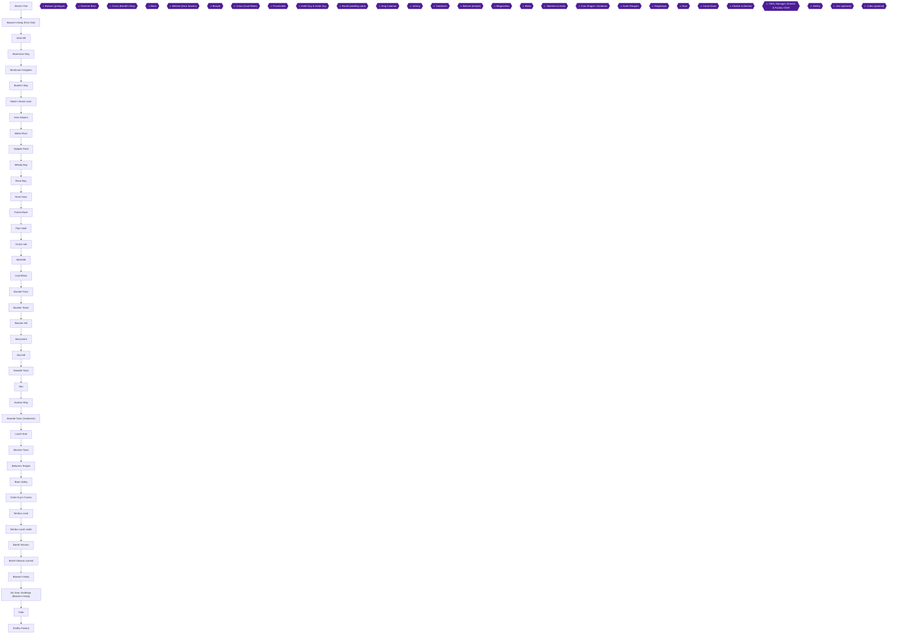

## Achievement dependencies

```mermaid
flowchart LR
  Boss_Bowser{{"⚔ Bowser (prologue)"}}
  Ach_5815(["🏆 Princess... Saved?"])
  Boss_Hammer_Bros{{"⚔ Hammer Bros."}}
  Ach_6576(["🏆 Fists Are Stronger than Hammers"])
  Gate["Gate"]
  Ach_5880(["🏆 Hidden Treasure Hunter"])
  Missable_5880(["⚠ Missable: Hidden Treasure Hunter"])
  Mushroom_Way["Mushroom Way"]
  Ach_53293(["🏆 The Unmentionable"])
  Missable_53293(["⚠ Missable: The Unmentionable"])
  Boss_Croco_1{{"⚔ Croco (Bandit's Way)"}}
  Ach_5757(["🏆 Meet Croco"])
  Bandits_Way["Bandit's Way"]
  Ach_372508(["🏆 Returning Funds"])
  Missable_372508(["⚠ Missable: Returning Funds"])
  Boss_Mack{{"⚔ Mack"}}
  Ach_5811(["🏆 What's This Pointy Thing?"])
  Kero_Sewers["Kero Sewers"]
  Ach_6710(["🏆 Pandorite's Box"])
  Ach_147254(["🏆 It's Best to Turn Back Now"])
  Missable_147254(["⚠ Missable: It's Best to Turn Back Now"])
  Boss_Belome_1{{"⚔ Belome (Kero Sewers)"}}
  Ach_5759(["🏆 Beware the Flood"])
  Ach_145611(["🏆 Everything I Touch"])
  Ach_53304(["🏆 Amphibious Wisdom I"])
  Ach_53305(["🏆 Alto Member"])
  Rose_Way["Rose Way"]
  Ach_147245(["🏆 When Are You Turning Red?"])
  Ach_147256(["🏆 I Am a Work of Fiction"])
  Ach_5882(["🏆 Forest Secret"])
  Boss_Bowyer{{"⚔ Bowyer"}}
  Ach_5812(["🏆 Solve the Forest Maze"])
  Ach_53332(["🏆 Sleepy Hero I"])
  Pipe_Vault["Pipe Vault"]
  Ach_5878(["🏆 Goomba Thumper"])
  Ach_53292(["🏆 Learn the Rhythm"])
  Boss_Croco_2{{"⚔ Croco (Coal Mines)"}}
  Ach_5809(["🏆 Greet Croco"])
  Boss_Punchinello{{"⚔ Punchinello"}}
  Ach_5813(["🏆 Liberate the Mines"])
  Moleville["Moleville"]
  Ach_6709(["🏆 Minecart Top Dog"])
  Ach_147275(["🏆 A Hole's a Hole"])
  Booster_Pass["Booster Pass"]
  Ach_5814(["🏆 Art of Balance"])
  Ach_147266(["🏆 Booster's Little Secret"])
  Ach_372506(["🏆 Promotion Boosting"])
  Ach_5816(["🏆 The Mario Behind the Curtain"])
  Ach_5817(["🏆 Curtain Sneak"])
  Missable_5817(["⚠ Missable: Curtain Sneak"])
  Ach_5819(["🏆 Locomotive Loser"])
  Missable_5819(["⚠ Missable: Locomotive Loser"])
  Boss_Knife_Grate{{"⚔ Knife Guy & Grate Guy"}}
  Ach_5820(["🏆 Are We Amusing?"])
  Booster_Hill["Booster Hill"]
  Ach_6708(["🏆 Flower Point Boosters"])
  Ach_147274(["🏆 Always Tip the Bellhops"])
  Ach_53380(["🏆 Win Her Heart"])
  Missable_53380(["⚠ Missable: Win Her Heart"])
  Boss_Bundt{{"⚔ Bundt (wedding cake)"}}
  Ach_5821(["🏆 Wedding Crasher"])
  Ach_147273(["🏆 ENOUGH ALREADY"])
  Missable_147273(["⚠ Missable: ENOUGH ALREADY"])
  Mushroom_Kingdom["Mushroom Kingdom"]
  Ach_147247(["🏆 A Beetle's Heart"])
  Monstro_Town["Monstro Town"]
  Ach_147271(["🏆 Yoshi Juiced"])
  Ach_34964(["🏆 Raising Sheep"])
  Ach_147257(["🏆 From One Cookie to Another"])
  Ach_53550(["🏆 Invasion of Privacy!"])
  Ach_147270(["🏆 O Brother Where Art Thou?"])
  Ach_5822(["🏆 Wish Fulfilled"])
  Seaside_Town["Seaside Town"]
  Ach_53571(["🏆 First-Class Pirate"])
  Boss_King_Calamari{{"⚔ King Calamari"}}
  Ach_5856(["🏆 Tentacle Terror"])
  Ach_53572(["🏆 Sunken Treasure"])
  Ach_147263(["🏆 Sunken Secret"])
  Ach_6711(["🏆 Hidden Piranha Plant"])
  Ach_147264(["🏆 Unfair Fighting"])
  Missable_147264(["⚠ Missable: Unfair Fighting"])
  Boss_Johnny{{"⚔ Johnny"}}
  Ach_5857(["🏆 Walk the Plank"])
  Ach_5823(["🏆 Call Me Captain Mario"])
  Boss_Yaridovich{{"⚔ Yaridovich"}}
  Ach_5859(["🏆 Indigo Star Piece Take Back"])
  Seaside_Town_Shops["Seaside Town (Yaridovich)"]
  Ach_147265(["🏆 Tickle Torture"])
  Missable_147265(["⚠ Missable: Tickle Torture"])
  Ach_53573(["🏆 Sleepy Hero II"])
  Missable_53573(["⚠ Missable: Sleepy Hero II"])
  Ach_147261(["🏆 Gold to Green"])
  Ach_147272(["🏆 Whooeee!"])
  Ach_147250(["🏆 Is It Luck or Skill?"])
  Lands_End["Land's End"]
  Ach_54150(["🏆 Shortcut at Land's End"])
  Ach_147253(["🏆 That Was Great!"])
  Ach_147252(["🏆 Shogun Sensei"])
  Ach_6714(["🏆 Caught Mokura"])
  Boss_Belome_2{{"⚔ Belome (temple)"}}
  Ach_5858(["🏆 Time for Dinner"])
  Belome_Temple["Belome's Temple"]
  Ach_147268(["🏆 Open Belome"])
  Ach_54151(["🏆 Amphibious Wisdom II"])
  Ach_147244(["🏆 Virtuoso"])
  Boss_Jinx{{"⚔ Jinx (optional)"}}
  Ach_147248(["🏆 Mario Sensei"])
  Boss_Culex{{"⚔ Culex (optional)"}}
  Ach_5860(["🏆 Culex's Challenge"])
  Ach_147249(["🏆 The Musty Fears Must Fear Me Now"])
  Ach_147246(["🏆 Very Commendable!"])
  Bean_Valley["Bean Valley"]
  Ach_6712(["🏆 Box Fight"])
  Ach_5956(["🏆 Please Gamble Responsibly"])
  Ach_147262(["🏆 I Can Stop When I Want"])
  Ach_147259(["🏆 Right Is Always Right"])
  Missable_147259(["⚠ Missable: Right Is Always Right"])
  Boss_Megasmilax{{"⚔ Megasmilax"}}
  Ach_5861(["🏆 Plant Derooting"])
  Nimbus_Land["Nimbus Land"]
  Ach_147255(["🏆 Monster!!!"])
  Ach_147267(["🏆 Polishing Pecks"])
  Missable_147267(["⚠ Missable: Polishing Pecks"])
  Boss_Birdo{{"⚔ Birdo"}}
  Ach_5862(["🏆 Play with Birdo"])
  Boss_Valentina{{"⚔ Valentina & Dodo"}}
  Ach_5863(["🏆 Correcting Nimbus Land"])
  Ach_372507(["🏆 Where's My Valentina?"])
  Boss_Czar_Dragon{{"⚔ Czar Dragon / Zombone"}}
  Ach_5864(["🏆 Bring a Fire Extinguisher"])
  Boss_Axem_Rangers{{"⚔ Axem Rangers"}}
  Ach_5824(["🏆 Ranger Combat"])
  Bowsers_Keep["Bowser's Keep"]
  Ach_6713(["🏆 Gooey Monster Chest"])
  Boss_Magikoopa{{"⚔ Magikoopa"}}
  Ach_5872(["🏆 Koopa vs. Koopa"])
  Ach_147276(["🏆 GENOcide"])
  Missable_147276(["⚠ Missable: GENOcide"])
  Boss_Exor{{"⚔ Exor"}}
  Ach_5873(["🏆 Well, This Sucks"])
  Ach_34965(["🏆 Nothing Can Stop Us Now!"])
  Missable_34965(["⚠ Missable: Nothing Can Stop Us Now!"])
  Ach_147269(["🏆 Cleared the Castle"])
  Boss_Count_Down{{"⚔ Count Down"}}
  Ach_5875(["🏆 Time to Win"])
  Boss_Cloaker_Domino{{"⚔ Cloaker & Domino"}}
  Ach_5874(["🏆 Jesters and Snakes"])
  Boss_Factory_Chiefs{{"⚔ Clerk, Manager, Director & Factory Chief"}}
  Ach_5876(["🏆 Supervisor Clobberer"])
  Boss_Smithy{{"⚔ Smithy"}}
  Ach_5825(["🏆 Closing Time"])
  Ach_147260(["🏆 Big Finale"])
  Ach_147251(["🏆 Jump Man"])
  Ach_5957(["🏆 Super Jump Skills"])
  Ach_120118(["🏆 Where's My Super Suit"])
  Ach_5881(["🏆 Ready for the Worst"])
  Ach_5915(["🏆 Flower Power Wizard"])
  Ach_5914(["🏆 Frog Coin Collector"])
  Ach_147258(["🏆 Quick to Flee"])
  Boss_Bowser -->|unlocks| Ach_5815
  Boss_Hammer_Bros -->|unlocks| Ach_6576
  Gate -->|unlocks| Ach_5880
  Missable_5880 -.->|missable before| Ach_5880
  Mushroom_Way -->|unlocks| Ach_53293
  Missable_53293 -.->|missable before| Ach_53293
  Boss_Croco_1 -->|unlocks| Ach_5757
  Bandits_Way -->|unlocks| Ach_372508
  Missable_372508 -.->|missable before| Ach_372508
  Boss_Mack -->|unlocks| Ach_5811
  Kero_Sewers -->|unlocks| Ach_6710
  Kero_Sewers -->|unlocks| Ach_147254
  Missable_147254 -.->|missable before| Ach_147254
  Boss_Belome_1 -->|unlocks| Ach_5759
  Kero_Sewers -->|unlocks| Ach_145611
  Kero_Sewers -->|unlocks| Ach_53304
  Kero_Sewers -->|unlocks| Ach_53305
  Rose_Way -->|unlocks| Ach_147245
  Rose_Way -->|unlocks| Ach_147256
  Rose_Way -->|unlocks| Ach_5882
  Boss_Bowyer -->|unlocks| Ach_5812
  Rose_Way -->|unlocks| Ach_53332
  Pipe_Vault -->|unlocks| Ach_5878
  Pipe_Vault -->|unlocks| Ach_53292
  Boss_Croco_2 -->|unlocks| Ach_5809
  Boss_Punchinello -->|unlocks| Ach_5813
  Moleville -->|unlocks| Ach_6709
  Moleville -->|unlocks| Ach_147275
  Booster_Pass -->|unlocks| Ach_5814
  Booster_Pass -->|unlocks| Ach_147266
  Booster_Pass -->|unlocks| Ach_372506
  Booster_Pass -->|unlocks| Ach_5816
  Booster_Pass -->|unlocks| Ach_5817
  Missable_5817 -.->|missable before| Ach_5817
  Booster_Pass -->|unlocks| Ach_5819
  Missable_5819 -.->|missable before| Ach_5819
  Boss_Knife_Grate -->|unlocks| Ach_5820
  Booster_Hill -->|unlocks| Ach_6708
  Booster_Hill -->|unlocks| Ach_147274
  Booster_Hill -->|unlocks| Ach_53380
  Missable_53380 -.->|missable before| Ach_53380
  Boss_Bundt -->|unlocks| Ach_5821
  Booster_Hill -->|unlocks| Ach_147273
  Missable_147273 -.->|missable before| Ach_147273
  Mushroom_Kingdom -->|unlocks| Ach_147247
  Monstro_Town -->|unlocks| Ach_147271
  Moleville -->|unlocks| Ach_34964
  Mushroom_Kingdom -->|unlocks| Ach_147257
  Mushroom_Kingdom -->|unlocks| Ach_53550
  Mushroom_Kingdom -->|unlocks| Ach_147270
  Mushroom_Kingdom -->|unlocks| Ach_5822
  Seaside_Town -->|unlocks| Ach_53571
  Boss_King_Calamari -->|unlocks| Ach_5856
  Seaside_Town -->|unlocks| Ach_53572
  Seaside_Town -->|unlocks| Ach_147263
  Seaside_Town -->|unlocks| Ach_6711
  Seaside_Town -->|unlocks| Ach_147264
  Missable_147264 -.->|missable before| Ach_147264
  Boss_Johnny -->|unlocks| Ach_5857
  Seaside_Town -->|unlocks| Ach_5823
  Boss_Yaridovich -->|unlocks| Ach_5859
  Seaside_Town_Shops -->|unlocks| Ach_147265
  Missable_147265 -.->|missable before| Ach_147265
  Seaside_Town_Shops -->|unlocks| Ach_53573
  Missable_53573 -.->|missable before| Ach_53573
  Seaside_Town_Shops -->|unlocks| Ach_147261
  Seaside_Town_Shops -->|unlocks| Ach_147272
  Seaside_Town_Shops -->|unlocks| Ach_147250
  Lands_End -->|unlocks| Ach_54150
  Lands_End -->|unlocks| Ach_147253
  Lands_End -->|unlocks| Ach_147252
  Lands_End -->|unlocks| Ach_6714
  Boss_Belome_2 -->|unlocks| Ach_5858
  Belome_Temple -->|unlocks| Ach_147268
  Monstro_Town -->|unlocks| Ach_54151
  Monstro_Town -->|unlocks| Ach_147244
  Boss_Jinx -->|unlocks| Ach_147248
  Boss_Culex -->|unlocks| Ach_5860
  Lands_End -->|unlocks| Ach_147249
  Lands_End -->|unlocks| Ach_147246
  Bean_Valley -->|unlocks| Ach_6712
  Bean_Valley -->|unlocks| Ach_5956
  Bean_Valley -->|unlocks| Ach_147262
  Bean_Valley -->|unlocks| Ach_147259
  Missable_147259 -.->|missable before| Ach_147259
  Boss_Megasmilax -->|unlocks| Ach_5861
  Nimbus_Land -->|unlocks| Ach_147255
  Nimbus_Land -->|unlocks| Ach_147267
  Missable_147267 -.->|missable before| Ach_147267
  Boss_Birdo -->|unlocks| Ach_5862
  Boss_Valentina -->|unlocks| Ach_5863
  Nimbus_Land -->|unlocks| Ach_372507
  Boss_Czar_Dragon -->|unlocks| Ach_5864
  Boss_Axem_Rangers -->|unlocks| Ach_5824
  Bowsers_Keep -->|unlocks| Ach_6713
  Boss_Magikoopa -->|unlocks| Ach_5872
  Bowsers_Keep -->|unlocks| Ach_147276
  Missable_147276 -.->|missable before| Ach_147276
  Boss_Exor -->|unlocks| Ach_5873
  Bowsers_Keep -->|unlocks| Ach_34965
  Missable_34965 -.->|missable before| Ach_34965
  Bowsers_Keep -->|unlocks| Ach_147269
  Boss_Count_Down -->|unlocks| Ach_5875
  Boss_Cloaker_Domino -->|unlocks| Ach_5874
  Boss_Factory_Chiefs -->|unlocks| Ach_5876
  Boss_Smithy -->|unlocks| Ach_5825
  Gate -->|unlocks| Ach_147260
  Kero_Sewers -->|unlocks| Ach_147251
  Monstro_Town -->|unlocks| Ach_5957
  Monstro_Town -->|unlocks| Ach_120118
  Monstro_Town -->|unlocks| Ach_5881
  Monstro_Town -->|unlocks| Ach_5915
  Monstro_Town -->|unlocks| Ach_5914
  Monstro_Town -->|unlocks| Ach_147258
```

## Chapter 1: Prologue: Mario's Pad and Bowser's Keep

```mermaid
flowchart TD
  Marios_Pad["Mario's Pad"]
  Bowsers_Keep_Prologue["Bowser's Keep (First Visit)"]
  Vista_Hill["Vista Hill"]
  Boss_Bowser{{"⚔ Bowser (prologue)"}}
  Boss_Hammer_Bros{{"⚔ Hammer Bros."}}
  Boss_Croco_1{{"⚔ Croco (Bandit's Way)"}}
  Boss_Mack{{"⚔ Mack"}}
  Boss_Belome_1{{"⚔ Belome (Kero Sewers)"}}
  Boss_Bowyer{{"⚔ Bowyer"}}
  Boss_Croco_2{{"⚔ Croco (Coal Mines)"}}
  Boss_Punchinello{{"⚔ Punchinello"}}
  Boss_Knife_Grate{{"⚔ Knife Guy & Grate Guy"}}
  Boss_Bundt{{"⚔ Bundt (wedding cake)"}}
  Boss_King_Calamari{{"⚔ King Calamari"}}
  Boss_Johnny{{"⚔ Johnny"}}
  Boss_Yaridovich{{"⚔ Yaridovich"}}
  Boss_Belome_2{{"⚔ Belome (temple)"}}
  Boss_Megasmilax{{"⚔ Megasmilax"}}
  Boss_Birdo{{"⚔ Birdo"}}
  Boss_Valentina{{"⚔ Valentina & Dodo"}}
  Boss_Czar_Dragon{{"⚔ Czar Dragon / Zombone"}}
  Boss_Axem_Rangers{{"⚔ Axem Rangers"}}
  Boss_Magikoopa{{"⚔ Magikoopa"}}
  Boss_Exor{{"⚔ Exor"}}
  Boss_Count_Down{{"⚔ Count Down"}}
  Boss_Cloaker_Domino{{"⚔ Cloaker & Domino"}}
  Boss_Factory_Chiefs{{"⚔ Clerk, Manager, Director & Factory Chief"}}
  Boss_Smithy{{"⚔ Smithy"}}
  Boss_Jinx{{"⚔ Jinx (optional)"}}
  Boss_Culex{{"⚔ Culex (optional)"}}
  Marios_Pad --> Bowsers_Keep_Prologue
  Bowsers_Keep_Prologue --> Vista_Hill
  classDef ponr fill:#7f1d1d,stroke:#f87171,color:#fff;
  classDef boss fill:#4c1d95,stroke:#a78bfa,color:#fff;
  class Boss_Bowser,Boss_Hammer_Bros,Boss_Croco_1,Boss_Mack,Boss_Belome_1,Boss_Bowyer,Boss_Croco_2,Boss_Punchinello,Boss_Knife_Grate,Boss_Bundt,Boss_King_Calamari,Boss_Johnny,Boss_Yaridovich,Boss_Belome_2,Boss_Megasmilax,Boss_Birdo,Boss_Valentina,Boss_Czar_Dragon,Boss_Axem_Rangers,Boss_Magikoopa,Boss_Exor,Boss_Count_Down,Boss_Cloaker_Domino,Boss_Factory_Chiefs,Boss_Smithy,Boss_Jinx,Boss_Culex boss;
```

## Chapter 2: Mushroom Way and the Mushroom Kingdom

```mermaid
flowchart TD
  Mushroom_Way["Mushroom Way"]
  Mushroom_Kingdom["Mushroom Kingdom"]
  Boss_Hammer_Bros{{"⚔ Hammer Bros."}}
  Boss_Croco_1{{"⚔ Croco (Bandit's Way)"}}
  Boss_Mack{{"⚔ Mack"}}
  Boss_Belome_1{{"⚔ Belome (Kero Sewers)"}}
  Boss_Bowyer{{"⚔ Bowyer"}}
  Boss_Croco_2{{"⚔ Croco (Coal Mines)"}}
  Boss_Punchinello{{"⚔ Punchinello"}}
  Boss_Knife_Grate{{"⚔ Knife Guy & Grate Guy"}}
  Boss_Bundt{{"⚔ Bundt (wedding cake)"}}
  Boss_King_Calamari{{"⚔ King Calamari"}}
  Boss_Johnny{{"⚔ Johnny"}}
  Boss_Yaridovich{{"⚔ Yaridovich"}}
  Boss_Belome_2{{"⚔ Belome (temple)"}}
  Boss_Megasmilax{{"⚔ Megasmilax"}}
  Boss_Birdo{{"⚔ Birdo"}}
  Boss_Valentina{{"⚔ Valentina & Dodo"}}
  Boss_Czar_Dragon{{"⚔ Czar Dragon / Zombone"}}
  Boss_Axem_Rangers{{"⚔ Axem Rangers"}}
  Boss_Magikoopa{{"⚔ Magikoopa"}}
  Boss_Exor{{"⚔ Exor"}}
  Boss_Count_Down{{"⚔ Count Down"}}
  Boss_Cloaker_Domino{{"⚔ Cloaker & Domino"}}
  Boss_Factory_Chiefs{{"⚔ Clerk, Manager, Director & Factory Chief"}}
  Boss_Smithy{{"⚔ Smithy"}}
  Boss_Jinx{{"⚔ Jinx (optional)"}}
  Boss_Culex{{"⚔ Culex (optional)"}}
  Mushroom_Way --> Mushroom_Kingdom
  classDef ponr fill:#7f1d1d,stroke:#f87171,color:#fff;
  classDef boss fill:#4c1d95,stroke:#a78bfa,color:#fff;
  class Boss_Hammer_Bros,Boss_Croco_1,Boss_Mack,Boss_Belome_1,Boss_Bowyer,Boss_Croco_2,Boss_Punchinello,Boss_Knife_Grate,Boss_Bundt,Boss_King_Calamari,Boss_Johnny,Boss_Yaridovich,Boss_Belome_2,Boss_Megasmilax,Boss_Birdo,Boss_Valentina,Boss_Czar_Dragon,Boss_Axem_Rangers,Boss_Magikoopa,Boss_Exor,Boss_Count_Down,Boss_Cloaker_Domino,Boss_Factory_Chiefs,Boss_Smithy,Boss_Jinx,Boss_Culex boss;
```

## Chapter 3: Bandit's Way, Croco and Mack

```mermaid
flowchart TD
  Bandits_Way["Bandit's Way"]
  Mushroom_Castle["Mack's throne room"]
  Boss_Croco_1{{"⚔ Croco (Bandit's Way)"}}
  Boss_Mack{{"⚔ Mack"}}
  Boss_Belome_1{{"⚔ Belome (Kero Sewers)"}}
  Boss_Bowyer{{"⚔ Bowyer"}}
  Boss_Croco_2{{"⚔ Croco (Coal Mines)"}}
  Boss_Punchinello{{"⚔ Punchinello"}}
  Boss_Knife_Grate{{"⚔ Knife Guy & Grate Guy"}}
  Boss_Bundt{{"⚔ Bundt (wedding cake)"}}
  Boss_King_Calamari{{"⚔ King Calamari"}}
  Boss_Johnny{{"⚔ Johnny"}}
  Boss_Yaridovich{{"⚔ Yaridovich"}}
  Boss_Belome_2{{"⚔ Belome (temple)"}}
  Boss_Megasmilax{{"⚔ Megasmilax"}}
  Boss_Birdo{{"⚔ Birdo"}}
  Boss_Valentina{{"⚔ Valentina & Dodo"}}
  Boss_Czar_Dragon{{"⚔ Czar Dragon / Zombone"}}
  Boss_Axem_Rangers{{"⚔ Axem Rangers"}}
  Boss_Magikoopa{{"⚔ Magikoopa"}}
  Boss_Exor{{"⚔ Exor"}}
  Boss_Count_Down{{"⚔ Count Down"}}
  Boss_Cloaker_Domino{{"⚔ Cloaker & Domino"}}
  Boss_Factory_Chiefs{{"⚔ Clerk, Manager, Director & Factory Chief"}}
  Boss_Smithy{{"⚔ Smithy"}}
  Boss_Jinx{{"⚔ Jinx (optional)"}}
  Boss_Culex{{"⚔ Culex (optional)"}}
  Bandits_Way --> Mushroom_Castle
  classDef ponr fill:#7f1d1d,stroke:#f87171,color:#fff;
  classDef boss fill:#4c1d95,stroke:#a78bfa,color:#fff;
  class Boss_Croco_1,Boss_Mack,Boss_Belome_1,Boss_Bowyer,Boss_Croco_2,Boss_Punchinello,Boss_Knife_Grate,Boss_Bundt,Boss_King_Calamari,Boss_Johnny,Boss_Yaridovich,Boss_Belome_2,Boss_Megasmilax,Boss_Birdo,Boss_Valentina,Boss_Czar_Dragon,Boss_Axem_Rangers,Boss_Magikoopa,Boss_Exor,Boss_Count_Down,Boss_Cloaker_Domino,Boss_Factory_Chiefs,Boss_Smithy,Boss_Jinx,Boss_Culex boss;
```

## Chapter 4: Kero Sewers, Midas River and Tadpole Pond

```mermaid
flowchart TD
  Kero_Sewers["Kero Sewers"]
  Midas_River["Midas River"]
  Tadpole_Pond["Tadpole Pond"]
  Melody_Bay["Melody Bay"]
  Boss_Belome_1{{"⚔ Belome (Kero Sewers)"}}
  Boss_Bowyer{{"⚔ Bowyer"}}
  Boss_Croco_2{{"⚔ Croco (Coal Mines)"}}
  Boss_Punchinello{{"⚔ Punchinello"}}
  Boss_Knife_Grate{{"⚔ Knife Guy & Grate Guy"}}
  Boss_Bundt{{"⚔ Bundt (wedding cake)"}}
  Boss_King_Calamari{{"⚔ King Calamari"}}
  Boss_Johnny{{"⚔ Johnny"}}
  Boss_Yaridovich{{"⚔ Yaridovich"}}
  Boss_Belome_2{{"⚔ Belome (temple)"}}
  Boss_Megasmilax{{"⚔ Megasmilax"}}
  Boss_Birdo{{"⚔ Birdo"}}
  Boss_Valentina{{"⚔ Valentina & Dodo"}}
  Boss_Czar_Dragon{{"⚔ Czar Dragon / Zombone"}}
  Boss_Axem_Rangers{{"⚔ Axem Rangers"}}
  Boss_Magikoopa{{"⚔ Magikoopa"}}
  Boss_Exor{{"⚔ Exor"}}
  Boss_Count_Down{{"⚔ Count Down"}}
  Boss_Cloaker_Domino{{"⚔ Cloaker & Domino"}}
  Boss_Factory_Chiefs{{"⚔ Clerk, Manager, Director & Factory Chief"}}
  Boss_Smithy{{"⚔ Smithy"}}
  Boss_Jinx{{"⚔ Jinx (optional)"}}
  Boss_Culex{{"⚔ Culex (optional)"}}
  Kero_Sewers --> Midas_River
  Midas_River --> Tadpole_Pond
  Tadpole_Pond --> Melody_Bay
  classDef ponr fill:#7f1d1d,stroke:#f87171,color:#fff;
  classDef boss fill:#4c1d95,stroke:#a78bfa,color:#fff;
  class Boss_Belome_1,Boss_Bowyer,Boss_Croco_2,Boss_Punchinello,Boss_Knife_Grate,Boss_Bundt,Boss_King_Calamari,Boss_Johnny,Boss_Yaridovich,Boss_Belome_2,Boss_Megasmilax,Boss_Birdo,Boss_Valentina,Boss_Czar_Dragon,Boss_Axem_Rangers,Boss_Magikoopa,Boss_Exor,Boss_Count_Down,Boss_Cloaker_Domino,Boss_Factory_Chiefs,Boss_Smithy,Boss_Jinx,Boss_Culex boss;
```

## Chapter 5: Rose Way, Rose Town and the Forest Maze

```mermaid
flowchart TD
  Rose_Way["Rose Way"]
  Rose_Town["Rose Town"]
  Forest_Maze["Forest Maze"]
  Boss_Bowyer{{"⚔ Bowyer"}}
  Boss_Croco_2{{"⚔ Croco (Coal Mines)"}}
  Boss_Punchinello{{"⚔ Punchinello"}}
  Boss_Knife_Grate{{"⚔ Knife Guy & Grate Guy"}}
  Boss_Bundt{{"⚔ Bundt (wedding cake)"}}
  Boss_King_Calamari{{"⚔ King Calamari"}}
  Boss_Johnny{{"⚔ Johnny"}}
  Boss_Yaridovich{{"⚔ Yaridovich"}}
  Boss_Belome_2{{"⚔ Belome (temple)"}}
  Boss_Megasmilax{{"⚔ Megasmilax"}}
  Boss_Birdo{{"⚔ Birdo"}}
  Boss_Valentina{{"⚔ Valentina & Dodo"}}
  Boss_Czar_Dragon{{"⚔ Czar Dragon / Zombone"}}
  Boss_Axem_Rangers{{"⚔ Axem Rangers"}}
  Boss_Magikoopa{{"⚔ Magikoopa"}}
  Boss_Exor{{"⚔ Exor"}}
  Boss_Count_Down{{"⚔ Count Down"}}
  Boss_Cloaker_Domino{{"⚔ Cloaker & Domino"}}
  Boss_Factory_Chiefs{{"⚔ Clerk, Manager, Director & Factory Chief"}}
  Boss_Smithy{{"⚔ Smithy"}}
  Boss_Jinx{{"⚔ Jinx (optional)"}}
  Boss_Culex{{"⚔ Culex (optional)"}}
  Rose_Way --> Rose_Town
  Rose_Town --> Forest_Maze
  classDef ponr fill:#7f1d1d,stroke:#f87171,color:#fff;
  classDef boss fill:#4c1d95,stroke:#a78bfa,color:#fff;
  class Boss_Bowyer,Boss_Croco_2,Boss_Punchinello,Boss_Knife_Grate,Boss_Bundt,Boss_King_Calamari,Boss_Johnny,Boss_Yaridovich,Boss_Belome_2,Boss_Megasmilax,Boss_Birdo,Boss_Valentina,Boss_Czar_Dragon,Boss_Axem_Rangers,Boss_Magikoopa,Boss_Exor,Boss_Count_Down,Boss_Cloaker_Domino,Boss_Factory_Chiefs,Boss_Smithy,Boss_Jinx,Boss_Culex boss;
```

## Chapter 6: Pipe Vault and Yo'ster Isle

```mermaid
flowchart TD
  Pipe_Vault["Pipe Vault"]
  Yoster_Isle["Yo'ster Isle"]
  Boss_Croco_2{{"⚔ Croco (Coal Mines)"}}
  Boss_Punchinello{{"⚔ Punchinello"}}
  Boss_Knife_Grate{{"⚔ Knife Guy & Grate Guy"}}
  Boss_Bundt{{"⚔ Bundt (wedding cake)"}}
  Boss_King_Calamari{{"⚔ King Calamari"}}
  Boss_Johnny{{"⚔ Johnny"}}
  Boss_Yaridovich{{"⚔ Yaridovich"}}
  Boss_Belome_2{{"⚔ Belome (temple)"}}
  Boss_Megasmilax{{"⚔ Megasmilax"}}
  Boss_Birdo{{"⚔ Birdo"}}
  Boss_Valentina{{"⚔ Valentina & Dodo"}}
  Boss_Czar_Dragon{{"⚔ Czar Dragon / Zombone"}}
  Boss_Axem_Rangers{{"⚔ Axem Rangers"}}
  Boss_Magikoopa{{"⚔ Magikoopa"}}
  Boss_Exor{{"⚔ Exor"}}
  Boss_Count_Down{{"⚔ Count Down"}}
  Boss_Cloaker_Domino{{"⚔ Cloaker & Domino"}}
  Boss_Factory_Chiefs{{"⚔ Clerk, Manager, Director & Factory Chief"}}
  Boss_Smithy{{"⚔ Smithy"}}
  Boss_Jinx{{"⚔ Jinx (optional)"}}
  Boss_Culex{{"⚔ Culex (optional)"}}
  Pipe_Vault --> Yoster_Isle
  classDef ponr fill:#7f1d1d,stroke:#f87171,color:#fff;
  classDef boss fill:#4c1d95,stroke:#a78bfa,color:#fff;
  class Boss_Croco_2,Boss_Punchinello,Boss_Knife_Grate,Boss_Bundt,Boss_King_Calamari,Boss_Johnny,Boss_Yaridovich,Boss_Belome_2,Boss_Megasmilax,Boss_Birdo,Boss_Valentina,Boss_Czar_Dragon,Boss_Axem_Rangers,Boss_Magikoopa,Boss_Exor,Boss_Count_Down,Boss_Cloaker_Domino,Boss_Factory_Chiefs,Boss_Smithy,Boss_Jinx,Boss_Culex boss;
```

## Chapter 7: Moleville and the Coal Mines

```mermaid
flowchart TD
  Moleville["Moleville"]
  Coal_Mines["Coal Mines"]
  Boss_Croco_2{{"⚔ Croco (Coal Mines)"}}
  Boss_Punchinello{{"⚔ Punchinello"}}
  Boss_Knife_Grate{{"⚔ Knife Guy & Grate Guy"}}
  Boss_Bundt{{"⚔ Bundt (wedding cake)"}}
  Boss_King_Calamari{{"⚔ King Calamari"}}
  Boss_Johnny{{"⚔ Johnny"}}
  Boss_Yaridovich{{"⚔ Yaridovich"}}
  Boss_Belome_2{{"⚔ Belome (temple)"}}
  Boss_Megasmilax{{"⚔ Megasmilax"}}
  Boss_Birdo{{"⚔ Birdo"}}
  Boss_Valentina{{"⚔ Valentina & Dodo"}}
  Boss_Czar_Dragon{{"⚔ Czar Dragon / Zombone"}}
  Boss_Axem_Rangers{{"⚔ Axem Rangers"}}
  Boss_Magikoopa{{"⚔ Magikoopa"}}
  Boss_Exor{{"⚔ Exor"}}
  Boss_Count_Down{{"⚔ Count Down"}}
  Boss_Cloaker_Domino{{"⚔ Cloaker & Domino"}}
  Boss_Factory_Chiefs{{"⚔ Clerk, Manager, Director & Factory Chief"}}
  Boss_Smithy{{"⚔ Smithy"}}
  Boss_Jinx{{"⚔ Jinx (optional)"}}
  Boss_Culex{{"⚔ Culex (optional)"}}
  Moleville --> Coal_Mines
  classDef ponr fill:#7f1d1d,stroke:#f87171,color:#fff;
  classDef boss fill:#4c1d95,stroke:#a78bfa,color:#fff;
  class Boss_Croco_2,Boss_Punchinello,Boss_Knife_Grate,Boss_Bundt,Boss_King_Calamari,Boss_Johnny,Boss_Yaridovich,Boss_Belome_2,Boss_Megasmilax,Boss_Birdo,Boss_Valentina,Boss_Czar_Dragon,Boss_Axem_Rangers,Boss_Magikoopa,Boss_Exor,Boss_Count_Down,Boss_Cloaker_Domino,Boss_Factory_Chiefs,Boss_Smithy,Boss_Jinx,Boss_Culex boss;
```

## Chapter 8: Booster Pass and Booster Tower

```mermaid
flowchart TD
  Booster_Pass["Booster Pass"]
  Booster_Tower["Booster Tower"]
  Boss_Knife_Grate{{"⚔ Knife Guy & Grate Guy"}}
  Boss_Bundt{{"⚔ Bundt (wedding cake)"}}
  Boss_King_Calamari{{"⚔ King Calamari"}}
  Boss_Johnny{{"⚔ Johnny"}}
  Boss_Yaridovich{{"⚔ Yaridovich"}}
  Boss_Belome_2{{"⚔ Belome (temple)"}}
  Boss_Megasmilax{{"⚔ Megasmilax"}}
  Boss_Birdo{{"⚔ Birdo"}}
  Boss_Valentina{{"⚔ Valentina & Dodo"}}
  Boss_Czar_Dragon{{"⚔ Czar Dragon / Zombone"}}
  Boss_Axem_Rangers{{"⚔ Axem Rangers"}}
  Boss_Magikoopa{{"⚔ Magikoopa"}}
  Boss_Exor{{"⚔ Exor"}}
  Boss_Count_Down{{"⚔ Count Down"}}
  Boss_Cloaker_Domino{{"⚔ Cloaker & Domino"}}
  Boss_Factory_Chiefs{{"⚔ Clerk, Manager, Director & Factory Chief"}}
  Boss_Smithy{{"⚔ Smithy"}}
  Boss_Jinx{{"⚔ Jinx (optional)"}}
  Boss_Culex{{"⚔ Culex (optional)"}}
  Booster_Pass --> Booster_Tower
  classDef ponr fill:#7f1d1d,stroke:#f87171,color:#fff;
  classDef boss fill:#4c1d95,stroke:#a78bfa,color:#fff;
  class Boss_Knife_Grate,Boss_Bundt,Boss_King_Calamari,Boss_Johnny,Boss_Yaridovich,Boss_Belome_2,Boss_Megasmilax,Boss_Birdo,Boss_Valentina,Boss_Czar_Dragon,Boss_Axem_Rangers,Boss_Magikoopa,Boss_Exor,Boss_Count_Down,Boss_Cloaker_Domino,Boss_Factory_Chiefs,Boss_Smithy,Boss_Jinx,Boss_Culex boss;
```

## Chapter 9: Booster Hill and Marrymore

```mermaid
flowchart TD
  Booster_Hill["Booster Hill"]
  Marrymore["Marrymore"]
  Boss_Bundt{{"⚔ Bundt (wedding cake)"}}
  Boss_King_Calamari{{"⚔ King Calamari"}}
  Boss_Johnny{{"⚔ Johnny"}}
  Boss_Yaridovich{{"⚔ Yaridovich"}}
  Boss_Belome_2{{"⚔ Belome (temple)"}}
  Boss_Megasmilax{{"⚔ Megasmilax"}}
  Boss_Birdo{{"⚔ Birdo"}}
  Boss_Valentina{{"⚔ Valentina & Dodo"}}
  Boss_Czar_Dragon{{"⚔ Czar Dragon / Zombone"}}
  Boss_Axem_Rangers{{"⚔ Axem Rangers"}}
  Boss_Magikoopa{{"⚔ Magikoopa"}}
  Boss_Exor{{"⚔ Exor"}}
  Boss_Count_Down{{"⚔ Count Down"}}
  Boss_Cloaker_Domino{{"⚔ Cloaker & Domino"}}
  Boss_Factory_Chiefs{{"⚔ Clerk, Manager, Director & Factory Chief"}}
  Boss_Smithy{{"⚔ Smithy"}}
  Boss_Jinx{{"⚔ Jinx (optional)"}}
  Boss_Culex{{"⚔ Culex (optional)"}}
  Booster_Hill --> Marrymore
  classDef ponr fill:#7f1d1d,stroke:#f87171,color:#fff;
  classDef boss fill:#4c1d95,stroke:#a78bfa,color:#fff;
  class Boss_Bundt,Boss_King_Calamari,Boss_Johnny,Boss_Yaridovich,Boss_Belome_2,Boss_Megasmilax,Boss_Birdo,Boss_Valentina,Boss_Czar_Dragon,Boss_Axem_Rangers,Boss_Magikoopa,Boss_Exor,Boss_Count_Down,Boss_Cloaker_Domino,Boss_Factory_Chiefs,Boss_Smithy,Boss_Jinx,Boss_Culex boss;
```

## Chapter 10: Return to the Mushroom Kingdom and Star Hill


## Chapter 11: Seaside Town, the Sea and the Sunken Ship

```mermaid
flowchart TD
  Seaside_Town["Seaside Town"]
  Sea["Sea"]
  Sunken_Ship["Sunken Ship"]
  Boss_King_Calamari{{"⚔ King Calamari"}}
  Boss_Johnny{{"⚔ Johnny"}}
  Boss_Yaridovich{{"⚔ Yaridovich"}}
  Boss_Belome_2{{"⚔ Belome (temple)"}}
  Boss_Megasmilax{{"⚔ Megasmilax"}}
  Boss_Birdo{{"⚔ Birdo"}}
  Boss_Valentina{{"⚔ Valentina & Dodo"}}
  Boss_Czar_Dragon{{"⚔ Czar Dragon / Zombone"}}
  Boss_Axem_Rangers{{"⚔ Axem Rangers"}}
  Boss_Magikoopa{{"⚔ Magikoopa"}}
  Boss_Exor{{"⚔ Exor"}}
  Boss_Count_Down{{"⚔ Count Down"}}
  Boss_Cloaker_Domino{{"⚔ Cloaker & Domino"}}
  Boss_Factory_Chiefs{{"⚔ Clerk, Manager, Director & Factory Chief"}}
  Boss_Smithy{{"⚔ Smithy"}}
  Boss_Jinx{{"⚔ Jinx (optional)"}}
  Boss_Culex{{"⚔ Culex (optional)"}}
  Seaside_Town --> Sea
  Sea --> Sunken_Ship
  classDef ponr fill:#7f1d1d,stroke:#f87171,color:#fff;
  classDef boss fill:#4c1d95,stroke:#a78bfa,color:#fff;
  class Boss_King_Calamari,Boss_Johnny,Boss_Yaridovich,Boss_Belome_2,Boss_Megasmilax,Boss_Birdo,Boss_Valentina,Boss_Czar_Dragon,Boss_Axem_Rangers,Boss_Magikoopa,Boss_Exor,Boss_Count_Down,Boss_Cloaker_Domino,Boss_Factory_Chiefs,Boss_Smithy,Boss_Jinx,Boss_Culex boss;
```

## Chapter 12: Seaside Town freed: Yaridovich and the shops


## Chapter 13: Land's End and Monstro Town

```mermaid
flowchart TD
  Lands_End["Land's End"]
  Monstro_Town["Monstro Town"]
  Boss_Belome_2{{"⚔ Belome (temple)"}}
  Boss_Megasmilax{{"⚔ Megasmilax"}}
  Boss_Birdo{{"⚔ Birdo"}}
  Boss_Valentina{{"⚔ Valentina & Dodo"}}
  Boss_Czar_Dragon{{"⚔ Czar Dragon / Zombone"}}
  Boss_Axem_Rangers{{"⚔ Axem Rangers"}}
  Boss_Magikoopa{{"⚔ Magikoopa"}}
  Boss_Exor{{"⚔ Exor"}}
  Boss_Count_Down{{"⚔ Count Down"}}
  Boss_Cloaker_Domino{{"⚔ Cloaker & Domino"}}
  Boss_Factory_Chiefs{{"⚔ Clerk, Manager, Director & Factory Chief"}}
  Boss_Smithy{{"⚔ Smithy"}}
  Boss_Jinx{{"⚔ Jinx (optional)"}}
  Boss_Culex{{"⚔ Culex (optional)"}}
  Lands_End --> Monstro_Town
  classDef ponr fill:#7f1d1d,stroke:#f87171,color:#fff;
  classDef boss fill:#4c1d95,stroke:#a78bfa,color:#fff;
  class Boss_Belome_2,Boss_Megasmilax,Boss_Birdo,Boss_Valentina,Boss_Czar_Dragon,Boss_Axem_Rangers,Boss_Magikoopa,Boss_Exor,Boss_Count_Down,Boss_Cloaker_Domino,Boss_Factory_Chiefs,Boss_Smithy,Boss_Jinx,Boss_Culex boss;
```

## Chapter 14: Belome Temple


## Chapter 15: Bean Valley and Grate Guy's Casino

```mermaid
flowchart TD
  Bean_Valley["Bean Valley"]
  Grate_Guys_Casino["Grate Guy's Casino"]
  Boss_Megasmilax{{"⚔ Megasmilax"}}
  Boss_Birdo{{"⚔ Birdo"}}
  Boss_Valentina{{"⚔ Valentina & Dodo"}}
  Boss_Czar_Dragon{{"⚔ Czar Dragon / Zombone"}}
  Boss_Axem_Rangers{{"⚔ Axem Rangers"}}
  Boss_Magikoopa{{"⚔ Magikoopa"}}
  Boss_Exor{{"⚔ Exor"}}
  Boss_Count_Down{{"⚔ Count Down"}}
  Boss_Cloaker_Domino{{"⚔ Cloaker & Domino"}}
  Boss_Factory_Chiefs{{"⚔ Clerk, Manager, Director & Factory Chief"}}
  Boss_Smithy{{"⚔ Smithy"}}
  Bean_Valley --> Grate_Guys_Casino
  classDef ponr fill:#7f1d1d,stroke:#f87171,color:#fff;
  classDef boss fill:#4c1d95,stroke:#a78bfa,color:#fff;
  class Boss_Megasmilax,Boss_Birdo,Boss_Valentina,Boss_Czar_Dragon,Boss_Axem_Rangers,Boss_Magikoopa,Boss_Exor,Boss_Count_Down,Boss_Cloaker_Domino,Boss_Factory_Chiefs,Boss_Smithy boss;
```

## Chapter 16: Nimbus Land

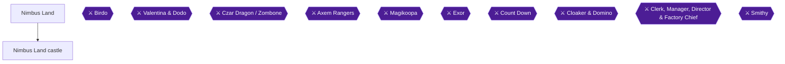

## Chapter 17: Barrel Volcano

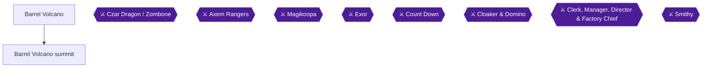

## Chapter 18: Optional side quests before Bowser's Keep


## Chapter 19: Bowser's Keep

```mermaid
flowchart TD
  Bowsers_Keep["Bowser's Keep"]
  Six_Doors["Six Door challenge (Bowser's Keep)"]
  Boss_Magikoopa{{"⚔ Magikoopa"}}
  Boss_Exor{{"⚔ Exor"}}
  Boss_Count_Down{{"⚔ Count Down"}}
  Boss_Cloaker_Domino{{"⚔ Cloaker & Domino"}}
  Boss_Factory_Chiefs{{"⚔ Clerk, Manager, Director & Factory Chief"}}
  Boss_Smithy{{"⚔ Smithy"}}
  Bowsers_Keep --> Six_Doors
  classDef ponr fill:#7f1d1d,stroke:#f87171,color:#fff;
  classDef boss fill:#4c1d95,stroke:#a78bfa,color:#fff;
  class Boss_Magikoopa,Boss_Exor,Boss_Count_Down,Boss_Cloaker_Domino,Boss_Factory_Chiefs,Boss_Smithy boss;
```

## Chapter 20: The Gate and Smithy Factory

```mermaid
flowchart TD
  Gate["Gate"]
  Smithy_Factory["Smithy Factory"]
  Boss_Count_Down{{"⚔ Count Down"}}
  Boss_Cloaker_Domino{{"⚔ Cloaker & Domino"}}
  Boss_Factory_Chiefs{{"⚔ Clerk, Manager, Director & Factory Chief"}}
  Boss_Smithy{{"⚔ Smithy"}}
  Gate --> Smithy_Factory
  classDef ponr fill:#7f1d1d,stroke:#f87171,color:#fff;
  classDef boss fill:#4c1d95,stroke:#a78bfa,color:#fff;
  class Boss_Count_Down,Boss_Cloaker_Domino,Boss_Factory_Chiefs,Boss_Smithy boss;
```
