# Super Mario RPG: Legend of the Seven Stars — 100% RetroAchievements Walkthrough

## Metadata

- **Platform:** SNES/Super Famicom
- **Developer:** Square
- **Publisher:** Nintendo
- **Genre:** Turn-Based RPG
- **Released:** 1996-03-09
- **Achievements:** 99 (779 points)

> [!NOTE]
> Every instruction in this guide was extracted from the sources listed at the bottom and checked against them (508 facts confirmed by 2+ sources, 4855 from a single source). Statements marked 🟡 come from only one source. Anything we could not confirm says **"Unable to verify from collected sources."**

## Game Overview


This walkthrough takes a first-time player to every one of the **99 achievements (779 points)** in the Super Mario RPG: Legend of the Seven Stars set on RetroAchievements. The game is a Square-developed, Nintendo-published turn-based RPG released for the SNES in 1996. It needs **one playthrough**, provided you make a few saves at specific moments (listed below). Everything here assumes **Hardcore Mode**: no rewinding, no emulator state loading, no cheats. Use only the in-game Save Blocks, and keep several separate save slots so you can go back to the key moments.

## Emulator and Core Requirements

- **Core:** Use RetroArch with the **Snes9x (current)** core. It is the only core recommended for this set, and older Snes9x versions and bsnes do not work well with the game's memory [[ra-comments-5-1]]. Players report that Snes9x 2005 and Snes9x 2010 did not unlock achievements [[ra-comments-5-2]], and bsnes2014 is not supported [[ra-comments-13-3]].
- **Real hardware:** One player reported that real hardware (FXPak Pro) did not unlock achievements. Unable to verify from collected sources beyond that single report, so use RetroArch.
- **Super Jump timing:** The two Super Jump achievements (Super Jump Skills and Where's My Super Suit) are timing based. If you cannot get past 13 jumps, checking your latency settings helped one player immensely [[ra-comments-111-4]]. Another player got the achievement only after forcing the monitor refresh rate to 60 Hz in the Nvidia control panel so RetroArch showed a steady 60 fps; locking the FPS inside RetroArch did not hold [[ra-comments-112-2]]. Set up stable 60 fps and low audio latency before you start.

## How the Game Plays

### The Field and the Menu

Press **X** on the normal screen to open the main menu [[gf1-19-1]]. Its entries are Item [[gf1-19-2]], Status (stats, experience and experience needed for the next level) [[gf1-19-3]], Special (special attacks, plus Mallow's HP Rain and Toadstool's Therapy or Group Hug) [[gf1-19-4]], Equip [[gf1-19-5]], and Special Item [[gf1-19-6]]. Further entries appear as the story unlocks them: Map after you get the Map from the Chancellor [[gf1-19-7]], Star Pieces after you defeat Mack [[gf1-19-8]], Switch once Bowser joins (it swaps which allies fight) [[gf1-19-9]], and Game after you buy Beetle Mania in the Mushroom Kingdom [[gf1-19-10]].

### The Battle Menu

- **A is Attack.** Press A once to see the weapon and pick a target, then again to attack. Each weapon has its own timing [[gf1-20-1]].
- **B is Defense.** It halves damage, or cuts it by three quarters if you time the block [[gf1-20-2]].
- **X is Item.** Choose an item and a target, then press again [[gf1-20-4]].
- **Y is Special.** Choose an attack, then the target, then press again to start it. It is unavailable if the attack is not learned, you lack FP, or it would have no use [[gf1-20-5]].
- Running away may be unavailable if the option is deactivated, a character has a status problem, or the game will not allow it [[gf1-20-3]].

### Timed Hits (the single most important skill)

Almost every action does more damage if you press the button at the right moment. Examples from the sources: Mario's punch needs A just before he punches [[gf1-12-2]], his hammer needs A close to impact on the first swing [[gf1-12-3]], and his shell needs A right after the shell comes down [[gf1-12-4]]. Mallow's punch uses A just before the hit [[gf1-13-3]]. Geno's gun uses A just before he shoots [[gf1-14-4]]. Special attacks use Y: Mario's Jump needs Y just before the hit [[gf1-12-5]], and Super Jump needs Y prior to the hit [[gf1-12-9]]. If Mario times a jump correctly he bounces off the enemy and starts another jump attack [[gf1-12-10]]. Several achievements (Jump Man, Super Jump Skills, Where's My Super Suit) are built on this bounce.

### Party, Levels and Classes

- Mario is always first in the party; the second character appears once Geno is gained [[gf1-20-14]].
- After a battle each character receives experience and levels up when they have enough [[gf1-21-52]]. Level 30 requires 9999 experience points [[gf1-21-30]], and every character at level 30 is part of the Ready for the Worst achievement.
- Attacks are classified as Normal, Jump, Fire, Thunder, Ice, Fear, Poison, Sleep and Silence, and enemies may take no damage from, or extra damage from, a class [[gf1-20-15]].
- Bad statuses matter. Silence blocks the Special command [[gf1-20-10]], Scarecrow blocks Attack and Item [[gf1-20-11]], and Sleep leaves a character with no commands [[gf1-20-9]]. They can be healed with Able Juice, Freshen Up, or Toadstool's Therapy and Group Hug [[gf1-20-13]].
- If Bowser is not in your party, some Bowser's Keep enemies may get confused and lose a turn or attack themselves [[gf1-91-3]].

### What RetroAchievements Tracks

Most of the set is not about winning fights. It is about the optional content: the 39 hidden treasure boxes, visible chests and Frog Coins, the seven Star Pieces and every boss, side quests and minigames (Midas River, Goomba Thumping, the Booster Tower and Casino games, Beetle Mania, the bellhop job), cameos, and the best weapon for every character. The 100% plan below is organized so that nothing is skipped on the way through the story.

## The One-Playthrough Plan

A single file earns all 99 achievements if you follow this order: play the story chapters in order, do each chapter's optional content in the chapter where it appears, and do the large "clean-up" quests in Chapter 18 just before Bowser's Keep. Three moments need a dedicated save or a deliberate choice.

> [!WARNING]
> **Save before the Booster Tower curtains (Chapter 8).** Curtain Sneak (hide from Booster) [[gf1-110-1]] and Locomotive Loser (get caught and beat Booster) [[gf2-14-18]] are mutually exclusive in one run. The tested method is to save first, get caught and fight Booster, then reload without saving after the fight, and hide successfully on the next try [[ra-comments-38-2]]. Being caught means fighting Booster and his four Snifits [[gf3-24-8]].

> [!WARNING]
> **Keep the Bright Card until the casino achievements are done (Chapters 8, 15 and 18).** The Bright Card gets you past the men in black at Grate Guy's Casino [[gf3-55-8]] [[gf3-55-3]]. You earn it from Knife Guy in Booster Tower by guessing which hand holds the yellow ball; every win raises a win counter and every loss lowers it by one. Sources disagree on the net wins needed: 13 [[checklist-secrets-34-3]] and about 16 [[gf2-45-3]], with other reports between 10 and 16. Keep winning until Knife Guy hands the card over. If the Shiny Card item is discarded or sold, you lose the achievement I Can Stop When I Want [[ra-comments-82-2]]. If you do sell it, the buyer outside the Marrymore chapel sells it back for 15 Frog Coins [[checklist-secrets-34-10, ra-comments-115-10]], but the simplest plan is to keep it until every casino achievement is done. The Star Egg achievement needs 100 wins at Look the Other Way, with no win/loss counter [[checklist-secrets-34-8]], and the Star Egg is the reward [[gf1-117-12]].

> [!WARNING]
> **Save before hidden box #1 (Chapter 2).** The first hidden box can only be obtained at the very start while Toad runs to see the king, by jumping on his head and then onto the alcove above the door [[ra-comments-7-1]]. It allows only one chance, so save before attempting it and reset if you mess up [[gf3-9-5]] [[gf3-62-4]]. It is the only missable box, and the Comeon in Monstro Town tells you how many boxes remain [[ra-comments-7-2]]. Missing it cannot be repaired on that file, and it blocks Hidden Treasure Hunter (50 points).

Two more reminders for the whole run:

- **The ending firework.** The mole from Moleville shoots fireworks at the ending, and the more you bought, the different the shape [[gf2-45-7]]. Exactly five purchases give the star needed for Big Finale [[gf2-45-13]]; zero gives a mushroom and three gives a flower [[ra-comments-102-4]]. Wait for the credits firework; if it is a flower you will regret trying to return to Monstro Town, so save before Bowser's Keep [[ra-comments-102-12]].
- **Finish everything before Smithy.** Beating Smithy rolls the ending, so every optional quest and the best-weapon collection must be done first (Chapter 20).

## Missable Achievements and Deadlines

| Achievement | Chapter | Deadline | Citation |
|---|---|---|---|
| Hidden Treasure Hunter: hidden box #1 | 2 | Only during the first Mushroom Kingdom arrival, while Toad runs to the Chancellor; save first | [[ra-comments-7-1]], [[gf3-9-5]], [[gf3-62-4]] |
| The Unmentionable (Toadstool's ???) | 2 | Before Toadstool joins the party; in her room between the fireplace and the blue chair | [[gf1-29-16]], [[ra-comments-8-1]], [[ra-comments-8-2]] |
| Returning Funds (Wallet) | 3 | Talk to the Toad before selling the Wallet | [[gf1-32-5]], [[ra-comments-10-3]] |
| It's Best to Turn Back Now | 4 | Before going to Marrymore; the Boo stops spawning afterward | [[ra-comments-13-1]], [[ra-comments-13-4]] |
| Curtain Sneak | 8 | During the Booster Tower curtain game; save first (exclusive with Locomotive Loser) | [[gf1-110-1]], [[ra-comments-38-2]] |
| Locomotive Loser | 8 | During the curtain game; save first | [[gf2-14-18]], [[gf3-24-8]], [[ra-comments-38-2]] |
| Win Her Heart (Toadstool's kiss) | 9 | During the wedding-items sequence in the Marrymore chapel; talk to Booster with two pairs of candles or fewer lit | [[gf2-15-13]], [[gf1-53-28]], [[ra-comments-43-2]] |
| ENOUGH ALREADY | 9 | Before leaving Marrymore after the cake fight; leave by the exit near the church and refuse four times | [[gf3-28-7]], [[ra-comments-45-1]], [[ra-comments-45-2]] |
| Unfair Fighting (Johnny) | 11 | During the Johnny fight; never kill all of his henchmen | [[gf3-33-3]], [[ra-comments-59-1]], [[ra-comments-59-3]] |
| Tickle Torture (Elder) | 12 | The first time the fake Elder asks for the Star Piece | [[gf1-64-4]], [[gf2-19-3]], [[gf3-35-3]] |
| Sleepy Hero II (Samus) | 12 | After Yaridovich and before climbing the Land's End cliff to Bean Valley | [[gf3-46-21]], [[ra-comments-64-1]], [[ra-comments-64-2]] |
| Right Is Always Right (Star Egg) | 15 | Keep the Bright Card until the casino achievements are done | [[gf1-117-12]], [[checklist-secrets-34-8]], [[ra-comments-82-2]] |
| Polishing Pecks (Dodo's Feather) | 16 | During the Nimbus Land castle statue sequence; jump when Dodo pecks at you | [[gf1-81-23]], [[gf2-20-22]] |
| GENOcide (9,999 on Exor) | 19 | During the one Exor fight; knock out the creatures, then time Geno Whirl | [[gf3-52-12]], [[gf3-52-13]], [[ra-comments-94-5]] |
| Nothing Can Stop Us Now! (best weapons) | 19 | Before the final battle with Smithy | [[gf2-24-17]], [[gf2-24-23]], [[gf2-24-28]], [[gf2-24-33]], [[gf2-24-38]] |
| Big Finale (fireworks) | 20 | Decided by the number of Fireworks purchased before the ending; five gives the star | [[gf2-45-13]], [[ra-comments-102-12]] |

> [!CAUTION]
> **Point of No Return: the final battle with Smithy (Chapter 20).** Defeating Smithy rolls the ending, and the finale firework shape is already fixed by how many Fireworks you bought [[gf2-45-7]] [[ra-comments-102-9]]. Complete every other achievement first.

## Chapter-by-Chapter Achievement Index

| Chapter | Achievements (points) | Chapter total |
|---|---|---|
| 1. Prologue: Mario's Pad and Bowser's Keep | Princess... Saved? (2) | 1 / 2 pts |
| 2. Mushroom Way and the Mushroom Kingdom | Fists Are Stronger than Hammers (5); The Unmentionable (1) | 2 / 6 pts |
| 3. Bandit's Way, Croco and Mack | Meet Croco (5); Returning Funds (2); What's This Pointy Thing? (10) | 3 / 17 pts |
| 4. Kero Sewers, Midas River and Tadpole Pond | Pandorite's Box (10); It's Best to Turn Back Now (2); Beware the Flood (5); Everything I Touch (25); Amphibious Wisdom I (4); Alto Member (5); Jump Man (5) | 7 / 56 pts |
| 5. Rose Way, Rose Town and the Forest Maze | When Are You Turning Red? (3); I Am a Work of Fiction (1); Forest Secret (5); Solve the Forest Maze (10); Sleepy Hero I (1) | 5 / 20 pts |
| 6. Pipe Vault and Yo'ster Isle | Goomba Thumper (10); Learn the Rhythm (5) | 2 / 15 pts |
| 7. Moleville and the Coal Mines | Greet Croco (5); Liberate the Mines (10); Minecart Top Dog (25); A Hole's a Hole (2); Raising Sheep (10) | 5 / 52 pts |
| 8. Booster Pass and Booster Tower | Booster's Little Secret (2); Promotion Boosting (3); Art of Balance (5); The Mario Behind the Curtain (1); Curtain Sneak (5); Locomotive Loser (5); Are We Amusing? (5) | 7 / 26 pts |
| 9. Booster Hill and Marrymore | Flower Point Boosters (10); Win Her Heart (5); Wedding Crasher (5); ENOUGH ALREADY (1); Always Tip the Bellhops (2) | 5 / 23 pts |
| 10. Return to the Mushroom Kingdom and Star Hill | A Beetle's Heart (2); Invasion of Privacy! (1); O Brother Where Art Thou? (1); From One Cookie to Another (2); Wish Fulfilled (10) | 5 / 16 pts |
| 11. Seaside Town, the Sea and the Sunken Ship | First-Class Pirate (5); Sunken Treasure (3); Sunken Secret (2); Hidden Piranha Plant (10); Tentacle Terror (5); Unfair Fighting (5); Walk the Plank (5); Call Me Captain Mario (5) | 8 / 40 pts |
| 12. Seaside Town freed: Yaridovich and the shops | Tickle Torture (2); Indigo Star Piece Take Back (5); Whooeee! (2); Is It Luck or Skill? (2); Gold to Green (2); Sleepy Hero II (1) | 6 / 14 pts |
| 13. Land's End and Monstro Town | Shortcut at Land's End (5); That Was Great! (3); Shogun Sensei (3); Caught Mokura (10); Very Commendable! (5); The Musty Fears Must Fear Me Now (5) | 6 / 31 pts |
| 14. Belome Temple | Open Belome (3); Time for Dinner (5) | 2 / 8 pts |
| 15. Bean Valley and Grate Guy's Casino | Box Fight (10); Please Gamble Responsibly (5); I Can Stop When I Want (3); Right Is Always Right (5); Plant Derooting (5) | 5 / 28 pts |
| 16. Nimbus Land | Monster!!! (2); Polishing Pecks (5); Play with Birdo (5); Correcting Nimbus Land (5); Where's My Valentina? (2) | 5 / 19 pts |
| 17. Barrel Volcano | Bring a Fire Extinguisher (5); Ranger Combat (10) | 2 / 15 pts |
| 18. Optional side quests before Bowser's Keep | Mario Sensei (10); Culex's Challenge (25); Super Jump Skills (25); Where's My Super Suit (100); Virtuoso (5); Amphibious Wisdom II (3); Yoshi Juiced (5); Quick to Flee (5); Flower Power Wizard (25); Frog Coin Collector (25); Ready for the Worst (25); Hidden Treasure Hunter (50) | 12 / 303 pts |
| 19. Bowser's Keep | Gooey Monster Chest (10); Cleared the Castle (5); Nothing Can Stop Us Now! (10); Koopa vs. Koopa (5); GENOcide (3); Well, This Sucks (10) | 6 / 43 pts |
| 20. The Gate and Smithy Factory | Time to Win (5); Jesters and Snakes (5); Supervisor Clobberer (5); Closing Time (25); Big Finale (5) | 5 / 45 pts |

**Total:** 99 achievements, 779 points.


## How to Use the Chapters

Each chapter lists its missable and point-of-no-return warnings before the event that triggers them, ends with a cumulative 100% checkpoint, and finishes with a checklist. Read the warnings before you enter an area, not after. If a chapter says a detail cannot be verified from the collected sources, treat it as unconfirmed and save before you try it.

## Achievement Roadmap

| Chapter | Achievements | Points |
|---|---|---|
| [1. Prologue: Mario's Pad and Bowser's Keep](#chapter-1-prologue-marios-pad-and-bowsers-keep) | Princess... Saved? | 2 |
| [2. Mushroom Way and the Mushroom Kingdom](#chapter-2-mushroom-way-and-the-mushroom-kingdom) | Fists Are Stronger than Hammers, The Unmentionable | 6 |
| [3. Bandit's Way, Croco and Mack](#chapter-3-bandits-way-croco-and-mack) | Meet Croco, Returning Funds, What's This Pointy Thing? | 17 |
| [4. Kero Sewers, Midas River and Tadpole Pond](#chapter-4-kero-sewers-midas-river-and-tadpole-pond) | Pandorite's Box, It's Best to Turn Back Now, Beware the Flood, Everything I Touch, Amphibious Wisdom I, Alto Member, Jump Man | 56 |
| [5. Rose Way, Rose Town and the Forest Maze](#chapter-5-rose-way-rose-town-and-the-forest-maze) | When Are You Turning Red?, I Am a Work of Fiction, Forest Secret, Solve the Forest Maze, Sleepy Hero I | 20 |
| [6. Pipe Vault and Yo'ster Isle](#chapter-6-pipe-vault-and-yoster-isle) | Goomba Thumper, Learn the Rhythm | 15 |
| [7. Moleville and the Coal Mines](#chapter-7-moleville-and-the-coal-mines) | Greet Croco, Liberate the Mines, Minecart Top Dog, A Hole's a Hole, Raising Sheep | 52 |
| [8. Booster Pass and Booster Tower](#chapter-8-booster-pass-and-booster-tower) | Booster's Little Secret, Promotion Boosting, Art of Balance, The Mario Behind the Curtain, Curtain Sneak, Locomotive Loser, Are We Amusing? | 26 |
| [9. Booster Hill and Marrymore](#chapter-9-booster-hill-and-marrymore) | Flower Point Boosters, Win Her Heart, Wedding Crasher, ENOUGH ALREADY, Always Tip the Bellhops | 23 |
| [10. Return to the Mushroom Kingdom and Star Hill](#chapter-10-return-to-the-mushroom-kingdom-and-star-hill) | A Beetle's Heart, Invasion of Privacy!, O Brother Where Art Thou?, From One Cookie to Another, Wish Fulfilled | 16 |
| [11. Seaside Town, the Sea and the Sunken Ship](#chapter-11-seaside-town-the-sea-and-the-sunken-ship) | First-Class Pirate, Sunken Treasure, Sunken Secret, Hidden Piranha Plant, Tentacle Terror, Unfair Fighting, Walk the Plank, Call Me Captain Mario | 40 |
| [12. Seaside Town freed: Yaridovich and the shops](#chapter-12-seaside-town-freed-yaridovich-and-the-shops) | Tickle Torture, Indigo Star Piece Take Back, Whooeee!, Is It Luck or Skill?, Gold to Green, Sleepy Hero II | 14 |
| [13. Land's End and Monstro Town](#chapter-13-lands-end-and-monstro-town) | Shortcut at Land's End, That Was Great!, Shogun Sensei, Caught Mokura, Very Commendable!, The Musty Fears Must Fear Me Now | 31 |
| [14. Belome Temple](#chapter-14-belome-temple) | Open Belome, Time for Dinner | 8 |
| [15. Bean Valley and Grate Guy's Casino](#chapter-15-bean-valley-and-grate-guys-casino) | Box Fight, Please Gamble Responsibly, I Can Stop When I Want, Right Is Always Right, Plant Derooting | 28 |
| [16. Nimbus Land](#chapter-16-nimbus-land) | Monster!!!, Polishing Pecks, Play with Birdo, Correcting Nimbus Land, Where's My Valentina? | 19 |
| [17. Barrel Volcano](#chapter-17-barrel-volcano) | Bring a Fire Extinguisher, Ranger Combat | 15 |
| [18. Optional side quests before Bowser's Keep](#chapter-18-optional-side-quests-before-bowsers-keep) | Mario Sensei, Culex's Challenge, Super Jump Skills, Where's My Super Suit, Virtuoso, Amphibious Wisdom II, Yoshi Juiced, Quick to Flee, Flower Power Wizard, Frog Coin Collector, Ready for the Worst | 253 |
| [19. Bowser's Keep](#chapter-19-bowsers-keep) | Gooey Monster Chest, Cleared the Castle, Nothing Can Stop Us Now!, Koopa vs. Koopa, GENOcide, Well, This Sucks | 43 |
| [20. The Gate and Smithy Factory](#chapter-20-the-gate-and-smithy-factory) | Hidden Treasure Hunter, Time to Win, Jesters and Snakes, Supervisor Clobberer, Closing Time, Big Finale | 95 |

## Playthrough Planning

**Playthroughs required:** 1

One playthrough covers all 99 achievements if you save before the mutually exclusive moments: Booster Tower curtains (Curtain Sneak vs Locomotive Loser: get caught and beat Booster, reload, then hide) and keep the Bright Card until the casino achievements are done. Hidden box #1 is only available during the first Mushroom Kingdom arrival; a missed box cannot be recovered on that file.

**Settings:** Use RetroArch with the Snes9x (current) core; commenters report Snes9x 2005/2010 and bsnes failing to trigger achievements, and one report of real hardware (FXPak Pro) not unlocking. Hardcore mode is compatible; the Super Jump achievements need stable 60 fps and low audio latency.

[[ra-comments-5-1,ra-comments-5-2,ra-comments-13-3,ra-comments-7-2,ra-comments-38-2,ra-comments-82-2,ra-comments-112-2,ra-comments-111-4]]

## True 100% In-Game Completion Criteria

This guide covers complete in-game mastery in addition to all RetroAchievements:

| Category | 100% Requirement | Tracking Scope |
|---|---|---|
| **Hidden Treasure Boxes** | All 39 invisible (hidden) treasure boxes, numbered 1-39 as in gf1 and the Secrets Guide; the Monstro Town treasure chest reports how many remain. | Per-chapter checkpoint |
| **Visible Chests, Treasure Rooms & Frog Coins** | Every visible chest and Frog Coin in each dungeon, plus the Belome Temple and Forest Maze treasure rooms. | Per-chapter checkpoint |
| **Star Pieces & Bosses** | All seven Star Pieces and every story boss, plus the optional Jinx (x3) and Culex fights. | Per-chapter checkpoint |
| **Sidequests, Minigames & Cameos** | Melody Bay cards, Midas River, Goomba Thumping, Yoshi races, Mine Cart, Beetle Mania, Musty Fears, Grate Guy's Casino, Bellhop, Link and Samus cameos. | Per-chapter checkpoint |
| **Ultimate Equipment & Party Growth** | Best weapon for each character (Lazy Shell, Sonic Cymbals, Star Gun, Drill Claw, Frying Pan), Super Jump rewards, every character level 30, 99 FP. | Per-chapter checkpoint |

## Missables Summary

| ⚠ Missable | Achievement | Chapter | Must be done before |
|---|---|---|---|
| Hidden box #1 (only during the first Mushroom Kingdom arrival) [[ra-comments-7-1,ra-comments-7-2,gf3-9-5,gf3-62-4]] | Hidden Treasure Hunter | [2](#chapter-2-mushroom-way-and-the-mushroom-kingdom) | While Toad runs to the Chancellor on your first arrival in the Mushroom Kingdom |
| Toadstool's ??? in her castle room [[gf1-29-16,ra-comments-8-1,ra-comments-8-2]] | The Unmentionable | [2](#chapter-2-mushroom-way-and-the-mushroom-kingdom) | Before Toadstool joins the party (Marrymore) |
| Return or sell the Wallet [[gf1-32-5,ra-comments-10-3]] | Returning Funds | [3](#chapter-3-bandits-way-croco-and-mack) | Talk to the Toad before selling the Wallet |
| Land's End from Kero Sewers via the Boos [[ra-comments-13-1,ra-comments-13-4]] | It's Best to Turn Back Now | [4](#chapter-4-kero-sewers-midas-river-and-tadpole-pond) | Before going to Marrymore (the Boo stops spawning) |
| Curtain Sneak (hide from Booster) [[gf1-110-1,ra-comments-38-2]] | Curtain Sneak | [8](#chapter-8-booster-pass-and-booster-tower) | During the Booster Tower curtain game; exclusive with Locomotive Loser unless you save and reload |
| Locomotive Loser (get caught, beat Booster) [[gf2-14-18,gf3-24-8,ra-comments-38-2]] | Locomotive Loser | [8](#chapter-8-booster-pass-and-booster-tower) | During the Booster Tower curtain game; save first |
| Toadstool's kiss in Marrymore [[gf2-15-13,gf1-53-28,ra-comments-43-2]] | Win Her Heart | [9](#chapter-9-booster-hill-and-marrymore) | During the wedding-items sequence in the Marrymore chapel |
| Refuse to take Toadstool home [[gf3-28-7,ra-comments-45-1,ra-comments-45-2]] | ENOUGH ALREADY | [9](#chapter-9-booster-hill-and-marrymore) | Before leaving Marrymore after the cake fight |
| Beat Johnny without a 1-on-1 [[gf3-33-3,ra-comments-59-1,ra-comments-59-3]] | Unfair Fighting | [11](#chapter-11-seaside-town-the-sea-and-the-sunken-ship) | During the Johnny fight in the Sunken Ship |
| Elder's reward for not torturing the townspeople [[gf1-64-4,gf1-66-3,gf2-19-3,gf3-35-3]] | Tickle Torture | [12](#chapter-12-seaside-town-freed-yaridovich-and-the-shops) | The first time the fake Elder asks for the Star Piece |
| Chat with Samus in the Mushroom Kingdom castle [[gf3-46-21,ra-comments-64-1,ra-comments-64-2]] | Sleepy Hero II | [12](#chapter-12-seaside-town-freed-yaridovich-and-the-shops) | After Yaridovich and before climbing the Land's End cliff to Bean Valley |
| Star Egg from Grate Guy [[gf1-117-12,checklist-secrets-34-8,ra-comments-82-2]] | Right Is Always Right | [15](#chapter-15-bean-valley-and-grate-guys-casino) | Keep the Bright Card until the casino achievements are done |
| Dodo's Feather [[gf1-81-23,gf1-81-26,gf2-20-22]] | Polishing Pecks | [16](#chapter-16-nimbus-land) | During the Nimbus Land castle statue sequence |
| 9,999 damage to Exor [[gf3-52-12,gf3-52-13,ra-comments-94-5]] | GENOcide | [19](#chapter-19-bowsers-keep) | During the one Exor fight at the end of Bowser's Keep |
| Best weapon for each character [[gf2-24-17,gf2-24-23,gf2-24-28,gf2-24-33,gf2-24-38,gf3-50-6,gf3-50-15]] | Nothing Can Stop Us Now! | [19](#chapter-19-bowsers-keep) | Before the final battle with Smithy |

## Points of No Return

| ⛔ Point of No Return | Chapter | What you lose access to |
|---|---|---|
| Final battle with Smithy [[gf2-45-7,gf2-45-13,ra-comments-102-9,ra-comments-102-12]] | [20](#chapter-20-the-gate-and-smithy-factory) | Defeating Smithy rolls the ending; the finale firework shape is fixed by how many Fireworks you bought (5 gives the star). |

## Progression Diagrams

### Game Progression

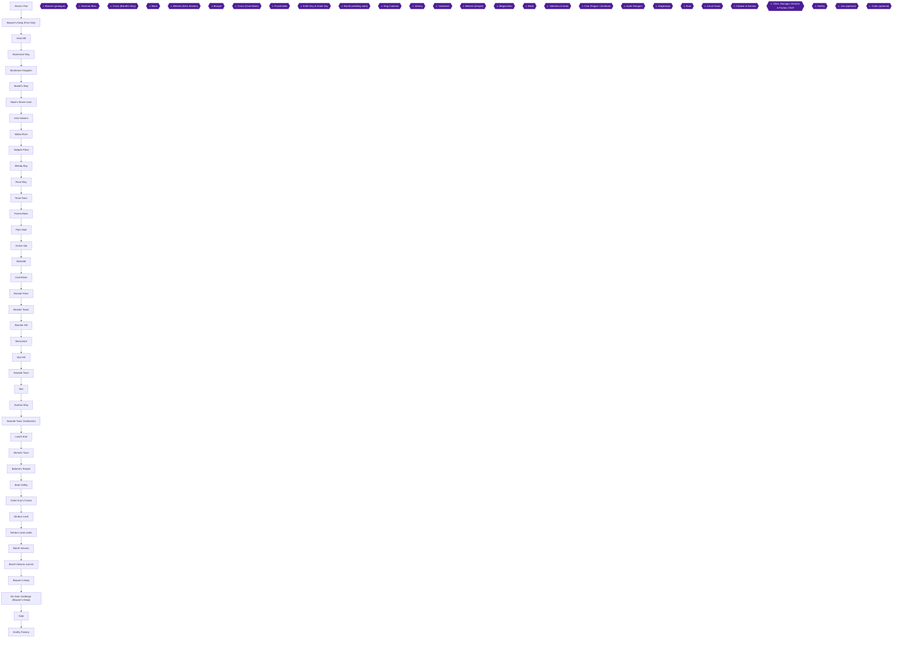

### Achievement Dependencies

```mermaid
flowchart LR
  Boss_Bowser{{"⚔ Bowser (prologue)"}}
  Ach_5815(["🏆 Princess... Saved?"])
  Boss_Hammer_Bros{{"⚔ Hammer Bros."}}
  Ach_6576(["🏆 Fists Are Stronger than Hammers"])
  Gate["Gate"]
  Ach_5880(["🏆 Hidden Treasure Hunter"])
  Missable_5880(["⚠ Missable: Hidden Treasure Hunter"])
  Mushroom_Way["Mushroom Way"]
  Ach_53293(["🏆 The Unmentionable"])
  Missable_53293(["⚠ Missable: The Unmentionable"])
  Boss_Croco_1{{"⚔ Croco (Bandit's Way)"}}
  Ach_5757(["🏆 Meet Croco"])
  Bandits_Way["Bandit's Way"]
  Ach_372508(["🏆 Returning Funds"])
  Missable_372508(["⚠ Missable: Returning Funds"])
  Boss_Mack{{"⚔ Mack"}}
  Ach_5811(["🏆 What's This Pointy Thing?"])
  Kero_Sewers["Kero Sewers"]
  Ach_6710(["🏆 Pandorite's Box"])
  Ach_147254(["🏆 It's Best to Turn Back Now"])
  Missable_147254(["⚠ Missable: It's Best to Turn Back Now"])
  Boss_Belome_1{{"⚔ Belome (Kero Sewers)"}}
  Ach_5759(["🏆 Beware the Flood"])
  Ach_145611(["🏆 Everything I Touch"])
  Ach_53304(["🏆 Amphibious Wisdom I"])
  Ach_53305(["🏆 Alto Member"])
  Rose_Way["Rose Way"]
  Ach_147245(["🏆 When Are You Turning Red?"])
  Ach_147256(["🏆 I Am a Work of Fiction"])
  Ach_5882(["🏆 Forest Secret"])
  Boss_Bowyer{{"⚔ Bowyer"}}
  Ach_5812(["🏆 Solve the Forest Maze"])
  Ach_53332(["🏆 Sleepy Hero I"])
  Pipe_Vault["Pipe Vault"]
  Ach_5878(["🏆 Goomba Thumper"])
  Ach_53292(["🏆 Learn the Rhythm"])
  Boss_Croco_2{{"⚔ Croco (Coal Mines)"}}
  Ach_5809(["🏆 Greet Croco"])
  Boss_Punchinello{{"⚔ Punchinello"}}
  Ach_5813(["🏆 Liberate the Mines"])
  Moleville["Moleville"]
  Ach_6709(["🏆 Minecart Top Dog"])
  Ach_147275(["🏆 A Hole's a Hole"])
  Booster_Pass["Booster Pass"]
  Ach_5814(["🏆 Art of Balance"])
  Ach_147266(["🏆 Booster's Little Secret"])
  Ach_372506(["🏆 Promotion Boosting"])
  Ach_5816(["🏆 The Mario Behind the Curtain"])
  Ach_5817(["🏆 Curtain Sneak"])
  Missable_5817(["⚠ Missable: Curtain Sneak"])
  Ach_5819(["🏆 Locomotive Loser"])
  Missable_5819(["⚠ Missable: Locomotive Loser"])
  Boss_Knife_Grate{{"⚔ Knife Guy & Grate Guy"}}
  Ach_5820(["🏆 Are We Amusing?"])
  Booster_Hill["Booster Hill"]
  Ach_6708(["🏆 Flower Point Boosters"])
  Ach_147274(["🏆 Always Tip the Bellhops"])
  Ach_53380(["🏆 Win Her Heart"])
  Missable_53380(["⚠ Missable: Win Her Heart"])
  Boss_Bundt{{"⚔ Bundt (wedding cake)"}}
  Ach_5821(["🏆 Wedding Crasher"])
  Ach_147273(["🏆 ENOUGH ALREADY"])
  Missable_147273(["⚠ Missable: ENOUGH ALREADY"])
  Mushroom_Kingdom["Mushroom Kingdom"]
  Ach_147247(["🏆 A Beetle's Heart"])
  Monstro_Town["Monstro Town"]
  Ach_147271(["🏆 Yoshi Juiced"])
  Ach_34964(["🏆 Raising Sheep"])
  Ach_147257(["🏆 From One Cookie to Another"])
  Ach_53550(["🏆 Invasion of Privacy!"])
  Ach_147270(["🏆 O Brother Where Art Thou?"])
  Ach_5822(["🏆 Wish Fulfilled"])
  Seaside_Town["Seaside Town"]
  Ach_53571(["🏆 First-Class Pirate"])
  Boss_King_Calamari{{"⚔ King Calamari"}}
  Ach_5856(["🏆 Tentacle Terror"])
  Ach_53572(["🏆 Sunken Treasure"])
  Ach_147263(["🏆 Sunken Secret"])
  Ach_6711(["🏆 Hidden Piranha Plant"])
  Ach_147264(["🏆 Unfair Fighting"])
  Missable_147264(["⚠ Missable: Unfair Fighting"])
  Boss_Johnny{{"⚔ Johnny"}}
  Ach_5857(["🏆 Walk the Plank"])
  Ach_5823(["🏆 Call Me Captain Mario"])
  Boss_Yaridovich{{"⚔ Yaridovich"}}
  Ach_5859(["🏆 Indigo Star Piece Take Back"])
  Seaside_Town_Shops["Seaside Town (Yaridovich)"]
  Ach_147265(["🏆 Tickle Torture"])
  Missable_147265(["⚠ Missable: Tickle Torture"])
  Ach_53573(["🏆 Sleepy Hero II"])
  Missable_53573(["⚠ Missable: Sleepy Hero II"])
  Ach_147261(["🏆 Gold to Green"])
  Ach_147272(["🏆 Whooeee!"])
  Ach_147250(["🏆 Is It Luck or Skill?"])
  Lands_End["Land's End"]
  Ach_54150(["🏆 Shortcut at Land's End"])
  Ach_147253(["🏆 That Was Great!"])
  Ach_147252(["🏆 Shogun Sensei"])
  Ach_6714(["🏆 Caught Mokura"])
  Boss_Belome_2{{"⚔ Belome (temple)"}}
  Ach_5858(["🏆 Time for Dinner"])
  Belome_Temple["Belome's Temple"]
  Ach_147268(["🏆 Open Belome"])
  Ach_54151(["🏆 Amphibious Wisdom II"])
  Ach_147244(["🏆 Virtuoso"])
  Boss_Jinx{{"⚔ Jinx (optional)"}}
  Ach_147248(["🏆 Mario Sensei"])
  Boss_Culex{{"⚔ Culex (optional)"}}
  Ach_5860(["🏆 Culex's Challenge"])
  Ach_147249(["🏆 The Musty Fears Must Fear Me Now"])
  Ach_147246(["🏆 Very Commendable!"])
  Bean_Valley["Bean Valley"]
  Ach_6712(["🏆 Box Fight"])
  Ach_5956(["🏆 Please Gamble Responsibly"])
  Ach_147262(["🏆 I Can Stop When I Want"])
  Ach_147259(["🏆 Right Is Always Right"])
  Missable_147259(["⚠ Missable: Right Is Always Right"])
  Boss_Megasmilax{{"⚔ Megasmilax"}}
  Ach_5861(["🏆 Plant Derooting"])
  Nimbus_Land["Nimbus Land"]
  Ach_147255(["🏆 Monster!!!"])
  Ach_147267(["🏆 Polishing Pecks"])
  Missable_147267(["⚠ Missable: Polishing Pecks"])
  Boss_Birdo{{"⚔ Birdo"}}
  Ach_5862(["🏆 Play with Birdo"])
  Boss_Valentina{{"⚔ Valentina & Dodo"}}
  Ach_5863(["🏆 Correcting Nimbus Land"])
  Ach_372507(["🏆 Where's My Valentina?"])
  Boss_Czar_Dragon{{"⚔ Czar Dragon / Zombone"}}
  Ach_5864(["🏆 Bring a Fire Extinguisher"])
  Boss_Axem_Rangers{{"⚔ Axem Rangers"}}
  Ach_5824(["🏆 Ranger Combat"])
  Bowsers_Keep["Bowser's Keep"]
  Ach_6713(["🏆 Gooey Monster Chest"])
  Boss_Magikoopa{{"⚔ Magikoopa"}}
  Ach_5872(["🏆 Koopa vs. Koopa"])
  Ach_147276(["🏆 GENOcide"])
  Missable_147276(["⚠ Missable: GENOcide"])
  Boss_Exor{{"⚔ Exor"}}
  Ach_5873(["🏆 Well, This Sucks"])
  Ach_34965(["🏆 Nothing Can Stop Us Now!"])
  Missable_34965(["⚠ Missable: Nothing Can Stop Us Now!"])
  Ach_147269(["🏆 Cleared the Castle"])
  Boss_Count_Down{{"⚔ Count Down"}}
  Ach_5875(["🏆 Time to Win"])
  Boss_Cloaker_Domino{{"⚔ Cloaker & Domino"}}
  Ach_5874(["🏆 Jesters and Snakes"])
  Boss_Factory_Chiefs{{"⚔ Clerk, Manager, Director & Factory Chief"}}
  Ach_5876(["🏆 Supervisor Clobberer"])
  Boss_Smithy{{"⚔ Smithy"}}
  Ach_5825(["🏆 Closing Time"])
  Ach_147260(["🏆 Big Finale"])
  Ach_147251(["🏆 Jump Man"])
  Ach_5957(["🏆 Super Jump Skills"])
  Ach_120118(["🏆 Where's My Super Suit"])
  Ach_5881(["🏆 Ready for the Worst"])
  Ach_5915(["🏆 Flower Power Wizard"])
  Ach_5914(["🏆 Frog Coin Collector"])
  Ach_147258(["🏆 Quick to Flee"])
  Boss_Bowser -->|unlocks| Ach_5815
  Boss_Hammer_Bros -->|unlocks| Ach_6576
  Gate -->|unlocks| Ach_5880
  Missable_5880 -.->|missable before| Ach_5880
  Mushroom_Way -->|unlocks| Ach_53293
  Missable_53293 -.->|missable before| Ach_53293
  Boss_Croco_1 -->|unlocks| Ach_5757
  Bandits_Way -->|unlocks| Ach_372508
  Missable_372508 -.->|missable before| Ach_372508
  Boss_Mack -->|unlocks| Ach_5811
  Kero_Sewers -->|unlocks| Ach_6710
  Kero_Sewers -->|unlocks| Ach_147254
  Missable_147254 -.->|missable before| Ach_147254
  Boss_Belome_1 -->|unlocks| Ach_5759
  Kero_Sewers -->|unlocks| Ach_145611
  Kero_Sewers -->|unlocks| Ach_53304
  Kero_Sewers -->|unlocks| Ach_53305
  Rose_Way -->|unlocks| Ach_147245
  Rose_Way -->|unlocks| Ach_147256
  Rose_Way -->|unlocks| Ach_5882
  Boss_Bowyer -->|unlocks| Ach_5812
  Rose_Way -->|unlocks| Ach_53332
  Pipe_Vault -->|unlocks| Ach_5878
  Pipe_Vault -->|unlocks| Ach_53292
  Boss_Croco_2 -->|unlocks| Ach_5809
  Boss_Punchinello -->|unlocks| Ach_5813
  Moleville -->|unlocks| Ach_6709
  Moleville -->|unlocks| Ach_147275
  Booster_Pass -->|unlocks| Ach_5814
  Booster_Pass -->|unlocks| Ach_147266
  Booster_Pass -->|unlocks| Ach_372506
  Booster_Pass -->|unlocks| Ach_5816
  Booster_Pass -->|unlocks| Ach_5817
  Missable_5817 -.->|missable before| Ach_5817
  Booster_Pass -->|unlocks| Ach_5819
  Missable_5819 -.->|missable before| Ach_5819
  Boss_Knife_Grate -->|unlocks| Ach_5820
  Booster_Hill -->|unlocks| Ach_6708
  Booster_Hill -->|unlocks| Ach_147274
  Booster_Hill -->|unlocks| Ach_53380
  Missable_53380 -.->|missable before| Ach_53380
  Boss_Bundt -->|unlocks| Ach_5821
  Booster_Hill -->|unlocks| Ach_147273
  Missable_147273 -.->|missable before| Ach_147273
  Mushroom_Kingdom -->|unlocks| Ach_147247
  Monstro_Town -->|unlocks| Ach_147271
  Moleville -->|unlocks| Ach_34964
  Mushroom_Kingdom -->|unlocks| Ach_147257
  Mushroom_Kingdom -->|unlocks| Ach_53550
  Mushroom_Kingdom -->|unlocks| Ach_147270
  Mushroom_Kingdom -->|unlocks| Ach_5822
  Seaside_Town -->|unlocks| Ach_53571
  Boss_King_Calamari -->|unlocks| Ach_5856
  Seaside_Town -->|unlocks| Ach_53572
  Seaside_Town -->|unlocks| Ach_147263
  Seaside_Town -->|unlocks| Ach_6711
  Seaside_Town -->|unlocks| Ach_147264
  Missable_147264 -.->|missable before| Ach_147264
  Boss_Johnny -->|unlocks| Ach_5857
  Seaside_Town -->|unlocks| Ach_5823
  Boss_Yaridovich -->|unlocks| Ach_5859
  Seaside_Town_Shops -->|unlocks| Ach_147265
  Missable_147265 -.->|missable before| Ach_147265
  Seaside_Town_Shops -->|unlocks| Ach_53573
  Missable_53573 -.->|missable before| Ach_53573
  Seaside_Town_Shops -->|unlocks| Ach_147261
  Seaside_Town_Shops -->|unlocks| Ach_147272
  Seaside_Town_Shops -->|unlocks| Ach_147250
  Lands_End -->|unlocks| Ach_54150
  Lands_End -->|unlocks| Ach_147253
  Lands_End -->|unlocks| Ach_147252
  Lands_End -->|unlocks| Ach_6714
  Boss_Belome_2 -->|unlocks| Ach_5858
  Belome_Temple -->|unlocks| Ach_147268
  Monstro_Town -->|unlocks| Ach_54151
  Monstro_Town -->|unlocks| Ach_147244
  Boss_Jinx -->|unlocks| Ach_147248
  Boss_Culex -->|unlocks| Ach_5860
  Lands_End -->|unlocks| Ach_147249
  Lands_End -->|unlocks| Ach_147246
  Bean_Valley -->|unlocks| Ach_6712
  Bean_Valley -->|unlocks| Ach_5956
  Bean_Valley -->|unlocks| Ach_147262
  Bean_Valley -->|unlocks| Ach_147259
  Missable_147259 -.->|missable before| Ach_147259
  Boss_Megasmilax -->|unlocks| Ach_5861
  Nimbus_Land -->|unlocks| Ach_147255
  Nimbus_Land -->|unlocks| Ach_147267
  Missable_147267 -.->|missable before| Ach_147267
  Boss_Birdo -->|unlocks| Ach_5862
  Boss_Valentina -->|unlocks| Ach_5863
  Nimbus_Land -->|unlocks| Ach_372507
  Boss_Czar_Dragon -->|unlocks| Ach_5864
  Boss_Axem_Rangers -->|unlocks| Ach_5824
  Bowsers_Keep -->|unlocks| Ach_6713
  Boss_Magikoopa -->|unlocks| Ach_5872
  Bowsers_Keep -->|unlocks| Ach_147276
  Missable_147276 -.->|missable before| Ach_147276
  Boss_Exor -->|unlocks| Ach_5873
  Bowsers_Keep -->|unlocks| Ach_34965
  Missable_34965 -.->|missable before| Ach_34965
  Bowsers_Keep -->|unlocks| Ach_147269
  Boss_Count_Down -->|unlocks| Ach_5875
  Boss_Cloaker_Domino -->|unlocks| Ach_5874
  Boss_Factory_Chiefs -->|unlocks| Ach_5876
  Boss_Smithy -->|unlocks| Ach_5825
  Gate -->|unlocks| Ach_147260
  Kero_Sewers -->|unlocks| Ach_147251
  Monstro_Town -->|unlocks| Ach_5957
  Monstro_Town -->|unlocks| Ach_120118
  Monstro_Town -->|unlocks| Ach_5881
  Monstro_Town -->|unlocks| Ach_5915
  Monstro_Town -->|unlocks| Ach_5914
  Monstro_Town -->|unlocks| Ach_147258
```

## Boss Index

Full strategies are in each chapter.

| Boss | Chapter |
|---|---|
| Bowser (prologue) | [1. Prologue: Mario's Pad and Bowser's Keep](#chapter-1-prologue-marios-pad-and-bowsers-keep) |
| Hammer Bros. | [2. Mushroom Way and the Mushroom Kingdom](#chapter-2-mushroom-way-and-the-mushroom-kingdom) |
| Croco (Bandit's Way) | [3. Bandit's Way, Croco and Mack](#chapter-3-bandits-way-croco-and-mack) |
| Mack | [3. Bandit's Way, Croco and Mack](#chapter-3-bandits-way-croco-and-mack) |
| Belome (Kero Sewers) | [4. Kero Sewers, Midas River and Tadpole Pond](#chapter-4-kero-sewers-midas-river-and-tadpole-pond) |
| Bowyer | [5. Rose Way, Rose Town and the Forest Maze](#chapter-5-rose-way-rose-town-and-the-forest-maze) |
| Croco (Coal Mines) | [7. Moleville and the Coal Mines](#chapter-7-moleville-and-the-coal-mines) |
| Punchinello | [7. Moleville and the Coal Mines](#chapter-7-moleville-and-the-coal-mines) |
| Knife Guy & Grate Guy | [8. Booster Pass and Booster Tower](#chapter-8-booster-pass-and-booster-tower) |
| Bundt (wedding cake) | [9. Booster Hill and Marrymore](#chapter-9-booster-hill-and-marrymore) |
| King Calamari | [11. Seaside Town, the Sea and the Sunken Ship](#chapter-11-seaside-town-the-sea-and-the-sunken-ship) |
| Johnny | [11. Seaside Town, the Sea and the Sunken Ship](#chapter-11-seaside-town-the-sea-and-the-sunken-ship) |
| Yaridovich | [12. Seaside Town freed: Yaridovich and the shops](#chapter-12-seaside-town-freed-yaridovich-and-the-shops) |
| Belome (temple) | [14. Belome Temple](#chapter-14-belome-temple) |
| Megasmilax | [15. Bean Valley and Grate Guy's Casino](#chapter-15-bean-valley-and-grate-guys-casino) |
| Birdo | [16. Nimbus Land](#chapter-16-nimbus-land) |
| Valentina & Dodo | [16. Nimbus Land](#chapter-16-nimbus-land) |
| Czar Dragon / Zombone | [17. Barrel Volcano](#chapter-17-barrel-volcano) |
| Axem Rangers | [17. Barrel Volcano](#chapter-17-barrel-volcano) |
| Magikoopa | [19. Bowser's Keep](#chapter-19-bowsers-keep) |
| Exor | [19. Bowser's Keep](#chapter-19-bowsers-keep) |
| Count Down | [20. The Gate and Smithy Factory](#chapter-20-the-gate-and-smithy-factory) |
| Cloaker & Domino | [20. The Gate and Smithy Factory](#chapter-20-the-gate-and-smithy-factory) |
| Clerk, Manager, Director & Factory Chief | [20. The Gate and Smithy Factory](#chapter-20-the-gate-and-smithy-factory) |
| Smithy | [20. The Gate and Smithy Factory](#chapter-20-the-gate-and-smithy-factory) |
| Jinx (optional) | [13. Land's End and Monstro Town](#chapter-13-lands-end-and-monstro-town) |
| Culex (optional) | [13. Land's End and Monstro Town](#chapter-13-lands-end-and-monstro-town) |

## Walkthrough

## Chapter 1: Prologue: Mario's Pad and Bowser's Keep

```mermaid
flowchart TD
  Marios_Pad["Mario's Pad"]
  Bowsers_Keep_Prologue["Bowser's Keep (First Visit)"]
  Vista_Hill["Vista Hill"]
  Boss_Bowser{{"⚔ Bowser (prologue)"}}
  Boss_Hammer_Bros{{"⚔ Hammer Bros."}}
  Boss_Croco_1{{"⚔ Croco (Bandit's Way)"}}
  Boss_Mack{{"⚔ Mack"}}
  Boss_Belome_1{{"⚔ Belome (Kero Sewers)"}}
  Boss_Bowyer{{"⚔ Bowyer"}}
  Boss_Croco_2{{"⚔ Croco (Coal Mines)"}}
  Boss_Punchinello{{"⚔ Punchinello"}}
  Boss_Knife_Grate{{"⚔ Knife Guy & Grate Guy"}}
  Boss_Bundt{{"⚔ Bundt (wedding cake)"}}
  Boss_King_Calamari{{"⚔ King Calamari"}}
  Boss_Johnny{{"⚔ Johnny"}}
  Boss_Yaridovich{{"⚔ Yaridovich"}}
  Boss_Belome_2{{"⚔ Belome (temple)"}}
  Boss_Megasmilax{{"⚔ Megasmilax"}}
  Boss_Birdo{{"⚔ Birdo"}}
  Boss_Valentina{{"⚔ Valentina & Dodo"}}
  Boss_Czar_Dragon{{"⚔ Czar Dragon / Zombone"}}
  Boss_Axem_Rangers{{"⚔ Axem Rangers"}}
  Boss_Magikoopa{{"⚔ Magikoopa"}}
  Boss_Exor{{"⚔ Exor"}}
  Boss_Count_Down{{"⚔ Count Down"}}
  Boss_Cloaker_Domino{{"⚔ Cloaker & Domino"}}
  Boss_Factory_Chiefs{{"⚔ Clerk, Manager, Director & Factory Chief"}}
  Boss_Smithy{{"⚔ Smithy"}}
  Boss_Jinx{{"⚔ Jinx (optional)"}}
  Boss_Culex{{"⚔ Culex (optional)"}}
  Marios_Pad --> Bowsers_Keep_Prologue
  Bowsers_Keep_Prologue --> Vista_Hill
  classDef ponr fill:#7f1d1d,stroke:#f87171,color:#fff;
  classDef boss fill:#4c1d95,stroke:#a78bfa,color:#fff;
  class Boss_Bowser,Boss_Hammer_Bros,Boss_Croco_1,Boss_Mack,Boss_Belome_1,Boss_Bowyer,Boss_Croco_2,Boss_Punchinello,Boss_Knife_Grate,Boss_Bundt,Boss_King_Calamari,Boss_Johnny,Boss_Yaridovich,Boss_Belome_2,Boss_Megasmilax,Boss_Birdo,Boss_Valentina,Boss_Czar_Dragon,Boss_Axem_Rangers,Boss_Magikoopa,Boss_Exor,Boss_Count_Down,Boss_Cloaker_Domino,Boss_Factory_Chiefs,Boss_Smithy,Boss_Jinx,Boss_Culex boss;
```

This chapter covers the opening of the game: the short, forced run through Bowser's Keep, the fight with Bowser, and the first scenes at Mario's Pad. It contains exactly one achievement, **Princess... Saved?** (2 pts, progression), which unlocks when you defeat Bowser [[ra-comments-5-1]].

> [!WARNING]
> **Emulator Core Warning:** Use the **Snes9x (Current)** core in RetroArch. It is the only recommended core for this set; older Snes9x versions and bsnes do not work well with the game's memory [[ra-comments-5-1]]. Players report that Snes9x 2005 and 2010 did not unlock this achievement [[ra-comments-5-2]], and that the core to select is "Nintendo - SNES/SFC (Snes9x)" [[ra-comments-5-3]]. One player also reported the achievement not unlocking on real hardware with an FXPak Pro and Ra2snes [[ra-comments-5-4]]. If the achievement does not pop after the fight, change your core before going further.

### Chapter Treasure Summary

- **Visible chests in this chapter:** Unable to verify from collected sources. No chest is listed for these areas in the collected sources.
- **Hidden treasure boxes (Secrets Guide / gf1 numbering #1-#39) in this chapter:** none are listed for these areas in the collected sources. Running count stays at 0 / 39.
- **Nothing here is missable for treasure.** The one thing to remember from this chapter is the Dry Bones's Flag under the bed in Mario's Pad (see below).

---

### Bowser's Keep (prologue)

🗺️ **Map:** [View Bowser's Keep (First Visit) Map on VGMaps](https://vgmaps.com/Atlas/SuperNES/SuperMarioRPG-LegendOfTheSevenStars-Bowser'sKeep-Bowser'sKeep(FirstVisit).png) | [Bowser's Keep Map by StarFighters76 (GameFAQs)](https://gamefaqs.gamespot.com/snes/588739-super-mario-rpg-legend-of-the-seven-stars/map/2088-bowsers-keep-map)

The game opens inside the keep and the path leads straight to the chandelier room where Bowser waits. Unable to verify from collected sources: the exact starting position, per-room directions, or any collectible in the earlier rooms (no fact covers them). Just keep moving forward, fighting through any Terrapin encounters with simple attacks, until you reach the far side of the chandelier room, where you see two chandeliers with Bowser on one of them [[gf1-24-1]]. Bowser and the Princess are tied up here [[gf2-7-18]]. The battle begins.

> [!CAUTION]
> **Point of No Return:** After the fight, a giant sword lands in the keep and destroys the bridge, so you cannot revisit Bowser's Keep for now [[gf2-7-20]]. Nothing else is available to collect in the keep on this visit from the collected sources.

#### Boss: Bowser (prologue)

- **Where:** the chandelier room, with Bowser on one of two chandeliers [[gf1-24-1]].
- **HP:** Unable to verify from collected sources as a fact. Do not worry about it: attack the chain instead.
- **Winning strategy:** do not bother with Bowser. Aim for the **Kinklink**, the chain holding his chandelier [[gf1-24-3]]. Hit it a few times and it loses its grip on the chandelier [[gf2-7-18]].
- **How many hits:** two timed Jumps or three timed punches end the battle [[gf1-24-4]]. Use Mario's timed hits (press **A** just as the attack lands).

After the battle, a giant sword lands in the keep [[gf2-7-20]]. Mario ends up back at his house [[gf3-7-5]].


> [!ACHIEVEMENT]
> **Princess... Saved? (2 Points)**
> 
> *Defeat Bowser, leader of the Koopa Army*


Defeating Bowser unlocks **Princess... Saved?** If it does not pop, re-check the core (see the warning above) [[ra-comments-5-1]].

---

### Mario's Pad

🗺️ **Map:** [View Mario's Pad Map on VGMaps](https://vgmaps.com/Atlas/SuperNES/SuperMarioRPG-LegendOfTheSevenStars-MushroomKingdom-Mario'sPad.png) [[map-vg-marios-pad-1-1]]

Mario's Pad is his pipehouse, topped with a giant pipe [[gf1-25-1]]. Mario lands in his house after being tossed from Bowser's Keep [[gf3-7-5]].

#### First visit (after the sword)

1. **TALK** to **Toad** outside the house. At first Toad is standing outside waiting, and sees Mario come flying through the oversized pipe atop the house [[gf1-25-2]]. Toad tells you to go to Bowser's Keep to rescue the Princess [[gf1-25-3]].
2. **Talk to Toad. This is required.** If you do not talk to him, you will not be able to go anywhere on the Overworld Map [[gf3-7-6]].
3. **SAVE** your game at Mario's Pad before heading back to the keep [[gf1-25-4]]. Toad also points out that you save by jumping on the Save Block, and explains how; you can additionally talk to him about sleeping to regain HP [[gf3-7-7]].
4. Walk to Bowser's Keep again. The giant sword destroys the bridge, so you cannot reach the keep any more [[gf2-7-20]].

#### Vista Hill

🗺️ **Map:** [View Vista Hill Map on VGMaps](https://vgmaps.com/Atlas/SuperNES/SuperMarioRPG-LegendOfTheSevenStars-Bowser'sKeep-VistaHill.png) [[map-vg-vista-hill-1-1]]

Vista Hill is only a short cutscene location. If you come here you will only see Mario looking at the Keep before he walks away, and the guide calls it "totally pointless" [[gf1-26-1]]. There is nothing to collect. Do not spend time here.

(You will see Vista Hill again much later, in a cutscene where Toad and other characters watch the Royal Bus carry Mario to the keep door and then cheer [[gf1-91-1]].)

#### Second visit (back in the house)

1. After the sword scene, go back into the pipehouse and **TALK** to **Toad**. He asks where the Princess is [[gf1-26-2]]. Toad suggests telling the Chancellor in the Mushroom Kingdom [[gf1-26-3]]. He runs off and tells you to meet him there [[gf3-7-9]].
2. **SAVE** your game before trying to leave [[gf1-26-4]]. Save here because there are no Save Blocks in Mushroom Way [[gf1-26-9]].
3. Try to leave. Toad crashes in, bumps Mario for 1 HP of damage, and gives him a Mushroom [[gf1-26-5]].
4. Toad asks whether you know how to use items. **Say YES.** If he goes through the procedure you waste the Mushroom [[gf1-26-6]]. (One guide words this the opposite way, saying yes wastes it and no lets you keep it [[gf3-7-10]]. The two guides contradict each other. The safe approach, which cannot waste anything, is yes: it is what gf1 recommends [[gf1-26-6]].)
5. A Goomba then bumps into you and Toad asks whether you know about Timed Hits. **Say YES.** If you say no, you waste 3 FP in the procedure [[gf1-26-7]], and you fight as he explains with no EXP or items gained [[gf3-7-11]].
6. After the lessons, Toad gives you 3 Mushrooms and heads off to Mushroom Way [[gf1-26-8]] [[gf3-7-12]]. Another guide counts 4 Mushrooms in total, one from the first bump plus these [[gf2-7-23]]. Either way, go on to see the Chancellor at the Mushroom Kingdom [[gf2-7-22]].

> [!WARNING]
> **Mushroom Way Warning:** There are no Save Blocks in Mushroom Way, so save in Mario's Pad before leaving [[gf1-26-9]]. Toad's advice to save before revisiting Bowser's Keep [[gf2-7-21]] is moot, since the bridge is gone [[gf2-7-20]].

#### Dry Bones's Flag (Three Musty Fears) - grab it now or later

There is a flag hidden in Mario's Pad that belongs to a late-game side quest. **Press A in front of the bed** in Mario's Pad to find **Dry Bones's Flag** [[checklist-secrets-33-3, checklist-secrets-39-3]]. It is flag #1 in the Musty Fears sequence, found under Mario's bed [[gf2-44-16, gf3-40-1]].

You do not receive the Three Musty Fears until you rest in Monstro Town much later in the game, so the flag cannot be triggered yet. Unable to verify from collected sources whether pressing A at the bed now does anything. Come back here once the Fears have visited you.

---

### Leaving: next step

Exit Mario's Pad and head to Mushroom Way [[gf2-7-24]]. Chapter 2 picks up there.

> [!IMPORTANT]
> ### Chapter 1 Cumulative 100% Checkpoint
> - **Visible Chests Opened:** 0 / 0 (none listed in this chapter's areas)
> - **Hidden Treasure Boxes (#1-#39):** 0 / 39
> - **Musty Fears Flags:** 0 / 3 (Dry Bones's Flag in Mario's Pad is available later [[checklist-secrets-33-3]])
> - **Sidequests Completed:** 0
> - **RetroAchievements Unlocked:** 1 / 99 (2 / 779 points)

### Chapter Checklist

- [ ] Used the Snes9x (Current) core [[ra-comments-5-1]]
- [ ] Defeated Bowser by hitting Kinklink [[gf1-24-3]]
- [ ] **Princess... Saved?** (5815) unlocked [[ra-comments-5-1]]
- [ ] Talked to Toad outside Mario's Pad [[gf3-7-6]]
- [ ] Saved at Mario's Pad (twice: before the keep, and before leaving for Mushroom Way) [[gf1-25-4, gf1-26-4]]
- [ ] Answered YES to both of Toad's lessons [[gf1-26-6, gf1-26-7]]
- [ ] Left Mario's Pad for Mushroom Way [[gf2-7-24]]

---

## Chapter 2: Mushroom Way and the Mushroom Kingdom

```mermaid
flowchart TD
  Mushroom_Way["Mushroom Way"]
  Mushroom_Kingdom["Mushroom Kingdom"]
  Boss_Hammer_Bros{{"⚔ Hammer Bros."}}
  Boss_Croco_1{{"⚔ Croco (Bandit's Way)"}}
  Boss_Mack{{"⚔ Mack"}}
  Boss_Belome_1{{"⚔ Belome (Kero Sewers)"}}
  Boss_Bowyer{{"⚔ Bowyer"}}
  Boss_Croco_2{{"⚔ Croco (Coal Mines)"}}
  Boss_Punchinello{{"⚔ Punchinello"}}
  Boss_Knife_Grate{{"⚔ Knife Guy & Grate Guy"}}
  Boss_Bundt{{"⚔ Bundt (wedding cake)"}}
  Boss_King_Calamari{{"⚔ King Calamari"}}
  Boss_Johnny{{"⚔ Johnny"}}
  Boss_Yaridovich{{"⚔ Yaridovich"}}
  Boss_Belome_2{{"⚔ Belome (temple)"}}
  Boss_Megasmilax{{"⚔ Megasmilax"}}
  Boss_Birdo{{"⚔ Birdo"}}
  Boss_Valentina{{"⚔ Valentina & Dodo"}}
  Boss_Czar_Dragon{{"⚔ Czar Dragon / Zombone"}}
  Boss_Axem_Rangers{{"⚔ Axem Rangers"}}
  Boss_Magikoopa{{"⚔ Magikoopa"}}
  Boss_Exor{{"⚔ Exor"}}
  Boss_Count_Down{{"⚔ Count Down"}}
  Boss_Cloaker_Domino{{"⚔ Cloaker & Domino"}}
  Boss_Factory_Chiefs{{"⚔ Clerk, Manager, Director & Factory Chief"}}
  Boss_Smithy{{"⚔ Smithy"}}
  Boss_Jinx{{"⚔ Jinx (optional)"}}
  Boss_Culex{{"⚔ Culex (optional)"}}
  Mushroom_Way --> Mushroom_Kingdom
  classDef ponr fill:#7f1d1d,stroke:#f87171,color:#fff;
  classDef boss fill:#4c1d95,stroke:#a78bfa,color:#fff;
  class Boss_Hammer_Bros,Boss_Croco_1,Boss_Mack,Boss_Belome_1,Boss_Bowyer,Boss_Croco_2,Boss_Punchinello,Boss_Knife_Grate,Boss_Bundt,Boss_King_Calamari,Boss_Johnny,Boss_Yaridovich,Boss_Belome_2,Boss_Megasmilax,Boss_Birdo,Boss_Valentina,Boss_Czar_Dragon,Boss_Axem_Rangers,Boss_Magikoopa,Boss_Exor,Boss_Count_Down,Boss_Cloaker_Domino,Boss_Factory_Chiefs,Boss_Smithy,Boss_Jinx,Boss_Culex boss;
```

This chapter takes you from Mario's Pad through Mushroom Way, past the Hammer Bros., and through your first visit to the Mushroom Kingdom, ending as you follow Croco out of the east exit toward Bandit's Way. It contains the single most important missable of the whole game, hidden treasure box #1, and a second missable, Toadstool's ???. Read both warnings before you walk into the Mushroom Kingdom.

> [!WARNING]
> **Emulator core:** Several commenters report that boss-defeat achievements, including the Hammer Bros. one in this chapter, only trigger on certain cores. One player reports it working only on RASnes9x and not on a real FXPak Pro with ra2snes, and one reports that the bsnes 2014 Accuracy core fails [[ra-comments-6-1, ra-comments-6-2]]. Another player had to switch to the SNES9X (2010) core before this chapter's other achievement would trigger [[ra-comments-8-6]]. Use the core your setup is known to work with, and see the game overview for the recommended setting. An EmuDeck user fixed the problem by reinstalling to get the update [[ra-comments-6-3]].

> [!WARNING]
> **Missable (read before the castle):** Hidden treasure box #1 (a Frog Coin) can only be taken during your first arrival in the Mushroom Kingdom castle, while Toad runs down the hall to the Chancellor. It is the only missable hidden box [[ra-comments-7-1, ra-comments-7-2]]. You only get one chance, so save at the Inn first and reset if you fail [[gf3-9-5, gf3-62-4]]. The full procedure is in the castle section below.

> [!WARNING]
> **Missable (Toadstool's ???):** The Unmentionable becomes impossible once Toadstool joins your party (after Marrymore) [[gf1-29-16, ra-comments-8-1]]. This guide has you do it during your first castle visit, which is safe.

### Chapter Items to Collect

| Item | Where Found | Action / Requirement | Citation |
|---|---|---|---|
| Honey Syrup | Mushroom Way, 1st area | Defeat the Goomba holding Toad | [[gf1-27-7]] |
| Flower Tab | Mushroom Way, 2nd area | Defeat the Sky Troopa holding Toad on the right plateau | [[gf1-27-8]] |
| Flower | Mushroom Way, 2nd area, left plateau | Jump from the spinning flower | [[gf1-27-9]] |
| Coins (chests) | Mushroom Way | Hit the coin chests | [[gf3-8-2]] |
| Flower Tab (chest) | Mushroom Way, tall rock | Open the chest on one of the three tall rocks | [[gf3-8-4]] |
| Flower Tab (Toad on rock) | Mushroom Way, tall rock | Save Toad from the Koopa | [[gf3-8-5]] |
| Flower Jar and Hammer | Hammer Bros. fight | Win the boss fight | [[gf1-28-9, gf3-9-1]] |
| Hidden box #1: Frog Coin | Mushroom Kingdom castle | **MISSABLE**, first arrival only | [[gf1-17-2, checklist-secrets-5-1]] |
| Hidden box #2: Flower | Item Shop basement | Follow the man's directions | [[gf1-17-3, checklist-secrets-5-3]] |
| Hidden box #3: Flower | Item Shop basement | Ride the man, jump at the far-right corner | [[gf1-17-4, checklist-secrets-5-5]] |
| 10 coins, Flower, Mushroom | Vault | Talk to the Vault Guard | [[gf1-29-15]] |
| Mushroom | Toadstool's room | Search for the ??? | [[gf1-29-17]] |
| Pick Me Up | Item Shop | Talk to the shopkeeper after Mallow joins | [[gf1-29-21]] |

---

### Mushroom Way

🗺️ **Area Map:** [View Mushroom Way/Bandit's Way Map by StarFighters76](https://gamefaqs.gamespot.com/snes/588739-super-mario-rpg-legend-of-the-seven-stars/map/1969-mushroom-way-bandits-way-map) · [Mushroom Way on VGMaps](https://vgmaps.com/Atlas/SuperNES/SuperMarioRPG-LegendOfTheSevenStars-MushroomKingdom-MushroomWay.png)

#### Before you leave Mario's Pad

Mushroom Way is the first real level, a mountain pass full of Goombas, Sky Troopas and Spikeys [[gf1-27-1]]. There are no Save Blocks on Mushroom Way, so save in Mario's Pad before you follow Toad out [[gf1-26-9]]. If you need to rest at any point, you can walk back to Mario's house [[gf2-7-27]]. This is a good area to practice your battle skills [[gf2-7-25]].

Vista Hill, the cliff across from the broken bridge, shows nothing useful; the guide calls the trip pointless [[gf1-26-1]].

#### Enemies

- Hitting a Goomba starts a battle with two or three Goombas [[gf1-27-2]].
- Hitting a Sky Troopa starts a battle with one or two Sky Troopas [[gf1-27-3]].
- Touching a Spikey starts a battle with two Spikeys, or a Spikey and a Sky Troopa [[gf1-27-4]].
- If Mario is below Level 2, a timed punch usually will not kill a Sky Troopa, so use Jump instead [[gf1-27-5]]. If Mario is below Level 3, a timed punch usually will not kill a Spikey, and Jump attacks are useless against them [[gf1-27-6]].

Practice tip for later achievements: to practice Super Jumps without causing damage, fight Spikey here with the Jump Shoes unequipped so you can jump until your FP runs out, and let other party members block [[checklist-superjump-4-5, checklist-superjump-6-3]]. Players also report practicing on groups of Goombas here, pressing the button as Mario's foot meets the Goomba's head [[ra-comments-105-2, ra-comments-110-5]]. The Super Jump achievements are covered later in the guide; this is only an optional warm-up.

#### 1st area

1. Walk forward until you reach Toad, who is being held by a Goomba. Defeat the Goomba and Toad rewards you with a **[Honey Syrup]** [[gf1-27-7, gf3-8-1]].
2. Hit the chests along the path for coins [[gf3-8-2]].

#### 2nd area

1. Stand on the spinning flowers and jump to reach the tall rocks [[gf3-8-3]]. One of the three tall rocks holds a treasure chest with a **[Flower Tab]**. A second rock has a Goomba. The third rock has Toad being attacked by a Koopa; save him for another **[Flower Tab]** [[gf3-8-4, gf3-8-5]].
2. Defeat the Goomba on the spinning flower, then jump onto the right plateau and defeat the Sky Troopa. Toad gives you a **[Flower Tab]** [[gf1-27-8]].
3. Before you use that Flower Tab, step back on the flower and jump to the left plateau for a **[Flower]** [[gf1-27-9]].
4. Hit the ? Box on the far right side to refill HP and FP [[gf1-27-10]].

#### 3rd area

This is the Spikey room. Defeat enough Spikeys to reach at least Level 3 or 4 [[gf1-27-11]]. If you time it right on this screen, the Lakitu keeps dropping Spikeys, which gives you unlimited fights to level on [[gf3-8-6]]. The gf3 author clears the first two sections until about Level 4, then fights the Spinies here (about eight clearings, around half an hour), and is about six points from Level 6 before the Hammer Bros. [[gf3-8-7]]. Another guide only asks for Level 2 or 3 [[gf2-7-28]]. More levels make the next fight easier; at least Level 3 or 4 is the baseline.

At the end of the pass, Toad is captured again, this time by a Hammer Brother [[gf1-27-12]].

#### Boss: Hammer Bros.

Walk up to the Hammer Brother twice to start the battle [[gf1-28-1]]. You must beat both to reach the Mushroom Kingdom [[gf1-28-4]].

- **HP:** 50 each, no listed defenses [[gf1-28-2, gf2-7-29]].
- **Weakness:** Jump [[gf1-28-3]].
- **Their attack:** Hammer Time, around 4 HP at Level 4 [[gf3-9-2]].
- **Rewards:** 6 EXP, 20 coins, a Flower Jar and the Hammer [[gf2-8-4, gf3-9-1]].

Strategy:

1. Take down the first brother with one timed Jump and one timed punch [[gf1-28-5]]. A commenter's version: Jump on the first brother, Jump the second on the next move, hit the first again with a Jump or punch, and finish the second the following turn [[ra-comments-6-4]]. Two Jump specials can also kill one outright [[gf2-8-1]].
2. After one falls, the other casts Valor Up and doubles his defense (gf3 says "about half" more) [[gf1-28-6, gf2-8-2, gf3-9-2]].
3. For the survivor, use two timed Jumps and one or two timed punches [[gf1-28-7]]. Spend any leftover FP on Jump, then bash with normal attacks, and use a Mushroom if HP gets low [[gf2-8-3]].
4. Alternate plan: bring one brother's HP very low, kill the other, then finish the Valor-Upped one with about one hit [[gf1-28-8]].


> [!ACHIEVEMENT]
> **Fists Are Stronger than Hammers (5 Points)**
> 
> *Defeat the Hammer Bros., bully blockades*


After the fight, Toad hands over the Hammer. **Equip it now**: it raises Mario's attack by 10 [[gf1-28-10, gf2-8-5, gf3-9-3]]. You can test it on the Spikeys in the same room [[gf1-28-10]]. Then head into the Mushroom Kingdom [[gf2-8-6]].

> [!NOTE]
> Equipping the Hammer matters for the Chancellor scene. If you did not equip it, the Chancellor asks whether Toad should tell you about it; answer no [[gf1-29-13]].

---

### Mushroom Kingdom (first visit)

🗺️ **Area Map:** [View Mushroom Kingdom Map on VGMaps](https://vgmaps.com/Atlas/SuperNES/SuperMarioRPG-LegendOfTheSevenStars-MushroomKingdom-MushroomKingdom.png) · [Mushroom Kingdom (Mack) Map](https://vgmaps.com/Atlas/SuperNES/SuperMarioRPG-LegendOfTheSevenStars-MushroomKingdom-MushroomKingdom(Mack).png)

The town has three hidden treasure boxes, #1 to #3 [[gf1-29-1]]. You cannot be forced into battle here yet; that changes later [[gf1-29-11]]. Talk to everyone in town, as you will in every new town [[gf3-9-4]].

Plan for this visit, in order:

1. Item Shop: shopping, plus hidden boxes #2 and #3.
2. Inn: save.
3. Castle: hidden box #1, the Chancellor, the Vault, then Toadstool's room.
4. Leave the castle: Mallow, then the east exit.

#### Item Shop and Inn (before the castle)

Prices at the Inn and Item Shop:

| Entry | Price |
|---|---|
| Inn | 3 coins [[gf1-29-2]] |
| Mushroom | 4 coins [[gf1-29-3]] |
| Honey Syrup | 10 coins [[gf1-29-4, gf2-27-1]] |
| Pick Me Up | 5 coins [[gf1-29-5, gf2-27-2]] |
| Able Juice | 4 coins [[gf1-29-6, gf2-27-3]] |
| Jump Shoes | 30 coins [[gf1-29-7, gf2-27-6]] |
| Antidote Pin | 28 coins [[gf1-29-8, gf2-27-7]] |
| Shirt | 7 coins [[gf1-29-9, gf2-27-4]] |
| Pants | 7 coins [[gf1-29-10, gf2-27-5]] |

The guide suggests buying a Shirt, Pants, Jump Shoes, an Antidote Pin and some items; if money is short, at least buy the Shirt and Pants [[gf1-29-12]].

**Hidden boxes #2 and #3 (Item Shop basement).** Go into the Item Shop and downstairs to the basement [[gf1-17-3, gf3-62-6]].

1. Talk to the man there and follow his directions. Box #2 is right above where he originally stood. It contains a **[Flower]** [[gf1-17-3, checklist-secrets-5-3]]. The Secrets Guide says to follow "the purple guy's" instructions [[checklist-secrets-5-4]]. One other guide labels both of these boxes "Flower Tab"; the gf1/Secrets Guide numbering and contents are used here [[gf3-62-5]].
2. For box #3, jump on his head and let him carry you around. Wait until he walks to the far-right corner (the Secrets Guide says the lower-right corner, diagonal from the boxes), then jump. This might take a while [[gf1-17-4, checklist-secrets-5-6, gf3-62-8]]. The box contains a **[Flower]** [[checklist-secrets-5-5]].

Hidden box count after this step: 2 / 39 (box #1 follows in the castle).

> [!WARNING]
> **Save before the castle.** The next section has a one-time chance at hidden box #1 [[gf3-9-5]]. Go to the Inn and save now [[gf1-29-12]]. If you botch the jump in the hall, reset to this save and try again [[gf3-62-4]]. Box #1 is only possible on your first visit [[gf1-17-2]].

#### Castle: hidden box #1 (MISSABLE)

> [!WARNING]
> **Missable Achievement Warning (Hidden box #1):** When you step into the castle, Toad greets you and then runs up the hall to tell the Chancellor. You must jump on his head before he exits through the door [[checklist-secrets-5-2]]. Do **not** just walk behind him. If he leaves the hall, this Frog Coin is gone for the entire playthrough [[ra-comments-7-1, ra-comments-7-2]].

1. Enter the castle and save beforehand (done above) [[gf1-29-12]].
2. As Toad starts walking down the hallway, quickly jump on his head [[gf1-17-2, checklist-secrets-5-2]].
3. From Toad's head, jump onto the space above the door. This is an invisible ledge or alcove above the door frame [[checklist-secrets-5-2, ra-comments-7-1]].
4. Keep jumping on the ledge until the hidden treasure box appears and you get the **[Frog Coin]** [[checklist-secrets-5-1, checklist-secrets-5-2]]. Another description: land on the doorframe and jump again [[gf3-62-3]].
5. Once the chest is yours, follow Toad through the main hallway and a small room to the Chancellor's throne room [[gf3-9-6]].

Hidden box count: 3 / 39.

#### The Chancellor and the Vault

1. Listen to the Chancellor. If you did not equip the Hammer, answer no when he asks whether Toad should tell you [[gf1-29-13]].
2. He gives you a Map and suggests you meet the Vault Guard [[gf1-29-14, gf3-9-6]].
3. Go down to the Vault and take the items: 10 coins, a Flower and a Mushroom [[gf1-29-15]]. Another guide lists these as 10 Coins, 1 Flower Tab and a Green Mushroom that restores FP and HP [[gf3-9-7]].

#### Toadstool's room (MISSABLE: The Unmentionable)

> [!WARNING]
> **Missable Achievement Warning:** Do the ??? search now, before Toadstool joins your party. Once she joins after Marrymore, the ??? can no longer be found [[ra-comments-8-1]]. One commenter notes it can be done as early as the first castle visit, even before Mallow joins [[ra-comments-8-4]]. Another adds that you should do it before leaving the castle and while the princess is not in your party [[ra-comments-8-3]].

1. From the main hallway, take the left door and climb the steps to Toadstool's room [[gf1-29-16]].
2. Stand between the fireplace and the blue chair, facing the wall, and press A to search [[gf1-29-16, ra-comments-8-2]]. The chair here is also the one the maid reacts to [[gf3-9-8]].
3. Keep searching long enough and you will find Toadstool's ???. You will not have time to find out what it is; the maid yells at you and gives you a **[Mushroom]** [[gf1-29-16, gf1-29-17]].


> [!ACHIEVEMENT]
> **The Unmentionable (1 Points)**
> 
> *Find Toadstool's ???*


A fun detail from gf3: Toadstool's room contains her grandmother in disguise and a stash that flusters Toadstool when checked [[gf3-28-11]].

#### Leaving the castle: Mallow joins

1. Exit the castle and try to walk down. A scene shows Croco running across the screen, followed by Mallow [[gf1-29-18]]. Croco has stolen Mallow's Frog Coin, which he needs to buy something for his grandpa [[gf2-8-10, gf3-9-10]].
2. Croco escapes and Mallow starts crying. Talk to him and agree to help chase Croco [[gf1-29-19]]. Mallow joins the party if you promise to help, and you need to jump when the guy asks "how are you going to take care of Bowser?" [[gf3-9-10]].
3. Equip Mallow with the Pants you bought and the Antidote Pin if you have it [[gf1-29-20]]. He has lousy defense, so an Antidote Pin is a good buy [[gf3-9-11]].
4. Go into the Item Shop and talk to the shopkeeper for a free **[Pick Me Up]** [[gf1-29-21, gf3-9-11]]. The item Mallow wanted is picked up here later, once he has his Frog Coin back [[gf2-9-12, gf1-34-2]].
5. Go outside and talk to the guard who keeps hopping up and down near the east exit. He mentions seeing Croco, who then runs past. After the scene, leave through the east exit toward Bandit's Way [[gf1-29-22, gf3-9-13, gf2-8-13]].

> [!NOTE]
> One of the townsfolk has lost his wallet; this becomes important later [[gf3-9-9]].

---

### Preview: the Mushroom Kingdom after Bandit's Way

You return here in the next chapter after Croco, when Smithy's Shysters have taken over town [[gf1-32-1, gf2-8-29]]. This section is only a heads-up so you know the town stays worth revisiting; full steps belong with the next chapter's route.

- Defeat the Shyster bugging the mushroom guy near the east exit for 10 coins [[gf1-32-4]].
- Defeat the Shyster on the front lawn of the east-most house, then return his wallet for a Flower Tab; return to him later for a Frog Coin [[gf1-32-5, gf1-32-6, gf3-28-8]].
- Defeat the three Shysters in the west-most house for a Flower Tab [[gf1-32-7, gf3-11-8]].
- Inside the castle, clear the Shysters to reach Toadstool's room and answer "You bet" for a Flower Tab; get the Wake-Up Pin from the Vault Guard in the guest room, then re-open the vault [[gf1-32-8, gf1-32-9, gf1-32-10]].
- Have your party at Level 6 or higher before the throne room, because Mack is weak to Mario's Super Jump [[gf1-32-11]].

---

> [!IMPORTANT]
> ### Chapter 2 Cumulative 100% Checkpoint
> - **Hidden Treasure Boxes:** 3 / 39 (this chapter: #1-#3, a Frog Coin and two Flowers)
> - **Visible Chests (Mushroom Way and Mushroom Kingdom):** Mushroom Way coin chests and tall-rock Flower Tab chest done; Vault items taken (exact chest totals: Unable to verify from collected sources)
> - **Star Pieces:** 0 / 7
> - **Bosses:** Bowser (Chapter 1) and Hammer Bros. defeated
> - **Sidequests Completed:** The Unmentionable (Toadstool's ???) done; Beetle Mania, Samus cameo and wallet follow-ups still to come
> - **RetroAchievements Unlocked:** 3 / 99 (8 / 779 points): Princess... Saved? (2), Fists Are Stronger than Hammers (5), The Unmentionable (1)

### Chapter Checklist

- [ ] Hammer Bros. defeated and the Hammer equipped (Mario's attack up by 10) [[gf2-8-5]]
- [ ] Honey Syrup and both Flower Tabs from Toad on Mushroom Way [[gf1-27-7, gf1-27-8]]
- [ ] Hidden box #1 (Frog Coin) taken from the doorframe in the castle [[checklist-secrets-5-1]]
- [ ] Hidden boxes #2 and #3 (Flowers) taken in the Item Shop basement [[checklist-secrets-5-3, checklist-secrets-5-5]]
- [ ] Vault items taken [[gf1-29-15]]
- [ ] Toadstool's ??? found, with the maid's Mushroom [[gf1-29-17]]
- [ ] Mallow in the party, equipped, and the free Pick Me Up collected [[gf1-29-20, gf1-29-21]]
- [ ] Left through the east exit toward Bandit's Way [[gf1-29-22]]

---

## Chapter 3: Bandit's Way, Croco and Mack

```mermaid
flowchart TD
  Bandits_Way["Bandit's Way"]
  Mushroom_Castle["Mack's throne room"]
  Boss_Croco_1{{"⚔ Croco (Bandit's Way)"}}
  Boss_Mack{{"⚔ Mack"}}
  Boss_Belome_1{{"⚔ Belome (Kero Sewers)"}}
  Boss_Bowyer{{"⚔ Bowyer"}}
  Boss_Croco_2{{"⚔ Croco (Coal Mines)"}}
  Boss_Punchinello{{"⚔ Punchinello"}}
  Boss_Knife_Grate{{"⚔ Knife Guy & Grate Guy"}}
  Boss_Bundt{{"⚔ Bundt (wedding cake)"}}
  Boss_King_Calamari{{"⚔ King Calamari"}}
  Boss_Johnny{{"⚔ Johnny"}}
  Boss_Yaridovich{{"⚔ Yaridovich"}}
  Boss_Belome_2{{"⚔ Belome (temple)"}}
  Boss_Megasmilax{{"⚔ Megasmilax"}}
  Boss_Birdo{{"⚔ Birdo"}}
  Boss_Valentina{{"⚔ Valentina & Dodo"}}
  Boss_Czar_Dragon{{"⚔ Czar Dragon / Zombone"}}
  Boss_Axem_Rangers{{"⚔ Axem Rangers"}}
  Boss_Magikoopa{{"⚔ Magikoopa"}}
  Boss_Exor{{"⚔ Exor"}}
  Boss_Count_Down{{"⚔ Count Down"}}
  Boss_Cloaker_Domino{{"⚔ Cloaker & Domino"}}
  Boss_Factory_Chiefs{{"⚔ Clerk, Manager, Director & Factory Chief"}}
  Boss_Smithy{{"⚔ Smithy"}}
  Boss_Jinx{{"⚔ Jinx (optional)"}}
  Boss_Culex{{"⚔ Culex (optional)"}}
  Bandits_Way --> Mushroom_Castle
  classDef ponr fill:#7f1d1d,stroke:#f87171,color:#fff;
  classDef boss fill:#4c1d95,stroke:#a78bfa,color:#fff;
  class Boss_Croco_1,Boss_Mack,Boss_Belome_1,Boss_Bowyer,Boss_Croco_2,Boss_Punchinello,Boss_Knife_Grate,Boss_Bundt,Boss_King_Calamari,Boss_Johnny,Boss_Yaridovich,Boss_Belome_2,Boss_Megasmilax,Boss_Birdo,Boss_Valentina,Boss_Czar_Dragon,Boss_Axem_Rangers,Boss_Magikoopa,Boss_Exor,Boss_Count_Down,Boss_Cloaker_Domino,Boss_Factory_Chiefs,Boss_Smithy,Boss_Jinx,Boss_Culex boss;
```

This chapter takes you out of the Mushroom Kingdom, up the dead-end pass called Bandit's Way to catch and defeat Croco, back into a Shyster-infested Mushroom Kingdom to deal with the stolen Wallet, and finally into the Chancellor's throne room to beat Mack and collect the first Star Piece [[gf1-30-3, gf1-33-9, gf1-32-5]].

You should arrive here from Chapter 2 with Mallow in your party, wearing the Pants and Antidote Pin, and having followed Croco out of the eastern exit of town [[gf1-29-18, gf1-29-19, gf1-29-20, gf1-29-22]].

### Preparation

- **Levels.** One guide says to have Mario and Mallow at Level 6 before the throne room because Mario's Super Jump is super-effective against Mack [[gf1-32-11, gf1-33-5]]. Another says to build to about Level 5 or 6 [[gf2-9-5]]. Mario learns Super Jump at Level 6 [[gf3-10-9]].
- **Level-up trick.** Bandit's Way holds a Super Star treasure box that you can use to farm levels safely. Details are in the Bandit's Way section below [[gf2-8-15, gf2-8-16, gf2-8-17]].
- **Emulator core.** The Snes9x 2005 and 2010 cores can break many achievements in this set. Snes9x (current) is the recommended core [[ra-comments-10-4]].

---

## Area: Bandit's Way

🗺️ **Area Map:** [Mushroom Way/Bandit's Way Map by StarFighters76 (GameFAQs)](https://gamefaqs.gamespot.com/snes/588739-super-mario-rpg-legend-of-the-seven-stars/map/1969-mushroom-way-bandits-way-map)

🗺️ **Area Map:** [Bandit's Way Map (VGMaps)](https://vgmaps.com/Atlas/SuperNES/SuperMarioRPG-LegendOfTheSevenStars-MushroomKingdom-Bandit'sWay.png) [[map-vg-bandits-way-1-1]]

**What this area is.** Goombas, Spikeys and K-9s run amok in this dead-end pass [[gf1-30-2]]. The object is to follow Croco, who keeps running away from you, until you can trap him enough to start the fight [[gf1-30-3, gf3-10-1]].

**Frogog tip.** If a Frogog shows up in a fight together with Spikeys and/or Goombas, have Mario use his Hammer and Mallow use Thunderbolt to clear them all at once [[gf1-30-4]].

### Bandit's Way, Room 1 (entrance)

1. Walk up the path from the entrance. There is a **Save Block in the lower-left corner of the first area**. Hit it and save [[gf1-30-5]].
2. Goombas, Spikeys and K-9s roam this pass [[gf1-30-2]]. Continue to the next room.

### Bandit's Way, Room 2 (spinning flowers and rotating platforms)

This room teaches two mechanics [[gf1-30-6]]:

1. **Spinning flower.** Use the spinning flower to jump up to the plateau that blocks the path [[gf1-30-6]].
2. **Rotating platforms.** Step on the right-most platform. The left platform rotates 180 degrees and ends up directly in front of the one you stand on, forming your path [[gf1-30-7]].
3. Use the platforms to get out of the room [[gf1-30-7]].
4. **Optional level farming.** Two caves on opposite plateaus give you an unlimited supply of K-9s to fight if you want to raise your levels [[gf1-30-8]].
5. The second spinning flower is not needed to get through the room, but it is needed for the hidden box below [[gf1-30-9, gf1-17-5]].

#### Hidden Treasure Box #4 (Kerokero Cola)

This is the one hidden box of this chapter. It holds a **KeroKeroCola** [[gf1-17-5, checklist-secrets-5-7, gf3-63-1]].

1. In the second area, stand on the **second spinning flower** [[gf1-17-5, checklist-secrets-5-8]].
2. Jump off the flower and aim toward the exit side, jumping up and right on a diagonal. One guide says to aim for the nearby purple flower, or simply jump off straight to the right; you hit the invisible box at the top of your jump [[gf1-17-5, checklist-chests-1-8]].
3. A third guide says to try to land on the nearby blue flower on the right-hand side of the rock-face crossing to get the chest [[gf3-63-2]].
4. The KeroKeroCola appears [[checklist-chests-1-7]].

The box is invisible and is hit at the top of your jump [[gf1-17-5]].

### Bandit's Way, Room 3

1. The third room is like the first: a path with a few Goombas and Spikeys [[gf1-30-10]].
2. At the last fork, go **right**, beat the K-9 there, and hit the **? box for a Mushroom**. Then go back and take the **left** path to continue [[gf1-30-11]].

### Bandit's Way, Room 4 (Croco taunts you, Super Star room)

1. After Croco goes away, step on the **right-most platform** and hit the **? box** right there for a **Super Star** [[gf1-30-12]].
2. In the area where Croco stands on a platform and says "Now's not the time", the Invincibility Star can be used to get easy EXP [[gf3-10-2]].
3. Run around and hit all the K-9s as quickly as you can while the star lasts. More K-9s come in through the two passages, so you will not run out [[gf1-30-13]].
4. Using the platforms to reach the other box gives a reward. One guide says it is a **Frog Coin** [[gf1-30-14]]; another says a **Flower Tab** is in the floating chest reached by the platforms [[gf3-10-3]]. The sources disagree on the item, so check the box and take what is inside.

> [!TIP]
> **Star Trick (optional level-up).** Before you open the Super Star box, **save first**. Open the box, use the star to fight, then **die in battle**. You reappear at your save point with all your levels and EXP, and the star is still in the box, so you can repeat this as many times as you like. Use it until your levels are at least 4 [[gf2-8-15, gf2-8-16, gf2-8-17]].

### Bandit's Way, Room 5 (Croco's hiding spot)

> [!NOTE]
> You and Croco have found the dead end. He hides next to one of the four mini-hills in the middle of the room [[gf1-30-15]].

1. Sneak up **behind** Croco and press **A**. You must do this **three times** [[gf1-30-15, gf2-8-18, gf3-10-4]].
2. Croco hides next to one of the four mini-hills in the middle of the room; keep sneaking up behind him [[gf1-30-15]].
3. After the third catch, Croco goes into battle [[gf2-8-18]].

#### Boss: Croco


> [!ACHIEVEMENT]
> **Meet Croco (5 Points)**
> 
> *Defeat Croco, the crocodile thief, in Bandit's Way*


| Stat | Value |
|---|---|
| HP | 320 (plus 60 if he drinks a Weird Mushroom) [[gf1-31-1, gf2-8-19, gf3-10-5]] |
| Weakness | Fire [[gf1-31-3, gf2-8-20]] |
| Special defense | Sleep [[gf1-31-2]] |

**Strategy** (use Mario for damage; Mallow supports):

1. Open with **Mario's Fire Orb**. Croco is weak to fire, and when you hit him with fire he does not attack for a turn or two [[gf2-8-20, gf2-8-21, gf3-10-6]].
2. **Mallow's Thunderbolt** puts Croco into a "tail fire" and gives Mario a free turn [[gf3-10-7]].
3. Mallow's own attacks do little damage here. Keep him in Defend, have him heal, and use items when needed [[gf2-8-22]]. He can also use Honey Syrups to replenish Mario's FP while the Fire Orb does the damage [[gf3-10-8]].
4. Croco's bomb attacks cause 10+ damage, so heal early. Watch Mallow in particular, since he is weak and Croco can do major damage to him [[gf2-8-23, gf3-10-11]].
5. When his HP is low, Croco uses **Weird Mushroom** to recover 60 HP. Keep attacking [[gf2-8-24, gf3-10-10]].
6. If you already have Super Jump (Level 6), you can use it against him [[gf3-10-9]]. A community player notes that Fire Orb makes Croco waste a turn, that a leveled-up jump is then your strongest hit, and that you should keep FP up [[ra-comments-9-1]].
7. Eventually Mallow punches Croco and gets his Frog Coin back [[gf2-8-25]].

**Rewards:** EXP 8, 10 coins, and a Flower Tab [[gf2-8-26]]. You also get a **Wallet** that Croco left behind [[gf2-8-27, gf3-11-1]] and the **Special (Rare) Frog Coin** listed by gf3 [[gf3-11-1]].

> [!IMPORTANT]
> Do NOT sell the Wallet yet. It is the key item for the missable achievement below. Read the Mushroom Kingdom warning before you open any shop [[gf1-32-5, ra-comments-10-3]].

Afterwards, a springboard (Warp Trampoline) comes down. Jump on it to return to the start of Bandit's Way, then leave and return to the Mushroom Kingdom [[gf3-11-2, gf2-8-28]].

---

## Area: Mushroom Kingdom (return visit)

🗺️ **Area Map:** [Mushroom Kingdom Map (VGMaps)](https://vgmaps.com/Atlas/SuperNES/SuperMarioRPG-LegendOfTheSevenStars-MushroomKingdom-MushroomKingdom.png)

A dark cloud covers the town and Shysters are terrorizing people. This is not Bowser's doing, it is Smithy's [[gf1-32-1, gf2-8-29]]. Most Shyster fights are against two or three of them, easy once Mallow is at least Level 4; use Thunderbolt [[gf1-32-2, gf1-32-3]].

### Wallet Quest (Achievement 372508)

> [!WARNING]
> **Missable Achievement Warning:** **Talk to the man who lost the Wallet BEFORE you sell it.** Selling the Wallet before speaking to him is the missable path [[gf1-32-5, ra-comments-10-3]]. If you want to sell it, first talk to him and refuse to hand it over, THEN sell it. When you come back and talk to him he gets angry, and the achievement triggers [[ra-comments-10-3]].
>
> The achievement also fires when you simply return the Wallet to its owner [[ra-comments-10-2]].

**Recommended route (return the Wallet).** This is the simplest path and it rewards you with a Flower Tab, which raises max FP early in the game [[ra-comments-10-5]]:

1. Find the guy on the **front lawn of the eastern-most house**, or the man near where you came into town [[gf1-32-5, gf2-8-30]].
2. A Shyster is bugging him. **Defeat the Shyster** first [[gf1-32-5, gf2-8-30]].
3. Talk to the man (the "blue headed man"). He asks for his Wallet back. Say **yes** [[gf3-11-7]].
4. He gives you a **Flower Tab** in return [[gf2-8-31, gf3-11-7, gf2-24-2]].


> [!ACHIEVEMENT]
> **Returning Funds (2 Points)**
> 
> *Return the Wallet to the Toad in the Mushroom Kingdom, or sell it after speaking to him and face his wrath*


> [!NOTE]
> Return to this man much later in the game for a bonus. After you have gotten Princess Toadstool and returned to the Mushroom Kingdom, he gives you a **Frog Coin** he found in his wallet. This only happens if you gave him the wallet [[gf3-28-8]]. Come back to him when you next pass through town (see a later chapter).

**Alternative route (sell it after speaking to him).** Talk to him first and refuse to hand the Wallet over. Then sell it. Return and talk to him again; he gets angry and the achievement triggers [[ra-comments-10-3]]. This path does not hand the Wallet back, so the Flower Tab trade [[gf2-24-2]] and the later Frog Coin from the owner [[gf3-28-8]] do not apply.

> [!NOTE]
> If the achievement does not trigger, verify your emulator core. Several players reported failures on Snes9x 2005/2010 and success on Snes9x (current) and Mesen-S [[ra-comments-10-4]].

### Optional Shyster Rewards

Optional Shyster fights that pay out [[gf1-32-4, gf1-32-7, gf1-32-8]]:

- Defeat the Shyster bugging the "mushroom guy" near the eastern exit for **10 coins** [[gf1-32-4]].
- Defeat the 3 Shysters in the **western-most house** for a **Flower Tab** [[gf1-32-7]].
- Inside the castle, defeat the Shyster bugging Toad, then the Shysters blocking the passage to Toadstool's room (three or four). Say "You bet" to the question to get a **Flower Tab** [[gf1-32-8]].
- Return to the main hall and take the other passage. Save the Maid for lots of EXP from the Shysters [[gf3-11-14]].
- Since the Vault Guard is away, you can raid the vault again. Then go into the guest room (right side of the castle, opposite the vault), talk to the Vault Guard, and get a **Wake-Up Pin**. Give it to Mario. Then go into the vault and take the items again [[gf3-11-16, gf1-32-9, gf3-11-15, gf1-32-10]].
- The maid in the castle heals your HP and FP [[gf3-11-12]], and there is a Save Box [[gf3-11-13]].

---

## Area: Mack's throne room (Chancellor's throne room, Mushroom Castle)

🗺️ **Area Map:** [Mushroom Kingdom (Mack) Map (VGMaps)](https://vgmaps.com/Atlas/SuperNES/SuperMarioRPG-LegendOfTheSevenStars-MushroomKingdom-MushroomKingdom(Mack).png)

Before the throne room, save (a Save Box is in the castle) and heal at the maid [[gf3-11-12, gf3-11-13]]. Build Mario and Mallow to about Level 5 or 6 first [[gf2-9-5, gf1-32-11]].

**Hidden boxes and visible chests in this area:** the sources list no hidden box and no visible chest in the throne room itself (hidden boxes #1-3 belong to the Mushroom Kingdom proper, covered in Chapter 2 [[gf1-29-1]]).

### Boss: Mack and his Bodyguards

| Stat | Value |
|---|---|
| Mack HP | 480 [[gf1-33-1, gf3-12-1]] |
| Bodyguard HP | 30 each, four of them [[gf1-33-1, gf3-12-1]] |
| Mack weakness | Thunder [[gf1-33-4]] |
| Mack immune to | Fear, Poison, Sleep, Silence [[gf1-33-3]] |

**Strategy:**

1. Mallow's **Thunderbolt** hits everybody. Use it first: it clears the Bodyguards and **stuns Mack** after the first cast [[gf3-12-4, gf1-33-6, gf1-33-7, gf3-12-2]].
2. Have Mario use **Super Jump** on Mack (or Fire Orb if you do not have Super Jump yet). Use regular attacks on later turns while Mallow heals or uses items [[gf1-33-6, gf3-12-3, gf2-9-8, gf2-9-9]].
3. Bodyguards return after a few turns. Once you can no longer clear them quickly, ignore them and keep hitting Mack [[gf3-12-4, gf2-9-9]].
4. Use Honey Syrup if Mallow runs out of FP [[gf1-33-8]].

**Rewards:** EXP 12, 20 coins [[gf2-9-10, gf3-12-5]]. Beating Mack gives you the **first Star Piece** (called the Blue / Lightblue Star Piece) [[gf2-9-11, gf3-12-5, gf1-33-9]].


> [!ACHIEVEMENT]
> **What's This Pointy Thing? (10 Points)**
> 
> *Collect the Blue Star Piece*


After the fight, the Chancellor restores order and Mallow suggests visiting his grandfather at Tadpole Pond [[gf1-34-1, gf2-9-13]].

> [!CAUTION]
> **Next-step errand:** Before you leave, go to the Item Shop and talk to the shopkeeper. Because you recovered Mallow's Frog Coin from Croco, Mallow can now trade it for the **Cricket Pie** that his grandfather wants. You need this for Mallow's first weapon [[gf1-34-2, gf2-9-12, gf3-12-6]].

---

### Leaving: next step

Exit the castle and take the road to the Kero Sewers. Enter the level and go through the pipe leading down into the sewers [[gf1-34-4]]. Chapter 4 picks up there.

> [!IMPORTANT]
> ### Chapter 3 Cumulative 100% Checkpoint
> - **Visible Chests Opened (this chapter):** the "?" boxes in Bandit's Way (Mushroom, Super Star, and the platform box with a Frog Coin or Flower Tab [[gf1-30-11, gf1-30-12, gf1-30-14, gf3-10-3]]); no fixed treasure chests are listed for the throne room.
> - **Hidden Treasure Boxes (#1-#39):** 4 / 39 (this chapter: #4 KeroKeroCola [[gf1-17-5]])
> - **Musty Fears Flags:** 0 / 3 (unchanged)
> - **Star Pieces:** 1 (Blue Star Piece from Mack [[gf2-9-11]])
> - **Sidequests Completed:** 1 (Wallet returned to its owner [[gf3-11-7]])
> - **RetroAchievements Unlocked:** 6 / 99 (25 / 779 points); this chapter adds three (5757: 5 pts, 372508: 2 pts, 5811: 10 pts)

### Chapter Checklist

- [ ] Saved at the Save Block in the lower-left of Bandit's Way room 1 [[gf1-30-5]]
- [ ] Took the Mushroom from the ? box at the right fork of room 3 [[gf1-30-11]]
- [ ] Took the Super Star from the ? box in room 4 (and optionally used the Star Trick) [[gf1-30-12, gf2-8-15]]
- [ ] Opened the platform box in room 4 (Frog Coin or Flower Tab) [[gf1-30-14, gf3-10-3]]
- [ ] Opened hidden box #4 (KeroKeroCola) [[gf1-17-5]]
- [ ] **Meet Croco** (5757) unlocked [[gf2-8-18]]
- [ ] Kept the Wallet, talked to its owner BEFORE selling it [[ra-comments-10-3]]
- [ ] **Returning Funds** (372508) unlocked [[ra-comments-10-2]]
- [ ] **What's This Pointy Thing?** (5811) unlocked by beating Mack [[gf2-9-11]]
- [ ] Traded Mallow's Frog Coin for the Cricket Pie at the Item Shop [[gf1-34-2, gf3-12-6]]
- [ ] Left for the Kero Sewers [[gf1-34-4]]

---

## Chapter 4: Kero Sewers, Midas River and Tadpole Pond

```mermaid
flowchart TD
  Kero_Sewers["Kero Sewers"]
  Midas_River["Midas River"]
  Tadpole_Pond["Tadpole Pond"]
  Melody_Bay["Melody Bay"]
  Boss_Belome_1{{"⚔ Belome (Kero Sewers)"}}
  Boss_Bowyer{{"⚔ Bowyer"}}
  Boss_Croco_2{{"⚔ Croco (Coal Mines)"}}
  Boss_Punchinello{{"⚔ Punchinello"}}
  Boss_Knife_Grate{{"⚔ Knife Guy & Grate Guy"}}
  Boss_Bundt{{"⚔ Bundt (wedding cake)"}}
  Boss_King_Calamari{{"⚔ King Calamari"}}
  Boss_Johnny{{"⚔ Johnny"}}
  Boss_Yaridovich{{"⚔ Yaridovich"}}
  Boss_Belome_2{{"⚔ Belome (temple)"}}
  Boss_Megasmilax{{"⚔ Megasmilax"}}
  Boss_Birdo{{"⚔ Birdo"}}
  Boss_Valentina{{"⚔ Valentina & Dodo"}}
  Boss_Czar_Dragon{{"⚔ Czar Dragon / Zombone"}}
  Boss_Axem_Rangers{{"⚔ Axem Rangers"}}
  Boss_Magikoopa{{"⚔ Magikoopa"}}
  Boss_Exor{{"⚔ Exor"}}
  Boss_Count_Down{{"⚔ Count Down"}}
  Boss_Cloaker_Domino{{"⚔ Cloaker & Domino"}}
  Boss_Factory_Chiefs{{"⚔ Clerk, Manager, Director & Factory Chief"}}
  Boss_Smithy{{"⚔ Smithy"}}
  Boss_Jinx{{"⚔ Jinx (optional)"}}
  Boss_Culex{{"⚔ Culex (optional)"}}
  Kero_Sewers --> Midas_River
  Midas_River --> Tadpole_Pond
  Tadpole_Pond --> Melody_Bay
  classDef ponr fill:#7f1d1d,stroke:#f87171,color:#fff;
  classDef boss fill:#4c1d95,stroke:#a78bfa,color:#fff;
  class Boss_Belome_1,Boss_Bowyer,Boss_Croco_2,Boss_Punchinello,Boss_Knife_Grate,Boss_Bundt,Boss_King_Calamari,Boss_Johnny,Boss_Yaridovich,Boss_Belome_2,Boss_Megasmilax,Boss_Birdo,Boss_Valentina,Boss_Czar_Dragon,Boss_Axem_Rangers,Boss_Magikoopa,Boss_Exor,Boss_Count_Down,Boss_Cloaker_Domino,Boss_Factory_Chiefs,Boss_Smithy,Boss_Jinx,Boss_Culex boss;
```

This chapter takes you out of the Mushroom Kingdom and down into the Kero Sewers, where you beat the trick treasure box Pandorite and then Belome. Belome's defeat floods the sewers and sweeps you into the Midas River mini-game, which ends at Tadpole Pond. There you meet Frogfucius, play the first song for Toadofsky in Melody Bay, and get the Froggie Stick. It holds seven achievements, one of which (It's Best to Turn Back Now) is missable.

You should arrive from Chapter 3 with Mack beaten, the first Star Piece in hand, Mallow's Frog Coin traded for the Cricket Pie at the Item Shop, and the road to the Kero Sewers open [[gf1-34-4]].

> [!WARNING]
> **Missable Achievement Warning (It's Best to Turn Back Now, 147254):** Reach Land's End from Kero Sewers by using the Boos as a stair, before you go to Marrymore. After a player went to Marrymore, the Boo no longer spawned, so the achievement is missable from that point [[ra-comments-13-4]]. Another player unlocked it on a later return to Kero Sewers, right after beating the Bowyer boss with Geno in the party, so you do not have to do it on the very first visit, only before Marrymore [[ra-comments-13-5]]. The simplest plan is to do it on this first visit, right after Belome's room is reachable but before you leave the sewers. The exact step-by-step route to the ledge is covered below as far as the sources allow.

> [!WARNING]
> **Emulator core:** The Land's End achievement requires Snes9x (current); the bsnes2014 core is not supported [[ra-comments-13-3]]. One player had the unlock icon appear without it showing on their profile and needed three attempts plus logging back in to the site and emulator [[ra-comments-13-7]].

> [!NOTE]
> **Start building Jump Man now (147251).** Mario's Jump special gets stronger the more you use it, and the achievement wants you to use it in 50 battles [[ra-comments-103-1]]. Mario's Jump starts at 25 power and gains +1 power every two jumps, so 50 jumps are tracked when the achievement fires [[ra-comments-103-8]], although another player reports the tracker counting to 50 meant 100 Jump uses [[ra-comments-104-2]]. Use the Jump special in every battle from now on (a Jump special every battle is the chapter planner's rule). Details and a grinding spot are in the Jump Man section below.

### Chapter Items to Collect

Hidden treasure boxes in the #1-#39 numbering (gf1 and Secrets Guide): the sources collected for this chapter list none in these four areas. The only hidden-box reference in this chapter's passages is #27, which is in a Land's End cave and belongs to a later chapter [[checklist-secrets-18-4]].

| Item | Where Found | Action / Requirement | Citation |
|---|---|---|---|
| Mushroom | Kero Sewers, switch room (upper level) | Hit the ? box next to the drain switch | [[gf1-34-11]] |
| Flower | Kero Sewers, below the drop point | Hit the ? box to the left | [[gf1-34-19]] |
| Super Star | Kero Sewers, near the upper pipe | Hit its ? box | [[gf1-34-20, gf3-13-2]] |
| Flower Jar and Trueform Pin | Pandorite box, lowest level | Defeat Pandorite | [[gf1-34-18, gf2-9-21]] |
| Coins (after Pandorite) | Same box | Exit and return, it is a normal chest with lots of coins | [[gf3-13-6]] |
| Flower Tab | Chest in the mice-infested corridors | Open the chest | [[gf3-13-7]] |
| Green Mushroom | Chest at the end of Kero Sewers, by the Save Box | Open the chest | [[gf3-13-10]] |
| Cricket Jam (optional, later) | Chest on a platform southwest of the pipe, Kero Sewers | Reached from Land's End secret passage | [[checklist-secrets-18-4, gf1-71-2, gf3-36-14]] |
| Pure Water | Dropped by ghost enemies | Defeat Boos and other ghosts | [[checklist-secrets-19-2]] |
| Nok Nok Shell | End of Midas River's first ride | Talk to the mushroom guy | [[gf1-36-3, gf2-9-32]] |
| Flower (x2, one per cave) | Midas River waterfall | Two caves contain a Flower | [[gf2-9-30]] |
| Froggie Stick | Tadpole Pond | Give Frogfucius the Cricket Pie | [[gf1-37-25, gf2-10-5, gf3-14-10]] |
| Alto Card | Melody Bay | Play Frogfucius' Suite #18 | [[gf1-105-4, gf3-15-1]] |

---

## Area: Kero Sewers

🗺️ **Dungeon Map:** [View Kero Sewers Map by StarFighters76 (GameFAQs)](https://gamefaqs.gamespot.com/snes/588739-super-mario-rpg-legend-of-the-seven-stars/map/2001-kero-sewers-map) [[map-kero-sewers-1-1]] · [Kero Sewers Map (VGMaps)](https://vgmaps.com/Atlas/SuperNES/SuperMarioRPG-LegendOfTheSevenStars-PondToPipes-KeroSewers.png) [[map-vg-kero-sewers-1-1]]

This is the first area with swimming and pipe travel, and it is confusing [[gf2-9-14]]. The pipes are a maze, and one guide declines to give a single route and recommends exploring [[gf3-13-1]]. Another guide offers two paths: a quick path to Belome and an extended path that picks up every item [[gf1-34-4]]. This walkthrough takes the extended path because Pandorite gives the Trueform Pin that protects Mario in the Belome fight and earns an achievement. Rooms are named in the order you meet them.

### Entering and the first save

1. Leave the Mushroom Kingdom for the Kero Sewers. Enter the level and go through the pipe that leads down into the sewers [[gf1-34-4]].
2. **Save your game** here before you jump into the water [[gf1-34-5]]. The room has a Save Block [[gf2-9-15]].
3. Level up to roughly Level 7 before Belome. One guide says to build your levels to about 7 before fighting him [[gf2-9-19]]. Clearing the whole area about twice gives lots of Exp [[gf3-13-9]].

> [!NOTE]
> **Ghosts and Pure Water.** Ghost-type enemies such as the Boos here are a quick source of coins, and each ghost defeated gives Pure Water, an item that insta-kills any ghost-type enemy [[checklist-secrets-19-1, checklist-secrets-19-2]]. Ghost enemies take 0 damage from Jump, so do not expect to grind Jump Man on them [[ra-comments-103-11]]. Pure Water can be sold for a lot of money [[ra-comments-103-12]].

### Route to the Pandorite box (extended path)

4. Jump into the water and swim as far right as you can, then enter the pipe there [[gf1-34-14]].
5. Jump down to the pipe just below where you emerged and enter it [[gf1-34-14]].
6. Go to the right and enter that pipe [[gf1-34-15]]. Go down to the lowest level and climb the steps [[gf1-34-15]].
7. At the top of the steps is a ? box. This is not a normal box; hitting it starts the Pandorite battle [[gf1-34-16]]. A second guide describes the same box as the one you find by searching the pipe near the underwater one [[gf2-9-20]].

### Boss: Pandorite


> [!ACHIEVEMENT]
> **Pandorite's Box (10 Points)**
> 
> *Defeat Pandorite, the trick Treasure Box in Kero Sewers*


Pandorite is the first of the game's "box monsters" [[gf3-13-3]]. Use Super Jump a couple of times to beat him [[gf1-34-17]]. With a good Super Jump he can die in one turn [[gf3-13-3]], and he is immune to fire, so do not use fire attacks [[gf3-13-4]]. Players report that "a few Jumps is enough," that one Jump did 122 damage [[ra-comments-12-1, ra-comments-12-2]], and that after grinding 50 Jumps another player finished him in two [[ra-comments-12-3]]. Beating Pandorite earns the achievement Pandorite's Box.

- **Reward:** a Flower Jar and a Trueform Pin [[gf1-34-18]]. Equip the Trueform Pin on Mario [[gf1-34-18, gf2-9-22]]. It helps against Belome [[gf2-9-21]].
- After the fight, exit and come back: the box is now a normal chest filled with coins [[gf3-13-6]].

### The rest of the extended path

8. Get on the second star from the top and jump up to the spot where you dropped down. Go left and hit the ? box for a Flower [[gf1-34-19]].
9. Work your way up to the pipe and hit its ? box for a Super Star [[gf1-34-20]]. This is the second Super Star in the game and knocks out a few enemies before it runs out [[gf3-13-2]].
10. Take out the Rat Funks and the Boo in the upper-right corner [[gf1-34-21]].
11. Enter the pipe in the upper-left corner, stay along the back wall into the next pipe, then continue as in the quick path below [[gf1-34-22]].
12. When going up the mice-infested corridors, look for a chest that holds a Flower Tab [[gf3-13-7]].

### Quick path to the switch room and Belome

13. Stay along the back wall and go into the pipe on the left side [[gf1-34-7]].
14. Staying along the right wall, cross the narrow bridge with a Rat Funk on it and enter the furthest-right pipe [[gf1-34-8]]. A second guide says to jump over the Rat Funk on the ledge and enter that pipe [[gf2-9-16]].
15. Climb the steps and jump on the switch to drain the water [[gf1-34-9]]. The switch is near a bunch of Boo Buddies, and lowering the water opens a previously unreachable area [[gf3-13-8]]. In the second guide, this is the "!" Switch [[gf2-9-17]].
16. Go back through the pipe you came in by, jump down, and take the pipe in the lower-left corner. You end up on the upper level of the switch room [[gf1-34-10]]. The second guide words it as entering the pipe that was underwater, then the pipe above the "!" Switch [[gf2-9-18]].
17. **Save**, then hit the ? box next to the switch for a Mushroom [[gf1-34-11]]. You can ignore the ? box on the highest ledge [[gf1-34-12]].

### Optional: the Boo stair to Land's End (It's Best to Turn Back Now)

> [!WARNING]
> **Do this before Marrymore.** See the warning at the top of the chapter [[ra-comments-13-4]].


> [!ACHIEVEMENT]
> **It's Best to Turn Back Now (2 Points)**
> 
> *Visit Land's End coming from Kero Sewers before knocking over the barrel*


The achievement text is "Visit Land's End coming from Kero Sewers before knocking over the barrel." The sources are thin on the exact room and ledge, and give these clues from players who did it:

- Use the Boo "like a stair" to reach the area [[ra-comments-13-1]].
- Use the Boos after running from a battle to get up there. Once inside, the Shy Guy tells you it is a dead end [[ra-comments-13-2]].
- One player kept floating upwards until they made it over the wall [[ra-comments-13-6]].
- Several players went down the pipe and got no achievement on their first tries, so expect to need retries and make sure you are on a supported core [[ra-comments-13-3, ra-comments-13-7]].
- A chest that usually holds Cricket Jam held a Flower for one player on this route [[ra-comments-13-8]].

Unable to verify from collected sources: the exact room and tile position where the first Boo-stair jump is made, and what "knocking over the barrel" physically refers to.

Reference: the Land's End side arrives you atop the pipe above the second Save Block, one room away from Belome's room. Jumping onto the ledges and going left leads to a treasure box containing Cricket Jam [[gf1-71-1, gf1-71-2]]. Then you go back to the pipe to return to Land's End [[gf1-71-3]]. That Cricket Jam is turned in at Tadpole Pond (see below) and is part of the later secret passage from Land's End, so it is not required now [[gf3-36-14, checklist-secrets-18-4]].

### Boss: Belome


> [!ACHIEVEMENT]
> **Beware the Flood (5 Points)**
> 
> *Defeat Belome, the hungry beast, in Kero Sewers*


Go through the pipe on the right side of the switch room to battle Belome [[gf1-34-13]]. Another guide describes it as the pipe above the switch that lands you in front of Belome [[gf2-9-18]]. Beating him is part of the story and counts as Progression for Beware the Flood [[ra-comments-14-1]].

| Stat | Value | Citation |
|---|---|---|
| HP | 500 | [[gf1-35-1, gf2-9-23, gf3-14-1]] |
| Weakness | Thunder | [[gf1-35-3, gf2-9-24]] |
| Resistance | Sleep | [[gf1-35-2]] |
| Reward | EXP 15, Coins 40, no item | [[gf2-9-28, gf3-14-4]] |

- Have Mario use Super Jump and Mallow use Thunderbolt [[gf1-35-5]]. Belome also dislikes Mario's Super Jump [[gf3-14-2]].
- Equip the Trueform Pin on Mario before the fight. Without it, his S'crow Funk attack turns Mario into a scarecrow [[gf2-9-25, gf3-14-3]]. Without the pin, if Mallow gets eaten and you run out of FP, the battle gets very hard [[gf1-35-6]].
- Belome has sleep attacks, tries S'Crow Funk on Mario, and may eat Mallow [[gf1-35-7]]. Once he swallows Mallow, it is a one-on-one fight: use Mario's normal and special attacks and a Mushroom if HP is low until he spits Mallow back out [[gf2-9-26, gf2-9-27]].
- You meet Belome twice: here and again in Belome's Temple between Land's End and Monstro Town [[gf1-35-4]].
- There is no item for beating him, only a free trip down the Midas River [[gf1-35-8]].
- At the end of the area is a Save Box and a chest with a Green Mushroom [[gf3-13-10]].

---

## Area: Midas River

🗺️ **Area Map:** [Midas River Map (VGMaps)](https://vgmaps.com/Atlas/SuperNES/SuperMarioRPG-LegendOfTheSevenStars-PondToPipes-MidasRiver.png) [[map-vg-midas-river-1-1]]

When you beat Belome, water gushes out and sends the team into the Midas River mini-game [[gf2-9-29]]. The whole level is a mini-game [[gf1-36-2]]. It has two parts: a waterfall swim and a barrel jump. You grab coins in both, and those coins are traded for Frog Coins, but the coins you grab in the river are not kept [[gf2-40-11, gf2-40-13]].

### Reward structure

- On the first completion you can trade 60 of the coins you got for a Frog Coin [[gf1-104-6]].
- After that, the cost goes up to 80 coins, then drops depending on how many coins you collected: 70 coins gets it down to 75, 80 coins to 70, 90 coins to 60 [[gf1-104-7, gf1-104-8, gf1-104-9, gf1-104-10]].
- With all 100 coins the cost goes down to 50, plus five free Frog Coins [[gf1-104-11, gf2-40-12]].
- At the end of the first ride, the mushroom guy gives you a Nok Nok Shell as a new weapon. Equip it before going to Tadpole Pond [[gf1-36-3, gf2-9-32]].
- Two caves on the waterfall hold a Flower each [[gf2-9-30]].

### Achievement: Everything I Touch (all 100 coins)

> [!WARNING]
> **Collect every Frog Coin on the waterfall first.** Frog Coins do not count toward the coin total, and a leftover green Frog Coin can leave your counter at 99 [[ra-comments-15-9, ra-comments-15-7]]. One player kept getting 99 until they picked up that Frog Coin, saved, and retried with none left on the board [[ra-comments-19-1]]. Do not make serious runs until all the waterfall Frog Coins are collected [[ra-comments-18-3]]. If you still end on 99, doing a second run in sequence without resetting spawns a normal coin in place of the green one [[ra-comments-15-8]].


> [!ACHIEVEMENT]
> **Everything I Touch (25 Points)**
> 
> *Collect all 100 coins in Midas River*


The 100 coins are 36 in the waterfall and 64 in the barrel section [[gf1-104-2, gf1-104-4]]. All 100 must be collected in a single run [[ra-comments-19-3]]. Missing a single coin anywhere means you restart [[ra-comments-17-5]]. You can soft reset with L+R+Select+Start [[ra-comments-16-2]]. One of the guides calls the waterfall nearly impossible to fully collect because of the current [[gf1-104-3]]; the player comments below show it is done with tight, practised inputs. Practising with save states on a separate emulator helps, since the barrel section is deterministic [[ra-comments-17-1]]. Check your latency options, which may make the press timing easier [[ra-comments-16-3]].

#### Waterfall (36 coins)

General swim rules reported by players:

- Press the swim button smoothly and not super fast, even when you think you will not make it [[ra-comments-15-10]]. The ideal tap speed shows Mario's falling animation for 1 frame between taps [[ra-comments-18-1]].
- The waterfall needs precise tapping: just right between too slow and too fast [[ra-comments-15-2]]. Mario's mobility is good if you do not spam [[ra-comments-16-8]].
- After 4 presses Mario falls fast regardless, so do three presses, let him fall a little, then swim with three again [[ra-comments-15-11]]. Another player says swim at most 3 times in a row [[ra-comments-15-5]]. A fourth is allowed but a fifth spammed press locks you out of swimming up [[ra-comments-19-6]]; one player reports you cannot swim more than 4 times without losing height, though 1 or 2 swims is fine [[ra-comments-16-4]].
- The most efficient way to move horizontally is 4 slow taps [[ra-comments-17-2]]. The game does not eat inputs; Mario falls automatically after 4 presses, so tap slowly to maximize horizontal distance [[ra-comments-17-7]].
- Do not move in multiple directions at once, or the rocks' odd collision will stop you and ruin the run [[ra-comments-15-4]].
- Optional: programming turbo on the swim button (period 17, duty cycle 10) makes the rhythm easier, and turbo is allowed in hardcore [[ra-comments-18-8]]. Another player recommends period 15 instead of 17 so you can press the button down at the last fork and coin [[ra-comments-19-2]].
- Coins spawn in groups of 9; if you do not come down on the 9th, 18th or 27th coin before the next group spawns, the group despawns [[ra-comments-15-1]].

Spots to watch:

- **First cave.** The hardest part is navigating around the first cave entrance [[ra-comments-19-8]]. There is a hitbox issue: get as close as possible (about 3 frames above it), then quickly double-tap right without spamming, or you fall in [[ra-comments-18-4]]. On the right side of the cave, when going right from above, do not swim 3 times or you are pushed into the cave [[ra-comments-16-5]]. Use four jumps after grabbing the coin to the left of the first cave, but only two immediately after, then single jumps to clear the right side [[ra-comments-19-4]].
- After you take the coin right of the cave, lose as little height as possible because the last coin could despawn [[ra-comments-16-6]].
- **Second split.** After taking both bottom-left coins, hold right the whole time while mashing A to swim up [[ra-comments-15-3]]. One player suggests four timed taps rather than three here to get just enough height [[ra-comments-16-1]].
- **Coins south of the second cave** can disappear if you are too low, so grab them from the side or above [[ra-comments-18-5]]. Some players had coins not spawn at all in the waterfall a few times [[ra-comments-18-9]].

#### Barrel jumping (64 coins)

There is a pattern for whether to jump to the next barrel or let them bump and change course. Guide 1 gives it, with the author unsure, as bump, jump, jump, bump, bump, jump, jump, bump, bump, jump, jump, bump, bump, jump, jump [[gf1-104-5]]. Players give these, which are easier to follow:

- The sequence is Hit 1, Jump 2, Hit 2, Jump 2, Hit 2, Jump 2 [[ra-comments-17-3]].
- The notation: X means changing lane and O means staying on the same lane, with (^) meaning one coin to grab before changing lane [[ra-comments-18-6, ra-comments-18-7]]. Another player describes it as: start on the upper lane, switch right away to the lower lane, stay for two sets of coins, switch to the upper, and repeat; only from the upper lane do you take the coin just before switching [[ra-comments-16-7]].
- The river section follows a 2-and-2 pattern: stay in the line 2 times, change the line 2 times, and repeat [[ra-comments-15-12]].
- Another player's summary: grab the first coin and barrel-transfer, grab 12 coins, barrel-transfer and grab 4 coins, then repeat [[ra-comments-19-7]].
- After hitting a barrel, mash jump to get the next coin in time. The window is very tiny, and Mario always jumps the same height, so there is no need to hold the button [[ra-comments-17-4]].
- Jump during the switch between lanes to find the barrel rhythm [[ra-comments-18-2]].
- On some sides only one coin is taken and Mario bounces off the other barrel to take 4 on the opposite side; memorize the layout [[ra-comments-15-6]].
- One player tapped B at a 4/8 pace (3 beats pressed, one skipped) and stayed level with the screen [[ra-comments-17-6]].
- Optional turbo: period 2, cycle 1 used to grab the first coin after switching lanes (while getting hit by the barrel) and then manual jumps for the other 3 coins [[ra-comments-19-5]].

If you do not want to do this on the first ride, one guide says you do not need many coins for now, but you can get them if you want [[gf2-9-31]]. If you skip it now, return later for the achievement (the coins are not kept, so each attempt is a fresh 100-coin run [[gf2-40-13]]). Unable to verify from collected sources: the exact in-game route to re-enter Midas River in this chapter after you leave.

---

## Area: Tadpole Pond

🗺️ **Area Map:** [Tadpole Pond Map (VGMaps)](https://vgmaps.com/Atlas/SuperNES/SuperMarioRPG-LegendOfTheSevenStars-PondToPipes-TadpolePond.png) [[map-vg-tadpole-pond-1-1]]

After the Midas River you arrive at Tadpole Pond [[gf2-9-32]].

### Arrival and the Frogfucius scene

1. When you enter, you cannot talk to any tadpoles. Go straight up to the small switch or stone block and a tadpole appears. Mallow comes out and starts a conversation [[gf1-37-16, gf2-10-1]].
2. When the tadpoles ask about your jumping ability, jump [[gf1-37-17]].
3. Frogfucius floats on screen carried by a Lakitu and tells the tadpoles to make a bridge to his home. Afterwards you can talk to any tadpole [[gf1-37-18]].
4. Cross the bridge over the pond to his sanctuary and talk to him [[gf2-10-2]]. A very long cinema explains that Smithy is an alien, the Stars are vital to your quest, and Mallow is not a tadpole [[gf3-14-9]]. Frogfucius recaps the game from Bowser's Keep to the Star Piece and mentions that Toadstool isn't at the Keep anymore [[gf1-37-21]]. If you pay attention, do not agree to a recap of the recap [[gf1-37-22]].
5. He tells Mallow he is not his real grandfather and that Mallow is not a tadpole [[gf1-37-23]], and suggests Mallow follow Mario [[gf1-37-24]].

### Achievement: Amphibious Wisdom I (the Froggie Stick)


> [!ACHIEVEMENT]
> **Amphibious Wisdom I (4 Points)**
> 
> *Receive the FroggieStick from Frogfucius*


6. Go up and talk to Frogfucius again. If you have the Cricket Pie, he gives you the Froggie Stick, Mallow's first weapon [[gf1-37-25, gf2-10-5]]. The Cricket Pie comes from the Mushroom Kingdom Item Shop [[gf3-14-10]]. The Froggie Stick is a Mallow weapon with attack 20 and price 0 [[gf2-24-18]]. Handing it over also ends the sad music [[gf3-14-10]].
7. Equip the Froggie Stick [[gf1-37-26]].

If Frogfucius stays sad and you have no Cricket Pie: one player says to go back to the Mushroom Kingdom and talk to the merchant near the exit where Croco fled; the merchant gives an item for the Frog [[ra-comments-20-2, ra-comments-20-3]]. Another reminder: after Croco, cash in the coin at the Mushroom Kingdom to get the item needed here [[ra-comments-20-5]]. A Portuguese-language comment says the unlock came after rescuing Peach from Booster, which does not match the sequence in this chapter and is left unconfirmed [[ra-comments-20-1]].

### Shops

Find both shops by first introducing yourself to Frogfucius, then going to the furthest-left beachland [[gf1-36-4]]. Two shop owners explain Frog Coins [[gf3-14-12]].

**Frog Coin Emporium (left shop)** [[gf1-37-1, gf2-28-1, gf2-28-2, gf2-28-3, gf2-28-4, gf2-28-5]]:

| Item | Price |
|---|---|
| Sleepy Bomb | 1 Frog Coin |
| Bracer | 2 Frog Coins |
| Energizer | 2 Frog Coins |
| Crystalline | 5 Frog Coins |
| Power Blast | 5 Frog Coins |

**Juice Bar (right shop).** The bar sells items that heal the whole party; prices drop and items improve as you collect Music Cards [[gf3-14-13]]. Without a card, a Froggie Drink costs 16 coins [[gf1-37-6]]. By card (Secrets Guide figures) [[checklist-secrets-36-8, checklist-secrets-36-9, checklist-secrets-36-10]]:

| Card | Froggie Drink | Elixir | Megalixir | KeroKeroCola |
|---|---|---|---|---|
| Alto | 14 | 38 | n/a | n/a |
| Tenor | 12 | 36 | 90 | n/a |
| Soprano | 8 | 24 | 60 | 200 |

Source disagreement: guide 1 lists the Alto Card Elixir at 42 coins; the Secrets Guide says 38 [[checklist-secrets-42-8]]. The Secrets Guide is the more recently updated, so use 38, but do not be surprised by 42.

---

## Area: Melody Bay

🗺️ **Area Map:** [Melody Bay Solution by kirkinout (GameFAQs)](https://gamefaqs.gamespot.com/snes/588739-super-mario-rpg-legend-of-the-seven-stars/map/5603-melody-bay-solution)

Melody Bay is off the right side of the main Tadpole Pond screen. It is a pond set up like musical notation, with Toadofsky on the far side, who needs help composing by playing songs on the pond [[checklist-secrets-36-1, checklist-secrets-42-1]]. You sound out each part on the staff by jumping from tadpole to tadpole when they are in the right positions [[gf1-105-2]]. From left to right the notes are Mi Re Do Ti La So Fa [[checklist-secrets-36-2]].

### Achievement: Alto Member (the Alto Card)


> [!ACHIEVEMENT]
> **Alto Member (5 Points)**
> 
> *Receive the Alto Card from Toadofsky*


The first song is Frogfucius' Suite #18. It is available as soon as Rose Town is unlocked, written on a piece of paper behind Frogfucius at Tadpole Pond [[checklist-secrets-36-3]]. You can also learn it from the tadpole near the entrance to the Melody Bay screen, or by inspecting the paper [[gf3-14-15, ra-comments-21-3]]. The notes to play are So La Mi Re Do Re Do Re [[checklist-secrets-36-3]]. Using the staff-line notation of a commenter: 3rd line, 3rd space, 1st space, 1st line, 2nd space, 1st line, 2nd space, 1st line, and the top and bottom lines are not used [[ra-comments-21-1, ra-comments-21-2]].

The first guide's chart of the song (O marks a tadpole to jump on, positions left to right) [[gf1-105-3, gf1-105-4]]:

```text
-----------------------------------
           O
---------------O-------O-------O---
                   O       O
-----------------------------------
       O
---O-------------------------------

-----------------------------------
```

The other two guides chart the same melody as numbered notes (1) through (8), played in that order [[gf2-11-1, gf3-14-16]].

Playing it correctly gives the Alto Card [[gf1-105-4, gf2-11-2, gf3-15-1]]. This allows buying Elixirs at the Juice Bar [[gf3-15-1]]. A comment says one player held the Alto, Tenor and Soprano cards yet the achievement had not registered [[ra-comments-21-4]]; if so, retry or reload as with other unlock glitches.

Go to the Juice Bar and buy Elixirs [[gf1-37-20]]. After the Alto Card, you can come back to the pond to speak with Frogfucius before leaving, but the sequence is: scene, Cricket Pie, Melody Bay, shop, then onward.

### Later songs (not yet available)

You will learn two more songs and get two more cards as you travel [[gf3-15-2]]. They are a later task:

- **Moleville Blues** after rescuing the miners/kids in Moleville Mountain, for the Tenor Card [[gf1-105-5, gf1-106-1, checklist-secrets-36-9]].
- **Monstro Town Melody** (called Star Song in the Secrets Guide) after visiting Monstro Town, for the Soprano Card; after it Toadofsky asks you to compose the last part and any melody works [[gf1-106-2, gf1-106-3, checklist-secrets-36-6]].

### Leaving

Frogfucius says a star was sighted on Star Hill [[gf1-57-1]]. You MUST come to Tadpole Pond to advance, and you should play the first two songs at Melody Bay if you have not already [[gf1-57-1, gf1-57-2]]. At this stage only the first song applies. **Save at Melody Bay**, then go onward to Rose Way [[gf1-37-26]].

---

## Jump Man (147251)


> [!ACHIEVEMENT]
> **Jump Man (5 Points)**
> 
> *Power up your Jump skill to 50 power*


Jump Man needs you to power Mario's Jump up to 50 power, in effect through repeated Jump special use. Facts and tips from players:

- Jump starts at 25 power and gains +1 power every two jumps; after 50 jumps you get the achievement [[ra-comments-103-8]]. One player at a 7/50 tracker count says the power would be 33 [[ra-comments-104-1]]. Another says the tracker counted to 50, meaning they used Jump 100 times, since it counts up by 1 for every second Jump [[ra-comments-104-2]]. Another commenter reported getting it at number 70 [[ra-comments-103-3]].
- The game shows 25 as the power instead of the real value [[ra-comments-104-3]]. Jump damage on Goombas going from about 20 to around 170 is a sign of progress [[ra-comments-103-7]].
- Jump's cap is 150 power after 250 total jumps. A maxed Jump is a base 150 attack for 3 FP, and deals 50% more if properly timed [[ra-comments-103-9, ra-comments-103-10]].
- This works only for Jump; no other special can have its base power increased [[ra-comments-104-4]].
- You do not need to be solo; keep going and it will unlock eventually, though it takes a long time [[ra-comments-103-4]]. One player reports about 300 uses without unlocking and suspected the emulator, but that is a single report [[ra-comments-103-5]].
- It can be done before the first star with little grinding [[ra-comments-103-15]].
- **Grinding spots.** One player grinded it in Kero Sewers in midgame; ghost enemies take 0 damage from Jump so skip them, and you can defend to pass other party members' turns [[ra-comments-103-11, ra-comments-103-12]]. Take off Jump Shoes if you use that method [[ra-comments-103-14]]. Later, the first screen of Booster Pass after beating Punchinello has a Lakitu dropping Spikesters near Moleville's Inn, good for Jump practice, levels and gold [[ra-comments-103-13]].
- Another commenter says that if you skip this one, you will also miss another achievement about 100 jumps [[ra-comments-103-6]].

You will likely finish this later in the game. This chapter's job is to start using Jump in every battle.

---

> [!IMPORTANT]
> ### Chapter 4 Cumulative 100% Checkpoint
> - **Hidden Treasure Boxes (#1-#39):** 4 / 39 (none added in this chapter; none of these four areas are listed as holding a hidden box in the collected sources)
> - **Visible Chests and ? Boxes (this chapter):** Kero Sewers Pandorite box (Flower Jar, Trueform Pin, later coins), Flower and Super Star ? boxes, Mushroom ? box, Flower Tab corridor chest and Green Mushroom end chest taken; exact total count of chests: Unable to verify from collected sources
> - **Star Pieces:** 1 / 7
> - **Bosses:** Pandorite and Belome (Kero Sewers) defeated
> - **Sidequests Completed:** Melody Bay song 1 of 3 played (Alto Card); Midas River Frog Coin trade started; Land's End Boo stair (optional, missable) attempted
> - **RetroAchievements Unlocked:** 13 / 99 (81 / 779 points); this chapter's seven: Pandorite's Box (10), It's Best to Turn Back Now (2), Beware the Flood (5), Everything I Touch (25), Amphibious Wisdom I (4), Alto Member (5), Jump Man (5). Everything I Touch and Jump Man may be finished later.

### Chapter Checklist

- [ ] Pandorite defeated; Trueform Pin equipped on Mario [[gf1-34-18]]
- [ ] Belome defeated [[gf1-35-1]]
- [ ] Land's End reached from Kero Sewers via the Boos before Marrymore [[ra-comments-13-4]]
- [ ] All Frog Coins on the Midas River waterfall collected before attempting 100 coins [[ra-comments-18-3]]
- [ ] Nok Nok Shell received and equipped [[gf1-36-3]]
- [ ] Froggie Stick received from Frogfucius and equipped [[gf1-37-25]]
- [ ] Alto Card received at Melody Bay [[gf1-105-4]]
- [ ] Mario using Jump special every battle toward Jump Man [[ra-comments-103-1]]
- [ ] Saved at Melody Bay and ready for Rose Way [[gf1-37-26]]

---

## Chapter 5: Rose Way, Rose Town and the Forest Maze

```mermaid
flowchart TD
  Rose_Way["Rose Way"]
  Rose_Town["Rose Town"]
  Forest_Maze["Forest Maze"]
  Boss_Bowyer{{"⚔ Bowyer"}}
  Boss_Croco_2{{"⚔ Croco (Coal Mines)"}}
  Boss_Punchinello{{"⚔ Punchinello"}}
  Boss_Knife_Grate{{"⚔ Knife Guy & Grate Guy"}}
  Boss_Bundt{{"⚔ Bundt (wedding cake)"}}
  Boss_King_Calamari{{"⚔ King Calamari"}}
  Boss_Johnny{{"⚔ Johnny"}}
  Boss_Yaridovich{{"⚔ Yaridovich"}}
  Boss_Belome_2{{"⚔ Belome (temple)"}}
  Boss_Megasmilax{{"⚔ Megasmilax"}}
  Boss_Birdo{{"⚔ Birdo"}}
  Boss_Valentina{{"⚔ Valentina & Dodo"}}
  Boss_Czar_Dragon{{"⚔ Czar Dragon / Zombone"}}
  Boss_Axem_Rangers{{"⚔ Axem Rangers"}}
  Boss_Magikoopa{{"⚔ Magikoopa"}}
  Boss_Exor{{"⚔ Exor"}}
  Boss_Count_Down{{"⚔ Count Down"}}
  Boss_Cloaker_Domino{{"⚔ Cloaker & Domino"}}
  Boss_Factory_Chiefs{{"⚔ Clerk, Manager, Director & Factory Chief"}}
  Boss_Smithy{{"⚔ Smithy"}}
  Boss_Jinx{{"⚔ Jinx (optional)"}}
  Boss_Culex{{"⚔ Culex (optional)"}}
  Rose_Way --> Rose_Town
  Rose_Town --> Forest_Maze
  classDef ponr fill:#7f1d1d,stroke:#f87171,color:#fff;
  classDef boss fill:#4c1d95,stroke:#a78bfa,color:#fff;
  class Boss_Bowyer,Boss_Croco_2,Boss_Punchinello,Boss_Knife_Grate,Boss_Bundt,Boss_King_Calamari,Boss_Johnny,Boss_Yaridovich,Boss_Belome_2,Boss_Megasmilax,Boss_Birdo,Boss_Valentina,Boss_Czar_Dragon,Boss_Axem_Rangers,Boss_Magikoopa,Boss_Exor,Boss_Count_Down,Boss_Cloaker_Domino,Boss_Factory_Chiefs,Boss_Smithy,Boss_Jinx,Boss_Culex boss;
```

This chapter takes you from Tadpole Pond across the platform lakes of Rose Way, into Rose Town (where arrows are freezing the townspeople), and through the Forest Maze to fight Bowyer and earn the Second Star Piece. It also holds eight hidden treasure boxes (#5 to #12), the Forest Maze secret treasure room, and five achievements: **When Are You Turning Red?**, **I Am a Work of Fiction**, **Forest Secret**, **Solve the Forest Maze** and **Sleepy Hero I**.

You arrive here from Chapter 4 with Mario and Mallow in the party. If you played Frogfucius's Suite #18 at Melody Bay, you also have the Alto Card [[gf1-37-19]]. Geno joins only after the Bowyer fight [[gf2-12-5]].

### Preparation

- **Save before the Forest Maze.** There is a Save Block right before the maze section [[gf1-40-9, gf2-11-18]]. Build Mario and Mallow to at least Level 8 before entering Bowyer's room [[gf2-11-21]].
- **Mallow's Psychopath (Level 6).** Mallow learns Psychopath at Level 6 for 1 FP [[gf1-13-10]]. You need it for **I Am a Work of Fiction** in the Forest Maze.
- **Able Juice, Trueform and Antidote Pins.** Many monsters in the forest can turn you into a mushroom or poison you, and you cannot wear two accessories at once, so carry a few Able Juices [[gf3-16-8]]. Bowyer can also put a character to sleep, and Able Juices help there [[gf3-17-6]].
- **Emulator note.** Under RetroArch, use the snes9x core; a user reports the Bsnes Mercury core stopped the Solve the Forest Maze achievement from unlocking [[ra-comments-25-1]].
- **Backup saves.** A commenter recommends copying your save file to a backup folder right after each progression achievement unlock, so a save exists just before each one [[ra-comments-25-3]].

> [!WARNING]
> **Missable Chest Warning (Rose Town, house on the hill):** When you free the man trapped outside his house, take the two chests upstairs BEFORE you speak to him a final time. If you do not get the chests beforehand, they turn into coins [[gf3-16-1]]. The one guide says to take the treasures only after you have jumped on the switch and heard the directions [[gf1-39-16, gf1-39-17, gf1-39-18]].

---

## Area: Rose Way

🗺️ **Area Map:** [Roseway Path Map by StarFighters76 (GameFAQs)](https://gamefaqs.gamespot.com/snes/588739-super-mario-rpg-legend-of-the-seven-stars/map/2002-roseway-path-map)

🗺️ **Area Map:** [Rose Way Map (VGMaps)](https://vgmaps.com/Atlas/SuperNES/SuperMarioRPG-LegendOfTheSevenStars-PondToPipes-RoseWay.png) [[map-vg-rose-way-1-1]]

**What this area is.** Rose Way is different from the earlier stages. The main task is to navigate moving platforms across the lakes to reach each island, and the area holds a boatload of coins plus a flower and a mushroom [[gf1-38-1]]. A sign near the start explains how the yellow/blue platforms work; read it [[gf3-15-3]]. In the first area you use the yellow tiles to move around [[gf2-11-4]].

**Hidden treasure boxes:** none are listed for Rose Way. The first hidden box of this chapter (#5) is in Rose Town.

### Rose Way, Room 1 (first area)

1. Use the yellow tiles to move around the first area [[gf2-11-4]]. Using the platforms you can find a Flower Tab and a Green Mushroom [[gf3-15-4]]. The exact platform positions are not given in the collected sources: Unable to verify from collected sources.
2. **Optional tricky Frog Coin (upper-left passage).** Going into the upper-left area, you can get a Frog Coin in a treasure box [[gf2-11-3]]. To reach it, defeat the Shy Guy on the platform, then jump to that platform; from it, jump onto the next Shy Guy and beat it. Then jump from the first platform to the second, and from the second up to the treasure box [[gf1-38-2, gf1-38-3]]. Another guide describes the same spot as two platforms with a chest overhead and a Shy Guy sitting on one platform, so time your jumps well [[gf3-15-5]]. The first guide admits it is not really worth the effort, but it is a free Frog Coin if you want it [[gf1-38-4]].

### Rose Way, Room 2 (upper-right passage)

3. Take the upper-right passage to a good room for items [[gf1-38-5]]. First beat the two Crooks (the second guide calls them Bandits) for lots of cash; they are easy to kill and give five Exp each, and if they run away, quit the battle and re-enter to see whether they stay [[gf1-38-5, gf3-15-6]].
4. Fight the Shy Guy hanging from a Lakitu's fishing pole. Each time you beat one, another comes down; after you defeat four, the Lakitu gives in and throws down a mushroom that restores HP and FP [[gf1-38-6, gf3-15-8]]. The second guide calls it a Green Mushroom [[gf3-15-8]].
5. **Fight tip.** Hit the Shy Guy with the Nok Nok Shell, which leaves it with about 10 HP, then use Mallow's Thunderbolt to defeat both creatures [[gf3-15-7]].

### Rose Way, Room 3 (lower-right passage, the five-chest room)

6. The goal is to exit through the lower-right passage, which holds the best treasure trove in the game [[gf1-38-7]]. Wipe out the Crooks first, then open the chests [[gf1-38-8]].
7. **Chest contents.** The chests hold a total of 20 coins and a mushroom that restores HP and FP [[gf1-38-8, gf1-126-3]]. Another guide describes Shy Guys standing on the treasure boxes: four contain 5 coins, and the other has a mushroom [[gf2-11-5]].
8. Hitting a chest makes a Shy Guy come down, which gives good experience and coins [[gf1-38-9]].
9. **Optional coin farm.** If you go off screen and come back, the chests refill and the Shy Guys reappear; the Crooks reappear only when you leave the stage and re-enter [[gf1-38-10, gf1-126-6]]. Leaving the room by either passage resets the chests, and the first guide says this is an easy way to reach 999 coins [[gf1-126-4, gf1-126-5]]. Try fighting the Shy Guys for a few extra coins too [[gf1-126-7]].

### Rose Way, last room

10. In the last room you see Bowser with his Koopa Troop; he has been kicked out of his castle by Smithy and is ordering his troops to retake it [[gf1-38-11, gf2-11-7, gf3-15-11]]. After they leave, walk on into Rose Town [[gf1-38-11]].

---

## Area: Rose Town

🗺️ **Area Map:** [Rose Town Map (VGMaps)](https://vgmaps.com/Atlas/SuperNES/SuperMarioRPG-LegendOfTheSevenStars-PondToPipes-RoseTown.png) [[map-vg-rose-town-1-1]]

**What this area is.** The town is under attack by arrows that freeze anyone they touch; they cannot hit you [[gf1-39-14]]. Someone is shooting them at the townspeople, and a Star has fallen into the forest [[gf2-11-8, gf3-15-12]]. This town holds hidden treasure boxes #5 and #6 [[gf1-39-1]].

### Shops (cost list)

- **Item shop, left counter:** Mushroom 4 coins [[gf1-39-3, gf2-28-6]], Honey Syrup 10 [[gf2-28-7]], Pick Me Up 5 [[gf2-28-8]], Able Juice 4 [[gf2-28-9]].
- **Accessory shop, right counter:** Thick Shirt 14 [[gf2-28-10]], Thick Pants 14 [[gf2-28-11]], Jump Shoes 30 [[gf2-28-12]], Antidote Pin 28 [[gf2-28-13]], Wake-Up Pin 32 [[gf2-28-14]], Trueform Pin 60 [[gf2-28-15]], Fearless Pin 130 [[gf2-28-16]].
- Another guide's table gives a different Wake-Up Pin price; the prices above follow gf2's full list, and the alternative is Unable to verify from collected sources as a fact entry.
- **Buying advice.** Buy new armor for Mallow and Mario, a few Able Juices (you will need them for the forest) and a Fearless Pin [[gf3-15-14]]. You can also sell the Pure Water from the Kero Sewers for a lot of money [[gf3-15-15]].
- **Inn.** The inn is free when you return [[gf1-39-2]].

### Step 1: The house on the hill (hidden box #6, two Flowers, the maze directions)

11. Head to the house on the hill. A worried father has been locked out because his son is playing with the switch that controls the stairs; hop on his head to get up and into the house [[gf3-15-16, gf1-39-15]].
12. Go inside and upstairs to the 2nd floor. Do not take the treasures yet [[gf1-39-16]]. Jump on the switch to create a staircase leading to the top of the hill [[gf1-39-16]].
13. Go outside and talk to the man, then follow him inside. He tells you how to find the hidden treasure in the Forest Maze: **left, left, straight, right** [[gf1-39-17, gf2-11-14, gf3-16-2]]. Remember these directions: they are used in the Forest Maze, and they are from Mario's point of view [[gf2-11-19, gf3-16-10]].
14. Now take the two chests: they contain 2 Flowers (called Flower Tabs in another guide) [[gf1-39-18, gf2-11-13, gf3-15-17]]. When the man asks if you stole his flowers, the answer does not matter [[gf3-16-1]].
15. **Hidden treasure box #6 (Frog Coin).** On the 2nd floor, jump on the bed; the box is right above it [[gf1-17-7, checklist-secrets-6-3, checklist-secrets-6-4, gf3-63-6]]. Hop on the man's head near the house-on-a-hill to get up there in the first place [[gf1-17-7]].

### Step 2: The item shop (hidden box #5, chimney chest)

16. **Hidden treasure box #5 (Frog Coin).** Go into the item shop and jump onto the bookshelf behind the shopkeepers, at its furthest left extent (the upper-left corner of the shelf); jump until the box appears [[gf1-17-6, checklist-secrets-6-1, checklist-secrets-6-2, gf3-63-4]].
17. **Chimney chest (visible).** By the shop is a stack of crates. Jump up the crates onto the chimney and go down it like a pipe; you land on a bookcase inside the store. Hit the treasure box there for a Flower (a Flower Tab in the other guide) [[gf1-39-19, gf3-15-13]].

### Step 3: Greaper's Flag (for later)

18. The Three Musty Fears sidequest uses a flag in Rose Town: press A behind the flower-shaped Welcome sign [[checklist-secrets-33-2, gf3-40-2]]. The Fears are met later, in Monstro Town, so just remember this spot; the sidequest is handled in its own chapter.

### Step 4: The inn and the Geno cutscene

19. Go into the inn. A kid named Gaz is pretending Bowser is beating Mario with his toy dolls. When he asks if he is real, say yes, then you must play with him [[gf1-39-21, gf2-11-9]].
20. Gaz pulls out his Geno doll; Geno shoots his Shooting Star Shot and Mario gets hit instead of Bowser [[gf1-39-22, gf2-11-10]]. Mario dreams that a small star-like spirit picks the Geno doll and breathes life into it [[gf1-39-22]].
21. The next morning Gaz says Geno walked into the forest, and he is telling the truth [[gf1-39-23, gf2-11-11]].
22. **Free Flower Tab.** Exit and go back into the inn to sleep again; Toad will be there to deliver a Flower Tab when you wake [[gf3-16-4]]. Now the woods are open [[gf3-16-5]].
23. Before leaving, visit the shops and buy supplies [[gf2-11-12]], then leave Rose Town and enter the Forest Maze [[gf1-39-23]].

---

## Area: Forest Maze

🗺️ **Area Map:** [Forest Maze Map by StarFighters76 (GameFAQs)](https://gamefaqs.gamespot.com/snes/588739-super-mario-rpg-legend-of-the-seven-stars/map/2087-forest-maze-map) [[map-forest-maze-1-1]]

🗺️ **Area Map:** [Forest Maze Map (VGMaps)](https://vgmaps.com/Atlas/SuperNES/SuperMarioRPG-LegendOfTheSevenStars-PondToPipes-ForestMaze.png) [[map-vg-forest-maze-1-1]]

**What this area is.** The level is huge and the maze area is annoying [[gf1-40-2]]. It holds hidden treasure boxes #7 to #12 [[gf1-40-1]], a secret treasure room, three achievements, and the Bowyer fight.

**Mushrooms on the ground.** Mushrooms on the ground are either Mushroom items or Amanitas; Amanitas get up when you get close and cause a battle, throughout the level [[gf1-40-4]]. Another guide says walking up to a mushroom on a bush gives a free Mushroom, but some are enemies in disguise [[gf3-16-6]].

### Forest Maze, Room 1 (entrance)

24. **Hidden treasure box #7 (KeroKeroCola).** As soon as you enter, go to the far left (upper-left) corner and hug the wall, then jump until you find it [[gf1-17-8, checklist-secrets-6-5, checklist-secrets-6-6]]. A third guide places it on the first screen to the left of the exit to the next screen [[gf3-63-8]].
25. **Achievement: When Are You Turning Red?** When you first enter, go to the first Wiggler. Jump on him 10 times without entering battle: you get one Frog Coin and 10 coins [[gf2-11-16, gf2-45-5, gf3-16-7, checklist-secrets-18-8]]. A commenter states it is 10 jumps (an earlier comment guessed about 8) [[ra-comments-22-1]], and says that facing the same direction as the Wiggler makes Mario auto-jump on him [[ra-comments-22-2]]. 
> [!ACHIEVEMENT]
> **When Are You Turning Red? (3 Points)**
> 
> *Jump on a Wiggler until it gives a Frog Coin*

26. This trick can be repeated for more coins and Frog Coins [[gf2-45-6]], and it is much safer than the ants in the whirlpools of Land's End [[checklist-secrets-18-9]].
27. Work your way up through the first couple of rooms and enter the tree stump to find a cave [[gf1-40-3]].

### The first cave and the Guerrilla

28. **Achievement: I Am a Work of Fiction.** After leaving the first cave, look for the Guerrilla enemies in the Forest Maze [[ra-comments-23-3]]. In battle, have Mallow use Psychopath (1 FP) and press Y just before the two spotlights converge on the enemy [[gf1-13-10, gf1-13-11, ra-comments-23-1]]. It must be done on a Guerrilla; using it on the Chained Kongs in Barrel Volcano does not count [[ra-comments-23-2]]. 
> [!ACHIEVEMENT]
> **I Am a Work of Fiction (1 Points)**
> 
> *Use a timed Psychopath on a Guerrilla*

29. Where else Guerrillas appear: Unable to verify from collected sources.

### Forest Maze, after the first cave

30. **Hidden treasure box #8 (Frog Coin).** After you exit the first cave, go to the far left (upper-left) corner and jump [[gf1-17-9, checklist-secrets-6-7, checklist-secrets-6-8]]. Do not go too far left or you will go off the border [[checklist-secrets-6-8]]. Another guide says to go left and up, then jump in the corner [[gf3-63-10]].

### The seven-stump room (hidden boxes #9, #10, #11)

31. You come to a room with 7 tree stumps. You only need to enter one to go on, but the others hold hidden treasures and let you raise your levels [[gf1-40-5]]. Do boxes #9 and #10 first, and #11 last, because the stump that opens the path is the same one that holds box #11 [[gf1-40-6, gf1-17-12]].
32. **Hidden treasure box #9 (Flower).** Jump into the furthest right (lower-right) stump and jump in the center of the largest spotlight, which is right above the patch of light in the middle of the room [[gf1-17-10, checklist-secrets-6-9, checklist-secrets-6-10]].
33. **Hidden treasure box #10 (empty).** Enter the left stump in the 2nd row; the box is in the corner behind the trampoline, near the smallest spotlight at the top. It contains nothing [[gf1-17-11, checklist-secrets-6-11, checklist-secrets-6-12]]. It still counts toward the 39 [[gf1-17-11]].
34. **Hidden treasure box #11 (KeroKeroCola).** Go into the far back stump and wake the Wiggler. He gets so mad he throws you back up to the surface and opens a path [[gf1-40-6]]. Go back into that stump: the box is right above where the Wiggler was, and you must jump near that exact spot [[gf1-17-12, checklist-secrets-6-13, checklist-secrets-6-14, gf3-64-4]].
35. Go down the new path and enter the stump, where the next Wiggler is in a deep sleep; jump on him to open another area [[gf1-40-7, gf2-11-17, gf3-16-9]].
36. Work through the next two rooms, past the Amanitas and Rat Funk, to the room with the Save Block [[gf1-40-8]].

### The Save Block room (hidden box #12)

37. **Hidden treasure box #12 (Red Essence).** In the Save Block room, go into the far right corner (hug the right wall) and jump around in the corner [[gf1-17-13, checklist-secrets-6-15, checklist-secrets-6-16]]. Another guide says: after the Save Block, near the entrance to the maze area, jump; it is to the right [[gf3-64-6]].
38. **Save your game here** before the maze [[gf2-11-18]].

> [!IMPORTANT]
> **Hidden Treasure Boxes #7 to #12** found in the Forest Maze: #7 KeroKeroCola, #8 Frog Coin, #9 Flower, #10 empty, #11 KeroKeroCola, #12 Red Essence. Running count: 12 / 39 (#1 to #12).

### The maze and the secret treasure room

39. **Achievement: Forest Secret.** In Rose Town the man told you "left, left, straight, right" [[checklist-secrets-16-1]]. The directions are from Mario's orientation on the screen, and they apply in the maze section where you follow Geno [[checklist-secrets-16-2, ra-comments-24-2]].
   1. **Left**: go to the door in the upper-left [[checklist-secrets-16-3]].
   2. **Left**: go to the door in the bottom-left [[checklist-secrets-16-4]].
   3. **Straight**: go to the door in the bottom-left again [[checklist-secrets-16-5]].
   4. **Right**: go to the door in the upper-left [[checklist-secrets-16-6]].
   The first guide gives the same route as real directions: up-left, down-left, down-left, up-left [[gf1-40-10]]. Done correctly, you end up facing the same way as the starting left path [[ra-comments-24-3]].
40. You find a stump that takes you to the treasure room [[checklist-secrets-16-7]]. 
> [!ACHIEVEMENT]
> **Forest Secret (5 Points)**
> 
> *Find the secret area in the Forest Maze*

41. **Treasure room chests.** Go down the stump to clean out the five chests [[gf1-40-11]]. They hold Coins, a Frog Coin, a Flower, and a Healing Mushroom [[checklist-secrets-16-8]]. A second guide lists 1 Flower, 1 Mushroom, 1 Frog Coin and two boxes with Coins [[gf2-43-15]]. A third says Flower Tabs, Mushrooms and lots of cash [[gf3-16-10]].
42. After the chests, go back to the maze and go down-left until you get back to the Save Block room [[gf1-40-12]].

### Following Geno to Bowyer (Solve the Forest Maze)

43. Now follow Geno through the maze to reach the place where the arrow-shooter is [[gf1-40-13, gf2-11-20]]. Just keep following him. At one point he disappears; go down-right when that happens, and if that does not work, go up-right [[gf1-40-13]]. The other guide agrees that on one screen you cannot see him, and says to go right from Mario's perspective [[gf3-16-11]].
44. Commenters warn the later part is hard because you must follow Geno while dodging flying enemies, and it is easy to lose the path when he is not visible [[ra-comments-25-4]].
45. **Before the fight:** build your levels to at least 8 [[gf2-11-21]] and keep the Save Block save from step 38.
46. When you enter, one of Bowyer's Flunkies finds a Star, Geno comes in, and Mario and Mallow decide to help Geno [[gf2-11-22]]. After a long sequence, Mario and Mallow run up to save Geno from Bowyer, one of Smithy's minions [[gf1-40-14]].

### Boss: Bowyer

- **HP:** 720 [[gf2-12-1, gf3-17-1]]. **Weaknesses:** none listed [[gf1-41-3]].
- **Rewards:** 20 Exp, 50 coins, a Flower Box and the Second Star Piece (Green) [[gf2-12-4, gf3-18-1]].
- **Button lock.** Bowyer shoots an arrow that disables a command button (Y, X or A) after a few turns, and you cannot use that button until he disables another [[gf2-12-3, gf3-17-2]]. Keep FP up in case the button you need is disabled [[gf3-17-2]].
- **Geno.** Geno's Geno Beam does 60 HP damage [[gf3-17-3]]. Use Geno's special attack while Mario uses normal attacks and Mallow does the usual [[gf2-12-2]]. Geno's defense is weak, so watch his HP [[gf3-17-5]].
- **Mario and Mallow.** Mario's main attack is good enough, and Mallow can heal, or attack with the Froggie Stick if everyone is well [[gf3-17-4]].
- **Danger moves.** A flash attack damages all characters for about 20 each (30 for Geno), so a Froggie Drink may be needed [[gf3-17-5]]. Bowyer can put a character to sleep, so bring Able Juices [[gf3-17-6]].
- **Pace.** If you are powered up, around 100 HP of damage per round is realistic, harder if he disables magic [[gf3-17-7]].

47. **Achievement: Solve the Forest Maze.** Defeating Bowyer gives you the Second Star Piece (Green) [[gf3-18-1]]. 
> [!ACHIEVEMENT]
> **Solve the Forest Maze (10 Points)**
> 
> *Collect the Green Star Piece*

   - If you already beat the game before, a commenter says you can use the Flikki to get credit for the achievement [[ra-comments-25-2]].
48. Geno explains the Star Pieces and Star Road, then joins you to get all the stars back so he can repair Star Road [[gf2-12-5, gf3-18-2]]. You now have two stars and five more to go [[gf3-18-3]].

---

## After the Boss: Back in Rose Town

49. Exit the maze and return to Rose Town [[gf1-42-5]].
50. **Geno's free weapon.** Before spending 50 coins on a weapon for Geno, go to the inn and talk to Gaz; he gives Geno the Finger Shot for free [[gf2-12-6, gf1-42-5]]. Equip it and a Fearless Pin to raise Geno's defense [[gf3-18-4]].
51. **Achievement: Sleepy Hero I.** Sleep at the Rose Town inn. When you wake, Link is sleeping in the next bed; talking to him plays the Zelda "found a secret" sound [[gf2-44-13, gf2-44-14, gf3-18-5, checklist-secrets-28-1]]. This works after beating Bowyer [[ra-comments-26-1]]. 
> [!ACHIEVEMENT]
> **Sleepy Hero I (1 Points)**
> 
> *Have a chat with Link*


> [!NOTE]
> **Lazy Shell (later).** The gardener's house is the single house in the northeast of Rose Town [[checklist-secrets-23-5]]. Do not sell or throw away the Seed or Fertilizer once you get them, because a commenter notes you can lose access that way [[ra-comments-96-7]]. The Seed comes after Megasmilax and the Fertilizer after Valentina [[gf2-44-8, gf2-44-10]]. This is revisited when you have both; do nothing here yet.

52. From here you may visit Pipe Vault and Yo'ster Isle now, but they are optional at this stage [[gf1-42-6]]. Chapter 6 covers them; Pipe Vault is the next stop [[gf2-12-7]].

---

> [!IMPORTANT]
> ### Chapter 5 Cumulative 100% Checkpoint
> - **Hidden Treasure Boxes (#1-#39):** 12 / 39 (this chapter: #5 Frog Coin, #6 Frog Coin, #7 KeroKeroCola, #8 Frog Coin, #9 Flower, #10 empty, #11 KeroKeroCola, #12 Red Essence [[gf1-17-6, gf1-17-7, gf1-17-8, gf1-17-9, gf1-17-10, gf1-17-11, gf1-17-12, gf1-17-13]]; this chapter: #5-#12)
> - **Visible Chests (this chapter):** Rose Way upper-left Frog Coin chest (optional), five-chest room, two Flowers in the hill house, the chimney Flower chest, and the five chests in the Forest Maze treasure room
> - **Star Pieces:** 2 / 7 (Second Star, Green, from Bowyer [[gf3-18-1]])
> - **Bosses:** Bowyer defeated (plus those from earlier chapters)
> - **Musty Fears Flags:** 0 / 3 collected (the Rose Town flag is behind the Welcome sign [[checklist-secrets-33-2]]; collect later)
> - **Sidequests Completed:** Forest Maze treasure room, Link at the inn
> - **RetroAchievements Unlocked:** 18 / 99 (101 / 779 points); this chapter adds five achievements (20 pts): 147245 (3), 147256 (1), 5882 (5), 5812 (10), 53332 (1)

### Chapter Checklist

- [ ] Hidden boxes #5 and #6 (Frog Coins) taken in Rose Town [[gf1-17-6, gf1-17-7]]
- [ ] Two Flowers from the chests in the hill house, taken BEFORE the final talk with the man [[gf3-16-1]]
- [ ] Chimney Flower chest opened in the item shop [[gf1-39-19]]
- [ ] Forest Maze hidden boxes #7 to #12 taken [[gf1-40-1]]
- [ ] **When Are You Turning Red?** (147245): 10 jumps on a Wiggler outside battle [[gf2-11-16]]
- [ ] **I Am a Work of Fiction** (147256): timed Psychopath on a Guerrilla [[gf1-13-11, ra-comments-23-2]]
- [ ] **Forest Secret** (5882): left, left, straight, right from Mario's perspective [[checklist-secrets-16-2]]
- [ ] Forest Maze treasure room's five chests cleared [[gf1-40-11]]
- [ ] **Solve the Forest Maze** (5812): Bowyer defeated, Green Star Piece collected [[gf3-18-1]]
- [ ] Geno's free Finger Shot from Gaz [[gf2-12-6]]
- [ ] **Sleepy Hero I** (53332): Link talked to at the Rose Town inn [[gf3-18-5]]

---

## Chapter 6: Pipe Vault and Yo'ster Isle

```mermaid
flowchart TD
  Pipe_Vault["Pipe Vault"]
  Yoster_Isle["Yo'ster Isle"]
  Boss_Croco_2{{"⚔ Croco (Coal Mines)"}}
  Boss_Punchinello{{"⚔ Punchinello"}}
  Boss_Knife_Grate{{"⚔ Knife Guy & Grate Guy"}}
  Boss_Bundt{{"⚔ Bundt (wedding cake)"}}
  Boss_King_Calamari{{"⚔ King Calamari"}}
  Boss_Johnny{{"⚔ Johnny"}}
  Boss_Yaridovich{{"⚔ Yaridovich"}}
  Boss_Belome_2{{"⚔ Belome (temple)"}}
  Boss_Megasmilax{{"⚔ Megasmilax"}}
  Boss_Birdo{{"⚔ Birdo"}}
  Boss_Valentina{{"⚔ Valentina & Dodo"}}
  Boss_Czar_Dragon{{"⚔ Czar Dragon / Zombone"}}
  Boss_Axem_Rangers{{"⚔ Axem Rangers"}}
  Boss_Magikoopa{{"⚔ Magikoopa"}}
  Boss_Exor{{"⚔ Exor"}}
  Boss_Count_Down{{"⚔ Count Down"}}
  Boss_Cloaker_Domino{{"⚔ Cloaker & Domino"}}
  Boss_Factory_Chiefs{{"⚔ Clerk, Manager, Director & Factory Chief"}}
  Boss_Smithy{{"⚔ Smithy"}}
  Boss_Jinx{{"⚔ Jinx (optional)"}}
  Boss_Culex{{"⚔ Culex (optional)"}}
  Pipe_Vault --> Yoster_Isle
  classDef ponr fill:#7f1d1d,stroke:#f87171,color:#fff;
  classDef boss fill:#4c1d95,stroke:#a78bfa,color:#fff;
  class Boss_Croco_2,Boss_Punchinello,Boss_Knife_Grate,Boss_Bundt,Boss_King_Calamari,Boss_Johnny,Boss_Yaridovich,Boss_Belome_2,Boss_Megasmilax,Boss_Birdo,Boss_Valentina,Boss_Czar_Dragon,Boss_Axem_Rangers,Boss_Magikoopa,Boss_Exor,Boss_Count_Down,Boss_Cloaker_Domino,Boss_Factory_Chiefs,Boss_Smithy,Boss_Jinx,Boss_Culex boss;
```

This chapter takes you from Rose Town through the Pipe Vault to Yo'ster Isle, the home of the Yoshis [[gf2-12-8]]. It holds three hidden treasure boxes (#13, #14 and #15) and two achievements: **Goomba Thumper** (score 35 or more in Goomba Thumping) and **Learn the Rhythm** (beat Boshi in the race on Yo'ster Isle). You arrive from Chapter 5 and the Pipe Vault is the next stop.

### Preparation

- **The Pipe Vault is optional for beating the game**, but it holds many useful things [[gf3-18-6]]. For a 100% run you need it: it holds two hidden boxes and the Goomba Thumping minigame, and going through it is how you reach Yo'ster Isle [[gf1-43-1, gf1-107-1, gf2-12-8]].
- **Bring coins.** Goomba Thumping costs 10 coins per game [[gf1-107-2, gf2-40-19]]. Chompweeds and the little plants in the last rooms take coins from you [[gf2-12-10, gf1-43-9]].
- **Hidden treasure box progress:** after Chapter 5 you hold 12 of 39. This chapter adds #13, #14 and #15.
- **Save point.** The save named for this stretch is the Save Block on Yo'ster Isle, right after you emerge from the Pipe Vault [[gf1-44-2]].

---

## Area: Pipe Vault

🗺️ **Dungeon Map:** [View Pipe Vault Map by StarFighters76 (GameFAQs)](https://gamefaqs.gamespot.com/snes/588739-super-mario-rpg-legend-of-the-seven-stars/map/2051-pipe-vault-map) [[map-pipe-vault-1-1]]

🗺️ **Dungeon Map:** [View Pipe Vault Map (VGMaps)](https://vgmaps.com/Atlas/SuperNES/SuperMarioRPG-LegendOfTheSevenStars-PondToPipes-PipeVault.png) [[map-vg-pipe-vault-1-1]]

**Hidden treasure boxes in this area:** #13 and #14 (both in room 3) [[gf1-43-1]]. No ASCII map exists in the collected sources, so the route below is written room by room.

### Pipe Vault, Room 1 (lava blocks)

1. Enter the stage and go down the pipe to reach the first room [[gf1-43-2]].
2. This room is a revisit of one of Bowser's Castle: jump across blocks sitting on lava pits while fireballs jump up [[gf1-43-3]]. If you do not want a battle, simply jump past after a fireball has finished its jump [[gf1-43-3]].

### Pipe Vault, Room 2 (Thwomp stairs)

3. Climb the stairs without standing on them when the Thwomp pounds down, or you are sent all the way down [[gf1-43-4]]. Get on immediately after he pounds [[gf1-43-4]].
4. Another guide says the same thing in different words: jump up the stairs when it goes down, then sneak under on its way up. Hitting a Thwomp or being hit sends you back quite a bit [[gf3-18-7]].
5. Chompweeds in this area zap two coins each hit, and you cannot get them back [[gf2-12-10, gf3-18-8]].
6. Optional experience: Piranha Plants take a while to defeat but leave lots of experience [[gf3-18-9]].

### Pipe Vault, Room 3 (the six-pipe room)

Room 3 gives access to two hidden areas [[gf1-43-5]]. Take the left one for the hidden boxes first, and the right one for the minigame second.

> [!NOTE]
> **Which pipe is which.** The pipe second from the left leads to the hidden treasure boxes [[gf1-43-6, gf1-17-14]]. The pipe second from the right leads to Goomba Thumping [[gf1-43-7, gf1-107-1]]. Do not mix them up.

#### Hidden boxes #13 and #14 (second pipe from the left)

7. Go down the second pipe from the left [[gf1-43-6]]. Inside there is a top row and a bottom row; the top row is a little hard to reach [[gf3-18-10, checklist-chests-1-26]].
8. One guide places this room as the area with a row of coins that leads to a Frog Coin in a small alcove. To get that Frog Coin, run at it and press down on the control pad at the last possible second [[gf3-18-10]]. Another guide describes the same stretch as the area where you duck to get a Frog Coin [[gf3-64-8]].
9. Go to a spot one space left of the end of the higher ledge, in front of where the top and bottom rows line up, and jump. A platform (a yellow block) appears around the 2nd or 3rd block; use it to climb to the upper row [[gf1-17-14, checklist-chests-1-26, checklist-secrets-6-18]].
10. On the upper row, jumping in mid-air makes an invisible path. Up there are invisible chests as well as regular chests that hold Flower Tabs [[gf3-18-11]]. Take the regular chests too; the exact number and position of the regular chests is: Unable to verify from collected sources.
11. **Hidden box #13:** from the platform, step four spaces forward along the upper ledge and jump. It contains a **Frog Coin** [[checklist-secrets-6-17, checklist-secrets-6-18, gf1-17-14]]. Gf3 numbers this box #13 too but lists its contents as a Flower Tab; the Secrets Guide and gf1 both say Frog Coin, so expect a Frog Coin [[gf3-64-7]].
12. **Hidden box #14:** it is the same as #13, about 2 or 3 blocks right of the previous one, and equidistant from #13 and the chest that is already visible. Another guide says it is "just a bit more to the left" of the first one, so jump a few spaces on either side of #13 until it appears. It contains a **Frog Coin** [[gf1-17-15, checklist-secrets-6-19, checklist-secrets-6-20, gf3-64-10]]. A third guide says to step forward four spaces from where #13 is and jump [[checklist-chests-1-28]].

#### Goomba Thumping (second pipe from the right)

13. Leave the hidden-box area and return to room 3. Go down the second pipe from the right to find the Goomba Thumping game, run by a friendly Mole [[gf1-107-1, gf3-18-12]].

> [!NOTE]
> The minigame is a source of many Flower items to increase your FP [[gf3-18-12]]. The full rules and strategy are in the achievement section below.


> [!ACHIEVEMENT]
> **Goomba Thumper (10 Points)**
> 
> *Score 35 or more points in a game of Goomba Thumping*


### Goomba Thumper: score 35 or more

**The rules.**

- Talk to the Mole guy and pay him 10 coins to play [[gf1-107-2, gf2-40-19]].
- The goal is to get as many points as you can in 30 seconds by hopping on the Goombas that pop out of the pipes [[gf1-107-3]].
- A normal Goomba is +1, a golden Goomba is +3, and a Spikey is -1 [[gf1-107-4, gf2-40-20, gf2-40-21, gf2-40-22]].
- Stand in the middle and jump on the Goombas that appear on the pipes to the left and right of Mario [[gf2-40-23]].

**The prizes.** If you reach a certain number of points, the Mole gives you a prize [[gf2-40-24]].

| Goal | Prize | Citation |
|---|---|---|
| First goal: 20 points | Flower Tab | [[gf1-107-5, gf1-107-7]] |
| Second goal (2 higher than your final score) | Flower Jar | [[gf1-107-6, gf1-107-8]] |
| Each additional goal | Frog Coin | [[gf1-107-9]] |

The trick is to stop when you reach the exact number of points required. If you go over, hit Spikeys until you reach the desired score [[gf1-107-10, gf1-107-11]].

**Getting 35.** The achievement needs 35 or more points in a single game [[gf1-107-3, gf2-40-19]]. Tips from players:

- After about every 10 points, the game pauses to reset every pipe, then spawns Goombas faster [[ra-comments-27-1]].
- At the 30-point pause, stand on the same pipe and hope you bop a Goomba all 5 times [[ra-comments-27-2]].
- The isometric view makes precise movement hard, so pick two directions (for example left and right) and focus only on those pipes [[ra-comments-27-3]].
- Hit detection is strict: you must be in jump frames almost perfectly over the Goomba or it does not count [[ra-comments-27-4]].
- Gold Goomba spawns are random and help the score [[ra-comments-27-5]].
- One player reported scoring exactly 35 without the achievement unlocking, so aim comfortably above 35 rather than exactly on it [[ra-comments-27-6]].

### Pipe Vault, Rooms 4 to 6 (exit)

14. The next room is a simple jump over a few ledges and a Piranha Plant [[gf1-43-8]].
15. In the last two rooms, little plants take away one or more coins per contact. If you have to, battle a Piranha Plant to avoid them [[gf1-43-9]].
16. The last room is easy: go right, avoiding those plants [[gf1-43-10]].

Optional visible chests: the room 3 upper ledge holds regular Flower Tab chests [[gf3-18-11]]. The total number of visible chests in the Pipe Vault is: Unable to verify from collected sources.

> [!NOTE]
> A Shy Ranger can spawn with the Piranha Plants in the Pipe Vault; this is relevant to the later **Quick to Flee** achievement (147258), which is not part of this chapter [[ra-comments-116-1]].

---

## Area: Yo'ster Isle

🗺️ **Area Map:** [View Yo'ster Isle Map (VGMaps)](https://vgmaps.com/Atlas/SuperNES/SuperMarioRPG-LegendOfTheSevenStars-PondToPipes-Yo'sterIsle.png) [[map-vg-yoster-isle-1-1]]

**Hidden treasure box in this area:** #15 [[gf1-44-1]].

### Arrival, Save Block and hidden box #15

1. After you emerge from the Pipe Vault, save your game, then go through the passage to the main island [[gf1-44-2]].
2. **Hidden box #15:** next to the entrance back to the Pipe Vault there is a Save Block. Jump behind it and jump again. The box contains a **Frog Coin** [[gf1-17-16, checklist-secrets-6-21, checklist-secrets-6-22, checklist-chests-1-30, gf3-64-12]].
3. On first arriving, Mario meets his old pal Yoshi; talk to him and hop on [[gf2-12-11]]. Jumping on Yoshi lets you go talk to his buddies [[gf1-44-2]].

### Musty Fears flag #3 (collect now or later)

4. Flag #3 is on Yo'ster Isle, between the letters O and A of the word GOAL. Press A there [[gf2-44-18, checklist-secrets-33-4]]. The same flag is also described as the third Musty Fears flag, linked to achievement 147249 [[gf3-40-3]].

5. On first reaching Yo'ster Isle, the mailbox contains a honeymoon reservation; you can return later to find Raz and Raini on their honeymoon [[gf2-44-20]].

### Getting cookies

6. Get cookies from the Yoshi on the far right side near the path to the Pipe Vault; one guide calls this the orange Yoshi and another calls it the pink Yoshi near where you came in [[gf1-44-3, gf2-12-12]]. These cookies let you enter the Mushroom Derby race [[gf1-44-3]].
7. You have three cookies for the race, and pressing Y eats one to speed up [[gf1-108-3]].

> [!WARNING]
> **Missable Achievement Warning:** One player reports that a later rematch against Boshi, with all 4 Yoshis racing, did not unlock **Learn the Rhythm**. Win the first race against Boshi to be safe [[ra-comments-28-7]]. Whether the achievement can only be earned on that first race: Unable to verify from collected sources.

### Mushroom Derby: Learn the Rhythm

To race, get the cookies from the right Yoshi, then walk up to Boshi and talk to him [[gf1-108-1, gf2-12-14]].


> [!ACHIEVEMENT]
> **Learn the Rhythm (5 Points)**
> 
> *Beat Boshi in the race on Yo'ster Isle*


**How the race works.**

- To win, press A and B going along with the rhythm; alternate A and B to the beat of the music [[gf1-108-2, gf2-12-13, gf2-41-3]].
- You wager some cookies and receive more if you win [[gf2-41-2]]. Leftover cookies let Yoshi get a short burst of speed when you press Y [[gf2-41-4]].
- The more you win, the harder the race becomes [[gf2-41-5]].
- The guide calls this one of the hardest challenges in the game, but it can be done [[gf1-108-4]].
- Winning gets you 2 cookies from Boshi plus one from Yoshi [[gf1-108-5]]. Another guide says that after you beat Boshi all the Yoshis can race together and Yoshi gives you 3 Yoshi Cookies [[gf2-12-15]].

**Timing and setup tips from players.** Two different button techniques are reported, so try both:

- **Pace:** press B, B, then A, A for a good pace, and use a cookie (Y) if you get stuck [[ra-comments-28-1]].
- **Off-beat technique:** one player found the in-game input about half a beat off from the cymbals, and tapped on the beat while pressing A and B between the beats [[ra-comments-28-4]].
- **Cheating the pattern a little:** a player used all 3 cookies in a row after messing up the cymbal pattern and still won, because only a small portion of the track needs to be done properly [[ra-comments-28-6]].
- **Lag:** in RetroArch, enabling Run-ahead to reduce latency fixed input lag for one player [[ra-comments-28-2]]. Use wired audio; Bluetooth headphones caused bad timing in practice mode [[ra-comments-28-3]].
- **Controller or keyboard:** one player passed using a keyboard after several controller attempts; another player had the opposite result [[ra-comments-28-5]].

**Later races (not needed for the achievement).** To race again, talk to Boshi; you need at least 1 cookie [[gf1-108-6]]. When wagering, the guide suggests, by odds [[gf1-108-7, gf1-108-8, gf1-108-9, gf1-108-10, gf1-108-11]]:

| Odds | Advice |
|---|---|
| 1.5:1 | Watch Yoshi and wager as many cookies as you can [[gf1-108-7]] |
| 2:1 | Watch Yoshi and wager about 1/2 to 3/4 of your possible cookies [[gf1-108-8]] |
| 2.5:1 | Race Yoshi and wager no more than 1/2 of possible cookies [[gf1-108-9]] |
| 3:1 | Race Yoshi and wager only 1 cookie; do not waste 10 cookies on a 3:1 bet because there is a 90% chance you lose [[gf1-108-10, gf1-108-11]] |

The Yoshi race can be played any time after you help Yoshi; talk to Boshi with some Yoshi Cookies to wager [[gf2-41-1]].

### The Yoshi egg (a much later return)

8. There is not much else to do here yet [[gf1-44-1]]. If you come back later in the game, one baby Yoshi will have hatched [[gf1-44-5, gf2-46-20]]. Feed him Cookies until he is fat and bloated and leaves the nest [[gf1-44-5]]. If you have no Cookies, talk to the nearby Yoshi and he gives you three; feed them to the baby and repeat [[gf2-46-21, gf2-48-15]].
9. After the baby leaves the nest, accumulate a lot of Yoshi Cookies and feed them all at once. Feeding 0 to 9 gives nothing, 10 to 19 gives a Bracer, Energizer or Yoshi Ade, and 20 to 29 gives a Red Essence [[gf1-44-6, gf1-44-7, gf1-44-8, gf1-44-9]]. This relates to a later achievement (147271) and is not needed now [[gf2-46-22]].

### Leaving

10. Once the race is done, advance to Moleville [[gf1-44-4, gf2-12-8]].

---

> [!IMPORTANT]
> ### Chapter 6 Cumulative 100% Checkpoint
> - **Hidden Treasure Boxes (#1-#39):** 15 / 39 (this chapter: #13-#15, #13 Frog Coin, #14 Frog Coin [[gf1-17-14, gf1-17-15]], #15 Frog Coin [[gf1-17-16]])
> - **Visible Chests (this chapter):** Pipe Vault upper-ledge regular chests with Flower Tabs [[gf3-18-11]]; exact count: Unable to verify from collected sources
> - **Star Pieces:** 2 / 7 (unchanged)
> - **Bosses:** none this chapter
> - **Musty Fears Flags:** 0 / 3 (Yo'ster Isle flag is between the O and A of GOAL [[gf2-44-18]]; collect later)
> - **Sidequests Completed:** Goomba Thumping first prize (Flower Tab) available; Yoshi cookies obtained; Baby Yoshi feeding deferred until much later
> - **RetroAchievements Unlocked:** 20 / 99 (116 / 779 points); this chapter adds two achievements (15 pts): 5878 Goomba Thumper (10), 53292 Learn the Rhythm (5)

### Chapter Checklist

- [ ] Hidden box #13 (Frog Coin) taken on the upper ledge of the six-pipe room [[gf1-17-14]]
- [ ] Hidden box #14 (Frog Coin) taken next to it [[gf1-17-15]]
- [ ] Regular Flower Tab chests on the upper ledge opened [[gf3-18-11]]
- [ ] **Goomba Thumper** (5878): 35 or more points in a game of Goomba Thumping [[gf1-107-3]]
- [ ] Saved at the Yo'ster Isle Save Block [[gf1-44-2]]
- [ ] Hidden box #15 (Frog Coin) taken behind the Save Block [[gf1-17-16]]
- [ ] Cookies obtained from the Yoshi near the Pipe Vault path [[gf1-44-3]]
- [ ] **Learn the Rhythm** (53292): Boshi beaten in the first race [[gf2-12-14]]
- [ ] Ready for Moleville [[gf1-44-4]]

---

## Chapter 7: Moleville and the Coal Mines

```mermaid
flowchart TD
  Moleville["Moleville"]
  Coal_Mines["Coal Mines"]
  Boss_Croco_2{{"⚔ Croco (Coal Mines)"}}
  Boss_Punchinello{{"⚔ Punchinello"}}
  Boss_Knife_Grate{{"⚔ Knife Guy & Grate Guy"}}
  Boss_Bundt{{"⚔ Bundt (wedding cake)"}}
  Boss_King_Calamari{{"⚔ King Calamari"}}
  Boss_Johnny{{"⚔ Johnny"}}
  Boss_Yaridovich{{"⚔ Yaridovich"}}
  Boss_Belome_2{{"⚔ Belome (temple)"}}
  Boss_Megasmilax{{"⚔ Megasmilax"}}
  Boss_Birdo{{"⚔ Birdo"}}
  Boss_Valentina{{"⚔ Valentina & Dodo"}}
  Boss_Czar_Dragon{{"⚔ Czar Dragon / Zombone"}}
  Boss_Axem_Rangers{{"⚔ Axem Rangers"}}
  Boss_Magikoopa{{"⚔ Magikoopa"}}
  Boss_Exor{{"⚔ Exor"}}
  Boss_Count_Down{{"⚔ Count Down"}}
  Boss_Cloaker_Domino{{"⚔ Cloaker & Domino"}}
  Boss_Factory_Chiefs{{"⚔ Clerk, Manager, Director & Factory Chief"}}
  Boss_Smithy{{"⚔ Smithy"}}
  Boss_Jinx{{"⚔ Jinx (optional)"}}
  Boss_Culex{{"⚔ Culex (optional)"}}
  Moleville --> Coal_Mines
  classDef ponr fill:#7f1d1d,stroke:#f87171,color:#fff;
  classDef boss fill:#4c1d95,stroke:#a78bfa,color:#fff;
  class Boss_Croco_2,Boss_Punchinello,Boss_Knife_Grate,Boss_Bundt,Boss_King_Calamari,Boss_Johnny,Boss_Yaridovich,Boss_Belome_2,Boss_Megasmilax,Boss_Birdo,Boss_Valentina,Boss_Czar_Dragon,Boss_Axem_Rangers,Boss_Magikoopa,Boss_Exor,Boss_Count_Down,Boss_Cloaker_Domino,Boss_Factory_Chiefs,Boss_Smithy,Boss_Jinx,Boss_Culex boss;
```

This chapter covers Moleville, the mining town you reach from Yo'ster Isle, and the Coal Mines above it. You will beat Croco, take the Third (Orange) Star Piece from Punchinello, ride the Mine Cart once, and then come back to Moleville to set up the Warp Pipe achievement and plan the Mystery Egg and Fireworks purchases for later.

### Area Overview and Preparation

- Moleville has an inn at 10 coins [[gf1-45-1]]. As usual, visit the shops and buy supplies before the mine [[gf2-12-16]].
- Buying advice from one guide: buy Work Pants for everyone instead of their special armor because they add attack and defense, and buy the new weapons for Mallow and Mario [[gf3-18-14]]. The same guide suggests selling Mushrooms and Honey Syrups and buying Mid Mushrooms and Maple Syrups, which restore more HP and FP [[gf3-18-15]].
- Bowser's Koopa Troop is down from 15 to 6 when you reach the mountain, and they walk away so you can enter [[gf1-45-12]].
- Bring a few Maple Syrups and Mid Mushrooms for Croco [[gf1-46-5]], and Fearless Pins for Punchinello [[gf1-48-14]].
- Clearing the mine rooms a few times (maybe three or four) should bring you to about Level 12 or 13, and the fights are short [[gf3-19-2]]. Make sure Geno has some defense before you leave the grind [[gf3-19-6]].
- Hidden treasure boxes: the guide numbering has #15 on Yo'ster Isle [[gf1-44-1]] and resumes at #16-17 in Booster Pass [[gf1-50-1]]. Unable to verify from collected sources that any numbered hidden box lies in Moleville or the Coal Mines.

> [!WARNING]
> **Missable Warning (Frog Coin):** The Shy Guy and trolley Frog Coin in the Coal Mines can only be obtained once [[gf1-47-2]]. Do not skip the lower path described below.

> [!WARNING]
> **Missable Warning (Mystery Egg):** If you buy the Mystery Egg and then sell it, or sell the Lamb's Lure before it transforms, you will not be able to get another [[ra-comments-49-11]]. Do not sell either.

### Moleville (Arrival and Shops)

🗺️ **Town Maps:** [View Moleville Coal Mines Map by StarFighters76 (GameFAQs)](https://gamefaqs.gamespot.com/snes/588739-super-mario-rpg-legend-of-the-seven-stars/map/2050-moleville-coal-mines-map) | [View Moleville (Before Coal Mines) Map (VGMaps)](https://vgmaps.com/Atlas/SuperNES/SuperMarioRPG-LegendOfTheSevenStars-MoleMountains-Moleville(BeforeCoalMines).png) [[map-coal-mines-1-1, map-vg-moleville-before-coal-mines-1-1]]

1. Talk to the citizens. You hear that two kids were trapped inside the mountain after a Star Piece crashed into it [[gf1-45-11]]; the moles say the same of a star that trapped two kids [[gf2-12-17]].
2. Shop at the item shop [[gf1-45-1]]:

| Item | Price | Citation |
|---|---|---|
| Punch Glove | 36 coins | [[gf1-45-2]] |
| Finger Shot | 50 coins | [[gf1-45-3]] |
| Cymbals | 42 coins | [[gf1-45-4]] |
| Mega Shirt | 22 coins | [[gf1-45-5]] |
| Mega Cape | 22 coins | [[gf1-45-6]] |
| Mega Pants | 22 coins | [[gf1-45-7]] |
| Work Pants | 22 coins | [[gf1-45-8]] |
| Mid Mushroom | 20 coins | [[gf1-45-9]] |
| Maple Syrup | 30 coins | [[gf1-45-10]] |

3. Save your game, then walk up to the mountain [[gf1-45-1]]. Watch Bowser's troop walk away [[gf1-45-12]]. After you see Ma Mole exit, the mole guys ask for help. You cannot go on unless you help them, so do [[gf1-45-13]].

### Coal Mines, Part 1: Rooms and Croco's Chase

🗺️ **Dungeon Maps:** [View Moleville Coal Mines Map by StarFighters76 (GameFAQs)](https://gamefaqs.gamespot.com/snes/588739-super-mario-rpg-legend-of-the-seven-stars/map/2050-moleville-coal-mines-map) | [View Coal Mines Map (VGMaps)](https://vgmaps.com/Atlas/SuperNES/SuperMarioRPG-LegendOfTheSevenStars-MoleMountains-CoalMines.png) | [View Mole Mountain Map (VGMaps)](https://vgmaps.com/Atlas/SuperNES/SuperMarioRPG-LegendOfTheSevenStars-MoleMountains-MoleMountain.png) [[map-coal-mines-1-1, map-vg-coal-mines-1-1, map-vg-mole-mountain-1-1]]

The mine is mainly a circle with one tunnel going off to Pa Mole [[gf3-19-3]].

#### The first rooms

1. In the first mine rooms you fight Sparkys and/or Magmites, and may also meet Clusters and Bob-Ombs [[gf1-45-14]].
2. Use regular weapons on Sparkys and Clusters, Thunderbolt on Magmites, and Jump on Bob-Ombs [[gf1-45-15]]. The rocks and the Purple Star things can be killed with Mallow's Thunderbolt [[gf3-19-4]]. Two Purple Stars, two rocks and a Bob-omb are worth 11 Exp [[gf3-19-5]].
3. Careful: if a Cluster is hit but not killed, it uses Migraine (or Psyche) and kills someone unless they block [[gf1-45-16]].
4. A man in blue is in the mines looking for old unused things to sell; he becomes useful near the end of the game [[gf3-19-8]]. Pa Mole is in a nearby tunnel, stuck at a caved-in passage [[gf3-19-7]].

#### The spring and the chase

1. At the dead end, jump on the spring. Mario hits the ceiling and faints, and Croco and his three Flunkies steal all your coins and run away [[gf1-45-17, gf2-12-18]].
2. Chase them around the circle. When Croco reaches dead ends he uses bombs on the walls [[gf1-45-18]]. Do not catch up to Croco during the chase; stay behind him [[gf3-19-11]].
3. Fight the Flunkies, who battle in groups of 3 to 5 [[gf1-45-19]]. Three of them stand in three locations: behind a crate, behind the trampoline, and in front of a crate [[gf3-19-12]]. Use Mallow's Thunderbolt to kill them all at once [[gf3-19-13]]. Each of the three crony situations gives 10 Exp, lots of coins and a Flower Tab [[gf3-19-14]].
4. Flower Tab locations: one hidden behind the spring [[gf1-45-20]], one hidden one room clockwise from the spring [[gf1-45-21]], and one room counterclockwise from the spring [[gf1-45-22]].
5. When the Flunkies are done, run in a clockwise circle to run into Croco, who runs counterclockwise [[gf1-45-23]].

### Boss: Croco


> [!ACHIEVEMENT]
> **Greet Croco (5 Points)**
> 
> *Defeat Croco in Coal Mines*


Defeat Croco to unlock **Greet Croco**.

- **HP:** 750 [[gf1-46-1, gf2-12-20]]. Immune to Sleep [[gf1-46-2]]. Weak to Fire [[gf1-46-3]]. Croco is allergic to thunder attacks, so Mallow's Shocker works well [[gf3-20-4]].
- **Mario's offense:** Fire Orb is useless against his improved defense; use Super Flame, or Ultra Flame if you used the Level 30 trick [[gf1-46-4]]. Use Geno Boost on Mario and Super Flame to cause 300-350 damage; if you lack these, regular attacks still work [[gf3-20-2]]. Another route: Mario and Geno use normal attacks (about 50 HP each) while Mallow goes into Defense and heals [[gf2-12-21]].
- **Dangers:** His bomb attacks can cause a fair amount of damage [[gf2-12-22]]. Below half energy (375 HP) he steals your items [[gf1-46-6]]; one guide places this after about 340 HP damage and says to attack with all three characters [[gf2-12-23]]. He steals all your items, so if you are low on magic or a character is about to fall, there is nothing to do about it [[gf3-20-3]]. If you run out of FP, just hammer away with weapons; Croco gives up [[gf1-46-7]].
- **Reward:** 10 Exp, 50 coins and a Bambino Bomb [[gf2-12-24, gf3-20-1]]. You get your items and coins back [[gf2-12-25]], plus a Flower Box [[gf1-46-8]].

### Coal Mines, Part 2: Pa Mole, Chests and the Star Piece

1. Pick up the Bambino Bomb and take it to Pa Mole; he blasts a hole in the wall and runs back to town [[gf1-47-1, gf3-20-5]].
2. **Shy Guy Frog Coin (one chance only).** Stay on the lower path with the tracks and work forward until you meet a cart with a Shy Guy. A trolley pushes you aside; when it crashes, a Frog Coin comes out [[gf1-47-2, gf3-20-6]].
3. Return to the upper path and go to the treasure box [[gf1-47-3]]. It holds a star [[gf1-47-4]]; one guide calls it a Super Star and says to use it to clear out the Bob-ombs [[gf3-20-7]].
4. Run forward to the Save Block [[gf1-47-5]].
5. **Chest before the Save Block:** go back to the room before the block and open the chest for 150 coins [[gf1-47-6]]. The other guide calls it the 120-coin chest [[gf3-20-7]]; both agree there is a coin chest here.
6. **Chests by the Save Block:** open the two chests for a Flower and a Mushroom [[gf1-47-7]].
7. **Mid-air chest:** after the Green Mushroom chest and Save Block is a chest in mid-air. Climb the nearby stack of crates and jump to get a Flower Tab [[gf3-20-8]]. The sources do not agree on whether the Green Mushroom chest is the same as the "Mushroom" chest in step 6; Unable to verify from collected sources.
8. In the next room you see the Star Piece. Stay along the side of the room and jump onto the purple guy [[gf1-47-8]]. He pushes you away if you walk up to him; jump on him or walk into his back to start the fight [[gf3-20-9, gf2-12-29]].

> [!CAUTION]
> **Prepare before the boss:** Save at the block first [[gf2-12-28]].

### Boss: Punchinello

- **HP:** 1,200, with Micro Bombs (30), Bob-Ombs (90) and Mezzo Bombs (150) [[gf1-48-1, gf3-21-1, gf2-13-1]].
- **Resists:** Punchinello resists Jump, Fear, Poison, Sleep and Silence [[gf1-48-2]]. Micro and Mezzo Bombs resist Sleep and are weak to Jump and Fire [[gf1-48-3, gf1-48-4]].
- **Phases:** After one or two turns he calls four Micro Bombs; use Mallow's Thunderbolt [[gf1-48-6, gf1-48-7]]. After about 400 HP (the other guide says about 300) he calls Bob-Ombs; use Mario's Jump or two Thunderbolts [[gf1-48-8, gf1-48-9, gf3-21-3]]. After about 800 HP he calls three Mezzo Bombs; use Jump, Super Jump or three Thunderbolts [[gf1-48-10, gf1-48-11]]. After 1200 HP damage he calls a King Bomb [[gf1-48-12]].
- **Alternative plan:** Have everyone use normal attacks and ignore the bombs, concentrating on Punchinello; bomb size and damage increase as he takes damage [[gf2-13-2, gf2-13-3]]. Physical attacks are best, especially with Geno Boost; use Mallow to heal [[gf3-21-4]].
- **Dangers:** Micro-bombs do little to no damage, but his scrape move does about 20 [[gf3-21-2]]. Mezzo Bombs can do 30-40 damage if you are not leveled up defensively [[gf3-21-5]]. Sand Storm inflicts Fear [[gf1-48-13]]; it strikes all allies for 40 and halves offense and defense, so Froggie Juice, an Elixir (Juice Bar in Tadpole Pond) or Fearless Pins help [[gf3-21-6]]. Equip Fearless Pins [[gf1-48-14]].
- **Finish:** His biggest bomb crushes him instead [[gf3-21-7]]. You get no Exp or coins [[gf1-49-1, gf2-13-4]].


> [!ACHIEVEMENT]
> **Liberate the Mines (10 Points)**
> 
> *Collect the Orange Star Piece*


After the battle you find the Third (Orange) Star Piece, completing **Liberate the Mines** [[gf2-13-5, gf3-22-1]]. Four Star Pieces remain [[gf3-22-1]].

### The Mine Ride

1. Walk to the next room and talk to Dyna, then get ready for the Mine Ride [[gf1-49-2]]. In the next chamber you find Dyna and Mite and get them out on the trolley [[gf3-22-2, gf2-13-6]].
2. Complete this first ride for now [[gf2-13-6]]. The cart then drops through the roof of Dyna's home. When you exit the house, Snifits mention "The princess from the sky" [[gf2-13-7]].

> [!NOTE]
> **Note:** The achievement ride is done after this story ride; see the full tips in the next section. The Trolley Ride mini-game is in Moleville [[gf2-41-6]]. Exactly where to start a repeat ride is Unable to verify from collected sources.

### Achievement: Minecart Top Dog


> [!ACHIEVEMENT]
> **Minecart Top Dog (25 Points)**
> 
> *Beat the Mine Cart Race in under 2 minutes and 16 seconds*


Beat the Mine Cart Race in under 2 minutes 16 seconds. A finish of 2:16:38 still unlocked it [[ra-comments-31-2]]. You can pause during the race and it still unlocks [[ra-comments-32-6]].

**Ride structure.** The ride has four sections [[gf1-109-1]]. Mushrooms give a turbo boost on the Y button [[gf1-109-4]]; they also act as a speed boost on the tracks [[gf2-41-10]]. Use the brakes at sharp turns so you do not go off the track [[gf2-41-9]]. You can pay 10 coins to ride [[gf1-109-12]] or wager 30 coins to try to beat your high score and win 50 coins [[gf1-109-13]]. A second guide says you can bet 10 to 30 coins [[gf2-41-8]]. Whether a wager is required for the achievement is Unable to verify from collected sources.

**Section 1 (overhead).** S=Start, 2=To 2nd Section [[gf1-109-2]]. It takes roughly 30 to 50 seconds [[gf1-109-3]].

```text
                 /\
                /  \
               /    \
              /     /       /\
             /   /\/       /  \
            /   /  \  /\/\ \  /\
           /    \  / /   /  \ \/\
          /      \/ /   /    \   \
         /       / /   /     / /\ \
        /        \/   /     / /  \/
       /             /   /\/ /
      /             /   /\/ /
     /              \  /\/ /
    /                \/\/ /
   /                     /
  /                     /
 /                     /
S                     /
                      \      2
                       \    /
                        \/\/
```

**Section 2 (side-scrolling).** Stay near the top if short on mushrooms, or near the bottom if you have a few to use [[gf1-109-5, gf1-109-6]]. You will be between 55 seconds and 1:15 at the end of it [[gf1-109-7]].

**Section 3 (overhead).** 2=From 2nd Section, 4=To 4th Section [[gf1-109-8]]. This area is much tougher with multiple paths, pits and tight turns, taking 40 seconds to 1:10 [[gf1-109-9, gf1-109-10]].

```text
                /\
             /\/  \
            /   /\ \
           /   /  \/
          /   /\   \
         /   /  \  /
        /   /   / / /\
       /    \  /  \/ /
      /      \/     / /\
     / /\     \     \/ /
    / /\ \/\   \      /   /\
    \/\/   /    \    /   /  \
          /      \  /   /    \
 /\      /        \/   /      \
2  \    /         /    \       \
       /         /\    /        \
     \/         /     /     /\  / /\
               /    \/     /  \ \/ /
              /     /          \  /
             /     /     /      \/
            / /\  /     /
           / / / /     /
          / /  \/     /
          \/         /
                  /\/
                  \
                   \
                    \
                     \
                      \      4
                       \/\  /
                         / /
                         \/
```

**Section 4 (side-scrolling).** Charge to the right, grabbing more mushrooms and coins, until the end [[gf1-109-11]].

**Handling tips from RetroAchievements players:**

- The cart has 5 speeds; default is 3, and tapping or holding the brake reduces speed by 1 [[ra-comments-31-4, ra-comments-31-5]]. Surviving a hairpin turn requires speed 2 [[ra-comments-31-6]]. A mushroom sets your speed to 5, so after using one you must tap the brake 3 times to survive a hairpin turn [[ra-comments-31-7]]. As soon as you are turning you have survived and can use another mushroom [[ra-comments-31-8]].
- First overhead section: jump to get the first mushroom and use it immediately [[ra-comments-31-9]]. You should end it with 1 mushroom left at no more than 0:50 [[ra-comments-31-10]].
- First sidescroller: mash X with one hand to spend all mushrooms constantly [[ra-comments-31-11]]. Finish below 1:05 [[ra-comments-31-12]].
- Second overhead: immediately use a mushroom, jump, brake, jump, use a mushroom, then brake twice nearing the hairpin turn [[ra-comments-32-1]]. Hold left and then jump to take the shortcut; do not boost, just brake once [[ra-comments-32-2]]. Below 1:50 here means you have it even if you miss a jump later; over 1:56 means start over [[ra-comments-32-3]].
- Second sidescroller: jump when one support beam before the bottom of the first 3 valleys to get 2 mushrooms [[ra-comments-32-4]]. Always spam mushrooms in the sidescrollers and avoid terrible paths in the overheads, which do not need many mushrooms [[ra-comments-32-5]].
- Saving lots of mushrooms for the sidescrolling made it easier than memorizing a complicated overhead route [[ra-comments-32-7]]. Do not crash, take the good path, and never stop spamming mushrooms on the sidescrollers [[ra-comments-32-9]].
- Speedrunners regularly finish under 2 minutes, so there is room for errors [[ra-comments-31-3]].
- One player failed on one emulator and then unlocked it with the SNES9X 2010 core [[ra-comments-31-1]]; see the settings note in the game overview.

### Moleville After the Mines

🗺️ **Town Map:** [View Moleville Map (VGMaps)](https://vgmaps.com/Atlas/SuperNES/SuperMarioRPG-LegendOfTheSevenStars-MoleMountains-Moleville.png) [[map-vg-moleville-1-1]]

When you exit the moles' homes, Snifits come out and mention the next area, and Moleville has changed a lot [[gf3-22-3]]. They say their leader Booster is watching over a "princess from the sky" [[gf1-49-3]].

#### Swap Shop (far right house)

Talk to the mole in the far right house for the Swap Shop, where unwanted items are traded for bombs [[gf1-49-4]]. It sells nothing for coins; you give items for points [[gf3-22-9]].

| Item | Points | Citation |
|---|---|---|
| Able Juice | 2 | [[gf1-49-5]] |
| Mushroom | 2 | [[gf1-49-6]] |
| Pick Me Up | 2 | [[gf1-49-7]] |
| Honey Syrup | 4 | [[gf1-49-8]] |
| Mid Mushroom | 10 | [[gf1-49-9]] |
| Maple Syrup | 12 | [[gf1-49-10]] |
| Bracer | 15 | [[gf1-49-11]] |
| Energizer | 20 | [[gf1-49-12]] |
| Max Mushroom | 30 | [[gf1-49-13]] |
| Kerokero Cola | 40 | [[gf1-49-14]] |
| Yoshi Ade | 40 | [[gf1-49-15]] |
| Red Essence | 50 | [[gf1-49-16]] |

At 100 points you get a Fright Bomb, Fire Bomb or Ice Bomb [[gf1-49-17]].

#### Miner's Store (rare items) and Raising Sheep

The mushroom guy's Miner's Store sells only a Lucky Jewel for 100 coins at first [[gf1-49-18]]. Later it sells a Mystery Egg for 200 coins or a Metal Plate (Frying Pan) for 300 coins [[gf1-49-19]]. You must buy in order, so the Lucky Jewel comes first [[ra-comments-49-5]].


> [!ACHIEVEMENT]
> **Raising Sheep (10 Points)**
> 
> *Obtain the Sheep Attack item*


**Raising Sheep** needs the Sheep Attack item. You cannot finish it now, but plan the steps:

1. The Mystery Egg became available in Moleville after Yaridovich [[ra-comments-49-10]]. (The Lucky Jewel purchase must come before it [[ra-comments-49-5]].)
2. Equip Toadstool with the B'Tub Ring and have her use the egg in battle [[gf2-48-10, ra-comments-49-6]]. The guide says 10 uses change it into Lamb's Lure [[gf2-48-11]]; another player says it hatches at a random point in any battle [[ra-comments-49-7]].
3. Anyone can then use the Lamb's Lure about 48 times to turn it into Sheep Attack [[gf2-48-12, gf2-23-41]]. A commenter says 40 to 50 successful uses [[ra-comments-49-8]]. The achievement only triggers after 48 uses of Lamb's Lure [[ra-comments-49-1]].
4. Keep using Sheep Attack successfully until the message "the flock is full" appears, which unlocks the achievement [[ra-comments-49-2]]. Sheep Attack can turn most enemies into sheep that run away and can never be used up [[gf2-48-13]]. If all enemies change you get no Exp or coins [[gf2-48-14]].
5. A fast method is fighting a Dry Bones with fast forward, since they keep respawning [[ra-comments-49-9]].
6. A user found the achievement originally checked a single inventory slot (the 18th) and a patch was made to check every item [[ra-comments-49-3]].

Toadstool's Frying Pan (Metal Plate) is also bought here: the Item Shop sells it as his third rare item after you defeat Valentina in Nimbus Land [[checklist-secrets-22-5]], for 300 coins [[gf3-49-4]]. It is Toadstool's most powerful weapon [[gf3-49-5]]. The shop sells a new rare item after the Fifth Star and another after the Sixth Star [[gf3-22-10]].

#### The Warp Pipe Sequence


> [!ACHIEVEMENT]
> **A Hole's a Hole (2 Points)**
> 
> *Find and use a special Warp "Pipe" in Moleville*


**A Hole's a Hole** requires the whole trading chain in order:

1. Enter the house closest to the item shop (the one behind the shop) and buy Fireworks from the man inside for 500 coins [[gf1-49-20, ra-comments-33-1]].
2. Go to the little girl outside next to this house, near the boxes, and trade the Fireworks for the Shiny Stone [[gf1-49-21, ra-comments-33-2]]. She is the girl sitting next to five crates [[checklist-secrets-27-2]].
3. Go into the item shop and trade the Shiny Stone with the girl in the back for a Carbo Cookie [[gf1-49-22, ra-comments-33-3]].
4. Give the Carbo Cookie to the child mole stuck in the bucket in the far upper left corner outside, and she comes out [[ra-comments-33-4]]. Jump in the bucket for a free ride down the Midas River [[gf1-49-23]].
5. Repeat the sequence and she gives you a Frog Coin; additional Carbo Cookies follow the same pattern [[gf1-49-24]]. Keep a Shiny Stone for later [[gf3-22-8]].

> [!CAUTION]
> **Do not break the chain:** After the mole leaves the bucket, leaving town, entering any house or shop, saving, or entering the mine means the whole sequence must be redone, so leave and re-enter town before restarting [[ra-comments-33-5]].

#### Fireworks for the ending (Big Finale)

The mole from Moleville shoots fireworks at the ending, and the number of purchases changes the shape [[gf2-45-7, ra-comments-102-3]]. 0 gives a Mushroom, 3 a Flower, and 5 a Star [[ra-comments-102-4, gf2-45-13]]. Exactly five purchases give the star; six shows a flower [[ra-comments-102-5, ra-comments-102-8]]. You can buy a Fireworks, sell it, and repeat to count purchases; they do not need to be in inventory at once [[ra-comments-102-6]]. One commenter could not buy more than two at a time [[ra-comments-102-7]]. Another says to buy and sell four times and then beat Smithy [[ra-comments-102-10]]; the same commenter's remark that "one is for Culex" is not explained further [[ra-comments-102-5]]. Plan exactly five total purchases. Whether the warp-pipe purchase above counts toward the five is Unable to verify from collected sources.

#### Melody Bay: Moleville Blues

Inside the mine, where Pa Mole used to be, a choir of moles sings; copy the notes and take them to Tadpole Pond [[gf3-22-11]]. Song 2, Moleville Blues, is learned in Moleville Mountain after the third Star Piece by talking to the miners near the blown-up wall; the notes are Mi Do So Do Re La Ti Do [[checklist-secrets-36-4]].

> [!IMPORTANT]
> ### Chapter 7 Cumulative 100% Checkpoint
> - **Hidden Treasure Boxes (#1-#39):** 15 / 39 (#13-#14 in Pipe Vault and #15 on Yo'ster Isle were taken earlier [[gf1-44-1]]); this chapter adds none (Unable to verify from collected sources that any box lies in Moleville or the Coal Mines; #16-#17 are in Booster Pass [[gf1-50-1]])
> - **Visible Chests (this chapter):** Shy Guy Frog Coin, upper-path star box, 150-coin chest, Flower and Mushroom chests by the Save Block, and the mid-air Flower Tab chest, plus three Flower Tabs from the Flunky chase [[gf1-47-2, gf1-47-4, gf1-47-6, gf1-47-7, gf3-20-8, gf3-19-14]]
> - **Star Pieces:** 3 / 7 (Third, Orange, from Punchinello [[gf3-22-1]])
> - **Bosses:** Croco and Punchinello defeated (plus earlier bosses)
> - **Sidequests:** Mine Ride completed once; Warp Pipe chain, Raising Sheep and the Fireworks count are planned in this chapter; Moleville Blues song learned or ready
> - **RetroAchievements Unlocked:** 25 / 99 (168 / 779 points). This chapter adds 5 achievements (52 points): Greet Croco 5, Liberate the Mines 10, Minecart Top Dog 25, A Hole's a Hole 2, Raising Sheep 10. Raising Sheep cannot be earned until after Yaridovich.

### Chapter Checklist

- [ ] Croco defeated; Bambino Bomb used by Pa Mole [[gf1-47-1]]
- [ ] Shy Guy Frog Coin taken from the lower path [[gf1-47-2]]
- [ ] Upper-path star box, 150-coin chest, Flower and Mushroom chests, and the mid-air Flower Tab chest opened [[gf1-47-4, gf1-47-6, gf1-47-7, gf3-20-8]]
- [ ] Three Flower Tabs from the Flunky chase [[gf1-45-20, gf1-45-21, gf1-45-22]]
- [ ] Punchinello defeated; Third (Orange) Star Piece taken [[gf3-22-1]]
- [ ] Mine Ride completed; under 2:16 achieved or planned [[gf1-109-1, ra-comments-31-2]]
- [ ] Warp Pipe chain completed in one unbroken run [[ra-comments-33-5]]
- [ ] Mystery Egg and Lamb's Lure not sold [[ra-comments-49-11]]
- [ ] Fireworks purchase count tracked toward exactly 5 [[ra-comments-102-5]]
- [ ] Saved and ready to leave for Booster Pass [[gf1-49-26]]

---

## Chapter 8: Booster Pass and Booster Tower

```mermaid
flowchart TD
  Booster_Pass["Booster Pass"]
  Booster_Tower["Booster Tower"]
  Boss_Knife_Grate{{"⚔ Knife Guy & Grate Guy"}}
  Boss_Bundt{{"⚔ Bundt (wedding cake)"}}
  Boss_King_Calamari{{"⚔ King Calamari"}}
  Boss_Johnny{{"⚔ Johnny"}}
  Boss_Yaridovich{{"⚔ Yaridovich"}}
  Boss_Belome_2{{"⚔ Belome (temple)"}}
  Boss_Megasmilax{{"⚔ Megasmilax"}}
  Boss_Birdo{{"⚔ Birdo"}}
  Boss_Valentina{{"⚔ Valentina & Dodo"}}
  Boss_Czar_Dragon{{"⚔ Czar Dragon / Zombone"}}
  Boss_Axem_Rangers{{"⚔ Axem Rangers"}}
  Boss_Magikoopa{{"⚔ Magikoopa"}}
  Boss_Exor{{"⚔ Exor"}}
  Boss_Count_Down{{"⚔ Count Down"}}
  Boss_Cloaker_Domino{{"⚔ Cloaker & Domino"}}
  Boss_Factory_Chiefs{{"⚔ Clerk, Manager, Director & Factory Chief"}}
  Boss_Smithy{{"⚔ Smithy"}}
  Boss_Jinx{{"⚔ Jinx (optional)"}}
  Boss_Culex{{"⚔ Culex (optional)"}}
  Booster_Pass --> Booster_Tower
  classDef ponr fill:#7f1d1d,stroke:#f87171,color:#fff;
  classDef boss fill:#4c1d95,stroke:#a78bfa,color:#fff;
  class Boss_Knife_Grate,Boss_Bundt,Boss_King_Calamari,Boss_Johnny,Boss_Yaridovich,Boss_Belome_2,Boss_Megasmilax,Boss_Birdo,Boss_Valentina,Boss_Czar_Dragon,Boss_Axem_Rangers,Boss_Magikoopa,Boss_Exor,Boss_Count_Down,Boss_Cloaker_Domino,Boss_Factory_Chiefs,Boss_Smithy,Boss_Jinx,Boss_Culex boss;
```

This chapter takes you from Moleville through Booster Pass and up Booster Tower, ending with the Knife Guy and Grate Guy boss fight. It holds hidden treasure boxes #16 to #21, the Masher, the secret cave in Booster Pass, the curtain game, and seven achievements: **Booster's Little Secret**, **Promotion Boosting**, **Art of Balance**, **The Mario Behind the Curtain**, **Curtain Sneak**, **Locomotive Loser** and **Are We Amusing?**.

Booster Pass is short, but you can get a lot of stuff there [[gf1-50-1]]. The Tower's front door is locked [[gf1-51-4]], so Bowser knocks it open and, oddly, joins your party [[gf1-51-2, gf1-51-3]]. Bowser's first weapon, the Chomp, is found inside the Tower [[gf1-51-20]].

### Preparation

- **Bring Mario, Mallow and Geno to the final boss fight.** The Knife Guy and Grate Guy fight is recommended with that trio [[gf1-52-7]], all wearing Wake-Up Pins because the pair use many silence attacks [[gf3-25-4]]. Carry a couple of Able Juices as well [[gf1-52-10]].
- **Ice Bomb or Mallow's Snowy.** Either gives an easy win against Booster's Snifits [[gf1-51-9]].
- **Mid Mushrooms.** Bring a couple in case Booster uses Spritz Bomb and Loco Express [[gf1-111-7]].
- **Two achievements cannot normally be earned on the same pass.** Curtain Sneak (never get caught) and Locomotive Loser (get caught, then beat Booster) are opposites. The community solution is to save before the curtain game, get caught and fight Booster, then reload without saving after the fight and hide successfully [[ra-comments-38-2]].

### Chapter Items to Collect

| Item | Where | Action / Requirement | Citation |
|---|---|---|---|
| Frog Coin | Booster Pass, first area bush | Examine the bush (sources disagree on which one, see below) | [[gf2-14-1, gf3-22-17]] |
| Flower Tab | Booster Pass, second area | Take it from the open | [[gf3-23-1]] |
| Hidden box #16: Flower | Booster Pass, first area | Jump on the cactus on the upper-left raised section | [[gf1-17-17, checklist-secrets-7-1, checklist-secrets-7-2]] |
| Hidden box #17: Rock Candy | Booster Pass, first area | Jump near the upper-right exit | [[gf1-17-18, checklist-secrets-7-3, checklist-secrets-7-4]] |
| Secret cave chests (Kerokero Cola, Flower, Frog Coin) | Booster Pass secret cave | Needs the Tower switch first | [[gf1-50-12, gf2-14-8, gf3-23-10]] |
| Flower Tab | Booster Tower, third room | Far right part of the room | [[gf1-51-15]] |
| Masher | Booster Tower, teeter-totter chest | Bob-omb launch | [[gf1-51-13, gf3-23-8]] |
| Hidden box #18: Frog Coin | Booster Tower, endless Snifit room | Jump on the dark square | [[gf1-17-19, checklist-secrets-7-5, checklist-secrets-7-6]] |
| Hidden box #19: Frog Coin | Booster Tower, room above the Thwomp teeter-totter | Far left, dark square | [[gf1-17-20, checklist-secrets-7-7, checklist-secrets-7-8]] |
| Hidden boxes #20 and #21: Goodie Bag and a Mushroom | Booster Tower, room before the curtain room | Two boxes in one room (numbering differs by source, see below) | [[gf1-18-1, gf1-18-2, checklist-secrets-7-9, checklist-secrets-7-11]] |
| Elder Key, then Chomp | Booster Tower, portrait room | Flip portraits in order 4-5-3-6-2-1 | [[gf2-14-9, gf2-14-10, gf2-14-11]] |
| Zoom Shoes | Booster Tower, locked door in the coin room | Get the key first | [[gf2-14-14, gf3-24-4]] |
| Amulet | Booster Tower, curtain game | Only if not caught | [[gf2-14-17]] |

---

## Area: Booster Pass

🗺️ **Area Map:** [Booster Pass/Star Hill Map (GameFAQs)](https://gamefaqs.gamespot.com/snes/588739-super-mario-rpg-legend-of-the-seven-stars/map/2055-booster-pass-star-hill-map)

🗺️ **Area Map:** [Booster Pass Map (VGMaps)](https://vgmaps.com/Atlas/SuperNES/SuperMarioRPG-LegendOfTheSevenStars-MoleMountains-BoosterPass.png) [[map-vg-booster-pass-1-1]]

🗺️ **Secret Cave Map:** [Booster Pass (With Secret) Map (VGMaps)](https://vgmaps.com/Atlas/SuperNES/SuperMarioRPG-LegendOfTheSevenStars-MoleMountains-BoosterPass(WithSecret).png) [[map-vg-booster-pass-with-secret-1-1]]

**Hidden treasure boxes here:** #16 and #17 [[gf1-50-1]].

### Booster Pass, First Area

1. **Fight Lakitu's Spikesters for quick experience.** Lakitu hovers around this area dropping Spikesters, which are baby Spikeys that hit harder than their adult form [[gf3-22-14, gf1-50-2]]. Spikesters and Carroboscis fall to normal attacks, and an Artichoker falls to Super Jump [[gf1-50-3]]. Do not use Thunderbolt on Lakitu because it does no good [[gf1-50-5]]. This is the only place where you can fight Lakitu in a normal area; jump off the cliff and land on one [[gf3-22-15]].
2. **Beware of bushes.** Some of the bushes around here are really monsters [[gf3-22-18]]. Two of the "artichokes" are disguised Artichokers: the far right one on the ground and the one left of the one below the path to the second room [[gf1-50-4]].
3. **Frog Coin in a bush.** One guide says to examine the second bush on entering [[gf2-14-1]]; another says to examine the first bush from behind [[gf3-22-17]]. Check both.
4. **Hidden box #16 (Flower).** In the raised section on the upper-left of this room, stand on top of a cactus and jump [[checklist-secrets-7-2]]. A second guide says to go to the far left part of the first area and jump onto the flower; the box is right above [[gf1-17-17]]. A third source notes the hill has only one cactus on top [[checklist-chests-1-32]]. The box holds a Flower per two sources [[gf1-17-17, checklist-secrets-7-1]], while a third calls it a Flower Tab [[gf3-64-13]]. If you already pressed the Tower switch, an archway appears underneath [[checklist-secrets-7-2]].
5. **Hidden box #17 (Rock Candy).** Near the exit to the upper right [[checklist-secrets-7-4]]. Another guide says to go into the small alcove just left of the exit [[gf1-17-18]]. A third says to stand at the exit slightly left and jump [[gf3-65-2]].
6. Take the path to the second room.

### Booster Pass, Second Area

1. A Flower Tab sits in the open [[gf3-23-1]]. Four Spikesters wait in holes [[gf1-50-6]].
2. **Hit the hidden switch.** It is in the alcove to the left of the Flower item (a crack in the wall near the Flower Tab) [[gf1-50-6, gf3-23-2]]. It covers the holes and you gather coins for each Spikester killed when the holes cave in [[gf1-50-7]]. You can now go safely to Booster Tower [[gf1-50-8]].

> [!NOTE]
> **Come back to Booster Pass after you press the switch in Booster Tower.** The switch opens the secret cave described below [[gf1-50-9, gf2-14-7]].

---

## Area: Booster Tower

🗺️ **Area Map:** [Booster's Tower Map by StarFighters76 (GameFAQs)](https://gamefaqs.gamespot.com/snes/588739-super-mario-rpg-legend-of-the-seven-stars/map/2054-boosters-tower-map) [[map-boosters-tower-1-1]]

🗺️ **Area Map:** [Booster Tower Map (VGMaps)](https://vgmaps.com/Atlas/SuperNES/SuperMarioRPG-LegendOfTheSevenStars-MoleMountains-BoosterTower.png) [[map-vg-booster-tower-1-1]]

**Hidden treasure boxes here:** #18 to #21 [[gf1-51-1]].

### Entering the Tower

1. Princess Toadstool is at the top and Bowser at the bottom, upset about his lost troops and castle [[gf3-23-3]]. Try to open the door with A; as you leave Bowser returns and Mario "joins" the Koopa Troop [[gf3-23-3, gf2-14-4]].
2. There are three optional Snifit battles in the Tower: the front desk Snifit (#1), a Snifit shooting bullets (#3), and the one you meet if you lose the curtain game [[gf1-51-5, gf1-51-6, gf1-51-7, gf1-51-8]]. Chat with the first Snifit and fight him for some easy items; there are only four "real" Snifits [[gf3-23-4]]. Nearby, fight the Spookum, a blue Snifit; defeat one and the other gets scared and runs into the corner shaking [[gf3-23-5]].

### Booster's Train and the Flower Tabs

3. Booster rides in on his toy train. As he leaves, follow him into the hole for a fight with Snifit #2 [[gf3-23-6]]. There is another hole on the other side of the room, with a Flower Tab in it [[gf3-23-7]]. One guide also puts a Flower Tab in the far right part of the third room [[gf1-51-15]].

### The Masher (Art of Balance)

4. In the first room, the far door leads to a teeter-totter with a Bob-omb on it and a treasure box hovering above [[gf1-51-10, gf2-14-6]]. To reach it, go up to the fourth room, past the Spookums, and through the middle passage [[gf1-51-11]]. Another guide says the hall has two exits and you should take the first [[gf3-23-8]].
5. Jump off the tan square onto the end of the teeter-totter from high above; this launches the Bob-omb, which comes down and launches you into the chest [[gf3-23-8, gf2-14-5, gf1-51-12]]. The positioning is very specific, so you may need to climb back up and retry several times [[ra-comments-34-1, ra-comments-34-2]].
6. The chest holds the Masher, a super-charged Hammer for Mario [[gf1-51-13]] (attack 50) [[gf2-24-12]]. You will not need a more powerful weapon until Nimbus Land [[gf1-51-14]].


> [!ACHIEVEMENT]
> **Art of Balance (5 Points)**
> 
> *Collect the Masher in Booster's Tower*


7. In the next room (listed as the fifth room by another guide) is a switch; step on it to open a secret area in Booster Pass [[gf3-23-9, gf1-51-16]].

### The 8-Bit Mario Room (The Mario Behind the Curtain)

8. In one room, walk behind the pillar and you transform into the original 8-bit Mario; you stay that way only in this room and can do it only once [[gf3-23-12]]. Another guide places this in the room with curtains in front of a corner, where going behind the curtains does it and Mario returns to normal when you leave [[gf2-46-5, gf2-46-6]]. The sources describe the room differently; try the pillar in the room after the switch, and if nothing happens look for curtains in front of a corner. One commenter earned it by accident while checking for hidden items [[ra-comments-37-1]].


> [!ACHIEVEMENT]
> **The Mario Behind the Curtain (1 Points)**
> 
> *Find the magical curtain in Booster's Tower that makes you feel young again*


### Snifit #3 and the First Save Block

9. Talk to Snifit #3 if you wish; the bullets he spits out represent more Exp, and the next room contains a Save Block [[gf3-23-13]]. A room past the first Save Block contains six portraits of Booster's ancestors out of order [[gf1-51-17]].

### Hidden Box #18 (Frog Coin)

10. In the room where Snifits stream endlessly, climb to the top of the staircase, hug the wall and jump while standing on the dark square [[checklist-secrets-7-6]]. Another guide says to go to the furthest right dark block on the back wall, about where they turn and go down the staircase [[gf1-17-19]].

### The Portrait Puzzle (Elder Key and Chomp)

11. Flip the portraits in the order 4-5-3-6-2-1 [[gf2-14-9]]. Number 1 is on the far right and number 2 is right beside it [[gf3-23-15]]. Picking one out of order starts a battle with a Spookum and an Orb User [[gf1-51-21]], and the portraits reset [[gf3-23-14]].

```
<--Save Block Room

                Booster #4

                        Booster #5

                                Booster #3

                                        Booster #6

                                                Booster #2

                                                        Booster #1

                                                  <--Thwomp Room
```

12. The Elder Key drops; collect it and open the door [[gf3-23-16]]. Inside, check the Chomp and it becomes Bowser's first weapon [[gf3-23-17, gf1-51-20]].

### The Thwomp Teeter-Totter and Hidden Box #19 (Frog Coin)

13. In the next room, jump on the end of the teeter-totter to launch the Thwomp so he can launch you to the next room [[gf1-51-22]]. In the room above, collect the Green Mushroom and hop on the teeter-totter so the Thwomp sends you straight up [[gf3-24-1]]. A Frog Coin lies in the crevice where a Spookum paces [[gf3-24-2]].
14. **Hidden box #19.** In the room after you are launched by the Thwomp, go to the far left and jump while on a dark square [[checklist-secrets-7-8]]. Another guide says the far left corner on the lowest level [[gf1-17-20]].
15. Go up the platforms while avoiding the parachuting Spookums [[gf1-51-23]].

### The Coin Room (Zoom Shoes)

16. This room has a Room Key and a lot of coins [[gf2-14-12]], four Frog Coins and about nine coins [[gf3-24-3]]. Stepping on a wrong square makes a Fireball come out and fight you, so stay on the right blocks; a regular attack is enough because they have only 10 HP each [[gf3-24-3, gf1-51-26]]. Take the key in the corner and open the locked door for a chest with the Zoom Shoes [[gf3-24-4, gf2-14-14]]. Staying along the right edge gets the key, and staying along the left edge gets you out without a battle [[gf1-51-24, gf1-51-25]].

### Booster's Bob-ombs

17. After a few more rooms, Booster throws Bob-ombs; you can run out of the room to avoid them [[gf1-51-27]]. Other choices are fighting the enemies for Exp, waiting for them to explode in the open, or hiding in the alcove at the back; each has a different funny outcome [[gf3-24-5]].

### The Save Block Room Before the Curtains (Hidden Boxes #20 and #21)

18. You reach a room with a Save Block. Get all of the treasure here, then proceed to the balcony door [[gf1-51-28]]. Both remaining hidden boxes in the Tower are in the room just before the curtain game room [[gf1-18-1, gf3-65-8]].
19. **Goodie Bag box.** Jump up the three yellow blocks onto the already visible box, jump on top of it and jump again [[checklist-secrets-7-12, gf3-65-10]]. The Goodie Bag can be sold for 500 coins [[gf3-65-11]], but keep it for the Snifit Apprentice losses below [[ra-comments-36-9]].
20. **Mushroom box.** In the same room, go to the lower right corner next to the right exit and jump [[gf1-18-2, checklist-chests-2-10]]. One guide calls this a Mushroom that restores all HP and FP [[gf1-18-2]]; the Secrets Guide calls it a Healing Mushroom [[checklist-secrets-7-10]].

> [!NOTE]
> **Numbering differs between sources.** The main guide numbers the Goodie Bag box #20 and the Mushroom box #21 [[gf1-18-1, gf1-18-2]]. The Secrets Guide swaps these (Healing Mushroom as #20, Goodie Bag as #21) [[checklist-secrets-7-9, checklist-secrets-7-11]]. Both agree on where each box is and what it holds.

---

## The Curtain Game

🗺️ **Curtain Game Solution:** [Curtain Game Solution by jelly_soup (GameFAQs)](https://gamefaqs.gamespot.com/snes/588739-super-mario-rpg-legend-of-the-seven-stars/map/2830-curtain-game-solution) [[map-curtain-game-1-1]]

At the balcony the door is locked; Booster comes in and Mario hides behind the curtains [[gf1-51-29, gf3-24-6, gf2-14-15]]. Booster wants his Mario doll and cannot find it, so he makes the Snifits search behind the curtains [[gf2-14-16]].

> [!WARNING]
> **Missable Achievement Warning (Curtain Sneak and Locomotive Loser):** Save at the Save Block before you walk into the curtain room. If you get caught three times you must fight Booster [[gf2-14-18]]. Both achievements can be earned on one file only by saving first, getting caught and beating Booster, then reloading (do not save after the fight) and hiding successfully [[ra-comments-38-2]].
> The order is: (1) save, (2) deliberately get caught and win the Booster fight for **Locomotive Loser**, (3) reload, (4) hide successfully for **Curtain Sneak**. One commenter says the reward for never getting caught (the Amulet) is the better one [[ra-comments-38-1]], and that it is better to do Curtain Sneak last [[ra-comments-38-3]].

### Part 1: Get Caught and Beat Booster (Locomotive Loser)

1. After saving, hide behind a curtain the Snifits do check on that round (any curtain not in the safe list in Part 2 for that check) [[gf1-110-3]]. When you are caught, you restart at Check #1 [[gf1-110-22]]. Get caught three times and you fight Booster [[gf2-14-18]].
2. **Booster fight.** Booster has 800 HP, a Sleep defense and a Jump weakness, and you must first defeat his Snifits (three in two guides, four in another) [[gf1-111-1, gf1-111-2, gf1-111-3, gf1-111-4, gf3-24-8]]. An Ice Bomb defeats the Snifits quickly [[gf1-111-5]]. They usually Silence your party, so stick to normal attacks on them [[gf2-14-20]].
3. After the Snifits are gone, use regular attacks to bring Booster down [[gf1-111-6]]; Super Jump from Mario is also good [[gf2-14-21]]. His Loco Express can do 70+ HP damage to an ally and Spritz Bomb 45+ to one ally [[gf2-14-22]]. Winning gives either a Flower Box or a Mushroom [[gf1-111-8]]; another guide lists EXP 22, 145 coins and a Mushroom [[gf2-14-23]]. You do not get the Amulet [[gf3-24-8]]. One player found the fight surprisingly easy on a Level 3 run with Rock Candy and Mario's Full Jump [[ra-comments-39-1]].


> [!ACHIEVEMENT]
> **Locomotive Loser (5 Points)**
> 
> *Defeat Booster after being caught behind the curtains*


4. **Reload your save now.** Do not save after the fight [[ra-comments-38-2]].

### Part 2: Hide Successfully (Curtain Sneak)

5. Curtains are numbered like this, 1 at the front left up to 4 at the back right [[gf1-110-2]]:

```
         4
      3
   2
1
```

6. The chart lists which curtains the Snifits do NOT check on each check [[gf1-110-3]]. Hide in one of the listed curtains for each check. If you are caught, start over with Check #1 [[gf1-110-22]].

| Check | Snifits checking | Safe curtain(s) | Citation |
|---|---|---|---|
| 1 | Snifit #1 only | 1, 2, 4 | [[gf1-110-4]] |
| 2 | Snifit #1 only | 1, 2, 3 | [[gf1-110-5]] |
| 3 | Snifit #1 only | 1, 3, 4 | [[gf1-110-6]] |
| 4 | Snifit #1 only | 2, 3, 4 | [[gf1-110-7]] |
| 5 | Snifit #1 only | 1, 2, 3 | [[gf1-110-8]] |
| 6 | Snifits #1 and #2 | 1, 3 | [[gf1-110-9]] |
| 7 | Snifits #1 and #2 | 2, 4 | [[gf1-110-10]] |
| 8 | Snifits #1 and #2 | 1, 4 | [[gf1-110-11]] |
| 9 | Snifits #1 and #2 | 1, 3 | [[gf1-110-12]] |
| 10 | Snifits #1 and #2 | 1, 2 | [[gf1-110-13]] |
| 11 | Snifits #1 and #2 | 1, 4 | [[gf1-110-14]] |
| 12 | Snifits #1 and #2 | 3, 4 | [[gf1-110-15]] |
| 13 | All 3 Snifits | 4 | [[gf1-110-16]] |
| 14 | All 3 Snifits | 1 | [[gf1-110-17]] |
| 15 | All 3 Snifits | 2 | [[gf1-110-18]] |
| 16 | All 3 Snifits | 3 | [[gf1-110-19]] |
| 17 | All 3 Snifits | 1 | [[gf1-110-20]] |
| 18 | All 3 Snifits | 3 | [[gf1-110-21]] |

7. Surviving the 18 checks without being caught three times earns the Amulet [[gf1-112-1]]. The achievement says Booster must not notice you at all, so aim for zero catches [[gf1-110-22]]. If Booster does not catch you only because he spots his Mario doll at the last second, jump up to knock it down for him; he rewards you with the Amulet and opens the door [[gf3-24-7, gf2-14-17]].


> [!ACHIEVEMENT]
> **Curtain Sneak (5 Points)**
> 
> *Don't let Booster notice you're behind his curtains*


8. Equip the Amulet on Bowser [[gf1-112-2]]. One commenter notes the Amulet is an accessory that gives a decent Magic boost [[ra-comments-38-3]]. Unable to verify from collected sources the Amulet's exact stats.

---

## Booster's Little Secret (Secret Cave) and Promotion Boosting

Return to Booster Pass after pressing the Tower switch. The achievement text is to find the secret area and take all the treasure there; a player summarises it as press the button in Booster's tower, then go to Booster Pass [[ra-comments-35-1]].

1. A cave appears on the far left side of the first room [[gf1-50-9]]. Inside is a ledge with a bunch of Spikeys; stand there for about 10 seconds to face the Apprentice, who dreams of being Snifit #4 [[gf1-50-10]]. Normal attacks beat him, and you can come back and battle him again and again [[gf1-50-11]].
2. Go all the way to the other side to reach the treasure boxes [[gf1-50-12]]. One guide counts three boxes containing a Flower, a Frog Coin and a Kerokero Cola [[gf2-14-8]]; another counts four chests of Kerokero Cola, Flowers and Frog Coins [[gf3-23-10]]. Open every box. Jump off to return to the beginning [[gf3-23-10]].


> [!ACHIEVEMENT]
> **Booster's Little Secret (2 Points)**
> 
> *Find the secret area in Booster Pass and take all of the treasure there*


### Promotion Boosting (Be Defeated by the Snifit Apprentices)

The secret area must be unlocked before attempting this [[ra-comments-36-1]]. Entering triggers an Apprentice battle; if you lose, the Snifit is promoted [[ra-comments-36-2]]. Four more Snifits must be lost to in the area [[ra-comments-36-3]]. Inside the hole is a Snifit in training; it is hard to even be hurt by him [[gf3-23-11]].

> [!WARNING]
> **Lose these fights on purpose, and prepare first.** You are not returned to your last save after losing to an Apprentice; you respawn with low HP, so get the party to low HP beforehand [[ra-comments-36-7]]. You only need to lose your endgame HP once; after the first Apprentice defeat you are revived at 1 HP [[ra-comments-36-6]].

1. **Preparation.** Unequip everything and get as close to 1 HP as possible [[ra-comments-36-8]]. Fighting instant-death enemies, such as those in Star Hill, can put Mario and two others in critical condition, because the Apprentice has pitiful stats and may run out of FP before doing damage [[ra-comments-36-5]]. Have the Goodie Bag from hidden box #21 and use it constantly instead of defending, to save time [[ra-comments-36-9]].
2. **Reset method between fights (primary).** After a loss, exit to the World Map and re-enter the secret area, then lose to the next Apprentice [[ra-comments-36-3]]. Reported shortcut: another player says you do not need to leave the area, only the room [[ra-comments-36-4]].
3. **How many.** The description says 8, but one commenter says only 5 Apprentices actually need to defeat you [[ra-comments-36-10]]. To be safe, keep going until the achievement unlocks.


> [!ACHIEVEMENT]
> **Promotion Boosting (3 Points)**
> 
> *Be defeated by all 8 Snifit Apprentices in Booster Pass*


> [!NOTE]
> Timing: the Pass cave can be revisited, since the Apprentice can be battled again and again [[gf1-50-11]]. If you want the Goodie Bag first, finish the Tower and return to the Pass afterward. Unable to verify from collected sources how quickly you can walk back to Booster Pass from partway up the Tower.

---

## Boss: Knife Guy and Grate Guy (Are We Amusing?)

After the curtain game, you go out to the balcony and run into Knife Guy and Grate Guy [[gf2-14-24, gf3-24-8]].

> [!CAUTION]
> **Before you leave:** these two are your only ticket out of Booster Tower [[gf1-52-7]]. Finish the Pass and Tower hidden boxes, the Masher and the curtain achievements first. The Princess is not on the balcony, and after the fight Mario jumps off and runs to Booster Hill [[gf3-26-2, gf2-15-5]]. Unable to verify from collected sources whether you can return to the Pass afterward in the normal route; you are told to climb the Tower again after clearing Marrymore for Knife Guy's game [[checklist-secrets-34-2]].

- **HP:** Knife Guy 700, Grate Guy 900 [[gf3-25-1]].
- **Weaknesses:** Knife Guy is weak to Fire [[gf1-52-3]]; Grate Guy is weak to Thunder [[gf1-52-4]].
- **Defenses:** Knife Guy defends against Thunder and Sleep [[gf1-52-5]]; Grate Guy defends against Fire and Sleep [[gf1-52-6]].
- **Party:** Mario, Mallow and Geno [[gf1-52-7]], equipped with Wake-Up Pins [[gf3-25-4]].
- **Strategy:** Use regular attacks or Super Flame on Knife Guy [[gf1-52-8]] and Thunderbolt, Shocker or regular attacks on Grate Guy [[gf1-52-9]]. A detailed plan: Mario uses Super Flame on Knife Guy, Mallow uses Shocker on Grate Guy, and Geno uses Geno Boost on Mario or Mallow; each attacker should do about 300 to 400 HP of damage, then Geno uses physical attacks and the others focus the remaining target [[gf3-25-5]]. Another guide says to focus attacks on one of them; when they stand on each other keep doing the same, one should disappear, then finish the other [[gf2-15-3]].
- **Status:** Grate Guy can mess up your status, so bring a couple of Able Juices [[gf1-52-10]].
- **Reward:** 30 Exp, a Flower Jar and 25 coins [[gf3-26-1, gf2-15-4]]; defeating them lets you advance to Booster Hill [[gf1-52-11]].


> [!ACHIEVEMENT]
> **Are We Amusing? (5 Points)**
> 
> *Defeat Grate Guy and Knife Guy, the jesters of the Tower*


---

## Later Visits to Booster Tower

These are for later chapters and are noted here for reference only.

- After clearing Marrymore, climb the Tower to Knife Guy on a staircase for his yellow-ball guessing game [[checklist-secrets-34-2]]. Each win gives an item and raises a win counter; each loss lowers it by one [[checklist-secrets-34-3]]. Keep winning until Knife Guy hands over the Bright Card (sources report 13 to 16 net wins) [[checklist-secrets-34-3, gf1-117-8, gf2-45-3, gf3-55-2]]. If the yellow ball was in front, it ends in his left hand; if in back, in his right [[checklist-secrets-34-4]]. The Bright Card lets you enter Grate Guy's Casino [[gf3-55-3]].
- After defeating Valentina, Booster Tower has a scene with her on the balcony with Booster [[gf2-45-14]].

---

> [!IMPORTANT]
> ### Chapter 8 Cumulative 100% Checkpoint
> - **Hidden Treasure Boxes (gf1 numbering):** 21 / 39 (this chapter: #16-#21, six boxes in Booster Pass and Booster Tower). [[gf1-18-2]]
> - **Booster Pass and Tower chests:** Masher, Zoom Shoes, Elder Key, secret cave chests, plus the Frog Coins and Flower Tabs listed above.
> - **RetroAchievements Unlocked (chapters 1 to 8):** 32 / 99 (194 / 779 points). This chapter adds 7 achievements worth 26 points.

### Chapter Checklist

- [ ] Hidden boxes #16 (Flower) and #17 (Rock Candy) in Booster Pass
- [ ] Hit the hidden switch in Booster Pass room 2 to cover the holes
- [ ] Masher collected (Art of Balance, 5 pts)
- [ ] Switch in the Tower pressed; secret cave treasure taken (Booster's Little Secret, 2 pts)
- [ ] Lost to the Snifit Apprentices (Promotion Boosting, 3 pts)
- [ ] Pillar/curtain 8-bit transformation done (The Mario Behind the Curtain, 1 pt)
- [ ] Hidden boxes #18 to #21 in Booster Tower
- [ ] Elder Key collected, Chomp checked, Zoom Shoes taken
- [ ] Saved before the curtain game
- [ ] Caught and beat Booster (Locomotive Loser, 5 pts), save reloaded
- [ ] Hid successfully (Curtain Sneak, 5 pts) and got the Amulet
- [ ] Knife Guy and Grate Guy defeated (Are We Amusing?, 5 pts)

---

## Chapter 9: Booster Hill and Marrymore

```mermaid
flowchart TD
  Booster_Hill["Booster Hill"]
  Marrymore["Marrymore"]
  Boss_Bundt{{"⚔ Bundt (wedding cake)"}}
  Boss_King_Calamari{{"⚔ King Calamari"}}
  Boss_Johnny{{"⚔ Johnny"}}
  Boss_Yaridovich{{"⚔ Yaridovich"}}
  Boss_Belome_2{{"⚔ Belome (temple)"}}
  Boss_Megasmilax{{"⚔ Megasmilax"}}
  Boss_Birdo{{"⚔ Birdo"}}
  Boss_Valentina{{"⚔ Valentina & Dodo"}}
  Boss_Czar_Dragon{{"⚔ Czar Dragon / Zombone"}}
  Boss_Axem_Rangers{{"⚔ Axem Rangers"}}
  Boss_Magikoopa{{"⚔ Magikoopa"}}
  Boss_Exor{{"⚔ Exor"}}
  Boss_Count_Down{{"⚔ Count Down"}}
  Boss_Cloaker_Domino{{"⚔ Cloaker & Domino"}}
  Boss_Factory_Chiefs{{"⚔ Clerk, Manager, Director & Factory Chief"}}
  Boss_Smithy{{"⚔ Smithy"}}
  Boss_Jinx{{"⚔ Jinx (optional)"}}
  Boss_Culex{{"⚔ Culex (optional)"}}
  Booster_Hill --> Marrymore
  classDef ponr fill:#7f1d1d,stroke:#f87171,color:#fff;
  classDef boss fill:#4c1d95,stroke:#a78bfa,color:#fff;
  class Boss_Bundt,Boss_King_Calamari,Boss_Johnny,Boss_Yaridovich,Boss_Belome_2,Boss_Megasmilax,Boss_Birdo,Boss_Valentina,Boss_Czar_Dragon,Boss_Axem_Rangers,Boss_Magikoopa,Boss_Exor,Boss_Count_Down,Boss_Cloaker_Domino,Boss_Factory_Chiefs,Boss_Smithy,Boss_Jinx,Boss_Culex boss;
```

### Area Overview and Preparation

This chapter takes you up Booster Hill, through the chapel at Marrymore, past the Bundt cake boss, and out of town with Toadstool. After the Booster Tower fights you can run up Booster Hill [[gf1-53-1]], and running up it brings you to Marrymore [[gf1-53-1]]. Two achievements here are missable (Win Her Heart and ENOUGH ALREADY), and one (Flower Point Boosters) is easy to lose track of but can be repeated. Read the warnings before each trigger.

Achievements in this chapter: Flower Point Boosters (10 pts), Win Her Heart (5 pts, missable), Wedding Crasher (5 pts, progression), ENOUGH ALREADY (1 pt, missable), and Always Tip the Bellhops (2 pts).

> [!CAUTION]
> **Point of No Return:** Once you leave Marrymore you are automatically sent back to the Mushroom Kingdom and cannot go back to Marrymore at will [[gf1-56-1]]. The Booster Hill re-entry for Flower Point Boosters is still possible after Marrymore [[ra-comments-41-6]], but the Toadstool kiss and the "say no 4 times" refusal are not [[ra-comments-45-1]]. Finish the Marrymore business below before you exit.

### Booster Hill

🗺️ **Map:** [Booster Hill Map (VGMaps)](https://vgmaps.com/Atlas/SuperNES/SuperMarioRPG-LegendOfTheSevenStars-MoleMountains-BoosterHill.png) [[map-vg-booster-hill-1-1]]

Like Midas River, the whole stage is a mini-game [[gf1-53-2]]. Booster Hill can be played three ways [[gf1-112-3]]:

1. **Chasing Booster (first time).** Each time you catch up to Princess Toadstool you receive a Flower, and at the top you reach Marrymore [[gf1-112-4, gf2-15-6]]. gf3 says every touch gives one Flower Tab, for a possible total of 9, and that you can come back later [[gf3-26-3]]. gf1 says a skilled player can get up to 8 flowers [[gf1-112-8]].
2. **Coming back later.** You run across the course grabbing flowers [[gf1-112-5]].
3. **With a Beetle Box.** If you bought a Beetle Box in Seaside Town you catch beetles instead, by going under them and jumping [[gf1-112-6]].

To advance in ways 1 and 3 you jump off the tops of barrels and Snifits; getting hit makes you fall back [[gf1-112-7]].


> [!ACHIEVEMENT]
> **Flower Point Boosters (10 Points)**
> 
> *Obtain 7 or more Flower Tabs on Booster Hill*


**Flower Point Boosters: Obtain 7 or more Flower Tabs on Booster Hill.** You do not need all 7 on the very first run, but you must go back into Booster Hill immediately after the first attempt [[ra-comments-41-1]]. After all barrels have rolled down, two flower tabs sit near the top of the hill, and you can repeat the run until the total is reached [[ra-comments-41-2]]. Older comments said five flowers plus two more on a second run would not count, but a later comment says the achievement was updated to allow it [[ra-comments-41-7]]. The re-entry method is the one to use.

To make the re-entry runs simple:

1. Enter Booster Hill without a Beetle Box. A Toad warns that you cannot collect beetles without a box and asks whether to leave [[ra-comments-41-3]].
2. Answer **no**. You then run the hill with only barrels falling, and two flower tabs wait at the end [[ra-comments-41-4]].
3. Re-enter and repeat until you have collected 7 flowers in total [[ra-comments-41-4]].
4. If you already own the Beetle Box, play the beetle mini-game once so the box is full, then go to Booster Hill, get the Toad prompt, and say no [[ra-comments-41-5]].

> [!NOTE]
> Save before your repeat runs, so a mistake does not cost you progress (a recommended precaution; the resolution notes that the old "all 7 on the first run" rule is superseded). You can also return to Booster Hill after Marrymore to finish this achievement [[ra-comments-41-6]]. gf2 flags the first run as the only time you can get lots of flower points [[gf2-41-14]]; for the achievement, the re-entry method above is what counts.

Beetle values, if you do the optional beetle run later: Female Beetle 1 Coin, Male Beetle 50 Coins, Gold Beetle 1 Frog Coin [[gf2-41-16, gf2-41-17, gf2-41-18]]. A Beetle Box from "Beetles Are Us" in Seaside Town lets you revisit the hill for extra cash [[gf2-41-15]].

Hidden treasure boxes: none are listed for Booster Hill. Unable to verify from collected sources that any chest or box lies on the hill itself.

### Marrymore

🗺️ **Map:** [Marrymore Map (VGMaps)](https://vgmaps.com/Atlas/SuperNES/SuperMarioRPG-LegendOfTheSevenStars-MoleMountains-Marrymore.png) [[map-vg-marrymore-1-1]]
🗺️ **Alternate map:** [Marrymore (Booster) Map (VGMaps)](https://vgmaps.com/Atlas/SuperNES/SuperMarioRPG-LegendOfTheSevenStars-MoleMountains-Marrymore(Booster).png) [[map-vg-marrymore-booster-1-1]]

#### Shopping and the Inn

When you reach Marrymore, go to the shops as usual [[gf2-15-7]]. Update your armor and buy a Whomp Glove and Hand Gun at the item shop/inn [[gf1-53-16]]. Buy a Super Hammer and Chomp Shell only if you did not get the Masher and Chomp in Booster Tower [[gf1-53-17]]; gf3 likewise says Mario already has the Masher and Bowser the Chomp [[gf3-26-4]].

| Item | Price | Citation |
|---|---|---|
| Super Hammer | 70 coins | [[gf1-53-5]] |
| Hand Gun | 75 coins | [[gf1-53-6]] |
| Whomp Glove | 72 coins | [[gf1-53-7]] |
| Chomp Shell | 60 coins | [[gf1-53-8]] |
| Happy Shirt | 38 coins | [[gf1-53-9]] |
| Happy Pants | 38 coins | [[gf1-53-10]] |
| Happy Cape | 38 coins | [[gf1-53-11]] |
| Happy Shell | 38 coins | [[gf1-53-12]] |
| B'Tub Ring | 145 coins | [[gf1-53-13]] |
| Mid Mushroom | 20 coins | [[gf1-53-14]] |
| Maple Syrup | 30 coins | [[gf1-53-15]] |

The inn charges 10 coins for a Normal Room and 200 coins for the Suite [[gf1-53-4]]. Do not spend the 200 coins on the Suite yet; the Suite and bellhop sidequests are covered after the cake fight below.

##### Hidden Treasure Box #22 (Frog Coin)

Walk into the inn/item shop, go to the 2nd floor, enter the normal room (the 10-coin room) and jump onto the bookshelf in the far left corner [[gf1-18-3, checklist-secrets-7-14]]. The box holds a **Frog Coin** [[gf1-53-3, checklist-secrets-7-13]]. One source says to spend the night in a regular room first, and after waking up climb the shelf on the left side and jump [[checklist-chests-2-12]]. Another says to jump on the shelves in the regular room [[gf3-66-2]].

Visible chests in Marrymore: Unable to verify from collected sources.

> [!IMPORTANT]
> Save your game before talking to anyone outside the chapel. Do this now: update gear, grab Box #22, and save. The next sequence starts a timed item hunt, and the gear hunt can only be redone by resetting [[ra-comments-43-2]].

#### Getting into the Chapel

1. Talk to anybody outside the chapel. Raz and Raini are thrown out and a Snifit says the door will be locked [[gf1-53-18, gf2-15-9]]. Booster is inside, ready to marry Toadstool [[gf2-15-9]].
2. Walk up to the front door; the Snifit mentions a back entrance [[gf3-26-6]]. Walk along the right wall of the chapel to find the hidden door [[gf1-53-19]]. With the fixed camera it is easy to miss; it is near the camera [[gf3-26-6]].
3. Go in past the chefs [[gf1-53-19]]. In the basement are Chef Torte and his assistant working on a giant pink cake with two eyes and a mouth [[gf3-26-7]]. Jump on the cake to see what happens [[gf1-53-20]]; it makes the chefs unhappy [[gf3-26-7]].
4. Continue to the room with the Snifit. He scoffs at your Mario costume until you jump, then realizes you are real [[gf3-26-8]]. He cannot open the next door alone. To help him, you both must run at the door and hit it at the same time; done correctly, it knocks the Snifits back [[gf1-53-21, gf1-53-22]].
5. You are now in a room with a Save Block. Hit it and save [[gf1-53-23, gf3-26-9]].
6. Inspect the locked door. Bowser appears and asks you to help him bust it down [[gf3-26-10]]. Use the same procedure: run at the door together and hit it at the same time [[gf1-53-24, gf2-15-11]].

> [!WARNING]
> **Missable Achievement Warning (Win Her Heart):** The moment you burst through the door, Toadstool is sent flying and loses her wedding gear [[gf1-53-25, gf3-26-11]]. The whole time, candles are lit [[gf1-53-26]]. If you are not fast enough, a cutscene plays with Bowser or Booster instead of Toadstool, and you need to reset [[ra-comments-43-2]]. Read the next section before you break the door.

#### The Wedding Gear Hunt


> [!ACHIEVEMENT]
> **Win Her Heart (5 Points)**
> 
> *Receive a kiss from Toadstool in Marrymore*


**Win Her Heart: Receive a kiss from Toadstool in Marrymore.** The wedding gear sits in different spots [[gf2-15-12]]. Collect her lost items as quickly as possible [[ra-comments-43-1]]. The route:

1. Talk to the three Snifits for the first three items (shoes, ring and brooch) [[gf1-53-26, gf2-15-12]]. Immediately talk to the first Snifit, then go up and left into the aisle where the next Snifit is [[ra-comments-43-3]].
2. With good timing the two remaining Snifits sandwich themselves around Mario, so you can talk to both without moving [[ra-comments-43-4]].
3. Jump to touch the crown on Booster's head [[ra-comments-43-5, gf1-53-26]].
4. With all four items you must talk to **Booster**, not Toadstool [[ra-comments-43-6]]. gf1 says to do it with 2 or fewer candles lit and Toadstool will "reward" you [[gf1-53-27]]; gf2 says two pairs of candles [[gf2-15-13, gf2-47-7]]. Take whichever is smaller as your target: finish the hunt as fast as possible.

> [!WARNING]
> **Missable Achievement Warning (Win Her Heart):** With 3 or more candles lit when you talk to Booster, Booster and/or Bowser takes Toadstool's place instead of Toadstool [[gf1-53-28, gf2-47-8]]. Do not dawdle, do not stop to explore, and talk to Booster only after you hold all four items. If it goes wrong, you need to reset [[ra-comments-43-2]].

When the kiss lands, the wedding scene ends; Torte and his apprentice then walk in with the cake [[gf1-53-29]].

#### Boss: Bundt (the Wedding Cake)

The chefs are unhappy you are taking away the bride after they made the big cake, so there is a fight [[gf2-15-14]]. Save beforehand if you can. See the later warning about saving after this battle.


> [!ACHIEVEMENT]
> **Wedding Crasher (5 Points)**
> 
> *Defeat the cake, a living recipe*


**Wedding Crasher: Defeat the cake, a living recipe.** This is a progression achievement and part of the story [[ra-comments-44-4]].

| Detail | Value | Citation |
|---|---|---|
| Phase 1: Bundt | HP listed as 900 by gf1, 800 by gf2, and no HP by gf3 (candle-based) | [[gf1-54-2, gf2-15-15, gf3-27-1]] |
| Phase 2: Raspberry | 600 HP | [[gf3-27-1, gf2-15-15]] |
| Weakness | Jump for Bundt and Raspberry | [[gf1-54-6, gf1-54-7]] |
| Torte | No weakness (N/A); resists Fear, Poison, Sleep, Silence | [[gf1-54-8, gf1-54-3]] |
| Bundt and Raspberry resist | Fire, Thunder, Ice, Fear, Poison, Sleep | [[gf1-54-4, gf1-54-5]] |
| Reward | EXP 25, Coins 0, no item | [[gf2-15-19]] |

**Strategy.**

1. In part one, ignore Torte and his assistant and attack the cake [[gf3-27-2, gf2-15-16]]. Use Super Jump and regular attacks to deplete its HP quickly while the two chefs attack you [[gf1-54-9]]. Bundt is weak to Jump; have Mario use Jump attacks while the others use normal ones [[gf2-15-17]].
2. After a few turns the cake comes to life and the chefs run away [[gf1-54-10, gf3-27-2]].
3. Bundt lights five candles. Each regular attack blows one out [[gf1-54-11]]. gf3 describes each as a single timed hit and says they relight after a few turns, so the longer the battle goes the harder it gets [[gf3-27-4]]. When Bundt is done attacking he can regain one candle [[gf1-54-12]].
4. Do not stop to heal if you can avoid it: you risk dying from damage, but if you stop to heal, the candles relight. Keep grinding and he blows up, revealing Raspberry [[gf3-27-5]].
5. Dangerous attacks include Blizzard, Sand Storm, Drain Beam, Diamond Saw and Lulla-Bye [[gf1-54-13]]. gf3 notes Drain and Sandstorm in particular [[gf3-27-3]].
6. After blowing all candles out and hitting him one more time, Raspberry is left [[gf1-54-14, gf3-27-6]]. Use Super Jump to deplete his HP; he has the same attacks as Bundt [[gf1-54-15, gf2-15-18]].
7. After Raspberry falls, Booster comes in and eats the cake whole, ending the battle [[gf1-54-16]].

> [!NOTE]
> Emulator note: one player's achievement did not unlock on RetroPie but worked in RASnes9x for Windows [[ra-comments-44-1]]. On an Anbernic with RetroArch, the SNES9X (2010) core worked for almost everything but this achievement needed the SNES9X (2002) core [[ra-comments-44-2, ra-comments-44-3]].

After the fight, feel free to use items that heal the entire party, since the Princess is now yours for a while [[gf3-27-7]]. Toadstool joins your party temporarily, until you take her back to the Mushroom Kingdom [[gf1-55-1]].

> [!WARNING]
> **Missable Achievement Warning (ENOUGH ALREADY):** Do not leave Marrymore yet. If you leave Marrymore after rescuing Toadstool without refusing, you have missed this achievement. Save after the cake boss and then search for the exit prompt [[ra-comments-45-1]]. Save now, before you head for the exit.

#### Refusing to Take Toadstool Home


> [!ACHIEVEMENT]
> **ENOUGH ALREADY (1 Points)**
> 
> *Refuse to take Princess Toadstool back to the Mushroom Kingdom*


**ENOUGH ALREADY: Refuse to take Princess Toadstool back to the Mushroom Kingdom.** Try to leave Marrymore through the northern exit near the church, not the one you entered by [[ra-comments-45-2, ra-comments-45-4, gf3-28-7]]. An ally tells you to return the Princess to the Mushroom Kingdom [[gf3-28-7]]. The dialog starts before you actually leave [[ra-comments-45-4]]. At every prompt choose **no**, always the second option, and say no 4 times before leaving Marrymore [[ra-comments-45-2, ra-comments-45-3, ra-comments-45-5]]. Refusing repeatedly is funny, but you will eventually need to exit [[gf3-28-7]].

> [!WARNING]
> **Missable Achievement Warning (ENOUGH ALREADY):** Do all 4 refusals before you finish leaving. Once you actually leave Marrymore, you are automatically returned to the Mushroom Kingdom [[gf1-56-1]], and you have missed it [[ra-comments-45-1]]. Do the optional Suite and bellhop work below first if you want it now, because they are done in Marrymore.

#### Marrymore Inn: Suite Stays and the Bellhop


> [!ACHIEVEMENT]
> **Always Tip the Bellhops (2 Points)**
> 
> *Get tipped a Flower Box by working at the Marrymore Inn*


**Always Tip the Bellhops: Get tipped a Flower Box by working at the Marrymore Inn.** This is not missable, because gf1 says you can do these when you come back to Marrymore [[gf1-55-1, gf1-55-8]]. Do it now only if you have the coins.

*Suite rewards.* Each Suite stay costs 200 coins [[gf2-47-3, gf3-28-2]]. A first stay gives a Flower Tab, the third a Flower Jar, and the fifth a Frog Coin [[gf1-55-2, gf1-55-3, gf1-55-4, gf2-47-4, gf2-47-5, gf2-47-6]]. gf3 says any stay beyond five also gives a Frog Coin [[gf3-28-6]]. Tip the bellhop when you reach your room, and after waking up tell him you had a good night's sleep to receive an item, sometimes a Max Mushroom [[gf3-28-3]]. You can ring the bell, buy a Pick Me Up for 10 coins or a Kerokero Cola for 150 coins, then tip him 10 coins, shower, and go to sleep [[gf1-55-5, gf1-55-6]].

*Becoming the bellhop.*

1. Spend money at the inn until you have only a little over 200 gold [[ra-comments-42-1]]. Buy the deluxe suite [[checklist-secrets-41-1]].
2. The cost only covers one night, but you may stay as many nights as you like as long as you do not go down to the lobby [[checklist-secrets-35-1, checklist-secrets-41-1]]. Each extra night costs 100 coins [[gf1-55-7]].
3. Go downstairs. The owner subtracts the total cost from your funds, and if that bankrupts you, you must work as a bellhop until the debt is paid [[checklist-secrets-41-2, ra-comments-42-2]].
4. As bellhop, you take customers who pay for the deluxe suite upstairs and explain everything, then talk to them to see if you get a tip. Each customer led up pays for one overstayed night [[checklist-secrets-35-3, checklist-secrets-41-3]]. You must serve as many customers as nights you spent before you can leave [[ra-comments-42-7]]. When the debt is repaid you are released [[checklist-secrets-35-4]].
5. Tips: working can give an item such as a Flower Jar or Box [[gf1-55-8]]. In the room, the guest gives three different kinds of tip item [[ra-comments-42-9]]. The Flower Box comes from a solo guest, not a couple, and even then it is completely random [[ra-comments-42-3, ra-comments-42-4]]. It is given as the solo guest walks down the stairs, so talk to guests as they leave, since sometimes they tip only at the end [[ra-comments-42-5, ra-comments-42-6]].
6. To save while bellhopping, jump on the head of the yellow Toad and, right before you fall off, jump as far as you can into the corner to land on the save block [[ra-comments-42-8]].

#### Optional: Selling the Bright Card

If you have the Bright Card, the man outside the Marrymore chapel buys it: refuse 100 coins, then 5 Frog Coins, and the price rises to 10 Frog Coins [[checklist-secrets-34-9]]. One source places this man in the Marrymore Inn [[gf3-55-4]]. You can buy it back for 15 Frog Coins [[checklist-secrets-34-10, ra-comments-115-10]]. An older source says it can never be re-obtained once sold; two newer sources contradict it, so selling is reversible but costs you 5 Frog Coins.

#### Leaving Marrymore

After the refusals, you are returned automatically to the Mushroom Kingdom [[gf1-56-1]]. Chapter 10 picks up there.

> [!IMPORTANT]
> ### Chapter 9 Cumulative 100% Checkpoint
> - **Hidden Treasure Boxes (#1-#39):** 22 / 39 (this chapter: #22 Marrymore Frog Coin [[gf1-53-3, gf1-18-3]]; boxes #18-#21 in Booster Tower were taken earlier [[gf1-51-1]])
> - **Visible Chests (this chapter):** Unable to verify from collected sources that Booster Hill or Marrymore contain any
> - **Flower Tabs on Booster Hill:** 7 or more, via re-entry [[ra-comments-41-4]]
> - **Bosses:** Bundt / Raspberry defeated (plus earlier bosses)
> - **Sidequests:** Marrymore Suite and bellhop work done, or planned for a return visit [[gf1-55-1]]
> - **RetroAchievements Unlocked:** 37 / 99 (217 / 779 points). This chapter adds 5 achievements (23 points): Flower Point Boosters 10, Win Her Heart 5, Wedding Crasher 5, ENOUGH ALREADY 1, Always Tip the Bellhops 2.

### Chapter Checklist

- [ ] Flower Point Boosters: 7 or more Flower Tabs collected on Booster Hill by re-entering [[ra-comments-41-4]]
- [ ] Hidden Treasure Box #22 (Frog Coin) opened in the inn's normal room [[gf1-18-3]]
- [ ] Saved before talking to anybody outside the chapel [[gf1-53-18]]
- [ ] Wedding gear collected fast; talked to Booster with few candles lit; Toadstool kissed Mario [[gf1-53-27, gf2-15-13]]
- [ ] Bundt and Raspberry defeated [[gf1-54-16]]
- [ ] Saved after the cake, then refused 4 times at the northern exit [[ra-comments-45-1, ra-comments-45-2]]
- [ ] Always Tip the Bellhops completed, or planned for a return visit [[gf1-55-8]]
- [ ] Only then exit Marrymore, which sends you back to the Mushroom Kingdom [[gf1-56-1]]

---

## Chapter 10: Return to the Mushroom Kingdom and Star Hill


### Area Overview and Preparation

This chapter has two stops. You come back to the Mushroom Kingdom after Marrymore, pick up the Game Boy game Beetle Mania from the kid in the Inn, and then travel to Star Hill, where you read the star wishes, use a Yoshi Cookie on a Mukumuku, and collect the fourth Star Piece (Purple). Five achievements are placed here: A Beetle's Heart (2 pts), Invasion of Privacy! (1 pt), O Brother Where Art Thou? (1 pt), From One Cookie to Another (2 pts) and Wish Fulfilled (10 pts, progression).

Before you start:

- **Have 500 coins.** The kid sells his Game Boy game for 500 coins [[checklist-secrets-38-6, gf2-43-5, gf3-46-23]].
- **Have a Yoshi Cookie in your inventory.** The Yoshi Cookie is obtained after beating Boshi on Yo'ster Isle, and it must be used on a Mukumuku, which is found at Star Hill [[ra-comments-50-2, ra-comments-50-3]]. Do not sell or use your Yoshi Cookie before you reach Star Hill.
- **Save before you start.** Every Inn has a Save Block [[gf3-9-12]]. Star Hill contains enemies with instant-death moves, such as the pulsar (the pointy crystal monster) [[ra-comments-36-5]], so enter with healthy characters.

> [!WARNING]
> **Timing note on Beetle Mania:** The Secrets Guide says the Inn kid is available at any time after you rescue Toadstool from Booster [[checklist-secrets-32-2]], and an RA commenter says to buy it after Marrymore [[ra-comments-46-5]]. Two walkthroughs instead say you can buy it after beating Yaridovich [[gf1-95-4, gf2-43-6]]. Try it now; if the kid never offers the game, return after Seaside Town is freed (Chapter 12) and try again.

### Mushroom Kingdom (Return Visit)

🗺️ **Mushroom Kingdom Map:** [View Mushroom Kingdom Map (VGMaps)](https://vgmaps.com/Atlas/SuperNES/SuperMarioRPG-LegendOfTheSevenStars-MushroomKingdom-MushroomKingdom.png) [[map-vg-mushroom-kingdom-1-1]]

🗺️ **World Map:** [View World Map (GameFAQs)](https://gamefaqs.gamespot.com/snes/588739-super-mario-rpg-legend-of-the-seven-stars/map/4093-world-map)

#### Arrival and story events

1. **MOVE** → Leave Marrymore. You automatically go back to the Mushroom Kingdom, and you cannot leave yet [[gf1-56-2]].
2. **TALK** → The Chancellor. He complains until Toadstool cheers him up [[gf1-56-2]]. The sword story is shown again, followed by each character's reason for being with Mario [[gf1-56-3]].
3. **OPTIONAL** → Go to Toadstool's Room and search for her ??? again; she yells at you [[gf1-56-4]].
4. **MOVE** → Go outside. Toadstool comes down with her umbrella and joins the party [[gf1-56-5, gf2-15-20, gf3-28-9]]. Mallow then suggests talking to Frogfucius to find where the fourth Star Piece is [[gf1-56-6]].

#### Optional pickups on this visit

- **Wallet man's Frog Coin:** If you returned the wallet earlier (Chapter 3), talk to that man again and he gives you a Frog Coin he found in his wallet [[gf3-28-8, gf1-32-6]].
- **Dizzy Mario (just for fun):** A girl runs in a circle in town; if you jump on her head, Mario jumps off and faints after a while [[gf2-43-13]].

#### Hidden treasure boxes in this area

The Mushroom Kingdom holds hidden boxes #1 to #3 [[gf1-29-1]]. You should already have them from the first visit. If you skipped any:

- **#1 (Frog Coin):** Only possible on your first visit, after defeating the Hammer Brothers. It cannot be recovered now [[gf1-17-2, gf3-62-4]].
- **#2 (Flower):** In the Item Shop basement. Talk to the man and follow his directions; the box is right above where he originally stood [[gf1-17-3, gf3-62-6]].
- **#3 (Flower):** In the same room. Jump on the man's head, wait until he walks to the far-right corner (the lower-right corner, diagonal from the boxes), then jump; it may take a while [[gf1-17-4, checklist-secrets-10-5]].

No visible chests are listed for the Mushroom Kingdom on this return visit. Unable to verify from collected sources.

#### Buy the Game Boy game (Beetle Mania)

> [!WARNING]
> **Coin check:** Make sure you have 500 coins before talking to the kid [[checklist-secrets-38-6]]. Do not spend them elsewhere first.

1. **MOVE** → Enter the Inn and stay on the first floor. A toad is playing a handheld game in the corner [[checklist-secrets-38-5]]. Another commenter places this character in the save-point shop [[ra-comments-46-2]]; the Secrets Guide, gf3 and gf2 all say the Inn [[checklist-secrets-38-5, gf3-46-22, gf2-43-5]].
2. **TALK** → The kid, again and again. Interrupt him enough times and he says he beat his high score, then offers to sell you the game for 500 coins [[checklist-secrets-32-2, gf1-95-4, ra-comments-46-3]].
3. **BUY** → The game for 500 coins [[checklist-secrets-38-6]].

#### Playing Beetle Mania

You control a little brown beetle that shoots stars at incoming Troopa Shells [[gf2-43-7]]. When a star hits a shell it explodes and little stars fly out, which usually hits your own beetle; when you are hit, press A rapidly to revive him [[gf2-43-7, gf2-43-8]]. If you grab a Heart, your beetle's life is restored [[gf2-43-9, gf1-121-7]].


> [!ACHIEVEMENT]
> **A Beetle's Heart (2 Points)**
> 
> *Collect a heart in the Beetle Mania game*


The heart is reported to spawn at 10,000 points [[ra-comments-46-4, ra-comments-46-5]]. To score quickly, let a bunch of shells come on screen, then fire stars so the explosions hit other shells and chain [[gf2-43-10]]. That technique usually earns 500+ points, but nothing is awarded for beating the high score [[gf2-43-11]].

Emulator note: one player reported that the achievement did not work in RetroArch and had to use RASnes9x [[ra-comments-46-6]], while another reported it worked with the Snes9x (current) core [[ra-comments-46-7]].

After playing, gf1 says to reset the game without saving [[gf1-95-5]]. The collected sources do not explain why. Unable to verify from collected sources.

Once you have done all of this, head to Tadpole Pond and speak to Frogfucius, as Mallow suggested [[gf1-56-6]].

### Star Hill

🗺️ **Star Hill Map:** [View Booster Pass/Star Hill Map by StarFighters76 (GameFAQs)](https://gamefaqs.gamespot.com/snes/588739-super-mario-rpg-legend-of-the-seven-stars/map/2055-booster-pass-star-hill-map)

🗺️ **Star Hill Map (alternate):** [View Star Hill Map (VGMaps)](https://vgmaps.com/Atlas/SuperNES/SuperMarioRPG-LegendOfTheSevenStars-Seaside-StarHill.png) [[map-vg-star-hill-1-1]]

#### How Star Hill works

Each Star Hill area has a star door that opens only after you talk to every star flower in that area [[gf3-28-13, gf1-57-3, gf2-15-23]]. Scattered on the ground are stars with faces; talking to them shows the wish of a character [[gf2-44-4, gf3-28-15]]. At the very start, talk to the left flower to enter Star Hill, or the right flower to go back to the World Map [[gf1-57-4]].

Gf1 describes three rooms after the opening room [[gf1-57-5, gf1-57-7, gf1-57-10]]. Gf2 refers to a "fourth section" [[gf2-15-25]]; the sources do not say how it maps onto gf1's rooms.

#### Room 1

1. Talk to the flower you start next to, then go right and talk to the next flower, then double back all the way left for the third [[gf1-57-5]].
2. Go up to the left of the star door and keep going straight for the fourth flower [[gf1-57-6]].
3. Go to the right for the last flower, then go through the star door [[gf1-57-6]].

**Wishes in Room 1:**

- **Wish #1** (to the right of the first flower): "Wish I had some Cricket Jam." (Frogfucius) [[gf1-57-12]].
- **Wish #2** (to the right of the star door): "I hope my baby's cute!" (speaker uncertain) [[gf1-57-13]].
- **Wish #3** (to the left of the star door): "Can't wait to start a family." (Raz and Raini) [[gf1-57-14]].
- **Wish #4** (behind the star door): "I wish I weren't such a crybaby." (Mallow) [[gf1-57-15]].

#### Mallow's wish (Invasion of Privacy!)

Wish #4 is the one from Mallow [[gf1-57-15, gf2-44-5]]. Gf3 and gf2 both note that two of the wish stars make Mallow comment, but the collected sources do not say which one is the second [[gf2-15-24, gf3-28-15]]. The achievement needs you to see Mallow's textbox shouting at you for spying on him [[ra-comments-51-1]].


> [!ACHIEVEMENT]
> **Invasion of Privacy! (1 Points)**
> 
> *Find Mallow's wish on Star Hill*


If the textbox does not appear, one player unlocked it by triggering the cutscene while standing to the top left of the star [[ra-comments-51-2]]. Before the bugfix, the achievement sometimes took several save reloads to trigger [[ra-comments-51-3]].

#### Room 2

Room 2 is the largest room in the level [[gf1-57-7]].

1. Go left to the first flower [[gf1-57-7]].
2. Go to the upper-left corner for another, then down to the lower-left corner for a third [[gf1-57-8]].
3. From there go straight right, staying along the boundary, to the fourth flower [[gf1-57-9]].
4. Check the lower and upper right corners for the last two flowers, then enter the star door [[gf1-57-9]].

**Wishes in Room 2:**

- **Wish #5** (in front of the star door): "If I could JUST get that melody!" (Toadofsky) [[gf1-57-16]].
- **Wish #6** (lower-left corner): "I vant to be a vald class baker." (Chef Torte) [[gf1-57-17]].
- **Wish #7** (upper-left corner): "The hunger! Oh, for some food!" (Belome) [[gf1-57-18]].
- **Wish #8** (upper-right corner): "I wanna be the best treasure hunter in the world." (Croco) [[gf1-57-19]].
- **Wish #9** (lower-right corner): "Please let Mallow find his way home." (King and Queen Nimbus). If you return after visiting Mallow's parents, it says "May Mallow fix the Road!" [[gf1-57-20, gf1-57-21]].

#### Room 3 and the Star Piece

1. Go down from the door to the first flower, then left to the second, then to the left of the star door for the third [[gf1-57-10]].
2. Keep talking to every flower; the star door opens only after all are done [[gf3-28-13]]. The exact positions of the flowers between the third flower and the Star Piece: Unable to verify from collected sources as extracted facts.
3. Go right to get the Star Piece, then go to the far right behind the door for the last flower [[gf1-57-11]]. Gf2 says the star is in the upper-right corner of the fourth section [[gf2-15-25]].

**Wishes in Room 3:**

- **Wish #10** (closest to the Star Piece): "Wish I could run faster" (Yoshi) [[gf1-57-22]].
- **Wish #11** (closest to the star door): "I hope I become famous." (Punchinello) [[gf1-57-23]].
- **Wish #12** (upper-left corner): "I wanna be a great plumber like my brother Mario." (Luigi) [[gf1-57-24]].

The faced stars give 13 wishes in total (12 stars; wish #9 changes text later) [[gf1-57-25]].

#### Luigi's wish (O Brother Where Art Thou?)

Wish #12 in the upper-left corner of Room 3 is Luigi's [[gf1-57-24, gf2-44-6]].


> [!ACHIEVEMENT]
> **O Brother Where Art Thou? (1 Points)**
> 
> *Find Luigi's wish on Star Hill*


#### Collecting the Purple Star Piece (Wish Fulfilled)

A Star Piece lies on the ground in Star Hill [[gf2-15-22]]. At the end of the level you find the fourth Star (Purple) [[gf3-28-16]].


> [!ACHIEVEMENT]
> **Wish Fulfilled (10 Points)**
> 
> *Collect the Purple Star Piece*


#### Mukumuku and the Yoshi Cookie

> [!WARNING]
> **Do this before you leave Star Hill.** Mukumuku is found in Star Hill [[ra-comments-50-3]]. Make sure your Yoshi Cookie is still in your inventory.

In battle with a Mukumuku, use the Yoshi Cookie on it; this transforms it into a Muku Cookie [[ra-comments-50-4, gf2-48-73, gf2-15-26]]. Gf3 says you will see the animation of the Muku Cookie being used [[gf3-28-14]].


> [!ACHIEVEMENT]
> **From One Cookie to Another (2 Points)**
> 
> *Use a Yoshi Cookie to transform a Mukumuku into a Muku Cookie*


Troubleshooting: one player got the Muku Cookie by using a Yoshi Cookie in battle with a Mukumuku [[ra-comments-50-5]]; another reported eating the monster with Yoshi and getting the cookie without the achievement popping [[ra-comments-50-6]]. The developer replied that an issue affecting some inventory setups was fixed and it should be more reliable now [[ra-comments-50-1]].

#### Leaving Star Hill

Once all flowers in the last room are done, go through the star door and continue to Seaside Town [[gf2-15-27]].

> [!IMPORTANT]
> ### Chapter 10 Cumulative 100% Checkpoint
> - **Hidden Treasure Boxes (#1-#39):** 22 / 39 (the last one, #22, is the Marrymore Frog Coin [[gf1-53-3]]). This chapter adds none (boxes #1 to #3 are in the Mushroom Kingdom but belong to earlier chapters [[gf1-29-1]]; no hidden box is listed for Star Hill in the collected sources).
> - **Visible Chests (this chapter):** Unable to verify from collected sources that any exist in the Mushroom Kingdom or Star Hill.
> - **Star Pieces:** 4 / 7 (Fourth, Purple, from Star Hill [[gf3-28-16]])
> - **Sidequests:** Beetle Mania bought and the heart collected.
> - **Bosses:** None in this chapter.
> - **RetroAchievements Unlocked (chapters 1 to 10):** 42 / 99 (233 / 779 points). This chapter adds A Beetle's Heart 2, Invasion of Privacy! 1, O Brother Where Art Thou? 1, From One Cookie to Another 2 and Wish Fulfilled 10, for 5 achievements and 16 points.

### Chapter Checklist

- [ ] Returned to the Mushroom Kingdom, talked to the Chancellor, and Toadstool joined the party [[gf1-56-5]]
- [ ] Wallet man's Frog Coin collected if you returned his wallet [[gf3-28-8]]
- [ ] Beetle Mania bought for 500 coins from the kid in the Inn [[checklist-secrets-38-6]]
- [ ] A Beetle's Heart: heart collected in Beetle Mania [[gf2-43-9]]
- [ ] Talked to every flower in Star Hill Rooms 1 to 3 [[gf3-28-13]]
- [ ] Mallow's wish (#4) seen with the textbox [[ra-comments-51-1]]
- [ ] Luigi's wish (#12) read [[gf1-57-24]]
- [ ] Purple Star Piece collected [[gf3-28-16]]
- [ ] Yoshi Cookie used on a Mukumuku [[gf2-15-26]]
- [ ] Saved and ready to leave Star Hill for Seaside Town [[gf2-15-27]]

---

## Chapter 11: Seaside Town, the Sea and the Sunken Ship

```mermaid
flowchart TD
  Seaside_Town["Seaside Town"]
  Sea["Sea"]
  Sunken_Ship["Sunken Ship"]
  Boss_King_Calamari{{"⚔ King Calamari"}}
  Boss_Johnny{{"⚔ Johnny"}}
  Boss_Yaridovich{{"⚔ Yaridovich"}}
  Boss_Belome_2{{"⚔ Belome (temple)"}}
  Boss_Megasmilax{{"⚔ Megasmilax"}}
  Boss_Birdo{{"⚔ Birdo"}}
  Boss_Valentina{{"⚔ Valentina & Dodo"}}
  Boss_Czar_Dragon{{"⚔ Czar Dragon / Zombone"}}
  Boss_Axem_Rangers{{"⚔ Axem Rangers"}}
  Boss_Magikoopa{{"⚔ Magikoopa"}}
  Boss_Exor{{"⚔ Exor"}}
  Boss_Count_Down{{"⚔ Count Down"}}
  Boss_Cloaker_Domino{{"⚔ Cloaker & Domino"}}
  Boss_Factory_Chiefs{{"⚔ Clerk, Manager, Director & Factory Chief"}}
  Boss_Smithy{{"⚔ Smithy"}}
  Boss_Jinx{{"⚔ Jinx (optional)"}}
  Boss_Culex{{"⚔ Culex (optional)"}}
  Seaside_Town --> Sea
  Sea --> Sunken_Ship
  classDef ponr fill:#7f1d1d,stroke:#f87171,color:#fff;
  classDef boss fill:#4c1d95,stroke:#a78bfa,color:#fff;
  class Boss_King_Calamari,Boss_Johnny,Boss_Yaridovich,Boss_Belome_2,Boss_Megasmilax,Boss_Birdo,Boss_Valentina,Boss_Czar_Dragon,Boss_Axem_Rangers,Boss_Magikoopa,Boss_Exor,Boss_Count_Down,Boss_Cloaker_Domino,Boss_Factory_Chiefs,Boss_Smithy,Boss_Jinx,Boss_Culex boss;
```

This chapter covers your first visit to Seaside Town, the damp caverns of the Sea and the whole Sunken Ship, ending with the Fifth Star Piece in your hands. It holds hidden treasure box #23, the six-clue password puzzle, the hidden Safety Ring room, the Hidon trick chest, King Calamari and Johnny, and eight achievements: **First-Class Pirate**, **Sunken Treasure**, **Sunken Secret**, **Hidden Piranha Plant**, **Tentacle Terror**, **Unfair Fighting**, **Walk the Plank** and **Call Me Captain Mario**.

The Seaside Town you see now is the "before Yaridovich" version, and the town changes once Yaridovich is gone [[gf1-58-1]]. The townspeople act oddly [[gf2-16-1]].

### Preparation

- **Party.** Take Mario, Princess Toadstool and one more character into the ship boss door [[gf2-18-7]]. Mallow's Thunderbolt and Geno's Geno Blast both clear groups of undead [[gf2-16-5, gf3-29-14]].
- **Levels.** Mario should be about Level 15 and Geno should have Geno Blast [[gf3-29-14]]. Another guide suggests building levels to 13 or higher in the Sea with the star trick [[gf2-16-3]] and Level 16 or more before the squid, using the Dry Bones fights in the room between the puzzles [[gf2-18-5]].
- **Pure Water.** Greapers, Dry Bones and other spirits can be disposed of with Thunderbolt or Pure Water [[gf1-60-4]]. Most enemies on the ship are undead, so bring Pure Water [[gf2-16-5]].
- **Fire Bombs and Bad Mushrooms.** Buy these in Seaside Town now. With at least three Fire Bombs you are in great shape against King Calamari [[gf1-61-5]], and a Bad Mushroom is the recommended tool against Johnny [[gf1-63-4]].
- **Accessories.** Fearless Pins for everyone except whoever wears the Safety Ring help against King Calamari [[gf1-61-13]].

> [!WARNING]
> **Shop Warning:** The Seaside Town shop sells rare items such as Ice and Fire Bombs and Muku Cookies, and this stock disappears once you get the next Star [[gf3-29-1]]. Buy what you want before you leave town.

### Chapter Items to Collect

Hidden box numbering follows the Secrets Guide and gf1 (#1-#39).

| Item | Where Found | Action / Requirement | Citation |
|---|---|---|---|
| Bad Mushrooms, Fire Bomb | Seaside Town item shop | **BUY** before leaving | [[gf1-58-10]] |
| Super Star | Sea, lower passage, box at the left end along the back wall | **OPEN** | [[gf1-59-16]] |
| Flower, Mushroom, Frog Coin | Sea, boxes in the corner passage of the second Zeostar room | **OPEN** | [[gf1-59-18, gf1-59-19]] |
| Max Mushroom | Sea, box above the second whirlpool | **OPEN** | [[gf1-59-21]] |
| Flower and a coin chest | Sunken Ship, mouse room, fall behind the stack of boxes | **FALL DOWN** | [[gf3-29-13]] |
| Hidden box #23: KeroKeroCola | Sunken Ship, Mario clone room | Reveal the box, stand on the clone's head | [[gf1-18-4, checklist-secrets-7-15]] |
| Frog Coin (Sunken Treasure) | Sunken Ship, Dry Bones room after the clone room | Secret door behind the stacked boxes | [[gf3-32-4, ra-comments-56-1]] |
| Mushroom | Sunken Ship, Save Block room, left chest | **OPEN** | [[gf1-62-6]] |
| Safety Badge | Sunken Ship, right chest (Hidon) | Win the battle | [[gf1-62-7]] |
| Frog Coins | Sunken Ship, first water room | Return after you can go under | [[gf1-62-10]] |
| Safety Ring | Sunken Ship, hidden room behind the barrel stack | Enter from the left side of the stack | [[gf1-62-12, gf1-62-13]] |
| Frog Coin | Sunken Ship, same water room, far left corner | Climb the right barrel stack and swim | [[gf1-62-14]] |
| Mushroom | Sunken Ship, box guarded by Bandana Reds | **OPEN** after both Red fights | [[gf1-62-17]] |
| Fifth Star Piece | Johnny | Defeat Johnny | [[gf3-33-4]] |

---

### Seaside Town (first visit)

🗺️ **Town Map:** [View Seaside Town Map by VGMaps contributors](https://vgmaps.com/Atlas/SuperNES/SuperMarioRPG-LegendOfTheSevenStars-Seaside-SeasideTown.png) [[map-vg-seaside-town-1-1]]

You can only go to one item shop, the inn or the elder's house for now [[gf1-58-9]]. The inn is free at this stage [[gf1-58-2]].

1. **ENTER** the item shop, the far left door in the left complex [[gf1-58-8]]. It stocks Bad Mushroom 30 coins [[gf1-58-3]], Muku Cookie 69 [[gf2-32-13]], Fright Bomb 100 [[gf2-32-14]], Fire Bomb 200 [[gf2-32-15]] and Ice Bomb 250 [[gf2-32-16]].
2. **BUY** some Bad Mushrooms and a Fire Bomb for later [[gf1-58-10]].
3. **GO** to the elder's house on the hill [[gf1-58-10]]. The old man talks about a pirate named Johnny and orders you to get the Star that fell into the sea [[gf3-29-2]].
4. **OPTIONAL:** go upstairs in the elder's house, where a Frog sells items for Frog Coins [[gf1-69-5]]. The Exp. Ring doubles the Exp. its wearer wins and costs 20 Frog Coins [[gf3-29-3]].
5. **LEAVE** for the Sea; the Star Piece in the sea is your next stop [[gf1-58-11]].

---

### Sea

🗺️ **Sea Map:** [View Sea Map by VGMaps contributors](https://vgmaps.com/Atlas/SuperNES/SuperMarioRPG-LegendOfTheSevenStars-Seaside-Sea.png) [[map-vg-sea-1-1]]

🗺️ **Underground Sea Map:** [View Underground Sea Map by StarFighters76](https://gamefaqs.gamespot.com/snes/588739-super-mario-rpg-legend-of-the-seven-stars/map/2065-underground-sea-map) [[map-underground-sea-1-1]]

Although it is called the Sea, this area is really a set of damp caverns [[gf3-29-4]].

1. **BUY** at the Shaman's shop first. A hooded man sells armor and supplies here, and the guide says to get the sailor armor [[gf3-29-5]]. Buy Hurly Gloves for Bowser and update your armor [[gf1-59-15]].

   | Shaman's shop | Price |
   |---|---|
   | Hurly Gloves | 92 coins [[gf1-59-2]] |
   | Super Hammer | 70 coins [[gf1-59-3]] |
   | Hand Gun | 75 coins [[gf1-59-4]] |
   | Whomp Glove | 72 coins [[gf1-59-5]] |
   | Sailor Shirt / Pants / Cape / Nautica Dress | 50 coins each [[gf1-59-6, gf1-59-7, gf1-59-8, gf1-59-9]] |
   | Mid Mushroom | 20 coins [[gf1-59-10]] |
   | Maple Syrup | 30 coins [[gf1-59-11]] |
   | Pick Me Up | 5 coins [[gf1-59-12]] |
   | Able Juice | 4 coins [[gf1-59-13]] |
   | Freshen Up | 50 coins [[gf1-59-14]] |

2. **TAKE** the lower passage, stay along the back wall, and go left and down to the treasure box for a **Super Star** [[gf1-59-16]]. Use it to wipe out the Zeostars on the pavement [[gf3-29-6]].
3. **TRAIN (optional).** This is a good place for the star trick; equip the Princess with the Exp. Ring and level her up, because she is very weak when first picked up [[gf3-29-6, gf3-29-7]].
4. **FIGHT** Zeostars with Thunderbolt and use Fire Orb if a Bloober appears [[gf1-59-17]].
5. **DETOUR:** in the second room with Zeostars, enter the passage in the corner near the exit. The treasure boxes there hold a **Flower**, a **Mushroom** and a **Frog Coin** [[gf1-59-19, gf1-59-18]]. Save your game afterwards [[gf1-59-20]].
   - Another guide describes a fork after the Star area: the upper passage has Frog Coins, Flowers and a Save Block [[gf3-29-8]]. The sources do not tie the two descriptions together exactly, so check both passages.
6. **LOWER PASSAGE:** the lower passage leads to a large room with a vortex in the water. Entering it takes you to the seafloor, where an entrance leads to the upraised area with a chest holding a **Max Mushroom** [[gf3-29-9]]. In the room with the one whirlpool, go down it and through the door near the right side, then go up the next whirlpool and hit the box for the Max Mushroom [[gf1-59-21]].
7. **EXIT** the cave and go outside. Use a whirlpool to go down into the water, jump up the ship, and go down the "pipe" at the top [[gf1-59-22]].

---

### Sunken Ship

🗺️ **Ship Map:** [View Sunken Ship Map by StarFighters76](https://gamefaqs.gamespot.com/snes/588739-super-mario-rpg-legend-of-the-seven-stars/map/2059-sunken-ship-map) [[map-sunken-ship-1-1]]

🗺️ **Ship Map (VGMaps):** [View Sunken Ship Map by VGMaps contributors](https://vgmaps.com/Atlas/SuperNES/SuperMarioRPG-LegendOfTheSevenStars-Seaside-SunkenShip.png) [[map-vg-sunken-ship-1-1]]

This is a long, puzzling area [[gf1-60-3]]. The Shaman's shop here is the same as in the Sea [[gf1-60-2]].

#### Entrance and the Mouse Room

1. **SAVE** first. Turn right at the start to find a Save Block [[gf3-29-11]]; go into the right door and save, then enter the left door [[gf1-60-3]].
2. **READ** the crew's journal entries around the first areas; they explain the level [[gf3-29-12]].
3. **MOUSE ROOM:** in the area where mice run around, fall down by the stack of boxes in a corner to find a Flower and a coin chest [[gf3-29-13]].
4. **FIGHT** on the way: use regular attacks on everyone except Dry Bones, and on any Alley Rat or Gorgon [[gf1-60-5]]. Geno Blast can clear almost a whole fleet of ghostly creatures [[gf3-29-14]].

#### The Six Doors and the Password

You reach a two-level room with Greapers guarding six doors [[gf1-60-6]]. Enter each room and solve as many puzzles as you can for clues toward the password [[gf1-60-7]]. Each puzzle gives one clue [[gf2-16-6]], and you need the password to continue [[gf2-16-7]].

> [!NOTE]
> **Collect every clue in one visit.** Players report that all the clues must be collected in a single visit [[ra-comments-54-1]]. One player's achievement did not pop when the squid battle happened between the clues, and they had to redo them all [[ra-comments-54-2]]. Others report it popping after only 5 of the 6 hints [[ra-comments-54-3]]. Do all six puzzles before entering the password.


> [!ACHIEVEMENT]
> **First-Class Pirate (5 Points)**
> 
> *Find all of the clues to the word in Sunken Ship*


| Door | Puzzle | Solution | Clue |
|---|---|---|---|
| 1 | A Sky Troopa, a switch and a cannonball on a column | Lead the Sky Troopa so it bumps the cannonball onto the switch [[gf1-60-8]]. One guide says to lure it to the back and make it go forward [[gf2-17-1]]; another says to jump around a lot until it happens [[gf3-30-1]] | "There is an 's' in the word." [[gf1-60-9]] |
| 2 | Three springboards and a switch | Hit the blocks to stop the springboards: the first near the middle of the light, the second a little further left, the last almost on the left edge of the shadow [[gf1-60-10, gf1-60-11]]. You may need a few tries [[gf2-17-3]] | "It is found on the bed of the ocean." [[gf1-60-12]] |
| 3 | An enclosed 3-D maze with a switch on top, the hardest puzzle in the game | Lots of jumping to reach the top, then hit the switch [[gf1-60-13]]. You cannot see yourself in the maze; jump around and search everywhere, or press X to give up [[gf3-30-3]] | "It has two vowels." [[gf1-60-14]] |
| 4 | Many ledges and a moving coin | Collect the coins it drops in order before they disappear, then grab the moving coin when it stops [[gf1-60-15]]. Touching the coin that lays the others out makes you lose [[gf2-17-6]] | "It has four consonants." [[gf1-60-16]] |
| 5 | Three cannons and four blocks | Hit the first block to fire a cannonball, hit that ball into the second block, and so on through the last block [[gf1-60-17]] | "Two consonants are side-by-side." [[gf1-60-18]] |
| 6 | A Save Block (not part of the puzzle), a stack of barrels and two switches | Both switches must be down at once [[gf1-60-19]]. Jump on the darker barrel to knock it down, then face away from the switches and jump until it hits the first switch; hit the other switch yourself [[gf1-60-20]] | "The R comes before the L." [[gf1-60-21]] |

Save in room 6 before entering the next room [[gf1-60-22]].

**The password room.** The six clues give the password **PEARLS** [[gf1-60-23, gf2-18-2]]. Hit the blocks to set each letter, and the order of the blocks is a U shape [[gf2-18-3, gf3-30-12]]. Set the blocks as follows [[gf1-60-24, gf1-60-25, gf1-60-26, gf1-60-27, gf1-60-28, gf1-60-29]]:

| Block | Letter |
|---|---|
| 1st | P |
| 2nd | E |
| 3rd | A |
| 4th | R |
| 5th | L |
| 6th | S |

Then speak the password to the pipe near the door [[gf2-18-4]]. Solving the puzzles also earns a helpful item (two Flowers) [[gf3-29-15]].

Optionally farm Dry Bones in the room between the puzzles to build levels; Mallow can usually wipe out the whole group with Thunderbolt [[gf2-18-5, gf2-18-6]]. Passing that intermission room toward the lower puzzles also leads to the hooded man with items and a chest with tons of coins, but you must fight a pesky enemy group [[gf3-30-4]].

#### Boss: King Calamari

Before the door, put Mario, the Princess and one more character in the party [[gf2-18-7]].

- **HP:** King Calamari 800, the left Tentacles 200 and the right Tentacles 260 [[gf2-18-8, gf3-31-1]]. (gf1 lists it as 260/200/800 [[gf1-61-1]].)
- **Weakness:** King Calamari and both Tentacle groups are weak to Fire [[gf1-61-2]]. He is defended against Fear, Poison, Sleep and Silence [[gf1-61-3]]; the Tentacles against Sleep and Silence [[gf1-61-4]].
- **Rewards:** 34 EXP, 100 coins and no items [[gf2-18-13]].

Strategy:

1. **Phase 1:** three Tentacles. A Fire Bomb kills them; without one, use Mario's Fire attacks or regular attacks [[gf1-61-7]]. Geno Blast takes nearly 200 off each, and normal attacks finish them [[gf3-31-2]].
2. **Phase 2:** the same again, three more Tentacles [[gf1-61-8, gf2-18-9]].
3. **Warning:** any Tentacle can send a character away and inflict Fear, even through a Fearless Pin or the Safety Ring [[gf1-61-9, gf2-18-11]].
4. **Phase 3:** King Calamari plus two Tentacles [[gf1-61-10]]. He will not attack until you hit him or kill a Tentacle [[gf1-61-11]]. A Fire Bomb kills the Tentacles and takes 280 HP off him [[gf1-61-12]].
5. **Finish:** Super Flame and regular attacks. Mario's Super Flame can do 250+ [[gf2-18-12]]; with Geno Boost on Mario first, it can do about 300-400 [[gf3-31-3]]. Expect Sand Storm and Drain Beam [[gf1-61-13]], or Drain and Ink Blast [[gf3-31-3]].
6. Let Toadstool heal while Mario uses fire attacks [[gf2-18-10]].


> [!ACHIEVEMENT]
> **Tentacle Terror (5 Points)**
> 
> *Defeat King Calamari, the sinker of the ship*


#### After Calamari: the Second Half

The second half is easier than the puzzle half [[gf1-62-1]].

1. **LEAVE** the springboard room, jump to the second level and go into the door. Run past the cannons before bullets shoot out; being hit knocks you to the lower level [[gf1-62-2]]. Defeat the Alley Rats and walk across the tops of the cannons to make it easier [[gf1-62-3]]. Mice on six cannons occasionally fire a bullet bill [[gf3-32-1]].
2. **LOOK FOR** the two treasure boxes on a ledge in this stretch; they are reached later (see below). One guide places two chests on a large platform you cannot jump up to; climb the barrels against the wall and leap, and you get about 200 coins [[gf3-32-2]].

##### Mario Clone Room: Hidden Box #23

A clone of Mario patrols the hallway and mirrors your every move; it is only useful for getting a secret chest, or you can examine it to fight a battle [[gf3-32-3]]. This room holds hidden treasure box #23 [[gf1-62-4]].

1. **JUMP** over and over near the center of the lower wall that goes diagonally up, and a block appears that reveals the chest [[gf3-66-4]]. Another guide says to jump inside the center spotlight until the chest appears [[checklist-secrets-7-16]].
2. **STAND** on the clone's head: time it so you jump on your mirrored friend's head, then jump again [[gf3-66-9]]. Hitting the chest gives **KeroKeroCola** (hidden box #23) [[checklist-secrets-7-15, gf3-66-3]].
3. **EXIT**; you end up on the other side of the previous room [[gf1-62-4]].

##### Dry Bones Room: the Secret Frog Coin

The secret Frog Coin is right after the Mario clone area, in the room with three Dry Bones, one of which walks behind a wall of J blocks. Go behind the blocks and hug the wall [[ra-comments-56-1]]. A hidden door in the wall of J blocks leads to the treasure [[ra-comments-56-2]]. gf3 agrees: in the room with a lot of Dry Bones there is a secret door behind the stacks of boxes with a chest holding a Frog Coin [[gf3-32-4]].


> [!ACHIEVEMENT]
> **Sunken Treasure (3 Points)**
> 
> *Find the secret Frog Coin in Sunken Ship*


> [!NOTE]
> gf1 instead says the room with the giant stack of barrels (the Safety Ring room below) has a Frog Coin and a hidden room [[gf1-62-11]]. The Dry Bones room version has two sources plus an RA comment, so look there first. Grab both Frog Coins to be safe.

Back on the previous ledge, jump onto the ledge with the Dry Bones and make a long jump onto the ledge with the two treasure boxes [[gf1-62-5]].

##### Save Block Room and Hidon

1. **ENTER** the next room and go down the stairs. There is a Save Block and two chests [[gf1-62-6]].
2. **OPEN** the left chest for a **Mushroom** [[gf1-62-6]] and save at the Save Block.
3. **FIGHT HIDON (optional, achievement):** the right chest is a trick treasure box. Open it to battle Hidon and Goombettes and win a **Safety Badge** [[gf1-62-7]]. Use Super Jump on Hidon and regular or Fire attacks on the Goombettes [[gf1-62-8]]. Hidon gives tons of EXP and coins [[gf3-32-5]].


> [!ACHIEVEMENT]
> **Hidden Piranha Plant (10 Points)**
> 
> *Defeat Hidon, the trick Treasure Box in the Sunken Ship*


4. After the fight, leave the room and return and the box is a normal coin chest; take the Green Mushroom as well [[gf3-32-6]]. The guide recommends giving the Safety Badge to the Princess and the Safety Ring to Geno [[gf3-32-9]].

##### Water Rooms and the Hidden Safety Ring Room

1. **ENTER** the first water room. You cannot go under yet, so go into the next room, and then you can go under [[gf1-62-9]].
2. **RETURN** to the previous water room and get the Frog Coins [[gf1-62-10]]; the many Frog Coins are reached by jumping in the vortex [[gf3-32-7]]. Double back and go through the door [[gf1-62-10]].
3. **HIDDEN ROOM:** in the big water room with the Bloober and its baby Bloobers, go towards the giant stack of barrels near the center and go behind them from the left side [[gf1-62-12, ra-comments-57-1]]. The hidden room is found after fighting Calamari [[ra-comments-57-1]].
4. **OPEN** the treasure box for the **Safety Ring** [[gf1-62-13, gf2-18-16]]. Equip Mario or Toadstool with it [[gf1-62-13]].


> [!ACHIEVEMENT]
> **Sunken Secret (2 Points)**
> 
> *Find the hidden room and get the Safety Ring in the Sunken Ship*


5. **RETURN** to the normal room, jump up the right stack of barrels to get above the surface, swim to the far left corner for a **Frog Coin**, then exit through the far right door [[gf1-62-14]]. When you surface, go back on the surface to find a Frog Coin on a platform [[gf3-32-10]].

#### Bandana Reds

1. You see four Bandana Reds guarding a treasure box and are forced into battle. Use Thunderbolt, Geno Blast or regular attacks [[gf1-62-15]]. Pirate goons can be taken out in one turn with Geno Blast for a lot of coins [[gf3-32-11]].
2. After beating the four Reds, try to go upstairs: a barrel hits Mario (he dodges it). Go upstairs again for a battle with five Reds [[gf1-62-16]].
3. **GO BACK DOWN** before Johnny's room and hit the treasure box for a **Mushroom** [[gf1-62-17]].
4. **HEAD** to the upper deck to meet Jonathan Jones (Johnny) [[gf2-18-18]]. If you want the Star from him, you have to fight him [[gf2-18-19]].

#### Boss: Johnny (Jonathan Jones)

> [!WARNING]
> **Missable Achievement Warning (Unfair Fighting):** Do NOT kill all of Johnny's henchmen. If you never kill his goons, he never challenges Mario to a one-on-one fight [[gf3-33-3]]. Killing all of them makes the boss offer a 1v1, which ruins the achievement [[ra-comments-59-3]]. Leave at least one alive and ignore it while you focus the boss [[ra-comments-59-4, ra-comments-59-1]]. The sources suggest killing all but one so the survivors are less of a pain [[ra-comments-59-2]].
>
> Do not follow the usual advice to wipe the Bandana Blues out [[gf1-63-4, gf2-18-21]], and avoid Geno Blast on them [[gf3-33-2]]. Those group attacks would kill every henchman. Sources disagree on how many there are (3 adds [[ra-comments-59-1]], 4 Bandana Blues [[gf1-63-3, gf3-33-1]]), so count them in battle. Unable to verify from collected sources whether Johnny can be fought again if the 1v1 is triggered.

- **HP:** 820, with Bandana Blue at 150 HP each [[gf1-63-1, gf2-18-20, gf3-33-1]].
- **Defense:** Sleep; no weaknesses [[gf1-63-2]].
- **Rewards:** 44 EXP, 50 coins and the Fifth Star (Deep Blue) [[gf3-33-4]].

Strategy:

1. **Start:** kill only some of the Bandana Blues (see warning), then use a Bad Mushroom on Johnny [[gf1-63-4]]. Re-use a Bad Mushroom if it wears off [[gf1-63-8]].
2. **Attack:** keep pelting Johnny with regular attacks until he does Toughen Up!, a variation of Valor Up! [[gf1-63-5]]. gf2 calls it "Get Tough!" [[gf2-18-22]].
3. **The 1v1 (only if triggered):** after half his HP is gone, Johnny challenges Mario to a one-on-one; if Mario dies, the game is over [[gf1-63-6]]. Equip the Safety Ring to dodge Mega Drain and have a Red Essence and/or a couple of Mid Mushrooms ready [[gf1-63-7]]. Mario's Specials do little damage in the duel, so use regular attacks [[gf2-18-23]], and use a Mid Mushroom when his HP gets low [[gf2-18-24]].

The Johnny boss achievement and Unfair Fighting can be earned together in the same fight [[ra-comments-60-1]]. A past logic problem meant a no-1v1 win did not trigger at first; the pause lock was made more precise [[ra-comments-59-5]].


> [!ACHIEVEMENT]
> **Unfair Fighting (5 Points)**
> 
> *Defeat Johnny without engaging in a 1v1 fight with him*


> [!ACHIEVEMENT]
> **Walk the Plank (5 Points)**
> 
> *Defeat Johnny, the captain of the pirates*


#### The Star Piece

Once Johnny is beaten, Mario gets the Star Piece [[gf2-18-26]].


> [!ACHIEVEMENT]
> **Call Me Captain Mario (5 Points)**
> 
> *Collect the Indigo Star Piece?*


After beating Johnny, use the trampoline to go to the World Map, then go back to Seaside Town [[gf1-64-1]]. Chapter 12 covers what happens next. As a heads-up, the elder (really Yaridovich) will demand the Star Piece, and you should give it to him the first time he asks [[gf1-64-2, gf1-64-4]].

---

> [!IMPORTANT]
> ### Chapter 11 Cumulative 100% Checkpoint
> - **Hidden Treasure Boxes (gf1 / Secrets Guide numbering):** 23 / 39 (this chapter: #23). Marrymore's box #22 was the last one before this chapter; Chapter 10 has none. [[gf1-18-4]]
> - **Chapter 11 chests:** Sea (Super Star, Flower, Mushroom, Frog Coin, Max Mushroom) and Sunken Ship (Flower, coin chest, Mushroom, Safety Badge from Hidon, Safety Ring, Frog Coins, KeroKeroCola, Mushroom) all routed above.
> - **RetroAchievements Unlocked (Chapters 1 to 11):** 50 / 99 (273 / 779 points). This chapter adds 8 achievements worth 40 points.

### Chapter Checklist

- [ ] Bought Bad Mushrooms and a Fire Bomb in Seaside Town before the shop stock vanishes
- [ ] Sea chests: Super Star, Flower, Mushroom, Frog Coin, Max Mushroom
- [ ] All six password clues collected in one visit, PEARLS entered (First-Class Pirate)
- [ ] King Calamari defeated (Tentacle Terror)
- [ ] Hidden box #23 (KeroKeroCola) opened via the Mario clone
- [ ] Sunken Treasure Frog Coin found
- [ ] Hidon defeated and Safety Badge obtained (Hidden Piranha Plant)
- [ ] Safety Ring taken from the hidden barrel room (Sunken Secret)
- [ ] At least one Johnny henchman left alive; Johnny defeated without a 1v1 (Unfair Fighting, Walk the Plank)
- [ ] Star Piece collected (Call Me Captain Mario)

---

## Chapter 12: Seaside Town freed: Yaridovich and the shops


This chapter picks up the moment you return to Seaside Town with the Star Piece from Johnny. The "townspeople" are in fact Smithy's gang, and the real citizens are locked in a shed [[gf2-18-27, gf3-33-5]]. You will hand over the Star Piece, fight Yaridovich to get it back, free the town, and then work through the new shops and the four optional achievements tied to them. Last, you make a short detour to the Mushroom Kingdom castle to chat with Samus before she disappears.

**Achievements in this chapter:** Tickle Torture (147265, missable), Indigo Star Piece Take Back (5859), Whooeee! (147272), Is It Luck or Skill? (147250), Gold to Green (147261), Sleepy Hero II (53573, missable).

### Preparation

- Seaside Town looks different depending on whether Yaridovich is gone. The pre-Yaridovich shop list and the post-Yaridovich lists are separate [[gf1-58-1, gf1-66-4]].
- The Seaside Town item shop (Bad Mushroom, Muku Cookie, Fright Bomb, Fire Bomb, Ice Bomb) is only available before Yaridovich. One guide says its rare items disappear once you get the next Star [[gf3-29-1]], and after the town is freed the old bomb shop is replaced by the Beetle Catching Store [[gf3-36-2]]. Buy anything you want from it now (prices below).
- The inn is free before Yaridovich and costs 15 coins afterward [[gf1-58-2, gf1-66-4]].
- Take Mallow and Toadstool (Princess) into the fight [[gf1-65-4, gf2-18-29]]. One guide also suggests Mario wearing the Amulet, the Princess wearing the Safety Badge, and Geno or Mallow wearing the Safety Ring [[gf3-34-2]]. The Safety Badge and Safety Ring both came from the Sunken Ship [[gf1-62-7, gf1-62-13]].

### Seaside Town (before Yaridovich)

🗺️ **Town Map:** [View Seaside Town Map on VGMaps](https://vgmaps.com/Atlas/SuperNES/SuperMarioRPG-LegendOfTheSevenStars-Seaside-SeasideTown.png) [[map-vg-seaside-town-1-1]]

Before the fight you can visit only one item shop, the inn, or the elder's house [[gf1-58-9]].

The item shop is the far left door in the left complex [[gf1-58-2, gf1-58-8]]:

| Item | Price | Citation |
|---|---|---|
| Bad Mushroom | 30 coins | [[gf1-58-3, gf2-32-12]] |
| Muku Cookie | 69 coins | [[gf1-58-4, gf2-32-13]] |
| Fright Bomb | 100 coins | [[gf1-58-5, gf2-32-14]] |
| Fire Bomb | 200 coins | [[gf1-58-6, gf2-32-15]] |
| Ice Bomb | 250 coins | [[gf1-58-7, gf2-32-16]] |

1. **BUY** some Bad Mushrooms and a Fire Bomb for later, if you have not already [[gf1-58-10]]. (On the first visit the elder's house on the hill is where he mentions the Star Piece that fell into the sea [[gf1-58-10, gf1-58-11]].)
2. **RETURN** to Seaside Town with the Star Piece from Johnny [[gf2-18-26]].

> [!WARNING]
> **Missable Achievement Warning (Tickle Torture, 147265):** When the fake Elder demands the Star Piece, hand it over THE FIRST TIME HE ASKS. If you refuse, he tortures the real elder, and the reward is lost or reduced [[gf1-64-3, gf1-64-4, gf2-18-28]]. One guide says that if the Elder was tortured even once you get nothing [[gf3-35-3]]; another says the reward value falls with each refusal [[gf1-66-3]]. Commenters describe the correct choice as picking "okay" instead of "get serious" and choosing the first dialogue option [[ra-comments-63-1, ra-comments-63-4]]. Do NOT refuse.

3. **GIVE** the Star Piece to the fake elder the first time he asks [[gf1-64-2, gf1-64-4]].
4. **SAVE** your game, then follow him to the shore [[gf1-64-5]]. Another guide recommends saving at the Inn, because if you die in the next boss fight you restart back at the Sunken Ship [[gf3-33-6]].
5. **FOLLOW** the fugitives. Johnny and his crew appear and block them from swimming away [[gf1-64-6, gf3-33-7]]. A commenter notes that after they leave with the Star Piece you should take the top-left exit of the town to reach the boss [[ra-comments-63-2]].

### Boss: Yaridovich

🗺️ **Area Map:** [View Seaside Town (Yaridovich) Map on VGMaps](https://vgmaps.com/Atlas/SuperNES/SuperMarioRPG-LegendOfTheSevenStars-Seaside-SeasideTown(Yaridovich).png) [[map-vg-seaside-town-yaridovich-1-1]]

- **HP:** 1,500 [[gf2-18-30, gf3-34-1]] (gf1 lists "1500/500" [[gf1-65-1]]).
- **Weakness:** Thunder; the clone is also weak to Thunder [[gf1-65-2]].
- **Immune to:** Fear, Poison, Sleep and Silence (both the boss and the clone) [[gf1-65-3]].
- **Reward:** 40 EXP and 50 coins, no items, and the Star Piece back [[gf2-18-35, gf3-35-1, gf1-65-7]].

Strategy:

1. Use Mallow's Thunderbolt or Shocker plus regular attacks, and use Toadstool's Therapy or Group Hug to heal [[gf1-65-4]]. Shocker can do 100+ damage [[gf2-18-31]]. Have Toadstool heal while Mario uses regular attacks [[gf2-18-32]].
2. Expect Water Blast. It cannot be blocked by the Safety Ring [[gf1-65-5]]. Damage is reported as 30+ to each character in one guide [[gf2-18-34]] and 100 HP to each person in another [[gf3-34-4]]; use Toadstool's healing either way [[gf3-34-4]].
3. At about 600 HP he uses Mirage and splits into two, one real and one fake. Attacks on the fake do no damage to the real one [[gf3-34-5]]. After the split they use attacks such as Meteor Blast and Flame Stone, so heal often [[gf1-65-6]].
4. Tell them apart by casting Mallow's Psychopath (the fake says "I'm not the real McCoy!"), or by the damage: the fake takes more from Thunderbolt [[gf2-18-33]], so the one taking the least damage is the real one [[gf3-34-5]].


> [!ACHIEVEMENT]
> **Indigo Star Piece Take Back (5 Points)**
> 
> *Get the Indigo Star Piece back*


When you win you get the Star Piece back and a key (the Shed Key) lies on the ground [[gf2-19-1, gf1-66-1]]. This clears the Indigo Star Piece Take Back achievement [[gf1-65-7, gf3-35-1]].

### Freeing the Town

1. **PICK UP** the Shed Key [[gf1-66-2, gf2-19-2]]. A guide also mentions reading a note left by Johnny [[gf3-35-2]].
2. **UNLOCK** the locked building (the shed); the real townspeople are inside and thank you [[gf1-66-2, gf2-19-2, gf3-35-2]].
3. **TALK** to the Elder. He gives a reward based on how many times you refused the Star Piece: a Flower Box in gf1 and gf2 [[gf1-66-3, gf2-18-28]], or a Flower Jar in gf3 [[gf3-35-3]].


> [!ACHIEVEMENT]
> **Tickle Torture (2 Points)**
> 
> *Receive a reward for not torturing the citizens of Seaside Town*


If you handed over the Star Piece the first time, receiving this reward is what the achievement tracks [[gf1-66-3, gf3-35-3]]. If you kept refusing you will not get a good item [[gf2-19-3]].

4. The Elder says a mouse bragged about a star in Monstro Town; it lies beyond Land's End [[gf1-69-11, gf2-19-4, gf3-36-8]]. That is the next chapter's destination.

Hidden treasure boxes and chests: no hidden box and no visible chest is listed for Seaside Town in the collected sources. Unable to verify from collected sources that any exist here.

### Seaside Town (freed): Shops

🗺️ **Town Map:** [View Seaside Town Map on VGMaps](https://vgmaps.com/Atlas/SuperNES/SuperMarioRPG-LegendOfTheSevenStars-Seaside-SeasideTown.png) [[map-vg-seaside-town-1-1]]

The inn now costs 15 coins [[gf1-66-4]]. The shops are in a left complex and a right complex of doors.

#### Weapon shop (middle door, left complex) [[gf1-66-5]]

| Item | Price | Citation |
|---|---|---|
| Troopa Shell | 90 | [[gf1-66-6, gf2-31-1]] |
| Parasol | 84 | [[gf1-66-7, gf2-31-2]] |
| Hurly Gloves | 92 | [[gf1-66-8, gf2-31-3]] |
| Double Punch | 88 | [[gf1-66-9, gf2-31-4]] |
| Ribbit Stick | 86 | [[gf1-66-10, gf2-31-5]] |
| Nok Nok Shell | 20 | [[gf1-66-11, gf2-31-6]] |
| Punch Glove | 36 | [[gf1-66-12, gf2-31-7]] |
| Finger Shot | 50 | [[gf1-66-13, gf2-31-8]] |
| Cymbals | 42 | [[gf1-66-14, gf2-31-9]] |
| Chomp Shell | 60 | [[gf1-66-15, gf2-31-10]] |
| Super Hammer | 70 | [[gf1-66-16, gf2-31-11]] |
| Hand Gun | 75 | [[gf1-66-17, gf2-31-12]] |
| Whomp Glove | 72 | [[gf1-66-18, gf2-31-13]] |
| Slap Glove | 100 | [[gf1-66-19, gf2-31-14]] |
| Hammer | 123 | [[gf1-66-20, gf2-31-15]] |

One guide recommends buying the Troopa Shell for Mario, Double Punch for Geno, and Parasol for Toadstool [[gf3-36-1]].

#### Armor shop (right door, left complex) [[gf1-67-1]]

| Item | Price | Citation |
|---|---|---|
| Sailor Shirt | 50 | [[gf1-67-2, gf2-31-16]] |
| Sailor Pants | 50 | [[gf1-67-3, gf2-31-17]] |
| Sailor Cape | 50 | [[gf1-67-4, gf2-31-18]] |
| Nautica Dress | 50 | [[gf1-67-5, gf2-31-19]] |
| Shirt | 7 | [[gf1-67-6, gf2-31-20]] |
| Pants | 7 | [[gf1-67-7, gf2-31-21]] |
| Thick Shirt | 14 | [[gf1-67-8, gf2-31-22]] |
| Thick Pants | 14 | [[gf1-67-9, gf2-31-23]] |
| Mega Shirt | 22 | [[gf1-67-10, gf2-31-24]] |
| Mega Pants | 22 | [[gf1-67-11, gf2-31-25]] |
| Mega Cape | 22 | [[gf1-67-12, gf2-31-26]] |
| Happy Shirt | 38 | [[gf1-67-13, gf2-31-27]] |
| Happy Pants | 38 | [[gf1-67-14, gf2-31-28]] |
| Happy Cape | 38 | [[gf1-67-15, gf2-31-29]] |
| Happy Shell | 38 | [[gf1-67-16, gf2-31-30]] |

#### Health food store (left door, right complex) [[gf1-67-17]]

| Item | Price | Citation |
|---|---|---|
| Mushroom | 4 | [[gf1-68-1]] |
| Mid Mushroom | 20 | [[gf1-68-2]] |
| Honey Syrup | 10 | [[gf1-68-3]] |
| Maple Syrup | 30 | [[gf1-68-4]] |
| Pick Me Up | 5 | [[gf1-68-5]] |
| Able Juice | 4 | [[gf1-68-6]] |
| Freshen Up | 50 | [[gf1-68-7]] |

#### Accessory shop (right door, right complex) [[gf1-68-8]]

| Item | Price | Citation |
|---|---|---|
| Jump Shoes | 30 | [[gf1-68-9, gf2-32-6]] |
| Antidote Pin | 28 | [[gf1-68-10, gf2-32-7]] |
| Wake Up Pin | 42 | [[gf1-68-11, gf2-32-8]] |
| Fearless Pin | 130 | [[gf1-68-12, gf2-32-9]] |
| Trueform Pin | 60 | [[gf1-68-13, gf2-32-10]] |
| Zoom Shoes | 100 | [[gf1-68-14, gf2-32-11]] |

#### Elder's house, second floor (Frog Coin shop)

A student of Frogfucius on the second floor of the elder's house sells items for Frog Coins [[gf1-69-5]]:

| Item | Price (Frog Coins) | Citation |
|---|---|---|
| See Ya | 10 | [[gf1-69-6, gf2-32-1]] |
| Earlier Times | 15 | [[gf1-69-7, gf2-32-2]] |
| Exp. Booster | 22 | [[gf1-69-8, gf2-32-3]] |
| Coin Trick | 36 | [[gf1-69-9, gf2-32-4]] |
| Scrooge Ring | 50 | [[gf1-69-10, gf2-32-5]] |

gf3 mentions an Exp. Ring that doubles the Exp. the wearer wins and costs 20 Frog Coins, which gf1 and gf2 do not list [[gf3-29-3]].

### Optional Achievements in Town

#### Whooeee! (Mushroom Boy)

The Mushroom Boy's Shop is the middle door of the right complex [[gf1-68-18]]. He tastes the Mushrooms you give him, and if they are special he gives items; the reward is random [[gf3-36-4]]. Known swaps:

| Give | Get | Citation |
|---|---|---|
| Regular Mushroom | Nothing | [[gf1-69-1, gf2-41-20]] |
| Berry Mushroom | Maple Syrup | [[gf1-69-2, gf2-41-21]] |
| Rippin' Mushroom | Rock Candy | [[gf1-69-3, gf2-41-22]] |
| Flower Mushroom | Flower Tab | [[gf1-69-4, gf2-41-23]] |

Do not hand over Mid or Max Mushrooms; use normal ones [[gf3-36-4]]. You can stock up on Mushrooms in the Forest Maze [[gf2-41-19, gf3-36-4]], but commenters say no special mushroom is needed: buy plain Mushrooms at the shop next door (the health food store sells them for 4 coins [[gf1-68-1]]) and keep giving them until the achievement unlocks with a Flower Tab [[ra-comments-66-1, ra-comments-66-2]].


> [!ACHIEVEMENT]
> **Whooeee! (2 Points)**
> 
> *Give Mushroom Boy a rare Mushroom for a reward*


#### Is It Luck or Skill? (Lucky Hammer)

1. **BUY** the Hammer from the weapon shop for 123 coins [[gf1-66-20]]. In the shop it is called simply "Hammer" and its description calls it lucky [[ra-comments-67-3]].
2. **EQUIP** it on Mario. It shares its name with the old Hammer from the Hammer Bros., so check you equipped the right one [[ra-comments-67-2]].
3. **FIGHT** and make timed hits with Mario. Sometimes the hit reads "lucky" and instantly kills the enemy, giving the flower [[ra-comments-67-1]]. A Lucky Jewel is not needed and the achievement is not missable [[ra-comments-67-4]].


> [!ACHIEVEMENT]
> **Is It Luck or Skill? (2 Points)**
> 
> *Obtain a Lucky Bonus Flower using a lucky weapon*


#### Gold to Green (Beetles Are Us)

Beetles Are Us is the left door in the left complex, where the bomb shop used to be [[gf1-68-15, gf3-36-2]]. You can apply for membership and buy a Beetle Box to collect beetles on Booster Hill [[gf1-68-15]]. It pays 1 coin for a male beetle, 50 coins for a female beetle, or 1 Frog Coin for a golden beetle [[gf1-68-16]]. gf1 calls it a waste of money unless you are really good at Booster Hill [[gf1-68-17]].

1. **BUY** the Beetle Box and play. Only one gold beetle appears per run, so save before buying the box and reset immediately if you miss the gold beetle [[ra-comments-65-1]].
2. One commenter caught the golden beetle at the end of the race, where the obstacles are only Sniffits and not barrels [[ra-comments-65-2]].
3. **TURN IN** the Gold Beetle at Beetles Are Us [[gf3-36-2]].


> [!ACHIEVEMENT]
> **Gold to Green (2 Points)**
> 
> *Turn in a Gold Beetle at Beetles Are Us*


### Samus Detour: Mushroom Kingdom Castle

🗺️ **Area Map:** [View Mushroom Kingdom Map on VGMaps](https://vgmaps.com/Atlas/SuperNES/SuperMarioRPG-LegendOfTheSevenStars-MushroomKingdom-MushroomKingdom.png)

> [!TIP]
> **Beetle Mania reminder:** if the kid in the Mushroom Kingdom Inn would not sell his Game Boy in Chapter 10, try again while you are here; two walkthroughs say he sells it after Yaridovich is beaten [[gf1-95-4, gf2-43-6]]. Keep talking to him until he offers it for 500 coins [[ra-comments-46-3]], then see Chapter 10 for the heart that earns A Beetle's Heart.

> [!WARNING]
> **Missable Achievement Warning (Sleepy Hero II, 53573):** Samus appears in the Mushroom Kingdom after you beat Yaridovich, but she disappears after you climb the cliff at Land's End and unlock Bean Valley, and she is gone for good [[ra-comments-64-1]]. Visit her BEFORE you leave for Land's End and Monstro Town in Chapter 13 [[ra-comments-64-1, gf3-46-21]].

1. **TRAVEL** to the Mushroom Kingdom castle (Unable to verify from collected sources: the exact route from Seaside Town).
2. **ENTER** the bedroom across from the treasure room [[ra-comments-64-2]]. Samus Aran is sleeping in bed [[gf3-46-21, gf3-41-9]].
3. **TALK** to Samus [[ra-comments-64-2]].


> [!ACHIEVEMENT]
> **Sleepy Hero II (1 Points)**
> 
> *Have a chat with Samus*


> [!IMPORTANT]
> ### Chapter 12 Cumulative 100% Checkpoint
> - **Hidden Treasure Boxes (#1-#39):** 23 / 39 (this chapter: none). Box #23 was in the Sunken Ship (Chapter 11); Seaside Town has none listed [[gf1-60-1]].
> - **Yaridovich defeated, Star Piece returned:** Yes (fifth Star Piece) [[gf1-65-7]]
> - **Shed Key used, citizens freed:** Yes [[gf1-66-1, gf2-19-2]]
> - **Optional Achievements this chapter:** 6 / 6
> - **RetroAchievements Unlocked:** 56 / 99 (287 / 779 points), counting this chapter's 6 achievements (14 points)

### Chapter Checklist

- [ ] Handed over the Star Piece the first time the fake Elder asked (Tickle Torture 147265)
- [ ] Yaridovich defeated and the Star Piece returned (5859)
- [ ] Shed Key used and the Elder's reward received
- [ ] Mushroom Boy rare Mushroom reward (147272)
- [ ] Lucky Bonus Flower using the Hammer (147250)
- [ ] Gold Beetle turned in at Beetles Are Us (147261)
- [ ] Spoke with Samus in the Mushroom Kingdom castle bedroom, BEFORE the Land's End cliff (53573)
- [ ] Bought any gear you want from the freed shops (the pre-Yaridovich item shop is gone)

---

## Chapter 13: Land's End and Monstro Town

```mermaid
flowchart TD
  Lands_End["Land's End"]
  Monstro_Town["Monstro Town"]
  Boss_Belome_2{{"⚔ Belome (temple)"}}
  Boss_Megasmilax{{"⚔ Megasmilax"}}
  Boss_Birdo{{"⚔ Birdo"}}
  Boss_Valentina{{"⚔ Valentina & Dodo"}}
  Boss_Czar_Dragon{{"⚔ Czar Dragon / Zombone"}}
  Boss_Axem_Rangers{{"⚔ Axem Rangers"}}
  Boss_Magikoopa{{"⚔ Magikoopa"}}
  Boss_Exor{{"⚔ Exor"}}
  Boss_Count_Down{{"⚔ Count Down"}}
  Boss_Cloaker_Domino{{"⚔ Cloaker & Domino"}}
  Boss_Factory_Chiefs{{"⚔ Clerk, Manager, Director & Factory Chief"}}
  Boss_Smithy{{"⚔ Smithy"}}
  Boss_Jinx{{"⚔ Jinx (optional)"}}
  Boss_Culex{{"⚔ Culex (optional)"}}
  Lands_End --> Monstro_Town
  classDef ponr fill:#7f1d1d,stroke:#f87171,color:#fff;
  classDef boss fill:#4c1d95,stroke:#a78bfa,color:#fff;
  class Boss_Belome_2,Boss_Megasmilax,Boss_Birdo,Boss_Valentina,Boss_Czar_Dragon,Boss_Axem_Rangers,Boss_Magikoopa,Boss_Exor,Boss_Count_Down,Boss_Cloaker_Domino,Boss_Factory_Chiefs,Boss_Smithy,Boss_Jinx,Boss_Culex boss;
```

This chapter takes you across the cliffs and desert of Land's End, through its hidden shortcut cave, and into Monstro Town for the first time. It places six achievements: Shortcut at Land's End, That Was Great!, Shogun Sensei, Caught Mokura, Very Commendable! and The Musty Fears Must Fear Me Now. It also routes hidden treasure boxes #24-27 (Land's End) and #30 (Monstro Town) [[gf1-70-1, gf1-74-3]]. Boxes #28-29 are in Belome's Temple and belong to Chapter 14 [[gf1-72-1]].

> [!NOTE]
> **Order of play.** Land's End ends at a room of Geckits, where a hole in the wall leads to Belome's Temple [[gf2-19-15]]. The temple is Chapter 14. The guide you are following does the temple between the desert and Monstro Town, and then comes back to Land's End for the cliff climb [[gf1-75-10, gf1-76-2]]. Unable to verify from collected sources: the exact exit that links the temple to Monstro Town. Chapter 14 covers that. Read the Monstro Town section below once you have arrived there.

> [!NOTE]
> **Come back later.** Monstro Town also has the Super Jump Chow, Jagger and Jinx's dojo, and the sealed door that hides Culex. These are covered in Chapter 18. Do not spend time on them now.

### Chapter Items to Collect (Hidden Boxes and Visible Chests)

Hidden boxes use the gf1 / Secrets Guide numbering.

| Item | Where Found | Action / Requirement | Citation |
|---|---|---|---|
| Hidden box #24: Red Essence | Land's End, first screen | Jump from the moving yellow platform at the top of its rise | [[gf1-18-5, checklist-secrets-8-1]] |
| Hidden box #25: KeroKeroCola | Land's End, second screen | Trigger a hidden platform, cannon to it, jump at the upper-left | [[gf1-18-6, checklist-secrets-8-3]] |
| Hidden box #26: Frog Coin | Land's End, second Save Block screen | Jump between the two purple flowers | [[gf1-18-7, checklist-secrets-8-5]] |
| Hidden box #27: Frog Coin | Land's End, cave below the Sky Bridge | Jump in the top corner where the Chow paces | [[gf1-18-8, checklist-secrets-8-7]] |
| Hidden box #30: Frog Coin | Monstro Town, exit room | Get behind the flowers and jump | [[gf1-18-11, checklist-secrets-8-13]] |
| Mushroom (visible chest) | Land's End shortcut cave, near the end | Hit the treasure box | [[gf1-70-12]] |
| Cricket Jam (visible chest) | Kero Sewers, via the shortcut cave | Jump along the ledges to the box | [[gf2-19-7]] |
| Super Star (visible chest) | Land's End, after the desert | Hit the Save Block, then the treasure box | [[gf1-71-10]] |

## Land's End

🗺️ **Map:** [Land's End/Secret Passage Map (GameFAQs, StarFighters76)](https://gamefaqs.gamespot.com/snes/588739-super-mario-rpg-legend-of-the-seven-stars/map/2077-lands-end-secret-passage-map) [[map-lands-end-1-1]]
🗺️ **Map:** [Land's End Map (VGMaps)](https://vgmaps.com/Atlas/SuperNES/SuperMarioRPG-LegendOfTheSevenStars-Land'sEnd-Land'sEnd.png) [[map-vg-lands-end-1-1]]

Land's End is crossed only by cannons, floating platforms and spinning flowers. A cannon's facing tells you where it will shoot and how far [[gf1-70-2]]. Climb into a cannon, wait, then press B to launch in the direction it points [[gf3-36-10]].

### Screen 1: First Cannon and Box #24

After you pass the Save Block, use the first cannon to shoot to the platform [[gf1-70-3]].

Hidden box #24 (Red Essence) is on this first screen. Get on the yellow moving platform. When it reaches its highest point, jump up toward the ledge [[checklist-secrets-8-2]]. Hold Up (the guide writes this as jumping STRAIGHT forward) and jump at the exact top of the platform's rise [[gf1-18-5]]. It may take a few tries [[gf3-66-6]].

Alternate version: the checklist-chests list says this box holds a Flower instead of a Red Essence [[checklist-chests-2-15]]. The majority of sources (gf1, the Secrets Guide, gf3) say Red Essence [[gf1-18-5, checklist-secrets-8-1, gf3-66-5]].

### Screen 2: Hidden Platform, the Chow Hole and Box #25

In the second room, stand up-right of the cannon and jump to reveal a hidden platform. Shoot to it, then jump down the hole and defeat the three Chows [[gf1-70-4, gf1-70-5]].

Hidden box #25 (KeroKeroCola) is in this room. Follow the Secrets Guide steps [[checklist-secrets-8-4]]:

1. Use the cannon to launch into the hole.
2. Get out and jump near the lower lip of the hole until a hidden platform appears.
3. Return to the cannon and launch again to land on the new platform. It starts to move.
4. Jump onto the upper ledge, go to the upper-left part, and jump.

gf1 adds that you should defeat the Chows first, then jump around on the left side of the hole near the higher plateau to find the second platform. Take the moving treasure box, then jump onto the higher plateau and go far left [[gf1-18-6]]. gf3 warns that there are two invisible platforms. If the platform does not move, you are on the wrong one [[gf3-66-11]]. gf3 also says to jump for a second chest besides the normal chest on the rising platform [[gf3-66-12]]. Unable to verify from collected sources: where that normal chest is and what it holds.

Alternate version: checklist-chests lists this box as a Flower [[checklist-chests-2-17]]. gf1, the Secrets Guide and gf3 say KeroKeroCola [[gf1-18-6, checklist-secrets-8-3, gf3-66-7]].

### Screen 3: The Geckit Battle Room

The third room is a guaranteed battle room. Four pairs of Geckits are shot up to platforms one at a time [[gf1-70-6]]. gf3 says to wait for them to hop off the pillar, then hop across quickly [[gf3-36-11]]. If you fall to the lower level, shoot back up with the far-left cannon, the only one the Geckits do not control [[gf1-70-7]].

### Screen 4: The Fork and the Hidden Shortcut Cave

The next room offers a choice: continue through Land's End, or go to the hidden cave [[gf1-70-8]]. The cave is where the Shortcut at Land's End achievement lives.


> [!ACHIEVEMENT]
> **Shortcut at Land's End (5 Points)**
> 
> *Find the hidden shortcut in Land's End to Kero Sewers*


From the fork, take the far right path to the lower level of a room with a donut bridge. A cave is near the left side [[gf1-70-9]]. In gf3's wording, take the secret path on the far right to end up under the bridge [[gf3-36-12]]. The hole in the cliff is the entrance. Wait until a small blue cloud comes out of it and jump in at that moment [[gf3-36-13]]. The Secrets Guide says the same: go up to the hole and jump when a cloud appears [[checklist-secrets-8-8]]. Then follow the secret underground passage, collecting Flower Tabs and Frog Coins, to a pipe leading to Kero Sewers [[gf3-36-13]]. Finding that passage earns the achievement.

If you miss it, you do not lose it. The shortcut can also be earned later by jumping into the cave with smoke coming out of it at the Sky Bridge [[ra-comments-68-1]].

The cave is two rooms, littered with treasure and enemies, and straightforward [[gf1-70-10]]. Follow the path to where three barrels are stacked. A treasure chest floats nearby. Climb on top of the chest, then jump down onto the trampoline [[checklist-secrets-18-2]]. Near the end, you must jump on a barrel to make it drop if you want to return to Land's End. Hit the treasure box for a Mushroom, then jump onto the springboard [[gf1-70-11, gf1-70-12]].

The trampoline leads to Kero Sewers, where you jump onto the platform southwest of the pipe [[checklist-secrets-18-3]]. The cave route ends at the Cricket Jam in Kero Sewers, which can be given to Frogfucius later [[gf2-19-7]]. Unable to verify from collected sources: the exact ledge route to that box in Kero Sewers (Chapter 4 covers that area).

#### Hidden Box #27 (Inside the Cave)

Hidden box #27 (Frog Coin) is in this same cave [[checklist-secrets-18-1]]. Follow the linear path until you pass an arrow sign near several small alcoves that look like exit doors. In the upper "door" where a Chow is pacing, jump in the top corner [[checklist-secrets-8-8]]. gf1 says to pass the Chow and search the furthest back corner, and admits it is hard to explain [[gf1-18-8]]. Evade the Chow and leap over to get the treasure [[checklist-chests-2-22]].

### Screen 5: The Second Save Block Room and Box #26

Return all the way to the room with the second Save Block. Dodge the Stingers and use the spinning flowers to get up the hill [[gf1-71-4]].

Hidden box #26 (Frog Coin) is in this screen. On the lower area, jump between the two purple flowers [[checklist-secrets-8-6]]. gf1 says to go to the two purple flowers on the far right part of the room, jump on one of them, and jump to the other [[gf1-18-7]]. gf3 calls them blue flowers [[gf3-67-2]]. checklist-chests says to go to the plateau of many levels just before the Sky Bridge and jump between two stationary purple flowers beside it [[checklist-chests-2-20]].

gf3 adds that the bees can pollinate your Exp. status [[gf3-36-12]]. Unable to verify from collected sources: how that bonus works.

### Sky Bridge (Expert Course)

🗺️ **Map:** [Land's End Map (VGMaps)](https://vgmaps.com/Atlas/SuperNES/SuperMarioRPG-LegendOfTheSevenStars-Land'sEnd-Land'sEnd.png) [[map-vg-lands-end-1-1]]

In the room after the hill you can attempt the Sky Bridge mini-game [[gf1-71-5]]. Going up the rocks with the flowers leads to a hooded man (the Shaman) tending his bridge [[gf3-36-15]]. You cross the Donut Bridge while dodging Bullet Bills. A higher difficulty means more challenges and a bigger payoff [[gf2-41-24, gf2-41-25]]. For Normal and Expert you can earn coins [[gf2-41-27]]. Choosing "Special" can earn a Frog Coin but is much harder [[gf2-41-26]].


> [!ACHIEVEMENT]
> **That Was Great! (3 Points)**
> 
> *Get the maximum reward of 4 Frog Coins on the Expert Sky Bridge Course*


To earn That Was Great!, finish the Expert course for the maximum reward of 4 Frog Coins. A commenter reported that wedgordo earned his Frog Coins by repeating this mini-game, which awards 4 Frog Coins on completion [[ra-comments-115-6]]. Tips from the RetroAchievements comments, all reported by a single player and possibly caused by imperfect emulation [[ra-comments-69-1]]:

- Stand on the northern edge of the platforms. Bullet Bills reportedly do not affect you there, and you can still jump from platform to platform [[ra-comments-69-1]].
- If the Bullet Bill passes without pushing you on the first platform, hold up-left (northwest) and jump forward for all three runs [[ra-comments-69-2]].
- You can still stand on Bullet Bills, but you move along with them [[ra-comments-69-3]].

Unable to verify from collected sources: the exact controls, scoring and reward breakdown for each Sky Bridge difficulty.

### The Desert: Whirlpools, Shoguns and Mokura

After the Sky Bridge you can enter the desert [[gf1-71-5]]. In the desert, a mouse (rat) says he lives in Monstro Town and gives directions [[gf2-19-10, gf3-36-16]]. In the first desert room, the left path or whirlpool leads to a room with Shy Aways and the right path or whirlpool leads to a room with Stingers [[gf1-71-6]].

To leave the desert, walk up to the whirlpool that a Shogun is in. When the Shogun goes back down, enter that same whirlpool to advance to the next room [[gf1-71-7]]. If you enter the wrong one, you go back one room [[gf1-71-8]]. You have to follow the Shoguns through whirlpools four times to exit the desert [[gf1-71-9]]. The sand also has an ant in some whirlpools. Using Geno Blast kills all of them in one turn, and you then go down the same vortex to the next area, repeating until you reach the underground [[gf3-36-17]].

#### Shogun Sensei


> [!ACHIEVEMENT]
> **Shogun Sensei (3 Points)**
> 
> *Jump on a Shogun until it gives a Frog Coin*


Shoguns are found in the quicksand swirls of the Land's End desert [[ra-comments-70-1]]. Jump on a Shogun until it gives a Frog Coin. Do it with 3 consecutive jumps and do not touch the ground between them. Two commenters (RetroSprites and thehoove) say the 3 jumps must be consecutive, and it takes only three for the Frog Coin to pop [[ra-comments-70-2]]. One commenter (ThatGuy1414) says they do not need to be consecutive [[ra-comments-70-3]]. Treat the consecutive version as the safe rule.

Bonus: jumping on the ants outside of battle gives Frog Coins every three or four hops [[gf3-36-18]]. The Secrets Guide says that with good timing, jumping on the ant in a whirlpool nets 20 Coins and 1 Frog Coin per complete cycle [[checklist-secrets-18-6]].

#### Caught Mokura


> [!ACHIEVEMENT]
> **Caught Mokura (10 Points)**
> 
> *Defeat Mokura, the fearful gas cloud*


Mokura is an optional fight that appears randomly in Land's End [[ra-comments-71-1]]. It shows up as an enemy called Formless [[ra-comments-71-2]]. Hit Formless with a magic attack first. After that you can attack it normally [[ra-comments-71-3]]. gf3 also notes that a little puff of white/blue smoke near Belome's Temple lets you fight an optional boss every time you jump in, as many times as you want [[gf3-36-9]]. Unable to verify from collected sources: Mokura's HP, weaknesses and attacks.

### Underground: Super Star Chest and the Geckit Room

Hit the Save Block, then hit the treasure box to get a Super Star [[gf1-71-10]]. Run and hit everyone in sight. The star will probably run out when you enter the hole at the end [[gf1-71-11]]. The hole leads to a room with Geckits. Jump behind the crates and talk to the Shaman [[gf1-71-12]].

> [!WARNING]
> **Missable Warning (Super Star purchase):** If you have 400 coins, the Shaman sells you a Super Star [[gf1-71-13]]. If you do not have 400 coins, you will never get the chance to buy one [[gf1-71-14]]. After buying it, use it to whack every Geckit, then continue [[gf1-71-15]]. A later visit costs 800 coins instead (covered in Chapter 14) [[gf1-75-11]].

To continue, go through the hole in the wall in the room with the Geckits to reach Belome's Temple (Chapter 14) [[gf2-19-15]].

## Monstro Town (First Arrival)

🗺️ **Map:** [Monstro Town Map (VGMaps)](https://vgmaps.com/Atlas/SuperNES/SuperMarioRPG-LegendOfTheSevenStars-Land'sEnd-MonstroTown.png) [[map-vg-monstro-town-1-1]]

### Shops and Housekeeping

Hidden treasure box #30 is in this town [[gf1-74-3]]. Go into the item shop first and update Bowser's armor and weapon, and buy some items [[gf1-74-12]]. Prices at the item shop [[gf1-74-4, gf1-74-5, gf1-74-6, gf1-74-7, gf1-74-8, gf1-74-9, gf1-74-10, gf1-74-11]]:

| Item | Price |
|---|---|
| Spiked Link | 94 coins |
| Courage Shell | 60 coins |
| Mid Mushroom | 20 coins |
| Maple Syrup | 30 coins |
| Pick Me Up | 5 coins |
| Able Juice | 4 coins |
| Freshen Up | 50 coins |
| Mushroom (2) | 4 coins |

gf3 warns not to buy the shop's Mushrooms because using them in battle changes you into a mushroom [[gf3-39-7]]. The shop is run by a friendly Goomba who ran away from Bowser [[gf3-39-6]].

### Door Layout

- The far left door (first door) is Monstermama's house. Go in and talk to the keeper, who tells you to go upstairs and talk to the star [[gf1-74-15, gf2-19-26]]. The star upstairs plays a tune you can use later, and it is the Star Song for Melody Bay [[gf2-19-27, checklist-secrets-36-5]].
- The second door from the left has the Thwomp and a Chow [[checklist-secrets-15-1]]. The Chow in this building is the Super Jump trainer, which is a Chapter 18 task [[checklist-secrets-21-4]].
- The third door from the left, right before the Item Shop, is sealed tight [[checklist-secrets-27-1]]. That is for Chapter 18.
- The door to the right of the Item Shop is an inn that restores HP and FP [[checklist-secrets-33-1]].
- Climb the stairs near the Save Block to the door with the "J" sign. That is Chapter 18 as well [[checklist-secrets-26-1]].

### The Vault Key (Thwomp)

Enter the second door from the left. Talk to the Thwomp seven times so he drops the key from the "roof" above him [[gf1-74-14]]. Another guide says about ten times [[gf3-40-11]]. Each chat makes him stomp, and the key on the ledge outside moves closer to the edge. When it drops, run over it outside to pick it up [[checklist-secrets-15-2, checklist-secrets-15-3]]. The key is the vault key, and it opens the vault in Belome's Temple [[gf3-40-12]]. gf3 lists what the vault contains: Five Flower Tabs, Eight Frog Coins, Royal Syrup, a Fire Bomb and a Max Mushroom [[gf3-41-3, gf3-41-4, gf3-41-5, gf3-41-6, gf3-41-7]]. gf1 gives four Flowers instead of five [[gf1-75-3]]. Unable to verify from collected sources: whether the Flower count is four or five. The vault visit itself is covered in Chapter 14.

### Hidden Box #30 (Exit Room)

In the exit room (the door northeast of the Save Block), get behind the flowers and jump [[checklist-secrets-8-14]]. gf1 puts it in the room just before the exit, in the space between the corner and the bush [[gf1-18-11]]. gf3 says to jump between the small bush and the wall while exiting [[gf3-67-10]]. It holds a Frog Coin [[checklist-secrets-8-13]]. checklist-chests lists it as a Flower, which the other sources disagree with [[checklist-chests-2-27]].

### Hidden Box Counter (Monstro Town)

A Pandorite in Monstro Town tells you about the hidden treasure boxes, and the guide notes it tells you how many you missed [[gf2-48-8, gf1-18-21]]. gf3 says that after you have found them all, it only says "Good job, you found them all!" [[gf3-69-8]]. gf3 also says a chest in Monstermama's house tells how many secret chests you have left [[gf3-40-16]]. The Pandorite gives no reward for finding them [[gf2-48-9]].

### The Musty Fears Flag Hunt


> [!ACHIEVEMENT]
> **The Musty Fears Must Fear Me Now (5 Points)**
> 
> *Find the 3 Musty Fears' flags and claim your reward*


This is the setup for The Musty Fears Must Fear Me Now.

1. Rest at Monstro Town's inn (the door to the right of the Item Shop). In the middle of the night, three ghosts called the Three Musty Fears visit [[checklist-secrets-39-1]]. Resting in the bed starts the Find the Flag game, where each Musty Fear hides a flag [[gf2-44-15]]. gf3 says to turn off the lamp in the room with the bed so the Fears appear [[gf3-39-8]]. When they all return, go looking [[gf3-39-9]].
2. The flags can only be found after resting here, when the ghosts tell you to find them [[ra-comments-78-3]]. Do this rest now so you can pick the flags up when your route passes the three places.
3. The three flag locations [[ra-comments-78-2]]:
   - Flag #1 is under Mario's bed at Mario's Pad [[gf2-44-16, gf3-40-1]].
   - Flag #2 is behind the wooden flower that greets you at the entrance to Rose Town [[gf2-44-17, gf3-40-2]].
   - Flag #3 is between the O and A of the word GOAL at Yo'ster Isle [[gf2-44-18, gf3-40-3]].
4. With all three flags, return to Monstro Town and sleep again. The Fears congratulate you and equip the Ghost Medal on Mario [[checklist-secrets-39-5, gf2-44-19, gf3-40-4]].

The Ghost Medal sells for 800 coins [[checklist-secrets-39-6, gf3-40-5]].

Unable to verify from collected sources: the exact order of the Fears' dialogue and how long the hunt lasts. Mario's Pad, Rose Town and Yo'ster Isle are earlier areas, so you may need to travel back for the flags after you have started the hunt here.

### The Troopa Cliff Climb

Talk to the keeper in the far left door again after you have talked to the star. She calls the Sky Troopa Squad to help you get up the cliff at Land's End [[gf1-74-16, gf2-19-28]]. The cliff is near the entrance to the underground area [[gf2-19-34]]. Go into the passage in the upper corner and you will be at the cliff. Sergeant Flutter, the leader, tells you that you need to jump up the shells to get to the top [[gf1-76-2, gf1-76-3]]. Reaching the top lets you go on to Bean Valley [[gf1-76-5]].

Land's End Cliff has eight shells. To just get up, wait until each shell has finished moving, then jump. To get the time rewards, jump to the next shell as soon as possible, and expect a few suicide jumps [[gf1-116-4, gf1-116-5, gf1-116-6]].


> [!ACHIEVEMENT]
> **Very Commendable! (5 Points)**
> 
> *Complete the climb in Land's End in under 12 seconds to become a Troopa*


Very Commendable! needs the climb completed in under 12 seconds. The first time you get below 12.00 seconds earns the Troopa Pin [[gf1-117-2]]. Reward tiers from gf1 [[gf1-117-1, gf1-117-3, gf1-117-4]]:

| Climb time | Reward |
|---|---|
| 11.50 to 14.00 sec | 1 Frog Coin (33 1/3% chance) |
| 11.01 to 11.49 sec | 1 Frog Coin (100% chance) |
| 11.00 sec or lower | 5 Frog Coins (100% chance) |

gf2 says the Pin comes the first time you get under about 11.50, and each time afterwards gives one Frog Coin, with 5 Frog Coins under 11 seconds [[gf2-41-30, gf2-41-31]]. Use the gf1 under-12-seconds rule for the achievement [[gf1-117-2]]. You can repeat the climb after the first time. A time of 12 seconds or lower earns a Frog Coin [[checklist-secrets-18-7]]. It is free, and gf2 calls it the easiest way to earn Frog Coins [[gf2-41-29]].

Achievement notes from the RetroAchievements comments:

- You can earn it any time after the first time you play the minigame. The final time and reward come the first time you get under 12 seconds [[ra-comments-79-1]].
- The trigger was changed to depend on talking to the turtle at the end of the climb, so talk to the last turtle [[ra-comments-79-3]].
- The bsnes emulator reportedly does not play nicely with this game for this achievement [[ra-comments-79-2]].
- One player got it to trigger after repeatedly exiting to the world map, visiting different places, and retrying [[ra-comments-79-4]].
- One player's best leaderboard attempt was 9.25 seconds, so the target is possible [[ra-comments-79-5]].

> [!CAUTION]
> **Point of No Return:** Unable to verify from collected sources that leaving Land's End or Monstro Town locks any of the items in this chapter. Do all of the boxes and the Shaman purchase before you climb to Bean Valley anyway.

> [!IMPORTANT]
> ### Chapter 13 Cumulative 100% Checkpoint
> - **Hidden Treasure Boxes (gf1 / Secrets Guide numbering):** 28 / 39 (this chapter: #24-#27 and #30). Boxes #28-#29 are in Belome's Temple (Chapter 14). [[gf1-18-11]]
> - **Land's End Visible Chests:** Mushroom (cave), Cricket Jam (Kero Sewers), Super Star (underground): collected if you followed the route above.
> - **Musty Fears flags:** hunt started (0 / 3 flags found).
> - **Troopa Pin / cliff:** done once you finish a climb under 12 seconds.
> - **RetroAchievements Unlocked:** 62 / 99 (318 / 779 points), counting this chapter's six achievements (31 points). The Musty Fears achievement unlocks only after you collect the flags and sleep again.

### Chapter Checklist

- [ ] Hidden box #24 (Red Essence) opened
- [ ] Hidden box #25 (KeroKeroCola) opened
- [ ] Hidden box #26 (Frog Coin) opened
- [ ] Hidden box #27 (Frog Coin) opened in the shortcut cave
- [ ] Shortcut cave found: Mushroom chest, Cricket Jam chest in Kero Sewers (achievement 54150)
- [ ] Sky Bridge Expert course finished for 4 Frog Coins (achievement 147253)
- [ ] A Shogun jumped on 3 times in a row for a Frog Coin (achievement 147252)
- [ ] Mokura / Formless defeated (achievement 6714)
- [ ] Super Star chest opened, and the 400-coin Super Star bought if you have the coins
- [ ] Monstro Town: vault key from the Thwomp picked up
- [ ] Hidden box #30 (Frog Coin) opened
- [ ] Rested at the Monstro Town inn to start the Musty Fears flag hunt
- [ ] Three flags found, then slept again for the Ghost Medal (achievement 147249)
- [ ] Cliff climbed in under 12 seconds for the Troopa Pin (achievement 147246)
- [ ] Jinx, Culex and the Super Jump rewards left for Chapter 18

---

## Chapter 14: Belome Temple


This chapter covers the underground Belome's Temple at Land's End. You pass through it twice: once to fight Belome and reach Monstro Town, and once more with the Monstro Town key to open the treasure vault. Both achievements here, Time for Dinner (5858) and Open Belome (147268), come from the same elevator-room statue, which gives one of two fortunes [[gf1-72-14]].

Preparation:

- Have Mallow and Toadstool in your party for the Belome fight [[gf2-19-19, gf1-73-13]]. Do not bring Bowser or Geno; their clones cause major trouble [[gf1-73-12]]. A different guide (gf3) does recommend Toadstool and Geno, because their clones hit softest [[gf3-38-10]]. Follow the Mallow and Toadstool advice, which two guides give.
- Bring coins. The fortune tellers cost 50 coins each [[gf1-72-4, gf3-37-7]].
- Bring Wake Up Pins, which help against Belome's sleep attacks [[gf1-74-1]].

> [!WARNING]
> **Missable Achievement Warning (Open Belome, 147268):** You need the temple key from the Thwomp in Monstro Town. A player reported discarding the key and being unable to earn this achievement [[ra-comments-73-2]]. Keep the key in your inventory and do not throw it away.

### Belome's Temple

🗺️ **Dungeon Map:** [View Belome Temple Map by StarFighters76 (GameFAQs)](https://gamefaqs.gamespot.com/snes/588739-super-mario-rpg-legend-of-the-seven-stars/map/2078-belome-temple-map) [[map-belome-temple-1-1]] | [View Belome Temple Map on VGMaps](https://vgmaps.com/Atlas/SuperNES/SuperMarioRPG-LegendOfTheSevenStars-Land'sEnd-BelomeTemple.png) [[map-vg-belome-temple-1-1]]

#### Temple entrance and the Star chest

1. The temple entrance has a Save Block. **SAVE** here [[gf3-37-2]].
2. **OPEN** the chest at the entrance for a Star [[gf3-37-2]].
3. Optional Star Trick: gf3 says to use the Star Trick here to reach about level 29, which can take up to an hour [[gf3-37-3]]. A Shaman behind the boxes sells another Star for 400 coins [[gf3-37-4]]. After you leave the room and talk to him again, he asks if you want another and says he will be back with it later [[gf3-37-5]]. Unable to verify from collected sources: any other price for the second Star.
4. A Shaman stands on a springboard. You do not need to go back up to the surface when you see him [[gf1-72-2]]. gf3 says he will move for 100 coins so you can use the springboard as a shortcut to the surface [[gf3-37-6]]. You will use that springboard on the way out [[gf1-76-1]].

#### Fortune room, first fortune

1. **HIT** the treasure box in the next room for 50 coins [[gf1-72-3]].
2. **TALK** to the Shaman. He tells your fortune for 50 coins [[gf1-72-4]].
3. After he disappears, **HIT** the three statue heads from below, in any order, to continue [[gf1-72-5, gf3-37-8]]. The order you choose changes what is in the next area [[gf3-37-8]]:

| Order hit | Result | Citation |
|---|---|---|
| Right, Center, Left | 100 coins (100%) | [[gf1-72-11, gf3-37-9]] |
| Right, Left, Center | 100 coins (66 2/3%) or 1 Frog Coin (33 1/3%); gf3 says the coin prize is 200 | [[gf1-72-10, gf3-37-10]] |
| Left, Right, Center | Yoshi Cookie | [[gf1-72-7, gf3-37-13]] |
| Left, Center, Right | Yoshi Cookie or a mushroom (gf1: Mushroom 50%; gf3: Green Mushroom 1 in 3) | [[gf1-72-6, gf3-37-14]] |
| Center, Left, Right | Fight 3 Chows | [[gf1-72-8, gf3-37-12]] |
| Center, Right, Left | Fight 3 Chows, or 1 Shy Away in the fight | [[gf1-72-9, gf3-37-11]] |

For the safest reward, hit Right, Center, Left [[gf1-72-11]]. A commenter says Right, Left, Center usually yields a Frog Coin in the chest down the pipe, and each run takes about 20 seconds with fast-forward [[ra-comments-115-9]]. This is optional and only helps Frog Coin Collector (5914).

4. **JUMP** up the brick pile to the next room, then go down the pipe and fulfill your fortune [[gf1-72-12]].

#### The two hidden boxes: #28 and #29

After the fortune is fulfilled, a gate opens into a room with two visible chests and two hidden boxes [[checklist-chests-2-24, gf1-72-13]]. Unable to verify from collected sources: what the two visible chests contain. Both hidden boxes hold Frog Coins [[gf1-18-9, gf1-18-10]].

1. **Box #28 (Frog Coin).** Jump onto the higher ledges, then onto the visible chest on the left, and jump again. The hidden box is right above it [[gf1-18-9, gf3-67-6]]. The Secrets Guide says to use the ledges to get on top of the chest in the upper area, then jump [[checklist-secrets-8-9, checklist-secrets-8-10]]. Another guide specifies the chest closer to the entrance of the room [[checklist-chests-2-24]].
2. **Box #29 (Frog Coin).** In the same room, go down the stairs and into the alcove directly to the right [[gf1-18-10]]. The Secrets Guide says it is tucked into the corner to the right of the stairs [[checklist-secrets-8-11, checklist-secrets-8-12]]. A third guide places it in the small corner in the middle of the room [[gf3-67-8]].

> [!NOTE]
> Hidden box numbering follows gf1 and the Secrets Guide (#1-#39) [[gf1-72-1]].

After the boxes, enter the next room [[gf1-72-13]].

#### Elevator room: the deciding statue

The next room holds a single statue that decides whether you fight Belome or go to the temple vault [[gf1-72-14]]. Two fortunes are possible [[checklist-secrets-15-4]]:

- "Mmm, I'm so hungry! Wish I had something to eat!" leads to the Belome fight [[gf1-72-15, gf3-37-16]].
- "Sorry, I'm not accepting visitors past my bedtime." leads to the treasure vault [[gf1-72-16, checklist-secrets-15-6]].

If you do not get the fortune you want, exit the room, re-enter, and try again [[gf1-72-17, gf3-37-18, checklist-secrets-15-5]].

### First visit: Belome (Time for Dinner)

Get the "hungry" fortune (the gf2 guide describes it as Belome being hungry), then ride the elevator down [[gf2-19-18]]. Enter the next room and go down the pipe to fight Belome [[gf1-73-1]].


> [!ACHIEVEMENT]
> **Time for Dinner (5 Points)**
> 
> *Defeat Belome in his temple*


**Boss: Belome.** Belome says "Gotta yummy in my tummy!" [[gf1-73-2]].

| Enemy | HP (gf1) | gf3 HP | Defended against |
|---|---|---|---|
| Belome | 1200 | 1,200 | Sleep [[gf1-73-3, gf1-73-5, gf3-38-1]] |
| Mario Clone | 200 | 200 | Jump, Fire, Fear, Poison, Sleep, Silence [[gf1-73-6, gf3-38-3]] |
| Mallow Clone | 150 | 150 | Thunder, Ice, Fear, Poison, Sleep, Silence [[gf1-73-7, gf3-38-5]] |
| Geno Clone | 250 | 250 | Ice, Fear, Poison, Sleep, Silence [[gf1-73-8, gf3-38-6]] |
| Bowser Clone | 300 | 300 | Jump, Fire, Fear, Poison, Sleep, Silence [[gf1-73-9, gf3-38-2]] |
| Toadstool Clone | 120 | 120 | Fear, Poison, Sleep, Silence [[gf1-73-10, gf3-38-4]] |

Belome is weak to Thunder [[gf1-73-4]]. The Bowser Clone is weak to Ice [[gf1-73-11]].

How the cloning works:

- Belome clones one of the people who attacked him during the last attack turn [[gf1-73-14]]. gf3 describes it as inhaling one of your characters, spitting them out, and creating a clone [[gf3-38-7]].
- If everyone defends, he may clone, or use Light Beam or Aurora Flash, two potent sleep attacks [[gf1-73-15]].
- He can have only two clones at a time [[gf1-73-16, gf3-38-8]].

Strategy:

1. Take Mallow and Toadstool [[gf1-73-13, gf2-19-19]]. Their clones are much easier to defeat than the other characters' [[gf2-19-22]].
2. Once Belome has two clones out, hit Belome with Thunderbolt/Shocker and regular attacks until he is gone, then take out the clones with regular attacks [[gf1-73-17, gf2-19-23]]. Regular attacks can do 100+ damage [[gf2-19-23]].
3. Kill the Toadstool clone quickly, because it can use Recover and/or Mega Recover [[gf1-73-18]].
4. Belome has many sleep attacks. gf3 suggests equipping Toadstool with a Safety Ring so she can cure everyone else with Group Hug [[gf3-38-9]]. A couple of Wake Up Pins also help [[gf1-74-1]].
5. Belome gives 34 EXP, 20 coins, and no item [[gf2-19-24, gf3-39-1]].

After the fight, hit the switch to open the door [[gf1-74-2, gf2-19-25]]. The mouse says the pipe in the next room is the entrance to Monstro Town [[gf3-39-2]]. Go down the pipe to reach Monstro Town [[gf1-74-2]]. The key for the vault is in Monstro Town, in the second building from the left, where a Chow and a Thwomp sit side by side [[checklist-secrets-15-1]].

### Getting the key from the Thwomp (Monstro Town)

You need this before the vault. In short:

1. **ENTER** the second building from the left [[checklist-secrets-15-1]].
2. **TALK** to the Thwomp many times. Each time he stomps the ground and the key on the ledge outside moves closer to the edge [[checklist-secrets-15-2]].
3. **GO** outside and run over the fallen key to pick it up [[checklist-secrets-15-3]]. Do not discard it [[ra-comments-73-2]].
4. Return to Belome's Temple [[checklist-secrets-15-3]]. Unable to verify from collected sources: the exact route back from Monstro Town.

### Second visit: the treasure vault (Open Belome)

🗺️ **Dungeon Map:** [View Belome Temple Map by StarFighters76 (GameFAQs)](https://gamefaqs.gamespot.com/snes/588739-super-mario-rpg-legend-of-the-seven-stars/map/2078-belome-temple-map) [[map-belome-temple-1-1]]

1. Work through the temple again to the single statue in the elevator room [[gf1-75-1]].
2. Wait for the "bedtime" fortune. The "starving" fortune means exit and re-enter the room [[checklist-secrets-15-5, checklist-secrets-15-6]]. A commenter calls this the fortune that says he is sleeping [[ra-comments-73-4]].
3. **RIDE** the elevator down and enter the next room [[checklist-secrets-15-7]].
4. **GIVE** the key to Belome (the Gold Belome) [[checklist-secrets-15-7, gf1-75-3, gf2-19-31]].


> [!ACHIEVEMENT]
> **Open Belome (3 Points)**
> 
> *Give Belome the key to his temple*


5. The vault holds a Max Mushroom, Royal Syrup, Fire Bomb, eight Frog Coins, and four Flowers [[gf1-75-4, gf1-75-5, gf1-75-6, gf1-75-7, gf1-75-8, gf2-19-32]]. Open every chest in the room, since the Secrets Guide says the room contains big Flowers, Frog Coins, and assorted items [[checklist-secrets-15-8]].
6. Backtrack all the way out of the temple [[gf1-75-9]]. Use the springboard in the first room to return to the last room of the desert [[gf1-76-1]].

### Chapter 14 Chest and Box Summary

| Location | Item | Citation |
|---|---|---|
| Temple entrance chest | Star | [[gf3-37-2]] |
| Fortune room box | 50 coins | [[gf1-72-3]] |
| Hidden box #28 | Frog Coin | [[gf1-18-9]] |
| Hidden box #29 | Frog Coin | [[gf1-18-10]] |
| Two visible chests in the fortune-fulfilled room | Unable to verify from collected sources | [[gf1-72-13]] |
| Treasure vault | Max Mushroom, Royal Syrup, Fire Bomb, 8 Frog Coins, 4 Flowers | [[gf1-75-4, gf1-75-5, gf1-75-6, gf1-75-7, gf1-75-8]] |

> [!IMPORTANT]
> ### Chapter 14 Cumulative 100% Checkpoint
> - **Hidden Treasure Boxes (#1-#39):** 30 / 39 (this chapter: #28-#29, Belome's Temple) [[gf1-18-9, gf1-18-10]].
> - **Belome (temple) defeated:** Yes [[gf1-73-2]]
> - **Treasure vault opened:** Yes, with the Thwomp key [[gf1-75-3]]
> - **Optional Achievements this chapter:** 1 / 1 (Open Belome); Time for Dinner is a story progression achievement
> - **RetroAchievements Unlocked:** 64 / 99 (326 / 779 points), counting this chapter's 2 achievements (8 points)

### Chapter Checklist

- [ ] Hidden box #28 (Frog Coin) taken
- [ ] Hidden box #29 (Frog Coin) taken
- [ ] Belome defeated (Time for Dinner 5858)
- [ ] Thwomp's key picked up in Monstro Town and kept in inventory
- [ ] "Not accepting visitors" fortune obtained, key given to Belome (Open Belome 147268)
- [ ] Vault chests emptied: Max Mushroom, Royal Syrup, Fire Bomb, 8 Frog Coins, 4 Flowers
- [ ] Left the temple by the first-room springboard

---

## Chapter 15: Bean Valley and Grate Guy's Casino

```mermaid
flowchart TD
  Bean_Valley["Bean Valley"]
  Grate_Guys_Casino["Grate Guy's Casino"]
  Boss_Megasmilax{{"⚔ Megasmilax"}}
  Boss_Birdo{{"⚔ Birdo"}}
  Boss_Valentina{{"⚔ Valentina & Dodo"}}
  Boss_Czar_Dragon{{"⚔ Czar Dragon / Zombone"}}
  Boss_Axem_Rangers{{"⚔ Axem Rangers"}}
  Boss_Magikoopa{{"⚔ Magikoopa"}}
  Boss_Exor{{"⚔ Exor"}}
  Boss_Count_Down{{"⚔ Count Down"}}
  Boss_Cloaker_Domino{{"⚔ Cloaker & Domino"}}
  Boss_Factory_Chiefs{{"⚔ Clerk, Manager, Director & Factory Chief"}}
  Boss_Smithy{{"⚔ Smithy"}}
  Bean_Valley --> Grate_Guys_Casino
  classDef ponr fill:#7f1d1d,stroke:#f87171,color:#fff;
  classDef boss fill:#4c1d95,stroke:#a78bfa,color:#fff;
  class Boss_Megasmilax,Boss_Birdo,Boss_Valentina,Boss_Czar_Dragon,Boss_Axem_Rangers,Boss_Magikoopa,Boss_Exor,Boss_Count_Down,Boss_Cloaker_Domino,Boss_Factory_Chiefs,Boss_Smithy boss;
```

This chapter takes you through Bean Valley, the pipe-and-vine level above Land's End, and then into Grate Guy's Casino. In Bean Valley you will walk a short pipe maze, fight the plants Shy Away waters, take on the trick chest Box Boy, defeat Megasmilax, and climb the beanstalk toward Nimbus Land. The casino is reached by a hidden passage in the five-pipe room, but you also need an item, the Bright Card, from Knife Guy in Booster Tower [[gf1-117-5, gf1-117-6]].

**Achievements in this chapter:** Box Fight (6712), Plant Derooting (5861, progression), Please Gamble Responsibly (5956), I Can Stop When I Want (147262), Right Is Always Right (147259, missable).

### Preparation

> [!WARNING]
> **Missable Achievement Warning (Right Is Always Right, 147259; also Please Gamble Responsibly, 5956, and I Can Stop When I Want, 147262):** Once you win the Bright Card from Knife Guy, do NOT sell it and do NOT discard it until every casino achievement is finished. Commenters report that selling or discarding the card costs you these achievements, and one had to start a new save [[ra-comments-81-8, ra-comments-82-2, ra-comments-82-3, ra-comments-83-5]]. The Star Egg achievement needs 100 wins at Look the Other Way [[checklist-secrets-34-8, gf3-55-9]].
>
> The card can be bought back: the buyer outside the Marrymore chapel sells it back for 15 Frog Coins [[checklist-secrets-34-10]], and a commenter says the same man (in the Marrymore Hotel) pays 10 Frog Coins for it and sells it back for 15 [[ra-comments-115-10]]. That makes a mistake recoverable, but only if you have 15 Frog Coins to spare. Keep the card until you are done.

- Bean Valley is a pipe level. The first part is a mini-maze of pipes, followed by a room with five pipes [[gf1-77-2, gf1-77-6]].
- Hidden treasure boxes #31-33 are in Bean Valley [[gf1-77-1]]. This guide uses the numbering of the Secrets Guide and the main GameFAQs walkthrough, where the 39 hidden boxes are numbered the same way.
- Put Mallow and Toadstool in your party before the boss at the end of Bean Valley [[gf2-20-7]]. Bring at least three Ice Bombs and equip Trueform Pins (details at the boss) [[gf1-79-5, gf1-79-10]].
- Have a stock of coins and a few Frog Coins for the casino: Slots costs 10 coins and Blackjack costs 1 Frog Coin per game [[gf1-117-9, gf1-117-10]].

### Chapter Items to Collect (14 Entries)

| Item | Where Found | Action / Requirement | Citation |
|---|---|---|---|
| Hidden box #31: Frog Coin (Rock Candy per gf1) | Second pipe-maze room, far left corner | **JUMP** in the corner | [[checklist-secrets-8-15, checklist-secrets-8-16, gf1-18-12]] |
| Hidden box #32: KeroKeroCola | Five-pipe room, lower-right pipe | **JUMP** at the spot | [[checklist-secrets-8-17, checklist-secrets-8-18, gf1-18-13]] |
| Hidden box #33: Red Essence | Five-pipe room, far-right pipe | **JUMP** at the spot | [[checklist-secrets-8-19, checklist-secrets-8-20, gf1-18-14]] |
| Flower Tab | Chest in the room under the lower pipe of the third maze room | **OPEN** | [[gf3-41-11, gf1-77-5]] |
| Slot machine chests (Pipes #2, #3, #4) | One treasure box per room | **HIT** to start a slot machine | [[gf1-77-13, gf1-78-7, gf1-78-8]] |
| Pipe #5 chest | Large room with two Geckits | **HIT** to fight Box Boy | [[gf1-78-9, gf1-78-10]] |
| Chest up the higher spring (Pipe #5 room) | Area reached from the higher springboard | **OPEN** (contents: Unable to verify from collected sources) | [[gf1-78-11]] |
| Seed | Paper dropped after Megasmilax | **READ** the paper | [[checklist-secrets-23-2, gf3-43-2]] |
| Cloud chest, second screen | Left vine peak | **JUMP** at the top to reveal it | [[checklist-secrets-38-2, gf1-80-6]] |
| Rare Scarf (and another chest) | Top of the left route, third cloud room | **OPEN** both | [[gf1-80-11]] |
| Flowers / Flower Tabs and Frog Coin | Top of the vine climb | **CLIMB** to the chests | [[gf2-20-16, checklist-secrets-38-4]] |
| Bright Card | Knife Guy, Booster Tower | **WIN** his guessing game | [[gf1-117-6, gf1-117-8]] |
| Win-item rewards (random) | Look the Other Way | **WIN** repeatedly | [[gf1-117-11, gf2-43-3]] |
| Star Egg | Grate Guy, Casino | **WIN** 100 times | [[checklist-secrets-34-8, gf1-117-12]] |

### Bean Valley: The Pipe Maze

🗺️ **Area Map:** [View Bean Valley/Beanstalk Map on GameFAQs (StarFighters76)](https://gamefaqs.gamespot.com/snes/588739-super-mario-rpg-legend-of-the-seven-stars/map/2084-bean-valley-beanstalk-map) [[map-bean-valley-1-1]]

🗺️ **Area Map:** [View Bean Valley Map on VGMaps](https://vgmaps.com/Atlas/SuperNES/SuperMarioRPG-LegendOfTheSevenStars-Land'sEnd-BeanValley.png) [[map-vg-bean-valley-1-1]]

The first part of the level is a short maze of pipes [[gf1-77-2]].

1. **ENTER** the first room and take the **right** pipe. The left pipe is a dead end [[gf1-77-3]].

   **Hidden box #31:** In the second room you arrive in, walk all the way to the far left corner and jump. The Secrets Guide and gf3 say this box holds a Frog Coin [[checklist-secrets-8-15, checklist-secrets-8-16, gf3-67-11, gf3-67-12]]; gf1 and the older chest checklist say Rock Candy [[gf1-18-12, checklist-chests-2-29, checklist-chests-2-30]]. Take whatever appears.

2. **TAKE** the **left** pipe in the second room. It leads to the next room; the right pipe goes back to the previous room [[gf1-77-4]].
3. **TAKE** the **lower** pipe in the third room to reach a room with a treasure box, which holds a Flower Tab [[gf1-77-5, gf3-41-11]]. The upper pipe leads back to the previous room [[gf1-77-5]].
4. **RETURN** to the third room and go on to the next room. This is the room with five pipes [[gf1-77-6]].

### Bean Valley: The Five-Pipe Room

In this room a Shy Away flies around and waters small sprouts so they grow into Piranha Plants [[gf1-77-7]]. Stepping on a watered plant starts a battle with either 2 Chewys, or 2 Chewys, 2 Geckits and a Kriffid [[gf1-77-8]]. A Save Block is nearby: save here before the next area, where Shy Away waters a special plant [[gf3-41-16]]. For easy experience, one guide has Mario or Toadstool hit the Kriffid and then uses Geno Flash [[gf3-41-14]].

The pipes are numbered in this layout (pipe 1 at the top) [[gf1-77-9]]:

```text
        1
    2       5
       3  4
```

You must wait for Shy Away to water a plant before you can use its pipe [[checklist-secrets-40-4, gf3-41-12]].

#### Pipe 1 (top): the road to the casino

This is the pipe at the top, closest to the Save Block [[checklist-secrets-40-4]]. Step on the watered plant above it to fight it, then go down the pipe [[checklist-secrets-40-4, gf2-20-5]].

1. **ENTER** the pipe. The room has three Geckits (the "three lizard enemies") and a Gold Chomp (Chomp Chomp) [[gf1-77-10, checklist-secrets-40-5]].
2. **DEFEAT** the Chomp Chomp [[gf1-77-11, checklist-secrets-40-5]].
3. **WALK** to the far left corner, where the Chomp was, and **JUMP three times**. A chime plays on each jump, and on the third a platform appears [[checklist-secrets-40-5, gf1-77-11, gf3-55-6]].
4. **JUMP** onto the platform and leave by the exit. You come out on the overworld with the path to Grate Guy's Casino unlocked [[checklist-secrets-34-6, ra-comments-81-6]].

Once unlocked, the casino can be visited at any time, but you need an item (the Bright Card) to be let in [[gf1-117-5, gf3-55-8]]. Collect the card in the Knife Guy section below.

#### Pipes 2, 3 and 4: slot-machine rooms

- **Pipe 2** has one treasure box. Hitting it activates a slot machine [[gf1-77-13]]. Pipe 3 is the same with a different layout and room [[gf1-78-7]]. Pipe 4 is the same again, plus a hidden treasure box [[gf1-78-8]].
- The slot payouts [[gf1-78-1, gf1-78-2, gf1-78-3, gf1-78-4, gf1-78-5]]:

| Result | Prize |
|---|---|
| All 3 alike | Frog Coin |
| 2 Mushrooms | Mushroom |
| 2 Flowers | Flower |
| 2 Stars | Kerokero Cola (the author is not certain) |
| All 3 different | Battle with Box Boy |

**Hidden box #32 (KeroKeroCola), Pipe 4:** Enter the lower-right pipe, which is the pipe that holds the lottery (slot) chest. The box is in the area to the left, southwest of that chest [[checklist-secrets-8-17, checklist-secrets-8-18, gf1-18-13]]. For the exact spot: go under the already visible treasure box, move left to the second-to-last row of tiles, step onto the center tile and jump [[checklist-chests-2-31, checklist-chests-2-32]].

#### Pipe 5 (right): Box Boy and a hidden box

Pipe 5 leads to a large room with a treasure box, a hidden treasure box, two Geckits and two springboards [[gf1-78-9]].

> [!NOTE]
> Box Fight (6712) is optional but quick. If you lose a slot machine with three different symbols, you also fight Box Boy [[gf1-78-5]].

1. **WAIT** for Shy Away to grow the plant on the far right, defeat that Piranha Plant, and go down its pipe [[ra-comments-80-2, ra-comments-80-3]].
2. **HIT** the visible treasure box. This starts an automatic battle with Box Boy [[gf1-78-10, ra-comments-80-3]].
3. **FIGHT** Box Boy by using Super or Ultra Jump [[gf1-78-6]].


> [!ACHIEVEMENT]
> **Box Fight (10 Points)**
> 
> *Defeat Box Boy, the trick Treasure Box in Bean Valley*


4. **GRAB** the hidden box #33 (Red Essence): jump up to the ledge and hug the lower-right wall [[checklist-secrets-8-19, checklist-secrets-8-20]]. gf1 puts it in the corner halfway between the trampoline and the stairs [[gf1-18-14]]. The older chest checklist says to go to the farthest right point, move down one tile and jump [[checklist-chests-3-1, checklist-chests-3-2]].
5. **JUMP** on the higher spring to reach an area with another treasure box [[gf1-78-11]]. Contents: Unable to verify from collected sources.

### Bean Valley: Megasmilax

Once the five pipes are done, go into the next room and jump onto the watered Piranha Plant to start the boss battle [[gf1-78-12]]. Take Mallow and Toadstool [[gf2-20-7]].

**Megasmilax:** 1000 HP, accompanied by Smilax (200 HP each, eight in total over the fight) [[gf1-79-2, gf2-20-8, gf3-42-2]]. Both resist Fear, Poison, Sleep and Silence, and both are weak to Ice [[gf1-79-3, gf1-79-4]]. Reward: 40 EXP, 0 coins, no item [[gf3-43-1, gf2-20-12]].

The fight runs in stages as Shy Away waters the plant [[gf2-20-9, gf3-42-3]]:

1. **ONE Smilax:** use two regular attacks to kill it [[gf1-79-6]].
2. **TWO Smilaxes:** throw an Ice Bomb [[gf1-79-7]].
3. **THREE Smilaxes:** throw another Ice Bomb [[gf1-79-8]]. Geno Flash also kills multiple Smilaxes in one turn [[gf3-42-4]].
4. **Megasmilax plus two Smilaxes:** an Ice Bomb kills the Smilaxes and does 280 HP to Megasmilax [[gf1-79-9]]. Megasmilax uses Petal Blast immediately, so have Trueform Pins equipped [[gf1-79-10]]. Petal Blast can turn party members into Mushrooms; Toadstool cures it with Therapy or Group Hug if she is still standing [[gf3-42-5, gf3-42-6, gf2-20-11]].
5. **FINISH** Megasmilax with regular attacks. One author likes Mario's and Toadstool's regular attacks plus Mallow's Snowy [[gf1-80-1, gf2-20-10]].


> [!ACHIEVEMENT]
> **Plant Derooting (5 Points)**
> 
> *Defeat Megasmilax, the multiplying plant*


After the win, a piece of paper floats down from the sky. Go up to the note and read it (answer "yes") to receive the Seed, one of the items the Rose Town gardener wanted [[gf1-80-2, gf3-43-2, checklist-secrets-23-2]].

### The Beanstalk and the Clouds

Go down the pipe, hit the block to make a vine grow, then climb it [[gf1-80-3, gf3-43-3]]. The next few rooms are a series of jumps across vines leading upward, and battling Birdys is worth it because they may create valuable platforms [[gf1-80-4]].

- **First room:** very easy; jump up the vines [[gf1-80-5]].
- **Second room (second screen in the clouds):** There are two vines [[checklist-secrets-38-1]]. Climb the leftmost vine to its peak and jump to reveal a treasure chest [[checklist-secrets-38-2, gf1-80-6]]. Contents: Unable to verify from collected sources. Drop down, climb the other vine until you can jump on top of the chest, then use the chest to reach the vine that was out of reach [[checklist-secrets-38-3]].
- From the leftmost vine, jump to the middle vine, then choose left or right. Right is easier; left is harder but earns a Rare Scarf [[gf1-80-7, gf1-80-8]].
- **Third room, left route:** Jump on the middle vine, then the right vine. Battle the Birdy near the top so a platform appears, which you need to reach the left vine [[gf1-80-9, gf1-80-10]]. At the top are two treasure boxes, one with a Rare Scarf [[gf1-80-11]]. Climbing a yellow vine and jumping reveals a hidden platform; reach the yellow platform and make a running jump to the green vine to find chests with items [[checklist-secrets-38-4]]. Sources disagree on the rest of the loot: gf2 lists a Frog Coin, a Rare Scarf and two Flowers [[gf2-20-16]], while a third guide's loot list is not captured in the collected facts (Unable to verify from collected sources).
- **Third room, right route:** easy; jump up the four vines [[gf1-80-13]].
- **Leaving:** From the left route, go down the hole near the boxes, jump on the springboard at the bottom, then use the left springboard to go to Nimbus Land [[gf1-80-12]]. From the right route, in the next room jump onto the left springboard [[gf1-80-14]]. Another guide says to go back to the area with the Flower chest, climb the green vine, climb the vines and jump on the trampoline [[gf2-20-17]]. Nimbus Land starts Chapter 16.

> [!CAUTION]
> **Before you leave for Nimbus Land:** Unable to verify from collected sources whether Bean Valley's pipe screen can be re-entered after you climb to Nimbus Land. Grate Guy's Casino, once unlocked, stays open [[gf1-117-5]]. The safest plan is to finish the Bright Card trip and the casino achievements below before you go up the beanstalk, or at least before you proceed with Chapter 16.

### Booster Tower: The Bright Card from Knife Guy

🗺️ **Dungeon Map:** [View Booster Tower Map on VGMaps](https://vgmaps.com/Atlas/SuperNES/SuperMarioRPG-LegendOfTheSevenStars-MoleMountains-BoosterTower.png)

> [!WARNING]
> **Missable Achievement Warning:** When Knife Guy hands you the Bright Card, keep it. Selling or discarding it costs you the casino achievements [[ra-comments-81-8, ra-comments-82-2, ra-comments-83-5]].

1. **RETURN** to Booster Tower and climb a few floors up to find Knife Guy [[gf1-117-6]].
2. **TALK** to him and play. Follow the yellow ball and guess which hand it is in. Each win gives an item and it gets progressively harder to follow the ball [[gf1-117-7]]. (The left-hand/right-hand tell is covered in Chapter 8.)
3. **KEEP WINNING** until Knife Guy hands over the Bright Card. Each loss lowers your win counter by one [[checklist-secrets-34-3]]. Sources report 13 to 16 net wins: 13 in the Secrets Guide [[checklist-secrets-34-3]], 15 in gf1 (marked "IIRC") and gf3 [[gf1-117-8, gf3-55-2]], about 16 in gf2 [[gf2-45-3]], and one commenter says 10 correct guesses [[ra-comments-81-4]]. Do not stop after the lowest number; continue until the card appears.

### Grate Guy's Casino

🗺️ **Area Map:** [View Grate Guy's Casino Map on VGMaps](https://vgmaps.com/Atlas/SuperNES/SuperMarioRPG-LegendOfTheSevenStars-Land'sEnd-GrateGuy'sCasino.png) [[map-vg-grate-guys-casino-1-1]]

Show the Bright Card to the guards to get past them [[gf3-55-8, ra-comments-81-7]]. The casino has three games [[gf2-42-1, gf1-117-9, gf1-117-10, gf1-117-11]].


> [!ACHIEVEMENT]
> **Please Gamble Responsibly (5 Points)**
> 
> *Enter Grate Guy's Casino*


#### Slots and Blackjack (I Can Stop When I Want)

You only need to win each of Blackjack and Slots once, and the wins do not have to be consecutive [[ra-comments-82-1]]. Do both in the same visit so you cannot miss the "single session" condition.

- **Slots** cost 10 coins. Hit the block as you did on the Bean Valley slot machines; if all three match, you win a Frog Coin, otherwise you lose the 10 coins [[gf1-117-9, gf2-42-4]].
- **Blackjack** costs a wager of 1 Frog Coin, and the object is to get closest to 21 without going over [[gf2-42-2]]. A win returns 2 Frog Coins; if the dealer wins you lose the coin [[gf2-42-3]]. gf1 says a tie also costs you the coin and advises staying away, so stop as soon as the achievement unlocks [[gf1-117-10]].


> [!ACHIEVEMENT]
> **I Can Stop When I Want (3 Points)**
> 
> *Win a game of Slots and Blackjack in a single session*


#### Look the Other Way (Star Egg)

1. **TALK** to Grate Guy twice (keep talking to him) and he will play with you [[gf1-117-11, gf2-43-1]].
2. **PRESS** left or right on the control pad so you look the opposite way from where Grate Guy looks. If he looks left, look right, and vice versa [[checklist-secrets-34-7, gf1-117-11]].
3. **EXPECT** an item for each win, usually junk such as Moldy Mush and Wilt Shrooms. A loss costs nothing [[gf2-43-1, gf2-43-2, gf2-43-3]].
4. **REPEAT** until you have 100 wins. There is no win/loss counter like Knife Guy's, so losses do not subtract from your total [[checklist-secrets-34-8, checklist-secrets-40-6, gf3-55-9]]. The wins do not have to be consecutive [[ra-comments-83-4]]. gf1 says 100 wins "in one sitting" [[gf1-117-12]]; the safest approach is to do all of them in one session. One commenter held autofire on left with the game sped up x7 and still needed about 8 minutes [[ra-comments-83-3]]. Treat it as a long, dull grind.
5. **RECEIVE** the Star Egg, which never runs out and does 100 damage to all enemies per use [[gf1-117-12, gf3-55-10]]. One guide says it makes the optional Culex fight somewhat more manageable [[gf1-117-13]].


> [!ACHIEVEMENT]
> **Right Is Always Right (5 Points)**
> 
> *Win the Star Egg from Grate Guy in the Casino*


> [!NOTE]
> After the casino achievements are done, the Bright Card can be sold to a man outside the Marrymore chapel: refuse the first offer of 100 coins, then 5 Frog Coins, and the price rises to 10 Frog Coins [[checklist-secrets-34-9]]. You can buy it back for 15 Frog Coins [[checklist-secrets-34-10]]. Nothing in this chapter requires selling it.

> [!IMPORTANT]
> ### Chapter 15 Cumulative 100% Checkpoint
> - **Hidden Treasure Boxes (#1-#39):** 33 / 39 (this chapter: #31-#33, Bean Valley) [[gf1-77-1]]. Remaining: #34-#38 in Nimbus Land and #39 at the Gate.
> - **Bean Valley chests:** the Flower Tab chest, the three slot chests, the Box Boy chest, the higher-spring chest, the cloud chests and the Seed are listed in the item table above.
> - **Bright Card:** In hand, and kept until the casino is finished.
> - **Star Egg:** Obtained (100 wins) [[checklist-secrets-34-8]]
> - **Sidequests Completed:** Casino achievements (Slots and Blackjack, Star Egg) done in this chapter.
> - **RetroAchievements Unlocked:** 69 / 99 (354 / 779 points), counting this chapter's 5 achievements (28 points: 10 + 5 + 3 + 5 + 5)

### Chapter Checklist

- [ ] Hidden boxes #31, #32 and #33 found in Bean Valley
- [ ] Flower Tab chest opened (third maze room, lower pipe)
- [ ] Box Boy defeated (Box Fight 6712)
- [ ] Gold Chomp defeated and the corner jumped three times, so the casino path is unlocked
- [ ] Megasmilax defeated (Plant Derooting 5861) and the Seed read
- [ ] Beanstalk and cloud chests collected
- [ ] Bright Card won from Knife Guy, and NOT sold or discarded
- [ ] Entered Grate Guy's Casino (Please Gamble Responsibly 5956)
- [ ] Won Slots and Blackjack once each in the same visit (147262)
- [ ] 100 wins at Look the Other Way, Star Egg received (Right Is Always Right 147259)

---

## Chapter 16: Nimbus Land

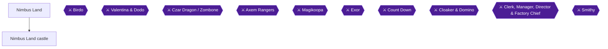

This chapter covers the whole of Nimbus Land: the town (item shop, Inn, Garro's house), the pink castle room by room, the Birdo and Valentina & Dodo fights, the optional Nimbus Inn nightmare, and the Booster Tower balcony scene that unlocks only after Valentina falls. It also holds hidden treasure boxes #34 to #38, all Frog Coins [[gf1-81-1, gf1-18-15, gf1-18-16, gf1-18-17, gf1-18-18, gf1-18-19]].

Five achievements are placed here: **Monster!!!** (147255, 2 pts), **Polishing Pecks** (147267, 5 pts, missable), **Play with Birdo** (5862, 5 pts), **Correcting Nimbus Land** (5863, 5 pts) and **Where's My Valentina?** (372507, 2 pts).

> [!WARNING]
> **Missable Achievement Warning (Polishing Pecks, 147267):** The Feather is handed out only during the statue sequence at the start of the castle. Save in the room before the door first [[gf1-81-22]]. If Dodo pecks you too many times you fight him instead of getting the Feather [[gf1-81-25, gf1-81-26]]. If you jump early and Dodo sees you, he leaves the room to talk to Valentine and you have to restart [[ra-comments-86-2]]. Read the full instructions in the "Dodo's Pecking Game" section before opening that door.

### Chapter Items to Collect

| Item | Where Found | Action / Requirement | Citation |
|---|---|---|---|
| Feather (accessory that raises speed) | Statue room, castle entrance | Dodge Dodo's pecks without being caught | [[gf1-81-26, gf3-43-21]] |
| Flower Jar | Room of people after the first Jawful | **TALK** to one of them | [[gf1-81-33]] |
| Castle Key #1 | Same room | **TALK** to another person | [[gf1-81-34]] |
| Castle Key #2 | Birdo | Win the boss fight | [[gf1-82-12, gf2-21-5]] |
| Super Star | Treasure box in the Bluebird rooms | Jump on the hidden platform below the box first | [[gf1-83-8]] |
| Red Essence | Toad, after the Inn nightmare | Dream Cushion, random dream | [[gf2-46-4]] |
| Flower Jar (second) | Room where the King and Queen were trapped | **TALK** to the guy who gave you Castle Key #1 after Valentina | [[gf1-85-4]] |
| Signal Ring | Far right house, Croco | **TALK** to Croco after Valentina | [[gf1-85-5, gf2-21-15]] |
| Fertilizer | Shy Away off the edge of town | Hug the eastern wall after Valentina | [[checklist-secrets-25-3, gf3-46-15, gf3-46-16]] |
| Hidden boxes #34-#38 | See the hidden box table below | 5 Frog Coins | [[gf1-18-15, gf1-18-16, gf1-18-17, gf1-18-18, gf1-18-19]] |

---

## Nimbus Land (Town)

🗺️ **Town Map:** [View Nimbus Land Map (VGMaps)](https://vgmaps.com/Atlas/SuperNES/SuperMarioRPG-LegendOfTheSevenStars-NimbusLand-NimbusLand.png) | [View Nimbus Land (Valentina) Map (VGMaps)](https://vgmaps.com/Atlas/SuperNES/SuperMarioRPG-LegendOfTheSevenStars-NimbusLand-NimbusLand(Valentina).png) [[map-vg-nimbus-land-1-1, map-vg-nimbus-land-valentina-1-1]]

### Arrival

On the way up, two guards refuse to let you into the next area because you are not royalty [[gf3-43-9]]. In the city, Mallow comes out and is revealed as the lost prince [[gf3-43-10]]. A presentation then plays in which Queen Valentina introduces Prince "Mallow" and mentions that the Prince wants Valentina to be his queen [[gf1-81-16]]. The entrance to the pink palace is blocked by a pair of grumpy guards, so you need another way in [[gf3-43-14]].

### Item Shop

After the presentation, go into the item shop and update your weapons and armor [[gf1-81-17]]. The shop sells very expensive gear and the guide says to buy it for everyone [[gf3-43-11]]. Prices from the main guide [[gf1-81-3, gf1-81-4, gf1-81-5, gf1-81-6, gf1-81-7, gf1-81-8, gf1-81-9, gf1-81-10, gf1-81-11, gf1-81-12, gf1-81-13, gf1-81-14, gf1-81-15]]:

| Item | Price |
|---|---|
| Mid Mushroom | 20 coins [[gf1-81-3]] |
| Maple Syrup | 30 coins [[gf1-81-4]] |
| Pick Me Up | 5 coins [[gf1-81-5]] |
| Able Juice | 4 coins [[gf1-81-6]] |
| Freshen Up | 50 coins [[gf1-81-7]] |
| Mega Glove | 102 coins [[gf1-81-8]] |
| War Fan | 100 coins [[gf1-81-9]] |
| Hand Cannon | 105 coins [[gf1-81-10]] |
| Sticky Glove | 98 coins [[gf1-81-11]] |
| Fuzzy Shirt | 70 coins [[gf1-81-12]] |
| Fuzzy Pants | 70 coins [[gf1-81-13]] |
| Fuzzy Cape | 70 coins [[gf1-81-14]] |
| Fuzzy Shell | 70 coins [[gf1-81-15]] (a second guide lists this fourth 70-coin piece as Fuzzy Dress [[gf2-34-21]]) |

**Hidden box #34 (Frog Coin):** inside the item shop, jump onto the highest point of the crates in the back, then jump toward the shopkeeper [[gf1-18-15, checklist-secrets-14-1, checklist-chests-3-4]]. A third guide says to get on the shelf behind the cashier so the camera shifts, then jump toward the salesman [[gf3-68-6]].

### Nimbus Inn and the "Monster!!!" Nightmare

The Inn costs 30 coins, or 60 coins with the "Dream Cushion" [[gf1-81-2]]. The Dream Cushion is a special cushion at the Inn that lets you have dreams [[gf3-43-12]], and costs double the price of a regular room [[gf3-43-13]]. The Inn is also where you save before heading to Garro's house [[gf1-81-18]].


> [!ACHIEVEMENT]
> **Monster!!! (2 Points)**
> 
> *Have a nightmare at the Nimbus Inn and receive some drinks to blow the bad guys away*


Rest at the Nimbus Inn with the Dream Cushion repeatedly. The dream is random: after a few rests, Mario dreams that Toad turned into a monster [[gf2-46-3]]. Keep resting until you get the dream where Toad transforms into a ghost [[ra-comments-85-2]]. The scene is optional and random, so save first and keep trying until it appears [[ra-comments-85-1]]. After the dream, Toad gives Mario a Red Essence to make him feel better [[gf2-46-4]].

> [!NOTE]
> The guy sleeping in the Nimbusland Inn is the only in-game way to learn about the Golden Chomp secret [[gf3-55-7]]. Details of that secret are not covered by this chapter's sources: Unable to verify from collected sources.

### Garro's House (Getting Into the Castle)

1. **SAVE** your game in the Inn first [[gf1-81-18]].
2. **ENTER** Garro's house, which is to the left of the palace [[gf3-43-15, gf1-81-19]].
3. **INSPECT** the statue that looks like Mallow. Mallow says it looks like him [[gf1-81-19]]; the statue turns out to be a sculpture of the king as a child, which reveals Mallow as the lost prince [[gf3-43-16]].
4. **TALK** to Garro. He makes Mario look like a statue so you can enter the castle [[gf2-20-20]], covering Mario in gold [[gf3-43-17]]. Garro comes up with the plan to sneak Mario in [[gf1-81-20]].

---

## Nimbus Land Castle

🗺️ **Castle Map:** [View Nimbus Land Castle Map by StarFighters76](https://gamefaqs.gamespot.com/snes/588739-super-mario-rpg-legend-of-the-seven-stars/map/2085-nimbus-land-castle-map) [[map-nimbus-castle-1-1]]

### Room 1: Statue Room (Dodo's Pecking Game)

Valentine sets the golden statue up in her statue room [[gf3-43-18]]. Dodo then puts Mario on a pedestal [[gf2-20-21]].

> [!WARNING]
> **Missable Achievement Warning:** Polishing Pecks (147267) must be done right here. Go into the previous room and save your game before trying the door [[gf1-81-22]]. Valentina mentions that Dodo needs to polish the statues; instead he takes out his frustration by pecking each statue [[gf1-81-23]]. When Dodo tries to peck you, you must jump [[gf1-81-23, gf2-20-22]]. He tries many sneaky ways to catch you off guard [[gf1-81-24]].
>
> - Jump to the rhythm of the music [[ra-comments-86-1]].
> - Do NOT jump early. If you jump early and Dodo sees you, he leaves the room and talks to Valentine, and you have to restart (reload your save) [[ra-comments-86-2]].
> - If you get pecked too many times you will fight Dodo instead; use regular attacks [[gf1-81-25]]. If a mistake frightens him you are forced to fight him [[gf3-43-20]], and the Feather is not given in that case [[gf1-81-26]].
> - When Dodo goes back to Valentina after pecking you a few times she says "Give it a good peck". The author flags this as a bug [[gf1-81-27]].

If you do not get pecked, Dodo leaves and you find a Feather on the ground, an accessory that increases your speed [[gf3-43-21, gf2-20-22]]. Take it in the next room [[gf2-20-22]].


> [!ACHIEVEMENT]
> **Polishing Pecks (5 Points)**
> 
> *Don't let Dodo notice you and obtain the Feather*


If you survive, save your game, then explore the rest of the castle [[gf1-81-28]]. The room after the Feather has some Birdos pecking at Mario [[gf2-20-23]].

### Rooms 2 and onward: The Pinwheel Hallways

Be sure to save at the Block along the way [[gf3-44-1]]. Fans (pinwheels) blow across these rooms. If you talked to the Pinwheel in Monstro Town, you could set how fast they blow in Nimbus Land; set it low so you can get by, and if you set it high you must find alternate routes [[gf1-81-29, gf1-81-30]]. The speed depends on the fan at Monstermama's house, and the lowest setting is easiest [[gf3-44-2, gf3-44-3]].

### The Hallway With Three Doors

Go through the castle until you reach the room with three doors [[gf2-20-24]]. The middle door is locked [[gf3-44-4]] and you need a key to continue [[gf1-81-31]]. The key is through the left-hand door [[gf3-44-5]].

**Hidden box #35 (Frog Coin).** The Secrets Guide places it in this hallway: in the upper-left area, jump next to the birdcage. Before Valentina is defeated, the center door leads to Birdo and is guarded by a Fat Paratroopa [[checklist-secrets-14-2]]. Another guide says the upper-right corner next to the bird [[checklist-chests-3-6]]. The main guide describes it differently: take the left door, work your way to the Jawful, defeat it, and the box is right above where you found it [[gf1-18-16]]. A third guide says the box holds a Flower Tab instead and sits in the upper-left corner of this hall [[gf3-68-7, gf3-68-8]].

#### Left door: the Jawful and the people

1. **ENTER** the left door, then go through the next two rooms to the Jawful [[gf1-81-32]].
2. **DEFEAT** the Jawful and go into the next room [[gf1-81-1, gf1-81-32]].
3. **TALK** to the people in this room of misanthropes. One gives you a **Flower Jar** [[gf1-81-33, gf3-44-6]]. Another, a fired guard, has the key you need and gives you **Castle Key #1** [[gf1-81-34, gf3-44-7]].
4. **Hidden box #36 (Frog Coin).** The main guide says that in the same room as #35, walk directly left out into space and it sits at the end of the path [[gf1-18-17]]. The Secrets Guide says instead: in the room after Birdo, jump on top of the visible chest on the right [[checklist-secrets-14-3]]. A third guide says to jump near the entrance to the room where you got the key [[gf3-68-10]].

### The Middle Door and Birdo

1. **RETURN** to the three-door hallway. **DEFEAT** the Heavy Troopa blocking the middle door [[gf1-81-35, gf2-20-26]], then use the key to go in [[gf1-81-35]].
2. Inside is a giant pink polka-dotted egg in the center of a nest [[gf3-44-8]]. Shy Away is watering the egg and then tries to run away [[gf1-81-36]]. He is trapped because he lost the key [[gf3-44-9]].
3. **TALK** to the egg. In the nest, press A near the little hole and say yes when asked if you want to play [[gf3-44-10, gf1-82-1, gf2-20-27]].

#### Boss: Birdo (with Shelly and Eggbert)

| Stat | Detail |
|---|---|
| HP | Listed as 500 (Shelly) / 777 (Birdo) / 10 (Eggbert) [[gf1-82-2]]. Other guides give Birdo 777 [[gf2-21-1, gf3-45-1]]; the third guide lists the shell as Eggy at 800 HP and Eggbert at 10 HP [[gf3-45-2, gf3-45-3]] |
| Defended against | Birdo: Fire, Fear, Poison, Sleep, Silence [[gf1-82-3]]. Shelly: Fear, Poison, Sleep, Silence [[gf1-82-4]]. Eggbert: Fear, Poison, Sleep, Silence [[gf1-82-5]] |
| Weaknesses | None listed [[gf1-82-6]] |
| Rewards | 20 EXP, 30 coins, no items [[gf2-21-4]]; Castle Key #2 [[gf3-45-7]] |

Strategy:
1. First, destroy the shell. It will not attack you [[gf1-82-7]]. Keep attacking Shelly until Birdo pops out, then use regular attacks on Birdo [[gf2-21-2]].
2. Birdo shoots either three eggs or one more powerful egg [[gf1-82-8]]. When she fires eggs, have Toadstool heal [[gf2-21-3]].
3. Optional trick for a faster win: go into defense mode. If Birdo shoots one egg while you defend, it bounces off and lands on Birdo's nest [[gf1-82-9, gf3-45-5]]. Wait until four eggs have appeared on the nest, then use a Geno Blast or Flash to damage Birdo and blow up the eggs; each egg does 80 HP damage to Birdo [[gf1-82-10, gf1-82-11]]. Attacking the egg directly also does 80 damage but regular attacks probably do more [[gf3-45-6]].


> [!ACHIEVEMENT]
> **Play with Birdo (5 Points)**
> 
> *Defeat Birdo, the newborn of the castle*


Birdo is part of the main story [[ra-comments-87-1]]. After winning you get another Castle Key [[gf2-21-5, gf1-82-12]].

### Room after Birdo: Jawful and Locked Door

With the key, open the door and make your way through the next area, watching out for the fan [[gf3-45-8]].

1. **ENTER** the next room, **DEFEAT** the Jawful and enter the following room [[gf1-83-1]].
2. **Hidden box #37 (Frog Coin), main guide version:** in the room with the Jawful after Birdo, jump on top of the visible box; the hidden box is right above it [[gf1-18-18]]. A third guide agrees on a visible chest in a lower area after the egg room: jump down to it, then jump again while standing on top of it [[gf3-69-4]]. The Secrets Guide gives #36 for this same visible chest on the right [[checklist-secrets-14-3]]; the Frog Coin is the result either way.
3. **TRY** the door with the note next to it. It is locked, so Bowser volunteers to knock it down [[gf1-83-2]]. Mallow prevents him, since his parents might really be sick [[gf1-83-3]]. Shy Away then comes in and goes on to warn Valentina [[gf1-83-4]]. Bowser attempts to help but ends up tripped by Mallow [[gf3-45-9]].
4. **FOLLOW** Shy Away. **DEFEAT** the Heavy Troopa and enter the throne room [[gf1-83-5]]. Valentina gets mad because the real prince is back [[gf1-83-6]].

**Hidden boxes #37 and #38 (Secrets Guide version, Frog Coins).** Outside the Save Block room where the prisoners are held (before Valentina is defeated), hug the right wall near the exit and jump for #37 [[checklist-secrets-14-4]]. Another guide says: right outside the small room, move along the wall two steps from the entrance and jump [[checklist-chests-3-10]]. For #38, in the same area, hug the lower wall until you walk out of bounds, then follow the path to the end and jump [[checklist-secrets-14-5]]. A third guide says to start at the base of the stairs, move along the wall to the left, and if you found a secret entrance follow the path to the end and jump [[checklist-chests-3-12]]. The main guide instead puts #38 after Valentina: in the three-door hallway, to the right of the birdcage next to the left door [[gf1-18-19]].

### The Chase and the Bluebird Rooms

You chase Valentina through the hallways [[gf3-45-10]]. The next couple of rooms are littered with Bluebirds [[gf1-83-7]].

1. **MAKE** your way to the treasure box. **JUMP** below the box to find a platform, then jump on that platform to reach the box, which contains a **Super Star** [[gf1-83-8]].
2. Grab the Super Star to gain lots of EXP [[gf3-45-11]]. Use it to take out Dodo in the next room [[gf1-83-9]]. If you cannot use it, the battle is just like the previous one [[gf1-83-10]].
3. After busting past Dodo, run outside and you will fall down, like after the Rare Scarf [[gf1-83-11]].

> [!CAUTION]
> **Before the Valentina fight:** Get the party you want (Mario, Geno, and Toadstool) and re-enter Nimbus Land [[gf1-83-12]]. The fight starts automatically because Mario wants to help Mallow save his parents [[gf1-83-13]]. Valentina fights you in the middle of the town [[gf3-45-12]].

### Boss: Valentina & Dodo

| Stat | Detail |
|---|---|
| HP | Valentina 2000 [[gf1-84-1, gf2-21-7, gf3-46-1]]. Dodo 1000 [[gf2-21-7, gf3-46-2]] (the main guide lists 800 [[gf1-84-1]]) |
| Defended against | Valentina: Ice, Fear, Poison, Sleep, Silence [[gf1-84-2]]. Dodo: Sleep, Silence [[gf1-84-3]] |
| Weaknesses | Dodo: Fire [[gf1-84-4]]. Valentina: none listed [[gf1-84-5]] |
| Rewards | 54 EXP, 200 coins, no items [[gf2-21-11]]; a key [[gf3-46-8]] |

The battle has three parts [[gf1-84-6]].

1. **Part 1, Dodo takes your middle character.** Dodo flies your middle character away to fight alone, so put someone strong there such as Geno [[gf3-46-3]]; the main guide suggests Geno or Bowser [[gf1-84-7]]. If that character dies, the game is over [[gf3-46-4]]. Defend often, because Multistrike can do heavy damage [[gf2-21-9]]. Dodo uses Multistrike or Flutter Hush [[gf1-84-8]], so use a timed Geno Boost or a Red Essence, and a Fire Bomb if you have one [[gf1-84-9]]. After you knock Dodo down to size he flies away and your character follows [[gf1-84-10]].
2. **Part 2, Mario and Toadstool vs Valentina.** Keep hitting her with regular attacks until Dodo and your middle character come back [[gf1-84-11]]. When Dodo is defeated the fight shifts back to Valentina and your two characters; Dodo returns after a bit [[gf3-46-5]].
3. **Part 3, everyone together.** You can kill Dodo but should ignore him and keep pounding Valentina with regular attacks [[gf1-84-12]]. You do not have to defeat Dodo the second time [[gf3-46-6]]. Beware of Valentina's attacks such as Diamond Saw, Solidify, Blizzard and Drain Beam, which take a lot of HP off [[gf1-84-13]]. Another guide notes you can concentrate on one of the two, and once that one's HP is gone the battle is over [[gf2-21-10]]. Valentina has multiple attacks to watch out for [[gf3-46-7]].


> [!ACHIEVEMENT]
> **Correcting Nimbus Land (5 Points)**
> 
> *Defeat Valentina, the "Queen" of Nimbus Land*


Defeating Valentina is part of the story [[ra-comments-88-1]]. Dodo whisks Valentina away and a key falls down and hits Mallow on the head [[gf3-46-9]]. Mallow can now see his parents [[gf2-21-12]].

---

## After Valentina: Cleaning Up Nimbus Land

🗺️ **Map:** [View Nimbus Land (Valentina) Map (VGMaps)](https://vgmaps.com/Atlas/SuperNES/SuperMarioRPG-LegendOfTheSevenStars-NimbusLand-NimbusLand(Valentina).png) [[map-vg-nimbus-land-valentina-1-1]]

1. **TALK** to the Nimbuses inside. King Nimbus asks for everyone's autograph, which you can ignore [[gf1-85-2]]. They mention that a Star Piece fell into the nearby Barrel Volcano [[gf1-85-3, gf3-46-10]].
2. **GO** to the room where the King and Queen were trapped (shortly before the main chamber) and talk to the guy who gave you Castle Key #1. He gives you another **Flower Jar** [[gf1-85-4, gf3-46-11, gf3-46-12]]. The room where you could not get in before also holds a guard who gives a Flower Jar [[gf2-21-13]].
3. **EXIT** the castle. **ENTER** the far right house and talk to Croco; he runs away and drops a **Signal Ring** [[gf1-85-5, gf3-46-13]]. Equipped, the ring rings when you are in the area of a hidden treasure box [[gf2-21-16, gf3-46-14]].
4. **FERTILIZER:** walk outside and hug the wall along the eastern (right-hand) side of town until you walk out into thin air. The Shy Away is there and gives you the Fertilizer for letting him live [[checklist-secrets-25-3, checklist-secrets-23-4, gf3-46-15, gf3-46-16]]. The main guide says to follow the exterior of the town until you find an invisible passageway and talk to the Shy Away there [[gf1-85-6, gf1-85-7]]. Afterward go back down the hole you entered from and leave by the right springboard [[gf1-85-8]]. The Lazy Shell weapon and armor are covered in the Secrets section [[gf2-21-14]]; this chapter does not cover them further: Unable to verify from collected sources.
5. **Hidden box #38** (main guide version): back in the three-door hallway, go to the right of the birdcage next to the left door [[gf1-18-19]].
6. Since Mallow is now the true prince, the guards let you go back to the hot springs, which restore all HP and FP [[gf3-46-24, gf3-46-25]]. You reach the Barrel Volcano next, covered in Chapter 17 [[gf3-46-26]].

### Hidden Treasure Boxes in This Chapter (#34 to #38)

The numbering follows the main guide and the Secrets Guide, which agree on contents (all Frog Coins); location wording differs, so both are listed [[gf1-81-1, checklist-secrets-14-1, checklist-secrets-14-2, checklist-secrets-14-3, checklist-secrets-14-4, checklist-secrets-14-5]].

| Box | Content | Secrets Guide location | Main guide location |
|---|---|---|---|
| #34 | Frog Coin | Item Shop: jump on top of the boxes, then toward the shopkeeper [[checklist-secrets-14-1]] | Highest point of the crates, jump toward the shopkeeper [[gf1-18-15]] |
| #35 | Frog Coin | Three-door room, upper-left area, jump next to the birdcage [[checklist-secrets-14-2]] | Left door, defeat the Jawful, box is above where you found it [[gf1-18-16]] |
| #36 | Frog Coin | Room after Birdo: jump on top of the visible chest on the right [[checklist-secrets-14-3]] | Same room as #35, walk left into space and follow the path [[gf1-18-17]] |
| #37 | Frog Coin | Outside the prisoners' Save Block room, hug the right wall near the exit and jump [[checklist-secrets-14-4]] | After Birdo, in the next Jawful room, jump on top of the visible box [[gf1-18-18]] |
| #38 | Frog Coin | Same area as #37, hug the lower wall out of bounds, follow the path to the end and jump [[checklist-secrets-14-5]] | After Valentina, right of the birdcage next to the left door [[gf1-18-19]] |

Visible chests in the chapter: the Super Star chest in the Bluebird rooms [[gf1-83-8]]. Other visible chest contents: Unable to verify from collected sources.

---

## Booster Tower Balcony Scene

🗺️ **Map:** [View Booster's Tower Map](https://gamefaqs.gamespot.com/snes/588739-super-mario-rpg-legend-of-the-seven-stars/map/2054-boosters-tower-map)

> [!NOTE]
> This scene only exists after Valentina has been defeated [[gf2-45-14, ra-comments-89-1]]. The sources do not describe the route to Booster Tower from Nimbus Land: Unable to verify from collected sources.

1. **AFTER** defeating Valentina, go to Booster Tower. You can find her on the balcony with Booster [[gf2-45-14]].
2. **MAKE** it to the top of Booster Tower and watch the cutscene [[ra-comments-89-1]].


> [!ACHIEVEMENT]
> **Where's My Valentina? (2 Points)**
> 
> *Spy on Valentina and Booster atop Booster's Tower*


---

### Chapter 16 Chest and Box Summary

| Location | Item | Citation |
|---|---|---|
| Item shop (#34) | Frog Coin | [[gf1-18-15]] |
| Three-door hallway (#35) | Frog Coin | [[gf1-18-16, checklist-secrets-14-2]] |
| Castle (#36) | Frog Coin | [[gf1-18-17, checklist-secrets-14-3]] |
| Castle (#37) | Frog Coin | [[gf1-18-18, checklist-secrets-14-4]] |
| Castle (#38) | Frog Coin | [[gf1-18-19, checklist-secrets-14-5]] |
| Bluebird room chest | Super Star | [[gf1-83-8]] |

> [!IMPORTANT]
> ### Chapter 16 Cumulative 100% Checkpoint
> - **Hidden Treasure Boxes (#1-#39):** 38 / 39 (this chapter: #34-#38, Nimbus Land) [[gf1-18-15, gf1-81-1]]. Only #39 remains, and it is in Chapter 20.
> - **Items from NPCs:** Flower Jars x2, Castle Keys #1 and #2, Signal Ring, Fertilizer [[gf1-81-33, gf1-85-4, gf1-85-5, checklist-secrets-25-3]]
> - **Feather:** obtained only if Dodo's pecking game is passed [[gf1-81-26]]
> - **Optional Achievements this chapter:** Monster!!! (147255), Polishing Pecks (147267), Where's My Valentina? (372507); Play with Birdo and Correcting Nimbus Land are story progression achievements [[ra-comments-87-1, ra-comments-88-1]]
> - **RetroAchievements Unlocked:** 74 / 99 (373 / 779 points), counting this chapter's 5 achievements (19 points)

### Chapter Checklist

- [ ] Item shop visited and gear updated (Nimbus Inn visited too)
- [ ] Hidden box #34 (Frog Coin) taken
- [ ] Nightmare dream obtained with the Dream Cushion (Monster!!! 147255)
- [ ] Saved before Dodo's pecking game, Feather obtained without being caught (Polishing Pecks 147267)
- [ ] Hidden boxes #35, #36, #37 (Frog Coins) taken
- [ ] Flower Jar and Castle Key #1 from the people behind the left door
- [ ] Birdo defeated (Play with Birdo 5862); Castle Key #2 taken
- [ ] Super Star taken from the Bluebird room chest
- [ ] Party set (Mario, Geno, Toadstool) and Valentina defeated (Correcting Nimbus Land 5863)
- [ ] Hidden box #38 (Frog Coin) taken
- [ ] Second Flower Jar from the Castle Key #1 guy; Signal Ring from Croco; Fertilizer from Shy Away
- [ ] Booster Tower top-floor scene watched (Where's My Valentina? 372507)

---

## Chapter 17: Barrel Volcano

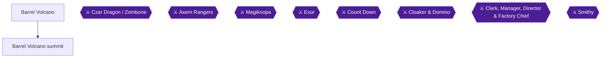

### Area Overview and Preparation

You enter the volcano from Nimbus Land (the collected facts do not cover the exact route from the castle to the volcano entrance; Unable to verify from collected sources). This chapter covers the volcano rooms, the Hino Mart, the Czar Dragon / Zombone boss fight (achievement 5864), and the chase to the summit and the Axem Rangers fight (achievement 5824).

Preparation checklist:

- **Party:** Mario, Mallow and Toadstool are the party the guide calls "definite" for the Czar Dragon [[gf1-88-7]] and the one it recommends again for the Axem Rangers [[gf1-89-18]]. Mallow is the key member because most enemies here are weak to snow [[gf2-21-19]], and Snowy is rated very useful in the volcano [[gf1-13-16]].
- **Level:** One guide suggests building to about level 23 before the dragon [[gf2-21-21]].
- **Element:** Because this is a volcano, use Ice attacks on everyone (Snowy or Ice Bomb); Geno's attacks also work well [[gf1-87-13]].
- **Flowers:** The area has a good number of Flowers, so do not skip the side rooms [[gf2-21-18]].
- **Equipment:** Bring Wake Up Pins for the dragon [[gf1-88-8]] and buy Fire clothes at the Hino Mart [[gf3-47-1]].

> [!WARNING]
> **Save after the dragon:** A commenter warns to save after defeating the Czar Dragon, because if you lose to the Axem Rangers you have to fight the dragon again [[ra-comments-91-2]].

### Barrel Volcano (rooms 1 to 14 and the Hino Mart)

🗺️ **Dungeon Map:** [View the Barrel Volcano Map by StarFighters76 (GameFAQs)](https://gamefaqs.gamespot.com/snes/588739-super-mario-rpg-legend-of-the-seven-stars/map/2086-barrel-volcano-map) [[map-barrel-volcano-1-1]]

🗺️ **Alternate Map:** [View the Barrel Volcano Map (VGMaps)](https://vgmaps.com/Atlas/SuperNES/SuperMarioRPG-LegendOfTheSevenStars-NimbusLand-BarrelVolcano.png) [[map-vg-barrel-volcano-1-1]]

The guide counts the volcano in numbered rooms, and this walkthrough follows that numbering. The room numbers after the 12th are not given by the source, so the later rooms are described relative to the Hino Mart and the Save Blocks instead.

#### Enemies in the first rooms

In the first few rooms you will battle Magmuses, Armored Ants, Vomers, and maybe Chained Kongs [[gf1-87-14]]. Vomers are relatives of Dry Bones, so physical attacks will not do the job; use a magic attack such as Thunderbolt for a quick victory [[gf1-87-15]].

#### Room 2: hidden room with two Flowers

In the second room you will see small platforms in the lava. Jump across them to the passage on the other side of the lava [[gf1-87-17]]. Go in and hit the treasure boxes to get the Flowers [[gf1-87-16]]. This is the hidden room with two Flowers [[gf1-87-16]].

#### Room 6: Corkpedite

In the 6th room you will most likely battle a Corkpedite [[gf1-87-18]]. Take out the body first, because if the body is left alone it will probably use an instant-death attack [[gf1-87-19]]. A second guide agrees that you should go for the body first, and adds that the body kills itself without giving Exp while the head kills itself but you do get Exp [[gf3-46-29]].

#### Room 8: Frog Coin in the lava (Frog Coin 1)

In the 8th room you will see a Frog Coin in the lava. Just jump to it [[gf1-87-20]].

#### Room 9: Frog Coin above the path (Frog Coin 2)

In the 9th room you will see a Frog Coin above the path to the 10th room [[gf1-87-21]]. To reach it, go into the 10th room, then come back to the 9th, then jump onto the lava and you will be thrown onto the ledge with the coin [[gf1-87-22]].

A second guide describes a Frog Coin "on the rock above" and gives the same method: exit, come back in, and jump in the lava to be rocketed up to it [[gf3-46-28]]. That guide does not say which room it is in, so it is probably the same coin as this one, but the sources do not confirm it. Unable to verify from collected sources.

#### Room 10: two Frog Coins (Frog Coins 3 and 4)

The 10th room has two Frog Coins. Jump up the donut ledges to get each one [[gf1-87-23]].

#### Room 11 and Room 12: the first Save Block and the Stumpet

In the 11th room you will see a Stumpet on the 2nd floor [[gf1-87-24]]. To get up there you must go into the 12th room, the one with the first Save Block, then go up and through the passage [[gf1-87-25]]. The 12th room has the first Save Block [[gf1-87-26]]. Use Snowy and/or regular attacks on the Stumpet [[gf1-87-27]].

#### Rooms after 12

Two rooms from the first Stumpet you will come across another Corkpedite [[gf1-87-28]]. In the next room you will come across another Stumpet; take care of it the same way as before [[gf1-87-29]]. Then go into the next room and up the steps to reach the Hino Mart [[gf1-87-30]].

#### Hino Mart (Hinopio's shop)

The guide suggests updating your armor, buying some items, and taking a snooze here [[gf1-87-31]]. Another guide says to buy fire clothes for your party, rest up, and buy any items you need [[gf3-47-1]].

| Counter | Item | Price | Citation |
|---|---|---|---|
| Item shop (left counter) | Mid Mushroom | 20 coins | [[gf1-87-1, gf1-87-2]] |
| Item shop (left counter) | Maple Syrup | 30 coins | [[gf1-87-3]] |
| Item shop (left counter) | Pick Me Up | 5 coins | [[gf1-87-4]] |
| Item shop (left counter) | Able Juice | 4 coins | [[gf1-87-5]] |
| Item shop (left counter) | Freshen Up | 50 coins | [[gf1-87-6]] |
| Inn (middle counter) | Rest | 30 coins | [[gf1-87-7]] |
| Armor shop | Fire Shirt | 90 coins | [[gf1-87-8]] |
| Armor shop | Fire Pants | 90 coins | [[gf1-87-9]] |
| Armor shop | Fire Cape | 90 coins | [[gf1-87-10]] |
| Armor shop | Fire Shell | 90 coins | [[gf1-87-11]] |
| Armor shop | Fire Dress | 90 coins | [[gf1-87-12]] |

A second guide lists the same stock under "Hinopio's Shop" with the same prices, for example Mid Mushroom 20, Maple Syrup 30, and each Fire armor piece 90 [[gf2-35-1, gf2-35-2, gf2-35-6]].

> [!NOTE]
> **Cameo:** In Hinopio's Place, right before the Czar Dragon, look at the shelf at the back of the room. You can see Captain Falcon and Samurai Goroh's F-Zero craft and the Arwing [[checklist-secrets-29-1]].

#### The Save Block and the lava bridge

Go into the next room after the Hino Mart and save your game [[gf1-87-32]]. Then go to the room after that. You need to be quick and careful to cross the bridge over the lava [[gf1-87-33]]. A second guide describes it as a donut bridge: avoid the fireballs, and jump a lot to keep the donuts floating [[gf3-47-2, gf3-47-3]]. If you make it to the other side, go into the next room to battle the Czar Dragon [[gf1-88-1]].

### Chests and Hidden Treasure Boxes in this Area

One guide only says that Barrel Volcano is straightforward and has many chests containing coins, flowers and even Super Stars [[gf3-46-27]]. The collected sources do not give the exact location or contents of each of those chests beyond the two Flowers in the room 2 hidden room [[gf1-87-16]] and the four Frog Coins above. Unable to verify from collected sources.

| Item | Where | Citation |
|---|---|---|
| 2 Flowers (two treasure boxes) | Room 2, hidden room across the lava platforms | [[gf1-87-16, gf1-87-17]] |
| Frog Coin | Room 8, in the lava | [[gf1-87-20]] |
| Frog Coin | Room 9, on the ledge above the path to room 10 | [[gf1-87-21, gf1-87-22]] |
| 2 Frog Coins | Room 10, on the donut ledges | [[gf1-87-23]] |
| Other chests (coins, flowers, Super Stars) | Unable to verify from collected sources | [[gf3-46-27]] |

Hidden treasure boxes (numbered #1 to #39 in the Guide and Walkthrough and Secrets Guide): the section on Barrel Volcano in the collected sources lists no numbered hidden boxes. Unable to verify from collected sources.

### Boss: Czar Dragon / Zombone


> [!ACHIEVEMENT]
> **Bring a Fire Extinguisher (5 Points)**
> 
> *Defeat Czar Dragon, the keeper of the volcano*


Defeat Czar Dragon to unlock this achievement. The fight has two stages: the Czar Dragon, then his "skeleton", Zombone [[gf1-88-12]]. After the dragon is destroyed his body falls into the molten lava and Zombone comes out [[gf3-47-7]].

| | Czar Dragon | Zombone |
|---|---|---|
| HP | 1,400 [[gf3-47-4]] | 1,800 [[gf3-47-5]] |
| Defended against | Fire, Sleep [[gf1-88-3]] | Fire, Ice, Fear, Poison, Sleep [[gf1-88-4]] |
| Weak to | Ice [[gf1-88-5]] | Jump, Thunder [[gf1-88-6]] |

The fight gives 50 EXP, 0 coins and no items [[gf2-21-26]].

**Party and prep:** Use Mario, Mallow and Toadstool [[gf1-88-7]]. Be equipped with Wake Up Pins, because he may put you to sleep [[gf1-88-8]]. He may also use Fear attacks, so have Toadstool heal often [[gf1-88-9]].

**Czar Dragon stage:**

1. Czar Dragon has basic fire attacks [[gf3-47-6]].
2. Once in a while he calls out four little fireballs. Use an attack like Thunderbolt or Snowy to get rid of them [[gf1-88-10]]. A second guide calls these four summoned enemies Heilos and says to have at least two characters each defeat one [[gf2-21-24]].
3. Use Snowy when you can, since he is weak to snow; Mario uses regular attacks and Toadstool heals [[gf2-21-23]].
4. Use regular attacks or Ice Bombs until he goes away [[gf1-88-11]].

**Zombone stage:**

1. Zombone has Storm and Blast, which are two very potent attacks [[gf1-88-13]].
2. He also uses Boulder, which harms your whole party [[gf1-88-14]]. One guide says Boulder does about 60 damage to everyone [[gf3-47-8]].
3. Use regular attacks, Thunderbolt/Shocker (he is weak to Thunder), and Pure Water if you have any [[gf1-88-15, gf1-88-6]]. Another guide agrees on using Pure Water now [[gf2-21-25]], and notes he is allergic to water [[gf3-47-9]].

> [!IMPORTANT]
> **Save now.** If you lose to the Axem Rangers you must fight the dragon again [[ra-comments-91-2]].

### Barrel Volcano Summit: the Axem Rangers

🗺️ **Dungeon Map:** [View the Barrel Volcano Map by StarFighters76 (GameFAQs)](https://gamefaqs.gamespot.com/snes/588739-super-mario-rpg-legend-of-the-seven-stars/map/2086-barrel-volcano-map) [[map-barrel-volcano-1-1]]. The collected sources do not provide a separate summit map. Unable to verify from collected sources.

#### Getting to the summit

1. After beating the dragon, cross the lava and enter the next room, where you see the sixth Star Piece [[gf1-89-1]].
2. The Star Piece is swiped away by the Axem Rangers [[gf1-89-2]]. A second guide describes a punk in red taking it just as Mario is about to touch it, and says you chase them out of the volcano [[gf3-48-2]].
3. When they finish introducing themselves, go to the next room. When they finish talking again, you must chase them to the top of the volcano [[gf1-89-3]].
4. When you reach the top, jump on the springboard to be on the top of the volcano [[gf1-89-3]].
5. When Blade appears, the Axem Rangers jump on, and so does Mario, which means battle time [[gf1-89-4]]. Blade is described as a titanic ship that looks like a flying axe [[gf3-48-3]].

#### Boss: Axem Rangers


> [!ACHIEVEMENT]
> **Ranger Combat (10 Points)**
> 
> *Collect the Red Star Piece*


Collect the Red Star Piece by winning this fight [[gf3-49-1]]. After beating them you get the sixth Star Piece [[gf2-22-8]].

| Member | HP | Defended against | Weak to |
|---|---|---|---|
| Axem Pink | 400 [[gf3-48-9]] | Ice, Sleep, Silence [[gf1-89-6]] | Fire [[gf1-89-12]] |
| Axem Black | 550 [[gf3-48-6]] | Fear, Sleep [[gf1-89-7]] | Thunder [[gf1-89-13]] |
| Axem Red | 800 [[gf3-48-5]] | Fire, Fear, Sleep [[gf1-89-8]] | Ice [[gf1-89-14]] |
| Axem Yellow | 600 [[gf3-48-7]] | Thunder, Poison, Sleep [[gf1-89-9]] | Jump [[gf1-89-15]] |
| Axem Green | 450 [[gf3-48-8]] | Sleep, Silence [[gf1-89-10]] | Ice [[gf1-89-16]] |
| Axem Rangers (combined device) | 999 [[gf3-48-4]] | Fear, Poison, Sleep, Silence [[gf1-89-11]] | Thunder [[gf1-89-17]] |

The fight is 5 against 3. Use Mario, Mallow and Toadstool [[gf1-89-18]]. It gives 17 EXP, 0 coins and no items [[gf2-22-7]].

**Phase 1: the five Rangers**

1. **Axem Pink first.** She uses Recover and Mega Recover (she heals the others). Use Super Flame and/or regular attacks [[gf1-89-19, gf2-22-4]].
2. **Axem Black next**, because of his nasty bomb attacks. Use Shocker and/or regular attacks [[gf1-89-20]].
3. **Axem Yellow next.** Use Super Jump and/or regular attacks [[gf1-89-21]].
4. **Axem Red and Axem Green last.** Use Snowy and/or regular attacks [[gf1-89-22]].
5. Heal often. Most of their normal attacks can cause 30 or more damage [[gf2-22-5]]. Another guide says none of their attacks are particularly strong on their own, but together they add up [[gf3-48-11]].

Another guide gives the order after Pink as Green, Yellow, Black, Red; the sources disagree on this part, and the first guide's order (Pink, Black, Yellow, then Red and Green) is the more detailed. Another guide states there is no real order you must follow, other than Pink first [[gf3-48-11, gf3-48-10]].

**Phase 2: Breaker Beam**

1. Once all five are defeated, Red retreats into a large device called Axem Rangers [[gf1-89-23, gf3-48-12]].
2. Every two turns it performs Breaker Beam, knocking about 100 HP off characters not protected by the Lazy Shell [[gf1-89-24]]. Breaker Beam does not hit characters protected by the Lazy Shell [[gf1-89-25]]. Another guide says it does 100 or more damage to all party members and that it only fires once in a while because it has to recharge [[gf3-48-13, gf3-48-14]].
3. Just keep attacking with regular attacks and healing; use Toadstool to heal [[gf1-89-26, gf3-48-14]].
4. A second guide describes Breaker Beam as causing 100+ to each character, and says to use normal attacks and heal each round [[gf2-22-6]].

After the fight you have the Star Piece. Go back to Nimbus Land [[gf1-90-1]].

### Chapter Summary: Frog Coins, Flowers and Boxes

| Location | Reward | Citation |
|---|---|---|
| Room 2 hidden room | 2 Flowers | [[gf1-87-16]] |
| Room 8 | Frog Coin | [[gf1-87-20]] |
| Room 9 | Frog Coin | [[gf1-87-21]] |
| Room 10 | 2 Frog Coins | [[gf1-87-23]] |
| Czar Dragon / Zombone | 50 EXP, 0 coins | [[gf2-21-26]] |
| Axem Rangers | Sixth (Red) Star Piece, 17 EXP, 0 coins | [[gf3-49-1]] |

> [!IMPORTANT]
> ### Chapter 17 Cumulative 100% Checkpoint
> - **Hidden Treasure Boxes (#1-#39):** 38 / 39 (this chapter: none; no numbered hidden box is listed for Barrel Volcano). Box #39 is still to come.
> - **Frog Coins in this chapter:** 4 / 4 mentioned by the guides (room 8, room 9, and two in room 10) [[gf1-87-20, gf1-87-21, gf1-87-23]]
> - **Flowers in this chapter:** 2 / 2 mentioned (room 2 hidden room) [[gf1-87-16]]
> - **Bosses defeated:** Czar Dragon / Zombone and the Axem Rangers
> - **Sixth Star Piece (Red):** collected [[gf3-49-1]]
> - **RetroAchievements Unlocked:** 76 / 99 (388 / 779 points), counting this chapter's 2 achievements (Bring a Fire Extinguisher, 5 points; Ranger Combat, 10 points)

### Chapter Checklist

- [ ] Hidden room in room 2: both Flowers taken
- [ ] Frog Coins from rooms 8, 9, and both in 10 taken
- [ ] Bought Fire armor, healed, and saved at the Hino Mart area
- [ ] Czar Dragon and Zombone defeated (Bring a Fire Extinguisher 5864)
- [ ] Saved after the dragon
- [ ] Axem Rangers defeated and the Red Star Piece collected (Ranger Combat 5824)
- [ ] Returned to Nimbus Land

---

## Chapter 18: Optional side quests before Bowser's Keep


### Area Overview and Preparation

This chapter collects every optional achievement that you can finish before you commit to Bowser's Keep. Nothing here advances the story. Each quest is its own section below, in this order: Jinx, Culex, Super Jump 30 and 100, Soprano Card, Cricket Jam, Yoshi-Ade, Shy Ranger, 99 FP, 100 Frog Coins, and every character at level 30. The chapter ends with a hidden-box recap, the checkpoint and a checklist.

The quests are independent of each other, so you can do them in any order. A sensible order is to do the quick ones first (Jinx, Soprano Card, Cricket Jam), then the grinds (Yoshi-Ade, Shy Ranger, 99 FP, Frog Coins, levels), and leave the Super Jump 100 for when you are rested, because it is the hardest achievement in this set.

Preparation notes that apply to several quests:

- **Mario's Super Jump** is learned at level 6 [[checklist-secrets-21-5]] and costs 7 FP per cast [[checklist-superjump-3-1]]. Mario's Super Jump also doubles as a strong attack against the Wind Crystal in the Culex fight [[gf1-115-22]].
- **Lazy Shell gear** (from the Rose Town vine) is recommended for both Jinx and Culex [[checklist-secrets-26-4, checklist-secrets-27-5]]. The route to it is: Seed and Fertilizer to the farmer in the single house at Rose Town's northeast exit, then climb the vine to the two chests holding the Lazy Shell weapon and armor [[checklist-secrets-23-5, checklist-secrets-23-6, checklist-secrets-23-7]].
- **Save first.** Several quests below rely on random rewards, and the sources repeatedly say to save before you try them (Culex, Yoshi-Ade, and others).

> [!CAUTION]
> **Hardcore Mode:** No rewinds, emulator state loading or slow-down. A commenter reports that the RetroAchievements admin ruled slowing RetroArch down for the Super Jump 100 an emulator exploit that counts as cheating and gets the achievement Untracked [[ra-comments-108-1]]. Do not use it.

### Monstro Town: Jinx and the Dojo

🗺️ **Monstro Town Map:** [View Monstro Town (VGMaps)](https://vgmaps.com/Atlas/SuperNES/SuperMarioRPG-LegendOfTheSevenStars-Land'sEnd-MonstroTown.png) [[map-vg-monstro-town-1-1]]

Jinx, Culex and the Super Jump reward-giver are all in Monstro Town. The commenters note that taking over the dojo is optional and happens in Monstro Town [[ra-comments-76-1]].

#### Where to go

1. **ENTER** Monstro Town. Climb the stairs near the Save Block to a door with a sign hanging outside painted with a "J" [[checklist-secrets-26-1]]. It is the only door on the second floor [[gf1-113-2]].
2. **TALK** to Jagger, Bowser's old trooper, and fight him. Jinx then appears and challenges you [[checklist-secrets-26-1, gf1-114-1]].

#### Prerequisites and preparation

- One guide says character levels should be at least 25 [[gf2-46-15]]. If you tackle Jinx the moment you reach Monstro Town, a healer such as Peach wearing the Lazy Shell armor helps a lot [[checklist-secrets-26-4]].
- Equip Toadstool with the Lazy Shell and the Safety Ring [[gf2-46-16]] (the Safety Ring is Toadstool's pick in another guide too, with the Jinx Belt going to Geno afterward [[gf3-39-5]]).
- Bring a Crystalline and a Power Blast for the third Jinx battle [[gf1-114-12]], and a Pick Me Up or Come Back for the instant-death attacks [[gf2-46-18]].

#### Step by step

1. **BEAT Jagger first.** He has 600 HP [[gf1-113-4]]. The guide lists Jump, Fire and Poison as his defenses [[gf1-113-5]]. He may use Terrapunch, which can be blocked [[gf1-113-6]]. About 6 to 7 regular attacks beat him [[gf1-113-7]]. Keep the pressure on and he is not hard [[checklist-secrets-26-2]].
2. **FIGHT Jinx, battle 1.** Jinx has 600 / 800 / 1000 HP in the first, second and third battle [[gf1-114-2]]. His defenses are all but Jump [[gf1-114-3]]. Battle 1 is the easiest; he uses Jinxed, Triple Kick and Valor Up [[gf1-114-7]]. Use Mario's Ultra Jump (almost 300 HP damage) while the other two characters use regular attacks or heal [[gf1-114-8]]. Another source notes Jinx is susceptible to Jump attacks, and Geno Boost helps punch through his high physical defense [[checklist-secrets-26-5]].
3. **FIGHT Jinx, battle 2.** He adds Quicksilver and Silver Bullet (instant death) [[gf1-114-9]]. If Silver Bullet comes and you block it, you will be stuck with 1 HP [[gf1-114-10]]. HP and FP are restored after each battle, and after each win you may leave or continue [[gf1-114-5]]. Running away is possible but he will put you down; just keep battling [[gf1-114-6]].
4. **FIGHT Jinx, battle 3.** He now also uses Bombs Away and Vigor Up [[gf1-114-11]]. He opens with Bombs Away, so block it because it does tons of damage [[gf1-114-13]]. Without a Crystalline and Power Blast there is only about a 30% chance to win [[gf1-114-12]]. When he uses Vigor Up (about two-thirds to three-quarters of the way through), every attack is a possible instant death, even with the Lazy Shell [[gf1-114-14]]. Surviving that round gets you the Jinx Belt [[gf1-114-15]].

Jinx must be beaten three times, and he gains HP and defense each time before he acknowledges Mario as the true dojo master [[checklist-secrets-26-6]].


> [!ACHIEVEMENT]
> **Mario Sensei (10 Points)**
> 
> *Defeat Jinx three times and take over the Dojo*


**Reward:** the Jinx Belt boosts a character's stats and prevents one-hit KOs [[checklist-secrets-26-7]]. The dojo sign changes from "J" to "M" [[checklist-secrets-26-8]].

### Monstro Town: Culex

Culex is the optional superboss. One guide ranks him harder than Smithy [[gf1-116-2]], and says the fight takes about half an hour [[gf1-115-2]].

#### Where to go and how to open the door

1. In Monstro Town, the third door from the left (the one right before the Item Shop) is sealed tight [[checklist-secrets-27-1]].
2. To open it you need the Shiny Stone from Moleville [[gf1-115-3]]. A commenter spells out the trade: buy Fireworks in Moleville from the adult male mole inside the house behind the shop [[ra-comments-77-2]], then trade the Fireworks for the stone with the child female mole near the boxes outside [[ra-comments-77-3]]. The Fireworks cost 500 coins [[gf1-49-20, ra-comments-33-1]].
3. Return to Monstro Town and examine the sealed door with the Shiny Stone in your inventory. It reacts and lets you in [[checklist-secrets-27-3]]. A commenter says Culex can be fought as soon as you reach Monstro Town [[ra-comments-77-1]], but the fight is much easier with the late-game gear below.

> [!WARNING]
> **Save before you enter.** The guide says to save and prepare before going through [[checklist-secrets-27-3]]. One guide also flags that the Quartz Charm vanishes forever when you exit the door [[gf2-46-2]], and once Culex is beaten his door disappears from Monstro Town forever [[checklist-secrets-27-12]]. Make sure you actually receive and equip the Quartz Charm before you leave.

#### Preparation

- Levels 25 or higher [[gf2-45-17]].
- Items: a few Maple or Royal Syrups, a couple of Kerokero Colas and at least two Crystallines and Power Blasts [[gf1-115-2]]. A second guide also suggests Max Mushrooms, Pick Me Ups, Rock Candy and a Star Egg if you have one [[gf2-45-18]].
- Put Toadstool in the party wearing the Lazy Shell armor with a Safety Ring to protect her from most magic attacks [[gf2-45-19]].
- Best party by the main guide: Mario, Mallow or Geno, and Toadstool [[gf1-115-14]].

#### Enemy data

| Target | HP | Notes | Citation |
|---|---|---|---|
| Culex | 4096 (gf1, gf2) or 4,098 (gf3) | Defenses Ice, Fear, Poison, Sleep, Silence; no weaknesses | [[gf1-115-4, gf1-115-5, gf2-45-20, gf3-54-1]] |
| Fire Crystal | 2500 | Weak to Ice | [[gf1-115-4, gf1-115-7]] |
| Water Crystal | 1800 | Weak to Fire | [[gf1-115-4, gf1-115-8]] |
| Earth Crystal | 3200 | Weak to Thunder | [[gf1-115-4, gf1-115-9]] |
| Wind Crystal | 800 | Weak to Jump | [[gf1-115-4, gf1-115-10]] |

The sources disagree slightly on Culex's HP (4096 vs 4,098) [[gf1-115-4, gf3-54-1]]; the difference does not change the plan. Each crystal has its own element and magic that can do 100+ damage to every character [[gf2-45-27, gf3-54-6]]. Culex himself uses physical attacks, Dark Star, Star Rain and a scrape attack [[gf1-115-26, gf3-54-13]]. His Shredder negates attack and defense boosts such as Geno Boost [[checklist-secrets-27-4]], so be ready to recast a Crystalline and Power Blast [[gf1-115-26]].

#### Strategy A: kill Culex first

The crystals disappear when Culex goes, so you can simply beat Culex [[gf1-115-15, gf2-45-25]]. Use Mario, Geno and Toadstool, open with a Crystalline and Power Blast, then go all out on Culex for about 300 to 450 HP damage per round [[gf1-115-27, gf1-115-28]]. Keep lots of FP and Royal Syrups so Toadstool can use Group Hug every turn, or bring many Kerokero Colas [[gf1-115-29]].

#### Strategy B: crystals first

The main guide's alternative is to remove the crystals first, which can use a lot of time and items [[gf2-45-26]]. Best party: Mario, Mallow and Toadstool [[gf1-115-16]].

1. **USE** a Crystalline and Power Blast first, with plenty of FP and Maple or Royal Syrups [[gf1-115-17]].
2. **USE** all your Rock Candy, or the Star Egg if you have it [[gf1-115-18]]. Without the Star Egg, use Rock Candy or any bombs [[gf2-45-24]].
3. **ATTACK** the Fire Crystal with regular attacks, Snowy or an Ice Bomb [[gf1-115-19]].
4. **ATTACK** the Water Crystal with regular attacks, Super Flame or a Fire Bomb [[gf1-115-20]].
5. **ATTACK** the Earth Crystal with regular attacks or Shocker [[gf1-115-21]].
6. **ATTACK** the Wind Crystal with Super Jump. Never use regular attacks on it; they do only about 1 HP [[gf1-115-22, gf1-115-23]].
7. **HEAL** every round with Toadstool's Group Hug or a Kerokero Cola, because crystal magic and Culex's attacks can nearly kill someone [[gf1-115-24]].
8. Once the crystals are gone, Culex is easy with regular attacks, and he often runs out of FP [[gf1-115-25]].

The Secrets Guide also gives three loadouts [[checklist-secrets-27-5, checklist-secrets-27-7, checklist-secrets-27-9]]:

- **Strategy One:** Peach heals while Mario and Bowser attack normally, and Bowser's full-screen attacks can hit the crystals [[checklist-secrets-27-6]].
- **Strategy Two:** Mario level 25-30 with the Lazy Shell weapon, Hero Shirt and Safety Badge; Peach level 27-30 with Frying Pan, Lazy Shell armor and Safety Pin; Bowser level 24-30 with Drill Claw, Heal Shell and Jinx Belt [[checklist-secrets-27-7]]. Use up Rock Candy, then have Peach use the Star Egg, healing her only when she drops into the low 50s, and do not bother reviving Mario or Bowser [[checklist-secrets-27-8]].
- **Strategy Three:** Mario with the Lazy Shell weapon, any armor, and a Troopa Pin or Jinx Belt; Peach with any weapon, Lazy Shell armor and a Safety Ring [[checklist-secrets-27-9]]. Keep using the Star Egg and Rock Candies, hit with Mario and Bowser, and let Peach heal [[checklist-secrets-27-10]].

Commenters add that Culex ran out of MP at the end for one player [[ra-comments-77-5]], that one player saw Bowser take 1 or 0 damage and simply waited for Culex's HP to run out [[ra-comments-77-6]], and that the fight is easy with Rock Candy and Red Essences [[ra-comments-77-7]]. gf3 advises using Rock Candy and any bombs, then using up all your Red Essences to protect yourself [[gf3-54-7]].

When Culex falls you receive the Quartz Charm: attack and defense up 50%, protection from insta-death, and double damage from Rock Candies and the Star Egg [[checklist-secrets-27-11]]. Experience reward: 244 per gf1 [[gf1-115-30]] but 600 per gf2 [[gf2-46-1]] (sources disagree).


> [!ACHIEVEMENT]
> **Culex's Challenge (25 Points)**
> 
> *Defeat Culex, Dark Knight of Vanda*


### Monstro Town: Super Jump 30 and Super Jump 100

Both achievements are earned in Monstro Town by showing the Chow how many Super Jumps you land in a row on an enemy in one battle.

#### Where to go and what you get

- In Monstro Town, enter the second door on the left. The Chow inside tracks how many Super Jumps you land on enemies [[checklist-secrets-21-4]].
- After 30 Super Jumps, talk to the Chow to get the Attack Scarf [[checklist-secrets-21-8]]. After 100, talk to him again to get the Super Suit [[checklist-secrets-21-9]]. (Other guides call it a Super Jacket [[gf2-46-10, gf3-40-8]].)
- The Super Suit is armor anyone can wear, with +50 Physical and Magical Attack, +50 Physical and Magical Defense and +30 Speed [[checklist-superjump-8-1]]. The Attack Scarf can be worn by anyone per the Secrets Guide [[checklist-secrets-21-8]], but another guide says only Mario can wear it [[checklist-superjump-7-1]]. The sources disagree.
- Per a commenter, the achievement pops at the second you reach 100 jumps, not when you turn in for the reward [[ra-comments-109-1]]. The game will automatically hop Mario off the enemy at 100 jumps [[checklist-secrets-21-7]].

#### How the move works

1. In battle, cast Super Jump and tap Y just before Mario stomps the target. If timed correctly he bounces off and starts another jump [[checklist-superjump-3-3, gf1-12-10]].
2. For roughly the first 13 to 18 jumps, tapping just before the stomp is enough. After that you must press exactly when Mario stomps the target [[checklist-superjump-3-4]]. One guide says the timing shifts around jump 18 but is fairly consistent after that [[checklist-secrets-21-6]]. Another says the timing changes every few jumps, so pay attention [[gf1-12-12]].
3. After the 13th jump, a commenter says every jump has only a 3-frame window, meaning 87 precise inputs in a row [[ra-comments-107-1]]. At 60 frames per second that is a reaction inside 1/20th of a second [[ra-comments-109-4]]. Another commenter measured about 717 to 850 ms between jumps, with the press landing on the bottom-most frame of the jump [[ra-comments-106-1]].
4. Before jump 14 the spare window frames are at the start, so practice being as late as possible on jumps 1 to 13 to find the late limit that jump 14 onward uses [[ra-comments-106-2]]. Note where Mario's sprite is just before the late point and time to that placement, because online visual guides may not match your setup [[ra-comments-106-3]].

#### Best practice enemies and setups

- **Spikey in Mushroom Way,** without the Jump Shoes equipped, so you do no damage and can jump over and over until your FP runs out [[checklist-superjump-4-5, checklist-superjump-6-3]]. Other party members can block [[checklist-superjump-6-3]]. A commenter jumped on a Spikey with a stock of Royal Syrup, took 0 damage, and could stay in battle indefinitely [[ra-comments-111-5]].
- **Fink Flower in Bean Valley,** which also boosts experience; a Scrooge Ring helps cut FP use [[checklist-superjump-4-4, checklist-superjump-6-4]].
- **Spineys in Bandit's Way,** which take no damage from jump attacks [[ra-comments-105-1]].
- **Goombas in Mushroom Way:** one commenter used a group of 3, jumping on the middle Goomba because it is lowest on screen, pressing when Mario's right foot is in its face [[ra-comments-110-5]].
- **The bottom-right Tentacle in the first phase of the King Calamari fight,** which barely moves and is low enough for Mario to stay on screen [[ra-comments-111-2]].
- **Avoid floating enemies** such as Sky Troopas and Bees; Culex is the worst because he constantly floats up and down [[checklist-superjump-4-3]].
- Super Jump an enemy toward the bottom-right of the battlefield so you can see most of Mario in the air [[checklist-superjump-4-6]].
- In Seaside Town, a commenter recommends buying the EarlierTimes item with Frog Coins, which resets the fight (killed enemies and used FP), and using a party where Mario goes first [[ra-comments-110-6]].

#### Timing and focus tips

- Pretend you control the jumps manually: hold Y when Mario starts jumping until he reaches the top, let go when he comes down, and repeat right when he stomps the enemy [[checklist-superjump-5-1]]. Commenters say this helped immensely [[ra-comments-105-7]], and that watching Mario go up instead of down finally worked for one player [[ra-comments-105-3]].
- Use a metronome with the game sound muted [[ra-comments-105-6]]. One commenter measured Mario's jump rhythm at exactly 80 BPM [[ra-comments-107-2]]; another used 160 BPM, starting each jump on the beat [[ra-comments-111-3]].
- Audio cue: one player pressed just after the first note of the 1-Up jingle [[ra-comments-111-6]]; another aimed between its first two notes [[ra-comments-112-1]]. Muting is also suggested to avoid the repetitive 1-Up sounds (they play on each stomp past about 95 jumps) [[checklist-superjump-6-2]].
- Stay relaxed; the more frustrated you get, the more likely you mess up [[checklist-superjump-6-5]]. Counting to 100 is likely to mess you up, so count to 30 and restart (30, 30, 30, 10) [[checklist-superjump-6-6]]. One commenter counted 35, 35, 30 instead [[ra-comments-110-8]].
- Do not stop at a self-counted 30: one commenter counted 31 hits without the achievement unlocking [[ra-comments-105-9]].
- One commenter says if you can reach 30 you can reach 100, because the timing is always the same [[ra-comments-110-3]]. Another says you can start attempts as soon as you are level 10, but waiting until you can do several attempts per reload is smarter [[ra-comments-110-1]].
- Expect many tries: one player needed over 1000 attempts [[ra-comments-107-4]], another about 20 hours [[ra-comments-107-5]], and another got to 98 and needed over 5 days to reach 100 [[ra-comments-109-6]]. The guide author warns the tips will not make you a guru; you must practice [[checklist-superjump-6-7, checklist-superjump-9-6]].

#### Latency and 60 fps notes (emulator)

- If you cannot get past 13 jumps, check your latency settings [[ra-comments-111-4]]. One player on RetroArch with latency at 0 and no run-ahead reached only 37 at first [[ra-comments-111-7]]; after setting audio latency to 0 and aiming between the first two 1-Up notes, he went from a best of 43 to 100 [[ra-comments-112-1]].
- Run-ahead made the achievement doable for another player [[ra-comments-109-3]].
- A stable frame rate matters: one player got the achievement after forcing the monitor refresh rate to 60 so RetroArch showed a static 60 fps (locking FPS in RetroArch video settings did not hold) [[ra-comments-112-2]]. Another says frame rate dips or speed-ups kill runs [[ra-comments-112-3]].
- One commenter says switching the RetroArch region from NTSC to PAL (50 Hz) makes it easier, though not easy [[ra-comments-110-4]]. Whether that is acceptable for your setup: Unable to verify from collected sources.


> [!ACHIEVEMENT]
> **Super Jump Skills (25 Points)**
> 
> *Perform 30 consecutive Super Jumps to deserve a nice reward*


Continue past 30 without leaving the battle until you reach 100, or come back to practice again; the Chow gives the Super Suit on a second visit [[checklist-secrets-21-9]].


> [!ACHIEVEMENT]
> **Where's My Super Suit (100 Points)**
> 
> *Perform 100 consecutive Super Jumps to deserve a super reward*


### Tadpole Pond and Melody Bay: Soprano Card

🗺️ **Tadpole Pond Map:** [View Tadpole Pond (VGMaps)](https://vgmaps.com/Atlas/SuperNES/SuperMarioRPG-LegendOfTheSevenStars-PondToPipes-TadpolePond.png) [[map-vg-tadpole-pond-1-1]]

#### Prerequisite

The Alto and Tenor cards must be acquired before the Soprano card can be unlocked [[ra-comments-75-1]].

#### Where to go

Melody Bay is off the right side of the main Tadpole Pond screen: a pond laid out like musical notation, with Toadofsky on the other side needing help to compose [[checklist-secrets-42-1]]. From left to right the notes are Mi Re Do Ti La So Fa [[checklist-secrets-42-2]].

#### Step by step

1. **PLAY** Frogfucius' Suite #18 first (Alto Card). The music paper is behind Frogfucius at Tadpole Pond and is available as soon as you unlock Rose Town; the notes are So La Mi Re Do Re Do Re [[checklist-secrets-42-3]].
2. **PLAY** Moleville Blues (Tenor Card) [[checklist-secrets-42-9]]. The main guide mentions going to Melody Bay to play the Mole Mountain Blues [[gf1-49-25]]. Its notes: Unable to verify from collected sources.
3. **GET** the Star Song. In Monstro Town, enter the first house on the left and talk to the star upstairs [[checklist-secrets-42-5]]. (The Zeostar upstairs is just a friendly star with a tune in its heart [[gf3-40-15]].)
4. **PLAY** the Star Song in Melody Bay: La Ti Do Re So Do Re Mi [[checklist-secrets-42-5]]. After it, Toadofsky asks you to write a conclusion to the piece and you can input any melody you like [[checklist-secrets-36-6]]. The other guides call this song the Monstro Town Melody and say that playing it out gives the Soprano Card [[gf1-106-3, gf2-20-2]].
5. Toadofsky then gives you his Soprano Card [[gf3-40-22]].


> [!ACHIEVEMENT]
> **Virtuoso (5 Points)**
> 
> *Receive the Soprano Card from Toadofsky*


**Reward:** the Soprano Card lets you buy at the Juice Bar in Tadpole Pond (left of the tadpole bridge to Frogfucius): Froggie Drink 8 coins, Elixir 24, Megalixir 60, KeroKeroCola 200 [[checklist-secrets-42-10]].

### Land's End, Kero Sewers and Tadpole Pond: Cricket Jam for Frogfucius

🗺️ **Tadpole Pond Map:** see the link above [[map-vg-tadpole-pond-1-1]]

The Cricket Jam is not a normal item and cannot be thrown away; it can only be obtained after reaching Land's End the proper way [[ra-comments-74-2]]. A commenter notes this quest is optional and takes place in Land's End [[ra-comments-74-1]].

1. **GO** to Land's End and enter the cave beneath the Donut Block bridge (the same cave as Hidden Treasure Box #27) [[checklist-secrets-18-1]].
2. **FOLLOW** the path to where three barrels are stacked. A treasure chest floats nearby. Climb onto the chest, then jump down onto the trampoline [[checklist-secrets-18-2]].
3. **LAND** in Kero Sewers and jump onto the platform southwest of the pipe [[checklist-secrets-18-3]].
4. **HIT** the treasure chest to receive the Cricket Jam [[checklist-secrets-18-4]]. This is the chest you could not reach right before Belome [[gf3-36-14]].
5. **TAKE** the Cricket Jam to Frogfucius in Tadpole Pond. He gives you the Frog Coins as thanks [[checklist-secrets-18-5]]. The amount is 10 Frog Coins [[gf2-20-3]].

> [!NOTE]
> A commenter says climbing onto a Boo to reach the chest early gives a Flower instead of the Cricket Jam, but it is not missable because the chest is replaced at the proper time [[ra-comments-74-3]].


> [!ACHIEVEMENT]
> **Amphibious Wisdom II (3 Points)**
> 
> *Give the Cricket Jam to Frogfucius and get some allowance*


### Yo'ster Isle: Yoshi-Ade from Baby Fat

🗺️ **Yo'ster Isle Map:** [View Yo'ster Isle (VGMaps)](https://vgmaps.com/Atlas/SuperNES/SuperMarioRPG-LegendOfTheSevenStars-PondToPipes-Yo'sterIsle.png) [[map-vg-yoster-isle-1-1]]

#### Prerequisite

Baby Fat is only available after defeating the Cake in Marrymore [[ra-comments-47-1]]. Returning later in the game, one of the eggs has hatched [[gf2-46-20]]. Feed the baby Cookies until he is fat and bloated and leaves the nest [[gf1-44-5]].

#### Where to go

Yo'ster Isle is reached through the Pipe Vault exit; save at the Save Block after you emerge [[gf1-44-2]]. Cookies come from the Yoshi on the far right side near the Pipe Vault path [[gf1-44-3]]. If you have no Cookies, the nearby Yoshi gives you three; feed them to the baby and repeat [[gf2-46-21]].

#### Cookie counts (what each batch gives)

| Cookies fed at once | Reward | Citation |
|---|---|---|
| 0 to 9 | Nothing | [[gf1-44-7]] |
| 10 to 19 | Bracer, Energizer or Yoshi-Ade | [[gf1-44-8]] |
| 20 to 29 | Red Essence | [[gf1-44-9]] |

Once he has left the nest, accumulate a lot of Yoshi Cookies and feed him all of them at once [[gf1-44-6]]. The reward is random [[ra-comments-47-10]].

#### Step by step

1. **COLLECT** at least 10 Cookies. Bet 3 Cookies with Boshi until you have at least 10 [[ra-comments-47-3]]. The pink Yoshi gives 3 Cookies free to start the race betting [[ra-comments-47-13]].
2. **SAVE** at the Save Block to the right of the area before feeding [[ra-comments-47-4]]. Rewards seem random, and one player reloaded after getting an Energizer [[ra-comments-48-3]].
3. **FEED** the baby: one commenter fed 30 Cookies, then left the area and returned, and he was fat [[ra-comments-47-2]]. Another gave 15, then 15 more, and left by the south exit where Boshi is [[ra-comments-47-7]].
4. **RETURN**, save at the north exit, and give the fat Yoshi 18 Cookies all at once [[ra-comments-47-8]]. If he gives one of the other prize items, reload and give 18 Cookies again [[ra-comments-47-9]]. Another approach is to feed the big Yoshi 10 or more Cookies at a time, reloading until he gives the right item [[ra-comments-47-5]].
5. A caution on higher counts: one player found 16 or more Cookies gave only Bracers and Energizers, while exactly 10 Cookies gave the Yoshi-Ade [[ra-comments-47-6]]. A fix was added after release to make the achievement more consistent [[ra-comments-47-15]].


> [!ACHIEVEMENT]
> **Yoshi Juiced (5 Points)**
> 
> *Feed Baby Fat until he gives you a Yoshi-Ade*


#### Tip: bet on Yoshi and watch the race

You do not need to race Yoshi yourself; just bet on him until he wins [[ra-comments-48-1]]. Choosing "hop off and watch" lets you play the odds and skip the minigame [[ra-comments-48-2]]. Odds guidance from the main guide:

| Odds | Advice | Citation |
|---|---|---|
| 1.5:1 | Watch Yoshi, wager as many Cookies as you can | [[gf1-108-7]] |
| 2:1 | Watch Yoshi, wager about 1/2 to 3/4 of your possible Cookies | [[gf1-108-8]] |
| 2.5:1 | Race Yoshi, wager no more than 1/2 | [[gf1-108-9]] |
| 3:1 | Race Yoshi, wager only 1 Cookie | [[gf1-108-10]] |

Do not waste 10 Cookies on 3:1 odds because there is a 90% chance you will lose [[gf1-108-11]]. One player let Yoshi run solo at 10:1 odds [[ra-comments-47-14]]. To race later, talk to Boshi; you need at least 1 Cookie [[gf1-108-6]].

If you do race Boshi yourself, commenters disagree on timing: one says press the buttons off the beat, not on the rhythm of the music [[ra-comments-47-11]], and another had the most success pressing on the beat and releasing on the offbeat [[ra-comments-48-5]]. The race rhythm is 4/4 [[ra-comments-48-4]]. Use the Cookie near the finish line [[ra-comments-47-12]].

### Pipe Vault: Shy Ranger (Quick to Flee)

🗺️ **Pipe Vault Map:** [View the Pipe Vault Map (GameFAQs)](https://gamefaqs.gamespot.com/snes/588739-super-mario-rpg-legend-of-the-seven-stars/map/2051-pipe-vault-map) [[map-pipe-vault-1-1]]

🗺️ **Alternate Map:** [View the Pipe Vault Map (VGMaps)](https://vgmaps.com/Atlas/SuperNES/SuperMarioRPG-LegendOfTheSevenStars-PondToPipes-PipeVault.png) [[map-vg-pipe-vault-1-1]]

#### Where to go

Pipe Vault can be visited as soon as Geno has joined (after the Rose Town inn scene), and is optional [[gf1-42-6]]. Enter the stage and go down the pipe to reach the first room [[gf1-43-2]]. DryIce53 and wedgordo place the Shy Ranger in Pipe Vault, fighting the first Piranha Plant you see, and ThatGuy1414 says they can spawn with the Piranha Plants there [[ra-comments-116-1]].

#### Prerequisites

The Feather accessory is obtained from Dodo in Nimbus Land [[ra-comments-116-2]]. It is the key item for most methods below, because speed makes the Shy Ranger stay.

#### Methods by commenter

- **vincinoman:** wear the Feather (speed makes the Shy Ranger stay). Geno with the Feather and a normal Star Gun attack must kill it in one hit or it runs [[ra-comments-116-2]].
- **Hostis:** Princess Peach with the Pan and Feather one-shots the Shy Ranger and was much easier than Geno [[ra-comments-116-6]].
- **raulblz:** Mario at level 17 with the Lazy Shell, Fuzzy Shirt and Attack Scarf and a normal attack worked, while Geno at level 16 with the Hand Cannon, Fuzzy Cape and Feather missed [[ra-comments-116-4]].
- **miwa:** Geno at level 23 equipped with the Star Gun, Star Cape and Troopa Pin [[ra-comments-116-5]].
- **mirawit:** the Shy Ranger will not run away if inflicted with a status effect such as poison from a Bad Mushroom (obtained by using a Yoshi Cookie on an Amanita or Chewy), used by Geno with the Feather. SeventhPower adds that Sleepy Bomb also works well [[ra-comments-116-7]].
- **DrxD:** a low-level party faces a Shy Ranger that fights, and a Yoshi Cookie has about a 25% chance to eat it and triggers the achievement. It took about 8 tries; if the ranger is absent, take the pipe to the next area and warp back to change the encounter RNG [[ra-comments-116-3]].


> [!ACHIEVEMENT]
> **Quick to Flee (5 Points)**
> 
> *Defeat an elusive Shy Ranger*


### Seaside Town: 99 FP (Flower Power Wizard)

🗺️ **Seaside Town Map:** [View Seaside Town (Yaridovich) (VGMaps)](https://vgmaps.com/Atlas/SuperNES/SuperMarioRPG-LegendOfTheSevenStars-Seaside-SeasideTown(Yaridovich).png) [[map-vg-seaside-town-yaridovich-1-1]]

The method requires Seaside Town to be saved first. StingX2 says: buy regular Mushrooms in bulk and donate them to the mushroom man next door, who occasionally gives Rock Candy and Flower Tabs; it took about an hour with fast-forward to reach 99 FP [[ra-comments-114-1]]. Spagg sold off the whole inventory after saving to carry 29 Mushrooms each trip, maxed FP in under 20 minutes from roughly 80 FP, then reloaded the save to restore the inventory [[ra-comments-114-2]]. Another commenter lists the location of this achievement as Rose Town [[ra-comments-114-3]]; the Seaside method above is the one with a described procedure. Mushroom price and exact stock at the Seaside shop: Unable to verify from collected sources.


> [!ACHIEVEMENT]
> **Flower Power Wizard (25 Points)**
> 
> *Max out your FP at 99*


### 100 Frog Coins

> [!WARNING]
> **Hold all 100 at once to be safe.** GAMERJET says you must have 100 Frog Coins on the menu screen in a single instance [[ra-comments-115-2]]. Scaramanga says the total collected across the game counts [[ra-comments-115-1]], but that is unconfirmed. Collect the first 100 before spending any [[ra-comments-115-3]].

Frog Coin sources reported in the collected material:

- **Cricket Jam to Frogfucius:** 10 Frog Coins [[gf2-20-3]] (see the Cricket Jam section).
- **Hidden boxes with Frog Coins in this chapter's areas:** boxes #5 and #6 in Rose Town, #13 and #14 in Pipe Vault, #15 in Yo'ster Isle and #30 in Monstro Town (see the recap table below) [[checklist-secrets-6-1, checklist-secrets-6-3, checklist-secrets-6-17, checklist-secrets-6-19, checklist-secrets-6-21, checklist-secrets-8-13]].
- **Goomba Thumping in Pipe Vault:** the first prize is a Flower Tab, the second a Flower Jar, and each additional prize is a Frog Coin [[gf1-107-7, gf1-107-8, gf1-107-9]]. Pay the mole 10 coins to play [[gf1-107-2]]. Stop at the exact number of points required [[gf1-107-10]].
- **Scale the cliff minigame:** finish in under 11 seconds for 5 Frog Coins, repeatable [[ra-comments-115-4]].
- **Bridge crossing minigames:** crossing on Extreme gives 4 coins for every 3 crossings [[ra-comments-115-5]]; the Sky Bridge awards 4 Frog Coins on completion [[ra-comments-115-6]]; one player earned about 25 coins this way and recommends the 1 to 1 option over the double-or-nothing trap [[ra-comments-115-7]]. Blackwayve says most coins come from the bridge minigame, with the rest from treasure chests [[ra-comments-115-11]].
- **Grate Guy's Casino slots:** one player used them for the last coins after reaching 94 [[ra-comments-115-8]].
- **Belome's Temple fortune faces:** hitting RIGHT, LEFT, CENTER usually gives a Frog Coin at the chest down the pipe; RIGHT, CENTER, LEFT gives 100 regular coins; each run takes about 20 seconds with fast-forward [[ra-comments-115-9]].
- **Forest Maze Weedle:** jumping on the Weedle 10 times is easy once you know the trick [[ra-comments-115-11]].
- **Marrymore Hotel:** a man gives 10 Frog Coins for the Bright Card; buy it back for 15 Frog Coins or reset the game [[ra-comments-115-10]]. That costs a net 5 coins, so only do it if you also want the card.


> [!ACHIEVEMENT]
> **Frog Coin Collector (25 Points)**
> 
> *Acquire 100 Frog Coins*


### Every Character at Level 30

This achievement needs all five party members at level 30. The collected guides name Mario, Mallow, Geno, Bowser and Toadstool in the trick below [[gf1-125-1, gf1-125-6, gf1-125-7, gf1-125-8, gf1-125-9]].

#### The gf1 level-30 trick

The main guide describes this method. Dying in battle returns you to your last save with your levels and EXP kept [[gf2-8-16]].

1. **START** a new game and save at Mario's Pad right before you go to Mushroom Way [[gf1-125-1]].
2. **WORK** through the game, without saving, until you have reached level 30 [[gf1-125-2]].
3. **DE-EQUIP** everything, go into battle, go into defense mode, and let yourself be killed [[gf1-125-3]].
4. **REAPPEAR** at Mario's Pad with Mario at level 30 [[gf1-125-4]].
5. **REPEAT** for the other characters, saving at the places the guide lists [[gf1-125-5]]: Mallow at Mushroom Kingdom [[gf1-125-6]], Geno at Rose Town [[gf1-125-7]], Bowser at Moleville [[gf1-125-8]], Toadstool at Marrymore after you revisit Mushroom Kingdom [[gf1-125-9]].

Those save points are described from the early game. How this applies to a file that is already past those points: Unable to verify from collected sources. A related trick works in Bandit's Way: save before opening the star treasure box, use the star, then die in battle; you reappear at the save point with all levels and EXP, and the star is still in the box [[gf2-8-15]]. It can be repeated as often as you like [[gf2-8-16]], but the guide only says to use it until your levels are at least 4 [[gf2-8-17]].

#### Normal grinding

- A commenter says that if the stars are used up, standing under the falling Yaridovich clones near the end of the game gives 60 EXP each, and they die in 2 to 3 turns [[ra-comments-113-1]].
- Another says the Yaridovich grind was not bad but the Exp. Booster is a must and should be bought as soon as possible [[ra-comments-113-2]].
- A commenter lists this achievement as optional with the location Land's End [[ra-comments-113-3]].
- Culex gives experience too: 244 per gf1 [[gf1-115-30]] (the gf2 figure of 600 conflicts) [[gf2-46-1]].

> [!ACHIEVEMENT]
> **Ready for the Worst (25 Points)**
> 
> *Have every character reach level 30*


### Hidden Boxes Still Missing (Recap)

The guide numbering used in this walkthrough is 39 hidden treasure boxes. You can check how many you missed by talking to the Pandorite in Monstro Town [[gf1-18-21]], and the chest in Monstermama's house also tells how many secret chests you have left [[gf3-40-16]].

- **Boxes #31 to #38** are routed in Chapters 15 and 16 (Bean Valley and Nimbus Land). If your counter says any are missing, go back to those chapters.
- **Box #39** is inside the Gate and is routed in Chapter 20.
- **Boxes in this chapter's areas** (these should already be collected from the earlier chapters, but they are here as a final check):

| Box | Location | Contents | Where | Citation |
|---|---|---|---|---|
| #5 | Rose Town | Frog Coin | Item Shop, upper-left corner of the shelf behind the counter | [[checklist-secrets-6-1, checklist-secrets-6-2]] |
| #6 | Rose Town | Frog Coin | House on the cliff, upstairs, jump on the bed | [[checklist-secrets-6-3, checklist-secrets-6-4]] |
| #13 | Pipe Vault | Frog Coin | Piranha Plant and green pipe room, second pipe; jump in front of the raised section to make a platform appear; the chest is four spaces forward | [[checklist-secrets-6-17, checklist-secrets-6-18]] |
| #14 | Pipe Vault | Frog Coin | Same as #13, equidistant from #13 and the already visible chest | [[checklist-secrets-6-19, checklist-secrets-6-20]] |
| #15 | Yo'ster Isle | Frog Coin | Behind the Save Block next to the exit back to Pipe Vault | [[checklist-secrets-6-21, checklist-secrets-6-22]] |
| #30 | Monstro Town | Frog Coin | Exit room (door northeast of the Save Block); get behind the flowers and jump | [[checklist-secrets-8-13, checklist-secrets-8-14]] |

🗺️ **Rose Town Map:** [View Rose Town (VGMaps)](https://vgmaps.com/Atlas/SuperNES/SuperMarioRPG-LegendOfTheSevenStars-PondToPipes-RoseTown.png) [[map-vg-rose-town-1-1]]

### Chapter Summary: Rewards

| Quest | Reward | Citation |
|---|---|---|
| Jinx x3 | Jinx Belt; dojo sign changes to "M" | [[checklist-secrets-26-7, checklist-secrets-26-8]] |
| Culex | Quartz Charm | [[checklist-secrets-27-11]] |
| 30 Super Jumps | Attack Scarf | [[checklist-secrets-21-8]] |
| 100 Super Jumps | Super Suit | [[checklist-secrets-21-9]] |
| Star Song / Soprano Card | Juice Bar discounts | [[checklist-secrets-42-10]] |
| Cricket Jam | 10 Frog Coins | [[gf2-20-3]] |

> [!IMPORTANT]
> ### Chapter 18 Cumulative 100% Checkpoint
> - **Hidden Treasure Boxes (#1-#39):** 38 / 39 (unchanged; this chapter adds no new numbered box). Box #39 is in the Gate (Chapter 20). [[gf1-18-19]]
> - **Sidequests Completed in this chapter:** 11 / 11 (Jinx, Culex, Super Jump 30, Super Jump 100, Soprano Card, Cricket Jam, Yoshi-Ade, Shy Ranger, 99 FP, 100 Frog Coins, every character at level 30)
> - **RetroAchievements Unlocked:** 87 / 99 (641 / 779 points), counting this chapter's 11 achievements worth 253 points (Mario Sensei 10, Culex's Challenge 25, Super Jump Skills 25, Where's My Super Suit 100, Virtuoso 5, Amphibious Wisdom II 3, Yoshi Juiced 5, Quick to Flee 5, Flower Power Wizard 25, Frog Coin Collector 25, Ready for the Worst 25)

### Chapter Checklist

- [ ] Jagger beaten, then Jinx beaten three times; Jinx Belt received (Mario Sensei 147248)
- [ ] Shiny Stone obtained (Fireworks trade in Moleville), Culex defeated, Quartz Charm received (Culex's Challenge 5860)
- [ ] 30 Super Jumps in a row, Attack Scarf received (Super Jump Skills 5957)
- [ ] 100 Super Jumps in a row, Super Suit received (Where's My Super Suit 120118)
- [ ] Alto, Tenor, then Soprano Card from Toadofsky (Virtuoso 147244)
- [ ] Cricket Jam given to Frogfucius (Amphibious Wisdom II 54151)
- [ ] Baby Fat fed until he gives a Yoshi-Ade (Yoshi Juiced 147271)
- [ ] Shy Ranger defeated in Pipe Vault (Quick to Flee 147258)
- [ ] 99 FP reached (Flower Power Wizard 5915)
- [ ] 100 Frog Coins held at once (Frog Coin Collector 5914)
- [ ] Mario, Mallow, Geno, Bowser and Toadstool all at level 30 (Ready for the Worst 5881)
- [ ] Hidden box counter checked at the Pandorite; only box #39 (the Gate) remains

---

## Chapter 19: Bowser's Keep

```mermaid
flowchart TD
  Bowsers_Keep["Bowser's Keep"]
  Six_Doors["Six Door challenge (Bowser's Keep)"]
  Boss_Magikoopa{{"⚔ Magikoopa"}}
  Boss_Exor{{"⚔ Exor"}}
  Boss_Count_Down{{"⚔ Count Down"}}
  Boss_Cloaker_Domino{{"⚔ Cloaker & Domino"}}
  Boss_Factory_Chiefs{{"⚔ Clerk, Manager, Director & Factory Chief"}}
  Boss_Smithy{{"⚔ Smithy"}}
  Bowsers_Keep --> Six_Doors
  classDef ponr fill:#7f1d1d,stroke:#f87171,color:#fff;
  classDef boss fill:#4c1d95,stroke:#a78bfa,color:#fff;
  class Boss_Magikoopa,Boss_Exor,Boss_Count_Down,Boss_Cloaker_Domino,Boss_Factory_Chiefs,Boss_Smithy boss;
```

### Area Overview and Preparation

This chapter is the return to Bowser's Keep. It runs from the Vista Hill approach, through the enemy-filled hallways, the Six Door challenge, and the Magikoopa, Boomer and Exor boss fights. It places six achievements: Gooey Monster Chest (6713), Cleared the Castle (147269), Nothing Can Stop Us Now! (34965), Koopa vs. Koopa (5872), GENOcide (147276) and Well, This Sucks (5873).

Preparation checklist:

- **Bring Bowser for the walk in.** Most enemies run away when they see Bowser, and if he is not in the party some enemies may get confused and lose a turn or attack themselves [[gf1-91-2, gf1-91-3]]. Another guide agrees that most enemies run from battle or become confused [[gf2-22-10]]. The cost is that you get no Exp from the fleeing enemies [[gf3-49-8]]. Almost all of the enemies from the start of the game are here, but 100 times as powerful [[gf3-49-9]].
- **Bring Geno and Toadstool for the bosses.** Boomer needs both [[gf2-22-18]], and the Exor fight needs Toadstool to heal every turn [[gf1-94-7]].
- **Carry Crystalline** if you are under-leveled, since the Exor fight is devastating for weak parties [[gf3-52-11]].
- **Coins.** Croco sells the best armor at 100 coins per piece [[gf2-22-17]], so arrive with enough coins to buy it for everyone (Magikoopa's gold chest refills your purse after the doors, see below).
- **Weapons you must already own.** Mario's Lazy Shell and Toadstool's Frying Pan come from earlier areas (see the warning in the Six Doors section below).

> [!CAUTION]
> **Point of No Return:** The Exor fight ends with the party being sucked into the Gate and the Smithy Factory [[gf1-95-2]]. Once inside the Smithy Factory the only way back is to backtrack all the way to the beginning of the area [[gf1-96-1]]. One guide says to take care of any business in the rest of the worlds before you go on [[gf1-95-3]]. Another says to finish ANY secrets or sidequests first, and to take care of Culex before entering [[gf3-53-3]].

### Vista Hill and the Approach

🗺️ **Map:** [View the Bowser's Keep Map by StarFighters76 (GameFAQs)](https://gamefaqs.gamespot.com/snes/588739-super-mario-rpg-legend-of-the-seven-stars/map/2088-bowsers-keep-map) [[map-bowsers-keep-1-1]]

🗺️ **Alternate Map:** [View the Bowser's Keep Map (VGMaps)](https://vgmaps.com/Atlas/SuperNES/SuperMarioRPG-LegendOfTheSevenStars-SmithyFactory-Bowser'sKeep.png) [[map-vg-bowsers-keep-1-1]]

The collected facts do not describe the ride to Vista Hill step by step. The bridge between the Keep and Vista Hill was broken by the giant sword earlier in the story [[gf1-25-6]], and the exact route over to the Keep door from Vista Hill is Unable to verify from collected sources.

Save your game before you go in, and equip Bowser as one of your three party members (see the preparation list above) [[gf1-91-2]].

### Bowser's Keep: Walking In to the Six Door Room

Walk through these rooms in order. The notes below are the guide's room-by-room description of the route on this second visit.

1. **Third room (the old bridge room).** The small wooden bridge from your first visit has been replaced with three donut ledges. Jump quickly across them to reach the door [[gf1-91-4]].
2. **Bowser's grand hallway.** Gu Goombas and Malakoopas run amok here [[gf1-91-5]]. A battle group may be 2 Malakoopas, 2 Gu Goombas and 2 Terra Cottas; a Geno Blast or Flash clears them [[gf1-91-6]]. You may want to fight some Gu Goombas for a Max Mushroom [[gf2-22-11]].
3. **Darkened room.** After the grand hallway you reach a darkened room littered with Gu Goombas and a Malakoopa [[gf1-91-7]]. Another guide describes a dark tunnel beyond the Bowser room. Taking the left passage gets you a Green Mushroom [[gf3-49-10]]. On the right are a few Gu Goombas whose movements you can watch to slip past, and one even jumps into the pit [[gf3-49-11]].
4. **Forkies.** A Forkies can appear anywhere in the castle. Keep it entranced until the other enemies are gone, then finish it with regular attacks [[gf1-91-8]].
5. **The Croco and Save Block room.** You meet Croco here, who is there to help you [[gf3-49-12]]. Buy supplies from him [[gf1-91-9, gf2-22-12]] and save your game [[gf1-91-10]].
6. **Hidden path.** In the upper part of the Save Block room there is a hidden path holding a money chest and a Green Mushroom [[gf3-49-13]].
7. **The door to the Six Doors.** Enter the door in this room to start the Six Door challenge [[gf1-91-10]].

### Six Door challenge (Bowser's Keep)

🗺️ **Map:** [View the Bowser's Keep Map by StarFighters76 (GameFAQs)](https://gamefaqs.gamespot.com/snes/588739-super-mario-rpg-legend-of-the-seven-stars/map/2088-bowsers-keep-map) [[map-bowsers-keep-1-1]]

> [!WARNING]
> **Missable Achievement Warning (Nothing Can Stop Us Now!, 34965):** This achievement needs the best weapon for every character before the final battle with Smithy [[gf2-24-17, gf3-50-6, gf3-50-15]]. Three of the five come from the Six Doors in this chapter: Sonic Cymbals (Mallow), Star Gun (Geno) and Drill Claw (Bowser) [[checklist-secrets-22-2, checklist-secrets-22-3, checklist-secrets-22-4]]. The other two are Mario's Lazy Shell, found in Rose Town [[gf2-24-17, ra-comments-96-1]], and Toadstool's Frying Pan, bought in Moleville [[gf2-24-38, gf3-49-5, ra-comments-96-2]]. A commenter says the Frying Pan is bought in the Moleville shop after the Axem Rangers are squashed [[ra-comments-96-6]]. A commenter also warns this should be marked missable because you can sell or throw away the Seed or Fertilizer needed for Mario's Lazy Shell [[ra-comments-96-7]]. Do not leave the Keep without checking you own all five weapons.

**How the doors work**

- There are six rooms: two Battle, two Puzzle and two Action. Entering a door leads to a random room [[gf1-118-2]]. Another guide says you cannot pick which one you get; it is random each time, and once you go inside there is no turning back unless you fail [[gf3-49-16, gf3-49-17]]. A third guide says you choose between Action, Battle and Puzzle [[gf2-22-13]]. Treat the exact selection as unconfirmed; what the guides agree on is that you cannot count on a specific door.
- To move on you only need to complete four of the six [[gf2-22-13, gf3-49-14]]. Action and Battle are the ones recommended, since you get goodies along the way and weapons at the end [[gf2-22-14, gf3-49-15]].
- The Six Door challenge is like a mini-game [[gf1-91-11]].
- For the achievement Cleared the Castle you need all six cleared, not just four. See "Returning for the Last Two Doors" below.

> [!WARNING]
> **Missable-looking trap for Cleared the Castle (147269):** After the first four challenges (in any order) the game moves on without asking whether you want to go back [[ra-comments-97-2]]. Do not worry: after beating Exor you can walk the map again and go back to finish the other two [[ra-comments-97-3]]. All the challenges reset, so if you get a room you already finished, lose on purpose and pick another; the doors are random [[ra-comments-97-4]]. One player feared they had left doors incomplete forever until reading the comments [[ra-comments-97-5]].

The guides give you the contents of all six rooms. In the guide's numbering the rooms are Battle Room 1 and 2, Puzzle Room 1 and 2, and Action Room 1 and 2 [[gf1-118-2]]. A second guide calls the same courses Action Course 1 and 2, Battle Course 1 and 2, and Puzzle Course 1 and 2 [[gf3-49-14]]. The two guides' room contents line up, so each course is described once below with both sets of citations.

#### Reward summary (what each room gives)

| Room | What it gives | Citation |
|---|---|---|
| Action Room 1 (invisible catwalk, moving platforms, Donkey Kong barrels) | Super Slap, a weapon for Toadstool (not as powerful as the Frying Pan) | [[gf3-49-24]] |
| Action Room 2 (platforms, cannonball room, rotating platforms) | Sonic Cymbals, Mallow's best weapon | [[gf3-50-6, checklist-secrets-22-2]] |
| Battle Room 1 (starts with Gu Goombas) | Star Gun, Geno's best weapon | [[gf3-50-10, checklist-secrets-22-3]] |
| Battle Room 2 (does not start with Gu Goombas) | Drill Claw from a chest, Bowser's best weapon | [[gf3-50-15, checklist-secrets-22-4]] |
| Puzzle Room 1 (Pick 21, switches, cannonballs) | Rock Candy | [[gf3-50-20]] |
| Puzzle Room 2 (quiz, barrels, triathlon) | Rock Candy | [[gf3-50-28]] |

#### Action Room 1 (Action Course 1)

The three screens are: a lava crossing, a moving-platform crossing and a Donkey Kong barrel climb.

**Screen 1: the invisible catwalk.** You may think there is no way across the lava, but there is an invisible catwalk [[gf1-119-12]]. To reveal it for about half a second, either jump or wait for the Terrapins crossing it to jump [[gf1-119-12, gf3-49-18]]. There are four treasure boxes in this room: Fright Bomb, Royal Syrup, Ice Bomb and Rock Candy [[gf1-119-13, gf3-49-19]].

**Screen 2: moving platforms.** Jump on the first moving platform and the subsequent ones to get across [[gf1-119-14]]. Another guide describes it as climbing the floating platforms and carefully making your way to the other side [[gf3-49-20]]. When you jump, all of the platforms come to a dead stop, which helps you reach the chests [[gf3-49-22]]. To conquer the whole room there are four treasure boxes: Flower Tab, Fire Bomb, Max Mushroom and Red Essence [[gf1-119-15, gf3-49-20]]. They are very difficult to reach [[gf3-49-20]]. If you only grab one, take the Red Essence chest, which is on the left as you enter [[gf3-49-21]].

**Screen 3: Donkey Kong in 3D.** You jump up a series of ledges while dodging rolling barrels [[gf1-119-16]]. The enemy throws barrels in sets of six [[gf1-119-16]]. When he roars, the current barrel goes in a different direction [[gf1-119-17]]. At the end of each wave one barrel comes down very quickly [[gf3-49-23]]. Do not hit any barrels, and jump on his head to free him [[gf1-119-18]]. Killing the Gorilla at the top gives the prize, the Super Slap [[gf3-49-23, gf3-49-24]].

#### Action Room 2 (Action Course 2): Sonic Cymbals

**Screen 1: seven moving platforms.** Jump across the moving platforms over lava; there are seven [[gf1-120-1]]. This is the "first obstacle course that begins with moving platforms under a ledge" that the Secrets Guide says gives the Sonic Cymbals [[checklist-secrets-22-2]]. When you reach the 7th platform, wait until it reaches its peak, then jump onto the high ledge [[gf1-120-2]]. Go across it and hit the treasure box for a **[Kerokero Cola]** [[gf1-120-3]]. Another guide says that at the end you jump in the opposite direction of the exit to find a path to a chest holding a Kerokero Cola [[gf3-50-1]].

**Screen 2: the cannonball room.** This is like the Sunken Ship puzzle where you face the opposite direction to move the cannonball, but you do not need to jump to move it [[gf1-120-4]]. Use the cannonball to move about and get the chests [[gf3-50-2]]. A pair of Bob-ombs patrol the room, make life harder and will knock you off [[gf1-120-5, gf3-50-2]]. There are five treasure boxes: Pick-Me Up, Flower Tab, Max Mushroom, Rock Candy and another Flower Tab [[gf1-120-6, gf3-50-3]].

**Screen 3: rotating platforms over fire.** This is the most dangerous platform jumping in the game, crossing a sea of fire on rotating platforms [[gf3-50-4]]. The other platform rotates quite slowly, allowing an easy jump to it [[gf1-120-7]]. There are six treasure boxes floating out there: Flower Tab, Flower Tab, Royal Syrup, Fire Bomb, Pick-Me Up and Kerokero Cola [[gf1-120-8, gf3-50-5]].

Completing Action Room 2 gives the Sonic Cymbals, Mallow's most powerful weapon [[gf3-50-6]].

#### Battle Room 1 (Battle Course 1): Star Gun

Battle Room 1 is a series of 12 fights. The prize is the Star Gun, Geno's best weapon [[gf3-50-10, checklist-secrets-22-3]]. The lineup in order:

| Fight | Enemies | Citation |
|---|---|---|
| 1 | 5 Gu Goombas | [[gf1-118-3]] |
| 2 | 2 Malakoopas, 1 Tub-O-Troopa | [[gf1-118-4]] |
| 3 | 2 The Big Boos, 2 Orbinsons | [[gf1-118-5]] |
| 4 | 5 Sling Shys | [[gf1-118-6]] |
| 5 | 2 Chewys, 2 Shy Aways | [[gf1-118-7]] |
| 6 | 2 Muckles, 1 Mr. Kipper | [[gf1-118-8]] |
| 7 | 2 Amanitas, 1 Orbinson | [[gf1-118-9]] |
| 8 | 2 Greapers, 1 Glum Reaper | [[gf1-118-10]] |
| 9 | 3 Pyrospheres | [[gf1-118-11]] |
| 10 | 3 Lakitus | [[gf1-118-12]] |
| 11 | 2 Zeostars, 2 Shamans | [[gf1-118-13]] |
| 12 | 6 Shamans | [[gf1-118-14]] |

#### Battle Room 2 (Battle Course 2): Drill Claw and Chester

A second guide heavily suggests using Geno Flash here [[gf3-50-11]]. The prize is the Drill Claw from a chest, Bowser's best weapon [[gf3-50-15, checklist-secrets-22-4]].

| Fight | Enemies | Citation |
|---|---|---|
| 1 | 4 Terra Cottas | [[gf1-118-15]] |
| 2 | 2 Oerlikons, 1 Star Cruster | [[gf1-118-16]] |
| 3 | 2 Big Berthas, 1 Sackit | [[gf1-118-17]] |
| 4 | 2 Chows, 1 Forkies | [[gf1-118-18]] |
| 5 | 2 Armored Ants, 1 Alley Rat | [[gf1-118-19]] |
| 6 | 3 Bloobers, 1 Star Cruster | [[gf1-118-20]] |
| 7 | 4 Stingers | [[gf1-118-21]] |
| 8 | 2 Geckits, 1 Chained Kong | [[gf1-118-22]] |
| 9 | 2 Big Berthas, 1 Rob-Omb | [[gf1-118-23]] |
| 10 | 4 Vomers | [[gf1-118-24]] |
| 11 | 2 Magmuses, 2 Pulsars | [[gf1-118-25]] |
| 12 | 1 Chester, 1 Bahamutt (if released) | [[gf1-118-26]] |

**Fight 12: Chester, the trick treasure box.** The last fight of Battle Room 2 is Chester with Bahamutt [[gf1-118-26, gf3-50-14]]. Defeating Chester is the achievement, and a commenter notes it is optional and located in Bowser's Keep [[ra-comments-92-1]]. The "if released" note means Bahamutt appears only if you released it [[gf1-118-26]]; the sources give no other detail about how that was done in this chapter's text, so Unable to verify from collected sources.


> [!ACHIEVEMENT]
> **Gooey Monster Chest (10 Points)**
> 
> *Defeat Chester, the trick Treasure Box in Bowser's Keep*


After the twelfth fight you open the chest containing the Drill Claw [[gf3-50-15]].

#### Puzzle Room 1 (Puzzle Course 1): Rock Candy

Dr. Topper, the green Hammer Brother, hosts the puzzles [[gf3-50-16]].

**Puzzle 1: Pick 21.** The chest holds 21 coins [[gf3-50-17]]. You may take anywhere from one to four coins per turn, at least one, and the object is to make Dr. Topper take the 21st coin [[gf1-118-27, gf3-50-17]]. Keep count of the coins taken. While it is your turn, and you hit #15, stop immediately [[gf1-118-28]]. After that:

- If he takes 1 (up to #16), take 4 (up to #20) [[gf1-118-29]].
- If he takes 2 (up to #17), take 3 (up to #20) [[gf1-118-29]].
- If he takes 3 (up to #18), take 2 (up to #20) [[gf1-118-29]].
- If he takes 4 (up to #19), take 1 (up to #20) [[gf1-118-29]].

Whichever way, he is stuck with Coin #21 and you win the round [[gf1-118-30]].

**Puzzle 2: the 16 switches.** There are 16 switches in a 4 by 4 grid, numbered 1 to 16 left to right, top to bottom [[gf1-118-31]]. Hitting a switch toggles the switches to its sides (not diagonally), and you want them all down [[gf1-118-31]]. Hit switches 3, 5, 12 and 14 [[gf1-118-32]]. An alternate solution is 2, 8, 9, 15 [[gf1-118-33]]. When you depress the switch, the others form a "T" [[gf3-50-18]].

```text
 1  2  3  4
 5  6  7  8
 9 10 11 12
13 14 15 16
```

**Puzzle 3: Cannonball Solitaire.** This is the hardest one in the room [[gf1-118-34, gf3-50-19]]. Sixteen cannonballs are set up in a 4 by 4 grid, and Dr. Topper removes one at the start [[gf1-118-34]]. To get rid of a cannonball, kick another one over it, but the one you are kicking must end up in an empty spot [[gf1-118-35]]. You want only one left [[gf1-118-34]].

The guide's author gives the full solution as a series of ASCII diagrams, copied below exactly as printed. In these diagrams O is a cannonball, `>>O>>` means kick it right, `<<O<<` means kick it left, `^` means kick it up, and `v` means kick it down [[gf1-118-34, gf1-119-1]]. Each block is one position of the board, and the divider line separates the positions. The diagram ends with the message that you have completed the course [[gf1-119-1]].

```text
 O>>O>>   O

 O  O  O  O

 O  O  O  O

 O  O  O  O
------------
       O  O
 ^
 O  O  O  O
 ^
 O  O  O  O

 O  O  O  O
------------
 O     O  O
    ^
    O  O  O
    ^
    O  O  O

 O  O  O  O
------------
 O  O  O  O

       O  O

     <<O<<O

 O  O  O  O
------------
 O  O  O  O

       O  O
    ^
    O
    ^
 O  O  O  O
------------
 O  O  O  O

    O  O  O


 O   <<O<<O
------------
 O  O  O  O

    O  O  O


 O>>O>>
------------
 O  O  O  O
       v
    O  O  O
       v


       O
------------
 O  O     O

    O     O
       ^
       O
       ^
       O
------------
 O>>O>>   O

    O  O  O


------------
       O  O
          v
    O  O  O
          v


------------
       O

    O>>O>>

          O


------------
       O
          ^
          O
          ^
          O


------------
     <<O<<O


------------

Congratulations, you have completed this course.
```

Completing Puzzle Course 1 rewards a Rock Candy [[gf3-50-20]].

#### Puzzle Room 2 (Puzzle Course 2): Rock Candy

**Puzzle 1: the quiz.** The quiz has 40 or so questions about the game, and you are asked 12 [[gf1-119-2]]. Each correct answer moves you up one notch and each incorrect answer moves you down two [[gf1-119-3]]. You need to get up eight notches, so you have room for only one incorrect answer [[gf1-119-3]]. The question and answer list is Unable to verify from collected sources.

**Puzzle 2: barrel count.** You count how many barrels are in a randomly placed stack [[gf1-119-4]]. There are two stacks, an easy one with a 10 second limit and a hard one with a 20 second limit [[gf1-119-4]]. Use area of a rectangle and volume of a rectangular prism, or multiplication tables, or guess [[gf3-50-22]]. Sometimes a 4x3x3 stack has barrels around it; count the 4x3x3 as 36 barrels, then count the rest [[gf1-119-5]].

**Puzzle 3: triathlon logic.** Goo, Boo, Bones and Kipper entered a triathlon, and you work out how they placed from their clues [[gf1-119-6]]. The clues are [[gf1-119-7, gf1-119-8, gf1-119-9, gf1-119-10]]:

- 1st place says "I outrode (name) on my bike, and (name) was never able to pass me!"
- 2nd place says "I fell into 4th place during the bike race, but finally ended up in the same place as I did in the swimming event."
- 3rd place says "I placed the same in the swimming and cycling events, but 2 others beat me in the marathon."
- 4th place says "I came in 3rd for swimming..."

Once you have the clues, talk to Dr. Topper. He tells you to talk to the four in the right order. When you have the right order, talk to him again and he lets you leave if it is right [[gf1-119-11]]. The sources do not print the final name order, so the name-by-name answer is Unable to verify from collected sources. A hint worked from the clues alone: the person who finished 2nd overall was 2nd in swimming (their own clue), and the person who finished 4th overall was 3rd in swimming (their clue) [[gf1-119-8, gf1-119-10]].

Completing Puzzle Course 2 awards a Rock Candy [[gf3-50-28]].

### After the Doors: Save Block and Magikoopa

After the doors there is a Save Block, which is worth using, and then a fight [[gf3-50-29]]. Save, then go into the next room to battle Magikoopa [[gf1-92-1]].

#### Boss: Magikoopa (Koopa vs. Koopa)

- **HP:** Magikoopa 1,600 [[gf3-51-1, gf1-92-2]]. King Bomb 500 [[gf3-51-2]]. Jinx Clone 320 [[gf3-51-3]]. Bahamutt 1,200 [[gf3-51-4]].
- **Defenses:** Magikoopa defends against Poison, Sleep and Silence with no listed weakness [[gf1-92-3]]. King Bomb is weak to Jump and Fire [[gf1-92-4]].
- **Eggs:** Sometimes he drops an egg and uses his magic to grow protection, which will be a Jinx Clone, King Bomb or Bahamutt [[gf1-92-8]]. The egg blocks him, so kill the creature in front. A powerful party can kill him before that happens [[gf3-51-5]].
- **Damage:** Each normal attack does almost 200 HP damage to him [[gf1-92-6]]. His magic does at least 50 HP damage to your party, so bring Toadstool in case you run low [[gf1-92-7]].
- **Reward:** 10 Exp, no item, 100 coins [[gf3-51-6]].

The sources are unsure of the Jinx Clone's stats [[gf1-92-5]].


> [!ACHIEVEMENT]
> **Koopa vs. Koopa (5 Points)**
> 
> *Defeat Magikoopa, a brainwashed ally*


After the fight Magikoopa comes to his senses, makes a Golden Treasure Chest with infinite coins and heals you [[gf3-51-7]]. Keep hitting the Gold Treasure Box to get 999 coins and it never runs out [[gf2-47-1, gf2-47-2]]. His healing refills your HP and FP [[gf1-93-1]].

#### Croco's Shop (left door)

Behind Magikoopa are two doors. Enter the LEFT door to visit Croco, and update your armor [[gf1-93-2]]. He sells the best armor, at 100 coins each [[gf2-22-17]]. Buy the Hero armor for everybody, since it is the most powerful armor except for the Lazy Shell armor, which subtracts from other categories [[gf3-51-8, gf3-51-9]]. His list is [[gf2-36-1, gf2-36-2, gf2-36-3, gf2-36-4, gf2-36-5, gf2-36-6, gf2-36-7, gf2-36-8, gf2-36-9]]:

| Item | Price |
|---|---|
| Mid Mushroom | 20 coins |
| Maple Syrup | 30 coins |
| Pick Me Up | 5 coins |
| Freshen Up | 50 coins |
| Hero Shirt (Mario) | 100 coins |
| Prince Pants (Mallow) | 100 coins |
| Star Cape (Geno) | 100 coins |
| Heal Shell (Bowser) | 100 coins |
| Royal Dress (Toadstool) | 100 coins |

Then go back to the Magikoopa room and take the right door [[gf1-93-3]].

### Thwomp Room

The right door leads to a room with a few small Thwomps and a huge one, plus bullets [[gf1-93-3]]. Touch a bullet and you go into battle with at least one Big Bertha [[gf1-93-4]]. Use Thunderbolt or Shocker to get rid of them [[gf1-93-5]]. Keep going past the many Thwomps and you will find a room much like the one Bowser was in [[gf3-51-10]]. Go into the last room to battle Boomer [[gf1-93-6]].

### Boss: Boomer

Bring Geno and Toadstool [[gf2-22-18]]. Boomer has 2,000 HP [[gf1-93-7, gf3-52-1]]. He has defenses against Fear, Poison, Sleep and Silence and no listed weakness [[gf1-93-8]]. You cannot attack the chain [[gf3-52-2]].

- **Red state:** he concentrates on normal attacks, so use magic to drop his HP. Watch out, because he might do Shaker, which will kill you if you do not block [[gf1-93-9, gf1-93-10]].
- **Blue state:** he concentrates on magic, so use regular attacks. He does Blizzard, Diamond Saw, Storm and Blast, so heal often [[gf1-93-11]].
- **Color change:** when about 1,000 damage has been dealt he changes to blue, which makes his attacks stronger but lowers his defense dramatically [[gf3-52-3]]. He changes color to replenish his HP but lowers his defense [[gf2-22-21]].
- **Basic plan:** Mario and Geno attack and Toadstool heals [[gf2-22-20]].
- **Reward:** 19 Exp, no item, 9 coins [[gf3-52-4]].

Then the Chandelier takes you up to the castle's keep, where you fight Exor [[gf3-52-5, gf2-22-23]].

### Boss: Exor

> [!WARNING]
> **Missable Achievement Warning (GENOcide, 147276):** The 9,999 damage trick works during the Exor fight, and you only get that one fight [[gf3-52-12, gf3-52-13]]. Do NOT finish Exor with ordinary attacks or let the fight end before you try it. Make sure Geno is in your party [[gf1-94-8]], knock out the guardians first (see below), and only then use Geno Whirl with correct timing [[gf3-52-12, ra-comments-94-4]]. This is flagged optional and located in Bowser's Keep by a commenter [[ra-comments-94-6]].

**Parts and HP.** Exor 1,800 HP, Left Eye 300, Right Eye 500, Neosquid 800 [[gf3-52-6, gf3-52-7, gf3-52-8, gf3-52-9]]. Exor has no listed weakness and defends against Thunder, Fear, Poison, Sleep and Silence [[gf1-94-3]]. The eyes are weak to Jump and Fire and defend against Thunder and Sleep [[gf1-94-4]]. Neosquid defends against Sleep [[gf1-94-5]].

**How the fight works.** Exor, the hilt of the sword, is the main target and the other parts guard it [[gf3-52-10]]. You cannot attack the Exor part until you have disabled at least one of the eyes [[gf1-94-6]]. The knocked-out part comes back soon, so hurry [[gf3-52-10]]. After a while they return to normal, so keep attacking them [[gf2-22-26]]. You do not need to knock out everything, but you cause more damage to Exor if you do [[gf2-22-27]].

**Staying alive.** You need Toadstool to heal every turn because of attacks from the eyes and multi-character attacks from Neosquid (the mouth) [[gf1-94-7]]. Have Geno use Geno Boost to make the fight easier [[gf2-22-28]]. Have Geno use Geno Blast or Flash to disable both eyes and Neosquid; if all are disabled you cannot be attacked, leaving Exor to be attacked [[gf1-94-8]].

**GENOcide: the Geno Whirl timing.** Knock out all of the creatures so Exor is wide open, then use Geno Whirl [[gf3-52-12]]. If you time it, Exor takes 9,999 damage like a regular enemy [[gf3-52-13]]. Commenters add these tips:

- Use Geno Whirl with the right timing [[ra-comments-94-1]].
- Knock out one of the eyes to disable Exor's protection, and then Geno Whirl Exor with correct timing [[ra-comments-94-4]].
- The timing is generous, a 16 frame window starting when the first disk has left the screen [[ra-comments-94-5]].
- One commenter says to hit the skull face and then another part of the face with Geno Whirl [[ra-comments-94-2]].
- Another says that after the whirl disappears, use Y again [[ra-comments-94-3]].


> [!ACHIEVEMENT]
> **GENOcide (3 Points)**
> 
> *Deal 9,999 damage to Exor in a single attack*


Keep attacking until Exor's 1,800 HP is depleted and the battle is over [[gf1-95-1]]. The fight gives 34 Exp, no item and 0 coins [[gf3-53-1]]. When the eyes start to flash, the team is sucked into the Gate [[gf2-22-29]]. The mouth gapes open and sucks you inside, but you do not die; you fall through a portal to the Smithy Factory [[gf3-53-2]].


> [!ACHIEVEMENT]
> **Well, This Sucks (10 Points)**
> 
> *Defeat Exor, the weapon from another world*


### Returning for the Last Two Doors

Once Exor is beaten you can walk the map again and should go back to finish the two doors you skipped [[ra-comments-97-1, ra-comments-97-3]]. Use the walkthrough sections above to solve whichever rooms the random doors give you; remember that all challenges reset, so a room you already cleared can come up again [[ra-comments-97-4]]. Make sure that between all six clears you have opened the Sonic Cymbals, Star Gun and Drill Claw chests [[checklist-secrets-22-2, checklist-secrets-22-3, checklist-secrets-22-4]].


> [!ACHIEVEMENT]
> **Cleared the Castle (5 Points)**
> 
> *Clear every numbered door in Bowser's Castle and obtain the reward*


With the three Keep weapons plus Mario's Lazy Shell and Toadstool's Frying Pan in your possession, Nothing Can Stop Us Now! unlocks. One commenter reports it was awarded upon opening the fifth chest even without equipping all the weapons [[ra-comments-96-8]]. Another notes you can also sell the weapons before getting the others [[ra-comments-96-9]].


> [!ACHIEVEMENT]
> **Nothing Can Stop Us Now! (10 Points)**
> 
> *Have the best weapon for each character*


Before you leave, take care of any secrets or sidequests you still want [[gf3-53-3]].

> [!IMPORTANT]
> ### Chapter 19 Cumulative 100% Checkpoint
> - **Keep Chests Routed:** Action Room 1 (4 + 4 boxes), Action Room 2 (1 + 5 + 6 boxes), plus the dark tunnel and the Save Block room extras (Green Mushroom pickups, money chest) [[gf1-119-13, gf1-119-15, gf1-120-3, gf1-120-6, gf1-120-8, gf3-49-10, gf3-49-13]]
> - **Ultimate Weapons:** 5 / 5 (Lazy Shell, Frying Pan, Sonic Cymbals, Star Gun, Drill Claw)
> - **Hidden Treasure Boxes (gf1 / Secrets Guide numbering #1-#39):** 38 / 39 (this chapter: none). Box #39 is covered in Chapter 20.
> - **Sidequests / Bosses:** Chester, Magikoopa, Boomer and Exor defeated
> - **RetroAchievements Unlocked:** 93 / 99 (684 / 779 points).

### Chapter Checklist

- [ ] Bowser in the party for the walk-in; saved at the Croco room before entering the doors
- [ ] All four of the first doors cleared, then the remaining two after Exor
- [ ] Sonic Cymbals, Star Gun and Drill Claw obtained from the doors
- [ ] Lazy Shell and Frying Pan already owned
- [ ] Chester defeated (6713)
- [ ] Cleared the Castle (147269)
- [ ] Nothing Can Stop Us Now! (34965)
- [ ] Koopa vs. Koopa (5872)
- [ ] GENOcide (147276) before the Exor fight ends
- [ ] Well, This Sucks (5873)
- [ ] Hero armor purchased from Croco (left door after Magikoopa)
- [ ] All other sidequests finished before entering the Smithy Factory

---

## Chapter 20: The Gate and Smithy Factory

```mermaid
flowchart TD
  Gate["Gate"]
  Smithy_Factory["Smithy Factory"]
  Boss_Count_Down{{"⚔ Count Down"}}
  Boss_Cloaker_Domino{{"⚔ Cloaker & Domino"}}
  Boss_Factory_Chiefs{{"⚔ Clerk, Manager, Director & Factory Chief"}}
  Boss_Smithy{{"⚔ Smithy"}}
  Gate --> Smithy_Factory
  classDef ponr fill:#7f1d1d,stroke:#f87171,color:#fff;
  classDef boss fill:#4c1d95,stroke:#a78bfa,color:#fff;
  class Boss_Count_Down,Boss_Cloaker_Domino,Boss_Factory_Chiefs,Boss_Smithy boss;
```

This is the last chapter. The sword boss from Bowser's Keep drops you into the gate to the Smithy Factory, and the guide says to use the springboard and take care of any business in the rest of the worlds before you go on and finish the game [[gf1-95-3]]. Once you enter the Factory, the only way back is to backtrack all the way to the beginning of the area [[gf1-96-1]]. Everything you still need (boxes and Fireworks) should be done before the last switch of this chapter.

> [!CAUTION]
> **Point of No Return:** Defeating Smithy rolls the ending [[gf1-104-1]]. The firework shape in the ending is decided by how many Fireworks you bought from the mole in Moleville, so the Fireworks count must be right before you jump on the final switch [[gf2-45-7, ra-comments-102-9]]. Full details are in the "Before You Fight Smithy" section below.

### Recommended Party and Gear

One guide suggests Mario, Princess Toadstool and Geno as the best party [[gf3-55-12]].

| Character | Weapon | Armor | Accessory | Citation |
|---|---|---|---|---|
| Mario | Lazy Shell | Hero Shirt | Attack Scarf (or Super Jacket if you could get it) | [[gf3-55-13]] |
| Princess Toadstool | Frying Pan | Hero Dress (or Lazy Shell) | Safety Ring | [[gf3-55-14]] |
| Geno | Star Gun | Hero Cape | Quartz Gem | [[gf3-55-15]] |

The Quartz Gem raises offense and defense by 50 points even though this does not show on screen [[gf3-55-16]]. The Safety Ring lets Toadstool stay immune to mushroom, scarecrow, silence and poison so she can heal everyone else [[gf3-56-3]]. The first guide instead suggests Mario, Mallow and Toadstool for Smithy [[gf1-103-7]], so Mallow is also a valid pick (this walkthrough covers both lines below). One guide says you can build levels to about 25 or higher before fighting Countdown [[gf2-23-4]].

### Gate

🗺️ **Gate Map:** [View the Gate Map on VGMaps](https://vgmaps.com/Atlas/SuperNES/SuperMarioRPG-LegendOfTheSevenStars-SmithyFactory-Gate.png)

The Gate is the last area of the game [[gf2-23-2]]. Odds are that if you have played SMB3 you will recognize the spinning screws from the airships; there are plenty in the first few rooms leading up to the first boss [[gf1-96-1]]. To cross the gaps, jump over and over on the screws [[gf3-55-17]].

**Machine Made note:** In the first few rooms you will probably go into battle with Glum Reapers and/or Ameboids; use regular attacks to get rid of them [[gf1-96-2]].

#### Hidden Box #39 (the last one)

> [!WARNING]
> **Missable Achievement Warning:** Hidden Treasure Hunter needs every hidden box in the game. Box #39 is the last one, and the Smithy fight ends the game, so take it before you jump on the final switch [[gf3-69-7, gf2-23-19]]. Box #1 is the only box that can be permanently missed, because it is only obtainable at the start of the game [[gf1-17-2, ra-comments-7-2]].

Hidden box #39 is in the room with the second Save Block. Go to the corner directly left of the Save Block and jump; it holds a Mushroom [[gf1-18-20, gf3-69-5, gf3-69-6]]. A second source calls it a Healing Mushroom and says the chest is left of the Save Block in a small square room [[checklist-secrets-9-11, checklist-secrets-9-12]]. A third list places it in the first small room with only a save box in the center, in the corner to the left, and says to jump [[checklist-chests-3-13, checklist-chests-3-14]]. The sources disagree on whether this is the first or second Save Block, so if you do not find it at the second Save Block, check the first one's room as well. This is the last treasure chest in the game [[gf3-69-7]].


> [!ACHIEVEMENT]
> **Hidden Treasure Hunter (50 Points)**
> 
> *Take the contents of every Surprise Box*


If the achievement does not pop after box #39, use the Pandorite or Comeon in Monstro Town, which reports how many hidden boxes you have missed, before you end the game [[gf1-18-21, ra-comments-7-2]]. The Signal Ring from Croco helps find which rooms have hidden boxes [[gf1-18-23]]. One commenter says the achievement needs only the 39 hidden chests, not every surprise box [[ra-comments-7-3]]. If a box is opened with a full inventory, you may throw the item away; reload your save if that happens [[ra-comments-7-4]].

#### Visible chest: Ultra Hammer

In the room after the second Save Block there is a treasure box with an Ultra Hammer [[gf1-96-3]]. Per one guide, equipping it with the Lazy Shell lowers Mario's attack by 20 [[gf1-96-4]]; another says by 10 [[gf2-23-3]]. Either way it is not Mario's best weapon; the Lazy Shell is [[gf3-55-18]]. Take the chest for completeness and keep the Lazy Shell equipped. One guide notes there are many other chests around the Factory but does not list their contents ("about three-million chests, what is inside is rather good") [[gf3-57-1]]. Unable to verify from collected sources what each other chest contains.

#### Save Blocks and the springboard

After crossing the screw bridge and going up to the springboard, prepare your party for the first boss, Count Down [[gf1-96-5]].

### Boss: Count Down and the Ding-A-Lings


> [!ACHIEVEMENT]
> **Time to Win (5 Points)**
> 
> *Defeat Count Down and its Ding-A-Lings*


| Enemy | HP | Weakness | Immune to | Citation |
|---|---|---|---|---|
| Count Down | 2400 | Jump, Thunder | Fear, Poison, Sleep, Silence | [[gf1-97-2, gf1-97-3]] |
| Ding-A-Ling (x2) | 1200 each | Ice | Unable to verify from collected sources | [[gf1-97-2, gf1-97-4]] |

- Count Down runs on a time system: whenever the clock reaches a certain time he does an attack such as Corona, Aurora Beam, Water Blast, Recover or Mega Recover [[gf1-97-5]].
- The Ding-A-Lings' attacks are random and include Dark Star and Fear Roulette, which is instant death [[gf1-97-6]]. Fear Roulette can instantly kill an ally [[gf2-23-7]].
- For an easier time, have Mario use Ultra Jump while Geno and Toadstool heal or attack [[gf1-97-7]].
- Take out Count Down first to prevent Recover and nasty special attacks [[gf1-97-8, gf2-23-6]]. Once the clock is done, go after the Ding-A-Lings [[gf2-23-8]]. A third guide says the bells are allergic to Mario's jump [[gf3-56-5]].
- If you want a lot more experience, delete the Ding-A-Lings first [[gf1-98-1]]. A third guide says that if you save Countdown for last you get many coins, but killing him at the start gives nothing [[gf3-56-6]]. These two approaches conflict; the guides' safety advice is to take out Count Down first [[gf1-97-8, gf2-23-6]].
- Reward: Countdown gives 20 EXP and 0 coins and no items [[gf2-23-9]].

After winning, save your game; you will be in the next section [[gf1-98-2]].

### Smithy Factory (Machine Made Section)

🗺️ **Factory Maps:** [View the Smithy's Factory Map on GameFAQs](https://gamefaqs.gamespot.com/snes/588739-super-mario-rpg-legend-of-the-seven-stars/map/2089-smithys-factory-map) | [View the Factory Map on VGMaps](https://vgmaps.com/Atlas/SuperNES/SuperMarioRPG-LegendOfTheSevenStars-SmithyFactory-Factory.png)

Go into the next room and you meet the first of many Machine Made enemies, resembling Smithy's minions you have already deleted [[gf1-98-2]]. They are just like their normal counterparts except the HP and stats are higher or lower [[gf1-98-2]]. The rest of the way to the next boss is a series of conveyor belts, platforms, and Machine Made bosses [[gf1-98-3]]. Machine-Made versions of some bosses sometimes drop a good item and are a great way to earn EXP [[gf2-23-10]]; one guide says they give 50 EXP each and take very little effort [[gf3-57-2]], and that the Exp. Ring helps a lot here [[gf3-57-3]].

**Machine Made Yaridovich room:** When you reach the room with the Machine Made Yaridoviches, jump on the brick to battle one [[gf1-98-4]]. After winning, the brick blows up, giving access to Cloaker and Domino [[gf1-98-4]]. Another guide describes it as killing the guy falling on the block so the block explodes, revealing a large hole in the floor [[gf3-57-4]]; you then jump down the hole and face another boss [[gf2-23-11]]. One guide notes this is a good time to build to level 30, since the Yaridoviches give 60 EXP and 50 coins [[gf2-23-18]].

### Boss: Cloaker and Domino


> [!ACHIEVEMENT]
> **Jesters and Snakes (5 Points)**
> 
> *Defeat Cloaker and Domino, the jesters of the Weapon World*


This is a two-part battle, and the first part decides what the second part will be [[gf1-99-4]]. You start against both Cloaker and Domino. Cloaker has powerful physical attacks while Domino has great magic spells [[gf3-57-8]].

- Use regular attacks on whichever one you choose to kill first; the guides say go for Domino [[gf1-99-4, gf3-57-9]]. If you kill Cloaker, Domino will be able to hurt you more with his magic [[gf3-57-10]].
- **If you killed Domino first:** Cloaker runs away to the giant snake Earthlink, who uses its regular attack plus Poison and Carni-Kiss; use Mario's Super Jump and Geno's Geno Beam, Blast or Flash on Earthlink [[gf1-99-6]]. Carni-Kiss causes 150+ damage to an ally, and once Earth Link is defeated Cloaker goes down with him [[gf2-23-15, gf2-23-16]].
- **If you killed Cloaker first:** Domino runs to the giant snake Mad Adder, who uses Water Blast, Sand Storm and Boulder; focus your regular attacks on Mad Adder [[gf1-99-5]].
- The source author does not know what happens if you kill both at the same time [[gf1-99-7]].
- HP is reported differently: 1200/1200/900/900/2500/1500 across the parts and snake forms [[gf1-99-1]], Cloaker 1200 and Domino 900 [[gf2-23-12]], and Earthlink 1400 [[gf3-57-7]]. Domino is weak to Thunder; the others have no listed weakness [[gf1-99-2]]. Domino defends against Sleep and Silence, while Cloaker, Earthlink and Mad Adder defend against Fear, Poison, Sleep and Silence [[gf1-99-3]].
- Reward: 40 EXP, 0 coins, no items [[gf2-23-17]].

After beating them, go into the next room to enter the Factory [[gf1-100-1]].

### Boss: Clerk, Manager, Director and Factory Chief


> [!ACHIEVEMENT]
> **Supervisor Clobberer (5 Points)**
> 
> *Defeat the Clerk, Manager, Director, and the Factory Chief*


You face four Smithy "employees" before the big man [[gf1-100-2]]. The final road to Smithy is short but crowded [[gf3-58-1]]. Save before the Factory Chief [[gf1-102-1]].

**1. Clerk (HP 500)** [[gf1-100-3]]. He sends out 2 Mad Mallets. Use Mario, Geno and Toadstool: Mario and Toadstool regular attack the Clerk while Geno uses Geno Blast or Flash on the Mad Mallets [[gf1-100-4]]. The Mad Mallets will reappear sometimes [[gf1-100-5]].

**Event:** Mallow gets stuck in the crane and Toad gives a free Rock Candy [[gf1-101-1]]. Toad also lets you buy items including Max Mushrooms [[gf3-58-2]].

| Shop (listed at the Gate) | Item | Price | Citation |
|---|---|---|---|
| Toad's Shop | Max Mushroom | 39 coins | [[gf2-36-11]] |
| Toad's Shop | Able Juice | 4 coins | [[gf2-36-14]] |
| Toad's Shop | Froggie Drink | 16 coins | [[gf2-36-16]] |
| Croco's Shop #2 | Mid Mushroom | 20 coins | [[gf2-36-10]] |
| Croco's Shop #2 | Maple Syrup | 30 coins | [[gf2-36-12]] |
| Croco's Shop #2 | Pick Me Up | 5 coins | [[gf2-36-13]] |
| Croco's Shop #2 | Freshen Up | 50 coins | [[gf2-36-15]] |

**2. Manager (HP 800)** [[gf1-101-2]]. He calls out 3 Pounders and also uses Valor Up and Spritz Bomb [[gf1-101-3]]. Use the same technique as for the Clerk, remembering the Manager has improved defense over the Clerk and Mad Mallets [[gf1-101-4]].

**3. Director (HP 1000)** [[gf1-101-5]]. He defends against Fear, Poison, Sleep and Silence and is weak to Thunder [[gf1-101-6, gf1-101-7]]. He calls out 4 Poundettes, uses Valor Up and Spritz Bomb, and also Vigor Up to raise his attack. Do not ignore the Poundettes, because their hammer throws can put Fear on one of your allies [[gf1-101-8, gf1-101-9]]. Bring Mario, Mallow and Toadstool; Mario and Toadstool regular attack the Director while Mallow uses Thunderbolt on everybody, or Shocker if the Director is alone [[gf1-101-11, gf1-101-12]].

**4. Factory Chief and Gunyolk (HP 1000/1500)** [[gf1-102-2]]. Save your game, then go up and fire the Factory Chief [[gf1-102-1]]. Bring Mario, Mallow or Geno, and Toadstool [[gf1-102-6]]. If you chose Mallow, use Snowy; if you chose Geno, use Geno Blast or Flash [[gf1-102-7, gf1-102-8]]. Gun Yolk is weak to Ice [[gf1-102-5]]. Every two turns Gun Yolk uses Breaker Beam, taking off almost 100 HP from allies unprotected by the Lazy Shell [[gf1-102-9]]; on his other turn he does Mega Drain, Echofinder, or a regular attack [[gf1-102-10]]. The Factory Chief does regular attacks plus Thornet and Funguspike [[gf1-102-11]]. Another guide calls Gunyolk pathetically easy [[gf3-58-3]]. If you defeat this duo you are left with only Smithy to beat [[gf1-102-1]].

### Before You Fight Smithy: Final Checklist

Go back and save, then come back and jump on the switch to be escorted to Smithy [[gf1-103-1]]. Save at the last Save Block and hit the last switch [[gf3-58-4]]. Before you press it, confirm everything below.

> [!CAUTION]
> **Point of No Return:** Jumping on the last switch starts the Smithy fight, and depleting his head's 8000 HP ends the game and plays the ending [[gf1-103-1, gf1-104-1]]. The ending firework shape depends on how many Fireworks you bought [[gf2-45-7]]. Only 5 purchases give the star, which is what Big Finale requires [[gf2-45-13, ra-comments-102-4, ra-comments-102-5]]. Save before the Smithy fight so you can reload if the firework count or any item is wrong [[ra-comments-102-12]].

- **All 39 hidden boxes:** Box #39 taken in this chapter. If unsure, talk to the Pandorite/Comeon in Monstro Town for the missed count (this requires leaving the Factory and backtracking) [[gf1-18-21, ra-comments-7-2, gf1-96-1]]. Do this check before entering the Factory if you are unsure.
- **Best weapons and armor:** Check the gear table above. Per the commenter who earned Big Finale, he had found all hidden chests, bought fireworks, had best weapons/armor and everyone at level 24/25, though he was unsure what exactly counted [[ra-comments-102-2]]. Only the Fireworks count is confirmed as the real requirement.
- **Fireworks count, exactly 5 purchases:**
  - Zero bought gives a mushroom, 3 gives a flower, 5 gives a star [[ra-comments-102-4]]. Exactly 5 gives the star; a 7-firework report is a personal report, not the rule [[ra-comments-102-5, ra-comments-102-2]].
  - If you have bought 6, the ending shows a fire flower, not a star [[ra-comments-102-8]].
  - You can buy one with 200 coins, sell it, and repeat to mark 5 purchases; they do not need to be in your inventory at once [[ra-comments-102-6]]. Another says to buy and sell 4 times in Moleville and then defeat Smithy [[ra-comments-102-10]]. One player could not buy more than two at a time because the shop would not sell more [[ra-comments-102-7]].
  - The count is per shot, and you must beat Smithy to see the star [[ra-comments-102-9]]. If it still does not work, one commenter says to carry one Fireworks along when you defeat Smithy [[ra-comments-102-11]].
  - Unable to verify from collected sources whether the game shows your running purchase count anywhere; keep your own tally.
- **Anything else you missed:** Consult the earlier chapters' checklists. Use everything in your inventory for the last battle, such as Crystalline, Energizer and Red Essence [[gf3-59-17]].

### Boss: Smithy, Part 1


> [!ACHIEVEMENT]
> **Closing Time (25 Points)**
> 
> *Collect the Yellow Star Piece and shut down Smithy's Factory for good*


| Enemy | HP | Weakness | Immune to | Citation |
|---|---|---|---|---|
| Smithy | 2000 | none listed | Fear, Poison, Sleep, Silence | [[gf1-103-2, gf1-103-5]] |
| Smelter | 1500 | Thunder | Fire, Fear, Poison, Sleep, Silence | [[gf1-103-2, gf1-103-3, gf1-103-4]] |
| Shyper (Shyster) | 400 | Unable to verify from collected sources | Unable to verify from collected sources | [[gf1-103-2, gf3-58-7]] |

- Have your HP as high as possible when you start, because Smithy immediately uses Sledge, taking about 40-60 HP off your allies [[gf1-103-6]]. The best team is Mario, Mallow and Toadstool [[gf1-103-7]]. Smithy also uses Mega Drain and Meteor Swarm [[gf1-103-8]].
- Do not let Smelter make Shypers, because they use Sword Rain for the same damage as Sledge [[gf1-103-9]]; another guide says Sword Rain does 80 damage to all members [[gf3-58-9]]. Smelter gives Smithy a red-jello liquid which his hammer turns into a Shyster [[gf3-58-8]].
- Use Shocker on Smelter along with regular attacks. As soon as Smelter is gone, attack the leftover Shypers, then aim all attacks at Smithy [[gf1-103-10, gf1-103-11]]. Use Rock Candy from Toad and attack Smelter until he is dead, then concentrate on Smithy [[gf3-58-10]]. Smithy has a variety of spells but nothing to worry about in Part 1 [[gf3-58-11]].
- Smithy keeps attacking until the floor breaks and everyone falls into a metal pit [[gf1-103-11, gf1-103-12]]. The screws are knocked out of the floor and the heroes land in a dark red place; Smithy then transforms into his true self [[gf3-59-1]].

### Boss: Smithy, Part 2 (All Head Forms)

This is the final battle for the seventh Star Piece. Smithy's true form is a robotic transformer [[gf1-103-14]]. Part 2 HP is listed as 1000 for the body and 8000 for the head [[gf1-103-13]]. He starts with a normal head, then changes heads and repeats every few turns [[gf1-103-15]]. Each head shares the 8000 HP, and the object is to lower the head's HP to zero [[gf1-103-16]]. You can only disable the body, like Exor's protectors [[gf1-103-17]]. The same party (Mario, Mallow, Toadstool) works well [[gf1-103-18]]. Smithy can also shoot machine gun bullets from his hands and his Hammer is rather powerful [[gf3-59-16]].

| Head (gf1 name / gf3 name) | Weakness | Immune to | Citation |
|---|---|---|---|
| Regular Head / Toaster Head | Unable to verify from collected sources | Unable to verify from collected sources | [[gf1-103-29, gf3-59-12]] |
| Magic Head / Sorceress Head | Unable to verify from collected sources | Fire, Thunder, Ice, Fear, Poison, Sleep, Silence | [[gf1-103-19]] |
| Mask Head / Shielded Head | Ice | Jump, Fire, Thunder, Fear, Poison, Sleep, Silence | [[gf1-103-20, gf1-103-21]] |
| Tank Head | Thunder | Unable to verify from collected sources | [[gf1-103-22]] |
| Treasure Head / Treasure Chest Head | Fire | Thunder, Fear, Poison, Sleep, Silence | [[gf1-103-23, gf1-103-24]] |

- **Regular Head (Toaster Head):** The initial head cannot do anything until it changes, so pound it with regular attacks [[gf1-103-29]]. Another guide notes the toaster form is rare and usually only seen when Smithy first transforms [[gf3-59-12]].
- **Magic Head (Sorceress Head):** Low defense, so normal attacks chop off up to 800-1000 HP per round [[gf1-103-25]]. It attacks with Arrow Rain, Spear Rain, Sword Rain, Meteor Swarm and Boulder [[gf1-103-26]]. Its magic affects all party members, and Meteor Rain can cause 150 damage to all [[gf3-59-13, gf3-59-14]]. Geno can do 700 HP of damage here, a good time for Red Essence [[gf3-59-15]].
- **Mask Head (Shielded Head):** It cannot attack; it only uses Recover and Shredder (removing stat bonuses) [[gf1-103-27]]. Use Mallow's Snowy and have Mario and Toadstool use regular attacks [[gf1-103-28]]. Keep attacking; its defense is very high but its attacks are weak [[gf3-59-10, gf3-59-11]].
- **Tank Head:** The bullets penetrate the Lazy Shell armor, so heal whenever you can [[gf1-103-30]]. It hates electricity, so have Mallow use Shocker [[gf1-103-31, gf1-103-22]]. Another guide says it has strong physical attacks including a Golden Bullet that takes your HP down to 1 [[gf3-59-6]].
- **Treasure Head:** It opens and a spinning figure stops and does an attack, with Fear, Silence, Scarecrow and Poison listed [[gf1-103-32]]. Have Mario use Super Flame on this head [[gf1-103-33]]. If Toadstool has the Safety Ring she can heal everyone else [[gf3-59-8, gf3-59-9]].

Deplete the head's 8000 HP and the game is over [[gf1-104-1]].

### Ending Fireworks

When Smithy falls, the ending plays. At the ending, the mole from Moleville shoots fireworks, and the more you bought from him, the different shape appears [[gf2-45-7]]. With exactly 5 purchases the finale is a star, which unlocks the achievement [[gf2-45-13, ra-comments-102-4]].


> [!ACHIEVEMENT]
> **Big Finale (5 Points)**
> 
> *Witness a Star-shaped firework during the ending*


If you see a flower instead of a star, the achievement does not unlock. One commenter warns that you will regret trying to return to Monstro Town at that point and says to save wisely before Bowser's castle [[ra-comments-102-12, ra-comments-102-8]]. Unable to verify from collected sources whether any reward exists for the 39 boxes beyond the items inside; the guide author knows of none [[gf1-18-22]].

### Chapter Summary: Items in This Chapter

| Location | Reward | Citation |
|---|---|---|
| Room with the second Save Block (Gate) | Hidden box #39: Mushroom | [[gf1-18-20, gf3-69-5]] |
| Room after the second Save Block | Ultra Hammer chest | [[gf1-96-3]] |
| Count Down | 20 EXP, 0 coins, no items | [[gf2-23-9]] |
| Cloaker / Domino | 40 EXP, 0 coins, no items | [[gf2-23-17]] |
| Machine Made bosses | About 50 EXP each, sometimes a good item | [[gf3-57-2, gf2-23-10]] |
| Toad | Free Rock Candy | [[gf3-58-2]] |

> [!IMPORTANT]
> ### Chapter 20 Cumulative 100% Checkpoint (Final)
> - **Hidden Treasure Boxes (#1-#39):** 39 / 39 with box #39 in this chapter [[gf1-18-20, gf3-69-7]]
> - **Bosses defeated:** Count Down and the Ding-A-Lings, Cloaker and Domino, Clerk, Manager, Director, Factory Chief and Gunyolk, Smithy (both parts)
> - **Seventh Star Piece:** collected from the final battle [[gf1-103-14]]
> - **Fireworks purchases:** exactly 5, star-shaped finale [[gf2-45-13, ra-comments-102-5]]
> - **RetroAchievements Unlocked:** 99 / 99 (779 / 779 points), counting this chapter's 6 achievements (Hidden Treasure Hunter 50, Time to Win 5, Jesters and Snakes 5, Supervisor Clobberer 5, Closing Time 25, Big Finale 5)

### Chapter Checklist

- [ ] Box #39 opened beside the second Save Block (Hidden Treasure Hunter 5880), and all 39 boxes confirmed
- [ ] Ultra Hammer chest taken, Lazy Shell kept equipped
- [ ] Count Down and the Ding-A-Lings defeated (Time to Win 5875)
- [ ] Cloaker and Domino defeated (Jesters and Snakes 5874)
- [ ] Clerk, Manager, Director, Factory Chief and Gunyolk defeated (Supervisor Clobberer 5876)
- [ ] Fireworks purchases total exactly 5 before the final switch
- [ ] Saved before the last switch
- [ ] Smithy defeated in both parts (Closing Time 5825)
- [ ] Star-shaped finale seen (Big Finale 147260)

---

## Final Checklist

**1. Prologue: Mario's Pad and Bowser's Keep**

- [ ] 🏆 Princess... Saved?

**2. Mushroom Way and the Mushroom Kingdom**

- [ ] ⚠ Hidden box #1 (only during the first Mushroom Kingdom arrival) (before: While Toad runs to the Chancellor on your first arrival in the Mushroom Kingdom)
- [ ] ⚠ Toadstool's ??? in her castle room (before: Before Toadstool joins the party (Marrymore))
- [ ] 🏆 Fists Are Stronger than Hammers
- [ ] 🏆 The Unmentionable

**3. Bandit's Way, Croco and Mack**

- [ ] ⚠ Return or sell the Wallet (before: Talk to the Toad before selling the Wallet)
- [ ] 🏆 Meet Croco
- [ ] 🏆 Returning Funds
- [ ] 🏆 What's This Pointy Thing?

**4. Kero Sewers, Midas River and Tadpole Pond**

- [ ] ⚠ Land's End from Kero Sewers via the Boos (before: Before going to Marrymore (the Boo stops spawning))
- [ ] 🏆 Pandorite's Box
- [ ] 🏆 It's Best to Turn Back Now
- [ ] 🏆 Beware the Flood
- [ ] 🏆 Everything I Touch
- [ ] 🏆 Amphibious Wisdom I
- [ ] 🏆 Alto Member
- [ ] 🏆 Jump Man

**5. Rose Way, Rose Town and the Forest Maze**

- [ ] 🏆 When Are You Turning Red?
- [ ] 🏆 I Am a Work of Fiction
- [ ] 🏆 Forest Secret
- [ ] 🏆 Solve the Forest Maze
- [ ] 🏆 Sleepy Hero I

**6. Pipe Vault and Yo'ster Isle**

- [ ] 🏆 Goomba Thumper
- [ ] 🏆 Learn the Rhythm

**7. Moleville and the Coal Mines**

- [ ] 🏆 Greet Croco
- [ ] 🏆 Liberate the Mines
- [ ] 🏆 Minecart Top Dog
- [ ] 🏆 A Hole's a Hole
- [ ] 🏆 Raising Sheep

**8. Booster Pass and Booster Tower**

- [ ] ⚠ Curtain Sneak (hide from Booster) (before: During the Booster Tower curtain game; exclusive with Locomotive Loser unless you save and reload)
- [ ] ⚠ Locomotive Loser (get caught, beat Booster) (before: During the Booster Tower curtain game; save first)
- [ ] 🏆 Booster's Little Secret
- [ ] 🏆 Promotion Boosting
- [ ] 🏆 Art of Balance
- [ ] 🏆 The Mario Behind the Curtain
- [ ] 🏆 Curtain Sneak
- [ ] 🏆 Locomotive Loser
- [ ] 🏆 Are We Amusing?

**9. Booster Hill and Marrymore**

- [ ] ⚠ Toadstool's kiss in Marrymore (before: During the wedding-items sequence in the Marrymore chapel)
- [ ] ⚠ Refuse to take Toadstool home (before: Before leaving Marrymore after the cake fight)
- [ ] 🏆 Flower Point Boosters
- [ ] 🏆 Win Her Heart
- [ ] 🏆 Wedding Crasher
- [ ] 🏆 ENOUGH ALREADY
- [ ] 🏆 Always Tip the Bellhops

**10. Return to the Mushroom Kingdom and Star Hill**

- [ ] 🏆 A Beetle's Heart
- [ ] 🏆 Invasion of Privacy!
- [ ] 🏆 O Brother Where Art Thou?
- [ ] 🏆 From One Cookie to Another
- [ ] 🏆 Wish Fulfilled

**11. Seaside Town, the Sea and the Sunken Ship**

- [ ] ⚠ Beat Johnny without a 1-on-1 (before: During the Johnny fight in the Sunken Ship)
- [ ] 🏆 First-Class Pirate
- [ ] 🏆 Sunken Treasure
- [ ] 🏆 Sunken Secret
- [ ] 🏆 Hidden Piranha Plant
- [ ] 🏆 Tentacle Terror
- [ ] 🏆 Unfair Fighting
- [ ] 🏆 Walk the Plank
- [ ] 🏆 Call Me Captain Mario

**12. Seaside Town freed: Yaridovich and the shops**

- [ ] ⚠ Elder's reward for not torturing the townspeople (before: The first time the fake Elder asks for the Star Piece)
- [ ] ⚠ Chat with Samus in the Mushroom Kingdom castle (before: After Yaridovich and before climbing the Land's End cliff to Bean Valley)
- [ ] 🏆 Tickle Torture
- [ ] 🏆 Indigo Star Piece Take Back
- [ ] 🏆 Whooeee!
- [ ] 🏆 Is It Luck or Skill?
- [ ] 🏆 Gold to Green
- [ ] 🏆 Sleepy Hero II

**13. Land's End and Monstro Town**

- [ ] 🏆 Shortcut at Land's End
- [ ] 🏆 That Was Great!
- [ ] 🏆 Shogun Sensei
- [ ] 🏆 Caught Mokura
- [ ] 🏆 Very Commendable!
- [ ] 🏆 The Musty Fears Must Fear Me Now

**14. Belome Temple**

- [ ] 🏆 Open Belome
- [ ] 🏆 Time for Dinner

**15. Bean Valley and Grate Guy's Casino**

- [ ] ⚠ Star Egg from Grate Guy (before: Keep the Bright Card until the casino achievements are done)
- [ ] 🏆 Box Fight
- [ ] 🏆 Please Gamble Responsibly
- [ ] 🏆 I Can Stop When I Want
- [ ] 🏆 Right Is Always Right
- [ ] 🏆 Plant Derooting

**16. Nimbus Land**

- [ ] ⚠ Dodo's Feather (before: During the Nimbus Land castle statue sequence)
- [ ] 🏆 Monster!!!
- [ ] 🏆 Polishing Pecks
- [ ] 🏆 Play with Birdo
- [ ] 🏆 Correcting Nimbus Land
- [ ] 🏆 Where's My Valentina?

**17. Barrel Volcano**

- [ ] 🏆 Bring a Fire Extinguisher
- [ ] 🏆 Ranger Combat

**18. Optional side quests before Bowser's Keep**

- [ ] 🏆 Mario Sensei
- [ ] 🏆 Culex's Challenge
- [ ] 🏆 Super Jump Skills
- [ ] 🏆 Where's My Super Suit
- [ ] 🏆 Virtuoso
- [ ] 🏆 Amphibious Wisdom II
- [ ] 🏆 Yoshi Juiced
- [ ] 🏆 Quick to Flee
- [ ] 🏆 Flower Power Wizard
- [ ] 🏆 Frog Coin Collector
- [ ] 🏆 Ready for the Worst

**19. Bowser's Keep**

- [ ] ⚠ 9,999 damage to Exor (before: During the one Exor fight at the end of Bowser's Keep)
- [ ] ⚠ Best weapon for each character (before: Before the final battle with Smithy)
- [ ] 🏆 Gooey Monster Chest
- [ ] 🏆 Cleared the Castle
- [ ] 🏆 Nothing Can Stop Us Now!
- [ ] 🏆 Koopa vs. Koopa
- [ ] 🏆 GENOcide
- [ ] 🏆 Well, This Sucks

**20. The Gate and Smithy Factory**

- [ ] 🏆 Hidden Treasure Hunter
- [ ] 🏆 Time to Win
- [ ] 🏆 Jesters and Snakes
- [ ] 🏆 Supervisor Clobberer
- [ ] 🏆 Closing Time
- [ ] 🏆 Big Finale
- [ ] ⛔ Everything above is done before: Final battle with Smithy

## 100% Completion Verification Checklist

All 99 achievements (779 points).

| ✔ | Achievement | Points | Type | Chapter |
|---|---|---|---|---|
| ☐ | **Princess... Saved?** — Defeat Bowser, leader of the Koopa Army | 2 | progression | [1](#chapter-1-prologue-marios-pad-and-bowsers-keep) |
| ☐ | **Fists Are Stronger than Hammers** — Defeat the Hammer Bros., bully blockades | 5 | progression | [2](#chapter-2-mushroom-way-and-the-mushroom-kingdom) |
| ☐ | **Hidden Treasure Hunter** — Take the contents of every Surprise Box | 50 | missable | [20](#chapter-20-the-gate-and-smithy-factory) |
| ☐ | **The Unmentionable** — Find Toadstool's ??? | 1 | missable | [2](#chapter-2-mushroom-way-and-the-mushroom-kingdom) |
| ☐ | **Meet Croco** — Defeat Croco, the crocodile thief, in Bandit's Way | 5 | progression | [3](#chapter-3-bandits-way-croco-and-mack) |
| ☐ | **Returning Funds** — Return the Wallet to the Toad in the Mushroom Kingdom, or sell it after speaking to him and face his wrath | 2 | missable | [3](#chapter-3-bandits-way-croco-and-mack) |
| ☐ | **What's This Pointy Thing?** — Collect the Blue Star Piece | 10 | progression | [3](#chapter-3-bandits-way-croco-and-mack) |
| ☐ | **Pandorite's Box** — Defeat Pandorite, the trick Treasure Box in Kero Sewers | 10 |  | [4](#chapter-4-kero-sewers-midas-river-and-tadpole-pond) |
| ☐ | **It's Best to Turn Back Now** — Visit Land's End coming from Kero Sewers before knocking over the barrel | 2 | missable | [4](#chapter-4-kero-sewers-midas-river-and-tadpole-pond) |
| ☐ | **Beware the Flood** — Defeat Belome, the hungry beast, in Kero Sewers | 5 | progression | [4](#chapter-4-kero-sewers-midas-river-and-tadpole-pond) |
| ☐ | **Everything I Touch** — Collect all 100 coins in Midas River | 25 |  | [4](#chapter-4-kero-sewers-midas-river-and-tadpole-pond) |
| ☐ | **Amphibious Wisdom I** — Receive the FroggieStick from Frogfucius | 4 |  | [4](#chapter-4-kero-sewers-midas-river-and-tadpole-pond) |
| ☐ | **Alto Member** — Receive the Alto Card from Toadofsky | 5 |  | [4](#chapter-4-kero-sewers-midas-river-and-tadpole-pond) |
| ☐ | **When Are You Turning Red?** — Jump on a Wiggler until it gives a Frog Coin | 3 |  | [5](#chapter-5-rose-way-rose-town-and-the-forest-maze) |
| ☐ | **I Am a Work of Fiction** — Use a timed Psychopath on a Guerrilla | 1 |  | [5](#chapter-5-rose-way-rose-town-and-the-forest-maze) |
| ☐ | **Forest Secret** — Find the secret area in the Forest Maze | 5 |  | [5](#chapter-5-rose-way-rose-town-and-the-forest-maze) |
| ☐ | **Solve the Forest Maze** — Collect the Green Star Piece | 10 | progression | [5](#chapter-5-rose-way-rose-town-and-the-forest-maze) |
| ☐ | **Sleepy Hero I** — Have a chat with Link | 1 |  | [5](#chapter-5-rose-way-rose-town-and-the-forest-maze) |
| ☐ | **Goomba Thumper** — Score 35 or more points in a game of Goomba Thumping | 10 |  | [6](#chapter-6-pipe-vault-and-yoster-isle) |
| ☐ | **Learn the Rhythm** — Beat Boshi in the race on Yo'ster Isle | 5 |  | [6](#chapter-6-pipe-vault-and-yoster-isle) |
| ☐ | **Greet Croco** — Defeat Croco in Coal Mines | 5 | progression | [7](#chapter-7-moleville-and-the-coal-mines) |
| ☐ | **Liberate the Mines** — Collect the Orange Star Piece | 10 | progression | [7](#chapter-7-moleville-and-the-coal-mines) |
| ☐ | **Minecart Top Dog** — Beat the Mine Cart Race in under 2 minutes and 16 seconds | 25 |  | [7](#chapter-7-moleville-and-the-coal-mines) |
| ☐ | **A Hole's a Hole** — Find and use a special Warp "Pipe" in Moleville | 2 |  | [7](#chapter-7-moleville-and-the-coal-mines) |
| ☐ | **Art of Balance** — Collect the Masher in Booster's Tower | 5 |  | [8](#chapter-8-booster-pass-and-booster-tower) |
| ☐ | **Booster's Little Secret** — Find the secret area in Booster Pass and take all of the treasure there | 2 |  | [8](#chapter-8-booster-pass-and-booster-tower) |
| ☐ | **Promotion Boosting** — Be defeated by all 8 Snifit Apprentices in Booster Pass | 3 |  | [8](#chapter-8-booster-pass-and-booster-tower) |
| ☐ | **The Mario Behind the Curtain** — Find the magical curtain in Booster's Tower that makes you feel young again | 1 |  | [8](#chapter-8-booster-pass-and-booster-tower) |
| ☐ | **Curtain Sneak** — Don't let Booster notice you're behind his curtains | 5 | missable | [8](#chapter-8-booster-pass-and-booster-tower) |
| ☐ | **Locomotive Loser** — Defeat Booster after being caught behind the curtains | 5 | missable | [8](#chapter-8-booster-pass-and-booster-tower) |
| ☐ | **Are We Amusing?** — Defeat Grate Guy and Knife Guy, the jesters of the Tower | 5 | progression | [8](#chapter-8-booster-pass-and-booster-tower) |
| ☐ | **Flower Point Boosters** — Obtain 7 or more Flower Tabs on Booster Hill | 10 |  | [9](#chapter-9-booster-hill-and-marrymore) |
| ☐ | **Always Tip the Bellhops** — Get tipped a Flower Box by working at the Marrymore Inn | 2 |  | [9](#chapter-9-booster-hill-and-marrymore) |
| ☐ | **Win Her Heart** — Receive a kiss from Toadstool in Marrymore | 5 | missable | [9](#chapter-9-booster-hill-and-marrymore) |
| ☐ | **Wedding Crasher** — Defeat the cake, a living recipe | 5 | progression | [9](#chapter-9-booster-hill-and-marrymore) |
| ☐ | **ENOUGH ALREADY** — Refuse to take Princess Toadstool back to the Mushroom Kingdom | 1 | missable | [9](#chapter-9-booster-hill-and-marrymore) |
| ☐ | **A Beetle's Heart** — Collect a heart in the Beetle Mania game | 2 |  | [10](#chapter-10-return-to-the-mushroom-kingdom-and-star-hill) |
| ☐ | **Yoshi Juiced** — Feed Baby Fat until he gives you a Yoshi-Ade | 5 |  | [18](#chapter-18-optional-side-quests-before-bowsers-keep) |
| ☐ | **Raising Sheep** — Obtain the Sheep Attack item | 10 |  | [7](#chapter-7-moleville-and-the-coal-mines) |
| ☐ | **From One Cookie to Another** — Use a Yoshi Cookie to transform a Mukumuku into a Muku Cookie | 2 |  | [10](#chapter-10-return-to-the-mushroom-kingdom-and-star-hill) |
| ☐ | **Invasion of Privacy!** — Find Mallow's wish on Star Hill | 1 |  | [10](#chapter-10-return-to-the-mushroom-kingdom-and-star-hill) |
| ☐ | **O Brother Where Art Thou?** — Find Luigi's wish on Star Hill | 1 |  | [10](#chapter-10-return-to-the-mushroom-kingdom-and-star-hill) |
| ☐ | **Wish Fulfilled** — Collect the Purple Star Piece | 10 | progression | [10](#chapter-10-return-to-the-mushroom-kingdom-and-star-hill) |
| ☐ | **First-Class Pirate** — Find all of the clues to the word in Sunken Ship | 5 |  | [11](#chapter-11-seaside-town-the-sea-and-the-sunken-ship) |
| ☐ | **Tentacle Terror** — Defeat King Calamari, the sinker of the ship | 5 | progression | [11](#chapter-11-seaside-town-the-sea-and-the-sunken-ship) |
| ☐ | **Sunken Treasure** — Find the secret Frog Coin in Sunken Ship | 3 |  | [11](#chapter-11-seaside-town-the-sea-and-the-sunken-ship) |
| ☐ | **Sunken Secret** — Find the hidden room and get the Safety Ring in the Sunken Ship | 2 |  | [11](#chapter-11-seaside-town-the-sea-and-the-sunken-ship) |
| ☐ | **Hidden Piranha Plant** — Defeat Hidon, the trick Treasure Box in the Sunken Ship | 10 |  | [11](#chapter-11-seaside-town-the-sea-and-the-sunken-ship) |
| ☐ | **Unfair Fighting** — Defeat Johnny without engaging in a 1v1 fight with him | 5 | missable | [11](#chapter-11-seaside-town-the-sea-and-the-sunken-ship) |
| ☐ | **Walk the Plank** — Defeat Johnny, the captain of the pirates | 5 | progression | [11](#chapter-11-seaside-town-the-sea-and-the-sunken-ship) |
| ☐ | **Call Me Captain Mario** — Collect the Indigo Star Piece? | 5 | progression | [11](#chapter-11-seaside-town-the-sea-and-the-sunken-ship) |
| ☐ | **Indigo Star Piece Take Back** — Get the Indigo Star Piece back | 5 | progression | [12](#chapter-12-seaside-town-freed-yaridovich-and-the-shops) |
| ☐ | **Tickle Torture** — Receive a reward for not torturing the citizens of Seaside Town | 2 | missable | [12](#chapter-12-seaside-town-freed-yaridovich-and-the-shops) |
| ☐ | **Sleepy Hero II** — Have a chat with Samus | 1 | missable | [12](#chapter-12-seaside-town-freed-yaridovich-and-the-shops) |
| ☐ | **Gold to Green** — Turn in a Gold Beetle at Beetles Are Us | 2 |  | [12](#chapter-12-seaside-town-freed-yaridovich-and-the-shops) |
| ☐ | **Whooeee!** — Give Mushroom Boy a rare Mushroom for a reward | 2 |  | [12](#chapter-12-seaside-town-freed-yaridovich-and-the-shops) |
| ☐ | **Is It Luck or Skill?** — Obtain a Lucky Bonus Flower using a lucky weapon | 2 |  | [12](#chapter-12-seaside-town-freed-yaridovich-and-the-shops) |
| ☐ | **Shortcut at Land's End** — Find the hidden shortcut in Land's End to Kero Sewers | 5 |  | [13](#chapter-13-lands-end-and-monstro-town) |
| ☐ | **That Was Great!** — Get the maximum reward of 4 Frog Coins on the Expert Sky Bridge Course | 3 |  | [13](#chapter-13-lands-end-and-monstro-town) |
| ☐ | **Shogun Sensei** — Jump on a Shogun until it gives a Frog Coin | 3 |  | [13](#chapter-13-lands-end-and-monstro-town) |
| ☐ | **Caught Mokura** — Defeat Mokura, the fearful gas cloud | 10 |  | [13](#chapter-13-lands-end-and-monstro-town) |
| ☐ | **Time for Dinner** — Defeat Belome in his temple | 5 | progression | [14](#chapter-14-belome-temple) |
| ☐ | **Open Belome** — Give Belome the key to his temple | 3 |  | [14](#chapter-14-belome-temple) |
| ☐ | **Amphibious Wisdom II** — Give the Cricket Jam to Frogfucius and get some allowance | 3 |  | [18](#chapter-18-optional-side-quests-before-bowsers-keep) |
| ☐ | **Virtuoso** — Receive the Soprano Card from Toadofsky | 5 |  | [18](#chapter-18-optional-side-quests-before-bowsers-keep) |
| ☐ | **Mario Sensei** — Defeat Jinx three times and take over the Dojo | 10 |  | [18](#chapter-18-optional-side-quests-before-bowsers-keep) |
| ☐ | **Culex's Challenge** — Defeat Culex, Dark Knight of Vanda | 25 |  | [18](#chapter-18-optional-side-quests-before-bowsers-keep) |
| ☐ | **The Musty Fears Must Fear Me Now** — Find the 3 Musty Fears' flags and claim your reward | 5 |  | [13](#chapter-13-lands-end-and-monstro-town) |
| ☐ | **Very Commendable!** — Complete the climb in Land's End in under 12 seconds to become a Troopa | 5 |  | [13](#chapter-13-lands-end-and-monstro-town) |
| ☐ | **Box Fight** — Defeat Box Boy, the trick Treasure Box in Bean Valley | 10 |  | [15](#chapter-15-bean-valley-and-grate-guys-casino) |
| ☐ | **Please Gamble Responsibly** — Enter Grate Guy's Casino | 5 |  | [15](#chapter-15-bean-valley-and-grate-guys-casino) |
| ☐ | **I Can Stop When I Want** — Win a game of Slots and Blackjack in a single session | 3 |  | [15](#chapter-15-bean-valley-and-grate-guys-casino) |
| ☐ | **Right Is Always Right** — Win the Star Egg from Grate Guy in the Casino | 5 | missable | [15](#chapter-15-bean-valley-and-grate-guys-casino) |
| ☐ | **Plant Derooting** — Defeat Megasmilax, the multiplying plant | 5 | progression | [15](#chapter-15-bean-valley-and-grate-guys-casino) |
| ☐ | **Monster!!!** — Have a nightmare at the Nimbus Inn and receive some drinks to blow the bad guys away | 2 |  | [16](#chapter-16-nimbus-land) |
| ☐ | **Polishing Pecks** — Don't let Dodo notice you and obtain the Feather | 5 | missable | [16](#chapter-16-nimbus-land) |
| ☐ | **Play with Birdo** — Defeat Birdo, the newborn of the castle | 5 | progression | [16](#chapter-16-nimbus-land) |
| ☐ | **Correcting Nimbus Land** — Defeat Valentina, the "Queen" of Nimbus Land | 5 | progression | [16](#chapter-16-nimbus-land) |
| ☐ | **Where's My Valentina?** — Spy on Valentina and Booster atop Booster's Tower | 2 |  | [16](#chapter-16-nimbus-land) |
| ☐ | **Bring a Fire Extinguisher** — Defeat Czar Dragon, the keeper of the volcano | 5 | progression | [17](#chapter-17-barrel-volcano) |
| ☐ | **Ranger Combat** — Collect the Red Star Piece | 10 | progression | [17](#chapter-17-barrel-volcano) |
| ☐ | **Gooey Monster Chest** — Defeat Chester, the trick Treasure Box in Bowser's Keep | 10 |  | [19](#chapter-19-bowsers-keep) |
| ☐ | **Koopa vs. Koopa** — Defeat Magikoopa, a brainwashed ally | 5 | progression | [19](#chapter-19-bowsers-keep) |
| ☐ | **GENOcide** — Deal 9,999 damage to Exor in a single attack | 3 | missable | [19](#chapter-19-bowsers-keep) |
| ☐ | **Well, This Sucks** — Defeat Exor, the weapon from another world | 10 | progression | [19](#chapter-19-bowsers-keep) |
| ☐ | **Nothing Can Stop Us Now!** — Have the best weapon for each character | 10 | missable | [19](#chapter-19-bowsers-keep) |
| ☐ | **Cleared the Castle** — Clear every numbered door in Bowser's Castle and obtain the reward | 5 |  | [19](#chapter-19-bowsers-keep) |
| ☐ | **Time to Win** — Defeat Count Down and its Ding-A-Lings | 5 | progression | [20](#chapter-20-the-gate-and-smithy-factory) |
| ☐ | **Jesters and Snakes** — Defeat Cloaker and Domino, the jesters of the Weapon World | 5 | progression | [20](#chapter-20-the-gate-and-smithy-factory) |
| ☐ | **Supervisor Clobberer** — Defeat the Clerk, Manager, Director, and the Factory Chief | 5 | progression | [20](#chapter-20-the-gate-and-smithy-factory) |
| ☐ | **Closing Time** — Collect the Yellow Star Piece and shut down Smithy's Factory for good | 25 | win_condition | [20](#chapter-20-the-gate-and-smithy-factory) |
| ☐ | **Big Finale** — Witness a Star-shaped firework during the ending | 5 |  | [20](#chapter-20-the-gate-and-smithy-factory) |
| ☐ | **Jump Man** — Power up your Jump skill to 50 power | 5 |  | [4](#chapter-4-kero-sewers-midas-river-and-tadpole-pond) |
| ☐ | **Super Jump Skills** — Perform 30 consecutive Super Jumps to deserve a nice reward | 25 |  | [18](#chapter-18-optional-side-quests-before-bowsers-keep) |
| ☐ | **Where's My Super Suit** — Perform 100 consecutive Super Jumps to deserve a super reward | 100 |  | [18](#chapter-18-optional-side-quests-before-bowsers-keep) |
| ☐ | **Ready for the Worst** — Have every character reach level 30 | 25 |  | [18](#chapter-18-optional-side-quests-before-bowsers-keep) |
| ☐ | **Flower Power Wizard** — Max out your FP at 99 | 25 |  | [18](#chapter-18-optional-side-quests-before-bowsers-keep) |
| ☐ | **Frog Coin Collector** — Acquire 100 Frog Coins | 25 |  | [18](#chapter-18-optional-side-quests-before-bowsers-keep) |
| ☐ | **Quick to Flee** — Defeat an elusive Shy Ranger | 5 |  | [18](#chapter-18-optional-side-quests-before-bowsers-keep) |

## Sources

This guide was built only from these sources:

- **RetroAchievements** — Super Mario RPG: Legend of the Seven Stars — RetroAchievements community comments: [link](https://retroachievements.org/game/471)
- **GameFAQs** — Guide and Walkthrough by NickWhiz1: [link](https://gamefaqs.gamespot.com/snes/588739-super-mario-rpg-legend-of-the-seven-stars/faqs/5656)
- **GameFAQs** — Guide and Walkthrough by MetroidMoo: [link](https://gamefaqs.gamespot.com/snes/588739-super-mario-rpg-legend-of-the-seven-stars/faqs/5655)
- **GameFAQs** — Guide and Walkthrough by marshmallow: [link](https://gamefaqs.gamespot.com/snes/588739-super-mario-rpg-legend-of-the-seven-stars/faqs/5654)
- **GameFAQs** — Hidden Chests Locations by _PContaminator_: [link](https://gamefaqs.gamespot.com/snes/588739-super-mario-rpg-legend-of-the-seven-stars/faqs/6716)
- **GameFAQs** — Super Jumping FAQ by RRussell: [link](https://gamefaqs.gamespot.com/snes/588739-super-mario-rpg-legend-of-the-seven-stars/faqs/5661)
- **GameFAQs** — Secrets Guide by Zelikman: [link](https://gamefaqs.gamespot.com/snes/588739-super-mario-rpg-legend-of-the-seven-stars/faqs/17743)
- **GameFAQs** — 3-D Maze Guide by Jonochrome: [link](https://gamefaqs.gamespot.com/snes/588739-super-mario-rpg-legend-of-the-seven-stars/map/10255-3-d-maze-guide)
- **GameFAQs** — Barrel Volcano Map by StarFighters76: [link](https://gamefaqs.gamespot.com/snes/588739-super-mario-rpg-legend-of-the-seven-stars/map/2086-barrel-volcano-map)
- **GameFAQs** — Bean Valley/Beanstalk Map by StarFighters76: [link](https://gamefaqs.gamespot.com/snes/588739-super-mario-rpg-legend-of-the-seven-stars/map/2084-bean-valley-beanstalk-map)
- **GameFAQs** — Belome Temple Map by StarFighters76: [link](https://gamefaqs.gamespot.com/snes/588739-super-mario-rpg-legend-of-the-seven-stars/map/2078-belome-temple-map)
- **GameFAQs** — Booster Pass/Star Hill Map by StarFighters76: [link](https://gamefaqs.gamespot.com/snes/588739-super-mario-rpg-legend-of-the-seven-stars/map/2055-booster-pass-star-hill-map)
- **GameFAQs** — Booster's Tower Map by StarFighters76: [link](https://gamefaqs.gamespot.com/snes/588739-super-mario-rpg-legend-of-the-seven-stars/map/2054-boosters-tower-map)
- **GameFAQs** — Bowser's Keep Map by StarFighters76: [link](https://gamefaqs.gamespot.com/snes/588739-super-mario-rpg-legend-of-the-seven-stars/map/2088-bowsers-keep-map)
- **GameFAQs** — Curtain Game Solution by jelly_soup: [link](https://gamefaqs.gamespot.com/snes/588739-super-mario-rpg-legend-of-the-seven-stars/map/2830-curtain-game-solution)
- **GameFAQs** — Forest Maze Map by StarFighters76: [link](https://gamefaqs.gamespot.com/snes/588739-super-mario-rpg-legend-of-the-seven-stars/map/2087-forest-maze-map)
- **GameFAQs** — Kero Sewers Map by StarFighters76: [link](https://gamefaqs.gamespot.com/snes/588739-super-mario-rpg-legend-of-the-seven-stars/map/2001-kero-sewers-map)
- **GameFAQs** — Land's End/Secret Passage Map by StarFighters76: [link](https://gamefaqs.gamespot.com/snes/588739-super-mario-rpg-legend-of-the-seven-stars/map/2077-lands-end-secret-passage-map)
- **GameFAQs** — Melody Bay Solution by kirkinout: [link](https://gamefaqs.gamespot.com/snes/588739-super-mario-rpg-legend-of-the-seven-stars/map/5603-melody-bay-solution)
- **GameFAQs** — Moleville Coal Mines Map by StarFighters76: [link](https://gamefaqs.gamespot.com/snes/588739-super-mario-rpg-legend-of-the-seven-stars/map/2050-moleville-coal-mines-map)
- **GameFAQs** — Mushroom Way/Bandit's Way Map by StarFighters76: [link](https://gamefaqs.gamespot.com/snes/588739-super-mario-rpg-legend-of-the-seven-stars/map/1969-mushroom-way-bandits-way-map)
- **GameFAQs** — Nimbus Land Castle Map by StarFighters76: [link](https://gamefaqs.gamespot.com/snes/588739-super-mario-rpg-legend-of-the-seven-stars/map/2085-nimbus-land-castle-map)
- **GameFAQs** — Pipe Vault Map by StarFighters76: [link](https://gamefaqs.gamespot.com/snes/588739-super-mario-rpg-legend-of-the-seven-stars/map/2051-pipe-vault-map)
- **GameFAQs** — Roseway Path Map by StarFighters76: [link](https://gamefaqs.gamespot.com/snes/588739-super-mario-rpg-legend-of-the-seven-stars/map/2002-roseway-path-map)
- **GameFAQs** — Smithy's Factory Map by StarFighters76: [link](https://gamefaqs.gamespot.com/snes/588739-super-mario-rpg-legend-of-the-seven-stars/map/2089-smithys-factory-map)
- **GameFAQs** — Sunken Ship Map by StarFighters76: [link](https://gamefaqs.gamespot.com/snes/588739-super-mario-rpg-legend-of-the-seven-stars/map/2059-sunken-ship-map)
- **GameFAQs** — Underground Sea Map by StarFighters76: [link](https://gamefaqs.gamespot.com/snes/588739-super-mario-rpg-legend-of-the-seven-stars/map/2065-underground-sea-map)
- **GameFAQs** — World Map by Guard_Master: [link](https://gamefaqs.gamespot.com/snes/588739-super-mario-rpg-legend-of-the-seven-stars/map/4093-world-map)
- **VGMaps** — World Map by VGMaps contributors: [link](https://vgmaps.com/Atlas/SuperNES/SuperMarioRPG-LegendOfTheSevenStars-World.png)
- **VGMaps** — World (Unmarked) Map by VGMaps contributors: [link](https://vgmaps.com/Atlas/SuperNES/SuperMarioRPG-LegendOfTheSevenStars-World(Unmarked).png)
- **VGMaps** — Bowser's Keep (First Visit) Map by VGMaps contributors: [link](https://vgmaps.com/Atlas/SuperNES/SuperMarioRPG-LegendOfTheSevenStars-Bowser'sKeep-Bowser'sKeep(FirstVisit).png)
- **VGMaps** — Vista Hill Map by VGMaps contributors: [link](https://vgmaps.com/Atlas/SuperNES/SuperMarioRPG-LegendOfTheSevenStars-Bowser'sKeep-VistaHill.png)
- **VGMaps** — Mario's Pad Map by VGMaps contributors: [link](https://vgmaps.com/Atlas/SuperNES/SuperMarioRPG-LegendOfTheSevenStars-MushroomKingdom-Mario'sPad.png)
- **VGMaps** — Mushroom Way Map by VGMaps contributors: [link](https://vgmaps.com/Atlas/SuperNES/SuperMarioRPG-LegendOfTheSevenStars-MushroomKingdom-MushroomWay.png)
- **VGMaps** — Mushroom Kingdom Map by VGMaps contributors: [link](https://vgmaps.com/Atlas/SuperNES/SuperMarioRPG-LegendOfTheSevenStars-MushroomKingdom-MushroomKingdom.png)
- **VGMaps** — Bandit's Way Map by VGMaps contributors: [link](https://vgmaps.com/Atlas/SuperNES/SuperMarioRPG-LegendOfTheSevenStars-MushroomKingdom-Bandit'sWay.png)
- **VGMaps** — Mushroom Kingdom (Mack) Map by VGMaps contributors: [link](https://vgmaps.com/Atlas/SuperNES/SuperMarioRPG-LegendOfTheSevenStars-MushroomKingdom-MushroomKingdom(Mack).png)
- **VGMaps** — Kero Sewers Map by VGMaps contributors: [link](https://vgmaps.com/Atlas/SuperNES/SuperMarioRPG-LegendOfTheSevenStars-PondToPipes-KeroSewers.png)
- **VGMaps** — Midas River Map by VGMaps contributors: [link](https://vgmaps.com/Atlas/SuperNES/SuperMarioRPG-LegendOfTheSevenStars-PondToPipes-MidasRiver.png)
- **VGMaps** — Tadpole Pond Map by VGMaps contributors: [link](https://vgmaps.com/Atlas/SuperNES/SuperMarioRPG-LegendOfTheSevenStars-PondToPipes-TadpolePond.png)
- **VGMaps** — Rose Way Map by VGMaps contributors: [link](https://vgmaps.com/Atlas/SuperNES/SuperMarioRPG-LegendOfTheSevenStars-PondToPipes-RoseWay.png)
- **VGMaps** — Rose Town (Bowyer) Map by VGMaps contributors: [link](https://vgmaps.com/Atlas/SuperNES/SuperMarioRPG-LegendOfTheSevenStars-PondToPipes-RoseTown(Bowyer).png)
- **VGMaps** — Forest Maze Map by VGMaps contributors: [link](https://vgmaps.com/Atlas/SuperNES/SuperMarioRPG-LegendOfTheSevenStars-PondToPipes-ForestMaze.png)
- **VGMaps** — Rose Town Map by VGMaps contributors: [link](https://vgmaps.com/Atlas/SuperNES/SuperMarioRPG-LegendOfTheSevenStars-PondToPipes-RoseTown.png)
- **VGMaps** — Pipe Vault Map by VGMaps contributors: [link](https://vgmaps.com/Atlas/SuperNES/SuperMarioRPG-LegendOfTheSevenStars-PondToPipes-PipeVault.png)
- **VGMaps** — Yo'ster Isle Map by VGMaps contributors: [link](https://vgmaps.com/Atlas/SuperNES/SuperMarioRPG-LegendOfTheSevenStars-PondToPipes-Yo'sterIsle.png)
- **VGMaps** — Rose Town (After Marrymore) Map by VGMaps contributors: [link](https://vgmaps.com/Atlas/SuperNES/SuperMarioRPG-LegendOfTheSevenStars-PondToPipes-RoseTown(AfterMarrymore).png)
- **VGMaps** — Moleville (Before Coal Mines) Map by VGMaps contributors: [link](https://vgmaps.com/Atlas/SuperNES/SuperMarioRPG-LegendOfTheSevenStars-MoleMountains-Moleville(BeforeCoalMines).png)
- **VGMaps** — Coal Mines Map by VGMaps contributors: [link](https://vgmaps.com/Atlas/SuperNES/SuperMarioRPG-LegendOfTheSevenStars-MoleMountains-CoalMines.png)
- **VGMaps** — Mole Mountain Map by VGMaps contributors: [link](https://vgmaps.com/Atlas/SuperNES/SuperMarioRPG-LegendOfTheSevenStars-MoleMountains-MoleMountain.png)
- **VGMaps** — Moleville Map by VGMaps contributors: [link](https://vgmaps.com/Atlas/SuperNES/SuperMarioRPG-LegendOfTheSevenStars-MoleMountains-Moleville.png)
- **VGMaps** — Booster Pass Map by VGMaps contributors: [link](https://vgmaps.com/Atlas/SuperNES/SuperMarioRPG-LegendOfTheSevenStars-MoleMountains-BoosterPass.png)
- **VGMaps** — Booster Tower Map by VGMaps contributors: [link](https://vgmaps.com/Atlas/SuperNES/SuperMarioRPG-LegendOfTheSevenStars-MoleMountains-BoosterTower.png)
- **VGMaps** — Booster Pass (With Secret) Map by VGMaps contributors: [link](https://vgmaps.com/Atlas/SuperNES/SuperMarioRPG-LegendOfTheSevenStars-MoleMountains-BoosterPass(WithSecret).png)
- **VGMaps** — Booster Hill Map by VGMaps contributors: [link](https://vgmaps.com/Atlas/SuperNES/SuperMarioRPG-LegendOfTheSevenStars-MoleMountains-BoosterHill.png)
- **VGMaps** — Marrymore (Booster) Map by VGMaps contributors: [link](https://vgmaps.com/Atlas/SuperNES/SuperMarioRPG-LegendOfTheSevenStars-MoleMountains-Marrymore(Booster).png)
- **VGMaps** — Marrymore Map by VGMaps contributors: [link](https://vgmaps.com/Atlas/SuperNES/SuperMarioRPG-LegendOfTheSevenStars-MoleMountains-Marrymore.png)
- **VGMaps** — Star Hill Map by VGMaps contributors: [link](https://vgmaps.com/Atlas/SuperNES/SuperMarioRPG-LegendOfTheSevenStars-Seaside-StarHill.png)
- **VGMaps** — Seaside Town (Yaridovich) Map by VGMaps contributors: [link](https://vgmaps.com/Atlas/SuperNES/SuperMarioRPG-LegendOfTheSevenStars-Seaside-SeasideTown(Yaridovich).png)
- **VGMaps** — Sea Map by VGMaps contributors: [link](https://vgmaps.com/Atlas/SuperNES/SuperMarioRPG-LegendOfTheSevenStars-Seaside-Sea.png)
- **VGMaps** — Sunken Ship Map by VGMaps contributors: [link](https://vgmaps.com/Atlas/SuperNES/SuperMarioRPG-LegendOfTheSevenStars-Seaside-SunkenShip.png)
- **VGMaps** — Seaside Town Map by VGMaps contributors: [link](https://vgmaps.com/Atlas/SuperNES/SuperMarioRPG-LegendOfTheSevenStars-Seaside-SeasideTown.png)
- **VGMaps** — Land's End Map by VGMaps contributors: [link](https://vgmaps.com/Atlas/SuperNES/SuperMarioRPG-LegendOfTheSevenStars-Land'sEnd-Land'sEnd.png)
- **VGMaps** — Belome Temple Map by VGMaps contributors: [link](https://vgmaps.com/Atlas/SuperNES/SuperMarioRPG-LegendOfTheSevenStars-Land'sEnd-BelomeTemple.png)
- **VGMaps** — Monstro Town Map by VGMaps contributors: [link](https://vgmaps.com/Atlas/SuperNES/SuperMarioRPG-LegendOfTheSevenStars-Land'sEnd-MonstroTown.png)
- **VGMaps** — Bean Valley Map by VGMaps contributors: [link](https://vgmaps.com/Atlas/SuperNES/SuperMarioRPG-LegendOfTheSevenStars-Land'sEnd-BeanValley.png)
- **VGMaps** — Grate Guy's Casino Map by VGMaps contributors: [link](https://vgmaps.com/Atlas/SuperNES/SuperMarioRPG-LegendOfTheSevenStars-Land'sEnd-GrateGuy'sCasino.png)
- **VGMaps** — Nimbus Land (Valentina) Map by VGMaps contributors: [link](https://vgmaps.com/Atlas/SuperNES/SuperMarioRPG-LegendOfTheSevenStars-NimbusLand-NimbusLand(Valentina).png)
- **VGMaps** — Nimbus Land Map by VGMaps contributors: [link](https://vgmaps.com/Atlas/SuperNES/SuperMarioRPG-LegendOfTheSevenStars-NimbusLand-NimbusLand.png)
- **VGMaps** — Barrel Volcano Map by VGMaps contributors: [link](https://vgmaps.com/Atlas/SuperNES/SuperMarioRPG-LegendOfTheSevenStars-NimbusLand-BarrelVolcano.png)
- **VGMaps** — Bowser's Keep Map by VGMaps contributors: [link](https://vgmaps.com/Atlas/SuperNES/SuperMarioRPG-LegendOfTheSevenStars-SmithyFactory-Bowser'sKeep.png)
- **VGMaps** — Gate Map by VGMaps contributors: [link](https://vgmaps.com/Atlas/SuperNES/SuperMarioRPG-LegendOfTheSevenStars-SmithyFactory-Gate.png)
- **VGMaps** — Factory Map by VGMaps contributors: [link](https://vgmaps.com/Atlas/SuperNES/SuperMarioRPG-LegendOfTheSevenStars-SmithyFactory-Factory.png)
- **VGMaps** — Parade Map by VGMaps contributors: [link](https://vgmaps.com/Atlas/SuperNES/SuperMarioRPG-LegendOfTheSevenStars-Parade.png)
- **VGMaps** — Debug Room Map by VGMaps contributors: [link](https://vgmaps.com/Atlas/SuperNES/SuperMarioRPG-LegendOfTheSevenStars-DebugRoom.png)

Verification: 508 verified · 4855 single-source · 0 resolved conflicts · 2 rejected facts.
