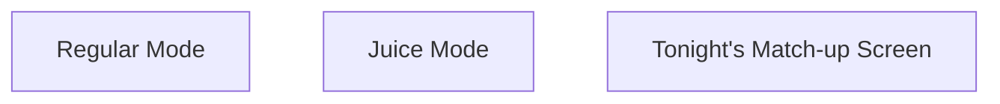
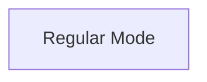
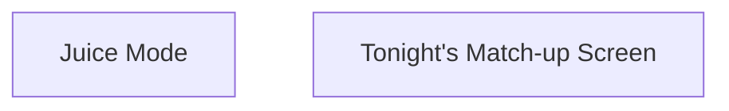

# Knowledge graph — game 593

Nodes: 42 · Edges: 41

## Progression flow

## Achievement dependencies

```mermaid
flowchart LR
  VHard_01_05["V.Hard games 1-5 (Dallas to Philadelphia)"]
  Ach_23888(["🏆 Beginners Luck"])
  Controls["Controls and Techniques"]
  Ach_23882(["🏆 Not So Dunky"])
  Ach_23874(["🏆 Three Throw!"])
  Ach_23875(["🏆 Dunk It"])
  Ach_23876(["🏆 Don't Be Greedy"])
  Ach_23877(["🏆 Candy from a Player"])
  Ach_23878(["🏆 This is No Minecraft"])
  Ach_23879(["🏆 You Don't Wanna Be That Guy"])
  On_Fire["On Fire"]
  Ach_23881(["🏆 This Ring is on Fire"])
  Ach_23887(["🏆 A Good Start"])
  Ach_23964(["🏆 A Win Streak"])
  VHard_06_10["V.Hard games 6-10 (Sacramento to Atlanta)"]
  Ach_23951(["🏆 Great Start"])
  Ach_23965(["🏆 Bigger Streak"])
  VHard_11_15["V.Hard games 11-15 (Clippers to Houston)"]
  Ach_23952(["🏆 Amazing Start"])
  VHard_16_20["V.Hard games 16-20 (Charlotte to Detroit)"]
  Ach_23953(["🏆 Champion Team"])
  Ach_23966(["🏆 Unbeatable"])
  VHard_21_27["V.Hard games 21-27 (San Antonio to Chicago)"]
  Ach_23954(["🏆 Unstoppable Force"])
  Ach_23955(["🏆 Legendary Team"])
  Winning_Game["SNES ending (27-0)"]
  Ach_23884(["🏆 NBA All-Star"])
  Score_Attack["200-point game (Power-Up Fire, computer assistance off)"]
  Ach_23962(["🏆 Breaking Records"])
  Ach_23963(["🏆 Mastery of NBA"])
  Ach_23956(["🏆 One Three After Another Three"])
  Ach_23957(["🏆 Dunk It Again"])
  Ach_23958(["🏆 Not Selfish at All"])
  Ach_23959(["🏆 Sold the Candy"])
  Ach_23960(["🏆 Block Story"])
  Ach_23961(["🏆 You Don't Wanna Be That Guy Again"])
  Ach_23968(["🏆 Field Expert"])
  VHard_01_05 -->|unlocks| Ach_23888
  Controls -->|unlocks| Ach_23882
  Controls -->|unlocks| Ach_23874
  Controls -->|unlocks| Ach_23875
  Controls -->|unlocks| Ach_23876
  Controls -->|unlocks| Ach_23877
  Controls -->|unlocks| Ach_23878
  Controls -->|unlocks| Ach_23879
  On_Fire -->|unlocks| Ach_23881
  VHard_01_05 -->|unlocks| Ach_23887
  VHard_01_05 -->|unlocks| Ach_23964
  VHard_06_10 -->|unlocks| Ach_23951
  VHard_06_10 -->|unlocks| Ach_23965
  VHard_11_15 -->|unlocks| Ach_23952
  VHard_16_20 -->|unlocks| Ach_23953
  VHard_16_20 -->|unlocks| Ach_23966
  VHard_21_27 -->|unlocks| Ach_23954
  VHard_21_27 -->|unlocks| Ach_23955
  Winning_Game -->|unlocks| Ach_23884
  Score_Attack -->|unlocks| Ach_23962
  Score_Attack -->|unlocks| Ach_23963
  Score_Attack -->|unlocks| Ach_23956
  Score_Attack -->|unlocks| Ach_23957
  Score_Attack -->|unlocks| Ach_23958
  Score_Attack -->|unlocks| Ach_23959
  Score_Attack -->|unlocks| Ach_23960
  Score_Attack -->|unlocks| Ach_23961
  Score_Attack -->|unlocks| Ach_23968
```

## Chapter 2: V.Hard Games 1-5: First Win and the Basic Feats

## Chapter 7: Score Attack and Stat Clean-Up

