# Knowledge graph — game 909

Nodes: 135 · Edges: 159

## Progression flow

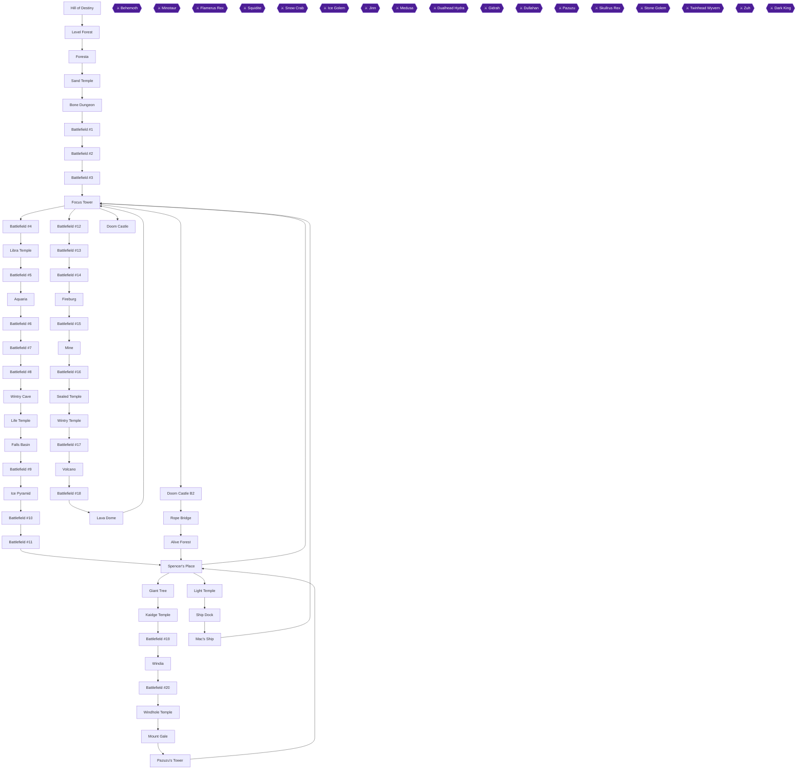

## Achievement dependencies

```mermaid
flowchart LR
  Foresta["Foresta"]
  Ach_7531(["🏆 She Talks to Trees... Then Cuts Them Down"])
  Battlefield_No1["Battlefield #1"]
  Ach_7512(["🏆 Battlefield Tourist"])
  Sand_Temple["Sand Temple"]
  Ach_7534(["🏆 But Isolde is Nowhere to be Found"])
  Flamerus_Rex{{"⚔ Flamerus Rex"}}
  Ach_8133(["🏆 No Grinding Allowed!"])
  Bone_Dungeon["Bone Dungeon"]
  Ach_449394(["🏆 Bone Collector"])
  Sand_Coin[/"Sand Coin"/]
  Ach_7533(["🏆 But What About the Dragon Claw?"])
  Libra_Temple["Libra Temple"]
  Ach_7547(["🏆 She Predates 'Friends' by Two Years"])
  Squidite{{"⚔ Squidite"}}
  Ach_8512(["🏆 Captain Nemo"])
  Life_Temple["Life Temple"]
  Ach_8514(["🏆 Hope You're Not Afraid of Heights!"])
  Snow_Crab{{"⚔ Snow Crab"}}
  Ach_8586(["🏆 An Arctic Specialty"])
  Magic_Mirror[/"Magic Mirror"/]
  Ach_8591(["🏆 Narcissus"])
  Ice_Pyramid["Ice Pyramid"]
  Ach_449395(["🏆 Fridge Raider"])
  Ice_Golem{{"⚔ Ice Golem"}}
  Ach_449391(["🏆 Never Saw It Coming"])
  River_Coin[/"River Coin"/]
  Ach_8601(["🏆 Let It Flow"])
  Fireburg["Fireburg"]
  Ach_8607(["🏆 Rock 'n' Roll!"])
  Ach_8786(["🏆 Hold the Sauerkraut"])
  Ach_449369(["🏆 Just Throw It"])
  Jinn{{"⚔ Jinn"}}
  Ach_8793(["🏆 Got to Word Your Wish Just Right"])
  Wintry_Temple["Wintry Temple"]
  Ach_8795(["🏆 Breaking the Seal"])
  Volcano["Volcano"]
  Ach_8840(["🏆 See Through the Smoke"])
  Medusa{{"⚔ Medusa"}}
  Ach_8859(["🏆 Perseus"])
  Lava_Dome["Lava Dome"]
  Ach_449365(["🏆 The Bright Side"])
  Ach_449396(["🏆 Hot Take"])
  Dualhead_Hydra{{"⚔ Dualhead Hydra"}}
  Ach_449392(["🏆 Speak No Evil"])
  Sun_Coin[/"Sun Coin"/]
  Ach_9054(["🏆 Praise the Sun"])
  Doom_Castle_B2["Doom Castle B2"]
  Ach_449364(["🏆 The Dark Side"])
  Alive_Forest["Alive Forest"]
  Ach_449368(["🏆 Chop Chop"])
  Dragon_Claw[/"Dragon Claw"/]
  Ach_449370(["🏆 Great Value Vega"])
  Gidrah{{"⚔ Gidrah"}}
  Ach_9456(["🏆 Named for a Kaiju Villain"])
  Battlefield_No20["Battlefield #20"]
  Ach_7513(["🏆 Battlefield Expert"])
  Windia["Windia"]
  Ach_449374(["🏆 Blinged Out"])
  Mount_Gale["Mount Gale"]
  Ach_449371(["🏆 Can't Be Too Careful"])
  Dullahan{{"⚔ Dullahan"}}
  Ach_9494(["🏆 Celtic Faerie"])
  Pazuzus_Tower["Pazuzu's Tower"]
  Ach_9508(["🏆 You'd Better Have Done This First..."])
  Ach_449366(["🏆 Wild Wizardry"])
  Ach_449367(["🏆 En Garde"])
  Ach_449397(["🏆 Finders Keepers"])
  Pazuzu{{"⚔ Pazuzu"}}
  Ach_449393(["🏆 Death Unbecomes Us"])
  Sky_Coin[/"Sky Coin"/]
  Ach_9649(["🏆 What Goes Up Must Come Down"])
  Light_Temple["Light Temple"]
  Ach_9655(["🏆 Lonely Island"])
  Macs_Ship["Mac's Ship"]
  Ach_449372(["🏆 Looking Sharp"])
  Doom_Castle["Doom Castle"]
  Ach_449373(["🏆 Duck and Cover"])
  Skullrus_Rex{{"⚔ Skullrus Rex"}}
  Ach_9713(["🏆 Bleached Bones"])
  Stone_Golem{{"⚔ Stone Golem"}}
  Ach_9714(["🏆 Much Harder to Melt Stone"])
  Twinhead_Wyvern{{"⚔ Twinhead Wyvern"}}
  Ach_9781(["🏆 It Only Has Two Legs, So It's Not a Dragon"])
  Zuh{{"⚔ Zuh"}}
  Ach_9782(["🏆 Zuh?"])
  Ach_449398(["🏆 The Black Hand"])
  Dark_King{{"⚔ Dark King"}}
  Ach_449399(["🏆 Paper Tiger"])
  Ach_9793(["🏆 With Guidance from the Crystals"])
  Ach_9012(["🏆 Well, Now You Can Afford It"])
  Ach_449400(["🏆 Illiterate"])
  Foresta -->|unlocks| Ach_7531
  Battlefield_No1 -->|unlocks| Ach_7512
  Sand_Temple -->|unlocks| Ach_7534
  Flamerus_Rex -->|unlocks| Ach_8133
  Bone_Dungeon -->|unlocks| Ach_449394
  Sand_Coin -->|unlocks| Ach_7533
  Libra_Temple -->|unlocks| Ach_7547
  Squidite -->|unlocks| Ach_8512
  Life_Temple -->|unlocks| Ach_8514
  Snow_Crab -->|unlocks| Ach_8586
  Magic_Mirror -->|unlocks| Ach_8591
  Ice_Pyramid -->|unlocks| Ach_449395
  Ice_Golem -->|unlocks| Ach_449391
  River_Coin -->|unlocks| Ach_8601
  Fireburg -->|unlocks| Ach_8607
  Fireburg -->|unlocks| Ach_8786
  Fireburg -->|unlocks| Ach_449369
  Jinn -->|unlocks| Ach_8793
  Wintry_Temple -->|unlocks| Ach_8795
  Volcano -->|unlocks| Ach_8840
  Medusa -->|unlocks| Ach_8859
  Lava_Dome -->|unlocks| Ach_449365
  Lava_Dome -->|unlocks| Ach_449396
  Dualhead_Hydra -->|unlocks| Ach_449392
  Sun_Coin -->|unlocks| Ach_9054
  Doom_Castle_B2 -->|unlocks| Ach_449364
  Alive_Forest -->|unlocks| Ach_449368
  Dragon_Claw -->|unlocks| Ach_449370
  Gidrah -->|unlocks| Ach_9456
  Battlefield_No20 -->|unlocks| Ach_7513
  Windia -->|unlocks| Ach_449374
  Mount_Gale -->|unlocks| Ach_449371
  Dullahan -->|unlocks| Ach_9494
  Pazuzus_Tower -->|unlocks| Ach_9508
  Pazuzus_Tower -->|unlocks| Ach_449366
  Pazuzus_Tower -->|unlocks| Ach_449367
  Pazuzus_Tower -->|unlocks| Ach_449397
  Pazuzu -->|unlocks| Ach_449393
  Sky_Coin -->|unlocks| Ach_9649
  Light_Temple -->|unlocks| Ach_9655
  Macs_Ship -->|unlocks| Ach_449372
  Doom_Castle -->|unlocks| Ach_449373
  Skullrus_Rex -->|unlocks| Ach_9713
  Stone_Golem -->|unlocks| Ach_9714
  Twinhead_Wyvern -->|unlocks| Ach_9781
  Zuh -->|unlocks| Ach_9782
  Doom_Castle -->|unlocks| Ach_449398
  Dark_King -->|unlocks| Ach_449399
  Dark_King -->|unlocks| Ach_9793
  Macs_Ship -->|unlocks| Ach_9012
  Dark_King -->|unlocks| Ach_449400
```

## Chapter 1: Hill of Destiny, Level Forest and Foresta

```mermaid
flowchart TD
  Hill_of_Destiny["Hill of Destiny"]
  Level_Forest["Level Forest"]
  Foresta["Foresta"]
  Behemoth{{"⚔ Behemoth"}}
  Minotaur{{"⚔ Minotaur"}}
  Flamerus_Rex{{"⚔ Flamerus Rex"}}
  Squidite{{"⚔ Squidite"}}
  Snow_Crab{{"⚔ Snow Crab"}}
  Ice_Golem{{"⚔ Ice Golem"}}
  Jinn{{"⚔ Jinn"}}
  Medusa{{"⚔ Medusa"}}
  Dualhead_Hydra{{"⚔ Dualhead Hydra"}}
  Gidrah{{"⚔ Gidrah"}}
  Dullahan{{"⚔ Dullahan"}}
  Pazuzu{{"⚔ Pazuzu"}}
  Skullrus_Rex{{"⚔ Skullrus Rex"}}
  Stone_Golem{{"⚔ Stone Golem"}}
  Twinhead_Wyvern{{"⚔ Twinhead Wyvern"}}
  Zuh{{"⚔ Zuh"}}
  Dark_King{{"⚔ Dark King"}}
  Hill_of_Destiny --> Level_Forest
  Level_Forest --> Foresta
  classDef ponr fill:#7f1d1d,stroke:#f87171,color:#fff;
  classDef boss fill:#4c1d95,stroke:#a78bfa,color:#fff;
  class Behemoth,Minotaur,Flamerus_Rex,Squidite,Snow_Crab,Ice_Golem,Jinn,Medusa,Dualhead_Hydra,Gidrah,Dullahan,Pazuzu,Skullrus_Rex,Stone_Golem,Twinhead_Wyvern,Zuh,Dark_King boss;
```

## Chapter 2: Sand Temple and the Bone Dungeon

```mermaid
flowchart TD
  Sand_Temple["Sand Temple"]
  Bone_Dungeon["Bone Dungeon"]
  Flamerus_Rex{{"⚔ Flamerus Rex"}}
  Squidite{{"⚔ Squidite"}}
  Snow_Crab{{"⚔ Snow Crab"}}
  Ice_Golem{{"⚔ Ice Golem"}}
  Jinn{{"⚔ Jinn"}}
  Medusa{{"⚔ Medusa"}}
  Dualhead_Hydra{{"⚔ Dualhead Hydra"}}
  Gidrah{{"⚔ Gidrah"}}
  Dullahan{{"⚔ Dullahan"}}
  Pazuzu{{"⚔ Pazuzu"}}
  Skullrus_Rex{{"⚔ Skullrus Rex"}}
  Stone_Golem{{"⚔ Stone Golem"}}
  Twinhead_Wyvern{{"⚔ Twinhead Wyvern"}}
  Zuh{{"⚔ Zuh"}}
  Dark_King{{"⚔ Dark King"}}
  Sand_Temple --> Bone_Dungeon
  classDef ponr fill:#7f1d1d,stroke:#f87171,color:#fff;
  classDef boss fill:#4c1d95,stroke:#a78bfa,color:#fff;
  class Flamerus_Rex,Squidite,Snow_Crab,Ice_Golem,Jinn,Medusa,Dualhead_Hydra,Gidrah,Dullahan,Pazuzu,Skullrus_Rex,Stone_Golem,Twinhead_Wyvern,Zuh,Dark_King boss;
```

## Chapter 3: Battlefields, the Focus Tower and Libra Temple

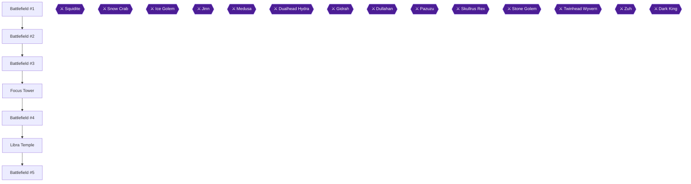

## Chapter 4: Aquaria and the Wintry Cave

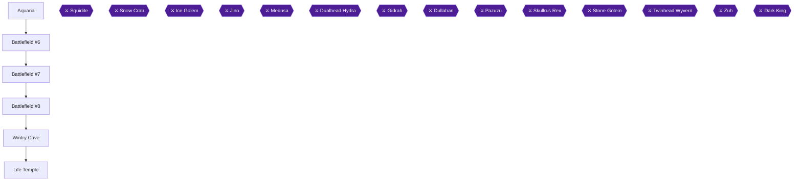

## Chapter 5: Falls Basin and the Ice Pyramid

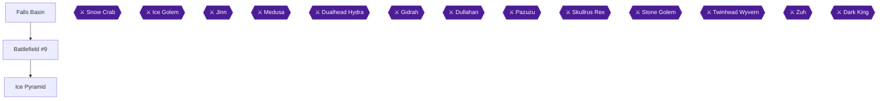

## Chapter 6: Spencer's Place, the Venus Key and Fireburg

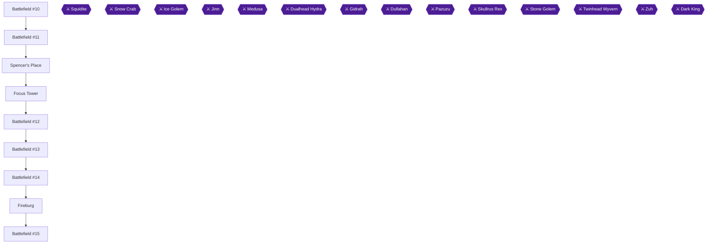

## Chapter 7: The Mine and the Sealed Temple

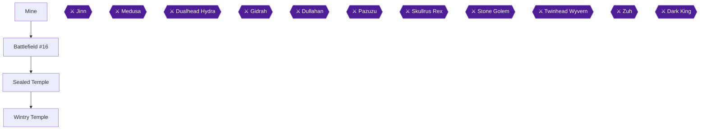

## Chapter 8: The Volcano and the Lava Dome

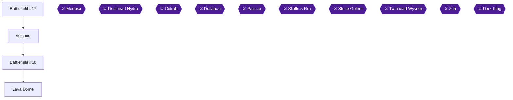

## Chapter 9: Rope Bridge, the Alive Forest and the Giant Tree

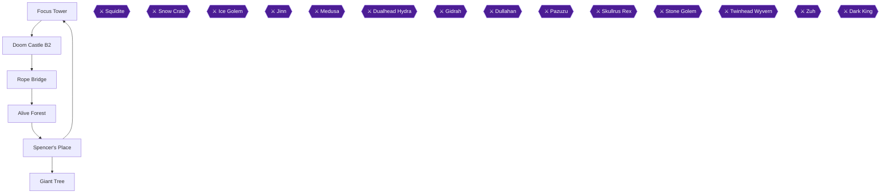

## Chapter 10: Kaidge Temple, Windia and Mount Gale

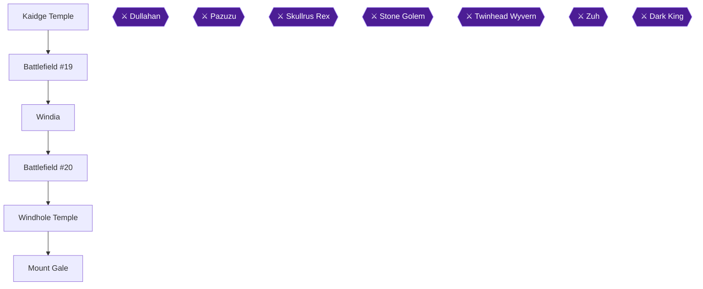

## Chapter 11: Pazuzu's Tower

## Chapter 12: The Thunder Rock, Light Temple and Mac's Ship

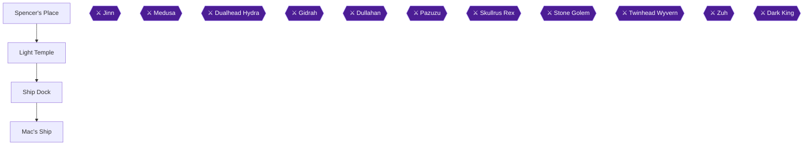

## Chapter 13: The Focus Tower Summit and Doom Castle

```mermaid
flowchart TD
  Focus_Tower["Focus Tower"]
  Doom_Castle["Doom Castle"]
  Squidite{{"⚔ Squidite"}}
  Snow_Crab{{"⚔ Snow Crab"}}
  Ice_Golem{{"⚔ Ice Golem"}}
  Jinn{{"⚔ Jinn"}}
  Medusa{{"⚔ Medusa"}}
  Dualhead_Hydra{{"⚔ Dualhead Hydra"}}
  Gidrah{{"⚔ Gidrah"}}
  Dullahan{{"⚔ Dullahan"}}
  Pazuzu{{"⚔ Pazuzu"}}
  Skullrus_Rex{{"⚔ Skullrus Rex"}}
  Stone_Golem{{"⚔ Stone Golem"}}
  Twinhead_Wyvern{{"⚔ Twinhead Wyvern"}}
  Zuh{{"⚔ Zuh"}}
  Dark_King{{"⚔ Dark King"}}
  Focus_Tower --> Doom_Castle
  classDef ponr fill:#7f1d1d,stroke:#f87171,color:#fff;
  classDef boss fill:#4c1d95,stroke:#a78bfa,color:#fff;
  class Squidite,Snow_Crab,Ice_Golem,Jinn,Medusa,Dualhead_Hydra,Gidrah,Dullahan,Pazuzu,Skullrus_Rex,Stone_Golem,Twinhead_Wyvern,Zuh,Dark_King boss;
```

## Chapter 14: Illiterate: a No-Spellbook Run

