# Final Fantasy: Mystic Quest — 100% RetroAchievements Walkthrough

## Metadata

- **Platform:** SNES/Super Famicom
- **Developer:** Square
- **Publisher:** Squaresoft
- **Genre:** Unknown
- **Released:** 1992-10-05
- **Achievements:** 51 (324 points)

> [!NOTE]
> Every instruction in this guide was extracted from the sources listed at the bottom and checked against them (199 facts confirmed by 2+ sources, 1601 from a single source). Statements marked 🟡 come from only one source. Anything we could not confirm says **"Unable to verify from collected sources."**

## Game Overview

### Game Overview: Final Fantasy: Mystic Quest

This guide covers a first-time, hardcore run of the SNES game. Final Fantasy: Mystic Quest is a simplified console RPG with a reduced two-character party, an optional automatic second character, and the ability to save anywhere and retry battles [[ra-guide-1-1]]. The set has 51 achievements worth 324 points. The whole plan is built around that list and fits in two playthroughs.

Only the opening beat of the story is covered by the collected sources. On the Hill of Destiny you follow a cloaked man to the edge of a platform and press B to jump across, and the first platform sinks behind you [[gf1-9-1]].

### Controls You Need From Minute One

**Out of battle** [[gf1-6-1, gf1-6-2, gf1-6-3, gf1-6-4, gf1-6-5]]:
- **A** swings your weapon, opens chests, and talks to people.
- **B** jumps.
- **Y** switches your companion between Auto and Manual battle modes.
- **X** opens the save screen.
- **L or R** switches weapon.

**On the world map**, a red arrow means the path is open. A grey arrow means something is still left undone. The clouds on the map clear as you explore [[gf1-7-1, gf1-7-2]].

**In the Customize menu**, message speed runs from 1 to 7. Life Indicate switches the display between HP bars and numbers [[gf1-7-3, gf1-7-4]].

### Combat and Party Basics

- **Defend:** the defending party member takes the attacks aimed at the character they are covering [[ra-guide-2-6]].
- **Experience:** only Benjamin gains levels through the quest. Allies join at fixed levels and stay there [[ra-guide-2-9]].
- **Game over:** you can restart a lost battle from the beginning, so there is no game over [[gf3-18-1]]. This matters for the challenge segments below, because "never lose a battle" conditions depend on it.
- **Magic:** it comes in three classes (White, Black and Wizard) with four spells each [[gf3-10-1]]. Wizard magic always has the fewest maximum uses because it is the most powerful [[gf3-102-3]].
- **Cure and Life:** Cure restores HP and can hit one or all targets [[gf1-67-1]]. Life restores all HP and ailments, or revives a fallen ally [[gf1-67-4, ra-guide-2-7]].
- **Heal and Exit:** Heal cures abnormal statuses on one target [[gf1-67-3]]. Exit removes an enemy from battle for no EXP or GP, or takes you to the world map if used outside battle [[gf1-67-2]].
- **Items:** the four numbered items in the top row can be replenished, but you can carry at most 99 of each [[gf3-9-1]].
- **Instant death:** Corrode Gas, Doom Dance and Doom Powder can kill instantly if they connect [[gf4-23-13]].
- **Inns:** every inn costs 95 GP [[gf4-23-14]].

### Weapons and Their Field Uses

The hero uses four weapon classes: Swords, Axes, Claws and Bombs. Only the strongest weapon in each class is usable [[gf3-11-1]]. Each has a job in the field [[ra-guide-2-8]]:
- Swords hit switches.
- Axes cut trees.
- Claws climb some walls.
- Bombs break breakable walls.

Bombs and an ally's Ninja Stars are limited and must be replenished [[gf3-12-1]]. Bombs are the strongest weapon when you first get them but the weakest by level 32 [[checklist-items-6-1]]. The Dragon Claw can both climb walls and grapple distant hooks [[ra-guide-15-3]].

### Companions

The companions, in the order they join, are as follows.

| Companion | Where they appear | First-stint kit | Citation |
|---|---|---|---|
| Kaeli | Axe, Life spell | Axe and Life | [[gf1-8-3]] |
| Tristam | Ninja Stars, Life spell | Ninja Stars and Life | [[gf1-8-6]] |
| Phoebe | Cat Claw and Bow of Grace | Life, Cure, Heal, Fire, Thunder | [[gf1-8-8]] |
| Reuben | Morning Star | Life | [[gf1-8-11]] |

On their second return, Kaeli has the Giant's Axe plus Cure, Heal, Life and Aero [[gf1-8-4]]. Phoebe has the Bow of Grace plus Thunder, White, Life, Cure, Heal, Fire and Blizzard [[gf1-8-9]]. Reuben has the Morning Star plus Life and White [[gf1-8-12]].

### Battlefields

Battlefields are optional fights on the world map. Clear 10 rounds to win prizes, or EXP and GP [[gf2-2-1]]. There are 20 in all [[gf2-2-2]]. A guide recommends clearing them as you pass them, except the ones that contain spells, to keep Benjamin at an appropriate level [[ra-guide-22-2]]. The first one, north of Level Forest, features Mad Plant and Poison Toad and awards 54 EXP [[gf2-8-2]].

### Hardcore Mode and the Settings That Matter

Play in Hardcore mode. Save states, rewind and cheats are off, so use only the game's own save screen (X) [[gf1-6-4]]. Several achievements have special conditions, and each is handled in place in its chapter:
- **Speak No Evil** forbids loading a save during the Lava Dome attempt. The condition is to beat the dungeon without any magic except Reuben's Life [[ra-guide-13-4]].
- **Death Unbecomes Us** (Pazuzu's Tower) asks you to beat the boss without losing a single battle [[ra-guide-16-8]]. Reloading a save inside the tower stops the achievement from working [[ra-comments-45-3]].
- **Beating the game** forces a reset at the end of the credits [[ra-comments-2-5]].
- **Completed saves:** achievements cannot be earned from a save of a completed game [[ra-comments-3-4]].

### The 100% Plan in Plain Language

You need two playthroughs. Chapters 1-13 are the True 100% run and earn 50 of the 51 achievements. The last one, Illiterate, asks you to beat the game without collecting any magic of your own [[ra-guide-18-12, ra-comments-59-1]]. That conflicts with The Bright Side, The Dark Side and Wild Wizardry, which need every spellbook, so Illiterate gets its own second run from a new game in chapter 14 [[ra-guide-3-2]].

Four challenge segments are handled inside the first run:
1. **No Grinding Allowed!** (chapter 2): defeat Flamerus Rex before reaching level 5 [[ra-guide-6-6]]. Avoid extra encounters in Level Forest to stay under that level [[ra-guide-5-4]].
2. **Never Saw It Coming** (chapter 5): leave the Magic Mirror alone in the Ice Pyramid, since picking it up stops the achievement [[ra-comments-18-1]].
3. **Speak No Evil** (chapter 8): beat the Lava Dome using no magic except Reuben's Life.
4. **Death Unbecomes Us** (chapter 11): win every battle in Pazuzu's Tower.

Items and spells that can be permanently lost are flagged where they occur; the Steel Shield, for example, is listed as missable [[ra-guide-20-4, ra-guide-9-8]]. The key ones are:
- The Steel Shield in the Bone Dungeon, lost once you get the Jumbo Bombs [[ra-guide-9-8]].
- The Heal spell in Falls Basin, which becomes unavailable after the Ice Pyramid [[ra-guide-7-10]].
- The Steel Helm, bought in Aquaria: the shop will not sell it once you hold the Moon and Apollo Helms [[ra-comments-39-1]].
- The Venus Shield in the Focus Tower, lost if you talk to the giant tree in the Alive Forest first [[ra-comments-49-1]].
- The Battle Axe, bought in Fireburg: buy it before you get the Giant's Axe [[ra-comments-34-1]].
- The Aero chest, reached through the purple door in the Focus Tower, which must be opened before Doom Castle [[ra-comments-54-2]].

### Unconfirmed Points

These four points are unconfirmed by the collected sources, and each chapter handles them cautiously [[ra-comments-6-1, ra-comments-37-1, ra-comments-57-3]]:
- **Battlefield Tourist:** it is unclear which clear triggers it. One player cleared the first two battlefields without it popping. Clear them in order and keep going if it has not popped.
- **Battlefield Expert:** it is unclear whether all 20 are strictly required, since two players report it popping with one left. Clear all 20 regardless [[gf2-2-2]].
- **Speak No Evil:** unconfirmed whether casting magic outside battle, such as a field Cure, voids it. Cast nothing from the Lava Dome entrance until the Hydra dies, except Reuben's Life in battle, and heal with items.
- **Well, Now You Can Afford It:** it did not pop for one player holding 16,842 GP. If it has not popped with 9,000 GP or more, spend below 9,000 and earn it back.

### Before You Start

Take the first chapter slowly. Early over-leveling can cost you No Grinding Allowed!, so do not clear every encounter in Level Forest [[ra-guide-5-4]]. Skip the battlefields in the early area for the same reason [[ra-comments-9-4]].

## Achievement Roadmap

| Chapter | Achievements | Points |
|---|---|---|
| [1. Hill of Destiny, Level Forest and Foresta](#chapter-1-hill-of-destiny-level-forest-and-foresta) | She Talks to Trees... Then Cuts Them Down | 2 |
| [2. Sand Temple and the Bone Dungeon](#chapter-2-sand-temple-and-the-bone-dungeon) | But Isolde is Nowhere to be Found, No Grinding Allowed!, Bone Collector, But What About the Dragon Claw? | 26 |
| [3. Battlefields, the Focus Tower and Libra Temple](#chapter-3-battlefields-the-focus-tower-and-libra-temple) | Battlefield Tourist, She Predates 'Friends' by Two Years | 7 |
| [4. Aquaria and the Wintry Cave](#chapter-4-aquaria-and-the-wintry-cave) | Captain Nemo, Hope You're Not Afraid of Heights! | 6 |
| [5. Falls Basin and the Ice Pyramid](#chapter-5-falls-basin-and-the-ice-pyramid) | An Arctic Specialty, Never Saw It Coming, Let It Flow, Narcissus, Fridge Raider | 33 |
| [6. Spencer's Place, the Venus Key and Fireburg](#chapter-6-spencers-place-the-venus-key-and-fireburg) | Hold the Sauerkraut, Rock 'n' Roll!, Just Throw It | 11 |
| [7. The Mine and the Sealed Temple](#chapter-7-the-mine-and-the-sealed-temple) | Got to Word Your Wish Just Right, Breaking the Seal | 6 |
| [8. The Volcano and the Lava Dome](#chapter-8-the-volcano-and-the-lava-dome) | See Through the Smoke, Perseus, Speak No Evil, Hot Take, Praise the Sun, The Bright Side | 42 |
| [9. Rope Bridge, the Alive Forest and the Giant Tree](#chapter-9-rope-bridge-the-alive-forest-and-the-giant-tree) | The Dark Side, Chop Chop, Great Value Vega, Named for a Kaiju Villain | 25 |
| [10. Kaidge Temple, Windia and Mount Gale](#chapter-10-kaidge-temple-windia-and-mount-gale) | Celtic Faerie, Blinged Out, Can't Be Too Careful, Battlefield Expert | 20 |
| [11. Pazuzu's Tower](#chapter-11-pazuzus-tower) | You'd Better Have Done This First..., Wild Wizardry, En Garde, Finders Keepers, Death Unbecomes Us, What Goes Up Must Come Down | 42 |
| [12. The Thunder Rock, Light Temple and Mac's Ship](#chapter-12-the-thunder-rock-light-temple-and-macs-ship) | Lonely Island, Looking Sharp, Well, Now You Can Afford It | 12 |
| [13. The Focus Tower Summit and Doom Castle](#chapter-13-the-focus-tower-summit-and-doom-castle) | Bleached Bones, Much Harder to Melt Stone, It Only Has Two Legs, So It's Not a Dragon, Zuh?, The Black Hand, Duck and Cover, Paper Tiger, With Guidance from the Crystals | 67 |
| [14. Illiterate: a No-Spellbook Run](#chapter-14-illiterate-a-no-spellbook-run) | Illiterate | 25 |

## Playthrough Planning

**Playthroughs required:** 2

Illiterate (defeat the Dark King without learning any spells) is incompatible with The Bright Side, The Dark Side and Wild Wizardry, which need every spellbook (ra-guide-3-2), so it takes a second playthrough from a new game (chapter 14). Achievements cannot be earned from a completed-game save (ra-comments-3-4). Chapters 1-13 are the True 100% run and earn the other 50 achievements; within it, No Grinding Allowed! (chapter 2), Never Saw It Coming (chapter 5), Speak No Evil (chapter 8) and Death Unbecomes Us (chapter 11) are challenge segments handled in place. [[ra-guide-3-2,ra-comments-3-4,ra-comments-2-5,gf2-2-2,ra-guide-22-2]]

**Settings:** Hardcore mode. Speak No Evil forbids loading a save during the Lava Dome attempt, and Death Unbecomes Us breaks if a save is reloaded inside Pazuzu's Tower. Beating the Dark King forces a reset after the credits.

## True 100% In-Game Completion Criteria

This guide covers complete in-game mastery in addition to all RetroAchievements:

| Category | 100% Requirement | Tracking Scope |
|---|---|---|
| **Battlefields** | Clear all 20 Battlefields (10 rounds each) for their prizes, including the Charm, Magic Ring, Gemini Crest, Exit and Thunder spellbooks. | Per-chapter checkpoint |
| **Spellbooks** | All 12 of the Hero's spellbooks: White (Cure, Heal, Life, Exit), Black (Quake, Blizzard, Fire, Aero) and Wizard (Thunder, White, Meteor, Flare). | Per-chapter checkpoint |
| **Dungeon Chests** | Every optional chest in the Bone Dungeon, Ice Pyramid, Lava Dome, Pazuzu's Tower and Doom Castle (one achievement each). | Per-chapter checkpoint |
| **Equipment** | All three of every weapon (swords, axes, claws, bombs) and armor (helmets, armors, shields, accessories) class, including the shop-only Steel Helm, Battle Axe and Cupid Locket. | Per-chapter checkpoint |

## Missables Summary

| ⚠ Missable | Achievement | Chapter | Must be done before |
|---|---|---|---|
| Flamerus Rex before level 5 [[ra-guide-6-6,ra-comments-8-7,ra-guide-5-4,ra-comments-9-4]] | No Grinding Allowed! | [2](#chapter-2-sand-temple-and-the-bone-dungeon) | Beat Flamerus Rex in the Bone Dungeon before the Hero reaches level 5; skip the battlefields and avoidable fights until then |
| Bone Dungeon Steel Shield chest [[checklist-items-5-7,ra-comments-10-4,ra-guide-9-8]] | Bone Collector | [2](#chapter-2-sand-temple-and-the-bone-dungeon) | Bomb the wall in the Bone Dungeon's second room for the Steel Shield before getting the Jumbo Bombs from Phoebe in Falls Basin (chapter 5) |
| Steel Shield and Venus Shield [[ra-guide-20-4,ra-comments-49-1,ra-comments-49-3]] | Duck and Cover | [6](#chapter-6-spencers-place-the-venus-key-and-fireburg) | Steel Shield before the Jumbo Bombs (chapter 5); Venus Shield before talking to the giant tree in the Alive Forest (chapter 9) |
| Steel Helm from the Aquaria shop [[ra-comments-39-1,checklist-items-5-1]] | Can't Be Too Careful | [4](#chapter-4-aquaria-and-the-wintry-cave) | Buy the Steel Helm in Aquaria before picking up the Moon Helm in the Lava Dome (chapter 8) |
| Heal spellbook in Falls Basin [[ra-guide-7-10,ra-guide-21-3,ra-comments-27-1]] | The Bright Side | [5](#chapter-5-falls-basin-and-the-ice-pyramid) | Open the Heal chest in Falls Basin before beating the Ice Golem |
| Ice Golem without the Magic Mirror [[ra-comments-18-1,ra-comments-16-3,ra-comments-18-4]] | Never Saw It Coming | [5](#chapter-5-falls-basin-and-the-ice-pyramid) | Leave the Magic Mirror chest closed until the Ice Golem is beaten |
| Battle Axe from the Fireburg shop [[ra-comments-34-1,checklist-items-6-6]] | Chop Chop | [6](#chapter-6-spencers-place-the-venus-key-and-fireburg) | Buy the Battle Axe in Fireburg before getting the Giant's Axe in the Alive Forest (chapter 9) |
| Lava Dome without magic [[ra-guide-13-4,ra-comments-29-1]] | Speak No Evil | [8](#chapter-8-the-volcano-and-the-lava-dome) | One attempt from the Lava Dome entrance to the Dualhead Hydra, casting nothing but Reuben's Life and loading no save |
| Aero chest for The Black Hand [[ra-comments-54-2,ra-comments-54-3,ra-guide-18-14]] | The Black Hand | [9](#chapter-9-rope-bridge-the-alive-forest-and-the-giant-tree) | Open the Aero chest in Doom Castle B2 on the way to Windia, before the Wind Crystal and before entering Doom Castle proper |
| Pazuzu's Tower without losing a battle [[ra-guide-16-8,ra-comments-45-3]] | Death Unbecomes Us | [11](#chapter-11-pazuzus-tower) | One attempt through Pazuzu's Tower to Pazuzu with no lost battle and no reload inside the tower |
| No spellbooks for the whole game [[ra-guide-18-12,ra-comments-59-1,ra-comments-37-3]] | Illiterate | [14](#chapter-14-illiterate-a-no-spellbook-run) | Separate new game: never pick up a spellbook or finish Battlefields #10 and #16 |

## Points of No Return

| ⛔ Point of No Return | Chapter | What you lose access to |
|---|---|---|
| Ice Golem defeated [[ra-guide-10-8,ra-comments-27-2]] | [5](#chapter-5-falls-basin-and-the-ice-pyramid) | Beating the Ice Golem locks Falls Basin, and with it the Heal spellbook. |
| Jumbo Bombs received [[ra-guide-9-8,ra-comments-10-4]] | [5](#chapter-5-falls-basin-and-the-ice-pyramid) | Once the bombs upgrade to Jumbo Bombs the Bone Dungeon Steel Shield chest can no longer be obtained. |
| Entering Doom Castle [[ra-guide-18-14,ra-comments-54-2]] | [13](#chapter-13-the-focus-tower-summit-and-doom-castle) | Leaving Doom Castle resets its optional chests; get the Aero chest beforehand (chapter 9) and clear the castle in one go. |
| Dark King defeated [[ra-comments-2-5,ra-comments-3-4]] | [13](#chapter-13-the-focus-tower-summit-and-doom-castle) | The credits force a reset, and achievements cannot be earned from a completed-game save. |

## Progression Diagrams

### Game Progression

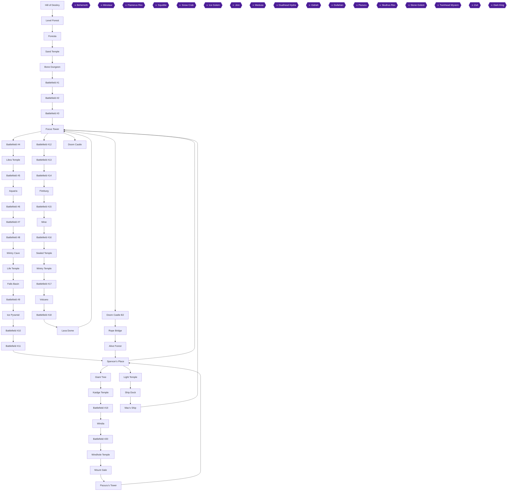

### Achievement Dependencies

```mermaid
flowchart LR
  Foresta["Foresta"]
  Ach_7531(["🏆 She Talks to Trees... Then Cuts Them Down"])
  Battlefield_No1["Battlefield #1"]
  Ach_7512(["🏆 Battlefield Tourist"])
  Sand_Temple["Sand Temple"]
  Ach_7534(["🏆 But Isolde is Nowhere to be Found"])
  Flamerus_Rex{{"⚔ Flamerus Rex"}}
  Ach_8133(["🏆 No Grinding Allowed!"])
  Bone_Dungeon["Bone Dungeon"]
  Ach_449394(["🏆 Bone Collector"])
  Sand_Coin[/"Sand Coin"/]
  Ach_7533(["🏆 But What About the Dragon Claw?"])
  Libra_Temple["Libra Temple"]
  Ach_7547(["🏆 She Predates 'Friends' by Two Years"])
  Squidite{{"⚔ Squidite"}}
  Ach_8512(["🏆 Captain Nemo"])
  Life_Temple["Life Temple"]
  Ach_8514(["🏆 Hope You're Not Afraid of Heights!"])
  Snow_Crab{{"⚔ Snow Crab"}}
  Ach_8586(["🏆 An Arctic Specialty"])
  Magic_Mirror[/"Magic Mirror"/]
  Ach_8591(["🏆 Narcissus"])
  Ice_Pyramid["Ice Pyramid"]
  Ach_449395(["🏆 Fridge Raider"])
  Ice_Golem{{"⚔ Ice Golem"}}
  Ach_449391(["🏆 Never Saw It Coming"])
  River_Coin[/"River Coin"/]
  Ach_8601(["🏆 Let It Flow"])
  Fireburg["Fireburg"]
  Ach_8607(["🏆 Rock 'n' Roll!"])
  Ach_8786(["🏆 Hold the Sauerkraut"])
  Ach_449369(["🏆 Just Throw It"])
  Jinn{{"⚔ Jinn"}}
  Ach_8793(["🏆 Got to Word Your Wish Just Right"])
  Wintry_Temple["Wintry Temple"]
  Ach_8795(["🏆 Breaking the Seal"])
  Volcano["Volcano"]
  Ach_8840(["🏆 See Through the Smoke"])
  Medusa{{"⚔ Medusa"}}
  Ach_8859(["🏆 Perseus"])
  Lava_Dome["Lava Dome"]
  Ach_449365(["🏆 The Bright Side"])
  Ach_449396(["🏆 Hot Take"])
  Dualhead_Hydra{{"⚔ Dualhead Hydra"}}
  Ach_449392(["🏆 Speak No Evil"])
  Sun_Coin[/"Sun Coin"/]
  Ach_9054(["🏆 Praise the Sun"])
  Doom_Castle_B2["Doom Castle B2"]
  Ach_449364(["🏆 The Dark Side"])
  Alive_Forest["Alive Forest"]
  Ach_449368(["🏆 Chop Chop"])
  Dragon_Claw[/"Dragon Claw"/]
  Ach_449370(["🏆 Great Value Vega"])
  Gidrah{{"⚔ Gidrah"}}
  Ach_9456(["🏆 Named for a Kaiju Villain"])
  Battlefield_No20["Battlefield #20"]
  Ach_7513(["🏆 Battlefield Expert"])
  Windia["Windia"]
  Ach_449374(["🏆 Blinged Out"])
  Mount_Gale["Mount Gale"]
  Ach_449371(["🏆 Can't Be Too Careful"])
  Dullahan{{"⚔ Dullahan"}}
  Ach_9494(["🏆 Celtic Faerie"])
  Pazuzus_Tower["Pazuzu's Tower"]
  Ach_9508(["🏆 You'd Better Have Done This First..."])
  Ach_449366(["🏆 Wild Wizardry"])
  Ach_449367(["🏆 En Garde"])
  Ach_449397(["🏆 Finders Keepers"])
  Pazuzu{{"⚔ Pazuzu"}}
  Ach_449393(["🏆 Death Unbecomes Us"])
  Sky_Coin[/"Sky Coin"/]
  Ach_9649(["🏆 What Goes Up Must Come Down"])
  Light_Temple["Light Temple"]
  Ach_9655(["🏆 Lonely Island"])
  Macs_Ship["Mac's Ship"]
  Ach_449372(["🏆 Looking Sharp"])
  Doom_Castle["Doom Castle"]
  Ach_449373(["🏆 Duck and Cover"])
  Skullrus_Rex{{"⚔ Skullrus Rex"}}
  Ach_9713(["🏆 Bleached Bones"])
  Stone_Golem{{"⚔ Stone Golem"}}
  Ach_9714(["🏆 Much Harder to Melt Stone"])
  Twinhead_Wyvern{{"⚔ Twinhead Wyvern"}}
  Ach_9781(["🏆 It Only Has Two Legs, So It's Not a Dragon"])
  Zuh{{"⚔ Zuh"}}
  Ach_9782(["🏆 Zuh?"])
  Ach_449398(["🏆 The Black Hand"])
  Dark_King{{"⚔ Dark King"}}
  Ach_449399(["🏆 Paper Tiger"])
  Ach_9793(["🏆 With Guidance from the Crystals"])
  Ach_9012(["🏆 Well, Now You Can Afford It"])
  Ach_449400(["🏆 Illiterate"])
  Foresta -->|unlocks| Ach_7531
  Battlefield_No1 -->|unlocks| Ach_7512
  Sand_Temple -->|unlocks| Ach_7534
  Flamerus_Rex -->|unlocks| Ach_8133
  Bone_Dungeon -->|unlocks| Ach_449394
  Sand_Coin -->|unlocks| Ach_7533
  Libra_Temple -->|unlocks| Ach_7547
  Squidite -->|unlocks| Ach_8512
  Life_Temple -->|unlocks| Ach_8514
  Snow_Crab -->|unlocks| Ach_8586
  Magic_Mirror -->|unlocks| Ach_8591
  Ice_Pyramid -->|unlocks| Ach_449395
  Ice_Golem -->|unlocks| Ach_449391
  River_Coin -->|unlocks| Ach_8601
  Fireburg -->|unlocks| Ach_8607
  Fireburg -->|unlocks| Ach_8786
  Fireburg -->|unlocks| Ach_449369
  Jinn -->|unlocks| Ach_8793
  Wintry_Temple -->|unlocks| Ach_8795
  Volcano -->|unlocks| Ach_8840
  Medusa -->|unlocks| Ach_8859
  Lava_Dome -->|unlocks| Ach_449365
  Lava_Dome -->|unlocks| Ach_449396
  Dualhead_Hydra -->|unlocks| Ach_449392
  Sun_Coin -->|unlocks| Ach_9054
  Doom_Castle_B2 -->|unlocks| Ach_449364
  Alive_Forest -->|unlocks| Ach_449368
  Dragon_Claw -->|unlocks| Ach_449370
  Gidrah -->|unlocks| Ach_9456
  Battlefield_No20 -->|unlocks| Ach_7513
  Windia -->|unlocks| Ach_449374
  Mount_Gale -->|unlocks| Ach_449371
  Dullahan -->|unlocks| Ach_9494
  Pazuzus_Tower -->|unlocks| Ach_9508
  Pazuzus_Tower -->|unlocks| Ach_449366
  Pazuzus_Tower -->|unlocks| Ach_449367
  Pazuzus_Tower -->|unlocks| Ach_449397
  Pazuzu -->|unlocks| Ach_449393
  Sky_Coin -->|unlocks| Ach_9649
  Light_Temple -->|unlocks| Ach_9655
  Macs_Ship -->|unlocks| Ach_449372
  Doom_Castle -->|unlocks| Ach_449373
  Skullrus_Rex -->|unlocks| Ach_9713
  Stone_Golem -->|unlocks| Ach_9714
  Twinhead_Wyvern -->|unlocks| Ach_9781
  Zuh -->|unlocks| Ach_9782
  Doom_Castle -->|unlocks| Ach_449398
  Dark_King -->|unlocks| Ach_449399
  Dark_King -->|unlocks| Ach_9793
  Macs_Ship -->|unlocks| Ach_9012
  Dark_King -->|unlocks| Ach_449400
```

## Boss Index

Full strategies are in each chapter.

| Boss | Chapter |
|---|---|
| Behemoth | [1. Hill of Destiny, Level Forest and Foresta](#chapter-1-hill-of-destiny-level-forest-and-foresta) |
| Minotaur | [1. Hill of Destiny, Level Forest and Foresta](#chapter-1-hill-of-destiny-level-forest-and-foresta) |
| Flamerus Rex | [2. Sand Temple and the Bone Dungeon](#chapter-2-sand-temple-and-the-bone-dungeon) |
| Squidite | [4. Aquaria and the Wintry Cave](#chapter-4-aquaria-and-the-wintry-cave) |
| Snow Crab | [5. Falls Basin and the Ice Pyramid](#chapter-5-falls-basin-and-the-ice-pyramid) |
| Ice Golem | [5. Falls Basin and the Ice Pyramid](#chapter-5-falls-basin-and-the-ice-pyramid) |
| Jinn | [7. The Mine and the Sealed Temple](#chapter-7-the-mine-and-the-sealed-temple) |
| Medusa | [8. The Volcano and the Lava Dome](#chapter-8-the-volcano-and-the-lava-dome) |
| Dualhead Hydra | [8. The Volcano and the Lava Dome](#chapter-8-the-volcano-and-the-lava-dome) |
| Gidrah | [9. Rope Bridge, the Alive Forest and the Giant Tree](#chapter-9-rope-bridge-the-alive-forest-and-the-giant-tree) |
| Dullahan | [10. Kaidge Temple, Windia and Mount Gale](#chapter-10-kaidge-temple-windia-and-mount-gale) |
| Pazuzu | [9. Rope Bridge, the Alive Forest and the Giant Tree](#chapter-9-rope-bridge-the-alive-forest-and-the-giant-tree) |
| Skullrus Rex | [13. The Focus Tower Summit and Doom Castle](#chapter-13-the-focus-tower-summit-and-doom-castle) |
| Stone Golem | [13. The Focus Tower Summit and Doom Castle](#chapter-13-the-focus-tower-summit-and-doom-castle) |
| Twinhead Wyvern | [13. The Focus Tower Summit and Doom Castle](#chapter-13-the-focus-tower-summit-and-doom-castle) |
| Zuh | [13. The Focus Tower Summit and Doom Castle](#chapter-13-the-focus-tower-summit-and-doom-castle) |
| Dark King | [13. The Focus Tower Summit and Doom Castle](#chapter-13-the-focus-tower-summit-and-doom-castle) |

## Walkthrough

## Chapter 1: Hill of Destiny, Level Forest and Foresta

```mermaid
flowchart TD
  Hill_of_Destiny["Hill of Destiny"]
  Level_Forest["Level Forest"]
  Foresta["Foresta"]
  Behemoth{{"⚔ Behemoth"}}
  Minotaur{{"⚔ Minotaur"}}
  Flamerus_Rex{{"⚔ Flamerus Rex"}}
  Squidite{{"⚔ Squidite"}}
  Snow_Crab{{"⚔ Snow Crab"}}
  Ice_Golem{{"⚔ Ice Golem"}}
  Jinn{{"⚔ Jinn"}}
  Medusa{{"⚔ Medusa"}}
  Dualhead_Hydra{{"⚔ Dualhead Hydra"}}
  Gidrah{{"⚔ Gidrah"}}
  Dullahan{{"⚔ Dullahan"}}
  Pazuzu{{"⚔ Pazuzu"}}
  Skullrus_Rex{{"⚔ Skullrus Rex"}}
  Stone_Golem{{"⚔ Stone Golem"}}
  Twinhead_Wyvern{{"⚔ Twinhead Wyvern"}}
  Zuh{{"⚔ Zuh"}}
  Dark_King{{"⚔ Dark King"}}
  Hill_of_Destiny --> Level_Forest
  Level_Forest --> Foresta
  classDef ponr fill:#7f1d1d,stroke:#f87171,color:#fff;
  classDef boss fill:#4c1d95,stroke:#a78bfa,color:#fff;
  class Behemoth,Minotaur,Flamerus_Rex,Squidite,Snow_Crab,Ice_Golem,Jinn,Medusa,Dualhead_Hydra,Gidrah,Dullahan,Pazuzu,Skullrus_Rex,Stone_Golem,Twinhead_Wyvern,Zuh,Dark_King boss;
```

This chapter covers the opening of the game: the cloaked man's speech and the Behemoth fight on the Hill of Destiny, a first walk through Level Forest, the town of Foresta where Kaeli joins you, and a second trip into Level Forest where you beat the Minotaur and receive Kaeli's Axe [[gf1-9-3, gf1-11-1, gf4-1-2]]. The main goals are the Tree Wither, the Cure spellbook, Kaeli joining, and the Axe.

> [!WARNING]
> **Achievement Trigger Warning:** No Grinding Allowed! (Defeat Flamerus Rex before reaching level 5) comes up in chapter 2, but it is decided by how many fights you take now. The first battle on the mountain and 2 battles in Level Forest cannot be avoided [[ra-comments-8-8]]. Avoid extra encounters in Level Forest to avoid over-leveling [[ra-guide-5-4]]. Do not clear Battlefield #1 north of Level Forest yet: it is optional and awards 54 EXP [[gf4-4-1, gf3-22-2]].

> [!NOTE]
> You can restart battles from the beginning if you die, so you never get a game over [[gf3-18-1]]. One source suggests being level 3 before the Minotaur [[gf4-2-2]]. The achievement route above favors fewer fights, so use the Life shortcut instead: having Kaeli cast Life on the Minotaur defeats him instantly [[gf2-48-5, gf3-143-2]].

### Chapter Items to Collect

| Item | Where Found | Action / Requirement | Citation |
|---|---|---|---|
| Tree Wither | Level Forest, from the man in blue after pushing his boulder | **TAKE** (show it to Kaeli) | [[checklist-items-2-8, gf1-10-1]] |
| 3 potions | Level Forest chest to the left | **TAKE** | [[gf1-10-2]] |
| Potions chest | Foresta, back of Kaeli's house | **TAKE** | [[gf1-11-2]] |
| Potions chest | Foresta, bottom-right house | **TAKE** | [[gf1-11-3]] |
| Cure spellbook | Foresta, chest in the back of the top-right tree home | **TAKE** | [[gf1-11-4, checklist-items-4-1]] |
| Axe | Given by Kaeli after the Minotaur | Receive | [[gf4-1-2, ra-guide-5-5]] |

### Hill of Destiny

Benjamin (the Hero) flees to the Hill of Destiny after a quake destroys his village, following a cloaked man [[gf1-5-2]]. Name your character however you like. You control little here. Follow the man to the edge of a platform and press **B** to jump across; the first platform sinks behind you [[gf1-9-1]]. The man shows you Focus Tower and explains the situation, then a monster appears [[gf1-9-1]].

#### Boss: Behemoth

Behemoth has 80 HP, gives 84 EXP and 3 GP, and uses the physical attack Horn [[gf1-9-2]]. Another source lists 150 HP for it [[gf4-13-4]]; the sources disagree, so just keep attacking. You only have a weapon at this point, so choose Attack every turn [[gf1-9-2, gf2-5-1]]. It can land critical hits, and if it does while you do not, you may die; just restart the battle [[gf3-18-2]]. This is one of the unavoidable fights [[ra-comments-8-8]].

After the win, another quake wipes the Hill of Destiny off the map and the cloaked figure tells you to meet him in Level Forest, your only destination [[gf1-9-3]].

### Level Forest (first visit)

🗺️ **Map:** [View Mystic Quest Level Forest Map by Tropicon](https://www.vgmaps.com/Atlas/SuperNES/FinalFantasy-MysticQuest-LevelForest.png)

Map author: Tropicon [[map-mystic-quest-level-forest-1-1]].

1. Talk to the cloaked man; he tells you to save the Crystal of Earth first and leaves [[gf1-10-1, gf2-6-1]].
2. Head north to a man in a blue robe. His boulder blocks his path [[gf1-10-1]].
3. Press **B** to jump over him, then push the boulder up; he thanks you and gives you the **Tree Wither**, telling you to show it to Kaeli in Foresta [[gf2-6-1, gf2-6-2, gf3-19-1]]. Push it one more tile and open the nearby chest [[gf2-6-1]].
4. Head left to the treasure chest for 3 potions [[gf1-10-2, gf2-6-3]].
5. Head all the way right to leave the forest and open the path to Foresta [[gf1-10-3]].

You have no axe yet, so you cannot go deeper [[ra-guide-5-5]].

### Foresta

#### Kaeli's house

1. Enter the first tree home on the left. Two girls sit at the table; Kaeli is the one on the left [[gf1-11-1]].
2. Talk to her. She sees the Tree Wither and volunteers to help; Kaeli joins your party [[gf1-11-1, gf4-3-40]]. She has 120 HP, attacks with an axe and knows Life [[gf4-1-1]].

> [!ACHIEVEMENT]
> **She Talks to Trees... Then Cuts Them Down (2 Points)**
> 
> *Be joined by Kaeli.*

3. In the back of the house, open the chest for 3 potions [[gf1-11-2, gf2-7-5]].

#### Cure spellbook

1. Leave and head to the north end of town, crossing the bridge [[gf1-11-4]].
2. On the right in the water are two logs; jump across them to the back of a tree home [[gf1-11-4, gf3-20-2]].
3. Enter by the back door and open the chest for the **Cure** spell [[gf1-11-4, gf4-4-20]]. This is the first of the white spellbooks [[ra-guide-21-2]].

#### Other chests and the bed

The bottom-right house also has a chest with potions [[gf1-11-3]]. The bed on the left in that house restores your HP [[gf1-11-5, gf2-7-4, gf4-23-10]].

When done, leave Foresta and return west to Level Forest [[gf1-11-5]].

### Level Forest (second visit)

🗺️ **Map:** [View Mystic Quest Level Alive Forest Map by Tropicon](https://www.vgmaps.com/Atlas/SuperNES/FinalFantasy-MysticQuest-Level-AliveForest.png)

With Kaeli, she immediately cuts down a tree, opening more of the level, and you fight a Brownie behind it [[gf1-12-1]]. Two of these fights in the forest are unavoidable [[ra-comments-8-8]].

- Chests that look like the first potion chest restore when you leave the level [[gf1-12-1, gf2-7-11]]. Heal Potions can be farmed by going in and out [[checklist-items-2-2, gf3-21-5]].
- Left path: defeat the two Slimes and a Brownie guarding a chest of potions [[gf1-12-1, gf2-7-6]].
- Right path: defeat the Slime and Brownie to the east to reach a chest with 3 Heal Potions [[gf1-12-2, gf2-7-10]].
- Southwest: cut trees to reach a Brownie and a chest with a Heal Potion [[gf1-12-6]]. Southeast: cut trees to reach a chest with a Potion [[gf1-12-7]].

Brownie has 50 HP, 66 EXP, 3 GP; Slime has 50 HP, 72 EXP, 3 GP [[gf4-14-1, gf4-21-5]]. These optional fights give EXP, so skip them if you are protecting No Grinding Allowed! [[ra-guide-5-4]].

Heal up before approaching the glowing tree [[gf1-12-2, gf2-7-4]]. Examine it and a Minotaur poisons Kaeli, starting the fight [[gf1-12-2]].

#### Boss: Minotaur

- 240 HP; attacks are Axe (physical), Scream (damage and lowers defense) and Roundhouse (heavier physical) [[gf1-12-3]].
- The cheap method: have Kaeli cast Life on the Minotaur and it goes down immediately [[gf2-48-5, gf3-143-2]].
- Conventional: attack each turn and use Cure when someone gets low; if the Hero dies, Kaeli's Life revives him [[gf1-12-3, gf2-7-4]].
- Another guide says to have the Hero cast Cure on it instead, and not Kaeli [[gf4-10-2]].

Kaeli's mom then takes her home. The Elixir in the Sand Temple can save her, and Kaeli gives you her **Axe** [[gf1-12-3, gf4-1-2, ra-guide-5-5]]. This is the first axe toward Chop Chop [[ra-guide-19-4, gf3-21-4]].

To move on, take the north exit past where you fought the Minotaur [[gf1-12-6]]. Battlefield #1 lies north; leave it for chapter 3 [[gf3-22-2]].

> [!TIP]
> **Before you leave Level Forest:** make sure you have the Cure spell and the Axe, and stock up on potions since chests refill when you leave [[gf3-21-5, gf2-7-11, gf1-11-4]]. Kaeli returns later after the Elixir quest, which continues in chapter 2 [[gf1-17-1]].

> [!IMPORTANT]
> ### Chapter 1 Cumulative 100% Checkpoint
> - **Battlefields:** 0 / 20
> - **Spellbooks:** 1 / 12 (Cure in Foresta) [[gf1-11-4]]
> - **Axes:** 1 / 3 (Kaeli's Axe) [[gf4-1-2]]
> - **RetroAchievements Unlocked:** 1 / 51 (2 / 324 points)

### Chapter Checklist

- [ ] Won the Behemoth fight on the Hill of Destiny
- [ ] Received the Tree Wither from the man in blue
- [ ] Kaeli joined in Foresta (She Talks to Trees... Then Cuts Them Down)
- [ ] Cure spell taken from the chest in the back of the top-right tree home
- [ ] Defeated the Minotaur and received Kaeli's Axe
- [ ] Did not clear Battlefield #1

---

## Chapter 2: Sand Temple and the Bone Dungeon

```mermaid
flowchart TD
  Sand_Temple["Sand Temple"]
  Bone_Dungeon["Bone Dungeon"]
  Flamerus_Rex{{"⚔ Flamerus Rex"}}
  Squidite{{"⚔ Squidite"}}
  Snow_Crab{{"⚔ Snow Crab"}}
  Ice_Golem{{"⚔ Ice Golem"}}
  Jinn{{"⚔ Jinn"}}
  Medusa{{"⚔ Medusa"}}
  Dualhead_Hydra{{"⚔ Dualhead Hydra"}}
  Gidrah{{"⚔ Gidrah"}}
  Dullahan{{"⚔ Dullahan"}}
  Pazuzu{{"⚔ Pazuzu"}}
  Skullrus_Rex{{"⚔ Skullrus Rex"}}
  Stone_Golem{{"⚔ Stone Golem"}}
  Twinhead_Wyvern{{"⚔ Twinhead Wyvern"}}
  Zuh{{"⚔ Zuh"}}
  Dark_King{{"⚔ Dark King"}}
  Sand_Temple --> Bone_Dungeon
  classDef ponr fill:#7f1d1d,stroke:#f87171,color:#fff;
  classDef boss fill:#4c1d95,stroke:#a78bfa,color:#fff;
  class Flamerus_Rex,Squidite,Snow_Crab,Ice_Golem,Jinn,Medusa,Dualhead_Hydra,Gidrah,Dullahan,Pazuzu,Skullrus_Rex,Stone_Golem,Twinhead_Wyvern,Zuh,Dark_King boss;
```

This chapter takes you from the Sand Temple, where Tristam joins you, through the Bone Dungeon to the boss Flamerus Rex. You collect the Quake spell, the Steel Shield, every optional chest, the Sand Coin and the Elixir [[gf1-8-5, gf1-13-2, gf1-16-4, checklist-items-3-5]]. Two achievements here can be lost, so read the warnings before you act. No Grinding Allowed! needs a win over Flamerus Rex before level 5, and Bone Collector needs the Steel Shield before the bombs upgrade [[ra-guide-6-6, checklist-items-5-7]].

> [!WARNING]
> **Missable Achievement Warning (No Grinding Allowed!):** Beat Flamerus Rex before the Hero reaches level 5. Skip the battlefields and every avoidable fight until then [[ra-guide-6-6, ra-comments-8-7, ra-guide-5-4, ra-comments-9-4]]. Commenters describe this as a cap of level 4, so do not gain extra levels [[ra-comments-8-7]]. This is the only level-cap achievement in the set, so you can grind and clear Battlefields after the boss [[ra-guide-6-6]].

> [!WARNING]
> **Missable Achievement Warning (Bone Collector / Steel Shield):** Bomb the wall in the Bone Dungeon's second room for the Steel Shield as soon as you have bombs. It cannot be obtained after you get the Jumbo Bombs from Phoebe in Falls Basin [[checklist-items-5-7, ra-comments-10-4, ra-guide-9-8]]. It also counts toward Duck and Cover [[ra-guide-20-4]].

### Preparation

- Save before entering the Bone Dungeon. It can be hard to tell which fights are avoidable, and you may need a second try [[ra-comments-9-5]].
- Skip the battlefields and go straight to the dungeon. The guide advises returning to the western battlefield (the Charm) later [[ra-comments-9-4, ra-guide-6-2]]. The battlefield east of the Sand Temple is also left for later [[gf4-4-3]].
- Level Forest fights: the first mountain battle and 2 Level Forest battles cannot be avoided. One commenter ran and re-engaged to get a better enemy count, and the game never stopped him from running [[ra-comments-8-8, ra-comments-8-9]]. Avoid extra encounters there [[ra-guide-5-4]].
- Reset any encounter that shows more than one foe so you face a single enemy. This gets you to Flamerus Rex at level 3 or 4 [[ra-comments-8-3, ra-comments-8-13]].
- Unable to verify from collected sources: whether a particular enemy gives enough EXP to push you past level 5.

### Sand Temple

Walk up through the first room, through the door, into the second room, and check the one treasure chest. It is empty [[gf1-13-2]]. Tristam walks in and offers to sell you the Elixir for 9000 GP [[gf1-13-2]]. Instead you strike a deal: he accompanies you through the Bone Dungeon and gives you the Elixir afterwards [[gf1-13-2, gf3-22-1]].

> [!ACHIEVEMENT]
> **But Isolde is Nowhere to be Found (3 Points)**
> 
> *Be joined by Tristam.*

Once Tristam has joined, exit the Sand Temple [[gf1-13-2]]. Leave the battlefields beside the temple alone for now [[ra-guide-6-2]]. The Bone Dungeon lies north of the Sand Temple [[gf2-8-1]].

### Bone Dungeon

🗺️ **Map:** [View Mystic Quest Bone Dungeon Map by Tropicon](https://www.vgmaps.com/Atlas/SuperNES/FinalFantasy-MysticQuest-BoneDungeon.png) [[map-mystic-quest-bone-dungeon-1-1]]

Enemies here are Basilisk, Sand Worm, Poison Toad, Roc, Skeleton, Gorgon and Minotaur Zombie [[gf1-14-1]]. Treasures total Steel Shield, Quake, Ninja Stars x60, Cure Potions x6, Explosives x20 and Seeds x3 [[gf4-2-5]].

> [!TIP]
> Chests you can reach without extra battles can be taken on the way in. Collect the ones blocked by enemies after the boss, as you can come back through the dungeon [[ra-comments-10-1]]. Tristam leaves at the exit of the boss room, so you return alone [[gf1-16-5]]. Fights you skip on the way in matter for the level cap.

#### Entrance room (1F)

The first room has a chest by a moving-sand lane. Stepping onto the sand carries you to a chest of Cure Potions [[gf2-9-1]]. Walking straight up from the entrance and jumping over the treasure chest avoids every enemy in this room [[ra-comments-8-2, ra-comments-8-10, ra-comments-9-3]]. You can open that chest for cure potions [[ra-comments-8-10]].

The alternative is fighting the monsters on the left or right to go around the sand. Each side has a chest with 10 Ninja Stars for Tristam [[gf1-15-9]]. The left one is guarded by a Sand Worm in the northwest corner, and the right one is directly opposite it [[gf2-9-6]]. Chests exist on the left, right and middle of 1F [[gf3-23-2]]. The Cure Potion chest sits at the edge of the sand [[gf1-15-2]]. To keep your level down, only fight what you must. Then pass through the set of bones that forms the door [[gf1-15-2]].

#### Second room (B1)

Jump across the stones in the water, then go down the steps into the water on the other side [[gf1-15-9, gf3-23-1]]. On the left side of the water is a passage of bones; go through and up the stairs [[gf1-15-9]]. Walk up toward the blocked door and Tristam blows it open with a bomb [[gf1-15-9]].

He then offers 50 bombs for 30 GP. Say no the first time, then say "Sorry" and the price drops to 15 GP, where you must pay [[gf3-23-4, gf1-15-3, gf2-9-4, checklist-items-6-11]]. This gives you the Bomb [[gf4-3-25, ra-guide-19-10]].

Now go back for the shield immediately [[ra-comments-10-5]]. Return through the bones, climb the stairs in the previous room and walk up toward the wall. Blow up the set of bones on the ground with a bomb, and the chest behind holds the **Steel Shield** (+5 Defense) [[gf1-15-4, checklist-items-5-7, gf3-23-5]]. Then go through the door Tristam blew open [[gf1-15-4]].

#### Third room and stairs to B2

This room is full of enemies. Blow open the cracked door at the upper-right corner. A Roc and a chest of Ninja Stars are behind it [[gf1-15-5, gf2-9-6]]. The stairs to the next floor are blocked by a Skeleton in the northwest section [[gf1-15-5]]. Take the staircase in the northeast corner down to B2 [[gf2-9-1]].

#### B2

Go right and get the chest, which holds bombs and is blocked by a Gorgon. Defeat the Gorgon, and the chest holds 10 Bombs [[gf3-23-6, gf1-15-6, gf2-9-7]].

Head north past a lone Skeleton to a long skeleton and place a bomb at its weak spot, shattering the whole thing [[gf2-9-6, gf1-15-9]]. Go right to a hidden room, hop the stones across the water, and open the chest of 10 Ninja Stars [[gf2-9-6]]. This is the sneaky chest commenters mention, found just past where the bone snake's tail was [[ra-comments-10-2]].

Return to the shattered rib cage and go west through the skeletal head [[gf2-9-6]]. Two monsters stand to the south; you need beat only one to reach the chest at the south end, which holds 10 Ninja Stars [[gf2-9-6]]. Go up and bomb the skeleton head, then go all the way up to the chest [[gf3-23-8]].

Further on, go north. Bomb the teeth of the skull in the wall, go straight into the next room, and collect 3 Seeds [[gf1-15-10, gf2-10-1]]. A Minotaur Zombie guards a chest with 10 Ninja Stars on the left of the next area [[gf1-15-9, gf2-9-6]].

Back in the rib cage, take the break to the left in the wall and follow the path through the bones to the **Quake** spell chest [[checklist-items-4-8, gf3-23-9]]. At another skull with teeth, bomb it and head down the bones into the room with the Quake chest [[gf1-15-11]]. Clear the monsters along the way [[checklist-items-4-8]]. Moving sand sits near the route. The safe route is lined with monsters, and stepping on the sand carries you back [[gf2-9-6, gf2-10-1]].

Then return to the fork and go right, defeat the Minotaur Zombie, and bomb the last skull's teeth to open the way to the boss room [[gf1-15-11, gf2-10-1]].

> [!TIP]
> Before you leave this stretch, confirm every non-boss chest is open: Cure Potions, Ninja Stars chests, bombs chest, Seeds and Quake [[gf4-2-5]]. The chests behind the boss remain for afterwards [[gf1-16-4]].

> [!ACHIEVEMENT]
> **Bone Collector (10 Points)**
> 
> *Open all optional treasure chests in the Bone Dungeon.*

Bone Collector requires every optional chest. Take the remaining blocked ones on your way out after the boss [[ra-comments-10-1]].

### Flamerus Rex

Heal and cure status ailments before the fight, then jump over the rock in the water to start the battle [[gf1-16-1, gf1-15-11]].

| Detail | Info | Citation |
|---|---|---|
| HP | 2,200 | [[gf1-16-1, gf3-24-1]] |
| EXP / GP | 120 / 0 | [[gf1-16-1]] |
| Attacks | Twin Fang, Bone Missile, Rip Earth, Sleep Powder | [[gf1-16-2]] |
| Immunity | Poison and paralyzing | [[gf1-16-2]] |

**Strategy:**
1. Tristam keeps attacking while the Hero uses Quake or Cure, either of which does decent damage [[gf3-24-2, gf3-67-1]].
2. Putting Tristam on auto-battle was the key for one commenter, as he revives you with Life [[ra-comments-9-1]]. Keep him alive, then hit Rex with remaining Quake and then bombs [[ra-comments-9-2, gf2-10-5]].
3. Hero bombs do good damage as well, and Quake is better until it runs out [[gf1-16-2, gf1-16-1]].
4. Most attacks deal 100+ damage, so heal as needed [[gf2-48-6, gf2-10-4]].
5. Rip Earth hits both characters hard, so do not let both get low at once [[gf1-16-2, gf3-24-3]].
6. When he is reduced to a pile of bones, he is about to die. Keep attacking and cure once more [[gf3-24-3, gf3-67-3]].
7. A level 7 partner keeps you alive while you Cure [[ra-comments-8-5]]. One commenter needed about 10 tries, so expect retries [[ra-comments-8-14]].

> [!ACHIEVEMENT]
> **No Grinding Allowed! (10 Points)**
> 
> *Defeat Flamerus Rex before reaching level 5.*

If it does not unlock after a win at level 4, one commenter reported that problem. Unable to verify from collected sources whether it was a bug [[ra-comments-9-8]].

#### After the fight

A crystal rises and Tristam gives you the Elixir [[gf1-16-3, gf4-1-5, checklist-items-2-6]]. Open the remaining chests: Potions, bombs, and the chest on the right-hand side with the Sand Coin [[gf1-16-4, gf3-24-5]].

> [!ACHIEVEMENT]
> **But What About the Dragon Claw? (3 Points)**
> 
> *Obtain the Sand Coin.*

The Sand Coin opens the gold door in the Focus Tower [[gf2-48-1]]. Backtrack through the dungeon and leave; Tristam departs at the room's exit [[gf1-16-5]].

> [!TIP]
> Before you leave the Bone Dungeon, check that you have the Steel Shield, Quake, the Sand Coin and the Elixir. Then return to Foresta to give Kaeli the Elixir in the back room of her house [[gf1-17-1, gf1-16-3]]. Battlefields #2 and #3 are cleared in the next chapter [[ra-guide-6-2]].

> [!IMPORTANT]
> ### Chapter 2 Cumulative 100% Checkpoint
> - **Battlefields:** 0 / 20
> - **Spellbooks:** 2 / 12 (Cure, Quake) [[checklist-items-4-1, checklist-items-4-8]]
> - **Bone Dungeon optional chests:** all opened [[gf4-2-5]]
> - **RetroAchievements Unlocked:** 5 / 51 (28 / 324 points)

### Chapter Checklist

- [ ] Tristam joined at the empty chest in the Sand Temple
- [ ] Battlefields skipped before the boss
- [ ] Bombs bought for 15 GP
- [ ] Steel Shield taken from the second room
- [ ] Quake obtained
- [ ] All optional Bone Dungeon chests opened
- [ ] Flamerus Rex beaten before level 5
- [ ] Sand Coin and Elixir obtained

---

## Chapter 3: Battlefields, the Focus Tower and Libra Temple

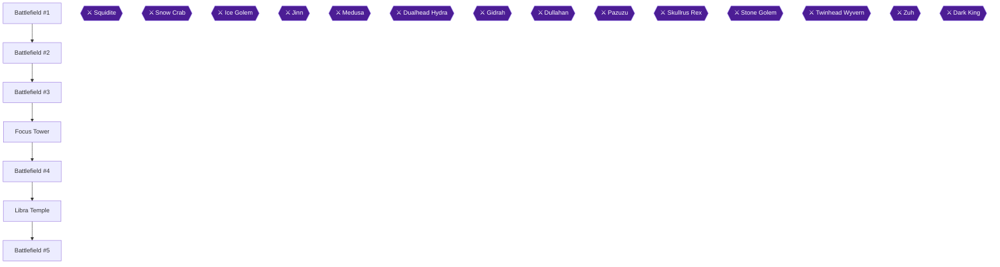

With Flamerus Rex beaten and the Elixir in hand, this chapter returns the Elixir to Kaeli, clears the first five battlefields, makes the first visit to the Focus Tower, and recruits Phoebe in Libra Temple. [[gf1-17-1, gf2-2-1, gf1-8-7]] Battlefields are optional fights on the world map: beat 10 rounds and you win a prize, such as EXP, GP or an item. [[gf2-2-1, gf1-13-1]] There are 20 battlefields in all, and this chapter covers #1 to #5. [[gf2-2-2]]

> [!WARNING]
> **Achievement Trigger Warning:** Which battlefield clear triggers Battlefield Tourist (the "Clear out a battlefield" achievement) is unconfirmed. One player reported clearing the first two battlefields without it unlocking [[ra-comments-6-1]]. Clear battlefields #1 to #5 in order. If it has not popped by then, keep clearing battlefields, since all 20 are needed later anyway.

> [!TIP]
> The Charm from Battlefield #2 can be skipped and returned to later if you are going for No Grinding Allowed. That is the only level-cap achievement in the set, and the guide says you are free to grind and clear battlefields after Flamerus Rex. [[ra-guide-6-2]]

### Foresta: return the Elixir

1. Leave the Bone Dungeon, and head back to Foresta. [[gf1-16-4]]
2. Enter Kaeli's house and go into the back room. Give Kaeli the Elixir. She tells you to visit Aquaria, going there via the Focus Tower. [[gf1-17-1, gf3-25-1]]
3. Before you leave, pick up the potions in the same places as last time. With the axe you can also cut trees in the south-east part of town for more. [[gf1-17-1]]

### Battlefield #1 (north of Level Forest)

The first battlefield is north of Level Forest, right before Sand Temple. [[gf1-13-1, gf3-76-1]] Enemies are Mad Plants and Poison Toads, and the prize is 54 EXP. [[gf2-8-2, gf4-2-3]] Have Tristam take out the Mad Plants and the hero take out the Poison Toads. [[gf3-76-2]] Mad Plants are weak against Axes. [[gf2-8-2]] If you get poisoned, return to Foresta and use the bed, or use Heal Potions. [[gf2-8-2]]

> [!ACHIEVEMENT]
> **Battlefield Tourist (3 Points)**
> 
> *Clear out a battlefield.*

If Battlefield Tourist does not unlock here, see the warning above and keep going. [[ra-comments-6-1]]

### Battlefield #2 (west of Sand Temple)

Head left from Sand Temple. [[gf1-14-1, gf3-76-3]] Enemies are Basilisk, Mad Plant and Poison Toad, and the prize is the Charm, an accessory that increases defense. [[gf3-76-3, gf1-14-1]] This is a tad harder than #1 because of the Basilisks, and many battles put three monsters against you. Have the hero kill the Mad Plants while Tristam takes care of the rest. [[gf2-8-4]] Clear all 10 rounds to collect the **Charm**. [[gf2-8-4, gf4-2-4]]

### Battlefield #3 (east of Sand Temple)

Head east from Sand Temple. [[gf2-10-7]] Enemies are Minotaur Zombies and Sand Worms, which you already met in the Bone Dungeon, and the prize is 150 GP. [[gf3-27-1, gf2-10-7, gf4-2-9]] Minotaur Zombies are the more dangerous foe here, since they can confuse, paralyze and blind you. [[gf2-10-7]] The Focus Tower is west of this battlefield, as the next section describes. [[gf2-11-3]]

### Focus Tower (first visit)

🗺️ **Map:** [View Mystic Quest Focus Tower&Doom Castle Map by Tropicon](https://www.vgmaps.com/Atlas/SuperNES/FinalFantasy-MysticQuest-FocusTower&DoomCastle.png) [[map-mystic-quest-focus-tower-doom-castle-1-1]]

Only this first visit's content belongs here. The Sand Coin opens the gold door, which lets you advance up the tower. [[gf3-24-6, gf2-48-1, ra-guide-7-2]]

#### 1F

1. Enter and walk forward until you see a 1-square gap in the wall on the left. Walk under it and keep going up. [[gf1-18-1]]
2. You meet the cloaked man again. He tells you to look for a girl named Phoebe and says "Mac" will play an important role. Then he leaves. [[gf1-18-1]]
3. Nearby, open the chest for **10 Bombs**. [[gf2-11-1, gf3-25-2]]
4. Use the Sand Coin on the gold door on the wall and go through it. The other doors stay closed because you lack their coins. [[gf2-11-1, gf3-25-2]]
5. Walk forward until you see more stairs and climb them. [[gf1-18-2]]

#### 2F

1. Turn left and head south to a chest holding the **Fire** spell. [[gf2-11-2, gf1-18-3, gf3-25-3]]
2. Walk back north and leave through the door on the top wall. [[gf1-18-3, gf3-25-3]]

You exit in a different part of the world, with Battlefield #4 to the east. [[gf2-11-3]]

### Battlefield #4 (east of the Focus Tower)

Enemies are Mintmints, and the prize is 99 EXP. [[gf3-77-2, gf2-11-3, gf4-2-10]] Switch to bombs and just hold down the A button for an easy win. [[gf3-27-3]] Quake also works well here. [[gf2-11-3]] Libra Temple is north of this battlefield. [[gf2-11-3]]

### Libra Temple

Enter. Open the chest above the omega tile for bombs. [[gf2-12-1, gf1-19-2]] Ignore the omega tile for now. Behind the chest stands a girl. [[gf2-12-1, gf1-19-2]] Talk to her to learn that Aquaria is frozen and her grandpa Spencer is trapped. Then Phoebe joins your party. [[gf2-12-5, gf1-8-7]]

> [!ACHIEVEMENT]
> **She Predates 'Friends' by Two Years (4 Points)**
> 
> *Be joined by Phoebe.*

Phoebe is good with magic. You can leave the temple after she joins. [[gf2-12-5]]

> [!TIP]
> Before you leave Libra Temple, note that the bombs chest is the only brown chest here and is an easy source of more bombs. [[checklist-items-6-14]]

### Battlefield #5 (east of Libra Temple)

Head east from the temple. [[gf2-12-5, gf3-77-4]] Enemies are Giant Toads and Mintmints, and the prize is 300 GP. [[gf3-27-4, gf4-2-11]] Giant Toads can poison and paralyze, so have Phoebe cast Heal when needed. Have her cast Thunder or Fire while the hero attacks. [[gf2-12-2]] Pound away on these little gobbers. [[gf3-78-1]]

> [!TIP]
> Before you leave, make sure all five battlefields are cleared. If Battlefield Tourist still has not unlocked, keep clearing battlefields as later chapters reach them. [[ra-comments-6-1]]

> [!IMPORTANT]
> ### Chapter 3 Cumulative 100% Checkpoint
> - **Battlefields:** 5 / 20
> - **Spellbooks:** 3 / 12
> - **RetroAchievements Unlocked:** 7 / 51 (35 / 324 points)

### Chapter Checklist

- [ ] Elixir given to Kaeli in Foresta
- [ ] Battlefield #1 cleared (54 EXP)
- [ ] Battlefield #2 cleared (Charm)
- [ ] Battlefield #3 cleared (150 GP)
- [ ] 10 Bombs chest on Focus Tower 1F opened
- [ ] Fire spell collected on Focus Tower 2F
- [ ] Battlefield #4 cleared (99 EXP)
- [ ] Phoebe joined in Libra Temple
- [ ] Battlefield #5 cleared (300 GP)
- [ ] Battlefield Tourist unlocked (or unconfirmed trigger noted)

---

## Chapter 4: Aquaria and the Wintry Cave

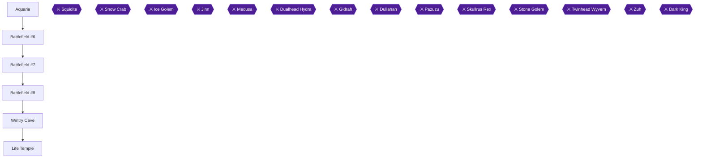

This chapter takes you from the frozen town of Aquaria through three Battlefields and the Wintry Cave, where you defeat the Squidite and claim the Libra Crest. You then use the crest to warp from the Libra Temple to the Life Temple, collect the Wakewater, and stand outside for a quick achievement [[gf1-21-1, gf3-26-3, checklist-items-3-1, ra-guide-8-3, checklist-items-2-9]].

Two achievements are available here: Captain Nemo (defeat the Squidite) and Hope You're Not Afraid of Heights! (stand outside the Life Temple). You also pick up the Steel Helm, the Magic Ring, and the Cat Claw, which count toward the collection achievements for helmets, accessories and claws [[ra-guide-8-3, ra-guide-9-3, checklist-items-5-1, checklist-items-5-11, checklist-items-6-8]].

> [!WARNING]
> **Missable Warning (Steel Helm):** Buy the Steel Helm in Aquaria before you pick up the Moon Helm in the Lava Dome (chapter 8). Once you take the Moon or Apollo helm, the woman will not sell you the Steel Helm if you return later, and the "Can't Be Too Careful" achievement can no longer be completed [[ra-comments-39-1, checklist-items-5-1]]. Bring 200 GP with you [[gf1-21-5]].

### Chapter Items to Collect

| Item | Where Found | Action / Requirement | Citation |
|---|---|---|---|
| Heal Potions | Chest in the first house on the left in Aquaria | **TAKE** | [[gf1-21-2]] |
| Heal Potions | Chest in Phoebe's house, Aquaria | **TAKE** | [[gf1-46-3]] |
| Refreshers | Chest in the house behind the first house, Aquaria | **TAKE** | [[gf1-21-3]] |
| Steel Helm (4 Defense) | Woman's house at the back of Aquaria | **BUY** for 200 GP | [[gf1-21-5, checklist-items-5-1]] |
| Magic Ring (3 Defense) | Battlefield #6, south of Aquaria | **WIN** by clearing the battlefield | [[gf3-78-2, gf1-20-3]] |
| Cat Claw | Wintry Cave, after the floor collapses | **TAKE** from Phoebe | [[gf1-23-2, checklist-items-6-8]] |
| Libra Crest | Chest that appears after the Squidite falls | **TAKE** | [[gf1-24-2, checklist-items-3-1]] |
| Wakewater | Cloaked man in the Life Temple | **TALK** | [[gf1-25-4, checklist-items-2-9]] |

### Aquaria

Enter Aquaria and head all the way to the left into the first house you see. Phoebe explains that her grandfather Spencer is trapped, that you need Wakewater to melt the ice, and that you first need the Libra Crest, which a monster in Wintry Cave stole [[gf1-21-1, gf3-26-3]]. Open the chest in this house for Heal Potions [[gf1-21-2, gf1-46-3]].

The house behind it holds Refreshers; reach it by crossing the middle platform's bridges [[gf1-21-3, checklist-items-2-3]]. The Inn rests you for 95 GP, and it also sells bombs and Cure Potions [[gf1-21-4, gf1-30-4, gf2-21-3]]. A building in the north-west section has a Gemini Warp to Fireburg, which you cannot use yet [[gf1-33-3]].

Now buy the Steel Helm: from the middle of town, take the left bridge and enter the house in the north-west part of town. The woman sells it for 200 GP [[gf3-26-5, gf1-21-5]].

> [!TIP]
> Before you leave Aquaria, confirm the Steel Helm is in your inventory. It is the only helmet you can lose access to [[ra-comments-39-1]].

### Battlefield #6

Leave Aquaria and go to the Battlefield south of Aquaria. It holds Giant Toads, Mintmints and Scorpions [[gf3-78-2]]. Before entering, make sure you have Black Magic left; Scorpions are weak against Fire [[gf1-20-2, gf1-83-5]]. Watch for the Scorpion's Rapier, which can do over 100 damage [[gf1-83-5]]. Defeat 10 sets of enemies to win the Magic Ring, which raises Defense by 3 [[gf1-20-3]]. If you are poisoned or paralyzed, use Phoebe's Heal spell [[gf2-12-4]].

### Battlefield #7

Next, clear the Battlefield south of Wintry Cave, which has Edgehogs, Giant Toads and Scorpions [[gf3-78-4]]. Edgehogs are weak against Fire and immune to Paralyze and Blind [[gf1-72-8]]. The prize is 99 EXP [[gf2-13-5, gf4-2-13]].

### Battlefield #8

Clear the Battlefield west of Wintry Cave, which contains only Desert Hags [[gf3-79-1]]. Their counterattack punishes physical hits that do not kill, so use Fire magic [[gf2-15-3, gf3-32-1]]. Clearing 10 battles wins 600 GP [[gf1-24-2, gf4-2-15]]. The guides place this one after the cave, so you can do it on your way back [[gf1-24-2]].

### Wintry Cave

🗺️ **Map:** [View Mystic Quest Wintry Cave Map by Tropicon](https://www.vgmaps.com/Atlas/SuperNES/FinalFantasy-MysticQuest-WintryCave.png) [[map-mystic-quest-wintry-cave-1-1]]

Suggested level is about 11, and you should be Level 13 before the boss [[gf4-2-14]]. Enemies are Centaurs, Edgehogs, Land Turtles, Land Worms, Scorpions, Sparnas and Giant Toads [[gf4-14-2, gf4-16-2, gf4-17-2, gf4-17-3, gf4-22-2]].

#### 1F: entrance to the collapse

1. At the start you have two ways to go. Head left first, beat the monsters, and open the chest for 10 bombs [[gf2-14-1, gf1-23-1, gf3-29-1]].
2. Return to the split and go the opposite way. Clear the Scorpion, climb the steps, and defeat the Edgehog on top [[gf2-14-1, gf1-23-1]].
3. Keep going, defeating the Land Worms. The ground crumbles and you slip [[gf1-23-1]].
4. Phoebe grabs the wall with her Cat Claw, gives it to you, and switches to the Bow and Arrows [[gf1-23-2, gf4-1-11]]. The Cat Claw climbs walls with hand grips and works in battle [[gf1-23-3, ra-guide-8-2, gf2-14-2]].

#### Lower level: Cat Claw climbing

1. A little to your right is a climbable wall; the chest on top holds Heal Potions [[gf1-23-4, gf2-14-3]].
2. Climb back up to the ledge you fell from, then head west. A Centaur blocks the way; beware its confusing Riddle [[gf2-14-4, gf1-71-1]].
3. Bomb the cracked wall behind where the Centaur stood. Beat the monsters inside to reach chests with Cure Potions and Arrows [[gf2-14-4]].
4. Continue east: two monsters guard a chest of three Cure Potions [[gf2-14-5, gf1-23-5]].
5. Return west, climb the wall, and drop onto a separate platform. Kill the Edgehog and a Land Worm [[gf2-14-5]].
6. Keep south past a Centaur to a chest holding three Refreshers [[gf2-14-6, gf1-23-7]].
7. Go northwest to a Scorpion blocking a wall. Climb the wall behind it, drop down, and defeat the Edgehog. Climb the next wall to the next platform, take out the Scorpion, and climb again [[gf2-14-6]].
8. Clear the Edgehog to reveal a cracked door and bomb it open [[gf2-14-7, gf3-29-5]]. The two chests at the entrance hold three Cure Potions and 10 Arrows [[gf2-14-7]].
9. Fight north through the room. In the next open section, southeast has two chests with Heal Potions and Arrows; northeast leads to the stairs [[gf2-14-8, gf1-23-8]].

#### 2F and the boss room

On 2F, go up, then right, and down to get some chests, then go up and through the door [[gf3-29-6]]. In the final room you start under a sheet of ice. Fight your way to the center platform; the nearby chest contains Arrows [[gf2-14-9]]. Heal up before the boss.

### Squidite

> [!ACHIEVEMENT]
> **Captain Nemo (5 Points)**
> 
> *Defeat the Squidite.*

Squidite has 2,500 HP, gives 219 EXP and 6 GP, and uses Blackness, Choke Up and Electrapulse [[gf1-23-11, gf3-136-2]]. It can do over 200 damage in one attack and can blind you or lower your magic [[gf1-85-11]]. One older listing gives 700 HP; the majority of sources say 2,500 [[gf1-23-11, gf3-67-4]].

1. Squidite begins with two Sparnas. Have Phoebe shoot them down with her Bow, while the Hero attacks Squidite [[gf2-48-7, gf3-68-1, gf4-11-6]].
2. Once they are gone, Phoebe casts Thunder, which Squidite is really weak against [[gf3-30-1, gf3-30-3, gf1-85-10]].
3. Heal when needed. When Phoebe's magic runs out, Hero can bomb it or attack physically [[gf1-23-12, gf2-48-7]].

Defeating it reveals a chest with the Libra Crest [[gf1-24-2, gf3-30-4, ra-guide-8-3]]. Retrace your steps out of the cave, and clear Battlefield #8 if you skipped it [[gf1-24-2]].

### Life Temple

1. Go back to the Libra Temple (check the chest for arrows) and step on the crest in the middle of the room to be transported to the Life Temple [[gf1-25-2, gf1-25-5]].
2. Walk through the door at the top to find the cloaked man. Talk to him to receive the Wakewater [[gf1-25-4, gf2-16-2, checklist-items-2-9]].
3. Open the chest for 3 potions [[gf1-25-5, gf2-16-1]].
4. Take the southern exit to stand outside the temple [[gf1-25-3, ra-comments-14-1]].

> [!ACHIEVEMENT]
> **Hope You're Not Afraid of Heights! (1 Points)**
> 
> *Stand outside the Life Temple.*

5. Step back onto the crest to return to the Libra Temple, then go to Aquaria [[gf1-25-5]].

In Aquaria you move automatically to the center, and the Wakewater revives the leaf, but the town stays frozen [[gf1-26-1, ra-guide-9-4, gf3-31-2]].

> [!TIP]
> Before you leave Aquaria, make sure Battlefields #6, #7 and #8 are cleared and the Steel Helm is bought. Next, Falls Basin lies just north of Aquaria [[gf1-26-1]].

> [!IMPORTANT]
> ### Chapter 4 Cumulative 100% Checkpoint
> - **Battlefields:** 8 / 20
> - **Spellbooks:** 3 / 12
> - **Missable Helm Bought (Steel Helm):** done before Lava Dome [[checklist-items-5-1]]
> - **RetroAchievements Unlocked:** 9 / 51 (41 / 324 points)

### Chapter Checklist

- [ ] Steel Helm bought in Aquaria (200 GP)
- [ ] Heal Potions and Refreshers taken in Aquaria
- [ ] Battlefield #6 cleared (Magic Ring)
- [ ] Battlefield #7 cleared
- [ ] Battlefield #8 cleared
- [ ] Cat Claw received from Phoebe
- [ ] Squidite defeated (Captain Nemo)
- [ ] Libra Crest taken
- [ ] Wakewater received
- [ ] Stood outside the Life Temple (Hope You're Not Afraid of Heights!)
- [ ] Wakewater used on Aquaria's leaf

---

## Chapter 5: Falls Basin and the Ice Pyramid

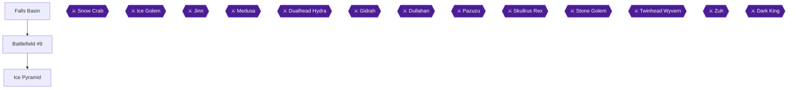

This chapter takes you through Falls Basin (an ice block puzzle that ends with the Snow Crab and the Heal spell), Battlefield #9, and the Ice Pyramid, which ends with the Ice Golem and the River Coin. Several achievements depend on order here: Heal must be taken before the Ice Golem dies, and the Magic Mirror must stay unopened until the Ice Golem is beaten [[ra-guide-7-10, ra-guide-10-4, ra-comments-18-1]].

The planned order is:

1. Open the Heal chest in Falls Basin, then beat the Snow Crab.
2. Clear Battlefield #9.
3. Climb the Ice Pyramid, opening every optional chest except the Magic Mirror chest.
4. Beat the Ice Golem and take the River Coin.
5. Walk back to the Magic Mirror chest and finish any chest still closed.

[[ra-guide-10-4, ra-guide-10-9, ra-comments-17-1]]

Suggested levels from the sources: about 14 for Falls Basin, Level 15 before the Snow Crab, and Level 16 before the Ice Golem [[gf3-32-2, gf4-2-16, gf4-2-20]].

> [!WARNING]
> **Missable Warning (Heal spellbook):** Heal sits in a chest in Falls Basin, and that area becomes unavailable after the Ice Pyramid is cleared. Open the Heal chest before you beat the Ice Golem; it is needed for The Bright Side [[ra-guide-7-10, ra-guide-21-3, ra-comments-27-1]].

> [!WARNING]
> **Missable Warning (Never Saw It Coming):** Do not pick up the Magic Mirror before the Ice Golem is beaten. Picking it up prevents the achievement from unlocking [[ra-comments-18-1, ra-comments-16-3, ra-guide-10-4]].

### Falls Basin

🗺️ **Map:** [View Mystic Quest Falls Basin Map by Tropicon](https://www.vgmaps.com/Atlas/SuperNES/FinalFantasy-MysticQuest-FallsBasin.png)

Falls Basin lies just north of Aquaria and is a small block-pushing puzzle [[gf1-26-2, ra-guide-9-5]]. Its enemies are Desert Hags and Lamias [[gf3-32-2]]. Several sources give block sequences that differ in wording and in the number of steps, so follow one guide throughout and check each block against the map as you go. The sequence below follows the Gamefaqs guide with the most detailed breakdown.

#### The ice block puzzle

1. **First block.** Push the block in front of you 9 spaces up, then 7 to the left, then 1 up. It should end up between two platforms [[gf2-17-1]].
2. Go through the opening ahead and defeat the Desert Hag. Cross the small room to the next opening [[gf2-17-1]].
3. Jump onto the block you just pushed, then across to the opposite platform. Continue south, beat another Desert Hag, walk down the small steps, and fight the Lamia to reveal the second ice block [[gf2-17-1]].
4. **Second block.** Push it four spaces right and one up, so it also sits between two platforms [[gf2-17-1]].
5. Go back west and up the small steps, head east, and use that block to cross the gap. Keep going east and fight the next Lamia [[gf2-17-1]].
6. **Third block.** Move it four spaces left, one up, two more left, six up, and ten right [[gf2-17-3]].
7. **South block.** Push the block at the south end of the screen four spaces up, eight right, one down, and three right, so it rests right below the third block [[gf2-17-3]].
8. **Third block again.** Re-locate it: one right, one down, eight right, one up, three right, and one up [[gf2-17-3]].
9. Walk to the southeastern corner of the chamber, use the stairs, head north, and hop over the gap onto the two blocks you placed [[gf2-17-4]].

Note that other guides describe the same puzzle with different step counts. A shorter version reads: first block 9 up, 7 left, 1 up; next block 4 right then 2 north; another 3 left; then 2 up and 11 right; and finally the block near the entrance 1 left, 1 up, 2 left, 11 up, 4 right and 2 up [[gf3-32-3]]. Another gives: first block 9 north, then left to the wall, then 1 more north, and walk around it through the door in the ice wall [[gf1-26-2]]. Treat these as alternates; I cannot reconcile them from the sources.

#### Chest and the Heal spell

1. Kill the Desert Hag past the blocks, then open the chest for bombs [[gf2-17-4, gf1-26-5]].
2. Defeat the nearby Lamia and follow the path to the point where you placed the third block. Hop across onto it [[gf2-17-4]].
3. Before the boss, open the chest next to it for the **Heal** spell. Go around the Snow Crab to reach it, then return to fight [[gf2-17-5, gf1-26-6, gf3-33-3]].

Heal cures abnormal statuses. A tip from the sources says that using Heal on an enemy could put it to sleep, paralyze, poison, confuse, or petrify it [[gf3-146-2]].

Replenish your HP before the fight.

### Snow Crab

> [!ACHIEVEMENT]
> **An Arctic Specialty (5 Points)**
> 
> *Defeat the Snow Crab.*

The Snow Crab fight earns An Arctic Specialty [[ra-guide-9-9]]. The Gamefaqs boss lists give 3,000 HP, 234 EXP, and 6 GP [[gf3-33-1]]. One lister gives 750 HP, which conflicts with the other sources; plan for 3,000 [[gf4-11-3, gf3-68-3]]. Be Level 15 or so before fighting [[gf4-2-16]].

Strategy:

- The Snow Crab fights alongside two Desert Hags [[gf2-17-6, gf1-84-10]].
- Start by casting Fire on all enemies. Once the Hags are dead, focus on the Snow Crab with Thunder or Fire from Phoebe (Thunder works better) and Fire or Cure from the hero as needed [[gf3-33-2, gf3-69-1]].
- Desert Hags and the Snow Crab are weak to Fire [[gf4-11-4]].
- The Snow Crab can deal 200+ damage with ordinary attacks, so heal when necessary. When its HP is low it begins to use Tornado for very heavy damage [[gf2-17-6]].

> [!CAUTION]
> **Point of No Return:** After the fight Phoebe gives you the Jumbo Bombs. Once the bombs upgrade to Jumbo Bombs, the Bone Dungeon Steel Shield chest can no longer be obtained [[ra-guide-9-8, ra-comments-10-4]]. This was already collected in Chapter 2.

After the battle, head to the cracked door; Phoebe explains Jumbo Bombs, which deal more damage while still blowing up cracked doors. Use one on the wall just ahead of you [[gf1-27-1, gf2-17-7, gf3-33-4, checklist-items-6-12, ra-guide-9-7]].

> [!TIP]
> **Before you leave Falls Basin:** Beating the Ice Golem later in this chapter locks you out of Falls Basin and the Heal spellbook. Confirm you already own Heal before you finish the Ice Pyramid [[ra-guide-10-8, ra-comments-27-2]].

### Battlefield #9

Leave Falls Basin and walk north. If you want healing first, Aquaria is nearby [[gf2-17-7]]. The Battlefield sits north of Falls Basin, in front of the Ice Pyramid [[gf3-79-2, gf1-27-2]].

- Enemies: Lamia, Desert Hag, and Mage [[gf2-17-8, gf3-79-2]].
- Reward: 540 EXP [[gf2-17-8, gf4-2-17]].
- Use Fire and your new Jumbo Bombs [[gf3-33-5]].
- Desert Hags have counter-attacks, so use Fire or kill them physically. Lamias can inflict sleep or confusion (keep Heal handy) and are weak to Thunder. Mages cast Blizzard and heal themselves with Cure when low [[gf2-17-8, gf2-17-9]].

This is battlefield #9 of the 20 in the game; clear it before heading on [[gf3-79-2]].

> [!TIP]
> **Before you leave:** Heal up and refresh your team before entering the Ice Pyramid [[gf2-18-1]].

### Ice Pyramid

🗺️ **Map:** [View Mystic Quest Ice Pyramid Map by Tropicon](https://www.vgmaps.com/Atlas/SuperNES/FinalFantasy-MysticQuest-IcePyramid.png)

The Ice Pyramid is the home of the Crystal of Water. Enemies are invisible here until you get the Magic Mirror, but you must not take it until after the Ice Golem [[ra-guide-10-1, ra-guide-10-4, gf1-65-1]]. You can stab statue switches with your sword [[ra-guide-10-2]].

Fridge Raider asks for every optional chest in the Ice Pyramid, **including the Magic Mirror chest**, so you must loop back for it after the boss [[ra-comments-17-1, ra-comments-17-4]]. You must collect the loot, not just open the chest: if you are at max arrows or bombs, enter a fight and attack or throw a bomb to make room [[ra-comments-17-2]]. Leaving the dungeon resets most optional chests, so do not leave until you are done [[ra-comments-17-5]]. Set Phoebe to manual so she does not waste Fire on regular encounters, because you want it for the boss [[ra-comments-17-3]].

Treasure totals reported for the dungeon: Magic Mirror, Knight Sword, Noble Armor, Arrows x140, Heal Potions x12, Cure Potions x9, Refreshers x6, Explosives x70, and River Coin [[gf4-2-18]]. Other guides give different counts for arrows and bombs; I cannot reconcile them.

Enemy stats here: Desert Hag 300 HP, Edgehog 200, Freezer Crab 400, Gather 350, Lamia 300, Mage 300, Phanquid 500, Scorpion 200, Sphinx 300 [[gf4-14-5, gf4-14-6, gf4-15-3, gf4-15-6, gf4-17-1, gf4-18-2, gf4-19-5, gf4-21-1, gf4-22-4]].

> [!WARNING]
> **Missable Warning:** The red chest on the first floor, right of the entrance, holds the Magic Mirror. Leave it closed until after the Ice Golem [[ra-comments-18-4, ra-comments-16-3]].

#### 1F: entrance area

1. A wall blocks the way. Stab the oddly coloured statue on the right with your sword and the wall opens [[gf2-18-1, gf1-28-4]].
2. Head through the door and east along the path to a fork, continue east to the lower-left of the chamber, and walk a little north. The right path leads to the Magic Mirror chest: **skip it for now** [[gf2-18-1, checklist-items-2-12]].
3. Take the left path instead. Defeat the Desert Hags and open the chest for **Explosives** [[gf2-18-2, gf1-28-4]].
4. Return to the entrance. Go southwest and open the two chests for **Refreshers** and **Arrows** [[gf2-18-3, gf1-28-4]].
5. Take the right path of the other two. Beat the Desert Hag, and the Mage blocking the stairs. On the next floor, go a little north to the **Heal Potions** guarded by a Phanquid [[gf2-18-4, gf1-28-5]].
6. Back at the two empty chests, take the left path. A Lamia appears and you have three options: northeast, southeast, and northwest [[gf2-18-6]].
7. Southeast: defeat the Mage blocking the stairs and ascend. Defeat the Lamia and walk into the wall she stood in front of, and open the chest of **Arrows** [[gf2-18-6, gf1-28-7]].
8. Northeast: beat the Desert Hag, push past the next monster, and defeat the Mage blocking the stairs. On the next floor, head south to the blue-tinged statue and hit it with your sword. The wall opens to a chest of **Arrows** [[gf2-18-6]].

#### Floors 2F-3F

1. Keep going past the Lamia, following the path to a staircase to 3F [[gf2-18-6]].
2. On 3F move right. A Freezer Crab guards a chest of **Arrows**; further south there is another chest of **Arrows**, which you jump over to continue [[gf2-18-6, gf1-28-7]].
3. At the end, poke the suspicious statue; the wall to your left rises [[gf2-18-6]].
4. Backtrack to the entrance stairs and head west. At the south end there is an opening in the wall; walk through into a fight with Stoney Roosts. Afterwards the chests ahead hold **Bombs** and **Arrows** [[gf2-18-9, gf1-28-9]].
5. Exit, continue east to the switch area, turn left through the doorway to the stairs [[gf2-18-9]].

#### 4F and 5F

1. On 4F head left, kill the Mage, and walk to the southeastern corner where a Sphinx guards a staircase. Go up and walk forward so you fall into the middle of 4F [[gf2-19-1, gf1-28-10]].
2. You are surrounded by chests and monsters. Open them all for 40 Arrows, 3 Refreshers, 3 Heal Potions, 3 Cure Potions, and the **Noble Armor** (+12 defense, protects against Water and Poison). Do not forget the Noble Armor [[gf2-19-1, gf1-28-10, ra-guide-20-2]].
3. A statue sits at the northwest corner of the area; hit it with your sword to open a door on the opposite side. Retrace to the southeast corner and return to 5F without falling [[gf2-19-1, gf2-19-2]].
4. On 5F, head left. After the monster, open the two chests (jump over the first to reach the second). Both hold **Bombs** [[gf2-19-2]].
5. Kill the Stoney Roost, continue north, defeat the Gather. North: kill the Freezer Crab, walk past, and pick up **Bombs** at the far end [[gf2-19-3, gf1-29-2]].
6. Back at the middle platform, head left. The darker blue line is a wall, not a path. Walk north and jump at the chest from behind for **Cure Potions** [[gf2-19-4, gf1-29-2]].

#### Falling to B1

1. On the middle platform of 5F, bomb the cracked tile in the center to make a hole [[gf2-19-5, gf3-34-3, gf1-29-3]].
2. Fall and keep falling to 1F, where six blue statues sit above you. Poke any one to open the floor, and continue to B1 [[gf2-19-6, gf3-34-3, checklist-items-6-3]].
3. On B1 you are surrounded by enemies and chests. Open them for **Arrows**, **Heal Potions**, **Cure Potions**, and the **Knight Sword** (in the fancy chest) [[gf2-19-6, gf1-29-2, checklist-items-6-3, ra-guide-7-3]].
4. Climb the platform above with the Cat Claw to meet the Ice Golem, who leaves. Head to the southeast corner and take the stairs to go under the ice [[gf1-29-3, gf2-19-6]].
5. Go northwest, defeat the Lamia guarding a doorway, and clear the enemy in front of the wall. Climb it with the Cat Claw to a Sphinx at the top. Slay it [[gf2-19-6]].
6. Continue straight to a doorway. Hitting the statue on the right reveals two chests of Arrows, but you must drop all the way to 5F to get them. These are optional chests, so for Fridge Raider you will need them [[gf2-19-6, gf1-29-2]]. Another guide notes two chests with 10 bombs each guarded by a Sphinx on the right [[gf1-28-9]]. Unable to verify from collected sources how these two sets line up.
7. Heal up and follow the icy path to the Ice Golem [[gf2-19-6]].

### Ice Golem

> [!ACHIEVEMENT]
> **Never Saw It Coming (10 Points)**
> 
> *Defeat the Ice Golem without having obtained the Magic Mirror.*

Confirm again that you have not opened the Magic Mirror chest and that you already own Heal. Beating the Ice Golem without the Mirror grants Never Saw It Coming [[ra-guide-10-7, ra-comments-18-4]].

- Stats: 6,500 HP and 246 EXP, 0 GP [[gf1-29-6, gf3-35-1]]. One list gives 600 HP, which conflicts; plan for 6,500 [[gf4-8-5]].
- It is made of ice and weak to Fire. Have Phoebe use Fire (Thunder works decently) and the hero attack normally or heal [[gf1-29-6, gf3-35-2, gf2-19-7, gf4-8-6]].
- Nearly all of its attacks deal 200+ damage; Snow Storm also heals it, and Stomp Stomp does huge damage. When it begins to melt it is going down [[gf1-29-6]].
- When the Fire runs out, use normal attacks [[gf2-19-7]].

> [!CAUTION]
> **Point of No Return:** Beating the Ice Golem locks Falls Basin, and with it the Heal spellbook [[ra-guide-10-8, ra-comments-27-2]].

After the fight a crystal appears and Phoebe leaves for Aquaria. Open the chest for the River Coin [[gf2-20-1, gf3-35-2, ra-guide-10-6]].

> [!ACHIEVEMENT]
> **Let It Flow (5 Points)**
> 
> *Obtain the River Coin.*

The River Coin opens the blue door in the Focus Tower [[gf2-47-4, checklist-items-3-4, gf4-2-19, gf4-3-37]].

### Collecting the Magic Mirror and any remaining chests

The sources say no spells are obtainable here, so you can freely collect the remaining treasures on your way out [[ra-guide-10-9]].

1. Walk back to the first floor and open the red chest to the right of the entrance for the **Magic Mirror** [[ra-comments-18-4, gf2-18-1, gf3-34-3]]. Route: after the sword-opened door, go right, down, right, straight up past a Desert Hag, and right past a Lamia to the chest [[checklist-items-2-12]].
2. The Mirror lets you see invisible enemies [[gf2-47-2, gf1-65-1]].

> [!ACHIEVEMENT]
> **Narcissus (3 Points)**
> 
> *Obtain the Magic Mirror.*

Narcissus may not unlock right away: one player's achievement popped only after loading the save later. If it does not pop, save and reload [[ra-comments-16-2, ra-comments-16-1]].

3. Check the map for any chest still closed, including the optional ones listed above, to complete Fridge Raider. Remember to actually collect the loot [[ra-comments-17-2, ra-comments-17-4]].

> [!ACHIEVEMENT]
> **Fridge Raider (10 Points)**
> 
> *Open all optional treasure chests in the Ice Pyramid.*

> [!TIP]
> **Before you leave:** Confirm you hold the Knight Sword, Noble Armor, River Coin, Magic Mirror, and Heal, and that all Ice Pyramid chests are open. Leaving resets most optional chests [[ra-comments-17-5, ra-guide-10-9]].

Leave the pyramid and return to Aquaria; the map has changed [[gf1-29-6, gf2-20-1]].

> [!IMPORTANT]
> ### Chapter 5 Cumulative 100% Checkpoint
> - **Battlefields:** 9 / 20
> - **Spellbooks:** 4 / 12 (Heal collected in Falls Basin)
> - **Equipment from this chapter:** Jumbo Bomb, Knight Sword, Noble Armor
> - **Key items:** River Coin, Magic Mirror
> - **RetroAchievements Unlocked:** 14 / 51 (74 / 324 points)

[[gf3-33-3, gf3-79-2, checklist-items-6-12, checklist-items-6-3, gf1-28-10, checklist-items-3-4]]

### Chapter Checklist

- [ ] Heal spellbook taken from the Falls Basin chest before the Ice Golem
- [ ] Snow Crab defeated (An Arctic Specialty)
- [ ] Jumbo Bombs received from Phoebe
- [ ] Battlefield #9 cleared
- [ ] Knight Sword (B1) and Noble Armor (4F) collected
- [ ] Magic Mirror chest left closed until after the boss
- [ ] Ice Golem defeated (Never Saw It Coming)
- [ ] River Coin obtained (Let It Flow)
- [ ] Magic Mirror obtained after the boss (Narcissus)
- [ ] All optional Ice Pyramid chests opened (Fridge Raider)

---

## Chapter 6: Spencer's Place, the Venus Key and Fireburg

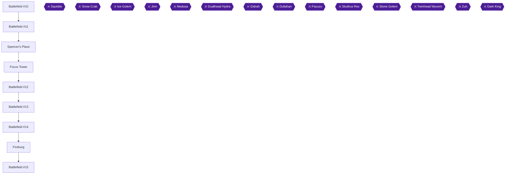

This chapter takes you from the thawed town of Aquaria to Spencer's Place for the Venus Key, through the Focus Tower for the Venus Shield and the Blizzard spell, and across to Fireburg, where Reuben joins you. Along the way you clear Battlefields #10 to #15, buy the Battle Axe, and collect the Multi-Key and the Mega Grenade [[ra-guide-11-1, gf1-30-2, gf1-32-2, gf1-32-3, gf1-34-8, gf1-34-5]].

Three achievements are placed here: Hold the Sauerkraut (Reuben joins), Rock 'n' Roll! (the band in the hotel) and Just Throw It (the third and last bomb, the Mega Grenade). Two items in this chapter are missable, so read the warnings before you act. Do not take the Thunder Rock from Reuben's father in this chapter; it belongs to chapter 12.

> [!WARNING]
> **Missable Achievement Warning:** The Venus Shield (achievement 449373) must be taken before you talk to the giant tree in the Alive Forest in chapter 9. Speaking with the big tree first means the Venus Shield can no longer be obtained [[ra-comments-49-1]]. A commenter also says the first shield (the Steel Shield from the Bone Dungeon) can be lost if you upgrade your bombs first, and the Steel Shield is listed as missable [[ra-comments-49-3, ra-guide-20-4]]. You collected the Steel Shield earlier; this chapter's job is the Venus Shield.

> [!WARNING]
> **Missable Achievement Warning:** Buy the Battle Axe in Fireburg (achievement 449368, Chop Chop) before you get the Giant's Axe in the Alive Forest in chapter 9. One player reached the end of the game without buying it, and the woman would not sell it afterwards [[ra-comments-34-1, checklist-items-6-6]].

### Battlefield #10 (north of Libra Temple)

From Aquaria, head to the Libra Temple and go north. Two Battlefields are here [[gf2-21-4]].

Battlefield #10 is north of Libra Temple and holds Phanquids and Sphinxes [[gf3-39-1]]. Clearing it rewards the **Exit** spell [[gf1-31-1, checklist-items-4-2]]. Use your Knight Sword on the enemies, or a Jumbo Bomb if the sword is not taking out the Phanquids [[gf1-31-2]]. Take down the Sphinxes first, because Riddle can confuse you and Phanquids can blind you [[gf2-21-4]].

### Battlefield #11 (north of Wintry Temple)

Battlefield #11 is north of the Wintry Temple and holds Freezer Crabs and Gathers [[gf3-39-2]]. Clearing it gives 744 EXP [[gf1-31-3, gf2-21-5]]. It is the second of the two battlefields you reached from Libra Temple, just left of Battlefield #10, so walk straight over once #10 is cleared [[gf1-31-3, gf2-21-4]]. Fight every round until the battlefield is cleared; it counts toward Battlefield Expert [[gf2-21-5]].
### Spencer's Place

🗺️ **Map:** [View Mystic Quest Spencer's Place Map by Tropicon](https://www.vgmaps.com/Atlas/SuperNES/FinalFantasy-MysticQuest-Spencer'sPlace.png)

Aquaria is no longer frozen. Take the stairs into the water and swim to the house at the bottom-left of the screen, then go underneath it to enter Spencer's Place [[gf1-30-1, checklist-items-2-11]].
1. At the start of the tunnel, use the steps to climb onto dry land, then go south across a bridge and down a long staircase [[gf2-21-1]].
2. Cross more bridges to the foot of the waterfall and go through the opening into the next area. The path is linear with no monsters [[gf1-30-2, gf2-21-1]].
3. Ignore the first bridge leading west. Take the other bridge, which leads to Spencer [[gf2-21-1]].
4. Talk to Spencer. He hands you the **Venus Key** and hints that you should go to Focus Tower and Fireburg [[gf2-21-1, gf1-30-2, gf3-36-2]].

Optional chest: north of Spencer is a doorway. Follow it through the wall, climb the nearby wall with the Cat Claw, and drop down to a chest of Cure Potions [[gf2-21-2, gf1-30-3]].

Leave the cave and head to the Focus Tower. You may stop at the inn first [[gf2-21-1]].

### Focus Tower

🗺️ **Map:** [View Mystic Quest Focus Tower&Doom Castle Map by Tropicon](https://www.vgmaps.com/Atlas/SuperNES/FinalFantasy-MysticQuest-FocusTower&DoomCastle.png)

#### 2F: Venus Shield and Blizzard

Enter the Focus Tower. You begin on 3F with a staircase right in front of you; go down it to meet the familiar cloaked man, who tells you to seek Reuben in Fireburg and mentions a statue [[gf2-22-1]]. This is not the entrance near Libra Temple; you use that one second, after the statue puzzle.

1. Bomb the wall or door immediately to your left and walk through the passage [[gf2-22-1, gf1-32-2]].
2. Open the chest, using the Venus Key, to get the **Venus Shield** (10 Defense, Paralyze protection) [[gf2-22-1, checklist-items-5-8, ra-comments-49-2]]. Equip it.
3. Return to the stairs and cross to the other side of the room. The chest on the left side holds the **Blizzard** spell [[gf2-22-2, gf1-32-3, checklist-items-4-6]].

#### The statue puzzle

Move the statue as the man mentioned. Push it two squares left, then down until it hits the south wall, then left until it is stopped by the stone block [[gf2-22-3]]. Another source gives it as 2 left, 5 down, 5 left [[gf3-37-2]]. The end position must be one space right of the metal/stone block on the bottom wall; any other spot will not work [[gf1-32-4]].

#### Second entrance: River Coin door

1. Leave the tower and circle around to enter through the other entrance, near Libra Temple [[gf1-32-5, gf2-22-4]].
2. Head down the first set of stairs, go around, and walk through the opened door to the four colored doors [[gf2-22-4, gf1-32-5]].
3. Use the **River Coin** on the blue door and continue up the next stairs [[gf2-22-4, gf2-47-4]].
4. Head down and jump the gap using the statue you moved, then go left and up to the stairs [[gf1-32-6, gf2-22-4]].
5. Climb up and open the chest to the south for Cure Potions (some sources say potions) [[gf2-22-5, gf1-32-6]].
6. The exit is due north of the chest. You arrive in the Fireburg part of the world, and the ground shakes as you move [[gf2-22-5, gf1-32-6]].

### Battlefield #12

Battlefield #12 is west of the Focus Tower on the Fireburg side and holds only Jellies [[gf3-39-3, gf1-33-1]]. Clearing it gives 900 GP [[gf2-22-6]]. Jellies are weak to bombs, so throw Jumbo Bombs [[gf1-33-1, gf2-22-6]].

### Battlefield #13

Head north to the next Battlefield. It holds Jellies and Sting Rats [[gf3-80-1]]. Clearing it gives the **Gemini Crest**, which you need in chapter 7 [[gf2-22-7, gf1-33-2, checklist-items-3-2]]. Blizzard is the Sting Rats' weakness, or cut them down with the Knight Sword; beware Poison Sting [[gf2-22-7]].

### Battlefield #14

The last Battlefield before Fireburg holds only Plant Men and gives 816 EXP [[gf1-34-1, gf2-22-8]]. Swap to an Axe, since Plant Men are weak to it, and keep Heal ready for Bad Breath ailments [[gf2-22-8]]. Then head west to Fireburg [[gf1-34-1]].

### Fireburg

#### Reuben joins

> [!WARNING]
> **Achievement Trigger Warning:** Do not skip Reuben. Head north from the town entrance to find the hotel; Reuben's house is on its left [[gf1-34-2, gf2-23-3]].

1. Go into Reuben's house, take the Refreshers from the chest, and talk to Reuben. He needs help rescuing his father, and joins [[gf1-34-2, gf2-23-3, gf1-8-10]].

> [!ACHIEVEMENT]
> **Hold the Sauerkraut (5 Points)**
> 
> *Be joined by Reuben.*

#### Rock 'n' Roll!

Go to the hotel and speak to the girl in front of the band inside [[ra-comments-20-1, ra-comments-20-2, ra-guide-11-15]]. A night at the hotel costs 95 GP [[gf2-23-1]].

> [!ACHIEVEMENT]
> **Rock 'n' Roll! (1 Points)**
> 
> *Dance to a rockin' beat.*

#### Multi-Key and the Mega Grenade

1. Climb down the wall in front of the hotel with the Cat Claw to reach the locked house; you cannot enter yet [[gf2-23-4, gf1-34-5]].
2. Return to the hotel, walk to the back by the bar, and talk to Tristam for the **Multi-Key** [[gf2-23-4, gf1-34-5, gf3-38-2]].
3. Before the locked house, you may buy Seeds from the hotel and Cure Potions [[gf2-23-4, gf1-34-6]].
4. Unlock the house with the Multi-Key and talk to the man. He teaches you to throw the Mega Grenade (162 attack) and gives it to you; you can try it out [[gf2-23-5, gf3-38-3, checklist-items-6-13]].

This is the third bomb after the Bomb (Bone Dungeon) and the Jumbo Bomb (Falls Basin) [[checklist-items-6-11, checklist-items-6-12, gf4-3-25, gf4-3-26, gf4-3-27]].

> [!ACHIEVEMENT]
> **Just Throw It (5 Points)**
> 
> *Obtain all bombs.*

#### Battle Axe

Go to the house in the lower-left (south) part of town. The woman sells the **Battle Axe** (69 attack) for 500 GP [[gf2-23-5, gf1-34-8, checklist-items-6-6, ra-guide-11-14]]. Buy it now. Plant Men are weak to it [[gf2-23-9]].

#### Other shops

- A man outside the inn sells explosives, though they are somewhat expensive [[gf1-34-7]].
- A strange tile in the woman's basement warps you to a house in Aquaria [[gf2-23-7]].

> [!TIP]
> Do not take the Thunder Rock from Reuben's father yet; that belongs to chapter 12 [[gf1-56-2]].

### Battlefield #15

Leave Fireburg to the west. Battlefield #15 holds Sting Rats, Flazzards and Plant Men and gives 1200 GP [[gf2-23-8, gf1-35-1]]. Use Blizzard on Flazzards and Sting Rats and the Axe on Plant Men [[gf3-81-1, gf2-23-10, gf2-23-9]]. Reuben has only Life, so rely on Benjamin's Heal for poison [[gf2-23-10]].

> [!TIP]
> Before you leave, confirm you own the Venus Shield, Blizzard, the Gemini Crest, the Multi-Key, the Mega Grenade and the Battle Axe.

> [!IMPORTANT]
> ### Chapter 6 Cumulative 100% Checkpoint
> - **Battlefields:** 15 / 20
> - **Spellbooks:** 6 / 12
> - **Key items:** Venus Key, Gemini Crest, Multi-Key, Mega Grenade [[gf1-30-2, gf2-22-7, gf3-38-2, gf3-38-3]]
> - **RetroAchievements Unlocked:** 17 / 51 (85 / 324 points)

### Chapter Checklist

- [ ] Battlefields #10, #11, #12, #13, #14, #15 cleared
- [ ] Exit spell and Blizzard spell learned
- [ ] Venus Key from Spencer, Venus Shield equipped
- [ ] Gemini Crest obtained
- [ ] Reuben joined (Hold the Sauerkraut)
- [ ] Band girl spoken to (Rock 'n' Roll!)
- [ ] Multi-Key and Mega Grenade obtained (Just Throw It)
- [ ] Battle Axe bought for 500 GP

---

## Chapter 7: The Mine and the Sealed Temple

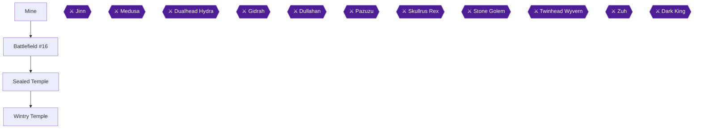

This chapter takes you through the Mine, where you collect the Charm Claw and defeat Jinn, then to Battlefield #16 for the Thunder spellbook, and finally to the Sealed Temple and Wintry Temple for the last achievement of the stretch. The Mine holds the Charm Claw chest [[gf1-36-3]], Jinn is the boss at the end [[gf1-36-6, gf4-9-1]], and defeating him lets Reuben free his father by moving the boulder [[gf1-36-8, ra-guide-12-3]]. The boulder then forms a bridge on the world map to the Sealed Temple [[gf1-37-3]].

> [!TIP]
> **Preparation:** The suggested level for the Mine is 19 [[gf3-41-2]], and one guide says you should be Level 20 before fighting Jinn [[gf4-2-31]]. Bring Mega Grenades, since they are one of the recommended attacks against Jinn [[gf3-70-3]]. Hero should have Thunder, which you win at Battlefield #16 [[gf1-35-2]].

### Battlefield #16 (South of the Mine)

Battlefield #16 is the second battlefield west of Fireburg, south of the Mine, and it is where you get the Thunder spellbook [[checklist-items-4-11, gf3-41-1]]. Clear it before you enter the Mine, because the Hero uses Thunder against Jinn [[gf1-36-6]].

- Enemies are Flazzards and Red Caps [[gf2-23-11]]. Cast Blizzard on the Flazzards and use the Axe on the Red Caps [[gf3-81-3]].
- Red Caps can use Stare to confuse your units or Hypno-sleep to put someone to sleep [[gf2-23-12]].
- The battlefield is 10 rounds of monsters [[gf1-35-2]]. Clear them all to win the **Thunder** spell, your first Wizard spell [[gf1-35-2, gf4-2-29]].

Once you have Thunder, head north to the Mine [[gf1-35-2]].

### Mine

🗺️ **Map:** [View Mystic Quest Mine Map by Tropicon](https://www.vgmaps.com/Atlas/SuperNES/FinalFantasy-MysticQuest-Mine.png) [[map-mystic-quest-mine-1-1]]

The Mine is full of one-way sections: the conveyors and elevators only move in one direction [[ra-guide-12-1]]. If you go one way on a belt or pulley, you cannot go back without finding the alternative route [[gf2-24-1]]. You need Mega Grenades to blow open cracked walls and blocked doors. The enemies here include Zombies, Red Bones, Red Caps, Flazzards and Plant Men [[gf3-41-1, gf4-2-30]].

> [!TIP]
> The Mine's optional treasures total Charm Claw, Heal Potions x6, Cure Potions x6 and Explosives [[gf4-2-30]]. The Charm Claw is the one you need, since it counts toward the claws achievement [[ra-guide-19-8, checklist-items-6-9]]. The side caves hold only minor items [[gf3-41-1]].

#### Starting platform and the northern cave

1. From the entrance, take the conveyor belt heading upward [[gf1-36-1]]. The belt to the east cannot be used at first because it moves toward you [[gf2-24-1]].
2. Fight the Red Bone at the top, then head right [[gf1-36-1]].
3. Bomb the cracked wall or door on this platform to enter a cave [[gf1-36-1, gf2-24-1]].
4. Inside, climb down the wall on the left or right side of the cave. Each side has four enemies guarding chests [[gf1-36-1]]. Monsters block the chests but give good EXP [[gf2-24-1]].
5. Open the chest on the right for **Heal Potions** and the chest on the left for **Potions** [[gf1-36-1, gf1-36-2]]. One guide lists the contents as Heal Potions and Cure Potions [[gf2-24-1]].
6. Leave the cave and return to the platform [[gf1-36-1]].

#### The bucket ride and the Charm Claw

1. Step onto the conveyor belt on the right to reach another platform [[gf1-36-3]].
2. On the right is a bucket and pulley mechanism. Ride it to the bottom [[gf1-36-3]].
3. On your left, two Red Bones guard a blocked door. Defeat them and blow up the door [[gf1-36-3]].
4. Inside, the path on the left leads to nothing, so go right [[gf2-24-2]]. Clear the monsters and fight your way around the right side of the rocks to a room with a fancy treasure chest [[gf1-36-3]]. A Red Bone guards it [[gf2-24-2]].
5. Open the chest for the **Charm Claw**, the upgrade to the Cat Claw [[gf1-36-3, gf4-3-29]]. It can inflict multiple status ailments on enemies [[gf2-24-2]]. Leave the cave.

#### The southern cave

1. Take the conveyor belt going downward and defeat the Zombie at the bottom [[gf1-36-4]].
2. Keep moving south and bomb the cracked wall of the final optional cave [[gf1-36-4, gf2-24-3]].
3. Defeat the Flazzard and the Red Cap on the right, then move around the platform to the wall [[gf1-36-4]].
4. Climb to the lower floor, fight another Red Bone, then climb up to a second platform [[gf1-36-4, gf2-24-3]].
5. Fight or climb past the Zombie to reach a chest full of bombs (**Explosives**) [[gf1-36-4, gf2-24-3]]. Leave the cave.

#### Heading to Jinn

1. Immediately to your right is a climbable wall. Use the Charm Claw to get to the top [[gf2-24-3]]. Climb the wall and take the conveyor platform moving left to return to the first platform [[gf1-36-4]].
2. This time drop down using the bucket and pulley, and take the downward-moving belt, fighting the Zombie at the bottom [[gf1-36-4]].
3. Head right onto another belt and take out a Zombie. Farther right is a platform you can climb. Take the upward belt and fight another Zombie [[gf1-36-4]].
4. At the top, take another belt to the right. On the other side, defeat the Red Bone. Jinn blocks the door on the next platform [[gf1-36-4]].

### Jinn

> [!ACHIEVEMENT]
> **Got to Word Your Wish Just Right (5 Points)**
> 
> *Defeat the Jinn.*

> [!WARNING]
> **Achievement Trigger Warning:** Two players report that Got to Word Your Wish Just Right did not unlock for them, and one of them used the France ROM [[ra-comments-23-1, ra-comments-23-2]]. The cause is unconfirmed. Unable to verify from collected sources.

**Jinn** has 6,000 HP, gives 504 EXP and 15 GP [[gf1-76-3, gf3-70-1, gf4-9-1]]. He is flanked by two Red Bones [[gf4-9-2]].

1. Kill both Red Bones first. The longer they stay, the more damage you take [[gf3-70-2, gf1-76-3]]. Aero works on them [[gf4-9-2]].
2. Then have Reuben attack every turn, or use Life [[gf1-36-6, gf3-70-1]].
3. Hero should use Thunder while it lasts, then Quake when out of Wizard magic [[gf1-36-6]]. A Mega Grenade also works [[gf3-70-3, gf2-24-4]]. The Charm Claw can poison Jinn [[gf2-24-5]]. Blizzard does not seem to be super-effective [[gf2-24-4]].
4. Watch out for Flame Pillar, which deals 200+ damage to both party units [[gf2-24-4]]. Cure when HP falls below about 250, and revive Hero immediately if he dies [[gf1-76-6]]. Seeds can restore magic [[gf4-9-2]].
5. When his mouth opens he is starting to lose HP. When he shrinks he is almost dead [[gf1-36-6]].

#### After the fight

1. Exit through the door Jinn blocked. Check the four chests outside for bombs, Potions and Heal Potions [[gf1-36-7, gf2-24-6]].
2. Move right to see Reuben's father. Reuben throws a Mega Grenade and the huge boulder rolls away, with a short world map cutscene [[gf1-36-8, gf2-24-4]]. This frees Arion [[gf4-1-16]].
3. Return to the Mine entrance. Defeat the Red Bone near the top of the Jinn platform and take the belt it blocked. Defeat another Red Bone at the top for the left-moving belt. On the next platform take the down belt, climb up to a new platform, then take the left belt back to the first platform [[gf1-37-1]]. Exit the Mine.

### Sealed Temple

Head south, east, then south from the Mine to reach the Sealed Temple, now reachable by the boulder bridge [[gf1-37-3]]. Fireburg visit is optional here; Reuben's father tells you the Fire Crystal is in the Lava Dome [[gf1-37-3]].

> [!WARNING]
> **Achievement Trigger Warning:** Breaking the Seal needs the Gemini Crest from the middle battlefield of three in a row between Focus Tower and Fireburg [[checklist-items-3-2, ra-guide-12-4]]. You must go through the Sealed Temple after clearing the Mine and moving the boulder [[ra-comments-24-1, ra-comments-24-2]].

1. Talk to the cloaked man, who asks for coffee money and leaves [[gf1-38-1]].
2. Open the chests in the back of the room for **Cure Potions** and **Heal Potions** [[gf1-38-1, gf2-25-1]].
3. Step onto the Gemini warp pad (the strange tile) to be teleported to the Wintry Temple [[gf1-38-2, gf2-25-2]].

### Wintry Temple

Two chests stand here [[gf2-25-3]]. They contain Cure Potions and Heal Potions [[gf1-38-3]].

> [!ACHIEVEMENT]
> **Breaking the Seal (1 Points)**
> 
> *Pick up the treasure from the Wintry Temple.*

Open both visible chests in the middle. They can be opened in any order, but you must grab both rewards [[ra-comments-24-1, ra-comments-24-3]]. The hidden chests in the walls are not the ones the achievement wants [[ra-comments-24-1]]. Then step back on the warp pad to return to the Sealed Temple [[gf1-38-3]].

> [!TIP]
> **Before you leave:** Make sure you have the Charm Claw, the Thunder spell and both Wintry Temple chests. Next is the Volcano and the Lava Dome in the following chapter. The Battlefield west of the Volcano is a later stop; a guide notes it as ghost and zombie enemies for 1200 EXP [[gf2-25-4, gf3-82-1]].

> [!IMPORTANT]
> ### Chapter 7 Cumulative 100% Checkpoint
> - **Battlefields:** 16 / 20
> - **Spellbooks:** 7 / 12
> - **Charm Claw:** Obtained [[gf1-36-3]]
> - **RetroAchievements Unlocked:** 19 / 51 (91 / 324 points)

### Chapter Checklist

- [ ] Cleared Battlefield #16 and won Thunder
- [ ] Collected the Charm Claw from the fancy chest in the Mine
- [ ] Defeated Jinn (8793)
- [ ] Watched Reuben move the boulder
- [ ] Opened both visible chests in the Wintry Temple (8795)

---

## Chapter 8: The Volcano and the Lava Dome

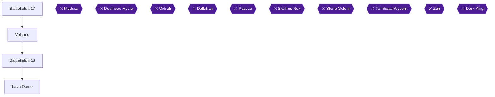

This chapter takes you through Battlefield #17, the Volcano, Battlefield #18 and the Lava Dome, which is the last dungeon of the Fireburg region and the home of the Crystal of Fire [[ra-guide-13-3]]. You will earn See Through the Smoke (the Mask), Perseus (Medusa), The Bright Side (the last White spellbook, Life), Hot Take (all optional chests in the Lava Dome), Speak No Evil (no magic except Reuben's Life) and Praise the Sun (the Sun Coin) [[ra-guide-13-4, ra-guide-13-10, ra-guide-13-11, gf4-4-22]].

The suggested level for the Volcano is 20 and for the Lava Dome is 22 [[gf3-44-1, gf3-45-2]]. One guide wants you to be Level 22 for Medusa and Level 23 for the Dualhead Hydra [[gf4-2-34, gf4-2-36]]. Commenters beat Speak No Evil at levels 20 to 26 without grinding [[ra-comments-29-16, ra-comments-31-13, ra-comments-30-22]].

> [!TIP]
> **Preparation:** Clear every battlefield you can before the Lava Dome and bring a full stock of items. More Seeds can be bought in Fireburg [[ra-guide-13-5]]. Bring many Heal Potions for petrify and paralysis, plus a Seed just in case [[ra-comments-30-17]].

### Chapter Items to Collect

| Item | Where Found | Action / Requirement | Citation |
|---|---|---|---|
| Mask | Volcano, chest past the Were Wolf at the top of the stairs | **TAKE** | [[gf1-40-8, gf2-26-5]] |
| White spellbook (Wizard) | Volcano, chest beyond the door past the first Were Wolf | **TAKE** | [[gf1-40-1, gf2-26-1]] |
| Life spellbook (White) | Lava Dome cave, chest on the lava platform past the cracked rock | **TAKE** | [[gf1-41-2]] |
| Moon Helm | Lava Dome, far northwest chest of the northwest room | **TAKE** | [[gf2-27-5]] |
| Sun Coin | Lava Dome, chest after the Dualhead Hydra | **TAKE** | [[gf1-42-2]] |

### Battlefield #17

Battlefield #17 lies west of the Volcano. Enemies are Ghosts, Red Bones and Zombies, and the prize is 1200 EXP [[gf3-82-1, gf2-25-4]]. Use Cure magic on the undead, and Mega Grenades work too [[gf3-82-1]]. Zombies regenerate if you take too long, and Cure deals heavy damage to them [[gf2-25-5]]. Ghosts can multiply, but they sometimes do nothing [[gf2-25-4]]. Clear it, then head east to the Volcano [[gf1-39-4]].

### Volcano

🗺️ **Map:** [View Mystic Quest Volcano Map by Tropicon](https://www.vgmaps.com/Atlas/SuperNES/FinalFantasy-MysticQuest-Volcano.png)

Enemies here are Ghosts, Red Bones, Nitemares and Were Wolves [[gf1-39-4, gf4-16-1, gf4-19-3, gf4-23-5]].

#### Entrance area: the White spellbook

1. Climb the staircase to the northeast of the entrance. At the top a Were Wolf guards a door [[gf2-26-1, gf1-40-1]].
2. Defeat him and go through the door. You cannot see yourself inside. Walk a little to the left and exit through the other door [[gf2-26-1, gf1-40-1]].
3. Open the chest for the **White** Wizard spellbook [[gf1-40-1, gf2-26-1]].
4. Return to the entrance. Beat the Ghost on the right, then move down onto the raised platform, fighting a Were Wolf and Red Bone, to reach two chests with Heal Potions and Refreshers [[gf1-40-11]].
5. North of there, past a Skeleton blocking the stairs, a door leads to Explosives [[gf1-40-3]].
6. Back at the entrance, go left past the stairs and defeat the enemies for Cure Potions [[gf1-40-4]]. A Ghost to the left of the staircase guards a chest of Cure Potions [[gf2-26-2]].
7. Climb the steps and jump the gap to the next ledge. Clear the monsters and take the stairs up [[gf2-26-2]].

#### Gas area

The next area has thick gas that hides enemies until you have the Mask [[gf1-40-5, gf3-88-3]].

1. Walk up a little and turn left. Follow the path to an opening in the wall. You cannot see yourself, so head right to get out [[gf2-26-3]].
2. Take the Heal Potions from the chest [[gf2-26-3]].
3. At the next split, Explosives are straight ahead [[gf2-26-4]]. Head left for the Mask [[gf2-26-4]].
4. Go up the stairs. The gas disappears. Beat the Ghost on your left and climb the steps [[gf2-26-5, gf1-40-8]].

> [!WARNING]
> **Mask:** Fight the Were Wolf at the top of the stairs first, since the chest sits just beyond him [[gf1-40-8]].

5. Kill the Were Wolf and open the chest for the **Mask** [[gf2-26-5, gf3-44-3]].

> [!ACHIEVEMENT]
> **See Through the Smoke (2 Points)**
> 
> *Obtain the Gas Mask.*

6. Before going back, defeat the Nitemare to your left. The chest behind it holds Cure Potions [[gf2-26-6]].

#### Upper Volcano

1. Backtrack to the first gas area and go straight to a staircase. Defeat the Nitemare in front of it and continue [[gf2-26-6]].
2. Defeat another Nitemare, use the opening and head east to the next stairs. Beat the Ghost at the top [[gf2-26-7]].
3. Take the path on the right for Cure Potions before climbing, then defeat the ledge monsters for Heal Potions [[gf2-26-7, gf2-26-8]].
4. Climb to the top. Heal and use a Seed to restore Wizard magic [[gf1-40-11]].

### Medusa

Medusa waits in the middle of the top platform with two Were Wolves [[gf1-40-11, gf1-40-12]]. Sources disagree on her HP: about 7000 is the best estimate [[gf2-54-1, gf4-9-3]].

- Start with the Hero at full Wizard magic [[gf1-40-12]].
- Take out the Were Wolves first, separately, then focus Medusa [[gf1-40-12, gf4-9-4]].
- She resists nearly all magic except White, so cast White with the Hero [[gf3-71-2]].
- Reuben hits with his Morning Star and heals when needed [[gf1-40-12]]. Use Seeds as needed [[gf4-9-4]].
- Watch for Screech Voice (confuse), Stone Voice (petrify) and Para-snake (paralyze). Heal the Hero if confused or paralyzed [[gf2-26-10, gf1-40-12]].

> [!ACHIEVEMENT]
> **Perseus (5 Points)**
> 
> *Defeat Medusa.*

Descend the stairs she blocked to return to the world map and the Lava Dome [[gf1-41-1]].

### Battlefield #18

Battlefield #18 sits east of the Volcano, with Iflytes and Sthenos, for 1068 EXP [[gf2-29-1]]. Many attacks come first, so it is dangerous [[gf3-82-2]]. Cast White every turn and use Seeds to refill Wizard magic [[gf2-29-2]]. Cure status ailments [[gf2-29-2]]. The guide recommends clearing all battlefields before the Lava Dome [[ra-guide-13-5]].

> [!TIP]
> **Before you leave:** Make sure Battlefields #17 and #18 are cleared and you have healed, restocked and bought Seeds in Fireburg [[ra-guide-13-5, gf2-26-10]].

### Lava Dome

🗺️ **Map:** [View Mystic Quest Lava Dome Map by Tropicon](https://www.vgmaps.com/Atlas/SuperNES/FinalFantasy-MysticQuest-LavaDome.png)

> [!WARNING]
> **Missable Achievement Warning (Speak No Evil):** Before entering, use up all of the Hero's magic outside the Lava Dome (the achievement does not start until you are inside) [[ra-comments-29-10, ra-comments-29-12, ra-comments-30-5]]. From the entrance to the Hydra you may not cast anything except Reuben's Life, and you may not load a save [[ra-guide-13-4, gf2-28-9]]. Exiting and re-entering resets the attempt [[ra-guide-13-8]]. Whether a field spell such as Cure outside battle voids it is unconfirmed, so cast nothing at all and heal with items. Set Reuben to manual. Picking up spellbooks is fine. Players have been ruined by a confused Hero casting Quake or Fire [[ra-comments-29-11, ra-comments-30-4, ra-comments-29-15]].

Collecting every optional chest on the same attempt also earns Hot Take [[ra-guide-13-11]]. Enemies include Hot Wings, Ninjas, Fangpires, Avizzards, Adamant Turtles, Iflytes, Sthenos and Salamands [[gf1-41-1]]. Don't fight every enemy, only those you need to. Have Reuben focus those he can one-shot [[ra-comments-30-8, ra-comments-30-9]].

#### East cave: Life spellbook

1. Head east, defeat the Hot Wings and descend the stairs it blocked. Fight the Ninja, go down again and enter the cave to the west [[gf1-41-2, gf2-27-1]].
2. Go right through the cave until you reach lava platforms. Jump across, bomb the cracked rock and jump to the platform with the Stheno [[gf1-41-2, gf2-27-1]].
3. Defeat it and open the chest for the **Life** spellbook, the last White spell [[gf1-41-2, gf4-4-22]].

> [!ACHIEVEMENT]
> **The Bright Side (10 Points)**
> 
> *Obtain all White magic spellbooks.*

4. Exit the cave. Return to its entrance and head north, climb the wall and go northwest. At the end is a chest with 20 Explosives [[gf2-27-2]].
5. Go southwest, clear the monsters and leave by the alternate exit for a chest with three Refreshers. Alternatively take the left door after an Iflyte and drop down to the 3 Refreshers [[gf2-27-3, gf1-41-3]].

#### West cave: Moon Helm

1. Head left to a staircase and defeat the Ninja at the top. Continue left past another Ninja to a cave door [[gf1-41-2, gf2-27-1, checklist-items-5-2]].
2. Inside, go right and fight toward the top of the room. Chests of Refreshers, Heal and Cure Potions are scattered here [[gf2-27-4]].
3. Jump the lava platforms, bomb the boulders on the left platform and defeat the Stheno. Climb the stairs [[gf3-46-2, gf2-27-5]].
4. Two chests wait in the northwest room: the far northwest one holds the **Moon Helm** and the other has Cure Potions [[gf2-27-5, gf2-27-6]]. Equip the Moon Helm before the boss [[ra-comments-30-10, ra-comments-31-8]].

> [!NOTE]
> The Moon Helm here is fine only because you bought the Steel Helm in chapter 4 [[ra-comments-39-1, checklist-items-5-1]].

5. Return by the platforms, head southeast to an Avizzard in front of stairs, and descend two staircases to the outside. A monster blocks a tile: step on it to open the door to the right [[gf2-27-5, gf1-41-7]].

#### Cave of chests and the switch

1. Drop off the ledge, kill the Avizzard and head down the steps [[gf1-41-1, gf2-27-7]].
2. Enter the ledge cave for Cure Potions. Deeper, at the split, go north for Heal and Cure Potions [[gf2-27-7, gf2-27-8]].
3. Take the left branch north to the stairs, go left and south, jump the gap, fight the Salamand, and defeat the Stheno past the second gap for Heal Potions [[gf2-27-9]].
4. Go east, skip the first gap, jump the second, beat the Adamant Turtle and take Heal Potions [[gf2-27-10]].
5. Another cave: past the Hot Wings and Fangpire, jump the stone steps and fight the Adamant Turtle for a chest of bombs [[gf1-41-5]].
6. Down the stairs, the right-hand cave has a chest with 3 potions [[gf1-41-8]]. A Salamand and Stheno guard two more chests of Cure and Heal Potions [[gf1-41-9]].
7. Further on, two chests hold Cure Potions, and the left-hand route gives Heal Potions and more Cure [[gf2-28-4, gf2-28-6]].
8. In the next room, two chests are surrounded by monsters, both with Cure Potions [[gf2-28-6]]. Take the staircase on the left instead of the wall [[gf2-28-6]].
9. Descend to the room of chests: the first gap to your left leads to Heal Potions, then jump left for Cure Potions, and so on [[gf2-28-4]].
10. Clear the Salamand before the big doors and enter the Hydra room [[gf1-41-9, gf2-28-4]].

For Hot Take, every optional chest must be opened. For a thorough sweep, one tally lists 32 chests [[ra-comments-31-9, ra-guide-13-11]]. Total potions available: Cure x39 and Heal x27 [[gf4-2-35]]. Unable to verify from collected sources: the exact complete chest list.

#### Hydra room

- Northwest corner: Cure Potions. Southeast: a Stheno and Cure Potions [[gf1-41-9, gf2-28-6]].
- Jump across the rocks to reach each side, then the top-middle boss [[gf1-41-9]].

### Dualhead Hydra

HP is 14,000 (one source says 15,000) with 429 EXP [[gf1-42-3, gf3-47-1, gf4-7-1]]. Its attacks include Fire Breath, Para-breath, Poison Breath, Scrunch and Stone Gas [[gf1-42-3, gf2-28-10]]. The usual White strategy is off-limits here.

**Defend-on-Reuben strategy:**

1. The Hero defends Reuben every turn, unless Reuben dies or is stoned [[ra-comments-29-2, ra-comments-30-11]].
2. Reuben attacks each turn while safe from a one-hit KO [[ra-comments-29-3, ra-comments-31-2]].
3. Use Reuben's Life on the Hero if he dies, or earlier if he may die next turn. Life revives or fully heals [[ra-comments-29-4, ra-comments-29-5, ra-comments-29-6, ra-comments-31-3]].
4. Reuben healing himself with Life beats spamming Cure potions [[ra-comments-31-6]].
5. Use a Heal Potion when anyone is petrified or poisoned. It never petrifies both at once [[ra-comments-30-2, ra-comments-31-4, ra-comments-31-13]].
6. Keep Reuben at full health in phase 2, since Scrunch crits often [[ra-comments-30-13, ra-comments-30-14]].
7. The glowing yellow eyes phase is the most dangerous; one hit can do 800 to the Hero [[ra-comments-29-9]]. Petrify begins in the last phase [[ra-comments-30-1, ra-comments-30-20]].
8. Heal after Reuben is hit, as it only does single-target damage [[ra-comments-30-15]].
9. If you die and restart the fight following the rules, the achievement stays active [[ra-comments-30-23]].

> [!ACHIEVEMENT]
> **Speak No Evil (10 Points)**
> 
> *Traverse the Lava Dome and defeat the Hydra without using any magic besides Reuben's Life spell. May not load a save file during attempt.*

After the Hydra falls, the Fire Crystal is restored [[gf1-42-2]]. Open the chest for the Sun Coin before leaving [[gf2-28-10, gf1-42-2]].

> [!ACHIEVEMENT]
> **Praise the Sun (5 Points)**
> 
> *Obtain the Sun Coin.*

Open the last optional chest if you missed any, since Hot Take counts them all.

> [!ACHIEVEMENT]
> **Hot Take (10 Points)**
> 
> *Open all optional treasure chests in the Lava Dome.*

The Sun Coin opens the purple door in the Focus Tower [[gf2-48-3]].

> [!TIP]
> **Before you leave the Lava Dome:** Confirm you have the Life spellbook, Moon Helm and Sun Coin, then exit [[gf1-42-2, gf4-2-35]].

> [!IMPORTANT]
> ### Chapter 8 Cumulative 100% Checkpoint
> - **Battlefields:** 18 / 20
> - **Spellbooks:** 9 / 12
> - **Key items this chapter:** Mask, Moon Helm, Sun Coin [[gf4-2-35, gf1-40-8]]
> - **RetroAchievements Unlocked:** 25 / 51 (133 / 324 points)

### Chapter Checklist

- [ ] Battlefield #17 cleared
- [ ] White spellbook taken
- [ ] Mask obtained (See Through the Smoke)
- [ ] Medusa defeated (Perseus)
- [ ] Battlefield #18 cleared
- [ ] Life spellbook taken (The Bright Side)
- [ ] Moon Helm equipped
- [ ] Hot Take chests opened
- [ ] Hydra defeated with only Reuben's Life (Speak No Evil)
- [ ] Sun Coin taken (Praise the Sun)

---

## Chapter 9: Rope Bridge, the Alive Forest and the Giant Tree

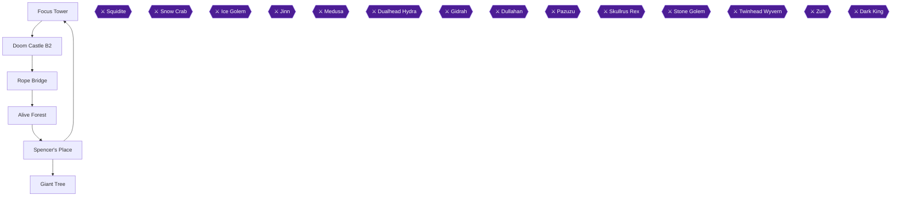

This chapter takes you from the purple door in the Focus Tower, through the Rope Bridge and the Alive Forest, back to Aquaria for Kaeli and the Dragon Claw, and finally up the Giant Tree to Gidrah. Four achievements are tied to it: The Dark Side (the Aero spell completes the Black magic set), Chop Chop (the Giant's Axe), Great Value Vega (the Dragon Claw) and Named for a Kaiju Villain (Gidrah). One chest, the Aero chest, has a deadline, so read the first warning before you walk through the purple door. [[gf1-43-3, gf1-43-4, ra-comments-54-2, gf1-45-7, gf1-46-1, gf1-48-3]]

> [!TIP]
> **Preparation:** One guide says you should be Level 30 before fighting Gidrah. Another guide lists a suggested level of 26 for this stretch. Fight the optional monsters along the way and heal before the boss. [[gf4-2-41]]

### Focus Tower

🗺️ **Map:** [View Mystic Quest Focus Tower&Doom Castle Map by Tropicon](https://www.vgmaps.com/Atlas/SuperNES/FinalFantasy-MysticQuest-FocusTower&DoomCastle.png)

The Sun Coin, earned from the Dualhead Hydra in the Lava Dome, opens the purple door in the Focus Tower. [[gf1-42-2, gf1-43-3, gf2-48-3]]

1. Make your way to the set of colored doors and open the third one, the purple door, with the Sun Coin. [[gf1-43-3]]
2. Take the stairs. Walk straight ahead and you reach another set of stairs leading down into Doom Castle. [[checklist-items-4-5]]

> [!WARNING]
> **Missable Achievement Warning:** Open the Aero chest in Doom Castle B2 NOW, before the Wind Crystal and before entering Doom Castle proper. That chest counts toward the Doom Castle all-chests achievement (The Black Hand). If you fetch it later from inside Doom Castle, leaving the dungeon resets the optional chests. [[ra-comments-54-2, ra-comments-54-3, ra-guide-18-14]]

### Doom Castle B2

1. Take the first set of stairs down. This is only one room of Doom Castle. [[checklist-items-4-5, gf2-30-1]]
2. Defeat the single monster in your way, the Minotaur Zombie. [[gf1-43-4, checklist-items-4-5]]
3. Open the chest to receive the **Aero** spell (found in a chest in Doom Castle B2). [[gf1-43-4, ra-guide-11-9]]

> [!ACHIEVEMENT]
> **The Dark Side (10 Points)**
> 
> *Obtain all Black magic spellbooks.*

Aero finishes the Black magic set: Quake from the Bone Dungeon, Fire and Blizzard from Focus Tower 2F, and Aero here. [[gf4-4-23, gf4-4-24, gf4-4-25, gf4-4-26, ra-guide-21-5, ra-guide-21-6, ra-guide-21-7, ra-guide-21-8]]

### Rope Bridge

🗺️ **Map:** [View Mystic Quest Rope Bridge Map by Tropicon](https://www.vgmaps.com/Atlas/SuperNES/FinalFantasy-MysticQuest-RopeBridge.png)

1. Walk onto the bridge. A Mummy appears and Reuben steps up to defend you, but he is knocked off the bridge, so you fight alone. [[gf1-44-1]]
2. Defeat the Mummy. Hero climbs down to see Reuben, who says he will catch up later, and Tristam joins you. [[gf1-44-2, ra-guide-14-10]]
3. Continue across the bridge. Climb down the second vine for Cure Potions. [[gf1-44-3]]
4. Climb down the fifth and final vine for 3 seeds at the bottom, then climb back up. [[gf1-44-4]]
5. Exit from the right side, then head right on the world map to the Alive Forest. [[gf1-44-5]]

### Alive Forest

🗺️ **Map:** [View Mystic Quest Level Alive Forest Map by Tropicon](https://www.vgmaps.com/Atlas/SuperNES/FinalFantasy-MysticQuest-Level-AliveForest.png)

Use your Axe to cut trees. The Giant's Axe is your target here. [[checklist-items-6-7]]

> [!WARNING]
> **Missable Achievement Warning:** The Battle Axe from Fireburg (500 GP) is needed for Chop Chop and one commenter reports it could not be bought later. If you skipped it, the Giant's Axe alone will not complete the achievement. [[ra-comments-34-1, gf1-34-8, ra-guide-11-14]]

1. Cut the trees just above your start point to reach a Mummy and a Specter guarding a chest of Cure Potions. [[gf1-45-2, gf2-31-1]]
3. On the far side defeat the Specter, then head left and cut trees to reach a chest with 3 Heal Potions. [[gf1-45-2]]
4. Cut trees heading down, defeat the Specter blocking a lone tree, and chop it down to reach a warp. Step on it for a room with a chest of Refreshers. [[gf1-45-3]]
5. Head back right, cutting trees. Talk to the tree with a face: Tristam says Kaeli should be able to get a response from him, and she is in Aquaria. [[gf1-45-4, ra-guide-14-12]]
6. Before leaving, fight the Mummy on the right and cut down the lone tree. Step on the warp underneath for a room with a chest of Ninja Stars. A little north a Specter guards a chest of Refreshers. [[gf1-45-5]]
7. From the large talking tree, head left and cut trees heading south until you reach another large tree that is not alive, with a chest near it. Cut your way around it and defeat the Specter and the Mummy to open the chest with the **Giant's Axe**. [[gf1-45-7, checklist-items-6-7]]

> [!ACHIEVEMENT]
> **Chop Chop (5 Points)**
> 
> *Obtain all axes.*

This is the third axe: Kaeli's Axe came from the Level Forest and the Battle Axe was bought in Fireburg. [[ra-guide-19-4, ra-guide-19-5, ra-guide-19-6]]

8. Head back to Aquaria. [[gf1-45-7]]

### Spencer's Place

🗺️ **Map:** [View Mystic Quest Spencer's Place Map by Tropicon](https://www.vgmaps.com/Atlas/SuperNES/FinalFantasy-MysticQuest-Spencer'sPlace.png)

1. In Aquaria, go to Spencer's Place and follow the path to the bottom, then talk to Spencer. [[gf3-36-2, gf1-46-1]]
2. Talk to Spencer. Tristam leaves you and gives you his Dragon Claw. [[gf1-46-1, gf2-31-3]]

> [!ACHIEVEMENT]
> **Great Value Vega (5 Points)**
> 
> *Obtain all claws.*

This is the third claw: Cat Claw (Phoebe), Charm Claw (Mine) and the Dragon Claw. [[ra-guide-19-7, ra-guide-19-8, ra-guide-19-9]]

3. Phoebe then uses a bomb and the tunnel collapses. [[gf1-46-2]]
4. Go up to Aquaria, enter Phoebe's house, grab the Heal Potions from the chest and talk to Kaeli. She rejoins you. [[ra-guide-15-1, gf4-1-3]]
5. Return to the Alive Forest, where Kaeli can now talk with the giant tree. [[ra-guide-15-5]]

### Giant Tree

🗺️ **Map:** [View Mystic Quest Giant Tree Map by Tropicon](https://www.vgmaps.com/Atlas/SuperNES/FinalFantasy-MysticQuest-GiantTree.png)

Talk to the large tree with a face. Kaeli can speak with him, and he says you can pass if you defeat the monsters inside him. Enter through his mouth. [[gf1-47-1, ra-guide-15-5]]

Use the Dragon Claw liberally to grapple across gaps. You can drop through holes to a lower floor and must do so for progress. To open a closed door or mouth, poke it with your sword. [[ra-guide-15-6, ra-guide-15-7, gf4-23-9]]

#### 1F

1. Defeat the Specter or Mummy straight ahead. A Live Oak further on guards a chest of Refreshers. [[gf2-32-2]]
2. Fighting the enemies to the right of the entrance leads to a chest of Cure Potions. [[gf2-32-10]]
3. Head left, defeat the Mummy and Live Oak, and open the two chests (Heal and Cure Potions). [[gf1-47-11]]
4. Continue north and right, defeating the Live Oaks that block the way, and use the Dragon Claw to grapple across the gaps toward the door. [[gf2-32-2, gf1-47-5, ra-guide-15-6]]

#### 2F

1. Head right and kill the Live Oak blocking a chest of Heal Potions. [[gf1-47-5]]
2. Go south, defeating the Snipion and Mad Toad on your left, then continue into the room with lots of mushrooms. [[gf1-47-10, gf1-47-11]]
3. Cut a path left with your axe. Defeat the Mad Toad for a chest with bombs and a chest with Cure Potions. Mad Toads are weak against water, so use Blizzard. [[gf1-47-6, gf2-32-5, gf2-32-6]]
4. Cut mushrooms downward and fight around the room to the exit door. Defeat the last Snipion and open the fancy chest for the **Meteor** spell. [[gf1-47-7, gf2-32-7, gf3-51-1]]
5. Backtrack through the mushroom room and grapple onward with the Dragon Claw. Poke the tree mouths with your sword to open them. [[gf1-47-6, ra-guide-15-6, gf4-23-9]]

#### 3F

1. Take the chest of Heal Potions to the right, then climb down and defeat the Snipion and Mad Toad for chests of Cure and Heal Potions. [[gf1-47-10]]
2. Climb back up, defeat the Leech and grapple left. Leeches are weak against axe attacks. Stab the next door. [[gf2-32-11]]
3. In the mushroom room, two chests hold Heal and Cure Potions. Climb the wall northwest, drop down, and defeat the two Leeches. [[gf1-47-11]]
4. Go through the next room, climb down the vine and defeat the Mad Toad to reach a chest of Heal Potions. [[gf1-47-5]]
5. Climb the wall right, defeat the Leech and stab the door. To climb the alternating walls, release the A Button and press it again as you reach the next section. [[gf2-33-1, gf3-51-2]]

#### 4F

1. Head south, defeating the Skuldiers and the Ooze that block the way. [[gf4-21-4, gf4-19-4]]
2. Defeat the Oozes on the left to reach a chest of Heal Potions, using the wall-latching technique where you must climb. [[gf1-47-5, gf2-33-1]]
3. Before entering the next door, walk around it to the left for two more chests. [[gf1-47-14]]
4. Grapple to the stub south for two chests (Explosives and Cure Potions), then climb the wall and stab the door. [[gf2-32-5]]

#### 5F

1. Skeletons surround you. Chests in the south hold Cure and Heal Potions and the northwest holds bombs and Healing Potions. [[gf1-48-2]]
2. Heal up, then climb to reach Gidrah, the boss of the Giant Tree. [[gf1-48-3, ra-guide-15-6]]

### Gidrah

Gidrah has 13,000 HP and gives 729 EXP and 18 GP. [[gf1-48-3, gf3-52-1]]

- Aero on both characters first to take out the two Skuldiers. [[gf1-48-4, gf2-33-5]]
- Afterwards Hero uses Aero or Meteor (or White if out of black magic) and heals. Kaeli casts Aero every turn unless she must revive Hero or cure Petrification. [[gf1-75-4, gf2-33-5, gf4-8-4]]
- Gidrah can paralyze and petrify, so use Heal. If both are petrified you lose. [[gf2-33-5, ra-comments-36-2]]
- Gidrah is really weak against Aero. When heads disappear he is low on HP. [[gf3-52-1, gf1-48-3]]

> [!ACHIEVEMENT]
> **Named for a Kaiju Villain (5 Points)**
> 
> *Defeat Gidrah the chimera.*

Talk to the face behind where Gidrah stood to see the Tree walk to a temple. Use Exit or backtrack to reach Kaidge Temple. [[gf1-48-5]]

> [!TIP]
> **Before you leave:** confirm you hold Aero, Meteor, the Giant's Axe and the Dragon Claw. [[ra-guide-21-8, ra-guide-21-11, ra-guide-19-6, ra-guide-19-9]]

> [!IMPORTANT]
> ### Chapter 9 Cumulative 100% Checkpoint
> - **Spellbooks:** 11 / 12
> - **Battlefields:** 18 / 20
> - **RetroAchievements Unlocked:** 29 / 51 (158 / 324 points)

### Chapter Checklist

- [ ] Purple door opened and Aero chest taken in Doom Castle B2
- [ ] Rope Bridge: Reuben falls, Tristam joins
- [ ] Giant's Axe taken in the Alive Forest
- [ ] Dragon Claw received at Spencer's Place and Kaeli rejoined
- [ ] Meteor spellbook taken on Giant Tree 2F
- [ ] Gidrah defeated

---

## Chapter 10: Kaidge Temple, Windia and Mount Gale

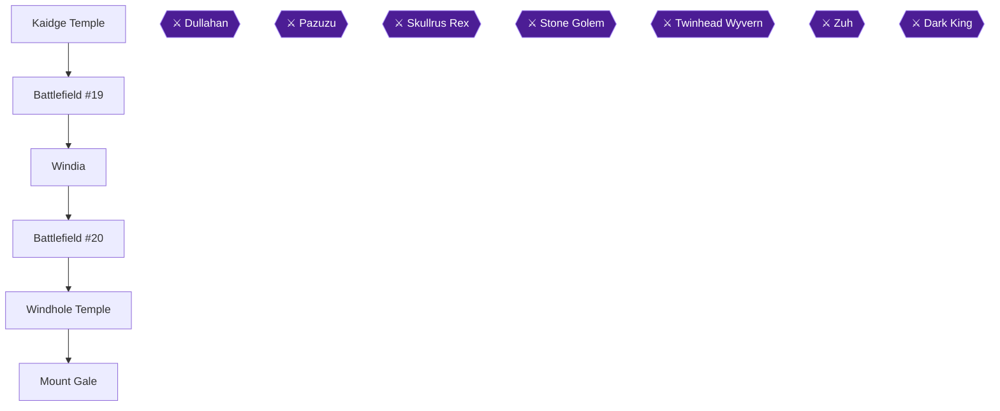

This chapter takes you from the newly walked Giant Tree to Kaidge Temple, clears the last two battlefields (#19 and #20), visits Windia for the first time, and then climbs Mount Gale to defeat Dullahan [[gf4-2-42, gf4-2-43, gf4-2-44, ra-guide-16-4]]. Four achievements are in play: Battlefield Expert, Blinged Out, Can't Be Too Careful and Celtic Faerie [[ra-guide-22-2, ra-guide-20-12, ra-guide-20-9, ra-guide-16-4]].

> [!WARNING]
> **Achievement Trigger Warning:** Can't Be Too Careful needs the Steel Helm from the woman in Aquaria, which you bought in chapter 4. A player reports that the lady will not sell it if you return later after getting the Moon and Apollo Helms [[ra-comments-39-1]]. This chapter hands you the Apollo Helm, so confirm now that you already own all three: Steel Helm (Aquaria, bought), Moon Helm (Lava Dome chest) and Apollo Helm (Mount Gale chest) [[ra-guide-20-7, ra-guide-20-8, ra-guide-20-9]].

> [!WARNING]
> **Achievement Trigger Warning:** Two players report Battlefield Expert popping while one battlefield was still left [[ra-comments-37-1, ra-comments-37-2]]. Whether it needs all 20 is unconfirmed from collected sources, so clear every one of the 20 regardless [[gf2-2-2]].

### Chapter Items to Collect

| Item | Where Found | Action / Requirement | Citation |
|---|---|---|---|
| Cure Potions | Kaidge Temple, door then left and upward | **TAKE** | [[gf1-49-2]] |
| 2808 EXP | Battlefield #19 (west of Kaidge Temple) | **CLEAR** | [[gf4-2-42]] |
| Cupid Locket | Windia, house on the left | **BUY** for 300 GP | [[gf1-51-1]] |
| Bombs and Heal Potions | Windia, northeast house basement | **TAKE** | [[gf2-35-2]] |
| Refreshers and Heal Potions | Windia Inn, upstairs | **TAKE** | [[gf2-35-4]] |
| 2700 EXP | Battlefield #20 (south of Windia) | **CLEAR** | [[gf4-2-43]] |
| Heal Potions | Windhole Temple, center | **TAKE** | [[gf1-52-1]] |
| Heal Potions | Mount Gale, second stairs | **TAKE** | [[gf1-52-2]] |
| Refreshers | Mount Gale, platform across the gap | **TAKE** | [[gf1-52-3]] |
| Apollo Helm | Mount Gale, fancy chest past the Vampire | **TAKE** | [[gf1-52-4]] |

### Kaidge Temple

Climb the wall inside the temple and talk to the man with the cape again; he mentions Captain Mac and leaves [[gf1-49-1]]. Walk through the door and navigate left and then upward to a chest of Cure Potions [[gf1-49-2]]. Nothing else can be done here for now, so leave [[gf1-49-2]]. The two remaining battlefields lie just ahead of the temple [[gf2-34-1]].

### Battlefield #19

Battlefield #19 is west of Kaidge Temple [[gf3-53-1]]. Enemies are Ooze, Skuldier and Water Hag, and the prize is about 2800 EXP (one guide lists 2808) [[gf3-53-1, gf2-34-2]].

- Cast Aero on the Skuldiers; they are weak to wind [[gf3-53-1, gf2-34-3]].
- Do not cast spells on Oozes, because they reflect magic back at you [[gf1-49-4, gf2-34-4]].
- Bomb the Oozes and Water Hags. Mega Grenades are suggested [[gf3-53-1, gf1-49-4]].
- Skuldiers use Doom Powder, an instant-death attack, so kill them quickly [[gf1-83-14]].

is not finished yet; keep going to #20 and clear it too [[gf2-2-2]].

### Windia

Head north from the battlefields to Windia [[gf1-50-2]].

1. Enter the house on the left first. Talk to the blue-haired girl and buy the Cupid Locket for 300 GP. It gives 6 Defense and protects against silence, confusion and blindness [[gf1-51-1, gf2-35-1]].
2. Talk to the man in that house if you want Explosives [[gf1-51-2]].
3. Enter the northeast house and check the basement for two chests with Heal Potions and bombs [[gf2-35-2]]. Do not step on the Mobius pad yet; the dock trip belongs to a later chapter.
4. Visit Otto in the small house on the right. He says his daughter is lost on the mountain [[gf1-51-3]]. Upstairs in his house are Heal Potions [[gf2-35-2]].
5. At the Inn, take the two chests upstairs with Refreshers and Heal Potions [[gf2-35-4]]. Rest there [[gf1-51-4]].

The three accessories are Charm (battlefield west of the Sand Temple), Magic Ring (battlefield south of Aquaria) and the Cupid Locket from here [[ra-guide-20-10, ra-guide-20-11, ra-guide-20-12]]. With the Charm and Magic Ring already in hand, this purchase completes Blinged Out [[checklist-items-5-10, checklist-items-5-11, gf3-100-3]].

> [!ACHIEVEMENT]
> **Blinged Out (5 Points)**
> 
> *Obtain all accessories.*

> [!TIP]
> If Blinged Out does not unlock, one of the earlier accessories is missing. The Charm comes from clearing the battlefield west of the Sand Temple and the Magic Ring from the one south of Aquaria [[gf4-4-2, gf4-4-5]].

### Battlefield #20

Battlefield #20 is south of Windia. Enemies are Water Hag and Vampire, and the prize is 2700 EXP [[gf3-53-2]].

- Aero shuts Vampires down painlessly [[gf2-34-6, gf1-50-2]].
- Water Hags are weak to Fire, but the Giant's Axe does more damage [[gf2-34-7, gf1-50-2]].
- Meteor or White also work if you have Wizard magic to spare [[gf1-50-2]].

With #19 and #20 cleared, all 20 battlefields are done [[gf2-2-2, gf2-34-5]].

> [!ACHIEVEMENT]
> **Battlefield Expert (5 Points)**
> 
> *Clear all battlefields.*

### Windhole Temple

Head south and east from Windia [[gf1-52-1]]. The temple is empty except for one chest of Heal Potions in the center. Take it and head north to Mount Gale [[gf1-52-1, gf2-36-1]].

### Mount Gale

🗺️ **Map:** [View Mystic Quest Mount Gale Map by Tropicon](https://www.vgmaps.com/Atlas/SuperNES/FinalFantasy-MysticQuest-MountGale.png)

Enemies here are Water Hags, Vampires and Skuldiers [[gf4-23-3]]. The treasure is the Apollo Helm, three Heal Potions and three Refreshers [[gf4-2-44]]. You should be around Level 32 before the boss [[gf4-2-45]].

1. On entering, head right past the first set of stairs and keep going to the second set [[gf1-52-2]].
2. Head up from the second set and defeat the Vampire to reach a chest of Heal Potions [[gf1-52-2, gf2-36-2]].
3. Go back down and east to the third set of stairs. Defeat the Water Hag at the top [[gf1-52-2]].
4. Climb two more sets of stairs and kill the Skuldier. Keep north, grapple at the edge of the platform, then jump to a platform on the right [[gf1-52-2]].
5. Head south, kill another Water Hag and go down more stairs [[gf1-52-2]].
6. At the bottom go right and kill the Vampire blocking the stairs. Heading up to the right, grapple to another platform and defeat a Vampire for a chest of Refreshers. Grapple back left [[gf1-52-3]].
7. Go south down more stairs, then right and up another flight with a Skuldier on top. Defeat it and cross the bridge to the left [[gf1-52-3]].
8. Defeat the Water Hag, head north and grapple to the next platform. Defeat the Vampire to open the fancy chest with the Apollo Helm [[gf1-52-4, gf2-36-4]]. It has 15 Defense and strong fire protection [[gf2-46-8]].
9. Defeat the Water Hag, jump to the platform on the left, then grapple back to the first platform [[gf1-52-4]].

That is the third helmet, completing Can't Be Too Careful if the Steel Helm and Moon Helm are in your inventory [[ra-guide-20-7, ra-guide-20-8, ra-guide-20-9]].

> [!ACHIEVEMENT]
> **Can't Be Too Careful (5 Points)**
> 
> *Obtain all helmets.*

> [!TIP]
> Before you leave Mount Gale's middle platform, heal and use Seeds so Hero has full Wizard magic for the boss [[gf1-52-4]].

### Dullahan

Walk to the middle platform, heal, and fight Dullahan [[gf1-52-4]]. He has 14,000 HP, gives 750 EXP and 21 GP [[gf1-52-5, gf3-72-3]]. (One source lists 13,000 HP; treat that as the lower figure [[gf4-7-4]].)

1. Round one: have both Hero and Kaeli cast Aero. This kills both Vampires [[gf1-72-4, gf3-72-4]].
2. Afterwards Hero casts Meteor every turn, since Dullahan is weak to it, while Kaeli uses Aero (or Cure) [[gf1-72-5, gf2-36-5]].
3. If Hero is put to sleep, killed or badly hurt, have Kaeli heal him immediately. Keep both characters alive, since Doom Dance is an instant-death move [[gf1-72-6, gf2-36-5]].
4. Keep a Life spell ready [[gf3-72-6]].
5. After a few Meteors his horse falls, then he leaves it completely, and a few more spells finish him [[gf1-72-5]].

> [!ACHIEVEMENT]
> **Celtic Faerie (5 Points)**
> 
> *Defeat Dullahan.*

Dullahan did not hold the Wind Crystal; use Exit or walk out, and return to Windia to find the wind weaker [[gf1-52-5, gf3-72-3]]. Defeating him stops the wind [[ra-guide-16-4]].

### Back in Windia

Talk to Otto again; he starts up the Rainbow Road to Pazuzu's Tower [[gf1-53-1]]. He also tells you to hit the elevator switches with your axe [[gf2-36-6]]. Stop at the Inn to rest and buy Seeds from the old woman outside in the northern section [[gf3-55-2]]. The tower itself is the next chapter.

> [!TIP]
> Before you leave Windia, confirm that you own the Cupid Locket and that both battlefields #19 and #20 are cleared [[gf1-51-1, gf2-2-2]].

> [!IMPORTANT]
> ### Chapter 10 Cumulative 100% Checkpoint
> - **Battlefields:** 20 / 20
> - **Spellbooks:** 11 / 12
> - **Helmets:** Steel, Moon and Apollo [[ra-guide-20-7, ra-guide-20-8, ra-guide-20-9]]
> - **Accessories:** Charm, Magic Ring and Cupid Locket [[ra-guide-20-10, ra-guide-20-11, ra-guide-20-12]]
> - **RetroAchievements Unlocked:** 33 / 51 (178 / 324 points)

### Chapter Checklist

- [ ] Cure Potions chest in Kaidge Temple
- [ ] Battlefield #19 cleared
- [ ] Cupid Locket bought (300 GP)
- [ ] Windia chests (northeast basement, Inn upstairs)
- [ ] Battlefield #20 cleared (all 20 done)
- [ ] Windhole Temple Heal Potions
- [ ] Mount Gale Heal Potions and Refreshers chests
- [ ] Apollo Helm taken
- [ ] Dullahan defeated
- [ ] Otto spoken to; Seeds bought
- [ ] Achievements: Battlefield Expert, Blinged Out, Can't Be Too Careful, Celtic Faerie

---

## Chapter 11: Pazuzu's Tower

Otto's Rainbow Road opens the way to Pazuzu's Tower after you return to Windia from Mount Gale [[gf1-53-1, gf4-1-19]]. This chapter rescues Norma, collects the Flare spellbook and Excalibur, opens every optional chest, and ends with Pazuzu and the Sky Coin [[ra-guide-16-6, ra-guide-16-14]]. The achievements here are "You'd Better Have Done This First...", "Wild Wizardry", "En Garde", "Finders Keepers", "Death Unbecomes Us" and "What Goes Up Must Come Down".

### Preparation in Windia

Talk to Otto in Windia again. He starts the Rainbow Road, which gives access to Pazuzu's Tower [[gf1-53-1]]. Leave his house, head north through town, and take the North Exit to the tower [[gf1-53-1]]. Rest at the Inn, and buy Seeds from the old lady outside, as many as you can [[gf1-53-1]].

The suggested level for the tower is 32, and one guide says you should be Level 34 before fighting Pazuzu [[gf3-56-1, gf4-2-47]]. The enemies in the tower use many status effects that can quickly end a battle in their favor, so collect the equipment you can and grind beforehand [[ra-guide-16-9, ra-guide-16-10]].

> [!WARNING]
> **Missable Achievement Warning:** "Death Unbecomes Us" asks you to traverse the tower and defeat Pazuzu without losing a battle [[ra-guide-16-8]]. You get one attempt with no lost battle, and reloading a save inside the tower stops the achievement from working [[ra-guide-16-8, ra-comments-45-3]]. Make a safe save on another file outside the tower beforehand [[ra-comments-45-3]]. Community reports are inconsistent: two players say they lost battles and still got it [[ra-comments-45-12, ra-comments-45-13]]. Whether a lost battle really counts is unconfirmed, so play as if it does.

> [!WARNING]
> **Achievement Trigger Warning:** Getting to the boss requires trapping Pazuzu using the switches in the dungeon [[ra-guide-16-11]]. You can hit all the switches, leave the tower, and save; when you re-enter, the achievement tracks [[ra-comments-45-5]]. The tower remembers the switches being hit, so you do not have to clear as much of it in one go [[ra-comments-45-1]]. Pazuzu stays stuck on the floor he was on [[ra-guide-16-12]]. Reloading a save and then exiting and re-entering the tower also works [[ra-comments-45-4]].

### Chapter Items to Collect (Tower Rewards)

| Item | Where Found | Action / Requirement | Citation |
|---|---|---|---|
| Explosives | Third floor upper room | **TAKE** | [[gf1-54-5]] |
| 20 bombs | Two chests behind a line of four monsters | **TAKE** | [[gf2-37-2]] |
| Cure Potions | 6F chest near the staircase and cracked door | **TAKE** | [[gf2-37-3]] |
| Flare spell | Fancy chest on 6F, left of the Cure chest | **TAKE** | [[gf2-37-4, gf1-54-11]] |
| Explosives and Heal Potions | Chests down the steps to the right | **TAKE** | [[gf1-54-13]] |
| Excalibur | Fancy chest through the right-hand door (4F) | **TAKE** | [[gf2-37-5, gf3-56-4]] |
| Cure and Heal Potions | Chests past the bombed door where Pazuzu appears | **TAKE** | [[gf1-54-15]] |
| Heal and Cure Potions | Chests beyond the cracked wall guarded by Gargoyles | **TAKE** | [[gf2-37-6]] |
| Sky Coin | Red chest at the top | **TAKE** | [[gf4-23-7]] |

The tower holds Cure Potions x18, Heal Potions x9, Refreshers x3 and Explosives x30 in total, plus the Flare spell, Excalibur and the Sky Coin [[gf4-2-46]].

🗺️ **Map:** [View Mystic Quest Pazuzu's Tower Map by Tropicon](https://www.vgmaps.com/Atlas/SuperNES/FinalFantasy-MysticQuest-Pazuzu'sTower.png)

### Pazuzu's Tower

Upgrade chests count toward "Finders Keepers" and stay counted even if you exit, so that achievement is not missable [[ra-comments-44-1]]. The tower is deceptively short, so focus on climbing [[ra-comments-45-9]].

#### 1F: Norma and the entrance room

Right after entering, go up the steps to the platform on the right and talk to the little girl [[gf2-37-1, gf1-54-1]]. She is Norma and returns home [[gf3-56-2, ra-guide-16-7]].

> [!ACHIEVEMENT]
> **You'd Better Have Done This First... (2 Points)**
> 
> *Rescue Norma from Pazuzu's Tower.*

Next, fight up through the center of the room and talk to the large bird creature, who is Pazuzu. He runs away [[gf1-54-2]]. Clear only a path to him; you do not have to beat every monster [[gf2-37-1]]. Return to where you found Norma and take the door on the right [[gf1-54-3]]. Defeat the Beholder in the doorway and go up the stairs [[gf1-54-3, gf2-37-1]].

#### 2F: Stairs

Defeat the Garuda and climb the stairs, defeat another Garuda on the platform between the stairs, and at the top take the door to the third floor [[gf1-54-4]].

#### 3F: Elevator and the first chests

Go left past the elevator and meet a Beholder. Head south and defeat the Manticore, then move right and defeat the Chimera [[gf1-54-4, gf2-37-1]]. Chimeras can petrify you [[gf2-37-1]]. Before taking the staircase, go through the door on the right and fight upward into another room. A line of four monsters guards two chests: take the Explosives, which total 20 bombs [[gf1-54-5, gf2-37-2]].

Leave the room, go left and around the wall to the door, defeating a Chimera, Beholder and Manticor on the way [[gf1-54-6]]. This leads to the fourth floor stairway [[gf1-54-6]].

#### 4F-5F: Stairs

Climb the fourth-floor stairs, killing Beholders on the way, and go through the door at the top to reach 5F [[gf1-54-7]]. Defeat the Garuda and walk around the entry platform, then go through the door and up another flight [[gf1-54-8]].

#### 6F-7F: Upper stairs

The sixth floor is another set of stairs. Climb them, defeating Manticores, to the seventh floor [[gf1-54-8, gf1-54-9]]. On 7F, kill the Sorcerer on the left and go left. Grapple to the platform a little north and defeat the Thanatos [[gf2-37-1]]. One guide names the Dragon Claw as the grappling tool for this [[gf2-37-1]]. Go up the stairs, defeat the Sorcerer and Chimera, and continue until you find stairs on the right. Take them down, then down again to 6F [[gf1-54-9]].

#### 6F: Flare spellbook and the first switch

Defeat the Sorcerer and head down the stairs, then defeat the Naga and go through the south door [[gf1-54-10]]. Beware the Naga's Sleep Lure attack [[gf2-37-3]]. In this room, take the Cure Potions from the chest near the staircase and cracked door [[gf2-37-3, gf1-54-10]]. Continue left, defeat the Naga and the Sorcerer, and open the fancy chest on the left side of the room for the final Wizard spell, **Flare** [[gf1-54-11, gf2-37-4, gf3-56-3]].

> [!TIP]
> This completes the Wizard set: Thunder, White, Meteor and Flare. "Wild Wizardry" unlocks once all four are held [[ra-guide-21-9, ra-guide-21-10, ra-guide-21-11, ra-guide-21-12]]. Thunder came from the battlefield, White from the Volcano, and Meteor from the Giant Tree, which you can re-enter if missed [[checklist-items-4-11, checklist-items-4-12, ra-comments-42-1]].

> [!ACHIEVEMENT]
> **Wild Wizardry (10 Points)**
> 
> *Obtain all Wizard magic spellbooks.*

Return to the cracked wall and bomb it open (a Mega Grenade works) [[gf1-54-12, gf2-37-4]]. Defeat the Naga and the Sorcerer beyond it, advance, and talk to Pazuzu, who flees again. Turn around and hit the switch with your axe [[gf1-54-12]].

Go back to the bombed door, head left, and through the door near the Flare chest. Kill the Naga and Sorcerer, continue to a staircase, and climb down [[gf1-54-12, gf2-37-4]].

#### 5F: Down the far side

Defeat the Thanatos and move south. Kill the Sorcerer and Garuda on the right, and follow their ledge. At the end, jump to the platform on the right. Farther right, head down some steps to chests with Explosives and Heal Potions [[gf1-54-13, gf2-37-4]]. Go back up, defeat the Thanatos, and take the next flight of stairs [[gf1-54-13]].

#### 4F: Excalibur

Defeat the Gargoyle near the entrance and move south. On the right, after more monsters, is a door. Fight the Sorcerer, go through, and defeat a Chimera or two and another Sorcerer to reach a fancy chest holding **Excalibur** [[gf1-54-14, gf2-37-5, gf3-56-4]].

Together with the Steel Sword (starting equipment) and the Knight Sword (Ice Pyramid), this completes the swords [[ra-guide-19-1, ra-guide-19-2, ra-guide-19-3]].

> [!ACHIEVEMENT]
> **En Garde (5 Points)**
> 
> *Obtain all swords.*

Leave the room and take the door on the right. There is a blocked door: blow it open and head forward, killing the Gargoyles in the line, until you meet Pazuzu again. Grab the Cure and Heal Potions, then talk to him; he runs away [[gf1-54-15, gf2-37-6]]. Head south, then left, defeating the Sorcerer. Head north, kill the Chimera and hit the switch, then go down the stairs near it, handling the Thanatoses on the way [[gf1-54-15]].

#### 2F-1F: Last switch and the way back up

On 2F, defeat the Naga and Gargoyle and go through the south door. Ignore the bombed door, go through the door, and enter the door on the right for more Cure and Heal Potions [[gf2-37-6]]. Unable to verify from collected sources: the exact location of this final room beyond those directions. Then take the path left of it, killing the monsters, and hit the switch with your axe [[gf1-54-15]]. Descend to 1F and retrace the stairs to the fifth floor; you should not need to fight anyone you already beat [[gf1-54-15]].

Hitting the switches closes the elevator behind Pazuzu, which is how he gets trapped [[gf3-56-6, ra-guide-16-11]].

> [!TIP]
> Before you leave the tower for the boss: if you want the "Death Unbecomes Us" safety net, exit now and save outside, then re-enter. The achievement tracks after re-entry [[ra-comments-45-5]]. All optional chests above count for "Finders Keepers".

> [!ACHIEVEMENT]
> **Finders Keepers (10 Points)**
> 
> *Open all optional treasure chests in Pazuzu's Tower.*

### Pazuzu

Talk to Pazuzu on the fifth floor. This time he does not run [[gf1-54-15]]. Heal and save first [[gf1-54-15]]. Pazuzu has about 25,000 HP (one guide lists 26,000) and gives 618 EXP [[gf3-57-1, gf4-10-3]]. He is weak to wind, so Aero works, though Flare deals more damage [[gf2-38-2]]. His attacks often deal 500+ damage, and his reflect can one-hit kill characters [[gf2-38-2, ra-comments-45-2]]. He can kill in three hits but not two, so heal anyone who is damaged [[ra-comments-45-7]].

Do not attack while his Psychshield is up: he counters with a strong Wind attack [[gf3-57-2]]. The shield drops after about three or four turns, sometimes five, and he does nothing while it is up, so use that time to cure [[gf3-57-3]]. Do not cast Aero at him while the shield is up [[ra-comments-45-6]]. When it is down, use Flare and Aero [[gf3-57-4]].

One reported approach: Kaeli casts Aero in round 1 and the hero attacks with Excalibur, then from round 2 the hero keeps attacking for 800+ damage while Kaeli multi-heals; she has about 33 Cure charges [[ra-comments-45-10, ra-comments-45-11]]. Another says use Aero when he is not guarding and axe hits when he is [[ra-comments-45-8]].

When he falls, you ride the elevator to the top and the Crystal of Wind is restored [[gf1-55-4, gf2-38-3]].

> [!ACHIEVEMENT]
> **Death Unbecomes Us (10 Points)**
> 
> *Traverse Pazuzu's Tower and defeat him without losing a battle.*

At the top, open the red chest for the **Sky Coin** [[gf4-23-7, gf3-57-1]]. It opens the green door in the Focus Tower [[gf2-48-2]].

> [!ACHIEVEMENT]
> **What Goes Up Must Come Down (5 Points)**
> 
> *Obtain the Sky Coin.*

If the achievement does not trigger, one player reports it needed a return to the top of the tower and walking around until it activated; leaving to heal had put Pazuzu elsewhere [[ra-comments-46-1, ra-comments-46-2]]. Then cast Exit to leave and return to Windia [[gf1-55-4]].

> [!TIP]
> **Before you leave Pazuzu's Tower:** confirm Norma, Flare, Excalibur, every chest and the Sky Coin are collected [[gf4-2-46]].

> [!IMPORTANT]
> ### Chapter 11 Cumulative 100% Checkpoint
> - **Spellbooks:** 12 / 12
> - **Battlefields:** 20 / 20
> - **Swords:** Steel Sword, Knight Sword and Excalibur [[ra-guide-19-3]]
> - **RetroAchievements Unlocked:** 39 / 51 (220 / 324 points)

### Chapter Checklist

- [ ] Otto's Rainbow Road started in Windia
- [ ] Norma rescued
- [ ] Flare spellbook taken (Wild Wizardry)
- [ ] Excalibur taken (En Garde)
- [ ] Every optional chest opened (Finders Keepers)
- [ ] Pazuzu beaten without losing a battle (Death Unbecomes Us)
- [ ] Sky Coin taken from the red chest

---

## Chapter 12: The Thunder Rock, Light Temple and Mac's Ship

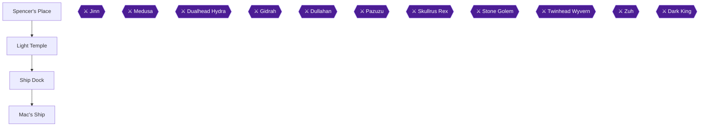

This chapter takes you from Windia to Fireburg for the Thunder Rock, back to Otto for the second rainbow road, through Spencer's Place for the Mobius Crest, to the Light Temple, and finally aboard Mac's Ship, where you pick up Gaia's Armor. Three achievements land here: Lonely Island, Looking Sharp, and Well, Now You Can Afford It [[ra-guide-17-8, ra-guide-18-1, ra-guide-22-1]].

> [!TIP]
> **Before you leave Windia the first time:** Reuben rejoins at Otto's house, so go there first. Kaeli leaves the party as he takes her place [[gf1-56-1]].

### Windia and Fireburg: Reuben and the Thunder Rock

1. Go into Otto's house and talk to Otto. Reuben greets you and joins the party; Kaeli leaves. You are told to fetch the Thunder Rock from Arion at Reuben's house [[gf1-56-1]].
2. Travel to Fireburg. Reuben's house is the one to the left of the Hotel [[gf1-56-2]].
3. Talk to the man lying in the bed (Reuben's father) to receive the **Thunder Rock** [[gf1-56-2, ra-guide-17-4]].
4. Buy Seeds or Explosives if you wish, then return to Windia [[gf1-56-2]].
5. Talk to Otto again. He goes to the basement, powers up his machine and says you can now reach Spencer's Place. Leave town; a second rainbow path now runs just north of Pazuzu's Tower to Spencer's Place [[gf1-57-1, ra-guide-17-5]].

### Spencer's Place

🗺️ **Map:** [View Mystic Quest Spencer's Place Map by Tropicon](https://www.vgmaps.com/Atlas/SuperNES/FinalFantasy-MysticQuest-Spencer'sPlace.png)

As soon as you enter, Reuben throws a Mega Grenade. The world map floods and Mac's Ship is freed. Do not leave yet [[gf1-57-2]].

1. Walk forward and get into the water. Go left and climb onto another platform [[gf1-57-3]].
2. Toss a Mega Grenade at the blocked door, then return via the water to where you entered the cave [[gf1-57-3]].
3. Jump to the platform on the left and bomb the barricaded door. Go through and step on the warp pad to reach another part of the cave [[gf1-57-4]]. One guide describes this as the Gemini Crest warp, which teleports you just before a cave you follow through the hole you blew in the wall [[gf2-39-1]].
4. Go through the door and navigate left. The fancy chest holds the **Mobius Crest** [[gf1-57-5, ra-guide-17-6]].
5. Step on the warp near the chest to return to the cave entrance, then leave [[gf1-57-5]].

### Light Temple

The Mobius Crest lets you teleport to the Light Temple from Kaidge Temple, which is south of the Giant Tree [[ra-guide-17-7, ra-comments-47-2]].

1. Go to Kaidge Temple and step on the Mobius pad [[ra-guide-17-7]].
2. Once in the Light Temple, walk back outside onto the world map. The achievement triggers only when you exit [[ra-comments-47-3, ra-guide-17-8]].

> [!ACHIEVEMENT]
> **Lonely Island (3 Points)**
> 
> *Visit the Light Temple.*

### Windia and Ship Dock

1. Go to Otto's house and talk to Kaeli for the **Captain Cap**, to be given to Captain Mac [[gf1-58-1, checklist-items-2-5]].
2. Enter the building in the north-east of town and go downstairs. Step on the Mobius pad to reach the Ship Dock [[gf1-58-2, ra-guide-17-10]].
3. Grab the Bombs and Heal Potions from the chest at the dock [[gf1-58-2]].
4. Head north and board the ship [[gf1-58-2]].

### Mac's Ship

🗺️ **Map:** [View Mystic Quest Mac's Ship Map by Tropicon](https://www.vgmaps.com/Atlas/SuperNES/FinalFantasy-MysticQuest-Mac'sShip.png)

> [!WARNING]
> **Achievement Trigger Warning:** Take Gaia's Armor before you reach Captain Mac [[gf2-41-2]].

#### Deck

1. Go to the steering wheel in the middle and go down for a chest of bombs at the southern tip of the ship [[gf1-59-1]].
2. Return to the wheel, head up and kill the Chimera. Go right, kill the Thanatos, and push the barrel away to reach a chest with Heal Potions [[gf1-59-3, gf2-40-1]].
3. Push the barrel down far enough to enter the center room [[gf3-61-1]].
4. Climb the pole, go over the brown pole, pass over the grey one, and climb down another brown one between two Thanatos. Defeat one or both and open the chest for Heal Potions [[gf1-59-3]].
5. Take the stairs in the upper-left corner down [[gf2-40-1]].

#### Lower decks

1. Go through the tiny room, take the other stairs, head straight down, kill the Thanatos and climb the next stairs [[gf1-59-3]].
2. At the fork, the right path's floor breaks and drops you. If you fall, fight back to the dock. You can jump over the break to open the chest of Refreshers. Then take the stairs on the left [[gf1-59-4, gf2-41-1]].
3. On the next floor go straight ahead and defeat the Gargoyle, then go up the stairs [[gf1-59-3]].
4. Open the fancy chest in plain sight for **Gaia's Armor** (DEF 15) [[gf1-59-5, ra-guide-18-1, checklist-items-5-6]].

Mac's Ship also holds Bombs x40, Heal x9 and Cure x6 in total [[gf3-60-1]].

#### Captain Mac

Walk down and talk to Captain Mac. He sees the cap, then Kaeli takes him away and Reuben collapses. You return to the Ship Dock [[gf1-59-5]].

### Looking Sharp: all armors

Steel Armor is starting equipment, Noble Armor came from the Ice Pyramid 4F, and Gaia's Armor completes the set [[ra-guide-20-1, ra-guide-20-2, ra-guide-18-1]].

> [!ACHIEVEMENT]
> **Looking Sharp (5 Points)**
> 
> *Obtain all armors.*

| Armor | DEF | Source | Citation |
|---|---|---|---|
| Steel Armor | 6 | Starting equipment | [[checklist-items-5-4, gf2-45-5]] |
| Noble Armor | 12 | Ice Pyramid | [[gf1-28-10, gf2-46-1]] |
| Gaia's Armor | 15 | Mac's Ship | [[checklist-items-5-6, gf2-46-2]] |

### Windia: Phoebe rejoins

1. Step on the Mobius pad to go to Windia, then go to the Inn and talk to Phoebe. Reuben leaves and Phoebe joins [[gf1-59-5, gf1-59-6]].
2. Rest to heal, then talk to Mac, who is lying down. He lets you take his ship [[gf1-59-5]].
3. After clearing Mac's Ship, Seeds cost 50 GP and Cure Potions 25 GP in its lower levels [[gf4-23-15, gf4-23-16]].

### Well, Now You Can Afford It

Hold more than 9,000 GP at one time [[ra-guide-22-1]]. Whether this works at exactly 9,000+ is unconfirmed: one player reported it did not pop while holding 16,842 GP [[ra-comments-57-3]]. If it has not popped, spend below 9,000 and earn it back to 9,000 [[ra-comments-57-2]].

> [!ACHIEVEMENT]
> **Well, Now You Can Afford It (4 Points)**
> 
> *Accumulate enough GP to afford an elixir.*

> [!TIP]
> **Before you leave:** Confirm Lonely Island, Looking Sharp and Well, Now You Can Afford It have popped, and check that every earlier collection achievement is unlocked, before taking the wheel of Mac's Ship to the Focus Tower [[gf1-59-7, ra-guide-18-2]]. Stock up first: one guide recommends 99 Cure Potions, Seeds and Heal Potions before Doom Castle [[gf2-41-3]].

> [!IMPORTANT]
> ### Chapter 12 Cumulative 100% Checkpoint
> - **Battlefields:** 20 / 20
> - **Spellbooks:** 12 / 12
> - **Armors:** 3 / 3 (Steel, Noble, Gaia's) [[ra-guide-20-1, ra-guide-20-2, ra-guide-18-1]]
> - **RetroAchievements Unlocked:** 42 / 51 (232 / 324 points)

### Checklist

- [ ] Reuben rejoined at Otto's
- [ ] Thunder Rock from Reuben's father
- [ ] Second rainbow road opened by Otto
- [ ] Mobius Crest from the fancy chest
- [ ] Lonely Island (exit the Light Temple)
- [ ] Captain Cap from Kaeli
- [ ] Gaia's Armor taken before Captain Mac
- [ ] Looking Sharp
- [ ] Phoebe rejoined at the Windia Inn
- [ ] Well, Now You Can Afford It

---

## Chapter 13: The Focus Tower Summit and Doom Castle

```mermaid
flowchart TD
  Focus_Tower["Focus Tower"]
  Doom_Castle["Doom Castle"]
  Squidite{{"⚔ Squidite"}}
  Snow_Crab{{"⚔ Snow Crab"}}
  Ice_Golem{{"⚔ Ice Golem"}}
  Jinn{{"⚔ Jinn"}}
  Medusa{{"⚔ Medusa"}}
  Dualhead_Hydra{{"⚔ Dualhead Hydra"}}
  Gidrah{{"⚔ Gidrah"}}
  Dullahan{{"⚔ Dullahan"}}
  Pazuzu{{"⚔ Pazuzu"}}
  Skullrus_Rex{{"⚔ Skullrus Rex"}}
  Stone_Golem{{"⚔ Stone Golem"}}
  Twinhead_Wyvern{{"⚔ Twinhead Wyvern"}}
  Zuh{{"⚔ Zuh"}}
  Dark_King{{"⚔ Dark King"}}
  Focus_Tower --> Doom_Castle
  classDef ponr fill:#7f1d1d,stroke:#f87171,color:#fff;
  classDef boss fill:#4c1d95,stroke:#a78bfa,color:#fff;
  class Squidite,Snow_Crab,Ice_Golem,Jinn,Medusa,Dualhead_Hydra,Gidrah,Dullahan,Pazuzu,Skullrus_Rex,Stone_Golem,Twinhead_Wyvern,Zuh,Dark_King boss;
```

This is the final chapter of the main game. Mac's ship brings you to the Focus Tower, the Sky Coin opens the green door, and beyond it lies Doom Castle [[gf4-23-8, gf2-48-2]]. The castle is styled after the earlier dungeons and ends in stronger re-skinned versions of earlier bosses [[ra-guide-18-4]]. You will fight Skullrus Rex, Stone Golem, Twinhead Wyvern, Zuh and finally the Dark King [[gf3-62-1]].

The suggested level for Doom Castle is 37 [[gf3-62-1]].

### Preparation and warnings

> [!CAUTION]
> **Point of No Return:** Entering Doom Castle. Leaving it resets the optional chests, so the Aero chest must already be taken (chapter 9) and the castle cleared in one go [[ra-guide-18-14, ra-comments-54-2]].

- The Black Hand requires every chest in the castle, including one in the shifting-sand area before the actual castle [[ra-comments-54-5, ra-guide-18-14]].
- The Aegis Shield (the third shield, after the Steel and Venus Shields, for Duck and Cover) is in the sand area resembling the Bone Dungeon [[ra-guide-18-5, checklist-items-5-7, checklist-items-5-8]].
- The Steel Shield from the Bone Dungeon was missable earlier; if you lack it, Duck and Cover cannot be completed here [[ra-guide-20-4, ra-comments-10-4]].

> [!WARNING]
> **Achievement Trigger Warning:** **Duck and Cover** needs all three shields. Confirm you already hold the Steel Shield (chapter 2) and the Venus Shield (chapter 6), then take the Aegis Shield on the sand floor below [[checklist-items-5-7, checklist-items-5-8, ra-guide-20-4]].

| Shield | Defense | Citation |
|---|---|---|
| Steel Shield | 5 | [[gf3-99-1]] |
| Venus Shield | 10 (paralyze protection) | [[gf3-99-2]] |
| Aegis Shield | 14 (paralyze and petrify protection) | [[gf3-99-3]] |

### Focus Tower

🗺️ **Map:** [View Mystic Quest Focus Tower&Doom Castle Map by Tropicon](https://www.vgmaps.com/Atlas/SuperNES/FinalFantasy-MysticQuest-FocusTower&DoomCastle.png)

The Sky Coin opens the green door in the Focus Tower [[gf2-48-2, gf3-87-1]]. Note that the first part of Doom Castle (the sand area) is reached before the green door; Skullrus Rex's stairs lead you back to the main area of the tower in front of the green door [[gf1-60-1]].

### Doom Castle

#### Sand floor (Bone Dungeon style): Aegis Shield

1. Go left, defeat the Shadow at the start, then go up and to the right until the last (sixth) set of stairs. Ignore the other stairs into the moving sand [[gf1-60-1, gf2-42-2]].
2. Go down those stairs and let the floor carry you until you reach some bones. Walk left, and you are pushed further until you stop near stairs and a pile of bones [[gf1-60-1]].
3. Bomb the bones, climb up, and defeat the Gorgon. Open the chest for the **Aegis Shield** (Defense 14) [[gf1-60-1, checklist-items-5-9, gf3-62-2]].
4. Walk across the sand to the left to return to the entrance [[gf1-60-1]].

> [!ACHIEVEMENT]
> **Duck and Cover (5 Points)**
> 
> *Obtain all shields.*

#### Sand floor: remaining chests and Skullrus Rex

1. Return to the sixth staircase and go down, but at the first pair of bones do not move. Grapple to the right, climb the stairs, and defeat the Gorgon [[gf1-60-1]].
2. Grapple two platforms left and defeat the Minotaur Zombie. Climb down the wall and walk straight down [[gf1-60-1]].
3. Open the chest near the skull for **Cure Potions** [[gf1-60-2, gf2-42-2]].
4. Toss a bomb at the bones on your left, grapple there, and climb the stairs to Skullrus Rex [[gf1-60-2]].

#### Skullrus Rex

Skullrus Rex has 10,000 HP and gives 759 EXP [[gf1-60-3, gf3-62-3]]. Two Shadows help him [[gf1-60-7]].

- Use Flare and White; the Shadows fall by your second attack [[gf1-60-7, gf3-63-1]].
- If you deal 2000+ per move he dies within about 2.5 turns [[gf2-42-4]].
- Watch for Sleep Powder; Benjamin cannot be put to sleep [[gf2-42-5]].
- One guide says equipping the Dragon Claw and scratching him once finishes him [[gf3-143-1]].
- A commenter notes the achievement counts only at the final boss rush; the boss must be the last one defeated for it to trigger [[ra-comments-50-1, ra-comments-50-2]].

> [!ACHIEVEMENT]
> **Bleached Bones (5 Points)**
> 
> *Defeat Skullrus Rex.*

#### Ice floor (Ice Pyramid style)

After Skullrus Rex, take the stairs behind him through a cave room and a second staircase to the green door in the main Focus Tower area. Open it and enter [[gf1-60-7, gf2-42-3]].

1. Go through the first open door into the ice area. Kill the Shadow on the left and stab the statue to open the first door [[gf1-60-5]].
2. Head left, jump the gap, stab the statue, kill the Phanquid, and stab another statue [[gf1-60-5, gf2-42-6]].
3. Return, jump right, and grapple to the platform on the right. Go through the door and open the chest for **Heal Potions** [[gf1-60-4, gf2-42-7]].
4. Head down at the next junction, grapple downward, stab the statue, then go right to another room (jumping the gap) and stab the statue there [[gf1-60-5]].
5. Kill the Phanquid, go through the unlocked door, and open the chest for **Arrows** [[gf1-60-5, gf2-43-2]].
6. Defeat the Freezer Crab and stab the statue [[gf2-43-2]].
7. Go back to the middle platform and through the open door; stab the statue, then go left, stab another, and jump the gap [[gf1-60-6]].
8. Go through the "building" and open the chest for **Refreshers**, then jump the gap [[gf1-60-6, gf2-43-1]].
9. Kill the Freezer Crab, go through the top door, and grapple right to the Stone Golem [[gf1-60-6]].

#### Stone Golem

Stone Golem has 10,000 HP and gives 762 EXP [[gf3-74-2]]. Two Cerberus accompany him [[gf2-43-3]].

- White works well and its first or second use wipes out the Cerberuses [[gf1-61-5]].
- Do not use Flare or Meteor; he is strong against them [[gf2-43-4]].
- Use Heal for status ailments [[gf2-43-4]].
- A commenter found that knocking out the two companions first made him fall fast [[ra-comments-51-2]].

> [!ACHIEVEMENT]
> **Much Harder to Melt Stone (5 Points)**
> 
> *Defeat the Stone Golem.*

#### Lava floor (Lava Dome style)

Backtrack to the main stairway; the two metal blocks are gone, so go up and enter the door [[gf1-61-5]].

1. Head right to the lava blocks, jump across, then jump left to a platform with a Stheno. Kill her and open the chests for **Cure Potions** and **Arrows** [[gf1-61-2, gf2-43-5]].
2. Jump down, kill the Cerberus, and open the two chests: **Arrows** and **Heal Potions** [[gf1-61-3]].
3. Grapple left, jump to an Iflyte and kill it, go left, down, right, grapple right, defeat the Stheno, and walk to the Twinhead Wyvern [[gf1-61-3, gf1-61-6]].

#### Twinhead Wyvern

Twinhead Wyvern has 15,000 HP and gives 600 EXP [[gf1-87-3, gf3-64-1]]. It fights alongside a Stheno and an Iflyte [[gf2-43-7]].

- Hero casts Meteor and Phoebe casts White; after the Stheno dies, both use White [[gf1-87-4]].
- Do not use Flare or Fire [[gf2-43-8]].

> [!ACHIEVEMENT]
> **It Only Has Two Legs, So It's Not a Dragon (5 Points)**
> 
> *Defeat the Twinhead Wyvern.*

#### Wind floor (Pazuzu's Tower style)

Falling returns you to the lava room [[gf1-61-6, gf2-44-1]]. Chests here are the hardest for The Black Hand, since the walkways are easy to fall from [[ra-comments-54-4]].

1. Go straight to the first fork, go right, then down through a door. Defeat the Cerberus and go up to the higher platform [[gf1-61-6]].
2. Head right along the path, kill the Chimera, then the Thanatos blocking steps, and go down through the door [[gf1-61-6, gf2-44-1]].
3. Kill the Cerberus and go through the next door behind the glass wall [[gf1-61-6]].
4. Head right to another door, south, defeat a Chimera, and pass the next door, going under the doorway and taking a right [[gf1-62-6]].
5. At the middle doorway go up the stairs, kill the Chimera, follow the path left, kill another Chimera, then a final Thanatos, and face Zuh [[gf1-62-6]].

A commenter says the chests on this wind floor are the hardest ones for The Black Hand, because it is hard to tell which layer a walkway is on and the walkways are easy to fall from [[ra-comments-54-4]]. Unable to verify from collected sources: the number and positions of the wind-floor chests, since the guides above route straight to Zuh. Before fighting Zuh, check the Focus Tower & Doom Castle map linked above for any chest on this floor and open it. A player who missed the achievement had skipped the chest on the shifting-sand floor, so recheck that one too [[ra-comments-54-5, ra-guide-18-14]].

#### Zuh

Zuh has 20,000 HP and gives 750 EXP [[gf1-88-10, gf1-88-11]].

- Kill his Chimera and Thanatos allies first with Aero, since all three are weak to it [[gf2-44-2]].
- Then use Flare each Hero turn and White from Phoebe [[gf1-62-6, gf1-88-12]].
- Do not attack while Psychshield is up; it drops in about 2 rounds [[gf4-12-6, gf2-44-2]].
- Keep Phoebe and the Hero alive [[ra-comments-53-2]].

> [!ACHIEVEMENT]
> **Zuh? (10 Points)**
> 
> *Defeat Zuh.*

### Final floor and Dark King

Return to the main stairway and go to the top floor [[gf1-62-5]]. Walk to the middle platform to place the four crystals in the statue; chests with Arrows, Cure Potions, Heal Potions and Seeds open [[gf1-62-2, gf2-44-4]]. These hold 25 of each item [[gf2-44-4]]. Take all of them for The Black Hand, then restock [[gf1-62-2, ra-guide-18-10]].

> [!ACHIEVEMENT]
> **The Black Hand (10 Points)**
> 
> *Open all treasure chests in the Doom Castle.*

The only save file is on Doom Castle 6F, saved before the final floor [[ra-comments-56-3]]. Heal fully, then go through the top door [[gf1-62-2]].

#### Dark King

The Dark King has 40,000 HP in most sources and gives 0 EXP and 0 GP [[gf1-71-11, gf2-52-3]].

> [!CAUTION]
> **Point of No Return:** Defeating the Dark King. The credits force a reset, and achievements cannot be earned from a completed-game save [[ra-comments-2-5, ra-comments-3-4]].

> [!WARNING]
> **Achievement Trigger Warning:** For Paper Tiger 
> [!ACHIEVEMENT]
> **Paper Tiger (2 Points)**
> 
> *Exploit the Dark King's weakness.*
, the Hero must cast Cure on him, not Phoebe. Her Cure undoes the damage [[gf4-23-11, ra-comments-55-1]].

- Cure from the Hero can do 30,000+ damage and he dies in about 2 or 3 hits [[gf1-71-12, gf3-65-2]].
- Another account says Cure overflows into damage and skips phases [[ra-comments-55-2, ra-comments-55-3]].

If you prefer the normal route [[gf3-75-4]]:

1. Use Flare and White for 2 rounds; he adds weapons to all hands [[gf3-65-3]].
2. Phoebe heals (use Refreshers and Seeds as needed) while the Hero uses Flare. Most attacks hit for 500+ [[gf1-71-13, gf1-71-14, gf3-65-4]].
3. He turns into a spider; watch for Mega White and Mega Flare [[gf1-71-15]].
4. He then becomes an octopus; Phoebe keeps healing and the Hero keeps using Flare [[gf3-65-6]].

> [!ACHIEVEMENT]
> **With Guidance from the Crystals (25 Points)**
> 
> *Defeat the Dark King and restore peace to the world.*

After the defeat the cloaked man appears [[gf1-62-5]].

> [!IMPORTANT]
> ### Chapter 13 Cumulative 100% Checkpoint
> - **Doom Castle Chests Opened:** all (The Black Hand) [[ra-guide-18-14]]
> - **Battlefields:** 20 / 20
> - **Spellbooks:** 12 / 12
> - **RetroAchievements Unlocked:** 50 / 51 (299 / 324 points)

### Checklist

- [ ] Aero chest taken before entering
- [ ] Aegis Shield obtained
- [ ] Skullrus Rex, Stone Golem, Twinhead Wyvern, Zuh defeated
- [ ] Every chest opened
- [ ] Hero cast Cure on the Dark King
- [ ] Dark King defeated

---

## Chapter 14: Illiterate: a No-Spellbook Run

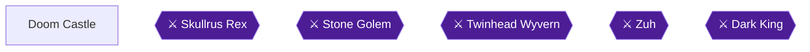

### Overview and Preparation

This chapter is a second playthrough, started from a NEW game. Achievements cannot be earned from a save of a completed game [[ra-comments-3-4]]. You play the same story route as chapters 1-13, but the Hero must never learn a spell. The goal is to defeat the Dark King without having learned any spells [[ra-guide-18-12, ra-guide-3-1]]. The only thing that changes from the main route is what you pick up, plus how you fight the Dark King. This is not a second full walkthrough.

Your partners may use spells, but you cannot learn any. Ever [[ra-comments-59-2]]. The rule is to take none of the spell books [[ra-comments-59-1]]. Without magic, you rely more on the Defend command, because you depend on your allies to heal with their own magic [[ra-guide-3-1]].

> [!WARNING]
> **Missable Achievement Warning:** Illiterate (449400) is missable and spans the entire game. Never pick up a spellbook, and never finish Battlefield #10 (Exit) or Battlefield #16 (Thunder) [[ra-guide-18-12, ra-comments-59-1, ra-comments-37-3]]. Red chests hold equipment upgrades and spells [[ra-guide-2-4]]. The most important strategy for this run is the Defend command [[ra-comments-31-15]].

If you play with a tracker, the achievement shows as an always-active mini square in the bottom right. Opening a chest that contains a spell makes the square vanish, meaning you failed [[ra-comments-60-1, ra-comments-60-2]]. A commenter also warns that they saved after clearing a battlefield without noticing they had received the Exit spell [[ra-comments-59-7]]. Follow a guide for the battlefields, because some of them hand out magic books [[ra-comments-37-3]].

Illiterate cannot share a run with The Bright Side, which needs the Heal spell [[ra-guide-3-2]]. That is why The Bright Side, The Dark Side and Wild Wizardry are earned in the main run (chapters 8, 9 and 11) and this chapter is a separate playthrough.

### Spellbook Avoid-List

Skip all of these on the new game. Chapters 1-13 collect the same chests, but here you leave the spell chests alone.

| Spell | Where it is (do NOT take it) | Citation |
|---|---|---|
| Cure | Foresta chest, in the top right tree around the back entrance | [[checklist-items-4-1]] |
| Quake | Bone Dungeon chest, past the rib-cage structure | [[checklist-items-4-8]] |
| Fire | Focus Tower 2F chest | [[checklist-items-4-7]] |
| Blizzard | Focus Tower 2F chest, left side of the Venus Key room | [[checklist-items-4-6]] |
| Heal | Falls Basin chest, near the boss | [[gf2-17-5]] |
| White | Volcano chest | [[checklist-items-4-12]] |
| Life | Lava Dome chest guarded by a monster | [[checklist-items-4-4]] |
| Aero | Doom Castle chest (entry room of the castle), guarded by the Minotar Zombie | [[checklist-items-4-5, gf1-43-4]] |
| Meteor | Giant Tree, second floor chest | [[checklist-items-4-10]] |
| Flare | Pazuzu's Tower, 5th floor chest | [[checklist-items-4-9]] |
| Exit | Reward for clearing the battlefield north of Libra Temple | [[checklist-items-4-2, ra-comments-59-4]] |
| Thunder | Reward for clearing the second battlefield west of Fireburg | [[checklist-items-4-11, ra-comments-59-3]] |

Battlefields: you may leave a battlefield at 1/10 remaining, but not the last battle [[ra-comments-59-5]]. In total there are 20 battlefields [[ra-comments-37-3]]. The clear rewards for the Exit and Thunder fields grant the book automatically, so do not finish those two.

> [!TIP]
> The 12 spellbooks sit in the places above. The Aero chest is in the first room of Doom Castle, reached from the purple door in the Focus Tower [[checklist-items-4-5]]. Do not open it on this run.

### Gear Up Before the Dark King

Spell-free does not mean gear-free. A commenter recommends tackling the Dark King with the best armor and Excalibur [[ra-comments-58-2]]. Collect these along the normal route:

| Item | Where | Citation |
|---|---|---|
| Excalibur | Pazuzu's Tower | [[ra-guide-16-14]] |
| Best helmet (Apollo Helm) | Mount Gale: at the long brown bridge, take its north part and walk left, defeat the monsters, grapple to a platform and defeat the Vampire guarding the chest | [[ra-comments-58-2, checklist-items-5-3]] |
| Best armor (Gaia's Armor) | Mac's Ship, in the fancy chest in plain sight just before Captain Mac | [[ra-comments-58-3, gf1-59-5, checklist-items-5-6]] |
| Best shield (Aegis Shield) | Doom Castle sand area | [[ra-comments-58-4, checklist-items-5-9]] |
| Best locket (Cupid Locket) | Bought from a girl in the house on your immediate left in Windia | [[ra-comments-58-5]] |

### Doom Castle

🗺️ **Map:** [View Mystic Quest Focus Tower&Doom Castle Map by Tropicon](https://www.vgmaps.com/Atlas/SuperNES/FinalFantasy-MysticQuest-FocusTower&DoomCastle.png)

The suggested level for Doom Castle is 37 [[gf3-62-1]]. The only save file is on Doom Castle 6F, before the final floor [[ra-comments-56-3]]. Because Illiterate is a spell-free rule only for you, the sub-bosses below are fought with the partner's spells and your weapons.

#### Entry Room: Do Not Open the Aero Chest

Through the purple door in the Focus Tower, go down the first stairs to enter the first room of Doom Castle. Defeat the Minotar Zombie in your way, and a chest holds the Aero spell [[gf1-43-4]]. **Leave that chest closed** on this run.

#### Sand Area and Aegis Shield

Defeat the Shadow at the start, then keep going up and to the right until you reach the last (sixth) set of stairs. Go down them, let the floor carry you, and stop at bones. Walk left until you reach a pile of bones and stairs. Bomb the bones, defeat the Gorgon and open the chest for the **Aegis Shield** [[gf1-60-1]]. Another guide puts it on the platform to the lower right of B2, where you blow up the bones in the lower right-hand corner [[gf3-62-2]]. Defense is 14, with Paralyze and Stone protection [[checklist-items-5-9]]. Then walk back west across the sand to the entrance.

#### Skullrus Rex

Walk to the sixth staircase again. At the first pair of bones, grapple to the right, climb the stairs and defeat the Gorgon. Grapple two platforms to the left, defeat the Minotar Zombie, climb down the wall, and open the chest for Cure Potions. Bomb the bones on your left and grapple there, then climb to Skullrus Rex [[gf1-60-2, gf2-42-2]].

Skullrus Rex has 10,000 HP and gives 759 EXP [[gf1-60-3]]. Two Shadows help him [[gf1-60-7]]. The listed strategies use Flare and White, which are spells. On this run the Hero cannot use Flare, so lean on Phoebe's White and on the Dragon Claw. One guide says equipping the Hero with the Dragon Claw and scratching Skullrus Rex once makes him go down [[gf3-143-1]]. Watch for Sleep Powder, though Benjamin cannot be put to sleep [[gf2-42-5]].

#### Icy Floor and Stone Golem

Go through the stairs he was blocking, then the next stairs, to reach the green door in the Focus Tower. Open it and enter the ice area. Kill the Shadow on the left and stab each statue with Excalibur to open doors [[gf1-60-1, gf2-42-6]]. Chests along this floor hold Heal Potions, Arrows and Refreshers [[gf1-60-4, gf1-60-5, gf1-60-6, gf2-42-7, gf2-43-1, gf2-43-2]].

Stone Golem has 10,000 HP and gives 762 EXP [[gf1-61-5]]. Two Cerberus accompany it [[gf2-43-3]]. White wipes out the Cerberuses, so Phoebe should cast it. Do not use Flare or Meteor against him [[gf1-61-5, gf2-43-4]].

#### Lava Floor and Twinhead Wyvern

After the Golem, the stairs unlock. Head right and jump the blocks across the lava. Kill the Stheno and open chests for Cure Potions and Arrows, then another pair with Arrows and Heal Potions [[gf1-61-2, gf1-61-3, gf2-43-5]]. The Twinhead Wyvern has 15,000 HP and fights with a Stheno and an Iflyte [[gf2-50-11, gf2-43-7]]. Avoid fire spells. Phoebe's White works [[gf2-43-8]].

#### Wind Floor and Zuh

On 5F, take care not to fall: you will land on the previous floor [[gf2-44-1]]. The chests in the wind portion are the hardest, because the walkways fall off easily [[ra-comments-54-4]]. Zuh has 20,000 HP and fights with a Chimera and a Thanatos [[gf2-50-13, gf2-44-2]]. Do not attack while Psychshield is up [[gf2-44-2, gf4-12-6]]. Phoebe's White hits his flankers.

#### Top Floor

Walk to the middle platform and the four crystals are placed in the statue. Chests open with Arrows, Cure Potions, Heal Potions and Seeds [[gf1-62-2, gf2-44-4]]. Stock up and heal fully before the door.

### The Dark King

> [!WARNING]
> **Missable Achievement Warning:** If you have learned any spell at this point, Illiterate (449400) is already lost [[ra-guide-18-12]]. The Cure trick from chapter 13 is not available here: it needs the Hero to cast the Cure spell, and on this run he has never learned it [[gf1-71-12, ra-comments-59-1]].

Dark King has 40,000 HP in one source and 65,000 in another [[gf2-51-1, gf4-6-1]]. Most of his attacks do 500+ damage per turn, often to both characters [[gf1-71-14]]. He grows arms, then turns into a spider where Mega White and Mega Flare appear [[gf1-71-15]].

> [!ACHIEVEMENT]
> **Illiterate (25 Points)**
> 
> *Defeat the Dark King without having learned any spells.*

**Strategy (defend plan):**

1. Round 1: Benjamin attacks while Phoebe casts White. Round 2: Benjamin defends, and Phoebe keeps casting White until Benjamin is about to die or dies, then she casts Life on him [[ra-comments-59-6]].
2. From the first phase, Benjamin Defends Phoebe. If Benjamin is healthy, Phoebe casts White. If he is in danger (below about 600 HP), cast Life on him [[ra-comments-60-3, ra-comments-60-4, ra-comments-60-5, ra-comments-58-8]].
3. When Phoebe runs low on Wizard mana, use a seed instead of casting White [[ra-comments-60-6]].
4. Watch turn order. If Phoebe acts before the Dark King in the first turn and after him in the second, he can wipe her from full HP [[ra-comments-58-7]].
5. Defending can make the party invincible if the defender survives one attack or Life is queued in advance [[ra-comments-59-10]].

An alternative: Benjamin attacks repeatedly and Phoebe group cures [[ra-comments-58-6]]. The defend plan is described as much safer. Use Heal Potions if she is petrified or confused [[ra-comments-58-6]].

After the Dark King falls, the cloaked man appears [[gf1-62-5]].

> [!TIP]
> Before you open the final door, confirm the tracker square still shows. The Aero chest, Cure trick and every other spell book must remain untouched [[ra-comments-60-1, ra-comments-60-2]].

> [!IMPORTANT]
> ### Chapter 14 Cumulative 100% Checkpoint
> - **Battlefields:** 20 / 20 (all cleared in the main run; on this run #10 and #16 stay unfinished)
> - **Spellbooks:** 12 / 12 (left untouched on this run)
> - **RetroAchievements Unlocked:** 51 / 51 (324 / 324 points)

### Checklist

- [ ] New game started, not a completed save
- [ ] No spellbook chests opened (the 10 chests in the avoid-list)
- [ ] Battlefields #10 (Exit) and #16 (Thunder) not finished
- [ ] Excalibur, Apollo Helm, Gaia's Armor, Aegis Shield and Cupid Locket collected
- [ ] Dark King defeated with Defend plan
- [ ] Illiterate (449400) unlocked

---

## Final Checklist

**1. Hill of Destiny, Level Forest and Foresta**

- [ ] 🏆 She Talks to Trees... Then Cuts Them Down

**2. Sand Temple and the Bone Dungeon**

- [ ] ⚠ Flamerus Rex before level 5 (before: Beat Flamerus Rex in the Bone Dungeon before the Hero reaches level 5; skip the battlefields and avoidable fights until then)
- [ ] ⚠ Bone Dungeon Steel Shield chest (before: Bomb the wall in the Bone Dungeon's second room for the Steel Shield before getting the Jumbo Bombs from Phoebe in Falls Basin (chapter 5))
- [ ] 🏆 But Isolde is Nowhere to be Found
- [ ] 🏆 No Grinding Allowed!
- [ ] 🏆 Bone Collector
- [ ] 🏆 But What About the Dragon Claw?

**3. Battlefields, the Focus Tower and Libra Temple**

- [ ] 🏆 Battlefield Tourist
- [ ] 🏆 She Predates 'Friends' by Two Years

**4. Aquaria and the Wintry Cave**

- [ ] ⚠ Steel Helm from the Aquaria shop (before: Buy the Steel Helm in Aquaria before picking up the Moon Helm in the Lava Dome (chapter 8))
- [ ] 🏆 Captain Nemo
- [ ] 🏆 Hope You're Not Afraid of Heights!

**5. Falls Basin and the Ice Pyramid**

- [ ] ⚠ Heal spellbook in Falls Basin (before: Open the Heal chest in Falls Basin before beating the Ice Golem)
- [ ] ⚠ Ice Golem without the Magic Mirror (before: Leave the Magic Mirror chest closed until the Ice Golem is beaten)
- [ ] 🏆 An Arctic Specialty
- [ ] 🏆 Never Saw It Coming
- [ ] 🏆 Let It Flow
- [ ] 🏆 Narcissus
- [ ] 🏆 Fridge Raider
- [ ] ⛔ Everything above is done before: Ice Golem defeated
- [ ] ⛔ Everything above is done before: Jumbo Bombs received

**6. Spencer's Place, the Venus Key and Fireburg**

- [ ] ⚠ Steel Shield and Venus Shield (before: Steel Shield before the Jumbo Bombs (chapter 5); Venus Shield before talking to the giant tree in the Alive Forest (chapter 9))
- [ ] ⚠ Battle Axe from the Fireburg shop (before: Buy the Battle Axe in Fireburg before getting the Giant's Axe in the Alive Forest (chapter 9))
- [ ] 🏆 Hold the Sauerkraut
- [ ] 🏆 Rock 'n' Roll!
- [ ] 🏆 Just Throw It

**7. The Mine and the Sealed Temple**

- [ ] 🏆 Got to Word Your Wish Just Right
- [ ] 🏆 Breaking the Seal

**8. The Volcano and the Lava Dome**

- [ ] ⚠ Lava Dome without magic (before: One attempt from the Lava Dome entrance to the Dualhead Hydra, casting nothing but Reuben's Life and loading no save)
- [ ] 🏆 See Through the Smoke
- [ ] 🏆 Perseus
- [ ] 🏆 Speak No Evil
- [ ] 🏆 Hot Take
- [ ] 🏆 Praise the Sun
- [ ] 🏆 The Bright Side

**9. Rope Bridge, the Alive Forest and the Giant Tree**

- [ ] ⚠ Aero chest for The Black Hand (before: Open the Aero chest in Doom Castle B2 on the way to Windia, before the Wind Crystal and before entering Doom Castle proper)
- [ ] 🏆 The Dark Side
- [ ] 🏆 Chop Chop
- [ ] 🏆 Great Value Vega
- [ ] 🏆 Named for a Kaiju Villain

**10. Kaidge Temple, Windia and Mount Gale**

- [ ] 🏆 Celtic Faerie
- [ ] 🏆 Blinged Out
- [ ] 🏆 Can't Be Too Careful
- [ ] 🏆 Battlefield Expert

**11. Pazuzu's Tower**

- [ ] ⚠ Pazuzu's Tower without losing a battle (before: One attempt through Pazuzu's Tower to Pazuzu with no lost battle and no reload inside the tower)
- [ ] 🏆 You'd Better Have Done This First...
- [ ] 🏆 Wild Wizardry
- [ ] 🏆 En Garde
- [ ] 🏆 Finders Keepers
- [ ] 🏆 Death Unbecomes Us
- [ ] 🏆 What Goes Up Must Come Down

**12. The Thunder Rock, Light Temple and Mac's Ship**

- [ ] 🏆 Lonely Island
- [ ] 🏆 Looking Sharp
- [ ] 🏆 Well, Now You Can Afford It

**13. The Focus Tower Summit and Doom Castle**

- [ ] 🏆 Bleached Bones
- [ ] 🏆 Much Harder to Melt Stone
- [ ] 🏆 It Only Has Two Legs, So It's Not a Dragon
- [ ] 🏆 Zuh?
- [ ] 🏆 The Black Hand
- [ ] 🏆 Duck and Cover
- [ ] 🏆 Paper Tiger
- [ ] 🏆 With Guidance from the Crystals
- [ ] ⛔ Everything above is done before: Entering Doom Castle
- [ ] ⛔ Everything above is done before: Dark King defeated

**14. Illiterate: a No-Spellbook Run**

- [ ] ⚠ No spellbooks for the whole game (before: Separate new game: never pick up a spellbook or finish Battlefields #10 and #16)
- [ ] 🏆 Illiterate

## 100% Completion Verification Checklist

All 51 achievements (324 points).

| ✔ | Achievement | Points | Type | Chapter |
|---|---|---|---|---|
| ☐ | **She Talks to Trees... Then Cuts Them Down** — Be joined by Kaeli. | 2 | progression | [1](#chapter-1-hill-of-destiny-level-forest-and-foresta) |
| ☐ | **Battlefield Tourist** — Clear out a battlefield. | 3 |  | [3](#chapter-3-battlefields-the-focus-tower-and-libra-temple) |
| ☐ | **But Isolde is Nowhere to be Found** — Be joined by Tristam. | 3 | progression | [2](#chapter-2-sand-temple-and-the-bone-dungeon) |
| ☐ | **No Grinding Allowed!** — Defeat Flamerus Rex before reaching level 5. | 10 | missable | [2](#chapter-2-sand-temple-and-the-bone-dungeon) |
| ☐ | **Bone Collector** — Open all optional treasure chests in the Bone Dungeon. | 10 | missable | [2](#chapter-2-sand-temple-and-the-bone-dungeon) |
| ☐ | **But What About the Dragon Claw?** — Obtain the Sand Coin. | 3 | progression | [2](#chapter-2-sand-temple-and-the-bone-dungeon) |
| ☐ | **She Predates 'Friends' by Two Years** — Be joined by Phoebe. | 4 | progression | [3](#chapter-3-battlefields-the-focus-tower-and-libra-temple) |
| ☐ | **Captain Nemo** — Defeat the Squidite. | 5 | progression | [4](#chapter-4-aquaria-and-the-wintry-cave) |
| ☐ | **Hope You're Not Afraid of Heights!** — Stand outside the Life Temple. | 1 |  | [4](#chapter-4-aquaria-and-the-wintry-cave) |
| ☐ | **An Arctic Specialty** — Defeat the Snow Crab. | 5 | progression | [5](#chapter-5-falls-basin-and-the-ice-pyramid) |
| ☐ | **Narcissus** — Obtain the Magic Mirror. | 3 |  | [5](#chapter-5-falls-basin-and-the-ice-pyramid) |
| ☐ | **Fridge Raider** — Open all optional treasure chests in the Ice Pyramid. | 10 |  | [5](#chapter-5-falls-basin-and-the-ice-pyramid) |
| ☐ | **Never Saw It Coming** — Defeat the Ice Golem without having obtained the Magic Mirror. | 10 | missable | [5](#chapter-5-falls-basin-and-the-ice-pyramid) |
| ☐ | **Let It Flow** — Obtain the River Coin. | 5 | progression | [5](#chapter-5-falls-basin-and-the-ice-pyramid) |
| ☐ | **Rock 'n' Roll!** — Dance to a rockin' beat. | 1 |  | [6](#chapter-6-spencers-place-the-venus-key-and-fireburg) |
| ☐ | **Hold the Sauerkraut** — Be joined by Reuben. | 5 | progression | [6](#chapter-6-spencers-place-the-venus-key-and-fireburg) |
| ☐ | **Just Throw It** — Obtain all bombs. | 5 |  | [6](#chapter-6-spencers-place-the-venus-key-and-fireburg) |
| ☐ | **Got to Word Your Wish Just Right** — Defeat the Jinn. | 5 | progression | [7](#chapter-7-the-mine-and-the-sealed-temple) |
| ☐ | **Breaking the Seal** — Pick up the treasure from the Wintry Temple. | 1 |  | [7](#chapter-7-the-mine-and-the-sealed-temple) |
| ☐ | **See Through the Smoke** — Obtain the Gas Mask. | 2 |  | [8](#chapter-8-the-volcano-and-the-lava-dome) |
| ☐ | **Perseus** — Defeat Medusa. | 5 | progression | [8](#chapter-8-the-volcano-and-the-lava-dome) |
| ☐ | **The Bright Side** — Obtain all White magic spellbooks. | 10 | missable | [8](#chapter-8-the-volcano-and-the-lava-dome) |
| ☐ | **Hot Take** — Open all optional treasure chests in the Lava Dome. | 10 |  | [8](#chapter-8-the-volcano-and-the-lava-dome) |
| ☐ | **Speak No Evil** — Traverse the Lava Dome and defeat the Hydra without using any magic besides Reuben's Life spell. May not load a save file during attempt. | 10 | missable | [8](#chapter-8-the-volcano-and-the-lava-dome) |
| ☐ | **Praise the Sun** — Obtain the Sun Coin. | 5 | progression | [8](#chapter-8-the-volcano-and-the-lava-dome) |
| ☐ | **The Dark Side** — Obtain all Black magic spellbooks. | 10 |  | [9](#chapter-9-rope-bridge-the-alive-forest-and-the-giant-tree) |
| ☐ | **Chop Chop** — Obtain all axes. | 5 | missable | [9](#chapter-9-rope-bridge-the-alive-forest-and-the-giant-tree) |
| ☐ | **Great Value Vega** — Obtain all claws. | 5 |  | [9](#chapter-9-rope-bridge-the-alive-forest-and-the-giant-tree) |
| ☐ | **Named for a Kaiju Villain** — Defeat Gidrah the chimera. | 5 | progression | [9](#chapter-9-rope-bridge-the-alive-forest-and-the-giant-tree) |
| ☐ | **Battlefield Expert** — Clear all battlefields. | 5 |  | [10](#chapter-10-kaidge-temple-windia-and-mount-gale) |
| ☐ | **Blinged Out** — Obtain all accessories. | 5 |  | [10](#chapter-10-kaidge-temple-windia-and-mount-gale) |
| ☐ | **Can't Be Too Careful** — Obtain all helmets. | 5 | missable | [10](#chapter-10-kaidge-temple-windia-and-mount-gale) |
| ☐ | **Celtic Faerie** — Defeat Dullahan. | 5 | progression | [10](#chapter-10-kaidge-temple-windia-and-mount-gale) |
| ☐ | **You'd Better Have Done This First...** — Rescue Norma from Pazuzu's Tower. | 2 | progression | [11](#chapter-11-pazuzus-tower) |
| ☐ | **Wild Wizardry** — Obtain all Wizard magic spellbooks. | 10 |  | [11](#chapter-11-pazuzus-tower) |
| ☐ | **En Garde** — Obtain all swords. | 5 |  | [11](#chapter-11-pazuzus-tower) |
| ☐ | **Finders Keepers** — Open all optional treasure chests in Pazuzu's Tower. | 10 |  | [11](#chapter-11-pazuzus-tower) |
| ☐ | **Death Unbecomes Us** — Traverse Pazuzu's Tower and defeat him without losing a battle. | 10 | missable | [11](#chapter-11-pazuzus-tower) |
| ☐ | **What Goes Up Must Come Down** — Obtain the Sky Coin. | 5 | progression | [11](#chapter-11-pazuzus-tower) |
| ☐ | **Lonely Island** — Visit the Light Temple. | 3 |  | [12](#chapter-12-the-thunder-rock-light-temple-and-macs-ship) |
| ☐ | **Looking Sharp** — Obtain all armors. | 5 |  | [12](#chapter-12-the-thunder-rock-light-temple-and-macs-ship) |
| ☐ | **Duck and Cover** — Obtain all shields. | 5 | missable | [13](#chapter-13-the-focus-tower-summit-and-doom-castle) |
| ☐ | **Bleached Bones** — Defeat Skullrus Rex. | 5 | progression | [13](#chapter-13-the-focus-tower-summit-and-doom-castle) |
| ☐ | **Much Harder to Melt Stone** — Defeat the Stone Golem. | 5 | progression | [13](#chapter-13-the-focus-tower-summit-and-doom-castle) |
| ☐ | **It Only Has Two Legs, So It's Not a Dragon** — Defeat the Twinhead Wyvern. | 5 | progression | [13](#chapter-13-the-focus-tower-summit-and-doom-castle) |
| ☐ | **Zuh?** — Defeat Zuh. | 10 | progression | [13](#chapter-13-the-focus-tower-summit-and-doom-castle) |
| ☐ | **The Black Hand** — Open all treasure chests in the Doom Castle. | 10 |  | [13](#chapter-13-the-focus-tower-summit-and-doom-castle) |
| ☐ | **Paper Tiger** — Exploit the Dark King's weakness. | 2 |  | [13](#chapter-13-the-focus-tower-summit-and-doom-castle) |
| ☐ | **With Guidance from the Crystals** — Defeat the Dark King and restore peace to the world. | 25 | win_condition | [13](#chapter-13-the-focus-tower-summit-and-doom-castle) |
| ☐ | **Well, Now You Can Afford It** — Accumulate enough GP to afford an elixir. | 4 |  | [12](#chapter-12-the-thunder-rock-light-temple-and-macs-ship) |
| ☐ | **Illiterate** — Defeat the Dark King without having learned any spells. | 25 | missable | [14](#chapter-14-illiterate-a-no-spellbook-run) |

## Sources

This guide was built only from these sources:

- **RetroAchievements** — Final Fantasy: Mystic Quest — RetroAchievements community comments: [link](https://retroachievements.org/game/909)
- **RetroAchievements Guides Wiki** — Final Fantasy: Mystic Quest: [link](https://github.com/RetroAchievements/guides/wiki/Final-Fantasy:-Mystic-Quest)
- **GameFAQs** — Guide and Walkthrough by SayainPrince: [link](https://gamefaqs.gamespot.com/snes/532476-final-fantasy-mystic-quest/faqs/29181)
- **GameFAQs** — Guide and Walkthrough by Dark_Vortex: [link](https://gamefaqs.gamespot.com/snes/532476-final-fantasy-mystic-quest/faqs/38120)
- **GameFAQs** — Guide and Walkthrough by PsychoPenguin: [link](https://gamefaqs.gamespot.com/snes/532476-final-fantasy-mystic-quest/faqs/13399)
- **GameFAQs** — Guide and Walkthrough by MMoogle: [link](https://gamefaqs.gamespot.com/snes/532476-final-fantasy-mystic-quest/faqs/10731)
- **GameFAQs** — Item/Spell/Armor/Weapon Guide by Roughdawg4: [link](https://gamefaqs.gamespot.com/snes/532476-final-fantasy-mystic-quest/faqs/29628)
- **VGMaps** — Mystic Quest World Map by Tropicon: [link](https://www.vgmaps.com/Atlas/SuperNES/FinalFantasy-MysticQuest-World.png)
- **VGMaps** — Mystic Quest Towns Map by Tropicon: [link](https://www.vgmaps.com/Atlas/SuperNES/FinalFantasy-MysticQuest-Towns.png)
- **VGMaps** — Mystic Quest Temples Map by Tropicon: [link](https://www.vgmaps.com/Atlas/SuperNES/FinalFantasy-MysticQuest-Temples.png)
- **VGMaps** — Mystic Quest Level Forest Map by Tropicon: [link](https://www.vgmaps.com/Atlas/SuperNES/FinalFantasy-MysticQuest-LevelForest.png)
- **VGMaps** — Mystic Quest Bone Dungeon Map by Tropicon: [link](https://www.vgmaps.com/Atlas/SuperNES/FinalFantasy-MysticQuest-BoneDungeon.png)
- **VGMaps** — Mystic Quest Wintry Cave Map by Tropicon: [link](https://www.vgmaps.com/Atlas/SuperNES/FinalFantasy-MysticQuest-WintryCave.png)
- **VGMaps** — Mystic Quest Falls Basin Map by Tropicon: [link](https://www.vgmaps.com/Atlas/SuperNES/FinalFantasy-MysticQuest-FallsBasin.png)
- **VGMaps** — Mystic Quest Ice Pyramid Map by Tropicon: [link](https://www.vgmaps.com/Atlas/SuperNES/FinalFantasy-MysticQuest-IcePyramid.png)
- **VGMaps** — Mystic Quest Mine Map by Tropicon: [link](https://www.vgmaps.com/Atlas/SuperNES/FinalFantasy-MysticQuest-Mine.png)
- **VGMaps** — Mystic Quest Volcano Map by Tropicon: [link](https://www.vgmaps.com/Atlas/SuperNES/FinalFantasy-MysticQuest-Volcano.png)
- **VGMaps** — Mystic Quest Lava Dome Map by Tropicon: [link](https://www.vgmaps.com/Atlas/SuperNES/FinalFantasy-MysticQuest-LavaDome.png)
- **VGMaps** — Mystic Quest Level Alive Forest Map by Tropicon: [link](https://www.vgmaps.com/Atlas/SuperNES/FinalFantasy-MysticQuest-Level-AliveForest.png)
- **VGMaps** — Mystic Quest Rope Bridge Map by Tropicon: [link](https://www.vgmaps.com/Atlas/SuperNES/FinalFantasy-MysticQuest-RopeBridge.png)
- **VGMaps** — Mystic Quest Giant Tree Map by Tropicon: [link](https://www.vgmaps.com/Atlas/SuperNES/FinalFantasy-MysticQuest-GiantTree.png)
- **VGMaps** — Mystic Quest Mount Gale Map by Tropicon: [link](https://www.vgmaps.com/Atlas/SuperNES/FinalFantasy-MysticQuest-MountGale.png)
- **VGMaps** — Mystic Quest Pazuzu's Tower Map by Tropicon: [link](https://www.vgmaps.com/Atlas/SuperNES/FinalFantasy-MysticQuest-Pazuzu'sTower.png)
- **VGMaps** — Mystic Quest Spencer's Place Map by Tropicon: [link](https://www.vgmaps.com/Atlas/SuperNES/FinalFantasy-MysticQuest-Spencer'sPlace.png)
- **VGMaps** — Mystic Quest Mac's Ship Map by Tropicon: [link](https://www.vgmaps.com/Atlas/SuperNES/FinalFantasy-MysticQuest-Mac'sShip.png)
- **VGMaps** — Mystic Quest Focus Tower&Doom Castle Map by Tropicon: [link](https://www.vgmaps.com/Atlas/SuperNES/FinalFantasy-MysticQuest-FocusTower&DoomCastle.png)
- **VGMaps** — Mystic Quest Miscellaneous Map by Tropicon: [link](https://www.vgmaps.com/Atlas/SuperNES/FinalFantasy-MysticQuest-Miscellaneous.png)

Verification: 199 verified · 1601 single-source · 0 resolved conflicts · 5 rejected facts.
