# The Legend of Zelda: Ocarina of Time — 100% RetroAchievements Walkthrough

## Metadata

- **Platform:** Nintendo 64
- **Developer:** Unknown
- **Publisher:** Nintendo
- **Genre:** Action-Adventure
- **Released:** 1998-11-21
- **Achievements:** 97 (690 points)

> [!NOTE]
> Every instruction in this guide was extracted from the sources listed at the bottom and checked against them (1172 facts confirmed by 2+ sources, 4901 from a single source). Statements marked 🟡 come from only one source. Anything we could not confirm says **"Unable to verify from collected sources."**

## Game Overview

### What this game is

*The Legend of Zelda: Ocarina of Time* is a Nintendo 64 action-adventure game released on 1998-11-21. The achievement set has 97 achievements worth 690 points. Link can travel between childhood and adulthood by visiting the Temple of Time with the Master Sword and the Ocarina of Time 🟡. When young Link opens the Door of Time, the Sacred Realm is unsealed and the three Triforce pieces go to Ganondorf (Power), Link (Courage) and Zelda (Wisdom) 🟡. Things you do as a child, such as planting a magic bean, uncovering an item or befriending someone, directly affect the future 🟡.

The achievement set is built for the Ocarina of Time (U) (V1.0) ROM, MD5 5bd1fe107bf8106b2ab6650abecd54d6. A commenter also tells players to use the 1.0 U ROM 🟡. Do not use any other version.

### Hardcore Mode and how the walkthrough is organised

This guide assumes Hardcore Mode, which turns off the emulator's save states, rewinds and cheats, so every attempt must be won with the game's own save system. Difficulty does not affect the set. Set Z-targeting to **Hold** for the boss challenges. Save before every missable boss and reset on failure. Saving inside a dungeon restarts you at its entrance.

You need **two separate save files**:

- **File 1 (Chapters 1-24)** is the 100% run. It collects everything, including every Map, Compass and Boss Key for the Cartographer achievement, and earns every achievement except the 3-heart ones.
- **File 2 (Chapters 25-27)** is the 3-heart run. It earns the nine 3-heart boss achievements and Blind Explorer. Blind Explorer forbids Maps, Compasses and any heart upgrade.

Achievements marked with "3 hearts" in parentheses need a 3-heart run 🟡. One commenter describes the 3-heart run as limiting you to a maximum of 3 hearts, so Heart Containers cannot be collected 🟡. A boss achievement reads your health bar, and any change to it fails the check 🟡.

Cartographer and Blind Explorer are mutually exclusive on one file. One commenter says you must choose between them at the start of the game, and that getting a heart, map or compass by accident forces a restart from the beginning 🟡. Plenty of Hearts needs all 20 hearts, so it cannot share a file with the 3-heart run.

### Controls and combat basics

- **Z-targeting:** Navi's most important job is Z-Targeting, which locks Link's view onto one foe and changes his controls for battle 🟡.
- **A while targeted:** A strafes left or right, does a backflip when you move backward, and does the Jump Attack when you tilt forward. The Jump Attack is the most powerful attack in Link's repertoire 🟡.
- **R while targeted:** Holding R raises your shield while you keep moving 🟡.
- **B while targeted:** Tapping B gives a downward plunge, and forward plus B gives a stab 🟡.
- **Shield stab without lock-on:** Holding R without lock-on and pressing B stabs repeatedly, faster than a normal slash. It is recommended for killing bosses quickly 🟡.
- **Crouch stab:** This is done by holding R (not locked on) and pressing the attack button 🟡. Commenters report that it copies the damage of your previous attack, so a hard hit followed by crouch stabs is very strong 🟡. That stored damage resets when you enter a different room 🟡.
- **Spin attack:** The Advanced Spin Slash is done by holding B until the sword glows yellow, then releasing 🟡.
- **Deku Sticks:** A burning Deku Stick can be saved by drawing your sword, which puts it away before it burns out 🟡.
- **Adult item limits:** Adult Link can only use the Deku Nuts, Ocarina of Time, Bombchus and Bombs among the items he got as a child. Bottles and magic powers work for either Link 🟡.

### Core systems you must understand

**The Ocarina.** Songs are learned from NPCs and Sheik, and the warp songs matter for travel. The Prelude of Light warps to the Temple of Time 🟡. The Minuet of Forest warps to the Sacred Forest Meadow 🟡. The Bolero of Fire warps to Death Mountain Crater 🟡. The Serenade of Water warps to Lake Hylia 🟡. The Nocturne of Shadow warps to the high ledge in Kakariko Graveyard 🟡. The Requiem of Spirit warps to the Desert Colossus 🟡. Playing Zelda's Lullaby in front of a Gossip Stone grants a health-restoring fairy 🟡. Epona's Song gives free Lon Lon Milk from any cow in the game once you have an empty bottle 🟡.

**The Scarecrow's Song.** As a child, play any eight-note song of your own to the scarecrow at Lake Hylia. It cannot be one of the game's songs and must contain at least two different notes. Write it down, because you replay it as an adult to unlock the Scarecrow's Song 🟡. If you forget it, Sheik at the Temple of Time teaches you how to return to childhood so you can teach Pierre a new one 🟡.

**Magic beans.** Beans are planted in soft soil as young Link. They only grow fully once you are an adult, and then become Magic Leaves that carry you to out-of-reach places 🟡. Plan your bean planting as a child.

**Bottles.** Bottles hold fairies and Lon Lon Milk, and can capture bugs and Blue Fire 🟡.

**Heart Pieces.** There are 36 Pieces of Heart, and four make a Heart Container. Together with boss Heart Containers they give a maximum of 20 hearts 🟡.

**Gold Skulltulas.** Defeating Gold Skulltulas and taking their tokens frees members of the cursed family in Kakariko Village, and the House of Skulltula pays out prizes 🟡. For skulltulas in soft soil, catch bugs from under rocks and drop them on the soil 🟡. The Boomerang and later the Hookshot can collect tokens from a distance 🟡. Take the token after killing the Skulltula, because the kill alone is not enough 🟡. Always keep one bug when you empty a bottle, since you will need bugs again.

**Rupees.** Green rupees are worth 1, blue 5, red 20, purple 50 and huge yellow ones 200 🟡. You will need money for beans, Blue Fire, minigames and shop items.

**Silver Rupees.** Silver Rupees are puzzle rupees. They are worth five rupees each and open locked doors 🟡.

### Dungeon order logic

The first three dungeons are always the same. When you first become an adult you must obtain the Hookshot before anything else 🟡. After that the order is flexible within limits:

- The Fire Temple and Ice Cavern can be completed without the Fairy Bow from the Forest Temple 🟡.
- With the Ice Cavern and Forest Temple done, you can start the Water Temple before the Fire Temple is finished.
- Once the Forest Temple is complete you can return to childhood at any time, and the Bottom of the Well becomes available 🟡.
- The Bottom of the Well must be completed before the Shadow Temple can be finished 🟡.
- Both the Bottom of the Well and Gerudo's Fortress must be done before the Spirit Temple can be attempted 🟡.

The chapters in this guide already follow a safe order that respects all of this. Follow them in sequence.

### The 100% plan in plain language

File 1 is one long pass through the game, split into 24 chapters. The first ten chapters take you through childhood: Kokiri Forest, the Deku Tree, Hyrule Castle Town, Kakariko, Lon Lon Ranch, the Goron and Zora areas, and the three child dungeons. They end with the Ocarina of Time. Chapters 11 to 21 cover adulthood: the temples, the Biggoron's Sword trading quest and the Gerudo areas. The remaining chapters mop up Lon Lon Ranch, the fishing pond and the Gossip Stone tour, then finish with Ganon's Castle.

Doing the child cleanup chapters fully before drawing the Master Sword matters because several things cannot be done later. Do not skip ahead.

File 2 is short. It covers only the child dungeons, the adult temples and Ganon's Castle, because the nine 3-heart boss achievements and Blind Explorer are the only things it needs. On that file you collect nothing that raises health or reveals a dungeon.

### Missables to keep in mind early

Each chapter warns you right before a trap, but these are worth knowing from the start, and the sources below are the reason for each:

- **Deku Nut upgrades.** Wearing the Mask of Truth on the Lost Woods forest stage and speaking to the Scrub Chief raises your Deku Nut capacity. Commenters say this is missable because a flag set by the Poacher's Saw makes the second upgrade unobtainable 🟡. A separate upgrade is sold by the Deku Scrub in a hidden grotto under a rock before the Sacred Forest Meadow entrance, and that one is the Stocking Nuts target. It is **unconfirmed** whether the Lost Woods upgrades can still be earned as an adult before the Poacher's Saw. Get A Pretty Face, A Horrible Face and Stocking Nuts as Young Link before drawing the Master Sword.
- **The Hylian Shield chest.** A commenter warns that buying the shield from the Bazaar replaces the chest that gives the achievement with a rupee chest 🟡. Do not buy the shield.
- **The dying soldier.** The guard in the Castle Town back alley is missable. He disappears for good after the Temple of Time cutscenes, so talk to him after Zelda gives you the Ocarina and before you go there 🟡. One commenter says he appears after Zelda and Impa escape 🟡.
- **Zelda's window.** Shooting the window on the left with the slingshot right before speaking to Zelda angers a guard and triggers a dialogue. This is missable because you cannot return after collecting all three Spiritual Stones.
- **The gate guard's bribe.** It is **unconfirmed** exactly what triggers the bribe offer for Money Solves Everything. Comments mention a hatched egg from Malon and talking to the guard twice 🟡. Have Malon's egg, be caught once and return, doing all three before meeting Zelda and no other story step in between.
- **Goron City rocks.** The entrance rocks in Goron City carry permanent flags, so destroying them can ruin the related achievement 🟡. A commenter says you can instead jump to the side of them 🟡.
- **Dampe's heart piece.** If you dig up the heart piece in the gravedigging minigame and leave without collecting it, it is lost forever 🟡.
- **King Zora and the tunic.** Buy the Zora Tunic before you thaw King Zora with Blue Fire. Then he offers a kiss instead of the free Zora Tunic 🟡. It is **unconfirmed** whether the Zora Tunic must be worn while thawing King Zora for Kiss That Frog. Buy the tunic, equip it, save, then thaw King Zora and talk to him while still wearing it. A commenter also suggests killing 30 Gold Skulltulas and getting the Giant's Wallet first 🟡.
- **Twinrova.** Saving after dying on this boss fight makes the achievement fail, and a soft reset and reload is needed 🟡.
- **Fishing.** Catching a fish of 10 lbs or more and then doing the early Golden Scale glitch locks you out of the heart piece 🟡. It is **unconfirmed** how heavy the adult fish must be for Expert Angler, since commenters disagree between 12 and 13 lb. Keep fishing until the owner hands over the Golden Scale. The Sinking Lure is not allowed for the heart piece 🟡.

### Cartographer and the Jabu-Jabu map

Cartographer needs every Map, Compass and Boss Key from every dungeon 🟡. A Boss Key on the way up Ganon's Castle should bring the counter to 26/26. Commenters report that the Jabu-Jabu's Belly map room is troublesome without Ruto. The reported method is to target the monster just outside the map room and press C-Up as you land on the switch, so the door opens even though the switch stays unpressed 🟡. Treat this as a missable until the Jabu-Jabu chapter walks through it.

### Three-heart and special fight notes

- **My Last Breath (Ganon).** It is **unconfirmed** whether Bombchus count as bombs for My Last Breath. Use neither bombs nor Bombchus against Ganon.
- **Dangerously Delicious (King Dodongo).** It is **unconfirmed** whether Deku Stick hits stop it from triggering, since commenters disagree. Use the Bomb Flower and the Kokiri Sword only for King Dodongo on the 3-heart file.
- **Pieces of Heart on file 2.** One source says up to three Pieces of Heart are fine, and another says no heart upgrades are allowed 🟡. This is **unconfirmed**. Pick up no Pieces of Heart and no Heart Containers on the 3-heart file.

### Practical advice before you start

Save often, but follow the per-chapter warnings about when saving is dangerous. Keep a bottle free for bugs, a spare for Blue Fire, and enough rupees on hand before each shop or minigame. Use the Song of Time, Zelda's Lullaby and the Sun's Song as the game's own tools. Write your eight-note scarecrow song on paper.

When you are ready, begin Chapter 1 on a fresh save file for the 100% run.

## Achievement Roadmap

| Chapter | Achievements | Points |
|---|---|---|
| [1. Kokiri Forest and Inside the Deku Tree](#chapter-1-kokiri-forest-and-inside-the-deku-tree) | Bunches of Twigs, Spider Net, Entrusted Mission | 20 |
| [2. Hyrule Castle Town and Princess Zelda](#chapter-2-hyrule-castle-town-and-princess-zelda) | Sniper Fury, Money Solves Everything, Rise and Shine!!, Troublemaker, A Royal Autograph, Who Let the Dogs Out | 30 |
| [3. Kakariko Village, the Graveyard and Lon Lon Ranch](#chapter-3-kakariko-village-the-graveyard-and-lon-lon-ranch) | Shield Raider, Catch Me If You Can, Cuccos' Revenge, Super Cucco Catching, You Make Me Feel So Good, A Man's Best Friend | 30 |
| [4. Lost Woods, Sacred Forest Meadow and Goron City](#chapter-4-lost-woods-sacred-forest-meadow-and-goron-city) | Bullseye!!, You Can Be a Star, Dance Into the Fire | 15 |
| [5. Dodongo's Cavern](#chapter-5-dodongos-cavern) | Bombalicious, Soul Brothers | 15 |
| [6. Death Mountain Summit, Goron City and Castle Town with Bombs](#chapter-6-death-mountain-summit-goron-city-and-castle-town-with-bombs) | You Spin Me Round, Walking on a Tightrope, Roll Roll and Away, Bombchu Bowling Star, Mouse Ka-Boom, On Fire, Stocking Nuts, A Pretty Face, Secrets Detector | 45 |
| [7. Zora's River and Zora's Domain](#chapter-7-zoras-river-and-zoras-domain) | Magic Beans, The Way the World Learns to Dive | 10 |
| [8. Lake Hylia, the Fishing Pond and Gerudo Valley](#chapter-8-lake-hylia-the-fishing-pond-and-gerudo-valley) | Fishing Lessons | 5 |
| [9. Zora's Fountain and Inside Jabu-Jabu's Belly](#chapter-9-zoras-fountain-and-inside-jabu-jabus-belly) | Take Me Away, Wedding Band, Rolling Thunder | 20 |
| [10. Young Link Cleanup and the Ocarina of Time](#chapter-10-young-link-cleanup-and-the-ocarina-of-time) | Damsel in Distress, Last Breath, Happy Mask Salesman, A Horrible Face, A Woman's Best Friend, Bombchu, Hero of Time | 35 |
| [11. Seven Years Later: Hookshot, Epona and the Goron Tunic](#chapter-11-seven-years-later-hookshot-epona-and-the-goron-tunic) | Hook Me Away, The Great Escape, Heat Resistant Tunic | 15 |
| [12. Ice Cavern and the Zora Tunic](#chapter-12-ice-cavern-and-the-zora-tunic) | Bring Me to the Bottom of the Oceans, A Breath of Fresh Air, Kiss That Frog | 15 |
| [13. The Biggoron's Sword Trading Quest](#chapter-13-the-biggorons-sword-trading-quest) | Biggoron's Sword, My Broken Heart | 20 |
| [14. Forest Temple](#chapter-14-forest-temple) | Drunken Master, Awakening | 15 |
| [15. Death Mountain Crater and the Fire Temple](#chapter-15-death-mountain-crater-and-the-fire-temple) | Sniper Elite, Hot Hot Hot, Eternal Brothers | 20 |
| [16. Water Temple](#chapter-16-water-temple) | Pierre the Wanderer, Day of the Tentacles, Bride to Be, The Flaming Arrow | 25 |
| [17. Song of Storms, the Frogs and the Bottom of the Well](#chapter-17-song-of-storms-the-frogs-and-the-bottom-of-the-well) | Seeing Is Believing, The Fabulous Froggish Tenors | 10 |
| [18. Shadow Temple](#chapter-18-shadow-temple) | Invisible One, The Shadow of the Hylians | 15 |
| [19. Gerudo Valley and Gerudo's Fortress](#chapter-19-gerudo-valley-and-gerudos-fortress) | Gerudo's Fan Club, Ultimate Horse Master | 15 |
| [20. Desert Colossus and the Spirit Temple](#chapter-20-desert-colossus-and-the-spirit-temple) | Nayru's Love, Musician, Infamous Silver Gauntlets, Twins of Evil, Brainwashed | 30 |
| [21. Light Arrows, Gerudo Training Ground and the Big Poes](#chapter-21-light-arrows-gerudo-training-ground-and-the-big-poes) | To the Rescue, Graduate of Gerudo's Training Ground, Poe Collector, Drunkard, Wind Runner | 30 |
| [22. Lon Lon Ranch, Dampe's Race and the Fishing Pond](#chapter-22-lon-lon-ranch-dampes-race-and-the-fishing-pond) | Jump Over, Ghost Chaser, Expert Angler, Accomplished Angler, Mischievous Hero, Family Reunion, Plenty of Hearts | 65 |
| [23. The Gossip Stone Tour](#chapter-23-the-gossip-stone-tour) | Lifestyle and Stones | 10 |
| [24. Ganon's Castle and the Final Battle](#chapter-24-ganons-castle-and-the-final-battle) | The Rock, Cartographer, King of Thieves, My Last Breath, Home Sweet Home | 60 |
| [25. 3-Heart Run: Child Dungeons](#chapter-25-3-heart-run-child-dungeons) | Dangerously Delicious, Race Against the Clock | 20 |
| [26. 3-Heart Run: The Adult Temples](#chapter-26-3-heart-run-the-adult-temples) | Dodgeball, Whac-A-Mole, Tentacles of the Deep, Invisible Stalker, Double Trouble | 50 |
| [27. 3-Heart Run: Ganon's Castle and Blind Explorer](#chapter-27-3-heart-run-ganons-castle-and-blind-explorer) | Dark Lord, Blind Explorer | 50 |

## Playthrough Planning

**Playthroughs required:** 2

Two save files, as the RA guide recommends. File 1 (chapters 1-24) is the 100% run: every collectible, Cartographer (every Map, Compass and Boss Key) and every non-3-heart achievement, ending with Ganon. File 2 (chapters 25-27) is the 3-heart run for the nine 3-heart boss achievements and Blind Explorer, which forbids Maps, Compasses and any heart upgrade. Cartographer and Blind Explorer are mutually exclusive on one file, and Plenty of Hearts needs all 20 hearts, so they cannot share a file.

**Settings:** Hardcore Mode recommended; difficulty does not affect the set. Set Z-targeting to Hold for the boss challenges. Save before every missable boss and reset on failure; saving inside a dungeon restarts you at its entrance.

 🟡

## True 100% In-Game Completion Criteria

This guide covers complete in-game mastery in addition to all RetroAchievements:

| Category | 100% Requirement | Tracking Scope |
|---|---|---|
| **Gold Skulltulas** | All 100 Gold Skulltula tokens and every House of Skulltula reward. | Per-chapter checkpoint |
| **Pieces of Heart and Heart Containers** | All 36 Pieces of Heart and 8 boss Heart Containers for 20 hearts. | Per-chapter checkpoint |
| **Maps, Compasses & Boss Keys** | All 26 dungeon Maps, Compasses and Boss Keys (Cartographer). | Per-chapter checkpoint |
| **Songs, equipment and upgrades** | All 12 songs, the four Bottles, Biggoron's Sword, Great Fairy magic and the defense upgrade, wallet, quiver, bomb, seed, stick and nut upgrades. | Endgame/Global scope |
| **Side quests and minigames** | Happy Mask and adult trading quests, Big Poes, fishing, archery, races, frogs and the 32 Gossip Stones. | Endgame/Global scope |

## Missables Summary

| ⚠ Missable | Achievement | Chapter | Must be done before |
|---|---|---|---|
| Spider Net (Queen Gohma in one rotation) | Spider Net | [1](#chapter-1-kokiri-forest-and-inside-the-deku-tree) | During the Queen Gohma fight; the boss cannot be refought |
| Money Solves Everything (bribe the castle guard) 🟡 | Money Solves Everything | [2](#chapter-2-hyrule-castle-town-and-princess-zelda) | Before Zelda is taken / the courtyard closes after the three Spiritual Stones; do it before meeting Zelda |
| Troublemaker (shoot the left courtyard window) | Troublemaker | [2](#chapter-2-hyrule-castle-town-and-princess-zelda) | Before Zelda leaves the courtyard (after the third Spiritual Stone) |
| Shield Raider (free Hylian Shield in the Graveyard) | Shield Raider | [3](#chapter-3-kakariko-village-the-graveyard-and-lon-lon-ranch) | Before buying a Hylian Shield at the Bazaar |
| Bombalicious (King Dodongo before he breathes fire, no bag bombs) | Bombalicious | [5](#chapter-5-dodongos-cavern) | During the King Dodongo fight |
| Walking on a Tightrope (boulder-room chest) 🟡 | Walking on a Tightrope | [6](#chapter-6-death-mountain-summit-goron-city-and-castle-town-with-bombs) | Before the three boulders at the Goron City boulder-room entrance are destroyed |
| Stocking Nuts (Deku Nut upgrade in the Lost Woods grotto) | Stocking Nuts | [6](#chapter-6-death-mountain-summit-goron-city-and-castle-town-with-bombs) | Before the adult Poacher's Saw (chapter 13) |
| Rolling Thunder (Barinade without a hit) | Rolling Thunder | [9](#chapter-9-zoras-fountain-and-inside-jabu-jabus-belly) | During the Barinade fight |
| A Horrible Face (Mask of Truth Deku Nut upgrade) | A Horrible Face | [10](#chapter-10-young-link-cleanup-and-the-ocarina-of-time) | Before obtaining the Poacher's Saw in the adult trading quest |
| Last Breath (dying guard in the back alley) 🟡 | Last Breath | [10](#chapter-10-young-link-cleanup-and-the-ocarina-of-time) | After Zelda's escape but before the Temple of Time cutscene |
| Kiss That Frog (King Zora's kiss) | Kiss That Frog | [12](#chapter-12-ice-cavern-and-the-zora-tunic) | Thaw King Zora only after buying and wearing a Zora Tunic; thawing him without one gives the tunic instead |
| Drunken Master (Phantom Ganon with Bow and Bottle) | Drunken Master | [14](#chapter-14-forest-temple) | During the Phantom Ganon fight |
| Hot Hot Hot (Volvagia without the Goron Tunic) | Hot Hot Hot | [15](#chapter-15-death-mountain-crater-and-the-fire-temple) | During the Volvagia fight |
| Day of the Tentacles (Morpha, no water, no grab) | Day of the Tentacles | [16](#chapter-16-water-temple) | During the Morpha fight |
| Invisible One (Bongo Bongo without the Lens) | Invisible One | [18](#chapter-18-shadow-temple) | During the Bongo Bongo fight |
| Twins of Evil (Twinrova without falling) | Twins of Evil | [20](#chapter-20-desert-colossus-and-the-spirit-temple) | During the Twinrova fight |
| Plenty of Hearts (Dampe's dug-up Piece of Heart) | Plenty of Hearts | [3](#chapter-3-kakariko-village-the-graveyard-and-lon-lon-ranch) | Pick up the Piece of Heart Dampe digs up before leaving the Graveyard |
| Cartographer (every Map, Compass and Boss Key) | Cartographer | [24](#chapter-24-ganons-castle-and-the-final-battle) | Before beating Ganon on the first file |
| Dangerously Delicious (3-heart King Dodongo, no damage) | Dangerously Delicious | [25](#chapter-25-3-heart-run-child-dungeons) | During King Dodongo on the 3-heart file |
| Race Against the Clock (3-heart Barinade under 1:51) | Race Against the Clock | [25](#chapter-25-3-heart-run-child-dungeons) | During Barinade on the 3-heart file |
| Dodgeball (3-heart Phantom Ganon, no healing) 🟡 | Dodgeball | [26](#chapter-26-3-heart-run-the-adult-temples) | During Phantom Ganon on the 3-heart file |
| Whac-A-Mole (3-heart Volvagia, Hammer only) | Whac-A-Mole | [26](#chapter-26-3-heart-run-the-adult-temples) | During Volvagia on the 3-heart file |
| Tentacles of the Deep (3-heart Morpha, no damage) | Tentacles of the Deep | [26](#chapter-26-3-heart-run-the-adult-temples) | During Morpha on the 3-heart file |
| Invisible Stalker (3-heart Bongo Bongo, no Lens) | Invisible Stalker | [26](#chapter-26-3-heart-run-the-adult-temples) | During Bongo Bongo on the 3-heart file |
| Double Trouble (3-heart Twinrova, sword and Mirror Shield) | Double Trouble | [26](#chapter-26-3-heart-run-the-adult-temples) | During Twinrova on the 3-heart file |
| Dark Lord (3-heart Ganon without a hit) | Dark Lord | [27](#chapter-27-3-heart-run-ganons-castle-and-blind-explorer) | During Ganon on the 3-heart file |
| Blind Explorer (no Map or Compass, 3 hearts) 🟡 | Blind Explorer | [27](#chapter-27-3-heart-run-ganons-castle-and-blind-explorer) | The whole second file: any Map, Compass or heart upgrade ruins it |
| Mischievous Hero (sink the pond owner's hat) 🟡 | Mischievous Hero | [22](#chapter-22-lon-lon-ranch-dampes-race-and-the-fishing-pond) | Between hooking the owner's hat and letting it sink: a save-and-quit or reset in between leaves him hatless without the achievement |
| Plenty of Hearts (Dampe's gravedigging Piece of Heart) 🟡 | Plenty of Hearts | [3](#chapter-3-kakariko-village-the-graveyard-and-lon-lon-ranch) | Pick up the Piece of Heart Dampe digs up before leaving the Graveyard; left behind, it becomes 50 rupees for good |

## Points of No Return

| ⛔ Point of No Return | Chapter | What you lose access to |
|---|---|---|
| Drawing the Master Sword | [10](#chapter-10-young-link-cleanup-and-the-ocarina-of-time) | After the Temple of Time cutscene the dying guard (Last Breath) is gone, and with three Spiritual Stones Zelda's courtyard (Troublemaker, bribe) is closed. Finish both, the Happy Mask quest and the Mask of Truth Deku upgrade first. |
| Poacher's Saw 🟡 | [13](#chapter-13-the-biggorons-sword-trading-quest) | Taking the Poacher's Saw makes the Lost Woods Deku upgrades unobtainable (A Horrible Face, Stocking Nuts). |
| Ganon's Tower | [24](#chapter-24-ganons-castle-and-the-final-battle) | Beating Ganon ends the first file. Cartographer is checked on completion, so every Map, Compass and Boss Key must be in hand; finish every other first-file achievement before climbing the tower. |
| Starting the 3-heart file 🟡 | [25](#chapter-25-3-heart-run-child-dungeons) | The 3-heart achievements and Blind Explorer need a new save file; a single Map, Compass or heart upgrade picked up there cannot be undone by resetting. |

## Progression Diagrams

### Game Progression

```mermaid
flowchart TD
  Kokiri_Forest["Kokiri Forest"]
  Lost_Woods["Lost Woods"]
  Inside_Deku_Tree["Inside the Deku Tree"]
  Hyrule_Field["Hyrule Field"]
  Hyrule_Market["Hyrule Market"]
  Hyrule_Castle["Hyrule Castle"]
  Lon_Lon_Ranch["Lon Lon Ranch"]
  Kakariko_Village["Kakariko Village"]
  Kakariko_Graveyard["Kakariko Graveyard"]
  House_of_Skulltula["House of Skulltula"]
  Sacred_Forest_Meadow["Sacred Forest Meadow"]
  Death_Mountain_Trail["Death Mountain Trail"]
  Goron_City["Goron City"]
  Dodongos_Cavern["Dodongo's Cavern"]
  Death_Mountain_Crater["Death Mountain Crater"]
  Zoras_River["Zora's River"]
  Zoras_Domain["Zora's Domain"]
  Lake_Hylia["Lake Hylia"]
  Fishing_Pond["Fishing Pond"]
  Gerudo_Valley["Gerudo Valley"]
  Zoras_Fountain["Zora's Fountain"]
  Inside_Jabu["Inside Jabu-Jabu's Belly"]
  Temple_of_Time["Temple of Time"]
  Ice_Cavern["Ice Cavern"]
  Forest_Temple["Forest Temple"]
  Fire_Temple["Fire Temple"]
  Water_Temple["Water Temple"]
  Bottom_of_the_Well["Bottom of the Well"]
  Shadow_Temple["Shadow Temple"]
  Gerudo_Fortress["Gerudo's Fortress"]
  Gerudo_Training_Ground["Gerudo Training Ground"]
  Haunted_Wasteland["Haunted Wasteland"]
  Desert_Colossus["Desert Colossus"]
  Spirit_Temple["Spirit Temple"]
  Ganons_Castle["Ganon's Castle"]
  Ganons_Tower["Ganon's Tower"]
  Queen_Gohma{{"⚔ Queen Gohma"}}
  King_Dodongo{{"⚔ King Dodongo"}}
  Barinade{{"⚔ Barinade"}}
  Phantom_Ganon{{"⚔ Phantom Ganon"}}
  Volvagia{{"⚔ Volvagia"}}
  Morpha{{"⚔ Morpha"}}
  Bongo_Bongo{{"⚔ Bongo Bongo"}}
  Twinrova{{"⚔ Twinrova"}}
  Ganondorf{{"⚔ Ganondorf"}}
  Ganon{{"⚔ Ganon"}}
  Dark_Link{{"⚔ Shadow Link (Dark Link)"}}
  Dead_Hand{{"⚔ Dead Hand"}}
  Flare_Dancer{{"⚔ Flare Dancer"}}
  Dying_Guard_Lockout>"⛔ Dying guard disappears after the Temple of Time"]
  Final_Battle>"⛔ Ganon's Tower final battle"]
  Kokiri_Forest -->|"Mido lets you pass"| Inside_Deku_Tree
  Inside_Deku_Tree -->|"Basement 2"| Queen_Gohma
  Hyrule_Field -->|"Drawbridge"| Hyrule_Market
  Hyrule_Market -->|"Castle path"| Hyrule_Castle
  Hyrule_Field --> Lon_Lon_Ranch
  Hyrule_Field --> Kakariko_Village
  Kakariko_Village --> Kakariko_Graveyard
  Kakariko_Village -->|"Show Zelda's Letter to the gate guard"| Death_Mountain_Trail
  Lost_Woods --> Sacred_Forest_Meadow
  Death_Mountain_Trail --> Goron_City
  Death_Mountain_Trail -->|"Bomb the boulder"| Dodongos_Cavern
  Dodongos_Cavern --> King_Dodongo
  Hyrule_Field --> Zoras_River
  Zoras_River -->|"Zelda's Lullaby on the waterfall"| Zoras_Domain
  Zoras_Domain -->|"Underwater tunnel"| Lake_Hylia
  Lake_Hylia --> Fishing_Pond
  Hyrule_Field --> Gerudo_Valley
  Zoras_Domain -->|"King Zora moves aside"| Zoras_Fountain
  Zoras_Fountain -->|"Feed Jabu-Jabu a fish"| Inside_Jabu
  Inside_Jabu --> Barinade
  Temple_of_Time -->|"Dampe's race"| Kakariko_Graveyard
  Zoras_Fountain -->|"Frozen fountain"| Ice_Cavern
  Sacred_Forest_Meadow -->|"Hookshot up to the entrance"| Forest_Temple
  Forest_Temple --> Phantom_Ganon
  Death_Mountain_Crater --> Fire_Temple
  Fire_Temple --> Volvagia
  Lake_Hylia --> Water_Temple
  Water_Temple --> Morpha
  Kakariko_Village -->|"Drain the well (child)"| Bottom_of_the_Well
  Kakariko_Graveyard -->|"Nocturne of Shadow ledge"| Shadow_Temple
  Shadow_Temple --> Bongo_Bongo
  Gerudo_Valley -->|"Jump the broken bridge on Epona or Longshot"| Gerudo_Fortress
  Gerudo_Fortress --> Gerudo_Training_Ground
  Gerudo_Fortress -->|"Gate opened with the card"| Haunted_Wasteland
  Haunted_Wasteland --> Desert_Colossus
  Desert_Colossus --> Spirit_Temple
  Spirit_Temple --> Twinrova
  Ganons_Castle -->|"Six trials dispel the barrier"| Ganons_Tower
  Ganons_Tower --> Ganondorf
  Ganondorf --> Final_Battle
  Final_Battle --> Ganon
  classDef ponr fill:#7f1d1d,stroke:#f87171,color:#fff;
  classDef boss fill:#4c1d95,stroke:#a78bfa,color:#fff;
  class Dying_Guard_Lockout,Final_Battle ponr;
  class Queen_Gohma,King_Dodongo,Barinade,Phantom_Ganon,Volvagia,Morpha,Bongo_Bongo,Twinrova,Ganondorf,Ganon,Dark_Link,Dead_Hand,Flare_Dancer boss;
```

### Achievement Dependencies

```mermaid
flowchart LR
  Adult_Trade_Quest["Adult trading sequence (Biggoron's Sword)"]
  Deku_Upgrades_Lockout(["⚠ Lost Woods Deku upgrades lock after the Poacher's Saw"])
  Hyrule_Castle["Hyrule Castle"]
  Courtyard_Window(["⚠ Courtyard window and bribe (before entering the courtyard)"])
  Heart_Pieces["Pieces of Heart (36)"]
  Ach_49287(["🏆 Plenty of Hearts"])
  Lost_Woods["Lost Woods"]
  Ach_48255(["🏆 Bunches of Twigs"])
  Ach_48224(["🏆 Bullseye!!"])
  Ach_48225(["🏆 You Can Be a Star"])
  Ach_48423(["🏆 A Pretty Face"])
  Ach_49188(["🏆 A Horrible Face"])
  Ach_48345(["🏆 Stocking Nuts"])
  Queen_Gohma{{"⚔ Queen Gohma"}}
  Ach_48057(["🏆 Spider Net"])
  Kokiri_Emerald[/"Kokiri's Emerald"/]
  Ach_48074(["🏆 Entrusted Mission"])
  Hyrule_Market["Hyrule Market"]
  Ach_48106(["🏆 Sniper Fury"])
  Ach_48107(["🏆 Who Let the Dogs Out"])
  Ach_48342(["🏆 Bombchu Bowling Star"])
  Ach_48343(["🏆 Mouse Ka-Boom"])
  Ach_48160(["🏆 Money Solves Everything"])
  Ach_48161(["🏆 Troublemaker"])
  Ach_48108(["🏆 Rise and Shine!!"])
  Ach_48109(["🏆 A Royal Autograph"])
  Ach_48344(["🏆 On Fire"])
  Kakariko_Graveyard["Kakariko Graveyard"]
  Ach_48226(["🏆 Shield Raider"])
  Ach_48583(["🏆 Hook Me Away"])
  Ach_48584(["🏆 Ghost Chaser"])
  Kakariko_Village["Kakariko Village"]
  Ach_48241(["🏆 Catch Me If You Can"])
  Ach_48242(["🏆 Cuccos' Revenge"])
  Ach_48823(["🏆 Sniper Elite"])
  Lon_Lon_Ranch["Lon Lon Ranch"]
  Ach_48113(["🏆 Super Cucco Catching"])
  Ach_48162(["🏆 You Make Me Feel So Good"])
  Ach_48585(["🏆 Jump Over"])
  Gold_Skulltulas["Gold Skulltula hunt (100 tokens)"]
  Ach_48243(["🏆 A Man's Best Friend"])
  Ach_48244(["🏆 Secrets Detector"])
  Ach_48245(["🏆 A Woman's Best Friend"])
  Ach_48246(["🏆 Bombchu"])
  Ach_48247(["🏆 My Broken Heart"])
  Ach_48248(["🏆 Family Reunion"])
  Gorons_Bracelet[/"Goron's Bracelet"/]
  Ach_48249(["🏆 Dance Into the Fire"])
  Happy_Mask_Quest["Happy Mask Shop trading quest"]
  Ach_48514(["🏆 Happy Mask Salesman"])
  King_Dodongo{{"⚔ King Dodongo"}}
  Ach_48277(["🏆 Bombalicious"])
  Ach_48278(["🏆 Soul Brothers"])
  Death_Mountain_Trail["Death Mountain Trail"]
  Ach_48341(["🏆 You Spin Me Round"])
  Goron_City["Goron City"]
  Ach_48279(["🏆 Walking on a Tightrope"])
  Ach_48336(["🏆 Roll Roll and Away"])
  Ach_48912(["🏆 Heat Resistant Tunic"])
  Zoras_River["Zora's River"]
  Ach_48346(["🏆 Magic Beans"])
  Zoras_Domain["Zora's Domain"]
  Ach_48347(["🏆 The Way the World Learns to Dive"])
  Ach_48941(["🏆 A Breath of Fresh Air"])
  Ach_48942(["🏆 Kiss That Frog"])
  Zoras_Fountain["Zora's Fountain"]
  Ach_48416(["🏆 Take Me Away"])
  Barinade{{"⚔ Barinade"}}
  Ach_48417(["🏆 Rolling Thunder"])
  Ach_48418(["🏆 Wedding Band"])
  Fishing["Fishing Pond prizes"]
  Ach_48348(["🏆 Fishing Lessons"])
  Ach_48943(["🏆 Expert Angler"])
  Ach_48944(["🏆 Mischievous Hero"])
  Ach_48945(["🏆 Accomplished Angler"])
  Ocarina_of_Time[/"Ocarina of Time"/]
  Ach_48512(["🏆 Damsel in Distress"])
  Dying_Guard_Lockout>"⛔ Dying guard disappears after the Temple of Time"]
  Ach_48513(["🏆 Last Breath"])
  Master_Sword[/"Master Sword"/]
  Ach_48516(["🏆 Hero of Time"])
  Hookshot[/"Hookshot"/]
  Epona[/"Epona"/]
  Ach_48582(["🏆 The Great Escape"])
  Iron_Boots[/"Iron Boots"/]
  Ach_48254(["🏆 Bring Me to the Bottom of the Oceans"])
  Biggorons_Sword[/"Biggoron's Sword"/]
  Ach_48975(["🏆 Biggoron's Sword"])
  Phantom_Ganon{{"⚔ Phantom Ganon"}}
  Ach_48818(["🏆 Drunken Master"])
  Ach_48819(["🏆 Awakening"])
  Volvagia{{"⚔ Volvagia"}}
  Ach_48914(["🏆 Hot Hot Hot"])
  Ach_48915(["🏆 Eternal Brothers"])
  Scarecrows_Song[/"Scarecrow's Song"/]
  Ach_48820(["🏆 Pierre the Wanderer"])
  Morpha{{"⚔ Morpha"}}
  Ach_48946(["🏆 Day of the Tentacles"])
  Ach_48947(["🏆 Bride to Be"])
  Lake_Hylia["Lake Hylia"]
  Ach_48949(["🏆 The Flaming Arrow"])
  Lens_of_Truth[/"Lens of Truth"/]
  Ach_48951(["🏆 Seeing Is Believing"])
  Frog_Minigame["Frogs of Zora's River"]
  Ach_48950(["🏆 The Fabulous Froggish Tenors"])
  Bongo_Bongo{{"⚔ Bongo Bongo"}}
  Ach_49018(["🏆 Invisible One"])
  Ach_49019(["🏆 The Shadow of the Hylians"])
  Gerudo_Card[/"Gerudo's Membership Card"/]
  Ach_48896(["🏆 Gerudo's Fan Club"])
  Gerudo_Fortress["Gerudo's Fortress"]
  Ach_49040(["🏆 Ultimate Horse Master"])
  Desert_Colossus["Desert Colossus"]
  Ach_49186(["🏆 Nayru's Love"])
  Requiem_of_Spirit[/"Requiem of Spirit"/]
  Ach_49187(["🏆 Musician"])
  Silver_Gauntlets[/"Silver Gauntlets"/]
  Ach_49189(["🏆 Infamous Silver Gauntlets"])
  Twinrova{{"⚔ Twinrova"}}
  Ach_49261(["🏆 Twins of Evil"])
  Ach_49263(["🏆 Brainwashed"])
  Gerudo_Training_Ground["Gerudo Training Ground"]
  Ach_49185(["🏆 Graduate of Gerudo's Training Ground"])
  Big_Poes["Big Poe hunt (10)"]
  Ach_48821(["🏆 Poe Collector"])
  Empty_Bottles[/"Empty Bottles"/]
  Ach_48822(["🏆 Drunkard"])
  Gerudo_Valley["Gerudo Valley"]
  Ach_49288(["🏆 Wind Runner"])
  Temple_of_Time["Temple of Time"]
  Ach_49286(["🏆 To the Rescue"])
  Golden_Gauntlets[/"Golden Gauntlets"/]
  Ach_49289(["🏆 The Rock"])
  Dungeon_Maps["Maps, Compasses and Boss Keys (26)"]
  Ach_49294(["🏆 Cartographer"])
  Ganondorf{{"⚔ Ganondorf"}}
  Ach_49290(["🏆 King of Thieves"])
  Ganon{{"⚔ Ganon"}}
  Ach_49291(["🏆 My Last Breath"])
  Ach_48275(["🏆 Home Sweet Home"])
  Gossip_Stones["Gossip Stones (32 rumors)"]
  Ach_48515(["🏆 Lifestyle and Stones"])
  Three_Heart_Run["Second file: 3-heart run"]
  Ach_48918(["🏆 Dangerously Delicious"])
  Ach_48916(["🏆 Race Against the Clock"])
  Ach_48917(["🏆 Dodgeball"])
  Ach_48913(["🏆 Whac-A-Mole"])
  Ach_48948(["🏆 Tentacles of the Deep"])
  Ach_49020(["🏆 Invisible Stalker"])
  Ach_49262(["🏆 Double Trouble"])
  Ach_49292(["🏆 Dark Lord"])
  Ach_49293(["🏆 Blind Explorer"])
  Adult_Trade_Quest -->|unlocks| Deku_Upgrades_Lockout
  Hyrule_Castle -->|unlocks| Courtyard_Window
  Heart_Pieces -->|unlocks| Ach_49287
  Lost_Woods -->|unlocks| Ach_48255
  Lost_Woods -->|unlocks| Ach_48224
  Lost_Woods -->|unlocks| Ach_48225
  Lost_Woods -->|unlocks| Ach_48423
  Lost_Woods -->|unlocks| Ach_49188
  Lost_Woods -->|unlocks| Ach_48345
  Queen_Gohma -->|unlocks| Ach_48057
  Kokiri_Emerald -->|unlocks| Ach_48074
  Hyrule_Market -->|unlocks| Ach_48106
  Hyrule_Market -->|unlocks| Ach_48107
  Hyrule_Market -->|unlocks| Ach_48342
  Hyrule_Market -->|unlocks| Ach_48343
  Courtyard_Window -->|unlocks| Ach_48160
  Courtyard_Window -->|unlocks| Ach_48161
  Hyrule_Castle -->|unlocks| Ach_48108
  Hyrule_Castle -->|unlocks| Ach_48109
  Hyrule_Castle -->|unlocks| Ach_48344
  Kakariko_Graveyard -->|unlocks| Ach_48226
  Kakariko_Graveyard -->|unlocks| Ach_48583
  Kakariko_Graveyard -->|unlocks| Ach_48584
  Kakariko_Village -->|unlocks| Ach_48241
  Kakariko_Village -->|unlocks| Ach_48242
  Kakariko_Village -->|unlocks| Ach_48823
  Lon_Lon_Ranch -->|unlocks| Ach_48113
  Lon_Lon_Ranch -->|unlocks| Ach_48162
  Lon_Lon_Ranch -->|unlocks| Ach_48585
  Gold_Skulltulas -->|unlocks| Ach_48243
  Gold_Skulltulas -->|unlocks| Ach_48244
  Gold_Skulltulas -->|unlocks| Ach_48245
  Gold_Skulltulas -->|unlocks| Ach_48246
  Gold_Skulltulas -->|unlocks| Ach_48247
  Gold_Skulltulas -->|unlocks| Ach_48248
  Gorons_Bracelet -->|unlocks| Ach_48249
  Happy_Mask_Quest -->|unlocks| Ach_48514
  King_Dodongo -->|unlocks| Ach_48277
  King_Dodongo -->|unlocks| Ach_48278
  Death_Mountain_Trail -->|unlocks| Ach_48341
  Goron_City -->|unlocks| Ach_48279
  Goron_City -->|unlocks| Ach_48336
  Goron_City -->|unlocks| Ach_48912
  Zoras_River -->|unlocks| Ach_48346
  Zoras_Domain -->|unlocks| Ach_48347
  Zoras_Domain -->|unlocks| Ach_48941
  Zoras_Domain -->|unlocks| Ach_48942
  Zoras_Fountain -->|unlocks| Ach_48416
  Barinade -->|unlocks| Ach_48417
  Barinade -->|unlocks| Ach_48418
  Fishing -->|unlocks| Ach_48348
  Fishing -->|unlocks| Ach_48943
  Fishing -->|unlocks| Ach_48944
  Fishing -->|unlocks| Ach_48945
  Ocarina_of_Time -->|unlocks| Ach_48512
  Dying_Guard_Lockout -->|unlocks| Ach_48513
  Master_Sword -->|unlocks| Ach_48516
  Hookshot -->|unlocks| Ach_48583
  Epona -->|unlocks| Ach_48582
  Iron_Boots -->|unlocks| Ach_48254
  Biggorons_Sword -->|unlocks| Ach_48975
  Phantom_Ganon -->|unlocks| Ach_48818
  Phantom_Ganon -->|unlocks| Ach_48819
  Volvagia -->|unlocks| Ach_48914
  Volvagia -->|unlocks| Ach_48915
  Scarecrows_Song -->|unlocks| Ach_48820
  Morpha -->|unlocks| Ach_48946
  Morpha -->|unlocks| Ach_48947
  Lake_Hylia -->|unlocks| Ach_48949
  Lens_of_Truth -->|unlocks| Ach_48951
  Frog_Minigame -->|unlocks| Ach_48950
  Bongo_Bongo -->|unlocks| Ach_49018
  Bongo_Bongo -->|unlocks| Ach_49019
  Gerudo_Card -->|unlocks| Ach_48896
  Gerudo_Fortress -->|unlocks| Ach_49040
  Desert_Colossus -->|unlocks| Ach_49186
  Requiem_of_Spirit -->|unlocks| Ach_49187
  Silver_Gauntlets -->|unlocks| Ach_49189
  Twinrova -->|unlocks| Ach_49261
  Twinrova -->|unlocks| Ach_49263
  Gerudo_Training_Ground -->|unlocks| Ach_49185
  Big_Poes -->|unlocks| Ach_48821
  Empty_Bottles -->|unlocks| Ach_48822
  Gerudo_Valley -->|unlocks| Ach_49288
  Temple_of_Time -->|unlocks| Ach_49286
  Golden_Gauntlets -->|unlocks| Ach_49289
  Dungeon_Maps -->|unlocks| Ach_49294
  Ganondorf -->|unlocks| Ach_49290
  Ganon -->|unlocks| Ach_49291
  Ganon -->|unlocks| Ach_48275
  Gossip_Stones -->|unlocks| Ach_48515
  Three_Heart_Run -->|unlocks| Ach_48918
  Three_Heart_Run -->|unlocks| Ach_48916
  Three_Heart_Run -->|unlocks| Ach_48917
  Three_Heart_Run -->|unlocks| Ach_48913
  Three_Heart_Run -->|unlocks| Ach_48948
  Three_Heart_Run -->|unlocks| Ach_49020
  Three_Heart_Run -->|unlocks| Ach_49262
  Three_Heart_Run -->|unlocks| Ach_49292
  Three_Heart_Run -->|unlocks| Ach_49293
```

## Boss Index

Full strategies are in each chapter.

| Boss | Chapter |
|---|---|
| Queen Gohma | [1. Kokiri Forest and Inside the Deku Tree](#chapter-1-kokiri-forest-and-inside-the-deku-tree) |
| King Dodongo | [5. Dodongo's Cavern](#chapter-5-dodongos-cavern) |
| Barinade | [9. Zora's Fountain and Inside Jabu-Jabu's Belly](#chapter-9-zoras-fountain-and-inside-jabu-jabus-belly) |
| Phantom Ganon | [14. Forest Temple](#chapter-14-forest-temple) |
| Volvagia | [15. Death Mountain Crater and the Fire Temple](#chapter-15-death-mountain-crater-and-the-fire-temple) |
| Morpha | [16. Water Temple](#chapter-16-water-temple) |
| Bongo Bongo | [18. Shadow Temple](#chapter-18-shadow-temple) |
| Twinrova | [20. Desert Colossus and the Spirit Temple](#chapter-20-desert-colossus-and-the-spirit-temple) |
| Ganondorf | [24. Ganon's Castle and the Final Battle](#chapter-24-ganons-castle-and-the-final-battle) |
| Ganon | — |
| Shadow Link (Dark Link) | [16. Water Temple](#chapter-16-water-temple) |
| Dead Hand | [17. Song of Storms, the Frogs and the Bottom of the Well](#chapter-17-song-of-storms-the-frogs-and-the-bottom-of-the-well) |
| Flare Dancer | [15. Death Mountain Crater and the Fire Temple](#chapter-15-death-mountain-crater-and-the-fire-temple) |

## Walkthrough

## Chapter 1: Kokiri Forest and Inside the Deku Tree

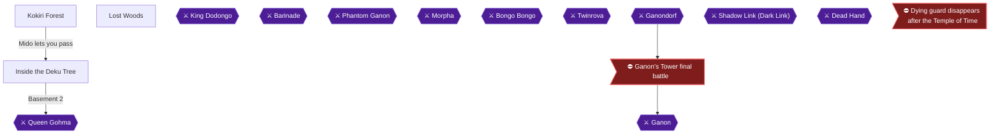

This chapter covers the whole opening of the game. You gather the Kokiri Sword and Deku Shield so Mido lets you pass 🟡, buy the first Deku Stick upgrade in the Lost Woods 🟡, clear Inside the Deku Tree, and defeat Queen Gohma for the Heart Container and the Kokiri Emerald. Three achievements belong here: Bunches of Twigs, Spider Net (missable) and Entrusted Mission.

> [!WARNING]
> **Missable Achievement Warning:** Spider Net asks you to defeat Queen Gohma before she can retreat to the ceiling. Prepare before you open the boss door: have the Slingshot and several Deku Sticks ready. The recommended plan is in the Queen Gohma section below.

### Preparation

- Mido will not let you pass unless both the Kokiri Sword and the Deku Shield are **equipped** in the Equipment subscreen, not just owned 🟡.
- The sword is free, the shield costs 40 rupees, and the Deku Stick upgrade costs another 40 rupees, so plan on collecting 80 rupees.
- Deku Sticks matter for both the dungeon puzzles and the Spider Net fight.
- Switching Z-targeting from Toggle to Hold (option menu on the file select screen) makes the Gohma combo easier 🟡.

### Chapter Items to Collect (11 Items Total)

| Item | Where Found | Action / Requirement | Citation |
|---|---|---|---|
| Kokiri Sword | Chest at the end of the boulder path in the Kokiri Training Ground | **TAKE** and equip | 🟡 |
| Deku Shield | Kokiri Shop, 40 rupees | **BUY** and equip | |
| Deku Stick upgrade (20) | Business Scrub in the Lost Woods, 40 rupees | **BUY** | 🟡 |
| Dungeon Map | Chest on the upper ledge of the Trunk | **TAKE** | 🟡 |
| Fairy Slingshot + Bullet Bag (30) | Chest in the Slingshot Room | **TAKE** | 🟡 |
| Compass | Chest in the Compass Room | **TAKE** | 🟡 |
| Gold Skulltula #8 | Compass Room alcove | **KILL / TAKE** | 🟡 |
| Gold Skulltula #9 | First basement wet room, grate | **KILL / TAKE** | 🟡 |
| Gold Skulltula #10 | First basement wet room, ivy wall | **KILL / TAKE** | 🟡 |
| Heart Container | Queen Gohma | **TAKE** | |
| Kokiri Emerald | Great Deku Tree after the boss | **RECEIVE** | |

### Kokiri Forest

🗺️ **Map:** [View Kokiri Forest Map by kingofthisgame](https://gamefaqs.gamespot.com/n64/197771-the-legend-of-zelda-ocarina-of-time/map/1099-kokiri-forest-map)

#### Leaving the house and meeting Mido

1. Leave Link's tree house by the door in the northwest corner 🟡. Saria approaches you on the porch 🟡.
2. Jump across the small pool of water to the large arch and speak with Mido. He refuses to let you pass until you have a sword and shield 🟡.

#### Getting the Kokiri Sword

1. Head to the crawl tunnel in the southwest corner of the forest, enter it by standing in front of it and pressing A, and crawl to the other side.
2. Go left and follow the path to the treasure chest while avoiding the rolling boulders. Open the chest on the tree trunk for the **Kokiri Sword** and equip it from the Equipment submenu 🟡.

> [!TIP]
> Hiding in the small alcoves along the boulder path is the way to stay clear of the boulder 🟡.

#### Collecting rupees

You need 80 rupees in total: 40 for the shield and 40 for the Deku Stick upgrade. Blue rupees are worth five rupees each 🟡.

- Along the boulder path, run left into the small alcove, take the blue rupee and slash the bush. Around the next corners take the blue rupee in the far alcove and slash its bush 🟡.
- Outside the tunnel, Z-target one of the rocks on the left and backflip (hold back and press A) repeatedly to the edge of the training ground, then repeat until you are awarded a blue rupee and a green rupee 🟡.
- Mido's House: open all his chests for 11 rupees and a Recovery Heart 🟡.
- Jump up to the ledge behind Mido's House for a blue rupee 🟡.
- Run across the platforms in the water for a blue rupee on reaching the opposite shore, then run back for another 🟡.
- The house in the southeast corner holds six rupees in pots, which respawn if you leave and re-enter 🟡.

#### Buying the Deku Shield

1. Enter the item shop in the northeast corner of the forest.
2. Speak to the clerk and buy the **Deku Shield** for 40 rupees. It is on the lower shelf on the right. Equip it on the Equipment submenu 🟡.

> [!TIP]
> The Deku Shield is wooden and burns in fire, so avoid flames while holding it 🟡.

### Lost Woods

🗺️ **Map:** [View Lost Woods Map by EverythingZelda](https://gamefaqs.gamespot.com/n64/197771-the-legend-of-zelda-ocarina-of-time/map/54-lost-woods-map)

#### Bunches of Twigs

1. Head back to Mido's House in the northwest, climb onto the ledge behind it, climb the vine-covered wall, work around the ledge and enter the large hollow log into the Lost Woods 🟡.
2. From the first Lost Woods area, take the log on the left, then the hollow log in the left corner of the next area (two lefts). Ignore the two elevated logs. Jump off the ledge into the valley below and go to the Business Scrub at the back, next to the Gossip Stone 🟡.
3. Defeat him: reflect his Deku Nut back with the Deku Shield, or use a jump attack.
4. Speak to him and pay 40 rupees. This raises your Deku Stick capacity to 20 and fills your sticks 🟡.


> [!ACHIEVEMENT]
> **Bunches of Twigs (5 Points)**
> 
> *Purchase more Deku Sticks from the Deku Merchant in Lost Woods*


5. Climb the ladder back to the top, go through the hollowed log, take another hollowed log to the right, then either log to return to Kokiri Forest 🟡.

> [!TIP]
> Before you leave the Lost Woods, note that the Skull Kid Heart Pieces and the Bullet Bag target are here too, but they need the Ocarina and songs and are not required for the Deku Tree.

### Passing Mido and entering the tree

1. Go to the east side of the forest, back across the pond, and speak with Mido again. With sword and shield equipped, he lets you pass 🟡.
2. Halfway along the passage, Deku Babas appear. They die in one sword hit and leave Deku Sticks.
3. Enter the mouth of the Great Deku Tree to begin the dungeon 🟡.

### Inside the Deku Tree

The dungeon centers on the Trunk, with four levels: Top Floor, Main Floor, Basement and Sub-Basement 🟡.

#### 1F: the Trunk (Dungeon Map)

1. Kill the Deku Babas in the corners. Hold R while Z-targeting to block their attacks, and take the Deku Sticks and Nuts they drop 🟡.
2. Reach the upper ledge by the ladder or the vines 🟡.
3. Open the chest partway along the ledge for the **Dungeon Map** 🟡.
4. Keep going right and enter the door 🟡.

#### Scrub Room #1

1. Z-target the Deku Scrub and reflect his Deku Nut back at him. When he runs, stand on his nest so he bumps into you 🟡.
2. He opens both doors and hints to press forward on the joystick when landing to avoid fall damage 🟡.
3. Go through the northeast door 🟡.

#### Slingshot Room

1. Jump onto the gray platform and quickly to the next ledge, since it falls. Open the chest for the **Fairy Slingshot** and Bullet Bag x30 🟡.
2. Climb the ivy wall on the right and open the chest for a Recovery Heart.
3. Shoot the ladder hanging above the entrance door with the Slingshot, climb it, and go back through the door to Scrub Room #1 🟡.

#### The Trunk: climbing to the Compass Room

1. Go back along the ledge. Shoot the three Skullwalltullas on the ivy wall with the Slingshot (one seed each) 🟡.
2. Climb the wall to the top, then left to the highest level, and keep going left to a door 🟡.

#### Compass Room (Gold Skulltula #8)

1. Step on the switch next to the lantern; three platforms rise. Jump along them to the back ledge and open the chest for the **Compass** 🟡.
2. Press the switch again and use the platforms to reach the small northern alcove. Jump past the Big Skulltula and open the chest for a Recovery Heart. Big Skulltulas die when struck in the stomach 🟡.
3. Kill the Gold Skulltula in the back of the alcove for token **#8** 🟡.
4. Light a Deku Stick on the lantern and use it to light the burned-out lantern. The door unlocks 🟡. Press A to put the stick away and save it once done 🟡.

#### The Trunk: breaking the web

1. Run right past the first Big Skulltula. Beat the second by Z-targeting it, waiting for it to spin, then using a jump attack 🟡.
2. Jump off the edge and land directly on the webbing on the first floor to break through to the sub-basement 🟡.

#### Basement wet room (Gold Skulltulas #9 and #10)

1. Shoot the Gold Skulltula on the eastern grating with the Slingshot, jump out to take the token, and climb back. This is token **#9** 🟡.
2. Face the long ivy wall on the south side, kill the second Gold Skulltula, and climb up to collect token **#10** 🟡.
3. Climb back to the southeast ledge and open the chest behind the lantern for a Recovery Heart.
4. Light a Deku Stick on the lantern, jump onto the shallow part of the pond, then to the southwest ledge. Run past the Deku Baba and burn the webs on the wall to reveal a door 🟡.

> [!NOTE]
> A fourth Gold Skulltula (#11) sits behind a bombable wall and needs Bombs and the Boomerang, so it is left for later.

#### Scrub Room #2

1. Deflect the Scrub's nuts back with the Deku Shield (the Slingshot does not work). Stand on his nest when he runs. He says "23 is number 1", a hint for the last puzzle 🟡.
2. Shoot the Silver Eye above the west door with the Slingshot to unlock it 🟡.

#### Trap Room

1. Swim to the left wall directly beneath the rotating spikes and hold A to dive onto the button. The water lowers 🟡.
2. Swim back, jump onto the floating platform and hold R to crouch under the spikes, then hop to the far ledge 🟡.
3. Kill the Big Skulltula, push the large stone block all the way right, and climb it to the door 🟡.

#### Torch Room and Small Nest

1. Kill the Deku Baba in the center, light a Deku Stick on the lit torch, and light the two unlit sconces. The north door opens 🟡.
2. Run circles in the center so the Gohma Larvae drop. Jump-attack each once, avoiding their charge when their eye turns red 🟡.
3. Light a stick at the north torches, burn the webbing in the south, and crawl through the tunnel back to the Trunk 🟡.

#### The Trunk: down to the boss

1. Run left and push the stone block along its path off the cliff. Jump down, relight a Deku Stick at the southeast torch, and climb back up via the block 🟡.
2. Roll over the floor webbing with the lit stick (run at it and press A). It burns, opening a hole to the lowest level 🟡.
3. Hit the three Deku Scrubs middle first, far right second, left last 🟡.
4. The door to the boss unlocks once all three vanish 🟡.

### Queen Gohma

> [!WARNING]
> **Missable Achievement Warning:** Spider Net is missable. The boss cannot be refought, so you must defeat Queen Gohma before she retreats to the ceiling. Practice the combo on regular enemies earlier in the dungeon 🟡. Carry spare Deku Sticks (commenters used between 3 and 5) 🟡.

**Setup.** One commenter suggests simply entering and looking up so she notices you 🟡. Stored crouch-stab damage resets when you enter a different room, so a jump attack beforehand will not carry into the boss 🟡.

**One-rotation plan** (for **Spider Net**):

1. Z-target Gohma and shoot her in the eye with the Slingshot while her eye glows red. This stuns her. The Slingshot stun lasts longer than a Deku Nut stun, so do not re-stun with nuts 🟡.
2. Switch to a Deku Stick and do a jump slash while still targeted. A Deku Stick jump attack deals 4 damage 🟡.
3. Release the target, hold R without locking on and press the attack button repeatedly to crouch-stab. The stab copies the previous attack's damage 🟡.
4. Alternatives reported by commenters: Slingshot then five Deku Sticks attacked quickly with no jump slash 🟡; or Slingshot, stick jump slash, then mash the stick button three times.


> [!ACHIEVEMENT]
> **Spider Net (10 Points)**
> 
> *Defeat Queen Gohma before she can retreat to the ceiling*


**If she escapes.** If Gohma reaches the ceiling and lays eggs, break each egg with one hit before it hatches. Shooting her red eye on the ceiling drops her to the floor, stunned for a long time. Spider Net asks for the kill before she retreats, so this fallback only finishes the boss.

### After the boss

1. Take the **Heart Container** and step into the blue light.
2. Outside, listen to the Great Deku Tree's story. He gives you the Kokiri Emerald and asks you to seek the Princess of Destiny at Hyrule Castle.


> [!ACHIEVEMENT]
> **Entrusted Mission (5 Points)**
> 
> *Receive the Spiritual Stone of the Forest*


3. Back in the forest, Mido blames you for the Deku Tree's death and leaves 🟡. Cross the lake and head to the western edge; exit through the hollow log 🟡.
4. On the bridge to Hyrule Field, Saria gives you the Fairy Ocarina 🟡.

> [!TIP]
> Before you leave the forest: Gold Skulltulas #8, #9 and #10 are in your pocket 🟡. Others in Kokiri Forest need night or a bottle, which come later 🟡.

> [!IMPORTANT]
> ### Chapter 1 Cumulative 100% Checkpoint
> - **Gold Skulltulas:** 3 / 100 (#8, #9, #10) 🟡
> - **Pieces of Heart:** 0 / 36
> - **Heart Containers:** 1 / 8
> - **Maps, Compasses & Boss Keys:** 2 / 26 (Dungeon Map, Compass) 🟡
> - **RetroAchievements Unlocked:** 3 / 97 (20 / 690 points)

### Chapter Checklist

- [ ] Kokiri Sword obtained and equipped
- [ ] Deku Shield bought and equipped
- [ ] Deku Stick upgrade bought (Bunches of Twigs)
- [ ] Dungeon Map and Compass
- [ ] Fairy Slingshot
- [ ] Gold Skulltulas #8, #9, #10
- [ ] Queen Gohma defeated in one rotation (Spider Net)
- [ ] Heart Container
- [ ] Kokiri Emerald (Entrusted Mission)
- [ ] Fairy Ocarina from Saria

---

## Chapter 2: Hyrule Castle Town and Princess Zelda

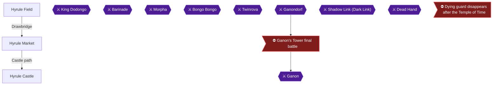

### Overview and preparation

This chapter takes you from the Deku Tree's final wish to your first meeting with Zelda: Hyrule Field, the Market, then the castle grounds and courtyard. The Great Deku Tree sent Link to Hyrule Castle to find the Princess of Destiny. Six achievements are earned here: Sniper Fury, Rise and Shine!!, Money Solves Everything, Troublemaker, A Royal Autograph and Who Let the Dogs Out. Two of them are missable and both have deadlines before you speak to Zelda.

The order that keeps every achievement available:

1. Play the Shooting Gallery in the Market as Young Link (Sniper Fury).
2. Talk to Malon in the Market, then get the Weird Egg from her at the castle grounds (Rise and Shine!!).
3. Talk to the gate guard, get caught in the courtyard, leave, come back and pay the bribe (Money Solves Everything).
4. Shoot the left courtyard window with the Slingshot, then talk to Zelda (Troublemaker, then A Royal Autograph).
5. Learn Zelda's Lullaby from Impa, then return to the Market at night for the white dog (Who Let the Dogs Out).

Keep your Slingshot and Deku Seeds ready for the Shooting Gallery and the courtyard windows, and carry at least 20 Rupees for the gallery. The Shooting Gallery costs 20 Rupees per game 🟡. The 10-Rupee bribe also needs cash 🟡.

> [!WARNING]
> **Missable Achievement Warning:** Money Solves Everything (bribe the castle guard) must be done before you meet Zelda. A player reports it cannot be completed after Zelda gets taken 🟡.

> [!WARNING]
> **Missable Achievement Warning:** Troublemaker (shoot the left courtyard window) must be done before Zelda leaves the courtyard, which happens after the third Spiritual Stone.

> [!TIP]
> **Shield warning:** Do NOT buy the Hylian Shield at the Bazaar (80 Rupees). You get the same shield soon enough for free, and a later chapter's achievement depends on it 🟡.

### Hyrule Field

🗺️ **Map:** [View Hyrule Field Map by thegamemaster8](https://gamefaqs.gamespot.com/n64/197771-the-legend-of-zelda-ocarina-of-time/map/5394-hyrule-field-map)

When you step into Hyrule Field, Kaepora Gaebora stops you to explain how to reach Hyrule Castle and how the map works 🟡. Answer "Yes" if you do not want him to repeat the speech.

Once he flies off, run between the trees where a road begins and follow it to its end at Hyrule Castle. Roll all the way by pressing A continually as you run. Otherwise night will fall before you arrive and the gates will be closed 🟡.

> [!TIP]
> Do not stray far from the road on this first trip. Everything you need in this chapter is in the Market and the castle grounds.

### Hyrule Market

🗺️ **Map:** [View Hyrule Palace Map by ThE_bLImP](https://gamefaqs.gamespot.com/n64/197771-the-legend-of-zelda-ocarina-of-time/map/52-hyrule-palace-map)

#### The Gatehouse (guardhouse by the drawbridge)

Enter the gatehouse to your left as you come in 🟡. Smash all the pots with your sword. They are an easy source of Rupees, and you can leave and re-enter to refill them as often as you like. Collect about 100 Rupees so you can afford repeat attempts at the Shooting Gallery 🟡.

Roll into the crates in the rear of the room, next to the guard. One holds a Gold Skulltula, which is Gold Skulltula #18 🟡. Kill it and take the token 🟡.

#### The Market square

Go southwest from the drawbridge to the Market. Walk around to the opposite side of the fountain and speak with the little girl in the white dress. This is Malon 🟡. Talk to her now. If you skip this, she will not appear at the castle later, and you would have to wait through another day/night cycle.

The Bazaar is the building with the scary face above it, and the Potion Shop is next door. You need nothing from either now 🟡.

#### Shooting Gallery

Enter the building behind Malon with the large target over the door 🟡. Pay 20 Rupees for fifteen shots to hit ten Rupees. Hitting eight of ten earns a free game. Hitting all ten earns a Bullet Bag that raises your Slingshot capacity from 30 to 40 🟡. You must hit every target without a miss 🟡. If you miss two or fewer, the clerk lets you try again free. If you miss more than two, you pay again 🟡.

The targets appear in the same order each time:

| Target | Behavior | Citation |
|---|---|---|
| 1 | Green Rupee, stationary in the middle | |
| 2 | Blue Rupee from the left, stopping a bit left of center | |
| 3 | Blue Rupee from the right, stopping a bit right of center | |
| 4 | Green Rupee that pops up from the middle; hit it at the top of its jump | |
| 5 and 6 | Blue Rupees from left and right at the same time; hit both before they leave | |
| 7 and 8 | Red Rupees moving right to left at moderate speed | |
| 9 and 10 | Red Rupees moving left to right, quickly | |

Tips from other players:

- Lower your control sensitivity to about 0.6 or 0.7 for this challenge 🟡.
- Keep the Slingshot aimed at the middle except for the two side shots 🟡.
- On the round where the blue Rupees move toward the right, fire before you think you need to 🟡.

If you run out of Rupees, go back to the gatehouse and smash pots to refill 🟡.


> [!ACHIEVEMENT]
> **Sniper Fury (5 Points)**
> 
> *Obtain a reward from the Shooting Gallery as Young Link*


Keep playing until the clerk gives you the Bullet Bag 🟡.

> [!TIP]
> Before you leave the Market: the Bombchu Bowling Alley and Treasure Chest Game here are not open to you yet. Do not spend money on them now. A Bazaar purchase of the Hylian Shield is still off the list 🟡.

### Hyrule Castle

🗺️ **Map:** [View Path to Zelda Map by TLS64](https://gamefaqs.gamespot.com/n64/197771-the-legend-of-zelda-ocarina-of-time/map/55-path-to-zelda-map)

#### Castle grounds: Gold Skulltula #19 and Malon's egg

Leave the Market through the passage directly behind Malon 🟡. Kaepora Gaebora appears again and rants about guards. When he flies away, roll into his tree to make a Gold Skulltula appear 🟡. Kill it and take the token. This is Gold Skulltula #19 🟡.

Malon now stands beside the long vine on the wall to your right. She explains her father Talon went to the castle with milk and has not come back, and she asks you to find him. Speak to her, twice if need be, and she gives you the Weird Egg. A source says she hands it over at night 🟡. If she is not there, you skipped talking to her in the Market, so return there first.

Equip the egg to a C button. Stand at the top of the vines and let the game pass through the night. In the morning, when you hear the rooster, the egg hatches into a Chicken 🟡.

#### Sneaking to Talon

Climb the ivy wall to the top. It has rough spots, so if you start in the wrong place you will fall off 🟡. At the top, run forward past the gossip stone to the top of the large marble arch. Drop down on the far side, which puts you behind the gate that was blocking you and past the first two guards 🟡.

The next stretch is the hardest. Run up the hill on the left at an exact spot: it is the third graphical break in the hill, near its center. Go straight up toward the cluster of flowers at the top, then run forward and slightly left until you reach a wall with tiled bricks, and climb the bricks 🟡.

At the top, run forward past another gossip stone and jump off the cliff into the moat. Swim to the end of the moat where it breaks left, climb onto the small patch of dirt, then up to the stone platform. Run left from the platform to find Talon asleep 🟡.

If you are spotted by a guard, you are thrown back outside the gate 🟡. A player's note says you have to sneak through the castle to reach the sleeping Talon, so be patient 🟡.

#### Wake Talon

Talking to Talon does not wake him. Stand next to him, where Navi flutters near him, and equip the Chicken. Press its C button. If the egg has not hatched, wait until dawn 🟡. Speak with Talon. He remembers he left Malon behind and runs off, clearing the path.


> [!ACHIEVEMENT]
> **Rise and Shine!! (5 Points)**
> 
> *Help Malon locate her father*


#### The bribe: Money Solves Everything

> [!WARNING]
> **Missable Achievement Warning:** Do this before you meet Zelda, and do not complete any other story step in between. Reports say you only need the egg from Malon, not necessarily a hatched one 🟡. You must get caught once, leave, and come back 🟡. One player did all of this after going to Kakariko Village and back, as long as no other main quest was done 🟡.

What exactly triggers the bribe dialogue is unconfirmed by any collected source. Comments mention having Malon's egg, being caught once and returning. Do all three before meeting Zelda and do no other story step in between.

The sequence that players report:

1. Have Malon's egg and talk to the gate guard on the left upon entering the courtyard area 🟡. One player talked to him twice at the gate 🟡.
2. While you are still on the castle grounds (climb back over the gate if you left), deliberately get spotted by a guard on the castle grounds (the hill below the moat, not Zelda's courtyard, which you have not entered yet). The guard throws you outside the gate.
3. Talk to the guard you see immediately after being thrown out. He offers to open the gate for 10 Rupees 🟡.
4. Pay the 10 Rupees. He lets you through 🟡.

Players report that having been caught once and then returning is what makes the offer appear 🟡. If you are caught and the bribe option does not show up, leave the area and come back 🟡. One player reports the achievement did not pop after waking Malon's father, which supports doing the full sequence above rather than just waking Talon 🟡.


> [!ACHIEVEMENT]
> **Money Solves Everything (5 Points)**
> 
> *Bribe the guard in front of the gate to gain entry to the courtyard*


#### Into the courtyard

Daytime is required to enter the next area, because the guard is increased at night 🟡. Push both milk crates through the gap Talon left, climb onto them, and jump to the drainage pipe that feeds the moat. If it is night, loiter until day, then climb through the pipe 🟡. Another source describes the same step as pushing the two bull-head blocks off the ledge so the second stacks on the first, then climbing up and jumping to the crawlspace beside the waterfall, again only in daytime 🟡.

Inside the courtyard, the guards patrol the hedged areas. If you are spotted you are thrown back out 🟡. Work your way to the northern edge of the topiary and run through the arch to reach the center of the courtyard, where Zelda waits. Exact patrol timings: Unable to verify from collected sources.

#### Troublemaker: shoot the left window

> [!WARNING]
> **Missable Achievement Warning:** Do this before speaking to Zelda. You cannot come back to this area after collecting all three Spiritual Stones.

Before you talk to Zelda, equip the Slingshot. Shoot the window on the LEFT side of the courtyard. A guard throws a bomb at you, so be ready to move 🟡. One shot should hit the window 🟡. Shooting the left window is the reported trigger, and the goal is not simply to be caught 🟡.


> [!ACHIEVEMENT]
> **Troublemaker (5 Points)**
> 
> *Anger a guard inside of the castle*


If you miss, you can try again as long as Zelda is still in the courtyard, which also means you do not need to shoot on the first visit 🟡. One player reports a second shot is possible after the volcano dungeon 🟡.

Now shoot the window on the RIGHT, which shows Mario characters, for a Red Rupee. A Deku Seed into this window gives a Red Rupee worth 20 Rupees. Do not confuse the two windows: the right one only pays a Rupee and does not count for the achievement.

#### Meet Zelda

Speak with Zelda. She asks if you have the Spiritual Stone of the Forest, and it is fine to say yes. Promise not to tell, listen to her dream, and say you understand when asked. Agree to look through the window when Zelda offers, then agree to help her. Pick the top option when given one. She gives you Zelda's Letter with her signature. The letter opens the gate to Death Mountain in Kakariko Village later.


> [!ACHIEVEMENT]
> **A Royal Autograph (5 Points)**
> 
> *Meet Princess Zelda for the first time*


#### Impa and Zelda's Lullaby

Run toward the courtyard exit. Impa blocks it and teaches you Zelda's Lullaby, then leads you out to Hyrule Field and points you toward Kakariko Village 🟡. The song is C-Left, C-Up, C-Right, C-Left, C-Up, C-Right 🟡. You are back in Hyrule Field with the letter and the song 🟡.

### Back to the Market at night: Who Let the Dogs Out

Return to the Market and wait for night. If you lack the Sun's Song, wait around the castle garden until nightfall and then re-enter the Market 🟡. One comment says to play the Sun's Song to make the dog follow you 🟡. You do not have that song yet, so use the waiting method 🟡.

At night the Market is mostly empty and many dogs run around. Find the small white dog behind the stall to the left of the Market entrance from the drawbridge 🟡. Walk up to it and press A so it follows you.

Lead it to the back alley in the corner and into the door on the left. Sources disagree on which one: the second door on the left 🟡, or the first door. The correct house holds a woman who recognizes the dog as hers. Talk to her 🟡. She gives a Piece of Heart.


> [!ACHIEVEMENT]
> **Who Let the Dogs Out (5 Points)**
> 
> *Help a lady locate her lost puppy*


> [!TIP]
> Before you leave Hyrule Castle for Kakariko Village, confirm the following: the two Gold Skulltulas (#18 and #19), the Bullet Bag, Zelda's Letter and Zelda's Lullaby. The Bombchu Bowling Alley and Din's Fire need Bombs, so they come later 🟡.

> [!IMPORTANT]
> ### Chapter 2 Cumulative 100% Checkpoint
> - **Gold Skulltulas:** 5 / 100 (#18 Market guardhouse, #19 tree outside the castle gate) 🟡
> - **Pieces of Heart:** 1 / 36 (lost dog)
> - **Heart Containers:** 1 / 8
> - **Maps, Compasses & Boss Keys:** 2 / 26
> - **RetroAchievements Unlocked:** 9 / 97 (50 / 690 points)

### Chapter checklist

- [ ] Gold Skulltula #18 (Market guardhouse crate)
- [ ] Sniper Fury: Bullet Bag from the Shooting Gallery
- [ ] Talked to Malon in the Market, then got the Weird Egg at the castle
- [ ] Gold Skulltula #19 (tree outside the castle gate)
- [ ] Rise and Shine!!: woke Talon with the Chicken
- [ ] Money Solves Everything: bribed the gate guard before meeting Zelda
- [ ] Troublemaker: shot the left courtyard window before talking to Zelda
- [ ] A Royal Autograph: met Zelda, got Zelda's Letter
- [ ] Learned Zelda's Lullaby from Impa
- [ ] Who Let the Dogs Out: returned the white dog, got the Piece of Heart
- [ ] Did not buy the Hylian Shield

---

## Chapter 3: Kakariko Village, the Graveyard and Lon Lon Ranch

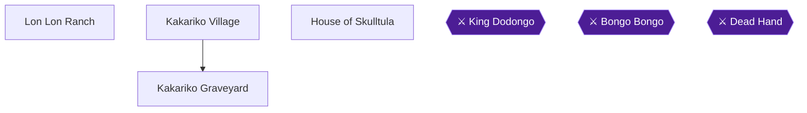

This chapter clears out the first batch of side content you can reach as Young Link. Kakariko Village is in the northeast corner of Hyrule, at the foot of Death Mountain, and Lon Lon Ranch sits in the middle of Hyrule Field 🟡. You will earn six achievements here: Catch Me If You Can, Cuccos' Revenge, Shield Raider, Super Cucco Catching, You Make Me Feel So Good and A Man's Best Friend. You will also pick up two Bottles, the Sun's Song, Epona's Song, the free Hylian Shield, three Pieces of Heart, the Adult's Wallet and eight Gold Skulltula tokens. There is no boss in this chapter.

> [!WARNING]
> **Missable Achievement Warning (Shield Raider):** Do NOT buy a Hylian Shield at the Bazaar before you pull the flowered gravestone in the Graveyard. Buying it replaces the shield chest's contents with rupees, and the achievement can be permanently missed.

> [!WARNING]
> **Missable Warning (Dampe's Piece of Heart):** If Dampe digs up the Piece of Heart and you leave the Graveyard without picking it up, it is lost forever and you get 50 rupees instead 🟡. Pick it up before you leave.

### Chapter Items to Collect (Rewards and Pickups)

| Item | Where Found | Action / Requirement | Citation |
|---|---|---|---|
| Empty Bottle | Kakariko Village, Cucco Lady | **GIVE** her all seven Cuccos in her pen | |
| Hylian Shield | Graveyard, flowered gravestone (night) | **PULL** the gravestone, **OPEN** the chest | |
| Sun's Song | Royal Family's Tomb | Zelda's Lullaby on the Triforce mark | 🟡 |
| Piece of Heart (Redead grave) | Graveyard, rear row | Defeat the Redead, play the Sun's Song | 🟡 |
| Piece of Heart (Dampe's dig) | Graveyard, random dirt patch | Pay Dampe 10 rupees per dig at nightfall | |
| Empty Bottle (with Lon Lon Milk) | Lon Lon Ranch, Talon's house | Find the three Super Cuccos in 30 seconds | 🟡 |
| Epona's Song | Lon Lon Ranch pasture, Malon | Talk to her, then play the Ocarina | |
| Piece of Heart (crawlspace) | Lon Lon Ranch, small building at the back | Rearrange the crates | |
| Lon Lon Milk | Lon Lon Ranch cow | Play Epona's Song with an empty Bottle | 🟡 |
| Adult's Wallet | House of Skulltula | Hand in 10 tokens | |

### Kakariko Village

Walk to the village in the northeast corner of Hyrule Field 🟡. Make sure it is daytime before you start the Cucco hunt below 🟡.

#### The Cucco Hunt (Catch Me If You Can)

The Cucco Lady (Anju) wants her seven lost Cuccos back 🟡. Pick each Cucco up and put it into her fenced pen, which is in the south of town near the arch leading to the Graveyard. The seven are:

1. **Cucco 1:** Run through the arch at the front of town. A Cucco is running around right there 🟡.
2. **Cucco 2:** Another Cucco is very near the Cucco Lady's pasture, close to the arch to the Graveyard in the southeast corner 🟡.
3. **Cucco 3:** This one is inside a crate near the center of town, across from the stairs to the upper level 🟡.
4. **Cucco 4:** This one is on the north side of town, on the upper level, near the gate to Death Mountain 🟡.
5. **Cucco 5:** This Cucco is trapped on a fenced ledge near the large tree. Climb the stairs of the partially built house and jump off the edge toward it while holding another Cucco. The held Cucco floats you out to the ledge 🟡.
6. **Cucco 6:** Climb the long stairset east of the pasture, run to the edge and aim at the fenced-off elevated platform. A Cucco is running around in the small grotto behind the building 🟡.
7. **Cucco 7:** Drop back into the grotto and climb the tall ladder all the way up. Work around behind the Windmill and grab the last Cucco 🟡.

Three of the Cuccos can only be reached by gliding off cliffs and over fences with other Cuccos 🟡. Once all seven are in the pen, talk to the Cucco Lady. She rewards you with an Empty Bottle.


> [!ACHIEVEMENT]
> **Catch Me If You Can (5 Points)**
> 
> *Obtain a reward from Anju for catching her cuccos in Kakariko Village*


> [!TIP]
> Keep an empty Bottle on hand. The Graveyard bugs and the ranch cow's milk both need one 🟡. You get another Bottle from Talon at Lon Lon Ranch 🟡.

#### Cuccos' Revenge

While you are among the Cuccos, hit one with your sword over and over until the whole flock turns on you 🟡. This works only as Young Link, so do it now 🟡.


> [!ACHIEVEMENT]
> **Cuccos' Revenge (5 Points)**
> 
> *Feel the wrath of the cuccos in Kakariko Village*


#### The Death Mountain Gate and the Keaton Mask

Go to the northern edge of the village and talk to the guard by the gate. He refuses to let you through until you show him Zelda's Letter, which opens the way to Death Mountain Trail 🟡. The guard asks you to bring him a Keaton Mask from the Hyrule Castle Market, which starts the Happy Mask trading sequence and unlocks the Happy Mask side quest 🟡.

You can do the mask trade whenever it suits you. Borrow the Keaton Mask for 10 rupees, wear it and talk to the guard, who pays 15 rupees. Then pay the shop owner the 10 rupees 🟡. Do not go up Death Mountain Trail yet. The rest of this chapter stays in the village area.

#### Impa's House Piece of Heart (Optional Now)

Piece of Heart: glide with a Cucco from the narrow wooden beam of the unfinished house. When the beam bends to the right, leap off and steer right for the balcony of Impa's House. Throw the Cucco aside and enter the crack in the building.

If you skip it, you can come back later. Kaepora Gaebora's ride can drop you on Impa's roof, and as an adult the Hookshot reaches it 🟡.

### Kakariko Graveyard

Leave through the arch in the southeast corner of town 🟡.

#### Gold Skulltula #29: The Bug Patch

Catch a bug from under a rock with a Bottle 🟡. Pass under the arch and follow the stone path to the left side of the graveyard, where there is a patch of soft earth. Stand near the patch and release the bug 🟡. Quickly recapture one bug in the Bottle 🟡. After a few seconds, a Gold Skulltula appears. Kill it and take the token (**Graveyard #29**) 🟡.

#### The Royal Family's Tomb and the Sun's Song

Head to the largest tombstone. Stand on the large Triforce symbol in front of it, take out your Ocarina and play Zelda's Lullaby. The tombstone explodes and reveals a pit. Drop down. Zelda's Lullaby is Left, Up, Right, Left, Up, Right 🟡.

Run down the ramp and circle the large bone pit to draw all the Keese. Shoot them with the Slingshot or cut them down, and the door at the top of the stairs unlocks 🟡. Go through the door, pass the Redeads, go through the next opening and read the inscription on the wall. Reading it teaches the Sun's Song 🟡.

The Sun's Song is Right, Down, Up, Right, Down, Up. It flips the time between noon and midnight 🟡.

> [!TIP]
> You can only reach the next two sections at night. If it is daytime, play the Sun's Song now. Midnight is fine for the shield and the Redead grave, but not for Dampe's tour.

#### The Free Hylian Shield (Shield Raider)

> [!WARNING]
> **Missable Achievement Warning:** Reminder: do not buy a Hylian Shield from the Bazaar before this step 🟡.

At night, go to the front row of gravestones and find the grave with flowers in front of it. Stand behind it, grab it and pull back to reveal a pit. Drop down 🟡. Do not pull other gravestones in this row, because they hold Poes that turn invisible when Z-targeted 🟡.

Inside, run forward and open the chest to find the **Hylian Shield**, whose metal is impervious to flame attacks.


> [!ACHIEVEMENT]
> **Shield Raider (5 Points)**
> 
> *Obtain the Hylian Shield for free instead of buying it*


If you already bought the shield, players report the achievement can still unlock if a Like-Like steals the shield and you recover it. This works only as child Link and was reported to fail in the Fire Temple but succeed in the Bottom of the Well 🟡. One player could not make it work and used a new save file 🟡. Treat that route as unconfirmed.

Later, with bombs, the wall inside this chamber opens to a Fairy Fountain 🟡.

#### The Redead Grave (Piece of Heart)

Still at night, go to the rear row of gravestones and the far right. Counting from the right, pull aside the fourth gravestone to reveal another pit. Drop in 🟡. Another guide describes this grave as the second gravestone on the left when facing away from the Royal Family's Tomb 🟡. The sources word the location differently, so if you uncover a Poe instead of a pit, step back and try the next candidate 🟡. You can only pull graves at night 🟡.

Inside, attack the Redead repeatedly. The faster you hit it, the less it can attack. If it grabs you, tap buttons and rotate the stick to break free 🟡. Once it is permanently defeated, stand on the steps and play the Sun's Song. A chest appears with a **Piece of Heart**. Open it and return to the Graveyard 🟡.

#### Dampe's Gravedigging Tour (Piece of Heart)

Dampe's game runs only in the first part of the night, not at midnight, and the Sun's Song will not start it. Leave to Hyrule Field and wait for nightfall (the wolf's howl), then return 🟡. Bring about 100 rupees. Your starting wallet holds only 99, so that is the most you can carry before the Adult's Wallet 🟡.

> [!WARNING]
> **Missable Warning:** When Dampe digs up the Piece of Heart, pick it up before you leave the Graveyard. Otherwise it is lost forever 🟡.

Dampe walks a circular route along the path. If you stand directly on a dirt patch in his path, he stops in front of it. Talk to him and pay 10 rupees to dig 🟡. The Piece of Heart is in one of twelve patches, and most other patches give at least some rupees. Only ask him to dig on the soil patches, not the bare path 🟡.

The Piece of Heart changes patches every time you leave the zone. If you leave to restock rupees, start your search over 🟡. Dampe appears at random after nightfall, so wait for him 🟡. One player needed about 20 digs 🟡.

When it comes up, grab the Piece of Heart before you leave.

### Kakariko Village at Night (Gold Skulltulas #22-#26)

Return to the village at night. These five Skulltulas need night, and you need your Slingshot 🟡. If it is day, play the Sun's Song 🟡.

1. **Skulltula #22 (tree):** Roll into the tree near the village entrance and kill the Skulltula that falls out.
2. **Skulltula #23 (House of Skulltula window):** It sits on the window of the House of Skulltula, beneath the window on its left side. Another guide places it on the backside window 🟡, so check both sides.
3. **Skulltula #24 (unfinished building):** At the Unfinished House, on the pile of bricks. Kill it with the Slingshot before jumping up for the token, because the sword hurts you at close range 🟡.
4. **Skulltula #25 (north house):** At the north end of town, the house on the left of the Death Mountain gate has a Skulltula on it. Smash the pots to get at it if it is hidden 🟡.
5. **Skulltula #26 (lookout tower ladder):** On the ladder of the tall lookout tower. Shoot it with two Slingshot shots, then climb up for the token.

Together with the Graveyard token and the five you already had, that makes 11 tokens. The Skulltula on Impa's roof needs the Hookshot, so skip it for now 🟡.

### Lon Lon Ranch

Lon Lon Ranch is in the middle of Hyrule Field 🟡. Enter at night first, for the Skulltulas 🟡. If it is daytime, play the Sun's Song 🟡.

#### Gold Skulltulas #14 and #15 (Night)

1. **Skulltula #14 (tree):** Roll into the lone tree beside the ranch house, just left of the arch leading to the pasture. Kill the Skulltula that falls and take the token 🟡.
2. **Skulltula #15 (feeding shelter):** Circle around to the back of the horse corral and kill the Skulltula on the back of the feeding shelter. Watch out for Guay birds 🟡. If the token is out of reach, you may need to backflip into it 🟡.

That brings you to 13 tokens. The window Skulltula and the rock-wall Skulltula need the Boomerang, so leave them for later 🟡.

#### Daytime: Talon's Super Cucco Game

Play the Sun's Song to make it day 🟡. Enter the house to the left of the entrance, where Talon runs a game.

For 10 rupees, you must find three Super Cuccos within 30 seconds 🟡. The Super Cuccos look the same as the others 🟡.

The easiest method is to throw all the Cuccos into the corner behind the long counter Talon sits on, then "select" Cuccos by picking them up 🟡. A green arrow shows over a Cucco you have already picked up. You can shield-drop a Cucco to release it faster 🟡.

Find all three and Talon gives you a Bottle filled with Lon Lon Milk 🟡. Once the milk is gone, you have an Empty Bottle 🟡.


> [!ACHIEVEMENT]
> **Super Cucco Catching (5 Points)**
> 
> *Obtain a reward from the Lon Lon Ranch minigame*


Players report this achievement sometimes unlocks along with the milk achievement. The cause is unconfirmed 🟡.

#### Epona's Song

Talk to Malon in the middle of the horse pen. Talk to her repeatedly. When she mentions her mother, take out the Ocarina and she teaches you Epona's Song. Either Ocarina works.

The song is Up, Left, Right, Up, Left, Right 🟡. It will later let you ride Epona and gets free milk from any cow 🟡.

#### The Crawlspace (Piece of Heart)

Go to the small building at the back of the ranch (the southwest corner) and enter it. Pull the crates aside to open the crawlspace in the corner. The details in one guide: pull the upper-right box, the one beside the cow, down toward the door once, then go to the other side and push it down. Then pull the box in the upper-left corner to the right 🟡. Crawl through the tunnel to an empty nest with a **Piece of Heart**.

#### Milk from a Cow (You Make Me Feel So Good)

Make sure you have an empty Bottle. Go to a cow in the barn on the ranch 🟡. Stand next to the cow and play Epona's Song with the empty Bottle 🟡. It fills the Bottle with free Lon Lon Milk 🟡.


> [!ACHIEVEMENT]
> **You Make Me Feel So Good (5 Points)**
> 
> *Obtain some nutritious milk from a healthy cow*


The same cow trick works with any cow, including one in a hidden pit on Death Mountain Trail 🟡. One player's report said that on the OoT 1.0 ROM this also unlocked Super Cucco Catching. That is unconfirmed 🟡.

> [!TIP]
> **Before you leave Lon Lon Ranch:** As an adult you will return here for Ingo's races and Epona, which requires Epona's Song 🟡. Malon's obstacle course comes much later and depends on waking Talon in the Biggoron Sword sequence 🟡.

### House of Skulltula

Return to Kakariko Village. The cursed family's house is the first house on the right as you enter from the main gate 🟡. You now hold 13 tokens, more than the 10 needed. Enter, turn right and talk to the man there. He gives you the **Adult's Wallet**, which raises your capacity from 99 to 200 rupees.


> [!ACHIEVEMENT]
> **A Man's Best Friend (5 Points)**
> 
> *Collect 10 Gold Skulltulas and obtain your reward*


Further rewards, for later:

| Tokens | Reward | Citation |
|---|---|---|
| 20 | Stone of Agony | |
| 30 | Giant's Wallet | |
| 40 | Bombchus | |
| 50 | Piece of Heart | |
| 100 | Huge Rupee (repeatable) | |

### Left for Later

These Kakariko and Graveyard items need gear or conditions you do not have yet, according to the sources cited in each row.

| Item | What it needs | Citation |
|---|---|---|
| Windmill Piece of Heart | Boomerang | |
| Secret Cave with Redeads (Huge Rupee) | Bombs, and the Sun's Song to deal with the Redeads | |
| Red Rupee in a hole near the Potion Shop | Drop into the hole | |
| Graveyard southeast-wall Skulltula | Boomerang | 🟡 |
| Hookshot from Dampe's race | Adult Link | |
| Bean-platform Piece of Heart | A Magic Bean planted at the soft soil, ridden as an adult | |

> [!TIP]
> **Before you leave Kakariko:** Confirm you have the Bottles, the Hylian Shield, the Sun's Song, Epona's Song, the three Pieces of Heart and the Adult's Wallet. Sources also list the Windmill and the Dampe race as later tasks, so you are not leaving anything permanent behind.

> [!IMPORTANT]
> ### Chapter 3 Cumulative 100% Checkpoint
> - **Gold Skulltulas:** 13 / 100
> - **Pieces of Heart:** 4 / 36
> - **Heart Containers:** 1 / 8
> - **Maps, Compasses & Boss Keys:** 2 / 26
> - **Bottles from this chapter:** Anju's Cucco reward and Talon's Super Cucco game
> - **RetroAchievements Unlocked:** 15 / 97 (80 / 690 points)

### Chapter Checklist

- [ ] Seven Cuccos returned to the pen and the Bottle received (Catch Me If You Can)
- [ ] Hit a Cucco until the flock attacks (Cuccos' Revenge)
- [ ] Zelda's Letter shown to the Death Mountain gate guard
- [ ] Bug Skulltula #29 in the Graveyard
- [ ] Sun's Song learned in the Royal Family's Tomb
- [ ] Hylian Shield from the flowered grave (Shield Raider)
- [ ] Redead grave Piece of Heart
- [ ] Dampe's Piece of Heart picked up before leaving
- [ ] Kakariko Skulltulas #22 to #26
- [ ] Lon Lon Ranch Skulltulas #14 and #15
- [ ] Super Cucco game won (Super Cucco Catching)
- [ ] Epona's Song learned
- [ ] Ranch crawlspace Piece of Heart
- [ ] Cow milk in an empty Bottle (You Make Me Feel So Good)
- [ ] Adult's Wallet from the House of Skulltula (A Man's Best Friend)

---

## Chapter 4: Lost Woods, Sacred Forest Meadow and Goron City

```mermaid
flowchart TD
  Kokiri_Forest["Kokiri Forest"]
  Lost_Woods["Lost Woods"]
  Sacred_Forest_Meadow["Sacred Forest Meadow"]
  Death_Mountain_Trail["Death Mountain Trail"]
  Goron_City["Goron City"]
  Queen_Gohma{{"⚔ Queen Gohma"}}
  King_Dodongo{{"⚔ King Dodongo"}}
  Barinade{{"⚔ Barinade"}}
  Phantom_Ganon{{"⚔ Phantom Ganon"}}
  Morpha{{"⚔ Morpha"}}
  Bongo_Bongo{{"⚔ Bongo Bongo"}}
  Twinrova{{"⚔ Twinrova"}}
  Ganondorf{{"⚔ Ganondorf"}}
  Ganon{{"⚔ Ganon"}}
  Dark_Link{{"⚔ Shadow Link (Dark Link)"}}
  Dead_Hand{{"⚔ Dead Hand"}}
  Dying_Guard_Lockout>"⛔ Dying guard disappears after the Temple of Time"]
  Final_Battle>"⛔ Ganon's Tower final battle"]
  Lost_Woods --> Sacred_Forest_Meadow
  Death_Mountain_Trail --> Goron_City
  Ganondorf --> Final_Battle
  Final_Battle --> Ganon
  classDef ponr fill:#7f1d1d,stroke:#f87171,color:#fff;
  classDef boss fill:#4c1d95,stroke:#a78bfa,color:#fff;
  class Dying_Guard_Lockout,Final_Battle ponr;
  class Queen_Gohma,King_Dodongo,Barinade,Phantom_Ganon,Morpha,Bongo_Bongo,Twinrova,Ganondorf,Ganon,Dark_Link,Dead_Hand boss;
```

This chapter takes you through the Lost Woods, where you earn the Bullet Bag upgrade and the Skull Kid Piece of Hearts, then to the Sacred Forest Meadow for Saria's Song, and finally up Death Mountain Trail to Goron City, where Darunia gives you the Goron's Bracelet. The Lost Woods is entered from Kokiri Forest 🟡. The Sacred Forest Meadow lies in the midst of the Lost Woods 🟡. Death Mountain Trail leads from Kakariko Village to Goron City 🟡.

Three achievements are placed here: Bullseye!! (Bullet Bag), You Can Be a Star (Ocarina minigame) and Dance Into the Fire (Darunia's gift).

> [!WARNING]
> **Heads-Up for Later Deku Upgrades (A Horrible Face, Stocking Nuts):** The Deku Nut upgrade from the Mask of Truth on the Forest Stage cannot be obtained once Link has become an adult 🟡. One source also says receiving the Poacher's Saw sets a flag that makes it unobtainable 🟡. The Deku Nut upgrade under the boulder near the Sacred Forest Meadow entrance is also flagged as missable if you take the Poacher's Saw before any Lost Woods upgrades 🟡. This chapter's route does not need the Mask of Truth yet. Do not trade ahead in the Biggoron's Sword chain before collecting these upgrades.

> [!WARNING]
> **Do Not Break These Boulders (Walking on a Tightrope, Chapter 6):** In Goron City, do NOT destroy the three boulders to the left of the entrance on the top floor. Their destruction is permanent and voids the achievement in chapter 6 🟡. Open the other, non-entrance rocks only where this guide tells you to.

### Chapter Items to Collect

| Item | Where Found | Action / Requirement | Citation |
|---|---|---|---|
| Bullet Bag (40 to 50 seeds) | Lost Woods target | **SHOOT** center 3 times in a row | |
| Piece of Heart (memory game) | Lost Woods, twin Skull Kids | **PLAY** the Ocarina memory game | 🟡 |
| Saria's Song | Sacred Forest Meadow | **LEARN** from Saria | 🟡 |
| Piece of Heart (Saria's Song) | Lost Woods, lone Skull Kid | **PLAY** Saria's Song | |
| Goron's Bracelet | Goron City, Darunia | **PLAY** Saria's Song | |
| Piece of Heart (above Dodongo's Cavern) | Death Mountain Trail | **BACKFLIP** over fence | 🟡 |
| Gold Skulltula #1 | Kokiri Forest, back of the Know-It-All Brothers' House (night) | **SHOOT**, then **TAKE** | 🟡 |
| Gold Skulltula #2 | Kokiri Forest, soft soil by the shop | **DROP** bugs, **KILL** | 🟡 |
| Gold Skulltula #4 | Lost Woods, soft soil two lefts from the entrance | **DROP** bugs, **KILL** | 🟡 |
| Gold Skulltula #5 | Lost Woods, soft soil in the Forest Stage clearing | **DROP** bugs, **KILL** | 🟡 |
| Gold Skulltula #30 | Soft soil at Dodongo's Cavern entrance | **DROP** bugs, **KILL** | 🟡 |

### Kokiri Forest

🗺️ **Map:** [View Kokiri Forest Map by kingofthisgame](https://gamefaqs.gamespot.com/n64/197771-the-legend-of-zelda-ocarina-of-time/map/1099-kokiri-forest-map)

Return to Kokiri Forest as a child. The way into the Lost Woods is behind Mido's House: climb up on the ledge behind it, climb the vine wall, work around the ledge and enter the large hollow log 🟡.

Collect both Kokiri Forest Gold Skulltulas now (bring a Bottle with bugs, found under rocks). At night, one sits behind the Know-It-All Brothers' House (the house to the right as you enter from Hyrule Field). Kill it with the Slingshot, then backflip into the token while facing away from it. The second is under the patch of soft earth by the Kokiri Shop; drop a Bottled Bug on it and kill the Skulltula. A Magic Bean can be planted there too 🟡.

You need the Fairy Ocarina and Slingshot for this chapter. Saria already gave you the Ocarina when you left the forest 🟡.

### Lost Woods

🗺️ **Map:** [View Lost Woods Map by EverythingZelda](https://gamefaqs.gamespot.com/n64/197771-the-legend-of-zelda-ocarina-of-time/map/54-lost-woods-map)

#### Bullet Bag target

Enter via the log behind Mido's house and go right through the hollowed log. Run forward to the edge of the cliff and take out the Slingshot. Shoot the drum hanging from the tree limb at its exact center. A hit gives 100 points and a small victory sound. Three successive center shots make a Deku Scrub appear and give you the Bullet Bag x50. Another source describes it as upgrading seed capacity from 40 to 50 🟡. A "100" appears when you hit the right place 🟡. Aim the center of the Slingshot's rubber band at the center of the drum before you fire.


> [!ACHIEVEMENT]
> **Bullseye!! (5 Points)**
> 
> *Obtain the Bullet Bag upgrade in the Lost Woods*


#### Skull Kid memory game

Drop down the cliff to the small valley below and go all the way to the right. Stand on the low trunk and two Skull Kids appear. Take out the Ocarina and play the memory game: three rounds, each longer and harder 🟡. They play each addition twice, so watch the first Skull Kid and play along with the second to learn the new part fastest 🟡. Another source says you may want pen and paper ready. The notes are five, six and eight in length, with a Green Rupee and a Blue Rupee as the earlier prizes and the Piece of Heart for the last 🟡. Completing the game awards the Piece of Heart 🟡.


> [!ACHIEVEMENT]
> **You Can Be a Star (5 Points)**
> 
> *Obtain the final reward from the Ocarina Playing minigame in the Lost Woods*


#### Gold Skulltulas #4 and #5 (bugs)

You already own the Deku Stick upgrade from Chapter 1. Bring a Bottle with bugs for these two soft-soil Skulltulas, and recapture a bug each time.

1. **#4:** Take two lefts from the entrance, drop into the valley and find the patch of soft earth past the Business Scrub. Drop the bugs on it and kill the Gold Skulltula that appears.
2. **#5:** From the entrance go right, left, right, left and left to reach a large grassy clearing near the Forest Stage. Drop the bugs on its soft earth and kill the Skulltula.

#### Onward to the Sacred Forest Meadow

Climb the ladder back up, then take the hollowed log to the right of the ladder. Kaepora Gaebora appears; the stone arch here leads to Goron City but you can't use it yet 🟡. Go through the log tunnel he stood on. On the other side is a pool that leads to Zora's Domain, also not usable yet 🟡. Go left through a tunnel, straight through another, left through another, and right at the next crossroads to enter the Sacred Forest Meadow 🟡.

Optionally, bomb the rock near the entrance to the Sacred Forest Meadow and drop into the pit for a pair of Business Scrubs. One sells the Deku Nut upgrade for 40 rupees 🟡. This is the upgrade the Stocking Nuts achievement refers to, not the Mask of Truth one 🟡. The scrub on the left is the one that sells it. You need Bombs, which you get in Dodongo's Cavern, so this is for the return trip.

### Sacred Forest Meadow

🗺️ **Map:** [View Sacred Forest Meadow Map by R351D3NT3V1L4](https://gamefaqs.gamespot.com/n64/197771-the-legend-of-zelda-ocarina-of-time/map/5354-sacred-forest-meadow-map)

Run forward a short way and a Gray Wolfos ambushes you. Stand still, wait for it to move close, backflip (Back + A while Z-targeted) as it attacks, then immediately Jump Attack (A while Z-targeted). That kills it in one shot 🟡. Its death makes the gate blocking the meadow disappear 🟡.

Turn right and follow the path around the corner. Kill or run past the Deku Scrub and go around another corner. Kill or dodge another Scrub, round another corner, take a left down a grassy detour, then another left back onto the main road 🟡. Jump into the pool at the end of the road, then jump back onto the road with the Deku Scrub in front of you. Kill or dodge it, go around the corner, take a left and go up the stairs. Run down the long corridor, killing or dodging two more Deku Scrubs, then run up the stairs. At the top Saria sits in a small overgrown courtyard and teaches you Saria's Song 🟡.

The song is C-Down, C-Right, C-Left, C-Down, C-Right, C-Left 🟡.

Head back down the stairs, down the corridor and down the second flight. Climb the ladder directly in front and jump along the cliffs to leave faster. The pit in the middle of the upper cliffs holds a Fairy Fountain. Run back to the entrance and return to the Lost Woods.

> [!TIP]
> RetroAchievements commenters note that entering Goron City from the Lost Woods triggers Saria to appear in the Sacred Forest Meadow, so if Saria is missing, try that 🟡.

### Lost Woods (return)

Kaepora Gaebora ambushes you again. Take a right through the hollowed log to return to Kokiri Forest, then turn right back around and re-enter the Lost Woods.

Go left through the hollowed log and jump onto the small trunk by the Skull Kid. Play Saria's Song for him and he gives you a Piece of Heart. This gives you another Heart Container.

### Death Mountain Trail

Get to Kakariko Village and show Zelda's Letter to the guard at the northern gate to be let through 🟡. Equip the Hylian Shield before you go 🟡.

Go forward and kill the Tektite. If it tries to jump on you, hold R for the Turtle Defense. Around the corner defeat two more Tektites, then another that jumps down from above 🟡. Watch for rolling boulders as you climb 🟡. Note the Piece of Heart high above the giant boulder; you get it shortly 🟡.

Follow the path to the large wooden post with a red flag. Go right, past the large stone pedestal with the ring of rocks, and enter the archway into Goron City 🟡.

### Goron City

#### Darunia

Jump down to the lowest level. Find the sealed door with the carpet in front of it, stand on the carpet and play Zelda's Lullaby to open it 🟡. Enter and find Darunia. Play Saria's Song standing directly in front of him to cheer him up. He gives you the Goron's Bracelet, which lets you pick up and use Bomb Flowers.


> [!ACHIEVEMENT]
> **Dance Into the Fire (5 Points)**
> 
> *Visit Darunia in Goron City and obtain a gift*


Before leaving the room, light a Deku Stick on the torch in his room. Run out and light the empty sconce outside. Put the stick away by swinging your sword, take out another and light it again. Light all the braziers on the bottom level; once all are lit the giant pot starts spinning 🟡. You can also use the lit stick on the Bomb Flowers near the sealed room to blow the wall open and reach the Goron City Shop 🟡.

#### Second floor

Take the stairs between the yellow-striped posts to the second level. Go right to the two unlit torches and a Goron sitting in front of a tunnel. In the tunnel, pick up a Bomb Flower and drop it near the boulders to clear the path 🟡. Lighting the two torches and the Bomb Flowers opens a shortcut tunnel to the Lost Woods 🟡.

> [!WARNING]
> **Achievement Trigger Warning:** Do NOT destroy the three boulders blocking the entrance to the boulder room on the top floor. Leave them intact so Walking on a Tightrope in chapter 6 remains available 🟡.

#### Deku Nut and Mask trips

The Skull Mask Forest Stage trip and the Mask of Truth upgrade belong to the Happy Mask sidequest, which you may do later. The Deku Stick upgrade (30) comes with the Skull Mask and the Deku Nut upgrade (40) with the Mask of Truth 🟡. Unable to verify from collected sources whether this chapter's Slingshot and Ocarina progress is affected by either.

#### Dodongo's Cavern entrance and the Piece of Heart

From the second level, go to the far left and up the stairs between the red-striped posts. When the stairs split, go right. At the top, go right from the stairwell exit, then right again to return to Death Mountain Trail 🟡.

Go around the corner to the right to a small alcove with a Bomb Flower. Pick it up and throw it off the cliff so it lands on or near the boulder blocking Dodongo's Cavern 🟡. Next, face away from the edge, hold Z without targeting anything, run backward toward the fence and backflip over it. If done right, you land on the cliff above Dodongo's Cavern and get the Piece of Heart 🟡. This completes a Heart Container 🟡. Drop down, and drop a bug into the soft earth at the cavern entrance to release a Gold Skulltula (recapture one bug) 🟡. You can also plant a Magic Bean in this soil 🟡.

> [!TIP]
> Before you leave: you have Dodongo's Cavern next, which gives you Bombs. After you return you can finish the spinning pot (Piece of Heart), the rolling Goron Bomb Bag, the boulder maze Skulltula and other bomb-gated spots in Goron City.

### Bomb-gated content (Chapter 6)

The Death Mountain Trail wall Skulltula, the rolling Goron Bomb Bag, the spinning-pot Piece of Heart, the Goron City boulder maze, the Deku Nut upgrade grotto and the Great Fairy all need Bombs. Chapter 6 does them in order, once you have Bombs.

### Cumulative Progress

> [!IMPORTANT]
> ### Chapter 4 Cumulative 100% Checkpoint
> - **Gold Skulltulas:** 18 / 100
> - **Pieces of Heart:** 7 / 36
> - **Heart Containers:** 1 / 8
> - **Maps, Compasses & Boss Keys:** 2 / 26
> - **RetroAchievements Unlocked:** 18 / 97 (95 / 690 points)

### Chapter Checklist

- [ ] Bullet Bag x50 from the Lost Woods target
- [ ] Piece of Heart from the Skull Kid memory game
- [ ] Saria's Song learned in the Sacred Forest Meadow
- [ ] Piece of Heart from the lone Skull Kid (Saria's Song)
- [ ] Goron's Bracelet from Darunia
- [ ] Goron City top-floor entrance boulders left intact
- [ ] Bomb Flower thrown to open Dodongo's Cavern
- [ ] Piece of Heart above Dodongo's Cavern
- [ ] Gold Skulltulas #1, #2, #4, #5 and #30

---

## Chapter 5: Dodongo's Cavern

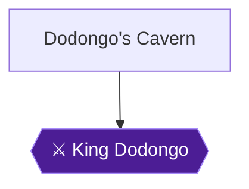

Dodongo's Cavern is the second dungeon. It opens when you throw a Bomb Flower at the sealed entrance, and it ends with King Dodongo and the Goron's Ruby. The dungeon's "Big Puzzle" is climbing to the catwalk above the giant Dodongo skull and forcing its mouth open to reach the boss 🟡. Bombs, the Bomb Bag and the Bomb Flowers are the dungeon's main tools 🟡. Two achievements belong here: **Bombalicious** (missable, a boss challenge) and **Soul Brothers** (story progression). You also collect the Map, the Compass, the Bomb Bag, a Heart Container and four Gold Skulltulas.

### Preparation

Darunia gives you the Goron's Bracelet in Goron City. You need it to pick up and throw Bomb Flowers, and nearly every puzzle here depends on that.

Equip the Hylian Shield if you have it. Keese that fly through a torch flame catch fire, and the Hylian Shield blocks them and douses the flame. A Deku Shield is destroyed by them 🟡.

Bring a few Deku Sticks. You need a lit one to open a door later, and a Business Scrub inside the dungeon sells them for 15 rupees each 🟡.

> [!TIP]
> **Bomb Flowers vs. bag bombs:** Your Bomb Bag arrives mid-dungeon. For the missable achievement, you must beat King Dodongo without using bombs from that bag. The fight takes place in a room with its own Bomb Flowers.

### Dungeon Items to Collect

| Item | Where Found | Action / Requirement | Citation |
|---|---|---|---|
| Dungeon Map | Chest behind a sealed wall to the left of the Bomb Flower near the unlocked door, west side of the Antechamber | **TAKE** after blasting the wall with a Bomb Flower | |
| Compass | Chest in the Armos Trap Room | **TAKE** after defeating the Armos Knight with a Bomb Flower | |
| Red Rupee | Small chest on a platform in the Blade Trap Room | **TAKE** | 🟡 |
| Bomb Bag (20 Bombs) | Chest on an upper ledge of the upper Blade Trap Room | **TAKE** | |
| Deku Shield or Blue Rupee | Chest behind a sealed wall at the end of the catwalk | **TAKE** (Blue Rupee if you still own a Deku Shield) | 🟡 |
| Bombs | Chest in the room above the boss pit | **TAKE** | 🟡 |
| Heart Container | Left by King Dodongo | **TAKE** | |
| Goron's Ruby | Given by Darunia outside | **RECEIVE** | 🟡 |

### Dodongo's Cavern

#### Entrance (Death Mountain Trail)

Stand at the sealed entrance and grab one of the Bomb Flowers to your right. Throw it near the cracked wall. The explosion destroys the wall and opens the cavern 🟡. A second guide says to throw the bomb from a Bomb Flower at the sturdy door 🟡.

#### 1F: Antechamber and Main Chamber

Run into the large antechamber along the wooden flooring and jump out to the island in the middle. Dodge the Beamos and head to the right side of the room 🟡. Grab the Bomb Flower in front of the large window. Z-target the Beamos beside it, run at it and throw the flower so it hits the Beamos on the head. The Beamos explodes 🟡. Grab another Bomb Flower and blow open the sealed wall to the right of the Beamos, then go through the dark tunnel 🟡.

A second route description says to blast the door on the platform's right. The one on the left only reveals a Gossip Stone 🟡. Unable to verify from collected sources whether the Gossip Stone matters beyond a free fairy when you play Zelda's Lullaby near it 🟡.

#### 1F: Lower Southeast Hall (Skulltula #38)

Run forward and kill the Baby Dodongos that burst from the ground. They explode when they die, so back away fast 🟡. Further along, another Baby Dodongo appears next to a sealed wall. Stand next to the wall and kill the Baby Dodongo as it passes the wall, so its explosion destroys the barrier. If you botch it, leave the dungeon and re-enter to reset the Baby Dodongos 🟡. A bombable wall on the left, before the ground becomes elevated, is the same wall. You can also blow it up with a Bomb Flower 🟡.

Go through the door behind the wall into the Torch Room. Kill the Keese on the opposite wall. If they fly through the torch flame they catch fire, so use the Hylian Shield to absorb their attacks and douse them. Kill the Gold Skulltula on the wall and take the token. You may need a backflip to reach it. This is **Skulltula #38** 🟡. Return to the Lower Southeast Hall.

Turn right and kill the respawned Baby Dodongos. Climb the ledge and run to the far end. Grab an Armos Statue and push it onto the gray switch to unlock the door. Climb the ledge and enter the door 🟡. One guide notes the statues can be pushed onto a blue switch that does not stay pressed on its own, which is why you must hold it down with a statue 🟡.

#### 1F: Southeast Passage and Lizalfos Nest

In the Southeast Passage, Z-target the Keese on either side and kill them with the Slingshot. Break the pots and take their contents. Go through the door at the far end 🟡.

The lower Lizalfos Nest holds two Lizalfos. Don't chase them. Wait for them to come to you. Block each attack with the shield, then counter with the sword. A jump attack while Z-targeting is also effective 🟡. Holding the shield up until one attacks, then jump attacking twice with the Kokiri Sword, will make it flee 🟡. A Deku Nut stun followed by one Deku Stick jump attack also sends one running. When both are dead, the west door unlocks 🟡.

#### 1F: Dodongo Breeding Ground

Run to the end of the passage. A sealed wall on the right hides a room with a Business Scrub who sells Deku Sticks for 15 rupees each. Only visit him if you need sticks 🟡. Another guide says to use a Bomb Flower on that wall 🟡.

In the long room, kill the pair of Dodongos by running behind them and hitting their tail. They explode when they die, so stay away afterward 🟡. Return to the entrance of the room and light a Deku Stick on the torch. Use the flaming stick to light the three empty sconces along the room, each near where a Dodongo stood. When all three are lit, the door at the west end opens 🟡.

#### 1F: Back to the Antechamber (Dungeon Map)

You emerge inside the "window" in the Antechamber. Run forward and step on the switch to open the door on the far side. Then drop out of the window. If you miss the switch, you must go back around and hit it again 🟡.

Run across the platforms and cliffs to the west side of the room. Before using the unlocked door, grab the Bomb Flower near it and blow open the sealed wall to its left. Open the chest for the **Dungeon Map** (Map 1 of 2 for this dungeon). Another guide places this chest on the west side of the room 🟡. Then take the door you unlocked in the northwest corner 🟡.

#### 1F: Bomb Flower Room (Compass, Skulltula #39)

The room is crowded with Bomb Flowers around an iron pillar 🟡. First go to the south end and use a Bomb Flower against the oddly colored wall. Go through the opening and the door beyond 🟡.

In the Armos Trap Room, three Armos statues surround a chest. The one in front comes alive when touched. Grab a Bomb Flower and drop it near the Armos Knight. Don't throw it. Just before it explodes, strike the Armos with your sword to wake it. The explosion kills the Knight, which then spins and flashes and explodes after a few seconds, so stay clear 🟡. Open the chest for the **Compass** (Compass 1 of 1). Return to the Bomb Flower Room.

Now lower the iron pillar. Grab the Bomb Flower to your right as you leave the door and throw it directly between the two long lines of Bomb Flowers. They all ignite at once and the pillar drops to form stairs. If your throw isn't in the exact center, it won't ignite properly 🟡. Another guide describes the same puzzle: take the lone flower and set its bomb in the gap in the ring 🟡.

Climb the stairs and go left or right around the path to the top of the room. There is a Skulltula on the ivy plus a Gold Skulltula above it. Kill the normal Skulltula with a jump attack, then shoot the Gold Skulltula with the Slingshot. Climb the ivy and take the token. This is **Skulltula #39** 🟡. Go through the door by the ivy.

#### 2F: Pillar Room

A pair of Fire Keese fly around this room. Circle the room and take them out with the Slingshot, or block them with the shield 🟡. Go to the south side of the pillar. An Armos Statue covers a ladder. Pull it away from the ladder, and don't touch any other statues. They are Armos Knights in disguise 🟡. Another guide says to place a bomb first, as you did before, and kill the three disguised statues 🟡. Climb the ladder, step on the pillar switch to unlock the east door, and go east 🟡.

You are now high on the rear catwalk of the Antechamber. Run along it, past or through the Fire Keese, leap the gap in the catwalk and run through the tunnel 🟡.

#### 2F: Blade Trap Room (Red Rupee)

This room has pillars and blade traps. Run between the pillars to the rear, where a stone block sits beneath a ladder. Climb the block, then the ladder. Stand on the narrow ledge, carefully turn to face the small platform and jump to it. You will just barely make it. Open the chest for a **Red Rupee** 🟡. Another guide places the chest on a pillar with a Bomb Flower 🟡.

Next, grab the Bomb Flower and hold it until it is almost ready to explode. Throw it at the wall above the ladder to blast the seal open, jump to the opened tunnel and run through it 🟡. Timing matters: wait until the flashing is extremely fast, then wait about one more second before throwing 🟡.

#### 2F: Solo Eye Room and Upper Lizalfos Nest

Shoot the golden eye above the circle of flames with the Slingshot. The ring of fire disappears. Jump across the platform and through the tunnel. Baby Dodongos unearth themselves along the way. Go through the door at the end of the hall 🟡.

This is the upper level of the Lizalfos Nest. Fight two more Lizalfos the same way as before: wait for them, block with the shield, and answer with jump attacks. When both are dead the west door opens 🟡.

#### 2F: Double Eye Room and the Bomb Bag

Shoot the eye on the high wall above the flames. The first ring disappears. Jump to the platform, look left, and shoot the second golden eye in the alcove. The second ring disappears and you can jump the rest of the way. Run through the dark tunnel.

You come out in the upper area of the Blade Trap Room. Jump the gap, turn right and see a chest on an upper ledge. Jump up and open it for the **Bomb Bag** with 20 Bombs. Turn around and take the tunnel to the right.

> [!WARNING]
> **Missable Achievement Warning:** From now on, the Bomb Bag is yours. **Do not use bombs from the bag in the King Dodongo fight.** Bombalicious (48277) requires you to win before he breathes fire without using bombs from your bag, and it is missable. Spend the bag bombs on the walls and skull eyes below, not on the boss.

#### 2F: Antechamber, Skull Eyes and the Mouth

You are back in the Antechamber on the upper level near the front. Step on the switch directly ahead. A floating pillar rises to give you a way back up should you fall 🟡.

Run right and across the catwalk. Jump the first gap so you stand between the two gaps. Using bombs from your new bag, drop bombs through each gap so they land in the skull's eye sockets. Press the C button assigned to Bombs twice to drop a bomb. Blasts in both sockets make the skull open its mouth 🟡.

Before dropping down, run to the end of the catwalk and blow open the sealed wall. Open the chest for a replacement **Deku Shield**, or a **Blue Rupee** if you still have yours 🟡. Then drop to the central platform and enter the Dodongo's mouth. Go through the door inside 🟡.

#### 1F: Back Room, Goron Graveyard and Skulltula #40

Drop into the large pit and kill the Fire Keese. Climb the ledge to the east and run through the dark tunnel 🟡. Follow the tunnel as it curves left, then jump into the pit. Two Fire Keese swoop in. Go left around the barrier, then right on its other side. Run to the far wall and jump up over the small ledge. Go down into the next pit. A sealed wall is here. Climb up next to it, drop a bomb beside it and go through the door 🟡.

This room has a Gold Skulltula behind an Armos Knight statue. Shoot the Gold Skulltula with the Slingshot, then carefully step forward to grab the token without touching the Knight. This is **Skulltula #40**. If you do brush the Knight, defeat it with bombs 🟡. Another guide says to blow open the wall at the end of the passage after entering the skull and turning right, which agrees with this room.

Return to the previous room. Drop from the doorway and climb the ledge to the left. The Fire Keese have respawned. Climb the brown block, then the next ledge, run to the end and jump into the pit. Break the pots for recovery items and a Fairy. Put the Fairy in a bottle if you have a spare. Then enter the dark tunnel 🟡.

#### Back Room Puzzle and the Pit

Run to the end of the tunnel to a brown stone block on a track. Push it off the edge to the floor below. Kill the Fire Keese, pull the block away from the wall, move around to its other side and push it into the opening in the floor's center. The western door unlocks. Go through it 🟡.

Open the chest on the far end of the room for **Bombs**. Then drop a Bomb onto the iron plate in the middle of the room. After the explosion the plate disintegrates and you can drop through the pit into the boss room 🟡.

> [!TIP]
> **Before the boss door:** Make sure you are healthy and carry Deku Sticks and the Slingshot. Once you drop into the pit the fight begins. If you fail, reset the fight. Sources disagree on whether you must reset the game or can just die and walk back in 🟡. Whatever you do, do not use a save state, as Hardcore Mode disables them.

### Boss: King Dodongo

Take your Slingshot, a Deku Stick and, if you have them, spare Deku Sticks. The fight has two phases. In phase one he lumbers around the room and breathes fire. In phase two he rolls into a ball and ricochets around the room. The cycle repeats.

**Standard method (all sources agree on the basics):** Wait for him to begin inhaling and throw a bomb into his open mouth. The bomb explodes in his stomach and stuns him for a few seconds. You get one sword swing, so make it a Jump Attack. After the stun he rolls. Stand on the edge of the lava or in a corner to avoid the roll. Three Jump Attacks, or six normal sword attacks, kill him. One guide says four normal hits. Another says faster results come from Deku Stick jump strikes and shield stabs once he is stunned.

**Safe spot:** A little 45-degree slope between the path and the central lava makes you immune to all his attacks while you stand on it. The roll can also be dodged by standing on that slope.

> [!WARNING]
> **Missable Achievement Warning:** Bombalicious (48277) is missable. You must kill King Dodongo **before he breathes fire at all**, using only Bomb Flowers from the arena, not bombs from your Bomb Bag.


> [!ACHIEVEMENT]
> **Bombalicious (10 Points)**
> 
> *Defeat King Dodongo before he breathes fire without using Bombs from your bag*


**Bombalicious plan.** The RetroAchievements guide says: as soon as the fight starts, turn around, grab a Bomb Flower and run toward the boss to time your throw. Jump slash with the Deku Stick, then repeat once more and he dies. Don't worry about taking hits. If he is about to breathe fire, shoot him with the Slingshot to cancel it.

Other players give this advice, and it does not all agree:

- Several say not to rush the Bomb Flower in the corner at the start 🟡. Instead, run around him so he rolls, grab a Bomb Flower while he rolls, and get to him quickly to throw it into his mouth 🟡. Running to Dodongo at the start triggers a roll instead of fire 🟡. One player said running to the corner flower at the start did not work in time for them 🟡.
- Running behind him and chasing him also worked: throw the flower while he is charging, then jump slash with a Deku Stick 🟡.
- Throw the flower as the flame graphic appears. Dodongo must have fire in his mouth before the bomb goes in, or the achievement won't trigger 🟡. Do not throw it as he is about to spew flames, because that does not work 🟡.
- Throw one flower, then jump slash with a Deku Stick for double damage. Repeat once and he is done 🟡.
- Shooting him with the Slingshot cancels the fire-breath animation and gives you time to get a Bomb Flower. Players called this the best method alongside patience 🟡.
- Staying out of his front makes fire breath less likely, and he stops at the second wall hit after rolling 🟡. He rolls until he hits a corner 🟡.
- The challenge is tracked during the fight 🟡. One commenter reports the achievement didn't trigger until their bomb bag was full 🟡. Another says to have 20 bombs and just use Deku Sticks and jump strikes 🟡. Others say a full bag and a C-button assignment are not needed under current logic 🟡, and one player did it without a full bag after dying to reset 🟡. Whether a full bag matters is unconfirmed, so keep the bag topped off if you can. Picking up the flowers is the hardest part for some players 🟡.

When he dies, he rolls into the lava and the lava solidifies. Grab the **Heart Container** from the middle of the room (Heart Container 2 of 8). Then enter the ring of light to warp outside, where Darunia gives you the Goron's Ruby and makes you a Blood Brother.


> [!ACHIEVEMENT]
> **Soul Brothers (5 Points)**
> 
> *Receive the Spiritual Stone of Fire*


The Goron's Ruby is the second of the three Spiritual Stones.

### Optional: Skulltula #41 (after the boss)

Skulltula #41 is on the second floor near the staircase room. You don't need the stone to get it, but the guide says to take care of it after beating King Dodongo. Re-enter the dungeon and ride the fast-moving pillar up to the second floor. Make your way around to the staircase room, where the stairs are raised again. Climb up the left side of the staircase to reach the Skulltula. The Gold Skulltula sits in an alcove at the top of the vine on the left. This approach avoids setting off the Bomb Flower chain reaction a second time. One guide reaches the alcove using the Boomerang, and the checklist says a vine climb is enough. Unable to verify from collected sources whether you will already own the Boomerang at this point.

On the way, a guide says to use the elevator in the main chamber: go to the middle platform in front of the giant skull, then use the moving platform on the right to reach the second floor and the tunnel opposite the plaque 🟡. Dropping to the bottom of the Blade Trap Room, you can climb the southwest ladder and tunnel back to the Antechamber 🟡.

### Skulltula #42 (later)

Skulltula #42 needs adult Link with the Hookshot and the Scarecrow's Song. Do not attempt it now 🟡. In the Baby Dodongo hall, walk in until Navi flutters up toward the ceiling, play the Scarecrow's Song, Hookshot to Pierre, and kill the Skulltula in the alcove. This is revisited in chapter 21.

> [!TIP]
> **Before you leave Dodongo's Cavern:** Make sure you have the Map, the Compass, the Bomb Bag and four Gold Skulltulas (#38 to #41). A commenter notes that the Map and Compass are two achievement items here and that one player missed items by not revisiting as adult 🟡. Skulltula #42 waits for later 🟡. A commenter places the Delicious Stone at the back right of the main room 🟡.

> [!IMPORTANT]
> ### Chapter 5 Cumulative 100% Checkpoint
> - **Gold Skulltulas:** 22 / 100
> - **Pieces of Heart:** 7 / 36
> - **Heart Containers:** 2 / 8
> - **Maps, Compasses & Boss Keys:** 4 / 26
> - **RetroAchievements Unlocked:** 20 / 97 (110 / 690 points)

### Chapter Checklist

- [ ] Opened the entrance with a Bomb Flower
- [ ] Skulltula #38 (Torch Room behind the sealed wall)
- [ ] Dungeon Map
- [ ] Compass
- [ ] Skulltula #39 (vine wall by the staircase room exit)
- [ ] Red Rupee (Blade Trap Room)
- [ ] Bomb Bag
- [ ] Deku Shield or Blue Rupee (catwalk chest)
- [ ] Skulltula #40 (Armos Knight room)
- [ ] Bombs (chest above the pit)
- [ ] Heart Container
- [ ] Bombalicious
- [ ] Soul Brothers
- [ ] Skulltula #41 (optional return trip, left side of the raised staircase)

---

## Chapter 6: Death Mountain Summit, Goron City and Castle Town with Bombs

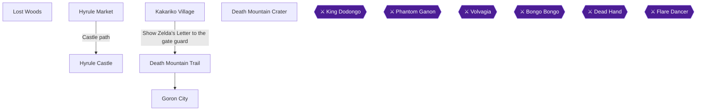

With Bombs in your bag, this chapter goes back through the places that were closed to you. You bomb the summit wall of Death Mountain Trail for the Great Fairy, ride the owl down to Kakariko, work through Goron City, play Bombchu Bowling in the Market, learn Din's Fire at Hyrule Castle, and finish the Happy Mask chain and the Lost Woods upgrades. Two achievements here are tied to deadlines, so read the warnings before you act in Goron City and before you touch the Poacher's Saw sidequest 🟡.

> [!TIP]
> **Before you start:** Bring plenty of rupees, because Bombchu Bowling costs 30 rupees per game and the Lost Woods upgrades cost 40 rupees each 🟡. Smashing the pots in the room at the entrance of the Market is a source of rupees 🟡. Bring Bottled Bugs for the soft-soil Gold Skulltulas, and a Deku Stick for the Goron City torches 🟡.

### Chapter Items to Collect (9 Entries)

| Item | Where Found | Action / Requirement | Citation |
|---|---|---|---|
| Spin Attack (Super Spin) and Magic Meter | Great Fairy Fountain at the summit of Death Mountain Trail | Bomb the wall, play Zelda's Lullaby on the Triforce emblem | 🟡 |
| Piece of Heart | Cow house in Kakariko, via the owl ride | Drop from the roof, enter the cracked wall | |
| Bomb Bag x30 | Goron City, third floor tunnel | Bomb the rolling Goron inside the northern tunnel | |
| Piece of Heart | Goron City spinning pot | Light the torches, bomb the pot, stop on the happy face | |
| Piece of Heart, Bomb Bag x40, Bombchus | Bombchu Bowling Alley, Hyrule Market | Win the prizes the clerk shows you | |
| Din's Fire | Great Fairy Fountain behind the boulder near Hyrule Castle | Bomb the boulder, play Zelda's Lullaby | |
| Deku Stick upgrade to 30 | Forest Stage, Lost Woods | Wear the Skull Mask | 🟡 |
| Deku Nut upgrade to 30 | Grotto under the rock near Sacred Forest Meadow | Bomb the rock, pay 40 rupees | 🟡 |
| Stone of Agony | House of Skulltula, Kakariko | 20 Gold Skulltula tokens | |

### Death Mountain Trail

Enter Death Mountain Trail by the northern gate of Kakariko Village. The guard lets you through when you show him Zelda's Letter 🟡. Opening that gate also makes the Happy Mask Salesman sidequest available at the Happy Mask Shop in the Market 🟡.

#### Lower trail

On the right side after the first corner, an oddly colored wall hides a Gold Skulltula. Blast it with a Bomb, shoot the Skulltula inside with the Slingshot, then climb the wall to take the token (Gold Skulltula #31).

Past the red flag on the way to Goron City, another odd wall holds a chest with a 50 rupee piece. Open it only if you need rupees 🟡.

### Goron City

> [!WARNING]
> **Missable Achievement Warning:** Do NOT destroy the three boulders at the entrance of the top-floor boulder room before you claim **Walking on a Tightrope**. Their flags are permanent and they do not respawn. You may jump to the side of the rocks instead 🟡.

#### Top floor boulder room

Walk onto the tightrope at the top of Goron City and make your way around to the room full of rocks. Keep the three boulders on the left of the entrance intact, cross the tightrope to the left, enter the boulder room and open a treasure chest there 🟡. Rocks inside the chest room may be destroyed freely 🟡.


> [!ACHIEVEMENT]
> **Walking on a Tightrope (5 Points)**
> 
> *Open any chest in Goron City's boulder room without destroying the entrance blockade*


Work through the maze with bombs. From the entrance go left to the barrier of boulders and blow a path through 🟡. Follow the route: destroy the brown rock to your right on entering, then the one behind it, go through the gap, destroy the brown rock on the left, take the new gap, go right and destroy the rock directly ahead 🟡. The guide's shorthand for the route is right, left, left, right.

At the end, two chests each hold a Purple Rupee 🟡. Roll into the crate in the corner to reveal a Gold Skulltula, then kill it and take the token (Gold Skulltula #34) 🟡.

#### Rolling Goron (Bomb Bag upgrade)

Drop to the third floor, the level directly below the top floor. A large Goron rolls around in a loop. Place a bomb so that it explodes as he passes over it inside the northern tunnel, then talk to him. The bomb must go off while he is inside the tunnel. Bombing him outside the tunnel did not work for one player 🟡. It can take a few tries, so carry spare bombs 🟡. This upgrades you to the 30-bomb bag 🟡.


> [!ACHIEVEMENT]
> **Roll Roll and Away (5 Points)**
> 
> *Obtain the Bomb Bag upgrade in Goron City*


#### Spinning pot (Piece of Heart)

Go to Darunia's room on the bottom floor. Stand on the carpet in front of the sealed door and play Zelda's Lullaby to open it 🟡. Light a Deku Stick on the torch in Darunia's room, then light every brazier on the bottom level of the city; when they are all lit the giant pot starts to spin.

From the second level, throw a bomb into the pot. If it stops with the happy face forward, a Piece of Heart appears. This is Piece of Heart #10.

If you have not yet met Darunia, play Saria's Song in front of him for the Goron's Bracelet.

### Death Mountain Crater (child visit)

🗺️ **Map:** [View Path to Zelda Map by TLS64](https://gamefaqs.gamespot.com/n64/197771-the-legend-of-zelda-ocarina-of-time/map/55-path-to-zelda-map)

Head back to the trail and climb the steeper path beside the red flag. The last boulder at the top of the ledges hides a pit with a cow, which refills milk when you play Epona's Song 🟡. When the volcano erupts, hold R under the Hylian Shield when you see a shadow below you 🟡.

Climb to the summit. Kaepora Gaebora waits there. Do not speak to him yet 🟡.

#### Great Fairy Fountain at the summit

Bomb the oddly colored wall to the left of the owl and enter the cave. Stand on the Triforce emblem and play Zelda's Lullaby. The Great Fairy teaches the Super Spin Attack and grants a Magic Meter 🟡. Hold B until the sword glows, then release 🟡.


> [!ACHIEVEMENT]
> **You Spin Me Round (5 Points)**
> 
> *Learn the Spin Attack technique*


#### Crater crate (Gold Skulltula)

Enter the cave to the right of the owl 🟡. Immediately inside, roll into the crate on the left to reveal a Gold Skulltula (#36). Kill it, take the token and leave, because the heat kills child Link if time runs out 🟡.

### Kakariko Village

Now speak to Kaepora Gaebora. He carries you down to the roof of Impa's House 🟡.

#### Cow house Piece of Heart

Walk slowly off the edge of the roof and drop onto the small roof cover of the chicken coop. A secret entrance leads into the house, where the Piece of Heart is next to the cow. If you miss the drop, play the Sun's Song to warp back to the roof 🟡. This is Piece of Heart #8 in the roadmap order.

#### House of Skulltula

With 20 tokens, enter the House of Skulltula and talk to the freed man on the left for the Stone of Agony. Your count at this point is the checkpoint total below.


> [!ACHIEVEMENT]
> **Secrets Detector (5 Points)**
> 
> *Collect 20 Gold Skulltulas and obtain your reward*


### Hyrule Castle

🗺️ **Map:** [View Hyrule Palace Map by ThE_bLImP](https://gamefaqs.gamespot.com/n64/197771-the-legend-of-zelda-ocarina-of-time/map/52-hyrule-palace-map)

Din's Fire is found at the Hyrule Castle Garden, reached from the Market.

#### Din's Fire

Climb the ivy on the right to the cliff above the gate. Drop onto the other side of the marble gate and walk to the dead end marked with a sign. Bomb the boulder, crawl through the tunnel and stand on the Triforce emblem in the Great Fairy Fountain. Play Zelda's Lullaby to receive Din's Fire. Din's Fire is later used to light many torches at once.


> [!ACHIEVEMENT]
> **On Fire (5 Points)**
> 
> *Learn Din's Fire*


Let a guard spot you and throw you out the gate, then return to the Market 🟡.

### Hyrule Market

#### Bombchu Bowling

Enter the Bombchu Bowling Alley in the Market; each game costs 30 rupees 🟡. The clerk shows a prize first; completing all three goals wins that prize 🟡. The prizes include Bombs, a Purple Rupee, Bombchus, a Piece of Heart, and the Bomb Bag upgrade 🟡.

Tips for the three goals:

- Stand in the exact middle of the field, slightly to the right of the center arrow, and time the shot to avoid the Blade Trap 🟡.
- The second target can appear at the top, left or right, and a small Cucco must be dodged. If it is on the right, adjust your position slightly 🟡.
- If the hole is on the left, angle the Bombchu along the floor and then the wall 🟡.
- The third target is in the center with a Fat Cucco, and you can sneak a Bombchu past it 🟡. Another guide says to stand on the third black mark left of the middle arrow and aim straight ahead, so a ledge turns the Bombchu toward the hole 🟡.

Collecting any Bombchus completes the Bombchus achievement.


> [!ACHIEVEMENT]
> **Mouse Ka-Boom (5 Points)**
> 
> *Obtain some Bombchus*


Keep playing until the clerk offers the Bomb Bag as the prize and win it 🟡.


> [!ACHIEVEMENT]
> **Bombchu Bowling Star (5 Points)**
> 
> *Obtain the Bomb Bag upgrade at the Bombchu Bowling Alley*


Also win the Piece of Heart prize (#9) 🟡. The Bomb Bag achievement has two requirements, the screen ID and the upgrade flag, so collect it inside the alley 🟡.

### Lost Woods

🗺️ **Map:** [View Lost Woods Map by EverythingZelda](https://gamefaqs.gamespot.com/n64/197771-the-legend-of-zelda-ocarina-of-time/map/54-lost-woods-map)

> [!WARNING]
> **Missable Achievement Warning:** Buy the Deku Nut upgrade for **Stocking Nuts** before you obtain the adult Poacher's Saw (chapter 13). Whether the Lost Woods Deku Nut upgrades can still be earned as an adult before the Poacher's Saw is unconfirmed, since some players report it worked after the Forest Temple and others report the trade flag locks it 🟡. Get A Pretty Face, the Mask of Truth upgrade and Stocking Nuts as child Link before you draw the Master Sword.

#### Happy Mask chain

Show Zelda's Letter to the Kakariko gate guard and he asks for a Keaton Mask 🟡. Borrow the Keaton Mask from the Happy Mask Shop near the Temple of Time, and sell it to the guard for 15 rupees 🟡. Pay the 10-rupee fee at the shop, then borrow the Skull Mask 🟡.

#### Forest Stage

From the Lost Woods entrance, go right, left, right, left, left to reach a grassy screen with a large tree. Drop into the invisible pit marked by butterflies in the tall grass 🟡. Put on the Skull Mask and step forward. Walk to the right side and speak to the Deku Scrub Chief to raise your Deku Stick capacity to 30 🟡.


> [!ACHIEVEMENT]
> **A Pretty Face (5 Points)**
> 
> *Obtain the Deku Sticks upgrade from the Deku Scrub Brothers in the Lost Woods*


#### Selling the Skull Mask

Return to the lone Skull Kid. He will only buy the mask if you have already played Saria's Song for him and earned the Piece of Heart 🟡. Wear the Skull Mask and speak to him to sell it.

#### Deku Nut upgrade

Go to the screen below Sacred Forest Meadow. Bomb the boulder near the entrance and drop into the hole. Two Business Scrubs are inside; defeat them with the Slingshot, and the one on the left sells the Deku Nut upgrade for 40 rupees. This is the achievement item, not the Mask of Truth one 🟡.


> [!ACHIEVEMENT]
> **Stocking Nuts (5 Points)**
> 
> *Purchase a Deku Nuts upgrade in the Lost Woods*


Network issues while you get the Deku Nut and save can stop this achievement from triggering 🟡.

### Before you leave

> [!TIP]
> **Before you leave:** Confirm the Spin Attack, Magic Meter and Din's Fire are learned, both Bomb Bag upgrades are in your bag, and the Lost Woods upgrades are bought before you draw the Master Sword.

> [!IMPORTANT]
> ### Chapter 6 Cumulative 100% Checkpoint
> - **Gold Skulltulas:** 25 / 100
> - **Pieces of Heart:** 10 / 36
> - **Heart Containers:** 2 / 8
> - **Maps, Compasses & Boss Keys:** 4 / 26
> - **RetroAchievements Unlocked:** 29 / 97 (155 / 690 points)

### Chapter Checklist

- [ ] Spin Attack learned (You Spin Me Round)
- [ ] Walking on a Tightrope chest opened without destroying the entrance rocks
- [ ] Bomb Bag x30 from the rolling Goron (Roll Roll and Away)
- [ ] Goron City spinning pot Piece of Heart
- [ ] Cow house Piece of Heart in Kakariko
- [ ] Bombchus, Bomb Bag x40 and Piece of Heart from Bombchu Bowling
- [ ] Din's Fire learned
- [ ] Deku Stick upgrade via the Skull Mask (A Pretty Face)
- [ ] Deku Nut upgrade bought under the boulder (Stocking Nuts)
- [ ] Gold Skulltulas #31, #34 and #36 collected
- [ ] Stone of Agony claimed at 20 tokens (Secrets Detector)

---

## Chapter 7: Zora's River and Zora's Domain

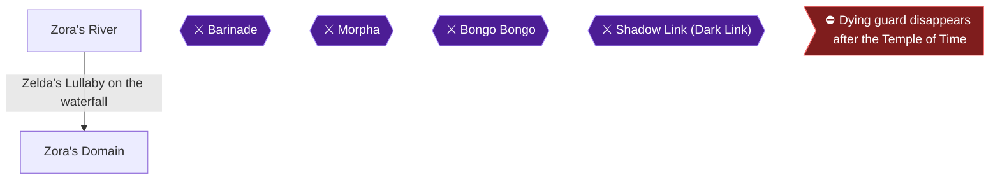

This chapter takes young Link up Zora's River and into Zora's Domain. You buy Magic Beans, collect two Pieces of Heart with the Cuccos, win two more from the Musical Frogs, light the Zora's Domain torches for a fifth, and win the Silver Scale in the Diving Game. Two Gold Skulltulas fall to you here: the tree at the entrance and the ladder by the waterfall at night 🟡.

> [!TIP]
> **Preparation:** Bring Bombs, the Slingshot, Deku Sticks, Din's Fire if you have it, and the Ocarina with Zelda's Lullaby, Epona's Song, the Sun's Song, Saria's Song, the Song of Time and the Song of Storms 🟡. Rupees matter too: the Diving Game costs rupees to enter, and every Magic Bean costs 10 more than the last.

### Zora's River

🗺️ **Map:** [View Zora's River/Domain Map by EverythingZelda](https://gamefaqs.gamespot.com/n64/197771-the-legend-of-zelda-ocarina-of-time/map/56-zoras-river-domain-map)

#### Entrance: the tree and the boulders

1. Before bombing the rocks, talk to the owl, then roll into the tree to the left of the stone wall near the entrance. A Gold Skulltula falls out and lands near you 🟡.
2. Kill it and take its token 🟡.
3. Bomb the stones blocking the path upstream 🟡.

#### The Bean Man

Follow the path to the man sitting near the iron gate. He is the Magic Bean salesman 🟡.


> [!ACHIEVEMENT]
> **Magic Beans (5 Points)**
> 
> *Obtain a Magic Bean*


Buy a Magic Bean from him. He has ten beans in total. The first costs 10 rupees and each next one costs 10 more, up to 100 for the tenth. All ten cost 550 rupees. Keep buying until you run out of money, and come back later for the rest 🟡.

Plant a bean in the patch of soft earth next to him 🟡. Beans must be planted as young Link, and they only grow fully once you are an adult 🟡. This patch holds no Gold Skulltula, so there is no need to drop a bug in it 🟡.

> [!TIP]
> You can still collect Gold Skulltulas from soft-soil holes after planting beans in them 🟡.

#### Rock circle, Cucco and secret caves

Near the entrance, in the corner where a Cucco wanders, is a circle of rocks. Play the Song of Storms near it to reveal a Secret Cave with two Business Scrubs, one selling a Green Potion and one a Red Potion, both for 40 rupees 🟡. You will use this Cucco for the Pieces of Heart below 🟡.

On the strip of land above, climbing the ladder leads to a Secret Cave with a small chest holding a Red Rupee. A large boulder surrounded by small rocks stands nearby. Bomb it to reveal a Fairy Fountain 🟡.

#### Musical Frogs: rupees

Walk out on the log upstream and stand on the white circle at its end. Take out the Ocarina 🟡. Play Zelda's Lullaby, Epona's Song, the Sun's Song and Saria's Song. One guide says the frogs pay 50 rupees per song 🟡. Another says each song earns a Purple Rupee 🟡. Unable to verify from collected sources which payout is correct. The Song of Time also pays out 🟡.

#### Heart Piece: the pillar halfway up the river

1. Grab the Cucco near the circle of stones, hop across to the ledge on the right, go forward and to the left, and jump up around the ledges 🟡.
2. Use the Cucco to float to the ledge just before the Heart Piece. Drop the Cucco and jump to the platform with the Heart Piece 🟡.
3. Another route is to climb the ladder, grab another Cucco at the top, and glide to the tall pillar from the cliff with the Gossip Stone 🟡. The Boomerang as Young Link or the Hover Boots as Adult Link also work.

#### Heart Piece: the lone platform and the high ledge

- Near the entrance to Zora's Domain, go to the high ledge, turn around and look back downstream. A platform holds a Piece of Heart. Glide out to it with a Cucco.
- Another Piece of Heart sits on a lone ledge sticking out of the water, near the Gossip Stone platform. Glide to it with a Cucco 🟡.
- Another way is to drop to the platform below and grab a Cucco, then make your way to the end of the river. Float down to the ledge below with the Heart Piece 🟡.
- You can also carry a Cucco to the waterfall at the end, turn around, climb the land bridge nearest the heart, and jump to it.

Behind the waterfall a ladder leads from the water to a hidden alcove with another Piece of Heart 🟡. One guide says you can reach it with the Cucco 🟡.

#### Gold Skulltula on the waterfall ladder (night)

If it is daytime, play the Sun's Song. Time passes normally here, so you will not warp back to the entrance 🟡. Drop down near the waterfall to the ladder rising from the river bed. Shoot the Gold Skulltula on it with the Slingshot, then climb the ladder for the token.

#### Musical Frogs: Song of Storms and the minigame

Return to the log as young Link. Play the Song of Storms to receive a Piece of Heart. Once you have played all the basic songs for them, the frogs challenge you to a fly-eating minigame 🟡.

The lowest frog is matched with the A Button and the other four match the C-Pad directions 🟡. From left to right, the frogs are A, Left, Down, Up, Right 🟡. Enter this sequence quickly 🟡:

A, C-Left, C-Right, C-Down, C-Left, C-Right, C-Down, A, C-Down, A, C-Down, C-Right, C-Left, A


Setting the C-Buttons to the D-pad is easier than using the analog stick. Controller drift can prevent you from hitting some notes 🟡. You now hold both frog Pieces of Heart 🟡.

#### Entering Zora's Domain

Go around the zigzagging path and stand on the plaque before the waterfall. Play Zelda's Lullaby and the waterfall retracts. Jump to the doorway and go through.

Gold Skulltulas that need the Hookshot appear in this river in the future timeline. Unable to verify from collected sources whether any belong to your current route.

### Zora's Domain

🗺️ **Map:** [View Zora's River/Domain Map by EverythingZelda](https://gamefaqs.gamespot.com/n64/197771-the-legend-of-zelda-ocarina-of-time/map/56-zoras-river-domain-map)

#### Heart Piece: the torches

Light a Deku Stick on the lit torch near the shop. Use Deku Sticks and run quickly, because the torches do not stay lit for long. One guide gives this order 🟡:

1. Light the Deku Stick.
2. Light the torch near the circle of stones.
3. Run back and light the torch near the shop.
4. Light the torch near the circle of stones again.
5. Light the torches in the waterfall.

Another guide says the stick can be kept lit and rolled under the waterfall to light the last two torches 🟡. Din's Fire also lights the two in the alcove behind the waterfall 🟡. When every torch is lit at once, a chest appears behind the waterfall with a Piece of Heart.

#### Diving Game and the Silver Scale

Go through the tunnel left of King Zora's throne room to reach the Zora running the Diving Game 🟡. The game costs 20 rupees, though one guide says 30. He throws rupees off the waterfall. Position yourself above them and hold A to dive. Collect all five Blue Rupees, then return to the Zora.


> [!ACHIEVEMENT]
> **The Way the World Learns to Dive (5 Points)**
> 
> *Obtain a reward from the Zora's Diving minigame*


He gives you the Silver Scale, which doubles your dive depth.

#### Other things in the Domain

- Fish swimming in the shallow water near the waterfall can be caught in an empty Bottle 🟡.
- Playing the Song of Storms on the flat unsubmerged rock reveals a Fairy Fountain 🟡.
- The dirt hole here is the only one without a Skulltula 🟡.
- Diving into the tunnel south of the waterfall warps to Lake Hylia 🟡.
- Swimming to the bottom of the deep pool to the right of the waterfall at the entrance leads to Lost Woods 🟡.

> [!TIP]
> **Before you leave Zora's Domain:** make sure you have the Magic Bean, both Cucco Hearts, both frog Hearts, the torch Heart and the Silver Scale. You can leave by climbing to the path to the front entrance, returning to Zora's River and riding it downstream to Hyrule Field 🟡.

> [!IMPORTANT]
> ### Chapter 7 Cumulative 100% Checkpoint
> - **Gold Skulltulas:** 27 / 100
> - **Pieces of Heart:** 13 / 36
> - **Heart Containers:** 2 / 8
> - **Maps, Compasses & Boss Keys:** 4 / 26
> - **RetroAchievements Unlocked:** 31 / 97 (165 / 690 points)

### Checklist

- [ ] Entrance tree Gold Skulltula
- [ ] Boulders bombed, Magic Bean bought and one planted
- [ ] Waterfall ladder Gold Skulltula (night)
- [ ] Both Cucco Pieces of Heart
- [ ] Song of Storms and minigame Pieces of Heart from the frogs
- [ ] Zora's Domain torch Piece of Heart
- [ ] Silver Scale from the Diving Game

---

## Chapter 8: Lake Hylia, the Fishing Pond and Gerudo Valley

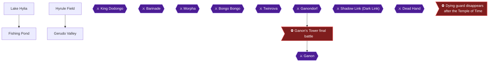

This chapter starts at the bottom of the underwater tunnel from Zora's Domain. You pick up the third Bottle (it already holds Ruto's Letter) and then work through Lake Hylia, its Fishing Pond, Gerudo Valley and the fenced grotto in Hyrule Field as Young Link. The prize is four Pieces of Heart (#13, #11, #14 and #12), three Gold Skulltula tokens (#51, #52 and #60), the Scarecrow's song, a planted Magic Bean, and the Fishing Lessons achievement.

> [!TIP]
> **Before you start:** Bring the following. You also need to be able to switch between day and night with the Sun's Song, and be a Young Link who can dive to the lake floor.
> - Bombs, for the Hyrule Field grotto.
> - At least 20 rupees for the fishing fee, and 10 more for the Business Scrub 🟡.
> - An empty Bottle you can fill with Bugs. The Ruto's Letter Bottle cannot be used until the letter is delivered 🟡.
> - One or more Magic Beans from the Bean Man in Zora's River 🟡.
> - The Silver Scale, to reach the lake floor 🟡.

Two mistakes cost time here, and both are recoverable. A fish that breaks free is gone, but leaving and re-entering the pond respawns the big fish 🟡. A lost Cucco in Gerudo Valley is replaced by riding the river to Lake Hylia and walking back 🟡.

### Chapter Items to Collect (8 Items Total)

| Item | Where Found | Action / Requirement | Citation |
|---|---|---|---|
| Bottle (Ruto's Letter) | Lake Hylia floor, south of the tunnel exit | **TAKE** (dive with the Silver Scale) | 🟡 |
| Piece of Heart #13 | Fishing Pond | Catch a 10-pound or bigger fish as Young Link and show it to the owner | |
| Gold Skulltula #51 | Island with two pillars, Lake Hylia | **KILL** at night | 🟡 |
| Gold Skulltula #52 | Soft-earth patch beside the Lakeside Laboratory | Release Bugs from a Bottle, then **KILL** | 🟡 |
| Piece of Heart #14 | Crate on the far-side ledge, Gerudo Valley | Glide over with a Cucco, roll into the crate | |
| Piece of Heart #11 | Behind the waterfall, Gerudo Valley | Glide through the waterfall with a Cucco | |
| Gold Skulltula #60 | Soft earth at the bottom of Gerudo Valley | Release Bugs, then **KILL** | 🟡 |
| Piece of Heart #12 | Fenced grotto in Hyrule Field | Bomb the ground, defeat the Business Scrub, **BUY** for 10 rupees | |

### Lake Hylia

#### The Bottle with Ruto's Letter

Surface from the tunnel out of Zora's Domain and swim a short way south. On the floor, near a ruined pillar, lies a Bottle. Dive down and take it 🟡. Another guide says it is right in front of you when you arrive, so look around the lake floor in front of the tunnel exit 🟡. Reaching it needs the Silver Scale, which is why the Zora's Domain diving game comes first 🟡.

The Bottle already contains Ruto's Letter, so you cannot use it as a Bottle yet. This is your third Bottle 🟡. Do not hurry back to King Zora, because there is still plenty to do here 🟡. Carry the bottled Letter with you for now.

#### Teach the Scarecrow your song

Swim north to the shore and head to the east coast. There are two scarecrows 🟡. The sources disagree on which scarecrow to use. One calls it the "lower" garden, one says farthest from the water, and one says closest to shore 🟡. The scarecrow you want is the dancing one named Bonooru, in the patch between the lab and the Fishing Pond 🟡. Stand in front of him with your Ocarina out and he asks for a song 🟡.

Compose an eight-note song. It must have at least two different notes and must not be any song you already know or will learn later 🟡. Play it for him and **write the notes down on paper**. You must play the exact same song as an adult, and Pierre the Wanderer in chapter 16 needs it too.

> [!TIP]
> If you forget the song, Sheik at the Temple of Time can send you back to childhood to teach Pierre a new one, but it is far less work to write it down now 🟡.

#### Gold Skulltula #52 and the Magic Bean

The tall building is the Lakeside Laboratory, which is to the right of the entrance from Hyrule Field 🟡. A patch of soft earth sits beside it 🟡. Release a Bug from your Bottle near the patch (recapture one afterwards) and kill the Gold Skulltula that comes out. Take its token for **Gold Skulltula #52** (✅ token 1/3 this chapter) 🟡.

Then plant one of your Magic Beans in the same patch. As an adult you will ride this plant to the roof of the laboratory, where a Piece of Heart waits.

Where to catch Bugs for this chapter: Unable to verify from collected sources.

#### Gold Skulltula #51 (night)

From the laboratory, go around to its west side and cross the long wooden bridge over the lake. The bridge leads to the large island with the ancient dead tree 🟡. Look east from the tree to see the small island with two pillars 🟡.

Swim to that island. If it is daytime, play the Sun's Song to bring on night. A Gold Skulltula appears on one of the pillars. Kill it and take its token for **Gold Skulltula #51** (✅ token 2/3 this chapter).

#### Optional extras at the lake

- A grave on one of the Lake Hylia islands can be pushed to reveal a Secret Cave with three Business Scrubs selling general pick-up items 🟡.
- Which island holds the grave: Unable to verify from collected sources.
- The Lake Hylia gossip stones are at the very far edge of the water, next to the wall, and one commenter counts three of them 🟡.

### Fishing Pond

🗺️ **Map:** [View Fishing Pond Map by TLS64](https://gamefaqs.gamespot.com/n64/197771-the-legend-of-zelda-ocarina-of-time/map/51-fishing-pond-map) 🟡

Look to the north for a small island and swim to it. Enter the door built into the wall of the island to reach the Fishing Pond 🟡. Speak to the clerk and pay 20 rupees to fish 🟡.

> [!WARNING]
> **Achievement Trigger Warning:** Fish as **Young Link**. The achievement needs a fish of at least 10 pounds 🟡. One guide says nine pounds earns the Piece of Heart 🟡, but the achievement asks for ten, so do not stop at nine. A caught Hylian Loach reportedly does not trigger this achievement 🟡. Do not use the sinking lure, because one source says doing so disqualifies the catch 🟡.

**The controls.** Z-target a fish, press B to cast, and use B, A and the stick to wiggle the lure and attract fish. When a fish is on the line, hold A and pull back on the control stick to reel it in 🟡. Once the fish bites, keep the reel pulling against the fish's direction, which usually means holding left or right all the way 🟡. Alternating between holding back-left and back-right every few seconds while reeling also helps 🟡.

**Where the big fish is.** The 10-pound fish is the one that stands out from the others and sits in the middle of the pond 🟡. Several sources agree on the area around the log:
- The biggest fish hang near the submerged log on the left and the reeds on the right 🟡.
- One guide says the big fish lurks between the log and three sticks nearby.
- Another says to stand near the lilypads at the rear, where the fish stays underwater by the big log. You may have to catch the small fish that swims with it first 🟡.
- You can also stand on the log on the left side after entering and look for the big fish from there 🟡.

If a fish breaks free it is gone for good. If the pond runs low on big fish, leave and re-enter and they respawn 🟡.

When you land a fish of 10 pounds or more, the achievement unlocks:


> [!ACHIEVEMENT]
> **Fishing Lessons (5 Points)**
> 
> *Catch a fish that weighs at least 10 pounds as Young Link*


Now carry the fish to the owner at the counter. He gives you the Piece of Heart (**Piece of Heart #13**, ✅ 1/4 this chapter). Leave the pond when you have it.

> [!TIP]
> The 15-pound fish that wins the Gold Scale is a task for adult Link later. Do not chase it now.

### Gerudo Valley

From Lake Hylia, take the north exit to Hyrule Field. Head northwest until you hit the road, then go west into the rocky canyon area. Keep going west until you reach the zone break to Gerudo Valley 🟡. The fenced corral you pass on the way is covered in the Hyrule Field section below.

Run forward a short way and cross the log bridge. Grab the Cucco on the other side 🟡. In this valley a Cucco is a glider, and all three pickups here depend on it. Hold on to it carefully, and toss it against a wall whenever you set it down 🟡.

> [!TIP]
> **If you lose the Cucco:** Jump into the river and ride it to Lake Hylia, then walk back through Hyrule Field to the valley for a fresh Cucco 🟡.

#### Piece of Heart #14 (crate on the far ledge)

Run to the edge of the canyon and look across to the opposite side. A small platform with a wooden crate sits on the far wall 🟡. A second guide says to jump off, force the stick forward and left, and aim for the small cliff on the other side of the valley. Glide down to it, then roll into the crate. Take the Piece of Heart that was in the crate (**Piece of Heart #14**, ✅ 2/4 this chapter), which makes you drop the Cucco, then grab the Cucco again as fast as you can 🟡.

#### Gold Skulltula #60 (soft earth at the bottom)

From the crate ledge, glide down to the long strip of land at the bottom of the canyon. It holds a Gerudo, a cow and a small patch of dirt 🟡. Head to the southern edge of the strip, where the patch of soft earth sits near the cow 🟡.

Release Bugs near the patch. Three bugs come out, so recapture one. Kill the Gold Skulltula that appears and take its token for **Gold Skulltula #60** (✅ token 3/3 this chapter). Some guides also plant a Magic Bean in this soil 🟡. This chapter only needs the Lakeside Laboratory bean; the Gerudo Valley bean is planted in Chapter 10.

#### Piece of Heart #11 (behind the waterfall)

Make sure you hold the Cucco again. Run to the northern edge of the strip and look behind the waterfall, where you will see a ladder 🟡. Jump out toward the ladder and do not drop the Cucco until you are right beside it. There is no current immediately behind the waterfall, so you can climb out if you land in the water. Climb to the top of the ladder to find **Piece of Heart #11** (✅ 3/4 this chapter).

You can also reach this heart from the bridge. Take the Cucco from before the bridge, jump off to the right and float through the giant waterfall into the tiny nook in the wall.

> [!NOTE]
> The area across the broken bridge, with the Carpenter's tent and more tokens, is an adult-Link job. You cross it later with Epona or the Longshot, so leave it for now 🟡.

Jump into the river and ride it downstream to return to Lake Hylia 🟡.

### Hyrule Field

🗺️ **Map:** [View Hyrule Field Map by thegamemaster8](https://gamefaqs.gamespot.com/n64/197771-the-legend-of-zelda-ocarina-of-time/map/5394-hyrule-field-map) 🟡

Leave Lake Hylia through the north exit onto Hyrule Field. Jump into the middle of the small square of fences, which is the fenced corral outside the lake.

Stand in the exact center of the corral and drop a Bomb to reveal a pit. If you have the Stone of Agony, it makes the spot easier to find. One guide places the bomb in the upper-right quadrant instead, so try there if the center does nothing. Drop into the hole and defeat the Business Scrub with your Boomerang, then speak to it 🟡. The Scrub sells a Piece of Heart for just 10 rupees, so buy it. That is **Piece of Heart #12** (✅ 4/4 this chapter).

**Optional rupees nearby:**
- A hole out in the open near the fence square holds a small chest with a Blue Rupee 🟡.
- On the way to the lake, a rock in the trees west of the corral hides a small chest with a Red Rupee 🟡.

> [!TIP]
> **Before you leave:** Check that you have the four Pieces of Heart (#13, #11, #14, #12) and the three tokens (#51, #52, #60). Also check that you still carry the Bottle with Ruto's Letter 🟡. The route back is the submerged ruins near the shore, east of the laboratory and west of the scarecrows. Dive in and swim into the tunnel to Zora's Domain 🟡. Other tokens in these areas, such as the back of the Lakeside Laboratory, need the Boomerang and are not counted in this chapter's total 🟡.

> [!IMPORTANT]
> ### Chapter 8 Cumulative 100% Checkpoint
> - **Gold Skulltulas:** 30 / 100 (this chapter: #51, #52, #60 🟡)
> - **Pieces of Heart:** 17 / 36 (this chapter: #13, #11, #14, #12)
> - **Heart Containers:** 2 / 8
> - **Maps, Compasses & Boss Keys:** 4 / 26
> - **RetroAchievements Unlocked:** 32 / 97 (170 / 690 points)

### Chapter Checklist

- [ ] Picked up the third Bottle (Ruto's Letter) from the floor of Lake Hylia
- [ ] Taught Bonooru an eight-note song and wrote the notes down
- [ ] Gold Skulltula #52 (Bugs, Lakeside Laboratory soil) and Magic Bean planted there
- [ ] Gold Skulltula #51 (night, island with two pillars)
- [ ] Fishing Lessons (48348): 10-pound or larger fish caught as Young Link
- [ ] Piece of Heart #13 collected from the Fishing Pond owner
- [ ] Piece of Heart #14 (crate on the far ledge, Gerudo Valley)
- [ ] Gold Skulltula #60 (Bugs, bottom of Gerudo Valley)
- [ ] Piece of Heart #11 (behind the waterfall, Gerudo Valley)
- [ ] Piece of Heart #12 (Business Scrub, fenced grotto in Hyrule Field)

---

## Chapter 9: Zora's Fountain and Inside Jabu-Jabu's Belly

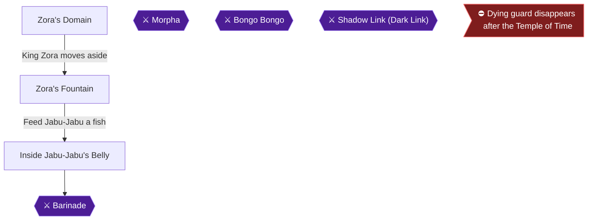

This chapter takes Young Link from King Zora's throne room into Zora's Fountain, then through Jabu-Jabu's Belly to the third Spiritual Stone. You learn Farore's Wind, get the Boomerang, Map and Compass, collect four dungeon Gold Skulltulas and two Fountain ones, and fight Barinade. Barinade carries the chapter's only missable achievement, Rolling Thunder, which asks for a clean kill with no hits.

### Preparation

> [!TIP]
> **Before you start:** You need an empty Bottle, Bombs, the Slingshot with seeds, Deku Nuts, Deku Sticks, the Deku Shield and the Ocarina with Zelda's Lullaby. The Slingshot, Deku Nuts and Bombs are used throughout the dungeon, and the Deku Shield is used for crouch-stab and deflect tricks 🟡.

The Boomerang does not arrive until the middle of the dungeon. Until then, jellyfish can be handled with Deku Sticks or by throwing Princess Ruto at them 🟡. The Great Fairy gives Farore's Wind, and you will want it before the boss 🟡.

### Chapter Items to Collect

| Item | Where Found | Action / Requirement | Citation |
|---|---|---|---|
| Farore's Wind | Great Fairy's Fountain, Zora's Fountain | Bomb the wall, then play Zelda's Lullaby on the Triforce emblem | 🟡 |
| Gold Skulltula #48 | Tree on the southeast island, Zora's Fountain | Roll into the tree | 🟡 |
| Boomerang | Stinger Room chest, Jabu-Jabu | Kill all the Stingers | |
| Dungeon Map | Orange Tentacle Room chest | Kill the tentacle with the Boomerang | |
| Compass | Shabom Room chest | Kill all Shaboms in 40 seconds | 🟡 |
| Gold Skulltula #56 | Ivy wall in the Water Room | Slingshot it, raise the water, climb | 🟡 |
| Gold Skulltulas #57 and #58 | Wall after the former Green Tentacle pit | Boomerang | 🟡 |
| Gold Skulltula #59 | Vine wall in the last room before the boss | Slingshot or Boomerang | |
| Heart Container | Barinade's room | Defeat Barinade | |
| Zora's Sapphire | Outside, from Ruto | Exit through the blue ring and agree | 🟡 |
| Gold Skulltula #49 | Wall across from the log, Zora's Fountain (night) | Slingshot, then Boomerang | 🟡 |

### Zora's Domain

🗺️ **Map:** [View Zora's River/Domain Map by EverythingZelda](https://gamefaqs.gamespot.com/n64/197771-the-legend-of-zelda-ocarina-of-time/map/56-zoras-river-domain-map)

Make your way to King Zora's Throne Room and show him the Bottled Letter. He moves aside and begs Link to save his daughter from Jabu-Jabu's Belly 🟡. Using the Letter also leaves you with the Empty Bottle that held it 🟡.

If you did not already empty the torches' Piece of Heart chest earlier, it is available here for Young Link. Light a Deku Stick at the torch on the throne room stairs and relight at the shop torch. Then light the burned-out brazier by the cave mouth, the one in the shallow water by the stones, and the two behind the waterfall. If every torch is lit before any burns out, a chest holding a Piece of Heart appears behind the waterfall. Sources also say the lit-torch run can be done with Din's Fire for the two waterfall torches 🟡.

Now catch a fish. Go back to the bottom level and wade into the shallow water near the waterfall. Use the empty Bottle on one of the swimming fish 🟡.

Climb back to the throne room and take the narrow path on the right side to the throne. Go through the tunnel behind the throne to reach Zora's Fountain 🟡.

### Zora's Fountain

Your first stop is the tree. Swim to the island in the very southeast of the Fountain and roll into the lone tree. A Gold Skulltula falls out. Kill it and take the token (Skulltula #48, Bombs required for the area).

Next, the Great Fairy. Drop a bomb between the two boulders against the wall, near the silver rock that cannot be bombed. The wall blows open and reveals a large cave 🟡. Go through the cave to the Great Fairy's Fountain 🟡. Stand on the Triforce emblem and play Zelda's Lullaby. The Great Fairy appears and teaches you Farore's Wind, which sets a checkpoint in a dungeon that you can warp back to 🟡.


> [!ACHIEVEMENT]
> **Take Me Away (5 Points)**
> 
> *Learn Farore's Wind*


Leave the fountain. Climb up onto the altar on the west side in front of Jabu-Jabu's mouth. Stand directly in front of the mouth and use the bottled fish. Jabu-Jabu inhales you along with the fish 🟡.

### Inside Jabu-Jabu's Belly

#### Entrance room

Walk forward a few feet and a pair of Octoroks appear. Kill them with the Slingshot, or deflect their shots back with the Deku Shield 🟡. Kill the Shaboms with Deku Nuts 🟡. Run to the north end and shoot the large yellow bump on the ceiling with the Slingshot, which unseals the door at the end of the hall 🟡.

#### Elevator Room (first pass)

The floating jellyfish here are Biri, and you cannot hurt them yet; touching them hurts you. If one gets close, stun it with a Deku Nut 🟡. Run around the left side along the platform and take the door on the other side 🟡.

#### Pit Room (first pass)

Step in and you meet Princess Ruto. She runs away and falls through a pit. Follow her down. Talk to her when you land, and talk to her again; she agrees to come with you if you help her find her stone. From now on you carry Ruto 🟡. Pick her up and leave through the east door, which is behind you as you land 🟡.

#### Water Room

Drop Ruto and kill the Shaboms in the hallway with Deku Nuts. Pick her up again and run to the hall's end 🟡. Jump into the pit, but do not step on the switch in the middle of the room yet. If you do, the water rises and Ruto returns to the Pit Room 🟡. Throw Ruto up onto the ledge on the north side, then kill the enemies in the pit with you 🟡.

Use Deku Nuts to make the submerged Stingers jump, then shoot them with the Slingshot 🟡. Kill the Gold Skulltula on the west ivy wall with the Slingshot (Skulltula #56). Then step on the switch to raise the water and climb the ivy into the alcove for the token 🟡.

Smash the pots in the alcove for a Fairy and Slingshot seeds. Capture the Fairy if you have an empty bottle 🟡. Jump back into the pit, step on the switch again, and get onto the northern ledge where you left Ruto 🟡. Pick her up and run into the hall. Kill more Shaboms with Deku Nuts, then hit the ceiling switch with the Slingshot. You can also throw Ruto at it. The door at the end unlocks 🟡.

#### Elevator Room (second pass)

Wait for the elevator to come down and kill the Octorok if you have to. Ride up carrying Ruto 🟡. A submerged tunnel in this room leads to a Business Scrub selling Deku Nuts 🟡. At the top, take the door on the right back into the Pit Room 🟡.

#### Pit Room (second pass)

Cross straight to the opposite door, avoiding Biri and the floor pits. If you fall you must go back through the Water Room and Elevator Room. Note the pit covered by the giant green tentacle; you will drop down it later 🟡. Watch for long creatures that pop out of the ground next. Charge a Spin Attack until it glows orange to kill them in one hit 🟡.

#### Crawling Hallway and Stinger Room

Run past enemies in the hall. Go right and step onto the yellow switch while carrying Ruto. Her weight lets the switch activate, and the door in front of it unlocks 🟡. Enter the Stinger Room.

The room is full of Stingers. Use Deku Nuts or run in front of their paths to reveal them, then shoot them with the Slingshot. If any are underground, bombs kill them in one hit. When all four are dead, a chest appears holding the **Boomerang**. The Boomerang is the dungeon item of Jabu-Jabu's Belly and lets you grab Skulltula tokens from range. Pick up Ruto and go back.

#### Orange Tentacle Room (Dungeon Map)

> [!WARNING]
> **Map Warning:** Get the Dungeon Map now while Ruto is still with you. Commenters report the Map cannot be reached without her unless you use a glitch, and one reports being locked out of it after skipping it 🟡.

At the far end of the Crawling Hallway is a blue switch in front of a door. Jump onto it while carrying Ruto, then put her down on it with A before stepping off. The switch stays down 🟡. Go through the door without her.

Z-target the long Orange Tentacle and hit the narrow segment near its base with the Boomerang. Move forward until it stretches and makes a swishing noise, then throw the Boomerang while backing away. You need four hits in total. Killing it removes the other orange tentacles in the dungeon. A chest appears holding the **Dungeon Map**.

#### Shabom Room (Compass)

Back in the hall, Ruto waits on the other side of the door and scolds you. Pick her up. Go left from the blue switch through the now-unblocked door 🟡. You have forty seconds to pop every Shabom. Deku Nuts and the Slingshot both work, and a sword also works. A chest appears with the **Compass**.

#### Blue Tentacle Room

Return to the Crawling Hallway. Go down the hall, take a left, go straight, then left again, and enter the door 🟡. Hit the Blue Tentacle with the Boomerang, step forward to bait its strike, and hit it again as you dodge. Four hits kill it and clear all Blue Tentacles in the dungeon 🟡. Pick up Ruto and return 🟡.

#### Green Tentacle Room

From the hall, go right down the hall and take another right to the door at the end 🟡. Kill the Biri first, then use the same hit-and-dodge pattern on the Green Tentacle. Four Boomerang hits remove every Green Tentacle 🟡. Pick up Ruto and return to the hallway 🟡.

#### Pit Room: Skulltulas #57 and #58

Run straight across the hallway to the Pit Room 🟡. Drop down the pit closest to the west wall, to your right as you enter from the hallway; the green tentacle used to cover it 🟡. When you land, set Ruto down and face north. Two Gold Skulltulas hang on the wall. Kill each with the Boomerang, then throw the Boomerang again to collect both tokens (Skulltulas #57 and #58) 🟡. When aiming manually, use Link's head as a targeting reticle 🟡. Pick up Ruto and go through the west door 🟡.

#### Bigocto (mini-boss)

Throw Ruto up onto the ledge so she can claim her stone. The ledge rises, and when it comes back down she is gone and Bigocto has arrived 🟡. Its weak point is the green eye on its backside. The Boomerang stuns it and locks it in place, so stun it and circle behind it, hugging the inner wall. Another stun, then a Jump Attack on the eye. Two Jump Attacks defeat it.

Two easier methods exist. You can let Bigocto run into you, which turns it around and lets you stun and hit it quickly 🟡. Or Z-target it and throw the Boomerang as you head to its back. One guide says a Deku Stick jump attack after a stun kills it in one hit 🟡. Another says about three sword hits on the green spot are needed 🟡. Its contact does half a heart and the spiked middle does a quarter heart 🟡. Stay locked on during the fight 🟡.

After it dies, one of the pots behind you holds a fairy 🟡. Step onto the middle platform and the elevator rises. Run south down the hall and through the door, killing any Biri in the way 🟡.

#### Pink Thing Room and Elevator Room

Two Pink Things block the way. Stun the first with the Boomerang and jump onto it, then stun the second and jump to the door. Kill the Octorok if it gets in the way 🟡. In the Elevator Room, jump across to the platform on the opposite wall. The ledge lowers and you end up next to the dungeon entrance. Run around to the door by the Pit Room, grab one of the boxes, and step on the blue button. Drop the box so it sits on the button, then go through the door 🟡.

#### Biri Room (Skulltula #59)

Kill all the Biri. Go to the southeast side and kill the Gold Skulltula on the ivy wall, halfway up the left side, with the Slingshot or the Boomerang. Climb up for the token (Skulltula #59). Continue to the top of the ivy wall. Look right to see a switch. Z-target it and hit it with the Boomerang to unlock the door at the north end of the room 🟡.

A glass panel blocks the switch from straight shots, so the Boomerang has to curve around it. Stand back and throw, or step to the left of the glass. It can take several tries 🟡. Jump down afterwards 🟡.

Before opening the boss door, set Farore's Wind in this room. Commenters recommend it so you can warp straight back here after a failed attempt 🟡. The Boomerang switch at the start of this run still has to be hit again after a reset 🟡.

> [!WARNING]
> **Missable Achievement Warning:** Rolling Thunder (Defeat Barinade without getting hit) can be missed. A hit fails it, so set Farore's Wind outside the boss room first. Then fight from a distance and reset on failure. In the Options menu, set Z-targeting to **Hold**; a guide strongly suggests this to make the fight much easier 🟡.

#### Barinade (boss)

Barinade is the first boss with a real chance of killing you. All pots around the room contain Recovery Hearts 🟡. Keep moving the whole time; you can walk and throw the Boomerang at once.

**Opening (all phases):** Sources agree that players are often hit by the jellyfish as soon as a phase starts, and the jellyfish eject in an unpredictable way 🟡. A speedrun-style opening for the first phase: as soon as the boss starts, roll forward twice and take a couple of steps forward. Target the three tentacles up top with the Boomerang. Hit one, side-hop twice, hit the next, then side-hop back and hit the third. Another player says to lock on, keep sidestepping and hit the three tentacles up top 🟡.

**Phase 1 (tentacles):** Z-target the tentacles attached to the ceiling and circle the boss. The direction does not matter, but stick with it, since changing course gets you electrocuted. Sever all three with the Boomerang. Wait until you see Navi floating over a target before pressing the lock-on button 🟡.

**Phase 2 (carousel of jellyfish):** The jellyfish detach and circle the boss. The rotating jellyfish cannot hit you if your back is against the wall. Wait there, Z-locked on Barinade, and look for an opening 🟡. Stun the base with the Boomerang, which releases the jellyfish. Stay to the side, since there is a counter attack at the end of the phase 🟡. If you move in, hit once with the Boomerang, then slash five times and dodge back immediately 🟡.

Deku Nuts take out the loose jellyfish instantly if they are not tethered to the main body. Used well, they remove two or sometimes three at a time 🟡. A stun and then Din's Fire wipes out most of them 🟡. Throwing the Boomerang at the boss again resets the stun timer while you clear the loose ones 🟡. Kill one or two jellyfish at a time and do not rush 🟡.

**Phase 3 (smaller, faster carousel):** This is the dangerous phase. The ring of jellyfish is smaller and faster, and Barinade moves around the room. Keep throwing the Boomerang until it penetrates the ring and stuns him, then destroy the jellyfish. The satellite dishes resume attacking while you work. Z-lock on early and keep moving sideways and back while throwing 🟡. It can corner you against the wall, so back away in a curve rather than a straight line 🟡. When he is stunned, lock on to a single jellyfish. With luck you may kill two or three in one stun 🟡. A missed Boomerang throw can take away camera control, so some players use the Slingshot on the jellyfish instead. It is quicker and does not take the camera if you miss 🟡.

**Final phase (core exposed):** Stay at a distance. If you are too close, Barinade zaps you 🟡. Stun him with the Boomerang, then run in and jump-attack the base. After two Jump Attacks he retreats into the ground briefly; keep dodging until he re-emerges. Five Jump Attacks in total defeat him. Deku Stick jump slashes after a Boomerang hit work for the damage, and a shield stab after a stun also kills him faster. Another player says the stick method takes about three hits 🟡. In the final phase, sidestep his beams and try not to get trapped against the wall 🟡. Keep moving and avoid staying near him too long after you down him 🟡.

If you are retrying, use your first try to learn the pattern and see the whole fight through a few times rather than restarting at the first mistake 🟡. Commenters say patience and safe play matter more than speed 🟡. One player says binding the C buttons to the D-pad avoids misclicking Navi 🟡.

When Barinade falls with no hits taken:


> [!ACHIEVEMENT]
> **Rolling Thunder (10 Points)**
> 
> *Defeat Barinade without getting hit*


Take the **Heart Container** he leaves, which brings you to nine hearts. Then step into the ring of blue light. It teleports you and Ruto outside. Talk to her, say you want the Spiritual Stone, and agree to marry her; she gives you the Zora's Sapphire 🟡.


> [!ACHIEVEMENT]
> **Wedding Band (5 Points)**
> 
> *Receive the Spiritual Stone of Water*


### Back in Zora's Fountain

Before leaving, grab the second Fountain Skulltula. It only appears at night, so play the Sun's Song if it is daytime. Climb onto the log sticking out of the water and look at the wall across from you. Shoot it with the Slingshot and fetch the token with the Boomerang (Skulltula #49).

> [!TIP]
> **Before you leave Zora's Fountain:** Make sure you have Farore's Wind, the Map, the Compass, the Boomerang, the Heart Container, the Zora's Sapphire, and Skulltulas #48, #49 and #56 to #59. Then head back through the cave entrance on the west side of the area to return to Zora's Domain.

> [!IMPORTANT]
> ### Chapter 9 Cumulative 100% Checkpoint
> - **Gold Skulltulas:** 36 / 100 (#48, #49 and #56 to #59 collected this chapter) 🟡
> - **Pieces of Heart:** 17 / 36
> - **Heart Containers:** 3 / 8
> - **Maps, Compasses & Boss Keys:** 6 / 26
> - **RetroAchievements Unlocked:** 35 / 97 (190 / 690 points)

### Chapter Checklist

- [ ] Gave Ruto's Letter to King Zora and kept the empty Bottle
- [ ] Caught a fish in the Bottle
- [ ] Gold Skulltula #48 from the southeast tree
- [ ] Learned Farore's Wind
- [ ] Got the Boomerang from the Stinger Room chest
- [ ] Got the Dungeon Map while Ruto was with you
- [ ] Got the Compass (40-second Shabom room)
- [ ] Gold Skulltulas #56, #57, #58, #59
- [ ] Set Farore's Wind outside the boss door
- [ ] Defeated Barinade without being hit
- [ ] Took the Heart Container
- [ ] Received the Zora's Sapphire
- [ ] Gold Skulltula #49 from the log wall at night

---

## Chapter 10: Young Link Cleanup and the Ocarina of Time

```mermaid
flowchart TD
  Lost_Woods["Lost Woods"]
  Inside_Deku_Tree["Inside the Deku Tree"]
  Hyrule_Field["Hyrule Field"]
  Hyrule_Market["Hyrule Market"]
  Hyrule_Castle["Hyrule Castle"]
  Lon_Lon_Ranch["Lon Lon Ranch"]
  Kakariko_Village["Kakariko Village"]
  Kakariko_Graveyard["Kakariko Graveyard"]
  House_of_Skulltula["House of Skulltula"]
  Lake_Hylia["Lake Hylia"]
  Gerudo_Valley["Gerudo Valley"]
  Temple_of_Time["Temple of Time"]
  Queen_Gohma{{"⚔ Queen Gohma"}}
  King_Dodongo{{"⚔ King Dodongo"}}
  Barinade{{"⚔ Barinade"}}
  Phantom_Ganon{{"⚔ Phantom Ganon"}}
  Morpha{{"⚔ Morpha"}}
  Bongo_Bongo{{"⚔ Bongo Bongo"}}
  Twinrova{{"⚔ Twinrova"}}
  Ganondorf{{"⚔ Ganondorf"}}
  Ganon{{"⚔ Ganon"}}
  Dark_Link{{"⚔ Shadow Link (Dark Link)"}}
  Dead_Hand{{"⚔ Dead Hand"}}
  Dying_Guard_Lockout>"⛔ Dying guard disappears after the Temple of Time"]
  Final_Battle>"⛔ Ganon's Tower final battle"]
  Inside_Deku_Tree -->|"Basement 2"| Queen_Gohma
  Hyrule_Field -->|"Drawbridge"| Hyrule_Market
  Hyrule_Market -->|"Castle path"| Hyrule_Castle
  Hyrule_Field --> Lon_Lon_Ranch
  Hyrule_Field --> Kakariko_Village
  Kakariko_Village --> Kakariko_Graveyard
  Hyrule_Field --> Gerudo_Valley
  Temple_of_Time -->|"Dampe's race"| Kakariko_Graveyard
  Ganondorf --> Final_Battle
  Final_Battle --> Ganon
  classDef ponr fill:#7f1d1d,stroke:#f87171,color:#fff;
  classDef boss fill:#4c1d95,stroke:#a78bfa,color:#fff;
  class Dying_Guard_Lockout,Final_Battle ponr;
  class Queen_Gohma,King_Dodongo,Barinade,Phantom_Ganon,Morpha,Bongo_Bongo,Twinrova,Ganondorf,Ganon,Dark_Link,Dead_Hand boss;
```

This chapter closes out Young Link's story. You collect the Ocarina of Time after the drawbridge cutscene and learn the Song of Time. Then you finish the child-only tasks before opening the Door of Time: the dying guard, the Happy Mask Salesman quest, the Mask of Truth Deku Nut upgrade and the Gold Skulltula rewards. After you draw the Master Sword you cannot return to childhood until after the Forest Temple 🟡. The Master Sword comes last in this chapter for that reason.

> [!TIP]
> **Before you start:** The Boomerang is needed for most of the Skulltula and Heart Piece tasks below. Bring bombs and a bottle of bugs, and have Din's Fire ready for Skulltula #13.

### Hyrule Field

🗺️ **Map:** [View Hyrule Field Map by thegamemaster8](https://gamefaqs.gamespot.com/n64/197771-the-legend-of-zelda-ocarina-of-time/map/5394-hyrule-field-map)

#### Zelda's escape and the Ocarina of Time

1. With all three Spiritual Stones, approach the closed gates of Hyrule Castle. A cutscene plays: Zelda and Impa race out and Zelda throws the Ocarina of Time into the moat 🟡.
2. When the scene ends, dive into the moat water to pick up the Ocarina of Time. Zelda then contacts you telepathically and teaches the Song of Time 🟡.


> [!ACHIEVEMENT]
> **Damsel in Distress (5 Points)**
> 
> *Witness Zelda's great escape and obtain a royal heirloom*


The Song of Time is Right C, A, Down C, Right C, A, Down C. The Ocarina of Time replaces the Fairy Ocarina 🟡.

> [!WARNING]
> **Missable Achievement Warning:** The next stop is the dying guard in the Market back alley. Do this BEFORE the Temple of Time cutscenes, because the guard never appears again afterward 🟡.

#### Hyrule Field tasks (Boomerang)

- **Skulltula #12 (lone tree near Kakariko):** Between Hyrule Castle and Kakariko is a lone tree. Place a bomb at its base to open a hole. Inside, kill the Skulltula with the Slingshot and take the token with the Boomerang.
- **Skulltula #13 (needs Din's Fire):** Outside the Gerudo Valley entrance is a circle of rocks. Bomb the center and drop down. Burn the webs with Din's Fire, then collect the Skulltula in the nook with the cow using the Boomerang. If you lack Din's Fire, see the Hyrule Castle section below.
- **Fenced grotto by Lake Hylia:** its Business Scrub Piece of Heart (#12) was bought in Chapter 8, so there is nothing left to do there.

### Hyrule Market

#### The dying guard (Last Breath)

> [!WARNING]
> **Missable Achievement Warning:** Talk to the dying guard NOW, after Zelda's escape and before the Temple of Time. He exists only after you have the three Spiritual Stones and before you go to the Temple of Time 🟡.

1. Go to the back alleys of the Castle Market 🟡.
2. Find the guard and talk to him to hear his final words. He appears after Zelda and Impa escape 🟡.
3. One commenter found that searching at night failed and the guard had to be found during the day. Another says the achievement now triggers by day or night 🟡. If it does not pop, try the other time of day.


> [!ACHIEVEMENT]
> **Last Breath (5 Points)**
> 
> *Receive some news from a dying guard in his final moments*


One commenter reported that speaking to him after getting the Ocarina did not activate the achievement. The cause is unconfirmed 🟡.

#### Other Market tasks

- **Rupees:** Breaking the pots in the room at the Market entrance earns about 100 rupees as Young Link 🟡.
- **Market guardhouse crate Skulltula (#18):** the crate beside the guard in the room with the pots was already taken in Chapter 2, so skip it 🟡.
- **Happy Mask Shop:** It is the small building near the Temple of Time, right of the Hyrule Castle Garden entrance. It is used in the quest below 🟡.

### Hyrule Castle

🗺️ **Map:** [View Hyrule Palace Map by ThE_bLImP](https://gamefaqs.gamespot.com/n64/197771-the-legend-of-zelda-ocarina-of-time/map/52-hyrule-palace-map)

🗺️ **Map:** [View Path to Zelda Map by TLS64](https://gamefaqs.gamespot.com/n64/197771-the-legend-of-zelda-ocarina-of-time/map/55-path-to-zelda-map)

> [!TIP]
> **Before you leave:** The courtyard events (the window shot and the guard bribe) cannot be redone once the Master Sword is drawn, and the courtyard cannot be re-entered after all three stones. Steps for those two achievements are not part of this chapter. Unable to verify from collected sources.

These castle tasks remain available.

- **Din's Fire:** Go through the Hyrule Castle Garden, bomb the boulder at the dead end past the gate and crawl through to the Great Fairy's Fountain. Stand on the Triforce emblem and play Zelda's Lullaby to learn Din's Fire.
- **Skulltula (Song of Storms tree):** Near the moat is a lone tree. Play the Song of Storms beside it to open a hole, bomb the walls inside and take the token with the Boomerang 🟡.
- **Skulltula (castle grounds tree):** Roll into the lone tree outside the outer gate to knock a Skulltula loose.

### Lost Woods

🗺️ **Map:** [View Lost Woods Map by EverythingZelda](https://gamefaqs.gamespot.com/n64/197771-the-legend-of-zelda-ocarina-of-time/map/54-lost-woods-map)

#### Mask of Truth on the Forest Stage (A Horrible Face)

> [!WARNING]
> **Missable Achievement Warning:** The Forest Stage Deku Nut upgrade (A Horrible Face) becomes unobtainable once you get the Poacher's Saw in the adult trading quest, and one source says it is also lost after you pull the Master Sword. Whether it can still be earned as an adult before the Poacher's Saw is unconfirmed, because players disagree 🟡. Get it as Young Link before drawing the Master Sword, along with A Pretty Face and Stocking Nuts 🟡.

1. Finish the Happy Mask quest (section below) until you hold the Mask of Truth.
2. Enter the Lost Woods and follow right, left, right, left, left to the grassy area with the Forest Stage 🟡.
3. Near the large tree, find the cluster of butterflies in the tall grass and drop into the hidden hole 🟡.
4. Put on the Mask of Truth and step forward. Speak to the Chief (the one with the mustache) on the right side of the room to receive the Deku Nut upgrade.


> [!ACHIEVEMENT]
> **A Horrible Face (5 Points)**
> 
> *Obtain the Deku Nuts upgrade from the Deku Scrub Brothers in the Lost Woods*


One player reports that doing the Mask of Truth upgrade before the boulder scrubs stopped Stocking Nuts from unlocking for them, so get the boulder-scrub upgrade first 🟡.

#### Skulltulas and beans in the Lost Woods

- **Forest Stage bean spot:** In the grassy Forest Stage area is the soft-soil patch whose bug Skulltula (#5) you took in Chapter 4. Plant a Magic Bean there. Adult Link can ride the plant at night to another Skulltula.
- **Bean spot (two lefts):** Plant a bean in the soft soil reached by going left twice from the entrance 🟡.

### Kakariko Village

#### The windmill Piece of Heart (#5)

With the Boomerang, enter the windmill and look at the Heart Piece high on the left ledge. When the moving platform carries you away from the piece on the left side, throw the Boomerang at the top of the heart to pull it down.

#### Kakariko Skulltulas

Several Skulltulas appear here at night: the tree near the entrance, the Skulltula House window, the unfinished house, and the lookout tower ladder.

### House of Skulltula

Return here as you reach the token counts below.

| Tokens | Reward | Citation |
|---|---|---|
| 30 | Giant's Wallet (500 rupees) | |
| 40 | Bombchus | |

> [!TIP]
> Get 30 Gold Skulltulas before the Temple of Time, because you cannot become Young Link again until after the Forest Temple 🟡.

At 30 tokens, speak to the man in the rear of the room for the Giant's Wallet.


> [!ACHIEVEMENT]
> **A Woman's Best Friend (5 Points)**
> 
> *Collect 30 Gold Skulltulas and obtain your reward*


At 40 tokens, collect the Bombchus.


> [!ACHIEVEMENT]
> **Bombchu (5 Points)**
> 
> *Collect 40 Gold Skulltulas and obtain your reward*


### Kakariko Graveyard

- **Skulltula #28:** At night, a Skulltula sits on the stone wall on the right as you enter. Retrieve it with the Boomerang 🟡.
- **Bean spot:** Plant a Magic Bean in the soft soil in the Graveyard 🟡.

### Lon Lon Ranch

Collect these at night with the Boomerang.

- **Skulltula #16:** On the ranch house window 🟡.
- **Skulltula #17:** High on the wall to the right of the silo behind the corral 🟡.

### Lake Hylia

- **Skulltula #53 (night):** On the back of the Lakeside Laboratory. Stand on the bridge and use the Boomerang.
- **Bean spot:** The soft-earth patch beside the Lakeside Laboratory can take a Magic Bean 🟡.

### Gerudo Valley

- **Skulltula #61 (night):** Walking up the plank to the big bridge, turn right and use the Boomerang 🟡.
- **Bean spot:** Plant a Magic Bean in the soft soil on the lower ledge 🟡.

### Inside the Deku Tree

**Skulltula #11 (bombable wall):** Drop through the hole in the middle of the first floor, climb the block, crawl through the crawl hole on the far wall, bomb the weak wall, kill the Skulltula and take the token with the Boomerang.

### Happy Mask Salesman quest

For each mask: borrow it at the shop, sell it, then return and pay the fee.

| Mask | Sell to | Notes | Citation |
|---|---|---|---|
| Keaton Mask | Death Mountain gate guard, Kakariko | Show Zelda's Letter first; sells for 15 | 🟡 |
| Skull Mask | Lone Skull Kid, Lost Woods | Play Saria's Song first for the Heart Piece; sells for 10 | 🟡 |
| Spooky Mask | Graveyard kid (daytime) | Sells for 30 | 🟡 |
| Bunny Hood | Running Man in Hyrule Field | Wait for him to sit; appears after Zelda flees | 🟡 |

1. Show Zelda's Letter to the guard, bring him the Keaton Mask from the shop and sell it for 15 rupees.
2. Return and pay the 10-rupee fee, then borrow the Skull Mask 🟡.
3. Sell the Skull Mask to the Lone Skull Kid in the Lost Woods 🟡.
4. Pay the shop, then borrow the Spooky Mask and sell it to the Graveyard kid in the daytime 🟡.
5. Pay for the Spooky Mask and borrow the Bunny Hood 🟡. The Running Man runs counter-clockwise around Lon Lon Ranch and appears after Zelda flees 🟡.
6. Sell the Bunny Hood to the Running Man. Without the Giant's Wallet you receive only 99 or 200 of the 500 rupees, so claim the Giant's Wallet first 🟡.
7. Return to the shop, pay the fee and borrow the Mask of Truth 🟡.


> [!ACHIEVEMENT]
> **Happy Mask Salesman (5 Points)**
> 
> *Complete the Happy Mask Salesman quest and obtain your reward*


### Temple of Time

> [!CAUTION]
> **Point of No Return:** After the Temple of Time cutscene the dying guard (Last Breath) is gone, and with three Spiritual Stones Zelda's courtyard is closed. Finish both, the Happy Mask quest and the Mask of Truth Deku upgrade before drawing the Master Sword.

1. Enter the Temple of Time from the Market. It stands to the right of the Happy Mask Shop 🟡.
2. Stand on the red carpet before the Door of Time and play the Song of Time to open it.
3. Walk through and draw the Master Sword from its pedestal 🟡.
4. Link is sealed away for seven years and wakes up as Adult Link, and Rauru gives you the Light Medallion 🟡.


> [!ACHIEVEMENT]
> **Hero of Time (5 Points)**
> 
> *Transform into Adult Link*


> [!IMPORTANT]
> ### Chapter 10 Cumulative 100% Checkpoint
> - **RetroAchievements Unlocked:** 42 / 97 (225 / 690 points)
> - **Gold Skulltulas:** 44 / 100
> - **Pieces of Heart:** 18 / 36
> - **Heart Containers:** 3 / 8
> - **Maps, Compasses & Boss Keys:** 6 / 26

### Chapter Checklist

- [ ] Ocarina of Time retrieved and Song of Time learned (Damsel in Distress)
- [ ] Spoke to the dying guard (Last Breath)
- [ ] 30-token Giant's Wallet claimed (A Woman's Best Friend)
- [ ] 40-token Bombchus claimed (Bombchu)
- [ ] Happy Mask quest finished (Happy Mask Salesman)
- [ ] Mask of Truth Deku Nut upgrade received (A Horrible Face)
- [ ] Master Sword drawn (Hero of Time)

---

## Chapter 11: Seven Years Later: Hookshot, Epona and the Goron Tunic

```mermaid
flowchart TD
  Kokiri_Forest["Kokiri Forest"]
  Lost_Woods["Lost Woods"]
  Hyrule_Castle["Hyrule Castle"]
  Lon_Lon_Ranch["Lon Lon Ranch"]
  Kakariko_Village["Kakariko Village"]
  Kakariko_Graveyard["Kakariko Graveyard"]
  Goron_City["Goron City"]
  Temple_of_Time["Temple of Time"]
  Queen_Gohma{{"⚔ Queen Gohma"}}
  King_Dodongo{{"⚔ King Dodongo"}}
  Barinade{{"⚔ Barinade"}}
  Phantom_Ganon{{"⚔ Phantom Ganon"}}
  Morpha{{"⚔ Morpha"}}
  Bongo_Bongo{{"⚔ Bongo Bongo"}}
  Twinrova{{"⚔ Twinrova"}}
  Ganondorf{{"⚔ Ganondorf"}}
  Ganon{{"⚔ Ganon"}}
  Dark_Link{{"⚔ Shadow Link (Dark Link)"}}
  Dead_Hand{{"⚔ Dead Hand"}}
  Dying_Guard_Lockout>"⛔ Dying guard disappears after the Temple of Time"]
  Final_Battle>"⛔ Ganon's Tower final battle"]
  Kakariko_Village --> Kakariko_Graveyard
  Temple_of_Time -->|"Dampe's race"| Kakariko_Graveyard
  Ganondorf --> Final_Battle
  Final_Battle --> Ganon
  classDef ponr fill:#7f1d1d,stroke:#f87171,color:#fff;
  classDef boss fill:#4c1d95,stroke:#a78bfa,color:#fff;
  class Dying_Guard_Lockout,Final_Battle ponr;
  class Queen_Gohma,King_Dodongo,Barinade,Phantom_Ganon,Morpha,Bongo_Bongo,Twinrova,Ganondorf,Ganon,Dark_Link,Dead_Hand boss;
```

This chapter starts the moment Link wakes as an adult. Opening the Door of Time and drawing the Master Sword sends Young Link seven years ahead as an Adult 🟡. Rauru gives you the Light Medallion and sends you back to the Temple of Time, where Sheik meets you and advises a trip to Kakariko Village 🟡. The guide also states that on first reaching adulthood you must obtain the Hookshot before anything else 🟡.

Three achievements are earned here: **Hook Me Away** (Hookshot), **The Great Escape** (ride Epona on Hyrule Field) and **Heat Resistant Tunic** (Goron Tunic). Along the way you collect two Pieces of Heart in Kakariko Village and the Graveyard, plus a handful of Gold Skulltulas.

> [!TIP]
> **Before you leave the Lost Woods and Kokiri Forest for good:** a commenter reports the Goron Tunic can become completely unobtainable if you get the Longshot and beat the Fire Temple before getting it 🟡. Another commenter says the achievement is story-related and not missable 🟡. These comments conflict, so treat the tunic as urgent and take it in this chapter.

> [!WARNING]
> **Missable Achievement Warning:** Do not skip the Goron Tunic. One commenter confirms that getting the Longshot and beating the Fire Temple before the tunic makes it completely unobtainable 🟡. Another commenter says it is story related and not missable 🟡. This conflict is unconfirmed, so get the tunic now.

### Temple of Time

Drawing the Master Sword turns you into Adult Link, and Rauru gives you the Light Medallion 🟡. Sheik meets you back at the Temple of Time and tells you to visit Kakariko Village before the Forest Temple 🟡. Head to Hyrule Field and then to Kakariko Village.

### Kakariko Village

Entering Kakariko Village as an adult triggers a scene in which you learn the Nocturne of Shadow 🟡. Another source places that scene after the Water Temple, so the song's timing is unconfirmed here.

#### Hookshot onto the roof (Piece of Heart #19)

Do this after you have the Hookshot. Jump onto the fence in front of the Windmill door, look right to the tall building with the blue roof, and Hookshot onto it when the red reticule shows 🟡. Speak to the man gazing up at Death Mountain for a Piece of Heart.

#### Gold Skulltula #27 (night, Hookshot)

At night, stand in front of Impa's house door and Hookshot to the roof of the House of Skulltula, then Hookshot again onto the roof of Impa's house. The Skulltula is on the wall there 🟡. Play the Sun's Song to make it night if needed 🟡.

### Kakariko Graveyard

🗺️ **Map:** [View Path to Zelda Map by TLS64](https://gamefaqs.gamespot.com/n64/197771-the-legend-of-zelda-ocarina-of-time/map/55-path-to-zelda-map)

#### Bean platform crate (Piece of Heart #20)

A Magic Leaf now stands where you planted a bean as Young Link on the left side of the Graveyard. Step on it to ride up to the high cliff, then roll into the crate for a Piece of Heart.

#### Dampe's race (Hookshot)

🗺️ **Map:** [View Dampe's Race Map by DrgNyt](https://gamefaqs.gamespot.com/n64/197771-the-legend-of-zelda-ocarina-of-time/map/7461-dampes-race-map)

Right next to the Magic Leaf is a gravestone with flowers. Grab it from behind and pull it away to reveal a pit, then drop in 🟡. Dampe's ghost challenges you to a race and starts without notice 🟡. You only need to follow him, and when you reach the end he gives you the Hookshot. The route is: dodge flames, turn right at the end of the hall, take the next left wide, and so on through the course 🟡.


> [!ACHIEVEMENT]
> **Hook Me Away (5 Points)**
> 
> *Obtain the Hookshot*


After the race you exit into the top of the Windmill, after playing the Song of Time to move the blue block 🟡.

### Lon Lon Ranch

Go to the pasture at the rear of the ranch and speak to Ingo. He offers a horse ride for ten rupees 🟡. Ignore the horse he offers, play Epona's Song, and Epona runs to you. Jumping both fences earns back the 10 rupees 🟡. You need at least 50 rupees to race him 🟡.

Speak with Ingo while riding Epona and accept the 50-rupee race 🟡. Ingo takes corners wide. Cut the inside rail, burn a few carrots to pass, then block him 🟡. After you win, he bets Epona on a rematch and cheats at the start. Burn carrots at the first turn to pass him again 🟡. After the second win he locks the gate. Run counter-clockwise around the paddock and burn all your carrots at the last turn to jump the gate 🟡.

For clearing fences, commenters advise lining up dead center and boosting a beat or two before the fence, not right at it 🟡.

> [!WARNING]
> **Achievement Trigger Warning:** Some players report the achievement firing at the starting screen, or Epona not responding to Epona's Song 🟡. If it does not unlock, the reporter asks for a save made just before the escape attempt 🟡. Do not use save states in Hardcore.


> [!ACHIEVEMENT]
> **The Great Escape (5 Points)**
> 
> *Ride Epona on Hyrule Field*


### Goron City

Stop the small rolling Goron on the third floor with a well-timed bomb, then talk to him 🟡. Ask about the Dragon and the Gorons, and he gives you the Goron Tunic and opens Darunia's Chamber.


> [!ACHIEVEMENT]
> **Heat Resistant Tunic (5 Points)**
> 
> *Obtain a Goron Tunic*


Equipping it removes the time limit in the Crater and the Fire Temple 🟡. Do not buy the Giant's Knife from the big Goron here.

#### Gold Skulltula #35

Walk out on a rope in view of the pedestal where the Spiritual Stone of Fire rested and Hookshot the Skulltula on its back 🟡.

### Kokiri Forest

At night, a Skulltula is on the roof of the house with two pillars. This is Gold Skulltula #3 in the guide's list, on the back of the House of Twins, reached with the Hookshot 🟡.

### Lost Woods

🗺️ **Map:** [View Lost Woods Map by EverythingZelda](https://gamefaqs.gamespot.com/n64/197771-the-legend-of-zelda-ocarina-of-time/map/54-lost-woods-map)

🗺️ **Map:** [View Kokiri Forest Map by kingofthisgame](https://gamefaqs.gamespot.com/n64/197771-the-legend-of-zelda-ocarina-of-time/map/1099-kokiri-forest-map)

At night, ride the bean plant on the Forest Stage screen up to the ledge and slash the Gold Skulltula 🟡. Mido may block the path; play Saria's Song for him 🟡.

### Hyrule Castle

🗺️ **Map:** [View Hyrule Palace Map by ThE_bLImP](https://gamefaqs.gamespot.com/n64/197771-the-legend-of-zelda-ocarina-of-time/map/52-hyrule-palace-map)

On the far side of the ruined outer gate of the former castle grounds, Hookshot the Gold Skulltula 🟡.

> [!TIP]
> **Before you leave this chapter:** confirm you have the Hookshot, Epona and the Goron Tunic, and the Skulltulas above.

> [!IMPORTANT]
> ### Chapter 11 Cumulative 100% Checkpoint
> - **RetroAchievements Unlocked:** 45 / 97 (240 / 690 points)
> - **Gold Skulltulas:** 49 / 100
> - **Pieces of Heart:** 20 / 36
> - **Heart Containers:** 3 / 8
> - **Maps, Compasses & Boss Keys:** 6 / 26

### Chapter Checklist

- [ ] Hookshot from Dampe
- [ ] Epona freed
- [ ] Goron Tunic
- [ ] Kakariko roof Piece of Heart
- [ ] Graveyard crate Piece of Heart
- [ ] Gold Skulltulas #3, #6, #21, #27 and #35

---

## Chapter 12: Ice Cavern and the Zora Tunic

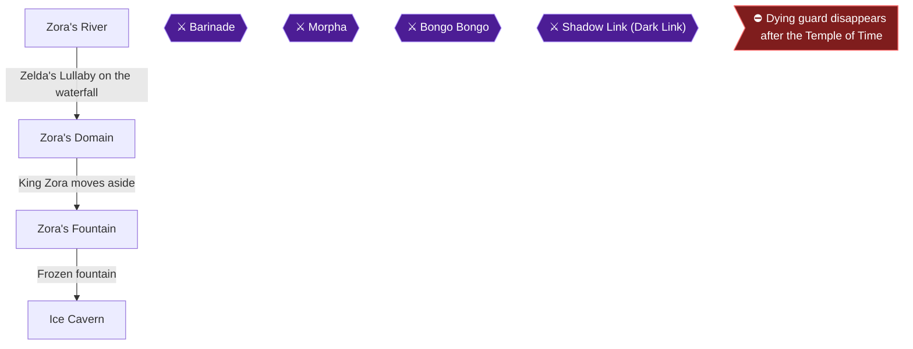

This chapter takes adult Link up frozen Zora's River at night for two Hookshot Skulltulas, across the iced-over Zora's Fountain to the Ice Cavern, and back out again. The Iron Boots, Serenade of Water, Compass, Map and Pieces of Heart #26 to #28 come from this route, as do the Zora Tunic and King Zora's kiss. Three achievements are in play: Bring Me to the Bottom of the Oceans (Iron Boots), A Breath of Fresh Air (Zora Tunic) and Kiss That Frog (the only missable one). The order of the Zora's Domain steps matters, so read the warnings before you touch King Zora.

### Preparation

- **Blue Fire:** Blue Fire melts the Red Ice that blocks the Compass chest, a Piece of Heart, the Map chest and parts of the block room, and it is also needed on the Zora Shop door and on King Zora. Carry as many empty Bottles as you can. Fill every Bottle with Blue Fire whenever you reach the blue torch. Make sure you leave the Ice Cavern with at least two bottles of Blue Fire in your inventory, one for the shop door and one for King Zora.
- **Giant's Wallet:** the Zora Tunic costs 300 Rupees at the shop, so you need the Giant's Wallet 🟡. A commenter advises defeating 30 Gold Skulltulas and getting the Giant's Wallet before this chapter so that you do not miss Kiss That Frog 🟡.
- **Weapons:** Bring the Fairy Bow for the Ice Keese and the Hookshot for the Skulltulas and the Freezzards 🟡. Ice Keese freeze you on contact, so kill them from range 🟡.
- **Hardcore mode:** save states are off, so the tunic-first order below matters, because you cannot undo a wrong thaw.

> [!WARNING]
> **Missable Achievement Warning:** Kiss That Frog is missable. Thawing King Zora with Blue Fire before you have bought and equipped a Zora Tunic makes him hand you the free tunic instead of blowing a kiss, which costs you the achievement. Do not use Blue Fire on King Zora until the steps in "Zora's Domain, second visit" are complete.

### Key pickups in this chapter

| Item | Where Found | Action / Requirement | Citation |
|---|---|---|---|
| Piece of Heart #26 | Zora's Fountain, end of the east ice-platform string | **TAKE** | |
| Dungeon Map | Ice Cavern, chest in Red Ice | **MELT** with Blue Fire, **OPEN** | |
| Compass | Ice Cavern, chest in Red Ice | **MELT** with Blue Fire, **OPEN** | |
| Piece of Heart #27 | Ice Cavern, inside Red Ice | **MELT**, **TAKE** | |
| Iron Boots | Ice Cavern, chest after the White Wolfos | **OPEN** | |
| Zora Tunic | Zora Shop, 300 Rupees | **BUY**, **EQUIP** | 🟡 |
| Piece of Heart #28 | Bottom of Zora's Fountain | Iron Boots, Zora Tunic | |

### Zora's River

🗺️ **Map:** [View Zora's River/Domain Map by EverythingZelda](https://gamefaqs.gamespot.com/n64/197771-the-legend-of-zelda-ocarina-of-time/map/56-zoras-river-domain-map)

Enter from Hyrule Field. Both Skulltulas here appear only at night, and time passes normally in this zone, so you can play the Sun's Song here if it is day.

#### Skulltula on the south wall (#45)

Run forward from the entrance and jump across the river where you crossed as a kid. Run upstream to the next place where the river must be crossed, but do not jump yet. At night, face the south wall and look up to see the Skulltula, which is out of reach from here.

Climb up to the high ledge, face south again, and look for the cliff with a pit in it. Jump out to this ledge, avoiding the pit, and Hookshot the Skulltula for its token.

An alternative route is to ride the grown Magic Bean platform up to the high area and jump off as it passes. Then look southwest and play the Sun's Song if nothing is crawling on the wall.

#### Skulltula near the wooden bridge (#46)

Work your way upstream toward the Zora's Domain waterfall. Near the end of the wooden drawbridge just before the waterfall, look at the northwestern wall for the second Skulltula. You may need to stand on the fence to reach it with the Hookshot.

#### Opening the waterfall

Stand on the plaque in front of the waterfall and play Zelda's Lullaby. The waterfall retracts, and you can jump over to the doorway and enter Zora's Domain.

### Zora's Domain

🗺️ **Map:** [View Zora's River/Domain Map by EverythingZelda](https://gamefaqs.gamespot.com/n64/197771-the-legend-of-zelda-ocarina-of-time/map/56-zoras-river-domain-map)

Zora's Domain is frozen over. It does not thaw by your own actions; it begins to unfreeze only after the Water Temple.

> [!WARNING]
> **Missable Achievement Warning:** Climb to King Zora's throne room only to pass through. Do not use Blue Fire on him yet. This is the Kiss That Frog deadline.

#### The waterfall-top Skulltula (later)

The Gold Skulltula at the top of the frozen waterfall (#47) is counted in Chapter 21, so the checkpoint below leaves it out. If it is night and you take it now, it simply counts early: Hookshot it from the lip at the top of the tunnel on the left side of the throne room.

#### On to the Fountain

Climb to the throne room and take the passage behind King Zora's throne into Zora's Fountain 🟡.

### Zora's Fountain

Jabu-Jabu is gone and a slab of ice has replaced him.

#### Piece of Heart #26 (ice platforms)

Climb the small frozen hill and jump onto the first of the frozen platforms. Jump carefully along them. At the second platform you can go north or northeast, and you should go northeast first for the Piece of Heart 🟡. Another route heads for the huge iceberg and then runs east to the end of the string of icebergs.

The second set of platforms steadily rotates. Stay on a spinning platform until it goes around, then jump.

Take the **[Piece of Heart]** (#26).

#### Into the cave

Head back to the giant platform and go north along the ice platforms. Jump to the northern edge of the pond and into the massive cave mouth, which leads to the Ice Cavern 🟡.

### Ice Cavern

🗺️ **Map:** [View Ice Cavern Map by EverythingZelda](https://gamefaqs.gamespot.com/n64/197771-the-legend-of-zelda-ocarina-of-time/map/53-ice-cavern-map)

The Ice Cavern holds one Piece of Heart and three Gold Skulltulas 🟡.

#### Entry corridor and Freezzard room

When the passage opens into a large room with a frozen floor, three Freezzards are waiting 🟡. Defeat them with sword strikes or Din's Fire. On the ice, use the Hookshot on a Freezzard to pull yourself right to it. Their ice breath freezes you 🟡. Dodge the Blade Trap in the room, then enter the door that opens 🟡.

#### Spinning ice-blade room (Silver Rupees)

The next room has a huge rotating ice blade and Silver Rupees that you must collect to unlock the door at the north end 🟡. One rupee is behind three blue stalagmites in the corner to the left as you enter, and a Gold Skulltula is on the ceiling above it 🟡. The door at the top of the cliff unlocks once all are collected, and you climb up and go through it 🟡.

On the wall here is a Gold Skulltula, on the left wall as you enter from the southern door, also described as behind a cluster of icicles. Hookshot it for its token 🟡.

#### Ice Keese room and the Blue Fire

In the wide room beyond, Ice Keese freeze you on contact. Kill them from afar with arrows 🟡.

This room has a platform with a pillar of Blue Fire. Fill your empty Bottles with Blue Fire here.

A Jump Attack with the Biggoron Sword or Megaton Hammer kills the Freezzard that hogs the path in one hit 🟡. Use Blue Fire to melt the Red Ice around the large chest and open it for the **[Dungeon Map]**. The pot frozen in Red Ice contains a fairy. Another pillar of Red Ice hides a pot that holds a Purple Rupee 🟡.

#### Compass, Piece of Heart #27 and Skulltula

Two walls with a red tinge are visible in the blade room, one on each side, and both can be melted with Blue Fire. One leads to the Compass and Heart Piece room, the other to the block-pushing room. Sources differ on which side is which, so if you open the wrong wall, go back and open the other one 🟡.

Use Blue Fire to melt the Red Ice over the chest on the right and open it for the **[Compass]**. Melt the Red Ice on the left side for **[Piece of Heart]** #27. A Gold Skulltula is on the wall beside or above the Piece of Heart, so Hookshot it 🟡. Refill your Bottles with Blue Fire and go back to the blade room.

#### Block-pushing room

Melt the other red-tinged wall and go to the sliding-block room 🟡. The Skulltula is in the corner to your right as you come in, and you can Hookshot it. It is also described as above the pit to the left 🟡. Take care near the pit, because a fall can drop you back at the start of the dungeon 🟡.

You need all five Silver Rupees to open the exit. Pushing the ice block off a cliff makes it respawn at the room entrance 🟡. One solution is as follows:

1. Grab the block from its east side and push it forward. Climb on top and use it to reach the rupee on the tall stone block 🟡.
2. Push the block east from its west side. Climb into the small alcove, melt its Red Ice with Blue Fire, and take the second rupee 🟡.
3. Push the block off a cliff so it respawns, then push it south from its north side. Jump on and take the rupee on the rock 🟡.
4. Push the stone block west from its east side. Climb onto the ice block and take the rupee on top of the stone 🟡.
5. Jump down, go to the south side of the block, and push it north. Grab the rupee on the stone where it comes to rest, and the door opens 🟡.

A second solution exists and uses a different push order 🟡.

To reach the exit ledge, push the block west, south, west, climb to the Blue Fire torch, then push it south, east, south and jump to the opened hallway 🟡.

If you want the bundle of Red Rupees hanging high above the ground, play the Song of Time here to make a Block of Time appear and use it to climb 🟡.

#### White Wolfos and the Iron Boots

The White Wolfos waits in the shrine room 🟡. Block with your shield and attack only after it strikes. A jump attack after defending works well 🟡. You can also let it strike, backflip away at the last moment, and jump attack as you land. Even with the Master Sword it dies in one shot 🟡.

A large chest appears in the middle of the room. Open it for the **[Iron Boots]**. The Iron Boots are needed in the Water Temple 🟡.


> [!ACHIEVEMENT]
> **Bring Me to the Bottom of the Oceans (5 Points)**
> 
> *Obtain the Iron Boots*


This achievement is story-related and not missable 🟡.

Sheik then appears and teaches you the Serenade of Water: A Button, C-Down, C-Right, C-Right, C-Left. It takes you to the Water Temple in Lake Hylia. Do not use it yet, because the Tunic and a Piece of Heart come first.

> [!TIP]
> **Before you leave the Ice Cavern:** check that you have both the Map and Compass, the Piece of Heart (#27), all three Skulltulas, and at least two bottles of Blue Fire.

### Zora's Domain, second visit

Return through the west entrance of the Fountain to Zora's Domain 🟡. You will do the shop and King Zora in strict order.

> [!WARNING]
> **Missable Achievement Warning:** Do not thaw King Zora yet. The Tunic must be bought and worn first, or he hands you a tunic and the kiss is lost 🟡.

#### Step 1: Buy the tunic

Use Blue Fire on the frozen Zora Shop door 🟡. The shop sells the Zora Tunic for 300 Rupees. You need the Giant's Wallet to hold that much 🟡. Buy it.


> [!ACHIEVEMENT]
> **A Breath of Fresh Air (5 Points)**
> 
> *Obtain a Zora Tunic*


You can also get this achievement from King Zora's free tunic, but doing so costs you the kiss 🟡.

#### Step 2: Equip and save

Equip the Zora Tunic from the equipment subscreen and use the game's normal save before you continue. Whether the tunic must be worn at the exact moment of thawing is unconfirmed, as sources differ. Follow the safe order: buy, equip, save, then thaw, and talk to him while still wearing it 🟡.

#### Step 3: Thaw King Zora and take the kiss

Climb to the throne room and stand next to King Zora wearing the tunic. Use the Blue Fire on him. Then talk to him. He blows you a kiss instead of giving you a tunic 🟡.


> [!ACHIEVEMENT]
> **Kiss That Frog (5 Points)**
> 
> *Get a kiss from King Zora*


Do not show him the Prescription yet unless you intend to start the Biggoron trade chain right now. He gives the Eyeball Frog, which has a three-minute limit. Do not warp with Serenade of Water or Bolero of Fire during that quest 🟡. That sequence is covered in the next chapter.

### Back at the Fountain: Piece of Heart #28

Go back through the passage behind the throne to Zora's Fountain. Equip the Iron Boots, and with the Zora Tunic on, sink into the deep water to the exact center and bottom of the pool. Take the **[Piece of Heart]** (#28).

> [!TIP]
> **Before you leave:** confirm Pieces of Heart #26, #27 and #28, the Map, Compass, Iron Boots, Serenade of Water and the Zora Tunic. Zora's River GS #45 and #46 and the Ice Cavern Skulltulas #74 to #76 are also done.

> [!IMPORTANT]
> ### Chapter 12 Cumulative 100% Checkpoint
> - **Gold Skulltulas:** 54 / 100
> - **Pieces of Heart:** 23 / 36
> - **Heart Containers:** 3 / 8
> - **Maps, Compasses & Boss Keys:** 8 / 26
> - **RetroAchievements Unlocked:** 48 / 97 (255 / 690 points)

### Chapter checklist

- [ ] Gold Skulltula on the Zora's River south wall (#45)
- [ ] Gold Skulltula near the wooden drawbridge (#46)
- [ ] Piece of Heart #26 (ice platforms)
- [ ] Ice Cavern Dungeon Map
- [ ] Ice Cavern Compass
- [ ] Piece of Heart #27 (Red Ice)
- [ ] Ice Cavern Gold Skulltulas (#74 to #76)
- [ ] White Wolfos defeated, Iron Boots obtained (Bring Me to the Bottom of the Oceans)
- [ ] Serenade of Water learned
- [ ] Extra Blue Fire bottled
- [ ] Zora Tunic bought and equipped (A Breath of Fresh Air)
- [ ] King Zora thawed while wearing the tunic (Kiss That Frog)
- [ ] Piece of Heart #28 from the bottom of the Fountain

---

## Chapter 13: The Biggoron's Sword Trading Quest

```mermaid
flowchart TD
  Lost_Woods["Lost Woods"]
  Kakariko_Village["Kakariko Village"]
  House_of_Skulltula["House of Skulltula"]
  Death_Mountain_Trail["Death Mountain Trail"]
  Zoras_Domain["Zora's Domain"]
  Lake_Hylia["Lake Hylia"]
  Gerudo_Valley["Gerudo Valley"]
  King_Dodongo{{"⚔ King Dodongo"}}
  Barinade{{"⚔ Barinade"}}
  Phantom_Ganon{{"⚔ Phantom Ganon"}}
  Morpha{{"⚔ Morpha"}}
  Bongo_Bongo{{"⚔ Bongo Bongo"}}
  Twinrova{{"⚔ Twinrova"}}
  Ganondorf{{"⚔ Ganondorf"}}
  Ganon{{"⚔ Ganon"}}
  Dark_Link{{"⚔ Shadow Link (Dark Link)"}}
  Dead_Hand{{"⚔ Dead Hand"}}
  Dying_Guard_Lockout>"⛔ Dying guard disappears after the Temple of Time"]
  Final_Battle>"⛔ Ganon's Tower final battle"]
  Kakariko_Village -->|"Show Zelda's Letter to the gate guard"| Death_Mountain_Trail
  Zoras_Domain -->|"Underwater tunnel"| Lake_Hylia
  Ganondorf --> Final_Battle
  Final_Battle --> Ganon
  classDef ponr fill:#7f1d1d,stroke:#f87171,color:#fff;
  classDef boss fill:#4c1d95,stroke:#a78bfa,color:#fff;
  class Dying_Guard_Lockout,Final_Battle ponr;
  class King_Dodongo,Barinade,Phantom_Ganon,Morpha,Bongo_Bongo,Twinrova,Ganondorf,Ganon,Dark_Link,Dead_Hand boss;
```

This chapter covers the whole adult trading sequence for the Biggoron's Sword, plus the two Gerudo Valley Gold Skulltulas and the 50-token House of Skulltula reward. Once Link has Epona, the Biggoron Sword sidequest can be done at any time 🟡. The sidequest also requires King Zora to be freed from the red ice and Epona to be available for the broken bridge 🟡. You will run through Kakariko Village, the Lost Woods, Gerudo Valley, Death Mountain Trail, Zora's Domain and Lake Hylia, and finish back at the House of Skulltula.

> [!TIP]
> **Check first:** Before you start, confirm that both Lost Woods Deku upgrades are done (A Horrible Face and Stocking Nuts; the Mask of Truth and Deku Nut upgrade pair) 🟡. The Poacher's Saw blocks them later in this chapter 🟡. Whether the Lost Woods Deku Nut upgrades can still be earned as an adult is unconfirmed: some players report success after the Forest Temple 🟡, while others report that the saw's flag locks them out 🟡. Do not rely on the doubtful option. Get the upgrades before taking the saw. If either is still missing, put the Master Sword back in the Temple of Time to become Young Link and follow Chapter 6 (Stocking Nuts) or Chapter 10 (A Horrible Face) before you hand over the Odd Potion. One commenter says both Deku upgrades must be obtained before the whole succession of exchanges 🟡.

> [!WARNING]
> **Achievement Trigger Warning:** Three items in this sequence are timed: the Odd Mushroom (3 minutes), the Eyeball Frog (3 minutes) and the Eye Drops (4 minutes) 🟡. Do not use transportation songs such as the Serenade of Water or the Bolero of Fire while delivering the Eyeball Frog or the Eye Drops 🟡. Decide your route before you accept each timed item.

### Chapter Items to Collect (12 Trading Items Total)

| Item | Where Found | Action / Requirement | Citation |
|---|---|---|---|
| Pocket Egg | Cucco Lady, Kakariko Village (daytime) | **TAKE**, then play the Sun's Song twice to hatch it | |
| Pocket Cucco | Hatched from the Pocket Egg | **USE** next to sleeping Talon | 🟡 |
| Cojiro (blue Cucco) | Cucco Lady, after Talon is awake | **SHOW** the Pocket Cucco to her | |
| Odd Mushroom | Man in the Lost Woods | **GIVE** Cojiro; 3-minute timer | 🟡 |
| Odd Potion (Odd Medicine) | Witch behind the Kakariko Potion Shop | **GIVE** the Odd Mushroom | 🟡 |
| Poacher's Saw | Kokiri girl in the Lost Woods | **GIVE** the Odd Potion | 🟡 |
| Broken Goron's Sword | Carpenter outside the tent, Gerudo Valley | **GIVE** the Poacher's Saw | 🟡 |
| Prescription | Biggoron, Death Mountain summit | **SHOW** the Broken Goron's Sword | 🟡 |
| Eyeball Frog | King Zora | **SHOW** the Prescription; 3-minute timer | |
| Eye Drops | Scientist, Lakeside Laboratory | **GIVE** the Eyeball Frog; 4-minute timer | 🟡 |
| Claim Check | Biggoron | **GIVE** the Eye Drops | 🟡 |
| Biggoron's Sword | Biggoron, after 3 days | **SHOW** the Claim Check | |

### Kakariko Village (Part 1: Egg to Cojiro)

Make sure it is daytime and talk to the Cucco Lady, who stands near the pasture at the rear of town, close to the entrance to the Graveyard. As Adult Link she gives you the **[Pocket Egg]**. Play the Sun's Song twice; the egg hatches into the Pocket Cucco. Another guide only says to play the song until it hatches, so keep going if it has not hatched yet 🟡.

Check that it is daytime again. Enter the building at the bottom of the stairs near the middle of town, where Talon is asleep on the bed 🟡. Stand beside him with the Pocket Cucco equipped on a C button and use it, and Talon wakes up 🟡.

Go back to the Cucco Lady and use the Pocket Cucco near her. She is pleased and gives you **[Cojiro]**, a blue Cucco.

If you have not yet learned the Song of Storms, the windmill is close by, and one guide suggests learning it before you leave 🟡. You play A, Down, Up, A, Down, Up.

### Lost Woods (Part 1: Cojiro to Odd Mushroom)

🗺️ **Map:** [View Lost Woods Map by EverythingZelda](https://gamefaqs.gamespot.com/n64/197771-the-legend-of-zelda-ocarina-of-time/map/54-lost-woods-map)

Enter the Lost Woods and go left from the entrance to the area where the Skull Kid used to stand 🟡. A man sits beside the stump 🟡. Equip Cojiro on a C button and use it while standing in front of him, then accept his offer. He gives you the **[Odd Mushroom]** 🟡.

The timer starts the moment you accept: you have three minutes to reach the Potion Shop in Kakariko Village 🟡. Do not stop for anything else.

### Kakariko Village (Part 2: Odd Mushroom to Odd Potion)

Run to the Kakariko Potion Shop, enter it, and go through the back door, then enter the red house to find the hidden witch's shop 🟡. Climb the stairs and enter the other door at the back to reach the witch 🟡.

Use the Odd Mushroom while standing in front of her, and she makes the **[Odd Potion]** (called the Odd Medicine in one guide) 🟡. One player reports she accepted it only on the second try 🟡. From now on she also sells blue potions for 100 rupees, per the same report 🟡.

### Lost Woods (Part 2: Odd Potion to Poacher's Saw)

> [!CAUTION]
> **Point of No Return:** Taking the Poacher's Saw makes the Lost Woods Deku upgrades unobtainable (A Horrible Face, Stocking Nuts) 🟡. Finish both Deku upgrades before you hand over the Odd Potion.

Go back to where the man was sitting in the Lost Woods. A Kokiri girl now stands in his place 🟡. Give her the Odd Potion and she hands over the **[Poacher's Saw]** 🟡.

### Gerudo Valley

Ride Epona to Gerudo Valley and jump the broken bridge, then dismount and continue on foot 🟡. Alternatively the Longshot can pull you across 🟡. The Master Carpenter waits on the far side 🟡.

Stand in front of the carpenter outside the tent, equip the Poacher's Saw on a C button and use it. He recognizes it as his own and gives you the **[Broken Goron's Sword]** 🟡.

While you are here, collect the two Gold Skulltulas on this side of the bridge. Make it night with the Sun's Song if needed 🟡.

- **Skulltula #62:** behind the tents, on the wall. Hookshot it 🟡.
- **Skulltula #63:** on the back of the stone pillar to the left. Hookshot it 🟡.

Both require Epona or the Longshot to cross the broken bridge 🟡.

If you want extra rupees, breaking all the rocks near the carpenter with the Megaton Hammer reveals a chest with a Purple Rupee.

### Death Mountain Trail (Part 1: Biggoron and the Prescription)

Make your way to Kakariko Village and through the northern gate onto Death Mountain Trail 🟡. Dodge the boulders that crash down the path 🟡. Near the top, the rocks fall and a climbable wall leads up to Biggoron.

Stand on the right side of the cliff to get his attention, then show him the Broken Goron's Sword. He says he cannot repair it until he has eyedrops from King Zora, and gives you the **[Prescription]**.

The Piece of Heart above Dodongo's Cavern (#22) is already yours from Chapter 4, where you backflipped onto the cliff 🟡. The two Death Mountain Trail Skulltulas behind red rocks need the Megaton Hammer and are collected in Chapter 15 🟡.

### Zora's Domain

🗺️ **Map:** [View Zora's River/Domain Map by EverythingZelda](https://gamefaqs.gamespot.com/n64/197771-the-legend-of-zelda-ocarina-of-time/map/56-zoras-river-domain-map)

King Zora is already free from the Ice Cavern chapter 🟡. Stand on the platform in front of him and use the Prescription. He gives you the **[Eyeball Frog]**, which has to be delivered to the scientist in Lakeside Laboratory within three minutes.

Route to Lake Hylia inside the three minutes, as the sidequest guide runs it 🟡:

1. Leave Zora's Domain for Zora's River and take the portal on the left into the Lost Woods.
2. In the Lost Woods go straight, left, right, straight and left. This brings you to the Lost Woods bean plant you planted two lefts from the entrance in Chapter 10.
3. Ride the plant and jump off onto the bridge, then keep rolling toward Lake Hylia. The guide arrived with about 40 seconds left.

Do not play the Serenade of Water to shortcut 🟡. The frozen-waterfall Skulltula here is collected in Chapter 21 🟡.

### Lake Hylia

Go to the Lakeside Laboratory and enter. Use the frog next to the old man 🟡. He mistakes it for his dinner, but then gives you the **[Eye Drops]** (World's Finest Eye Drops) 🟡.

You now have four minutes to climb back to Biggoron 🟡. Step outside, get on Epona, and ride across Hyrule Field to Kakariko Village. Dismount, enter the village and take Death Mountain Trail to the summit 🟡. Do not play the Bolero of Fire 🟡.

The laboratory crate Skulltula needs the Iron Boots and comes in Chapter 16 🟡.

### Death Mountain Trail (Part 2: Claim Check and the Sword)

Climb the wall and use the Eye Drops in front of Biggoron to get the **[Claim Check]** 🟡.

> [!WARNING]
> **Achievement Trigger Warning:** Save the game before turning in the Claim Check 🟡. Hardcore turns off save states, so use the game's own save. Mash A, not B, through the dialogue. One player reports that mashing B leaves a small window in which a sword slash cancels the trade 🟡, and another confirms mashing A earned the achievement in hardcore 🟡.

The sword takes three days. Play the Sun's Song six times to force three days to pass 🟡. Another guide says about five times 🟡, so keep going until three days have passed. Then show Biggoron the Claim Check and he gives you the **[Biggoron's Sword]**.


> [!ACHIEVEMENT]
> **Biggoron's Sword (10 Points)**
> 
> *Obtain the Biggoron's Sword*


The Biggoron's Sword deals twice the damage of the Master Sword, but it needs both hands, so you cannot use a shield with it equipped 🟡. It does not break 🟡.

Some players report problems: the sword showing in the equipment screen but being unselectable 🟡, and the achievement failing after buying the knife from Midgoron 🟡. A commenter says the trade flag can be repaired by purchasing the Giant's Knife 🟡. The Giant's Knife is sold by a giant Goron in Goron City 🟡.

### House of Skulltula

With 56 tokens, claim the 50-token reward at the House of Skulltula. The cursed family's house is the first house on the right as you enter from the main gate 🟡. The rewards come in order: 10 tokens for the Adult's Wallet, 20 for the Stone of Agony, 30 for the Giant's Wallet, 40 for Bombchus and 50 for a Piece of Heart.

> [!WARNING]
> **Achievement Trigger Warning:** Collect the 40-token Bombchus reward before the 50-token reward. One player did not get the achievement after talking to the 50 NPC first 🟡. Another says that, because of battery protection, the achievement only triggers if the reward event is repeated 🟡. Save before collecting the reward 🟡.

Go inside and speak to the man in the upper right corner. He gives you the **[Piece of Heart]**.


> [!ACHIEVEMENT]
> **My Broken Heart (10 Points)**
> 
> *Collect 50 Gold Skulltulas and obtain your reward*


The Piece of Heart is collected as Adult Link without trouble. This is Piece of Heart #32.

> [!TIP]
> **Before you leave:** Make sure the Biggoron's Sword is in your equipment, that you have collected the Gerudo Valley tokens (#62 and #63), and that you have claimed every House of Skulltula reward up to 50.

> [!IMPORTANT]
> ### Chapter 13 Cumulative 100% Checkpoint
> - **Gold Skulltulas:** 56 / 100 🟡
> - **Pieces of Heart:** 24 / 36
> - **Heart Containers:** 3 / 8
> - **Maps, Compasses & Boss Keys:** 8 / 26
> - **Biggoron's Sword:** Obtained
> - **RetroAchievements Unlocked:** 50 / 97 (275 / 690 points)

### Chapter Checklist

- [ ] Both Lost Woods Deku upgrades are done before taking the Poacher's Saw
- [ ] Pocket Egg obtained and hatched (Sun's Song twice)
- [ ] Talon woken and Cojiro received
- [ ] Odd Mushroom delivered within 3 minutes and Odd Potion made
- [ ] Poacher's Saw received from the Kokiri girl
- [ ] Broken Goron's Sword received in Gerudo Valley
- [ ] Gerudo Valley Skulltulas #62 and #63 collected at night
- [ ] Prescription received from Biggoron
- [ ] Eyeball Frog delivered to Lakeside Laboratory within 3 minutes
- [ ] Eye Drops delivered to Biggoron within 4 minutes
- [ ] Game saved, then Claim Check turned in with A mashed
- [ ] Three days passed and Biggoron's Sword obtained (achievement 48975)
- [ ] 40-token reward claimed, then 50-token Piece of Heart collected (achievement 48247)

---

## Chapter 14: Forest Temple

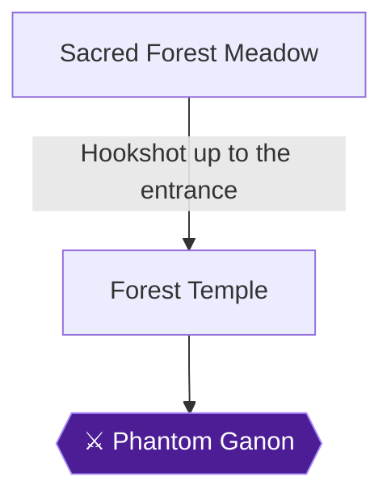

This chapter takes Adult Link through the Sacred Forest Meadow, where Sheik teaches the Minuet of Forest, and then through the Forest Temple, the first Adult Link dungeon. You collect the Fairy Bow, the Map, the Compass and the Boss Key, beat the four Poe Sisters, ride the elevator down and fight Phantom Ganon. Saria then gives you the Forest Medallion, and you return to the Temple of Time for the Prelude of Light.

Two achievements are in this chapter: **Drunken Master** (missable, earned against Phantom Ganon) and **Awakening** (Forest Medallion).

> [!TIP]
> **Preparation:** The Hookshot is required for most of the Gold Skulltulas here 🟡. Before the boss, have 30 arrows and full health, and set the Bow and two empty Bottles on your C buttons so you cannot grab another item by mistake 🟡. One commenter suggests leaving the temple after getting the bow, winning the quiver upgrade in Kakariko and entering the fight with 40 arrows 🟡.

> [!WARNING]
> **Missable Achievement Warning:** Drunken Master (10 pts) is lost for the attempt if you use the sword, the Hookshot or any other item before Phantom Ganon is at 1 HP. Do not press the sword button at all, and do not switch to the Hookshot on the way to the boss. One player used the Hookshot on a Skulltula along the way and that cancelled the achievement 🟡. Plan the order: collect the Hookshot Gold Skulltulas first, then follow the commenters' advice to leave the temple and re-enter it before the boss, opening only the Bow or a Bottle 🟡.

### Sacred Forest Meadow

🗺️ **Map:** [View Sacred Forest Meadow Map by R351D3NT3V1L4](https://gamefaqs.gamespot.com/n64/197771-the-legend-of-zelda-ocarina-of-time/map/5354-sacred-forest-meadow-map)

The Sacred Forest Meadow lies in the midst of the Lost Woods, and the Forest Temple is in the midst of the meadow 🟡.

**Optional side stops (Stocking Nuts).** The Deku Nut upgrade is sold in a secret grotto revealed by bombing the large boulder just outside the Sacred Forest Meadow entrance. Two Business Scrubs are there, and one sells the upgrade for 40 Rupees 🟡. The Stocking Nuts achievement refers to this one, not the Mask of Truth one on the forest stage 🟡. One guide warns that this upgrade is permanently lost if you become adult before showing the Mask of Truth on the forest stage 🟡. A bomb placed in the meadow's first area also opens a cave where defeating two Wolfos produces a chest with a Purple Rupee 🟡.

#### The hedge maze

1. Enter the maze. The Scrubs are gone, replaced by Moriblins that charge if you enter their sight. Wait for each to face away and shoot it in the back with the Hookshot. Move slowly so it does not hear you 🟡.
2. Use Z to look around the first corner, kill the first Moriblin, go right and kill the second. At the end of that passage go right, peek around the next corner and kill the third. Turn left at the flowery passage and kill the fourth, then go right, then left at the end and into the pool of water 🟡.
3. Climb out of the pool and up the ladder on the left. If a Moriblin is there, wait until it turns away before climbing out 🟡.
4. **Gold Skulltula (Sacred Forest Meadow).** This one appears at night only, as adult, and needs the Hookshot. At the top of the ladder go left a short way, face left and Hookshot it.
5. A pit in the center of the maze holds a Fairy Fountain, useful before the dungeon 🟡. The Minuet of Forest also brings you back to it later 🟡.

#### Sheik and the Minuet of Forest

1. Climb back down the ladder and go up the stairs opposite it. At the top a club-wielding Moblin sends shockwaves down the passage 🟡.
2. Dodge the shockwaves by running left and right between each one, run around behind him and hit his back with two Jump Attacks. He drops a large number of Rupees 🟡. Another source says his club pattern is left, right, left and that it takes three sword slashes.
3. Go up the stairs behind him and step onto the Triforce pedestal. Sheik appears and teaches the **Minuet of Forest** (A, C-Up, C-Left, C-Right, C-Left, C-Right). Playing it warps you here from anywhere, giving access to the Forest Temple and a Fairy Fountain 🟡.
4. Hookshot the large tree branch above the shattered staircase and go through the doorway into the temple 🟡.

### Forest Temple

The central goal is to kill the four Poe Sisters who steal flames from the torches, which retracts the central elevator. The dungeon loops around that central chamber 🟡. Killing the four Poes opens the way to the boss 🟡. Wallmasters drag you back to the dungeon entrance if they land on you 🟡.

#### Chapter Items to Collect

| Item | Where Found | Action / Requirement | Citation |
|---|---|---|---|
| Small Key | Chest on tree branch in entrance courtyard | **TAKE** | 🟡 |
| Small Key | Chest in Lower Stalfos Chamber | **TAKE** | 🟡 |
| Dungeon Map | Chest in Balcony Hallway | **TAKE** | 🟡 |
| Small Key | Chest at end of drained well | **TAKE** | 🟡 |
| Fairy Bow | Chest after Upper Stalfos Room | **TAKE** | 🟡 |
| Small Key | Chest after West Stairwell Poe (red) | **TAKE** | |
| Boss Key | Blue chest in West Twisted Hallway | **TAKE** | 🟡 |
| Small Key | Chest after Floormaster | **TAKE** | |
| Compass | Chest after East Stairwell Poe | **TAKE** | 🟡 |
| Heart Container | After Phantom Ganon | **TAKE** | 🟡 |

#### Entrance courtyard

1. Step forward and kill the two Gray Wolfos by backflipping out of range when they attack and immediately landing a Jump Attack while their backs are turned 🟡.
2. Turn right and climb the vines on the wall up to the trees, then go left a little.
3. **Gold Skulltula (Forest Temple, first room).** From the top of the tree, look to the top-right of the ivy wall and Hookshot the Skulltula 🟡.
4. Edge along the branch, jump to the adjacent branch and open the chest at its end for a **Small Key** 🟡. Drop down and go through the door under the stone archway 🟡.

#### South Passage and Torch Room

1. A Big Skulltula is in the hall. A single Hookshot hit kills it instantly 🟡. If you are attempting Drunken Master on this pass, kill it with the bow instead 🟡. Go through the door at the far end 🟡.
2. In the Torch Room, the four Poe Sisters appear and steal the four flames, lowering the central elevator 🟡.
3. Run across to the opposite end, jump onto the ledge and go up the stairs. **Gold Skulltula:** look right at the top and Hookshot it 🟡.

#### North Passage and Lower Stalfos Chamber

1. The door at the top of the stairs leads to a Blue Bubble. Hold up your shield while Z-targeting it and let it touch you to put out its flame, then kill it 🟡.
2. In the Lower Stalfos Chamber, Z-target one Stalfos (they will not attack while you target one), circle, keep your shield up and attack from the side or behind right after they attack 🟡. Deku Nuts can interrupt their attacks 🟡.
3. When both die, a chest in the center holds a **Small Key**. Smash the pots at the rear for a Recovery Heart and a Fairy 🟡. Return to the Torch Room 🟡.

#### Song of Time block and the West Courtyard

1. Run down the stairs and go right to the small hallway. Stand by the blue block and play the Song of Time (right, A, down, right, A, down) to reveal a door 🟡.
2. In the West Courtyard, kill the Big Deku Baba and the Octorok. Hookshot the first two Skullwalltulas on the ivy wall on the right (the third is out of reach), then climb as far right as possible to avoid it and enter the alcove door at the top 🟡.

#### Balcony Hallway and East Courtyard

1. Kill the Blue Bubble. The far door opens and a chest appears with the **Dungeon Map** 🟡.
2. In the East Courtyard, kill the Deku Baba and Hookshot the Skullwalltula on the ivy wall. Hookshot the white circle above the left balcony and step on the switch to drain the well 🟡.
3. Jump down. Kill the Octorok and Big Deku Baba. From the right side of the dead-end dirt path, Hookshot the chest on the cliff. Aim at the part of the chest closer to the wall so you stay up. The chest holds a Recovery Heart 🟡.
4. **Gold Skulltula:** it clings to the wall around the corner from the chest 🟡.
5. Jump back down, go to the right side and drop into the well 🟡.

#### The Well

Run to the end collecting the Recovery Hearts. Open the chest for a **Small Key**, then climb the ivy wall back to the West Courtyard. Return through the archway door to the Torch Room, climb the ledge on the right, go up the stairs and use a Small Key on the locked door 🟡.

#### West Passage and Stone Block Room

1. Kill the Big Skulltula and go through the far door 🟡.
2. Defeat the Blue Bubble, climb the ladder, then the next on the right, go left and left again through the doorway. A stone block with floor arrows is to the left 🟡.
3. Go forward through the doorway, left down the hall, left, and left through another doorway to reach the block's far side. Push it forward until a ladder appears on the right (ignore it), keep pushing until a gap opens on your left, slip through behind the block and push it back until the gap closes 🟡.
4. Push it forward until it stops, return down the passage, go around the ledge taking three rights, and push it again until it falls into a small alcove. Climb onto it for the third level 🟡.
5. Climb the ladder, turn right, right again through the doorway, and push the block in front of you until it stops. Drop back down 🟡.
6. Climb on the placed block, run down the passage and push the third-level block into the pit, then climb to the top 🟡.
7. Go right after two ledges, up the ladder, right around the corner, and kill or dodge the two Blue Bubbles before the door 🟡.

#### West Twisted Hallway to the Bow

1. Run to the end of the hall. Navi warns of Wallmasters. Run in large circles to dodge and kill them when they land, or enter First Person Mode to make them vanish 🟡.
2. Jump to the pillar ahead, then to the right, and enter the door 🟡.
3. This is the West Stairwell (stairs on the left, red Poe Sister in the portraits). It is a series of stairs with three portraits. Run down both stairsets and through the door at the bottom of the second 🟡.
4. In the Upper Stalfos Room, beware the pit. A Stalfos walks over it. Beat it and an elevator drops with two more Stalfos. Beat both quickly or they regenerate. A chest then appears with the **Fairy Bow** 🟡. The quiver holds 30 arrows 🟡. A trick for the pair: hit each twice with Jump Attacks, then quickly finish both 🟡.

> [!WARNING]
> **Achievement Trigger Warning:** The Hookshot Gold Skulltulas still ahead (and the Hookshot-only route steps) conflict with Drunken Master. Finish collecting every token you want first. Then leave the temple, re-enter, and go straight to the boss using only the Bow or a Bottle 🟡.

#### West Stairwell Poe (red)

1. Return to the West Stairwell through the Upper Stalfos Room door. Shoot the Poe's portrait with the Bow from as far away as possible, at the bottom or top of the stairwell. If you get close, she moves. Burn all three portraits and she appears at the bottom 🟡.
2. Shoot her with arrows. Do not Z-target her, because she vanishes. If you get too close she spins her torch 🟡.
3. The chest that appears has a **Small Key**. Her flame returns to the torch here and in the Torch Room.

#### Back to the Stone Block Room

Climb back up and return through the West Twisted Hallway to the Stone Block Room. Turn around, look above the door and shoot the silver eye to straighten the hallway on the other side, then go back through. On the third level, a golden eye shot gives a chest with arrows.

#### Boss Key

Run down the straightened hall and drop into the room. Watch for Wallmasters. Open the blue chest for the **Boss Key**, then drop through the pit 🟡. Kill both Blue Bubbles to open the south door 🟡.

**Gold Skulltula (Second floor):** you arrive on the upper West Courtyard ledge. Kill the Big Deku Baba, jump to the broken column platform with two Recovery Hearts, walk slowly to the far edge, look up and Hookshot the Skulltula 🟡. Take the alcove door at the far end of the ledge 🟡.

#### Floormaster Room

Attack the Floormaster when it is not glowing green. It splits into three small ones; kill them quickly with the Bow. The chest has a **Small Key**. Return to the previous room, turn right on the ledge and go through the door 🟡. Drop down in the Stone Block Room, then shoot the silver eye above the doorway to re-twist the hallway and return to the West Stairwell and Upper Stalfos Room 🟡.

#### East Stairwell (blue Poe) and Compass

Take the opposite door in the Upper Stalfos Room 🟡. Shoot all three portraits as before and kill the Poe. The chest has the **Compass** 🟡. Climb to the top and go through the locked door 🟡.

#### East Twisted Hallway and Flaming Arrow Room

1. Drop to the floor, wait for the Wallmaster, dodge and kill it 🟡.
2. Climb the tall ladder to the right of the entrance door and go through the hallway with two Green Bubbles. Shoot them when their flame turns off, or ignore them, then enter the end door 🟡.
3. In the Flaming Arrow Room, ride the rotating platforms and shoot an arrow through the center torch flame onto the frozen eyeball switch. The previous room twists 🟡.
4. Return, run to the end of the twisted hall, drop down, kill the Wallmaster and drop down the pit in the corner to the right 🟡.

#### Crushing Ceiling Room and Puzzle Block Room

1. Run south through the gaps as the ceiling falls. Kill Big Skulltulas with arrows. Halfway down on the right, step on the switch to open the exit 🟡. A chest here has a bundle of arrows.
2. In the Puzzle Block Room, shoot the portrait, push the mismatched fifth block aside and assemble the other four into the yellow Poe Sister within a minute. Kill her 🟡.
3. Climb the ledge near the torch and exit 🟡.

#### East Hallway and Amy

Kill the Big Skulltula on the ceiling and go through the far door 🟡. Jump into the Torch Room to meet Amy, who splits into four. The real Amy spins when she splits. Shoot her with an arrow and repeat. Z-targeting is fine 🟡. When Amy dies, the last flame returns and the elevator rises. Go down it 🟡.

#### Basement 1: the rotating room

Push the wall handles to rotate the room. One guide's route: grab the left handle's north side and push it south, then step on the switch in the northwest room. Push the right handle's north side south and step on the switch in the eastern alcove. Push the eastern side of the handle west, enter the southwest room, kill the Big Skulltula and open the chest for arrows. Finally push the south side of the handle north and step on the south switch to open the grating over the north doorway 🟡. Another guide describes the same room as needing three switches, pressed by rotating the room clockwise in turns.

**Gold Skulltula (Basement 1):** in the southwest alcove, on the wall to the left; Hookshot it 🟡.

> [!TIP]
> **Before you leave the basement:** Take the Basement 1 token now if you want it. After this point, the Drunken Master rules mean no Hookshot until the achievement pops 🟡.

### Phantom Ganon

Go to the right and up the stairs into the large stage. When you turn to leave, spears trap you and Phantom Ganon appears. Biggoron Sword owners are advised to stay with the Master Sword for the dungeon, though that sword is not used until the achievement pops 🟡.

> [!WARNING]
> **Missable Achievement Warning:** Save before this fight. If you break the rules, Drunken Master (10 pts) is lost for that attempt. Never press the sword button. If you are aiming with the bow, press Z to stop, not B, and do not switch to the Hookshot 🟡. Pressing the sword button in phase 1 cancels the bow and can make the achievement fail 🟡. If you fail, one player reset the emulator without saving and retried the fight 🟡.

**Phase 1 (bow only).**
1. He rides a flying horse into a painting and comes out of two paintings. The fake turns back at the last minute; the real one emerges and scatters electricity.
2. Shoot him with an arrow as he emerges from the brighter painting 🟡. The loudest footsteps and the darker Ganon with whiter whites are the real one. Stand in the middle of the corner floor lines so you are not hit if you miss. Wait for the portal, then shoot into it. The corner spots let you take careful shots and save arrows for phase 2 🟡.
3. Three hits start phase 2. Phase 1 needs 3 arrows and phase 2 about 11 🟡.

**Phase 2 (bottle, then bow).**
1. Have an empty bottle equipped. It is easier to hit the ball than you expect, and the bottle lingers longer than you would expect, so swing a little early.
2. Reflect his lightning balls to stun him. Standing at the far end is easier 🟡. Stand back to give yourself time to judge the swing 🟡.
3. When he falls, shoot arrows while he is down (about four per stun). Do not hit Navi, or he gets up before you can shoot 🟡.
4. Repeat until he reaches 1 HP. Do not waste arrows.


> [!ACHIEVEMENT]
> **Drunken Master (10 Points)**
> 
> *Lower Phantom Ganon to 1 HP by using only the Bow and Bottles*


The achievement triggers at 1 HP. Only then may you use the sword for the final blow 🟡. The challenge indicator may not appear, but the achievement still works 🟡. If your arrows run out without it popping, restart and try again 🟡.

**Finishing.** Once he is stunned, use one Jump Attack and then regular strikes. Repeat the reflect-and-attack cycle until he dies. Take the Heart Container that appears and step into the beam of light 🟡.

### Chamber of Sages

1. Step into the beam of light after taking the Heart Container 🟡.
2. You arrive in the Chamber of the Sages, where Saria appears and reveals that she is the Sage of the Forest Temple.
3. Saria gives you her power in the form of the **Forest Medallion**. It is the reward for breaking the curse of the temple.


> [!ACHIEVEMENT]
> **Awakening (5 Points)**
> 
> *Awake Saria and obtain the Forest Medallion*


4. Afterwards you are returned outside to Kokiri Forest, where a new Deku Tree sprouts.

### Temple of Time

Return to the Temple of Time and run into the Master Sword chamber. Sheik teaches the **Prelude of Light** (C-Up, C-Right, C-Up, C-Right, C-Left, C-Up), which warps you to the Temple of Time.

> [!TIP]
> **Before you leave:** Confirm you picked up the Map, Compass and Boss Key 🟡, and that you have the Gold Skulltulas listed above (Forest Temple tokens #64-#68 and the meadow token #7) 🟡. The Skulltula in the northeast room can be reached by Hookshotting the island chest, or more easily from the nearby room you fall into from the second twisted room 🟡.

> [!IMPORTANT]
> ### Chapter 14 Cumulative 100% Checkpoint
> - **Gold Skulltulas:** 62 / 100
> - **Pieces of Heart:** 24 / 36
> - **Heart Containers:** 4 / 8 (Forest Temple Heart Container 🟡)
> - **Maps, Compasses & Boss Keys:** 11 / 26
> - **RetroAchievements Unlocked:** 52 / 97 (290 / 690 points)

### Chapter Checklist

- [ ] Minuet of Forest learned from Sheik
- [ ] Meadow Gold Skulltula collected
- [ ] Fairy Bow obtained
- [ ] Dungeon Map, Compass and Boss Key collected
- [ ] All four Poe Sisters defeated
- [ ] Drunken Master (48818) unlocked
- [ ] Heart Container taken
- [ ] Forest Medallion obtained (Awakening, 48819)
- [ ] Prelude of Light learned in the Temple of Time

---

## Chapter 15: Death Mountain Crater and the Fire Temple

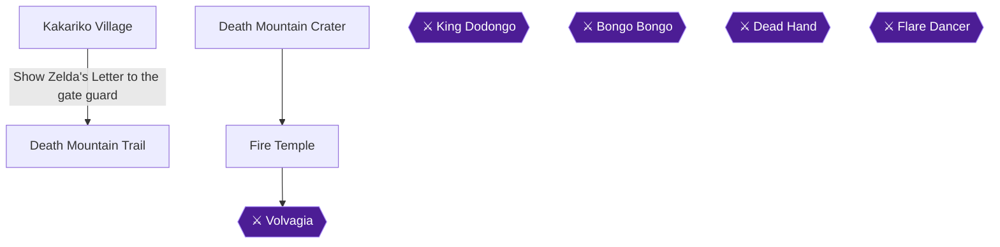

Sniper Elite is available as soon as you have the Fairy Bow and arrive in Kakariko Village as an adult. After that, head up Death Mountain to learn the Bolero of Fire, collect two crater Pieces of Heart, and clear the Fire Temple. Hot Hot Hot is the one achievement here that can be lost: you must beat Volvagia without wearing the Goron Tunic. The Fire Medallion (Eternal Brothers) follows the boss.

### Preparation and Overview

The Fire Temple does not strictly need the Fairy Bow from the Forest Temple, but you have it, and the map chest is easiest with it. 🟡

- **Goron Tunic:** Wear it in the Crater and the Fire Temple, because it removes the heat time limit. Without it, Young Link dies when the heat timer runs out in the Crater, and fairies do not save him. 🟡
- **Tunic caution:** One commenter confirms that if you get the Longshot and beat the Fire Temple before getting the Goron Tunic, the tunic becomes completely unobtainable. Collect it from Link the Goron before finishing the temple. 🟡
- **Magic:** Bring at least one or two Green Potions, since Din's Fire eats a small magic bar quickly. 🟡
- **Fairies:** Bottle some for the boss. Two sit in the containers on the right side of the room before the boss room, and two more are in the pots near the platform by the boss door. 🟡
- **Dungeon structure:** The boss chamber is next door to the entrance. The challenge is reaching the top floor to activate the route to its door. Keys come from rescuing the trapped Gorons, and even the Boss Key is held by one of them. 🟡

### Chapter Items to Collect (Fire Temple dungeon items)

| Item | Where Found | Action / Requirement | Citation |
|---|---|---|---|
| Dungeon Map | Chest in the Lava Curtain Room, reached through the silver-eye door off the Narrow Span Room | **TAKE** | |
| Compass | Chest at the end of the Compass Corridor off the Fire Trap Room | **TAKE** | 🟡 |
| Megaton Hammer | Chest in the Tippy-Top Room (5F) | **TAKE** | 🟡 |
| Boss Key | Ornate chest in the Goron's cell in the Boss Key Prison Room | **TAKE** | 🟡 |

### Kakariko Village

#### Sniper Elite: the adult Shooting Gallery

Head for the building across from the Windmill. It was the unfinished structure in your childhood and is now the Shooting Gallery. Pay 20 Rupees to play with the Fairy Bow. 🟡

> [!WARNING]
> **Achievement Trigger Warning:** Only play for the reward once you hold the Fairy Bow. One commenter reports that winning before getting arrows paid 50 rupees but did not unlock the achievement. Another had the bigger quiver yet no achievement after winning at the wrong stage. 🟡

Your goal is to hit all ten Rupees in a single run. The prize is the Big Quiver, which raises arrow capacity from 30 to 40. 🟡

- Hitting at least eight of ten earns a free replay. 🟡
- The targets follow these patterns: 🟡
  1. In the middle. 🟡
  2. From the left, then from the right. 🟡
  3. Jumps from the middle. 🟡
  4. From the left and right at once. 🟡
  5. Two rupees from the right, going left. 🟡
  6. Two rupees from the left, going right. 🟡
- If a single blue rupee comes from the left, the next one always comes from the right. 🟡
- Memorize the patterns to predict what comes next. You can also tell what the last pattern will be from what has already appeared. 🟡
- On RetroArch, a stick sensitivity of 0.9 or 0.8 is recommended. 🟡
- Arrows are sold at the Kakariko Bazaar: 10 for 20 Rupees, 30 for 60, 50 for 90. 🟡


> [!ACHIEVEMENT]
> **Sniper Elite (5 Points)**
> 
> *Obtain a reward at the Shooting Gallery as Adult Link*


When you are finished, leave by the northern gate to Death Mountain Trail. You already showed Zelda's Letter to the gate guard as a child. 🟡

### Death Mountain Trail

Climb the trail and take the right fork at the large wooden post with the red flag to reach Goron City. 🟡

If you have not yet received the Goron Tunic, bomb the small rolling Goron on the floor beneath Goron City's top level to stop him. Talk to him and ask about both the Dragon and the Gorons. He then gives you the Goron Tunic and opens Darunia's Chamber.

Put the tunic on to remove the time limit in the Crater and the Fire Temple. 🟡

Drop to the bottom floor and enter Darunia's Chamber. Grab the statue at the top of the room and drag it backward to reveal the secret path into the Crater. 🟡

### Death Mountain Crater

#### The Bolero of Fire

Go left as you enter the Crater to find a broken bridge. Stand at the edge and Hookshot the wooden beam hanging above the far side to pull yourself across. 🟡

Walk a short way down the bridge and Sheik appears to teach you the Bolero of Fire, which warps you to the Fire Temple at any time. 🟡

The notes are Down C, A, Down C, A, Right C, Down C, Right C, Down C.

#### Piece of Heart (#24): the cliff-face ledge

If you planted a bean in the soft soil beside the warp-in point as a child, it has grown into a platform. Ride it up until it passes close to the high cliff near the south entrance. At that point, jump out to the rock beside the cliff.

From there, walk slowly off the edge to grab the cliff wall and climb down a short way to an alcove halfway down the cliff face. 🟡

Do not drop into the alcove from above, because you will fall into the lava. Climb below it, then climb up into it. Take the Piece of Heart.

Play the Bolero of Fire to warp back to the pedestal, which is faster than climbing back up. 🟡

#### Piece of Heart (#25): riding the bean plant

Step onto the grown plant and ride it up. Near the start of its path it loops around a tall pile of rubble with a Piece of Heart on top. Jump off onto the rubble to collect it. 🟡

Drop back to the Triforce pedestal afterward. 🟡

> [!TIP]
> Before you leave the Crater, check that you wear the Goron Tunic as you head to the temple, and that you carry fairies and Green Potions. 🟡

From the pedestal, cross the bridge north into the large stone structure. Climb down the ladder into the pit and take the doorway beside it into the Fire Temple. 🟡

### Fire Temple

> [!WARNING]
> **Missable Achievement Warning:** Hot Hot Hot requires defeating Volvagia without the Goron Tunic. Wear the tunic while crossing the temple, but take it off before the boss fight, not after. Fairies are allowed for this challenge.
>
> Timing the swap: take it off in the boss room just before you jump to the arena platform, and equip the green tunic only when you are very close to the platform. 🟡

#### Entrance Hall

Run up the stairs, watching for Fire Keese, and take the door on the left at the top. 🟡

#### Pillar Room (first visit)

Darunia appears here, runs off to fight Volvagia, and begs you to rescue the imprisoned Gorons. 🟡

Look left after the scene. Jump across the lava pillars to the platform in the left corner, then step on the switch to open the cell. Talk to the Goron and open the chest for a **Small Key**.

If you need fairies, two sit on the right side of the room before the boss room. 🟡

Return to the Entrance Hall.

#### Entrance Hall to Lava Cavern

Run straight across the hall and enter the door opposite. 🟡

In the Lava Cavern, work left across the platforms in the middle of the room, along the border, or straight through the lava. 🟡

#### Prison Corridor 1

Run to the end of the hall, step on the switch, talk to the Goron, and open his chest for a **Small Key**. Return to the Lava Cavern. 🟡

#### Block of Time, Killer Tile Room (Skulltula #69)

Play the Song of Time near the Block of Time to move it. Climb onto it and take the door on top of the sandstone platform. 🟡

The room beyond has flying floor tiles. Shield yourself against them (hold R). 🟡

A Like-Like can swallow you and steal your Goron Tunic and Hylian Shield. Kill it from a distance, and if it swallows you, kill it to get both back. 🟡

Kill the Gold Skulltula on the wall (#69) and take the token, then return to the previous room. 🟡

#### Prison Corridor 2

Jump onto the sandstone platform across the cavern and bomb the oddly colored wall to reveal a door. Go through it. 🟡

Step on the switch to open the prison cell directly in front of you, talk to the Goron, and open the chest for a **Small Key**.

Leave by the north door of the cavern, which is the door to your right as you come out of the corridor. 🟡

#### Lava Column Room

Run forward and slide down the steep log bridge into the cage. Grab the cage wall and climb to its top level. 🟡

On the east sandstone pillar, push the massive block off the ledge onto the lava column that periodically bursts in the middle of the room. Jump down, stand on the block, and ride it up as an elevator the next time the column erupts to reach the upper level door. 🟡

#### Three-Tiered Room

Fight the Fire Slug aggressively. Raise your shield if it expands into a column shape, because it is about to attack. 🟡

Now solve the block puzzle:

1. Push the stone block off the ledge so it lands in the stone track below. It can only be pushed one way. 🟡
2. Jump down, get in front of the block, and pull it backward onto the stone face carved into the floor. 🟡
3. Drop a bomb off the cliff so it lands near the Diamond Switch, then quickly climb onto the ledge behind you. 🟡
4. The explosion activates the switch and temporarily removes the pillar of flames around the wire wall. Climb the wire wall to the top level and go through the door at the top. 🟡

#### Boulder Maze (3F, Skulltula #70)

Use a bomb on the left side of the wall in the hollow alcove. It isn't discolored, but it sounds hollow when struck with your sword. 🟡

Kill the Gold Skulltula on the other side (#70) and take the token. 🟡

Keeping your right side to the wall, follow the perimeter of the room to another small alcove with a door inside it. Go through. 🟡

#### Prison Corridor 3

Run down the hall, step on the switch, talk to the Goron, and open his chest for a **Small Key**.

Go around to the far left side of the maze, where a Goron's prison cell sits at a dead end. Step on the switch in front of it, speak to the Goron, and take his **Small Key**.

Return to the locked door you passed earlier and go through it. 🟡

#### Narrow Span Room and the Dungeon Map

Shoot the Silver Eye on the wall with an arrow to unlock the sealed door on the right from where you enter. 🟡

In the Lava Curtain Room beyond it, look right as you enter to find a chest containing the **Dungeon Map**.

If you prefer not to use the bow, you can climb over the side of the cage and drop directly onto the map. 🟡

When you come out of the Lava Curtain Room, enter the locked door on your right. 🟡

#### Lava Curtain Room

Run all the way along the wire platform; the curtain moves slowly and is easy to dodge. Jump across the gap to the next wire platform, keep running, jump onto a third wire platform, and then jump onto the large sandstone steps. Climb to the top of the stairs and go through the door on the left. 🟡

#### Top of the Boulder Maze

1. Look left to a small platform with a switch. Jump out and step on it. A cell door on the far side of the room opens, revealing another Goron. 🟡
2. Speak with that Goron and open his chest for a **Small Key**.
3. Drop a bomb onto the huge gash in the floor to reveal a massive pit, then drop to the bottom. 🟡

At the bottom, step on the switch in the hall and the Goron's double-sided cell doors open. Speak with him and open his chest for a **Small Key**. 🟡

Turn around, go back down the hall, and climb the wire wall back up to the Boulder Maze. 🟡

> [!TIP]
> The Scarecrow's Song route here (play it to summon Pierre on the wall platform, then Hookshot to the circular target and ride the rising platform) leads to extra Skulltulas. Per the planned route, Skulltula #73 in this area is saved for chapter 21, when you have the Longshot. 🟡

#### Two-Tiered Room and Time Trial Room

The room reached by the rising platform has a Gold Skulltula in the corner wire mesh of its upper level. Beyond it, the Time Trial Room holds another on the cliff wall above the pit, plus a chest with 200 rupees behind a flame pillar that a switch removes only temporarily. These are optional extras. 🟡

Dropping through the pit in the center of the Time Trial Room returns you to the Narrow Span room. 🟡

#### Back to the Lava Curtain Room, West Corridor

From the Narrow Span Room, take the south door, which is to the right of the sealed door and closest to the silver eye target, to return to the Lava Curtain Room. 🟡

Jump from the jutting platform up to the west-center sandstone ledge. It looks like a jump you can't make, but you can. Go through the locked door. 🟡

#### Fire Trap Room and the Compass

Keeping the wall on your right, move slowly forward until a wall of flames appears in your path. 🟡

1. Go to the left, watching out for a roving boulder. 🟡
2. Take a right immediately after passing the first post on your right. 🟡
3. Go right again and head back toward the wall to find a door. 🟡

Run to the end of the hall and open the chest for the **Compass**. 🟡

Back in the Fire Trap Room, watch out for the giant totem pole whose faces spit fire. Hug the wall and go around, keeping your left side facing the wall. When another wall of flames appears, go right and pass between the pair of poles directly in front of you. Take a left immediately on the other side to reach the door. 🟡

#### Fire maze and the dummy door

Go left and pass between the pair of posts just to the left of the fire wall to reach the switch. The giant curtain of flames on the north side of the room disappears. 🟡

> [!TIP]
> The door here is a dummy that smashes down on you if you try to open it. Blow it up with a bomb, which reveals the real door behind it. 🟡

Unable to verify from collected sources: the exact route between the Compass Corridor and this fire maze beyond what is described above.

#### Upper Flare Dancer Room (mini-boss)

To damage the Flare Dancer, first use the Hookshot to separate its heart from its flaming body. The heart then runs around the room very quickly.

Circle the room in the opposite direction so you intercept the heart halfway around, and hit it with a jump attack. Use a regular strike if you have difficulty timing the jump.

The Biggoron Sword gives a faster victory. 🟡

Alternatively, charge an Advanced Spin Slash and release it as the exposed heart gets near you. Three or four hits are enough to defeat it.

Once it dies, the pillar of flames in the middle of the room disappears. Climb onto the middle platform, which begins to rise, and take the door at the top of the shaft. 🟡

#### Diamond Switch Room and Tippy-Top Room (5F, Megaton Hammer, Skulltula #71)

Once up on the second floor, drop a bomb down to the bottom floor, right next to the diamond switch. The explosion removes the pillar of flames surrounding the mesh ladder leading to the next level. 🟡

In the Tippy-Top Room, a Gold Skulltula (#71) sits near the entrance. 🟡

Step on the switch to make the pillar of flames around a chest near the top of the room disappear. Run up the narrow staircase on the inside of the giant ring to reach the chest before time runs out. 🟡

Open the large chest for the **Megaton Hammer**. 🟡

Stand on the large stone face coming out of the floor and smash it with the Hammer. The block falls to the room below. 🟡

Smash both pieces of the corner totem pole from the left or right until they are gone to reveal a door. 🟡

#### Hidden Staircase Room, Fire Trap Room (revisit)

Smash the stone block that rises out of the pit with the Hammer, and a stairwell appears inside the pit. 🟡

Drop the wooden box onto the blue switch at the bottom of the stairs to unseal the door. Go through it. 🟡

Stand on the stone block in the corner of the chamber above the Fire Trap Room and smash it with the Hammer to fall to the floor below. The block creates a booster that lets you reach doors in this room that were previously out of reach. 🟡

Smash the rusted switch beside the sealed door on the higher ledge to unseal the door, then go through it. 🟡

#### Two-Floored Prison (revisit)

Play the Song of Time to transport the Block of Time down to the floor. 🟡

Jump across to the opposite ledge and smash the rusty switch with the Hammer to open the cell below. Drop down, speak with the Goron, and take the **Small Key** from the chest in his cell. 🟡

Jump out to the large stone block held by scaffolding, stand on top of it, and smash it with the Hammer. Ride the block all the way down. 🟡

#### Pillar Room, Entrance Hall, Room of Fiery Enemies

On the east side of the Entrance Hall, smash the totem pole pieces with the Hammer, standing on the left or right side of the totem, to reveal a door. Go through it. 🟡

The next room is full of Fire Keese and Fire Slugs. Kill every enemy and the sealed door on the other end opens. 🟡

#### Deja Vu Room (Skulltula #72)

Flying floor tiles, a Like-Like and a Gold Skulltula are here. Kill the Like-Like, then kill the Gold Skulltula on the rear wall (#72) and take its token. 🟡

#### Lower Flare Dancer Room

Fight another Flare Dancer the same way. Use the Biggoron Sword if you have it, and don't bother with the Megaton Hammer, which attacks too slowly. 🟡

When it dies, its pillar of flames disappears and reveals a chest with **Bombs**. 🟡

#### Boss Key Prison Room

Smash the rusted switch with the Hammer to open the double-sided cell. Talk to the Goron and open the ornate chest for the **Boss Key**. 🟡

Back in the Pillar Room, the knocked-down pillar now lets you jump across to the Boss Key door that you couldn't reach before. Jump across and go through it. 🟡

### Boss: Volvagia

Before you jump onto the slab, double-check your tunic: you must not be wearing the Goron Tunic. Jump to the large slab in the middle of the cavern and run to the middle of the platform to begin. 🟡

> [!WARNING]
> **Missable Achievement Warning:** If you are wearing the Goron Tunic during the Volvagia fight, Hot Hot Hot is lost. Remember to put the Goron Tunic back on afterward.

**Heat timer and preparation**

- Without the tunic, a countdown applies. One player saw 24 seconds after changing armor. Each fairy revival adds roughly 24 seconds. 🟡
- The timer is tied to your current heart count, so more hearts means more time. 12 hearts gave 1:44, and 18 hearts gave 2:14. 🟡
- Bring fairies. Players report that having three bottles with fairies is enough regardless of heart count. 🟡
- Din's Fire stalls the clock while Volvagia is airborne. Magic Potions refill the bar. 🟡
- The emulator's Full speed setting makes the timer run faster. 🟡

**Phase 1: pits and Hammer**

Volvagia emerges at random from one of nine pits, which you can identify by smoke and cinders around them. Run toward that pit and keep clear of her fiery hair sweep.

Smash her head with a Megaton Hammer jump attack to stun her. Then land one more hit with a jump attack from the Hammer, or from the Biggoron Sword.

With the Hammer drawn, press A while Z-targeting her to jump attack. Landing all of these jump attacks kills her in four hits. 🟡

As she takes damage, she may fake a pit with fire and surface in another. 🟡

**Phase 2: flying**

When she flies and breathes fire, run continuously in a small circle near the center.

The speedy alternative is to drop off the arena edge and hang from it. This makes her lose interest and go back underground immediately.

**Phase 3: falling boulders**

When she flies to the ceiling and the roof starts raining boulders, run to the edge and hang off. Some rocks can still go over the edge, so there is a little randomness.

Reported runs used about four to eight Hammer jump attacks in total. 🟡

Commenters also hang from the edge while she flies, then Hammer her when she surfaces and follow up with a two-handed jump slash for double damage 🟡. Use the Biggoron's Sword you got in Chapter 13 for that follow-up. Do not buy the Giant's Knife: it breaks easily 🟡, and one player's Biggoron's Sword achievement failed after buying it 🟡.


> [!ACHIEVEMENT]
> **Hot Hot Hot (10 Points)**
> 
> *Defeat Volvagia without wearing the Goron Tunic*


When Volvagia dies, take the **Heart Container** that appears.

Walk into the ring of light to meet Darunia, the Sage of Fire. In the Chamber of Sages he awakens and gives you the **Fire Medallion**. 🟡


> [!ACHIEVEMENT]
> **Eternal Brothers (5 Points)**
> 
> *Awake Darunia and obtain the Fire Medallion*


### Death Mountain Crater (after the temple)

Use the Hookshot on the planks hanging off the cliff to cross the shattered bridge again. 🟡

Two rocks cover a partially visible doorway on the other side of the drawbridge. Smash them with the Hammer, possibly more than once, to open a Great Fairy Fountain. 🟡

Stand on the Triforce emblem and play Zelda's Lullaby. The Great Fairy doubles your magic meter. 🟡

Outside, smash the gray rock you are thrown into to open a path to upper Crater. Jump to the ladder and climb to its top. 🟡

### Death Mountain Trail (night Skulltulas #32 and #33)

Make it night with the Sun's Song if needed. These Skulltulas only appear at night.

- **#33:** On the long path up to the cliff face, where rocks used to rain on you, smash the red rock that sits flush against the wall with the Hammer.
- **#32:** At the cliff above Dodongo's Cavern, where the Bomb Flower used to be, smash the red rock to reveal a Gold Skulltula.

> [!TIP]
> Before you leave Death Mountain, confirm that you have the Fire Medallion, the Megaton Hammer, the Map, Compass, and Boss Key, and that you swapped the Goron Tunic back on. Then play the Prelude of Light to return to the Temple of Time. 🟡

> [!IMPORTANT]
> ### Chapter 15 Cumulative 100% Checkpoint
> - **Gold Skulltulas:** 68 / 100 (Fire Temple #69, #70, #71, #72 collected; #32 and #33 at night; #73 deferred to chapter 21) 🟡
> - **Pieces of Heart:** 26 / 36 (Crater ledge #24 and bean-plant #25) 🟡
> - **Heart Containers:** 5 / 8 (Volvagia)
> - **Maps, Compasses & Boss Keys:** 14 / 26 (Fire Temple Map, Compass, Boss Key)
> - **RetroAchievements Unlocked:** 55 / 97 (310 / 690 points)

### Chapter Checklist

- [ ] Won the adult Kakariko Shooting Gallery with the Fairy Bow (Big Quiver) — Sniper Elite
- [ ] Learned the Bolero of Fire from Sheik across the broken bridge
- [ ] Crater ledge Piece of Heart (#24)
- [ ] Crater bean-plant Piece of Heart (#25)
- [ ] Fire Temple Skulltulas #69, #70, #71, #72
- [ ] Megaton Hammer, Dungeon Map, Compass, Boss Key
- [ ] Defeated Volvagia without the Goron Tunic — Hot Hot Hot
- [ ] Fire Medallion from Darunia — Eternal Brothers
- [ ] Great Fairy magic upgrade in the Crater
- [ ] Death Mountain Trail Skulltulas #32 and #33 (night, Hammer)
- [ ] Goron Tunic back on after the boss

---

## Chapter 16: Water Temple

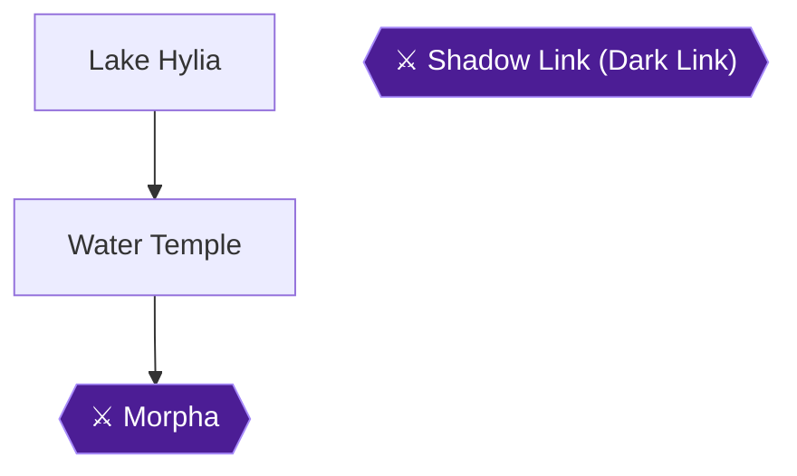

### Chapter overview

This chapter covers two linked stops: Lake Hylia as an adult, where you unlock the Scarecrow's Song, and the Water Temple beneath the lake 🟡. The temple is built around raising and lowering the water so you can reach doors on the different levels of a central tall room, the "Vertical Hallway". You will earn the Longshot, the Map, the Compass and the Boss Key here, and you will finish by defeating Morpha and receiving the Water Medallion from Ruto.

After the temple you return to Lake Hylia to shoot the rising sun for the Fire Arrows. You also collect the Longshot-only Skulltula in the lake's tree and the underwater crate Skulltula in the laboratory.

Four achievements are in this chapter:
- **Pierre the Wanderer**
- **Day of the Tentacles** (missable)
- **Bride to Be**
- **The Flaming Arrow**

**What you need before you start:**
- **Iron Boots** from the Ice Cavern. Sheik also teaches the Serenade of Water there, which warps you to the Water Temple in Lake Hylia.
- **Zora Tunic** from King Zora. It cancels the underwater time limit while you wear the Iron Boots.
- **Hookshot, Fairy Bow, Bombs, Ocarina, Zelda's Lullaby and the Song of Time.** The route below uses them all.
- **The eight-note melody you taught the scarecrow as a child.** If you forgot it or never taught one, Sheik at the Temple of Time explains how to return to childhood and teach Pierre a new song 🟡.

The Water Temple only needs the Ice Cavern and Forest Temple finished first, so it can be done before the Fire Temple.

> [!WARNING]
> **Missable Achievement Warning:** **Day of the Tentacles** (Defeat Morpha without falling into the water or getting captured by its tentacle) can be missed during the Morpha fight. Do not enter the water, and do not stand on the four inner platforms. The full plan is in the Morpha section below.

### Chapter Items to Collect

| Item | Where Found | Action / Requirement | Citation |
|---|---|---|---|
| Scarecrow's Song | Lake Hylia shore scarecrow | **PLAY** your childhood eight-note song as Adult Link | |
| Compass | Chest in the water-pillar room off the Stinger tunnel | **OPEN** (bomb the diamond switch, or arrow the crystal) | |
| Dungeon Map | Chest in the Spike Room beside Water Switch One | **OPEN** after defeating all Spikes | |
| Small Keys | Chests across the temple (see route) | **OPEN** each | |
| Longshot | Chest after Shadow Link | **OPEN** | |
| Boss Key | Ornate chest in the Boss Key Room | **OPEN** | |
| Heart Container | Dried-up pool after Morpha | **TAKE** | 🟡 |
| Water Medallion | From Ruto in the Chamber of the Sages | **RECEIVE** | 🟡 |
| Fire Arrows | Smaller island east of Lake Hylia's main island | **SHOOT** the rising sun, then swim over | |
| Skulltulas #77-#81 | Water Temple | **KILL** and collect each token | 🟡 |
| Skulltula #54 | Dead tree, Lake Hylia (night) | **LONGSHOT** up the tree | 🟡 |
| Skulltula #55 | Laboratory crate | **ROLL** into it with the Iron Boots | 🟡 |
| Piece of Heart | Laboratory roof tower | **CLIMB** via bean plant or Pierre | |

### Lake Hylia

#### The shore scarecrow: Pierre the Wanderer

Go to the scarecrows on the northeastern shore of Lake Hylia. This is where you taught your song as a child 🟡. As Adult Link, play the same eight-note song you taught as Young Link. The scarecrow remembers it and it becomes the Scarecrow's Song.

Sources disagree about which of the two scarecrows asks for the song. One says the one closest to the shore, another the one farthest from the water 🟡. Another source names the scarecrow Bonooru 🟡. Play it to the same scarecrow you taught as a child.

The song must be exactly 8 notes 🟡. It must also have at least two different notes and cannot be any other song in the game 🟡.

Once learned, playing the song at certain spots makes Pierre appear as a makeshift Hookshot target. Navi flutters at those spots 🟡.


> [!ACHIEVEMENT]
> **Pierre the Wanderer (5 Points)**
> 
> *Obtain the services of Pierre the Scarecrow*


#### Entering the Water Temple

Equip the Iron Boots and the Hookshot and jump down to the gate underwater on the north side of the central island 🟡. You will find a door sealed by an iron grating 🟡. Shoot the diamond switch above the door with the Hookshot and the gate unseals 🟡. Enter to begin the dungeon.

> [!TIP]
> Wear the Zora Tunic before you step into the water, since it cancels the Iron Boots' underwater time limit 🟡. Expect to swap between the Kokiri Boots and the Iron Boots many times in this dungeon 🟡.

### Water Temple

Orientation: the temple has a central tall room with doors on three levels. Three Triforce plaques ("Water Switches") change the water level when you play Zelda's Lullaby in front of them:
- **Switch One** lowers the water to the lowest level.
- **Switch Two** sets it to the second-highest level.
- **Switch Three** sets it to the maximum.

The Hookshot is the only weapon usable underwater 🟡.

#### The first hallway

Equip the Iron Boots and sink to the bottom of the right-hand hallway pool. Run down the hallway and grab the stone block set in the wall directly in front of you. Pull it back as far as it will go 🟡.

#### The Stinger tunnel and the Compass

Follow the underwater passage onward. Stingers appear here, and one Hookshot shot kills each 🟡.

At the end of the hall, look up above the spikes to the ledge and Hookshot to the target there. Turn around, look at the ceiling, and Hookshot to the furthest of the three ceiling targets. That pulls you out of the water 🟡.

This room holds a pillar of water and a diamond switch in the corner. Drop a bomb near the switch, then run to the pillar. When the bomb explodes the switch fires and the pillar lowers temporarily. Open the chest for the **[Compass]**. An alternative is to stand beside the water spray and chest and shoot the crystal with an arrow, then open the large chest while it is available 🟡.

Unable to verify from collected sources how the route returns from the Compass room to the main chamber.

#### Ruto, Water Switch One and the Map

In the main room, use the Iron Boots to sink to the bottom floor. Spike enemies are here, and you kill each with two Hookshot shots, one to stun and one to kill 🟡. On the east side of the room, marked by two torches, is a tunnel. Run down it and you meet Ruto again 🟡.

Rise to the air pocket. On the wall is a Triforce plaque. Play Zelda's Lullaby in front of it and the water drops to its lowest level. This is Water Switch One. Go through the door to the left of the plaque into the Spike Room 🟡.

The room is full of Spikes. Hit each twice with the Hookshot and a chest appears with the **[Dungeon Map]**. Another method is to run away until they turn into small rocks, then use a spin attack 🟡.

#### Ruto's room: torches and the first Small Key

Go to the room where you met Ruto. Stand at the entrance so the middle flame lines up with a corner torch. Shoot arrows through the flame so the arrowheads catch fire, and light the corner lanterns to unseal the door. Go through the door.

In the Shell Blade room, the Shell Blades are invulnerable until they briefly open their mouths just before attacking. Fire the Hookshot into the open mouth to kill them 🟡. Kill them all and a chest appears with a **[Small Key]**. Return through the only door to the previous room.

#### South hallway: Skulltula #77

Go down the south hallway and use a Bomb on the oddly colored floor tile at its end to reveal a water-filled pit. Equip the Iron Boots and sink 🟡. When you land, head west and defeat a Shell Blade with the Hookshot 🟡.

On the next floor, climb onto the ledge and step on the switch. The water in this room rises slightly and a Hookshot target appears on the ledge above 🟡. The switch to open the grating is on the other side of it, so use a Super Spin Attack to reach it 🟡. Kill the Gold Skulltula on the other side and take its token. This is **Skulltula #77** 🟡. It requires the Iron Boots 🟡.

#### The west block, the pillar and the Whirlpool Room

On the west side of the chamber, jump onto the wooden platform, grab the stone block and push it forward until it falls into a water-filled pit 🟡. Climb out of the water at the top of the passage and strike the diamond switch on the right. A pillar of water rises from the pit in the middle of the room. Jump onto the pillar and then across to the other side before the time limit runs out 🟡.

In the Whirlpool Room, look in the mouth of the dragon statue on the way down for a diamond switch. To the right of the statue is a small alcove with a Hookshot target 🟡. Pull yourself to the alcove and stand on its edge as far from the statue as possible. From there you can just barely hit the corner of the switch with the Hookshot 🟡.

Climb out of the pool behind the grating and open the chest for another **[Small Key]**. A diamond switch in this small room reopens the grating below. Strike it, then sink back down before time runs out 🟡. Exit through the door in the alcove back to the Vertical Hallway 🟡.

#### Central Tower: Water Switch Two and another Small Key

On the south side of the tower in the middle of the Vertical Hallway is a locked door. Go through it 🟡.

You find Water Switch Two here. Play Zelda's Lullaby to raise the water to the second-highest level 🟡. A passage appears below, so equip the Iron Boots, sink to the bottom level and go down it 🟡.

Hit the corner switch with the Hookshot. A grating opens in the ceiling, releasing six Spikes and three Shell Blades. Defeat them all and a grating opens across from the switch 🟡. Switch to the Kokiri Boots and float up the new passage. At the top, climb out and open the chest for a **[Small Key]**.

#### The gash in the wall

Use Bombs to blow open the huge gash in the wall. Enter the opening and open the chest on the other side for another **[Small Key]**.

#### Water Pillar Room and Water Switch Three

Stand on the low water pillar and activate the diamond switch with the Hookshot or an arrow. The pillar lifts you through the shaft in the ceiling 🟡. A Tektite waits at the top. Charge a Super Spin Attack as you ride up and unleash it when you see the Tektite 🟡.

You reach Water Switch Three, the final plaque. Play Zelda's Lullaby in front of it to raise the water to the maximum height 🟡.

#### Waterfall-Elevator Room

At the edge of the cliff, look to your right to see a Gold Skulltula very high on the wall. You cannot reach it yet.

The elevators that steadily descend in the waterfall all have Hookshot targets on their fronts. Latch onto one and pull yourself progressively higher until you reach the top of the waterfall 🟡. Platforms in this room move down with the waterfall and the water knocks you off once they pass behind it, so hook one while it is moving down, then quickly hook the one above 🟡.

#### Dragon's Head Room

Shoot the diamond switch in the middle of the room to raise and lower the dragon heads, which reveals Hookshot targets. Climb onto a lowered head, then shoot the switch while standing on it. The head rises and lets you reach the alcove on top of the room 🟡.

Defeat the Like Like behind the large spikes by throwing bombs at it 🟡. Use the Hookshot target on the ceiling near the door to pull yourself over the spikes blocking the path 🟡.

#### The Serene Pool: Shadow Link

Run to the island in the middle and keep running around it until Dark Link appears near the tree 🟡.

**Shadow Link (Dark Link) strategy:**
- **Do not Z-target him** with regular sword attacks. Targeting makes you clash swords endlessly, and without it he lines up his deflections less easily.
- **Do not use the stab attack** (forward plus attack while Z-targeted). He jumps on your sword and hits you every time.
- **The Megaton Hammer is the easy option.** He cannot deflect it and will not try 🟡.
- **Other options from the sources:** the Iron Boots slow his movements, Din's Fire is effective, and a Z-targeted thrust with the Biggoron's Sword hits him consistently. A Deku Nut stuns him only once.
- His health equals yours, and each Master Sword hit takes one heart 🟡.

When he falls, the pool disappears and the north door unlocks 🟡.

#### Longshot Room and the river

Open the chest in front of you to get the **[Longshot]**, which has double the Hookshot's range. Go around behind the chest to a Block of Time in the floor. Play the Song of Time to move it and drop down the pit beyond 🟡.

As you pass the second corner in the river you will see a Gold Skulltula hanging on the ceiling directly above the third whirlpool. Use the Iron Boots to come to a stop and grab the Gold Skulltula and its token from the bottom of the river. This is **Skulltula #78** 🟡.

Near the fifth whirlpool, at the final corner of the river, climb onto the small platform and shoot the golden eye switch with an arrow. The grating across from the platform opens. Use the Longshot on the chest inside to pull yourself over before the time limit runs out and the grating closes, then open it for a **[Small Key]**.

#### Skulltula #80 and the water reset

Float to the top floor of the main chamber and go through the west door to the Waterfall-Elevator Room 🟡. Look on the wall to the right and use the Longshot to kill the Gold Skulltula and take its token. This is **Skulltula #80** 🟡. Return to the Vertical Hallway 🟡.

Equip the Iron Boots, drop to the bottom level and go through the east hall back to the room where you met Ruto. Switch to the Kokiri Boots, float all the way up and play Zelda's Lullaby in front of the plaque to lower the water to its bottom level 🟡.

#### Central Tower again: Skulltula #79

Pull yourself up to the second level of the tower with the Longshot and play Zelda's Lullaby in front of the plaque to set the water to its middle height 🟡. Climb onto the floating platform and look high on the wall near the ceiling. Longshot the Gold Skulltula and take its token. This is **Skulltula #79** 🟡. Then go out the door to the second level of the Vertical Hallway 🟡.

One source says the tower door is sealed by an unlit torch. Light it with a Fire Arrow, or by shooting an arrow through the nearby lit torch into the unlit one, and the door unseals 🟡. It also says that after going through you spot the Skulltula on the ceiling above and take it with the Longshot 🟡.

#### South side of the tower: another Small Key

Work around to the south side of the tower's exterior, where a doorway is covered by a grating. Shoot the eye in the water with an arrow to make the grating open 🟡. Push the stone block forward until it stops, then take the passage that opens to the right and open the chest for a **[Small Key]**.

Ride the water pillar to the third floor and go through the door at the top 🟡. Play Zelda's Lullaby at the plaque to raise the water back to its maximum height 🟡.

#### Toward the Boss Key

Equip the Iron Boots, sink all the way to the bottom level and head for the north end of the room to find a doorway with a deep pit. Sink down it, go down a short hallway, then change back to the Kokiri Boots to float to the surface 🟡.

In the next pond, equip the Iron Boots and walk along the bottom, watching for boulders. Run to the northeast corner, switch back to the Kokiri Boots, and as you float up grab the ledge on the north corner of the room and pull yourself up 🟡.

In the Stone Block Room, bomb the walls in the northwest and northeast corners to reveal a hidden tunnel with a stone block. Push it forward until it falls into the pool of water, pressing down on the switch and permanently activating it. The water level rises.

In the Water Pillar Triplets Room, step on the switch in the corner and three water pillars rise and the door across the room unlocks 🟡. To cross fastest, jump only to the second pillar and then straight for the door 🟡.

#### Skulltula #81 and the Boss Key

Run forward into the passage of water, watching for rolling boulders. Look to the right and kill the Gold Skulltula on the wall above the water pit, then take its token 🟡. Another source places it behind the waterfall in the tunnel right before the Boss Key and says to use the Longshot for both kill and token. This is **Skulltula #81** 🟡.

Use the Iron Boots to drop down the water pit beneath the Skulltula 🟡. Kill the Shell Blade, then float to the top and open the ornate chest for the **[Boss Key]**.

#### Blade Trap Room and the boss door

Head to the top level of the Vertical Hallway and go to the north side of the tower. Use the Longshot on the dragon's head to pull yourself up and go through the door behind the statue 🟡.

In the Blade Trap Room, climb the steep hill past three slow Blade Traps using the Kokiri Boots, and keep pressing forward. Once at the top of the ramp, enter the Boss Door 🟡.

### Boss: Morpha

> [!WARNING]
> **Missable Achievement Warning:** Day of the Tentacles requires beating Morpha without falling into the water or being grabbed. Follow the corner plan below.

**What it does:**
- Morpha spins in the water to generate tentacle arms, which grab you and hurl you into the wall.
- Damage figures differ by source: four to six hearts, about one heart for a hit and up to three for a grab, or three hearts for a grab.
- Its nucleus (the large white brain/eye) usually enters one of the arms.
- It spins rapidly in the water when it is preparing a new arm.

**The plan:**
1. **Stay out of the water and off the four inner platforms.** The water gives Morpha an easy shot at you, and standing on the platforms lets it attack from several sides. A commenter notes that jumping in the water and swimming to a platform before Morpha spawns did not disqualify them, as long as they got back to a corner without falling in 🟡. Do not rely on that, and stay on the perimeter.
2. **Go to a corner as soon as the fight starts.** The guide says Morpha cannot reach you in a corner, and a commenter had the same result.
3. **Camp with the Longshot.** The Longshot outranges Morpha's arms by a considerable distance.
4. **When the nucleus enters an arm, Longshot it.** This stuns it long enough for one or two hits. Aim near the end of the tentacle.
5. **Hit it hard.** Use a Jump Attack with the Biggoron's Sword, or the Megaton Hammer if you lack it. A spin attack is another option. One commenter pulled with the Longshot and finished with the Megaton Hammer, repeating until it died 🟡.
6. **Longshot between slashes** so the brain does not escape 🟡.
7. **Repeat.** After a hit, Morpha bounces around the room, then returns to the water and spawns more arms.

**Extra tips from commenters:**
- A faster but less safe method is to Longshot Morpha, go around it, and trap it against a wall. A second tentacle may spawn and put you in grab range 🟡.
- Another commenter pulled Morpha into a wall corner and trapped it there 🟡.
- When fighting normally, keep your distance and watch for two tentacles spawning close together, which is the one dangerous moment 🟡.
- Only two tentacles exist, so circle the edges and do not jump onto the platforms 🟡.


> [!ACHIEVEMENT]
> **Day of the Tentacles (10 Points)**
> 
> *Defeat Morpha without falling into the water or getting captured by its tentacle*


After the fight, take the Heart Container left in the dried-up pool 🟡.

Enter the beam of light to reach the Chamber of the Sages. Ruto reveals she is the Sage of Water and gives you the Water Medallion 🟡. Lake Hylia fills back up with water 🟡.


> [!ACHIEVEMENT]
> **Bride to Be (5 Points)**
> 
> *Obtain the Water Medallion from Princess Ruto*


### Lake Hylia after the Water Temple

#### The Fire Arrows

After the cutscene you are in Lake Hylia. Stand on the stone at the plaque set into the ground on the east side of the island. Aim at the sun and fire an arrow into it as it rises. The Fire Arrows fall onto the smaller island east of the larger one. Swim over and take them.


> [!ACHIEVEMENT]
> **The Flaming Arrow (5 Points)**
> 
> *Obtain the Fire Arrow*


If you miss, play the Sun's Song twice to retry. Another source says the Sun's Song will not work and you must wait for time to pass normally. These sources conflict, so start with the first and wait for sunrise if it fails. Playing the Sun's Song on the Fire Arrow platform spawns a fairy that restores health and magic, but it cannot be bottled 🟡.

#### Skulltula #54: the dead tree (night)

Return to the larger island and Longshot to the top of the dead tree. Aim for the bit of the trunk that sticks up over the large branch. Make it night and a Gold Skulltula appears on top of the trunk. Do not jump up to kill it. Stand on the branch and use the Longshot. This is **Skulltula #54** 🟡.

#### Skulltula #55: the laboratory crate

Enter the laboratory and equip the Iron Boots. Sink to the bottom of the pool and roll into the crate. This reveals the game's only underwater Gold Skulltula. You cannot use a sword underwater, so kill it with the Hookshot and collect the token. This is **Skulltula #55** 🟡.

#### Laboratory roof Piece of Heart

Ride the grown Magic Bean plant beside the laboratory to its roof. This works only if you planted a bean in the soft soil as a child. Jump onto the roof, then climb the ladder to the high tower. The Guays can harass you on the way up. The Piece of Heart is on top.

Alternatively, reach the roof using the Scarecrow's Song and Hookshot. Unable to verify from collected sources exactly where on the shore to play the song for this.

> [!TIP]
> Before you leave Lake Hylia, check that you have the Fire Arrows, Skulltulas #54 and #55, and the roof Piece of Heart. The sources show a Prelude of Light warp to the Temple of Time as the next step after the tree Skulltula 🟡.

> [!IMPORTANT]
> ### Chapter 16 Cumulative 100% Checkpoint
> - **Gold Skulltulas:** 75 / 100 (Water Temple #77-#81, Lake Hylia #54 and #55) 🟡
> - **Pieces of Heart:** 27 / 36 (laboratory roof)
> - **Heart Containers:** 6 / 8 (Morpha) 🟡
> - **Maps, Compasses & Boss Keys:** 17 / 26 (Water Temple Map, Compass, Boss Key) 🟡
> - **RetroAchievements Unlocked:** 59 / 97 (335 / 690 points)

### Chapter checklist

- [ ] Played the childhood eight-note song to the scarecrow as Adult Link
- [ ] Entered the Water Temple with Iron Boots, Zora Tunic and Hookshot
- [ ] Opened the Compass chest
- [ ] Opened the Dungeon Map chest
- [ ] Collected every Small Key chest on the route
- [ ] Beat Shadow Link without Z-targeting him and got the Longshot
- [ ] Skulltulas #77-#81 collected
- [ ] Opened the Boss Key chest
- [ ] Beat Morpha without falling in or being grabbed
- [ ] Took the Heart Container and received the Water Medallion from Ruto
- [ ] Shot the rising sun for the Fire Arrows
- [ ] Skulltula #54 (dead tree, night) and #55 (laboratory crate) collected
- [ ] Laboratory roof Piece of Heart collected

---

## Chapter 17: Song of Storms, the Frogs and the Bottom of the Well

```mermaid
flowchart TD
  Hyrule_Market["Hyrule Market"]
  Hyrule_Castle["Hyrule Castle"]
  Kakariko_Village["Kakariko Village"]
  Death_Mountain_Crater["Death Mountain Crater"]
  Zoras_River["Zora's River"]
  Temple_of_Time["Temple of Time"]
  Bottom_of_the_Well["Bottom of the Well"]
  King_Dodongo{{"⚔ King Dodongo"}}
  Barinade{{"⚔ Barinade"}}
  Volvagia{{"⚔ Volvagia"}}
  Morpha{{"⚔ Morpha"}}
  Bongo_Bongo{{"⚔ Bongo Bongo"}}
  Dark_Link{{"⚔ Shadow Link (Dark Link)"}}
  Dead_Hand{{"⚔ Dead Hand"}}
  Flare_Dancer{{"⚔ Flare Dancer"}}
  Dying_Guard_Lockout>"⛔ Dying guard disappears after the Temple of Time"]
  Hyrule_Market -->|"Castle path"| Hyrule_Castle
  Kakariko_Village -->|"Drain the well (child)"| Bottom_of_the_Well
  classDef ponr fill:#7f1d1d,stroke:#f87171,color:#fff;
  classDef boss fill:#4c1d95,stroke:#a78bfa,color:#fff;
  class Dying_Guard_Lockout ponr;
  class King_Dodongo,Barinade,Volvagia,Morpha,Bongo_Bongo,Dark_Link,Dead_Hand,Flare_Dancer boss;
```

### Chapter Overview

This chapter covers the stretch between the Water Temple and the Shadow Temple. Walking into Kakariko Village after the Water Temple starts a cutscene, and Sheik then teaches you the Nocturne of Shadow. You then learn the Song of Storms from the windmill as an adult 🟡. Next you return to childhood and play that song in the windmill to drain the well, which opens the Bottom of the Well 🟡. The Lens of Truth is waiting there.

The main targets are:

- **Seeing Is Believing** (the Lens of Truth, in the Bottom of the Well).
- **The Fabulous Froggish Tenors** (the Zora's River frog minigame).
- Three Gold Skulltulas in the Well.
- Gold Skulltula #20, from the tree by the castle moat.
- Gold Skulltula #37, in Death Mountain Crater.
- Three Pieces of Heart: #23 and #18 from the frogs, and #33 from the Market Treasure Chest Game.

Once you have done the Forest Temple you can return to childhood at any time, and that is what makes the Well available 🟡. The Well can only be entered as Young Link, and it needs both the Ocarina of Time and the Song of Storms 🟡.

### Chapter Items to Collect

| Item | Where Found | Action / Requirement | Citation |
|---|---|---|---|
| Song of Storms | Kakariko windmill (as Adult Link) | Stand in front of the Organ Grinder and take out the Ocarina | 🟡 |
| Lens of Truth | Bottom of the Well, chest after Dead Hand | **TAKE** | 🟡 |
| Compass | Bottom of the Well, Big Chest in the room off the trench | **TAKE** | 🟡 |
| Dungeon Map | Bottom of the Well, chest beyond the rocks in the Cess Pool | **TAKE** | 🟡 |
| Gold Skulltulas (3) | Bottom of the Well | Like Like room plus the two locked rooms of the center area | 🟡 |
| Piece of Heart #23 | Zora's River frog log | Play the Song of Storms | |
| Piece of Heart #18 | Zora's River frog log | Win the frog minigame | |
| Piece of Heart #33 | Hyrule Market Treasure Chest Game | Night, Lens of Truth | |
| Gold Skulltula #20 | Hyrule Castle grounds, tree by the moat | Song of Storms, Bombs, Boomerang | 🟡 |
| Gold Skulltula #37 | Death Mountain Crater, soft soil by the warp | Bolero of Fire, Bottle of Bugs | 🟡 |

### Kakariko Village (Adult Link)

#### Nocturne of Shadow

When you enter Kakariko Village after clearing the Water Temple, a cutscene plays and the village is on fire. Watch it, and Sheik will teach you the Nocturne of Shadow 🟡. This song is the only way to reach the Shadow Temple 🟡.

The notes are C-Left, C-Right, C-Right, A, C-Left, C-Right, C-Down.

#### The windmill: Song of Storms

1. From Kakariko Graveyard, take a right up the long staircase.
2. Enter the door on the right at the top of the stairs, behind the crate 🟡.
3. If you skipped the Piece of Heart in the windmill as Young Link, you can still take it now from the top of the staircase 🟡.
4. Drop down to the main floor and stand in front of the Organ Grinder.
5. Take out the Ocarina of Time, and he teaches you the Song of Storms 🟡.

The song is A, C-Down, C-Up, A, C-Down, C-Up. Besides opening the Well later, it is used for the frog heart piece and the castle Skulltula in this chapter.

> [!TIP]
> **Before you leave Kakariko as an adult:** Impa's roof Skulltula (#27) should already be yours from Chapter 11. If you skipped it, Hookshot from the House of Skulltula roof onto Impa's house roof at night and kill the Gold Skulltula on the wall 🟡.

### Hyrule Castle Ruins (Adult Link)

Head back to the Market and the former castle grounds. The Market is full of Redeads, and they drop Magic Pots if you need to refill 🟡.

The Gold Skulltula on the back of the fallen outer gate (#21) was already collected in Chapter 11, so there is nothing to pick up here 🟡.

### Temple of Time

The Temple of Time is to the right of the Happy Mask Shop 🟡. Run into the Master Sword chamber and replace the Master Sword on its pedestal to return to childhood 🟡.

The Prelude of Light also warps you to the Temple of Time from anywhere, so you can switch ages quickly 🟡. You will pull the Master Sword again later to become an adult 🟡.

### Hyrule Castle (Young Link)

🗺️ **Map:** [View Hyrule Palace Map by ThE_bLImP](https://gamefaqs.gamespot.com/n64/197771-the-legend-of-zelda-ocarina-of-time/map/52-hyrule-palace-map)

🗺️ **Map:** [View Path to Zelda Map by TLS64](https://gamefaqs.gamespot.com/n64/197771-the-legend-of-zelda-ocarina-of-time/map/55-path-to-zelda-map)

Do the castle errands now, while you are a child and have Bombs and the Boomerang. If you want Gold Skulltula #20 (the tree by the moat), you have to sneak through the Garden again.

#### Sneaking to the moat tree

1. From the Market, enter the Garden and climb the ivy wall at the gate.
2. At the top, run forward past the gossip stone to the top of the large marble arch.
3. Drop down on the other side of the arch. This puts you past the locked gate and the first two guards 🟡.
4. Run up the hill at the third graphical break, near its center, toward the cluster of flowers at the top.
5. Run straight at the flowers, then forward and slightly left to a wall with brick tiling, and climb it.
6. At the top, run forward past another gossip stone and jump off the cliff into the moat.
7. Swim to the end of the moat where it breaks left, climb onto the small patch of dirt, then climb up to the stone platform 🟡.

If a guard spots you at any point here, you are thrown back outside the gate. Redo the route from the start.

#### Gold Skulltula #20 (Song of Storms)

1. As you climb out of the moat, find the tree to your right at the corner of the fence.
2. Stand beneath it and play the Song of Storms. A pit opens.
3. Drop in. There are three bombable walls: one in front, one to the left, one to the right.
4. Bomb the wall on the left, slightly behind you from where you land, to reveal a Gold Skulltula 🟡.
5. Kill it and take the token with the Boomerang, since Young Link has no Hookshot 🟡.

To leave, run back the way you came and let a guard spot you. He throws you out of the gate.

#### Din's Fire (optional)

If you have not yet taken Din's Fire, climb the ivy on the right to the cliff above the gate and drop down past the marble gate. Run to the "Dead End" sign and bomb the boulder to reveal a tunnel, then crawl through to the Great Fairy's Fountain. Stand on the Triforce emblem and play Zelda's Lullaby.

### Kakariko Village (Young Link): Drain the Well

Get to Kakariko as a child. Go to the windmill and play the Song of Storms to the Organ Grinder, and the well outside drains 🟡. If it does nothing, you are still Adult Link 🟡.

Once the well is drained, go outside and drop to its bottom. Go through the passage you find there 🟡.

> [!TIP]
> **Before you leave the Well entrance:** you need the Boomerang for the Skulltulas, Bombs for several rocks and walls, and Deku Sticks for the torches 🟡. Fewer Magic Meter problems will come up if you also carry a Hylian Shield, since Fire Keese burn Deku Shields 🟡.

### Bottom of the Well

This dungeon is easy, and gets easier once you have the Lens of Truth. The Lens sees through the large number of fake walls and floors, and the only other reason to stay is the three Gold Skulltulas 🟡.

#### Entrance and Reservoir

1. Run forward from the entrance and crawl through the small tunnel 🟡.
2. Drop down the cliff on the other side and kill the Big Skulltula hanging from the ceiling 🟡.
3. At the apparent dead end with a skeleton, walk forward. You pass through the fake wall 🟡.
4. Stay in the shallow water that circles the room. No pits appear there 🟡.
5. If you fall down a pit, go to the southwest corner of the room beneath the Reservoir and climb the ladder. Collect the Silver Rupees around the cesspool at the bottom of the ladder, which opens the door back up 🟡.

#### Trench: drain the water

1. Jump across the pool in front of you into the narrow water-filled trench. Remember this pool; you return to it in a moment.
2. Follow the trench around two corners, watching for the giant green bubble that patrols it.
3. Halfway down the hall after the second corner, stand on the Triforce symbol painted on the trench floor and play Zelda's Lullaby. The water drains 🟡.
4. Return to the pool near the entrance, which is now an empty pit. Drop in and open the chest for Bombs, then go through the crawlspace 🟡.

#### Dead Hand room

1. Kill the Big Skulltula that comes down, climb the ivy wall, and go through the door at the far end 🟡.
2. Four giant hands stick out of the floor. Run near one and it grabs you, which summons Dead Hand 🟡.

**Dead Hand strategy**

Unable to verify from collected sources: Dead Hand's HP and elemental weaknesses.

- Struggle free by rotating the control stick and pressing buttons. Then Z-target Dead Hand's head.
- Stand still, out of the hands' reach, and wait for Dead Hand to approach. Its head lowers to attack 🟡.
- Press A for a Jump Attack as the head lowers. It then runs away and sinks into the ground.
- Let another hand grab you to lure it out again, and repeat until it dies.

When Dead Hand dies, a chest appears. Open it for the Lens of Truth 🟡.


> [!ACHIEVEMENT]
> **Seeing Is Believing (5 Points)**
> 
> *Obtain the Lens of Truth*


Seeing Is Believing unlocks when you obtain the Lens of Truth. One commenter says it can be earned the moment you become an adult 🟡. The collected sources place the Lens in this dungeon for Young Link, so get it here.

Two more details about the Lens:

- It uses magic while active, but rapidly tapping the assigned C-button to toggle it on and off avoids using Magic Power 🟡.
- Use the Lens to look behind the Lens chest. An invisible chest there holds a Huge Rupee 🟡.

The Lens is required to beat the Shadow Temple boss and to reach the Spirit Temple entrance 🟡.

#### Trench: keys and Compass

1. Climb out of the pit with the ivy on the opposite wall and run into the drained trench. Run left toward the corner and use the Lens to see an opening on the right. Go through and open the chest for a Small Key 🟡.
2. Go back out and around the corner. Use the Lens to spot another opening on the right, leading to a room with a large pit. Watch the pit with the Lens, then open the Big Chest for the **Compass** 🟡.
3. Go back down the trench in the opposite direction, around the corner to the end of the hall, and take a left. Use the Lens to find an opening on the left wall and open the chest for another Small Key 🟡.
4. Further down the hall, use the Lens to see an opening on the left. Immediately inside there is a locked door on the right 🟡.

Other guides list additional chests and small keys in this area. Examples are a Small Key in a hidden chest behind a fake wall to the east, and a Small Key under a cracked dirt mound that you bomb 🟡. Unable to verify from collected sources: the exact total number of Small Keys in the dungeon.

#### Locked rooms (Gold Skulltulas)

- **Right (east) locked room:** Kill all four Keese, then activate the Lens. A narrow ledge on the right goes around the center pit. Walk it to the Gold Skulltula, kill it, and take the token with the Boomerang 🟡.
- **Left (west) locked room:** Kill the Deku Baba and avoid the flying pots, which hurl themselves at you. Kill the Gold Skulltula on the wall and take the token with the Boomerang 🟡.

After the east room, reactivate the Lens in the small prison and go right to the other locked door, which leads to the west room 🟡. Return to the Reservoir afterward.

#### Hall chest, Coffin Room and the Like Like room

1. Run down the hall directly across from the opening in the wall and drop down the cliff at the end. Open the chest at the bottom for a Recovery Heart, climb the ivy wall, and go through the door at the top 🟡.
2. **Coffin Room:** Kill the Gibdo on the right. Light a Deku Stick at the nearby torch, then run to the southwest corner and light the torch next to the coffin there. The coffin opens and reveals a Small Key 🟡. Other coffins hold enemies; put the stick away after each torch 🟡.
3. Run to the northeast corner of the Reservoir area. Use the Lens to dodge the pit near the wall, then crawl through the crawlspace in the alcove 🟡.
4. Go right out of the crawlspace into the Tiny Room and through the locked door 🟡.
5. **Pit Room:** Use the Lens to see the pits. Kill the enemies without falling, using the Boomerang on the Fire Keese and a Bomb on the Beamos 🟡. The chest in the corner holds a replacement Deku Shield if yours burns 🟡.
6. Go through the next door to the Like Like room. Kill the Like Like at close quarters, then kill the Gold Skulltula on the wall and take its token 🟡.

A Like Like can swallow your shield. Kill it quickly to get it back 🟡.

#### Cess Pool and Dungeon Map

1. Fall through one of the pits in the Pit Room to reach the Cess Pool 🟡.
2. Run south from where you land. Use the Bomb Flowers to blow up the rocks blocking your path 🟡.
3. Bomb the rocks in the torch-lit hall, run to the end, and kill the Redead. Open the chest for the **Dungeon Map** 🟡.

If a Redead freezes you, the Sun's Song can stun the Redeads 🟡.

> [!TIP]
> **Before you leave the Well:** you should have the Lens of Truth, the Compass, the Dungeon Map and all three Gold Skulltulas (the Like Like room and both locked rooms). Some guides also list smaller chests with Deku Nuts, Bombchus and rupees, and these are optional 🟡. Unable to verify from collected sources: the full list of small chests in the dungeon.

### Zora's River (Young Link): the Frogs

🗺️ **Map:** [View Zora's River/Domain Map by EverythingZelda](https://gamefaqs.gamespot.com/n64/197771-the-legend-of-zelda-ocarina-of-time/map/56-zoras-river-domain-map)

Go upstream to the Musical Frogs 🟡. Walk out onto the log and stand on the white circle at its end before pulling out the Ocarina 🟡. This has to be done as Young Link.

#### Piece of Heart #23

Play the Song of Storms. The frogs give you a Piece of Heart. Also play any other songs they have not yet heard.

The songs to play for the frogs are Zelda's Lullaby, Epona's Song, the Sun's Song, Saria's Song, the Song of Storms and the Song of Time 🟡.

- Each new song earns rupees: 50 rupees each in one guide, Purple Rupees in others 🟡.
- Playing the Song of Time earns a reward as well 🟡.
- Another source says that playing five of the upper-row songs, excluding the Song of Storms, is what starts the minigame. Playing all six covers either version.

#### The Frog minigame

After all the songs, the frogs challenge you to another minigame 🟡. Stand on the log and take out the Ocarina 🟡.

Flies appear above the frogs' heads and you must press the button for that frog. The lowest frog is the A Button. The other four frogs, in a cross shape, match the C-buttons 🟡. One guide lists the frog buttons from left to right as A, Left, Down, Up, Right 🟡. Either way, simply follow the button sequence below.

The sequence is 🟡:

**A, C-Left, C-Right, C-Down, C-Left, C-Right, C-Down, A, C-Down, A, C-Down, C-Right, C-Left, A**

> [!WARNING]
> **Achievement Trigger Warning:** You must play the sequence very fast or it fails 🟡. Setting the C-buttons to the D-pad is reported to be easier than the analog stick, and even slight stick drift can stop notes from registering 🟡. Unable to verify from collected sources: whether you can retry freely after a failure.

Finish it and you receive Piece of Heart #18. This is Piece of Heart #30 in another guide's numbering 🟡.


> [!ACHIEVEMENT]
> **The Fabulous Froggish Tenors (5 Points)**
> 
> *Complete the Frog minigame on Zora's River*


Together, the song heart and the minigame heart give you the two Pieces of Heart from the frogs 🟡.

### Hyrule Market (Young Link): Treasure Chest Game

This minigame is only open at night. Play the Sun's Song to make it night if you have to, then head for the door in the southeast corner of the Market, to the left of the Bombchu Bowling Alley and near the entrance to the back alley 🟡. One other guide places it in the southwest corner instead. Look for the one lit building 🟡.

1. Pay 10 rupees to play 🟡.
2. In each room there are two chests, one with a Small Key and one with a rupee booby prize. The key lets you progress 🟡.
3. Use the Lens of Truth to see inside each chest, and take the Small Key in each room.
4. Repeat for every room. In the last room a lone chest holds a Piece of Heart (#33).

If you run short of rupees, break pots in the room at the entrance to the Market 🟡.

### Death Mountain Crater (Young Link): Gold Skulltula #37

The Bolero of Fire warps you to Death Mountain Crater even as Young Link 🟡. Without the Goron Tunic your time is limited, and if time runs out you die. Fairies do not help 🟡. Move fast.

1. Warp in. Look left of the warp point for a patch of soft earth.
2. Drop a Bottled Bug into it. Three bugs come out, so recapture one.
3. Kill the Gold Skulltula and take its token 🟡.
4. If you still have a Magic Bean, plant one in the patch 🟡. When you return as an adult, the bean has grown into a platform 🟡.
5. Play the Prelude of Light to return to the Temple of Time 🟡.

Bugs are sold at the Kakariko Potion Shop for 50 rupees 🟡.

### Back to Adulthood

In the Temple of Time, take the Master Sword to become an adult again 🟡. From here, the Nocturne of Shadow warps you to the outside of the Shadow Temple 🟡.

> [!TIP]
> **Before you leave:** confirm you have the Song of Storms and Nocturne of Shadow, the Lens of Truth, the Compass and Map, the three Well Skulltulas, castle Skulltula #20, Crater Skulltula #37, and Pieces of Heart #23, #18 and #33.

> [!IMPORTANT]
> ### Chapter 17 Cumulative 100% Checkpoint
> - **Gold Skulltulas:** 80 / 100
> - **Pieces of Heart:** 30 / 36
> - **Heart Containers:** 6 / 8
> - **Maps, Compasses & Boss Keys:** 19 / 26 (Bottom of the Well Map and Compass)
> - **RetroAchievements Unlocked:** 61 / 97 (345 / 690 points)

### Chapter Checklist

- [ ] Learned the Nocturne of Shadow in Kakariko.
- [ ] Learned the Song of Storms as an adult.
- [ ] Drained the well as a child.
- [ ] Beat Dead Hand and took the Lens of Truth. [ACHIEVEMENT:48951 is placed above.]
- [ ] Took the Compass and Dungeon Map.
- [ ] Killed all three Bottom of the Well Skulltulas.
- [ ] Piece of Heart #23: Song of Storms for the frogs.
- [ ] Piece of Heart #18: frog minigame. [ACHIEVEMENT:48950 is placed above.]
- [ ] Piece of Heart #33: Treasure Chest Game with the Lens.
- [ ] Gold Skulltula #20 at the castle moat tree.
- [ ] Gold Skulltula #37 in Death Mountain Crater.
- [ ] Returned to adulthood via the Temple of Time.

---

## Chapter 18: Shadow Temple

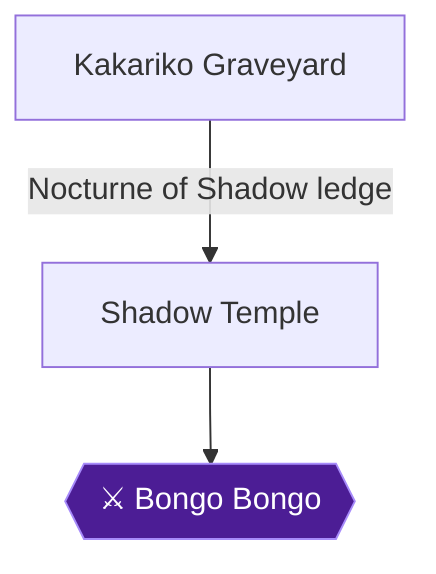

This chapter takes you from the Kakariko Graveyard ledge into the Shadow Temple, through its Lens of Truth puzzles, the Dead Hand miniboss, the invisible-spike rooms, the cursed boat and the fire walls, and finally to Bongo Bongo. You collect the Map, Compass and Boss Key, five Gold Skulltulas, the Hover Boots and a Heart Container, and Impa gives you the Shadow Medallion.

The Shadow Temple is reached only by the Nocturne of Shadow, which takes Young or Adult Link to the high ledge in Kakariko Graveyard 🟡. Access depends on having the Forest, Fire and Water Medallions 🟡. The Bottom of the Well must be finished before the Shadow Temple can be completed 🟡. That is also where the Lens of Truth comes from.

> [!WARNING]
> **Missable Achievement Warning:** Invisible One (**Invisible One** below) can be lost during the Bongo Bongo fight. It requires beating Bongo Bongo without using the Lens of Truth and without being trapped by his hands. Read the boss section before dropping into the pit.

### What to bring

- **Din's Fire** is needed at the entrance and again in the Shadow Temple. It comes from the Great Fairy in the Hyrule Castle garden.
- **Lens of Truth, Longshot, Hover Boots (found here), Iron Boots and Kokiri Boots, bombs and the Fairy Bow with Fire Arrows** are all used during the temple 🟡.
- **Biggoron's Sword** is recommended for the miniboss and the boss 🟡.
- **Arrows and magic.** Bongo Bongo's hands drop more when stunned if you run low.
- **Farore's Wind.** Set it before the boss room. If you fail, reset the game and use it to teleport back near the boss's room 🟡.
- The Lens of Truth is only said to fail the achievement if you activate it. Carrying it is fine 🟡.

### Chapter Items to Collect

| Item | Where Found | Action / Requirement | Citation |
|---|---|---|---|
| Dungeon Map | Redead Room off the Catacombs | Kill the Redead and two Keese | 🟡 |
| Hover Boots | Dead Hand room | Defeat Dead Hand, open chest | 🟡 |
| Compass | Gibdos Room | Kill both Gibdos | 🟡 |
| Boss Key | Crushing Walls Room | Burn walls with Din's Fire, kill Redead | 🟡 |
| Heart Container | Bongo Bongo's arena | Defeat Bongo Bongo | |
| Shadow Medallion | Beam of light after boss | Meet Impa | |

### Kakariko Graveyard

Play the Nocturne of Shadow (C-Left, C-Right, C-Right, A, C-Left, C-Right, C-Down) to warp to the Graveyard ledge 🟡. Run east down the stairs near the warp point to reach a large room of torches 🟡. Stand on the pedestal in the middle of the torches and cast Din's Fire. All the torches light and the Shadow Temple door opens 🟡. Go through it.

> [!TIP]
> Before you leave the Graveyard for good, note that its Pieces of Heart and Skulltulas are covered by their own routes. Dampe's race (Hookshot, then under one minute with the Longshot) rewards a Piece of Heart. The Heart Piece from the grave-digging tour is lost forever if you dig it up and leave without collecting it 🟡.

### Shadow Temple

#### Entrance and the Raven Room

Run forward and look right around the corner. A long pit has a Longshot target on the far end; pull yourself across 🟡. Run straight through the face carved into the opposite wall to reach the Raven Room 🟡.

Use the Lens of Truth on the skull posts around the Raven statue. Find the skull that does not disappear. Push the handle on the statue's front until the Raven faces that real skull, and do not stop pushing until it does, or the floor disappears. The grating across the room then opens 🟡. A large pit blocks the grating for now 🟡.

Turn to the wall opposite the pit. With the Lens, find the fake face on the right side, run through it, down the hall and through the door 🟡.

#### Catacombs and the Map

The skull on the next wall has glowing blue eyes; every fake wall in this area has glowing blue eyes, while flashing blue eyes mark secret messages 🟡. Go through the wall, right around the corner, use the Lens to see a fake wall on the right, and go through it and the door beyond 🟡.

In the Redead Room, kill the Redead and the two Keese high above. The Dungeon Map appears. Take the **Dungeon Map** (✅ Map), then return to the Catacombs.

#### Dead Hand and the Hover Boots

Back through the fake wall, go right, then left around the next corner. Use the Lens to pass through the wall flanked by two pots, go down the passage and through another fake wall, go right then left, and use the Lens to see through the wall at the hall's end. Go through to the door 🟡.

Dead Hand is the miniboss. Let one hand grab you so his body and head appear, struggle free by rotating the stick and mashing buttons, Z-target the head, stand still out of the hands' reach, and execute a Jump Attack as the head lowers 🟡. Repeat until he dies. The Biggoron Sword kills him in a few hits, though Jump Attacks tend to fly past him 🟡; two jump attacks are enough with it 🟡.

Open the chest that appears for the **Hover Boots**. Return to the Raven Room.

#### Compass and the Beamos

In the Raven Room, run through the fake wall to the cliff, equip the Hover Boots and run off the cliff onto the tongue-shaped ledge. Switch back to Kokiri Boots and go through the doorway and down the tunnel 🟡.

Throw a bomb or two into the Beamos's head, then go to the wall on the right, which is fake, and through the door.

In the Gibdos Room, kill both Gibdos. A chest appears with the **Compass**.

#### Scythe Room (Small Key)

Return through the fake wall, kill or dodge the Beamos, and go north through the fake wall north of it 🟡. In the Scythe Room, grab the two Silver Rupees in the middle in the scythe's path; you can roll under the blades if timed well 🟡. Then Longshot to the northwest target and jump off the wood stack for the third, take the fourth in the west alcove and the fifth in the northeast alcove 🟡. Do not enter the small enclosed area with the creepy face panel; there is a hole in the ground 🟡.

The southeast grating opens on a chest with a **Small Key**. Leave through the south door.

#### Guillotine Chamber

Return to the Raven Room and bomb the rough wall to the east. Go down the passage and through the door 🟡. Move slowly down the ramps and kill the hanging Big Skulltulas with the Longshot, then jump off the cliff at the bottom 🟡.

Run around each rising guillotine or roll under them, watching for the Big Skulltula between the first and second blades 🟡. Around the corner, Navi warns of Wall Masters; wait for it to drop and kill it, because knocking it off the cliff does not count 🟡. Jump the three guillotines, and on the small platform fight the Stalfos with your shield up, attacking only right after it attacks 🟡.

With the Lens, jump across the invisible platforms east, then to a corner platform, then north to a door 🟡.

#### Invisible Scythe Room (Skulltula)

Keep the Lens on here; rapidly toggling it uses no magic 🟡. Kill the Like-Like and the Keese; the rear grating opens. Go through, kill the Gold Skulltula and take the token (**Skulltula #85**) with the Longshot, and open the two chests, a Blue Rupee and Arrows, the second visible only with the Lens 🟡. Return to the Guillotine Chamber.

#### Guillotine Chamber, second half

Jump back across the invisible platforms to the Stalfos platform; it appears again. Fight it, then jump west to the rising and falling platforms 🟡. When the platform is halfway to its apex, jump to the narrow cliff on the right and run southwest to the wide platform with blade traps and five Silver Rupees. Take four by running around, standing safely in the large gap between blades, and bomb the Beamos to reach the fifth beneath it 🟡. The west grating opens.

Follow the twisting hall to the crushing-ceilings room. With the Lens, find the stone block in the right wall, pull it out until it lines up with the smiling face on the floor, then push it forward so both spiked ceilings are blocked 🟡. Enter the cell to the south, kill the Gold Skulltula and Longshot the token (**Skulltula #86**) 🟡. The cell across holds a chest with Arrows 🟡.

Pull the block back, climb it to the north platform, then use a crushing ceiling as a bridge to the south ledge. Hop the spike to the opposite side for a chest with a Blue Rupee. Step on the south switch to make a chest appear in the northeast, cross to it and open it for a **Small Key**.

Go back east past the blade traps to the narrow ledge, head north, use the Lens to see the platform past the guillotine, jump as it rises, then jump across the horizontally moving platform to the door 🟡.

#### Silver Rupee Room (invisible spikes)

Kill both Redeads; a chest appears with a Blue Rupee. Keep the Lens on to avoid the invisible spikes. Collect all five Silver Rupees using the Longshot targets: the first in the middle behind the nearest spikes, the second by Longshotting the east target, the third at the west target, the fourth via the invisible ceiling target above the north ledge, and the fifth on the invisible northeast ledge via its wall target 🟡. The west door opens.

#### Skull Room

Climb either staircase to above the large skull. Kill the four Keese, then toss a bomb into the hollow top; the skull explodes and reveals a **Small Key** 🟡. Kill the Gold Skulltula behind the skull for its token (**Skulltula #87**) 🟡. All Keese must die for the door to unseal 🟡.

Return to the Silver Rupee Room, Longshot the invisible ceiling target to the north platform, and go through the locked door 🟡.

#### The Fan Room

Wait for the first fan to stop before running past the blade traps in Kokiri Boots 🟡. Around the corner, kill the Big Skulltula, then equip Iron Boots against the stronger fan and walk slowly 🟡. At the pit, Longshot the opposite ledge while wearing Iron Boots, and drop off the far side 🟡. Walk across the hall in Iron Boots, holding Z with your shield up to block the Silver Eye's flames 🟡. At the last fan on the right wall, switch to Hover Boots; the fan blows you through a fake wall onto a ledge. Take the door 🟡.

#### The Other Gibdos Room and the Cursed Boat

Return to Kokiri Boots and kill the Gibdos while dodging blade traps. A chest gives a Blue Rupee 🟡. Bomb the rubble in the southeast corner, use the Lens, and open the hidden chest for a **Small Key**. Use it on the north door 🟡.

In the boat room, push or pull the large block along its track into the trench near the ladder 🟡. Climb the block and ladder to the Triforce symbol. From the boat's front, look southwest to the alcove with a Gold Skulltula. Longshot it directly, or play the Scarecrow's Song to bring Pierre to the alcove (**Skulltula #88**) 🟡. The skulltula can also be reached by calling the scarecrow to the platform above where the block started and Longshotting it 🟡.

Stand on the boat's Triforce symbol and play Zelda's Lullaby; the boat moves west 🟡. Several waves of Stalfos attack; block their attacks or fight 🟡. When the boat reaches the west side, jump off the south side immediately before it sinks 🟡. Go through the west door.

#### Floor Master Room (invisible maze)

The room is a maze with invisible walls; use the Lens, and kill or avoid the Floor Masters 🟡. Reach each door in turn.

- **North door, Crushing Walls Room:** Burn both spiked wooden walls with Din's Fire. Kill the Redead on the east and open the ornate chest for the **Boss Key**. The west chest holds a Blue Rupee 🟡.
- **South door, Invisible Floor Master Room:** Use the Lens to see the Floor Master. When it splits into three invisible small ones, Din's Fire kills all three. A chest appears with a **Small Key** 🟡.
- **West door, Triple Skull Room:** You need not destroy the spinning skulls (they give rupees). Shoot the Gold Skulltula on the wall behind them (**Skulltula #89**) 🟡.
- **East door:** Leads back toward the boat room 🟡.

#### The bridge and Geometric Shape Room

In the boat room's south section, a pit is too wide even for the Hover Boots. Shoot a Fire Arrow at a bomb flower around the tall pillar on the left of the opposite ledge; the pillar falls and forms a bridge. Cross and enter the south door 🟡.

In the next room, equip Hover Boots and use the Lens. Run to the T-shaped platform in front of the door, go left to the straight platform, then right to the next, then to the ledge with the Boss Door 🟡.

> [!TIP]
> Before you leave this room, set Farore's Wind and make sure you have plenty of arrows and magic; the Lens of Truth should be unequipped and out of use for the boss 🟡.

### Boss: Bongo Bongo

Drop down the pit in the middle of the room. The entire fight takes place on a giant drum 🟡. Bongo Bongo attacks with his hands or tries to knock you off by pounding the drum. Each attack deals at least two hearts 🟡.

> [!WARNING]
> **Missable Achievement Warning:** Do not use the Lens of Truth in this fight, and do not let his hands grab and trap you, or Invisible One will be missed. If it fails, reset and use Farore's Wind 🟡.

**Standard strategy:** Z-target and shoot both hands with arrows to stun them. They recover quickly, so shoot fast. A struck hand turns blue and drops an arrow or magic 🟡. Normally you would use the Lens between the hands to see the eye, but for the achievement you cannot 🟡.

**Achievement approach (no Lens):**
- After both hands are stunned, Bongo Bongo charges at you. Aim down the middle between the stunned hands and shoot, which hits his eye.
- Equip Hover Boots at the start to Z-target a hand, then unequip them to dodge the second hand if it becomes a fist. One player failed every attempt with Hover Boots and succeeded first try with normal boots 🟡. Choose what suits you, and Kokiri Boots are also recommended by the walkthrough.
- Taking the left hand first (on Link's right side) means you are bounced around less 🟡.
- Hold the bow after stunning both hands until they form fists, then fire straight ahead at the eye 🟡.
- Once he drops, Jump Attack with the Biggoron's Sword then crouch-stab to finish him in one cycle. Two sets of swings with Biggoron's Sword kill him 🟡.
- Alternatives reported by players: charged spin attack when he rushes you 🟡; uncharged spin attacks until he runs into you 🟡; Din's Fire makes you ungrabbable but does not pause time for Bongo Bongo, and one player found it did not help 🟡.


> [!ACHIEVEMENT]
> **Invisible One (10 Points)**
> 
> *Defeat Bongo Bongo without using the Lens of Truth or getting trapped by his hands*


After he dies, take the **Heart Container**. Enter the beam of light to meet Impa, the Sage of Shadow, and receive the Shadow Medallion.


> [!ACHIEVEMENT]
> **The Shadow of the Hylians (5 Points)**
> 
> *Awake Impa and obtain the Shadow Medallion*


If the medallion achievement fails to trigger, a manual unlock can be requested on the RetroAchievements Discord or by DM to RAdmin 🟡. You return to the Graveyard afterward 🟡.

> [!TIP]
> Before you leave, confirm you have the Map, Compass, Boss Key, Hover Boots and Gold Skulltulas #85 to #89. The route onward leads from the Graveyard via Hyrule Field to Gerudo Valley 🟡.

> [!IMPORTANT]
> ### Chapter 18 Cumulative 100% Checkpoint
> - **Gold Skulltulas:** 85 / 100 (five in the Shadow Temple) 🟡
> - **Pieces of Heart:** 30 / 36
> - **Heart Containers:** 7 / 8 (Bongo Bongo)
> - **Maps, Compasses & Boss Keys:** 22 / 26 🟡
> - **RetroAchievements Unlocked:** 63 / 97 (360 / 690 points)

### Chapter Checklist

- [ ] Warped with the Nocturne of Shadow and lit the torches with Din's Fire
- [ ] Dungeon Map from the Redead Room
- [ ] Hover Boots from Dead Hand
- [ ] Compass from the Gibdos Room
- [ ] Boss Key from the Crushing Walls Room
- [ ] Gold Skulltulas #85 to #89
- [ ] Set Farore's Wind before Bongo Bongo
- [ ] Invisible One: Bongo Bongo defeated without the Lens and without being trapped
- [ ] Heart Container taken
- [ ] The Shadow of the Hylians: Shadow Medallion from Impa

---

## Chapter 19: Gerudo Valley and Gerudo's Fortress

```mermaid
flowchart TD
  Gerudo_Valley["Gerudo Valley"]
  Gerudo_Fortress["Gerudo's Fortress"]
  Twinrova{{"⚔ Twinrova"}}
  Ganondorf{{"⚔ Ganondorf"}}
  Ganon{{"⚔ Ganon"}}
  Final_Battle>"⛔ Ganon's Tower final battle"]
  Gerudo_Valley -->|"Jump the broken bridge on Epona or Longshot"| Gerudo_Fortress
  Ganondorf --> Final_Battle
  Final_Battle --> Ganon
  classDef ponr fill:#7f1d1d,stroke:#f87171,color:#fff;
  classDef boss fill:#4c1d95,stroke:#a78bfa,color:#fff;
  class Final_Battle ponr;
  class Twinrova,Ganondorf,Ganon boss;
```

This chapter has two jobs. Cross the broken bridge in Gerudo Valley, then free the four captured carpenters in Gerudo's Fortress to earn the Gerudo's Membership Card. With the card you can play the Horseback Archery range, which gives a Piece of Heart at 1,000 points and the Biggest Quiver at 1,500 points. Two achievements are placed here: Gerudo's Fan Club (the card) and Ultimate Horse Master (the top archery reward). The new collectibles are the roof-chest Piece of Heart, the archery Piece of Heart, and two night-only Gold Skulltulas at the fortress.

> [!TIP]
> **Preparation:** Bring Epona or the Longshot for the bridge 🟡. Bring the Bow, because arrows stun patrolling guards 🟡. Bring Deku Nuts for the sword-wielding Gerudo fights 🟡. The Hover Boots help in the kitchen room 🟡. The Longshot reaches the roof chest. Have 20 Rupees ready for each archery round 🟡.

### Chapter Items to Collect (5 Items Total)

| Item | Where Found | Action / Requirement | Citation |
|---|---|---|---|
| Piece of Heart (roof chest) | Chest on the roof above the jail | **LONGSHOT** to it and open | |
| Piece of Heart (archery) | Horseback Archery Range | **SCORE** 1,000 points | |
| Gold Skulltula #90 | Far target at the archery range, at night | **LONGSHOT** to kill and collect | 🟡 |
| Gold Skulltula #91 | Stone wall at the back of the fortress, at night | **LONGSHOT** to kill and collect | 🟡 |
| Gerudo's Membership Card | Shiro's cell | **FREE** all four carpenters | |

The Biggest Quiver from the 1,500-point round is also earned here 🟡.

### Gerudo Valley

Go up the log bridge near the valley entrance. At the fallen bridge spanning the canyon, either jump the gap on Epona or pull yourself across with the Longshot 🟡. If you ride, charge straight at the gap at full speed 🟡. The valley's Skulltulas and Pieces of Heart were already collected in Chapters 8, 10 and 13, so this section is only a crossing 🟡.

Once across, speak with the Master Carpenter. He explains that he came to repair the bridge, but his assistants ran off to join the Gerudo Thieves and were captured 🟡.

> [!TIP]
> If you still have the Poacher's Saw from the Biggoron sword trading sequence, show it to this carpenter. He gives you the Broken Goron's Sword in exchange 🟡.

Rocks near the bridge hide a chest with a Purple Rupee, which you can break with the Megaton Hammer. If you play the Song of Storms behind the carpenter's tent, a secret cave opens. Inside, two Business Scrubs sell Green and Red Potions for 40 Rupees each 🟡.

Then continue to the fortress 🟡.

### Gerudo's Fortress

#### Getting caught

The Gerudo Thieves throw you in prison if they see you 🟡. Run north from the entrance until you reach a stairset on the right, climb it, and let a purple-suited patroller see you 🟡. After that, any time you are spotted in the fortress you are sent back to the cell 🟡.

> [!WARNING]
> **Achievement Trigger Warning:** If you are caught without the Hookshot or Longshot, you are thrown out in front of the carpenter's tent instead of into the cell 🟡.

In the cell, look south and high on the wall for a window. Shoot the wooden awning with the Longshot to pull yourself up 🟡. From the sill you can see the patrolling Gerudos below. Stun the one closest to the door on the left with an arrow, then jump down and enter before she recovers 🟡. The Longshot also stuns, but not for nearly as long 🟡.

#### Carpenter 1: Ichiro

Run around the corner to find the first carpenter, Ichiro. Speak with him through the bars and a Gerudo Thief attacks 🟡. She fights somewhat like a Stalfos but faster. Attack right after she attacks, and watch for her stun attack 🟡. She telegraphs it by crouching slightly and holding her swords far apart 🟡. If it hits, you lose the fight and go back to the cell 🟡.

Deku Nuts can stun her in the middle of any attack, including that special one 🟡. When she is stunned, a jump attack knocks her down and you can follow with another 🟡. If she blocks the nut, follow with a jump attack as she lowers her guard 🟡. Arrows also work well, though it takes many of them 🟡. Without nuts, dodge her special attack by jumping aside once or twice 🟡.

Defeat her, take the Small Key she leaves, and open Ichiro's cell. Speak with him to free him. The carpenters will not leave until you talk to them 🟡. Then leave by the door on the left 🟡.

A fairy fountain is hidden near the crates across from the exit. You need the Song of Storms to open it 🟡. Stand in the small enclosed area on the left and play it 🟡.

#### Carpenter 2: Sabooro

The hallway route from Ichiro's exit to the roof corner is not covered in detail here. Unable to verify from collected sources.

When you come out on the roof, run toward the corner and stop before you go around it. Peek around using Z-Focus and you will see a patrolling Gerudo Guard. Wait until she faces away, then shoot her in the back with an arrow 🟡. Run around the corner, jump up the ledge, and take the door on the right 🟡.

Run to the top of the ramp and speak with Sabooro in his cell at the far end of the room. The closer cell holds only pots with junk. Defeat the Gerudo Thief who appears, take her Small Key, and open Sabooro's cell. Speak with him again to free him. Head right and up around the corner, then through the doorway 🟡.

#### The kitchen and the roof chest

The next door on the left leads back into the kitchen. From the doorway, you can see two guards down the ramp to the right 🟡. Shoot both with arrows to stun them. Then equip the Hover Boots, run out to the ledge directly ahead, and run across to the ramp on the other side. Swap back to the Kokiri Boots and go through the doorway 🟡.

> [!TIP]
> Reaching the platform in this room requires the Hover Boots or the Hookshot/Longshot. You cannot simply jump to it 🟡.

Outside, it needs to be night for the Skulltula. Play the Sun's Song if it is not 🟡. Jump up the ledge to the south and run along the roof to its end. Face west and jump the gap to the adjacent roof. Go around the corner to a wall covered in ivy and climb it to reach the top level of the fortress 🟡.

Follow the wall so you are running north. At the north end, an adjacent roof holds a chest. At night a Gold Skulltula clings to its east wall. Kill it and take the token with the Longshot; this is Gold Skulltula #91 🟡. The gap is too far to jump. Longshot the chest to pull yourself across; the Longshot range only just reaches it 🟡. If you cannot reach it, play the Scarecrow's Song to make Pierre appear as a closer target 🟡. Open the chest for a **Piece of Heart**. You can also smash the crate near here for a Purple Rupee 🟡.

Then play the Sun's Song to warp back to the doorway from the kitchen 🟡.

#### Carpenter 3: Jiro

From the doorway, look north. A small jump down leads to a ledge with a single door. Drop down and enter 🟡. As soon as you are in, pull out the Bow and stand still. When the guard comes around the corner, shoot her before she sees you. Run around the corner to the right, left at the next corner, down the hall and around another corner to a cell at a dead end.

Speak with Jiro and defeat the next Gerudo Thief. Take her Small Key and open Jiro's cell. Speak with him and he escapes 🟡. Return the way you came, watching for the thief near the entrance, who may no longer be stunned 🟡.

#### Carpenter 4: Shiro, and the card

Outside the door from Jiro's cell, look west and drop off the cliff to the roof below. The door on the right as you land leads on 🟡. Run down the hall and around the corner to the last carpenter, Shiro, locked in his cell.

Speak with him and defeat the Gerudo Thief who appears. Use the Small Key she drops to open the cell, then run inside and speak with Shiro.


> [!ACHIEVEMENT]
> **Gerudo's Fan Club (5 Points)**
> 
> *Obtain the Gerudo's Membership Card*


After Shiro is freed, a Gerudo Lieutenant appears. She is impressed by your sneaking and makes you an honorary Gerudo Thief with the **Gerudo's Membership Card**. That is the condition for Gerudo's Fan Club 🟡.

The card does the following:
- It lets you roam the fortress without being harassed or thrown in jail 🟡.
- It opens the Gerudo Training Ground and the Horseback Archery Range 🟡.
- It lets you open the northwest gate to the Haunted Wasteland 🟡.
- The bridge back in Gerudo Valley is now repaired 🟡.

If you want the Ice Arrows, the Training Ground entrance is in the southeast corner. Speak to the Gerudo by the grating and pay the fee 🟡. The guide quotes a 10 Rupee fee 🟡. Finishing every room later needs the Silver Gauntlets from the Spirit Temple, but the Ice Arrows can be taken now. This is optional for this chapter.

### Horseback Archery Range

Make sure it is daytime for the minigame; the Gerudo who runs it appears only then, so use the Sun's Song if needed 🟡. Epona's Song summons Epona if she is not nearby, and she appears near the south entrance 🟡. If you lack Epona, the Gerudos lend you a horse 🟡. Ride east up the passage on Epona to reach the range 🟡.

For Gold Skulltula #90, go to the range at night first. It is high on the lone target on the north side. Kill it with the Longshot and take the token 🟡. Then return to the awning on the south side 🟡.

Speak to the Gerudo dressed in white beneath the awning. You must be riding Epona when you talk to her 🟡. One round costs 20 Rupees and you get 20 arrows 🟡. You do not steer Epona; she runs automatically and you only fire 🟡.

Scoring:
- Pots are worth 100 points each.
- Targets are worth 100 at the exact center, 60 on the outer circle and 30 on the edge 🟡.

Epona runs up and down the course once in each direction before the game ends 🟡.

Strategy:
- On the first pass, shoot every pot as you pass. There are eight pots on the way down 🟡.
- After the last pot, shoot the big target at the end as Epona loops around it 🟡.
- On the way back, put one in each of the three bull's-eyes, then spend remaining arrows on the last target 🟡.
- Another version of the plan is to shoot the east targets until you are near enough to hit the south target accurately 🟡.
- Move your aim right to collect all the pots on the first pass, then spend most of your remaining arrows on the target at the end of the track 🟡.
- Aim for the pots before the bull's-eyes 🟡.
- Another guide suggests shooting all the pots at the bottom, then hitting the first target on the middle left as much as you can while turning around 🟡.

One player lowered analog stick sensitivity to about 0.8 and cleared it on the next try after 15 failed attempts 🟡. Another needed around 100 to 150 tries and finished at 1,510 🟡. Expect a grind.

Score at least 1,000 points to win the **Piece of Heart**. Then play again and score at least 1,500 to win the **Biggest Quiver**, which raises your arrow capacity to 50. If you reach 1,500 on your very first attempt, you must play again and repeat it to earn the Quiver 🟡. Scoring a perfect 2,000 gives nothing extra 🟡.

> [!WARNING]
> **Achievement Trigger Warning:** A commenter says you must already own the big quiver from the shooting gallery, or the achievement will not unlock 🟡. The achievement is tied to the Biggest Quiver reward for 1,500 points 🟡. Treat the Quiver as the goal and do not leave the range until you have it.


> [!ACHIEVEMENT]
> **Ultimate Horse Master (10 Points)**
> 
> *Complete the Horseback Archery minigame and obtain the top reward*


### Before you leave

> [!TIP]
> **Before you leave Gerudo's Fortress:** Confirm you have the Gerudo's Membership Card and the Biggest Quiver 🟡. Collect the roof-chest Piece of Heart and the archery Piece of Heart. Pick up Gold Skulltulas #90 and #91 now, since the Longshot is already in your hands 🟡. When ready, head for the northwest corner of the fortress, climb the tower, and speak to the Gerudo at the top. She opens the gate to the Haunted Wasteland 🟡.

> [!IMPORTANT]
> ### Chapter 19 Cumulative 100% Checkpoint
> - **Gold Skulltulas:** 87 / 100
> - **Pieces of Heart:** 32 / 36
> - **Heart Containers:** 7 / 8
> - **Maps, Compasses & Boss Keys:** 22 / 26
> - **Chapter collectibles:** Gerudo's Membership Card, roof-chest Piece of Heart, archery Piece of Heart, Biggest Quiver
> - **RetroAchievements Unlocked:** 65 / 97 (375 / 690 points)

### Chapter Checklist

- [ ] Crossed the broken bridge on Epona or with the Longshot
- [ ] Freed Ichiro, Sabooro, Jiro and Shiro
- [ ] Gerudo's Membership Card obtained (Gerudo's Fan Club, 48896)
- [ ] Roof-chest Piece of Heart opened
- [ ] Gold Skulltula #91 collected (night, Longshot)
- [ ] Gold Skulltula #90 collected (night, Longshot)
- [ ] Horseback Archery 1,000 points: Piece of Heart
- [ ] Horseback Archery 1,500 points: Biggest Quiver (Ultimate Horse Master, 49040)
- [ ] Ready to open the northwest gate

---

## Chapter 20: Desert Colossus and the Spirit Temple

```mermaid
flowchart TD
  Temple_of_Time["Temple of Time"]
  Haunted_Wasteland["Haunted Wasteland"]
  Desert_Colossus["Desert Colossus"]
  Spirit_Temple["Spirit Temple"]
  Bongo_Bongo{{"⚔ Bongo Bongo"}}
  Twinrova{{"⚔ Twinrova"}}
  Ganondorf{{"⚔ Ganondorf"}}
  Ganon{{"⚔ Ganon"}}
  Dying_Guard_Lockout>"⛔ Dying guard disappears after the Temple of Time"]
  Final_Battle>"⛔ Ganon's Tower final battle"]
  Haunted_Wasteland --> Desert_Colossus
  Desert_Colossus --> Spirit_Temple
  Spirit_Temple --> Twinrova
  Ganondorf --> Final_Battle
  Final_Battle --> Ganon
  classDef ponr fill:#7f1d1d,stroke:#f87171,color:#fff;
  classDef boss fill:#4c1d95,stroke:#a78bfa,color:#fff;
  class Dying_Guard_Lockout,Final_Battle ponr;
  class Bongo_Bongo,Twinrova,Ganondorf,Ganon boss;
```

This chapter takes you across the Haunted Wasteland to the Desert Colossus and then through both halves of the Spirit Temple. Gerudo's Fortress and the Bottom of the Well must be finished first 🟡. The temple is the only dungeon that needs both Young and Adult Link, with a small West Wing for the child and a much larger East Wing for the adult 🟡. Along the way you learn Nayru's Love, the Requiem of Spirit (the last song), the Silver Gauntlets, the Mirror Shield, the Spirit Medallion and the final Gold Skulltulas and Heart Piece in the desert.

> [!TIP]
> **Bring before you go:**
> - Longshot, to cross the sand gap and reach crates, trees and ledges 🟡.
> - Lens of Truth, to see the Poe guide 🟡.
> - Bombs, for the cracked wall 🟡.
> - Din's Fire, which the child half uses constantly.
> - An empty bottle of bugs for the soft soil patch 🟡.
> - A Magic Bean for that patch 🟡.
> - Hover Boots, Fire Arrows and the Mirror Shield's eventual partner, the Biggoron Sword, if you have it.

### Chapter Dungeon Items (3 Items)

| Item | Where Found | Action / Requirement | Citation |
|---|---|---|---|
| Dungeon Map | Colossus Chamber, chest from lighting the two torches in front of the statue with Din's Fire (Young Link) | **TAKE** | |
| Compass | Triforce/Compass Room, chest on the far ledge after Zelda's Lullaby (Adult Link, Longshot) | **TAKE** | 🟡 |
| Boss Key | Boss Key Room, ornate chest behind the flame pillar (Adult Link) | **TAKE** | 🟡 |

### Haunted Wasteland

You begin between a pair of flags. Run forward past the crate to a wide gap of sinking sand and Longshot the crate on the far side 🟡. Then head for the next flag to the northwest and keep going from flag to flag. If you stray too far from a flag you are sent back to the start 🟡. If you cannot see the next flag, play the Song of Storms and the lightning lights up the horizon briefly 🟡.

After the second flag a sign points to the Carpet Merchant, who only sells Bombchus. The price is 200 rupees 🟡. Skip him unless you need Bombchus.

The flags end at a large stone structure ringed with red flags. Enter the opening near its south side and drop down to the bottom 🟡. Kill the Gold Skulltula inside and take its token with the Longshot 🟡. This is Skulltula #92 and it sits in plain sight 🟡. Light both torches with Din's Fire or Fire Arrows to make a chest with a Purple Rupee appear 🟡. Climb out by the ladder on the south side 🟡.

Climb the ramp on the north side to the top of the structure. Face north, turn on the Lens of Truth and a ghost appears 🟡. Keep the Lens on and follow the ghost. Leevers start surfacing when you are close, so roll out of their way. When you reach a pair of flags, run toward the single flag to the west to enter the Desert Colossus 🟡.

### Desert Colossus (first visit, as Adult Link)

The Colossus is crawling with Leevers. They can only appear in sand, so stand on solid ground to be safe 🟡.

#### Great Fairy's Fountain: Nayru's Love

Go to the pair of trees on your right as you enter from the Wasteland. Bomb the cracked wall between them and walk through the doorway 🟡. Stand on the Triforce symbol and play Zelda's Lullaby. The Great Fairy gives you Nayru's Love 🟡.


> [!ACHIEVEMENT]
> **Nayru's Love (5 Points)**
> 
> *Learn Nayru's Love*


Nayru's Love makes you invulnerable, costs a quarter of a full magic bar and is very useful against the temple's Iron Knuckles. Leave the fountain.

#### The oasis and Skulltula #94

Head to the dried-up oasis in the south. Stand on the pile of flat rocks and play the Song of Storms to fill it and make a Fairy Fountain 🟡. This is optional. At night, a Gold Skulltula (#94) sits near the top of one of the palm trees, and you take its token with the Longshot 🟡. Standing in the shallows lets you fire the Longshot undisturbed 🟡. If it is not night yet, wait or come back after the bean ride below. You can also pick it up on your later adult visit.

#### Entering the temple and the Requiem of Spirit

Go to the huge statue at the west end and enter the small door at its base 🟡. There is nothing to do inside yet, so turn around and walk back outside 🟡. Sheik appears and teaches the Requiem of Spirit, which warps you to the Colossus.


> [!ACHIEVEMENT]
> **Musician (5 Points)**
> 
> *Learn all 12 songs*


The Requiem of Spirit is the sixth warp song, and it is the 12th and last song. Musician needs every other song first, so if it does not pop, one of the earlier songs is still missing. Players also report odd timing on this achievement. One got it on learning the Requiem, and another had it fail until the Sun's Song was learned last, after which a developer update fixed it 🟡. If it fails to award, a developer advised restarting the emulator to load the updated achievement 🟡.

### Temple of Time (switch to Young Link)

Play the Prelude of Light to warp to the Temple of Time 🟡. Return the Master Sword to its pedestal to become Young Link 🟡. Do nothing else here for now.

Play the Requiem of Spirit to warp back to the Colossus as a child 🟡. The Gerudo will not let Young Link cross the fortress bridge, so this song is the way in 🟡.

### Desert Colossus (as Young Link)

Go to the entrance of the Spirit Temple. To the left of the door is the game's last patch of soft soil 🟡. Drop a Bottled Bug into it and a Gold Skulltula (#93) appears. Kill it and take the token. You do not need to recapture the bugs afterwards 🟡. If you need more bugs, look under a rock north of the oasis 🟡.

Plant your final Magic Bean in the soil, then go into the temple 🟡. This bean is the key to the last Skulltula and Heart Piece later 🟡.

### Spirit Temple, West Wing (Young Link)

Fire enemies are common here, so switch back to the Hylian Shield if you have been using the Deku Shield 🟡.

#### Entrance and Nabooru

Run up the stairs, watching out for the pair of pots that fly at you. At the top, go left. A Gerudo Thief is trying to crawl into a hole that is too small for her. This is Nabooru 🟡. Talk to her. When she asks what you are up to, say "Nothing, really." The rest of her questions do not matter. She asks for your help against Ganondorf and moves aside, and you crawl through the crawlspace 🟡.

#### Armos Knight Room

Run forward, dodge the Blade Trap and kill the Fire Keese. Climb the stairs and go right to find an Armos Knight circled by a Blade Trap. Drop a bomb beside it and hit it with your sword just before the bomb goes off. Bombchus also work if you mess up 🟡. Then use the Boomerang on the Keese on the wall above the second crawlspace 🟡. When every enemy is dead the doors unseal, so take the door to the left of the crawlspace 🟡.

#### Stalfos Room

A Stalfos attacks. Dodge its swings and hit it right after it attacks. Nayru's Love before the fight makes it safer 🟡. Another option is to push it off the spinning platform by slashing it when it is near the edge 🟡.

Next, stun the Green Bubble in the pit with the Boomerang and kill it with the Slingshot. Then aim the Boomerang just left of the bridge so it curves into the Crystal Switch behind the grating. The bridge falls 🟡. Cross the bridge and open the chest for a Blue Rupee 🟡. Then take the door on the far side.

#### Anubis Pit Room

An Anubis flies at you here. Only fire can kill it, and since you have no Fire Arrows as a child, use Din's Fire. The fire trap from the crystal switch also works but is slow. Stay away from it so it cannot shove you into the pit. When it dies, the door on the right unseals 🟡.

#### Lower Silver Rupee Chamber

A Wallmaster is in this room. Run in small circles until it drops and kill it, then clear the Fire Keese. You cannot collect rupees with them around 🟡. Collect the five Silver Rupees from the grating. Two are near the bottom, two near the top and one is in the opposite corner 🟡. Do not climb near the Gold Skulltula on the left of the grating, because it damages you even through the fence 🟡. Collecting all five makes a bridge appear 🟡.

Kill the Keese before crossing so they cannot knock you off. On the far side, turn around. The Gold Skulltula (#96) on the right of the grating is killed and collected with the Boomerang 🟡. Then light both torches near the wall with Din's Fire. A chest appears on the other side of the room containing a Small Key. Cross back, open it and exit through the door.

#### Armos Knight Room (second pass) and Small Hall

You come out of the right-hand door. To its right is a crawlspace, so go through it 🟡. Open the locked door on the other side of the Small Hall.

#### Sun Cavern

A tiled wall is on your right. Boomerang the two Skullwalltulas, then climb to the top. Turn around and Boomerang the Gold Skulltula (#97) behind you 🟡. Run into the large cavern, where two Lizalfos appear. Kill the Skulltulas on the wall too. Find the rock higher on the wall that has a beam of light around it and blow it open with a Bombchu. If you have none, hit the crystal switch on the wall for a chest of Bombchus 🟡. The sunlight now hits the sun panel on the floor and unseals the door on the opposite wall 🟡.

#### Colossus Chamber and the Dungeon Map

Push the statue near the door off the cliff. It lands on a button and unseals a door on an upper level 🟡. Jump down to the floor. Light the pair of torches in front of the statue with Din's Fire and open the chest for the **[Dungeon Map]**. Then return to the east side, climb the tiles, go up the stairs, up another flight, and through the door on the left.

#### West Stairwell and Upper Silver Rupee Chamber

Run up the stairs and through the door 🟡. This room has Blade Traps, low walls and a sun panel puzzle. Run through the gap on the right, rolling past the Blade Trap. Pull out the stone block with the sun panel and push it into the beam of light on the northwest side. The south door opens 🟡. Kill the Beamos near the blocks if it bothers you 🟡.

You still need the Small Key. Collect the Silver Rupees by walking along the low walls. The platforms under the three Beamos Statues let you jump up once you destroy the statues 🟡. When you have all five, the gold torch on the east side lights 🟡. Light a Deku Stick on it and light the three unlit torches (near the east door, in the northeast, and near the south door) before any goes out. A chest with a Small Key appears on the low wall in the south. Go through the south door.

#### Upper West Stairwell and the Iron Knuckle

Look above the door you came through for the Gold Skulltula (#98). Boomerang it, then take the door at the top of the stairs 🟡.

Run left to find a suit of armor on a throne. Strike it to start the fight 🟡.

**Iron Knuckle (mini-boss).** Its attacks can deal up to four hearts of damage 🟡. You can dodge and strike afterwards, or cast Nayru's Love and attack while invulnerable (you can still be knocked around) 🟡. A third method as Young Link is approach, backflip as it begins to slash, jump slash when it is open and backflip away again, repeating until it dies. Bombs thrown at it also work 🟡. Without Nayru's Love expect at least seven or eight jump attacks 🟡. At half health part of its armor breaks and it moves and attacks faster. Blocking does little. Pillars in the room hold health and items, so get it to knock them over if you are low 🟡.

When it dies, the door behind its throne opens. Walk through the tunnel and you are back outside, high on one of the Colossus's arms 🟡.

### Silver Gauntlets

Kaepora Gaebora gives a speech. After that, open the chest in front of you for the **[Silver Gauntlets]** 🟡. A cutscene shows Koume and Kotake capturing Nabooru 🟡. Careful, the ledge is narrow and a fall costs you the trip back. Sources disagree on which arm the chest is on, so take whichever chest the tunnel leads you to 🟡.


> [!ACHIEVEMENT]
> **Infamous Silver Gauntlets (5 Points)**
> 
> *Obtain the Silver Gauntlets from the Spirit Temple*


Young Link is finished here. Play the Prelude of Light to return to the Temple of Time 🟡.

### Temple of Time (back to Adult Link)

1. After the Prelude of Light drops you in the Temple of Time, walk through the Door of Time to the Master Sword pedestal 🟡.
2. Retake the Master Sword to become Adult Link 🟡.
3. Play the Requiem of Spirit to warp back to the Desert Colossus. It works for either age, so you skip the Haunted Wasteland 🟡.

### Desert Colossus (second visit, as Adult Link)

Make it night with the Sun's Song if necessary 🟡. Because you planted the bean as a child, a Magic Leaf platform now floats to the left of the temple door 🟡. Ride it. It flies around the Colossus, passing two rocks and finally the arch near the entrance. At night, jump off after the second rock to find a Gold Skulltula (#95) on top of it.

Run back to the leaf and ride it again until it passes the arch east of the temple entrance. Jump onto the arch for the final **Piece of Heart** (#36). A player reported that this heart stayed put after saving and resetting, so you cannot lose it by leaving 🟡.

A white rock to the left of the temple hides a Secret Cave with Business Scrubs selling Green and Red Potions 🟡. They cost 40 rupees a bottle each, and the Silver Gauntlets are required to lift the boulder 🟡. This is optional.

### Spirit Temple, East Wing (Adult Link)

#### Entrance and Rolling Boulder Room

Run up the stairs, avoiding the flying pots. At the top, go right to a doorway blocked by a giant blue block. Grab it and push it forward until it falls into a pit 🟡. The chest up the stairs contains Bombchus 🟡. Continue up the stairs. Bomb the Beamos and hit the Crystal Switch on the ceiling to open the left and right doors. Take the right door 🟡.

In the Rolling Boulder Room, collect five Silver Rupees around the pit. One hangs above the floor, so use the Hover Boots to run out to it and switch back to the Kokiri Boots afterwards. The far door unseals when all five are collected 🟡.

Stand near the Block of Time on the left and play the Song of Time. It moves into an adjacent alcove and the Gold Skulltula (#99) is behind its original spot 🟡. Go through the door on the north side.

#### Small Chest Room

Step in and a Like-Like drops from the ceiling. Kill it and open the chest for a Small Key. Return through the boulder room to the entrance 🟡.

#### Triforce/Compass Room

Take the unlocked door on the west side of the entrance 🟡. Step toward the Triforce symbol and a Wolfos appears. Backflip when it attacks and Jump Attack its back. Then stand on the symbol and play Zelda's Lullaby. A chest appears on the opposite ledge, so Longshot to it and open it for the **[Compass]** 🟡. Drop down, climb the tiled wall on the opposite ledge, and return to the entrance through the door at the top 🟡.

#### Lower Mirror Chamber

Take the locked door on the north side 🟡. Move slowly because a Like-Like falls from the ceiling and pots on the right throw themselves at you. Climb the tiled wall on the east side 🟡. At the top, an invisible Floor Master hides behind the mirror. Z-Target it, Jump Attack it once, then kill its offspring with Din's Fire 🟡.

Stand behind the mirror, grab the left handle and push it forward so it shines sunlight onto each sun panel. The first two panels make chests appear (a recovery heart and a frost trap), the third unseals the west door, and the last summons a Wallmaster 🟡. Do not open the frost trap chest 🟡. Go through the west door.

#### Colossus Chamber (adult)

You are back in the Colossus Chamber. Climb the stairs in front of you, up two flights, and look northwest at the statue's left hand, which has a Triforce symbol on it. Equip the Hover Boots and run out to it. If you miss, return to the east side and Longshot the target on the ceiling 🟡. Play Zelda's Lullaby on the symbol and a chest appears on the right hand. Re-equip the Kokiri Boots, Longshot to the chest and open it for a Small Key. Drop to the bottom floor 🟡. Back near the hands, a chest behind some crates holds a Blue Rupee 🟡.

Climb the tiled wall on the west side and both flights of stairs. At the top, look north and Navi flutters to the other side of the pit. Play the Scarecrow's Song and Pierre appears. Longshot over to him and kill the Gold Skulltula (#100) behind him. This is your hundredth token 🟡.

Return to the west side and use the Longshot target on the ceiling to climb up to the next level. Go up both flights again and through the locked door in the southeast corner 🟡.

#### Lower East Stairwell and Treble Anubis Room

Bomb the Beamos and go up the stairs and through the door 🟡. Three Anubis are here. Fire Arrows kill them easily. Bomb the Beamos statue on the north side to open the southeast door 🟡.

#### Quad Armos Room

A blue switch is in front of you. To open the sealed south door, coax an Armos into standing on it. Stand near the door and shoot the Armos in the northeast corner with an arrow. It hops toward you and steps on the switch, then you go through the door at once 🟡.

#### Upper East Stairwell and East Iron Knuckle Room

Two chests here hold recovery hearts and are visible with the Lens of Truth 🟡. Take the south door. Run in and right, then slash the armor on the throne to start the fight 🟡.

**Iron Knuckle (adult).** The shield is useless against it, so use the Biggoron Sword. With it, four jump attacks are enough 🟡. Use Nayru's Love if things get hot 🟡. A reliable tactic is to wait for it to attack, backflip out of range, Jump Attack as you land, then backflip again, repeating until it dies. Defeating it opens the door behind the throne and a tunnel 🟡.

#### Mirror Shield

On the Colossus statue's outstretched hand, a chest appears. Open it for the **[Mirror Shield]**, which reflects light, absorbs certain magic in one boss fight and cannot be stolen by Like-Likes 🟡. Be careful not to fall, or you must run back through the dungeon 🟡. Equip the shield and return through the door 🟡.

#### Small Key Room

Run through the door in front, then through the northeast door 🟡. Go down the stairs and through the north door to the Quad Armos Room 🟡. Run to the north end past the Blade Trap, stand in the beam of light and hold R to aim the Mirror Shield at the sun panel on the wall. The north door unseals 🟡. Open the chest in the Small Key Room for a Small Key and go back out 🟡.

#### Sliding Panels Room

Take the west door of the Quad Armos Room into the Treble Anubis Room, then go through the locked door in the southwest corner 🟡. Throw bombs at the two Beamos on the pillars. The wall of sliding panels can be climbed as they align, or you can Longshot the top panel. At the top, destroy both Beamos and take the north door 🟡.

#### Triforce Door Room and Boss Key Room

Go up the stairs, stand on the Triforce symbol and play Zelda's Lullaby. The door before it unseals 🟡. In the Boss Key Room, kill the Fire Slugs, then use Bombs and the Megaton Hammer to destroy all the false doors. The false door left of the flame pillar hides a golden eye. Shoot it with an arrow, and a second platform appears high above. Longshot the target above that platform, jump to the platform above the flame pillar and step on the switch. The pillar vanishes and you can open the ornate chest for the **[Boss Key]** 🟡. Another route is to Longshot to the ceiling panel, step on the button and drop down to the chest 🟡. Return to the previous room.

#### Upper Sun Chamber

Go right and through the west door 🟡. Block the two pots with your shield, then hit the crystal switch behind the bars on the left with a vertical slash or spin attack, which opens the sealed door 🟡. A Lizalfos drops in. Kill it and take the left doorway. In the mirror room, kill the White Bubbles, bomb the odd rock formation on the east side, push the mirror until it faces east through the opening, then run through 🟡. Kill another Lizalfos, push that mirror until it faces north, and return the way you came 🟡.

Back in the first area, the two mirrors now shine sunlight on the ceiling mirror. Jump into the pit, stand in the beam and use the Mirror Shield to light the sun panel on the west wall. The floor is an elevator and lowers you 🟡.

#### Colossus Room and the Boss Door

Face north to see the statue's face. Use the Mirror Shield to reflect the beam onto it. It begins to disintegrate into a grating. Longshot the grating and the Boss Door is revealed. Go through 🟡.

#### Nabooru's Throne Room

After the cutscene, the Iron Knuckle comes to life. Use the same strategies, with the Biggoron Sword, Nayru's Love and the backflip/Jump Attack trick. When it falls, the armor breaks to reveal Nabooru. Koume and Kotake brainwashed her, and they capture her again and vanish 🟡. Go through the door behind her throne and down the North Hall to the boss door.

### Boss: Twinrova

> [!WARNING]
> **Missable Achievement Warning:** Twins of Evil requires beating Twinrova without falling from the platform or reviving. Players report that if you die and save during this fight the achievement can fail 🟡. The title says you have 12 seconds to hook to the top for attempts after the first 🟡. Fairies may be used, but a Game Over followed by a fairy revive does not work 🟡. Make sure you have full health, magic, the Mirror Shield, the Hover Boots and your best sword equipped before the door.

You enter on a bottom floor below tall ledges. Climb the tiled wall to the center ledge and walk to the middle of the platform. A cutscene starts the fight.

**Phase one.** Kotake is Ice and Koume is Fire. Do not Z-Target. Run around so both sisters stay in view. When one charges a spell, a beam appears. Use the Mirror Shield to reflect it into the other sister. The beam is constant, so you can sweep it around for a couple of seconds, and each sister must take two or three hits. Aiming with Z or L ruins the shot. Some say to lock on and then release the lock to face the witch directly 🟡. A missed beam leaves a damaging ring on the floor, and Kotake's ice also freezes you, so reflect every beam anyway. Fire and Ice Arrows do nothing.

**Phase two.** The sisters merge into Twinrova, so you can Z-Target now. Use the Biggoron Sword (kept put away until needed) or the Master Sword. You must absorb three spells of the same element in a row with the shield. Two fires then an ice cancels the fires. Twinrova waves her right wand for Ice and her left for Fire. Your shield flashes red for fire and white for ice, faster as more are absorbed. Release R to dodge unwanted beams, but do not dodge off the ledge. After three the shield fires a massive beam, so keep it drawn to connect. Twinrova is stunned and falls to the lower platform.

Quickly equip the Hover Boots, draw your sword and run out. Halfway across, Jump Attack the rest of the way to hit her, then use basic sword strikes. When she recovers, return to the main platform and switch back to the Kokiri Boots. It helps to release the Z-lock momentarily. Repeat. With the Biggoron Sword she goes down after two knockdowns.

Players warn that the Hookshot must be aimed at the highest point of the platform where the fight begins. Climbing the wall counts as falling, and so does catching the ledge to pull up 🟡. After a death, hookshot onto the platform right after entering the door 🟡. Another player says running up counts as falling because you touch the ground around the platform 🟡. Hover Boots help with the jumps to and from the lower platform in the final phase 🟡. This achievement applies to the normal fight only 🟡. Some players use the Longshot to reach her and then crouch-stab 🟡. A speed trick is to run toward her as you absorb the third beam 🟡. Do not hold R when you do not want a beam, since absorbing the wrong element resets your count.

When she dies, a cutscene plays and a Heart Container is left on one of the outer platforms 🟡. Take it, then step into the beam of light opposite it.


> [!ACHIEVEMENT]
> **Twins of Evil (10 Points)**
> 
> *Defeat the Twinrova Sisters without falling from the platform or reviving [you have 12 sec to hook to the top for any attempt after the 1st]*


Nabooru appears as the Sage of Spirit and gives you the Spirit Medallion.


> [!ACHIEVEMENT]
> **Brainwashed (5 Points)**
> 
> *Awake Nabooru and obtain the Spirit Medallion*


A player reported Brainwashed not unlocking right after the boss and a moderator suggested connection issues 🟡. Now play the Prelude of Light to warp back to the Temple of Time 🟡.

> [!TIP]
> **Before you leave the Colossus:** you should have Skulltulas #92 to #100 and the Colossus Piece of Heart. Do not enter the Temple of Time for the Light Arrows scene until the next chapter.

> [!IMPORTANT]
> ### Chapter 20 Cumulative 100% Checkpoint
> - **Gold Skulltulas:** 96 / 100
> - **Pieces of Heart:** 33 / 36
> - **Heart Containers:** 8 / 8
> - **Maps, Compasses & Boss Keys:** 25 / 26
> - **RetroAchievements Unlocked:** 70 / 97 (405 / 690 points)

### Chapter Checklist

- [ ] Followed the Poe guide to the Desert Colossus
- [ ] Nayru's Love from the Great Fairy
- [ ] Requiem of Spirit learned (all 12 songs)
- [ ] Skulltula #92 in the Wasteland, bugs for #93, bean planted
- [ ] Child half: Map, Skulltulas #96 to #98, Iron Knuckle
- [ ] Silver Gauntlets
- [ ] Night bean ride: Skulltula #95, Piece of Heart #36, palm tree Skulltula #94
- [ ] Adult half: Compass, Skulltulas #99 and #100, Mirror Shield, Boss Key
- [ ] Twinrova beaten without falling
- [ ] Spirit Medallion from Nabooru

---

## Chapter 21: Light Arrows, Gerudo Training Ground and the Big Poes

```mermaid
flowchart TD
  Hyrule_Field["Hyrule Field"]
  Dodongos_Cavern["Dodongo's Cavern"]
  Zoras_Domain["Zora's Domain"]
  Gerudo_Valley["Gerudo Valley"]
  Zoras_Fountain["Zora's Fountain"]
  Temple_of_Time["Temple of Time"]
  Fire_Temple["Fire Temple"]
  Gerudo_Training_Ground["Gerudo Training Ground"]
  King_Dodongo{{"⚔ King Dodongo"}}
  Barinade{{"⚔ Barinade"}}
  Volvagia{{"⚔ Volvagia"}}
  Morpha{{"⚔ Morpha"}}
  Bongo_Bongo{{"⚔ Bongo Bongo"}}
  Twinrova{{"⚔ Twinrova"}}
  Ganondorf{{"⚔ Ganondorf"}}
  Ganon{{"⚔ Ganon"}}
  Dark_Link{{"⚔ Shadow Link (Dark Link)"}}
  Dead_Hand{{"⚔ Dead Hand"}}
  Flare_Dancer{{"⚔ Flare Dancer"}}
  Dying_Guard_Lockout>"⛔ Dying guard disappears after the Temple of Time"]
  Final_Battle>"⛔ Ganon's Tower final battle"]
  Dodongos_Cavern --> King_Dodongo
  Hyrule_Field --> Gerudo_Valley
  Zoras_Domain -->|"King Zora moves aside"| Zoras_Fountain
  Fire_Temple --> Volvagia
  Ganondorf --> Final_Battle
  Final_Battle --> Ganon
  classDef ponr fill:#7f1d1d,stroke:#f87171,color:#fff;
  classDef boss fill:#4c1d95,stroke:#a78bfa,color:#fff;
  class Dying_Guard_Lockout,Final_Battle ponr;
  class King_Dodongo,Barinade,Volvagia,Morpha,Bongo_Bongo,Twinrova,Ganondorf,Ganon,Dark_Link,Dead_Hand,Flare_Dancer boss;
```

This chapter closes out the optional work before the final dungeon. You collect the Light Arrows in the Temple of Time, clear the Gerudo Training Ground for the Ice Arrows, hunt the ten Big Poes for the fourth Bottle 🟡, and beat the Running Man's time trial 🟡. You also pick up one more Piece of Heart in Hyrule Field and the last four Gold Skulltulas, which brings the count to 100 / 100 🟡.

### Before you start

Bring everything below. Each item is needed somewhere in this chapter.

- **Epona and the Fairy Bow** for Big Poes. They can only be captured as Adult Link on Epona with the Bow 🟡.
- **Empty Bottles.** Empty your Bottles before the Poe hunt 🟡.
- **Spare rupees for arrows.** Expect to spend a good amount 🟡.
- **Longshot and Silver Gauntlets** for the Zora's Domain and Zora's Fountain Skulltulas 🟡. You also need the **Lens of Truth** in the Fountain passage 🟡.
- **Scarecrow's Song** for the Dodongo's Cavern and Fire Temple Skulltulas 🟡.
- **Iron Boots** for the Hyrule Field Heart Piece.
- **Hover Boots**, plus the items from earlier dungeons, for the Gerudo Training Ground 🟡.
- **Megaton Hammer, Song of Time and Bombs** for the Training Ground rooms 🟡.
- **Silver Gauntlets** are also needed to finish the Training Ground fully 🟡.

> [!TIP]
> Dodongo's Cavern and the Fire Temple each hold map and compass items, and the Fire Temple also holds a Boss Key. A single achievement tracks these, and revisiting Dodongo's Cavern as an adult is a common miss 🟡. Confirm you hold the Fire Temple compass as well 🟡. Where each one sits:
> - Dodongo's Cavern map: chest behind the wall blown open on the west side of the main room 🟡.
> - Dodongo's Cavern compass: chest in the Armos trap room.
> - Fire Temple map: chest reached by dropping over the side of the cage, or by shooting the silver eye 🟡.
> - Fire Temple compass: chest at the end of the hall in the fire maze 🟡.
> - Fire Temple Boss Key: chest in the Goron's cell opened by the rusted switch 🟡.

The route diagram marks a lockout involving the dying guard after the Temple of Time. Unable to verify from collected sources.

### Chapter Items to Collect (8 Items Total)

| Item | Where Found | Action / Requirement | Citation |
|---|---|---|---|
| Light Arrows | Temple of Time | **WATCH** the cutscene as Adult Link with all medallions | |
| Ice Arrows | Gerudo Training Ground, left side of the treasure room | **OPEN** the big chest at the end of the locked doors | |
| Fourth Bottle | Poe shop, old castle gatehouse | **DELIVER** 10 Big Poes | 🟡 |
| Piece of Heart (#29) | Hyrule Field grotto at a lone tree | **BOMB** the tree, then sink with Iron Boots | |
| Gold Skulltula #47 | Zora's Domain, night | **LONGSHOT** it | 🟡 |
| Gold Skulltula #50 | Zora's Fountain, night | **LIFT** the gray rock with Silver Gauntlets, **BOMB** the rock beneath it | 🟡 |
| Gold Skulltula #42 | Dodongo's Cavern, first floor | **PLAY** Scarecrow's Song, **HOOKSHOT** | 🟡 |
| Gold Skulltula #73 | Fire Temple, fifth-floor area | **PLAY** Scarecrow's Song, **LONGSHOT** | 🟡 |

### Temple of Time

Play the Prelude of Light to warp to the Temple of Time 🟡. Enter as Adult Link after you have collected all the medallions. A cutscene starts as soon as you walk in 🟡. Zelda reveals herself and gives you the Light Arrows 🟡. Ganondorf captures her seconds afterward, and she is revealed as the Seventh Sage, the Sage of Time 🟡. The Light Arrows are the only weapon besides the Master Sword that can hurt Ganondorf, and they are also needed to break the seals in Ganondorf's Keep.

> [!WARNING]
> **Achievement Trigger Warning:** To the Rescue is based on a text ID and fires when a specific line is read. One player reports it popping just as Zelda was captured 🟡. Do not skip or mash through the dialogue.


> [!ACHIEVEMENT]
> **To the Rescue (5 Points)**
> 
> *Meet Princess Zelda one last time before the final showdown*


Zelda's capture finishes the scene 🟡. Leave the Temple when control returns.

### Gerudo Training Ground

**Overview.** The Training Ground is a ring of obstacle courses and timed challenges around a central Treasure Room that holds the Ice Arrows. The reward cannot be missed. At worst you come back later with the Silver Gauntlets 🟡. The route needs a minimum of seven Small Keys 🟡. The dungeon holds nine keys in total, but only seven are needed on the correct path 🟡. A chest cannot be permanently lost here 🟡. Use the Small Keys at the end in the correct order, or you will need the Silver Gauntlets 🟡.

Warp songs do not work inside, so you must walk out when you finish 🟡. The entrance to the Training Ground from the Fortress: Unable to verify from collected sources.

#### Entrance room

From the top of the stairs, turn around and shoot the golden eye switch above the entrance door with an arrow. A chest appears between two pillars 🟡. This guide lists a bundle of arrows, while other guides list a Blue Rupee. Open the chest between the opposite pair of pillars for a Blue Rupee.

There are three doors. The one directly opposite the entrance leads to the Treasure Chamber, which should be your last stop. The left and right doors lead into the Training Ground 🟡. Take the right door first 🟡.

#### Right wing: timed enemy room

Two Lizalfos and a Beamos wait here, and you are timed 🟡. One guide calls the Lizalfos "Dinolfos" and gives the limit as 1:30 🟡. Blow up the Beamos with a Bomb or Bombchus, then kill both enemies 🟡. A chest with a Small Key appears 🟡. If you attack a Lizalfos mid-swing it stops what it was doing, so mauling them works 🟡.

#### Right wing: lava room (Sea of Fire)

This room has a huge lava pit with pillars. Falling in forces you to recollect all five Silver Rupees 🟡. Two ways to handle it:

1. Jump to the front pillar, slightly to your left, and play the Song of Time. Two blue blocks appear 🟡. The same song works anywhere Navi flutters in the middle of the room, and one block is enough 🟡. If you get stuck in this room, just play the Song of Time there 🟡.
2. Go left and step on the switch, which clears the circle of fire. Return to the block pillar and jump to the lowest pillar to take a key 🟡. Another account puts the key on a high ledge against the right wall, reached from the Blocks of Time 🟡.

Silver Rupees in this room:
- **Rupee 1:** Longshot to the target above the entrance doorway 🟡.
- **Rupee 2:** a platform to the left of the cliff edge. Jump down to it 🟡.
- **Rupees 3 and 4:** from the lower Block of Time, jump left, then jump out to the next platform 🟡.
- **Rupee 5:** hit the switch on the platform to the right to shut off the pillar of flames 🟡.

When all five are collected the left door unseals 🟡.

#### Right wing: underwater rupee room

Enter the side door with the torch beside it 🟡. Play the Song of Time in the middle of the room to make the floor blocks vanish. Equip the Iron Boots and Zora Tunic and sink into the pool 🟡. Kill the Shell Blades with the Hookshot and watch for the Blade Trap 🟡. With the Longshot you avoid swapping boots repeatedly 🟡. When all five Silver Rupees are collected, a chest with a Small Key appears above the pool 🟡.

#### Right wing: Hammer and fire room

Kill the Fire Slugs and Fire Keese. A door unseals and a chest with arrows appears 🟡. Smash every perimeter statue with the Megaton Hammer. The two statues beside the arrow chest hide a switch and a golden eye 🟡. Step on the switch to extinguish the flames around the central chest and take the Small Key 🟡. Shoot the eye to make another chest drop 🟡.

#### Right wing: rotating statue room

Stand on the round platform as it circles the room. Shoot every statue eye in one pass. A chest drops and the catwalk door unlocks 🟡. Use the Longshot to reach the chest, or just jump if you lack it, and take the Small Key 🟡.

The Totem Room has a door on its high right ledge. Its chest holds a Small Key 🟡.

#### Left wing: sand and rock room

Back in the entrance room, take the left door. You have one minute to kill two Stalfos. Their chest holds a key 🟡.

#### Left wing: timed silver rupee room

A timer starts as you enter. A Wallmaster drops on you if you stand still too long in the middle section, and the ceiling has Hookshot targets 🟡. The rolling-boulder version of this challenge has a 1:30 limit and opens the exit door at the back when finished 🟡.

If your room has icicles and a Freezard, one guide gives these steps for the 1:30 timer 🟡:
1. Move forward and Longshot up, fall to the rupee, then Longshot back up.
2. Take a right, then a left, and slash the icicles for rupee two.
3. Double back to the end and walk off the edge toward the rupee, grabbing the edge to get it.
4. Stand in front of the fire wall on your left and Longshot up to the rupee.
5. Take a right, then two lefts, and kill the Freezard for the last rupee.

#### Left wing: wolf room, catwalk and Like Likes

Four Wolfos attack as you enter. Kill them and a chest with arrows appears 🟡. Use the Lens of Truth to see a hole in the wall above the fake door 🟡. Destroy the fake door with Bombs or the Hammer, look above it with the Lens, and Longshot to the target 🟡. Step on the switch to unlock the door, then walk through the door ahead onto the catwalk above the statue room. The door there is already unlocked, so take the key from the chest 🟡.

Return to the wolf room and push the silver gauntlet block with the Silver Gauntlets. Three Like Likes sit in three holes, so shoot them with arrows or sword spin. Afterward, use the Lens. The back-right hole's chest holds a key. Ignore the chest on the ledge, because it freezes you. Another account adds that two chests (a Huge Rupee and a Blue Rupee) appear when the Like Likes die 🟡.

#### Treasure room and the Ice Arrows

Return to the entrance room and take the center door. The Treasure Room has nine locked doors, and the final key is hidden in the room itself 🟡. Loot as you go 🟡:
- Chests to the right of the entrance hold Bombchus and a Bundle of Arrows.
- Two locked doors in on the left lead to a Purple Rupee chest 🟡.
- The next two doors lead to a Red Rupee chest 🟡.
- The next door leads to a chest of arrows 🟡.

For the hidden key, unlock the left door and climb the fence wall immediately to your left into the hidden room 🟡. In the first room on the left, use the Lens of Truth to spot the ceiling passage, climb the wire wall beside the door, and open the chest at the top 🟡. Continue through the remaining locked doors to the center 🟡. Open the big chest at the end for the Ice Arrows.


> [!ACHIEVEMENT]
> **Graduate of Gerudo's Training Ground (5 Points)**
> 
> *Complete the Gerudo's Training Ground and obtain your reward*


The only real use of Ice Arrows noted in the sources is killing Like Likes in one hit 🟡. Walk out of the dungeon 🟡.

### Hyrule Field

🗺️ **Map:** [View Hyrule Field Map by thegamemaster8](https://gamefaqs.gamespot.com/n64/197771-the-legend-of-zelda-ocarina-of-time/map/5394-hyrule-field-map)

#### The Big Poe hunt

Big Poes only appear to Adult Link on Epona, and the hunt can be done any time once you have Epona and the Bow 🟡. Regular Poes appear in the same places on foot but do not count. Shoot a Big Poe with two arrows before it disappears 🟡. It turns into a Wisp. Dismount, walk to it and choose to bottle it 🟡. Bring empty Bottles 🟡.

**Tips for the shooting:**
- Steer a Poe away from walls by moving toward the direction you want it to turn away from 🟡.
- Poes keep respawning along the same path while you stay put, and they respawn at the same spot 🟡. A respawn can take 15 to 30 seconds 🟡.
- Make Epona walk instead of run, and approach at a good angle 🟡.
- Let her walk slowly and keep your aim pointed where the Poe will spawn 🟡.
- Time your shots to get two off before the Poe vanishes. A Poe is briefly invincible while flashing red, so you cannot fire rapidly 🟡.
- Shoot again the moment the first arrow lands, and try to spawn the Poes along a straight line 🟡.
- You may need to buy arrows again in Kakariko Village after every one or two Poes 🟡. Another player finished with 40 arrows 🟡.
- Commenters call the last spawns very stubborn 🟡. The game gives no hints about spawn spots 🟡.

The guides number the Poes differently. The list below is the Sidequest Walkthrough's order, from hardest to easiest, with other guides' notes alongside.

| # | Spawn | Citation |
|---|---|---|
| 01 | Tree near the steep hill by Gerudo Valley. Ride past it bumping its right side and go up the hill. At the top use remaining carrots to shoot. | |
| 02 | Ride straight across the path fork in front of Gerudo Valley, straight at the Poe so it will not sway into the wall. | |
| 03 | Back Epona into the land bridge near Kakariko Village. The Poe appears in front of you, so shoot it before the fence. | |
| 04 | Stream north of Hyrule Castle. Back into the far corner, or ride forward through the bushes. | |
| 05 | Ride between the tree at the Lon Lon Ranch entrance and the ranch itself. Steer it right to avoid the stone wall. | |
| 06 | Pass the corner of the stone wall, usually toward the castle. | |
| 07 | Pass the lone silver rock near the stone wall. | |
| 08 | Ride toward Lake Hylia through the woods next to Kokiri Forest and pass a center tree. | |
| 09 | Ride through the middle of the bush patch outside those woods. | |
| 10 | Ride past the sign directly in front of Hyrule Castle. | |

**Cross-checks from other guides:**
- The cliff overlooking the Kakariko Village entrance is called the hardest Poe in one guide. You ride right up to the edge and the Poe appears and flies off.
- Another guide says to hug the wall at the Kakariko entrance, head south to the water, turn around, and pass to the right of the stone pillar.
- One guide has the first Poe at the signpost just south of Hyrule Castle.
- Other guides place Poes at the wall east of Lon Lon Ranch and at the Y-shaped road southeast of the ranch.
- Another puts a Poe south of the tall tree at the bottom tip of the Y and one in the center of the golden-leafed grove.
- Poes also appear at the three-way road near Gerudo Valley and at the lone tree west of Lon Lon Ranch. For that last one, follow it to where the hill levels out before shooting.
- Last, a Poe appears south of the river in the northwest field and at the lone tree outside the Lon Lon Ranch entrance.
- The Ranger-style summary: the ten are south of the Market, by Lon Lon Ranch, east of the ranch at the Y-shaped wall, south of Kakariko Village, east of the Gerudo Valley path, west of Kokiri Forest, in the southeast trees, and in the northwest trees.

#### The Poe shop and the fourth Bottle

Deliver the bottled Poes to the Poe Shop in the former gatehouse at the Hyrule Castle drawbridge 🟡. Each Big Poe is worth 100 points. A prize arrives at 1,000 points, which takes ten Poes 🟡. The payoff is the fourth Bottle plus 500 rupees in total 🟡.


> [!ACHIEVEMENT]
> **Poe Collector (10 Points)**
> 
> *Catch all 10 Big Poes and obtain your reward*


For Drunkard you must hold all four Bottles:
1. Talon's Super Cucco game at Lon Lon Ranch 🟡.
2. The Cucco Lady in Kakariko Village 🟡.
3. Ruto's Letter Bottle at the bottom of Lake Hylia 🟡.
4. The Big Poe Bottle you just earned 🟡.


> [!ACHIEVEMENT]
> **Drunkard (5 Points)**
> 
> *Obtain all 4 Bottles*


#### Iron Boots grotto Piece of Heart (#29)

Sources describe the tree in different places. Heart Piece FAQ says it is to the right of the castle (to the left of the wall) and is the tree away from the others. The Walkthroughs put the lone golden tree northwest of Lon Lon Ranch. Follow whichever matches, as follows:

1. Drop a bomb at the base (the south side) of the tree to open a pit.
2. Drop in. A Tektite floats on the water, so kill it 🟡.
3. Equip the Iron Boots and sink to the bottom. The Zora Tunic is not needed. The Piece of Heart sits there.

> [!TIP]
> Before you leave the Poe hunt behind, confirm the fourth Bottle is in your inventory and the Piece of Heart is collected. Only then move on to the Running Man.

### Gerudo Valley

#### Wind Runner: the Running Man time trial

The race only unlocks once the bridge has been repaired 🟡. As Adult Link, challenge the Running Man (who bought your Bunny Hood as a child) to a footrace from the Gerudo Valley Carpenter's Tent to the entrance to Kokiri Forest 🟡. The exact challenge dialogue: Unable to verify from collected sources.

The Running Man always beats you by one second, and the race is effectively a time trial, since he keeps your best time 🟡. Reach the Kokiri Forest entrance in 1:30 or less 🟡.

**Strategy:**
- Summon Epona before the challenge 🟡.
- Spend all your carrots before entering Hyrule Field, because carrots reset on a map change 🟡.
- One player finished in 1:19 on the first try using Epona and went around the fences in Hyrule Field instead of risking a failed jump 🟡.
- Another had Epona near the small fences outside the Gerudo Bridge area, close and positioned to get up quickly, and took the lower way 🟡.
- Galloping non-stop and taking the left path without fences does not work 🟡.
- Make sure Epona does not rear up 🟡.
- Backwalking or hessing also works on a controller that can do it 🟡. Using Epona also works 🟡.
- Do not get stuck on the bridge or at the blank area at Gerudo. One player stuck on a tree root may have softlocked 🟡.

> [!WARNING]
> **Achievement Trigger Warning:** The time limit is 1:30 from the tent to the Kokiri Forest entrance. A slow run just means you retry 🟡.


> [!ACHIEVEMENT]
> **Wind Runner (5 Points)**
> 
> *Finish the Running Man challenge in less than 1:30*


### Zora's Domain

🗺️ **Map:** [View Zora's River/Domain Map by EverythingZelda](https://gamefaqs.gamespot.com/n64/197771-the-legend-of-zelda-ocarina-of-time/map/56-zoras-river-domain-map)

Enter from Zora's River, which opens off Hyrule Field at the 2:00 position 🟡.

**Gold Skulltula #47.** This one appears at night. Play the Sun's Song to change the time 🟡. Climb the tunnel on the left of King Zora's throne room to the top of the frozen waterfall 🟡. Walk to the edge of the waterfall, at the location where the Diving Game proprietor used to stand, look out and to the left, and Longshot the Skulltula on the wall.

> [!TIP]
> Before you leave Zora's Domain, confirm the night-time Skulltula is collected. The only entrance to the Fountain from here is the passage behind King Zora's throne, which opens after King Zora moves 🟡.

### Zora's Fountain

Go through the opening behind King Zora's throne 🟡. Wait for night. This is the final Skulltula 🟡.

**Gold Skulltula #50:**
1. Go to the south end of the Fountain where the Great Fairy cavern entrance is 🟡.
2. Lift the large gray rock in the middle of the cave mouth with the Silver Gauntlets 🟡.
3. Another rock sits underneath. Bomb it to open a pit 🟡.
4. Drop in and land at the bottom of a ramp winding up through the outer walls 🟡.
5. Use the Lens of Truth on the way up. Invisible Big Skulltulas line the ramp, and you can kill them with the Longshot 🟡.
6. At the top, kill the one visible Big Skulltula, then check the wall left of the ladder's top. The final Gold Skulltula is there 🟡.

That is 100 / 100 🟡. If a different Skulltula keeps you at 99, check Zora's Domain first 🟡.

### Dodongo's Cavern

**Gold Skulltula #42** (first floor). Enter as Adult Link 🟡. From the Antechamber, ride out to the middle platform in front of the giant Dodongo Skull. Go right onto the next elevator, jump to the lower ledge without riding up, and take the southern darkened tunnel 🟡. Baby Dodongos emerge from the ground in the hall 🟡.

When Navi flies up toward the ceiling and turns green, play the Scarecrow's Song to summon Pierre. Hookshot to Pierre and kill the Gold Skulltula in the alcove 🟡. Walk out or use Farore's Wind to return to the start 🟡.

### Fire Temple

**Gold Skulltula #73** (fifth-floor area). The Fire Temple is in the middle of Death Mountain Crater 🟡. The Bolero of Fire warps you back 🟡. Retrace the route to the boulder maze room by the same sequence you used the first time 🟡. Then go to the upper part of the boulder maze room, to the northwestern exit 🟡:
1. Play the Scarecrow's Song to make Pierre appear 🟡.
2. Longshot to Pierre, then to the nearby target 🟡.
3. Ride up and make your way to the fifth-floor area. The Skulltula is close by 🟡.

Other guides number this same climb differently and describe the setup. The scarecrow appears on a platform, and a rising platform follows 🟡. A grate leads up to a Skulltula on the wall 🟡, and in the next room a Skulltula waits on the wall 🟡.

> [!TIP]
> Before you leave the Fire Temple, check the count. This is the last Skulltula, and the cumulative total should read 100 / 100 🟡.

> [!IMPORTANT]
> ### Chapter 21 Cumulative 100% Checkpoint
> - **Chapter collectibles:** Light Arrows, Ice Arrows, fourth Bottle, Piece of Heart #29 and Gold Skulltulas #42, #47, #50, #73
> - **RetroAchievements Unlocked:** 75 / 97 (435 / 690 points)
> - **Gold Skulltulas:** 100 / 100
> - **Pieces of Heart:** 34 / 36
> - **Heart Containers:** 8 / 8
> - **Maps, Compasses & Boss Keys:** 25 / 26

### Chapter Checklist

- [ ] Light Arrows received; To the Rescue unlocked
- [ ] Ice Arrows from the Gerudo Training Ground; Graduate of Gerudo's Training Ground unlocked
- [ ] All ten Big Poes delivered; Poe Collector unlocked
- [ ] All four Bottles held; Drunkard unlocked
- [ ] Running Man beaten in under 1:30; Wind Runner unlocked
- [ ] Hyrule Field Iron Boots grotto Piece of Heart (#29)
- [ ] Skulltula #47 (Zora's Domain, night)
- [ ] Skulltula #50 (Zora's Fountain, night)
- [ ] Skulltula #42 (Dodongo's Cavern)
- [ ] Skulltula #73 (Fire Temple)
- [ ] 100 / 100 Gold Skulltulas

---

## Chapter 22: Lon Lon Ranch, Dampe's Race and the Fishing Pond

```mermaid
flowchart TD
  Lon_Lon_Ranch["Lon Lon Ranch"]
  Kakariko_Graveyard["Kakariko Graveyard"]
  House_of_Skulltula["House of Skulltula"]
  Lake_Hylia["Lake Hylia"]
  Fishing_Pond["Fishing Pond"]
  Morpha{{"⚔ Morpha"}}
  Bongo_Bongo{{"⚔ Bongo Bongo"}}
  Dark_Link{{"⚔ Shadow Link (Dark Link)"}}
  Lake_Hylia --> Fishing_Pond
  classDef ponr fill:#7f1d1d,stroke:#f87171,color:#fff;
  classDef boss fill:#4c1d95,stroke:#a78bfa,color:#fff;
  class Morpha,Bongo_Bongo,Dark_Link boss;
```

This chapter cleans up a run of adult-Link side content: Malon's obstacle course on Epona, Dampe's second race, the three fishing-pond achievements, the Lakeside Laboratory dive, and the House of Skulltula's final reward. Hearts are tallied here too, since the Laboratory dive gives the last Piece of Heart you need for 20 hearts 🟡. The route runs Lon Lon Ranch, then Kakariko Graveyard, then the Fishing Pond and Lake Hylia, then back to the House of Skulltula.

> [!NOTE]
> **Plenty of Hearts check:** Dampe's gravedigging Piece of Heart was a Young Link task in Chapter 3. If it was dug up and left behind, it is lost forever and turns into 50 rupees 🟡. Count your Pieces of Heart against the checkpoints before you rely on this chapter's total.

> [!WARNING]
> **Missable Achievement Warning (Mischievous Hero):** Do not save and quit, or reset, between hooking the owner's hat and sinking it in the pond. After a reload the owner stays hatless but the achievement does not count 🟡.

### Chapter Items to Collect

| Item | Where Found | Action / Requirement | Citation |
|---|---|---|---|
| Cow (for Link's House) | Lon Lon Ranch | Beat Malon's course on Epona | |
| Piece of Heart #31 | Dampe's race, Kakariko Graveyard | Finish under 1:00 | |
| Golden Scale | Fishing Pond | Catch a large fish | |
| Piece of Heart #30 | Lakeside Laboratory | Dive to the bottom with the Golden Scale | |
| Huge Rupee | House of Skulltula | 100 Gold Skulltulas | 🟡 |

### Lon Lon Ranch

Malon's course needs the Biggoron Sword trading sequence's wake-up of Talon: once he is back at the Ranch, Malon lets you run a timed course on Epona 🟡. Commenters note it is done after Malon takes over the Ranch 🟡.

1. Ride Epona into the Ranch (call her with Epona's Song if needed) 🟡.
2. Talk to Malon while mounted. Talking to her twice gets the offer of the obstacle course; the time to beat is 50 seconds 🟡.

#### Course technique

- Hug the inside wall and use a carrot just before each hurdle. The pair of very low hurdles a third of the way round needs only one carrot for both 🟡.
- Epona clears the smallest fences without a boost, so save carrots for the big gates and straightaways 🟡.
- Recover carrots on the long empty stretch before the last hurdle, then burn them all on the last leg of the second lap 🟡. Carrots come back about every six seconds 🟡.
- To jump a gate Epona must be dead center and moving fast. Boost a beat or two before the fence, not right at it. If she does not jump, you boosted too late 🟡.
- Finish in 0:49 or better; one commenter got 48.20 🟡. Aim for 50 seconds or less 🟡.

Malon says the present is too big to carry and sends it to your house. It is a cow living in your Kokiri Forest home 🟡.


> [!ACHIEVEMENT]
> **Jump Over (5 Points)**
> 
> *Complete the obstacle course at Lon Lon Ranch and obtain a reward*


The site does not mark this as missable 🟡.

> [!TIP]
> **Before you leave Lon Lon Ranch:** With 100 tokens collected you will also need the Ranch Skulltulas (lone tree, corral wooden section, window shutters, wall beside the silo) if any are outstanding 🟡. The Ranch's Piece of Heart is in the crawlspace behind the milk crates in the back building 🟡.

### Kakariko Graveyard

Dampe's second race pays Piece of Heart #31. The Longshot is required for the last gap.

1. Enter the Graveyard and find Dampe's grave: the only gravestone with flowers on the left aisle. Pull it backward and drop into the pit 🟡.
2. Dampe challenges you and starts without notice 🟡.

> [!WARNING]
> **Achievement Trigger Warning:** You must finish in 1:00 or less. A commenter's 59-second run is reported as winning the prize but not the achievement, and 1:00:20 was over the limit, so aim for a comfortable margin 🟡.

#### Race route

🗺️ **Map:** [View Dampe's Race Map by DrgNyt](https://gamefaqs.gamespot.com/n64/197771-the-legend-of-zelda-ocarina-of-time/map/7461-dampes-race-map)

Roll the whole way; it is slightly faster. Wear the Goron Tunic, hug inside corners, and avoid fireballs 🟡. Listen for his fire throw before rolling into a corner 🟡. Being hit once does not ruin a run 🟡. The route 🟡:

1. Run forward, dodging flames. Turn right at the hall's end, tight.
2. Turn left at the next corner, wide.
3. Run between the pair of flames along the left side of the gap.
4. Turn left, then right immediately, wide.
5. Turn right, left, then left tight. Take another tight turn and go through the door.
6. Right, right, wide left. Run along the left or right side of the tunnel, enter the wide room, and take the door on the right.
7. Left, wide right, through another door. Run to the wall, turn right, then tight left.
8. Jump onto the ledge on your left and hug the left wall. Wide left, then tight left into the tall room with the pit.
9. Longshot to a torch near the top and pull yourself up. One commenter found lining this up the hardest part; another missed the first shot and still made 58:75 🟡.

Go through the door on the far side and climb the stairs to the Windmill 🟡. Dampe gives the Piece of Heart if you beat the minute.


> [!ACHIEVEMENT]
> **Ghost Chaser (5 Points)**
> 
> *Complete Dampe's race in 1 minute or less*


#### Plenty of Hearts: other Graveyard hearts

If any earlier Graveyard hearts are outstanding: the bean-platform crate, the Redead grave with the Sun's Song chest, and Dampe's digging. Dampe's piece is in one of twelve patches and moves each time you leave; stand on a patch so he stops and pay 10 rupees 🟡. Bring about 100 rupees and dig only on soil patches 🟡. Collect the piece before leaving 🟡.

### Fishing Pond

🗺️ **Map:** [View Fishing Pond Map by TLS64](https://gamefaqs.gamespot.com/n64/197771-the-legend-of-zelda-ocarina-of-time/map/51-fishing-pond-map)

Do these three in order: big fish first without the sinking lure, then the loach, then the hat. The pond costs 20 rupees per round 🟡. The door to the pond is on the small island north of the lake shore 🟡.

#### 1. Expert Angler: the Golden Scale

Do not use the sinking lure for this; one source says it disqualifies you 🟡. The sinking lure only becomes available after a 15 lb. catch 🟡.

- The large fish sits near the submerged log on the left and the reeds on the right 🟡. The big one usually stays underwater near the big log, and you may need to catch the small fish swimming with it first 🟡.
- Walk onto the log to its halfway point, cast, and when it bites pull down to the bottom right and reel 🟡. Z-target a fish, cast with B, and hold A while pulling back to reel 🟡. Alternating back-left and back-right helps 🟡.
- Fish that break free vanish. If the pond runs low, leave and re-enter to respawn them 🟡.

> [!NOTE]
> The needed weight is unconfirmed. Sources say 15 lb. 🟡, but commenters report 13 lb worked and 12 lb did not, and one says it must beat your child record by 10 lb 🟡. Keep fishing until the owner hands over the Golden Scale. A 19 lb catch from under the log worked 🟡.

Take the catch to the owner for the Golden Scale.


> [!ACHIEVEMENT]
> **Expert Angler (5 Points)**
> 
> *Catch a large fish and obtain a golden reward as Adult Link*


#### 2. Accomplished Angler: the Hylian Loach

The Hylian Loach is a rare fish that appears only on some visits 🟡. One commenter says fish as an adult first 🟡.

Reported spawn method (counts are commenter reports and not fully consistent, so verify by looking):
- The spawn is tied to a counter of paid fishing rounds, not entering the area. It carries over across resets and ages 🟡.
- Bring at least 80 rupees. Talk to the owner, say yes, then quit. Repeat three times, leave, re-enter at once, and pay a fourth time 🟡. Another says it spawns every 4th time you pay 🟡. Some commenters disagree on the cycle 🟡, and one found the method failed for them 🟡.
- Check by looking: it is on the left, under the lily pads, shadowier than normal fish 🟡. Use C-Up to check 🟡. If you cannot see it, pay and leave, repeating until it appears. Once found, do not pay again 🟡.
- Playing the Sun's Song outside and re-entering is another reported approach 🟡.

Catching it:
- It is only catchable at or swimming to the lily pads 🟡. It ignores bait until it heads there 🟡.
- Let the two nearby fish bite, then do nothing so they release and leave 🟡. Do not hook another fish or you startle it 🟡.
- Stand on the log, cast into the lily pads, and lure with soft tugs 🟡. A regular lure works; the sinking lure can help 🟡. To get the sinking lure, take it and talk to the owner so he allows it 🟡.
- When it bites, press A at once to snag it, then hold A and the stick left or right 🟡. Tilt toward the fish's head and ease off when it jumps or kicks up dust 🟡. Keep the rod pulled left while holding the button 🟡.
- If it escapes, save inside the Water Temple beforehand so you can reset and retry nearby 🟡.

After landing it, talk to the owner; the achievement pops 🟡.


> [!ACHIEVEMENT]
> **Accomplished Angler (10 Points)**
> 
> *Catch the rare Hyrule Loach*


#### 3. Mischievous Hero: the owner's hat

As an adult the owner wears a hat you can snare with a perfect cast 🟡.

1. Stand close in front of the owner, face to face. Cast so the lure bypasses him and hits the wall 🟡.
2. Hold A to reel in so the line attaches to the hat 🟡. The hitbox and invisible walls around him are odd 🟡.
3. Walk far into the pond, cast, and let the hat sink. The line does not cast far with the hat attached 🟡.
4. Throwing it back unhooks and sinks it, unlocking the dialogue and achievement 🟡. You are fined 50 rupees 🟡.

Comments conflict on whether the sinking lure works 🟡; do not use it here. Do not save or reset between hooking and sinking 🟡.


> [!ACHIEVEMENT]
> **Mischievous Hero (5 Points)**
> 
> *Have the pond owner lose his hat permanently*


### Lake Hylia

With the Golden Scale, enter the Lakeside Laboratory, jump in the pool, and dive to the very bottom (9 meters), then talk to the scientist for Piece of Heart #30. Iron Boots will not work for this dive. Heart pieces now total 36 with 8 Heart Containers, making 20 hearts 🟡.


> [!ACHIEVEMENT]
> **Plenty of Hearts (10 Points)**
> 
> *Obtain all 20 hearts*


Remaining Lake Hylia tokens: crate at the pool's bottom (Iron Boots, then Hookshot), the dead-tree top (Longshot at night), and the soil mound by the Laboratory.

### House of Skulltula

Reaching 100 tokens requires every dungeon except Ganon's Castle 🟡. The last one reported is in Zora's Fountain: lift the white boulder with the Silver Gauntlets at night and climb the cave 🟡. Save after each token, since a crash loses unsaved ones 🟡. The world map marks a finished zone with a Skulltula icon 🟡.

Talk to the man in the House of Skulltula for the Huge Rupee (200 rupees). It repeats by leaving and re-entering 🟡. If the reward does not trigger, restart the emulator, make sure achievements are loaded, and repeat the event 🟡.


> [!ACHIEVEMENT]
> **Family Reunion (25 Points)**
> 
> *Collect 100 Gold Skulltulas and obtain your final reward*


> [!TIP]
> **Before you leave:** Confirm the cow, Piece of Hearts #30 and #31, and the Huge Rupee are all done.

> [!IMPORTANT]
> ### Chapter 22 Cumulative 100% Checkpoint
> - **Gold Skulltulas:** 100 / 100
> - **Pieces of Heart:** 36 / 36
> - **Heart Containers:** 8 / 8
> - **Maps, Compasses & Boss Keys:** 25 / 26
> - **RetroAchievements Unlocked:** 82 / 97 (500 / 690 points)

### Chapter Checklist

- [ ] Malon's course finished in under 50 seconds; cow delivered (Jump Over)
- [ ] Dampe's race under 1:00; Piece of Heart #31 (Ghost Chaser)
- [ ] Golden Scale won without the sinking lure (Expert Angler)
- [ ] Hylian Loach caught and shown to the owner (Accomplished Angler)
- [ ] Owner's hat hooked and sunk without saving in between (Mischievous Hero)
- [ ] Laboratory dive; Piece of Heart #30; 20 hearts (Plenty of Hearts)
- [ ] 100 Gold Skulltulas and Huge Rupee claimed (Family Reunion)

---

## Chapter 23: The Gossip Stone Tour

```mermaid
flowchart TD
  Kokiri_Forest["Kokiri Forest"]
  Lost_Woods["Lost Woods"]
  Hyrule_Field["Hyrule Field"]
  Hyrule_Castle["Hyrule Castle"]
  Kakariko_Graveyard["Kakariko Graveyard"]
  Sacred_Forest_Meadow["Sacred Forest Meadow"]
  Death_Mountain_Trail["Death Mountain Trail"]
  Goron_City["Goron City"]
  Dodongos_Cavern["Dodongo's Cavern"]
  Death_Mountain_Crater["Death Mountain Crater"]
  Zoras_River["Zora's River"]
  Zoras_Domain["Zora's Domain"]
  Lake_Hylia["Lake Hylia"]
  Gerudo_Valley["Gerudo Valley"]
  Zoras_Fountain["Zora's Fountain"]
  Temple_of_Time["Temple of Time"]
  Desert_Colossus["Desert Colossus"]
  Queen_Gohma{{"⚔ Queen Gohma"}}
  King_Dodongo{{"⚔ King Dodongo"}}
  Barinade{{"⚔ Barinade"}}
  Phantom_Ganon{{"⚔ Phantom Ganon"}}
  Volvagia{{"⚔ Volvagia"}}
  Morpha{{"⚔ Morpha"}}
  Bongo_Bongo{{"⚔ Bongo Bongo"}}
  Twinrova{{"⚔ Twinrova"}}
  Ganondorf{{"⚔ Ganondorf"}}
  Ganon{{"⚔ Ganon"}}
  Dark_Link{{"⚔ Shadow Link (Dark Link)"}}
  Dead_Hand{{"⚔ Dead Hand"}}
  Flare_Dancer{{"⚔ Flare Dancer"}}
  Dying_Guard_Lockout>"⛔ Dying guard disappears after the Temple of Time"]
  Final_Battle>"⛔ Ganon's Tower final battle"]
  Lost_Woods --> Sacred_Forest_Meadow
  Death_Mountain_Trail --> Goron_City
  Death_Mountain_Trail -->|"Bomb the boulder"| Dodongos_Cavern
  Dodongos_Cavern --> King_Dodongo
  Hyrule_Field --> Zoras_River
  Zoras_River -->|"Zelda's Lullaby on the waterfall"| Zoras_Domain
  Zoras_Domain -->|"Underwater tunnel"| Lake_Hylia
  Hyrule_Field --> Gerudo_Valley
  Zoras_Domain -->|"King Zora moves aside"| Zoras_Fountain
  Temple_of_Time -->|"Dampe's race"| Kakariko_Graveyard
  Ganondorf --> Final_Battle
  Final_Battle --> Ganon
  classDef ponr fill:#7f1d1d,stroke:#f87171,color:#fff;
  classDef boss fill:#4c1d95,stroke:#a78bfa,color:#fff;
  class Dying_Guard_Lockout,Final_Battle ponr;
  class Queen_Gohma,King_Dodongo,Barinade,Phantom_Ganon,Volvagia,Morpha,Bongo_Bongo,Twinrova,Ganondorf,Ganon,Dark_Link,Dead_Hand,Flare_Dancer boss;
```

This chapter is one long errand: as Young Link wearing the Mask of Truth, listen to all 32 Gossip Stones in a single play session for **Lifestyle and Stones**. The stones are spread across Hyrule, and the warp songs are the quickest way between clusters. Nothing in this chapter is permanently lost, but the achievement does not tolerate interruptions.

### Preparation and Rules of the Tour

> [!WARNING]
> **Achievement Trigger Warning:** Do not reset, exit the emulator or save-quit until the achievement pops. The achievement description says it has to be done in one session, and one player reports the stone progress resets every time the game is started.

- **Keep the mask on its C button.** A commenter lists clicking off the game screen, hitting a stone with a sword, saving, or unequipping the item from the C button as things that may have stopped the achievement for them. 🟡
- **Stay Young Link.** Only Young Link can wear the Mask of Truth. 🟡 The Master Sword in the Temple of Time returns you to adulthood, so leave it alone while you are there. 🟡
- **Get the mask first.** The Mask of Truth comes from finishing the Happy Mask trading sequence, which ends by paying 50 rupees for the Bunny Hood and then borrowing the mask. 🟡 One commenter was unsure whether the mask must be worn, and their achievement did not unlock. 🟡 Wear it at every stone to be safe.
- **Warp songs.** You need the warp songs, and they work for Young Link: Minuet to the Sacred Forest Meadow, Prelude to the Temple of Time, Nocturne to the Graveyard ledge, Serenade to Lake Hylia, Requiem to the Desert Colossus.
- **Items to carry.** You will want Bombs (the castle grotto, Goron City's rock maze, the stone circle near Gerudo Valley), Din's Fire, the Song of Storms, the Silver Scale and a Cucco source.
- **Which stones to talk to.** Don't skip one. One player failed twice because a single stone was missed. 🟡 The underground grotto stones are identical, so only one of them needs to be heard. 🟡 Bring a guide for the hidden ones, since some are hard to find. 🟡

### Chapter Items to Collect (32 Gossip Stones Total)

| # | Stone | Where Found | Action / Requirement | Citation |
|---|---|---|---|---|
| 1 | Deku Tree's Left Stone | Deku Tree clearing, Kokiri Forest | **LISTEN** | 🟡 |
| 2 | Deku Tree's Right Stone | Deku Tree clearing, behind a root | **LISTEN**, climb the root and sidehop | 🟡 |
| 3 | Kokiri Clifftop Stone | Just outside the Lost Woods | **LISTEN** | 🟡 |
| 4 | Stick Scrub's Stone | Left in the Lost Woods, by the Business Scrub | **LISTEN** | 🟡 |
| 5 | Saria's Stone | Sacred Forest Meadow (Minuet) | **LISTEN** | 🟡 |
| 6 | Above Maze Right Stone | Sacred Forest Meadow | **LISTEN** | 🟡 |
| 7 | Above Maze Left Stone | Sacred Forest Meadow | **LISTEN** | 🟡 |
| 8 | Blinky Stone | Temple of Time area (Prelude) | **LISTEN** | 🟡 |
| 9 | Pinky Stone | Temple of Time area | **LISTEN** | 🟡 |
| 10 | Inky Stone | Temple of Time area | **LISTEN** | 🟡 |
| 11 | Clyde Stone | Temple of Time area | **LISTEN** | 🟡 |
| 12 | Stone Above The Vines | Hyrule Castle Garden | **LISTEN** | 🟡 |
| 13 | Stone Above The Stone Wall | Hyrule Castle Garden | **LISTEN** | 🟡 |
| 14 | Stone Beneath The Royal Tree | Song of Storms grotto by the moat | **PLAY** Song of Storms, **BOMB** walls | |
| 15 | Non-Grave Stone | Graveyard ledge (Nocturne) | **LISTEN** | 🟡 |
| 16 | Delicious Stone | Dodongo's Cavern, back right of the main room | **LISTEN** | 🟡 |
| 17 | Unbreakable Stone | Goron City | **LISTEN** | 🟡 |
| 18 | Medigoron's Stone | Goron City | **LISTEN** | 🟡 |
| 19 | Biggoron's Stone | Death Mountain Trail | **LISTEN** | 🟡 |
| 20 | Antisocial Stone | Death Mountain Crater, go right | **LISTEN** (timed, no Goron Tunic) | 🟡 |
| 21 | Southeast Drowned Stone | Lake Hylia (Serenade), southeast | **LISTEN** | 🟡 |
| 22 | Southwest Drowned Stone | Lake Hylia, clockwise | **LISTEN** | 🟡 |
| 23 | Little Bridge Stone | Lake Hylia, clockwise | **LISTEN** | 🟡 |
| 24 | Mweep Stone | Zora's Domain | **LISTEN** | 🟡 |
| 25 | Jabu's Stone | Zora's Fountain | **LISTEN** | 🟡 |
| 26 | Farore's Stone | Zora's Fountain | **LISTEN** | 🟡 |
| 27 | Sleepless Waterfall Stone | Zora's River | **LISTEN** | 🟡 |
| 28 | Grotto Stone | Generic grotto in Zora's River, upper area | **LISTEN** | 🟡 |
| 29 | River Grottos Stone | Outside that grotto | **LISTEN** | 🟡 |
| 30 | Webbing Stone | Stone circle outside Gerudo Valley | **BOMB**, then **LISTEN** | 🟡 |
| 31 | Valley Waterfall Stone | Ledge at the bottom of Gerudo Valley | **LISTEN** | 🟡 |
| 32 | Sandstone | Desert Colossus (Requiem), walk south | **LISTEN** | 🟡 |

### Kokiri Forest

🗺️ **Map:** [View Kokiri Forest Map by kingofthisgame](https://gamefaqs.gamespot.com/n64/197771-the-legend-of-zelda-ocarina-of-time/map/1099-kokiri-forest-map)

Begin in Kokiri Forest. The first two stones are by the Great Deku Tree. Mido's archway to the Deku Tree's clearing is on the east side of the forest. 🟡

1. **Stone #1, Deku Tree's Left Stone.** Walk to the clearing and listen to the stone there. 🟡
2. **Stone #2, Deku Tree's Right Stone.** This is the hidden one. In the original version it sits behind one of the Deku Tree's roots. Climb the root just before it and sidehop across. 🟡 If you struggle, head to the northwest stone and circle around. 🟡 A commenter says the full route is to climb the tree and go all the way around, and that it is easy to miss. 🟡

Unable to verify from collected sources: the exact coordinates of either stone beyond the descriptions above.

> [!TIP]
> Before you leave: confirm the mask is still on its C button, then climb the vines behind Mido's House to the hollow log that leads to the Lost Woods. 🟡

### Lost Woods

🗺️ **Map:** [View Lost Woods Map by EverythingZelda](https://gamefaqs.gamespot.com/n64/197771-the-legend-of-zelda-ocarina-of-time/map/54-lost-woods-map)

3. **Stone #3, Kokiri Clifftop Stone.** This stone is just outside the Lost Woods. 🟡 The Song of Storms near the stone outside the entrance also opens a cave with a chest holding a Red Rupee, which is optional. 🟡
4. **Stone #4, Stick Scrub's Stone.** Enter the Lost Woods and go left. Take the first two lefts, drop down the cliff, and the stone sits next to the Deku Scrub who sells the Deku Stick upgrade. Defeat the Scrub by reflecting its Deku Nut or with a jump attack if you need to get close. 🟡

When you are done, return to the Lost Woods entrance for the Minuet.

### Sacred Forest Meadow

🗺️ **Map:** [View Sacred Forest Meadow Map by R351D3NT3V1L4](https://gamefaqs.gamespot.com/n64/197771-the-legend-of-zelda-ocarina-of-time/map/5354-sacred-forest-meadow-map)

Play the Minuet of Forest. It carries Young or Adult Link to the Sacred Forest Meadow. 🟡 Three stones are here: Saria's Stone, Above Maze Right Stone and Above Maze Left Stone. 🟡

5. **Stone #5, Saria's Stone.** Saria's courtyard is at the top of the stairs, past the hedge maze. 🟡
6. **Stones #6 and #7, Above Maze Right and Left.** The hedge-maze ladder at the end puts you on top of the hedges, where the two stones are. 🟡

Unable to verify from collected sources: which stone is on which side, and the exact ground route as Young Link from the Minuet arrival point.

### Temple of Time

Play the Prelude of Light to warp to the Temple of Time. 🟡 Four stones sit around here: Blinky, Pinky, Inky and Clyde. 🟡

8. **Stones #8 to #11.** Listen to all four. Unable to verify from collected sources: which stone stands where around the plaza.

> [!TIP]
> Before you leave: do not touch the Master Sword. Drawing it returns Link to adulthood, and the mask only works for Young Link. 🟡

### Hyrule Castle

🗺️ **Map:** [View Hyrule Palace Map by ThE_bLImP](https://gamefaqs.gamespot.com/n64/197771-the-legend-of-zelda-ocarina-of-time/map/52-hyrule-palace-map)

🗺️ **Map:** [View Path to Zelda Map by TLS64](https://gamefaqs.gamespot.com/n64/197771-the-legend-of-zelda-ocarina-of-time/map/55-path-to-zelda-map)

Walk to the Castle Garden. Two stones are here, and a third is in a grotto by the moat. 🟡

12. **Stone #12, Stone Above The Vines.** Climb the ivy wall by Malon and run forward past the gossip stone to the top of the large marble arch. Listen to that stone. 🟡 Drop down on the far side of the arch. 🟡
13. **Stone #13, Stone Above The Stone Wall.** Run up the hill at the third graphical break near its center toward the flowers, then forward and slightly left to the brick wall. Climb it. At the top, run forward past another gossip stone. 🟡
14. **Stone #14, Stone Beneath The Royal Tree.** Jump off the cliff past that stone into the moat, swim to the end where it breaks left, and climb up to the stone platform. 🟡 Stand beneath the tree at the corner of the fence and play the Song of Storms to open a hole. 🟡 Drop in. There are three bombable walls, one in front of you, one left (slightly behind where you land) and one right. The room with the bugs, pots and rocks holds a Gossip Stone. Unable to verify from collected sources: which wall hides that room.

Do not let a guard spot you in the Garden. A spotted Link is thrown back outside the gate.

### Kakariko Graveyard

Play the Nocturne of Shadow. It takes Young or Adult Link to the high ledge of the Graveyard. 🟡

15. **Stone #15, Non-Grave Stone.** Listen to the stone on that ledge. 🟡 Unable to verify from collected sources: its position on the ledge.

Young Link can do little else here. Run west and jump the fence to the lower Graveyard and Kakariko Village. 🟡

### Dodongo's Cavern

From Kakariko, take the guard's gate to Death Mountain Trail and walk to the cavern. 🟡 If you ever need to reopen the entrance, throw a Bomb Flower so it lands on or near the boulder, and throw one near the cracked wall inside. 🟡

16. **Stone #16, Delicious Stone.** In the main chamber, go to the back right and listen to the stone. 🟡

### Goron City

Climb the trail, keep going right at the large post with the red flag, and enter the archway into Goron City. 🟡

17. **Stones #17 and #18, Unbreakable Stone and Medigoron's Stone.** Both are in Goron City. 🟡 The boulder maze on the top floor has a Gossip Stone in it. Bomb through the rocks to the end of the maze (or follow right, left, left, right). Unable to verify from collected sources: which stone is Medigoron's.

> [!WARNING]
> **Achievement Trigger Warning:** An earlier Goron City achievement is voided if you destroy the three entrance boulders to the left of the tightrope, so leave them alone. 🟡

### Death Mountain Trail

18. **Stone #19, Biggoron's Stone.** Exit by the top of Goron City and climb the trail. 🟡 Boulders crash down the path. Dodge them and crouch under the Hylian Shield with R when lava shadows appear. 🟡 Unable to verify from collected sources: the stone's position on the climb.

### Death Mountain Crater

19. **Stone #20, Antisocial Stone.** Enter through the cave to the right of Kaepora Gaebora at the summit. 🟡 Go right inside the Crater. 🟡

> [!WARNING]
> **Achievement Trigger Warning:** Without the Goron Tunic, Young Link's time in the Crater is limited. He dies if time runs out, and fairies do not help. Walk straight to the stone and leave. 🟡

### Lake Hylia

Play the Serenade of Water. It sends Young or Adult Link to Lake Hylia. 🟡 Three stones are here, easy to forget. 🟡

20. **Stone #21, Southeast Drowned Stone.** Head southeast. 🟡
21. **Stones #22 and #23, Southwest Drowned and Little Bridge.** Go clockwise from there. 🟡 The two stones are at the very far edge of the water, next to the wall. 🟡 Tip: pressing B while swimming makes you faster. 🟡

Take the underwater tunnel in the submerged ruins near the shore, east of the laboratory, back to Zora's Domain. The Silver Scale is required. 🟡

### Zora's Domain

🗺️ **Map:** [View Zora's River/Domain Map by EverythingZelda](https://gamefaqs.gamespot.com/n64/197771-the-legend-of-zelda-ocarina-of-time/map/56-zoras-river-domain-map)

22. **Stone #24, Mweep Stone.** Take the Zora's Domain warp. 🟡 Unable to verify from collected sources: its exact location in the Domain.

From King Zora's throne room, take the passage behind the throne to Zora's Fountain. 🟡

### Zora's Fountain

23. **Stones #25 and #26, Jabu's Stone and Farore's Stone.** Both are in the Fountain. 🟡 Farore's Stone may be near the Great Fairy island behind Jabu-Jabu, where the weak wall by the white rock is bombed. 🟡 Unable to verify from collected sources: exact positions of either stone.

When done, return to the Domain, go up to the front entrance and out to Zora's River. 🟡

### Zora's River

24. **Stone #27, Sleepless Waterfall Stone.** Go down to the river for this one. 🟡 Unable to verify from collected sources: its exact position.
25. **Stones #28 and #29, Grotto Stone and River Grottos Stone.** Grab the bottom Cucco at the start of the river and glide to the upper grottos area, following the hidden left river path near the fork. Enter the generic grotto on the left for the Grotto Stone, then exit for the River Grottos Stone. 🟡 The open-air cave on the high platform holds a Gossip Stone and a Red Rupee chest, and may be the generic grotto. 🟡

Follow the river downstream back to Hyrule Field. 🟡

### Hyrule Field

🗺️ **Map:** [View Hyrule Field Map by thegamemaster8](https://gamefaqs.gamespot.com/n64/197771-the-legend-of-zelda-ocarina-of-time/map/5394-hyrule-field-map)

26. **Stone #30, Webbing Stone.** Go to the circle of rocks outside the Gerudo Valley entrance and bomb the center. 🟡 Drop down, burn the webs with Din's Fire, and find the stone. Unable to verify from collected sources: whether the stone can be heard without burning the webs.

### Gerudo Valley

Head west through the canyon into the valley. 🟡

27. **Stone #31, Valley Waterfall Stone.** Jump down to the ledge at the bottom of the valley. 🟡 Grab the Cucco near the bridge and glide down. 🟡

### Desert Colossus

28. **Stone #32, Sandstone.** Play the Requiem of Spirit, then walk south from where you arrive. 🟡 The achievement should pop when you hear it. 🟡


> [!ACHIEVEMENT]
> **Lifestyle and Stones (10 Points)**
> 
> *Listen to all 32 rumors from the Gossip Stones around the world in one session*


If it does not pop, you missed a stone. Cross-check the table above. 🟡 Unable to verify from collected sources: which stones are the commonly missed ones beyond the three at Lake Hylia and the hidden Deku Tree stone.

> [!TIP]
> Before you leave: only after the achievement pops is it safe to save or quit.

> [!IMPORTANT]
> ### Chapter 23 Cumulative 100% Checkpoint
> - **Gossip Stones Heard:** 32 / 32 (the Desert Colossus Sandstone stone is the last one; the achievement pops there) 🟡
> - **Gold Skulltulas:** 100 / 100
> - **Pieces of Heart:** 36 / 36
> - **Heart Containers:** 8 / 8
> - **Maps, Compasses & Boss Keys:** 25 / 26
> - **RetroAchievements Unlocked:** 83 / 97 (510 / 690 points)

### Chapter Checklist

- [ ] Mask of Truth equipped on a C button as Young Link
- [ ] Deku Tree stones #1 and #2 (Kokiri Forest)
- [ ] Kokiri Clifftop Stone and Stick Scrub's Stone (Lost Woods)
- [ ] Minuet stones #5 to #7 (Sacred Forest Meadow)
- [ ] Prelude stones #8 to #11 (Temple of Time)
- [ ] Castle stones #12 to #14, including the Song of Storms grotto
- [ ] Nocturne stone #15 (Graveyard ledge)
- [ ] Delicious Stone (Dodongo's Cavern)
- [ ] Goron City stones #17 and #18
- [ ] Biggoron's Stone and Antisocial Stone
- [ ] Lake Hylia stones #21 to #23
- [ ] Zora's stones #24 to #29
- [ ] Webbing Stone, Valley Waterfall Stone and Sandstone
- [ ] Lifestyle and Stones achievement popped before any reset or save-quit

---

## Chapter 24: Ganon's Castle and the Final Battle

```mermaid
flowchart TD
  Ganons_Castle["Ganon's Castle"]
  Ganons_Tower["Ganon's Tower"]
  Ganondorf{{"⚔ Ganondorf"}}
  Ganon{{"⚔ Ganon"}}
  Final_Battle>"⛔ Ganon's Tower final battle"]
  Ganons_Castle -->|"Six trials dispel the barrier"| Ganons_Tower
  Ganons_Tower --> Ganondorf
  Ganondorf --> Final_Battle
  Final_Battle --> Ganon
  classDef ponr fill:#7f1d1d,stroke:#f87171,color:#fff;
  classDef boss fill:#4c1d95,stroke:#a78bfa,color:#fff;
  class Final_Battle ponr;
  class Ganondorf,Ganon boss;
```

This is the end of the first file. You clear the six trials in Ganon's Castle, take the Golden Gauntlets, visit the Great Fairy outside for the defense upgrade, climb the tower for the last Boss Key, beat Ganondorf, escape, and beat Ganon. Four achievements land here: The Rock (49289), King of Thieves (49290), My Last Breath (49291) and Home Sweet Home (48275). Cartographer (49294) is checked when the game is completed. 🟡

The Light Arrows come from the Temple of Time, and the road to the castle appears once you hold both the Shadow and Spirit Medallions.

> [!WARNING]
> **Missable Achievement Warning:** Cartographer (49294) needs every Map, Compass and Boss Key. The Boss Key inside Ganon's Tower is the 26th item, and the achievement is checked when you complete the game, not when you pick up the last item. Check the counter in your achievements menu before you fight Ganon.
>
> If you finish the game while an item is missing, you must go back for it and beat Ganondorf and Ganon again. 🟡
>
> Only boss keys count, not small keys. 🟡

> [!CAUTION]
> **Point of No Return:** Beating Ganon ends the first file. Cartographer is checked on completion, so every Map, Compass and Boss Key must already be in hand. Finish every other first-file achievement before climbing the tower.

### Before you enter: preparation

- Check that every earlier dungeon Map, Compass and Boss Key is collected. The count is 25 of 26 before the tower.
- Bring at least two empty Bottles for Blue Fire, and also Din's Fire, Fire Arrows, Light Arrows, Ice Arrows, the Lens of Truth, the Longshot, the Hover Boots, Iron Boots, Goron Tunic, Megaton Hammer, Mirror Shield, the Ocarina (Song of Time, Zelda's Lullaby) and bombs. These are used in the trials below. 🟡
- Bombchus are not needed in your pack at the start; one trial supplies them. 🟡
- **Gold Skulltulas outside the castle:** Hookshot the Gold Skulltula behind the fallen gate and shattered arch. It is only there at night as Adult Link. 🟡

### Ganon's Castle

#### Entrance and the Keep

Run down the stairs, go right between the two Beamos statues, and go through the door into the Keep. The Keep is a hub with six hallways, one per Sage. Each hallway holds a seal, and destroying all six removes the barrier around the tower. 🟡

You can do the trials in any order, but the Shadow trial must be done before the Fire and Light ones can be completed. Do Shadow first. 🟡

#### Shadow trial (do this first)

Go right up the stairs and through the door with the Shadow Medallion. 🟡

1. Reach the chest on the left with the Longshot (or use the Song of Time to make three Blocks of Time and cross with the Hover Boots). It holds a **Blue Rupee**.
2. Turn around and light the torch with a Fire Arrow. Temporary platforms appear toward the back. 🟡
3. Run along them to the larger platform. A Like Like waits on it, and you can kill it with an Ice Arrow. Relight the same torch to renew the platforms. 🟡
4. On the next platform, run down the opaque platforms to the right and step on the switch before time runs out. A chest drops: open it for the **Golden Gauntlets**.
5. Use the Lens of Truth on the left to find an invisible path to a rusty switch and smash it with the Megaton Hammer. Then follow another invisible path back toward the unsealed door. 🟡
6. The Shadow trial also has an eye switch on the invisible path that makes a chest with a Small Key appear, and a bomb flower on the far right that, when shot, makes a chest with arrows appear (Longshot to it). 🟡
7. In the final room, shoot the seal with a Light Arrow. Impa returns you to the Keep. 🟡

#### The Rock: Great Fairy outside the castle

> [!TIP]
> Do this now. The Gold Gauntlets let you toss the black obelisks inside and outside the castle, and they appear nowhere else in the game. 🟡

Leave the castle, cross the bridge of light, and go left under the arch. Climb over the rubble to the end of the small canyon and pick up the black obelisk with the Golden Gauntlets, then throw it aside. A Great Fairy Fountain is revealed.

Stand on the Triforce symbol and play Zelda's Lullaby. The Great Fairy of Courage gives you the defense upgrade, which doubles your health in effect and puts a white border on your hearts.


> [!ACHIEVEMENT]
> **The Rock (5 Points)**
> 
> *Enhance your defensive power, reducing any damage received by half*


Head back into the castle and return to the Keep. 🟡

#### Forest trial

Go right from the Keep to the door with the Forest Medallion. 🟡

- **Room one:** Step into the middle and a Gray Wolfos appears. Backflip away from its attack and jump-attack its back. A chest then appears with a **Blue Rupee**. Stand on the carpet and use Din's Fire to light the four torches, then light the torch above the sealed door with a Fire Arrow. The door unseals.
- **Room two (Silver Rupees, fans and a pit):** If you fall in the pit you must collect the Silver Rupees again. 🟡
  1. Play the Song of Time when Navi flutters under the first Silver Rupee above the pit. A Block of Time appears. 🟡
  2. Equip the Iron Boots so the fan doesn't blow you, and walk onto the block for the rupee. 🟡
  3. When the fan stops, switch to the Hover Boots, wait for it to start again, and run toward the left ledge. The wind carries you across. 🟡
  4. Switch back to the Kokiri Boots and bomb the Beamos statue. Jump to its platform and go right for another rupee. 🟡
  5. Climb to the front of the sealed door, and when the right fan stops, jump out to grab the next rupee. 🟡
  6. Wait for the fan on the left of the door to stop, then drop to the switch on the platform beneath it. A Longshot statue appears under the last high rupee. Longshot to it and grab the rupee. The door on the other side unseals; cross via the Beamos platform. 🟡
  7. Room two also has a chest with a Small Key above the door, reached by Longshot to the torch, and chests behind eye switches in the fans: arrows (shoot the eye in the right fan) and bombs (Fire Arrow the frozen eye). 🟡
  8. Playing the Song of Time twice with the Iron Boots on drops an Armos onto a blue switch and opens the door ahead. 🟡
- **Room three:** Shoot the green seal with a Light Arrow. Saria sends you back. 🟡

#### Water trial

Head right out of the Forest hallway and down the stairs to the door with the Water Medallion. 🟡

- **Room one:** Stalactites fall and two Freezzards appear. Fire Arrows work well. The door behind the ice unseals once both are dead. Catch Blue Fire from the center in an empty bottle and melt the ice over the door. Fill a second bottle too. Do not bother with the other chests, because one freezes you. The chest on the right has a **Recovery Heart**. 🟡
- **Room two (two-minute limit):** Push the rear ice block to the right so it hits a rock, then forward into the pit. Push the other block forward across the filled pit, forward again from the door side, then forward to the far wall. Climb up, melt the red ice with Blue Fire, and hit the rusted switch with the Megaton Hammer. 🟡
- **Room three:** Shoot the orb with a Light Arrow. Ruto returns you to the Keep. 🟡
- A red-ice-covered chest in the Water trial holds a **Red Rupee** if you want it. 🟡

#### Fire trial

Past the Shadow seal, enter the door with the Fire Medallion, wearing the Goron Tunic. You need the Golden Gauntlets here. 🟡

1. Jump onto the sinking platform, go right, and grab the first Silver Rupee. 🟡
2. Return, go right, left at the corner, and straight at the branch to the ledge with rotating flames. Hang on the edge until it is safe. Take the second rupee. 🟡
3. Follow the path to the black obelisk, throw it aside with the Gauntlets, and take the third rupee under it. 🟡
4. Go straight at the split to the Fire Slug ledge, kill it, and take the fourth rupee. 🟡
5. Cross the thrown pillar like a bridge to the last rupee. The rear door unseals. 🟡
6. Return to the sinking platform, Longshot the target to the right of the door and go through. 🟡
7. Shoot the seal with a Light Arrow. Darunia sends you back. 🟡

#### Light trial

At the bottom of the stairs to the right of the Fire door, throw the black obelisk aside with the Gauntlets. It shatters against the shield. The door behind it bears the Light Medallion. 🟡

- **Room one:** Use the Lens of Truth to kill an invisible Big Skulltula and four invisible Keese. A chest in the middle appears with a **Small Key**. Go through the locked door. Other chests are junk and traps. 🟡
- **Room two:** Stand on the Triforce symbol and play Zelda's Lullaby. A chest appears with another **Small Key**. 🟡
- **Room three (one-minute limit):** Longshot to the ceiling target above the central pillar for the first Silver Rupee, then collect the other four from the alcoves and pillar area as the boulders pass. 🟡
- **Final room:** The Lens of Truth shows the far wall is fake. Walk through it, shoot the orb with a Light Arrow, and Rauru returns you. 🟡

#### Spirit trial

Go right from the Light door and up the stairs to the Spirit Medallion door. 🟡

- **Room one:** Bomb the Beamos, Longshot to the ceiling target for the rupee above it, then take the second behind it. Gather the other three near the Blade Traps in the corners. The door unseals. 🟡
- **Room two:** Kill the two Fire Slugs, then hit the crystal switch beyond the bars with a Spin Attack. A chest appears with **Bombchus**. Send a Bombchu through the gap near the top of the bars to the second crystal between the torches. 🟡
- **Room three:** Burn the ceiling web with a Fire Arrow, then reflect the sunlight with the Mirror Shield onto the sun panel to the right of the tunnel you came through. Other panels summon Wall Masters. 🟡
- **Final room:** Shoot the orb with a Light Arrow. Nabooru returns you to the Keep and the barrier around the tower disappears. 🟡

> [!TIP]
> Before you leave the Keep, confirm the counter reads 25 / 26 for Cartographer. The Boss Key in the tower will make it 26 / 26. Then finish every other first-file achievement and save, because the next fights end the file.

### Ganon's Tower

Head right in the Keep until you see a bridge on the left. Cross it and enter the tower. 🟡

#### Tower floors

- **Floor one:** Kill the four Fire Keese, climb the spiral staircase on the left (watch for more Keese), and take the door on the right. 🟡
- **Floor two:** Both doors seal. Defeat both Dinolfos to unseal them and go through the far door. Climb the stairs and take the door on the left. 🟡
- **Floor three:** Two Stalfos appear around a pillar of flames. Kill both and the flames die, revealing an ornate chest with the **Boss Key**. This makes 26 / 26. Go through the door behind it and up the stairs, then take the door on the left.
- **Floor four:** Two Iron Knuckles. Shooting one with an arrow wakes it alone, so you can use the backflip-then-jump-attack pattern. If both wake, Nayru's Love is a good idea. Defeating both unseals the doors. Take the door the camera focuses on, climb the stairs, and take the boss door on the left. 🟡
- **Floor five:** Pots hold Magic Power and Recovery Hearts. Take the door to the right of where you came in, climb the stairs, and go through the boss door on the left. 🟡

> [!TIP]
> Smash the pots on Floor five to refill magic and hearts before the boss door. You need magic for Light Arrows.

#### Boss: Ganondorf (King of Thieves)

> [!NOTE]
> **Achievement Trigger Warning:** King of Thieves needs Ganondorf beaten without falling off or climbing down the platform and without using Fairies. Equip the Hover Boots as soon as the fight starts. A commenter reports it also counted after going down to pick up magic on a 3-heart run, but that is not confirmed by the achievement text.

Navi cannot Z-Target or advise until a Light Arrow stuns him.

1. When Ganondorf pounds the ground at the start, roll to the outer rim so you do not fall.
2. Stand on the perimeter and reflect his lightning balls back with sword swings (or empty Bottles) until one hits him.
3. Once he is struck, shoot him with a Light Arrow before he recovers. He drops to the ground.
4. Hover across the pit with the Hover Boots and jump-attack when halfway across, then slash. When he recovers, run back to the perimeter and switch back to the Kokiri Boots. 🟡
5. Do not go near him before he is stunned: he uses a Shockwave that collapses floor pieces into pits. A missed ball destroys the panel you stand on and drops you a floor, and you have to climb back up the pillar tiles. Avoid this for the achievement.
6. If he raises both arms to charge a big spell, shoot him in the face with a Light Arrow to cancel it and stun him. If you cannot, deflect the volley with an Advanced Spin Slash.
7. Three knockdowns with the Biggoron's Sword are enough. His cape tears as he weakens.


> [!ACHIEVEMENT]
> **King of Thieves (10 Points)**
> 
> *Defeat Ganondorf without falling or climbing down the Platform and without using Fairies*


Commenters suggest memorising the long staircase to the boss if you need to retry. 🟡

#### Escape

Follow Zelda down the tower. You have three minutes and only she can open the sealed doors, so stay near her. 🟡

- On Floor four, go around the burning rubble and through the door she opens. 🟡
- On Floor three she is trapped in flame and two Stalfos appear. Use Nayru's Love and the Biggoron Sword to kill them quickly. 🟡
- On Floor two, follow her through the burning rubble and down the stairs. Take the left door at the bottom. 🟡
- In the Keep, run along the bridge, past or through the Redead. At the far end she opens the door. Go up the stairs and wait for her to open the last door. 🟡

> [!TIP]
> My Last Breath tips: a commenter says falling debris or fire stones during the escape can drop you to one heart before the fight starts. Another says to avoid walking into the burning rocks if you don't want to risk it. Pick your method before this point. 🟡

#### Boss: Ganon (My Last Breath and Home Sweet Home)

> [!NOTE]
> **Achievement Trigger Warning:** My Last Breath needs Ganon beaten with 1 heart or less, without Fairies or Bombs. Whether Bombchus count as bombs is unconfirmed by any source. Use neither bombs nor Bombchus against Ganon. Commenters say a fairy picked up from debris still counted, but that is not confirmed by the achievement text, so do not rely on it.

Navi can Z-Target Ganon this time, but you start without the Master Sword. Shields are useless. 🟡

**Reaching one heart:** Commenters say to get an odd number of hearts, then let Ganon take you down to one heart. Milk can change an even total to odd. A health total of one heart is the goal. The defense upgrade is allowed, and one report says it is probably needed. 🟡

Other ways commenters used: after the first knockdown and getting the Master Sword back, let him hit you, or walk into the ring of fire around the arena until you reach one heart. Then cast Nayru's Love for the rest of the fight. 🟡

**Phase one (no Master Sword):**
1. Z-Target Ganon and side dodge (hold left or right and press A) behind him.
2. Jump-attack his tail with the Biggoron Sword (or Megaton Hammer). He raises the tail afterward, so strafe back to the front, then around to the tail again.
3. Alternatively, shoot his face with a Light Arrow to stun him, or roll between his legs, then hit the tail.
4. Repeat until a cutscene lowers the flames. Run to Zelda and retake the Master Sword. 🟡

**Phase two:** Light Arrow to the face or roll between his legs, then Z-Target and jump-attack the tail. Commenters note only the Master Sword does real damage here, and Nayru's Love can expire if you swap swords, leaving you open. Light Arrows cannot be used while Nayru's Love is active.

If Nayru's Love starts flashing, spam its C-button to recast it. After the Master Sword is back, a commenter says Ganon can take at least five more hits. 🟡

When Ganon falls, Zelda holds him down. Strike the final blow with the Master Sword while the Sages power it.


> [!ACHIEVEMENT]
> **My Last Breath (10 Points)**
> 
> *Defeat Ganon with 1 heart or less remaining without using Fairies or Bombs*


My Last Breath unlocks in the ending cutscene, when Link and Zelda talk in the sky. 🟡


> [!ACHIEVEMENT]
> **Home Sweet Home (25 Points)**
> 
> *Banish Ganon to the void of the Evil Realm*


Defeating Ganon banishes him to the void of the Evil Realm. Wait through the cutscenes, because one player reported Home Sweet Home not unlocking at the end screen. 🟡

Cartographer pops when the game is completed, after the cutscenes that follow the Ganon fight. 🟡


> [!ACHIEVEMENT]
> **Cartographer (10 Points)**
> 
> *Complete the game with every Map, Compass, and Boss Key from all dungeons*


> [!IMPORTANT]
> ### Chapter 24 Cumulative 100% Checkpoint
> - **Gold Skulltulas:** 100 / 100
> - **Pieces of Heart:** 36 / 36
> - **Heart Containers:** 8 / 8
> - **Maps, Compasses & Boss Keys:** 26 / 26 (Boss Key in Ganon's Tower)
> - **RetroAchievements Unlocked:** 88 / 97 (570 / 690 points)

### Chapter Checklist

- [ ] Shadow trial cleared and Golden Gauntlets taken
- [ ] Great Fairy defense upgrade received (The Rock, 49289)
- [ ] All six seals destroyed with Light Arrows
- [ ] Boss Key taken on Tower Floor three (26 / 26)
- [ ] Ganondorf beaten without falling and without Fairies (King of Thieves, 49290)
- [ ] Ganon beaten at one heart or less, no Fairies, no bombs or Bombchus (My Last Breath, 49291)
- [ ] Ending watched (Home Sweet Home, 48275)
- [ ] Cartographer (49294) popped on completion

---

## Chapter 25: 3-Heart Run: Child Dungeons

```mermaid
flowchart TD
  Inside_Deku_Tree["Inside the Deku Tree"]
  Dodongos_Cavern["Dodongo's Cavern"]
  Inside_Jabu["Inside Jabu-Jabu's Belly"]
  Queen_Gohma{{"⚔ Queen Gohma"}}
  King_Dodongo{{"⚔ King Dodongo"}}
  Barinade{{"⚔ Barinade"}}
  Morpha{{"⚔ Morpha"}}
  Bongo_Bongo{{"⚔ Bongo Bongo"}}
  Twinrova{{"⚔ Twinrova"}}
  Ganondorf{{"⚔ Ganondorf"}}
  Ganon{{"⚔ Ganon"}}
  Dark_Link{{"⚔ Shadow Link (Dark Link)"}}
  Dead_Hand{{"⚔ Dead Hand"}}
  Dying_Guard_Lockout>"⛔ Dying guard disappears after the Temple of Time"]
  Final_Battle>"⛔ Ganon's Tower final battle"]
  Inside_Deku_Tree -->|"Basement 2"| Queen_Gohma
  Dodongos_Cavern --> King_Dodongo
  Inside_Jabu --> Barinade
  Ganondorf --> Final_Battle
  Final_Battle --> Ganon
  classDef ponr fill:#7f1d1d,stroke:#f87171,color:#fff;
  classDef boss fill:#4c1d95,stroke:#a78bfa,color:#fff;
  class Dying_Guard_Lockout,Final_Battle ponr;
  class Queen_Gohma,King_Dodongo,Barinade,Morpha,Bongo_Bongo,Twinrova,Ganondorf,Ganon,Dark_Link,Dead_Hand boss;
```

This chapter covers the first three dungeons on a **second save file**, the 3-heart run. In Inside the Deku Tree, Dodongo's Cavern and Inside Jabu-Jabu's Belly you take every dungeon item the route needs. You never pick up a Heart Container, a Piece of Heart, a Map or a Compass. Two timed or no-damage boss achievements are earned here: **Dangerously Delicious** (King Dodongo) and **Race Against the Clock** (Barinade). The 3-heart run limits you to a maximum of 3 hearts, so heart upgrades are off the table 🟡. The cumulative counters in the checkpoint belong to your first save file and do not change on this one.

> [!CAUTION]
> **Point of No Return:** Starting the 3-heart file is a commitment. If you get a heart, map or compass by accident, you have to start from the beginning 🟡. At the start of the game you must choose between this run and the Cartographer achievement, which is also missable 🟡. Create the new file only when you are ready to leave every Map, Compass and heart upgrade untouched.

### Preparation and Ground Rules

Replay the child route from the earlier chapters (Kokiri Forest through Hyrule Field and Death Mountain) on this new file. Pick up Bottles early so you have somewhere to keep fairies. Mido will not let you into the Deku Tree until you carry a Sword and a Shield 🟡. The Kokiri Sword is in a chest behind the Kokiri Forest crawlspace.

Two sources disagree about whether a few Pieces of Heart break the 3-heart achievements. The RA guide says a Piece of Heart is okay as long as you never take the fourth 🟡. One commenter says you may keep a few small parts as long as they do not complete a whole heart 🟡, while another says you may not upgrade hearts at all 🟡. This question is **unconfirmed**. Pick up no Pieces of Heart and no Heart Containers on this file.

The same unconfirmed state applies to Deku Sticks and Dangerously Delicious. One commenter says the achievement triggered with two Deku Stick jump attacks 🟡, and another says it did not pop with Deku Sticks 🟡. A third says a first hit with a stick failed to trigger it 🟡. Use only the Bomb Flower and the Kokiri Sword against King Dodongo.

#### Take / Skip List

| Item | Where | Action | Citation |
|---|---|---|---|
| Dungeon Map (Deku Tree) | Chest on the upper ledge of the Trunk | **SKIP** | 🟡 |
| Compass (Deku Tree) | Chest in the Compass Room | **SKIP** | 🟡 |
| Fairy Slingshot | Chest past the falling platform | **TAKE** | 🟡 |
| Heart Container (Queen Gohma) | Dropped after the boss | **LEAVE ON THE FLOOR** | |
| Dungeon Map (Dodongo's Cavern) | Chest behind a sealed wall in the Antechamber | **SKIP** | |
| Compass (Dodongo's Cavern) | Chest in the Armos Trap Room | **SKIP** | |
| Bomb Bag | Chest on an upper ledge of the Blade Trap Room | **TAKE** | |
| Heart Container (King Dodongo) | Dropped after the boss | **LEAVE ON THE FLOOR** | |
| Boomerang | Chest in the Stinger Room, Jabu-Jabu | **TAKE** | |
| Dungeon Map (Jabu-Jabu) | Chest in the Orange Tentacle Room | **SKIP** | |
| Compass (Jabu-Jabu) | Chest in the Shabom Room | **SKIP** | 🟡 |
| Heart Container (Barinade) | Dropped after the boss | **LEAVE ON THE FLOOR** | |

### Inside the Deku Tree

#### The Trunk (entry floor)

Kill the Deku Babas in the corners of the room. Hold the shield up with R while Z-targeting to absorb their attacks, and collect the Deku Sticks and Deku Nuts they drop 🟡. Slash the bushes along the northeastern wall and climb the ivy wall in the north. At the top, run right along the ledge 🟡.

Partway along the ledge is a chest holding the Dungeon Map. **Do not open it** 🟡. Keep going right and enter the door 🟡.

#### Scrub Room #1

Z-target the Deku Scrub and reflect his Deku Nut back into his face. He then runs around the room. Do not chase him; stand on his nest, and when he tries to return he walks into you 🟡. He opens both doors and tells you to press forward on the joystick as you land to avoid fall damage 🟡. Go through the northeast door 🟡.

#### Slingshot Room

Jump to the gray platform, but quickly hop to the next ledge because the platform starts to fall. Open the chest to get the **Fairy Slingshot** (with a Bullet Bag holding 30) 🟡. Climb the ivy wall to the right and open the chest for a **Recovery Heart**. Back at the floor, shoot down the ladder hanging above the entrance door with the Slingshot, climb it and go back through the door to Scrub Room #1 and the Trunk 🟡.

#### The Trunk (upper level)

Return along the ledge to the Map chest, which you leave closed. Shoot the three Skullwalltullas off the ivy wall with the Slingshot 🟡. Climb the wall to the top, then go left to the highest level 🟡. Ignore the Big Skulltulas that drop and keep going left to a door 🟡.

#### Compass Room

Step on the switch next to the lantern and the three platforms in the middle rise. The far chest holds the Compass; **do not open it** 🟡. For a safe pickup, step on the switch again and use the platforms to reach the small northern alcove. Jump past the Big Skulltula and open that chest for a **Recovery Heart**. The Gold Skulltula in the back of the alcove drops the game's first token. It is optional here, because the Skulltula counter belongs to your first file 🟡.

To leave, light a Deku Stick on the lit lantern and use it on the burned-out lantern. The door unlocks 🟡.

#### The Trunk (webbing drop)

Run right past the first Big Skulltula. Kill the second by Z-targeting it, waiting for it to spin around, and using a Jump Attack 🟡. Jump off the edge and land on the webbing on the first floor to break through to the sub-basement 🟡.

#### Sub-Basement (the pool)

You land in a pool. Climb onto the southeast ledge and step on the switch to activate the lantern. The chest behind the lantern holds a **Recovery Heart**. Two Gold Skulltulas here, on the eastern grating and on the long ivy wall, are optional for this file 🟡.

Light a Deku Stick on the lantern and jump onto the shallow part of the pond, where Link can stand without swimming. Jump to the southwest ledge, run past the Deku Baba and burn the webs on the wall to reveal a door 🟡.

#### Scrub Room #2

Deflect the Scrub's Deku Nuts back with your Deku Shield; the Slingshot does not work on him. Stand on his nest when he runs. He says "23 is number 1", a hint for the last puzzle before the boss 🟡. Shoot the Silver Eye above the west door with the Slingshot to unlock it 🟡.

#### Trap Room

Jump in the pool and swim to the button on the left wall, directly beneath the rotating spikes. Hold A to dive and touch it, and the water drops considerably 🟡. Swim back to the entrance and jump onto the floating platform. Hold R to crouch as you pass under the spikes, then hop to the opposite ledge 🟡. Kill the Big Skulltula, push the large stone block all the way to the right, climb onto it and jump to the door 🟡.

#### Torch Room and Small Nest

Kill the Deku Baba in the center. Light a Deku Stick on the lit torch and use it on the two unlit sconces to open the north door 🟡. In the Small Nest, run circles in the center to drop the Gohma Larva and kill each with one Jump Attack. Their eye turns red just before they charge 🟡. Light a Deku Stick on the northern torches, burn the southern webbing and crawl through the tunnel back to the Trunk 🟡.

#### The Trunk (final descent)

Push the stone block along its carved path off the cliff. Jump down, light a Deku Stick on the southeast torch, then climb back to the upper level 🟡. Roll over the floor webbing with the lit stick to burn it, then drop to the lowest level 🟡.

Swim north to the shore where three Deku Scrubs attack. Hit them in the order middle, right, then left, which matches the "23 is number 1" hint 🟡. A second source gives the order as 2, 3, 1 from left to right 🟡. The door to the boss then unlocks 🟡.

#### Boss: Queen Gohma

Run to the center, press C-Up and look at the ceiling to start the fight. Z-target Gohma immediately and shoot her in the eye with the Slingshot while it glows red. This stuns her, so follow with Jump Attacks. After one or two attacks she climbs the ceiling and spawns Gohma Larva. If you shoot her eye before she spawns them she falls and stays stunned a long time, which gives you three or four more Jump Attacks 🟡. Strike her eggs once each before they hatch. The pattern repeats if you miss.

The Heart Container appears after the kill. **Leave it on the floor**. Walk around it into the blue light, then listen to the Great Deku Tree, who gives you the Kokiri Emerald.

### Dodongo's Cavern

Dodongo's Cavern needs the Goron's Bracelet to pick up Bomb Flowers. Darunia gives it after you play Zelda's Lullaby to open his door and then Saria's Song for him. Outside the cave, grab a Bomb Flower and throw it at the cracked wall 🟡.

#### Antechamber

Run across the wooden flooring onto the island in the middle of the embers and dodge the Beamos. Grab the Bomb Flower in front of the window, Z-target the Beamos to its right and throw the flower at its head to destroy it 🟡. Use another Bomb Flower on the sealed wall to the right of the Beamos and go through the dark tunnel 🟡.

#### Lower Southeast Hall

Kill the Baby Dodongos that burst from the ground and move away from their explosions 🟡. At the sealed wall, stand beside it and kill a Baby Dodongo as it passes so the explosion opens the barrier 🟡.

The Torch Room beyond has three Keese. If they fly through the torch flame they catch fire and deal extra damage, so block with your shield 🟡. A Gold Skulltula on the wall is optional here 🟡.

Back in the hall, push an Armos Statue onto the gray switch to unlock the door 🟡. Shoot the Keese in the Southeast Passage with the Slingshot 🟡.

#### Lizalfos Nest (lower)

Block each Lizalfos attack with the shield and counter with the sword. After two Kokiri Sword jump attacks, the one you are fighting runs away 🟡. A Deku Nut stun followed by a Jump Attack also sends one running. Kill both and the west door unlocks 🟡.

#### Dodongo Breeding Ground

Run behind the pair of Dodongos and hit their tails; they explode when defeated 🟡. Light a Deku Stick on the torch and light the three empty sconces. The door at the west end then opens 🟡.

A sealed wall in the passage leads to a Scrub who sells Deku Sticks for fifteen rupees 🟡.

#### Antechamber (the window)

Step on the switch inside the window to open the far door 🟡. Drop out of the window. A sealed wall near the unlocked door hides a Dungeon Map chest, which you **do not open**. Take the door in the northwest corner 🟡.

#### Bomb Flower Room

An oddly colored wall at the south end is sealed. Break it with a Bomb Flower 🟡. The room behind it holds only the Compass chest, guarded by an Armos Knight, and you skip it.

Throw a Bomb Flower exactly between the two long lines of Bomb Flowers around the Iron Pillar. They ignite together and lower the pillar into stairs 🟡. Climb the stairs and follow the path to the ivy. A Gold Skulltula token there is optional 🟡.

#### Pillar Room

Shoot the pair of Fire Keese with the Slingshot, or use the shield 🟡. Pull the Armos Statue off the ladder on the south side without touching the other statues, because they are Armos Knights in disguise 🟡. Climb the ladder and step on the switch to unlock the east door 🟡. From the upper catwalk leap the gap and run through the tunnel 🟡.

#### Blade Trap Room

Climb the stone block and ladder, then jump to the small platform for a chest with a red rupee. Rupees are safe to take 🟡. Hold a Bomb Flower until it is nearly exploding and throw it at the wall above the ladder to open the tunnel 🟡.

#### Solo Eye, Lizalfos Nest (upper), Double Eye

Shoot the golden eye with the Slingshot to extinguish the ring of fire 🟡. Defeat the two Lizalfos in the upper nest the same way as before to open the west door 🟡. In the Double Eye Room, shoot the high eye, jump to the platform, then shoot the second eye in the alcove on your left 🟡.

In the upper Blade Trap Room, jump the gap, turn right, jump up and open the chest. It holds the **Bomb Bag** with 20 bombs, which you want.

#### Antechamber (upper level)

Step on the switch to raise a pillar 🟡. Cross the catwalk to between the two gaps. Drop bombs through each gap into the skull's eye sockets, and the mouth opens 🟡. A sealed wall at the catwalk's end hides a chest with a Deku Shield or blue rupee, which is safe to take 🟡. Drop to the central platform and enter the mouth 🟡.

#### Back Room and Goron Graveyard

Kill the Fire Keese and climb east through the tunnel 🟡. In the Graveyard pit, watch for two swooping Fire Keese. Bomb the sealed wall there to open the door 🟡. The Armos Knight room beyond holds one optional token behind a statue. Pots in the pit after it contain recovery items and a Fairy to bottle 🟡.

#### Backroom and The Pit

Push the brown stone block into the opening in the floor's center to unlock the western door 🟡. In the pit room, open the chest for Bombs 🟡. Drop a bomb on the iron plate to dissolve it and drop to the boss 🟡.

> [!WARNING]
> **Missable Achievement Warning:** Dangerously Delicious is missable on this file. The block puzzle before the boss must be redone every time you retry the fight 🟡. The checks are: no Bombs from your bag, no damage and 3 hearts only. Do not open the bag; enter the boss room with the Kokiri Sword equipped and make no hit with Deku Sticks 🟡.

#### Boss: King Dodongo (Dangerously Delicious)

King Dodongo lumbers in a circle and inhales before his fire breath. A bomb in his mouth stuns him for one sword swing, and the second phase has him roll around the room. Standing on the edge of the lava or in a corner avoids the roll. The 45 degree slope between the path and the central lava makes you immune to his attacks. Three Jump Attacks or six normal sword hits kill him.

For this achievement the bomb must be a Bomb Flower, not one from your bag. Community routing:

1. Do not run to the Bomb Flower at the start. The key is making the boss roll 🟡.
2. Run behind him at the start so he rolls around the arena 🟡. Running into him while he is not rolling does not hurt, so run closer to him than the lava 🟡. You can also roll under his left side without damage 🟡.
3. After you pass him he starts rolling. Then run toward him carrying a Bomb Flower in front of him 🟡.
4. Step near the lava to dodge his roll, then run at him again 🟡. Standing nearly beside him by the lava lets him roll right past you 🟡.
5. Wait for him to come around, put the Bomb Flower in his mouth, then run in and attack 🟡. The hardest part is getting that first bomb in quickly enough 🟡.

Common mistakes are grabbing the bomb too early or not throwing it into his mouth 🟡. A commenter reports the Slingshot can make him cancel his fire breath and move closer 🟡. Whether a cancelled breath satisfies the achievement is **unconfirmed**. If you fail you must reset and redo the puzzle, and dying does not unlock it 🟡. The achievement now checks for the victory music 🟡.


> [!ACHIEVEMENT]
> **Dangerously Delicious (10 Points)**
> 
> *Defeat King Dodongo before he breathes fire without using Bombs from your bag or taking damage, with 3 hearts only*


Do not touch the Heart Container he leaves behind. Enter the ring of light and Darunia gives you the Goron's Ruby 🟡.

### Inside Jabu-Jabu's Belly

Empty a fish from a bottle in front of Lord Jabu-Jabu and he sucks you in 🟡.

#### Entrance and Elevator Room

Two Octoroks appear on the left and right. Kill them with the Slingshot, then use Deku Nuts on the Shaboms 🟡. Shoot the large yellow bump on the ceiling at the north end to unseal the door 🟡. A Biri in the Elevator Room can be stunned with a Deku Nut 🟡.

#### Pit Room and Water Room

In the Pit Room, Ruto runs off and falls down a pit. Follow her, talk to her twice and carry her out the east door 🟡. Do not step on the middle switch while Ruto is in the pit; the water rises and she returns to the Pit Room 🟡.

Use Deku Nuts to make Stingers jump and kill them with the Slingshot 🟡. A Gold Skulltula on the west ivy wall is optional 🟡. Pots in the alcove hold a Fairy and Seeds 🟡. Shoot the ceiling switch in the north hall to unlock its door 🟡.

#### Elevator Room and Crawling Hallway

Ride the elevator up while carrying Ruto 🟡. Cross the Pit Room avoiding Biri and floor pits 🟡. In the Crawling Hallway, step on the yellow switch while carrying Ruto and go through the door 🟡.

#### Stinger Room

Kill all the Stingers with Deku Nuts and the Slingshot. A chest appears with the **Boomerang**, which you take.

#### Orange Tentacle Room (skip the Map)

Place Ruto on the blue switch at the hallway's end by stepping down and pressing A. Go through the door 🟡. Strike the narrow segment of the Orange Tentacle four times with the Boomerang. This removes the other orange tentacles 🟡. A chest with the Dungeon Map appears; **leave it closed**.

#### Hallway rooms

Ruto waits beyond the door and you pick her up 🟡. The left door leads to the Shabom Room, whose chest holds the Compass and which you skip 🟡. Take the route to the Blue Tentacle Room and hit it four times with the Boomerang while dodging 🟡. For the Green Tentacle Room, go right down the hall, take another right and kill the Biri first, then the tentacle 🟡.

#### Pit Room (lower drop) and Bigocto

Run straight across the hallway to the Pit Room 🟡. Drop down the pit closest to the west wall 🟡. Two optional Gold Skulltulas hang on the north wall 🟡.

Bigocto's weak point is the green eye on his backside. Stun him with the Boomerang and use Jump Attacks; two kill him. Letting him run into you turns him around, which is quicker 🟡. One of the pots behind you holds a fairy 🟡. Step onto the middle platform to raise the elevator 🟡.

#### Pink Things, Elevator Room, Biri Room

Stun each Pink Thing with the Boomerang and hop across 🟡. In the Elevator Room, set a box on the blue switch to keep it pressed 🟡. In the Biri Room, kill the Biri, then climb the ivy wall on the southeast side 🟡. At the top, hit the switch to the right with the Boomerang to unlock the north door 🟡.

> [!WARNING]
> **Missable Achievement Warning:** Race Against the Clock is missable on this file. You need a sub-1:51 kill at 3 hearts. The timer starts when you enter the room and runs through both parts of the cutscene (about 1 minute 10 seconds) 🟡. It stops a few seconds after the boss is beaten, not on the last hit 🟡.

#### Boss: Barinade (Race Against the Clock)

Prepare before the door. Set Z-targeting to Hold to make the fight easier 🟡. Put the Boomerang, Deku Nuts and Deku Sticks on your C buttons 🟡. Another commenter also brought Din's Fire 🟡, but another says Deku Nuts are faster than Din's 🟡. Stand in the room with a Heart Container in mind: it spawns two steps ahead of the death point, and one player ran straight into it 🟡. Remember that no pot tricks are required; pots around the room each hold a Recovery Heart 🟡.

To shorten the intro, face the boss, save the game and reset 🟡. After that the intro is shorter and wastes less time 🟡. A commenter also found that playing from a continue skips the opening 🟡. Another reported that letting the boss kill you first makes the cutscene shorter 🟡.

1. **Phase 1:** roll forward twice and take a couple steps. Target the three top tentacles with the Boomerang, circling Barinade and hitting each one. Pick a direction and stick to it, because changing course gets you electrocuted. Use Link's yelp to know when he has caught the Boomerang so you can target and throw again quickly 🟡.
2. **Phase 2:** let go of the target and immediately throw the Boomerang at the center. Throwing without Z-target at center mass can detach the jellyfish quickly. Then kill them all in one hit with Deku Nuts 🟡. Attack Barinade directly rather than the jellyfish 🟡. Try to stand between the cracks in the jellyfish armor so they miss you 🟡.
3. **Phase 3:** throw the Boomerang again before the jellyfish hitboxes become active so they disconnect, then use one or two Deku Nuts 🟡. Throw it as the boss rises out of the floor; the jellyfish bunch under him and one nut kills them 🟡.
4. **Final phase:** chase Barinade, hit him with the Boomerang, then jump-slash with a Deku Stick 🟡. When he buries into the ground, roll into him and take the minimal damage so he surfaces sooner 🟡. The stick breaks after the jump attack, so you can roll right away 🟡. Repeat twice more to end the fight 🟡.

The guide says five Jump Attacks defeat Barinade. One commenter says three Deku Stick jump attacks were enough 🟡. Be ready for either count. Keep dodging the satellite dishes, since they fire the whole time.


> [!ACHIEVEMENT]
> **Race Against the Clock (10 Points)**
> 
> *Defeat Barinade in less than 1:51 with 3 hearts only*


Do **not** pick up the Heart Container. Step into the ring of blue light. Ruto gives you the Zora Sapphire if you agree to marry her 🟡.

> [!TIP]
> **Before you leave:** Confirm that you opened no chest holding a Map or a Compass. Make sure every Heart Container stayed on the floor. Your next stop is the adult temples.

> [!IMPORTANT]
> ### Chapter 25 Cumulative 100% Checkpoint
> - **Heart Containers:** 8 / 8 (all three child bosses' containers left on the floor on this file)
> - **Pieces of Heart:** 36 / 36
> - **Maps, Compasses & Boss Keys:** 26 / 26
> - **Gold Skulltulas:** 100 / 100
> - **RetroAchievements Unlocked:** 90 / 97 (590 / 690 points)

### Chapter Checklist

- [ ] New 3-heart save file created; no Piece of Heart or Heart Container taken
- [ ] Deku Tree: Slingshot taken, Map and Compass chests left shut
- [ ] Queen Gohma defeated; Heart Container left on the floor; Kokiri Emerald received
- [ ] Dodongo's Cavern: Bomb Bag taken, Map and Compass chests left shut
- [ ] King Dodongo killed with a Bomb Flower and the Kokiri Sword only, no damage [ACHIEVEMENT:48918 already placed]
- [ ] Jabu-Jabu: Boomerang taken, Map and Compass chests left shut
- [ ] Barinade killed in under 1:51 [ACHIEVEMENT:48916 already placed]
- [ ] Barinade's Heart Container left on the floor; Zora Sapphire received

---

## Chapter 26: 3-Heart Run: The Adult Temples

```mermaid
flowchart TD
  Forest_Temple["Forest Temple"]
  Fire_Temple["Fire Temple"]
  Water_Temple["Water Temple"]
  Shadow_Temple["Shadow Temple"]
  Spirit_Temple["Spirit Temple"]
  Phantom_Ganon{{"⚔ Phantom Ganon"}}
  Volvagia{{"⚔ Volvagia"}}
  Morpha{{"⚔ Morpha"}}
  Bongo_Bongo{{"⚔ Bongo Bongo"}}
  Twinrova{{"⚔ Twinrova"}}
  Ganondorf{{"⚔ Ganondorf"}}
  Ganon{{"⚔ Ganon"}}
  Dark_Link{{"⚔ Shadow Link (Dark Link)"}}
  Flare_Dancer{{"⚔ Flare Dancer"}}
  Final_Battle>"⛔ Ganon's Tower final battle"]
  Forest_Temple --> Phantom_Ganon
  Fire_Temple --> Volvagia
  Water_Temple --> Morpha
  Shadow_Temple --> Bongo_Bongo
  Spirit_Temple --> Twinrova
  Ganondorf --> Final_Battle
  Final_Battle --> Ganon
  classDef ponr fill:#7f1d1d,stroke:#f87171,color:#fff;
  classDef boss fill:#4c1d95,stroke:#a78bfa,color:#fff;
  class Final_Battle ponr;
  class Phantom_Ganon,Volvagia,Morpha,Bongo_Bongo,Twinrova,Ganondorf,Ganon,Dark_Link,Flare_Dancer boss;
```

This chapter covers the five adult temples on your **second save file**, the 3-heart run: Forest, Fire, Water, Shadow and Spirit. Each temple ends with a boss that carries a 3-heart achievement: Dodgeball (Phantom Ganon), Whac-A-Mole (Volvagia), Tentacles of the Deep (Morpha), Invisible Stalker (Bongo Bongo) and Double Trouble (Twinrova). Each is worth 10 points and can be missed. The counters in the checkpoint at the end belong to your first file and do not change here. Every temple must still be finished, with no medallion skipped.

> [!WARNING]
> **Open question, unconfirmed:** The RA guide says a few Pieces of Heart are fine, but one commenter says no heart upgrades are allowed 🟡. A commenter who held a single Piece of Heart from the masks sidequest, and still showed three hearts, reported the achievement did not unlock 🟡. Nothing collected settles this, so pick up **no** Piece of Heart and **no** Heart Container on this file. After every boss, leave the Heart Container on the floor and walk straight into the light. Do not pick up a heart upgrade at all.

### Preparation for the whole chapter

- **Gear from the first-file route:** you need the Hookshot from Dampe's race. You need the Iron Boots from the Ice Cavern. You need the Zora Tunic, which you get by thawing King Zora with Blue Fire. The Zora Tunic lets you breathe underwater while wearing the Iron Boots 🟡.
- **Goron Tunic:** get it before you finish the Fire Temple. One commenter confirms it becomes completely unobtainable if you get the Longshot and beat the Fire Temple first 🟡.
- **Din's Fire:** it comes from the Great Fairy in the Hyrule Castle garden, reached by bombing the boulder at the dead end. You will use it in the Fire, Water, Shadow and Spirit Temples.
- **Biggoron's Sword:** it helps in most of these fights. Two bosses restrict it (Whac-A-Mole and Double Trouble), covered at each boss.
- **Maps and Compasses:** do not open any chest that holds a Dungeon Map or a Compass on this file. Each temple has one of each; the route below tells you which chests to ignore. The Ice Cavern and Bottom of the Well Maps and Compasses must also stay in their chests. Save before any chest you are unsure of.
- **Gold Skulltulas:** they are not tracked on this file. The route ignores them except where a key or an item depends on the room.
- **Hardcore:** save states are off. Warp songs, Farore's Wind and normal in-game saves are the only tools you have.

#### Story steps between the temples

The overworld steps are the same as on the first file. Follow these first-file chapters for them, but skip every Piece of Heart, Gold Skulltula and side quest, and leave every Map and Compass chest closed:

1. **Before the Forest Temple:** Chapter 10 (Ocarina of Time, Master Sword) and Chapter 11 (Hookshot from Dampe, Epona, Goron Tunic).
2. **Before the Fire Temple:** the Bolero of Fire from Chapter 15.
3. **Before the Water Temple:** Chapter 12 for the Ice Cavern, the Iron Boots and the Zora Tunic. The Ice Cavern Map and Compass stay in their chests.
4. **Before the Shadow Temple:** Chapter 17 for the Song of Storms and the Bottom of the Well (Lens of Truth). Its Map and Compass stay in their chests too 🟡.
5. **Before the Spirit Temple:** Chapter 19 for the Gerudo's Membership Card, then the Haunted Wasteland and the Requiem of Spirit from Chapter 20 🟡.
6. **After the Spirit Temple:** the Light Arrows from Zelda in Chapter 21, then Chapter 27 for Ganon's Castle.

---

### Forest Temple

Reach the entrance by Hookshotting the large tree branch above the shattered staircase, then going through the doorway 🟡. The temple sits in the Sacred Forest Meadow 🟡. The central goal is to kill the four Poe Sisters and return their stolen flames, which reactivates the central elevator 🟡. If you got the Biggoron's Sword, keep the Master Sword and Hylian Shield for most of the dungeon 🟡.

#### Entrance and Torch Room

1. Kill the two Gray Wolfos by waiting for their attack, backflipping out of range, and landing a Jump Attack on their turned backs 🟡.
2. Climb the ivy wall to the treetops, jump to the adjacent branch, and open the chest at the end for a **Small Key** 🟡. Drop down and take the door beneath the stone archway.
3. In the South Passage, one Hookshot shot kills the Big Skulltula. Go through the far door 🟡.
4. In the Torch Room the four Poe Sisters steal the flames and the central elevator lowers 🟡. Run across to the opposite end, climb the ledge and stairs, and take the door at the top 🟡.
5. In the North Passage, hold your shield up while Z-Targeting the Blue Bubble and let it touch you, which snuffs its flame 🟡.
6. In the Lower Stalfos Chamber, Z-Target one Stalfos so neither attacks, and strike from the side or back right after their attacks 🟡. Killing both makes a chest appear with a **Small Key** 🟡. Deku Nuts also stun them mid-attack 🟡.

#### Courtyards and the Well

1. Back in the Torch Room, go to the small hallway on the right and play the Song of Time at the blue block to reveal a door 🟡.
2. In the West Courtyard, climb the ivy wall on the far right to the alcove door 🟡.
3. In the Balcony Hallway, kill the Blue Bubble to open the far door. A chest appears with the Dungeon Map. **Do not open it** on this file 🟡. Take the opened door.
4. In the East Courtyard, Hookshot the white circle above the left balcony and step on the switch to drain the well 🟡. Drop down, then jump into the well 🟡.
5. At the end of the well passage, open the chest for a **Small Key** 🟡. Climb the ivy wall back to the West Courtyard and return to the Torch Room 🟡.
6. Climb the ledge on the right of the West Courtyard door, go up the stairs, and unlock the door. Hookshot the Big Skulltula in the West Passage and continue 🟡.

#### Stone Block Room, Bow and Poes

1. Kill the Blue Bubble, climb the ladders and enter the room with the giant stone block 🟡. The block must be pushed along the painted arrows 🟡.
2. Push the block forward until a passage opens on the left. Slip through behind it and push it back until the gap closes 🟡. Push it forward until it stops, loop around taking three rights, and push it into the small alcove to make a step to the third level 🟡.
3. Climb the ladder, turn right and right again, and push the upper block until it stops. Drop back down 🟡. Climb the lower block, run to the third-level block and push it into the pit to reach the top level 🟡. Dodge or kill the two Blue Bubbles and take the far door 🟡.
4. In the West Twisted Hallway, watch for Wallmasters. Run in large circles when you see a shadow and kill it when it lands, or enter First Person Mode to make it vanish 🟡. Jump to the stone pillar, then right to the door 🟡.
5. Run to the bottom of the West Stairwell and through the door 🟡. In the Upper Stalfos Room, defeat the Stalfos that walks over the pit. An elevator then brings two more, which you must kill quickly or they regenerate 🟡. The chest holds the **Bow and Arrows** 🟡.
6. Return to the West Stairwell, whose Poe is red and whose stairs are on the left 🟡. Shoot each of the three portraits from far away, then shoot the Poe repeatedly without Z-Targeting 🟡. Her chest holds a **Small Key**.
7. Return to the Stone Block Room and shoot the silver eye above the door to straighten the West Twisted Hallway 🟡. Run down the hall, drop in, and open the blue chest for the **Boss Key**. Then drop through the floor pit 🟡. Kill both Blue Bubbles to open the south door 🟡.
8. On the upper West Courtyard ledge, kill the Big Deku Baba and take the far alcove door 🟡. In the Floormaster room, avoid it while it glows green. When it splits into three small hands, shoot them quickly. The chest holds a **Small Key**.

#### East side, Amy and the Spinner Room

1. Go back through the right-hand door into the Stone Block Room 🟡. The golden eye on the third level gives a chest of arrows 🟡. Shoot the silver eye to re-twist the hallway and return to the Upper Stalfos Room 🟡. Take the opposite door 🟡.
2. In the East Stairwell, destroy the three portraits and kill the Poe. Her chest holds the Compass. **Do not open it.** Climb to the top and go through the locked door 🟡.
3. In the East Twisted Hallway, kill the Wallmaster. Then climb the tall ladder on the right and pass the two Green Bubbles to the door 🟡.
4. In the Flaming Arrow Room, ride the rotating platforms and shoot an arrow through the center flame onto the frozen eye switch. This twists the previous hallway 🟡. Cross it, kill the Wallmaster and drop down the corner pit 🟡.
5. Run south through the Crushing Ceiling Room, stopping at each gap. Step on the switch halfway down on the right to open the exit 🟡.
6. In the Puzzle Block Room, shoot the portrait, push the non-matching block aside, and assemble the other four. Then kill the yellow Poe 🟡. Climb the ledge near the torch to the door 🟡.
7. Kill the Big Skulltula in the East Hallway 🟡. In the Torch Room, Amy splits into four, and the real one spins on splitting. Shoot that one with an arrow and repeat 🟡. Ride the elevator down 🟡.
8. In the Spinner Room, push the left handle's north side south and step on the northwest switch. Push the right handle's north side south and step on the east alcove switch 🟡. Push the handle's east side west and go to the southwest room; the Big Skulltula guards a chest of arrows 🟡. Push the handle's south side north and step on the south switch to open the north grating 🟡. Go through the north doorway and the door beyond.

#### Boss: Phantom Ganon

> [!WARNING]
> **Missable Achievement Warning:** Dodgeball (3 hearts only, no healing) can only be earned during this fight 🟡. The achievement watches any change in your health bar, so do not drink potions, take fairies or pick up recovery hearts while you fight 🟡. Commenters report finishing it with no damage at all 🟡.

Run into the middle of the stage and turn to leave; spears trap you and Phantom Ganon appears. In phase one, two Ganons ride toward you from two paintings. The fake turns back at the last minute and the real one emerges and scatters electricity. Stand in the middle of the floor lines that lead to the corners, so a missed shot does not hit you. Listen for the louder footsteps, or look for the darker Ganon with whiter whites, as the real one. A commenter says the horse sound comes from the right one 🟡. When the portal appears, shoot an arrow into it. Three hits end phase one.

In phase two, deflect the lightning balls back with sword strikes; the ball speeds up with each hit 🟡. Use the sword for this fight 🟡. Two hits is all your hearts can take, and the camera can snag on the railings 🟡. Staying close and swinging as soon as the orb leaves him is easier. A distant position gives more reaction time instead 🟡. If he laughs and flies higher, just dodge the orb 🟡. If he fails to deflect, you get time for only one attack, so use a jump attack 🟡. If he deflects several times, he stays stunned longer, so jump attack and mash the sword 🟡. When he drops stunned, do one Jump Attack, then regular strikes 🟡. The Biggoron's Sword can finish the second phase in three jump attacks 🟡.


> [!ACHIEVEMENT]
> **Dodgeball (10 Points)**
> 
> *Defeat Phantom Ganon without healing and with 3 hearts only*


Leave the Heart Container on the floor 🟡. Walk into the beam of light to receive the Forest Medallion from Saria.

> [!TIP]
> **Before you leave the Forest Temple:** you have the Bow and the Boss Key route behind you, and the Map and Compass chests should still be unopened 🟡. The Heart Container is on the floor 🟡.

---

### Fire Temple

The temple sits in the middle of Death Mountain's crater 🟡. The boss door is next door to the entrance, but you must climb to the top floor to make the bridge 🟡. Keys and the Boss Key come from rescuing trapped Gorons 🟡. Wear the Goron Tunic. Bring a Green Potion or two for the magic you will spend on Din's Fire. This is a magic potion, not a healing item 🟡.

#### Entrance, Lava Cavern and the first prisons

1. Run up the stairs past the Fire Keese and take the left door at the top 🟡. In the Pillar Room, Darunia leaves to fight Volvagia. Jump across the lava pillars to the left corner platform and step on the switch. Talk to the Goron and open the chest for a **Small Key** 🟡.
2. Go back through the Entrance Hall straight across to the Lava Cavern 🟡. Run to the left ledge with the sandstone platform and Block of Time. Go through the door under the block to Prison Corridor #1 and step on the switch. The Goron's chest holds a **Small Key** 🟡.
3. Back at the platform, play the Song of Time to shift the block. Climb it and take the door on top 🟡.
4. In the Killer Tile Room, put your back to a wall and block the tiles with your shield until they stop. Kill the Like-Like; it can eat your shield, and you recover it when it dies 🟡.
5. Cross the cavern to the opposite sandstone platform and bomb the oddly colored wall to reveal a door 🟡. In Prison Corridor #2 step on the switch and open the chest for a **Small Key**. Take the north door, to the right as you exit 🟡.

#### Lava Column to the top of the maze

1. Slide down the log bridge into the cage and climb its wire wall to the top. Walk the platforms out and drop to a sandstone platform 🟡. Push the massive block on the east pillar onto the erupting lava column and ride it up as an elevator 🟡.
2. In the Three-Tiered Room, kill the Fire Slugs, putting your shield up when one expands into a column 🟡. Push the stone block into the track, jump down and pull it onto the carved stone face 🟡. Climb the left wire wall, drop a bomb by the Diamond Switch to remove the flame pillar, then climb the new wire wall and go through the top door 🟡.
3. In the Boulder Maze, hug the outside wall with your right side to it. Take the first right to an alcove with a door 🟡. Prison Corridor #3 holds a Goron whose chest has a **Small Key**. Continue around to the far-left dead end, step on the switch, and take the Goron's **Small Key**. Return to the locked door and go through 🟡.
4. In the Narrow Span Room, shoot the Silver Eye to unseal the right-hand door 🟡. The Lava Curtain Room has the Dungeon Map. **Do not open it**. Return and unlock the door on your right 🟡.
5. On the wire platforms, dodge the slow lava curtain, jump across the gap, and climb the sandstone steps to the upper-left door 🟡.
6. On top of the Boulder Maze, step on the small platform switch to open the far Goron cell. Kill the Lava Slugs and take the Goron's chest **Small Key**. Drop a bomb on the floor gash and drop into the pit 🟡.
7. Step on the switch around the corner and open the Goron's chest for a **Small Key** 🟡. Climb the wire wall back up 🟡. Play the Scarecrow's Song near the odd platform to call Pierre. Hookshot to him and to the circular target, then ride the elevator up and take the adjacent door 🟡.
8. The Two-Tiered Room leads to the Time Trial Room. Drop down to the Narrow Span Room, landing on a bridge so you don't fall to the cavern. The 200-rupee chest is optional 🟡. Go through the south door to the Lava Curtain Room and jump to the west-center sandstone ledge for the locked door 🟡.

#### Fire Trap Room to the Hammer

1. Go down the West Corridor 🟡. In the Fire Trap Room, keep the wall on your right until a flame wall appears. Go left, take a right after the first post on your right, then right again to the door 🟡. The Compass corridor is a dead end with the Compass chest. **Skip it** 🟡. Return out and cross to the other door, hugging the left wall, passing between the two poles 🟡.
2. In the Two-Floored Prison, go straight across. Return to the Fire Trap Room and reach the switch behind the fire wall. Run up the aisle to the alcove and bomb the dummy door 🟡.
3. In the Upper Flare Dancer Room, Hookshot the Flare Dancer's heart free, circle in the opposite direction and Jump Attack it. Use a regular strike if the jump is hard to time. Climb the platform and ride it up 🟡.
4. In the Diamond Switch Room, climb to the second floor and drop a bomb beside the diamond switch, then climb the ladder 🟡. In the Tippy-Top Room, step on the switch and run the narrow staircase to the chest for the **Megaton Hammer** 🟡. Smash the floor face and both parts of the corner totem to reveal a door 🟡.
5. Smash the stone face, take a box down the new stairs and drop it on the blue switch 🟡. Smash the corner block, jump to the higher ledge and smash the rusted switch beside the sealed door 🟡.
6. Back in the Two-Floored Prison, play the Song of Time on the Block of Time, smash the rusty switch, drop into the cell and take the Goron's chest **Small Key**. Then smash and ride the scaffolded block down 🟡.
7. Leave through the Pillar Room east door. In the Entrance Hall, smash the totem pole pieces on the east side to reveal a door 🟡. Kill the Fire Keese and Fire Slugs to unseal the far door 🟡. Block the tiles in the Deja Vu Room, kill the Like-Like and leave west 🟡.
8. In the Lower Flare Dancer Room, fight it the same way. The Megaton Hammer is too slow here 🟡. Its pillar vanishes and a chest of bombs appears 🟡. Smash the rusted switch in the Boss Key Prison Room, speak to the Goron and open the ornate chest for the **Boss Key** 🟡.
9. Return to the Pillar Room via the Entrance Hall west door and jump to the Boss Key door on the knocked-down pillar 🟡.

#### Boss: Volvagia

> [!WARNING]
> **Missable Achievement Warning:** Whac-A-Mole (Hammer only, no healing, 3 hearts) can only be earned during this fight. Do not bring fairies into the room and do not heal 🟡. Do not use the bow or Hookshot while Volvagia is in the air 🟡. Do not even draw the sword, since one commenter was forced to redo the fight after a stray draw 🟡. There is no in-game tracker, so you cannot see the moment you fail 🟡.

The Goron Tunic or Red Tunic may be worn 🟡. A commenter kept the Biggoron's Sword equipped but only used the Hammer 🟡; another saw it seem to break the achievement, so consider unequipping it 🟡. Nayru's Love was confirmed as allowed by two commenters 🟡. Keep the Hammer out for the whole fight 🟡.

Jump to the central slab and run to its middle to begin 🟡. In phase one, Volvagia pops from one of nine pits, marked by smoke and cinders. Run to the pit, keep your distance until the hair sweep ends, then Hammer her head with a Jump Attack to stun her. A second hit follows. Give her a little distance before she emerges, because a hit can take a huge chunk 🟡. She can instantly kill a no-fairy 3-heart Link 🟡. She will also fake you out by erupting fire from one hole and appearing in another 🟡.

In phase two, when she flies breathing fire, run in small circles near the center. A flamethrower hit is an instant kill, so keep moving 🟡. The easier answer is to jump off the edge and hang on; she loses interest and goes back underground. When boulders fall, hang off the edge or stay at the platform's edge. Some rocks still drift off the side at random 🟡, and one commenter says falling boulders can still hit you there 🟡. A commenter's rhythm: jump attack twice, run the edge while she flies, repeat three more times 🟡. The achievement only unlocks once she is dead and touching the ground 🟡.


> [!ACHIEVEMENT]
> **Whac-A-Mole (10 Points)**
> 
> *Defeat Volvagia using only the Megaton Hammer and without healing with 3 hearts only*


Leave the Heart Container and enter the ring of light for the Fire Medallion from Darunia 🟡.

> [!TIP]
> **Before you leave the Fire Temple:** the Map and Compass chests should still be sealed and the Heart Container on the floor.

---

### Water Temple

The temple lies deep beneath Lake Hylia 🟡. The central Vertical Hallway has doors on three levels, and you raise and lower the water to reach them. This is the temple that traps careless players, so one commenter went without a map and found it much harder than expected 🟡. Consider placing Farore's Wind in the Vertical Hallway after the water is set to full 🟡. Equip the Zora Tunic and take off the Iron Boots on arrival 🟡.

Warp in with the Serenade of Water.

#### Vertical Hallway: lowest water

1. Climb out, kill the Tektite, swim to the right passage and into the hallway pool. Equip the Iron Boots, sink, and pull the stone block in the wall back as far as it goes. Float back up 🟡. The Compass chest on the stinger tunnel route holds the Compass. **Skip the tunnel and its chest**.
2. Sink to the bottom floor, kill any Spikes with two Hookshot shots each, and take the east tunnel marked by two torches to Princess Ruto 🟡. Float up two floors to the air pocket and play Zelda's Lullaby at the Triforce plaque. This is Water Switch One and lowers the water to the bottom 🟡. The Spike Room to the left of the plaque holds the Dungeon Map. **Do not go for it**.
3. Drop to the Ruto room and shoot arrows through the lit torch onto the corner lanterns 🟡. In the Shell Blade Room, Hookshot each blade in its open mouth. The chest holds a **Small Key**.
4. Back in the main area, go to the south doorway. Bomb the odd floor tile, sink with the Iron Boots, Hookshot the Shell Blade, float up, step on the switch, and Hookshot up to the ledge 🟡. On the west side, push the stone block down the water pit, sink after it, float up the right passage, and strike the diamond switch. Cross the water pillar to the far door 🟡.
5. In the Whirlpool Room, sink with the Iron Boots, Hookshot to the alcove target and hit the diamond switch in the dragon's mouth from the alcove edge 🟡. Climb out and open the chest for a **Small Key**. Strike the diamond switch to reopen the grating and sink back before time runs out 🟡.

#### Central Tower and the highest water

1. Pull yourself back across with the Hookshot target and return to the main room 🟡. Take the locked south tower door. Hookshot to the ledge and play Zelda's Lullaby at Water Switch Two for the middle water level. Sink with the Iron Boots and go down the new passage 🟡.
2. Hookshot the corner switch; defeat the six Spikes and three Shell Blades. Float up the opened passage for a chest **Small Key**.
3. Sink to the bottom and take the east hallway to the room with three unlit torches. Float up one level and bomb the gash in the wall. The chest holds a **Small Key**.
4. Unlock the second-floor west door. Stand on the water pillar, hit the diamond switch, and ride it up. Kill the Tektite with a Super Spin Attack 🟡. Play Zelda's Lullaby at Water Switch Three for the highest water 🟡. Take the west locked door from the main room.
5. In the Waterfall-Elevator Room, Hookshot up the descending elevators one after another to the top and take the locked door 🟡.
6. In the Dragon's Head Room, cycle the diamond switch to raise and lower the heads, using their Hookshot targets. Finish by shooting the switch while standing on a lowered head to be lifted to the alcove 🟡. Bomb the Like Like behind the spikes and Hookshot the ceiling target over them 🟡.

#### Shadow Link and the Longshot

Run around the island in the Serene Pool until Dark Link appears 🟡. The Hammer is the answer, because he cannot deflect it 🟡. Do not Z-Target him if you use the sword, and avoid the stab. Stay in the room until the pool disappears and the north door unlocks 🟡. The large chest holds the **Longshot**. Play the Song of Time on the block behind the chest and drop down 🟡.

In the underground river, take it slowly and switch between boots to avoid whirlpools 🟡. Near the fifth whirlpool, climb the small platform and shoot the golden eye. Longshot to the chest inside for a **Small Key** before the gate shuts. Jump off the cliff to the Whirlpool Room, leave through the alcove door to the Vertical Hallway 🟡.

Float to the top floor and use the west door to the Waterfall-Elevator Room 🟡. Then you need the water at its lowest again: go to the Ruto room and play Zelda's Lullaby at the plaque 🟡. Enter the tower, Longshot to the second level and play Zelda's Lullaby for the middle level 🟡. Leave to the second level of the Vertical Hallway and walk to the south side of the tower. Shoot the eye in the water to open the grating and Longshot the target behind it 🟡. Push the block forward until it stops, turn right and open the chest for a **Small Key**. Take the opposite passage, Longshot up and return to the main room 🟡.

Ride the water pillar in the west-door room to the third floor and raise the water to maximum with Zelda's Lullaby 🟡. This is the moment to place Farore's Wind if you want a shortcut back 🟡.

#### Boss Key and the boss door

1. Sink to the bottom floor, enter the north doorway pit, and float up. Longshot across the spikes and take the door 🟡. In the next room, walk along the pond floor in Iron Boots to the northeast corner, float up, and grab the ledge 🟡.
2. In the Stone Block Room, drop into the water, kill the Stingers with the Longshot, and bomb the northwest and northeast walls. Push the hidden block into the pool to press the switch. Take the west door.
3. In the Water Pillar Triplets Room, step on the switch and run across the pillars. Jump to the second pillar and then straight to the door 🟡.
4. Pass the rolling boulders, use the Iron Boots to drop down the pit under the Skulltula and float to the locked door 🟡. Open the ornate chest for the **Boss Key**.
5. Return to the Vertical Hallway, go to the top level, Longshot the dragon's head on the north side and take the door 🟡.
6. In the Blade Trap Room, climb the steep hill in the Kokiri Boots without stopping. If you get hit or stop, you slide back to the start. Go through the Boss Door 🟡.

A commenter notes the hardest part is reaching the boss room without touching traps 🟡. It is unconfirmed whether damage before the boss counts, so avoid it anyway.

#### Boss: Morpha

> [!WARNING]
> **Missable Achievement Warning:** Tentacles of the Deep requires beating Morpha with 3 hearts, without falling into the water and without taking any damage. One hit from Morpha does four to six hearts of damage per the guide, which means an instant loss on 3 hearts.

Stay out of the water and off the four inner platforms. Go to a corner of the room at the start; Morpha cannot reach you there. It spins in the water before it makes an arm, which is your cue. Your Longshot outranges its arms. When the nucleus enters an arm, Longshot it and Jump Attack with the Biggoron's Sword or Hammer. Longshot between slashes to stop it escaping 🟡. One commenter got enough with one Biggoron's Sword swing per cycle 🟡. Another says pulling it into the corner locks it in place for quick spin attacks 🟡. Din's Fire instantly kills a tentacle, according to a commenter 🟡.


> [!ACHIEVEMENT]
> **Tentacles of the Deep (10 Points)**
> 
> *Defeat Morpha without falling into water or taking damage with 3 hearts only*


The hardest part is not picking up the Heart Container afterward 🟡. Leave it, then enter the beam of light for Ruto's Water Medallion 🟡.

> [!TIP]
> **Before you leave the Water Temple:** confirm you have not opened the Compass or Map chests and that the Heart Container is on the floor.

---

### Shadow Temple

Gather the three medallions before this temple; Forest, Fire and Water open the way 🟡. The Bottom of the Well must also be done first 🟡. Warp with the Nocturne of Shadow, run east down the stairs to the torch room, and use Din's Fire from the central pedestal to open the door 🟡. The temple is a giant obstacle course of traps 🟡. The Lens of Truth is fine to use in the dungeon; you must not use it on Bongo Bongo 🟡.

#### Raven Room, Catacombs and Hover Boots

1. Run forward, look right and Longshot across the long pit. Run through the carved face into the Raven Room 🟡. With the Lens of Truth, find the skull pillar that does not vanish, and push the Raven statue until it faces that skull; the far grating opens 🟡. Use the Lens on the wall opposite the pit to find the fake face on the right, and run through to the door 🟡.
2. In the Catacombs, fake walls have skulls with glowing blue eyes 🟡. Go through the wall, right around the corner, and through the fake wall on the right to the Redead Room 🟡. Killing the Redead and two Keese makes the Dungeon Map appear. **Do not take it** 🟡.
3. Back in the Catacombs, follow the route through the wall between two pots and the other fake walls to the Deadhand Room 🟡. Let a hand grab you, struggle free, Z-Target the head and Jump Attack it before it strikes 🟡. The chest holds the **Hover Boots** 🟡.
4. Return to the Raven Room, go through the fake wall to the cliff, equip the Hover Boots and run to the tongue-shaped ledge 🟡. Bomb the Beamos, then use the right fake wall to the Gibdos Room. Killing both Gibdos makes the Compass chest appear. **Leave it** 🟡.
5. Back through the fake wall and past the Beamos, go through the north fake wall to the Scythe Room 🟡. Roll under the scythe blades if you time it, and collect all five Silver Rupees: two in the middle, one from the northwest Longshot target and wood stack, then the west and northeast alcoves 🟡. The southeast chest holds a **Small Key**.

#### Guillotines to the Skull Room

1. Bomb the rough wall east of the Raven Room and run down the passage 🟡. Longshot the Big Skulltulas on the ramps and run around or roll under each guillotine 🟡. Kill the Wall Master fully, because knocking it off the cliff doesn't count 🟡. After the third guillotine, fight the Stalfos with your shield up, attacking only right after it strikes 🟡. Use the Lens to cross the invisible platforms east then north to the door 🟡. Rapidly toggling the Lens avoids magic use 🟡.
2. Beyond the grating are two chests with a Blue Rupee and arrows; see the second with the Lens 🟡.
3. In the crushing ceilings room, use the Lens to find the hidden block, pull it out to align with the smiling face, then push it forward to block both ceilings 🟡. Jump from the platform at mid-height to the narrow cliff, collect four Silver Rupees and bomb the Beamos for the fifth 🟡. Pull the block back, climb to the north ledge, bridge across the ceiling to the south switch and open the northeast chest for a **Small Key**. Jump the timed guillotine and moving platform to the next door 🟡.
4. In the Redead room, kill both Redeads, keeping the Lens on for invisible spikes. Collect the five Silver Rupees with the Lens and Longshot targets to open the west door.
5. In the Skull Room, kill the Keese and bomb the top of the skull for a **Small Key** 🟡. Use the invisible ceiling Longshot target to reach the north platform of the Silver Rupee Room and the locked door 🟡.

#### Fan Corridor, Boat and the Boss Key

1. In the fan hallway, wait for the fan to stop before running past the Blade Traps in Kokiri Boots 🟡. Use the Iron Boots to stabilize against the stronger fan 🟡. Longshot across the pit with the Iron Boots on 🟡. Hold Z with the shield up against the Silver Eye's fire 🟡. At the last fan, switch to Hover Boots to be blown through the left fake wall 🟡.
2. Kill the Gibdos while dodging Blade Traps 🟡. Bomb the southeast rubble and use the Lens to find the chest with a **Small Key** 🟡.
3. In the fog-river room, push the large block into the small trench near the ladder 🟡. Stand on the Triforce symbol on the boat and play Zelda's Lullaby; you fight Stalfos waves as it sails west 🟡. When it reaches the west side, jump off the south side immediately, because it sinks 🟡.
4. In the invisible maze, use the Lens to see the walls 🟡. In the Crushing Walls Room, burn both wooden walls with Din's Fire 🟡. Kill the east Redead and open the ornate chest for the **Boss Key** 🟡.
5. Go south through the maze to the invisible Floor Master. Use the Lens and Din's Fire on its three spawns. The chest holds a **Small Key** 🟡. The west door has the Triple Skull Room and the east door leads on 🟡.
6. Shoot a Fire Arrow at a bomb flower around the tall pillar to make a bridge 🟡. Equip the Hover Boots, use the Lens, and cross the invisible platforms to the Boss Door 🟡.

#### Before the fight

Farore's Wind helps here. Commenters recommend placing it near the boss room, in the invisible platform room, and carrying 40 or more arrows 🟡. Nayru's Love lasts long, so some commenters like it 🟡. Unequip the Lens of Truth and keep it out of your C buttons; one commenter thinks having it there blocked their first success 🟡. Only activating it fails the achievement per one commenter, but carry it nowhere you might tap it 🟡. Equip Biggoron's Sword and do a jump attack before dropping in, per a commenter 🟡.

> [!WARNING]
> **Missable Achievement Warning:** Invisible Stalker (no Lens of Truth, no healing, 3 hearts) can only be earned during this fight. The ordinary guide tells you to use the Lens to find the eye; for this achievement do not. Each of Bongo Bongo's attacks deals at least two hearts 🟡. Do not heal.

#### Boss: Bongo Bongo

Drop into the middle pit; the fight is on a giant drum 🟡. Wear the Kokiri Boots. On Hover Boots, the guide says to target a hand then unequip; a commenter says they failed every attempt with Hover Boots, and another says not to use them because dodging is too slow. Use regular boots.

1. Z-Target one hand, back up until both are visible, shoot it with an arrow, and switch targets to the other 🟡. Taking the left hand first is easier because you get bounced less 🟡.
2. If the second hand readies a slap or chop, shoot it. If it readies a fist, dodge, then shoot as it regroups 🟡. Stunned hands drop arrows or magic.
3. Once both are stunned, wait: Bongo Bongo charges 🟡. As the hands line up, aim your bow straight between them at about Link's height and shoot where the invisible eye is 🟡.
4. When it falls, a charged spin attack released as the hands pass deals heavy damage 🟡. Or use jump attacks, about five with the Biggoron's Sword 🟡. Another commenter crouch-stabs without locking on 🟡. Several commenters needed only two to three cycles 🟡.

Din's Fire makes you ungrabbable but doesn't pause Bongo Bongo, and one commenter says it didn't help 🟡. If you die, a commenter advises restarting quickly and using the Farore's Wind return 🟡.


> [!ACHIEVEMENT]
> **Invisible Stalker (10 Points)**
> 
> *Defeat Bongo Bongo without using the Lens of Truth and without healing with 3 hearts only*


Leave the Heart Container and enter the beam of light to get the Shadow Medallion from Impa.

> [!TIP]
> **Before you leave the Shadow Temple:** confirm the Map and Compass chests are unopened and the Heart Container is on the floor.

---

### Spirit Temple

You must have finished the Bottom of the Well and the Gerudo Fortress first 🟡. The temple needs both Young and Adult Link, in two wings 🟡.

#### Child wing

1. Swap back to the Hylian Shield for the fire enemies 🟡. At the top of the entrance stairs, go left. Nabooru is stuck at a small hole; tell her "Nothing, really." Then crawl through once she moves 🟡.
2. In the Armos Knight Room, drop a bomb by the Knight and hit it just before the blast, or use Bombchus. Use the Boomerang on the Keese, then take the door left of the crawlspace 🟡.
3. Fight the Stalfos, dodging and striking right after its attacks. Stun the Green Bubble with the Boomerang and finish it with the Slingshot. Aim the Boomerang left of the bridge to hit the crystal switch and drop the bridge 🟡.
4. Anubis dies only to fire: use Din's Fire. This unseals the right door. Collect the five Silver Rupees to bring the bridge. Light the two torches with Din's Fire for a chest with a **Small Key**.
5. Use the crawlspace to the right of the Armos Knight Room door to the Small Hall 🟡. Hit the rock with a Bombchu; sunlight opens the opposite door 🟡.
6. Push the statue off the cliff onto the button. Lighting the torches by the Colossus statue with Din's Fire spawns the Dungeon Map. **Do not open it**.
7. Up the West Stairwell, push the sun-panel block into the light on the northwest side to open the south door 🟡. Collecting the Silver Rupees lights a torch. Use a Deku Stick to light the three other torches before any go out; the chest has a **Small Key**.
8. Hit the Iron Knuckle suit to start the mini-boss 🟡. Nayru's Love makes it easy 🟡. Once half-health, its armor breaks and it speeds up. Back-flip, Jump Attack and back-flip. Go through its door and tunnel to the Colossus arm 🟡.
9. The chest outside holds the **Silver Gauntlets**. Exit and come back as an adult; the Requiem of Spirit learned after leaving warps you back.

#### Adult wing

1. Push the huge blue block with the Silver Gauntlets 🟡. Bomb the Beamos and hit the ceiling crystal to open both side doors 🟡. In the Rolling Boulder Room, use the Hover Boots for the suspended Silver Rupee. All five open the far door 🟡.
2. The Like-Like chest holds a **Small Key** 🟡. The Triforce/Compass room's chest holds the Compass. **Do not open it** 🟡.
3. Go through the north locked door. In the mirror room, kill the invisible Floor Master with a Jump Attack and its offspring with Din's Fire 🟡. Push the mirror to light the panels; the third unseals the west door 🟡.
4. In the statue room, play Zelda's Lullaby on the Triforce symbol on the left hand; the right-hand chest holds a **Small Key** 🟡. Play the Scarecrow's Song at the top and Longshot across to Pierre 🟡. Take the SE locked door 🟡.
5. The Treble Anubis Room: Fire Arrows kill the three Anubis. Bomb the north Beamos to open the SE door 🟡. Shoot an Armos to step on the blue switch 🟡. Fight the Iron Knuckle with backflip and jump attacks 🟡. The outside chest holds the **Mirror Shield** 🟡.
6. Stand in the beam and aim the Mirror Shield at the wall sun panel; the Small Key Room's chest holds a **Small Key** 🟡. Pass the sliding panels with the Longshot 🟡. Play Zelda's Lullaby on the Triforce symbol atop the stairs 🟡. Shoot the golden eye behind the false door, Longshot up, step on the switch, and open the ornate chest for the **Boss Key** 🟡.
7. In the Upper Sun Chamber, hit the crystal behind the bars. Bomb the rock, rotate mirrors east and north, then use the Mirror Shield to activate the sun panel 🟡. Reflect the beam onto the statue's face and Longshot the grating to reach the Boss Door 🟡.
8. In Nabooru's Throne Room, fight the Iron Knuckle with backflips and Nayru's Love. Koume and Kotake then capture Nabooru 🟡.

#### Boss: Twinrova

> [!WARNING]
> **Missable Achievement Warning:** Double Trouble allows only the Master Sword and Mirror Shield, no fairies, 3 hearts. Nayru's Love is allowed 🟡. Do not use the Hookshot, despite the generic guide advice. Swap the Biggoron's Sword for the Master Sword; it deals half damage and is effectively out 🟡. Whether Hover Boots count is unconfirmed, so decide before the fight 🟡. One commenter says red potions don't break it, but avoid healing anyway 🟡.

Kotake is Ice and Koume is Fire. Phase one: do not Z-Target. Keep both in view, block one sister's beam and reflect it into the other. A miss makes a damaging ring (ice freezes). Z-targeting then releasing the lock lines you up 🟡. Each sister must take two or three hits. Hang to one side of the platform so you can side-hop away from unwanted spells 🟡.

Phase two: absorb three same-element spells in a row. Opposing ones cancel. Right wand is Ice, left is Fire; the shield flashes red or white. Keep the shield drawn so the beam connects and she falls. Then Jump Attack across the gap and use basic Master Sword strikes. Return to the main platform for the next cycle. A one-cycle kill is still possible, but timing is tight 🟡. Two knockdowns are needed with the Biggoron's Sword; without it, expect more cycles. The exact count is unverified from collected sources.


> [!ACHIEVEMENT]
> **Double Trouble (10 Points)**
> 
> *Defeat the Twinrova Sisters using only the Master Sword and Mirror Shield without using Fairies and with 3 hearts only*


Leave the Heart Container 🟡. Enter the opposite beam of light for the Spirit Medallion.

> [!TIP]
> **Before you leave:** the Map and Compass chests stay closed, and the Heart Container stays on the floor.

---

> [!IMPORTANT]
> ### Chapter 26 Cumulative 100% Checkpoint
> - **Gold Skulltulas:** 100 / 100
> - **Pieces of Heart:** 36 / 36
> - **Heart Containers:** 8 / 8 (all five boss hearts left on the floor on this file) 🟡
> - **Maps, Compasses & Boss Keys:** 26 / 26
> - **RetroAchievements Unlocked:** 95 / 97 (640 / 690 points)

### Chapter Checklist

- [ ] Forest Temple cleared; Dodgeball unlocked on the 3-heart file; Heart Container left on the floor
- [ ] Fire Temple cleared; Whac-A-Mole unlocked using only the Megaton Hammer, no fairies; Heart Container left
- [ ] Water Temple cleared; Tentacles of the Deep unlocked without falling in the water or taking damage; Heart Container left
- [ ] Shadow Temple cleared; Invisible Stalker unlocked without the Lens of Truth; Heart Container left
- [ ] Spirit Temple cleared (child and adult wings); Double Trouble unlocked with the Master Sword and Mirror Shield only
- [ ] No Map or Compass chest opened in any of the five temples
- [ ] No Piece of Heart or Heart Container picked up on this file

---

## Chapter 27: 3-Heart Run: Ganon's Castle and Blind Explorer

```mermaid
flowchart TD
  Ganons_Castle["Ganon's Castle"]
  Ganons_Tower["Ganon's Tower"]
  Ganondorf{{"⚔ Ganondorf"}}
  Ganon{{"⚔ Ganon"}}
  Final_Battle>"⛔ Ganon's Tower final battle"]
  Ganons_Castle -->|"Six trials dispel the barrier"| Ganons_Tower
  Ganons_Tower --> Ganondorf
  Ganondorf --> Final_Battle
  Final_Battle --> Ganon
  classDef ponr fill:#7f1d1d,stroke:#f87171,color:#fff;
  classDef boss fill:#4c1d95,stroke:#a78bfa,color:#fff;
  class Final_Battle ponr;
  class Ganondorf,Ganon boss;
```

This chapter belongs to your **second save file**, the 3-heart run. Ganon's Castle and Ganon's Tower are the last two areas, and both missable 3-heart achievements finish here: **Dark Lord** (Ganon without being hit) and **Blind Explorer** (game completed with no Map or Compass and only 3 hearts). The six Light Arrow seals open the tower, the tower leads to Ganondorf, and the escape leads to Ganon 🟡. The checkpoint counters at the end belong to your first file and do not change here.

### Before you start: rules for the 3-heart file

> [!WARNING]
> **Missable Achievement Warning (Blind Explorer, 49293):** One Map, Compass or heart upgrade anywhere on this file ruins the achievement. The achievement checks that no Map or Compass is held, that you have the medallions, and that your total HP is 3 full hearts 🟡. Commenters disagree on whether a reset or older-save reload undoes an accidental pickup 🟡. That is unconfirmed, so prevent the pickup instead. Save with the game's own save before every chest you are unsure of 🟡.

> [!WARNING]
> **Missable Achievement Warning (Dark Lord, 49292):** You must defeat Ganon without being hit while you still have only 3 hearts. A commenter says this applies to the last phase of the Ganon fight, not the whole fight 🟡. Failing means redoing the first fight and running away from the tower to retry 🟡.

**Open question (unconfirmed):** Do Pieces of Heart, fewer than four, void the 3-heart achievements? The RA guide says up to three are fine, but a commenter says no heart upgrades are allowed 🟡. No source settles this, so pick up no Pieces of Heart and no Heart Containers on this file.

Preparation notes from the collected comments:
- Bring fairies in bottles 🟡.
- Bring at least one green potion for the Ganon fight 🟡.
- A commenter suggests 40 or more arrows and 2 or more green potions 🟡.
- Green potions refill magic for Light Arrows, and Deku Nuts can stun Ganon's face 🟡.
- The Light Arrows are given at the Temple of Time. Obtaining the Shadow and Spirit Medallions creates the road to Ganon's Castle 🟡.

### Ganon's Castle

#### Outside and entrance

Cross the bridge of light to the castle 🟡. Run down the stairs when you enter. At the bottom, run right between the pair of Beamos statues and through the door into the Keep 🟡.

The Keep is a large hub with six hallways, one per Sage: Forest, Fire, Water, Shadow, Spirit and Light 🟡. Each hallway ends in a seal you destroy with a Light Arrow. When all six are gone, the barrier around Ganon's Tower drops 🟡.

The Shadow barrier must be done first, because it must be finished before the Fire or Light barriers can be completed. After that the order is flexible 🟡. This route does Shadow first, then Forest and Water, then Fire, Light and Spirit.

#### Shadow Seal (first)

Walk right along the Keep, past the Forest door and the Water stairs, to the stairs up to the Shadow door 🟡. Enter the door emblazoned with the Shadow Medallion 🟡.

1. **Blue Rupee chest.** Look left as you enter and Longshot over to the chest, which holds a **Blue Rupee** 🟡. This chest is not a Map or Compass, so it is safe. The alternative is the Song of Time to make three Blocks of Time and then the Hover Boots 🟡.
2. **Temporary platforms.** Turn around from the chest and light the torch with a Fire Arrow. A series of platforms appears temporarily 🟡. Run along them to the larger platform at the back and defeat the Like-Like on it 🟡. A Like-Like can swallow your shield, so kill it quickly 🟡.
3. **Relight the torch.** Turn around and relight the same torch, then keep heading to the back of the room on the renewed platforms 🟡. If the platforms vanish, relight the torch 🟡.
4. **Gold Gauntlets.** On the next platform, look right at the opaque platforms. Run down them and step on the switch before time runs out. If you have to, wait for the torch to go out and relight it 🟡. A chest then appears on the previous ledge. Open it for the **Gold Gauntlets**. Longshot to the chest if the platforms are gone.
5. **Rusty switch.** From this platform, look to the left side of the room and use the Lens of Truth to see an invisible path. Follow it to the rusty switch and smash it with the Megaton Hammer. The door in the back unseals 🟡. Head back to the Gauntlets platform and use the Lens of Truth to find another invisible path to the unsealed door. Go through 🟡.
6. **Seal.** Destroy the seal with a Light Arrow. Impa appears and returns you to the Keep 🟡.

#### Optional: Great Fairy of Courage (defense upgrade)

Leave the castle, cross the bridge of light, and go left under the arch. Climb over the rubble to the end of the small canyon. With the Gold Gauntlets, pick up the black obelisk and hurl it aside to reveal a Fairy Fountain 🟡. Stand on the Triforce symbol and play Zelda's Lullaby to wake the Great Fairy 🟡. She doubles your defense and puts a white border around your hearts 🟡.

Commenters report that the improved defense did not stop either achievement from unlocking 🟡. It is optional but useful, since one commenter found escaping the castle at 3 hearts harder than the boss 🟡. Return to the Keep afterwards 🟡.

#### Forest Seal

Go right as you enter the Keep to reach the door with the Forest Medallion above it, and go through 🟡.

**Forest Seal Room One.** Step into the middle of the room to make a Gray Wolfos appear. Backflip away from its attack, then Jump Attack its back 🟡. A chest appears holding a **Blue Rupee**. Stand on the carpet and use Din's Fire to light the four surrounding torches. Then light the torch above the sealed door with a Fire Arrow, and the door unseals 🟡.

**Forest Seal Room Two** (a Silver Rupee room). Falling into a pit means collecting the Silver Rupees over again 🟡.
1. Look left on entering to see a Silver Rupee over a pit. Play the Song of Time when Navi flutters beneath it so a Block of Time appears 🟡.
2. Equip the Iron Boots so the fan does not blow you around, then walk onto the block for the rupee 🟡.
3. Wait for the fan to stop, switch to the Hover Boots, and stand still until it blows again. Run toward the left ledge and the wind carries you there 🟡.
4. Switch back to the Kokiri Boots and toss a bomb at the Beamos to destroy it 🟡. Jump to its vacated platform and go right for another Silver Rupee 🟡.
5. Jump to the sealed door's front and look right for a Silver Rupee in front of a fan. Wait for the fan to stop, jump out, and jump back before it blows again 🟡.
6. Look left of the sealed door. Beneath the fan is a platform with a switch. Wait for the fan to stop and jump down to it. A Longshot statue appears beneath the last Silver Rupee 🟡.
7. Longshot up and grab the rupee. The door on the other side unseals, so jump back via the Beamos platform and go through 🟡.

**Forest Seal Room Three.** Shoot the green sphere with a Light Arrow. Saria sends you back to the Keep 🟡.

#### Water Seal

Head right out of the Forest hallway and go down the stairs to the door with the Water Medallion 🟡.

**Water Seal Room One.** Run in and stalactites fall, and two Freezzards appear. Kill both, and Fire Arrows work well. The door behind the ice unseals 🟡. Capture Blue Fire from the center in an empty bottle and melt the ice blocking the door. Fill a second bottle with Blue Fire, then go through 🟡. Do not open the other chests here. In another room, the right chest has a Recovery Heart and the left one freezes you, so skipping them is safest 🟡.

**Water Seal Room Two** (two-minute limit) 🟡.
1. Go to the left side of the rear block and push it right into a rock. Then from its left side push it forward into the pit at the front 🟡.
2. Go to the remaining ice block's right side and push it forward across the filled pit. Go to its right side again (nearest the door) and push forward. Then push it from the side nearest the right wall to the opposite wall 🟡.
3. Jump onto the block, then up to the ledge. Melt the ice with Blue Fire and pound the rusted switch with the Megaton Hammer. The rear door unseals 🟡.

**Water Seal Room Three.** Shoot the orb with a Light Arrow. Ruto transports you to the Keep 🟡.

#### Fire Seal

The Fire door is in the Keep past the Shadow door 🟡. You cannot finish this seal without the Gold Gauntlets, and you need the Goron Tunic equipped on entering 🟡.

**Fire Seal Room One.** Collect all five Silver Rupees and the rear door unseals 🟡.
1. Jump onto the platform in front of you. It starts sinking. Run to the branch and go right for the first Silver Rupee, which sinks almost immediately 🟡.
2. Hang on the edge of the rotating-flames ledge until it is safe to climb, or you will be knocked into the lava. Follow the flame path to the rear for the second Silver Rupee 🟡.
3. Climb to the black obelisk and throw it aside with the Gold Gauntlets. Take the Silver Rupee underneath it 🟡.
4. Go straight at the split to the Fire Slug ledge. Kill the Fire Slug and take its rupee. Cross the tossed pillar for the last Silver Rupee 🟡.
5. Return to the sinking platform and Longshot the target right of the unsealed door 🟡.

**Fire Seal Room Two.** Destroy the seal with a Light Arrow. Darunia returns you to the Keep 🟡.

#### Light Seal

Go right and down the stairs from the Fire door. Throw aside the black obelisk, which shatters against the tower shield, and enter the door behind it with the Light Medallion 🟡.

**Light Seal Room One.** Use the Lens of Truth to find and kill an invisible Big Skulltula and four invisible Keese. A chest then appears in the middle holding a **Small Key**. Take it through the locked rear door 🟡. Ignore the other chests, as they are trapped 🟡.

**Light Seal Room Two.** Stand on the Triforce symbol and play Zelda's Lullaby. Open the chest that appears for a **Small Key**, then go through the unlocked door 🟡.

**Light Seal Room Three** (one-minute limit) 🟡. Longshot to the ceiling target above the central pillar for the first Silver Rupee. Take the second from the alcove left of the sealed door, after the boulders pass. Run back toward the pillar for the next, and the opposite side holds two more 🟡. The door unseals, so go fast 🟡.

**Light Seal Room Four.** The orb is missing at first. Use the Lens of Truth to see the opposite wall is fake. Walk through it and shoot the orb with a Light Arrow. Rauru returns you to the Keep 🟡.

#### Spirit Seal

Go right from the Light door and up the stairs to the Spirit Medallion door 🟡.

**Spirit Seal Room One.** Leave most Armos Knights alone, since they block the Blade Traps 🟡. Destroy the Beamos with a Bomb or Bombchu. Longshot the ceiling target for the rupee above it, then take the second from behind it 🟡. Collect the three remaining Silver Rupees near the corner Blade Traps and the rear door unseals 🟡.

**Spirit Seal Room Two.**
1. Destroy both Fire Slugs. Hit the Crystal Switch beyond the left bars with a Spin Attack to make a chest with **Bombchus** appear 🟡.
2. Line up with the Crystal Switch between the two torches and send a Bombchu through the gap near the top of the bars. The door unseals 🟡.

**Spirit Seal Room Three.** Burn the spider web on the ceiling with a Fire Arrow to let sunlight in. Use the Mirror Shield on the sun panel to the right of the tunnel you came through, which is directly behind and to the right when facing the sealed door. The other sun panels summon Wall Masters 🟡. Then shoot the orb with a Light Arrow. Nabooru sends you back, and the barrier around Ganon's Tower disappears 🟡.

> [!TIP]
> **Before you leave the Keep:** Check that all six seals are destroyed. The tower barrier only drops once the last one is gone 🟡. Save now, ideally in a slot you do not mind keeping, and keep fairies and a green potion ready.

### Ganon's Tower

Head right until you see a bridge on the left. Cross it and go through the door into the tower 🟡.

#### Floors One to Five

1. **Floor One.** Kill the four Fire Keese, then climb the spiral staircase on the left, watching for more Fire Keese. Take the door on the right at the top 🟡.
2. **Floor Two.** The doors seal and both Dinolfos must be defeated. Then go through the far door and up the stairs, and take the door on the left 🟡.
3. **Floor Three.** Two Stalfos appear around a flame pillar. Defeat both and the pillar dies away, revealing a chest with the **Boss Key** 🟡. The Boss Key is not a Map or Compass, so take it. Go through the door behind the chest and up to the door on the left 🟡.
4. **Floor Four.** Two Iron Knuckles wait here. Shooting one with an arrow wakes it alone, which lets you use the backflip then Jump Attack pattern 🟡. If both wake, Nayru's Love is recommended 🟡. At 3 hearts, wake them one at a time. Then take the door the camera focuses on 🟡.
5. **Floor Five.** Pots here give Magic Power and Recovery Hearts 🟡. Take the door on the right, climb the stairs and enter the boss door on the left 🟡.

#### Boss: Ganondorf

Navi cannot Z-Target or advise you until Ganondorf is stunned with a Light Arrow, and she becomes unavailable again when he recovers.
- The fight begins with a ground pound, so roll to the outer rim quickly so you do not fall.
- Stay away from Ganondorf until he is stunned. He stays in the center and his Shockwave collapses floor pieces into pits.
- Reflect his lightning balls with sword strikes, or Empty Bottles. A missed ball destroys the panel you stand on and drops you down. Climb back up using the tiles on the central pillar 🟡.
- When a reflected ball stuns him, shoot him with a Light Arrow, and he lowers to the ground.
- Equip the Hover Boots to cross the center pit, Jump Attack when halfway across, then use normal strikes. Run back to the rim and switch boots when he recovers 🟡.
- When he raises both arms to charge a big spell, shoot him with a Light Arrow to cancel it and stun him. You can also deflect the multi-spell volley with an Advanced Spin Slash.
- A Biggoron's Sword jump attack combo works, and about three knockdowns finish him. Ganondorf's cape acts as his life meter.

#### The escape

> [!WARNING]
> **Missable Achievement Warning (Dark Lord, 49292):** Hits taken in the next fight are what matter. The escape comes first and the Ganon fight follows straight away. Go in with full hearts, fairies and a green potion 🟡.

After Ganondorf falls, you have three minutes to escape. Stay close to Zelda, since only she can open the sealed doors 🟡.
1. On the tower exterior, follow Zelda down. Through Floor Five, go left, then jump to the ledge she stands on and keep following 🟡.
2. Floor Four: follow her right, around the burning rubble 🟡. Continue down the exterior 🟡.
3. Floor Three: Zelda is trapped behind flames and two Stalfos appear. Defeat them to free her 🟡. Nayru's Love plus the Biggoron Sword makes this quick 🟡.
4. Floor Two: follow her through the burning rubble, down the stairs and through the left door 🟡.
5. Keep bridge: run to the end. Run past the Redead or kill it with the Biggoron Sword. Then go through the door, up the stairs and wait for Zelda to open the final door 🟡.

Nayru's Love can help on the way down, though sources disagree on how it interacts with the Ganon achievement 🟡.

#### Boss: Ganon

After the cutscene, run toward the ruins where Ganondorf becomes Ganon 🟡. You start without the Master Sword, and Navi can Z-Target him this time 🟡.

**Dark Lord rules.** Being hit by the flames around Ganon or by his attacks fails the achievement, and it applies to the last phase 🟡. A commenter says a "phantom hit", where Link flashes and grunts but takes no damage, did not break it 🟡. Sources disagree on Nayru's Love: one says it does not help, and several report hits while it was active did not matter 🟡. Do not rely on it. Rely on clean dodging.

**Phase one (no Master Sword).** Ganon's weak spot is his tail. Equip the Biggoron's Sword, or the Megaton Hammer if you lack it.
- Z-Target him and side dodge (hold left or right and press A) around behind him. Then Jump Attack his tail.
- After a hit he raises the tail. Strafe back to the front, then around again to hit the tail again 🟡.
- Alternatively, roll between his legs just before he swings, then hit the tail. A commenter backs away first, rolls under as he walks toward you, then Z-targets and jump-attacks 🟡.
- The hammer has short reach, so you must be fairly close 🟡.
- Running away, turning, adjusting the camera and then rolling is easier than rolling immediately 🟡.
- You can also stun his face with a Light Arrow. The roll method is faster and uses less magic.

When the flames around the arena lower, run to Zelda and take back the Master Sword 🟡.

**Phase two (Master Sword).** If you used the hammer, switch back to the Master Sword. If you have the Biggoron Sword, you can keep using it for now.
- Get behind him with a Light Arrow to the face or by rolling between his legs, then Z-Target and Jump Attack his tail. He is faster in this half.
- A commenter keeps the Master Sword out and does not Z-target. After rolling under, they do an immediate quick spin (rotate the stick and press attack), which damages and stuns him and leaves time to back away 🟡.
- Another approach: roll under his legs, slash without Z-targeting, run forward a bit, quick-turn and repeat. Not Z-targeting leaves time to avoid his second slash 🟡.
- Another commenter stood still Z-targeted, let him walk up, then blocked or backed away so the attack missed 🟡.
- Only the Master Sword can defeat him, so use it for the final hit. Once he collapses, Zelda holds him down and the sages power your sword. Go to his head and slash.


> [!ACHIEVEMENT]
> **Dark Lord (25 Points)**
> 
> *Defeat Ganon without getting hit and with 3 hearts only*


Dark Lord can take a minute to pop, usually during the sky scene, so don't panic if nothing appears immediately 🟡.

#### Ending: Blind Explorer

Keep playing through the ending. Blind Explorer pops later, after the conversation with Zelda near the end, around when she plays the Song of Time or you give her the ocarina, and not at the same time as the boss achievement 🟡. The check happens at the very end, right before the credits 🟡.


> [!ACHIEVEMENT]
> **Blind Explorer (25 Points)**
> 
> *Complete the Game without getting any Map or Compass, without skipping any medallion and with 3 hearts only*


> [!TIP]
> **Before you leave:** Let the ending sequence play through completely and watch for the unlock. If a check fails, one commenter advises checking your recent unlocks 🟡.

> [!IMPORTANT]
> ### Chapter 27 Cumulative 100% Checkpoint
> - **Gold Skulltulas:** 100 / 100
> - **Pieces of Heart:** 36 / 36
> - **Heart Containers:** 8 / 8
> - **Maps, Compasses & Boss Keys:** 26 / 26 (the Ganon's Tower Boss Key counts toward this)
> - **RetroAchievements Unlocked:** 97 / 97 (690 / 690 points)

### Chapter checklist

- [ ] Took no Piece of Heart, no Heart Container, no Map and no Compass on this file
- [ ] Shadow barrier done first; Gold Gauntlets collected
- [ ] Optional: defense upgrade from the Great Fairy of Courage
- [ ] Forest, Water, Fire, Light and Spirit seals destroyed with Light Arrows
- [ ] Boss Key taken from the Floor Three chest
- [ ] Ganondorf defeated
- [ ] Escaped the tower
- [ ] Ganon defeated without a hit:
- [ ] Ending watched through the Zelda conversation:

---

## Final Checklist

**1. Kokiri Forest and Inside the Deku Tree**

- [ ] ⚠ Spider Net (Queen Gohma in one rotation) (before: During the Queen Gohma fight; the boss cannot be refought)
- [ ] 🏆 Bunches of Twigs
- [ ] 🏆 Spider Net
- [ ] 🏆 Entrusted Mission

**2. Hyrule Castle Town and Princess Zelda**

- [ ] ⚠ Money Solves Everything (bribe the castle guard) (before: Before Zelda is taken / the courtyard closes after the three Spiritual Stones; do it before meeting Zelda)
- [ ] ⚠ Troublemaker (shoot the left courtyard window) (before: Before Zelda leaves the courtyard (after the third Spiritual Stone))
- [ ] 🏆 Sniper Fury
- [ ] 🏆 Money Solves Everything
- [ ] 🏆 Rise and Shine!!
- [ ] 🏆 Troublemaker
- [ ] 🏆 A Royal Autograph
- [ ] 🏆 Who Let the Dogs Out

**3. Kakariko Village, the Graveyard and Lon Lon Ranch**

- [ ] ⚠ Shield Raider (free Hylian Shield in the Graveyard) (before: Before buying a Hylian Shield at the Bazaar)
- [ ] ⚠ Plenty of Hearts (Dampe's dug-up Piece of Heart) (before: Pick up the Piece of Heart Dampe digs up before leaving the Graveyard)
- [ ] ⚠ Plenty of Hearts (Dampe's gravedigging Piece of Heart) (before: Pick up the Piece of Heart Dampe digs up before leaving the Graveyard; left behind, it becomes 50 rupees for good)
- [ ] 🏆 Shield Raider
- [ ] 🏆 Catch Me If You Can
- [ ] 🏆 Cuccos' Revenge
- [ ] 🏆 Super Cucco Catching
- [ ] 🏆 You Make Me Feel So Good
- [ ] 🏆 A Man's Best Friend

**4. Lost Woods, Sacred Forest Meadow and Goron City**

- [ ] 🏆 Bullseye!!
- [ ] 🏆 You Can Be a Star
- [ ] 🏆 Dance Into the Fire

**5. Dodongo's Cavern**

- [ ] ⚠ Bombalicious (King Dodongo before he breathes fire, no bag bombs) (before: During the King Dodongo fight)
- [ ] 🏆 Bombalicious
- [ ] 🏆 Soul Brothers

**6. Death Mountain Summit, Goron City and Castle Town with Bombs**

- [ ] ⚠ Walking on a Tightrope (boulder-room chest) (before: Before the three boulders at the Goron City boulder-room entrance are destroyed)
- [ ] ⚠ Stocking Nuts (Deku Nut upgrade in the Lost Woods grotto) (before: Before the adult Poacher's Saw (chapter 13))
- [ ] 🏆 You Spin Me Round
- [ ] 🏆 Walking on a Tightrope
- [ ] 🏆 Roll Roll and Away
- [ ] 🏆 Bombchu Bowling Star
- [ ] 🏆 Mouse Ka-Boom
- [ ] 🏆 On Fire
- [ ] 🏆 Stocking Nuts
- [ ] 🏆 A Pretty Face
- [ ] 🏆 Secrets Detector

**7. Zora's River and Zora's Domain**

- [ ] 🏆 Magic Beans
- [ ] 🏆 The Way the World Learns to Dive

**8. Lake Hylia, the Fishing Pond and Gerudo Valley**

- [ ] 🏆 Fishing Lessons

**9. Zora's Fountain and Inside Jabu-Jabu's Belly**

- [ ] ⚠ Rolling Thunder (Barinade without a hit) (before: During the Barinade fight)
- [ ] 🏆 Take Me Away
- [ ] 🏆 Wedding Band
- [ ] 🏆 Rolling Thunder

**10. Young Link Cleanup and the Ocarina of Time**

- [ ] ⚠ A Horrible Face (Mask of Truth Deku Nut upgrade) (before: Before obtaining the Poacher's Saw in the adult trading quest)
- [ ] ⚠ Last Breath (dying guard in the back alley) (before: After Zelda's escape but before the Temple of Time cutscene)
- [ ] 🏆 Damsel in Distress
- [ ] 🏆 Last Breath
- [ ] 🏆 Happy Mask Salesman
- [ ] 🏆 A Horrible Face
- [ ] 🏆 A Woman's Best Friend
- [ ] 🏆 Bombchu
- [ ] 🏆 Hero of Time
- [ ] ⛔ Everything above is done before: Drawing the Master Sword

**11. Seven Years Later: Hookshot, Epona and the Goron Tunic**

- [ ] 🏆 Hook Me Away
- [ ] 🏆 The Great Escape
- [ ] 🏆 Heat Resistant Tunic

**12. Ice Cavern and the Zora Tunic**

- [ ] ⚠ Kiss That Frog (King Zora's kiss) (before: Thaw King Zora only after buying and wearing a Zora Tunic; thawing him without one gives the tunic instead)
- [ ] 🏆 Bring Me to the Bottom of the Oceans
- [ ] 🏆 A Breath of Fresh Air
- [ ] 🏆 Kiss That Frog

**13. The Biggoron's Sword Trading Quest**

- [ ] 🏆 Biggoron's Sword
- [ ] 🏆 My Broken Heart
- [ ] ⛔ Everything above is done before: Poacher's Saw

**14. Forest Temple**

- [ ] ⚠ Drunken Master (Phantom Ganon with Bow and Bottle) (before: During the Phantom Ganon fight)
- [ ] 🏆 Drunken Master
- [ ] 🏆 Awakening

**15. Death Mountain Crater and the Fire Temple**

- [ ] ⚠ Hot Hot Hot (Volvagia without the Goron Tunic) (before: During the Volvagia fight)
- [ ] 🏆 Sniper Elite
- [ ] 🏆 Hot Hot Hot
- [ ] 🏆 Eternal Brothers

**16. Water Temple**

- [ ] ⚠ Day of the Tentacles (Morpha, no water, no grab) (before: During the Morpha fight)
- [ ] 🏆 Pierre the Wanderer
- [ ] 🏆 Day of the Tentacles
- [ ] 🏆 Bride to Be
- [ ] 🏆 The Flaming Arrow

**17. Song of Storms, the Frogs and the Bottom of the Well**

- [ ] 🏆 Seeing Is Believing
- [ ] 🏆 The Fabulous Froggish Tenors

**18. Shadow Temple**

- [ ] ⚠ Invisible One (Bongo Bongo without the Lens) (before: During the Bongo Bongo fight)
- [ ] 🏆 Invisible One
- [ ] 🏆 The Shadow of the Hylians

**19. Gerudo Valley and Gerudo's Fortress**

- [ ] 🏆 Gerudo's Fan Club
- [ ] 🏆 Ultimate Horse Master

**20. Desert Colossus and the Spirit Temple**

- [ ] ⚠ Twins of Evil (Twinrova without falling) (before: During the Twinrova fight)
- [ ] 🏆 Nayru's Love
- [ ] 🏆 Musician
- [ ] 🏆 Infamous Silver Gauntlets
- [ ] 🏆 Twins of Evil
- [ ] 🏆 Brainwashed

**21. Light Arrows, Gerudo Training Ground and the Big Poes**

- [ ] 🏆 To the Rescue
- [ ] 🏆 Graduate of Gerudo's Training Ground
- [ ] 🏆 Poe Collector
- [ ] 🏆 Drunkard
- [ ] 🏆 Wind Runner

**22. Lon Lon Ranch, Dampe's Race and the Fishing Pond**

- [ ] ⚠ Mischievous Hero (sink the pond owner's hat) (before: Between hooking the owner's hat and letting it sink: a save-and-quit or reset in between leaves him hatless without the achievement)
- [ ] 🏆 Jump Over
- [ ] 🏆 Ghost Chaser
- [ ] 🏆 Expert Angler
- [ ] 🏆 Accomplished Angler
- [ ] 🏆 Mischievous Hero
- [ ] 🏆 Family Reunion
- [ ] 🏆 Plenty of Hearts

**23. The Gossip Stone Tour**

- [ ] 🏆 Lifestyle and Stones

**24. Ganon's Castle and the Final Battle**

- [ ] ⚠ Cartographer (every Map, Compass and Boss Key) (before: Before beating Ganon on the first file)
- [ ] 🏆 The Rock
- [ ] 🏆 Cartographer
- [ ] 🏆 King of Thieves
- [ ] 🏆 My Last Breath
- [ ] 🏆 Home Sweet Home
- [ ] ⛔ Everything above is done before: Ganon's Tower

**25. 3-Heart Run: Child Dungeons**

- [ ] ⚠ Dangerously Delicious (3-heart King Dodongo, no damage) (before: During King Dodongo on the 3-heart file)
- [ ] ⚠ Race Against the Clock (3-heart Barinade under 1:51) (before: During Barinade on the 3-heart file)
- [ ] 🏆 Dangerously Delicious
- [ ] 🏆 Race Against the Clock
- [ ] ⛔ Everything above is done before: Starting the 3-heart file

**26. 3-Heart Run: The Adult Temples**

- [ ] ⚠ Dodgeball (3-heart Phantom Ganon, no healing) (before: During Phantom Ganon on the 3-heart file)
- [ ] ⚠ Whac-A-Mole (3-heart Volvagia, Hammer only) (before: During Volvagia on the 3-heart file)
- [ ] ⚠ Tentacles of the Deep (3-heart Morpha, no damage) (before: During Morpha on the 3-heart file)
- [ ] ⚠ Invisible Stalker (3-heart Bongo Bongo, no Lens) (before: During Bongo Bongo on the 3-heart file)
- [ ] ⚠ Double Trouble (3-heart Twinrova, sword and Mirror Shield) (before: During Twinrova on the 3-heart file)
- [ ] 🏆 Dodgeball
- [ ] 🏆 Whac-A-Mole
- [ ] 🏆 Tentacles of the Deep
- [ ] 🏆 Invisible Stalker
- [ ] 🏆 Double Trouble

**27. 3-Heart Run: Ganon's Castle and Blind Explorer**

- [ ] ⚠ Dark Lord (3-heart Ganon without a hit) (before: During Ganon on the 3-heart file)
- [ ] ⚠ Blind Explorer (no Map or Compass, 3 hearts) (before: The whole second file: any Map, Compass or heart upgrade ruins it)
- [ ] 🏆 Dark Lord
- [ ] 🏆 Blind Explorer

## 100% Completion Verification Checklist

All 97 achievements (690 points).

| ✔ | Achievement | Points | Type | Chapter |
|---|---|---|---|---|
| ☐ | **Spider Net** — Defeat Queen Gohma before she can retreat to the ceiling | 10 | missable | [1](#chapter-1-kokiri-forest-and-inside-the-deku-tree) |
| ☐ | **Entrusted Mission** — Receive the Spiritual Stone of the Forest | 5 | progression | [1](#chapter-1-kokiri-forest-and-inside-the-deku-tree) |
| ☐ | **Rise and Shine!!** — Help Malon locate her father | 5 |  | [2](#chapter-2-hyrule-castle-town-and-princess-zelda) |
| ☐ | **A Royal Autograph** — Meet Princess Zelda for the first time | 5 | progression | [2](#chapter-2-hyrule-castle-town-and-princess-zelda) |
| ☐ | **Dance Into the Fire** — Visit Darunia in Goron City and obtain a gift | 5 | progression | [4](#chapter-4-lost-woods-sacred-forest-meadow-and-goron-city) |
| ☐ | **Bombalicious** — Defeat King Dodongo before he breathes fire without using Bombs from your bag | 10 | missable | [5](#chapter-5-dodongos-cavern) |
| ☐ | **Soul Brothers** — Receive the Spiritual Stone of Fire | 5 | progression | [5](#chapter-5-dodongos-cavern) |
| ☐ | **Rolling Thunder** — Defeat Barinade without getting hit | 10 | missable | [9](#chapter-9-zoras-fountain-and-inside-jabu-jabus-belly) |
| ☐ | **Wedding Band** — Receive the Spiritual Stone of Water | 5 | progression | [9](#chapter-9-zoras-fountain-and-inside-jabu-jabus-belly) |
| ☐ | **Damsel in Distress** — Witness Zelda's great escape and obtain a royal heirloom | 5 | progression | [10](#chapter-10-young-link-cleanup-and-the-ocarina-of-time) |
| ☐ | **Hero of Time** — Transform into Adult Link | 5 | progression | [10](#chapter-10-young-link-cleanup-and-the-ocarina-of-time) |
| ☐ | **The Great Escape** — Ride Epona on Hyrule Field | 5 |  | [11](#chapter-11-seven-years-later-hookshot-epona-and-the-goron-tunic) |
| ☐ | **Drunken Master** — Lower Phantom Ganon to 1 HP by using only the Bow and Bottles | 10 | missable | [14](#chapter-14-forest-temple) |
| ☐ | **Awakening** — Awake Saria and obtain the Forest Medallion | 5 | progression | [14](#chapter-14-forest-temple) |
| ☐ | **Hot Hot Hot** — Defeat Volvagia without wearing the Goron Tunic | 10 | missable | [15](#chapter-15-death-mountain-crater-and-the-fire-temple) |
| ☐ | **Eternal Brothers** — Awake Darunia and obtain the Fire Medallion | 5 | progression | [15](#chapter-15-death-mountain-crater-and-the-fire-temple) |
| ☐ | **Bring Me to the Bottom of the Oceans** — Obtain the Iron Boots | 5 |  | [12](#chapter-12-ice-cavern-and-the-zora-tunic) |
| ☐ | **A Breath of Fresh Air** — Obtain a Zora Tunic | 5 |  | [12](#chapter-12-ice-cavern-and-the-zora-tunic) |
| ☐ | **Day of the Tentacles** — Defeat Morpha without falling into the water or getting captured by its tentacle | 10 | missable | [16](#chapter-16-water-temple) |
| ☐ | **Bride to Be** — Obtain the Water Medallion from Princess Ruto | 5 | progression | [16](#chapter-16-water-temple) |
| ☐ | **Invisible One** — Defeat Bongo Bongo without using the Lens of Truth or getting trapped by his hands | 10 | missable | [18](#chapter-18-shadow-temple) |
| ☐ | **The Shadow of the Hylians** — Awake Impa and obtain the Shadow Medallion | 5 | progression | [18](#chapter-18-shadow-temple) |
| ☐ | **Gerudo's Fan Club** — Obtain the Gerudo's Membership Card | 5 |  | [19](#chapter-19-gerudo-valley-and-gerudos-fortress) |
| ☐ | **A Horrible Face** — Obtain the Deku Nuts upgrade from the Deku Scrub Brothers in the Lost Woods | 5 | missable | [10](#chapter-10-young-link-cleanup-and-the-ocarina-of-time) |
| ☐ | **Infamous Silver Gauntlets** — Obtain the Silver Gauntlets from the Spirit Temple | 5 |  | [20](#chapter-20-desert-colossus-and-the-spirit-temple) |
| ☐ | **Twins of Evil** — Defeat the Twinrova Sisters without falling from the platform or reviving [you have 12 sec to hook to the top for any attempt after the 1st] | 10 | missable | [20](#chapter-20-desert-colossus-and-the-spirit-temple) |
| ☐ | **Brainwashed** — Awake Nabooru and obtain the Spirit Medallion | 5 | progression | [20](#chapter-20-desert-colossus-and-the-spirit-temple) |
| ☐ | **To the Rescue** — Meet Princess Zelda one last time before the final showdown | 5 |  | [21](#chapter-21-light-arrows-gerudo-training-ground-and-the-big-poes) |
| ☐ | **King of Thieves** — Defeat Ganondorf without falling or climbing down the Platform and without using Fairies | 10 |  | [24](#chapter-24-ganons-castle-and-the-final-battle) |
| ☐ | **My Last Breath** — Defeat Ganon with 1 heart or less remaining without using Fairies or Bombs | 10 |  | [24](#chapter-24-ganons-castle-and-the-final-battle) |
| ☐ | **Home Sweet Home** — Banish Ganon to the void of the Evil Realm | 25 | win_condition | [24](#chapter-24-ganons-castle-and-the-final-battle) |
| ☐ | **Sniper Fury** — Obtain a reward from the Shooting Gallery as Young Link | 5 |  | [2](#chapter-2-hyrule-castle-town-and-princess-zelda) |
| ☐ | **Who Let the Dogs Out** — Help a lady locate her lost puppy | 5 |  | [2](#chapter-2-hyrule-castle-town-and-princess-zelda) |
| ☐ | **Money Solves Everything** — Bribe the guard in front of the gate to gain entry to the courtyard | 5 | missable | [2](#chapter-2-hyrule-castle-town-and-princess-zelda) |
| ☐ | **Troublemaker** — Anger a guard inside of the castle | 5 | missable | [2](#chapter-2-hyrule-castle-town-and-princess-zelda) |
| ☐ | **Super Cucco Catching** — Obtain a reward from the Lon Lon Ranch minigame | 5 |  | [3](#chapter-3-kakariko-village-the-graveyard-and-lon-lon-ranch) |
| ☐ | **You Make Me Feel So Good** — Obtain some nutritious milk from a healthy cow | 5 |  | [3](#chapter-3-kakariko-village-the-graveyard-and-lon-lon-ranch) |
| ☐ | **Bullseye!!** — Obtain the Bullet Bag upgrade in the Lost Woods | 5 |  | [4](#chapter-4-lost-woods-sacred-forest-meadow-and-goron-city) |
| ☐ | **You Can Be a Star** — Obtain the final reward from the Ocarina Playing minigame in the Lost Woods | 5 |  | [4](#chapter-4-lost-woods-sacred-forest-meadow-and-goron-city) |
| ☐ | **Bunches of Twigs** — Purchase more Deku Sticks from the Deku Merchant in Lost Woods | 5 |  | [1](#chapter-1-kokiri-forest-and-inside-the-deku-tree) |
| ☐ | **Shield Raider** — Obtain the Hylian Shield for free instead of buying it | 5 | missable | [3](#chapter-3-kakariko-village-the-graveyard-and-lon-lon-ranch) |
| ☐ | **Catch Me If You Can** — Obtain a reward from Anju for catching her cuccos in Kakariko Village | 5 |  | [3](#chapter-3-kakariko-village-the-graveyard-and-lon-lon-ranch) |
| ☐ | **Cuccos' Revenge** — Feel the wrath of the cuccos in Kakariko Village | 5 |  | [3](#chapter-3-kakariko-village-the-graveyard-and-lon-lon-ranch) |
| ☐ | **Roll Roll and Away** — Obtain the Bomb Bag upgrade in Goron City | 5 |  | [6](#chapter-6-death-mountain-summit-goron-city-and-castle-town-with-bombs) |
| ☐ | **Walking on a Tightrope** — Open any chest in Goron City's boulder room without destroying the entrance blockade | 5 | missable | [6](#chapter-6-death-mountain-summit-goron-city-and-castle-town-with-bombs) |
| ☐ | **You Spin Me Round** — Learn the Spin Attack technique | 5 |  | [6](#chapter-6-death-mountain-summit-goron-city-and-castle-town-with-bombs) |
| ☐ | **Bombchu Bowling Star** — Obtain the Bomb Bag upgrade at the Bombchu Bowling Alley | 5 |  | [6](#chapter-6-death-mountain-summit-goron-city-and-castle-town-with-bombs) |
| ☐ | **Mouse Ka-Boom** — Obtain some Bombchus | 5 |  | [6](#chapter-6-death-mountain-summit-goron-city-and-castle-town-with-bombs) |
| ☐ | **On Fire** — Learn Din's Fire | 5 |  | [6](#chapter-6-death-mountain-summit-goron-city-and-castle-town-with-bombs) |
| ☐ | **Stocking Nuts** — Purchase a Deku Nuts upgrade in the Lost Woods | 5 | missable | [6](#chapter-6-death-mountain-summit-goron-city-and-castle-town-with-bombs) |
| ☐ | **Magic Beans** — Obtain a Magic Bean | 5 |  | [7](#chapter-7-zoras-river-and-zoras-domain) |
| ☐ | **The Way the World Learns to Dive** — Obtain a reward from the Zora's Diving minigame | 5 | progression | [7](#chapter-7-zoras-river-and-zoras-domain) |
| ☐ | **Take Me Away** — Learn Farore's Wind | 5 |  | [9](#chapter-9-zoras-fountain-and-inside-jabu-jabus-belly) |
| ☐ | **A Pretty Face** — Obtain the Deku Sticks upgrade from the Deku Scrub Brothers in the Lost Woods | 5 |  | [6](#chapter-6-death-mountain-summit-goron-city-and-castle-town-with-bombs) |
| ☐ | **Last Breath** — Receive some news from a dying guard in his final moments | 5 | missable | [10](#chapter-10-young-link-cleanup-and-the-ocarina-of-time) |
| ☐ | **Happy Mask Salesman** — Complete the Happy Mask Salesman quest and obtain your reward | 5 |  | [10](#chapter-10-young-link-cleanup-and-the-ocarina-of-time) |
| ☐ | **Lifestyle and Stones** — Listen to all 32 rumors from the Gossip Stones around the world in one session | 10 |  | [23](#chapter-23-the-gossip-stone-tour) |
| ☐ | **Hook Me Away** — Obtain the Hookshot | 5 |  | [11](#chapter-11-seven-years-later-hookshot-epona-and-the-goron-tunic) |
| ☐ | **Ghost Chaser** — Complete Dampe's race in 1 minute or less | 5 |  | [22](#chapter-22-lon-lon-ranch-dampes-race-and-the-fishing-pond) |
| ☐ | **Jump Over** — Complete the obstacle course at Lon Lon Ranch and obtain a reward | 5 |  | [22](#chapter-22-lon-lon-ranch-dampes-race-and-the-fishing-pond) |
| ☐ | **Pierre the Wanderer** — Obtain the services of Pierre the Scarecrow | 5 |  | [16](#chapter-16-water-temple) |
| ☐ | **Poe Collector** — Catch all 10 Big Poes and obtain your reward | 10 |  | [21](#chapter-21-light-arrows-gerudo-training-ground-and-the-big-poes) |
| ☐ | **Drunkard** — Obtain all 4 Bottles | 5 |  | [21](#chapter-21-light-arrows-gerudo-training-ground-and-the-big-poes) |
| ☐ | **Sniper Elite** — Obtain a reward at the Shooting Gallery as Adult Link | 5 |  | [15](#chapter-15-death-mountain-crater-and-the-fire-temple) |
| ☐ | **Heat Resistant Tunic** — Obtain a Goron Tunic | 5 |  | [11](#chapter-11-seven-years-later-hookshot-epona-and-the-goron-tunic) |
| ☐ | **Kiss That Frog** — Get a kiss from King Zora | 5 | missable | [12](#chapter-12-ice-cavern-and-the-zora-tunic) |
| ☐ | **The Flaming Arrow** — Obtain the Fire Arrow | 5 |  | [16](#chapter-16-water-temple) |
| ☐ | **The Fabulous Froggish Tenors** — Complete the Frog minigame on Zora's River | 5 |  | [17](#chapter-17-song-of-storms-the-frogs-and-the-bottom-of-the-well) |
| ☐ | **Seeing Is Believing** — Obtain the Lens of Truth | 5 |  | [17](#chapter-17-song-of-storms-the-frogs-and-the-bottom-of-the-well) |
| ☐ | **Biggoron's Sword** — Obtain the Biggoron's Sword | 10 |  | [13](#chapter-13-the-biggorons-sword-trading-quest) |
| ☐ | **Ultimate Horse Master** — Complete the Horseback Archery minigame and obtain the top reward | 10 |  | [19](#chapter-19-gerudo-valley-and-gerudos-fortress) |
| ☐ | **Graduate of Gerudo's Training Ground** — Complete the Gerudo's Training Ground and obtain your reward | 5 |  | [21](#chapter-21-light-arrows-gerudo-training-ground-and-the-big-poes) |
| ☐ | **Nayru's Love** — Learn Nayru's Love | 5 |  | [20](#chapter-20-desert-colossus-and-the-spirit-temple) |
| ☐ | **Musician** — Learn all 12 songs | 5 |  | [20](#chapter-20-desert-colossus-and-the-spirit-temple) |
| ☐ | **Plenty of Hearts** — Obtain all 20 hearts | 10 | missable | [22](#chapter-22-lon-lon-ranch-dampes-race-and-the-fishing-pond) |
| ☐ | **Wind Runner** — Finish the Running Man challenge in less than 1:30 | 5 |  | [21](#chapter-21-light-arrows-gerudo-training-ground-and-the-big-poes) |
| ☐ | **The Rock** — Enhance your defensive power, reducing any damage received by half | 5 |  | [24](#chapter-24-ganons-castle-and-the-final-battle) |
| ☐ | **A Man's Best Friend** — Collect 10 Gold Skulltulas and obtain your reward | 5 |  | [3](#chapter-3-kakariko-village-the-graveyard-and-lon-lon-ranch) |
| ☐ | **Secrets Detector** — Collect 20 Gold Skulltulas and obtain your reward | 5 |  | [6](#chapter-6-death-mountain-summit-goron-city-and-castle-town-with-bombs) |
| ☐ | **A Woman's Best Friend** — Collect 30 Gold Skulltulas and obtain your reward | 5 |  | [10](#chapter-10-young-link-cleanup-and-the-ocarina-of-time) |
| ☐ | **Bombchu** — Collect 40 Gold Skulltulas and obtain your reward | 5 |  | [10](#chapter-10-young-link-cleanup-and-the-ocarina-of-time) |
| ☐ | **My Broken Heart** — Collect 50 Gold Skulltulas and obtain your reward | 10 |  | [13](#chapter-13-the-biggorons-sword-trading-quest) |
| ☐ | **Family Reunion** — Collect 100 Gold Skulltulas and obtain your final reward | 25 |  | [22](#chapter-22-lon-lon-ranch-dampes-race-and-the-fishing-pond) |
| ☐ | **Fishing Lessons** — Catch a fish that weighs at least 10 pounds as Young Link | 5 |  | [8](#chapter-8-lake-hylia-the-fishing-pond-and-gerudo-valley) |
| ☐ | **Expert Angler** — Catch a large fish and obtain a golden reward as Adult Link | 5 |  | [22](#chapter-22-lon-lon-ranch-dampes-race-and-the-fishing-pond) |
| ☐ | **Mischievous Hero** — Have the pond owner lose his hat permanently | 5 |  | [22](#chapter-22-lon-lon-ranch-dampes-race-and-the-fishing-pond) |
| ☐ | **Accomplished Angler** — Catch the rare Hyrule Loach | 10 |  | [22](#chapter-22-lon-lon-ranch-dampes-race-and-the-fishing-pond) |
| ☐ | **Cartographer** — Complete the game with every Map, Compass, and Boss Key from all dungeons | 10 | missable | [24](#chapter-24-ganons-castle-and-the-final-battle) |
| ☐ | **Dangerously Delicious** — Defeat King Dodongo before he breathes fire without using Bombs from your bag or taking damage, with 3 hearts only | 10 | missable | [25](#chapter-25-3-heart-run-child-dungeons) |
| ☐ | **Race Against the Clock** — Defeat Barinade in less than 1:51 with 3 hearts only | 10 | missable | [25](#chapter-25-3-heart-run-child-dungeons) |
| ☐ | **Dodgeball** — Defeat Phantom Ganon without healing and with 3 hearts only | 10 | missable | [26](#chapter-26-3-heart-run-the-adult-temples) |
| ☐ | **Whac-A-Mole** — Defeat Volvagia using only the Megaton Hammer and without healing with 3 hearts only | 10 | missable | [26](#chapter-26-3-heart-run-the-adult-temples) |
| ☐ | **Tentacles of the Deep** — Defeat Morpha without falling into water or taking damage with 3 hearts only | 10 | missable | [26](#chapter-26-3-heart-run-the-adult-temples) |
| ☐ | **Invisible Stalker** — Defeat Bongo Bongo without using the Lens of Truth and without healing with 3 hearts only | 10 | missable | [26](#chapter-26-3-heart-run-the-adult-temples) |
| ☐ | **Double Trouble** — Defeat the Twinrova Sisters using only the Master Sword and Mirror Shield without using Fairies and with 3 hearts only | 10 | missable | [26](#chapter-26-3-heart-run-the-adult-temples) |
| ☐ | **Dark Lord** — Defeat Ganon without getting hit and with 3 hearts only | 25 | missable | [27](#chapter-27-3-heart-run-ganons-castle-and-blind-explorer) |
| ☐ | **Blind Explorer** — Complete the Game without getting any Map or Compass, without skipping any medallion and with 3 hearts only | 25 | missable | [27](#chapter-27-3-heart-run-ganons-castle-and-blind-explorer) |

## Sources

This guide was built only from these sources:

- **RetroAchievements** — The Legend of Zelda: Ocarina of Time — RetroAchievements community comments: [link](https://retroachievements.org/game/10113)
- **RetroAchievements Guides Wiki** — The Legend of Zelda: Ocarina of Time (Nintendo 64): [link](https://github.com/RetroAchievements/guides/wiki/The-Legend-of-Zelda:-Ocarina-of-Time-(Nintendo-64))
- **GameFAQs** — Guide and Walkthrough by MrShotgun: [link](https://gamefaqs.gamespot.com/n64/197771-the-legend-of-zelda-ocarina-of-time/faqs/44785)
- **GameFAQs** — Guide and Walkthrough by A_I_e_x: [link](https://gamefaqs.gamespot.com/n64/197771-the-legend-of-zelda-ocarina-of-time/faqs/39038)
- **GameFAQs** — Guide and Walkthrough by BakonBitz: [link](https://gamefaqs.gamespot.com/n64/197771-the-legend-of-zelda-ocarina-of-time/faqs/47135)
- **GameFAQs** — 100% Item Walkthrough by Lando_Kashmir: [link](https://gamefaqs.gamespot.com/n64/197771-the-legend-of-zelda-ocarina-of-time/faqs/48435)
- **GameFAQs** — Sidequest Walkthrough by kanzen_muketsu: [link](https://gamefaqs.gamespot.com/n64/197771-the-legend-of-zelda-ocarina-of-time/faqs/42138)
- **GameFAQs** — Gold Skulltula Guide by CyricZ: [link](https://gamefaqs.gamespot.com/n64/197771-the-legend-of-zelda-ocarina-of-time/faqs/21898)
- **GameFAQs** — Heart Piece FAQ by TNocturne: [link](https://gamefaqs.gamespot.com/n64/197771-the-legend-of-zelda-ocarina-of-time/faqs/3487)
- **GameFAQs** — Dampe's Race Map by DrgNyt: [link](https://gamefaqs.gamespot.com/n64/197771-the-legend-of-zelda-ocarina-of-time/map/7461-dampes-race-map)
- **GameFAQs** — Fishing Pond Map by TLS64: [link](https://gamefaqs.gamespot.com/n64/197771-the-legend-of-zelda-ocarina-of-time/map/51-fishing-pond-map)
- **GameFAQs** — Hyrule Field Map by thegamemaster8: [link](https://gamefaqs.gamespot.com/n64/197771-the-legend-of-zelda-ocarina-of-time/map/5394-hyrule-field-map)
- **GameFAQs** — Hyrule Palace Map by ThE_bLImP: [link](https://gamefaqs.gamespot.com/n64/197771-the-legend-of-zelda-ocarina-of-time/map/52-hyrule-palace-map)
- **GameFAQs** — Ice Cavern Map by EverythingZelda: [link](https://gamefaqs.gamespot.com/n64/197771-the-legend-of-zelda-ocarina-of-time/map/53-ice-cavern-map)
- **GameFAQs** — Kokiri Forest Map by kingofthisgame: [link](https://gamefaqs.gamespot.com/n64/197771-the-legend-of-zelda-ocarina-of-time/map/1099-kokiri-forest-map)
- **GameFAQs** — Lost Woods Map by EverythingZelda: [link](https://gamefaqs.gamespot.com/n64/197771-the-legend-of-zelda-ocarina-of-time/map/54-lost-woods-map)
- **GameFAQs** — Path to Zelda Map by TLS64: [link](https://gamefaqs.gamespot.com/n64/197771-the-legend-of-zelda-ocarina-of-time/map/55-path-to-zelda-map)
- **GameFAQs** — Sacred Forest Meadow Map by R351D3NT3V1L4: [link](https://gamefaqs.gamespot.com/n64/197771-the-legend-of-zelda-ocarina-of-time/map/5354-sacred-forest-meadow-map)
- **GameFAQs** — Zora's River/Domain Map by EverythingZelda: [link](https://gamefaqs.gamespot.com/n64/197771-the-legend-of-zelda-ocarina-of-time/map/56-zoras-river-domain-map)

Verification: 1172 verified · 4901 single-source · 0 resolved conflicts · 0 rejected facts.
