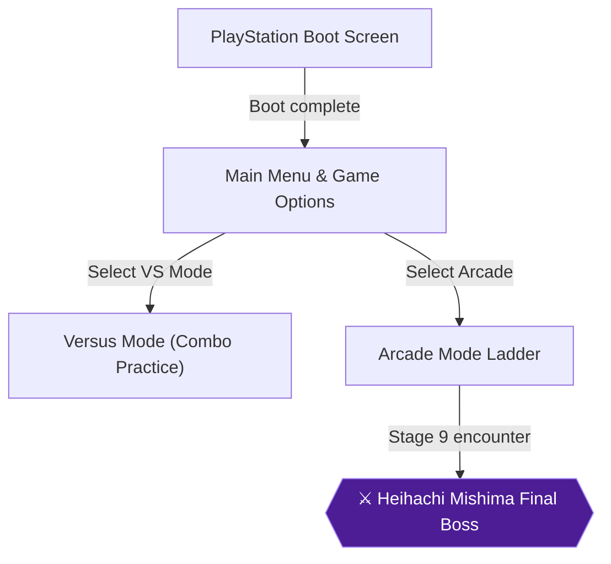
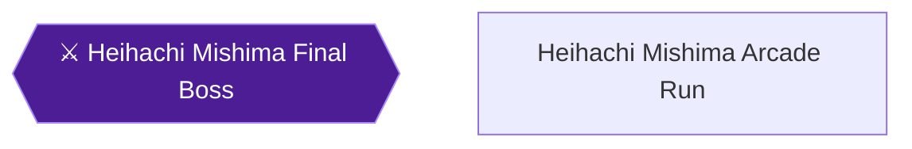
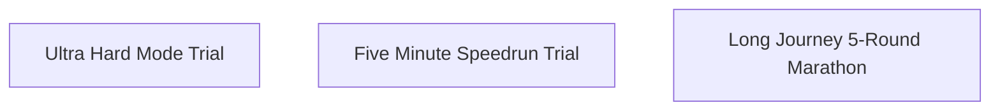

# Tekken — 100% RetroAchievements Walkthrough

## Metadata

- **Platform:** PlayStation
- **Developer:** Namco
- **Publisher:** Namco
- **Genre:** 3D Fighting
- **Released:** 1995-03-31
- **Achievements:** 43 (585 points)

> [!NOTE]
> Every instruction in this guide was extracted from the sources listed at the bottom and checked against them (16 facts confirmed by 2+ sources, 130 from a single source). Statements marked 🟡 come from only one source. Anything we could not confirm says **"Unable to verify from collected sources."**

## Game Overview

Tekken on the Sony PlayStation is Namco's seminal 1995 3D fighting masterpiece, introducing players to the King of Iron Fist Tournament with a revolutionary 4-button limb-based combat system, intricate juggles, and an expansive roster of 17 distinct combatants 🟡. This guide provides an authoritative, step-by-step roadmap to achieve 100% completion in RetroAchievements Hardcore Mode, covering every character unlock, combo trial, difficulty hurdle, and the legendary Galaga boot mini-game challenge 🟡.

## Core Battle System & Controller Layout

Tekken assigns each of the PlayStation face buttons to a specific limb rather than abstract punch or kick intensities 🟡. Mastering this layout is the fundamental prerequisite for executing all basic attacks, throws, and devastating combinations:
- **Left Punch (LP / 1):** Square button (`[Square]`) delivers high-speed jabs and initiates string openers.
- **Right Punch (RP / 2):** Triangle button (`[Triangle]`) provides heavier straight punches and launcher uppercuts 🟡.
- **Left Kick (LK / 3):** Cross button (`[Cross]`) controls low sweeps, side kicks, and knee strikes.
- **Right Kick (RK / 4):** Circle button (`[Circle]`) executes roundhouse kicks and high-damage knockdown boots 🟡.

Universal throws are executed by pressing two buttons simultaneously at close range: press `LP + LK` (`[Square] + [Cross]`) for standard Left Throws, or `RP + RK` (`[Triangle] + [Circle]`) for heavier Right Throws 🟡. To avoid being thrown, players must duck underneath grab attempts by crouching, as throws in Tekken cannot connect against crouching opponents 🟡.

## Defensive Fundamentals & Movement Mechanics

Defensive mastery in Tekken requires an understanding of the two-state blocking architecture 🟡:
- **High / Mid Guard:** Hold `Back` (`[B]`) on the directional pad to automatically defend against standing punches, jumping attacks, and mid-level strikes 🟡.
- **Low Guard:** Hold `Down-Back` (`[DB]`) to crouch and block low sweeps and sliding kicks 🟡. Note that crouching leaves your fighter completely vulnerable to mid-level launcher uppercuts and axe kicks 🟡.
- **Dashing & Spacing:** Tap `Forward, Forward` (`[F], [F]`) to execute a rapid forward dash, or tap `Back, Back` (`[B], [B]`) to perform a defensive backdash out of strike range 🟡.
- **Running Attacks:** Double tap and hold forward from at least two screen distances away to initiate a sprint 🟡. Running attacks deal tremendous kinetic damage, knock opponents clean across the arena, and allow offensive juggles against escaping adversaries 🟡.
- **Grounded Punishments (Pounces):** When an opponent is knocked flat on the floor, press `Up + Right Punch` (`[U] + [RP]`) to execute a diving pounce attack that inflicts reliable ground damage before they can tech roll 🟡.

## Combination Systems & Execution Hierarchy

Tekken separates offensive sequences into three distinct execution categories 🟡:
1. **Natural Combos & 3-Hit Juggles:** True combos where the initial strike stuns or launches the opponent airborne, guaranteeing that subsequent hits connect before recovery 🟡. Landing any clean 3-hit juggle unlocks the *Beginner Combo* achievement 🟡.
2. **Ten-Attack Strings:** Extensive pre-programmed sequences unique to each combatant. While not all hits within a 10-string combo naturally trap the opponent if blocked, executing all ten inputs cleanly in sequence completes the *Ultimate Combo* achievement 🟡.
3. **Character Signature 6-Hit Combos:** Each of the 17 playable fighters possesses an achievement requiring a 6-hit combo 🟡. While these can be executed during regular Arcade mode play, they are most comfortably practiced and triggered in 2-Player Versus Mode against an idle second controller 🟡.

## Tournament Roster & Progression Architecture

The Iron Fist Tournament features a structured 17-character unlock tree 🟡:
- **The Starting Eight:** Kazuya Mishima, Paul Phoenix, Marshall Law, Nina Williams, Jack, King, Yoshimitsu, and Michelle Chang are available by default.
- **The Eight Sub-Boss Rivals:** Each base character faces a designated sub-boss rival in Stage 8 of Arcade Mode 🟡. Defeating that rival and finishing the run unlocks them as a fully playable fighter: Kazuya unlocks Lee Chaolan; Paul unlocks Kuma; Law unlocks Wang Jinrei; Nina unlocks Anna Williams; Jack unlocks Prototype Jack; King unlocks Armor King; Yoshimitsu unlocks Ganryu; and Michelle unlocks Kunimitsu 🟡.
- **Heihachi Mishima:** The final boss of the tournament can be unlocked by conquering Arcade Mode with any character without using a single continue 🟡.
- **Devil Kazuya:** The sinister alternate costume for Kazuya is unlocked by mastering the Galaga mini-game during the initial game boot screen 🟡.
- **Roster Milestone:** Unlocking all eight sub-bosses, Heihachi Mishima, and Devil Kazuya triggers the *All Fighters Ready for Combat!* achievement 🟡.

## RetroAchievements Hardcore Rules & Emulator Notes

To maintain strict compliance with RetroAchievements Hardcore guidelines, all arcade mode runs must be finished with default settings and no continues on Medium difficulty 🟡:
- **No Cheat Codes or Dual-Ship Hacks:** The player 2 dual-ship shortcut during Galaga invalidates the achievement logic; Devil Kazuya and the mini-game achievement must be earned with standard play 🟡.
- **No Cheats or External Tools:** All achievements must be unlocked via real-time console execution without memory manipulation 🟡.
- **Emulator Recommendation:** While RetroAchievements supports multiple PlayStation cores, user telemetry in `ra-comments` indicates that certain Arcade finish triggers (such as *Long Journey*) can experience misfires on standalone DuckStation builds 🟡. Playing on **Beetle PSX** or **SwanStation via RetroArch** is strongly recommended to guarantee seamless achievement triggering 🟡.

## Achievement Roadmap

| Chapter | Achievements | Points |
|---|---|---|
| [1. Boot Challenge & Core Combat Fundamentals](#chapter-1-boot-challenge-core-combat-fundamentals) | Namco Classic Challenge, Master of Evasion, Beginner Combo, Ultimate Combo | 85 |
| [2. The Original Eight: Base Roster Campaigns & Sub-Boss Unlocks](#chapter-2-the-original-eight-base-roster-campaigns-sub-boss-unlocks) | Cold-Blooded Son, Iron Fist - Kazuya, Hot-blooded Martial Artist, Iron Fist - Paul, The Legendary Dragon, Iron Fist - Law, Silent Assassin, Iron Fist - Nina, Super Killing Machine, Iron Fist - Jack, Beast Priest, Iron Fist - King, The Inheritor of the Demon, Iron Fist - Yoshimitsu, Wandering Female Fighter, Iron Fist - Michelle | 160 |
| [3. The Sub-Boss Uprising & Full Roster Completion](#chapter-3-the-sub-boss-uprising-full-roster-completion) | Fighting Sage, Iron Fist - Wang, Silver Haired-Demon, Iron Fist - Lee, Lost Memory Monster, Iron Fist - P.Jack, Wicked Flower, Iron Fist - Armor King, Rikishi Strength, Iron Fist - Ganryu, Scarlet Lightning, Iron Fist - Anna, Mad Bear, Iron Fist - Kuma, Traitorous Female Ninja, Iron Fist - Kunimitsu, All Fighters Ready for Combat! | 185 |
| [4. The Mishima Zaibatsu: Heihachi Campaign & Mastery](#chapter-4-the-mishima-zaibatsu-heihachi-campaign-mastery) | The King of Iron Fist, Iron Fist - Heihachi | 20 |
| [5. Master of the Iron Fist: Hard, Speedrun & Marathon Trials](#chapter-5-master-of-the-iron-fist-hard-speedrun-marathon-trials) | Hand-to-Hand Veteran, Hand-to-Hand Expert, Five Minute Death Punch, Long Journey | 135 |

## Playthrough Planning

**Playthroughs required:** 1

Tekken (PS1) is a 3D fighting game where 100% completion requires completing individual Arcade mode campaigns across all characters, practicing combos in Versus Mode or Arcade Mode, clearing the Galaga loading mini-game, and tackling specific difficulty/endurance parameters. No achievements are permanently missable or mutually exclusive, as individual Arcade runs and VS Mode matches can be attempted at any time.

**Settings:** Default settings: Difficulty Medium, Round Count 3, Round Time 40. Individual achievements require adjusting Difficulty to Ultra Hard (for 90422/90423) or Round Count to 5 (for 90429).

 🟡

## True 100% In-Game Completion Criteria

This guide covers complete in-game mastery in addition to all RetroAchievements:

| Category | 100% Requirement | Tracking Scope |
|---|---|---|
| **Playable Character Roster** | Unlock all 8 mid-boss rivals, the final boss Heihachi Mishima, and alternate costume Devil Kazuya (17 characters total). | Per-chapter checkpoint |
| **Arcade Story Campaigns** | Complete Arcade mode without character switching on Medium difficulty or higher across all 17 fighters. | Per-chapter checkpoint |
| **Combos & Technical Execution** | Execute universal 3-hit and 10-hit combinations, along with character-specific 6-hit combos for all 17 fighters. | Per-chapter checkpoint |
| **Difficulty & Endurance Trials** | Finish Arcade mode on Hard, Ultra Hard, under 5 minutes (speedrun), and a grueling 5-round marathon without continues. | Per-chapter checkpoint |

## Missables Summary

No missables were identified in the collected sources.

## Points of No Return

No points of no return were identified in the collected sources.

## Progression Diagrams

### Game Progression

```mermaid
flowchart TD
  Boot_Screen["PlayStation Boot Screen"]
  Game_Options["Main Menu & Game Options"]
  VS_Mode["Versus Mode (Combo Practice)"]
  Arcade_Mode["Arcade Mode Ladder"]
  Kazuya_Arcade["Kazuya Mishima Arcade Run"]
  Paul_Arcade["Paul Phoenix Arcade Run"]
  Law_Arcade["Marshall Law Arcade Run"]
  Nina_Arcade["Nina Williams Arcade Run"]
  Jack_Arcade["Jack Arcade Run"]
  King_Arcade["King Arcade Run"]
  Yoshimitsu_Arcade["Yoshimitsu Arcade Run"]
  Michelle_Arcade["Michelle Chang Arcade Run"]
  Lee_Arcade["Lee Chaolan Arcade Run"]
  Kuma_Arcade["Kuma Arcade Run"]
  Wang_Arcade["Wang Jinrei Arcade Run"]
  Anna_Arcade["Anna Williams Arcade Run"]
  PJack_Arcade["Prototype Jack Arcade Run"]
  ArmorKing_Arcade["Armor King Arcade Run"]
  Ganryu_Arcade["Ganryu Arcade Run"]
  Kunimitsu_Arcade["Kunimitsu Arcade Run"]
  Heihachi_Mishima_Boss{{"⚔ Heihachi Mishima Final Boss"}}
  Heihachi_Arcade["Heihachi Mishima Arcade Run"]
  Ultra_Hard_Arcade["Ultra Hard Mode Trial"]
  Speedrun_Arcade["Five Minute Speedrun Trial"]
  Long_Journey_Marathon["Long Journey 5-Round Marathon"]
  Boot_Screen -->|Boot complete| Game_Options
  Game_Options -->|Select VS Mode| VS_Mode
  Game_Options -->|Select Arcade| Arcade_Mode
  Arcade_Mode --> Kazuya_Arcade
  Arcade_Mode --> Paul_Arcade
  Arcade_Mode --> Law_Arcade
  Arcade_Mode --> Nina_Arcade
  Arcade_Mode --> Jack_Arcade
  Arcade_Mode --> King_Arcade
  Arcade_Mode --> Yoshimitsu_Arcade
  Arcade_Mode --> Michelle_Arcade
  Arcade_Mode -->|Stage 9 encounter| Heihachi_Mishima_Boss
  Arcade_Mode -->|Options: Ultra Hard| Ultra_Hard_Arcade
  Arcade_Mode -->|Default settings| Speedrun_Arcade
  Arcade_Mode -->|Options: 5 Rounds| Long_Journey_Marathon
  classDef ponr fill:#7f1d1d,stroke:#f87171,color:#fff;
  classDef boss fill:#4c1d95,stroke:#a78bfa,color:#fff;
  class Heihachi_Mishima_Boss boss;
```

### Achievement Dependencies

```mermaid
flowchart LR
  Galaga_MiniGame["Galaga Boot Mini-Game"]
  Ach_90355(["🏆 Namco Classic Challenge"])
  VS_Mode["Versus Mode (Combo Practice)"]
  Ach_90432(["🏆 Beginner Combo"])
  Ach_90433(["🏆 Ultimate Combo"])
  Arcade_Mode["Arcade Mode Ladder"]
  Ach_90406(["🏆 Master of Evasion"])
  Kazuya_Arcade["Kazuya Mishima Arcade Run"]
  Ach_90395(["🏆 Cold-Blooded Son"])
  Ach_90431(["🏆 Iron Fist - Kazuya"])
  Paul_Arcade["Paul Phoenix Arcade Run"]
  Ach_90408(["🏆 Hot-blooded Martial Artist"])
  Ach_90434(["🏆 Iron Fist - Paul"])
  Law_Arcade["Marshall Law Arcade Run"]
  Ach_90409(["🏆 The Legendary Dragon"])
  Ach_90435(["🏆 Iron Fist - Law"])
  Nina_Arcade["Nina Williams Arcade Run"]
  Ach_90407(["🏆 Silent Assassin"])
  Ach_90437(["🏆 Iron Fist - Nina"])
  Jack_Arcade["Jack Arcade Run"]
  Ach_90410(["🏆 Super Killing Machine"])
  Ach_90436(["🏆 Iron Fist - Jack"])
  King_Arcade["King Arcade Run"]
  Ach_90411(["🏆 Beast Priest"])
  Ach_90438(["🏆 Iron Fist - King"])
  Yoshimitsu_Arcade["Yoshimitsu Arcade Run"]
  Ach_90396(["🏆 The Inheritor of the Demon"])
  Ach_90439(["🏆 Iron Fist - Yoshimitsu"])
  Michelle_Arcade["Michelle Chang Arcade Run"]
  Ach_90412(["🏆 Wandering Female Fighter"])
  Ach_90440(["🏆 Iron Fist - Michelle"])
  Lee_Arcade["Lee Chaolan Arcade Run"]
  Ach_90415(["🏆 Silver Haired-Demon"])
  Ach_90477(["🏆 Iron Fist - Lee"])
  Kuma_Arcade["Kuma Arcade Run"]
  Ach_90420(["🏆 Mad Bear"])
  Ach_90482(["🏆 Iron Fist - Kuma"])
  Wang_Arcade["Wang Jinrei Arcade Run"]
  Ach_90413(["🏆 Fighting Sage"])
  Ach_90483(["🏆 Iron Fist - Wang"])
  Anna_Arcade["Anna Williams Arcade Run"]
  Ach_90419(["🏆 Scarlet Lightning"])
  Ach_90480(["🏆 Iron Fist - Anna"])
  PJack_Arcade["Prototype Jack Arcade Run"]
  Ach_90416(["🏆 Lost Memory Monster"])
  Ach_90478(["🏆 Iron Fist - P.Jack"])
  ArmorKing_Arcade["Armor King Arcade Run"]
  Ach_90417(["🏆 Wicked Flower"])
  Ach_90479(["🏆 Iron Fist - Armor King"])
  Ganryu_Arcade["Ganryu Arcade Run"]
  Ach_90418(["🏆 Rikishi Strength"])
  Ach_90481(["🏆 Iron Fist - Ganryu"])
  Kunimitsu_Arcade["Kunimitsu Arcade Run"]
  Ach_90421(["🏆 Traitorous Female Ninja"])
  Ach_90442(["🏆 Iron Fist - Kunimitsu"])
  Heihachi_Arcade["Heihachi Mishima Arcade Run"]
  Ach_90414(["🏆 The King of Iron Fist"])
  Ach_90441(["🏆 Iron Fist - Heihachi"])
  Full_Roster_Unlocked["All Fighters Ready Milestone"]
  Ach_90428(["🏆 All Fighters Ready for Combat!"])
  Ultra_Hard_Arcade["Ultra Hard Mode Trial"]
  Ach_90423(["🏆 Hand-to-Hand Veteran"])
  Ach_90422(["🏆 Hand-to-Hand Expert"])
  Speedrun_Arcade["Five Minute Speedrun Trial"]
  Ach_90427(["🏆 Five Minute Death Punch"])
  Long_Journey_Marathon["Long Journey 5-Round Marathon"]
  Ach_90429(["🏆 Long Journey"])
  Galaga_MiniGame -->|unlocks| Ach_90355
  VS_Mode -->|unlocks| Ach_90432
  VS_Mode -->|unlocks| Ach_90433
  Arcade_Mode -->|unlocks| Ach_90406
  Kazuya_Arcade -->|unlocks| Ach_90395
  Kazuya_Arcade -->|unlocks| Ach_90431
  Paul_Arcade -->|unlocks| Ach_90408
  Paul_Arcade -->|unlocks| Ach_90434
  Law_Arcade -->|unlocks| Ach_90409
  Law_Arcade -->|unlocks| Ach_90435
  Nina_Arcade -->|unlocks| Ach_90407
  Nina_Arcade -->|unlocks| Ach_90437
  Jack_Arcade -->|unlocks| Ach_90410
  Jack_Arcade -->|unlocks| Ach_90436
  King_Arcade -->|unlocks| Ach_90411
  King_Arcade -->|unlocks| Ach_90438
  Yoshimitsu_Arcade -->|unlocks| Ach_90396
  Yoshimitsu_Arcade -->|unlocks| Ach_90439
  Michelle_Arcade -->|unlocks| Ach_90412
  Michelle_Arcade -->|unlocks| Ach_90440
  Lee_Arcade -->|unlocks| Ach_90415
  Lee_Arcade -->|unlocks| Ach_90477
  Kuma_Arcade -->|unlocks| Ach_90420
  Kuma_Arcade -->|unlocks| Ach_90482
  Wang_Arcade -->|unlocks| Ach_90413
  Wang_Arcade -->|unlocks| Ach_90483
  Anna_Arcade -->|unlocks| Ach_90419
  Anna_Arcade -->|unlocks| Ach_90480
  PJack_Arcade -->|unlocks| Ach_90416
  PJack_Arcade -->|unlocks| Ach_90478
  ArmorKing_Arcade -->|unlocks| Ach_90417
  ArmorKing_Arcade -->|unlocks| Ach_90479
  Ganryu_Arcade -->|unlocks| Ach_90418
  Ganryu_Arcade -->|unlocks| Ach_90481
  Kunimitsu_Arcade -->|unlocks| Ach_90421
  Kunimitsu_Arcade -->|unlocks| Ach_90442
  Heihachi_Arcade -->|unlocks| Ach_90414
  Heihachi_Arcade -->|unlocks| Ach_90441
  Full_Roster_Unlocked -->|unlocks| Ach_90428
  Ultra_Hard_Arcade -->|unlocks| Ach_90423
  Ultra_Hard_Arcade -->|unlocks| Ach_90422
  Speedrun_Arcade -->|unlocks| Ach_90427
  Long_Journey_Marathon -->|unlocks| Ach_90429
```

## Boss Index

Full strategies are in each chapter.

| Boss | Chapter |
|---|---|
| Heihachi Mishima Final Boss | [1. Boot Challenge & Core Combat Fundamentals](#chapter-1-boot-challenge-core-combat-fundamentals) |

## Walkthrough

## Chapter 1: Boot Challenge & Core Combat Fundamentals

Welcome to the King of Iron Fist Tournament. Before stepping into the arena, our journey begins directly on the game's initial loading sequence, where a classic Namco arcade mini-game hides one of the game's most iconic secret characters 🟡. From there, we configure optimal tournament options, enter Arcade Mode to earn our first defensive accolade, and transition into Versus Mode (Combo Practice) to master universal combination mechanics against an idle sparring partner 🟡.

### PlayStation Boot Screen & Galaga Boot Mini-Game

When you boot Tekken on PlayStation, Namco presents a fully playable rendition of the legendary arcade shoot-'em-up Galaga while the game disc loads assets into memory 🟡. Conquering this mini-game is your very first objective in the 100% walkthrough 🟡.

> **Galaga Mini-Game Targets:**
> - Stage 1 Clear Time: 18.5 seconds or under grants an automatic Dual-Ship configuration 🟡.
> - Stages 1 through 8 Clear: Finish all 8 stages using no more than one continue to unlock Devil Kazuya 🟡.

To earn both the achievement and the character unlock, you must clear all 8 stages of Galaga using no more than one single continue 🟡. If you wipe out all enemy waves in Stage 1 in 18.5 seconds or less, you are awarded an immediate dual-ship configuration 🟡. Having double firepower makes wiping out the challenging formations in Stages 2 through 8 significantly easier 🟡.

> [!WARNING]
> Do NOT use the player 2 controller dual-ship cheat code 🟡. RetroAchievements detects the memory flags altered by the external input cheat, permanently invalidating the achievement for that session 🟡. You must earn your dual ship legitimately by shooting down the Stage 1 enemies quickly or proceed with a single fighter 🟡.

Focus your fire on the diving alien tractor-beam commanders, keep your ship centered during initial entry patterns, and rapidly tap fire 🟡. Once you successfully destroy the boss flagship on Stage 8 while using one continue or fewer, the game announces your victory and returns to the title screen 🟡.

> [!ACHIEVEMENT]
> **Namco Classic Challenge (50 Points)**
> 
> *Beat all stages in Galaga with a perfect while using no more than one continue in order to unlock Devil Kazuya*

Clearing this challenge permanently unlocks Devil Kazuya on your save file 🟡. To play as Devil Kazuya, highlight Kazuya Mishima on the character select screen and press `[Start]` or `[Triangle]` 🟡.

### Main Menu & Game Options Configuration

From the title screen, enter the **Game Options** menu to confirm and verify standard tournament regulations 🟡. Ensuring these baseline settings are active is mandatory for subsequent Arcade campaign achievements to register properly 🟡.

Verify that your settings match the following parameters 🟡:
- **Difficulty:** Medium (Default) 🟡
- **Fight Count (Rounds):** 3 Rounds to Win (Default) 🟡
- **Round Time:** 40 Seconds (Default) 🟡
- **Violence / Sparks:** Default setting displaying standard hit sparks 🟡.

Unless an achievement explicitly dictates otherwise (such as Ultra Hard for achievement 90422 or 5 Rounds for achievement 90429), keep these default settings untouched throughout your playthroughs 🟡.

### Arcade Mode Ladder: The Flawless Round

With your settings configured, select **Arcade Mode** from the main menu and choose any character you are comfortable with—Paul Phoenix or Kazuya Mishima are excellent choices due to their heavy single-hit damage.

In Stage 1 of Arcade Mode, the computer AI operates at a very passive level 🟡. Take advantage of this immediately to score a Perfect round victory without sustaining a single point of damage 🟡. Hold `Back` to guard any incoming high punches, or crouch by holding `Down-Back` if the opponent attempts a low sweep 🟡. As soon as the opponent whiffs an attack, punish immediately with a heavy attack or a throw by pressing `LP + LK` 🟡. Winning any single round with your life bar completely full unlocks your next milestone 🟡.

> [!ACHIEVEMENT]
> **Master of Evasion (5 Points)**
> 
> *Win any round with a perfect*

### Versus Mode (Combo Practice): Universal Combo Mastery

Exit back to the main menu and select Versus Mode (Combo Practice) 🟡. Using a second controller allows you to practice combinations against a completely stationary sparring dummy that never blocks or counter-attacks 🟡.

First, we will satisfy the 3-hit combo requirement 🟡. Select Kazuya Mishima on Player 1. Approach Player 2 and execute Kazuya's Double Walking Uppercut followed by a standing jab: input `Down-Forward + LP, RP`, immediately followed by a neutral `LP` (`(DF + LP, RP), LP`) 🟡. All three strikes connect consecutively as a natural airborne juggle, granting the achievement 🟡.

> [!ACHIEVEMENT]
> **Beginner Combo (5 Points)**
> 
> *Perform a 3 hit combo*

Next, we tackle the formidable 10-hit combination. In Tekken, ten-attack strings are intricate pre-programmed attack sequences that unleash a barrage of high, mid, and low hits 🟡. Paul Phoenix possesses one of the most reliable and rhythmic 10-hit combos in the game.

Select Paul Phoenix and position yourself directly in front of the idle Player 2 dummy. Enter the following 10-strike sequence rhythmically: press `LP`, then `RP`, then `LK`, then `RP`, then `LP`, then `RP`, then `LP`, then `RK`, then `RP`, and finally `LP` (`[Square] -> [Triangle] -> [Cross] -> [Triangle] -> [Square] -> [Triangle] -> [Square] -> [Circle] -> [Triangle] -> [Square]`). Input each button as the prior strike begins its animation. Once the tenth strike connects and the hit counter reaches 10, the Ultimate Combo achievement unlocks 🟡.

> [!ACHIEVEMENT]
> **Ultimate Combo (25 Points)**
> 
> *Perform a 10 hit combo*

> [!IMPORTANT]
> ### Chapter 1 Cumulative 100% Checkpoint 🟡
> - **Playable Character Roster:** 9 / 17 (8 Base Fighters + Devil Kazuya)
> - **Arcade Story Campaigns:** 0 / 17
> - **Combos & Technical Execution:** 2 / 19 (Beginner 3-Hit Combo, Ultimate 10-Hit Combo)
> - **Difficulty & Endurance Trials:** 1 / 4 (Galaga Boot Challenge Complete)
> - **RetroAchievements Unlocked:** 4 / 43 (35 / 470 Points)

### Chapter 1 Checklist

Before moving on to the character arcade campaigns, verify that you beat all stages in Galaga with no more than one continue to unlock Devil Kazuya 🟡:
- [x] Cleared all 8 stages of Galaga with $\le 1$ continue to unlock Devil Kazuya 🟡.
- [x] Unlocked *Namco Classic Challenge* (90355) 🟡.
- [x] Verified default game settings in the Options menu (Medium difficulty, 40s time, 3 rounds) 🟡.
- [x] Achieved a Perfect round victory in Arcade Mode to unlock *Master of Evasion* (90406) 🟡.
- [x] Executed a 3-hit juggle combo in Versus Mode to unlock *Beginner Combo* (90432) 🟡.
- [x] Executed Paul Phoenix's complete 10-attack string in Versus Mode to unlock *Ultimate Combo* (90433).

---

## Chapter 2: The Original Eight: Base Roster Campaigns & Sub-Boss Unlocks

```mermaid
flowchart TD
  Kazuya_Arcade["Kazuya Mishima Arcade Run"]
  Paul_Arcade["Paul Phoenix Arcade Run"]
  Law_Arcade["Marshall Law Arcade Run"]
  Nina_Arcade["Nina Williams Arcade Run"]
  Jack_Arcade["Jack Arcade Run"]
  King_Arcade["King Arcade Run"]
  Yoshimitsu_Arcade["Yoshimitsu Arcade Run"]
  Michelle_Arcade["Michelle Chang Arcade Run"]
  classDef ponr fill:#7f1d1d,stroke:#f87171,color:#fff;
  classDef boss fill:#4c1d95,stroke:#a78bfa,color:#fff;
```

In this chapter, we take each of the eight original starting fighters through Arcade Mode on Medium difficulty without changing characters 🟡. Each base combatant faces a designated sub-boss rival in Stage 8 and the Mishima Zaibatsu patriarch Heihachi Mishima in Stage 9 🟡. Clearing Arcade mode with each fighter unlocks their defeated rival as a playable character, and executing each fighter's signature 6-hit combo earns their respective Iron Fist achievement 🟡.

### Kazuya Mishima Arcade Run

Kazuya Mishima is the legitimate heir to the Mishima financial empire and a deadly karate combatant possessing exceptional mid-range launchers and punishing strikes. His signature moves include the Dragon Punch (`F, D, DF + LP`), the Lunging Uppercut (`F, D, DF + RP`), and the Twin Pistons (`DF + LP, RP`) 🟡.

> **Kazuya Mishima Campaign Profile:**
> - Stage 8 Rival: Lee Chaolan (Defeat to unlock Lee Chaolan) 🟡.
> - Stage 9 Final Boss: Heihachi Mishima 🟡.
> - Signature 6-Hit String: `F, F(Hold)+RP, LP, RP, RP, LK, RK`.

Navigate through Stages 1 through 7 using Kazuya's powerful Lunging Uppercut to launch advancing opponents into the air, following up with a grounded Axe Kick for massive damage 🟡. In Stage 8, you face Kazuya's adoptive brother and rival, Lee Chaolan 🟡. Lee favors quick sliding kicks; block low by holding `Down-Back` and punish his recovery with Twin Pistons 🟡. In Stage 9, confront Heihachi Mishima at the Mishima estate 🟡. Bait Heihachi's Wind God Fist, duck beneath his high punches, and counter with heavy throws (`LP + LK`) 🟡. Defeating Heihachi without changing characters completes the campaign, unlocking Lee Chaolan 🟡.

> [!ACHIEVEMENT]
> **Cold-Blooded Son (10 Points)**
> 
> *Finish Arcade mode as Kazuya on Medium difficulty or higher without changing characters*

To earn Kazuya's combo achievement, perform the first 6 hits of his 10-attack string: input `Forward, Forward(Hold) + Right Punch, Left Punch, Right Punch, Right Punch, Left Kick, Right Kick` (`F, F(Hold) + RP, LP, RP, RP, LK, RK`). Once the 6th hit registers on the combo counter, the achievement pops 🟡. This can be completed during your Arcade run or against an idle Player 2 dummy in Versus Mode 🟡.

> [!ACHIEVEMENT]
> **Iron Fist - Kazuya (10 Points)**
> 
> *Perform a 6 hit combo with Kazuya*

### Paul Phoenix Arcade Run

Paul Phoenix is an American martial artist who travels the globe seeking a worthy adversary. Paul's arsenal revolves around pure physical devastation, headlined by his legendary Power Punch (`Down, Down-Forward, Forward + RP` / `D,DF,F + RP` / PonKen) which inflicts 50 damage on clean hit, and the Hammer Fist (`Down + LP`) 🟡.

> **Paul Phoenix Campaign Profile:**
> - Stage 8 Rival: Kuma (Defeat to unlock Kuma) 🟡.
> - Stage 9 Final Boss: Heihachi Mishima 🟡.
> - Signature 6-Hit String: `LP, RP, LK, RP, LP, RP`.

Paul's campaign is straightforward due to the absurd stopping power of PonKen 🟡. Backdash away from enemy attacks, wait for the AI to whiff, and unleash `D,DF,F + RP` to shred their life bar 🟡. In Stage 8, Paul encounters Kuma, Heihachi's loyal guard bear 🟡. Kuma's massive hitbox makes him especially vulnerable to Paul's Power Punch; time your strikes outside Kuma's bear hug range to down the beast quickly 🟡. Proceed to Stage 9 and defeat Heihachi with well-timed counter punches to finish the run and unlock Kuma 🟡.

> [!ACHIEVEMENT]
> **Hot-blooded Martial Artist (10 Points)**
> 
> *Finish Arcade mode as Paul on Medium difficulty or higher without changing characters*

For Paul's combo achievement, input the opening 6 hits of his universal 10-attack sequence: `Left Punch, Right Punch, Left Kick, Right Punch, Left Punch, Right Punch` (`LP, RP, LK, RP, LP, RP`). The sixth punch registers cleanly to unlock the award 🟡.

> [!ACHIEVEMENT]
> **Iron Fist - Paul (10 Points)**
> 
> *Perform a 6 hit combo with Paul*

### Marshall Law Arcade Run

Marshall Law is an expert martial artist and chef inspired by classic Jeet Kune Do. His offensive style features rapid multi-hit kick strings and backflips, including the Somersault Kick (`Up-Forward + RK`), the Dragon Slash, and low spinning sweeps.

> **Marshall Law Campaign Profile:**
> - Stage 8 Rival: Wang Jinrei (Defeat to unlock Wang Jinrei).
> - Stage 9 Final Boss: Heihachi Mishima 🟡.
> - Signature 6-Hit String: `DF(tap) + LP, RP, RP, LP, LK, LK`.

Use Law's swift standing jabs and Somersault Kick to counter aggressive opponents throughout the tournament ladder 🟡. In Stage 8, Law faces his rival, the martial arts master Wang Jinrei. Wang utilizes tricky mid-range pokes and parries; bypass his guard by utilizing low sliding kicks and overhead axe kicks 🟡. Overcome Heihachi in Stage 9 without swapping characters to clear the campaign and unlock Wang Jinrei 🟡.

> [!ACHIEVEMENT]
> **The Legendary Dragon (10 Points)**
> 
> *Finish Arcade mode as Law on Medium difficulty or higher without changing characters*

To earn Law's combo achievement, execute the first 6 strikes of his 10-attack combination: tap `Down-Forward + Left Punch, Right Punch, Right Punch, Left Punch, Left Kick, Left Kick` (`DF(tap) + LP, RP, RP, LP, LK, LK`). The rapid string connects for 6 consecutive hits 🟡.

> [!ACHIEVEMENT]
> **Iron Fist - Law (10 Points)**
> 
> *Perform a 6 hit combo with Law*

### Nina Williams Arcade Run

Nina Williams is an Irish assassin trained in deadly Bone Martial Arts and Aikido joint locks 🟡. Nina's toolset emphasizes brutal combo strings, the Hunting Kick combo, and devastating multi-part throws such as the Arm Break and Crab Hold 🟡.

> **Nina Williams Campaign Profile:**
> - Stage 8 Rival: Anna Williams (Defeat to unlock Anna Williams) 🟡.
> - Stage 9 Final Boss: Heihachi Mishima 🟡.
> - Signature 6-Hit String: `LP, RP, LP, RP, LK, LK` 🟡.

Control space with Nina's forward-advancing kicks and punish missed attacks with her swift three-punch combos 🟡. In Stage 8, Nina confronts her bitter sister and rival assassin, Anna Williams 🟡. Anna shares much of Nina's offensive cadence; anticipate Anna's high punches by ducking and countering with Nina's low sweeps or Bone Cutter (`F,F,F + RK`) 🟡. Finish Stage 9 against Heihachi to unlock Anna Williams as a playable fighter 🟡.

> [!ACHIEVEMENT]
> **Silent Assassin (10 Points)**
> 
> *Finish Arcade mode as Nina on Medium difficulty or higher without changing characters*

For Nina's combo achievement, execute the first 6 strikes of her 10-hit sequence: input `Left Punch, Right Punch, Left Punch, Right Punch, Left Kick, Left Kick` (`LP, RP, LP, RP, LK, LK`) 🟡. The final kick cements the 6-hit threshold 🟡.

> [!ACHIEVEMENT]
> **Iron Fist - Nina (10 Points)**
> 
> *Perform a 6 hit combo with Nina*

### Jack Arcade Run

Jack is a Russian military combat android engineered purely for overwhelming physical destruction 🟡. Jack's enormous reach and heavyweight moves include the Overhead Hammer (`Down-Forward + LP + RP`), Machine Gun Punches, and the high-damage Iron Fist 🟡.

> **Jack Campaign Profile:**
> - Stage 8 Rival: Prototype Jack (Defeat to unlock Prototype Jack) 🟡.
> - Stage 9 Final Boss: Heihachi Mishima 🟡.
> - Signature 6-Hit String: `D + RP, LP, RP, LP, D + LP, D + RP`.

Capitalize on Jack's exceptional attack range by keeping opponents at bay with crouching jabs and the Overhead Hammer (`DF + LP + RP`) 🟡. In Stage 8, Jack squares off against his robotic predecessor, Prototype Jack 🟡. Both androids possess massive damage output, so maintain a defensive high guard against P.Jack's wind-up punches and punish his slow recovery frames 🟡. Defeat Heihachi in Stage 9 to unlock Prototype Jack 🟡.

> [!ACHIEVEMENT]
> **Super Killing Machine (10 Points)**
> 
> *Finish Arcade mode as Jack on Medium difficulty or higher without changing characters*

To unlock Jack's combo award, perform the opening 6 strikes of his 10-attack string: input `Down + Right Punch, Left Punch, Right Punch, Left Punch, Down + Left Punch, Down + Right Punch` (`D + RP, LP, RP, LP, D + LP, D + RP`). The heavy blows connect sequentially to trigger the achievement 🟡.

> [!ACHIEVEMENT]
> **Iron Fist - Jack (10 Points)**
> 
> *Perform a 6 hit combo with Jack*

### King Arcade Run

King is a Mexican luchador who wears a jaguar mask, dedicated to winning the tournament's prize money to fund his orphanage 🟡. King is the premier grappler of the roster, wielding devastating throws like the Coconut Crush (`1+3`), Brain Buster (`2+4`), and Frankensteiner, alongside the lethal Hop Kick 🟡.

> **King Campaign Profile:**
> - Stage 8 Rival: Armor King (Defeat to unlock Armor King) 🟡.
> - Stage 9 Final Boss: Heihachi Mishima 🟡.
> - Signature 6-Hit String: `D + RP, LP, LP, LP, RP, LK` 🟡.

Use King's crouching jabs and hop kicks to control incoming rushdowns, transitioning smoothly into high-damage command throws whenever the AI hesitates 🟡. In Stage 8, King faces his former mentor and bitter rival, Armor King 🟡. Armor King possesses similar wrestling throws but adds a lunging uppercut; keep Armor King grounded with King's low sweeps and diving elbow drops 🟡. Conquer Stage 9 against Heihachi to unlock Armor King 🟡.

> [!ACHIEVEMENT]
> **Beast Priest (10 Points)**
> 
> *Finish Arcade mode as King on Medium difficulty or higher without changing characters*

To earn King's combo achievement, execute the first 6 strikes of his 10-attack string: input `Down + Right Punch, Left Punch, Left Punch, Left Punch, Right Punch, Left Kick` (`D + RP, LP, LP, LP, RP, LK`) 🟡. Connecting all six strikes awards the achievement 🟡.

> [!ACHIEVEMENT]
> **Iron Fist - King (10 Points)**
> 
> *Perform a 6 hit combo with King*

### Yoshimitsu Arcade Run

Yoshimitsu is the cybernetic ninja leader of the honorable Manji Clan, wielding a mystical sword and eccentric ninjutsu evasions. His distinctive abilities include sword slashes, the multi-spin evasive maneuver (`hold Back + LP`), spinning sweeps, and helicopter pounces 🟡.

> **Yoshimitsu Campaign Profile:**
> - Stage 8 Rival: Ganryu (Defeat to unlock Ganryu).
> - Stage 9 Final Boss: Heihachi Mishima 🟡.
> - Signature 6-Hit String: `LP, RP, LP, RK, RK, RK`.

Exploit Yoshimitsu's sword range and spinning sweeps to trip advancing enemies 🟡. In Stage 8, Yoshimitsu confronts the corrupt sumo rikishi Ganryu. Ganryu is slow and heavily vulnerable to low attacks; utilize Yoshimitsu's spinning leg sweeps (`tap DB + LK`) to repeatedly knock Ganryu flat on his back 🟡. Proceed to Stage 9 and defeat Heihachi to unlock Ganryu 🟡.

> [!ACHIEVEMENT]
> **The Inheritor of the Demon (10 Points)**
> 
> *Finish Arcade mode as Yoshimitsu on Medium difficulty or higher without changing characters*

For Yoshimitsu's combo achievement, input the opening 6 hits of his 10-attack sequence: `Left Punch, Right Punch, Left Punch, Right Kick, Right Kick, Right Kick` (`LP, RP, LP, RK, RK, RK`). Once the sixth strike connects cleanly, the achievement unlocks 🟡.

> [!ACHIEVEMENT]
> **Iron Fist - Yoshimitsu (10 Points)**
> 
> *Perform a 6 hit combo with Yoshimitsu*

### Michelle Chang Arcade Run

Michelle Chang is a brave young woman fighting to reclaim her ancestral homeland and avenge her father's demise at the hands of Heihachi. Michelle's fighting style blends rapid Chinese kenpo strikes, high-impact pounces (`UF + LK + RP`), and swift punch flurries 🟡.

> **Michelle Chang Campaign Profile:**
> - Stage 8 Rival: Kunimitsu (Defeat to unlock Kunimitsu).
> - Stage 9 Final Boss: Heihachi Mishima 🟡.
> - Signature 6-Hit String: `RP, LP, LP, RP, LK, LK` 🟡.

Michelle is one of the most effective fighters in Tekken due to her lightning-quick 5-punch flurry (`RP, LP, LP, LP, RP`) and powerful hopback stomp 🟡. In Stage 8, Michelle encounters the masked rogue ninja Kunimitsu. Kunimitsu attacks with rapid dash strikes; block high and retaliate with Michelle's 5-punch sequence 🟡. After defeating Kunimitsu, topple Heihachi in Stage 9 to complete your base roster campaigns and unlock Kunimitsu 🟡.

> [!ACHIEVEMENT]
> **Wandering Female Fighter (10 Points)**
> 
> *Finish Arcade mode as Michelle on Medium difficulty or higher without changing characters*

To complete Michelle's combo trial, execute the first 6 strikes of her 10-attack string: input `Right Punch, Left Punch, Left Punch, Right Punch, Left Kick, Left Kick` (`RP, LP, LP, RP, LK, LK`) 🟡. Connecting all six hits triggers the achievement 🟡.

> [!ACHIEVEMENT]
> **Iron Fist - Michelle (10 Points)**
> 
> *Perform a 6 hit combo with Michelle*

> [!IMPORTANT]
> ### Chapter 2 Cumulative 100% Checkpoint 🟡
> - **Playable Character Roster:** 16 / 17 (+8 Sub-Bosses Unlocked: Lee, Kuma, Wang, Anna, P.Jack, Armor King, Ganryu, Kunimitsu)
> - **Arcade Story Campaigns:** 8 / 17 (8 Base Characters Cleared)
> - **Combos & Technical Execution:** 10 / 19 (+8 Signature 6-Hit Combos)
> - **Difficulty & Endurance Trials:** 1 / 4
> - **RetroAchievements Unlocked:** 20 / 43 (195 / 470 Points)

### Chapter 2 Checklist

Before progressing to the sub-boss campaigns in Chapter 3, confirm that each base character cleared Arcade mode without changing characters 🟡:
- [x] Cleared Arcade Mode as Kazuya and unlocked Lee Chaolan 🟡.
- [x] Executed Kazuya's 6-hit combo to unlock *Iron Fist - Kazuya* (90431).
- [x] Cleared Arcade Mode as Paul and unlocked Kuma 🟡.
- [x] Executed Paul's 6-hit combo to unlock *Iron Fist - Paul* (90434).
- [x] Cleared Arcade Mode as Law and unlocked Wang Jinrei 🟡.
- [x] Executed Law's 6-hit combo to unlock *Iron Fist - Law* (90435).
- [x] Cleared Arcade Mode as Nina and unlocked Anna Williams 🟡.
- [x] Executed Nina's 6-hit combo to unlock *Iron Fist - Nina* (90437) 🟡.
- [x] Cleared Arcade Mode as Jack and unlocked Prototype Jack 🟡.
- [x] Executed Jack's 6-hit combo to unlock *Iron Fist - Jack* (90436).
- [x] Cleared Arcade Mode as King and unlocked Armor King 🟡.
- [x] Executed King's 6-hit combo to unlock *Iron Fist - King* (90438) 🟡.
- [x] Cleared Arcade Mode as Yoshimitsu and unlocked Ganryu 🟡.
- [x] Executed Yoshimitsu's 6-hit combo to unlock *Iron Fist - Yoshimitsu* (90439) 🟡.
- [x] Cleared Arcade Mode as Michelle and unlocked Kunimitsu 🟡.
- [x] Executed Michelle's 6-hit combo to unlock *Iron Fist - Michelle* (90440) 🟡.

---

## Chapter 3: The Sub-Boss Uprising & Full Roster Completion

```mermaid
flowchart TD
  Lee_Arcade["Lee Chaolan Arcade Run"]
  Kuma_Arcade["Kuma Arcade Run"]
  Wang_Arcade["Wang Jinrei Arcade Run"]
  Anna_Arcade["Anna Williams Arcade Run"]
  PJack_Arcade["Prototype Jack Arcade Run"]
  ArmorKing_Arcade["Armor King Arcade Run"]
  Ganryu_Arcade["Ganryu Arcade Run"]
  Kunimitsu_Arcade["Kunimitsu Arcade Run"]
  classDef ponr fill:#7f1d1d,stroke:#f87171,color:#fff;
  classDef boss fill:#4c1d95,stroke:#a78bfa,color:#fff;
```

With the eight original tournament contenders victorious, their respective mid-boss rivals are now fully unlocked and selectable on the character screen 🟡. In this chapter, we conquer Arcade Mode on Medium difficulty with all eight unlocked sub-bosses, master their unique 6-hit combo requirements, and unlock the final boss Heihachi Mishima by completing Arcade Mode without using continues 🟡. Doing so completes the entire 17-character roster, securing the major milestone achievement All Fighters Ready for Combat! 🟡.

### Wang Jinrei Arcade Run

Wang Jinrei is a venerable Chinese martial artist and former companion to Kazuya's grandfather 🟡. Wang shares several baseline techniques with Michelle Chang, but brings devastating unique strikes such as the Standing Dragon Punch (`F, D, DF + RP`), the Diving Elbow Drop, and swift homing silver punch down strikes (`U,2`) 🟡.

> **Wang Jinrei Campaign Profile:**
> - Stage 8 Rival: Marshall Law.
> - Stage 9 Final Boss: Heihachi Mishima 🟡.
> - Signature 6-Hit String: `DF(tap) + RP, LP, RP, LP, LK, LK` 🟡.

Advance through the tournament stages by utilizing Wang's quick low pokes and punish whiffed attacks with his powerful Standing Dragon Punch 🟡. In Stage 8, Wang battles his designated rival Marshall Law. Guard Law's somersault kick strings high, crouch under his flying kicks, and retaliate with heavy throws (`LP + LK`) 🟡. Defeat Heihachi in Stage 9 without changing characters to complete Wang's campaign 🟡.

> [!ACHIEVEMENT]
> **Fighting Sage (10 Points)**
> 
> *Finish Arcade mode as Wang on Medium difficulty or higher without changing characters*

For Wang's combo trial, execute the first 6 strikes of his 10-attack sequence: tap `Down-Forward + Right Punch, Left Punch, Right Punch, Left Punch, Left Kick, Left Kick` (`DF(tap) + RP, LP, RP, LP, LK, LK`) 🟡. The rapid flurry registers 6 consecutive hits to unlock the award 🟡.

> [!ACHIEVEMENT]
> **Iron Fist - Wang (10 Points)**
> 
> *Perform a 6 hit combo with Wang*

### Lee Chaolan Arcade Run

Lee Chaolan, known as "The Silver-haired Demon," is Heihachi's adopted son and Kazuya's lifelong rival 🟡. Lee combines martial arts techniques adapted from Marshall Law with lightning-fast kicks, notably the Lazer's Edge Kick Combo (`Down + RK, RK, RK, RK` / `D,4,4,4,4`), rapid sliding kicks, and running tackles 🟡.

> **Lee Chaolan Campaign Profile:**
> - Stage 8 Rival: Kazuya Mishima 🟡.
> - Stage 9 Final Boss: Heihachi Mishima 🟡.
> - Signature 6-Hit String: `D,4,4,4,4` or 10-String opening 🟡.

Lee's Lazer's Edge Kick combo (`D,4,4,4,4`) is one of the most effective AI-punishing moves in the entire game 🟡. The AI frequently fails to crouch-block the rapid sequence of low kicks, allowing you to breeze through early opponents 🟡. In Stage 8, face Kazuya Mishima 🟡. Anticipate Kazuya's Rising Uppercut, block high, and counter with Lee's slide kick or rapid jab strings 🟡. Overcome Heihachi in Stage 9 to finish Lee's run 🟡.

> [!ACHIEVEMENT]
> **Silver Haired-Demon (10 Points)**
> 
> *Finish Arcade mode as Lee on Medium difficulty or higher without changing characters*

To complete Lee's combo achievement, input his 10-attack string opening or chain his Lazer's Edge Kicks into multi-hit strings (`D,4,4,4,4`) 🟡. Connecting 6 consecutive hits triggers the achievement 🟡.

> [!ACHIEVEMENT]
> **Iron Fist - Lee (10 Points)**
> 
> *Perform a 6 hit combo with Lee*

### Prototype Jack Arcade Run

Prototype Jack (P.Jack) is Russia's early experimental combat robot, designed without exterior skin purely to maximize brute mechanical power 🟡. P.Jack shares Jack's destructive reach but boasts devastating unique juggles like `DF+RP---DF+LP---D+LP---F+RP` and spinning wind-up punches 🟡.

> **Prototype Jack Campaign Profile:**
> - Stage 8 Rival: Jack 🟡.
> - Stage 9 Final Boss: Heihachi Mishima 🟡.
> - Signature 6-Hit String: `D + RP, LP, RP, LP, D + LP, D + RP`.

Maintain distance against incoming enemies by utilizing P.Jack's crouching jabs and Overhead Hammer (`DF + LP + RP`) 🟡. In Stage 8, P.Jack faces the mass-production model Jack 🟡. Wait for Jack's slow hammer punches to miss, then execute P.Jack's heavy juggle string `DF+RP---DF+LP---D+LP---F+RP` 🟡. Defeat Heihachi in Stage 9 to complete the robotic campaign 🟡.

> [!ACHIEVEMENT]
> **Lost Memory Monster (10 Points)**
> 
> *Finish Arcade mode as P.Jack on Medium difficulty or higher without changing characters*

For P.Jack's combo trial, execute the first 6 strikes of his 10-attack combination: input `Down + Right Punch, Left Punch, Right Punch, Left Punch, Down + Left Punch, Down + Right Punch` (`D + RP, LP, RP, LP, D + LP, D + RP`). The six consecutive heavy blows trigger the achievement 🟡.

> [!ACHIEVEMENT]
> **Iron Fist - P.Jack (10 Points)**
> 
> *Perform a 6 hit combo with P.Jack*

### Armor King Arcade Run

Armor King is a former Mexican pro wrestling champion and masked rival to King, sporting an eye patch and a menacing black jaguar mask 🟡. Armor King mirrors King's devastating wrestling arsenal but incorporates a deadly Lunging Uppercut and bone-crushing suplex throws 🟡.

> **Armor King Campaign Profile:**
> - Stage 8 Rival: King 🟡.
> - Stage 9 Final Boss: Heihachi Mishima 🟡.
> - Signature 6-Hit String: `D + RP, LP, LP, LP, RP, LK`.

Utilize Armor King's lunging uppercuts to launch incoming fighters airborne, following up with hop kicks or driving elbow drops as they hit the mat 🟡. In Stage 8, Armor King encounters his former pupil King 🟡. Avoid King's grab range by ducking under grab attempts, countering with crouching jabs and high-damage Brain Busters (`2+4`) 🟡. Defeat Heihachi in Stage 9 to complete Armor King's arcade trial 🟡.

> [!ACHIEVEMENT]
> **Wicked Flower (10 Points)**
> 
> *Finish Arcade mode as Armor King on Medium difficulty or higher without changing characters*

For Armor King's combo trial, execute the first 6 strikes of his 10-attack string: input `Down + Right Punch, Left Punch, Left Punch, Left Punch, Right Punch, Left Kick` (`D + RP, LP, LP, LP, RP, LK`). All six strikes connect to unlock the achievement 🟡.

> [!ACHIEVEMENT]
> **Iron Fist - Armor King (10 Points)**
> 
> *Perform a 6 hit combo with Armor King*

### Ganryu Arcade Run

Ganryu is an excommunicated sumo rikishi possessing enormous physical bulk and devastating palm thrusts. Ganryu's offensive centerpiece is the Hundred Hand Slap (Enmatsuppari: `Forward + 1,2,1,2,1,2,1,2`), a rapid-fire barrage of high palm strikes that deals tremendous damage.

> **Ganryu Campaign Profile:**
> - Stage 8 Rival: Yoshimitsu 🟡.
> - Stage 9 Final Boss: Heihachi Mishima 🟡.
> - Signature 6-Hit String: `F + LP, RP, LP, RP, LP, RP` (Enmatsuppari).

Ganryu controls close-quarters encounters with ease by spamming his Enmatsuppari palm strikes (`F,1,2,1,2,1,2,1,2`). In Stage 8, Ganryu battles his ninja rival Yoshimitsu 🟡. Guard Yoshimitsu's spinning slashes high, watch for his low sweep attempts, and retaliate with Ganryu's heavy sumo slaps. Pummel Heihachi in Stage 9 to finish the campaign 🟡.

> [!ACHIEVEMENT]
> **Rikishi Strength (10 Points)**
> 
> *Finish Arcade mode as Ganryu on Medium difficulty or higher without changing characters*

Ganryu's combo trial is one of the most satisfying in the game 🟡. Execute his Enmatsuppari by inputting `Forward + Left Punch, Right Punch, Left Punch, Right Punch, Left Punch, Right Punch` (`F + LP, RP, LP, RP, LP, RP`). The flurry of rapid palm strikes connects for 6 consecutive hits, granting the achievement.

> [!ACHIEVEMENT]
> **Iron Fist - Ganryu (10 Points)**
> 
> *Perform a 6 hit combo with Ganryu*

### Anna Williams Arcade Run

Anna Williams is Nina's glamorous and lethal younger sister, sharing Nina's bone-breaking assassinations and multi-part joint throws 🟡. Anna's toolkit includes the Kakaekomi Hijuuchi throw (`Down-Forward, Down-Forward + LP` / `df,df,1`), Hunting Kicks, and swift sliding kick knockdowns 🟡.

> **Anna Williams Campaign Profile:**
> - Stage 8 Rival: Nina Williams 🟡.
> - Stage 9 Final Boss: Heihachi Mishima 🟡.
> - Signature 6-Hit String: `LP, RP, LP, RP, LK, LK` 🟡.

Utilize Anna's forward dashing jabs and Kakaekomi Hijuuchi throw (`df,df,1`) to keep pressure on the computer AI 🟡. In Stage 8, Anna battles her rival sister Nina Williams 🟡. Duck beneath Nina's high punch combos and punish with Anna's rapid kick combos 🟡. Conclude Stage 9 against Heihachi to complete Anna's arcade run 🟡.

> [!ACHIEVEMENT]
> **Scarlet Lightning (10 Points)**
> 
> *Finish Arcade mode as Anna on Medium difficulty or higher without changing characters*

To earn Anna's combo achievement, input the first 6 strikes of her 10-attack combination: `Left Punch, Right Punch, Left Punch, Right Punch, Left Kick, Left Kick` (`LP, RP, LP, RP, LK, LK`) 🟡. Connecting all six hits unlocks the achievement 🟡.

> [!ACHIEVEMENT]
> **Iron Fist - Anna (10 Points)**
> 
> *Perform a 6 hit combo with Anna*

### Kuma Arcade Run

Kuma is Heihachi Mishima's massive pet brown bear, trained as a fearsome bodyguard capable of ferocious mauling attacks 🟡. Kuma's attacks feature enormous reach, lethal bear hugs (`1+3`), overhead double-paw smashes, and heavy homing down strikes 🟡.

> **Kuma Campaign Profile:**
> - Stage 8 Rival: Paul Phoenix 🟡.
> - Stage 9 Final Boss: Heihachi Mishima 🟡.
> - Signature 6-Hit String: `D + RP, LP, LP, LP, RP, LK` 🟡.

Keep your distance and let aggressive AI opponents walk into Kuma's massive standing right paw swipe 🟡. In Stage 8, Kuma encounters Paul Phoenix 🟡. Beware of Paul's Power Punch; block high and punish immediately with Kuma's bone-crushing bear hug 🟡. Defeat master Heihachi in Stage 9 to finish Kuma's run 🟡.

> [!ACHIEVEMENT]
> **Mad Bear (10 Points)**
> 
> *Finish Arcade mode as Kuma on Medium difficulty or higher without changing characters*

For Kuma's combo trial, execute the first 6 strikes of his 10-attack string: input `Down + Right Punch, Left Punch, Left Punch, Left Punch, Right Punch, Left Kick` (`D + RP, LP, LP, LP, RP, LK`) 🟡. Connecting all six strikes unlocks the achievement 🟡.

> [!ACHIEVEMENT]
> **Iron Fist - Kuma (10 Points)**
> 
> *Perform a 6 hit combo with Kuma*

### Kunimitsu Arcade Run

Kunimitsu is a rogue female ninja and former member of the Manji Clan who stole ancient ninja techniques from Yoshimitsu. Kunimitsu possesses blistering agility, spinning slashes, and her signature 6-hit ninjutsu combination: Ninpoh ManjiKazura (`Back + 1,1,1,1,1,1` / `B,1,1,1,1,1,1`).

> **Kunimitsu Campaign Profile:**
> - Stage 8 Rival: Michelle Chang 🟡.
> - Stage 9 Final Boss: Heihachi Mishima 🟡.
> - Signature 6-Hit String: `B, 1, 1, 1, 1, 1, 1` (Ninpoh ManjiKazura).

Use Kunimitsu's fast dash sliding kicks to slip beneath enemy defenses, followed by rapid jumping slash kicks. In Stage 8, Kunimitsu faces Michelle Chang 🟡. Michelle's 5-punch string is dangerous at close range; keep Michelle pinned with Kunimitsu's Ninpoh ManjiKazura combination. Overcome Heihachi in Stage 9 to conclude Kunimitsu's arcade campaign 🟡.

> [!ACHIEVEMENT]
> **Traitorous Female Ninja (10 Points)**
> 
> *Finish Arcade mode as Kunimitsu on Medium difficulty or higher without changing characters*

Kunimitsu's combo achievement is exceptionally easy to execute 🟡. Input her Ninpoh ManjiKazura: hold `Back` and tap `Left Punch` six consecutive times (`Back + LP, LP, LP, LP, LP, LP` / `B,1,1,1,1,1,1`). All six slashes strike the opponent rapidly in a single continuous combo, granting the achievement.

> [!ACHIEVEMENT]
> **Iron Fist - Kunimitsu (10 Points)**
> 
> *Perform a 6 hit combo with Kunimitsu*

### All Fighters Ready Milestone

Unlocking all eight sub-bosses through their respective Arcade runs, combined with unlocking Devil Kazuya via the Galaga challenge and unlocking final boss Heihachi Mishima by beating Arcade mode without continues, completes the entire 17-character roster 🟡.

Return to the character select screen to verify that all fighter portraits are active: the top row contains the eight original fighters, the middle row houses all eight sub-bosses, and the center reveals Heihachi Mishima and Devil Kazuya 🟡. With every warrior assembled, the grand roster milestone achievement unlocks 🟡.

> [!ACHIEVEMENT]
> **All Fighters Ready for Combat! (25 Points)**
> 
> *Unlock all characters*

> [!IMPORTANT]
> ### Chapter 3 Cumulative 100% Checkpoint 🟡
> - **Playable Character Roster:** 17 / 17 (Full Roster Unlocked: All Sub-Bosses, Devil Kazuya, and Heihachi)
> - **Arcade Story Campaigns:** 16 / 17 (8 Base Fighters + 8 Sub-Bosses Cleared)
> - **Combos & Technical Execution:** 18 / 19 (+8 Sub-Boss 6-Hit Combos)
> - **Difficulty & Endurance Trials:** 1 / 4
> - **RetroAchievements Unlocked:** 37 / 43 (375 / 470 Points)

### Chapter 3 Checklist

Before continuing to Heihachi's personal campaign in Chapter 4, verify that all sub-boss rivals are defeated and all characters are unlocked 🟡:
- [x] Cleared Arcade Mode as Wang Jinrei and unlocked *Fighting Sage* (90413) 🟡.
- [x] Executed Wang's 6-hit combo to unlock *Iron Fist - Wang* (90483) 🟡.
- [x] Cleared Arcade Mode as Lee Chaolan and unlocked *Silver Haired-Demon* (90415) 🟡.
- [x] Executed Lee's 6-hit combo to unlock *Iron Fist - Lee* (90477) 🟡.
- [x] Cleared Arcade Mode as Prototype Jack and unlocked *Lost Memory Monster* (90416) 🟡.
- [x] Executed P.Jack's 6-hit combo to unlock *Iron Fist - P.Jack* (90478).
- [x] Cleared Arcade Mode as Armor King and unlocked *Wicked Flower* (90417) 🟡.
- [x] Executed Armor King's 6-hit combo to unlock *Iron Fist - Armor King* (90479).
- [x] Cleared Arcade Mode as Ganryu and unlocked *Rikishi Strength* (90418) 🟡.
- [x] Executed Ganryu's 6-hit combo to unlock *Iron Fist - Ganryu* (90481).
- [x] Cleared Arcade Mode as Anna Williams and unlocked *Scarlet Lightning* (90419) 🟡.
- [x] Executed Anna's 6-hit combo to unlock *Iron Fist - Anna* (90480) 🟡.
- [x] Cleared Arcade Mode as Kuma and unlocked *Mad Bear* (90420) 🟡.
- [x] Executed Kuma's 6-hit combo to unlock *Iron Fist - Kuma* (90482) 🟡.
- [x] Cleared Arcade Mode as Kunimitsu and unlocked *Traitorous Female Ninja* (90421) 🟡.
- [x] Executed Kunimitsu's 6-hit combo to unlock *Iron Fist - Kunimitsu* (90442).
- [x] Assembled the complete 17-fighter roster to unlock *All Fighters Ready for Combat!* (90428) 🟡.

---

## Chapter 4: The Mishima Zaibatsu: Heihachi Campaign & Mastery

With the King of Iron Fist himself unlocked, we now step into the sandals of Heihachi Mishima, the ruthless host of the tournament and undisputed head of the Mishima Zaibatsu 🟡. In this chapter, we conquer Arcade Mode using Heihachi on Medium difficulty without changing characters, explore his devastating moveset, and execute his signature 6-hit combination to complete the entire character campaign roster 🟡.

### Heihachi Mishima Final Boss Analysis & Arsenal Breakdown

Throughout your previous 16 arcade runs, Heihachi Mishima stood as the final boss in Stage 9 🟡. Now that he is selectable, his overwhelming power is completely at your disposal 🟡. Heihachi shares many fundamental mechanics with his son Kazuya, but possesses enhanced attack properties, superior priority on his strikes, and devastating special commands 🟡.

> **Heihachi Mishima Core Arsenal:**
> - Wind God Fist (FuuJinken): `F, D, DF + RP` (Inflicts 30 damage, massive launcher) 🟡.
> - Dragon Punch (Thunder God Fist): `F, D, DF + LP` 🟡.
> - Twin Pistons: `DF + LP, RP` (Fastest mid-level counter-strike) 🟡.
> - Stonehead Throw: `F, F + LP + RP` 🟡.
> - Signature 6-Hit Sequence: `F, F(Hold)+RP, LP, RP, RP, LK, RK` 🟡.

Heihachi's primary neutral weapon is the Wind God Fist (`F, D, DF + RP`), which knocks opponents high into the sky and allows for devastating juggle follow-ups 🟡. His Twin Pistons (`DF + LP, RP`) serve as an unbeatable close-range interruption against aggressive AI strings, while his Stonehead throw (`F, F + LP + RP`) delivers heavy damage when opponents attempt to turtle in a standing guard 🟡.

### Heihachi Mishima Arcade Run

Start an Arcade Mode campaign and select Heihachi Mishima, confirming that the game is set to Medium difficulty or higher 🟡. Because you are playing as the tournament host, your arcade ladder features a unique progression structure where you fight through eight challenging contenders before facing Kazuya Mishima as your climatic final confrontation 🟡.

Dominating this campaign is remarkably straightforward: rely heavily on Heihachi's Wind God Fist (`F, D, DF + RP`) to launch approaching adversaries, followed by a running shoulder tackle or a diving grounded hip-press down strike (`U,2`) 🟡. Against Kazuya in the final match, watch for Kazuya's Rising Uppercut; maintain high guard, block the strike, and punish with Heihachi's Twin Pistons or Stonehead throw 🟡. Defeating Kazuya without changing characters completes the 17th and final character story campaign 🟡.

> [!ACHIEVEMENT]
> **The King of Iron Fist (10 Points)**
> 
> *Finish Arcade mode as Heihachi on Medium difficulty or higher without changing characters*

To complete Heihachi's Iron Fist combo trial, execute the first 6 strikes of his 10-attack combination 🟡. Input `Forward, Forward(Hold) + Right Punch, Left Punch, Right Punch, Right Punch, Left Kick, Right Kick` (`F, F(Hold) + RP, LP, RP, RP, LK, RK`) 🟡. Advanced players can also practice Heihachi's lethal 100% combo string in Versus Mode: `F,F+RP---LP---LP---LP---D,DF,F+RP` 🟡. Once the 6th consecutive hit registers on the combo counter, the achievement unlocks 🟡.

> [!ACHIEVEMENT]
> **Iron Fist - Heihachi (10 Points)**
> 
> *Perform a 6 hit combo with Heihachi*

> [!IMPORTANT]
> ### Chapter 4 Cumulative 100% Checkpoint 🟡
> - **Playable Character Roster:** 17 / 17 (100% Unlocked)
> - **Arcade Story Campaigns:** 17 / 17 (All 17 Character Campaigns Cleared!)
> - **Combos & Technical Execution:** 19 / 19 (All Signature & Universal Combos Mastered!)
> - **Difficulty & Endurance Trials:** 1 / 4
> - **RetroAchievements Unlocked:** 39 / 43 (395 / 470 Points)

### Chapter 4 Checklist

Before proceeding to the final difficulty and endurance trials in Chapter 5, confirm that Heihachi cleared Arcade mode without changing characters 🟡:
- [x] Mastered Heihachi's Wind God Fist (`F, D, DF + RP`) and Twin Pistons (`DF + LP, RP`) 🟡.
- [x] Cleared Arcade Mode as Heihachi on Medium difficulty without changing characters to unlock *The King of Iron Fist* (90414) 🟡.
- [x] Executed Heihachi's 6-hit combo string to unlock *Iron Fist - Heihachi* (90441) 🟡.
- [x] Verified that all 17 character arcade campaigns are officially complete 🟡.

---

## Chapter 5: Master of the Iron Fist: Hard, Speedrun & Marathon Trials

With all seventeen characters conquered and their individual combos executed, only the four pinnacle trials stand between you and 100% mastery of Tekken on RetroAchievements 🟡. In this final chapter, we adjust specific Game Options parameters to tackle the brutal Ultra Hard difficulty, execute a rapid sub-5 minute Arcade speedrun, and endure the grueling 5-round marathon without continuing or character switching 🟡.

### Ultra Hard Mode Trial: Dual Difficulty Conquest

To begin the ultimate difficulty trial, enter the **Game Options** menu from the title screen and adjust the difficulty setting 🟡:
- **Difficulty:** Set to **Ultra Hard** 🟡
- **Fight Count (Rounds):** 3 Rounds to Win (Default) 🟡
- **Round Time:** 40 Seconds (Default) 🟡

> **Ultra Hard Dual-Difficulty Strategy:**
> - Difficulty Stacking: Beating Arcade on Ultra Hard automatically satisfies both Hard (*Hand-to-Hand Veteran*) and Ultra Hard (*Hand-to-Hand Expert*) in a single run 🟡!
> - Recommended Fighters: Paul Phoenix (PonKen abuse) or Lee Chaolan (`D,4,4,4`) 🟡.

Because the achievement criteria specify "Hard difficulty or higher", conquering Arcade Mode on Ultra Hard unlocks both difficulty achievements simultaneously in a single triumphant run 🟡.

On Ultra Hard, the AI reacts instantly to high attacks and punishes careless aggression with swift throws and juggle strings 🟡. Paul Phoenix is the premier choice for this challenge. Maintain maximum spacing using backdashes (`B, B`), block high against incoming rush attacks, and wait for the CPU opponent to commit to an attack animation 🟡. As soon as their strike whiffs, execute Paul's Power Punch (`Down, Down-Forward, Forward + RP` / PonKen) 🟡. Two clean PonKen counter-strikes will deplete the AI's entire life bar 🟡. In Stage 8 and Stage 9, continue baiting whiffs and punishing with PonKen until the credits roll 🟡.

> [!ACHIEVEMENT]
> **Hand-to-Hand Veteran (25 Points)**
> 
> *Finish Arcade mode on Hard difficulty or higher with default settings*

> [!ACHIEVEMENT]
> **Hand-to-Hand Expert (50 Points)**
> 
> *Finish Arcade mode on Ultra Hard difficulty with default settings*

### Five Minute Speedrun Trial: The Death Punch Blitz

For the speedrun trial, return to the **Game Options** menu and reset the difficulty to **Medium**, ensuring Fight Count is 3 rounds and Round Time is 40 seconds 🟡. Your objective is to complete all nine stages of Arcade Mode in under 5 minutes total 🟡.

> **Speedrun Requirements & Strategy:**
> - Time Limit: Under 5 Minutes Total Elapsed Time 🟡.
> - Difficulty Setting: Medium or higher with default round settings 🟡.
> - Trigger Window: The achievement triggers immediately AFTER the post-game results screen 🟡.

The undisputed strategy for this achievement is Michelle Chang's ten-attack string cheese 🟡. For reasons rooted in the early PS1 AI programming, the CPU simply does not know how to defend against Michelle's 10-hitter combo: `2, 1, 1, 2, 3, 3, 3, 4, 4, 1` (`Right Punch, Left Punch, Left Punch, Right Punch, Left Kick, Left Kick, Left Kick, Right Kick, Right Kick, Left Punch`) 🟡.

Select Michelle Chang and immediately initiate her 10-attack string at the start of every single round 🟡. The sequence continually traps and chips through the computer's guard, defeating almost every opponent in 5 to 7 seconds per round 🟡. By looping this sequence from Stage 1 through Stage 9, you will comfortably finish the entire arcade ladder with an overall time between 4:20 and 4:40, well beneath the 5:00 deadline 🟡.

> [!NOTE]
> *Five Minute Death Punch* does not trigger immediately upon striking Heihachi in Stage 9 🟡. You must let the ending cutscene play and wait until the final post-game results screen finishes calculating before the achievement pops 🟡.

> [!ACHIEVEMENT]
> **Five Minute Death Punch (10 Points)**
> 
> *Finish Arcade mode within 5 minutes on Medium difficulty or higher with default settings - Will trigger after the results screen*

### Long Journey 5-Round Marathon

Our final trial is the test of sheer endurance: the **Long Journey** marathon 🟡. Enter the **Game Options** menu and adjust the round count 🟡:
- **Fight Count (Rounds):** Set to **5 Rounds to Win** 🟡
- **Difficulty:** Medium (Default) 🟡
- **Round Time:** 40 Seconds (Default) 🟡

> **Long Journey Marathon Rules:**
> - Round Count: Exactly 5 Rounds per match (Requires winning 5 individual rounds per stage) 🟡.
> - Mandatory Restrictions: No Continues allowed, and No Character Changes allowed 🟡.
> - Marathon Duration: Up to 45 individual rounds across 9 consecutive opponents 🟡.
> - Recommended Core: Use Beetle PSX or SwanStation if DuckStation triggers experience issues 🟡.

Because you must win five individual rounds across all nine stages, this grueling marathon requires winning a staggering 45 rounds without dropping a single match or using a continue 🟡. The achievement specifically enforces a strict "no character change" condition to prevent continuing or swapping fighters 🟡.

The safest and most reliable fighter for this marathon is Lee Chaolan 🟡. Lee's Lazer's Edge Kick combo (`Down + RK, RK, RK` / `D+4,4,4`) trips and sweeps the computer AI with near-flawless consistency throughout long sessions 🟡. Crouch and spam `D+4,4,4` repeatedly; the CPU repeatedly attempts standing punches, eating the rapid low kicks and collapsing to the mat 🟡.

> [!TIP]
> Pay close attention to who you fight in the opening three stages 🟡. King's AI can be aggressive and unpredictable with sudden throws and hop kicks later in a run 🟡. If you draw King in Stages 1 through 3, his AI is much more passive, making it the ideal seed for a successful deathless marathon 🟡.

Maintain your concentration through Stage 8 against Kazuya and Stage 9 against Heihachi, continuing to abuse low kicks and mid-range slides 🟡. When Heihachi falls for the fifth and final round, the 43rd and final achievement unlocks, crowning you as the undisputed Master of the Iron Fist Tournament 🟡.

> [!ACHIEVEMENT]
> **Long Journey (50 Points)**
> 
> *Finish Arcade mode on Medium difficulty or higher without changing characters or using continues, and with default settings except for the round count set to 5*

> [!IMPORTANT]
> ### Chapter 5 Cumulative 100% Checkpoint 🟡
> - **Playable Character Roster:** 17 / 17 (100% Complete)
> - **Arcade Story Campaigns:** 17 / 17 (100% Complete)
> - **Combos & Technical Execution:** 19 / 19 (100% Complete)
> - **Difficulty & Endurance Trials:** 4 / 4 (100% Complete)
> - **RetroAchievements Unlocked:** 43 / 43 (470 / 470 Points — Mastered!)

### Chapter 5 Checklist

Verify that every final trial has been successfully registered 🟡:
- [x] Cleared Arcade Mode on Ultra Hard difficulty 🟡.
- [x] Unlocked *Hand-to-Hand Veteran* (90423) 🟡.
- [x] Unlocked *Hand-to-Hand Expert* (90422) 🟡.
- [x] Completed Arcade Mode in under 5 minutes using Michelle's 10-hitter cheese to unlock *Five Minute Death Punch* (90427) 🟡.
- [x] Conquered the 5-round Arcade marathon without continues or character switching to unlock *Long Journey* (90429) 🟡.
- [x] Finished Arcade mode without continues or character switching to master all 43 RetroAchievements in Tekken 🟡.

---

## Final Checklist

**1. Boot Challenge & Core Combat Fundamentals**

- [ ] 🏆 Namco Classic Challenge
- [ ] 🏆 Master of Evasion
- [ ] 🏆 Beginner Combo
- [ ] 🏆 Ultimate Combo

**2. The Original Eight: Base Roster Campaigns & Sub-Boss Unlocks**

- [ ] 🏆 Cold-Blooded Son
- [ ] 🏆 Iron Fist - Kazuya
- [ ] 🏆 Hot-blooded Martial Artist
- [ ] 🏆 Iron Fist - Paul
- [ ] 🏆 The Legendary Dragon
- [ ] 🏆 Iron Fist - Law
- [ ] 🏆 Silent Assassin
- [ ] 🏆 Iron Fist - Nina
- [ ] 🏆 Super Killing Machine
- [ ] 🏆 Iron Fist - Jack
- [ ] 🏆 Beast Priest
- [ ] 🏆 Iron Fist - King
- [ ] 🏆 The Inheritor of the Demon
- [ ] 🏆 Iron Fist - Yoshimitsu
- [ ] 🏆 Wandering Female Fighter
- [ ] 🏆 Iron Fist - Michelle

**3. The Sub-Boss Uprising & Full Roster Completion**

- [ ] 🏆 Fighting Sage
- [ ] 🏆 Iron Fist - Wang
- [ ] 🏆 Silver Haired-Demon
- [ ] 🏆 Iron Fist - Lee
- [ ] 🏆 Lost Memory Monster
- [ ] 🏆 Iron Fist - P.Jack
- [ ] 🏆 Wicked Flower
- [ ] 🏆 Iron Fist - Armor King
- [ ] 🏆 Rikishi Strength
- [ ] 🏆 Iron Fist - Ganryu
- [ ] 🏆 Scarlet Lightning
- [ ] 🏆 Iron Fist - Anna
- [ ] 🏆 Mad Bear
- [ ] 🏆 Iron Fist - Kuma
- [ ] 🏆 Traitorous Female Ninja
- [ ] 🏆 Iron Fist - Kunimitsu
- [ ] 🏆 All Fighters Ready for Combat!

**4. The Mishima Zaibatsu: Heihachi Campaign & Mastery**

- [ ] 🏆 The King of Iron Fist
- [ ] 🏆 Iron Fist - Heihachi

**5. Master of the Iron Fist: Hard, Speedrun & Marathon Trials**

- [ ] 🏆 Hand-to-Hand Veteran
- [ ] 🏆 Hand-to-Hand Expert
- [ ] 🏆 Five Minute Death Punch
- [ ] 🏆 Long Journey

## 100% Completion Verification Checklist

All 43 achievements (585 points).

| ✔ | Achievement | Points | Type | Chapter |
|---|---|---|---|---|
| ☐ | **Master of Evasion** — Win any round with a perfect | 5 |  | [1](#chapter-1-boot-challenge-core-combat-fundamentals) |
| ☐ | **Namco Classic Challenge** — Beat all stages in Galaga with a perfect while using no more than one continue in order to unlock Devil Kazuya | 50 |  | [1](#chapter-1-boot-challenge-core-combat-fundamentals) |
| ☐ | **All Fighters Ready for Combat!** — Unlock all characters | 25 |  | [3](#chapter-3-the-sub-boss-uprising-full-roster-completion) |
| ☐ | **Beginner Combo** — Perform a 3 hit combo | 5 |  | [1](#chapter-1-boot-challenge-core-combat-fundamentals) |
| ☐ | **Ultimate Combo** — Perform a 10 hit combo | 25 |  | [1](#chapter-1-boot-challenge-core-combat-fundamentals) |
| ☐ | **Iron Fist - Kazuya** — Perform a 6 hit combo with Kazuya | 10 |  | [2](#chapter-2-the-original-eight-base-roster-campaigns-sub-boss-unlocks) |
| ☐ | **Iron Fist - Paul** — Perform a 6 hit combo with Paul | 10 |  | [2](#chapter-2-the-original-eight-base-roster-campaigns-sub-boss-unlocks) |
| ☐ | **Iron Fist - Law** — Perform a 6 hit combo with Law | 10 |  | [2](#chapter-2-the-original-eight-base-roster-campaigns-sub-boss-unlocks) |
| ☐ | **Iron Fist - Jack** — Perform a 6 hit combo with Jack | 10 |  | [2](#chapter-2-the-original-eight-base-roster-campaigns-sub-boss-unlocks) |
| ☐ | **Iron Fist - King** — Perform a 6 hit combo with King | 10 |  | [2](#chapter-2-the-original-eight-base-roster-campaigns-sub-boss-unlocks) |
| ☐ | **Iron Fist - Yoshimitsu** — Perform a 6 hit combo with Yoshimitsu | 10 |  | [2](#chapter-2-the-original-eight-base-roster-campaigns-sub-boss-unlocks) |
| ☐ | **Iron Fist - Nina** — Perform a 6 hit combo with Nina | 10 |  | [2](#chapter-2-the-original-eight-base-roster-campaigns-sub-boss-unlocks) |
| ☐ | **Iron Fist - Michelle** — Perform a 6 hit combo with Michelle | 10 |  | [2](#chapter-2-the-original-eight-base-roster-campaigns-sub-boss-unlocks) |
| ☐ | **Iron Fist - Heihachi** — Perform a 6 hit combo with Heihachi | 10 |  | [4](#chapter-4-the-mishima-zaibatsu-heihachi-campaign-mastery) |
| ☐ | **Iron Fist - Kunimitsu** — Perform a 6 hit combo with Kunimitsu | 10 |  | [3](#chapter-3-the-sub-boss-uprising-full-roster-completion) |
| ☐ | **Iron Fist - Lee** — Perform a 6 hit combo with Lee | 10 |  | [3](#chapter-3-the-sub-boss-uprising-full-roster-completion) |
| ☐ | **Iron Fist - P.Jack** — Perform a 6 hit combo with P.Jack | 10 |  | [3](#chapter-3-the-sub-boss-uprising-full-roster-completion) |
| ☐ | **Iron Fist - Armor King** — Perform a 6 hit combo with Armor King | 10 |  | [3](#chapter-3-the-sub-boss-uprising-full-roster-completion) |
| ☐ | **Iron Fist - Anna** — Perform a 6 hit combo with Anna | 10 |  | [3](#chapter-3-the-sub-boss-uprising-full-roster-completion) |
| ☐ | **Iron Fist - Ganryu** — Perform a 6 hit combo with Ganryu | 10 |  | [3](#chapter-3-the-sub-boss-uprising-full-roster-completion) |
| ☐ | **Iron Fist - Kuma** — Perform a 6 hit combo with Kuma | 10 |  | [3](#chapter-3-the-sub-boss-uprising-full-roster-completion) |
| ☐ | **Iron Fist - Wang** — Perform a 6 hit combo with Wang | 10 |  | [3](#chapter-3-the-sub-boss-uprising-full-roster-completion) |
| ☐ | **Cold-Blooded Son** — Finish Arcade mode as Kazuya on Medium difficulty or higher without changing characters | 10 | win_condition | [2](#chapter-2-the-original-eight-base-roster-campaigns-sub-boss-unlocks) |
| ☐ | **The Inheritor of the Demon** — Finish Arcade mode as Yoshimitsu on Medium difficulty or higher without changing characters | 10 | win_condition | [2](#chapter-2-the-original-eight-base-roster-campaigns-sub-boss-unlocks) |
| ☐ | **Silent Assassin** — Finish Arcade mode as Nina on Medium difficulty or higher without changing characters | 10 | win_condition | [2](#chapter-2-the-original-eight-base-roster-campaigns-sub-boss-unlocks) |
| ☐ | **Hot-blooded Martial Artist** — Finish Arcade mode as Paul on Medium difficulty or higher without changing characters | 10 | win_condition | [2](#chapter-2-the-original-eight-base-roster-campaigns-sub-boss-unlocks) |
| ☐ | **The Legendary Dragon** — Finish Arcade mode as Law on Medium difficulty or higher without changing characters | 10 | win_condition | [2](#chapter-2-the-original-eight-base-roster-campaigns-sub-boss-unlocks) |
| ☐ | **Super Killing Machine** — Finish Arcade mode as Jack on Medium difficulty or higher without changing characters | 10 | win_condition | [2](#chapter-2-the-original-eight-base-roster-campaigns-sub-boss-unlocks) |
| ☐ | **Beast Priest** — Finish Arcade mode as King on Medium difficulty or higher without changing characters | 10 | win_condition | [2](#chapter-2-the-original-eight-base-roster-campaigns-sub-boss-unlocks) |
| ☐ | **Wandering Female Fighter** — Finish Arcade mode as Michelle on Medium difficulty or higher without changing characters | 10 | win_condition | [2](#chapter-2-the-original-eight-base-roster-campaigns-sub-boss-unlocks) |
| ☐ | **Fighting Sage** — Finish Arcade mode as Wang on Medium difficulty or higher without changing characters | 10 |  | [3](#chapter-3-the-sub-boss-uprising-full-roster-completion) |
| ☐ | **The King of Iron Fist** — Finish Arcade mode as Heihachi on Medium difficulty or higher without changing characters | 10 |  | [4](#chapter-4-the-mishima-zaibatsu-heihachi-campaign-mastery) |
| ☐ | **Silver Haired-Demon** — Finish Arcade mode as Lee on Medium difficulty or higher without changing characters | 10 |  | [3](#chapter-3-the-sub-boss-uprising-full-roster-completion) |
| ☐ | **Lost Memory Monster** — Finish Arcade mode as P.Jack on Medium difficulty or higher without changing characters | 10 |  | [3](#chapter-3-the-sub-boss-uprising-full-roster-completion) |
| ☐ | **Wicked Flower** — Finish Arcade mode as Armor King on Medium difficulty or higher without changing characters | 10 |  | [3](#chapter-3-the-sub-boss-uprising-full-roster-completion) |
| ☐ | **Rikishi Strength** — Finish Arcade mode as Ganryu on Medium difficulty or higher without changing characters | 10 |  | [3](#chapter-3-the-sub-boss-uprising-full-roster-completion) |
| ☐ | **Scarlet Lightning** — Finish Arcade mode as Anna on Medium difficulty or higher without changing characters | 10 |  | [3](#chapter-3-the-sub-boss-uprising-full-roster-completion) |
| ☐ | **Mad Bear** — Finish Arcade mode as Kuma on Medium difficulty or higher without changing characters | 10 |  | [3](#chapter-3-the-sub-boss-uprising-full-roster-completion) |
| ☐ | **Traitorous Female Ninja** — Finish Arcade mode as Kunimitsu on Medium difficulty or higher without changing characters | 10 |  | [3](#chapter-3-the-sub-boss-uprising-full-roster-completion) |
| ☐ | **Hand-to-Hand Veteran** — Finish Arcade mode on Hard difficulty or higher with default settings | 25 |  | [5](#chapter-5-master-of-the-iron-fist-hard-speedrun-marathon-trials) |
| ☐ | **Hand-to-Hand Expert** — Finish Arcade mode on Ultra Hard difficulty with default settings | 50 |  | [5](#chapter-5-master-of-the-iron-fist-hard-speedrun-marathon-trials) |
| ☐ | **Five Minute Death Punch** — Finish Arcade mode within 5 minutes on Medium difficulty or higher with default settings - Will trigger after the results screen | 10 |  | [5](#chapter-5-master-of-the-iron-fist-hard-speedrun-marathon-trials) |
| ☐ | **Long Journey** — Finish Arcade mode on Medium difficulty or higher without changing characters or using continues, and with default settings except for the round count set to 5 | 50 |  | [5](#chapter-5-master-of-the-iron-fist-hard-speedrun-marathon-trials) |

## Sources

This guide was built only from these sources:

- **RetroAchievements** — Tekken — RetroAchievements community comments: [link](https://retroachievements.org/game/11401)
- **GameFAQs** — Move List and Guide by Loki: [link](https://gamefaqs.gamespot.com/ps/366755-tekken/faqs/4250)
- **GameFAQs** — Move List and Guide by GKomatsu: [link](https://gamefaqs.gamespot.com/ps/366755-tekken/faqs/4249)
- **GameFAQs** — Kazuya/Heihachi Guide by Slikatel: [link](https://gamefaqs.gamespot.com/ps/366755-tekken/faqs/4251)
- **GameFAQs** — Move List and Guide by Slycer: [link](https://gamefaqs.gamespot.com/ps/366755-tekken/faqs/937)
- **GameFAQs** — Combo Guide by Slikatel: [link](https://gamefaqs.gamespot.com/ps/366755-tekken/faqs/4252)

Verification: 16 verified · 130 single-source · 0 resolved conflicts · 0 rejected facts.
