# Final Fantasy — 100% RetroAchievements Walkthrough

## Metadata

- **Platform:** NES/Famicom
- **Developer:** Square
- **Publisher:** Squaresoft, Nintendo
- **Genre:** Unknown
- **Released:** 1987-12-18
- **Achievements:** 40 (360 points)

> [!NOTE]
> Every instruction in this guide was extracted from the sources listed at the bottom and checked against them (386 facts confirmed by 2+ sources, 3429 from a single source). Statements marked 🟡 come from only one source. Anything we could not confirm says **"Unable to verify from collected sources."**

## Game Overview

### Game Premise and What to Expect

Final Fantasy (NES, Square, 1987) starts with you choosing a party of four Light Warriors from six character types and giving each a four-letter name. The party begins just south of Coneria with 400 Gold Pieces 🟡. From there you work through the four Fiends, whose fights include Lich in the Earth Cave, Kary in the Gurgu Volcano, Kraken in the Sea Shrine and Tiamat in the sky castle. The story ends at the Temple of Fiends and Chaos.

Unable to verify from collected sources: the full story premise.

This guide aims at 100% of the 40 achievements (360 points). That takes two complete playthroughs, each on a new game file.

### Controls You Need

On the overworld, the D-Pad moves the party, SELECT opens the party order menu, START opens the regular menu, and A talks to people, examines objects and opens treasure chests 🟡. In battle, the D-Pad moves the hand cursor, A confirms a command and B cancels back to the previous one 🟡.

A broom outside Matoya's room speaks backwards. It says "PUSH B SELECT", and doing that on the world map opens a map of the world. The map shows your current location and the places you can enter as flashing dots 🟡.

### Battle Basics

Battle commands:
- **FIGHT** attacks a target. If the target is already destroyed, the attacker hits nothing 🟡.
- **MAGIC** casts a bought spell and spends one charge from that spell level's reserve.
- **DRINK** uses a Heal Potion or Pure Potion on yourself or a teammate.
- **RUN** tries to flee. Bosses and some enemies cannot be escaped. If any one warrior flees successfully, the whole party escapes.
- **ITEM** uses an item in a warrior's inventory as a battle item. This does not destroy the item, and the warrior does not need to be able to equip it 🟡.

Be careful with wasted actions. Anything aimed at a dead or stoned character is ineffective but still uses up the spell charge or potion 🟡.

Stats:
- Strength gives 1 Damage per two points. Damage is half Strength plus the weapon's damage rating.
- Agility and armor weight set Evade%, and wearing armor lowers evade 🟡.
- Every four points of Vitality add one extra Hit Point at each level-up.
- Hit% sets accuracy and how many hits land in one attack 🟡.
- Absorb is subtracted from incoming damage, but an attack never does less than 1 damage.
- Intelligence has no discerned effect on spell power 🟡.

Experience is split among surviving party members who are not stoned. The maximum level is 50 🟡.

Spells are grouped in levels 1 to 8, with at most 9 charges per level. A character has 3 spell slots per level but 4 spells to choose from, and learned magic is permanent, so choose carefully 🟡.

Several spells are reported to be broken in this version:
- Tmpr, Sabr and Xfer do not work at all 🟡.
- Lock always misses 🟡.
- Lok2 raises enemy Evade instead of lowering it 🟡.

### Party Classes and Why Your Choice Is Permanent

You choose your party at the start of a file and cannot swap anyone to another role later. Repeats are allowed 🟡. Roles:

| Class | What to know | Citation |
|---|---|---|
| Fighter | High Strength and HP, equips nearly all gear, no magic | |
| Black Belt | Weak early, strong after about Level 10, best unarmed | |
| Thief | Poor weapons, better at running | 🟡 |
| Red Mage | Casts both White and Black Magic, no top-end spells | |
| White Mage | Healing and defense, poor damage | 🟡 |
| Black Mage | Offensive and status magic, lowest HP | 🟡 |

The class change (promotion) is one event that upgrades the whole party at once 🟡:
- **Fighter to Knight:** gains White Magic up to Level 3.
- **Thief to Ninja:** gains Black Magic up to Level 4, including Fast.
- **White Mage to White Wizard:** learns all White Magic, including Exit 🟡.
- **Black Mage to Black Wizard:** learns all Black Magic 🟡.
- **Red Mage to Red Wizard:** gains Exit and Life, but never Level 8 spells.

**Party for Playthrough 1.** At least one White Mage or Black Mage is mandatory. Red Mages cannot learn any level 8 spells and top out at 20 spells even after the class change 🟡. Without a White or Black Mage in the starting party, Of Mighty Magic cannot be earned on that file 🟡. The RA guide recommends a Black Mage first, plus a Black Belt and a Fighter. A Fighter, Black Belt, White Mage and Black Mage party fits that advice.

**Party for Playthrough 2.** Take a Black Mage. His Fire spells finish Kary and his Bane spell finishes Tiamat without needing the optional Flame Sword and Bane Sword chests. The same four-class party works.

Black Belt notes:
- A Black Belt's Absorb is bugged to equal his level 🟡. Worn armor resets to that level-based value on level-up until you re-equip it.
- Armor with special battle effects still works despite this bug 🟡.
- Weapons eventually lower his damage compared with fighting barehanded.

### Hardcore Mode and RetroAchievements

Play everything in Hardcore Mode. The emulator's save states, rewinds and cheats are off, so use only the game's own saving and rest options.

Houses carry a bug. Spell charges are restored only after you save, so the House's benefit is lost if you reload 🟡. Shutting the game off after using a House also skips the spell refill when you restart 🟡.

One cosmetic issue: a player reports the RetroAchievements display shows a character's level one lower than the in-game level 🟡.

### The 100% Plan in Plain Language

The 40 achievements split across two separate new-game files, because some pairs cannot coexist:
- Every chest-sweep achievement conflicts with Merchandise Madness.
- Class Upgrade and Of Mighty Magic conflict with Don't Change For Anyone.

**Playthrough 1 (chapters 1-13)** is the True 100% run. Open every chest, do the class change, learn 24 spells, collect the ultimate weapons, beat WarMech, find the easter eggs, and beat Chaos without healing, which also earns Heroes That Never Were. Finish and check every Playthrough 1 achievement before starting Playthrough 2.

**Playthrough 2 (chapters 14-19)** is the challenge run on a new file:
- Open only the five plot chests: Crown, TNT, Ruby, Floater and Slab 🟡. The Tail is allowed but not needed.
- Never give the Tail to Bahamut. Doing so promotes the party and fails the no-class-change achievement 🟡.
- Earn the four Fiend challenges: Lich with nobody dying, Kary by fire, Kraken in 8 or fewer actions, and Tiamat by Bane's poison smoke.
- Beat Chaos for Don't Change For Anyone and Merchandise Madness.

Any Fiend challenge that unlocks during Playthrough 1 is already done.

### Warnings That Shape the Whole Run

> [!WARNING]
> **Missable Achievement Warning:** A party created without a White Mage or Black Mage in Playthrough 1 locks Of Mighty Magic for that file, and RA commenters had to replay for it 🟡. Choose your party carefully before you name anyone.

> [!WARNING]
> **Missable Achievement Warning:** Punching Above Your Weight needs a Peninsula of Power battle (northeast of Pravoka) won before you confront Bikke and his pirates in Pravoka 🟡. You can walk there from Pravoka without the ship.

Playthrough 2 specifics:
- Opening any chest beyond the allowed ones makes the on-screen challenge icon vanish, and it stays gone 🟡. A commenter lost the achievement by opening the cap chest in the southwestern room of the present-day Temple of Fiends 🟡.
- Without a class change, you cannot learn spells that revive dead allies or escape dungeons immediately 🟡.
- Ribbons can be worn without a class change, but they only come from chests, so the no-chest party has none 🟡.
- Keep the Black Belt unarmed once past the first few levels; an unarmed Black Belt hits far harder.
- Without Life, any death in the last dungeon was a reset for one player 🟡.
- Carry 99 potions, because you face stronger versions of the four Fiends and Chaos in one go 🟡. Exit and Warp need class upgrades, and they are the only ways out of the past temple, so the Playthrough 2 party must win or reset once inside 🟡.

### Unconfirmed Rules

No collected source settles these three questions, so treat them conservatively.

1. **Balmless Battler of Cruel Chaos.** It is unconfirmed whether only Cure/Heal spells count as "healing yourself", or potions, the Heal Staff/Helmet and Life too. So use no healing of any kind in the Chaos fight: no spells, potions, healing items or revives. Enter at full HP with buffs only (Fast, Inv2, Fog2, Ribbons).
2. **One for Each Arm (Kraken).** It is unconfirmed whether exactly 8 actions registers, because one commenter killed Kraken in exactly eight single-target actions and it did not pop. Plan the kill for 7 or fewer actions. Count every multi-target spell once per target 🟡. Casting Inv2 or other multi-cast magic counts as 4 separate actions 🟡. Running does not count as a turn 🟡. Run with anyone who is not attacking.
3. **Merchandise Madness and empty chests.** It is unconfirmed whether opening an empty chest breaks the achievement. The Marsh Cave B2 south rooms have some. Treat every chest as off-limits in the challenge run except the five plot chests and the Tail. Watch the on-screen challenge icon, which vanishes when you face a chest you must not open 🟡.

### How to Use This Guide

Each chapter routes you area by area, listing chests, spell shops and boss tactics, and a checkpoint at the end gives your running totals. Follow the chapters in order and do not skip ahead, since the plan above depends on doing Playthrough 1 completely first.

## Achievement Roadmap

| Chapter | Achievements | Points |
|---|---|---|
| [1. Coneria and the Rescue of Princess Sara](#chapter-1-coneria-and-the-rescue-of-princess-sara) | A Seemingly Useless Trinket | 5 |
| [2. Matoya's Cave, Pravoka and the Pirate Ship](#chapter-2-matoyas-cave-pravoka-and-the-pirate-ship) | Punching Above Your Weight, Pirate Bay, Puzzle Fantasy | 20 |
| [3. Elfland, the Marsh Cave and Astos](#chapter-3-elfland-the-marsh-cave-and-astos) | May Thou Rest in Peace, Sleeping Prince | 12 |
| [4. Mystic Key Treasures, the TNT and the Canal](#chapter-4-mystic-key-treasures-the-tnt-and-the-canal) | Plundered the Keeps, Cave Dweller | 10 |
| [5. Melmond, the Earth Cave and the Vampire](#chapter-5-melmond-the-earth-cave-and-the-vampire) | Blood Ruby | 5 |
| [6. Titan's Tunnel, Sarda and Lich](#chapter-6-titans-tunnel-sarda-and-lich) | Rotten Earth, Gaia's Greed | 15 |
| [7. Crescent Lake and the Gurgu Volcano](#chapter-7-crescent-lake-and-the-gurgu-volcano) | Canoodling, Hot Take, Molten Fire | 20 |
| [8. The Ice Cave and the Airship](#chapter-8-the-ice-cave-and-the-airship) | Cold Hard Cash, Mostly, Flotation | 15 |
| [9. The Castle of Ordeals, Cardia and the Class Change](#chapter-9-the-castle-of-ordeals-cardia-and-the-class-change) | Regal Recon, Class Upgrade | 15 |
| [10. Gaia, Onrac, the Waterfall and the Sea Shrine](#chapter-10-gaia-onrac-the-waterfall-and-the-sea-shrine) | Oxypower, Sunken Treasures, The Lost City | 25 |
| [11. Melmond, Lefein, the Spell Shops and the Mirage Tower](#chapter-11-melmond-lefein-the-spell-shops-and-the-mirage-tower) | Bilingual, Of Mighty Magic, Mjolnir Cometh | 20 |
| [12. The Floating Castle, WarMech, Tiamat and Excalibur](#chapter-12-the-floating-castle-warmech-tiamat-and-excalibur) | God's Eye View, Slice and Dice, Sky Raider, Rage Against the Machine, Floating Fortress, The True King | 53 |
| [13. The Past Temple Treasures, Masamune and Chaos](#chapter-13-the-past-temple-treasures-masamune-and-chaos) | What's Old Is New Again, Blade of Purity, Balmless Battler of Cruel Chaos, Heroes That Never Were | 55 |
| [14. Challenge Run: New Party, Coneria to the Mystic Key](#chapter-14-challenge-run-new-party-coneria-to-the-mystic-key) | — | 0 |
| [15. Challenge Run: TNT, the Earth Cave and Lich](#chapter-15-challenge-run-tnt-the-earth-cave-and-lich) | Oh, Death, Where is Thy Sting? | 10 |
| [16. Challenge Run: Crescent Lake, Kary and the Airship](#chapter-16-challenge-run-crescent-lake-kary-and-the-airship) | Fight Fire With Fire | 10 |
| [17. Challenge Run: Oxyale, the Cube and Kraken](#chapter-17-challenge-run-oxyale-the-cube-and-kraken) | One for Each Arm | 10 |
| [18. Challenge Run: Lefein, the Mirage Tower and Tiamat](#chapter-18-challenge-run-lefein-the-mirage-tower-and-tiamat) | Choking Hazard | 10 |
| [19. Challenge Run Finale: Chaos with No Class Change and No Chests](#chapter-19-challenge-run-finale-chaos-with-no-class-change-and-no-chests) | Don't Change For Anyone, Merchandise Madness | 50 |

## Playthrough Planning

**Playthroughs required:** 2

Two separate playthroughs, each from a new game. Playthrough 1 (chapters 1-13) is the full True 100% run: every chest, the class change, 24 spells, the ultimate weapons, WarMech, all the easter eggs, and Chaos beaten without healing, which also earns Heroes That Never Were. Playthrough 2 (chapters 14-19) is the challenge run on a new file: open only the five plot chests (Crown, TNT, Ruby, Floater, Slab; the Tail is allowed but not needed), never hand Bahamut the Tail, earn the four Fiend challenges (Lich with nobody dying, Kary by fire, Kraken in 8 or fewer actions, Tiamat by Bane's poison smoke), and beat Chaos for Don't Change For Anyone and Merchandise Madness. The mutually exclusive pairs (every chest-sweep achievement vs. Merchandise Madness; Class Upgrade and Of Mighty Magic vs. Don't Change For Anyone) are why the runs are separate files. The Fiend challenges are planned for Playthrough 2, but any of them that unlocks during Playthrough 1 is already done. Finish and check every Playthrough 1 achievement before starting Playthrough 2. A party created without a White Mage or Black Mage in Playthrough 1 locks Of Mighty Magic for that file (RA commenters had to replay for it). 🟡

**Settings:** Hardcore mode. Playthrough 1 party: at least one White Mage or Black Mage is mandatory for Of Mighty Magic; the RA guide recommends prioritising a Black Mage and taking a Black Belt and a Fighter (e.g. Fighter, Black Belt, White Mage, Black Mage). Playthrough 2 party: take a Black Mage, whose Fire spells finish Kary and whose Bane spell finishes Tiamat without the optional Flame Sword and Bane Sword chests; the same four-class party works. Class choices are permanent for each file.

## True 100% In-Game Completion Criteria

This guide covers complete in-game mastery in addition to all RetroAchievements:

| Category | 100% Requirement | Tracking Scope |
|---|---|---|
| **Treasure chests** | Every treasure chest in the nine RA chest groups (Coneria/Elfland/Northwest castles; Marsh, Dwarf and Matoya's caves; Earth Cave and Titan's Tunnel; Gurgu Volcano; Ice Cave; Castle of Ordeals and Cardia caves; Sea Shrine and Waterfall; Mirage Tower and Floating Castle; Temple of Fiends present and past), all opened in Playthrough 1. Playthrough 2 opens only the plot chests. | Per-chapter checkpoint |
| **Fiends and story key items** | All four Orbs relit (Lich, Kary, Kraken, Tiamat) in each playthrough, every key item from the Lute to the Chime, and Chaos defeated twice: with the promoted, fully equipped party in Playthrough 1 and with the unpromoted, chestless party in Playthrough 2. | Per-chapter checkpoint |
| **Optional quests, ultimate weapons and challenges** | Playthrough 1: class change, 24 spells on one mage, Excalibur, Masamune, Katana, Thor's Hammer, WarMech, the ship slider puzzle, the Elfland grave and Floating Castle window easter eggs, the Peninsula of Power win and the no-healing Chaos kill. Playthrough 2: the four Fiend challenges and the no-chests, no-class-change Chaos kill. | Per-chapter checkpoint |

## Missables Summary

| ⚠ Missable | Achievement | Chapter | Must be done before |
|---|---|---|---|
| Win a Peninsula of Power battle | Punching Above Your Weight | [2](#chapter-2-matoyas-cave-pravoka-and-the-pirate-ship) | Playthrough 1: before talking to Bikke in Pravoka (chapter 2). |
| Start with a White Mage or Black Mage | Of Mighty Magic | [1](#chapter-1-coneria-and-the-rescue-of-princess-sara) | Party creation at the start of Playthrough 1 (chapter 1); the spells themselves are bought in chapter 11. |
| Lich with nobody dying | Oh, Death, Where is Thy Sting? | [15](#chapter-15-challenge-run-tnt-the-earth-cave-and-lich) | Playthrough 2: the first Lich fight on Earth Cave B5 (chapter 15); save before and reset on a death. Also unlocks in Playthrough 1 (chapter 6) if nobody dies there. |
| Kary killed by fire | Fight Fire With Fire | [16](#chapter-16-challenge-run-crescent-lake-kary-and-the-airship) | Playthrough 2: the first Kary fight in the Gurgu Volcano (chapter 16). Also unlocks in Playthrough 1 (chapter 7) if a fire spell lands the kill. |
| Kraken in 8 actions or fewer | One for Each Arm | [17](#chapter-17-challenge-run-oxyale-the-cube-and-kraken) | Playthrough 2: the first Kraken fight in the Sea Shrine (chapter 17). Also unlocks in Playthrough 1 (chapter 10) if the kill takes 8 or fewer actions. |
| Tiamat killed by Bane poison smoke | Choking Hazard | [18](#chapter-18-challenge-run-lefein-the-mirage-tower-and-tiamat) | Playthrough 2: the first Tiamat fight in the Floating Castle (chapter 18). Also unlocks in Playthrough 1 (chapter 12) with the Bane spell or the Bane Sword used as an item. |
| Never hand Bahamut the Tail on the Playthrough 2 file | Don't Change For Anyone | [19](#chapter-19-challenge-run-finale-chaos-with-no-class-change-and-no-chests) | Playthrough 2: from the new game in chapter 14 until Chaos falls in chapter 19. The Playthrough 1 class change (chapter 9) does not affect the new file. |
| No optional chests on the Playthrough 2 file until Chaos is beaten | Merchandise Madness | [19](#chapter-19-challenge-run-finale-chaos-with-no-class-change-and-no-chests) | Playthrough 2: from the first chest in chapter 14 until Chaos falls in chapter 19; only the Crown, TNT, Ruby, Floater, Slab (and the Tail) may be opened. |

## Points of No Return

| ⛔ Point of No Return | Chapter | What you lose access to |
|---|---|---|
| Class change with Bahamut (Playthrough 1) 🟡 | [9](#chapter-9-the-castle-of-ordeals-cardia-and-the-class-change) | Handing over the Tail promotes the whole party for good, so the Playthrough 1 file can never earn Don't Change For Anyone; that achievement is earned on the new Playthrough 2 file. |
| Beating Chaos (Playthrough 1) 🟡 | [13](#chapter-13-the-past-temple-treasures-masamune-and-chaos) | The game cannot be saved after Chaos. Exit and save once the past temple chests are open, so the no-healing Chaos kill can be retried from that save. |
| Through the time gate (Playthrough 2) 🟡 | [19](#chapter-19-challenge-run-finale-chaos-with-no-class-change-and-no-chests) | Once in the past there is no way back except Exit or Warp, which need the class change; the challenge-run party must win or reset. Save outside first. |

## Progression Diagrams

### Game Progression

```mermaid
flowchart TD
  Coneria["Coneria"]
  Coneria_Castle["Coneria Castle"]
  Temple_of_Fiends["Temple of Fiends"]
  Matoyas_Cave["Matoya's Cave"]
  Pravoka["Pravoka"]
  Peninsula_of_Power["Peninsula of Power"]
  Elfland["Elfland"]
  Elfland_Castle["Elfland Castle"]
  Marsh_Cave["Marsh Cave"]
  Northwest_Castle["Northwest Castle"]
  Dwarf_Cave["Dwarf Cave"]
  Melmond["Melmond"]
  Earth_Cave["Earth Cave"]
  Titans_Tunnel["Titan's Tunnel"]
  Sardas_Cave["Sarda's Cave"]
  Crescent_Lake["Crescent Lake"]
  Gurgu_Volcano["Gurgu Volcano"]
  Ice_Cave["Ice Cave"]
  Ryukahn_Desert["Ryukahn Desert"]
  Castle_of_Ordeals["Castle of Ordeals"]
  Cardia_Islands["Cardia Islands"]
  Caravan["Caravan"]
  Gaia["Gaia"]
  Onrac["Onrac"]
  Waterfall["Waterfall"]
  Sea_Shrine["Sea Shrine"]
  Lefein["Lefein"]
  Mirage_Tower["Mirage Tower"]
  Floating_Castle["Floating Castle"]
  Temple_of_Fiends_Past["Temple of Fiends (Past)"]
  Ship["Ship"]
  Garland{{"⚔ Garland"}}
  Pirates{{"⚔ Pirates (Bikke)"}}
  Wizards_Crown{{"⚔ Wizards (Crown guard)"}}
  Astos{{"⚔ Astos"}}
  Vampire{{"⚔ Vampire"}}
  Lich{{"⚔ Lich"}}
  Kary{{"⚔ Kary"}}
  Eye{{"⚔ Eye"}}
  Zombie_Dragon{{"⚔ Zombie Dragon"}}
  Kraken{{"⚔ Kraken"}}
  Tiamat{{"⚔ Tiamat"}}
  WarMech{{"⚔ WarMech"}}
  Fiend_Refights{{"⚔ Lich, Kary, Kraken and Tiamat refights"}}
  Chaos{{"⚔ Chaos"}}
  Time_Gate>"⛔ Time gate to the past"]
  Coneria -->|"Castle north of town"| Coneria_Castle
  Coneria_Castle -->|"North through plains, forest and swamp"| Temple_of_Fiends
  Matoyas_Cave -->|"East"| Pravoka
  Pravoka -->|"South, east through the pass, then north"| Peninsula_of_Power
  Elfland -->|"Castle north of town"| Elfland_Castle
  Elfland -->|"West between the mountain ranges from Elfland"| Marsh_Cave
  Elfland -->|"North-west of Elfland"| Northwest_Castle
  Melmond -->|"South past the rotting land"| Earth_Cave
  Titans_Tunnel -->|"Exit south, then east"| Sardas_Cave
  Earth_Cave -->|"Sail south from Melmond, then walk to Crescent Lake"| Crescent_Lake
  Onrac -->|"Canoe north up the river"| Waterfall
  Onrac -->|"Submarine"| Sea_Shrine
  Mirage_Tower -->|"Teleporter on 3F"| Floating_Castle
  Time_Gate -->|"2000 years into the past"| Temple_of_Fiends_Past
  Fiend_Refights -->|"Floor B5 centre"| Chaos
  classDef ponr fill:#7f1d1d,stroke:#f87171,color:#fff;
  classDef boss fill:#4c1d95,stroke:#a78bfa,color:#fff;
  class Time_Gate ponr;
  class Garland,Pirates,Wizards_Crown,Astos,Vampire,Lich,Kary,Eye,Zombie_Dragon,Kraken,Tiamat,WarMech,Fiend_Refights,Chaos boss;
```

### Achievement Dependencies

```mermaid
flowchart LR
  Lute[/"Lute"/]
  Ach_3569(["🏆 A Seemingly Useless Trinket"])
  Peninsula_of_Power["Peninsula of Power"]
  Ach_398471(["🏆 Punching Above Your Weight"])
  Pirates{{"⚔ Pirates (Bikke)"}}
  Ship_Item[/"Pirate Ship"/]
  Ach_3570(["🏆 Pirate Bay"])
  Slider_Puzzle["Ship slider puzzle"]
  Ach_27654(["🏆 Puzzle Fantasy"])
  Gravestone["Elfland gravestone"]
  Ach_398472(["🏆 May Thou Rest in Peace"])
  Mystic_Key[/"Mystic Key"/]
  Ach_3571(["🏆 Sleeping Prince"])
  Ruby[/"Ruby"/]
  Ach_3572(["🏆 Blood Ruby"])
  Lich{{"⚔ Lich"}}
  Ach_3573(["🏆 Rotten Earth"])
  Ach_398940(["🏆 Oh, Death, Where is Thy Sting?"])
  Canoe[/"Canoe"/]
  Ach_3574(["🏆 Canoodling"])
  Kary{{"⚔ Kary"}}
  Ach_3575(["🏆 Molten Fire"])
  Ach_398941(["🏆 Fight Fire With Fire"])
  Airship[/"Airship"/]
  Ach_3576(["🏆 Flotation"])
  Oxyale[/"Oxyale"/]
  Ach_3578(["🏆 Oxypower"])
  Kraken{{"⚔ Kraken"}}
  Ach_3579(["🏆 The Lost City"])
  Ach_398942(["🏆 One for Each Arm"])
  Dr_Unne["Dr. Unne"]
  Ach_3651(["🏆 Bilingual"])
  Window["Floating Castle window"]
  Ach_398473(["🏆 God's Eye View"])
  Tiamat{{"⚔ Tiamat"}}
  Ach_3580(["🏆 Floating Fortress"])
  Ach_398486(["🏆 Choking Hazard"])
  Chaos{{"⚔ Chaos"}}
  Ach_3655(["🏆 Heroes That Never Were"])
  Ach_398475(["🏆 Don't Change For Anyone"])
  Ach_398476(["🏆 Merchandise Madness"])
  Coneria_Castle["Coneria Castle"]
  Ach_398477(["🏆 Plundered the Keeps"])
  Elfland_Castle["Elfland Castle"]
  Northwest_Castle["Northwest Castle"]
  Marsh_Cave["Marsh Cave"]
  Ach_398478(["🏆 Cave Dweller"])
  Dwarf_Cave["Dwarf Cave"]
  Matoyas_Cave["Matoya's Cave"]
  Earth_Cave["Earth Cave"]
  Ach_398479(["🏆 Gaia's Greed"])
  Titans_Tunnel["Titan's Tunnel"]
  Gurgu_Volcano["Gurgu Volcano"]
  Ach_398480(["🏆 Hot Take"])
  Ice_Cave["Ice Cave"]
  Ach_398481(["🏆 Cold Hard Cash, Mostly"])
  Castle_of_Ordeals["Castle of Ordeals"]
  Ach_398482(["🏆 Regal Recon"])
  Cardia_Islands["Cardia Islands"]
  Class_Change["Class change"]
  Ach_3577(["🏆 Class Upgrade"])
  Spell_Shops["Level 7-8 spell shops"]
  Ach_27656(["🏆 Of Mighty Magic"])
  Sea_Shrine["Sea Shrine"]
  Ach_398483(["🏆 Sunken Treasures"])
  Waterfall["Waterfall"]
  Thors_Hammer[/"Thor's Hammer"/]
  Ach_27659(["🏆 Mjolnir Cometh"])
  Mirage_Tower["Mirage Tower"]
  Ach_398484(["🏆 Sky Raider"])
  Floating_Castle["Floating Castle"]
  Katana[/"Katana"/]
  Ach_398474(["🏆 Slice and Dice"])
  WarMech{{"⚔ WarMech"}}
  Ach_27655(["🏆 Rage Against the Machine"])
  Excalibur[/"Excalibur"/]
  Ach_27658(["🏆 The True King"])
  Masamune[/"Masamune"/]
  Ach_27657(["🏆 Blade of Purity"])
  Temple_of_Fiends["Temple of Fiends"]
  Ach_398485(["🏆 What's Old Is New Again"])
  Temple_of_Fiends_Past["Temple of Fiends (Past)"]
  Ach_398943(["🏆 Balmless Battler of Cruel Chaos"])
  Lute -->|unlocks| Ach_3569
  Peninsula_of_Power -->|unlocks| Ach_398471
  Ach_398471 -.->|missable before| Pirates
  Ship_Item -->|unlocks| Ach_3570
  Slider_Puzzle -->|unlocks| Ach_27654
  Gravestone -->|unlocks| Ach_398472
  Mystic_Key -->|unlocks| Ach_3571
  Ruby -->|unlocks| Ach_3572
  Lich -->|unlocks| Ach_3573
  Lich -->|unlocks| Ach_398940
  Canoe -->|unlocks| Ach_3574
  Kary -->|unlocks| Ach_3575
  Kary -->|unlocks| Ach_398941
  Airship -->|unlocks| Ach_3576
  Oxyale -->|unlocks| Ach_3578
  Kraken -->|unlocks| Ach_3579
  Kraken -->|unlocks| Ach_398942
  Dr_Unne -->|unlocks| Ach_3651
  Window -->|unlocks| Ach_398473
  Tiamat -->|unlocks| Ach_3580
  Tiamat -->|unlocks| Ach_398486
  Chaos -->|unlocks| Ach_3655
  Chaos -->|unlocks| Ach_398475
  Chaos -->|unlocks| Ach_398476
  Coneria_Castle -->|unlocks| Ach_398477
  Elfland_Castle -->|unlocks| Ach_398477
  Northwest_Castle -->|unlocks| Ach_398477
  Marsh_Cave -->|unlocks| Ach_398478
  Dwarf_Cave -->|unlocks| Ach_398478
  Matoyas_Cave -->|unlocks| Ach_398478
  Earth_Cave -->|unlocks| Ach_398479
  Titans_Tunnel -->|unlocks| Ach_398479
  Gurgu_Volcano -->|unlocks| Ach_398480
  Ice_Cave -->|unlocks| Ach_398481
  Castle_of_Ordeals -->|unlocks| Ach_398482
  Cardia_Islands -->|unlocks| Ach_398482
  Class_Change -->|unlocks| Ach_3577
  Class_Change -.->|missable before| Ach_398475
  Spell_Shops -->|unlocks| Ach_27656
  Sea_Shrine -->|unlocks| Ach_398483
  Waterfall -->|unlocks| Ach_398483
  Thors_Hammer -->|unlocks| Ach_27659
  Mirage_Tower -->|unlocks| Ach_398484
  Floating_Castle -->|unlocks| Ach_398484
  Katana -->|unlocks| Ach_398474
  WarMech -->|unlocks| Ach_27655
  Excalibur -->|unlocks| Ach_27658
  Masamune -->|unlocks| Ach_27657
  Temple_of_Fiends -->|unlocks| Ach_398485
  Temple_of_Fiends_Past -->|unlocks| Ach_398485
  Chaos -->|unlocks| Ach_398943
```

## Boss Index

Full strategies are in each chapter.

| Boss | Chapter |
|---|---|
| Garland | [1. Coneria and the Rescue of Princess Sara](#chapter-1-coneria-and-the-rescue-of-princess-sara) |
| Pirates (Bikke) | [2. Matoya's Cave, Pravoka and the Pirate Ship](#chapter-2-matoyas-cave-pravoka-and-the-pirate-ship) |
| Wizards (Crown guard) | [3. Elfland, the Marsh Cave and Astos](#chapter-3-elfland-the-marsh-cave-and-astos) |
| Astos | [3. Elfland, the Marsh Cave and Astos](#chapter-3-elfland-the-marsh-cave-and-astos) |
| Vampire | [5. Melmond, the Earth Cave and the Vampire](#chapter-5-melmond-the-earth-cave-and-the-vampire) |
| Lich | [5. Melmond, the Earth Cave and the Vampire](#chapter-5-melmond-the-earth-cave-and-the-vampire) |
| Kary | [7. Crescent Lake and the Gurgu Volcano](#chapter-7-crescent-lake-and-the-gurgu-volcano) |
| Eye | [8. The Ice Cave and the Airship](#chapter-8-the-ice-cave-and-the-airship) |
| Zombie Dragon | [9. The Castle of Ordeals, Cardia and the Class Change](#chapter-9-the-castle-of-ordeals-cardia-and-the-class-change) |
| Kraken | [10. Gaia, Onrac, the Waterfall and the Sea Shrine](#chapter-10-gaia-onrac-the-waterfall-and-the-sea-shrine) |
| Tiamat | [12. The Floating Castle, WarMech, Tiamat and Excalibur](#chapter-12-the-floating-castle-warmech-tiamat-and-excalibur) |
| WarMech | [12. The Floating Castle, WarMech, Tiamat and Excalibur](#chapter-12-the-floating-castle-warmech-tiamat-and-excalibur) |
| Lich, Kary, Kraken and Tiamat refights | [13. The Past Temple Treasures, Masamune and Chaos](#chapter-13-the-past-temple-treasures-masamune-and-chaos) |
| Chaos | [13. The Past Temple Treasures, Masamune and Chaos](#chapter-13-the-past-temple-treasures-masamune-and-chaos) |

## Walkthrough

## Chapter 1: Coneria and the Rescue of Princess Sara

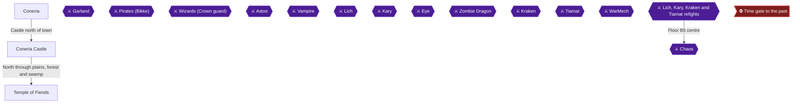

The adventure opens with four Light Warriors, each holding an Orb, arriving at Coneria 🟡. This chapter covers party creation, shopping in Coneria, the castle briefing, the three free chests in the Temple of Fiends, the Garland fight, and Princess Sara's gift, the Lute. The Lute earns **A Seemingly Useless Trinket** and lets the King's bridge carry you north 🟡.

> [!WARNING]
> **Missable Achievement Warning:** Party creation is permanent. Put at least one White Mage or Black Mage in the party, or Of Mighty Magic (27656) can never be earned on this file. Red Mages cannot learn any level 8 spells and top out at 20 spells 🟡. The level 6 White Magic spells (Soft, Exit, Fog2) are 20000 gold each at Crescent Lake, so the spells themselves are bought much later. One RA comment suggests that after finishing the game you might reload, change class and buy missing spells, but it is phrased as a guess ("i think"), so do not rely on it 🟡. Whether the achievement allows that route is unconfirmed.

The RA guide recommends Fighter, Black Belt, White Mage and Black Mage. Other guides suggest two Fighters, a White Mage and a Black Mage 🟡. Any party works as long as it includes a White or Black Mage.

> [!NOTE]
> This playthrough opens every chest. The three free chests in the Temple of Fiends' left corner rooms are in this chapter. The two Mystic Key rooms in the temple and the two locked rooms in Coneria Castle wait for the key 🟡.

### Chapter Items to Collect (3 Items Total)

| Item | Where Found | Action / Requirement | Citation |
|---|---|---|---|
| Cap | Chest, southwest room of the Temple of Fiends | **TAKE** and equip it | |
| Cabin | Chest, northwest room of the Temple of Fiends | **TAKE** | |
| Heal Potion | Chest, northwest room of the Temple of Fiends | **TAKE** | |
| Lute | Gift from Princess Sara in Coneria Castle | **TALK** until she gives it | |

### Coneria

🗺️ **Map:** [View Coneria Map by Paco](https://www.vgmaps.com/Atlas/NES/FinalFantasy-Coneria.png)

You begin a few steps south of Coneria with 400 Gold Pieces 🟡. The town's buildings all lead into the same town, so any entrance works 🟡. Talk to everyone first. Townspeople mention that a prophet named Lukahn foretold the Light Warriors and has moved to Crescent Lake 🟡.

#### Weapon Shop

| Weapon | Price | Citation |
|---|---|---|
| Wooden Staff | 5 | 🟡 |
| Small Dagger | 5 | |
| Wooden Nunchuck | 10 | |
| Rapier | 10 | 🟡 |
| Iron Hammer | 10 | 🟡 |

Recommended buys: the Rapier for Fighters, Thieves and Red Mages; the Wooden Nunchuck for the Black Belt; the Iron Hammer for the White Mage; the Small Dagger for the Black Mage 🟡.

#### Armor Shop

| Armor | Price | Citation |
|---|---|---|
| Cloth | 10 | |
| Wooden Armor | 50 | |
| Chain Armor | 80 | 🟡 |

Buy Chain Armor for Fighters and Red Mages, Wooden Armor for Thieves and Black Belts, and Cloth for the White and Black Mages 🟡. Remember to equip what you buy 🟡.

#### Item Shop, Inn and Clinic

Heal Potions cost 60, Pure Potions 75 and Tents 75. A Tent recovers 30 HP and lets you save on the world map 🟡. The Inn costs 30 Gold and refills HP and spell charges, and the Clinic revives for 50 🟡. Another source lists Coneria resurrection at 40 gold, so the Clinic price is conflicting. Treat 50 as the figure given in the walkthrough, and Unable to verify from collected sources. which is correct 🟡. Coneria's Inn is the cheapest place to rest and save 🟡.

#### Magic Shops

All level 1 spells cost 100 Gold. White Magic: Cure, Fog, Harm, Ruse 🟡. Black Magic: Fire, Sleep, Lock, Lit 🟡. Buy Cure and Harm for the White Mage, Fire and Lit for the Black Mage, and Cure, Fire and Lit for the Red Mage, since the Red Mage cannot use Harm 🟡. Spells at 100 each mean you will run out of gold before buying everything 🟡.

#### Coneria Castle

🗺️ **Map:** [View Coneria Castle Map by Paco](https://www.vgmaps.com/Atlas/NES/FinalFantasy-ConeriaCastle.png)

Enter the castle for information; there are no free items now 🟡. Talk to the King, who says Garland kidnapped Princess Sara 🟡. A guard at the bottom left of the floor says she is held in a temple to the northwest 🟡. Wise men on the first floor say the treasury is locked and needs a Mystic Key 🟡. An invisible woman can be spoken to in the empty room left of the treasure rooms 🟡. Save the two locked rooms for chapter 4 🟡.

#### Leveling

Fight around Coneria until you reach level 2 or 3 before going to the Temple 🟡. The Inn payments are covered by enemy gold 🟡. Save at the Inn, then head out 🟡.

### Temple of Fiends

🗺️ **Map:** [View Temple Of Fiends(Present) Map by Paco](https://www.vgmaps.com/Atlas/NES/FinalFantasy-TempleOfFiends(Present).png)

🗺️ **Map:** [View Temple Of Fiends(Past) Map by Paco](https://www.vgmaps.com/Atlas/NES/FinalFantasy-TempleOfFiends(Past).png)

From Coneria travel north through plains, a forest, a swamp and a final forest to the Temple 🟡. Undead such as Bone, Ghoul and Zombie roam here, so Harm is useful 🟡.

> [!WARNING]
> **Achievement Trigger Warning:** An RA comment says opening the Cap chest in the southwestern room was the sixth chest that caused a player to miss a chest-related achievement 🟡. The start area has six corner chests before the trip to the past 🟡. Unable to verify from collected sources. which achievement and why. Open only the three below now.

#### Southwest room: Cap

Head left through the narrow passage to a small room, go down and left, and enter through the door. Open the chest for a **Cap**. Equip it on a mage, as it does nothing otherwise.

#### Northwest room: Cabin and Heal Potion

Exit and go up the path, past the right fork, to another room entered via the bottom door. Two chests hold a **Heal Potion** and a **Cabin**.

The two right-side rooms are locked and wait for the Mystic Key 🟡.

### Garland

Return to the central chamber and walk straight north. Garland insults you and attacks. He has 106 HP, no weakness, and awards 130 EXP and 250 Gold.

- Fighters, Thieves and Black Belts attack 🟡.
- Black and Red Mages cast Fire or Lit.
- The White Mage casts Cure on hurt members 🟡.
- Ruse, Fog and Cure can offset damage to mages.

### Princess Sara

After the fight, step forward past the bats and talk to Princess Sara. She thanks you and teleports you back to Coneria Castle. You arrive in the castle, so there is no walk back through the swamp and forest. Go to the throne room next: the King's reward and Sara's gift are both there.

### Lute

Speak to the King, who orders a bridge built to the main continent. Then talk to the Princess; keep talking until she gives you the Lute 🟡.


> [!ACHIEVEMENT]
> **A Seemingly Useless Trinket (5 Points)**
> 
> *Receive a gift from Princess Sara.*


Keep the Lute: it is needed late in the game to pass the Stone Plate in the Temple of Fiends' past. A man on the first floor says the Lute can break the evil gate 🟡.

### Coneria bridge

> [!TIP]
> **Before you leave Coneria:** Rest at the Inn, restock, make sure the Cap is equipped and the Lute is in your inventory, then head to the bridge.

The bridge lies north of Coneria and leads to a new landmass 🟡. Townspeople say Matoya lives north and needs the Crystal to see 🟡.

> [!IMPORTANT]
> ### Chapter 1 Cumulative 100% Checkpoint
> - **Temple of Fiends Chests Opened (free rooms):** 3 / 3
> - **Key Items:** Lute obtained
> - **Orbs relit, Playthrough 1:** 0 / 4
> - **Orbs relit, Playthrough 2:** 0 / 4
> - **Chest-sweep achievements:** 0 / 9
> - **RetroAchievements Unlocked:** 1 / 40 (5 / 360 points)

### Chapter Checklist

- [ ] Party includes a White Mage or Black Mage
- [ ] Weapons, armor and level 1 spells bought and equipped
- [ ] Cap, Cabin and Heal Potion collected
- [ ] Garland defeated
- [ ] Lute received from Princess Sara (A Seemingly Useless Trinket)
- [ ] King's bridge built; rested at the Inn

---

## Chapter 2: Matoya's Cave, Pravoka and the Pirate Ship

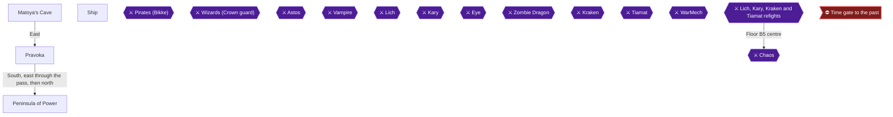

This chapter takes you across the new bridge north of Coneria to Matoya's Cave, where you open three chests, and then east to the port town of Pravoka. There you beat Bikke's nine pirates, take the ship, and play the secret slider puzzle. Three achievements fall in this chapter: Punching Above Your Weight (missable), Pirate Bay, and Puzzle Fantasy.

The order matters. Win a battle on the Peninsula of Power before you talk to Bikke, because that achievement cannot be earned afterwards 🟡.

### Before You Start

Speak to the King after rescuing Sara so he orders the bridge to the main continent built. Princess Sara also gives you the Lute, so talk to her until you get it 🟡. Rest at the Inn before heading for the bridge 🟡.

> [!WARNING]
> **Missable Achievement Warning:** Punching Above Your Weight must be won on the Peninsula of Power BEFORE you talk to Bikke and his pirates in the top-left corner of Pravoka. Talking to Bikke is what earns Pirate Bay, so do the peninsula first.

### Chapter Items to Collect (3 Items Total)

| Item | Where Found | Action / Requirement | Citation |
|---|---|---|---|
| Pure Potion | Matoya's Cave chest | **TAKE** | 🟡 |
| Heal Potion | Matoya's Cave chest | **TAKE** | |
| Heal Potion | Matoya's Cave chest | **TAKE** | |

These three chests count toward the Cave Dweller achievement, which you finish later.

### Matoya's Cave

🗺️ **Map:** [View Matoya's Cave Map by Paco](https://www.vgmaps.com/Atlas/NES/FinalFantasy-Matoya'sCave.png)

#### Getting there

Cross the bridge north of Coneria. When you step on it the credits roll, which is normal 🟡. Follow the coast to the left, past a port, into a forest. Turn west along the river, then head northeast through the thick forest to find the cave 🟡. Another route description says to continue north past the port between two mountain ranges, then go through the forest around the river 🟡.

Bring a Tent for later, since you will want one near the peninsula 🟡.

#### Inside the cave

1. Enter and head left to find a talking Broom. It says "TCELES B HSUP", which reads backwards as "PUSH B SELECT".
2. Outside, on the overworld, hold B and press Select to open the World Map.
3. Go through the door to the right into Matoya's room. You can walk over the skulls on the left side to reach the chests.
4. Open the three chests: one holds a **Pure Potion** and the other two hold **Heal Potions** 🟡.
5. Go around Matoya's desk and talk to her. She is blind without her Crystal. You cannot do anything for her yet. The Crystal comes later from Astos, and she trades it for the Herb.

> [!TIP]
> **Before you leave Matoya's Cave:** Confirm all three chests are open. Only these three are listed for this cave.

### Travelling to Pravoka

Backtrack to the southwest, turn east after the second stream in the river, and go east through the desert into a forest 🟡. Continue east across the wide forest, cross a brief plain, then enter another forest and head south to the port town 🟡. Stronger enemies roam here, so run if you are not strong enough to fight 🟡.

### Pravoka

🗺️ **Map:** [View Pravoka Map by Paco](https://www.vgmaps.com/Atlas/NES/FinalFantasy-Pravoka.png)

The town is deserted because pirates have taken over 🟡. Do not talk to Bikke yet. The Inn, straight north of the entrance, costs 50 gold and lets you heal and save 🟡.

Shopping is optional before the fight, though the guide recommends buying Slow for a Red or Black Mage to cripple the pirates 🟡. Whatever you skip now, you can buy after you win.

#### Shops

| Shop | Stock | Citation |
|---|---|---|
| Weapons | Iron Hammer 10 GP, Short Sword 550 GP, Hand Axe 550 GP, Scimitar 200 GP | 🟡 |
| Armor | Wooden Armor 50 GP, Chain Armor 80 GP, Iron Armor 800 GP, Wooden Shield 15 GP, Gloves 60 GP | 🟡 |
| Level 2 magic | Lamp, Mute, Alit, Invs (white); Ice, Dark, Tmpr, Slow (black), 400 GP each | 🟡 |
| Inn | 50 GP | 🟡 |
| Resurrection | 80 GP | 🟡 |

Heal Potions cost 60 and Pure Potions 75 🟡.

Suggested purchases by class 🟡:
- Fighter: Short Sword, Iron Armor, Wooden Shield, Gloves.
- Black Belt: Gloves.
- Thief: Scimitar, Gloves.
- Red Mage: Short Sword, Gloves, Mute, Alit, Ice.
- White Mage: Gloves, Mute, Alit, Invs.
- Black Mage: Gloves, Ice, Slow.

Do not buy Dark or Tmpr, because both are bugged and do not work properly 🟡.

The first visit costs a lot of gold, so you probably cannot afford everything. That is fine, because the pirates are easy 🟡.

### Peninsula of Power (do this before Bikke)

> [!WARNING]
> **Missable Achievement Warning:** Win a battle here first. Once you talk to Bikke, Punching Above Your Weight can no longer be earned 🟡.

#### Route

You can walk there from Pravoka and do not need the ship. Head south from Pravoka, east through the mountain pass, turn north as soon as you can, and continue north past the boat dock until you reach the edge of the landmass 🟡. Another guide says to go east into the mountains, then north as far as you can 🟡. The peninsula is two blocks wide 🟡.

#### Why it is dangerous

A programming bug on the last grass tiles spawns enemies from the Lefein area, such as FrWolfs, Giants and Tyros, which are far stronger than anything you should meet now 🟡. The last four squares are described as having "crazy powerful enemies". Another guide says the top two squares and one square underneath are the dangerous ones 🟡.

#### Preparation

- Buy a Tent and save with it before stepping on the last tiles. Many encounters here are highly dangerous 🟡.
- Heal at the Pravoka Inn first (50 gold) 🟡.
- A Tent used on the way restores 30 HP and saves 🟡.

The pirates cannot be fought before you get the ship, and the ship lets you reach Elfland for spells and weapons that make the peninsula far easier. The achievement, though, must be won before you speak to Bikke 🟡. Fir2 and Hrm2 are the recommended hit-all spells, but you buy them in Elfland 🟡. Fir2 is said to make this achievement easier 🟡. The sources here do not explain how to get them before Bikke. Unable to verify from collected sources.

#### What you may meet and how to handle it


> [!ACHIEVEMENT]
> **Punching Above Your Weight (10 Points)**
> 
> *Win a battle on the Peninsula of Power before confronting the pirates in Pravoka.*


The most survivable encounter is a single ZomBull, which has 224 HP and is weak to fire. Use fire if you can and hope to get through its HP before it wears your team down 🟡. ZomBulls and Trolls are weak to fire 🟡.

Other encounters:
- **Frost Wolves:** Their Frost hits everyone for heavy damage, but one or two Fir2 casts remove them all 🟡. A Black Mage or Red Mage casting fire is said to nearly one-shot them 🟡.
- **Giants:** Stacking 8-10 layers of Ruse and Invs makes characters almost impossible to hit 🟡. Players have also had the Red Mage cast Invs on the party while the Black Mage used healing potions 🟡.
- **Tyro:** It can do 90 to 100 damage to a fully armored fighter. Support with Tmpr, Ruse, Invs and Fog, because Fir2 does little 🟡.

Reported player wins, to show what is possible:
- One Zombie Minotaur beaten at level 3 with no deaths, though it took luck 🟡.
- 4 Frost Wolves beaten with 2 Fighters and 2 Black Mages 🟡.
- A T-Rex beaten at level 6 with two Fighters and two Black Mages, using Heal twice 🟡.
- 2 Giants beaten at level 7 with Fighter, Black Belt, White Mage and Black Mage, though the Black Belt fell 🟡.
- 2 Zombie Minotaurs beaten by 4 bare-handed level 7 Black Belts 🟡.

If you win but are hurt, save with your Tent and walk back to Pravoka. The achievement unlocks once you win any battle on the peninsula, per its description 🟡.

### Pirates (Bikke)

Once the peninsula battle is done and you have healed at the Inn, walk to the top-left corner of Pravoka and talk to Bikke 🟡.

> [!TIP]
> **Before you start the fight:** Save at the Inn first (50 gold). The guide notes you can buy better gear first but the pirates are easy anyway 🟡.

#### Boss: nine Pirates

Bikke is a cowardly captain and sends his whole crew at you 🟡. You face 9 Pirates with 6 HP each, no weakness, giving 40 Gold and 40 Exp each, for 360 gold total.

Strategy:
1. Have everyone attack, and spread targets so no attack is wasted. Do not let two characters hit the same pirate 🟡.
2. A Black Mage can use Fire or Lit to be sure of a kill instead of risking a weapon hit 🟡.
3. If pirates gang up on one ally, especially a mage, have the White Mage or Red Mage cast Cure.
4. Slow from a Red or Black Mage makes the pirates miss or do only 1 damage.

### Pirate Ship

After the battle, talk to Bikke again and he hands over his ship. Pirate Bay is reported to trigger once you board the ship outside the town, not when the pirates fall 🟡. Leave town through the southern exit, and the ship is sitting in the harbour 🟡.


> [!ACHIEVEMENT]
> **Pirate Bay (5 Points)**
> 
> *Sail for the first time after acquiring the ship.*


Step aboard and sail, and the achievement should unlock. Reports on emulator cores are mixed: one RetroArch user said it failed after at least 10 tries, while others said it worked with Nestopia or RANes 🟡.

Ship rules 🟡:
- It cannot go down streams (differently coloured than ocean).
- You may only disembark at a port; a Canoe also works, but you do not have one yet.
- There are no ports in the northern part of the world.

### Ship slider puzzle

Do this at once, while on the ship.

1. While riding the ship, stop moving.
2. Hold A, then press B 55 times 🟡. Another source phrases this as pressing A and B together 55 times 🟡. Use the hold-A method, which the roadmap prescribes.
3. A sliding puzzle with 15 numbered blocks appears. Arrange them in order from 1 to 15 (row one 1-4, row two 5-8, row three 9-12, row four 13-15) 🟡.
4. Selecting a block slides it toward the black empty space. It is tedious but works eventually 🟡. End with the black block where 16 would be 🟡.
5. Winning gives 100 Gold 🟡.


> [!ACHIEVEMENT]
> **Puzzle Fantasy (5 Points)**
> 
> *Complete the secret slider puzzle.*


You can leave the puzzle at any time by pressing B 🟡. The reward is repeatedly collectable, but the guide says fighting enemies is much faster for gold 🟡.

### Sailing on

The route continues to Elfland: leave the bay, head west along the coast, turn south when the ocean opens up, continue south and west to a port near a large forest, and walk south through the forest 🟡. That is covered in the next chapter.

> [!TIP]
> **Before you leave Pravoka:** Make sure you have won a peninsula battle, beaten the pirates, boarded the ship, and finished the slider puzzle. Spend gold on gear and spells if you can 🟡.

> [!IMPORTANT]
> ### Chapter 2 Cumulative 100% Checkpoint
> - **Matoya's Cave Chests Opened:** 3 / 3
> - **Orbs relit, Playthrough 1:** 0 / 4
> - **Orbs relit, Playthrough 2:** 0 / 4
> - **Chest-sweep achievements:** 0 / 9
> - **RetroAchievements Unlocked:** 4 / 40 (25 / 360 points)

### Chapter Checklist

- [ ] Talked to the King and Princess Sara; bridge built, Lute received
- [ ] Opened all 3 chests in Matoya's Cave (Pure Potion, 2 Heal Potions)
- [ ] Learned the "Push B Select" world-map trick
- [ ] Won a battle on the Peninsula of Power before talking to Bikke
- [ ] Defeated the nine pirates and received the ship
- [ ] Boarded the ship and sailed
- [ ] Completed the slider puzzle (hold A, press B 55 times)

---

## Chapter 3: Elfland, the Marsh Cave and Astos

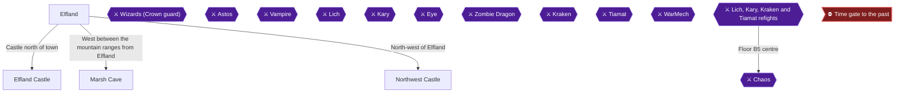

This chapter takes you from the port near Elfland through the Marsh Cave to Northwest Castle. You then trade the Crystal at Matoya's Cave and wake the Elfland prince for the Mystic Key. The outline: learn the story in Elfland Castle, shop in town, visit the gravestone, fetch the Crown from the Marsh Cave, beat Astos for the Crystal, trade it to Matoya for the Herb, and give the Herb to the attendant beside the prince 🟡. Two achievements are earned here: May Thou Rest in Peace and Sleeping Prince.

> [!TIP]
> **Preparation:** One guide suggests a party of Level 7 to 9 and a supply of roughly 10 Pure Potions and 30 Heal Potions for the Marsh Cave round trip 🟡. Another suggests at least 50 Heal Potions and 15 Pure Potions 🟡. One guide lists the recommended level as 6 for the cave and 10 for Northwest Castle 🟡. A commenter calls the Marsh Cave nearly impossible without significant grinding and spent a few hours killing Ogres outside Elfland 🟡. Ogres outside Elfland give a significant gold and EXP boost 🟡.

> [!WARNING]
> **Do not buy Lok2.** It is a bugged spell that does the reverse of its intended effect 🟡.

### Getting to Elfland

Sail out of Pravoka's small bay and west along the coastline, turning south when the ocean opens up. Keep going south and then west along the coast until you see a port near a large forest. Dock there, then walk directly south through the forest to reach the village and castle of Elfland 🟡.

### Elfland

🗺️ **Map:** [View Elfland Map by Paco](https://www.vgmaps.com/Atlas/NES/FinalFantasy-Elfland.png)

#### Elfland Castle

🗺️ **Map:** [View Elfland Castle Map by Paco](https://www.vgmaps.com/Atlas/NES/FinalFantasy-ElflandCastle.png)

Visit the castle first. Talking to people reveals that Astos put the Prince under a sleeping curse, that only Matoya's Herb can wake him, and that Matoya needs her Crystal before she will give it up 🟡. The treasury door at the right edge of the castle is locked and needs the Mystic Key, so leave it for chapter 4 🟡.

#### Elfland Town

Townspeople say Astos is the Dark Elf who hides in disguise, and that an ancient, spooky castle lies to the northwest 🟡.

**Shops** (prices from the shop listings):

| Shop | Stock | Citation |
|---|---|---|
| Weapons | Iron Nunchuck 200, Large Dagger 175, Iron Staff 200, Sabre 450, Silver Sword 4000 GP | 🟡 |
| Armor | Iron Armor 800, Copper Bracelet 1000, Iron Shield 100, Cap 80, Wooden Helmet 100 GP | 🟡 |
| Items | Heal Potion 60, Pure Potion 75, Cabin 250, House 3000, Soft Potion 800 GP | 🟡 |
| Magic | Level 3 spells 1500 GP each, Level 4 spells 4000 GP each | 🟡 |

- Fighters can buy a Silver Sword, Iron Shield and Wooden Helmet 🟡. The Large Dagger suits a Black Mage.
- Level 3 spells worth buying include Cur2, Fir2 and Lit2, plus Hrm2 for a White Mage and Afir 🟡. For Level 4, buy Pure, Fast and Ice2 🟡.
- Lit2 is useful against the Marsh Cave Wizards 🟡.

#### The gravestone

> [!WARNING]
> **Achievement Trigger Warning:** One commenter had to talk to the gravestone twice before it worked 🟡.

Walk around to the north side of the inn, where there are some graves 🟡. Talk to the left gravestone 🟡.


> [!ACHIEVEMENT]
> **May Thou Rest in Peace (2 Points)**
> 
> *Pay respects to a rival hero.*


If nothing pops, talk to it again 🟡.

### Marsh Cave

🗺️ **Map:** [View Marsh Cave Map by Paco](https://www.vgmaps.com/Atlas/NES/FinalFantasy-MarshCave.png)

Head west between the mountain ranges from Elfland, then south through swampland to the hole in the ground 🟡. A tent in front of the cave can be used to save 🟡. Take along the supplies mentioned above. Run from all but the easiest battles. Scums resist weapons, so use magic on them 🟡. Muck takes only 1 damage from regular attacks, so use Fire or Fir2 🟡; a second source lists Lit as a weakness for Muck.

The locked rooms need the Mystic Key and are cleared in chapter 4.

#### B1

You start in the centre of the floor. North and south lead to stairs, and east is a dead end 🟡.

#### B2 (north stairs)

Take the north stairs down. The chests here hold 680 gold in the northwest room, a Large Dagger in the northeast room, and 620 gold plus a Short Sword in the southwest room 🟡. In the guide's route: head up and right into a room for the Large Dagger, go left to the large room for 680 gold, then go to the bottom of the floor for two chests (Short Sword on the left, 620 gold on the right). Then return up the stairs to the start 🟡.

#### B2 (south stairs)

Take the south path to the stairs into the next room, then head to the little room at the bottom for the stairs to B3 🟡. The rooms along the way have only empty chests.

#### B3

B3 has 16 rooms in a 4 x 4 layout 🟡.

| Room | Contents | Citation |
|---|---|---|
| Row 1, room 1 | Iron Armor | 🟡 |
| Row 1, room 4 | 295 gold | 🟡 |
| Row 2, room 1 | Copper Bracelet | 🟡 |
| Row 2, room 2 | House | 🟡 |
| Row 3, room 2 | Crown (Wizards guard it) | 🟡 |
| Row 3, room 3 | 385 gold | 🟡 |

The bottom row (row 4) holds locked rooms for later.

> [!WARNING]
> **Boss approach:** The Crown chest is surrounded by pillars and the only open side is the bottom. Fill your HP before stepping in. The fight starts as you approach.

#### Wizards (Crown guard)

The Wizards have 84 HP and are weak to lightning 🟡. The fight has 2 to 5 Wizards 🟡. They can deal 120 damage to a lightly armored mage and 50 to a Fighter.

- Focus attacks on one Wizard at a time 🟡.
- Cast Lit2 with the Red or Black Mage; about two casts should finish them.
- Use the White Mage as healer; everyone else attacks 🟡.

#### Crown

After the fight, grab the Crown. If you step off the square you must fight the Wizards again. Take the other chests in the room 🟡. Each Wizard gives good gold and EXP 🟡.

#### Leaving the cave

Exit the room and head left, up, then left again to the room with the Copper Bracelet. Then go up the stairs, follow the left wall on the way, take the ladder up, and follow the left wall to the exit. Save outside the cave right away 🟡.

> [!TIP]
> **Before you leave the cave:** Top-floor chests can be revisited later, and those doors are not locked 🟡. Locked rooms wait for chapter 4.

### Northwest Castle

🗺️ **Map:** [View Northwest Castle Map by Paco](https://www.vgmaps.com/Atlas/NES/FinalFantasy-NorthwestCastle.png)

Travel north from the Marsh Cave, through the passage between the mountains, and north past the streams to the castle. A lone king inside has asked for his Crown 🟡. The castle has no random battles. Locked doors here need the Mystic Key 🟡.

Go to the throne room and talk to the king.

#### Astos

> [!CAUTION]
> Keep the Crown: you retain it after the Astos fight, and it is needed later in the Castle of Ordeal 🟡.

Astos reveals himself as the Dark Elf king and attacks 🟡. He has 168 HP, deals about 26-52, and gives 2250 EXP and 2000 gold 🟡. His spells are Fir2, Lit2, Slow, Slo2, Fast, Rub, Dark and Slep 🟡. Rub can kill one character, often the first slot, in round one 🟡.

- Fighters, Thieves and Black Belts attack normally 🟡. Black Belts are weak without Iron Nunchuks 🟡.
- Red and Black Mages cast Fast on hard hitters 🟡.
- Have the White Mage try Mute early, hoping to stop Rub 🟡.
- If Mute fails, set up Afir and other protective spells 🟡.
- Sources disagree on his weakness: one says none, another says Fire. One guide says he resists most spells 🟡, another says Black Mage spells work well 🟡.
- Fast, Tmpr and Lock help your fighters; he may cast Slo2 or Fast on himself 🟡.

Winning gives you the Crystal.

#### Crystal

The Crystal is the item to trade to Matoya.

> [!TIP]
> **Before you leave Northwest Castle:** The locked room here holds a Falchon, Iron Gauntlet and Power Staff, guarded by undead on the chests, for chapter 4 🟡.

### Matoya's Cave

Sail back to Coneria, pass under the new bridge, dock at the small port north of it, and walk north then northeast to Matoya's Cave 🟡. Talk to Matoya and trade the Crystal for the Herb.

#### Herb

The Herb wakes the Prince of Elfland.

### Back in Elfland Castle: the Mystic Key

Return to Elfland Castle and talk to the attendant beside the sleeping prince to give him the Herb 🟡. The prince wakes and gives you the Mystic Key 🟡.


> [!ACHIEVEMENT]
> **Sleeping Prince (10 Points)**
> 
> *Receive the Mystic Key after awakening the Elfland's prince.*


> [!WARNING]
> **Achievement Trigger Warning:** One commenter's Sleeping Prince popped again after a party wipe and respawn, and another saw it fail to sync during play 🟡.

#### Elf Prince and Mystic Key

The Mystic Key opens locked doors 🟡. Chapter 4 uses it for the Elfland Castle treasury, Northwest Castle room and Marsh Cave rooms, so do not sweep them yet.

> [!TIP]
> **Before you leave Elfland:** Keep the Crown, because the Castle of Ordeal needs it later 🟡.

> [!IMPORTANT]
> ### Chapter 3 Cumulative 100% Checkpoint
> - **Marsh Cave chests (unlocked):** B2 and B3 reachable chests opened, including the Crown 🟡
> - **Orbs relit, Playthrough 1:** 0 / 4
> - **Orbs relit, Playthrough 2:** 0 / 4
> - **Chest-sweep achievements:** 0 / 9
> - **RetroAchievements Unlocked:** 6 / 40 (37 / 360 points)

### Chapter Checklist

- [ ] May Thou Rest in Peace unlocked at the Elfland gravestone
- [ ] Marsh Cave B2 chests opened (Large Dagger, Short Sword, 680 and 620 gold)
- [ ] Marsh Cave B3 chests opened (Iron Armor, 295 gold, Copper Bracelet, House, 385 gold)
- [ ] Crown taken from the Wizards' chest and kept
- [ ] Astos defeated and Crystal received
- [ ] Crystal traded to Matoya for the Herb
- [ ] Herb given to the attendant; Sleeping Prince unlocked and Mystic Key in hand

---

## Chapter 4: Mystic Key Treasures, the TNT and the Canal

```mermaid
flowchart TD
  Coneria_Castle["Coneria Castle"]
  Temple_of_Fiends["Temple of Fiends"]
  Elfland_Castle["Elfland Castle"]
  Marsh_Cave["Marsh Cave"]
  Northwest_Castle["Northwest Castle"]
  Dwarf_Cave["Dwarf Cave"]
  Garland{{"⚔ Garland"}}
  Pirates{{"⚔ Pirates (Bikke)"}}
  Wizards_Crown{{"⚔ Wizards (Crown guard)"}}
  Astos{{"⚔ Astos"}}
  Vampire{{"⚔ Vampire"}}
  Lich{{"⚔ Lich"}}
  Kary{{"⚔ Kary"}}
  Eye{{"⚔ Eye"}}
  Zombie_Dragon{{"⚔ Zombie Dragon"}}
  Kraken{{"⚔ Kraken"}}
  Tiamat{{"⚔ Tiamat"}}
  WarMech{{"⚔ WarMech"}}
  Fiend_Refights{{"⚔ Lich, Kary, Kraken and Tiamat refights"}}
  Chaos{{"⚔ Chaos"}}
  Time_Gate>"⛔ Time gate to the past"]
  Coneria_Castle -->|"North through plains, forest and swamp"| Temple_of_Fiends
  Fiend_Refights -->|"Floor B5 centre"| Chaos
  classDef ponr fill:#7f1d1d,stroke:#f87171,color:#fff;
  classDef boss fill:#4c1d95,stroke:#a78bfa,color:#fff;
  class Time_Gate ponr;
  class Garland,Pirates,Wizards_Crown,Astos,Vampire,Lich,Kary,Eye,Zombie_Dragon,Kraken,Tiamat,WarMech,Fiend_Refights,Chaos boss;
```

With the Mystic Key from the Prince of Elfland, every locked room you walked past becomes available 🟡. This chapter sweeps them in order: Elfland Castle, Northwest Castle, the Marsh Cave locked rooms, Coneria Castle (where the TNT is), the Temple of Fiends side rooms, then the Dwarf Cave, where Nerrick uses the TNT to open the canal 🟡. Two achievements are earned here: Plundered the Keeps and Cave Dweller.

> [!TIP]
> One guide recommends roughly level 10 for Northwest Castle, level 12 for the Elfland Prince section and level 6 for the Marsh Cave 🟡. Another guide suggests levels 7 to 9 for the Marsh Cave trek, with potion stocks 🟡.
>
> A recommended level for the Temple of Fiends side rooms: Unable to verify from collected sources.

### Chapter Items to Collect

| Item | Where Found | Action / Requirement | Citation |
|---|---|---|---|
| Silver Hammer, 400 G, 330 G, Copper Gauntlet | Elfland Castle locked treasury | **TAKE** | 🟡 |
| Falchion, Iron Gauntlet, Power Staff | Northwest Castle locked room | **TAKE** (guarded chests) | 🟡 |
| Silver Bracelet, Silver Knife, 1020 G | Marsh Cave B3 locked rooms | **TAKE** (Wizard/Cobra fights) | |
| Iron Armor, Iron Shield, TNT | Coneria Castle left locked room | **TAKE** | 🟡 |
| Iron Staff, Sabre, Silver Knife | Coneria Castle right locked room | **TAKE** | 🟡 |
| Rune Sword | Temple of Fiends locked room (right passage) | **TAKE** (Gargoyles) | |
| Were Sword, Soft Potion | Temple of Fiends top-right locked room | **TAKE** (Gargoyles) | |
| 450 G, 575 G | Dwarf Cave entrance chests | **TAKE** | |
| Cabin, Iron Helmet, Dragon Sword, Silver Dagger, Wooden Helmet, Silver Armor, 575 G, House | Dwarf Cave locked south chamber | **TAKE** | |

### Elfland Castle

🗺️ **Map:** [View Elfland Castle Map by Paco](https://www.vgmaps.com/Atlas/NES/FinalFantasy-ElflandCastle.png)

After giving the Herb to the attendant, the Prince wakes and gives you the Mystic Key 🟡. The treasury is around the right edge of the castle 🟡.

1. Walk back to the castle entrance, go right, then walk out onto the small opening and keep to the edge of the wall around to the top-right room 🟡.
2. Open the four chests: a **Silver Hammer**, **400 G**, **330 G** and a **Copper Gauntlet** 🟡. One guide lists the two gold chests together as 730 GP 🟡.
3. Distribute the equipment and sell the excess 🟡.

### Northwest Castle

🗺️ **Map:** [View Northwest Castle Map by Paco](https://www.vgmaps.com/Atlas/NES/FinalFantasy-NorthwestCastle.png)

From Elfland, go west between two mountain ranges, northwest through the forest to a river and lake, then north 🟡.

1. Go up the right side of the castle, turn left across the area past the throne room, then go down to the door of the locked room 🟡.
2. Each chest has a set guard fight. The middle chest brings 3-6 Images and the left and right ones 3-6 Mummies. Opening the chests from the side avoids the set guards 🟡. Another guide says walking in front of the chests always triggers an Undead attack 🟡.
3. Take the **Falchion**, **Iron Gauntlet** and **Power Staff** 🟡. Fire and Harm are effective against these undead.

### Marsh Cave

🗺️ **Map:** [View Marsh Cave Map by Paco](https://www.vgmaps.com/Atlas/NES/FinalFantasy-MarshCave.png)

Cave Dweller needs every chest in the Marsh, Dwarf and Matoya's caves. The Crown and the unlocked chests were gathered earlier; if you skipped any, collect them now, since the top floor doors are not locked 🟡. Players report the achievement failing to trigger in some cases, and one tracker showed one extra chest. Cause: Unable to verify from collected sources 🟡.

Unlocked chest check (B2, north stairs): 680 G, Large Dagger, 620 G and Short Sword 🟡. B3: Iron Armor, 295 G, Copper Bracelet, House, 385 G, Crown 🟡.

#### B3 locked rooms

1. Descend to the bottom floor, go right past the first room, then straight down until you reach a room; go left and enter the door 🟡.
2. Silver Bracelet room: from the door step Up two, Right two, Down two, Right two to avoid the Wizard and Cobra fights, then open the chest 🟡.
3. Retrace your steps, go above that room, right to another room, then down to its door. The chest has Wizards on the left or Cobras below; fight one group and take the **Silver Knife** 🟡.
4. Exit, go up and right, pass one room and enter the second. Fight Wizards for the **1020 G** 🟡.

Wizards have 84 HP and are weak to Lightning; about two Lit2 casts defeat them. Focus attacks on one at a time 🟡.

### Coneria Castle

🗺️ **Map:** [View Coneria Castle Map by Paco](https://www.vgmaps.com/Atlas/NES/FinalFantasy-ConeriaCastle.png)

The treasury needs the Mystic Key 🟡. Go to the back area of the castle, through the small passage that leads right and then down, and enter the two rooms 🟡. An invisible woman can be spoken to in the empty room left of the treasure rooms 🟡.

1. Left room: **Iron Armor**, **Iron Shield** and the **TNT**. Per the RA guide, enter the left room and open the right-hand chest for the TNT.
2. Right room: **Iron Staff**, **Sabre** and **Silver Dagger**.


> [!ACHIEVEMENT]
> **Plundered the Keeps (5 Points)**
> 
> *Open all treasure chests in Coneria, Elfland and the Northwest castles.*


With Elfland (4), Northwest (3) and Coneria (6) chests opened, Plundered the Keeps is complete 🟡.

### Temple of Fiends

🗺️ **Map:** [View Temple Of Fiends(Present) Map by Paco](https://www.vgmaps.com/Atlas/NES/FinalFantasy-TempleOfFiends(Present).png)

🗺️ **Map:** [View Temple Of Fiends(Past) Map by Paco](https://www.vgmaps.com/Atlas/NES/FinalFantasy-TempleOfFiends(Past).png)

Head north from Coneria through plains, forest and swamp 🟡. The top-right and bottom-right doors need the Mystic Key 🟡. These count toward What's Old Is New Again, finished in chapter 13. The Cap, Cabin and Heal Potion are in the unlocked rooms 🟡.

1. Take the passage to the right, enter the small room and fight the Gargoyles for the **Rune Sword**.
2. Go to the top-right corner of the chamber and enter the small room; fight Gargoyles twice for a **Were Sword** and a **Soft Potion**.

### TNT

You now carry the TNT, which Nerrick needs 🟡. The dwarf Nerrick is digging the Dwarf canal from the Dwarf Cave and cannot finish it without explosives. Once he blasts through, the strip of land that blocks your ship's way west is gone and you can leave the Aldi Sea.

### Dwarf Cave

🗺️ **Map:** [View Dwarf Cave Map by Paco](https://www.vgmaps.com/Atlas/NES/FinalFantasy-DwarfCave.png)

Sail west along the coast, north hugging the coast to a port, then southwest on foot 🟡.

1. Open the two entrance chests: **450 G** and **575 G**.
2. The room directly north of the stairs holds 1025 gold per one guide 🟡.
3. The far south room is locked with the Mystic Key 🟡. Inside are eight chests: **Cabin**, **Iron Helmet**, **Dragon Sword**, **Silver Dagger**, **Wooden Helmet**, **Silver Armor**, **575 G** and **House**.


> [!ACHIEVEMENT]
> **Cave Dweller (5 Points)**
> 
> *Open all treasure chests in the Marsh, Dwarf and Matoya's caves.*


Cave Dweller also requires Matoya's three chests (two Heal Potions and a Pure Potion) and the Marsh Cave chests above. One comment says there is no mandatory chest in Matoya's Cave 🟡.

### Nerrick

Find Nerrick in the bottom areas of the cave and give him the TNT 🟡. He blasts the ground connecting the inland sea to the open sea 🟡. The new canal is just south of the cave, and it gives your ship passage to Melmond and the lands to the west.

### Canal

Return to your ship and sail through the new opening west 🟡. It leads to Melmond and the Earth Cave 🟡.

> [!TIP]
> Before you leave, confirm every locked room and the Dwarf Cave south chamber are looted, since Cave Dweller and Plundered the Keeps depend on all chests.

> [!IMPORTANT]
> ### Chapter 4 Cumulative 100% Checkpoint
> - **Canal:** open; Nerrick used the TNT 🟡
> - **Chest-sweep achievements:** 2 / 9
> - **Orbs relit, Playthrough 1:** 0 / 4
> - **Orbs relit, Playthrough 2:** 0 / 4
> - **RetroAchievements Unlocked:** 8 / 40 (47 / 360 points)

### Checklist

- [ ] Elfland treasury: 4 chests
- [ ] Northwest Castle: 3 chests
- [ ] Marsh Cave B3 locked rooms: 3 chests
- [ ] Coneria Castle: 6 chests including TNT
- [ ] Temple of Fiends: Rune Sword, Were Sword, Soft Potion
- [ ] Dwarf Cave: 2 entrance chests and 8 south chamber chests
- [ ] TNT given to Nerrick
- [ ] Plundered the Keeps and Cave Dweller

---

## Chapter 5: Melmond, the Earth Cave and the Vampire

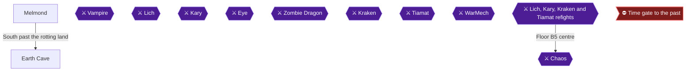

This chapter takes you through the canal to Melmond, down the first three floors of the Earth Cave, and into the Vampire fight on B3. The Vampire's chest holds the Ruby, which earns Blood Ruby 🟡. Every chest you open here counts toward Gaia's Greed, which is finished in the next chapter, so do not skip any 🟡.

> [!TIP]
> **Before you leave the Earth Cave:** Make sure you have opened every chest on B1 to B3 and taken the Ruby from the Vampire's room. The next chapter uses the Ruby on the Titan.

The recommended party level for Melmond and the Earth Cave is 12 🟡. Melmond has no Item Shop and no Clinic, so stock up before you arrive. Bring 99 Heal Potions, at least 40 Pure Potions and about 5 Soft Potions, because an enemy here can turn your characters to stone 🟡.

### Melmond

🗺️ **Map:** [View Melmond Map by Paco](https://www.vgmaps.com/Atlas/NES/FinalFantasy-Melmond.png)

#### Getting there

Sail through the newly opened canal and dock next to Melmond 🟡. The canal exists because Nerrick used the TNT you gave him.

#### Town overview

The earth around the town is in horrid shape. The Vampire destroyed the Clinic and the Item Shop, and Dr. Unne lives here 🟡. The Inn costs 100 GP 🟡. Revival here is not possible, so you must travel back to revive fallen allies.

#### Weapon Shop

| Item | Price | Citation |
|---|---|---|
| Iron Staff | 100 Gold | 🟡 |
| Sabre | 450 Gold | 🟡 |
| Long Sword | 3000 Gold in one table, 1,500 GP in others (sources conflict) | |

The Long Sword price differs between sources, so check the price in the shop.

#### Armor Shop

| Item | Price | Citation |
|---|---|---|
| Steel Armor | 45000 Gold | 🟡 |
| Silver Bracelet | 5000 Gold (one source says 4000) | 🟡 |
| Iron Helmet | 450 Gold | 🟡 |
| Copper Gauntlet | 200 Gold | 🟡 |
| Iron Gauntlet | 750 Gold | 🟡 |

Steel Armor is one of the best armors for Fighters, but costs 45000 GP 🟡. Buy Silver Bracelets for your Black or White Mages and Iron Gauntlets for fighters if you have the gold 🟡.

#### Magic Shops

All spells below are Level 5 and cost 8000 Gold each.

| Spell | Effect | Citation |
|---|---|---|
| Cur3 | Restores 66-132 HP to an ally | 🟡 |
| Life | Revives a slain ally to 1 HP; cannot be used in battle | 🟡 |
| Hrm3 | Hurts all undead for 60-240 HP | 🟡 |
| Hel2 | Heals all allies (one source lists 24-58 HP, others 24-48) | 🟡 |
| Fir3 | Hurts all enemies for 50-200 HP | 🟡 |
| Bane | Can destroy an enemy instantly | 🟡 |
| Slo2 | Lowers an enemy's Hits to 1 | 🟡 |
| Warp | Moves the party back one floor | 🟡 |

Suggested buys: Cur3 and Fir3 for Red Mages, Cur3 and Life for White Mages, and Fir3 for Black Mages. If you have a Red or Black Mage, leave a spell slot open for Warp 🟡. Fir3 and Hrm3 are also your best answers to the Vampire 🟡.

#### Leaving for the cave

Head west and southwest along the coastline, take the small land bridge south onto a large peninsula, then go south and turn east to the cave mouth 🟡. Another description says to leave Melmond and head south past the rotting earth 🟡. The cave has a small swamp in front of it 🟡.

### Earth Cave

🗺️ **Map:** [View Earth Cave Map by Paco](https://www.vgmaps.com/Atlas/NES/FinalFantasy-EarthCave.png)

A commenter says the cave itself is harder than the later Lich fight 🟡. An Earth enemy can easily do 90 damage to a Fighter in Steel Armor 🟡. Earth has 288 HP, cannot be escaped from, and is weak to Fire, so Fir2 and Fir3 work well. Several chests have a set encounter on a particular side, noted below 🟡.

#### B1: Entrance floor

The paths lead in all directions at the entrance 🟡.

**West: Hall of Giants (optional EXP).** Going straight left from the start leads to the Hall of Giants, where every step triggers a fight with at least one Giant, often with Iguanas 🟡. You may meet 1-4 Giants per fight 🟡. It extends mostly along the western wall 🟡. A Giant has 240 HP and gives 879 EXP and 879 Gold 🟡. The hall is a strong place to level, and Giants hit hard but do nothing special 🟡. If you get hurt, you keep getting attacked until you leave the hot spot 🟡. Leave the hall before continuing.

**North path: 1975 Gold.** Walk the upward branch to the dead end for a chest with **1975 Gold** 🟡. This room has an Earth guardian. You can avoid it by going below the chest 🟡.

**Southeast path, right fork.** Head down the right side of the start area, then take the right fork and go down to a room with two chests. Walk left as soon as you enter and approach the chests from below to avoid the Earth guardian. Take the **Pure Potion** and **795 Gold** 🟡.

**Southeast path, left fork.** Return to the fork and head left, skip the first path leading down and take the next one. The room holds two chests. The right chest holds a **Heal Potion** (grab it from the side or face an Earth). The left chest holds **880 Gold** 🟡.

That makes five chests on this floor 🟡.

**Stairs.** Return to the center, take the east passage, and go down the stairs.

#### B2

Movement here is more restrictive, and harmless bats can block exits 🟡. Work your way through the small maze toward the east 🟡. Generally head right and down to make your way through 🟡.

**Northeast room.** Enter the room on the right and walk up the left wall to open the **Coral Sword**. Go right one step for the **Cabin**, then right one step and down one for **330 Gold** 🟡. The Coral Sword is intended for use against Water enemies.

**South room (Earth guardian).** Go through the hole below and take the left passage downward to a room where you must fight an Earth to enter 🟡. Open the chests for a **Wooden Shield** 🟡, **575 Gold** 🟡 and **5000 Gold** 🟡. You fight another Earth on the way out 🟡.

These are six chests across two rooms 🟡. Backtrack up the long passage to the fork and take the right fork down its winding path to the stairs 🟡. The stairs are in the southeast corner 🟡. If you are hurt, go outside to rest and save before continuing 🟡.

#### B3

You start in the south-center of the floor 🟡. There are four chests before the boss room 🟡.

- **Tent (southeast room).** Head along the wall, going right to a room. Go straight up, grab the **Tent**, and leave to avoid the Earth guardian 🟡.
- **Heal Potion (east room).** Go left to rejoin the main path, then up until a choice. Go up, right and down to a room with a chest holding a **Heal Potion**.
- **3400 Gold (north room).** Go left into the next room, go straight up and open the chest for **3400 Gold**.
- **1020 Gold (west room).** Continue left to the room, ignore it as you start down, take the right path into a room, defeat the Earth, and open the chest for **1020 Gold** 🟡.

Head down and then right into the large center room where a mysterious figure blocks your path.

### Vampire

#### Preparation

> [!WARNING]
> **Achievement Trigger Warning:** Blood Ruby requires you to defeat the Vampire and also take the Ruby from the chest behind him. Make sure your party is healed before you step in.


> [!ACHIEVEMENT]
> **Blood Ruby (5 Points)**
> 
> *Defeat the vampire of Melmond and acquire the ruby.*


#### Strategy

The Vampire has 156 HP, gives 1200 EXP and 2000 Gold, and is undead. He is weak to Fire and Harm, so one cast of Fir2, Hrm2, Fir3 or Hrm3 is often enough 🟡. His special attack is Dazzle (Stun), which can stun any party member. His physical attacks are powerful, but Cur3 counters them.

- Fighting classes attack normally 🟡.
- Red and Black Mages cast Fir2 or Fir3 🟡.
- White Mages cast Harm, Hrm2 or Hrm3 🟡.
- Heal anyone he badly damages 🟡.

One source says he should fall within one or two rounds 🟡. Another calls the fight a bit tough because of Dazzle 🟡.

### Ruby

After the Vampire falls, take the chest in the left corner of his room. It contains the **Ruby** 🟡. The Ruby is on the third floor of the Earth Cave.

Past this room the passage is blocked by a heavy Metal Plate, and nothing in your inventory opens it yet 🟡. The plate is broken later with the Rod 🟡. Do not try to break it now.

Exit the way you came 🟡. Then return to Melmond to heal, save and shop 🟡. The next stop is the Titan, who demands the Ruby, then Sarda for the Rod.

> [!TIP]
> **Before you leave Melmond:** Restock Heal and Pure Potions, since Melmond has no Item Shop.

> [!IMPORTANT]
> ### Chapter 5 Cumulative 100% Checkpoint
> - **Earth Cave Chests (B1 to B3):** 15 / 15 (plus the Ruby chest) 🟡
> - **Orbs relit, Playthrough 1:** 0 / 4
> - **Orbs relit, Playthrough 2:** 0 / 4
> - **Chest-sweep achievements:** 2 / 9
> - **RetroAchievements Unlocked:** 9 / 40 (52 / 360 points)

### Chapter Checklist

- [ ] Sailed through the canal and docked at Melmond
- [ ] Shopped in Melmond (spells and gear)
- [ ] B1: 1975 G, Pure Potion, 795 G, Heal Potion, 880 G collected
- [ ] B2: Coral Sword, Cabin, 330 G, Wooden Shield, 575 G, 5000 G collected
- [ ] B3: Tent, Heal Potion, 3400 G, 1020 G collected
- [ ] Defeated the Vampire and took the Ruby
- [ ] Blood Ruby (3572) unlocked

---

## Chapter 6: Titan's Tunnel, Sarda and Lich

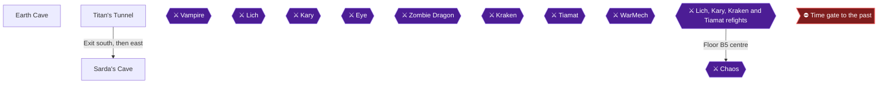

This chapter finishes the first Fiend. You take the Ruby from the Vampire's room to the Titan, loot his treasure room, collect the Rod from Sarda, shatter the stone plate in the Earth Cave, clear the lower floors, and defeat Lich to relight the Earth Orb. Opening every chest in the Earth Cave and Titan's Tunnel earns Gaia's Greed, so the cave is routed chest by chest below.

> [!TIP]
> **Preparation:** One guide recommends carrying 99 Heal Potions, at least 40 Pure Potions and about 5 Softs before entering the Earth Cave, because an enemy can turn you to stone 🟡. Melmond has no Item Shop and no Clinic, so restock in Elfland or Coneria and travel back to revive fallen allies. The recommended party level is 12 for the Earth Cave and 17 for Titan's Tunnel and Lich 🟡. Another guide says level 15 to 16 should be doable for Lich 🟡.

> [!TIP]
> **Achievement Trigger Warning:** Oh, Death, Where is Thy Sting? (no one dies in the Lich fight) is planned for Playthrough 2, but it also unlocks here if nobody falls. One commenter notes that characters affected by STONE can enter the Lich battle without counting as dead 🟡.

### Chapter Items to Collect (Earth Cave and Titan's Tunnel chests)

| Item | Where Found | Action / Requirement | Citation |
|---|---|---|---|
| 1975 GP | Earth Cave 1F, north dead-end room | **TAKE** | 🟡 |
| Pure Potion | Earth Cave 1F, east room | **TAKE** | |
| 795 GP | Earth Cave 1F, east room | **TAKE** | 🟡 |
| Heal Potion | Earth Cave 1F, west room | **TAKE** | |
| 880 GP | Earth Cave 1F, west room | **TAKE** | 🟡 |
| Coral Sword | Earth Cave 2F, northeast room | **TAKE** | 🟡 |
| Cabin | Earth Cave 2F, same room | **TAKE** | 🟡 |
| 330 GP | Earth Cave 2F, same room | **TAKE** | 🟡 |
| Wooden Shield | Earth Cave 2F, south room | **TAKE** | 🟡 |
| 575 GP | Earth Cave 2F, south room | **TAKE** | 🟡 |
| 5000 GP | Earth Cave 2F, south room | **TAKE** | 🟡 |
| Tent | Earth Cave 3F, southeast room | **TAKE** | 🟡 |
| Heal Potion | Earth Cave 3F, east room | **TAKE** | 🟡 |
| 3400 GP | Earth Cave 3F, north room | **TAKE** | 🟡 |
| 1020 GP | Earth Cave 3F, west room | **TAKE** | 🟡 |
| Ruby | Earth Cave 3F, behind the Vampire | **TAKE** | 🟡 |
| Great Axe | Titan's Tunnel treasure room | **TAKE** | |
| 620 GP | Titan's Tunnel treasure room | **TAKE** | 🟡 |
| 450 GP | Titan's Tunnel treasure room | **TAKE** | 🟡 |
| Silver Helmet | Titan's Tunnel treasure room | **TAKE** | |
| Wooden Staff | Earth Cave 4F, northern Sphinx room | **TAKE** | 🟡 |
| 3400 GP | Earth Cave 4F, northern room | **TAKE** | 🟡 |
| 1520 GP | Earth Cave 4F, northern room | **TAKE** | 🟡 |
| 5450 GP | Earth Cave 4F, northern room | **TAKE** | 🟡 |
| 1455 GP | Earth Cave 4F, northern room | **TAKE** | 🟡 |
| Cabin | Earth Cave 4F, southwest room | **TAKE** | 🟡 |
| Silver Shield | Earth Cave 4F, southwest room | **TAKE** | 🟡 |
| 1250 GP | Earth Cave 4F, southwest room | **TAKE** | 🟡 |

Floor numbering differs between guides. This chapter uses the 1F to 5F numbering, where the Vampire is on 3F and Lich on 5F 🟡.

### Getting to the Earth Cave

🗺️ **Map:** [View Earth Cave Map by Paco](https://www.vgmaps.com/Atlas/NES/FinalFantasy-EarthCave.png)

From Melmond, head west and southwest along the coast, take the small land bridge south onto a large peninsula, go south, then turn east to the cave mouth 🟡.

#### Earth Cave 1F

You see paths in all directions on entering. The west path is the Hall of Giants, where every step triggers a fight with Giants and Iguanas. It is not needed, but it is a good place to build experience quickly 🟡. If you struggle later, the giants' hallway is the suggested place to grind 🟡. The first floor holds 5 chests 🟡.

1. **North path:** follow the upward branch to the dead-end room and open the chest for **1975 GP** 🟡. This is the first room where an Earth can be fought. You can avoid it by stepping below the chest 🟡.
2. **Southeast path, right fork:** take the right fork down to a room with two chests. Enter, walk left, and approach the chests from below to avoid the Earth guardian. You get a **Pure Potion** and **795 GP**. Beware of the Earth guarding the space between the chests 🟡.
3. **Southeast path, left fork:** skip the first path down and take the next one to a room with two chests. The right chest holds a **Heal Potion**, which you can grab from the side to avoid an Earth. The left chest holds **880 GP**.
4. **East path:** return to the center, take the right passage and go down the stairs 🟡.

Earth has 288 HP, awards 1536 Exp and 768 Gold, and cannot be run from. It is weak to Fire, so Fir2 and Fir3 hurt it badly 🟡. It can deal 66 to 132 damage.

#### Earth Cave 2F

Floor 2 has 6 chests in two treasure rooms 🟡. Work through the holes and chambers, generally to the right and down 🟡.

1. **Northeast room:** move through the holes, then right into the room. Walk up the left wall for the **Coral Sword**, step right for the **Cabin**, then right and down for **330 GP** 🟡.
2. **South room:** go through the hole below and take the left passage down. An Earth guards the entrance, so fight it. Inside, open the chests for a **Wooden Shield**, **575 GP** and **5000 GP**. You fight another Earth on the way out 🟡.
3. Backtrack up the long passage to the fork, then take the right fork along its winding path to the stairs down 🟡.

#### Earth Cave 3F and the Vampire

Floor 3 has four chests before the boss room 🟡. You start south-center 🟡.

1. **Southeast room:** head right along the bottom wall. Go straight up, grab the **Tent**, and leave to avoid the Earth Guardian 🟡.
2. **East room:** return to the main path, go up until a choice appears, then go up, right and down for a chest with a **Heal Potion**.
3. **North room:** go left into the next room, go straight up and open the chest for **3400 GP** 🟡.
5. **West room:** continue left to a room, skip it, take the right path down, battle the Earth, then open the chest for **1020 GP** 🟡.
6. Head down and right into the large center room, where the Vampire waits 🟡.

> [!TIP]
> Heal and save before the center room. After the Vampire you must leave the cave with the Ruby 🟡.

**Boss: Vampire.** It has 156 HP, awards 2000 Gold and 1200 Exp, and uses Dazzle (Stun). It is undead and weak to Fire and Harm. Fighters attack, Red and Black Mages cast Fir2 or Fir3, and White Mages cast Harm, Hrm2 or Hrm3. It should fall in one or two rounds 🟡.


After the fight, open the chest in the left corner of the room for the **Ruby** 🟡. Continuing is blocked by a heavy Metal Plate 🟡. Leave the cave and rest in Melmond 🟡.

### Titan's Tunnel

🗺️ **Map:** [View Titan's Cave Map by Paco](https://www.vgmaps.com/Atlas/NES/FinalFantasy-Titan'sCave.png)

From Melmond, head west across the marshy expanse without turning south, then southwest between two mountains through a small forest to the tunnel 🟡.

1. Head up and then left to the Titan, who demands the Ruby. Talk to him with it in your possession and he lets you pass.
2. Head left and then down the windy path to a room with four chests: **Great Axe**, **620 GP**, **450 GP** and **Silver Helmet**. A separate guide totals the treasury differently, as Silver Helmet, Great Axe and 1070 gold 🟡.
3. Head back up the path and take the stairs out of the tunnel.

Enemies here include Arachnids, which cause Poison, and Trolls 🟡.

### Sarda's Cave

🗺️ **Map:** [View Sarda's Cave Map by Paco](https://www.vgmaps.com/Atlas/NES/FinalFantasy-Sarda'sCave.png)

Head south along the path, turn east, then move southwest to enter Sarda's Cave 🟡. Talk to Sarda to receive the **Rod** 🟡. Another guide calls it a Staff, but it is the same item that breaks the plate 🟡. Restock in Melmond before returning 🟡.

### Earth Cave, Lower Floors

Return to the Vampire's room. Take the path to the right to quickly go down floors, as before, until you reach the former Vampire room 🟡. Go to the heavy stone plate, open Items and use the **Rod** to shatter it, revealing a stairway. The rot is more pronounced here, so keep HP high 🟡. Bring a few Softs, because Cockatrices can stone your party 🟡.

#### Earth Cave 4F

1. **Northern room:** go up the path to the left, continue up, then down, then left through the hole above. In the room you face Sphinxes and open chests with a **Wooden Staff**, **3400 GP**, **1520 GP**, **5450 GP** and **1455 GP** 🟡.
2. **Southwest room:** exit, backtrack through three chambers, and continue through the holes. Go down the windy path to a room with three chests. Step in front of the left-most for the **Cabin**, since the side has a set enemy trap 🟡. Take the right-most chest from its side for the **Silver Shield** 🟡. Take the top chest from its side for **1250 GP** 🟡.
3. Head back up the path, always choosing the left-most door, to the stairs down in the northwest 🟡.

#### Earth Cave 5F and Lich

There are no treasure rooms on this floor. Move down, go right and up through the four holes, turn left, take the passage down, walk left, then walk up to the chamber 🟡. Enemies here include Images and Mummies. Fully refill your HP before approaching the dark orb.

**Boss: Lich.** It has 400 HP and gives 3000 Gold and 2200 Exp. It is undead and weak to Fire and Harm; one blast each of Fir3 and Hrm3 can kill it 🟡. Its spells are Ice2, Slp2, Fast, Lit2, Hold, Fir2, Slow and Slep. It uses a physical attack 25% of the time and a spell 75% of the time.

- **Turn one:** Lich likely casts Ice2 for 80 to 160 damage. Fast on your strongest attacker and Aice from the White Mage help 🟡.
- **Offense:** Black Mages cast Fir3 and White Mages cast Hrm3 🟡. Alternatively, cast Fast on weapon users, because Lich has a high Absorb 🟡.
- **Fast:** When Lich casts Fast on itself, its hits get dangerous. Slow on Lich lessens them. Keep party HP above 70 🟡.
- **Defense:** Anti-elemental spells (Aice, Alit, Afir) cut his spell damage. Alit after Fast helps against Lit2. Slo2 once worked on Lich 🟡.
- **Healing:** Use Hel2 after Ice2 if you have a White Mage 🟡.

Step up to the altar behind Lich. The Earth Orb shines, and the warp behind it returns you outside 🟡. Keep walking up, since you can walk onto the throne 🟡.


> [!ACHIEVEMENT]
> **Rotten Earth (10 Points)**
> 
> *Defeat Lich and purify the Earth Crystal.*


With every chest in the Earth Cave and Titan's Tunnel opened, Gaia's Greed unlocks.


> [!ACHIEVEMENT]
> **Gaia's Greed (5 Points)**
> 
> *Open all treasure chests in the Earth Cave and Titan's Tunnel.*


> [!TIP]
> **Before you leave:** Make sure all chests are open before taking the warp, since the cave floors are long to retrace 🟡. Then return to Melmond to heal, save and sell 🟡.

> [!IMPORTANT]
> ### Chapter 6 Cumulative 100% Checkpoint
> - **Earth Cave and Titan's Tunnel chests:** all opened
> - **Orbs relit, Playthrough 1:** 1 / 4
> - **Orbs relit, Playthrough 2:** 0 / 4
> - **Chest-sweep achievements:** 3 / 9
> - **RetroAchievements Unlocked:** 11 / 40 (67 / 360 points)

### Chapter Checklist

- [ ] Defeated the Vampire and took the Ruby from the chest
- [ ] Fed the Ruby to the Titan and looted all four Titan's Tunnel chests
- [ ] Received the Rod from Sarda
- [ ] Used the Rod on the stone plate in Earth Cave
- [ ] Opened every Earth Cave chest on 1F to 4F
- [ ] Defeated Lich without losing a party member (optional here)
- [ ] Stepped on the altar and relit the Earth Orb
- [ ] Rotten Earth and Gaia's Greed unlocked

---

## Chapter 7: Crescent Lake and the Gurgu Volcano

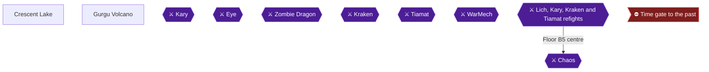

This chapter takes you across the world to Crescent Lake, where the Circle of Sages hands over the Canoe after Lich, and then down the river into the Gurgu Volcano to open every chest and defeat Kary, the Fiend of Fire. Two achievements belong here: Canoodling for the Canoe, Hot Take for every chest in the volcano, and Molten Fire for beating Kary and purifying the Fire Crystal 🟡. The recommended party level for the volcano is 20 🟡.

> [!TIP]
> **Planning note:** One guide recommends visiting the Castle of Ordeals and then the Ice Cave before the volcano, but says this order is not mandatory 🟡. The Flame Sword from the Ice Cave makes Kary easier 🟡. This chapter follows the roadmap and goes to the volcano now. Fight Fire With Fire is planned for Playthrough 2; if you happen to finish Kary with Fire, Fir2 or Fir3 here, it unlocks now.

### Crescent Lake

🗺️ **Map:** [View Crescent Lake Map by Paco](https://www.vgmaps.com/Atlas/NES/FinalFantasy-CrescentLake.png)

#### Getting there

Sail south from Melmond to the tip of the peninsula, turn west until you hit land, then follow the coast down to a port. Dock, then hike southwest and east under the lake to enter town 🟡. On the way you may meet Cobras, ZomBulls, Trolls, Giants, Pedes and Scorpions. Use Ice2 sparingly against Cobras and Pedes since level 4 magic runs low quickly; Scorpions poison, so running is best 🟡.

Save at the inn as soon as you arrive 🟡. The inn costs 200 gold and the clinic 400 🟡.

#### Circle of Sages

> [!WARNING]
> **Achievement Trigger Warning:** The Canoe only comes after Lich has been defeated 🟡.

From the shops, follow the path east and through the twisting path to the Circle of Sages. Talk to every Sage; they explain that the Fiends seized the Orbs' power 🟡. The Sage two spots to the right of where you enter gives you the CANOE.


> [!ACHIEVEMENT]
> **Canoodling (5 Points)**
> 
> *Acquire a canoe from the circle of sages.*


The Canoe opens the Gurgu Volcano, the Ice Cave and the Castle of Ordeals 🟡. It travels rivers and is carried with you on foot 🟡.

#### Shopping

- **Weapons:** Silver Dagger 800, Silver Sword 4000, Silver Hammer 2500, Silver Axe 4500 🟡.
- **Armor:** Silver Armor 7500, Silver Shield 2500, Buckler 2500, Silver Helmet 2500, Silver Gauntlet 2500.
- **Items:** Heal Potion 60, Pure Potion 75, Cabin 250 (saves), House 3000 (saves, restores MP).
- **White Magic (Level 6, 20000 each):** Soft, Exit, Fog2, Inv2.
- **Black Magic (Level 6, 20000 each):** Qake, Rub, Lit3, Stun.

Suggested buys: Inv2 for White Mages, Lit3 and Rub for Black Mages 🟡. Keep a level 6 slot open for Exit, which White Wizards can only learn after the class change 🟡. Red Mages cannot learn level 6 magic before the class change 🟡. Exit is extremely important for the volcano 🟡.

A sleeping resident in town reveals the Floater location only later 🟡.

### Gurgu Volcano

🗺️ **Map:** [View Gurgu Volcano Map by Paco](https://www.vgmaps.com/Atlas/NES/FinalFantasy-GurguVolcano.png)

#### Getting there

From the Crescent Lake port, take the Canoe onto the river above town heading west. At the forks take west, north, east, west, then west again, and follow the path as it bends south to the volcano 🟡. Watch for river monsters 🟡. The volcano lies northwest of Crescent Lake and east of Elfland. Save with a tent just outside before entering 🟡.

#### Lava rules

Lava drains 1 HP per step but standing still costs nothing. Lava also prevents random encounters, and HP cannot fall below 1 from it. Expect Red Gargoyles (they cast Fir2 constantly; use Afir or run), Fire (cannot be escaped; Ice2 works), and Cockatrices and Perilisks (Ice2) 🟡.

#### B1 (1F)

You start on the east side. Head straight west to the stairs down. There are no chests here 🟡.

#### B2

Take the door north and go up the hallway, then the second left. Chests on this floor, with their guards:

1. Silver Helmet in the northern room, guarded by a Fire 🟡.
2. 1520 gold to the south 🟡.
3. Left path: Giant Sword, guarded by one or two Fires. Mind that it is effective against Giants only 🟡.
4. Right path: 4150 gold 🟡.
5. Two chests with 750 and 795 gold, guarded by a Fire set 🟡.

Then head south down the left wall to the big treasure room. Enter on the left square of the three-wide entrance to avoid a Fire fight 🟡. The room holds Silver Gauntlet and Silver Helmet; Heal Potion and Cabin below; 1975 gold; 1455 gold (Grey Worm fight, weak to Ice); Pure Potion; 1520 gold; and on the right side 1760 gold, Silver Shield, Silver Axe, and a Heal Potion 🟡. One guide lists the room's total as 6710 gold, two Heal Potions, a Pure Potion, a Cabin, a Silver Gauntlet, Silver Helmet, Silver Shield and Silver Axe across nine chests 🟡. Open them all.

Another pair of chests in the northwest section holds 1545 gold 🟡.

Leave via the door to the lava room, go all the way west to the stairs down 🟡.

#### B3

Head east to the stairs down 🟡. No chests here 🟡.

#### B4 (lava floor)

The floor is mostly lava; hop between safe spots to the stairs in the southeast corner 🟡. They lead back up to a different part of B3 🟡.

#### B3 (second section)

From the northeast corner walk south, west, south, west to the stairs down 🟡.

#### B4 (second section)

Chests here, all required for Hot Take:

1. Door beside you: Soft Potion and 2750 gold 🟡.
2. West and south: 1760 gold 🟡. Open the right chest from below to avoid a Grey Worm 🟡.
3. Dead-end room west: Pure Potion, 7340 gold, Ice Sword, Flame Shield (Grey Worm), 880 gold, plus a second Ice Sword chest listed by one guide 🟡.
4. East: 155 gold and 10 gold 🟡.
5. Further east: 2000 gold and a House; the third chest is empty 🟡.
6. South: 1250 gold and Wooden Staff, with two adjacent guaranteed encounter tiles for grinding 🟡.

Then head south and west to the stairs down 🟡.

#### B5

The floor has eight branches; the west leads to the Flame Armor and the southwest to Kary 🟡.

> [!WARNING]
> **Achievement Trigger Warning:** The Flame Armor is the last chest needed for Hot Take. Take the west branch first: fight an Agama, then a Red Dragon in front of the chest 🟡.

**Red Dragon:** 248 HP, Blaze hits everyone for roughly 50-80 (Afir cuts to 20-40), weak to Ice 🟡. Heal fully before the fight 🟡. Take the Flame Armor, fight the Agama again, and leave.


> [!ACHIEVEMENT]
> **Hot Take (5 Points)**
> 
> *Open all treasure chests in the Gurgu Volcano.*


Equip the Flame Armor. Rest before taking the southwest branch.

#### Kary

> [!TIP]
> Fire resists: Fire, Fir2 and Fir3 deal only about 5-10, 15-30 and 25-50. The Flame Sword from the Ice Cave is an option but is not required 🟡.

**Stats:** 600 HP, hits up to 6 times, casts Fir2, Dark, Hold; weak to Stun and Slep. Reward 5000 gold and 4245 EXP per one guide 🟡.

**Strategy:**
- Turn one: Afir and Hold. Hold has roughly a 35% chance; if it lands, you get free turns 🟡.
- Cast Inv2 and Slow, and Fast on fighters.
- Fighters and Black Belts attack; mages cast Fir3 to finish 🟡.
- Count her HP; at the end a fire spell may need to land the final blow, which one commenter suspects is required but is unconfirmed.
- She hits hard and can one-shot a Black Mage 🟡.

Finishing with Fire spells unlocks Fight Fire With Fire now, but that is optional.

After the fight, touch the altar to light the second Orb, then use the warp to exit.


> [!ACHIEVEMENT]
> **Molten Fire (10 Points)**
> 
> *Defeat Kary and purify the Fire Crystal.*


> [!TIP]
> **Before you leave:** Confirm all volcano chests were opened, save at an inn, and sell excess gear.

> [!IMPORTANT]
> ### Chapter 7 Cumulative 100% Checkpoint
> - **Fire Orb:** relit after Kary
> - **Orbs relit, Playthrough 1:** 2 / 4
> - **Orbs relit, Playthrough 2:** 0 / 4
> - **Chest-sweep achievements:** 4 / 9
> - **RetroAchievements Unlocked:** 14 / 40 (87 / 360 points)

### Chapter Checklist

- [ ] Canoe received from the Sage at Crescent Lake
- [ ] Level 6 spells bought as affordable, with an Exit slot kept
- [ ] Every Gurgu Volcano chest opened
- [ ] Flame Armor taken from B5
- [ ] Kary defeated and the Orb lit
- [ ] Hot Take, Canoodling, Molten Fire unlocked

---

## Chapter 8: The Ice Cave and the Airship

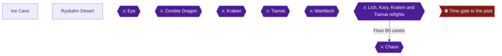

This chapter takes you through the Ice Cave, which sources describe as the hardest dungeon in the game so far. You open every chest, beat the Eye for the Floater, and use the Floater in the desert south of Crescent Lake to raise the Airship. Two achievements fall here: Cold Hard Cash, Mostly (every Ice Cave chest) and Flotation (raise the Airship).

### Preparation

> [!WARNING]
> **Achievement Trigger Warning:** Cold Hard Cash, Mostly needs every chest in the Ice Cave, including the Cloth chest that triggers a forced Mage fight. Commenters say the Mages and Sorcerers are what make this dungeon brutal 🟡.

- Bring 99 Heal Potions and roughly 5 to 15 Soft Potions, and be ready to run from fights 🟡.
- The recommended party level is 22 🟡.
- Equip the Flame Sword, and unequip any Flame Armor, because ice nulls fire defense and attack 🟡.
- Bring Fir2 and Fir3 spells. Sorcerers have a built-in Rub on their attack that can kill a character even through anti-Rub spells and ProRings 🟡.
- Coctrice can petrify, so Soft Potions matter.
- The Ice Cave is the hardest cave partly because you do not yet have ProRings against Rub-type attacks 🟡.
- Arub may help against Mages and the Eye by protecting against Rub. Its effect in battle is unconfirmed by the source.
- One RA commenter advises waiting until all four Fiends are slain before collecting the chests 🟡.
- Freezing ice floor tiles (the lighter grey floor) cost 1 HP per character per step 🟡.
- Heal Potions and Tents are consumed along the way. The Canoe came from the sages at Crescent Lake after Lich fell 🟡.

Enemy notes for the cave:

| Enemy | Key facts | Citation |
|---|---|---|
| Mage | 105 HP, casts Rub, Lit3, Fir3, Bane, Slo2, Stun | 🟡 |
| Sorcerer | 112 HP, Rub on attack, 1-2 damage | |
| Frost Dragon | 200 HP, uses Blizzard, weak to Fire | 🟡 |
| Frost Wolf | Packs up to 6, FROST up to 60 ice damage without Aice | 🟡 |
| Frost Giant | 336 HP, weak to Fire | |
| Great Pede | 320 HP, weak to Ice and Fire | |
| Wraith | Undead, found in the cave | |

### Getting to the Ice Cave

Return to Crescent Lake to restock, then take your ship north along the coast and dock at a river mouth 🟡. Directly north of the port is a small lake with a port and a river mouth; weigh anchor there and use the Canoe 🟡. Follow the river inland and take the northwest branch at the fork 🟡. Another guide's route: from the four-way river intersection, go north, east at the next fork, around the corner and west, take the west fork, then south to the cave 🟡. The cave is at world map coordinates (197,183) 🟡. Use a Tent or better to save before entering 🟡.

### Ice Cave

🗺️ **Dungeon Map:** [View Ice Cave Map by Paco](https://www.vgmaps.com/Atlas/NES/FinalFantasy-IceCave.png)


> [!ACHIEVEMENT]
> **Cold Hard Cash, Mostly (5 Points)**
> 
> *Open all treasure chests in the Ice Cave.*


Floor labels differ between guides. This route uses the labels from the guide that runs 1st floor, 2nd floor, 3rd floor, then "B" floors, and cross-references the others.

### Chapter Items to Collect (Ice Cave chests)

| Item | Where Found | Action / Requirement | Citation |
|---|---|---|---|
| Flame Sword | Pit room, left chest (2nd floor B) | **TAKE** | |
| Cloth | Pit room, right chest | **TAKE**, forced Mage fight | 🟡 |
| Floater | Pit room, middle chest, reached from the hole on the upper floor | **TAKE** after the Eye | 🟡 |
| Silver Gauntlet | West treasure room, 3rd floor B | **TAKE**, Frost Dragon fight | 🟡 |
| Ice Armor | Same west room | **TAKE** | 🟡 |
| 7900 G | Six-chest room, top-left | **TAKE** | 🟡 |
| 5450 G | Six-chest room, top-middle | **TAKE** | 🟡 |
| 180 G | Six-chest room, top-right, Frost Wolf fight | **TAKE** | 🟡 |
| 9900 G | Six-chest room, bottom-left | **TAKE** | 🟡 |
| 5000 G | Six-chest room, bottom-middle | **TAKE** | 🟡 |
| 12350 G | Six-chest room, bottom-right | **TAKE** | 🟡 |
| Heal Potion | 1st floor (west), room beside the stairs | **TAKE** | 🟡 |
| 10000 G | 1st floor, room to the south | **TAKE** | 🟡 |
| 9500 G | East room with the hole, leftmost | **TAKE** | 🟡 |
| Tent | East room, middle | **TAKE** | 🟡 |
| Ice Shield | East room, right | **TAKE** | |

That is 16 chests, matching the item list 🟡.

#### 1st floor (entrance)

Head right from the entrance along the top wall, cut down when the passage opens below, then cut left to a stairway down 🟡. Nothing is accessible on this floor yet 🟡.

#### 2nd floor

You start in the northeast corner, and the stairs down are in the southwest corner 🟡. Either go left then down or down then left; both reach the stairs 🟡. Another guide notes nothing of interest here 🟡.

#### 3rd floor

The stairs to 2nd floor B are right there 🟡. This floor has two sets of stairs up; take the one you did not come from 🟡.

#### 2nd floor B (pit room)

Circle around the big room's edge to a door and enter the treasure room with holes and three chests 🟡. From this side you can only reach two of the three chests 🟡.

1. Walk around the holes, without stepping in any, to the **left** chest for the **Flame Sword** 🟡.
2. The **right** chest holds **Cloth**, and a forced fight with up to several Mages guards it. A commenter warns of a trapped tile near it that can spawn up to 5 Mages who ambush from behind 🟡. This chest counts for the achievement, so you must take it. Mages have 105 HP, are weak individually, and Rub, Lit3 and Fir3 are the dangers, so spread attacks and use a hard-hitting spell if there are two or three 🟡.
3. The middle chest (the Floater) cannot be reached yet. Fall into the hole just right of the inaccessible chest 🟡.

#### 3rd floor B

You land in a small room, and your next step always triggers a battle with up to nine undead 🟡. Use Fire and Harm spells 🟡. Pass through the door south; the lighter grey floor leads left and costs 1 HP per step 🟡.

- **West treasure room:** Enter for a forced fight with 1 to 2 Frost Dragons 🟡. Frost Dragons have 200 HP, use Blizzard, and are weak to Fire, so cast at least a Fir2 early 🟡. Open the chests for **Ice Armor** and the **Silver Gauntlet** 🟡. The Dragons fight again when you leave 🟡.
- **South room:** Return to the main path, head down over the damaging floor on the right path, pass two branches, and go through a narrow rock opening 🟡. Take the left fork to the room with six chests: top row 7900, 5450, and 180 G (Frost Wolf fight), bottom row 9900, 5000 and 12350 G 🟡. A forced Frost Wolf encounter sits between the two right-side chests 🟡.
- Backtrack to the right fork and follow it to the stairway up, in the east/southeast corner 🟡.

#### 1st floor (west part)

You arrive on the far side of the first floor 🟡. This area has five chests and a hole 🟡.

1. Enter the door beside you for a **Heal Potion** 🟡.
2. Exit and enter the room south for **10000 G** 🟡.
3. Go right, then down around the room's border to the east room: **9500 G**, a **Tent**, and an **Ice Shield**.
4. The Ice Shield protects against Fire attacks 🟡.

Before dropping down the hole, consider that the stairs outside lead directly out of the cave. Jumping means crossing the undead room and 3rd floor B again. If you are low on resources, exiting to save first is an option; the cost is redoing the trek 🟡. Unable to verify from collected sources whether the hole here affects chest availability.

> [!TIP]
> **Before you leave:** Check the Ice Cave count above. Every chest except the Floater should be open before you return for the Eye, or you will need to repeat the trip 🟡.

#### The Floater chest and the Eye

Leap into the hole and you land on 2nd floor B between the holes, in reach of the isolated middle chest 🟡. Walk toward the chest and stepping in front of it triggers the Eye 🟡.

**Eye**

- 162 HP, gives 3225 Gold and 3225 Exp 🟡. Another guide lists the reward as 3228 🟡.
- Uses instant-death spells such as Rub, Stone and XXXX, and can also use Glance.
- Weak defense, so weapon attacks cut it down quickly. Mute stops its spells completely 🟡.
- Lit2 is the other threat, so keep Hel2 ready 🟡.
- A Rune Sword does heavy damage because it is in the magic class 🟡.
- Its Glance can be blocked by a Ribbon 🟡.

Open the chest for the **Floater**.

To leave, fall into a hole again (not the other direction, or you fight the Eye again), cross 3rd floor B as before, climb the stairs back to the first floor (west), and take the stairs at the top right to exit 🟡. That undead posse and damaging floor are repeated on the way out 🟡.

### Ryukahn Desert and the Airship

Sail back to the river mouth south of Crescent Lake, head to the nearby desert and use the Floater 🟡. Dock your ship near the river and use the Canoe to reach the mainland 🟡. The exact spot in the desert does not matter 🟡.


> [!ACHIEVEMENT]
> **Flotation (10 Points)**
> 
> *Raise the airship from the desert.*


The Airship rises 🟡. It can travel anywhere but lands only on grass or plains. Per one guide, you now no longer have to defeat any further bosses to open the world, and Kary, Kraken and Tiamat can be fought in any order. Another guide says the Floater only works if you spoke to a man in Crescent Lake after Kary. Whether that applies here is unconfirmed, so talk to him if the Floater does nothing.

### Optional: farming the Eye

Once you have ProRings from Gaia, the Eye is a strong grind spot. Equip all warriors with ProRings, return to the Floater square, and the battle repeats whenever you step in front of the chest 🟡. XXXX becomes ineffective and weapon attacks can kill the Eye in round one 🟡. RA commenters say about 300 HP stops XXXX from working, each fight gives 806 EXP, and you should stock Heals and Softs 🟡. Ribbons guard against Glance 🟡. Gold from the Eye can buy Gold Rings and ProRings for everyone 🟡. Bring plenty of Softs because the Eye petrifies 🟡.

> [!TIP]
> **Before you leave:** Make sure you have the Airship and every Ice Cave chest. The Tail from the Castle of Ordeals is the next stop.

> [!IMPORTANT]
> ### Chapter 8 Cumulative 100% Checkpoint
> - **Ice Cave Chests Opened:** 16 / 16 🟡
> - **Key Items:** Floater obtained, Airship raised 🟡
> - **Orbs relit, Playthrough 1:** 2 / 4
> - **Orbs relit, Playthrough 2:** 0 / 4
> - **Chest-sweep achievements:** 5 / 9
> - **RetroAchievements Unlocked:** 16 / 40 (102 / 360 points)

### Chapter Checklist

- [ ] Stocked 99 Heal Potions and Soft Potions
- [ ] Flame Sword equipped, Flame Armor removed
- [ ] Flame Sword, Cloth, Ice Armor, Silver Gauntlet taken
- [ ] All six gold chests in the south room opened
- [ ] Heal Potion, 10000 G, 9500 G, Tent, Ice Shield taken
- [ ] Eye defeated and Floater taken
- [ ] Cold Hard Cash, Mostly
- [ ] Flotation

---

## Chapter 9: The Castle of Ordeals, Cardia and the Class Change

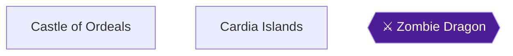

This chapter covers two optional treasure sweeps and one optional reward. You clear the Castle of Ordeals, which holds the Tail, then you open every chest in the Cardia Isles caves, then you hand the Tail to Bahamut. The Castle of Ordeals is optional, and it holds the item needed for the class change 🟡. The Cardia caves are only reachable by Airship, so this chapter comes after you have the Floater and the Airship 🟡. Two achievements are earned here: Regal Recon (open all chests in the Castle of Ordeals and the Cardia caves) and Class Upgrade (Bahamut's reward) 🟡.

Preparation:

- The recommended party level for the Castle of Ordeals is 24 🟡.
- Bring plenty of healing. One source recommends carrying 99 Heal Potions and calls the castle dangerous 🟡.
- Medusas travel in packs and can turn the whole party to stone in a round or two 🟡.
- The castle's other enemies include Tiger, Sphinx, Wyrm, Sauria, Manticore and Sand Worm.
- Use a House before entering to refill HP and spell charges 🟡.

> [!WARNING]
> **Achievement Trigger Warning:** Regal Recon needs every chest in the Castle of Ordeals and the Cardia caves. Do not leave any chest behind, including the chest in the Cardia caves that looks like a minor sum of gold 🟡.

> [!IMPORTANT]
> **Order of this chapter:** handing the Tail to Bahamut promotes the whole party for good, so this Playthrough 1 file can never earn Don't Change For Anyone; that achievement is earned on the new Playthrough 2 file 🟡. Finish both chest sweeps first, and only then talk to Bahamut.

### Chapter Items to Collect

| Item | Where Found | Action / Requirement | Citation |
|---|---|---|---|
| Zeus Gauntlet | Castle 2F, chest room after the Mudgol fight | **TAKE** (casts Lit2 as a battle item) | 🟡 |
| Heal Staff | Castle 3F, top right, behind the Nitemare fight | **TAKE** (casts Heal as a battle item) | 🟡 |
| Iron Gauntlet | Castle 3F, top left | **TAKE** | 🟡 |
| Ice Sword | Castle 3F, top left | **TAKE** | 🟡 |
| Gold Bracelet | Castle 3F, top left | **TAKE** | 🟡 |
| 7340 G | Castle 3F, bottom left | **TAKE** | 🟡 |
| 1455 G | Castle 3F, bottom left | **TAKE** | 🟡 |
| House | Castle 3F, bottom left | **TAKE** | 🟡 |
| Tail | Castle 3F, throne room | **TAKE** | 🟡 |
| Cabin, 575 G, Soft Potion | Cardia cave (northwest island) | **TAKE** | 🟡 |
| House, 500 G, 10 G | Cardia cave (marshy island) | **TAKE** | 🟡 |
| 160 G, 9500 G, 2750 G, 1520 G, 2750 G, 2000 G, 1455 G | Cardia cave (forested island, two rooms) | **TAKE** | 🟡 |

### Castle of Ordeals

🗺️ **Map:** [View Castle Of Ordeals Map by Paco](https://www.vgmaps.com/Atlas/NES/FinalFantasy-CastleOfOrdeals.png)

#### Getting there

Sail north along the coast past the Peninsula of Power and go west through the gap. Then continue northwest past the large desert and sail into the inlet above the castle. Move down onto the darker green river, and the Canoe takes over automatically. Step left onto solid ground and walk through the western forest to the castle 🟡.

If you travel by Airship instead, the only landing spot is a grass field far to the east. From there you hike through desert, forest and swamp to the castle 🟡. The Canoe is also needed to cross a stream on that walk 🟡.

#### 1F

Speak with the old man in the entryway. Moving forward shows him the Crown, which is required to enter the upper levels 🟡. The entry floor has no enemies and nothing to collect 🟡. Go to the throne in the northwest corner and step on it to be carried to the 2nd floor 🟡.

#### 2F: the teleporter maze

Every pillar teleports you. A wrong choice sends you back toward the start 🟡. Follow these steps in order:

1. Leave the starting room and touch the single pillar. Touch the next single pillar 🟡.
2. At the third room, choose the bottom pillar 🟡.
3. Touch the single pillar in room four 🟡.
4. In room five, choose the bottom pillar 🟡.
5. Walk down the long hall in room six and touch the single pillar at its end 🟡.
6. In room seven, choose the right pillar 🟡.
7. Walk right and enter the room with the chest. Step in front of the chest to start the fight 🟡.

**Mudgol fight:** Mudgols have 176 HP, give 800 Gold and 1257 Exp, and have no real weak point. They can cast Fast, so kill them quickly with weapons and your strongest magic 🟡.

**Chest:** Open it for the **Zeus Gauntlet**. Used as an item in battle it casts Lit2 at no spell cost, so give it to a weak attacker 🟡.

**To the stairs:** Leave the room and take the path going down on the left. Do not take the path directly below the door. Then touch the lower of the two pillars to arrive in the room with the stairs up 🟡. Another source describes this last pillar as the second one and the furthest down from the Zeus Gauntlet room 🟡. Do not take the teleporter directly below the chest room. Take two steps right, then walk down the hall to the correct teleporter 🟡.

#### 3F: the spiral

There are no mazes or branches here, only tougher enemies and treasure 🟡. The floor has 9 chests, one of which is empty 🟡. Go around the floor counterclockwise 🟡.

1. Walk up the hallway on the left and through the door. The room holds a Nitemare fight on a guaranteed encounter square 🟡.

   **Nitemares:** 200 HP, 700 Gold, 1272 Exp. They only Snort and are weak to Ice, so use Ice2 while the others attack 🟡. They are pretty hard to hit, so use the Zeus Gauntlet for extra damage if needed 🟡.

2. Open the chest above you for the **Heal Staff**. Used as an item in battle it casts Heal on the whole party at no spell charge cost 🟡. If you step off and back on the square, expect to refight the Nitemares 🟡.
3. Go through the narrow hall to the left to the top left chests. They hold an **Iron Gauntlet**, an **Ice Sword** and a **Gold Bracelet** 🟡. Give the Ice Sword to a Fighter or Red Mage and the bracelet to a mage 🟡.
4. Head down the hall below to the bottom left group. These chests hold **7340 G**, **1455 G** and a **House**, and the fourth chest is empty 🟡.
5. Go right to the final throne room. The chest near the throne holds the **Tail**, your proof of courage 🟡. Do not worry about the Merchandise Madness restriction for the Tail, since it is the one chest allowed on that challenge 🟡.

> [!NOTE]
> The source lists disagree slightly on one chest. One lists 8795 gold in the southwest room alongside the House, while the others list 7340 G and 1455 G 🟡. Open every chest regardless and you cover both.


> [!ACHIEVEMENT]
> **Regal Recon (5 Points)**
> 
> *Open all treasure chests in the Castle of Ordeals and Cardia caves.*


Regal Recon does not unlock until the Cardia chests are also open. Continue to the Cardia section after the Zombie Dragon fight.

#### Zombie Dragon

Stepping in front of the throne-room chest starts a fixed fight with one or two Zombie Dragons 🟡. Another source says up to four can appear 🟡.

- **Stats:** 268 HP each, 999 Gold, 2331 Exp.
- **Weakness:** Fire and Harm. Use Fire spells, Hrm3 and normal attacks.
- **Danger:** They hit hard and can stun fighters. The Zombie Dragon can only attack, so Cure anyone whose HP runs low 🟡.
- **Optional grinding:** After you have the Tail you can step off and step back on to refight them for fast, relatively safe Experience and Gold, provided you have spell charges left 🟡.

Once you are done, step onto the throne. You warp back to the first floor, and you leave by heading down and to the right 🟡. Use a House or Cabin outside to save.

### Cardia Islands

🗺️ **Map:** [View Cardia Islands Map by Paco](https://www.vgmaps.com/Atlas/NES/FinalFantasy-CardiaIslands.png)

The Cardia Isles have six cave entrances. Few monsters live below them and the caves are straightforward 🟡. Of these, three caves hold chests, 13 in total 🟡. Collect the other dragons' dialogue if you like, but nothing else is needed 🟡.

1. **Forested island southwest of the Castle of Ordeals.** Enter the cave to find two rooms of chests holding 2750 G, 2000 G, 1455 G, 160 G, 9500 G, 1520 G and 2750 G 🟡.
2. **Marshy island to the west.** Walk into the cave for a House, 500 G and 10 G 🟡.
3. **Single cave on the island to the northwest.** Open the chests for a Cabin, 575 G and a Soft Potion 🟡.

The full list of Dragon Islands chest contents agrees with these totals 🟡.


### Bahamut

Land the Airship on the southern tip of the eastern island and enter the nearby cave. It is the long hallway with a staircase leading down at the end. Another source says the island is covered in forest with two holes, and Bahamut's hole is at its bottom right.

Before the Tail, Bahamut only asks you to bring proof of your courage 🟡. You already have it.

> [!CAUTION]
> **Point of No Return:** Handing over the Tail promotes the whole party permanently. The Playthrough 1 file can then never earn Don't Change For Anyone 🟡. If you want that achievement, it must be done on the new Playthrough 2 file. Do not talk to Bahamut with the Tail until you are ready.

### Class change

Present the Tail to Bahamut. He grants the whole party a class change.


> [!ACHIEVEMENT]
> **Class Upgrade (10 Points)**
> 
> *Receive King Bahamut's praise and his reward.*


The promotions are:

| Before | After | Citation |
|---|---|---|
| Fighter | Knight | 🟡 |
| Thief | Ninja | 🟡 |
| Black Belt | Master | 🟡 |
| Red Mage | Red Wizard | 🟡 |
| White Mage | White Wizard | 🟡 |
| Black Mage | Black Wizard | 🟡 |

All warriors receive the promotion at once 🟡. The party can now use high-level equipment, Knights and Ninjas gain magic, and the mage classes gain the higher tiers of magic. The Zeus Gauntlet can now be equipped by a Knight, Red Wizard or Ninja 🟡.

#### After the promotion

- Newly promoted mages can now buy higher-level spells. Gaia sells level 8 XXXX for 60000. Lefien sells Lif2 and Nuke for 60000 each 🟡.
- Exit is sold at Crescent Lake and Warp at Melmond 🟡.
- Gaia and Onrac are the next towns; go to Gaia first 🟡.

> [!TIP]
> **Before you leave:** Confirm all 9 Castle of Ordeals chests (including the empty one) and all 13 Cardia chests are open before you finish with Bahamut. The Zeus Gauntlet, Heal Staff and Gold Bracelet are worth equipping or carrying 🟡.

> [!IMPORTANT]
> ### Chapter 9 Cumulative 100% Checkpoint
> - **Castle of Ordeals Chests:** 9 / 9 (Zeus Gauntlet, Heal Staff, Iron Gauntlet, Ice Sword, Gold Bracelet, 7340 G, 1455 G, House, Tail) 🟡
> - **Cardia Chests:** 13 / 13 🟡
> - **Orbs relit, Playthrough 1:** 2 / 4
> - **Orbs relit, Playthrough 2:** 0 / 4
> - **Chest-sweep achievements:** 6 / 9
> - **RetroAchievements Unlocked:** 18 / 40 (117 / 360 points)

### Chapter Checklist

- [ ] Showed the Crown to the old man and stepped on the 1F throne
- [ ] Solved the 2F pillar maze and won the Mudgol fight for the Zeus Gauntlet
- [ ] Beat the Nitemares and opened the Heal Staff chest
- [ ] Opened the Iron Gauntlet, Ice Sword and Gold Bracelet chests
- [ ] Opened the 7340 G, 1455 G and House chests
- [ ] Defeated the Zombie Dragons and took the Tail
- [ ] Opened all 3 chests in the northwest island cave
- [ ] Opened all 3 chests in the marshy island cave
- [ ] Opened all 7 chests in the forested island cave
- [ ] Regal Recon unlocked
- [ ] Gave the Tail to Bahamut and unlocked Class Upgrade

---

## Chapter 10: Gaia, Onrac, the Waterfall and the Sea Shrine

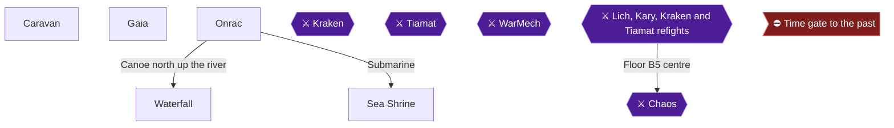

This chapter gets the Oxyale, the Cube and the Slab, and it clears the Water Fiend. You buy the Bottle at the desert Caravan and free its Fairy at Gaia's spring to get the Oxyale. Onrac's submarine uses the Oxyale to reach the Sea Shrine. A canoe trip up the river from Onrac takes you into the Waterfall, where one chest holds a Ribbon and the robot gives you the Cube. In the Sea Shrine you open every chest, including the Slab, and then beat Kraken 🟡.

Three achievements come from this chapter:
- **Oxypower** for obtaining the Oxyale.
- **Sunken Treasures** for opening every chest in the Waterfall and the Sea Shrine.
- **The Lost City** for beating Kraken and purifying the Water Crystal.

### Preparation and warnings

- **Gold.** The Bottle costs 50,000 gold. You do not need the Oxyale to enter the Waterfall 🟡. The Waterfall's chests hold 13,450, 6,400 and 5,000 gold 🟡, and its Wizard Staff sells for 25,000 gold 🟡. If you cannot afford the Bottle, run the Waterfall section below first and come back to the Caravan.
- **Spell charges.** The Waterfall fights are dangerous and the Shrine is large. Stock up on Heal Potions (60 gold) and Pure Potions (75 gold) at the Gaia or Onrac item shops 🟡.
- **Saving.** Gaia charges 500 gold for an inn stay and 750 for a resurrection. Onrac charges 300 and 750 🟡.

> [!WARNING]
> **Achievement Trigger Warning (Oxypower):** Do not use the Bottle until you are standing at Gaia's spring. One guide warns that using it earlier lets the Fairy fly away and wastes the 50,000 gold 🟡. Another says the Bottle must be used at the spring behind the town, standing right at it 🟡. Some guides release the Fairy from the item screen earlier and then talk to her at the pond 🟡. Because those sources disagree, use it at the spring.

> [!WARNING]
> **Achievement Trigger Warning (Sunken Treasures):** The Sea Shrine map from vgmaps is reported as inaccurate and leaves out 2 chests 🟡. The GameFAQs "Sunken Shrine: 1st Half Map" and 2nd-half map are recommended instead 🟡. In the building that is the third room in the top row of the floor of small buildings, two chests are not marked 🟡. Open every chest in every room.

### Chapter Items to Collect (Waterfall: 6 chests; Sea Shrine: every chest)

The exact Sea Shrine chest total is Unable to verify from collected sources.

| Item | Where Found | Action / Requirement | Citation |
|---|---|---|---|
| Bottle | Caravan (Oasis), 50,000 gold | **BUY** | |
| Oxyale | Fairy at Gaia's spring | **TALK** after freeing the Fairy | |
| Wizard Staff, Ribbon, 13,450 G, 6,400 G, 5,000 G, Defense Sword | Waterfall treasure room (6 chests) | **TAKE** all | 🟡 |
| Cube | Robot in the Waterfall room | **TALK** | |
| 2,000 G and 9,900 G | Sea Shrine entry floor (east and west sides) | **TAKE** | 🟡 |
| Opal Armor, 20 G, Light Axe, Mage Staff, 12,350 G | Sea Shrine second floor | **TAKE** | 🟡 |
| 9,000 G, 1,760 G, Opal Bracelet, 2,750 G, 4,150 G, Pure Potion, Opal Shield, 5,000 G, 10,000 G, 10 G | Mermaid floor | **TAKE** | 🟡 |
| Opal Helmet, Opal Gauntlet, Slab | Wrap-around room on the mermaid floor | **TAKE** all three | 🟡 |
| 110 G, 450 G | Small floor with two open chests | **TAKE** | 🟡 |
| Ribbon, 9,900 G, 7,340 G, 2,750 G | Northeast room, four chests | **TAKE** | 🟡 |
| Light Axe | Northwest room, one chest | **TAKE** | 🟡 |
| 7,690 G, 8,135 G | Southeast room | **TAKE** | 🟡 |
| 5,450 G, 385 G, Power Gauntlet | Southwest room | **TAKE** | 🟡 |

### Caravan (the Oasis)

The Bottle is sold at the Caravan in the small patch of desert west of Onrac 🟡. You cannot normally land the Airship in a desert. The grass-ringed patch of desert in the middle of the Oasis is the exception. Land on it, step off, then step back on to enter the Caravan. Red Caribe and Wyvern encounters occur on the world map near the Caravan 🟡.

1. Fly to the Oasis, land on the desert patch inside the grass outline, step off and step back on.
2. Buy the **Bottle** for 50,000 gold.
3. Do not use the Bottle yet 🟡.

### Gaia

🗺️ **Map:** [View Gaia Map by Paco](https://www.vgmaps.com/Atlas/NES/FinalFantasy-Gaia.png)

Gaia sits in an enclosed valley northeast of the large desert 🟡. Fly west from the Oasis to a lake surrounded by forest, then turn north to reach the enclosed town 🟡.

#### Shops (optional)

Spells are only usable by the classes listed, and prices are steep 🟡.

| Item | Price and effect | Citation |
|---|---|---|
| Cat Claw | 65,000 G, 22 damage, 35 Hit% | 🟡 |
| Gold Bracelet | 50,000 G | 🟡 |
| ProRing | 20,000 G, protects against Rub | |
| Cur4 | 45,000 G, restores all HP to an ally (White Wizard) | 🟡 |
| Hrm4 | 45,000 G, hurts all undead for 80-320 HP | 🟡 |
| Ice3 | 45,000 G, hits all enemies for 70-280 HP | 🟡 |
| Brak | 45,000 G, destroys one enemy in one hit (Black Wizard) | 🟡 |
| Fade | 60,000 G, hurts all enemies | 🟡 |
| Wall | 60,000 G | 🟡 |
| Xfer | 60,000 G. It is reported to do nothing when cast | 🟡 |
| Stop, Zap!, XXXX | 60,000 G each (Black Wizard) | |

The Red Wizard learns only Ice3 at level 7 and cannot learn any level 8 magic 🟡.

#### Fairy (the spring)

The Fairy Spring is in the upper-right (northeast) corner of Gaia.

1. Walk to the spring and stand at it 🟡.
2. Use the **Bottle** from the item menu. The Fairy thanks you and gives you the Oxyale 🟡.

#### Oxyale

The Oxyale allows breathing underwater, and it is what lets you use Onrac's submarine.


> [!ACHIEVEMENT]
> **Oxypower (10 Points)**
> 
> *Obtain Oxyhale.*


### Onrac

🗺️ **Map:** [View Onrac Map by Paco](https://www.vgmaps.com/Atlas/NES/FinalFantasy-Onrac.png)

To reach Onrac, fly west past the Dragon Islands. Land the Airship on grass or plains to the southwest and hike northeast across the river 🟡.

Onrac has no weapon shop and no armor shop 🟡. Its other shops are:
- **Item shop:** Cabin 250 G, House 3,000 G, Heal Potion 60 G, Pure Potion 75 G, and Soft Potion 800 G 🟡.
- **White Magic:** Arub and Hel3, 45,000 G each 🟡.
- **Black Magic:** Sabr and Blnd, 45,000 G each 🟡. The Sabr spell does not work because of a programming bug, so skip it 🟡.

Townsfolk say that Kope saw a flying, shining object near the Waterfall to the north. They also say Dr. Unne in Melmond could speak Lefienish if he had the Slab that sank in the Sea Shrine 🟡. Onrac's inn costs 300 gold and is the place to save 🟡.

1. Go west of Onrac to the river 🟡.
2. Paddle the canoe north up the river 🟡.

### Waterfall

🗺️ **Map:** [View Waterfall Map by Paco](https://www.vgmaps.com/Atlas/NES/FinalFantasy-Waterfall.png)

Canoe north along the river next to Onrac until you reach the waterfall, then enter it. The Waterfall is a long series of blocky intersections with a treasure room in the southwest corner.

Dangerous enemies here include:
- **Gas Dragon** (352 HP, weak to Ice, Poison Gas).
- **Mud Gol** (176 HP, casts Fast).
- **Nightmare** (200 HP, weak to Ice, Snorting).

A good dose of running and luck will see you through. Entering the Waterfall with a Tent, Cabin or House saved beforehand is optional 🟡.

The maze has two walkthrough routes:
- **Route A.** You start in the southeast corner. At the forks take west, north, west, west, then walk all the way south 🟡.
- **Route B.** Walk up to the first fork and go left, then up. At the next fork go left. At the next, take the up-left path. At the next, go down. At the next, go left until the path turns right into a room 🟡.

One guide also describes it as walking around to the top left and then down left to the chests.

#### The treasure room

Stepping in triggers a battle with Mummy, WzMummy, Cocktrice or Perilisk. Use Fir2/Fir3 or Hrm2/Hrm3 on the undead, plus physical hits on the WzMummies 🟡. Each such fight yields about 4,000 GP 🟡.

Open the six chests, left to right 🟡:

1. **Wizard Staff** casts Conf as a battle item, and it sells for 25,000 G 🟡.
2. **Ribbon**, which protects against elemental attacks and deadly attacks like Rub.
3. **13,450 gold** 🟡.
4. **6,400 gold** 🟡.
5. **5,000 gold** 🟡.
6. **Defense Sword**, which casts Ruse as a battle item and is equippable by Knight, Ninja and Red Wizard 🟡.

Equip the Ribbon on someone right away 🟡.

#### Robot and Cube

Talk to the robot (the shining object that fell from the sky) to receive the **Cube**, the key to the Floating Castle. The Cube is used on the top floor of the Mirage Tower 🟡.

Leave the Waterfall by fighting your way back to the entrance. Then travel back to Onrac. All six Waterfall chests are now done.

### Sea Shrine

🗺️ **Map:** [View Sea Shrine Map by Paco](https://www.vgmaps.com/Atlas/NES/FinalFantasy-SeaShrine.png)

Take the submarine from Onrac to the Sea Shrine. It works only if you have the Oxyale. Save at the Onrac inn first 🟡. This chapter splits the Shrine into two visits, and each floor's chests are listed below.

Common enemies:

| Enemy | Notes | Citation |
|---|---|---|
| Water | 300 HP, weak to Ice, 90+ damage to a Knight | |
| Big Eye | 304 HP, Stun and Dark, weak to Lit | |
| Grey Shark | 344 HP, weak to Lit | |
| Sea Troll | 216 HP, weak to Lit | |
| Sea Snake | 224 HP, weak to Lit | |
| Lobster | 148 HP, weak to Lit | |
| Naga | 356 HP, weak to Lit | |
| Ghost | 180 HP, Undead, weak to Fire and Harm | |
| Shark | 120 HP, weak to Lit | |

These fights are easy and give decent experience 🟡.

#### First visit: entry floor

Go up through the columns and cut right through the same columns to a room with a chest holding **2,000 gold** 🟡. Go back out, then right and up, passing two hallways on the left. Take the third one on the left to the stairway going up 🟡.

#### Second floor

You are now on the main portion of the second floor, with 5 chests in the rooms: Opal Armor, 20 G, Light Axe, Mage Staff and 12,350 G 🟡.

1. Walk down to the first fork, ignoring the room above. Go left and up around the room to a door inside. The chest holds **20 gold** 🟡.
2. Go up and left along the windy path to the room with the **Opal Armor** 🟡.
3. Take the left path down to the room with a **Light Axe** (casts Hrm2 when used as an item in battle) 🟡.
4. Go right and up to the room with the **Mage Staff** (casts Fir2 as an item) 🟡.
5. Go right and down past the stairway into the nearby room for **12,350 gold** 🟡.
6. Take the staircase up 🟡.

#### Mermaid floor

The mermaids are trapped here, and you can talk to them 🟡. There are no enemies on this floor, only mermaids and lots of treasure 🟡. Open the ten chests in the rooms 🟡:

- 9,000 G
- 1,760 G
- **Opal Bracelet**
- 2,750 G
- 4,150 G
- **Pure Potion**
- **Opal Shield**
- 5,000 G
- 10,000 G
- 10 G

One room cannot be reached normally. Go to the top-left corner of the floor, take the narrow path and keep walking left until the map wraps around to the blocked-off room. It holds three chests with the **Opal Helmet**, the **Opal Gauntlet** and the **Slab**. One guide calls the middle chest Opal Armor, so the contents of that chest are unconfirmed 🟡. The Slab is in the right-hand chest. One guide says to open only the right chest. Sunken Treasures asks for every chest, so open all three.

Dr. Unne needs the Slab to teach the Lefeinish language. That is the next chapter's business.

Backtrack to the submarine to return to Onrac. Rest and save at the Onrac inn before starting the second visit.

#### Second visit: entry floor and stairs

Go up through the columns, cutting left through them. Then go up at the turn in the hallway to a room with a chest holding **9,900 gold** 🟡. Go right out of the room along the hallway to the right and then up. Head to the top-left corner of the floor to take the stairway down 🟡. On the next section, go left and take the upward path. Follow it up at the next two forks, straight past a room, to stairs going down 🟡.

The next short section can be crossed with any of these step sequences 🟡:
- right two, up two
- up two, right two
- up one, right one, up one, right one
- up one, right two, up one
- right one, up two, right one

You arrive on the floor above in a different section. Cross it to the stairway at the opposite corner 🟡.

#### Small floor, two open chests

Enter the room and open the first chest for **110 gold** 🟡. Go down through the door for the chest with **450 gold**, then down the stairway 🟡.

#### Lower west floor: four treasure rooms

Go left to the first fork, then down and right into a room. It has two chests, **8,135 gold** and **7,690 gold**. Open them from underneath, or you fight Water or Wz Sahag and R. Sahag 🟡.

Head left along the bottom wall to the room with three chests: **5,450 gold**, **385 gold** and a **Power Gauntlet**. Opening these starts a fight with a Mummy, WzMummy, Perilisk and Coctrice combo, or with two Waters 🟡.

Exit and go right, taking the upward path at the next two forks. You reach a room with a chest containing a **Light Axe**, guarded by Grey Sharks and a Wz Sahag, or by Sea Trolls, Lobsters and Sea Snakes 🟡. Leave and move right to the room with four chests: **2,750 gold**, **9,900 gold**, a **Ribbon** and **7,340 gold** 🟡. One guide gives the 7,340 chest as 7,350 🟡.

The Mage Staff, both Light Axes and the Opal Armor are all found in this bottom part, and the Ribbon is on floor B2 🟡. Light Axes are useful against the undead 🟡. One older guide lists different gold amounts for some rooms (560, 15,825, 5,835, 19,990). If you see those, open every chest anyway 🟡.

With every Shrine chest open and the Waterfall done, Sunken Treasures unlocks.


> [!ACHIEVEMENT]
> **Sunken Treasures (5 Points)**
> 
> *Open all treasure chests in the Sea Shrine and waterfall.*


> [!TIP]
> **Before you leave the Sea Shrine floors:** Check that you have the Slab. Check the Ribbon rooms and the map-omitted chests in the top row of the small-buildings floor 🟡. Heal fully before Kraken.

From the Ribbon room, head to the top-left staircase to the next area 🟡. Follow the path to the door and the crystal orb.

### Kraken

**Kraken (Fiend of Water)** has 800 HP and yields 5,000 gold and 4,245 EXP 🟡. It is weak to Lit and strong against Qake and Fire. It attacks up to 8 times, can deal well over 100 damage, and sometimes over 400. It uses Ink (Dark) and Lit2/Lit 🟡. It also has high Absorb (60) 🟡.

**Standard approach:**
- Cast Fast on the heavy hitters 🟡.
- Cast Lit3 constantly if you have it 🟡.
- Cast Slow on Kraken, and use Lamp if Ink hits.
- Inv2 reduces his physical attacks 🟡.
- Keep healers ready on Cure spells 🟡.
- Fast with Nuke, or Fade, is also recommended.

> [!WARNING]
> **Achievement Trigger Warning (One for Each Arm):** This chapter does not require it, and it is planned for the Playthrough 2 chapter 17. It unlocks here too if Kraken falls in few enough actions. Whether it registers on exactly 8 actions is unconfirmed. One player killed Kraken in exactly eight single-target actions and it did not pop 🟡. Another says the achievement unprimed around the 6th action despite 8 actions 🟡. Plan for 7 or fewer. Multi-target spells count once per target, so Inv2 and other multi-cast spells count as 4 actions 🟡. Slow and Lit3 hit all enemies, and Slow counted twice and unprimed the achievement for one player 🟡. Running does not count as an action, so have anyone who is not attacking run 🟡. Do not use Alit, which is reported as a beginner's trap that forces a full redo 🟡.

Reported low-action approaches:
- **Level 24, two Fighters and two Black Mages:** 4 Lit3 casts plus one melee attack won on the sixth move 🟡.
- **Level 22 Black Belts:** Cast Fast on the Black Belts while the mages run, then attack. Each Belt hit for 240-299 🟡.
- **Level 23 Knight, Red Wizard, White Wizard and Black Wizard:** A 7-action sequence of Ice Blade attacks, Fast, Lit3 and runs 🟡.
- **Level 25 Knight, two Masters and a White Wizard:** The Masters punched Kraken out and the party won in 7 moves 🟡.
- **Level 25 grind:** Cast Fast on one Fighter while the others run, then let the Fighter attack 🟡.

Teammate deaths do not matter past the first turn in that strategy 🟡.

After the fight, touch the altar and the Orb shines. Use the warp beyond to return to the outside world 🟡.


> [!ACHIEVEMENT]
> **The Lost City (10 Points)**
> 
> *Defeat Kraken and purify the Water Crystal.*


### Slab

Take the Slab to Dr. Unne in Melmond. He teaches you Lefeinish, which you need to talk to the people of Lefein. Heal at an inn and sell spare equipment first. That trip starts the next chapter.

> [!IMPORTANT]
> ### Chapter 10 Cumulative 100% Checkpoint
> - **Waterfall Chests Opened:** 6 / 6 🟡
> - **Sea Shrine Chests Opened:** all of them. The exact total is Unable to verify from collected sources. 🟡
> - **Key Items:** Oxyale, Cube and Slab obtained
> - **Orbs relit, Playthrough 1:** 3 / 4
> - **Orbs relit, Playthrough 2:** 0 / 4
> - **Chest-sweep achievements:** 7 / 9
> - **RetroAchievements Unlocked:** 21 / 40 (142 / 360 points)

### Chapter Checklist

- [ ] Bottle bought at the Oasis Caravan
- [ ] Bottle used at Gaia's spring only, Oxyale received (Oxypower)
- [ ] Waterfall: six chests opened, including the Ribbon
- [ ] Cube received from the robot
- [ ] Sea Shrine: entry floor, second floor, mermaid floor and lower floors cleared
- [ ] Slab chest and the Opal Helmet and Opal Gauntlet chests opened
- [ ] The map-omitted chests in the top row of the small-buildings floor checked
- [ ] Sunken Treasures unlocked
- [ ] Kraken defeated and the Water Orb relit (The Lost City)
- [ ] Slab in hand and ready to take to Dr. Unne in Melmond

---

## Chapter 11: Melmond, Lefein, the Spell Shops and the Mirage Tower

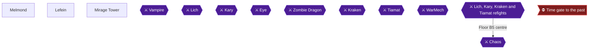

This chapter takes the Slab you picked up in the Sea Shrine to Dr. Unne in Melmond, collects the Chime in Lefein, fills your spell slots in the level 7 and 8 shops, and then clears the Mirage Tower, including Thor's Hammer. Dr. Unne teaches the party Lefeinish once you hand over the Slab, the Chime comes from a man in Lefein, and the Chime opens the Mirage Tower 🟡.

> [!WARNING]
> **Achievement Trigger Warning:** **Of Mighty Magic** is flagged as missable, and its lockout was set at party creation in Chapter 1. It needs a character who learns 24 spells, and the party must have started with at least one White Mage or Black Mage. Red Mages cannot learn any level 8 spell and top out at 20 spells even after their class upgrade 🟡. One player whose only mage was a Red Mage had to replay the game 🟡. The achievement counts spells bought (3 per level), not casts 🟡.

### Preparation

- Bring the **Slab** from the Sea Shrine. It was in the right-hand chest of the three in the top-right room on the highest floor.
- The **Cube** from the Waterfall is needed for the teleporter on the third floor of the Mirage Tower 🟡.
- Gold matters: level 7 spells cost 45000 and level 8 spells cost 60000 🟡. Sell spare gear from the Mirage Tower chests when you need cash.
- Plan your slots. Three spells per level, eight levels, make 24. Levels 1-6 are sold in Coneria (1), Pravoka (2), Elfland (3 and 4), Melmond (5) and Crescent Lake (6) 🟡. Level 7 is split between Gaia and Onrac 🟡. Level 8 is sold in Gaia and Lefein 🟡.
- Keep a level 6 slot open for Exit on a White Wizard, since it cannot be learned until after the class change 🟡.

### Melmond

🗺️ **Map:** [View Melmond Map by Paco](https://www.vgmaps.com/Atlas/NES/FinalFantasy-Melmond.png)

Melmond was ruined by the Vampire, who destroyed the Clinic and Item Shop. Dr. Unne lives here 🟡. There is no Item Shop and no Clinic, so stock potions elsewhere before arriving and travel back to revive fallen allies.

#### Dr. Unne (Bilingual)

1. Find Dr. Unne in Melmond and show him the Slab.
2. He translates it and teaches the party Lefeinish 🟡.


> [!ACHIEVEMENT]
> **Bilingual (5 Points)**
> 
> *Learn the language of the Lefeinians.*


Some players report oddities with this achievement: one had it unlock early after having the slab and saving at an inn 🟡, and others got it after reloading 🟡. If it does not pop, reload and talk to Dr. Unne again 🟡.

#### Melmond shops

The level 5 spells are the Melmond purchase for Of Mighty Magic.

| Shop | Stock | Citation |
|---|---|---|
| White Magic (Lv 5, 8000 each) | Cur3, Life, Hrm3, Hel2 | 🟡 |
| Black Magic (Lv 5, 8000 each) | Fir3, Bane, Warp, Slo2 | 🟡 |
| Armor | Steel Armor 45000, Silver Bracelet 5000, Iron Helmet 450, Copper Gauntlet 200, Iron Gauntlet 750 | 🟡 |
| Weapon | Iron Staff, Sabre 450, Long Sword 3000 | 🟡 |

- Life revives a character to only 1 HP and does not work in battle 🟡.
- Warp must be used by a Red or Black Wizard, so a Black Mage should keep a slot open for it until the class change 🟡.
- Steel Armor is the best Fighter buy here 🟡.

### Lefein

🗺️ **Map:** [View Lefein Map by Paco](https://www.vgmaps.com/Atlas/NES/FinalFantasy-Lefein.png)

Fly with the Airship northwest toward the big desert, land on the lone grassland patch by the lake surrounded by forest, walk along the lake's western border, turn east, and head south through the marsh and forest to the village 🟡. Without Lefeinish the townspeople are unintelligible 🟡.

#### The Chime

Talk to the man standing still near the water in the southeast of town, the southernmost resident east of the river, to receive the Chime. Sources disagree on which bottom corner he stands in, so look along the water at the bottom of town. The other residents explain that the Sky Warriors came from here and that the Mirage Tower leads to the Floating Castle 🟡.

#### The secret level 8 shops

Go to the northeast corner, through the notch or break in the gate, and follow the single path east to two small shops 🟡.

- White Magic: **Lif2**, 60000, White Wizard only 🟡. It revives a defeated ally to full HP but does not work in battle 🟡.
- Black Magic: **Nuke**, 60000, Black Wizard only.

Lefein has no weapon, armor or item shop 🟡.

### Level 7 and 8 spell shops

Buy these at the Level 7-8 spell shops to finish the 24. The Gaia and Onrac stock:

| Level | Town | Spell | Cost | Citation |
|---|---|---|---|---|
| 7 White | Gaia | Cur4, Hrm4 | 45000 | |
| 7 White | Onrac | Arub, Hel3 | 45000 | 🟡 |
| 7 Black | Gaia | Brak, Ice3 | 45000 | |
| 7 Black | Onrac | Sabr, Blnd | 45000 | |
| 8 White | Gaia | Fade, Wall, Xfer | 60000 | 🟡 |
| 8 Black | Gaia | Stop, Zap!, XXXX | 60000 | |

A White Wizard can finish learning 24 spells in Gaia with Fade and Wall, and a Black Wizard can buy any two level 8 spells there 🟡. Lefein's Lif2 and Nuke are the fourth option each class would otherwise miss 🟡. Xfer does nothing useful when cast 🟡.

If you reach this point without enough slots, one player suggests reloading after completing the game, changing class, and buying missing spells in each town. That is unconfirmed 🟡.


> [!ACHIEVEMENT]
> **Of Mighty Magic (10 Points)**
> 
> *Have a character learn 24 spells.*


### Mirage Tower

🗺️ **Map:** [View Mirage Tower Map by Paco](https://www.vgmaps.com/Atlas/NES/FinalFantasy-MirageTower.png)

The tower stands in the vast desert northwest of Lefein. Land the Airship on the small patch of grass south of it, in the mountains near the desert's northeast corner, then walk northwest. Enemies here include Ankylo, Badman, Catman, Guard and Saber Tooth Tiger 🟡.

> [!TIP]
> Make sure you have free armor and weapon slots. There are many pieces to carry on the first floor 🟡.

#### 1F

Walk straight up through the door to a grey divider wall, go right and up along it to a gap, and drop down through it 🟡. Chests on this floor:

1. Head right: **880 Gold** 🟡.
2. Go down: **Heal Helmet**, which casts Heal as an item in battle.
3. Enter the left cubby hole: **3400 Gold**, **18010 Gold** and the **Vorpal Sword** 🟡.
4. Go down, left, then up the first hallway and right: **Aegis Shield** and **2750 Gold** 🟡.
5. Go back down and left into the next upward hallway: a **Cabin** 🟡.

That is 8 chests on the interior of floor 1 🟡. Then go up, turn left and down to two doors, and take the left one to the stairs 🟡. The stairs up are just across the wall from the entrance 🟡.

#### 2F

A pillar maze greets you. Go counterclockwise around half the room, then weave through the pillar rows 🟡. Following the column wall, pass through a small hole, go right through it, up and right through the next, then walk down the perimeter and right to the treasure room door 🟡.

The ten chests, going up the left side and down the right, hold 🟡:

1. **8135 Gold** 🟡
2. **7900 Gold** 🟡
3. **Thor's Hammer** 🟡
4. **12350 Gold** 🟡
5. **13000 Gold** 🟡
6. **House** 🟡
7. **7690 Gold** 🟡
8. **Sun Sword** 🟡
9. **10000 Gold** 🟡
10. **Dragon Armor** 🟡

Thor's Hammer is the middle-left chest. It deals 18 damage, equips on Knight, Ninja and White Wizard, and casts Lit2 as an item.


> [!ACHIEVEMENT]
> **Mjolnir Cometh (5 Points)**
> 
> *Obtain Thor's Hammer.*


Equip the hammer on your White Wizard and move any other Lit2 item elsewhere, since two Lit2 items on one character are pointless 🟡. Give the Sun Sword to a Knight; it is effective against Undead. The Dragon Armor matches Opal Armor stats and suits a second Knight 🟡. The Aegis Shield protects Knights from Stone attacks 🟡.

#### 3F

Floor 3 holds only a teleporter to the Floating Castle, which needs the Cube 🟡. Circle the room to the doorway and enter. A Blue Dragon is waiting inside.

**Blue Dragon:** 454 HP, weak to Fire, uses a hit-all Thunder attack and often strikes first. Heal fully before entering. Attack with Knights, Masters and Ninjas, and use Fir3 from a Red or Black Wizard 🟡. It gives 2000 Gold and 3274 Exp 🟡.

After the fight, step into the portal and use the Cube to reach the Floating Castle 🟡. The Ribbon and Adamant found at 5F of the Sky Castle section belong to the next chapter 🟡.

> [!TIP]
> **Before you leave:** Confirm you have Thor's Hammer, all 18 chest rewards you want from floors 1 and 2, the Chime, and your Level 7-8 spells bought. The Mirage Tower chests count toward the Sky Raider chest-sweep, which finishes in the next chapter.

> [!IMPORTANT]
> ### Chapter 11 Cumulative 100% Checkpoint
> - **Mirage Tower Chests (floors 1-2):** 18 / 18 🟡
> - **Orbs relit, Playthrough 1:** 3 / 4
> - **Orbs relit, Playthrough 2:** 0 / 4
> - **Chest-sweep achievements:** 7 / 9
> - **RetroAchievements Unlocked:** 24 / 40 (162 / 360 points)

### Chapter Checklist

- [ ] Slab given to Dr. Unne (Bilingual)
- [ ] Chime received in Lefein
- [ ] Lif2 / Nuke purchased where applicable
- [ ] 24 spells learned on one White or Black Wizard (Of Mighty Magic)
- [ ] Mirage Tower 1F: 8 chests opened
- [ ] Mirage Tower 2F: 10 chests opened, Thor's Hammer taken (Mjolnir Cometh)
- [ ] Blue Dragon defeated and Cube ready for the portal

---

## Chapter 12: The Floating Castle, WarMech, Tiamat and Excalibur

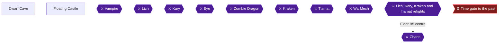

This chapter takes you through the top of the Mirage Tower, into the Floating Castle, past the rare WarMech encounter, through the Fiend of Air Tiamat, and finally to the Dwarf Cave for Excalibur. The Cube from the Waterfall is the key to the Floating Castle. The Chime from Lefein opens the Mirage Tower 🟡. Six achievements are covered here: God's Eye View, Slice and Dice, Sky Raider, Rage Against the Machine, Floating Fortress and The True King.

> [!TIP]
> **Preparation:** Bring plenty of free inventory slots for armor, since the Mirage Tower and Floating Castle hold many pieces of equipment 🟡. The Exit spell gets you out of the Floating Castle at any time, whether to sell gear or to run an item to the Dwarves 🟡.

> [!WARNING]
> **Achievement Trigger Warning (Choking Hazard):** The planner schedules Choking Hazard for Playthrough 2 (chapter 18). Tiamat killed here by the Bane Sword used as an item, or by the Bane spell, unlocks it now. Attacking with an equipped Bane Sword or casting Brak does not count. Whether the achievement accepts a kill by other means is not stated in the sources: Unable to verify from collected sources.

### Chapter Items to Collect

Sky Raider asks for every chest in the Mirage Tower and the Floating Castle 🟡. The list below summarises the full sweep.

| Item | Where Found | Action / Requirement | Citation |
|---|---|---|---|
| 880 G, Heal Helmet, 3400 G, 18010 G, Vorpal Sword | Mirage Tower 1F | **TAKE** | 🟡 |
| Aegis Shield, 2750 G, Cabin | Mirage Tower 1F | **TAKE** | 🟡 |
| 10 chests: 8135 G, 7900 G, Thor Hammer, 12350 G, 13000 G, House, 7690 G, Sun Sword, 10000 G, Dragon Armor | Mirage Tower 2F | **TAKE** | 🟡 |
| Bane Sword | Floating Castle 1F south room | **TAKE** | 🟡 |
| 180 G, Heal Helmet, 6720 G, ProRing, 5000 G | Floating Castle 1F east room | **TAKE** | 🟡 |
| 7900 G, 4150 G, Heal Potion, 9900 G | Floating Castle 1F west room | **TAKE** | 🟡 |
| House, Silver Helmet | Floating Castle 2F northwest | **TAKE** | 🟡 |
| Opal Gauntlet | Floating Castle 2F northeast | **TAKE** | 🟡 |
| Opal Shield, Ribbon | Floating Castle 2F east | **TAKE** | 🟡 |
| Black Shirt, White Shirt | Floating Castle 2F southeast | **TAKE** | 🟡 |
| Adamant | Floating Castle 2F southwest | **TAKE** | 🟡 |
| 880 G, 13000 G | Floating Castle 2F west | **TAKE** | 🟡 |
| Heal Potion, 5450 G, ProRing, 9000 G | Floating Castle 3F north room | **TAKE** | 🟡 |
| ProCape, Cloth, 6400 G, Soft Potion, 9500 G, 8135 G | Floating Castle 3F east wing | **TAKE** | 🟡 |
| Soft Potion, 4150 G, 3400 G, Katana | Floating Castle 3F west hall | **TAKE** | 🟡 |

### Mirage Tower

#### 1F

Walk straight up through the door until you meet a grey divider wall. Go right and then up along the wall to find a hole in it, then go down through it 🟡. Head right to open a chest with **880 Gold Pieces** 🟡. Go down for a **Heal Helmet**, which casts Heal as an item in battle 🟡.

Enter the small cubby hole on the left. Its three chests hold **3400 Gold Pieces**, **18010 Gold Pieces** and the **Vorpal Sword** 🟡. The Vorpal Sword is weak compared with other weapons you have by now.

Head down, left, and then up the first hallway, then go right for two chests: the **Aegis Shield** and **2750 Gold Pieces** 🟡. The Aegis Shield protects Knights against stone attacks 🟡. Go back down and left into the next upward hallway for a **Cabin** 🟡.

#### 2F

Use the wall of columns above you as a reference and follow it around the room to a small hole. Go right through it, up and right through the next hole, then walk down 🟡. Follow the room's perimeter down and right to a door into the treasure room. Its ten chests, going up the left side and down the right, hold: 8135 G, 7900 G, the **Thor Hammer** (casts Lit2 as an item), 12350 G, 13000 G, a **House**, 7690 G, the **Sun Sword**, 10000 G and the **Dragon Armor** 🟡. The Thor Hammer is the middle-left chest.

Then go to the third floor by the top staircase 🟡.

#### 3F: the Cube

Make sure you are fully healed before entering the building in the centre, because a Blue Dragon attacks and usually acts first with a powerful Thunder. It has 454 HP and is weak to Fire. Use the Cube in the room beyond to be transported to the Floating Castle 🟡. After the fight you are at the bottom floor of the Floating Castle.

### Floating Castle

🗺️ **Map:** [View Sky Castle Map by Paco](https://www.vgmaps.com/Atlas/NES/FinalFantasy-SkyCastle.png)

#### 1F

You start in the centre with four branches. The top one leads to 2F 🟡.

1. Go down around the perimeter to a door. The chest holds the **Bane Sword**, which casts Bane when used as an item in battle 🟡. Do not equip it; give it to a wizard to use as an item 🟡.
2. Return to the centre and go right to the room with the door at the bottom. Its five chests hold **180 G, Heal Helmet, 6720 G, ProRing, 5000 G** 🟡.
3. Return and take the left branch. Four chests hold **7900 G, 4150 G, Heal Potion, 9900 G** 🟡.
4. Take the path upward to the transporter to 2F 🟡.

#### 2F

Eight branches radiate from the centre like a compass 🟡. Visit each in turn, returning to the centre each time 🟡:

- Up-left (northwest): **House** and **Silver Helmet** 🟡.
- Up-right (northeast): **Opal Gauntlet** 🟡.
- Right off the down hall (east): **Opal Shield** and **Ribbon** 🟡.
- Down-right (southeast): **Black Shirt** (Ice2 as an item) and **White Shirt** (Inv2 as an item) 🟡.
- Down-left (southwest): the **Adamant** 🟡. This is the item for Excalibur. The Knight-only sword is made from it 🟡.
- Left passage upward (west): **880 G** and **13000 G** 🟡.

Then head down the straight path to the transporter to 3F 🟡.

#### 3F

##### God's Eye View

When you arrive, talk to the nearby green robot and examine the hole at the bottom of the rectangular Floating Castle window 🟡. Near the centre of the floor is an area of space surrounded by walls with an opening to its south. Go to that opening and interact with the space 🟡. You learn that the Four Forces flow into the centre of the Four Altars, the Temple of Fiends 🟡.


> [!ACHIEVEMENT]
> **God's Eye View (3 Points)**
> 
> *Get a glimpse of where the four forces are flowing together.*


##### Chests

- Go straight up to a room with four chests: **Heal Potion, 5450 G, ProRing, 9000 G** 🟡.
- Back at the transporter, go down and to the right along a narrow winding path to a room of six chests, up the left and down the right: **ProCape, Cloth, 6400 G, Soft Potion, 9500 G, 8135 G** 🟡.
- Take the left path, past the downward path, to the hall leading left with four chests (left to right): **Soft Potion, 4150 G, 3400 G, Katana** 🟡. The Katana is the furthest-right chest 🟡. It can only be equipped by a Ninja.


> [!ACHIEVEMENT]
> **Slice and Dice (5 Points)**
> 
> *Obtain a Katana.*


Finally, return and take the path leading down to the transporter to 4F, under the Katana room 🟡.

With 3F, 2F, 1F and both Mirage Tower floors finished, every chest is open.


> [!ACHIEVEMENT]
> **Sky Raider (5 Points)**
> 
> *Open all treasure chests in the Mirage Tower and Floating Castle.*


> [!TIP]
> **Before you leave:** Check that you have the Adamant. If you need to heal or are out of item room, Exit now; the guide notes that doing so spares you re-collecting treasures.

#### 4F: the looping maze

This floor is an endless maze unless you move in the right directions 🟡. The ASCII grid:

```text
   A    B    C    D
  | |  | |  | |  | |
 -+ +--+ +--+ +--+ +-
1                    1
 -+ +--+ +--+ +--+ +-
  | |  | |  | |  | |
 -+ +--+ +--+ +--+ +-
2            E       2
 -+ +--+ +--+ +--+ +-
  | |  | |  | |  | |
 -+ +--+ +--+ +--+ +-
3                    3
 -+ +--+ +--+ +--+ +-
  | |  | |  | |  | |
 -+ +--+ +--+ +--+ +-
4  S                 4
 -+ +--+ +--+ +--+ +-
  | |  | |  | |  | |
   A    B    C    D
```

Any set of left/right/up/down moves passes through this layout, and done correctly it brings you to the transporter 🟡. Reported routes to the 5F transporter:

- Up, left, up, left 🟡.
- Go east past one grid intersection, then at the second intersection head south 🟡.
- Walk left and take the second intersection up, or walk down and take the second intersection right, or walk right and take the second intersection down 🟡.

The floor has powerful enemies 🟡.

### WarMech

#### 5F corridor

The final floor is a long narrow causeway 🟡. Walk straight up; it is the only way 🟡. WarMech is only found in this long corridor and has a 1 in 64 chance of appearing. Another source gives roughly 4.7%. Players report meeting it very early or even twice 🟡, and one was ambushed two steps before Tiamat's room 🟡.

Warning: if you want the encounter (Rage Against the Machine, 25 pts), you have to be ready for it. Heal fully after each battle, as it usually acts first and uses Nuclear most of the time 🟡.

Reported ways to force it: save outside the Mirage Tower, reset with the power option (shut the emulator down completely to reset the RNG), reload, climb, and reach the bridge before 20 encounters; the 20th should be WarMech 🟡. One player reached the bridge after 10 encounters and met him on the 20th 🟡. Whether this works with your emulator in Hardcore Mode is unconfirmed: Unable to verify from collected sources.

#### Fighting WarMech

Stats vary by source: 1000 HP, 32000 EXP and 32000 gold. Two physical hits of 128 each and Nuclear 🟡. Physical hits can reach 256 on one character, and Nuclear up to 400 on all 🟡. It has no elemental weakness, and 100% magic evade, so spells are poor 🟡. The plan is to buff a physical attacker and hope they kill it first 🟡.

- Cast Fast on your hitters 🟡.
- Have your White Wizard put up Alit and Aice against Tiamat's Thunder and Blizzard attacks, and use Inv2 to help avoid its physical hits.
- A Fighter and two Red Mages can win with support spells like Inv2, Arub, Fog2, Fast and Cur3.
- Keep healing with high-end Cure spells 🟡.
- Players report a level 41 Black Belt hasted by a Black Mage one-shotting it, or an all-Knight party near level 50 making it easy 🟡.
- Luck matters unless you are overleveled 🟡. One player won with only the Black Belt alive, and that still unlocked the achievement 🟡.


> [!ACHIEVEMENT]
> **Rage Against the Machine (25 Points)**
> 
> *Defeat a Warmech in the Floating Castle.*


### Tiamat

#### Pre-fight

Walk up the causeway, enter the room, and heal completely before stepping forward 🟡.

#### Boss: Tiamat

Tiamat has 1000 HP and gives 5496 EXP 🟡. She uses Thunder, Poison Gas and Blizzard 🟡; 50% of her turns are attacks and the rest cycle through Lightning, Poison, Cold and Fire specials. Her attacks hit four times 🟡. She resists Fire, Ice and Lightning and is immune to Quake.

Conventional tactics:

1. Round 1: Red and Black Wizards cast Fast on your fighters, who attack 🟡.
2. White Wizard puts up Alit and Aice, then Inv2 in round two 🟡.
3. Keep attacking and healing 🟡.

Bane shortcut: Tiamat is weak to Bane and Brak. Bane has around a 20% chance per use 🟡. The Bane Sword used as an item is as likely to hit as the spell, can be used unlimited times, and you do not need to equip it 🟡. For Choking Hazard, use the Bane Sword as an item or cast Bane; do not use Brak or attack with it equipped 🟡. Tiamat may also use Bane with a slight chance of wiping the party 🟡.

After the kill, touch the altar he guarded to make an Orb shine, then use the warp to leave 🟡.


> [!ACHIEVEMENT]
> **Floating Fortress (10 Points)**
> 
> *Defeat Tiamat and purify the Wind Crystal.*


### Dwarf Cave

🗺️ **Map:** [View Dwarf Cave Map by Paco](https://www.vgmaps.com/Atlas/NES/FinalFantasy-DwarfCave.png)

Return to the airship and fly to the Dwarf Cave. Find the blacksmith, who earlier said he would make a legendary sword but needed Adamant 🟡. Give him the Adamant you took from the Floating Castle; in return he forges an extremely powerful sword for your Knight 🟡.

### Excalibur

Give the Adamant to the blacksmith and he forges the Excalibur (Xcalber), usable only by the Knight, 45 damage, 35 hit. Equip it on your Knight 🟡. One player reports the achievement popped only after talking to the dwarf on the tile below the blacksmith 🟡.


> [!ACHIEVEMENT]
> **The True King (5 Points)**
> 
> *Obtain Excalibur.*


> [!TIP]
> **Before you leave:** Rest and restock. The next step is the Temple of Fiends, where the four Orbs activate the Time gate 🟡.

> [!IMPORTANT]
> ### Chapter 12 Cumulative 100% Checkpoint
> - **Chest-sweep achievements:** 8 / 9 (Sky Raider)
> - **Orbs relit, Playthrough 1:** 4 / 4
> - **Orbs relit, Playthrough 2:** 0 / 4
> - **RetroAchievements Unlocked:** 30 / 40 (215 / 360 points)

### Chapter Checklist

- [ ] Opened all chests in the Mirage Tower 1F and 2F
- [ ] Opened all chests on Floating Castle 1F, 2F and 3F (Bane Sword, Adamant, Katana)
- [ ] God's Eye View (398473)
- [ ] Slice and Dice (398474)
- [ ] Sky Raider (398484)
- [ ] Rage Against the Machine (27655)
- [ ] Floating Fortress (3580)
- [ ] The True King (27658)

---

## Chapter 13: The Past Temple Treasures, Masamune and Chaos

```mermaid
flowchart TD
  Temple_of_Fiends["Temple of Fiends"]
  Temple_of_Fiends_Past["Temple of Fiends (Past)"]
  Garland{{"⚔ Garland"}}
  Pirates{{"⚔ Pirates (Bikke)"}}
  Wizards_Crown{{"⚔ Wizards (Crown guard)"}}
  Astos{{"⚔ Astos"}}
  Vampire{{"⚔ Vampire"}}
  Lich{{"⚔ Lich"}}
  Kary{{"⚔ Kary"}}
  Eye{{"⚔ Eye"}}
  Zombie_Dragon{{"⚔ Zombie Dragon"}}
  Kraken{{"⚔ Kraken"}}
  Tiamat{{"⚔ Tiamat"}}
  WarMech{{"⚔ WarMech"}}
  Fiend_Refights{{"⚔ Lich, Kary, Kraken and Tiamat refights"}}
  Chaos{{"⚔ Chaos"}}
  Time_Gate>"⛔ Time gate to the past"]
  Time_Gate -->|"2000 years into the past"| Temple_of_Fiends_Past
  Fiend_Refights -->|"Floor B5 centre"| Chaos
  classDef ponr fill:#7f1d1d,stroke:#f87171,color:#fff;
  classDef boss fill:#4c1d95,stroke:#a78bfa,color:#fff;
  class Time_Gate ponr;
  class Garland,Pirates,Wizards_Crown,Astos,Vampire,Lich,Kary,Eye,Zombie_Dragon,Kraken,Tiamat,WarMech,Fiend_Refights,Chaos boss;
```

This chapter covers the last stretch of Playthrough 1. First you sweep the six present-day chests and the locked rooms of the Temple of Fiends. Then you step through the time gate, open every chest of the past temple (including the Masamune on the Tiamat floor), refight Lich, Kary, Kraken and Tiamat, and finish with Chaos 🟡. Four achievements come out of the chest sweep, the Masamune and the Chaos kill: What's Old Is New Again, Blade of Purity, Balmless Battler of Cruel Chaos and Heroes That Never Were.

> [!WARNING]
> **Unconfirmed rule:** No collected source says what counts as "healing yourself" for Balmless Battler of Cruel Chaos. Use no healing of any kind in the Chaos fight: no spells, potions, healing items or revives. Enter at full HP and use buffs only (Fast, Inv2, Fog2, Ribbons).

### Preparation

- Hardcore Mode is on, so there are no save states. Your only safety net is the in-game Exit spell and a normal save.
- Exit is the only conventional way out once you are in the past, and a Red or White Wizard is useful for it 🟡. Warp from a Red or Black Wizard also works, but only from the top floor of the temple you entered on 🟡. Exit and Warp need the class upgrades, so you cannot leave the past without them 🟡.
- Bring the Lute from Princess Sara. You cannot pass the stone plate in the past without it.
- Restock before you enter. One source suggests carrying 99 each of Pure, Cure and Soft Potions, and recommends a party level around 35 🟡. Another recommends level 27 at the minimum and about 35 for Chaos.
- Running from most battles saves HP and spell charges for the fights that matter 🟡.
- Fully heal and fill your spell charges before the final door 🟡.
- Keep your Ribbons for the end. Chaos can instantly kill party members without Ribbons using Crack 🟡. A Ribbon gives automatic resistance to all four elements 🟡.

> [!WARNING]
> **Achievement Trigger Warning:** For Balmless Battler of Cruel Chaos, do not heal at any point during the Chaos fight. Heal items such as the Heal Staff and Heal Helmet are best kept for the dungeon itself, not for Chaos 🟡.

### Chapter Items to Collect (Temple of Fiends Chests)

| Item | Where Found | Action / Requirement | Citation |
|---|---|---|---|
| Cap | Small southwest room, present temple | **TAKE** | |
| Cabin | Northwest room, present temple | **TAKE** | |
| Heal Potion | Northwest room, present temple | **TAKE** | |
| Rune Sword | Locked room (right passage), present temple | **TAKE** after beating the Gargoyles; Mystic Key | |
| Were Sword | Locked top-right room, present temple | **TAKE** after beating the Gargoyles; Mystic Key | |
| Soft Potion | Locked top-right room, present temple | **TAKE** after beating the Gargoyles; Mystic Key | |
| 45,000 gold | Floor 3 central room, past temple | **TAKE** (left chest) | 🟡 |
| 65,000 gold | Floor 3 central room, past temple | **TAKE** (right chest) | 🟡 |
| ProRing | Floor B2, left door south of stairs | **TAKE** | 🟡 |
| Katana | Floor B2, beyond the ProRing room | **TAKE** | 🟡 |
| ProCape | Floor B2, right door south of stairs | **TAKE** | 🟡 |
| 26,000 gold | Floor B2, beyond the ProCape room | **TAKE** | 🟡 |
| Masamune | Floor B4, room at the end of the diagonal hallway | **TAKE** | 🟡 |

### Temple of Fiends

🗺️ **Map:** [View Temple Of Fiends(Present) Map by Paco](https://www.vgmaps.com/Atlas/NES/FinalFantasy-TempleOfFiends(Present).png)

The present-day chests belong to the same chest sweep as the past temple. Sources count six chests in the corners of the start area before you use the crystal to go back in time 🟡. Two of the temple's rooms are locked and need the Mystic Key 🟡. If you already cleared them in the earlier chapters, skip ahead to the time gate.

1. Start at the bottom-centre of the temple. Take the passage west to the small southwest room and open the chest for a **Cap**.
2. Return and go up the path, past the right fork, to the northwest room. Open the two chests for a **Cabin** and a **Heal Potion**.
3. The locked rooms are on the right. Go through the right passage into the small room and beat the Gargoyles for the **Rune Sword**.
4. Leave, go to the top-right corner of the chamber and enter the small room there. Fight the Gargoyles again (twice) for the **Were Sword** and a **Soft Potion**.

> [!TIP]
> Two of the three locked-room rewards, the Rune Sword and the Were Sword, sell for about 3000 GP each if you have no Thief 🟡.

### Time Gate

Go straight to the central room where Garland was fought. The same five bats still fly around the Dark Crystal, and they can be spoken to if you want the story 🟡. Examine the Dark Crystal. The four Orbs cover it and the Time gate to the past opens 🟡. Step forward and you are sent 2000 years into the past 🟡.

> [!TIP]
> Before you leave the present, finish the six present-day chests listed above. There is no conventional way back to the present, only Exit, so the earlier chests are best done first 🟡.

### Temple of Fiends (Past)

🗺️ **Map:** [View Temple Of Fiends(Past) Map by Paco](https://www.vgmaps.com/Atlas/NES/FinalFantasy-TempleOfFiends(Past).png)

Expect the toughest enemies from all over the game here. Frost Dragons come in groups of three or four on the first floors and hit with Frost 🟡. Frost Ds in packs of four can freeze as many as 800 HP in a round, and Gas Ds in packs of four can poison the whole party for up to 1200 per round 🟡. Gas Dragons are weak to Ice.

#### Floor 3 (start)

You begin on Floor 3 and there are no chests here. Head for the bottom right corner and take the stairs to Floor 2 🟡. Run from fights where you can 🟡.

#### Floor 2

Go down through the door below to the blocked path, turn right along the lower wall and find the stairway up to the next floor 🟡. Run straight across the floor to a stairway leading upwards. The small interior chamber on Floor 2 has the stairs up to Floor 1 🟡.

#### Floor 1: Phantom, Chests and the Lute Plate

1. Head down to the left side of the pillars, walk down past the outline of two rooms and turn right just below the second room frame 🟡.
2. Follow the pillar path up to a room with two chests in its corners. A guardian must be fought first 🟡. Entering the central room triggers the Phantom.
3. **Phantom:** 360 HP, undead, weak to Fire and Harm, and hits for 120-240 with a Stun effect 🟡. Use Fir3 or Harm spells. A Knight or Master physical hit may end it in one blow 🟡. Use Inv2 or the White Shirt, and Arub or ProRings against its Glare 🟡.
4. Open the two chests: **45,000 gold** (left) and **65,000 gold** (right) 🟡.


> [!ACHIEVEMENT]
> **What's Old Is New Again (10 Points)**
> 
> *Open all treasure chests in the Temple of Fiends.*


The chest-sweep achievement for the Temple of Fiends needs all of its chests, so keep going through the past temple until the Floor B2 and Masamune chests are open as well 🟡.

5. At the stone plate, use the **Lute**. The Rod does not work on this one. The Lute uncovers a ladder leading down to the main part of Floor 2 🟡.
6. Head to the northwest corner of Floor 2 to get back to the floor-3 level, then take the path heading west to the stairs down 🟡.

#### Floor B1 (Earth Floor): Lich

Nothing useful is on this floor. On the Earth Floor expect large groups of Earth Cave enemies 🟡. Head up and turn right when the room to the right stops extending up, ignore the pillar path leading down, and keep going until the stairway attacks you 🟡. Follow the outside path to the southeast corner 🟡.

**Lich refight:** The stairs are guarded and you fight Lich every time you approach 🟡. Source stats disagree: 400 HP, 500 HP and 800 HP are all listed 🟡. Lich is weak to Fire and Harm 🟡 and can use Nuke, which can hit for over 300 per character 🟡. Attack with Knight, Master and Ninja and use Harm and Fire with the wizards 🟡. A high-level Knight or Master can kill him in one hit, but he tends to Nuke first 🟡.

#### Floor B2 (Fire Floor): Chests and Kary

🗺️ Use the past-temple map linked above for this floor.

This floor has Gurgu Volcano-style enemies 🟡. Four chests are here, in two room pairs south of the stairs 🟡. The stairs down are right next to you, but the route to them is circuitous 🟡. Do not take the stairs yet.

1. Take the path south to the pair of doors 🟡.
2. Take the **right door**: chest with a **ProCape**. Continue through that room into the next for **26,000 gold** 🟡.
3. Go back and take the **left door**: chest with a **ProRing**. Go through that room and down the next corridor to the remote room with the **Katana** 🟡.
4. Retrace your steps to the stairs down. Approaching them triggers the Kary refight.

**Kary refight:** The sources list her at 600, 700 and 800 HP 🟡. She can deliver 2-6 hits and casts Fir3 🟡. Afir should cover her Fir3 and Hold 🟡. Have Knight and Master attack, wizards Fast the weapon users, and the White Wizard cast Inv2 and heal 🟡. Healing here is fine, since this is not the Chaos fight.

#### Floor B3 (Water Floor): Kraken

This floor has Sea Shrine enemies 🟡. Move through the buildings: enter the first from the west and exit east, head south into the next building, follow it west then south to the outside, walk north a little and enter the next building, work to the middle going east, then continue south 🟡. Your goal and the Kraken fight are in the southeast corner 🟡. No treasure is on this floor 🟡.

**Kraken refight:** Sources list 800, 900 and 1000 HP. He can land 5-8 hits and use Lit2 and Ink 🟡. Cast Fast on hard hitters, cast Inv2 and attack 🟡. Lit2 and Lit3 are listed against him. Heal as needed; this is not Chaos 🟡.

#### Floor B4 (Air Floor): Masamune and Tiamat

Expect Mirage Tower and Floating Castle enemies here 🟡.

1. From the entry stairs, head south then east through a couple of the boxy rooms 🟡.
2. Take the diagonal hallway from the southeast corner of the southeast room to the very end 🟡.
3. Open the chest in the room at the end. It holds the **Masamune**, the strongest weapon in the game 🟡.


> [!ACHIEVEMENT]
> **Blade of Purity (10 Points)**
> 
> *Obtain Masamune.*


The Masamune does 56 damage with 50 hit accuracy and any class can equip it. Sources suggest a Red Wizard, Ninja or Master 🟡. Blade of Purity is not missable 🟡.

4. Backtrack up the diagonal path, go left to the second down path and then right to find Tiamat 🟡. Tiamat sits in the corridor linking the top two square areas, and the stairs down are in the upper right.

**Tiamat refight:** 1000 HP in most sources (one lists 1100) 🟡. He has no Bane weakness any more, so do not spend Bane or Brak on him. Use the conventional tactics 🟡. He often casts Bane, a one-hit KO spell 🟡. Alit and Inv2 help 🟡. If you have at least six uses of level 8 magic, one Fade and one Nuke can be spent on Tiamat, saving the rest for Chaos 🟡.

After Tiamat, head up and to the right to the stairway to the final area 🟡.

### Masamune

The Masamune is in the room at the bottom right of the Tiamat floor (B4); go all the way down and right and check the room inside. Equip the Masamune before Chaos. Once the Masamune is in hand, everything below on this floor is only the Tiamat fight. Take the time to Fast and buff before the stairs.

### Lich, Kary, Kraken and Tiamat Refights

> [!CAUTION]
> **Point of No Return:** The game cannot be saved after Chaos. Once every chest is open and you know the route, use Exit to leave and save, so the no-healing Chaos kill can be retried from that save 🟡.

You have now cleared all four refights. Before descending, check these:

- All four past-temple chest groups are open: Floor 3 gold, Floor B2 four chests, Floor B4 Masamune 🟡.
- Exit and save once everything is collected so Chaos can be retried 🟡.

### Chaos

Floor B5 is the only floor in the temple where you can walk around without being attacked 🟡. Walk down to the entrance of the centre room, fully heal and enter 🟡. Garland is there and talks about the time loop, then turns into Chaos 🟡.

**Chaos stats:** 2000 HP, attacks twice, resists every element, 100% magic resistance 🟡. His moves are a 25% physical attack, 25% special (Crack, Inferno, Swirl, Tornado) and 50% spell cycle through Ice3, Lit3, Slo2, Cur4, Fir3, Ice2, Fast, Nuke 🟡. Crack is a one-hit-kill hit-all 🟡. He can cast Cur4 on himself starting round 4 to refill 2000 HP 🟡, and can do so at any time 🟡.

**Strategy (no healing):**
1. Before attacking, cast defensive and setup spells: the A--- spells, Inv2 and Fast 🟡. Equip Ribbons so Crack cannot kill 🟡.
2. Fast the Knight, Master, Ninja and Red Wizard 🟡. Power Gauntlet, Sabr, Tmpr, Invs and Fog are also suggested 🟡.
3. Begin the assault after Chaos casts Cur4 on himself, using Fast-enhanced physical attackers with Fade and Nuke 🟡.
4. Black Wizard: Nuke each round does about 150-300 damage 🟡. Magic is otherwise weak because of his resistances 🟡.
5. Players report success with four level 34 characters 🟡, with Black Belts and Fast alone 🟡, and with a level 50 Black Belt killing him in about two hits 🟡.
6. Do not use any healing: no spells, potions, items or revives (unconfirmed what counts, so avoid all of it). If anyone heals, reload your Exit-and-save and retry 🟡.


> [!ACHIEVEMENT]
> **Balmless Battler of Cruel Chaos (10 Points)**
> 
> *Defeat Chaos without healing yourself.*


Killing Chaos also ends the cycle of destruction. Reports say one player had the achievement not trigger when a party member was dead, so try to keep everyone alive 🟡.


> [!ACHIEVEMENT]
> **Heroes That Never Were (25 Points)**
> 
> *Defeat Chaos and end the cycle of destruction.*


After the ending, Playthrough 1 is complete. Check that every Playthrough 1 achievement has unlocked before starting the new game for Playthrough 2.

> [!IMPORTANT]
> ### Chapter 13 Cumulative 100% Checkpoint
> - **Temple of Fiends Chests (present and past):** all opened 🟡
> - **Orbs relit, Playthrough 1:** 4 / 4
> - **Orbs relit, Playthrough 2:** 0 / 4
> - **Chest-sweep achievements:** 9 / 9
> - **RetroAchievements Unlocked:** 34 / 40 (270 / 360 points)

### Chapter Checklist

- [ ] Cap, Cabin, Heal Potion in the present temple
- [ ] Rune Sword, Were Sword and Soft Potion from the locked rooms
- [ ] 45,000 and 65,000 gold chests on Floor 3 (past)
- [ ] ProCape, 26,000 gold, ProRing and Katana on Floor B2
- [ ] Masamune on Floor B4
- [ ] Lich, Kary, Kraken and Tiamat refights won
- [ ] Exit and saved before Chaos
- [ ] What's Old Is New Again unlocked
- [ ] Blade of Purity unlocked
- [ ] Balmless Battler of Cruel Chaos unlocked (no healing)
- [ ] Heroes That Never Were unlocked
- [ ] All Playthrough 1 achievements verified before Playthrough 2

---

## Chapter 14: Challenge Run: New Party, Coneria to the Mystic Key

```mermaid
flowchart TD
  Coneria["Coneria"]
  Coneria_Castle["Coneria Castle"]
  Temple_of_Fiends["Temple of Fiends"]
  Matoyas_Cave["Matoya's Cave"]
  Pravoka["Pravoka"]
  Elfland["Elfland"]
  Elfland_Castle["Elfland Castle"]
  Marsh_Cave["Marsh Cave"]
  Northwest_Castle["Northwest Castle"]
  Ship["Ship"]
  Garland{{"⚔ Garland"}}
  Pirates{{"⚔ Pirates (Bikke)"}}
  Wizards_Crown{{"⚔ Wizards (Crown guard)"}}
  Astos{{"⚔ Astos"}}
  Vampire{{"⚔ Vampire"}}
  Lich{{"⚔ Lich"}}
  Kary{{"⚔ Kary"}}
  Eye{{"⚔ Eye"}}
  Zombie_Dragon{{"⚔ Zombie Dragon"}}
  Kraken{{"⚔ Kraken"}}
  Tiamat{{"⚔ Tiamat"}}
  WarMech{{"⚔ WarMech"}}
  Fiend_Refights{{"⚔ Lich, Kary, Kraken and Tiamat refights"}}
  Chaos{{"⚔ Chaos"}}
  Time_Gate>"⛔ Time gate to the past"]
  Coneria -->|"Castle north of town"| Coneria_Castle
  Coneria_Castle -->|"North through plains, forest and swamp"| Temple_of_Fiends
  Matoyas_Cave -->|"East"| Pravoka
  Elfland -->|"Castle north of town"| Elfland_Castle
  Elfland -->|"West between the mountain ranges from Elfland"| Marsh_Cave
  Elfland -->|"North-west of Elfland"| Northwest_Castle
  Fiend_Refights -->|"Floor B5 centre"| Chaos
  classDef ponr fill:#7f1d1d,stroke:#f87171,color:#fff;
  classDef boss fill:#4c1d95,stroke:#a78bfa,color:#fff;
  class Time_Gate ponr;
  class Garland,Pirates,Wizards_Crown,Astos,Vampire,Lich,Kary,Eye,Zombie_Dragon,Kraken,Tiamat,WarMech,Fiend_Refights,Chaos boss;
```

This chapter starts Playthrough 2, a brand-new game played as the challenge run. The route runs from Coneria and Garland through the Lute, the bridge, Pravoka's pirates, Elfland, the Marsh Cave Crown, Astos, Matoya's Herb and the Mystic Key. The hard rule is that no chest may be opened except the five plot chests (Crown, TNT, Ruby, Floater, Slab); the Tail is allowed but not needed 🟡. In this chapter only the Crown chest is on the route (TNT, Ruby, Floater and Slab come in later chapters).

Party suggestion: take a Black Mage. Fire, Fir2 and Fir3 are what finish Kary later, and Bane finishes Tiamat later, so the Flame Sword and Bane Sword chests are not needed. The RA guide's Fighter, Black Belt, White Mage, Black Mage party works. This choice is a roadmap decision rather than a game requirement.

> [!WARNING]
> **Achievement Trigger Warning:** Opening an unnecessary chest makes the challenge icon stay gone, which means the requirement is no longer met 🟡. A player lost it by opening the Cap chest in the southwest room of the Temple of Fiends 🟡. Leave the Temple's Cap, Cabin and Heal Potion chests, and Matoya's three chests, shut.

Open question, unconfirmed: whether opening an empty chest (the Marsh Cave B2 south rooms have some) breaks the challenge. Treat every chest as off-limits except the five plot chests and the Tail, and watch the on-screen challenge icon, which vanishes when you face a chest you must not open 🟡.

Buying consumables in shops is allowed, so shop freely.

### Coneria

🗺️ **Map:** [View Coneria Map by Paco](https://www.vgmaps.com/Atlas/NES/FinalFantasy-Coneria.png)

You start a few steps south of Coneria with 400 Gold 🟡. Shops sell weapons such as the Rapier (10), Small Dagger (5), Wooden Nunchuck (10) and Iron Hammer (10), and armor such as Cloth (10), Wooden Armor (50) and Chain Armor (80). Suggested early gear: Rapier and Chain Armor for the Fighter, Iron Nunchucks and Wooden Armor for the Black Belt (the Wooden Nunchuck is the cheaper alternative), Iron Hammer and Cloth for the White Mage, Small Dagger and Cloth for the Black Mage 🟡.

Spells cost 100 each: Cure and Harm for the White Mage, Fire and Lit for the Black Mage 🟡. Heal Potion is 60, Pure Potion 75 and Tent 75. The Inn costs 30 🟡.

A nunchuck helps the Black Belt only in the first few levels. An unarmed Black Belt's attack is twice his level with double hits, so take his weapon off once he outgrows it; RA commenters who left nunchucks on for this challenge run struggled for hours.

Equip anything you buy, then fight outside town until you are around level 3 🟡.

### Coneria Castle

🗺️ **Map:** [View Coneria Castle Map by Paco](https://www.vgmaps.com/Atlas/NES/FinalFantasy-ConeriaCastle.png)

Talk to the King to learn that Garland kidnapped Princess Sara 🟡. A guard at the bottom left says she is held in a temple to the northwest 🟡. The treasury is locked and needs the Mystic Key, so leave it alone for now 🟡. A man on the first floor mentions that the Lute can break the evil gate 🟡.

### Temple of Fiends

🗺️ **Map:** [View Temple Of Fiends(Present) Map by Paco](https://www.vgmaps.com/Atlas/NES/FinalFantasy-TempleOfFiends(Present).png)

Leave Coneria and go north through plains, a forest, a swamp and a final forest to reach the Temple 🟡. You will come back here in Chapter 19 to enter its past version, the final dungeon ([View Temple Of Fiends(Past) Map by Paco](https://www.vgmaps.com/Atlas/NES/FinalFantasy-TempleOfFiends(Past).png)).

The Temple has a Cap in the small southwest room and a Cabin and Heal Potion in the northwest room. Do NOT open them. The other two treasure rooms are locked and need the Mystic Key 🟡. Walk straight ahead to the central chamber instead.

#### Boss: Garland

Garland has 106 HP and gives 250 Gold and 130 Exp. Everyone attacks. The Black Mage (or Red Mage) casts Fire or Lit and the White Mage Cures if he lands hits on one person 🟡. He uses only physical attacks.

### Princess Sara

After the battle, step forward past the bats and talk to Princess Sara. She thanks you and teleports the party back to Coneria Castle. There is nothing to collect on the way, so the Temple's Cap, Cabin and Heal Potion chests stay shut. Head for the throne room.

### Lute

Speak to the King, who orders a bridge built to the north so you can reach the rest of the continent. Then talk to Princess Sara and keep talking until she hands over the Lute, an old and battered instrument that is a key item, not a chest.


### Coneria bridge

Rest at the Inn if needed, then go north across the bridge to the new landmass 🟡.

> [!TIP]
> Before you leave the Coneria area, make sure you have the Lute (it is needed much later in the Temple of Fiends past).

### Matoya's Cave

🗺️ **Map:** [View Matoya's Cave Map by Paco](https://www.vgmaps.com/Atlas/NES/FinalFantasy-Matoya'sCave.png)

From the bridge, follow the coast left past a port into a forest, go west along the river, then northeast through the forest to the cave 🟡.

Inside, the broom says "TCELES B HSUP" (reversed) 🟡. Matoya's room holds three chests (a Pure Potion and two Heal Potions). Do NOT open them 🟡.

### Matoya

Talk to Matoya: she is blind without her Crystal 🟡. Astos has it, and she will trade the Herb for it later in this chapter. Then leave the way you came in without touching the three chests.

### Pravoka

🗺️ **Map:** [View Pravoka Map by Paco](https://www.vgmaps.com/Atlas/NES/FinalFantasy-Pravoka.png)

Backtrack southwest, turn east after the second stream, cross the desert and wide forest, a brief plain, and follow the next forest south to Pravoka 🟡. The Inn costs 50 🟡.

Per the roadmap, the Peninsula of Power is already done. Do not skip talking to Bikke afterwards: winning on the peninsula must come before talking to Bikke 🟡.

### Pirates (Bikke)

Head to the top-left of town and talk to Bikke 🟡. Nine Pirates, 6 HP each, 40 Gold and 40 Exp apiece 🟡. Spread attacks and use Fire or Lit with the Black Mage 🟡. Slow from a Red or Black Mage helps if you have it.

Talk to Bikke again for the Pirate Ship.


Shopping (consumables and gear are fine to buy): Pravoka sells Gloves (60), Wooden Shield (15), Iron Armor (800), Short Sword (550) and spells such as Ice and Slow 🟡. Dark and Tmpr are bugged: do not buy them 🟡.

### Ship

The exit is the southern gate, where the ship waits. The ship cannot go down streams and can only dock at a port 🟡. Sail west out of the bay, turn south, and follow the coast south and west to a port near a large forest 🟡.

### Elfland

🗺️ **Map:** [View Elfland Map by Paco](https://www.vgmaps.com/Atlas/NES/FinalFantasy-Elfland.png)

Land and go south through the forest to Elfland. Graves north of the inn trigger an easter egg when you talk to the left gravestone 🟡.


Shops sell Fir2, Lit2, Hold (1500 each) and Fast, Ice2, Slp2 (4000) for the Black Mage; Lok2 is bugged, so skip it 🟡. Silver Sword is 4000, Iron Armor 800, Iron Shield 100 and Wooden Helmet 100 🟡. Stock Heal and Pure Potions 🟡. Fir2 and Lit2 matter for the Wizards in the Marsh Cave 🟡.

### Elfland Castle

🗺️ **Map:** [View Elfland Castle Map by Paco](https://www.vgmaps.com/Atlas/NES/FinalFantasy-ElflandCastle.png)

Visit the castle to learn the Prince sleeps from Astos's curse and needs the Herb, which Matoya has but she needs the Crystal 🟡. The treasury is locked with the Mystic Key. Do NOT open the locked room's chests even after you get the key 🟡.

Grinding note: Ogres outside Elfland are a standard source of Gold and Exp 🟡. The Marsh Cave is described as nearly impossible without significant grinding 🟡, and the usual preparation level is 7 to 9 🟡.

### Marsh Cave

🗺️ **Map:** [View Marsh Cave Map by Paco](https://www.vgmaps.com/Atlas/NES/FinalFantasy-MarshCave.png)

Go west from Elfland between the mountain ranges, then south through swampland to a hole in the ground 🟡. Carry plenty of Heal and Pure Potions 🟡. Save with a tent outside 🟡. Scums resist weapons, so use magic 🟡.

On B1 the north and south paths lead to stairs; east is a dead end 🟡. The north route's B2 rooms (680 G, Large Dagger, 620 G, Short Sword) are skipped: do NOT open them 🟡. Take the south path: down the stairs, make your way to the little room at the bottom, and take the stairs to the third basement 🟡. The B2 south rooms include empty chests; leave them shut (the open question above applies).

On B3 there are 16 rooms in a 4x4 layout 🟡. Skip Iron Armor, 295 G, Copper Bracelet, House and 385 G 🟡. The only chest to open is the Crown: third row, second room from the left, surrounded by pillars and open only from below 🟡.

### Wizards (Crown guard)

Fill your HP first. 2 to 5 Wizards, 84 HP each, weak to lightning 🟡. Focus one target at a time, have the White Mage heal, and use Lit2 from the Black Mage: about two castings can clear them 🟡.

### Crown

Open the Crown chest and grab it; stepping off the square means fighting the Wizards again. Leave the other items in the room. Exit the cave and save outside 🟡. The route out: leave the room, go left, take the stairs up, go along the bottom left, up the ladder, and follow the left wall to the exit.

> [!TIP]
> Before you leave the Marsh Cave, confirm the challenge icon is still showing and only the Crown chest was opened 🟡.

### Northwest Castle

🗺️ **Map:** [View Northwest Castle Map by Paco](https://www.vgmaps.com/Atlas/NES/FinalFantasy-NorthwestCastle.png)

From Elfland go west between the mountains, northwest through the forest to the river and lake, then north 🟡. The lone king wants the Crown 🟡. Do not open the locked room's chests (Falchion, Iron Gauntlet, Power Staff) 🟡.

### Astos

Talk to the king in the throne room: he is Astos and attacks 🟡. Astos has 168 HP, no weakness listed in the main guides, and uses Rub (one-hit kill), Fast, Fir2, Slow, Slo2 and Sleep. Fighters attack; Red/Black Mages cast Fast on hard hitters; the White Mage tries Mute 🟡. Cast Mute before Rub if possible 🟡. Afir and Alit help 🟡. Astos should not last more than about three rounds 🟡.

### Crystal

Defeat him to receive the Crystal he stole from Matoya. It goes straight into your inventory, so there is no chest to open. Leave the Northwest Castle without visiting the locked treasure room.

### Herb

Return to Elfland, ship to Matoya's Cave (east to the coast, north to Coneria's shores, west under the bridge, north to the port) and walk to the cave 🟡. Give Matoya the Crystal for the Herb 🟡.

### Mystic Key

Return to Elfland Castle's throne room and talk to the attendant to give him the Herb. The Prince wakes and gives you the Mystic Key 🟡.


Do not use the key on any other chest in the castle 🟡.

> [!TIP]
> Before you leave, the Mystic Key opens the locked rooms in Coneria Castle, where the TNT is the only chest to open (next chapter's task) 🟡.

> [!IMPORTANT]
> ### Chapter 14 Cumulative 100% Checkpoint
> - **Dungeon Chests Opened:** 1 (Crown only; plot chest) 🟡
> - **Orbs relit, Playthrough 1:** 4 / 4
> - **Orbs relit, Playthrough 2:** 0 / 4
> - **Chest-sweep achievements:** 9 / 9
> - **RetroAchievements Unlocked:** 34 / 40 (270 / 360 points)

### Chapter Checklist

- [ ] New game started; Garland defeated; Lute obtained
- [ ] Pirates beaten; Pirate Ship obtained
- [ ] Elfland graves easter egg triggered
- [ ] Only the Crown chest opened; challenge icon still showing
- [ ] Astos defeated; Crystal exchanged for the Herb
- [ ] Mystic Key received from the Elf Prince

---

## Chapter 15: Challenge Run: TNT, the Earth Cave and Lich

```mermaid
flowchart TD
  Coneria_Castle["Coneria Castle"]
  Dwarf_Cave["Dwarf Cave"]
  Melmond["Melmond"]
  Earth_Cave["Earth Cave"]
  Titans_Tunnel["Titan's Tunnel"]
  Sardas_Cave["Sarda's Cave"]
  Garland{{"⚔ Garland"}}
  Pirates{{"⚔ Pirates (Bikke)"}}
  Wizards_Crown{{"⚔ Wizards (Crown guard)"}}
  Astos{{"⚔ Astos"}}
  Vampire{{"⚔ Vampire"}}
  Lich{{"⚔ Lich"}}
  Kary{{"⚔ Kary"}}
  Eye{{"⚔ Eye"}}
  Zombie_Dragon{{"⚔ Zombie Dragon"}}
  Kraken{{"⚔ Kraken"}}
  Tiamat{{"⚔ Tiamat"}}
  WarMech{{"⚔ WarMech"}}
  Fiend_Refights{{"⚔ Lich, Kary, Kraken and Tiamat refights"}}
  Chaos{{"⚔ Chaos"}}
  Time_Gate>"⛔ Time gate to the past"]
  Melmond -->|"South past the rotting land"| Earth_Cave
  Titans_Tunnel -->|"Exit south, then east"| Sardas_Cave
  Fiend_Refights -->|"Floor B5 centre"| Chaos
  classDef ponr fill:#7f1d1d,stroke:#f87171,color:#fff;
  classDef boss fill:#4c1d95,stroke:#a78bfa,color:#fff;
  class Time_Gate ponr;
  class Garland,Pirates,Wizards_Crown,Astos,Vampire,Lich,Kary,Eye,Zombie_Dragon,Kraken,Tiamat,WarMech,Fiend_Refights,Chaos boss;
```

This chapter covers the second playthrough's stretch from Coneria Castle to the first Fiend. You collect the TNT, open the canal for Nerrick, sail to Melmond, cross the Earth Cave to the Vampire, trade the Ruby to the Titan, fetch the Rod from Sarda and finish with Lich on Earth Cave B5. The only achievement in this chapter is the no-deaths Lich fight.

In this challenge run you open only the plot chests. Treat every other chest as off-limits. One open question is unconfirmed: whether opening an empty chest breaks the Merchandise Madness challenge. Because that is unknown, do not open any chest that is not listed in this chapter, and watch the on-screen challenge icon, which vanishes when you face a chest you must not open.

> [!WARNING]
> **Missable Achievement Warning:** Achievement 398940 (Oh, Death, Where is Thy Sting?) is missable. Save before the cave and reset if anyone falls in the first Lich fight on Earth Cave B5. It also unlocks in Playthrough 1 (chapter 6) if nobody died there; if it already unlocked, skip the no-death effort here.

### Coneria Castle

🗺️ **Map:** [View Coneria Castle Map by Paco](https://www.vgmaps.com/Atlas/NES/FinalFantasy-ConeriaCastle.png)

The wise men on the first floor say the treasury is locked and needs the Mystic Key, which you now have 🟡. Head to the northwest segment of the castle, where the two locked treasure rooms are 🟡.

The TNT is in the left treasure room 🟡. The empty room to the left of the treasure rooms also holds the Invisible Woman, who is only visible while in a room but can still be spoken to 🟡.

#### TNT

There are two locked rooms. Enter the LEFT one and open ONLY the right-hand chest. The left room holds Iron Armor, Iron Shield and TNT (left to right), and the right room holds an Iron Staff, Sabre and Silver Dagger 🟡. Take only the TNT. Leave the other chests in the left room and everything in the right room shut 🟡.

### Dwarf Cave

🗺️ **Map:** [View Dwarf Cave Map by Paco](https://www.vgmaps.com/Atlas/NES/FinalFantasy-DwarfCave.png)

Sail west along the coast, turn north hugging the coast to a port, then walk southwest to the Dwarf Cave 🟡. Leave the two entrance chests (450 G and 575 G) alone, and do not open the locked south chamber.

#### Nerrick

Nerrick is digging a canal and needs TNT 🟡. Go to the bottom of the cave and give him the TNT 🟡. He blasts away the land and the inland sea connects to the open sea 🟡. Skip his treasure room.

#### Canal

Go back outside to your ship and sail through the new Dwarf canal toward Melmond 🟡.

### Melmond

🗺️ **Map:** [View Melmond Map by Paco](https://www.vgmaps.com/Atlas/NES/FinalFantasy-Melmond.png)

Dock beside Melmond 🟡. The Vampire destroyed the Clinic and Item Shop, so you cannot revive fallen allies or stock up here. Melmond sells Level 5 magic at 8000 G each: Cur3, Life, Hrm3, Hel2 (white) and Fir3, Bane, Slo2, Warp (black) 🟡. The RA guide suggests Fir3 and Hrm3 for Lich 🟡. Your actual spell budget and party composition for this run: Unable to verify from collected sources.

### Earth Cave

🗺️ **Map:** [View Earth Cave Map by Paco](https://www.vgmaps.com/Atlas/NES/FinalFantasy-EarthCave.png)

From Melmond head west and southwest along the coast, take the land bridge south onto the peninsula, then go south and turn east to the cave mouth 🟡. The guide recommends level 15 to 16 for Lich 🟡. If you need levels, loop the Giants hallway on B1: heading west from the entrance, every step triggers a Giant fight with big EXP 🟡. Giants have 240 HP and hit hard 🟡. Save before the cave; reset if anyone falls 🟡.

> [!TIP]
> Before you leave Melmond, buy what you need: the town has no Item Shop or Clinic.

#### B1 to B3

Take no chests on B1 to B3. Many chests are guarded by Earth (288 HP, weak to Fire) and cannot be fled from 🟡. On B2, work generally right and down 🟡. On B3, head clockwise to the Vampire. Cockatrices on lower floors can stone characters 🟡.

#### Vampire

The Vampire has 156 HP, uses Dazzle (stun) and is weak to Fire and Harm. Have fighters attack, Red and Black Mages cast Fir2 or Fir3, and White Mages cast Harm, Hrm2 or Hrm3 🟡.

#### Ruby

Open ONLY the chest behind him, in the left corner of his room, for the Ruby 🟡. A heavy metal plate blocks the way onward 🟡. Leave the cave.

### Titan's Tunnel

🗺️ **Map:** [View Titan's Cave Map by Paco](https://www.vgmaps.com/Atlas/NES/FinalFantasy-Titan'sCave.png)

Head west across the marsh, continuing west rather than turning south, then southwest between two mountains through a small forest to the tunnel 🟡.

#### Titan

Talk to the Titan with the Ruby and he clears the way. Leave the treasure room in the south chamber shut. Take the stairs out; head south, turn east, then southwest to Sarda's Cave 🟡.

### Sarda's Cave

🗺️ **Map:** [View Sarda's Cave Map by Paco](https://www.vgmaps.com/Atlas/NES/FinalFantasy-Sarda'sCave.png)

From Titan's Tunnel, take the other exit, then head south, turn east and finally go southwest to the cave entrance 🟡.

#### Sarda

#### Rod

Talk to Sarda to receive the Rod 🟡. The Rod lets you go deeper into the Earth Cave, past the plate on B3 🟡. It is a gift, not a chest, so the challenge is safe.

### Back in the Earth Cave

Return to the Vampire's room, open the Items menu and use the Rod to shatter the plate. Take the stairs down to B4 and keep heading left, taking no chests 🟡. Descend to B5 🟡.

### Lich

Heal fully before approaching the orb 🟡.


> [!ACHIEVEMENT]
> **Oh, Death, Where is Thy Sting? (10 Points)**
> 
> *Defeat Lich in the Earth Cave without anyone dying.*


Lich has 400 HP, is undead and weak to Fire and Harm. He casts Ice2, Slp2, Fast, Lit2, Hold, Fir2, Slow and Slep. He uses a physical attack 25% of the time and a spell 75%, in that set order.

1. Turn one: he most likely casts Ice2 for 80 to 160 damage unresisted. Cast AIce first with a white magic user, though you are gambling on acting before him 🟡.
2. Have Red or Black Mages cast Fast on your strongest attacker 🟡.
3. Black Mage casts Fir3, White Mage casts Hrm3; a high Fir3 roll can take over half his health 🟡.
4. Use Hel2 after the first Ice2 if you have a White Mage 🟡.
5. If Lich casts Fast on himself, cast Slow and keep HP above 70 🟡.

A petrified ally does not count as dead 🟡. One commenter says Fir3 and Fast make this easy, and the cave is harder than the fight 🟡. If anyone dies, reset.

Afterward, touch the altar so the orb shines and walk onto the throne to warp out 🟡.

> [!TIP]
> Before you leave the cave, confirm the Earth Orb is lit on the menu 🟡.

> [!IMPORTANT]
> ### Chapter 15 Cumulative 100% Checkpoint
> - **Plot chests opened:** TNT and Ruby
> - **Orbs relit, Playthrough 1:** 4 / 4
> - **Orbs relit, Playthrough 2:** 1 / 4
> - **Chest-sweep achievements:** 9 / 9
> - **RetroAchievements Unlocked:** 35 / 40 (280 / 360 points)

### Chapter Checklist

- [ ] TNT taken from the left locked room's right-hand chest only
- [ ] TNT given to Nerrick; sailed to Melmond
- [ ] Vampire defeated; Ruby taken
- [ ] Ruby given to the Titan; Rod from Sarda
- [ ] Plate shattered; Lich defeated with nobody dead
- [ ] Earth Orb lit

---

## Chapter 16: Challenge Run: Crescent Lake, Kary and the Airship

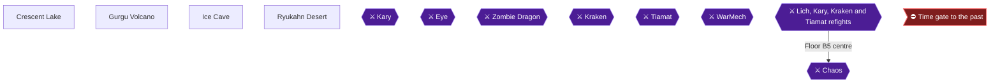

This chapter covers the second half of the second playthrough's early game: collecting the Canoe at Crescent Lake, descending Gurgu Volcano to defeat Kary with fire, taking only the Floater from the Ice Cave, and raising the Airship in the Ryukahn Desert. The big rule of this run is that no optional chests are opened. The five plot chests and the Tail are the only exceptions, and the Tail is not touched in this playthrough.

The Gurgu Volcano contains many chests (Flame Armor, Giant Sword, Ice Sword and others). Leave all of them closed. The Ice Cave has only one chest you may open: the Floater chest on floor B2.

Whether opening an empty chest breaks the chest challenge is unconfirmed by any source. Treat every chest as off-limits except the plot chests, and watch the on-screen challenge icon, which vanishes when you face a chest you must not open.

Do not take the Tail to Bahamut at any point in this playthrough. The Castle of Ordeals and Cardia Isles are skipped.

> [!WARNING]
> **Missable Achievement Warning:** Fight Fire With Fire (achievement 398941) is missable. In this playthrough the first Kary fight in the Gurgu Volcano is your deadline. Kary must be finished by a Fire spell (or the Flame Sword, which is off-limits here). Save before entering the volcano. If a non-fire hit kills her, reset and retry. Skip the plan only if the achievement already unlocked in Playthrough 1.

### Crescent Lake

🗺️ **Map:** [View Crescent Lake Map by Paco](https://www.vgmaps.com/Atlas/NES/FinalFantasy-CrescentLake.png)

#### Getting there

Sail west of Melmond around the Earth Cave peninsula until you hit land and see a port. Dock, then head southwest through grassland and forest to find Crescent Lake. 🟡 Save immediately at the inn when you arrive. 🟡 The inn costs 200 gold. 🟡

The canoe is granted only after Lich has been beaten in the Earth Cave. 🟡

#### Circle of Sages (Canoe)

From the town entrance, head up through town, pass between the two Magic Shops, and follow the twisting path to the right to the Circle of Sages. Talk to each Sage for story information (they explain the Fiends have seized the Orbs' power). 🟡 Speak to the Sage two spots to the right of where you enter the Circle to receive the **Canoe**.

#### Shops (optional purchases)

Purchases are optional. Magic here is Level 6 and costs 20000 gold each: White Magic Soft, Exit, Fog2 and Inv2; Black Magic Qake, Rub, Lit3 and Stun. Exit takes the party out of a dungeon, but only a White Wizard can learn it, so this no-class-change party cannot use it; do not buy it. Inv2 raises allied Evade% by 40, which helps against Kary.

The item shop sells Heal Potion (60), Pure Potion (75), Cabin (250) and House (3000). The weapon shop sells Silver Dagger, Sword, Hammer and Axe; the armor shop sells Silver Armor, Buckler, Helmet and Gauntlet. 🟡 The clinic charges 400 gold. 🟡

### Canoe: Crescent Lake to Gurgu Volcano

From Crescent Lake take the Canoe onto the river above town and head west. At the forks take west, north, east, then west twice more, and follow the path when it bends south to reach the volcano. 🟡 The volcano is northwest of Crescent Lake and east of Elfland. 🟡

Save with a Tent or Cabin just outside before going in. 🟡

### Gurgu Volcano

🗺️ **Map:** [View Gurgu Volcano Map by Paco](https://www.vgmaps.com/Atlas/NES/FinalFantasy-GurguVolcano.png)

This run uses no chests. Route straight through the stairs and ignore every chest. Lava floors drain 1 HP per step from each party member but prevent random encounters, and your HP cannot fall below 1 from them. The recommended party level is 20. 🟡

Dangerous enemies: Red Gargoyles cast Fir2 repeatedly in packs, so use Afir or run. 🟡 Fire enemies cannot be fled from and are weak to Ice.

#### B1

You start on the east side. Walk up and left across the lava to the stairs and go down, heading straight west. 🟡

#### B2

Take the door and walk the hallways toward the west side. Do not open any of the many chests here (Giant Sword, Silver gear, gold). Return to the outside lava hallway and cross to the stairs, going all the way west through the lava room to the stairs down. 🟡

#### B3

Head east to find the stairs down. 🟡

#### B4 (south)

This floor is full of lava. Go to the southeast corner to take the stairs back up to a different part of floor 3, minimizing lava steps. 🟡

#### B3 (second part)

Starting in the northeast corner, walk south, west, south, and west to the stairs down. 🟡

#### B4 (north)

This floor is filled with treasure rooms (Soft Potion, Ice Sword, Flame Shield, House, Wooden Staff and more). Skip all of them. Head south and west to the stairs down. 🟡

#### B5

The floor has eight branches. Only two matter: the west branch (Flame Armor, guarded by an Agama and a Red Dragon) and the southwest branch to Kary. Skip the west branch, because the Flame Armor chest is off-limits. 🟡 Take the passage going down-left to Kary, and rest your HP before entering her room.

### Kary

Kary has 600 HP, casts Fir2, Dark and Hold, and resists Fire, Ice and Lightning. Her HP is 600, not 700. 🟡 Her physical attacks hit up to 6 times, and she has a 62.5% chance to attack physically versus 37.5% to cast. She rewards 3000 gold per the monster list. 🟡

> [!WARNING]
> **Missable Achievement Warning:** Kary must die to a fire spell for Fight Fire With Fire. Save before this fight. If a non-fire hit lands the kill, reset.


> [!ACHIEVEMENT]
> **Fight Fire With Fire (10 Points)**
> 
> *Defeat Kary in the Gurgu Volcano with a Fire spell or the Flame Sword.*


**Why it is hard:** Kary resists fire, so damage is halved by the elemental resistance and halved again by failing the magic resistance check. Fire does roughly 5-10, Fir2 15-30 and Fir3 25-50. A commenter is 99% certain the fire attack must be the finishing blow. 🟡

**Plan (no Flame Sword, since the Ice Cave chest is off-limits):** slug it out with physical attacks until Kary has taken 500+ damage, then stall until you can finish her with fire magic. The Flame Sword exists in the Ice Cave but is a chest, so it is off-limits in this run.

1. Turn one: cast Afir and Hold, and attack once with the Fighter and Black Belt. 🟡
2. Hold paralyzes her (about a 35% chance of working); she recovers with roughly a 10% chance, and Slow permanently cuts her attacks per round to 1. 🟡
3. Use Fast on your melee users. 🟡 Cast Inv2 and have the White Mage heal. Afir cut her magic to about 32 per turn for one player. 🟡 Hel2 helps if you get low. 🟡
4. Count her HP. A calculator helps. 🟡 One player took 530 off with a level 23 Fighter and Black Belt, then finished with two turns of Fir3. 🟡 Another reached 599 damage with the last hit being Fir3. 🟡
5. Once she is near death, stop the physical attackers (one player had the Black Belt run to avoid killing her by accident) and let the Black Mage or Red Mage finish with the strongest fire spell. 🟡 A Red Mage can melee precise amounts. 🟡 Fir3 did about 30 damage when she was nearly dead. 🟡

Mage Staff note: one commenter says the Mage Staff (Sunken Shrine) casts Fir2 as an item and is a fallback for parties without fire, but it comes from a chest, so it is not usable here. 🟡

Other reports: Kary hits very hard and may kill your Black Mage on turn one. 🟡 Equipping Flame Armor lessens her fire damage, but the chest is off-limits. 🟡

After the win, touch the altar to restore the Orb and warp out.

### Ice Cave

🗺️ **Map:** [View Ice Cave Map by Paco](https://www.vgmaps.com/Atlas/NES/FinalFantasy-IceCave.png)

The Ice Cave is the hardest cave yet: Mages and Sorcerers use Rub and instant-kill attacks. 🟡 Recommended party level is 22. 🟡 The sleeping resident in Crescent Lake tells you the Floater is in the Ice Cave. 🟡

> [!CAUTION]
> **Chest rule:** Open only the Floater chest. The Cloth, Flame Sword, Ice Armor, gold rooms and others stay closed. The right pit-room chest also triggers a Mage ambush. 🟡

**Getting there:** Sail north from Crescent Lake to the river mouth, then Canoe west into the interior. At the four-way intersection go north, east at the fork, west around the corner, west fork, then south to the cave. 🟡

Unequip any Flame Armor before entering. 🟡 Lighter grey floors drain 1 HP per step. 🟡

#### 1F

Head right along the top wall, cut down, then left to the stairs down. 🟡

#### 2F (east side start)

Start in the northeast corner. The stairs down to 3F are in the southwest corner. 🟡

#### 3F

Take the stairs back up to 2F-B (the other staircase). 🟡

#### 2F-B: the pit room

The room has three chests: left (Flame Sword), middle (Floater) and right (Cloth plus Mages). You cannot reach the middle chest from here. Do not touch the left or right chests. Step into a hole to drop to the lower floor. 🟡

#### 3F-B

You land in a room where the first step starts a fight with a mix of undead; use Fire and Harm. 🟡 Skip the treasure rooms (Ice Armor and Silver Gauntlet west, the six-chest gold room in the south, and the 40780 gold room). Head east to the stairs back up to 1F. 🟡

#### 1F (west)

Skip the chests (Heal Potion, 10000 G, 9500 G, Tent, Ice Shield). Go to the room with the hole in the east and drop through it. 🟡 You land on 2F-B between the holes, next to the isolated chest. 🟡

### Eye

Stepping in front of the chest triggers the Eye fight. 🟡 The Eye has 162 HP and awards 3225 EXP and 3225 gold. 🟡 It uses instant-death spells (Rub, XXXX, Brak) and Glance (stone), and Lit2. Its defense is weak, so weapon attacks cut it down quickly; Mute stops its spells. 🟡 A Rune Sword does extra damage but is a chest item, so ignore that tip. 🟡 A Ribbon blocks Glance, but it is also a chest item, so ignore that tip too. 🟡

Having over 300 HP makes XXXX fail. 🟡 Bring Heals and Softs for the stone debuff. 🟡

### Floater

Open the chest for the **Floater**. This is the only chest you open in the Ice Cave.

#### Leaving

Drop through a pit to 3F-B, cross that floor again (another undead fight), reach the stairs up to 1F (west), and take the stairs in the top-right corner to the surface. 🟡

### Ryukahn Desert

Return to your ship along the river. Sail south along the coast, west when the coast turns, to a river just east of the desert, and land. 🟡 The desert is south of Crescent Lake; ports do not exist here, so use the Canoe to reach land. 🟡 Walk into the middle of the desert and use the Floater from your Item screen. 🟡

### Airship


The Airship rises from the sand. It can only land on grass or plains. With it you may fight Kary, Kraken and Tiamat in any order.

> [!TIP]
> **Before you leave:** confirm you took the Canoe, defeated Kary with fire, took only the Floater, and did not touch the Tail. Use the Airship to head onward.

> [!IMPORTANT]
> ### Chapter 16 Cumulative 100% Checkpoint
> - **Chests opened this chapter:** 1 (Floater only)
> - **Orbs relit, Playthrough 1:** 4 / 4
> - **Orbs relit, Playthrough 2:** 2 / 4
> - **Chest-sweep achievements:** 9 / 9
> - **RetroAchievements Unlocked:** 36 / 40 (290 / 360 points)

### Chapter Checklist

- [ ] Canoe received from the Sage at Crescent Lake
- [ ] Gurgu Volcano crossed with no chests opened
- [ ] Kary defeated with a Fire spell (Fight Fire With Fire)
- [ ] Ice Cave: only the Floater chest opened
- [ ] Eye defeated
- [ ] Airship raised in the Ryukahn Desert
- [ ] Tail not taken to Bahamut; Castle of Ordeals and Cardia Isles skipped

---

## Chapter 17: Challenge Run: Oxyale, the Cube and Kraken


This chapter covers Playthrough 2, the challenge run on a new game. The goals are to buy the Bottle at the desert Caravan, free the Fairy at Gaia's spring for the Oxyale, take the Cube from the robot in the Waterfall, take the Slab from the one correct chest, and kill Kraken in the Sea Shrine in 8 or fewer actions.

Challenge-run rule for this chapter: treat every chest as off-limits except the plot chests. Watch the on-screen challenge icon, which vanishes when you face a chest you must not open. Whether opening an empty chest breaks the chest-based challenge is unconfirmed, so do not test it.

> [!WARNING]
> **Missable Achievement Warning:** One for Each Arm is a missable. In Playthrough 2 the deadline is the first Kraken fight in the Sea Shrine. It also unlocks in Playthrough 1 (chapter 10) if the kill takes 8 or fewer actions, so skip the plan below if you already have it.

### Caravan

The Bottle is sold at the Caravan shop in the Oasis for 50000 Gold. Landing in the desert is normally not allowed, but you can land the Airship on the patch of desert in the middle of the grass outline that is the Oasis. Step off the spot, then step back on to enter the Caravan.

#### Bottle

1. Buy the Bottle for 50000 Gold.
2. Do not use the Bottle until you are back at Gaia's spring. If you use it early, the fairy flies away and the 50,000 gold is wasted. 🟡

> [!WARNING]
> **Achievement Trigger Warning:** Do not select the Bottle from the Item screen anywhere except at the spring in Gaia. 🟡

### Gaia

🗺️ **Map:** [View Gaia Map by Paco](https://www.vgmaps.com/Atlas/NES/FinalFantasy-Gaia.png)

Fly the Airship west to a lake surrounded by forest, then turn north to reach the enclosed town of Gaia. 🟡

#### Fairy

1. Head to the Fairy Spring in the northeast corner of Gaia. 🟡
2. Stand at the spring and use the Bottle from the Item menu. 🟡
3. Talk to the Fairy and she gives you the Oxyale.

#### Oxyale

The Oxyale lets the party use the Onrac submarine to reach the Sea Shrine.

Gaia shops, only if you have the gold and want them: ProRings cost 20000 each and protect against instant-death spells. Cur4 and Hrm4 (45000) are White Wizard spells, and Ice3 and Brak (45000) are Black Wizard spells. 🟡 The Level 8 spells Fade, Wall, Stop and Zap! cost 60000. 🟡 The inn costs 500 and resurrection 750. 🟡

### Onrac

🗺️ **Map:** [View Onrac Map by Paco](https://www.vgmaps.com/Atlas/NES/FinalFantasy-Onrac.png)

To reach Onrac, fly west past the Dragon Islands and land the Airship on grass or plains to the southwest, then hike northeast across the river. 🟡 Onrac has no weapon or armor shop. 🟡 The Item Shop sells Cabin (250), House (3000), Heal Potion (60), Pure Potion (75) and Soft Potion (800). 🟡 The inn is 300 and resurrection 750. 🟡 Kope mentions a shining object near the Waterfall to the north. 🟡

### Waterfall

🗺️ **Map:** [View Waterfall Map by Paco](https://www.vgmaps.com/Atlas/NES/FinalFantasy-Waterfall.png)

Take the canoe from Onrac and paddle north up the river to the waterfall. 🟡

The maze route in the main guide: walk up to a fork, go left then up, left at the next fork, up-left at the next, down at the next, then left until the path turns right into the room. 🟡 A second guide gives the same path from the southeast corner as west, north, west, west, then all the way south. 🟡 Dangerous enemies here include Mud Gols and Gas Dragons.

Entering the treasure room triggers a fight with Mummy, WzMummy, Cocktrice or Perilisk. 🟡

> [!WARNING]
> **Achievement Trigger Warning:** The room holds six chests (Wizard Staff, Ribbon, 13450 G, 6400 G, 5000 G, Defense Sword). Open none of them in the challenge run. 🟡

#### Robot

Talk to the robot in the room to receive the Cube.

#### Cube

The Cube is the key to the Floating Castle. Leave the Waterfall by fighting your way back to the entrance; do not rely on Exit magic. Canoe back south and rest at the Onrac inn.

### Sea Shrine

🗺️ **Map:** [View Sea Shrine Map by Paco](https://www.vgmaps.com/Atlas/NES/FinalFantasy-SeaShrine.png)

Board the submarine in Onrac. It only works if you hold the Oxyale. This dungeon takes two trips: the first to the Slab on the mermaid floor, the second down to Kraken. 🟡

> [!WARNING]
> **Achievement Trigger Warning:** Do not open the shrine's regular chests. The only one you want is the Slab chest. Commenters warn the other chests in the TNT and Slab rooms must not be grabbed. 🟡

#### First trip: entry floor to the mermaid floor

You enter on the third floor. Two chests are here (9900 G and 2000 G); leave them. 🟡 From the entrance go up through the columns, then right and up, passing two hallways on the left and taking the third to the stairway upward. 🟡

The next floor holds Opal Armor, 20 G, Light Axe, Mage Staff and 12350 G rooms. Skip all of them. 🟡 The stairs up to the mermaid floor are beside the room with the 12350 G chest. 🟡

#### Mermaid floor

Mermaids are trapped on this floor. The rooms here hold gold, an Opal Bracelet, a Pure Potion and an Opal Shield, and you take none of them. 🟡 The room with the Slab is not reachable conventionally: go to the top left corner and walk the narrow path left until the game wraps around. 🟡 That room has three chests. One source lists the left chest as Opal Helmet, the middle as Opal Armor and the right as the Slab, while another lists Opal Gauntlet instead of Opal Armor. Either way, the Slab is in the right-hand chest, and it is the only one you open.

#### Slab

Open the right-hand chest for the Slab. Dr. Unne in Melmond later uses it to teach Lefeinish. Walk back to the submarine to return to Onrac; the party in this run cannot use Exit. 🟡

#### Second trip: Onrac to Kraken's door

Rest at the Onrac inn, then board the submarine again. 🟡 Keep every chest off-limits on this trip.

1. On the entry floor, go up through the columns, cutting left through them, then go up at the turn in the hallway. A room there holds a 9900 G chest; leave it. 🟡
2. Head right out of that room, follow the hallway right and then up to the top left corner of the floor, and descend by the stairway. 🟡
3. On the next section, head left and take the path leading upward. Keep going up at the next two forks, straight up past a room, to the stairs leading down. 🟡
4. This short section is a no-brainer. Any of these step sequences works: right two, up two; up two, right two; up one, right one, up one, right one; up one, right two, up one; or right one, up two, right one. You arrive on the floor above in a different section than before. 🟡
5. That floor is very short. Walk past the room to the opposite corner to find the stairway leading down. 🟡
6. A small room holds a chest with 110 G. Do not open it. 🟡 Go down through the door past the chest with 450 G, also off-limits, and take the stairway to the floor below. 🟡
7. On this lower west floor, go left to the first fork, then down and right into a room with two chests (8135 G and 7690 G). Do not open them. 🟡
8. Head left along the bottom wall to a room with three chests (5450 G, 385 G, Power Gauntlet). Leave them. 🟡
9. Go right and take the upward path at the next two forks to a room with a Light Axe chest. Leave it. 🟡
10. Leave that room and move right to a room with four chests (2750 G, 9900 G, Ribbon, 7340 G). Open none of them. 🟡
11. From that room, head to the top-left staircase to reach the next area. 🟡
12. Head up the hallway to a room, walk right, and exit through a door. Go down and left to a path beside a large room, follow the hallway down, then cut left to the door of the room with the empty "box" walls. Walk up between the walls and out the far door. 🟡
13. Follow the path to a door. Inside is a crystal orb, and the Fiend of Water lives in it.

### Kraken

Fill your HP completely before stepping up to the orb.

Stats: 800 HP, weak to Lightning, resists Fire and Earth, attacks up to 8 times. It has 60 Absorb, so Fast-buffed physical hits or high-level magic are the key. 🟡 Lit3 can do up to 360 per cast, but around 200 is likelier. 🟡 About 75% of the time he attacks, and 25% he uses Ink.

> [!WARNING]
> **Missable Achievement Warning:** Count every action. A spell that targets several party members counts once per target, so Inv2 is 4 actions. Running is free. 🟡 One player killed Kraken in exactly eight single-target actions and it did not register, so plan for 7 or fewer. Whether exactly 8 counts is unconfirmed. 🟡 SLOW and LIT3 both target all enemies, and one player's achievement unprimed because SLOW counted twice. SLO2 is single-target. 🟡

Do not use ALIT: one commenter called it a beginner's trap that forced redoing the whole dungeon. 🟡


> [!ACHIEVEMENT]
> **One for Each Arm (10 Points)**
> 
> *Defeat Kraken in the Sea Shrine in 8 or fewer actions. Running does not count as an action.*


Methods that worked for commenters. The Playthrough 2 party is unpromoted, so the Fighter, Black Belt, White Mage and Black Mage reports (and the Fighter plus Black Mage ones) are the ones that match; reports with Knights, Masters or Wizards need promoted classes. Keep the Black Belt unarmed.

- Cast FAST on the physical attackers while they and everyone else run, then attack with the hasted fighters while the mages run. 🟡
- A Fighter, Black Belt, White Mage and Black Mage at level 23 with no class upgrades won in 6 turns, with FAST on the Black Belt and LIT3 from the Black Mage. 🟡
- A level 24 party of two Fighters and two Black Mages won with 4 LIT3 and one melee attack. 🟡
- A level 21 Fighter and Black Mage won while the other two characters ran each turn. The Black Mage cast FAST and the Fighter attacked. 🟡
- Four level 21 Black Belts just attacking got it, and two level 22 Black Belts with FAST hit for about 240-299 each while the others ran. 🟡
- The grinding advice is for a Fighter, Thief, White Mage and Black Mage party at level 25 or higher. 🟡
- Teammate deaths do not matter after the first turn. 🟡

Kraken can kill a character outright, and one failed attempt came from that. 🟡 The Sea Shrine fights give decent experience for grinding beforehand. 🟡 Kraken yields 5000 Gold and 4245 Exp. 🟡

After the fight, touch the altar behind Kraken to light the Orb, then take the warp to the outside. 🟡

> [!TIP]
> **Before you leave:** confirm you have the Oxyale used, the Cube and the Slab in your key items, and rest at an inn. Take the Slab to Dr. Unne in Melmond later to learn Lefeinish.

> [!IMPORTANT]
> ### Chapter 17 Cumulative 100% Checkpoint
> - **Key items:** Oxyale used, Cube and Slab in hand
> - **Orbs relit, Playthrough 1:** 4 / 4
> - **Orbs relit, Playthrough 2:** 3 / 4
> - **Chest-sweep achievements:** 9 / 9
> - **RetroAchievements Unlocked:** 37 / 40 (300 / 360 points)

### Chapter Checklist

- [ ] Bottle bought and used only at Gaia's spring
- [ ] Oxyale received
- [ ] Cube taken from the robot, no Waterfall chests opened
- [ ] Slab taken from the right chest only, no other Sea Shrine chest opened
- [ ] Kraken killed in 7 or fewer actions (One for Each Arm)
- [ ] Orb relit and warped outside

---

## Chapter 18: Challenge Run: Lefein, the Mirage Tower and Tiamat

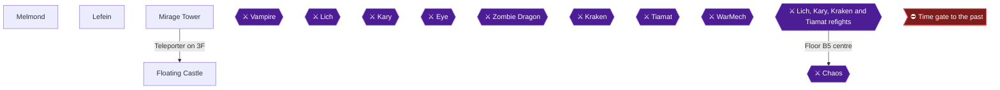

This chapter belongs to Playthrough 2, the challenge run. You take the Slab to Dr. Unne in Melmond, collect the Chime in Lefein, climb the Mirage Tower to the 3F teleporter, and cross the Floating Castle to Tiamat. Tiamat must die to poison smoke from Bane: the Black Mage's Bane spell, or the Bane Sword used as an item. Open no chests in the Mirage Tower or the Floating Castle, so you will not have the Bane Sword and the spell is your route. You must still defeat Tiamat on this file, because her Orb is one of the four that open the time gate; if Choking Hazard already unlocked in Playthrough 1, you may kill her any way you like 🟡.

> [!TIP]
> **Open question (unconfirmed):** no source says whether opening an empty chest breaks the chest challenge. Treat every chest as off-limits except the five plot chests and the Tail, and watch the on-screen challenge icon, which vanishes when you face a chest you must not open. Both towers in this chapter are full of chests, so walk past them.

### Melmond

🗺️ **Map:** [View Melmond Map by Paco](https://www.vgmaps.com/Atlas/NES/FinalFantasy-Melmond.png)

Melmond has no Clinic and no Item Shop, because the Vampire destroyed them. Dr. Unne lives here 🟡. Nobody here can revive fallen allies, and Melmond sells no potions. Elfland is the place to stock up on Houses, Soft Potions, Cabins, Pure Potions and Heal Potions, and you have to travel back there to revive defeated members. Top off your supplies before you come here.

The Black Magic shop sells the Level 5 spell Bane for 8000 Gold. It can destroy an enemy instantly and can be learned by Black Mages 🟡. If your Black Mage does not have Bane yet, buy it now, because the Tiamat plan depends on it. Bane is the only one of the town's four Black Magic spells that matters here. The others are Fir3, Slo2 and Warp, at 8000 Gold each 🟡.

The rest of the town's stock is optional for this chapter. White Magic sells Cur3, Life, Hrm3 and Hel2 🟡. The armor shop has Steel Armor for 45000 Gold and Silver Bracelets 🟡.

#### Dr. Unne

1. Find Dr. Unne in Melmond. Unable to verify from collected sources which building he is in.
2. Show him the Slab. He recognizes it as the key to a forgotten language and teaches the party Lefeinish. You need this to understand the townspeople of Lefein 🟡.
3. Do not leave Melmond without learning the language. Speaking it is what lets you get the Chime in Lefein 🟡.

### Lefein

🗺️ **Map:** [View Lefein Map by Paco](https://www.vgmaps.com/Atlas/NES/FinalFantasy-Lefein.png)

Fly toward the big desert and find the lake surrounded by forest. One spot of grassland there lets you land the Airship 🟡. Another guide describes a tiny patch of grass far to the north, next to the mountains on the right side of the desert, from which you walk far to the south 🟡.

From the landing spot, walk along the western border of the lake and turn east until the lake is behind you. When the land narrows to the south, head down through the marsh and forest to find the enclosed village 🟡.

#### Chime

Talk to the townspeople. They tell you that the Sky Warriors came from here, that the Mirage Tower is the entrance to the Floating Castle, and that Tiamat controls the Floating Castle 🟡.

The Chime is held by a man standing still near the water in the southern part of town. The sources disagree on the corner. One says the bottom right, another the southeastern corner, another the southernmost person east of the river, and two say the bottom left. Walk the south end of the river and talk to whoever is standing still. The Chime opens the Mirage Tower 🟡.

The two secret magic shops are optional, so ignore them. They sit through a break in the trees in the northeast of town and sell Lif2 and Nuke for 60000 Gold each 🟡.

### Mirage Tower

🗺️ **Map:** [View Mirage Tower Map by Paco](https://www.vgmaps.com/Atlas/NES/FinalFantasy-MirageTower.png)

Fly toward the northeast corner of the desert and east to the mountains. Follow the mountains south to a small patch of grass big enough for the Airship, land, and walk northwest into the tower 🟡. The tower is in the vast desert northwest of Lefein.

#### Floor 1

The stairs up to Floor 2 are just across the wall from the entrance 🟡. Floor 1 holds 8 interior chests: a Cabin, Aegis Shield, 2750 G, 3400 G, 18010 G, a Vorpal sword, a Heal Helmet and 880 G 🟡. Skip all of them. Do not open any chest on this floor.

Random encounters here include Badman, Guard, Vampire and Chimera 🟡. Guard is strong against Bane, which matters only if you are tempted to test Bane on random enemies here 🟡.

#### Floor 2

Going counterclockwise around half the room and then weaving through the rows of pillars gets you to the stairs and the treasure room 🟡. Follow the wall of columns as it circles the room to a small hole, go right through it, go up and right through the next hole, and then go right to take the stairway up 🟡.

The central treasure room holds ten chests with the Thor Hammer, Sun Sword, Dragon Armor and a pile of Gold 🟡. Do not open any of them.

Catman is found here and its attacks inflict poison 🟡.

#### Floor 3

Walk around the perimeter of the room to the doorway. Stepping in triggers a fight with a Blue Dragon.

**Blue Dragon:** 454 HP, weak to Fire, uses Thunder, a hit-all attack, and usually acts first. Heal fully before you enter. Its defense is not top notch, so your Fighter and unarmed Black Belt can land damaging physical attacks. A Fir3 from your Black Mage also works well, and your healer can stay on healing duty 🟡.

After the fight, step into the portal ahead. You need the Cube to activate it, and it takes you to the Floating Castle 🟡. Floor 3 holds nothing else of use 🟡.

### Floating Castle

🗺️ **Map:** [View Sky Castle Map by Paco](https://www.vgmaps.com/Atlas/NES/FinalFantasy-SkyCastle.png)

The only chest you could take here that matters is the Bane Sword, and it is off-limits for this run 🟡. Every other chest in this castle is also off-limits.

#### 1F

You arrive in a central chamber with four branches. The top branch leads to Floor 2, the left to a gold room, the right to another room with a Heal Helmet, and the bottom to the Bane Sword 🟡. The three treasure rooms are:

- **West room:** four chests, 9900 G, a Heal Potion, 4150 G and 7900 G 🟡.
- **East room:** five chests, 5000 G, a ProRing, 6720 G, a Heal Helmet and 180 G 🟡.
- **South room:** one chest holding the Bane Sword 🟡.

Skip all three rooms. Take the path up from the central chamber to the transporter to Floor 2 🟡.

#### 2F

Floor 2 is laid out like a compass, with a hall off a central area for each direction 🟡. All of these chests are off-limits:

- **Northwest:** Silver Helmet and House 🟡.
- **West:** 880 G and 13000 G 🟡.
- **Southwest:** the Adamant 🟡.
- **Southeast:** Black Shirt and White Shirt 🟡.
- **East:** Opal Shield and Ribbon 🟡.
- **Northeast:** Opal Gauntlet 🟡.

Skip them all and head to the Floor 3 teleporter, which is directly south of the starting teleporter 🟡.

#### 3F

As soon as you arrive there is a green robot nearby and a rectangular window. Both are optional 🟡. Three treasure rooms here are off-limits:

- **North room:** four chests, 9000 G, a Heal Potion, a ProRing and 5450 G 🟡.
- **East wing:** six chests, 6400 G, Cloth, a ProCape, a Soft Potion, 9500 G and 8135 G 🟡.
- **West hall:** four chests, a Soft Potion, 4150 G, 3400 G and the Katana as the furthest-right chest 🟡.

The teleporter to Floor 4 is under the room where the Katana is 🟡.

#### 4F

This floor is an endless maze unless you move through it with the right directions. The ASCII map below solves it 🟡:

```text
   A    B    C    D
  | |  | |  | |  | | 
 -+ +--+ +--+ +--+ +-
1                    1
 -+ +--+ +--+ +--+ +-
  | |  | |  | |  | | 
 -+ +--+ +--+ +--+ +-
2            E       2
 -+ +--+ +--+ +--+ +-
  | |  | |  | |  | | 
 -+ +--+ +--+ +--+ +-
3                    3
 -+ +--+ +--+ +--+ +-
  | |  | |  | |  | | 
 -+ +--+ +--+ +--+ +-
4  S                 4
 -+ +--+ +--+ +--+ +-
  | |  | |  | |  | | 
   A    B    C    D
```

The shortest sequence from one guide is up, left, up, left 🟡. Another says to walk left and take the second intersection up until you reach the teleporter 🟡. A third says to go east past one grid intersection, then head south at the second intersection to find the Floor 5 teleporter 🟡. If the path you take leads nowhere, use the map and try a different direction sequence, since any combination can work as long as it follows the map's rules 🟡. The floor is empty of treasure but has strong enemies 🟡.

#### 5F

This is the final floor, a long, narrow causeway 🟡. WarMech roams here with a 1-in-64 chance of a fight, and it was already earned in Playthrough 1. Cross the bridge without lingering and walk straight up to the room 🟡. Commenters report WarMech showing up around the 20th encounter, and another saw it wipe the White Mage in a thin hallway 🟡.

If WarMech does appear, it has 1000 HP, hits for up to 256 on one character and uses NUCLEAR for up to 400 to the whole party 🟡. It often strikes first. Unable to verify from collected sources whether you can safely flee it, so heal up before every step onto the bridge.

### Tiamat

> [!WARNING]
> **Missable Achievement Warning:** Choking Hazard requires that Tiamat dies to poison smoke from Bane. The Black Mage's Bane spell or the Bane Sword used as an item both count. Attacking with an equipped Bane Sword does not count, and casting BRAK does not count. In this run your tool is the Black Mage's Bane spell. Do not kill Tiamat any other way on your first fight here.

Enter the room at the end of the causeway and heal your party completely before stepping forward to fight the Fiend of Air 🟡.

**Tiamat facts:**
- 1000 HP, 64 armor, 4 hits per attack.
- Weak to Bane and Brak, resists Fire, Ice and Lightning, immune to Quake.
- Uses Thunder, Poison Gas and Blizzard 🟡.
- Has a 50% chance of a normal attack and a 50% chance of cycling Lightning, Poison, Cold and Fire special attacks in order.
- 100% magic evade, so most status spells will not work 🟡.

**The plan:**
1. Have your Black Mage cast Bane at Tiamat each turn 🟡.
2. Each cast has only about a 20% chance of connecting because of Tiamat's poison weakness 🟡. One commenter estimates roughly 15% per cast.
3. Expect misses. One commenter's five Bane casts did nothing 🟡.
4. Use your other characters to survive. Your White Mage can cast Alit, Aice and Inv2 and handle Cure duty.
5. Bane is described as hitting all enemies and has no downside against a lone boss 🟡.
6. One commenter suggests casting Silence before Bane in the hope that it strips Tiamat's resistances so Bane can land. This is a single unverified tip 🟡.

Another guide's conventional approach is to attack with Knights and Masters and cast Fast with other casters 🟡. Do not use physical attacks to finish Tiamat: a non-Bane kill will not unlock Choking Hazard 🟡.


> [!ACHIEVEMENT]
> **Choking Hazard (10 Points)**
> 
> *Defeat Tiamat in the Floating Castle with poison smoke.*


The kill text for Bane is "Poison smoke", while Brak's is "Broken into pieces". If you see the latter, the achievement did not trigger 🟡. Brak is poison-element but turns the enemy to stone instead of suffocating it, so it does not count 🟡.

After the fight, step forward to touch the altar Tiamat was protecting. An Orb shines 🟡. That relights the fourth Orb for this playthrough.

> [!TIP]
> **Before you leave the Floating Castle:** make sure Tiamat actually died to the poison smoke. Then restock supplies and heal up. The Dark Crystal at the Temple of Fiends is next, where the four Orbs activate the Time gate 🟡.

> [!IMPORTANT]
> ### Chapter 18 Cumulative 100% Checkpoint
> - **Chest-sweep achievements:** 9 / 9
> - **Orbs relit, Playthrough 1:** 4 / 4
> - **Orbs relit, Playthrough 2:** 4 / 4
> - **Chests opened this chapter:** 0 (challenge run)
> - **RetroAchievements Unlocked:** 38 / 40 (310 / 360 points)

### Chapter Checklist

- [ ] Bane learned by the Black Mage before reaching Tiamat
- [ ] Slab shown to Dr. Unne in Melmond (Lefeinish learned)
- [ ] Chime received in Lefein
- [ ] Mirage Tower climbed with no chests opened
- [ ] Blue Dragon defeated and the Cube used on the 3F teleporter
- [ ] Floating Castle crossed with no chests opened (no Bane Sword, no Ribbons)
- [ ] WarMech avoided on 5F
- [ ] Tiamat killed by Bane poison smoke ("Poison smoke" kill text), Choking Hazard unlocked
- [ ] Fourth Orb relit

---

## Chapter 19: Challenge Run Finale: Chaos with No Class Change and No Chests

```mermaid
flowchart TD
  Temple_of_Fiends["Temple of Fiends"]
  Temple_of_Fiends_Past["Temple of Fiends (Past)"]
  Garland{{"⚔ Garland"}}
  Pirates{{"⚔ Pirates (Bikke)"}}
  Wizards_Crown{{"⚔ Wizards (Crown guard)"}}
  Astos{{"⚔ Astos"}}
  Vampire{{"⚔ Vampire"}}
  Lich{{"⚔ Lich"}}
  Kary{{"⚔ Kary"}}
  Eye{{"⚔ Eye"}}
  Zombie_Dragon{{"⚔ Zombie Dragon"}}
  Kraken{{"⚔ Kraken"}}
  Tiamat{{"⚔ Tiamat"}}
  WarMech{{"⚔ WarMech"}}
  Fiend_Refights{{"⚔ Lich, Kary, Kraken and Tiamat refights"}}
  Chaos{{"⚔ Chaos"}}
  Time_Gate>"⛔ Time gate to the past"]
  Time_Gate -->|"2000 years into the past"| Temple_of_Fiends_Past
  Fiend_Refights -->|"Floor B5 centre"| Chaos
  classDef ponr fill:#7f1d1d,stroke:#f87171,color:#fff;
  classDef boss fill:#4c1d95,stroke:#a78bfa,color:#fff;
  class Time_Gate ponr;
  class Garland,Pirates,Wizards_Crown,Astos,Vampire,Lich,Kary,Eye,Zombie_Dragon,Kraken,Tiamat,WarMech,Fiend_Refights,Chaos boss;
```

This is the last chapter. It is played on the **Playthrough 2 challenge file**, the new game started in chapter 14. The goal is to beat Chaos in the Temple of Fiends (Past) without ever changing classes and without opening any optional treasure chest. Beating Chaos under those conditions earns **Don't Change For Anyone** and **Merchandise Madness** together. A level 32 Monk is said to be enough for both challenges, with grinding at the base of the Mirage Tower required 🟡. Heroes That Never Were was already unlocked in Playthrough 1, so nothing else is needed here.

Without a class change you never learn the spells that revive dead allies or escape a dungeon immediately 🟡. Exit and Warp both need class upgrades, so the past temple is a one-way trip 🟡. You will fight stronger versions of all four fiends and then Chaos in one go, so carry 99 healing potions 🟡. Players report clearing it at levels around 30 to 42, and one commenter recommends not going in under level 40 🟡. Ribbons could be worn without a class change, but they only come from chests, so this no-chest party has none 🟡. Healing is allowed in this run, and consumables can be bought 🟡.

> [!WARNING]
> **Missable Achievement Warning:** Never hand Bahamut the Tail on the Playthrough 2 file. Doing so upgrades your classes and fails Don't Change For Anyone 🟡. The Tail is not needed for story progress. The class change you did in Playthrough 1 does not affect this file.

> [!WARNING]
> **Missable Achievement Warning:** Do not open any optional chest on this file until Chaos falls. Only the Crown, TNT, Ruby, Floater and Slab (and the Tail) may be opened 🟡. Watch the on-screen challenge icon: it vanishes while you face a chest you must not open, and if you open one it stays gone 🟡. One player missed the achievement by opening the Cap chest in the Temple of Fiends 🟡. It is unconfirmed whether an empty chest also breaks the achievement, so treat every chest as off-limits except those plot chests and the Tail.

### Preparation

- Stock up before you go in. A commenter advises restocking and carrying 99 each of Pure, Cure and Soft Potions 🟡. Players on a normal file use the Heal Staff and Heal Helmet as free healing here, but both are chest items, so this party relies on potions and spell charges 🟡.
- Keep any Black Belt unarmed. An unarmed Black Belt's attack is twice his level and he gets double hits, so a weapon weakens him.
- Make sure you can cast level 4 spells at least five times (four fiends plus Chaos) 🟡.
- Your party cannot revive allies, so a death in the dungeon is usually a reset unless you are near the end 🟡.
- Save with a Tent right outside the temple before using the black Orb. A commenter says to abandon the attempt if you need more than a few Heal potions against the Gas Dragons on floor 3F 🟡.
- Reset routine: hard reset the emulator, then get three encounters walking next to the final dungeon. After that, walking through efficiently should produce no Gas Dragon fights and only one scary unrunnable Water Elemental fight 🟡.

### Temple of Fiends

🗺️ **Map:** [View Temple Of Fiends(Present) Map by Paco](https://www.vgmaps.com/Atlas/NES/FinalFantasy-TempleOfFiends(Present).png)

The temple lies northwest of Coneria 🟡. The start area has six chests in its corners; do not open any of them (Cap, Cabin, Heal Potion and the three locked-room chests).

1. From the entrance, head straight to the central room where Garland was fought. Five bats fly around the Dark Crystal 🟡.
2. Examine the Dark Crystal to place your four Orbs over it, which activates the Time gate to the past 🟡.

### Time Gate

> [!CAUTION]
> **Point of No Return:** Once you step through the gate into the past there is no way back except Exit or Warp, and both need the class change. The challenge-run party must win or reset. Save outside first 🟡.

3. Take one step forward to travel 2000 years into the past 🟡.

### Temple of Fiends (Past)

🗺️ **Map:** [View Temple Of Fiends(Past) Map by Paco](https://www.vgmaps.com/Atlas/NES/FinalFantasy-TempleOfFiends(Past).png)

The Lich, Kary, Kraken and Tiamat refights come one per floor on the way down to Chaos 🟡. Run from most battles to save HP and spell charges 🟡. Run from any optional encounter with more than one enemy 🟡. Experience is pointless because the game cannot be saved after Chaos, so running is key 🟡. You cannot run from the elemental enemies or the Gas Dragons 🟡. Gas Dragons hit hard and can KO a party quickly, though their encounter rate is low 🟡. Against elementals, Ice3 may be the quickest answer, or Ice2 from a Red Mage if you have no Black Mage 🟡. Gas Dragons are weak to Ice.

#### Floor 3 (start) and Floor 2

4. You start on Floor 3 with no chests. Head for the bottom right corner and take the stairs to Floor 2 🟡.
5. The interior chamber on Floor 2 has stairs up to Floor 1 🟡.

#### Floor 1 and the Stone Plate

6. On Floor 1, head to the central room. A Phantom attacks as you enter. Phantom has 360 HP and is weak to Fire and Harm; use Fire spells and the Black Belt's fists, since your party has no promoted Knight or Master 🟡.
7. The two chests here hold 45000 and 65000 gold. Do not open them 🟡.
8. Use the Lute on the stone plate. The Rod does not work here. The ladder drops you in the main part of Floor 2 🟡.
9. Make for the northwest corner of that floor to reach Floor 3, then take the path west to the stairs down to Floor 4 🟡.

#### Floor 4: Lich

10. Nothing here is useful. Follow the path along the outside to the southeast corner 🟡. Lich guards the stairs and always fights you there 🟡.

**Lich (past):** about 800 HP per one source (other guides list 400 or 500), weak to Fire and Harm, and it uses Nuke first 🟡. Nuke removes 100-400 HP from every party member 🟡. Attack with fighters and use Harm and Fire spells 🟡.

#### Floor 5: Kary

11. Skip the chests south of the stairs: the left door holds a ProRing and Katana, the right door a ProCape and 26000 G. Leave them closed 🟡.
12. Approach the stairs down to refight Kary 🟡.

**Kary (past):** 600 to 800 HP depending on the source, 2-6 hits, and she can use Fir3 and Hold 🟡. Afir should be enough defence 🟡. The guide's plan is for promoted classes; in this run the Fighter and Black Belt attack, the Black Mage casts Fast, and the White Mage uses Inv2 then Cure 🟡.

#### Floor 6: Kraken

13. There are no treasures here. Navigate the multi-door rooms to the southeast corner 🟡.

**Kraken (past):** 1000 HP, 5-8 attacks, Lit2/Lit3 and Ink 🟡. Cast Fast on hard hitters and Inv2 for dodges 🟡. One guide calls Nuke extremely helpful here (200-600 damage), but Nuke is a level 8 spell this unpromoted party cannot learn, so use Lit3 from the Black Mage instead.

#### Floor 7: Tiamat

14. Head south then east through the boxy rooms. The Masamune lies at the end of the corridor from the southeast room, but it is in a chest, so do not open it 🟡.
15. Fight Tiamat on the way to the stairs to Floor 8.

**Tiamat (past):** 1000 HP (one source says 1100), and no longer weak to Bane 🟡. It often casts Bane, a one-hit KO. Only Ribbons resist it, and this run has no Ribbons, so expect losses here 🟡. Poison smoke is dangerous too, and one player grinded for ARUB 🟡. Fighter and Black Belt attack, the Black Mage casts Fast on round one, and the White Mage keeps Alit, Aice, Inv2 and Cure going 🟡. One player beat it after many retries when only two members died 🟡.

### Chaos

16. On the last floor, the only enemy is Chaos. Fully heal first. Talk to Garland; he turns into Chaos 🟡.

**Chaos:** 2000 HP, resists all elements. It casts Cur4 from round 4 with at least 8 rounds of recharge 🟡. Cast Fast on fighters and defensive spells first, and begin the assault right after Chaos heals itself 🟡. Crack is an instant kill on the whole party; ARUB guards against it (Ribbons would too, but this run has none) 🟡. A Fast Black Belt can kill Chaos in about four rounds 🟡.


> [!ACHIEVEMENT]
> **Don't Change For Anyone (25 Points)**
> 
> *Defeat Chaos without changing classes.*


> [!ACHIEVEMENT]
> **Merchandise Madness (25 Points)**
> 
> *Defeat Chaos without opening any optional treasure chests, except the Tail if desired.*


Defeating Chaos with your party unchanged and no optional chests opened unlocks both 🟡. The icon may disappear if you rearrange the team, but the achievement still completes 🟡.

> [!TIP]
> Chaos is a repeatable fight 🟡, but this file has nothing left to collect: every chest-sweep achievement was already earned in Playthrough 1, and the game cannot be saved after Chaos 🟡.

> [!IMPORTANT]
> ### Chapter 19 Cumulative 100% Checkpoint
> - **Challenge file:** party unchanged, only plot chests opened 🟡
> - **Orbs relit, Playthrough 1:** 4 / 4
> - **Orbs relit, Playthrough 2:** 4 / 4
> - **Chest-sweep achievements:** 9 / 9
> - **RetroAchievements Unlocked:** 40 / 40 (360 / 360 points)

### Chapter Checklist

- [ ] Saved with a Tent outside the temple, with 99 potions
- [ ] Never gave Bahamut the Tail on this file
- [ ] No optional chests opened
- [ ] Lute used on the stone plate
- [ ] Lich, Kary, Kraken, Tiamat refights won
- [ ] Chaos defeated: Don't Change For Anyone and Merchandise Madness

---

## Final Checklist

**1. Coneria and the Rescue of Princess Sara**

- [ ] ⚠ Start with a White Mage or Black Mage (before: Party creation at the start of Playthrough 1 (chapter 1); the spells themselves are bought in chapter 11.)
- [ ] 🏆 A Seemingly Useless Trinket

**2. Matoya's Cave, Pravoka and the Pirate Ship**

- [ ] ⚠ Win a Peninsula of Power battle (before: Playthrough 1: before talking to Bikke in Pravoka (chapter 2).)
- [ ] 🏆 Punching Above Your Weight
- [ ] 🏆 Pirate Bay
- [ ] 🏆 Puzzle Fantasy

**3. Elfland, the Marsh Cave and Astos**

- [ ] 🏆 May Thou Rest in Peace
- [ ] 🏆 Sleeping Prince

**4. Mystic Key Treasures, the TNT and the Canal**

- [ ] 🏆 Plundered the Keeps
- [ ] 🏆 Cave Dweller

**5. Melmond, the Earth Cave and the Vampire**

- [ ] 🏆 Blood Ruby

**6. Titan's Tunnel, Sarda and Lich**

- [ ] 🏆 Rotten Earth
- [ ] 🏆 Gaia's Greed

**7. Crescent Lake and the Gurgu Volcano**

- [ ] 🏆 Canoodling
- [ ] 🏆 Hot Take
- [ ] 🏆 Molten Fire

**8. The Ice Cave and the Airship**

- [ ] 🏆 Cold Hard Cash, Mostly
- [ ] 🏆 Flotation

**9. The Castle of Ordeals, Cardia and the Class Change**

- [ ] 🏆 Regal Recon
- [ ] 🏆 Class Upgrade
- [ ] ⛔ Everything above is done before: Class change with Bahamut (Playthrough 1)

**10. Gaia, Onrac, the Waterfall and the Sea Shrine**

- [ ] 🏆 Oxypower
- [ ] 🏆 Sunken Treasures
- [ ] 🏆 The Lost City

**11. Melmond, Lefein, the Spell Shops and the Mirage Tower**

- [ ] 🏆 Bilingual
- [ ] 🏆 Of Mighty Magic
- [ ] 🏆 Mjolnir Cometh

**12. The Floating Castle, WarMech, Tiamat and Excalibur**

- [ ] 🏆 God's Eye View
- [ ] 🏆 Slice and Dice
- [ ] 🏆 Sky Raider
- [ ] 🏆 Rage Against the Machine
- [ ] 🏆 Floating Fortress
- [ ] 🏆 The True King

**13. The Past Temple Treasures, Masamune and Chaos**

- [ ] 🏆 What's Old Is New Again
- [ ] 🏆 Blade of Purity
- [ ] 🏆 Balmless Battler of Cruel Chaos
- [ ] 🏆 Heroes That Never Were
- [ ] ⛔ Everything above is done before: Beating Chaos (Playthrough 1)

**14. Challenge Run: New Party, Coneria to the Mystic Key**

**15. Challenge Run: TNT, the Earth Cave and Lich**

- [ ] ⚠ Lich with nobody dying (before: Playthrough 2: the first Lich fight on Earth Cave B5 (chapter 15); save before and reset on a death. Also unlocks in Playthrough 1 (chapter 6) if nobody dies there.)
- [ ] 🏆 Oh, Death, Where is Thy Sting?

**16. Challenge Run: Crescent Lake, Kary and the Airship**

- [ ] ⚠ Kary killed by fire (before: Playthrough 2: the first Kary fight in the Gurgu Volcano (chapter 16). Also unlocks in Playthrough 1 (chapter 7) if a fire spell lands the kill.)
- [ ] 🏆 Fight Fire With Fire

**17. Challenge Run: Oxyale, the Cube and Kraken**

- [ ] ⚠ Kraken in 8 actions or fewer (before: Playthrough 2: the first Kraken fight in the Sea Shrine (chapter 17). Also unlocks in Playthrough 1 (chapter 10) if the kill takes 8 or fewer actions.)
- [ ] 🏆 One for Each Arm

**18. Challenge Run: Lefein, the Mirage Tower and Tiamat**

- [ ] ⚠ Tiamat killed by Bane poison smoke (before: Playthrough 2: the first Tiamat fight in the Floating Castle (chapter 18). Also unlocks in Playthrough 1 (chapter 12) with the Bane spell or the Bane Sword used as an item.)
- [ ] 🏆 Choking Hazard

**19. Challenge Run Finale: Chaos with No Class Change and No Chests**

- [ ] ⚠ Never hand Bahamut the Tail on the Playthrough 2 file (before: Playthrough 2: from the new game in chapter 14 until Chaos falls in chapter 19. The Playthrough 1 class change (chapter 9) does not affect the new file.)
- [ ] ⚠ No optional chests on the Playthrough 2 file until Chaos is beaten (before: Playthrough 2: from the first chest in chapter 14 until Chaos falls in chapter 19; only the Crown, TNT, Ruby, Floater, Slab (and the Tail) may be opened.)
- [ ] 🏆 Don't Change For Anyone
- [ ] 🏆 Merchandise Madness
- [ ] ⛔ Everything above is done before: Through the time gate (Playthrough 2)

## 100% Completion Verification Checklist

All 40 achievements (360 points).

| ✔ | Achievement | Points | Type | Chapter |
|---|---|---|---|---|
| ☐ | **A Seemingly Useless Trinket** — Receive a gift from Princess Sara. | 5 | progression | [1](#chapter-1-coneria-and-the-rescue-of-princess-sara) |
| ☐ | **Punching Above Your Weight** — Win a battle on the Peninsula of Power before confronting the pirates in Pravoka. | 10 | missable | [2](#chapter-2-matoyas-cave-pravoka-and-the-pirate-ship) |
| ☐ | **Pirate Bay** — Sail for the first time after acquiring the ship. | 5 | progression | [2](#chapter-2-matoyas-cave-pravoka-and-the-pirate-ship) |
| ☐ | **May Thou Rest in Peace** — Pay respects to a rival hero. | 2 |  | [3](#chapter-3-elfland-the-marsh-cave-and-astos) |
| ☐ | **Sleeping Prince** — Receive the Mystic Key after awakening the Elfland's prince. | 10 | progression | [3](#chapter-3-elfland-the-marsh-cave-and-astos) |
| ☐ | **Plundered the Keeps** — Open all treasure chests in Coneria, Elfland and the Northwest castles. | 5 |  | [4](#chapter-4-mystic-key-treasures-the-tnt-and-the-canal) |
| ☐ | **Cave Dweller** — Open all treasure chests in the Marsh, Dwarf and Matoya's caves. | 5 |  | [4](#chapter-4-mystic-key-treasures-the-tnt-and-the-canal) |
| ☐ | **Blood Ruby** — Defeat the vampire of Melmond and acquire the ruby. | 5 | progression | [5](#chapter-5-melmond-the-earth-cave-and-the-vampire) |
| ☐ | **Gaia's Greed** — Open all treasure chests in the Earth Cave and Titan's Tunnel. | 5 |  | [6](#chapter-6-titans-tunnel-sarda-and-lich) |
| ☐ | **Oh, Death, Where is Thy Sting?** — Defeat Lich in the Earth Cave without anyone dying. | 10 | missable | [15](#chapter-15-challenge-run-tnt-the-earth-cave-and-lich) |
| ☐ | **Rotten Earth** — Defeat Lich and purify the Earth Crystal. | 10 | progression | [6](#chapter-6-titans-tunnel-sarda-and-lich) |
| ☐ | **Canoodling** — Acquire a canoe from the circle of sages. | 5 | progression | [7](#chapter-7-crescent-lake-and-the-gurgu-volcano) |
| ☐ | **Hot Take** — Open all treasure chests in the Gurgu Volcano. | 5 |  | [7](#chapter-7-crescent-lake-and-the-gurgu-volcano) |
| ☐ | **Fight Fire With Fire** — Defeat Kary in the Gurgu Volcano with a Fire spell or the Flame Sword. | 10 | missable | [16](#chapter-16-challenge-run-crescent-lake-kary-and-the-airship) |
| ☐ | **Molten Fire** — Defeat Kary and purify the Fire Crystal. | 10 | progression | [7](#chapter-7-crescent-lake-and-the-gurgu-volcano) |
| ☐ | **Flotation** — Raise the airship from the desert. | 10 | progression | [8](#chapter-8-the-ice-cave-and-the-airship) |
| ☐ | **Cold Hard Cash, Mostly** — Open all treasure chests in the Ice Cave. | 5 |  | [8](#chapter-8-the-ice-cave-and-the-airship) |
| ☐ | **Regal Recon** — Open all treasure chests in the Castle of Ordeals and Cardia caves. | 5 |  | [9](#chapter-9-the-castle-of-ordeals-cardia-and-the-class-change) |
| ☐ | **Class Upgrade** — Receive King Bahamut's praise and his reward. | 10 |  | [9](#chapter-9-the-castle-of-ordeals-cardia-and-the-class-change) |
| ☐ | **Oxypower** — Obtain Oxyhale. | 10 | progression | [10](#chapter-10-gaia-onrac-the-waterfall-and-the-sea-shrine) |
| ☐ | **One for Each Arm** — Defeat Kraken in the Sea Shrine in 8 or fewer actions. Running does not count as an action. | 10 | missable | [17](#chapter-17-challenge-run-oxyale-the-cube-and-kraken) |
| ☐ | **The Lost City** — Defeat Kraken and purify the Water Crystal. | 10 | progression | [10](#chapter-10-gaia-onrac-the-waterfall-and-the-sea-shrine) |
| ☐ | **Sunken Treasures** — Open all treasure chests in the Sea Shrine and waterfall. | 5 |  | [10](#chapter-10-gaia-onrac-the-waterfall-and-the-sea-shrine) |
| ☐ | **Bilingual** — Learn the language of the Lefeinians. | 5 | progression | [11](#chapter-11-melmond-lefein-the-spell-shops-and-the-mirage-tower) |
| ☐ | **Mjolnir Cometh** — Obtain Thor's Hammer. | 5 |  | [11](#chapter-11-melmond-lefein-the-spell-shops-and-the-mirage-tower) |
| ☐ | **God's Eye View** — Get a glimpse of where the four forces are flowing together. | 3 |  | [12](#chapter-12-the-floating-castle-warmech-tiamat-and-excalibur) |
| ☐ | **Slice and Dice** — Obtain a Katana. | 5 |  | [12](#chapter-12-the-floating-castle-warmech-tiamat-and-excalibur) |
| ☐ | **Sky Raider** — Open all treasure chests in the Mirage Tower and Floating Castle. | 5 |  | [12](#chapter-12-the-floating-castle-warmech-tiamat-and-excalibur) |
| ☐ | **Rage Against the Machine** — Defeat a Warmech in the Floating Castle. | 25 |  | [12](#chapter-12-the-floating-castle-warmech-tiamat-and-excalibur) |
| ☐ | **Choking Hazard** — Defeat Tiamat in the Floating Castle with poison smoke. | 10 | missable | [18](#chapter-18-challenge-run-lefein-the-mirage-tower-and-tiamat) |
| ☐ | **Floating Fortress** — Defeat Tiamat and purify the Wind Crystal. | 10 | progression | [12](#chapter-12-the-floating-castle-warmech-tiamat-and-excalibur) |
| ☐ | **The True King** — Obtain Excalibur. | 5 |  | [12](#chapter-12-the-floating-castle-warmech-tiamat-and-excalibur) |
| ☐ | **Of Mighty Magic** — Have a character learn 24 spells. | 10 | missable | [11](#chapter-11-melmond-lefein-the-spell-shops-and-the-mirage-tower) |
| ☐ | **Blade of Purity** — Obtain Masamune. | 10 |  | [13](#chapter-13-the-past-temple-treasures-masamune-and-chaos) |
| ☐ | **What's Old Is New Again** — Open all treasure chests in the Temple of Fiends. | 10 |  | [13](#chapter-13-the-past-temple-treasures-masamune-and-chaos) |
| ☐ | **Balmless Battler of Cruel Chaos** — Defeat Chaos without healing yourself. | 10 |  | [13](#chapter-13-the-past-temple-treasures-masamune-and-chaos) |
| ☐ | **Heroes That Never Were** — Defeat Chaos and end the cycle of destruction. | 25 | win_condition | [13](#chapter-13-the-past-temple-treasures-masamune-and-chaos) |
| ☐ | **Don't Change For Anyone** — Defeat Chaos without changing classes. | 25 | missable | [19](#chapter-19-challenge-run-finale-chaos-with-no-class-change-and-no-chests) |
| ☐ | **Merchandise Madness** — Defeat Chaos without opening any optional treasure chests, except the Tail if desired. | 25 | missable | [19](#chapter-19-challenge-run-finale-chaos-with-no-class-change-and-no-chests) |
| ☐ | **Puzzle Fantasy** — Complete the secret slider puzzle. | 5 |  | [2](#chapter-2-matoyas-cave-pravoka-and-the-pirate-ship) |

## Sources

This guide was built only from these sources:

- **RetroAchievements** — Final Fantasy — RetroAchievements community comments: [link](https://retroachievements.org/game/1449)
- **RetroAchievements Guides Wiki** — Final Fantasy (NES): [link](https://github.com/RetroAchievements/guides/wiki/Final-Fantasy-(NES))
- **GameFAQs** — Guide and Walkthrough by brian_sulpher: [link](https://gamefaqs.gamespot.com/nes/522595-final-fantasy/faqs/25809)
- **GameFAQs** — Guide and Walkthrough by Caldor: [link](https://gamefaqs.gamespot.com/nes/522595-final-fantasy/faqs/19902)
- **VGMaps** — World Map by Rick Bruns: [link](https://www.vgmaps.com/Atlas/NES/FinalFantasy-World.png)
- **VGMaps** — World(In Game Map) Map by Paco: [link](https://www.vgmaps.com/Atlas/NES/FinalFantasy-World(In-GameMap).png)
- **VGMaps** — Coneria Map by Paco: [link](https://www.vgmaps.com/Atlas/NES/FinalFantasy-Coneria.png)
- **VGMaps** — Coneria Castle Map by Paco: [link](https://www.vgmaps.com/Atlas/NES/FinalFantasy-ConeriaCastle.png)
- **VGMaps** — Temple Of Fiends(Present) Map by Paco: [link](https://www.vgmaps.com/Atlas/NES/FinalFantasy-TempleOfFiends(Present).png)
- **VGMaps** — Matoya's Cave Map by Paco: [link](https://www.vgmaps.com/Atlas/NES/FinalFantasy-Matoya'sCave.png)
- **VGMaps** — Pravoka Map by Paco: [link](https://www.vgmaps.com/Atlas/NES/FinalFantasy-Pravoka.png)
- **VGMaps** — Elfland Map by Paco: [link](https://www.vgmaps.com/Atlas/NES/FinalFantasy-Elfland.png)
- **VGMaps** — Elfland Castle Map by Paco: [link](https://www.vgmaps.com/Atlas/NES/FinalFantasy-ElflandCastle.png)
- **VGMaps** — Northwest Castle Map by Paco: [link](https://www.vgmaps.com/Atlas/NES/FinalFantasy-NorthwestCastle.png)
- **VGMaps** — Marsh Cave Map by Paco: [link](https://www.vgmaps.com/Atlas/NES/FinalFantasy-MarshCave.png)
- **VGMaps** — Dwarf Cave Map by Paco: [link](https://www.vgmaps.com/Atlas/NES/FinalFantasy-DwarfCave.png)
- **VGMaps** — Melmond Map by Paco: [link](https://www.vgmaps.com/Atlas/NES/FinalFantasy-Melmond.png)
- **VGMaps** — Earth Cave Map by Paco: [link](https://www.vgmaps.com/Atlas/NES/FinalFantasy-EarthCave.png)
- **VGMaps** — Titan's Cave Map by Paco: [link](https://www.vgmaps.com/Atlas/NES/FinalFantasy-Titan'sCave.png)
- **VGMaps** — Sarda's Cave Map by Paco: [link](https://www.vgmaps.com/Atlas/NES/FinalFantasy-Sarda'sCave.png)
- **VGMaps** — Crescent Lake Map by Paco: [link](https://www.vgmaps.com/Atlas/NES/FinalFantasy-CrescentLake.png)
- **VGMaps** — Gurgu Volcano Map by Paco: [link](https://www.vgmaps.com/Atlas/NES/FinalFantasy-GurguVolcano.png)
- **VGMaps** — Ice Cave Map by Paco: [link](https://www.vgmaps.com/Atlas/NES/FinalFantasy-IceCave.png)
- **VGMaps** — Cardia Islands Map by Paco: [link](https://www.vgmaps.com/Atlas/NES/FinalFantasy-CardiaIslands.png)
- **VGMaps** — Castle Of Ordeals Map by Paco: [link](https://www.vgmaps.com/Atlas/NES/FinalFantasy-CastleOfOrdeals.png)
- **VGMaps** — Gaia Map by Paco: [link](https://www.vgmaps.com/Atlas/NES/FinalFantasy-Gaia.png)
- **VGMaps** — Onrac Map by Paco: [link](https://www.vgmaps.com/Atlas/NES/FinalFantasy-Onrac.png)
- **VGMaps** — Waterfall Map by Paco: [link](https://www.vgmaps.com/Atlas/NES/FinalFantasy-Waterfall.png)
- **VGMaps** — Sea Shrine Map by Paco: [link](https://www.vgmaps.com/Atlas/NES/FinalFantasy-SeaShrine.png)
- **VGMaps** — Lefein Map by Paco: [link](https://www.vgmaps.com/Atlas/NES/FinalFantasy-Lefein.png)
- **VGMaps** — Mirage Tower Map by Paco: [link](https://www.vgmaps.com/Atlas/NES/FinalFantasy-MirageTower.png)
- **VGMaps** — Sky Castle Map by Paco: [link](https://www.vgmaps.com/Atlas/NES/FinalFantasy-SkyCastle.png)
- **VGMaps** — Temple Of Fiends(Past) Map by Paco: [link](https://www.vgmaps.com/Atlas/NES/FinalFantasy-TempleOfFiends(Past).png)
- **GameFAQs** — Guide and Walkthrough by JHarring: [link](https://gamefaqs.gamespot.com/nes/522595-final-fantasy/faqs/3006)
- **GameFAQs** — Guide and Walkthrough by Zach_Keene: [link](https://gamefaqs.gamespot.com/nes/522595-final-fantasy/faqs/3008)
- **GameFAQs** — Guide and Walkthrough by Edge: [link](https://gamefaqs.gamespot.com/nes/522595-final-fantasy/faqs/8880)
- **GameFAQs** — Guide and Walkthrough by DJellybean: [link](https://gamefaqs.gamespot.com/nes/522595-final-fantasy/faqs/10145)
- **GameFAQs** — Guide and Walkthrough by BSiron: [link](https://gamefaqs.gamespot.com/nes/522595-final-fantasy/faqs/3005)

Verification: 386 verified · 3429 single-source · 0 resolved conflicts · 12 rejected facts.
