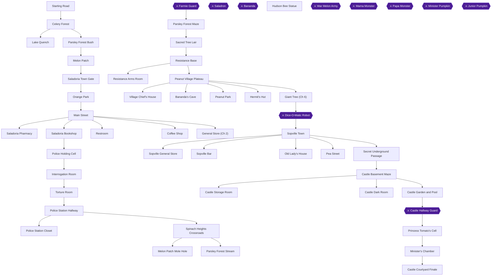
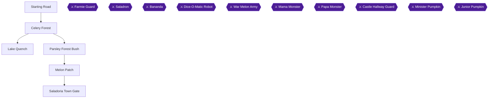
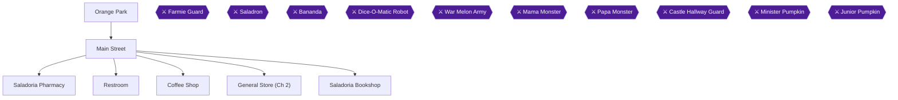
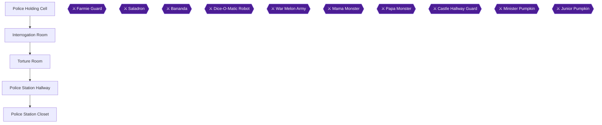
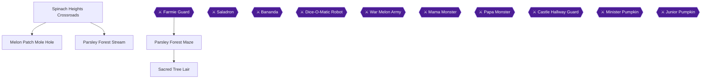
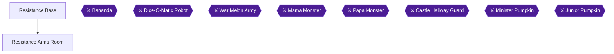
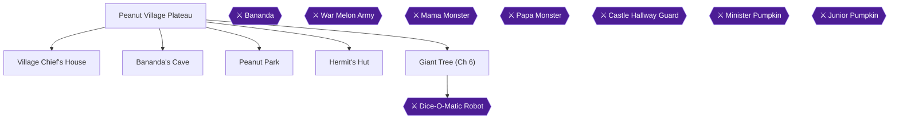
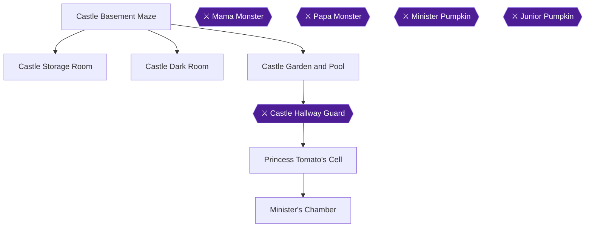

# Princess Tomato in the Salad Kingdom — 100% RetroAchievements Walkthrough

## Metadata

- **Platform:** NES/Famicom
- **Developer:** Hudson Soft
- **Publisher:** Hudson Soft
- **Genre:** Visual Novel
- **Released:** 1988-05-27
- **Achievements:** 52 (255 points)

> [!NOTE]
> Every instruction in this guide was extracted from the sources listed at the bottom and checked against them (62 facts confirmed by 2+ sources, 103 from a single source). Statements marked 🟡 come from only one source. Anything we could not confirm says **"Unable to verify from collected sources."**

## Game Overview

Princess Tomato in the Salad Kingdom is an adventure game developed and published by Hudson Soft for the Nintendo Entertainment System 🟡. Players control Sir Cucumber on an epic journey to rescue Princess Tomato from Minister Pumpkin and restore the Salad Kingdom 🟡.

## Two-Playthrough Strategy & Mutual Exclusion

For your first playthrough do not buy any juices in chapter 2; buying them locks you out of future achievements 🟡.

- **Playthrough 1 (Primary Hardcore Run — No Passwords):** Complete Chapters 1 through 9 from start to finish without using any passwords to earn One-Course Veggie Tale (98092) 🟡. During this run in Chapter 2, you **MUST NOT** buy Grape Juice or Clover Juice 🟡. Skipping these juices allows you to receive Grape Juice from Mr. Leek in Chapter 4 and trade it for Clover Juice in Chapter 5 🟡. Be extremely cautious during the Minister Pumpkin boss battle in Chapter 8, as defeat causes an immediate game over that invalidates the no-passwords run 🟡.
- **Playthrough 2 (Post-Game Password Cleanup):** After defeating the final boss and earning the no-passwords achievement, enter the Chapter 2 password to reload Saladoria 🟡. On this replay, purchase both Grape Juice and Clover Juice at the store to earn the Chapter 2 item collection achievement 🟡.

## Core Controls & Finger Wars Combat

Commands line both sides of the screen: Move to a destination, Look for details, and Check for hidden objects 🟡.

Finger Wars combat directions are standardized 🟡:

- **Rock-Paper-Scissors Throw:** Press **UP** for Rock, **LEFT** for Scissors, and **RIGHT** for Paper 🟡.
- **Look-Away Phase:** Press up to pick rock, then press down to look down matching the enemy direction 🟡.

## Chapter Flow

1. **Chapter 1:** Salad Kingdom Outskirts & The Rescue of Percy 🟡
2. **Chapter 2:** Saladoria City Investigation & The Arrest
3. **Chapter 3:** Police Station Incarceration & Escape
4. **Chapter 4:** Spinach Heights, Parsley Forest Maze & Saladron 🟡
5. **Chapter 5:** The Resistance Headquarters
6. **Chapter 6:** Peanut Village, Bananda's Cave & The Dice-O-Matic
7. **Chapter 7:** Sopville Infiltration & Secret Passage 🟡
8. **Chapter 8:** Minister's Castle, Monster Maze & Princess Tomato 🟡
9. **Chapter 9:** Courtyard Climax & Salad Kingdom Liberation

## Achievement Roadmap

| Chapter | Achievements | Points |
|---|---|---|
| [1. Salad Kingdom Outskirts & The Rescue of Percy](#chapter-1-salad-kingdom-outskirts-the-rescue-of-percy) | Diospyros Who?, Drink of Water, Boss?, Harvesting Spinach Heights, Let Sleeping Daikons Lie | 13 |
| [2. Saladoria City Investigation & The Arrest](#chapter-2-saladoria-city-investigation-the-arrest) | Penny-Pinching Pavlova, The Lost Mujdei Minister, Over-the-Counter Carica, Knowledge Is Brain Food, Saladoria's Cornucopia, Caught in a Pickle | 30 |
| [3. Police Station Incarceration & Escape](#chapter-3-police-station-incarceration-escape) | Meet Your Capsaicin Captor, Un-Fixing a Hole, Abandoning All Common Scents, Penitentiary Produce, The Scallion Redemption | 27 |
| [4. Spinach Heights, Parsley Forest Maze & Saladron](#chapter-4-spinach-heights-parsley-forest-maze-saladron) | Valuable Dirt, The 80% Water-Boy, Agricultural Warfare, Natural-Grown Fighter, The Roots of the Operation, Flat-Leaved Labyrinth Findings, Ingredient of Surprise, Dressed for Success, With No Intent to Ferment | 36 |
| [5. The Resistance Headquarters](#chapter-5-the-resistance-headquarters) | True Merit from a True Melon, Quit Your Wining..., Legume-Laden Lieutenant, Silage Settlement | 19 |
| [6. Peanut Village, Bananda's Cave & The Dice-O-Matic](#chapter-6-peanut-village-banandas-cave-the-dice-o-matic) | Just Plantain Scary, Achilles' Peel, We're Rich! (In Vitamin B), Not-So-Free of Charge, The Hachisuke Code, Get in the Robot, Percy!, Mobile Suit Gourdam, Picking a Peanut Peck, Under the Ugli Tree | 36 |
| [7. Sopville Infiltration & Secret Passage](#chapter-7-sopville-infiltration-secret-passage) | A Fistful of Lettuce, Right of Passage, Needy for Nutrients | 20 |
| [8. Minister's Castle, Monster Maze & Princess Tomato](#chapter-8-ministers-castle-monster-maze-princess-tomato) | I'm Too Ripe to Die!, Tying Up Loose Endives, Her Umami Majesty, Bitter Taste of Defeat, No Kid's Hungry, Fight-or-Fillet Matriarch, Perishable Patriarch, Squashing the Monarchy, Grand Hall's Heaping Helpings, With Princess in Toma-Tow | 39 |
| [9. Courtyard Climax & Salad Kingdom Liberation](#chapter-9-courtyard-climax-salad-kingdom-liberation) | Closing the Recipe Book, One-Course Veggie Tale | 35 |

## Playthrough Planning

**Playthroughs required:** 2

Two playthroughs / chapter replay approach: Playthrough 1 is a clean no-passwords run covering 51 achievements without purchasing grape or clover juice in Chapter 2, culminating in One-Course Veggie Tale (98092). Playthrough 2 is a post-game Chapter 2 replay using password to purchase the juices and collect all items for Saladoria's Cornucopia (98049), safely avoiding the mutual exclusion / lockout conflict.

**Settings:** Play on standard NES emulator settings with standard controls. Rock-Paper-Scissors direction controls: Up = Rock, Left = Scissors, Right = Paper. Look-Away controls: Up = Up, Down = Down, Left = Left, Right = Right.

## Missables Summary

| ⚠ Missable | Achievement | Chapter | Must be done before |
|---|---|---|---|
| Diospyros Who? 🟡 | Diospyros Who? | [1](#chapter-1-salad-kingdom-outskirts-the-rescue-of-percy) | Before meeting Percy in Celery Forest |
| Harvesting Spinach Heights | Harvesting Spinach Heights | [1](#chapter-1-salad-kingdom-outskirts-the-rescue-of-percy) | Before entering Saladoria Town Gate |
| Penny-Pinching Pavlova | Penny-Pinching Pavlova | [2](#chapter-2-saladoria-city-investigation-the-arrest) | Before entering Bookshop and getting arrested |
| Saladoria's Cornucopia | Saladoria's Cornucopia | [2](#chapter-2-saladoria-city-investigation-the-arrest) | Chapter 2 completion (Replay Playthrough) |
| Abandoning All Common Scents 🟡 | Abandoning All Common Scents | [3](#chapter-3-police-station-incarceration-escape) | Before escaping the police station |
| Penitentiary Produce | Penitentiary Produce | [3](#chapter-3-police-station-incarceration-escape) | Before leaving the police station |
| Natural-Grown Fighter 🟡 | Natural-Grown Fighter | [4](#chapter-4-spinach-heights-parsley-forest-maze-saladron) | During Farmie Finger Wars battle |
| Flat-Leaved Labyrinth Findings | Flat-Leaved Labyrinth Findings | [4](#chapter-4-spinach-heights-parsley-forest-maze-saladron) | Before talking to Mr. Leek to end Chapter 4 |
| Dressed for Success 🟡 | Dressed for Success | [4](#chapter-4-spinach-heights-parsley-forest-maze-saladron) | During Saladron Finger Wars battle |
| With No Intent to Ferment | With No Intent to Ferment | [4](#chapter-4-spinach-heights-parsley-forest-maze-saladron) | End of Chapter 4 (requires skipping Chapter 2 Grape Juice) |
| Quit Your Wining... | Quit Your Wining... | [5](#chapter-5-the-resistance-headquarters) | Chapter 5 Resistance Base (trade Grape Juice to Grapy) |
| Legume-Laden Lieutenant 🟡 | Legume-Laden Lieutenant | [5](#chapter-5-the-resistance-headquarters) | Before leaving Resistance Base for Peanut Village |
| We're Rich! (In Vitamin B) | We're Rich! (In Vitamin B) | [6](#chapter-6-peanut-village-banandas-cave-the-dice-o-matic) | Before leaving Bananda's Cave |
| The Hachisuke Code | The Hachisuke Code | [6](#chapter-6-peanut-village-banandas-cave-the-dice-o-matic) | Before boarding the Dice-O-Matic |
| Picking a Peanut Peck | Picking a Peanut Peck | [6](#chapter-6-peanut-village-banandas-cave-the-dice-o-matic) | Before boarding the Dice-O-Matic to end Chapter 6 |
| A Fistful of Lettuce | A Fistful of Lettuce | [7](#chapter-7-sopville-infiltration-secret-passage) | Before entering secret passage to end Chapter 7 |
| Needy for Nutrients 🟡 | Needy for Nutrients | [7](#chapter-7-sopville-infiltration-secret-passage) | Before leaving Sopville Main Street / entering secret passage |
| Fight-or-Fillet Matriarch | Fight-or-Fillet Matriarch | [8](#chapter-8-ministers-castle-monster-maze-princess-tomato) | Before defeating Papa Monster and exiting Basement Maze |
| Grand Hall's Heaping Helpings 🟡 | Grand Hall's Heaping Helpings | [8](#chapter-8-ministers-castle-monster-maze-princess-tomato) | Before fighting Minister Pumpkin |
| One-Course Veggie Tale | One-Course Veggie Tale | [9](#chapter-9-courtyard-climax-salad-kingdom-liberation) | Final battle / credits (must not enter any passwords across all 9 chapters) |

## Points of No Return

| ⛔ Point of No Return | Chapter | What you lose access to |
|---|---|---|
| Entering Saladoria Town Gate | [1](#chapter-1-salad-kingdom-outskirts-the-rescue-of-percy) | Passing through the gate into Saladoria ends Chapter 1 and permanently drops unnecessary items. |
| Entering Saladoria Bookshop 🟡 | [2](#chapter-2-saladoria-city-investigation-the-arrest) | Exiting the bookshop triggers your arrest and immediately ends Chapter 2. |
| Escaping Police Station with Lantern 🟡 | [3](#chapter-3-police-station-incarceration-escape) | Blending into the guards with the lantern ends Chapter 3 permanently. |
| Talking to Mr. Leek outside Sacred Tree | [4](#chapter-4-spinach-heights-parsley-forest-maze-saladron) | Talking to Mr. Leek after reclaiming the Yam Medallion triggers the journey to Resistance Base and ends Chapter 4. |
| Exiting Resistance Base for Peanut Village 🟡 | [5](#chapter-5-the-resistance-headquarters) | Leaving the base to Peanut Village permanently closes Chapter 5. |
| Boarding the Dice-O-Matic Robot 🟡 | [6](#chapter-6-peanut-village-banandas-cave-the-dice-o-matic) | Starting the Dice-O-Matic robot battle permanently leaves Peanut Plateau and ends Chapter 6. |
| Entering the Secret Underground Passage | [7](#chapter-7-sopville-infiltration-secret-passage) | Digging and entering the secret passage ends Chapter 7 and transitions to Minister's Castle. |
| Confronting Minister Pumpkin in his Chambers | [8](#chapter-8-ministers-castle-monster-maze-princess-tomato) | Entering Minister Pumpkin's chamber triggers the boss fight and subsequent castle escape, ending Chapter 8. |
| Engaging Junior Pumpkin Finale | [9](#chapter-9-courtyard-climax-salad-kingdom-liberation) | Defeating Junior Pumpkin triggers the ending sequence and final victory. |

## Progression Diagrams

### Game Progression

## Boss Index

Full strategies are in each chapter.

| Boss | Chapter |
|---|---|
| Farmie Guard | [4. Spinach Heights, Parsley Forest Maze & Saladron](#chapter-4-spinach-heights-parsley-forest-maze-saladron) |
| Saladron | [4. Spinach Heights, Parsley Forest Maze & Saladron](#chapter-4-spinach-heights-parsley-forest-maze-saladron) |
| Bananda | [6. Peanut Village, Bananda's Cave & The Dice-O-Matic](#chapter-6-peanut-village-banandas-cave-the-dice-o-matic) |
| Dice-O-Matic Robot | [6. Peanut Village, Bananda's Cave & The Dice-O-Matic](#chapter-6-peanut-village-banandas-cave-the-dice-o-matic) |
| War Melon Army | — |
| Mama Monster | [8. Minister's Castle, Monster Maze & Princess Tomato](#chapter-8-ministers-castle-monster-maze-princess-tomato) |
| Papa Monster | [8. Minister's Castle, Monster Maze & Princess Tomato](#chapter-8-ministers-castle-monster-maze-princess-tomato) |
| Castle Hallway Guard | [8. Minister's Castle, Monster Maze & Princess Tomato](#chapter-8-ministers-castle-monster-maze-princess-tomato) |
| Minister Pumpkin | [8. Minister's Castle, Monster Maze & Princess Tomato](#chapter-8-ministers-castle-monster-maze-princess-tomato) |
| Junior Pumpkin | [9. Courtyard Climax & Salad Kingdom Liberation](#chapter-9-courtyard-climax-salad-kingdom-liberation) |

## Walkthrough

# Chapter 1: Salad Kingdom Outskirts & The Rescue of Percy

At the starting point you have three gold coins and you may pick up the flower 🟡.

### Chapter Items to Collect (5 Items Total)

| Item | Location | Purpose / Usage |
|---|---|---|
| Red Flower | Starting Road | Optional offering for the Lake Quench shrine 🟡 |
| Water Canteen | Lake Quench | Used to revive Percy, Prince Lettuce, and the Melons |
| Gold Coin | Lake Quench Nest | Found in the fern bird nest |
| Gate Pass | Melon Patch | Received from Cantaloup to enter Saladoria Town |
| Spinach | Parsley Forest Bush | Obtained near the hidden passage 🟡 |

---

### Step-by-Step Walkthrough

> [!WARNING] Missable Achievement Warning
> Before speaking to or interacting with Percy in Celery Forest, you must execute the Percy menu command on the Starting Road 🟡.

1. **MOVE** → Starting Road at the very beginning of the adventure 🟡.
2. **LOOK** → Check your immediate surroundings on the Starting Road 🟡.
3. **PERCY** → Call out to Percy before ever meeting him to trigger the secret interaction 🟡.

> [!ACHIEVEMENT]
> **Diospyros Who? (1 Points)**
> 
> *Use a peculiarly-named command before meeting the character it belongs to*

4. **TAKE** → Pick up the Red Flower resting on the ground 🟡.
5. **MOVE** → Advance north along the path into Celery Forest.
6. **LOOK** → Notice a parched baby persimmon named Percy lying on the road.
7. **TALK** → Speak with Percy to learn that he is desperately thirsty.
8. **MOVE** → Travel east to the shores of Lake Quench.
9. **LOOK** → Search the trees around Lake Quench to discover a fern bird nest.
10. **CHECK** → Search the nest in the tree to locate a shiny gold coin.
11. **TAKE** → Take the Lake Gold Coin from the nest.
12. **TAKE** → Collect water from Lake Quench into your canteen to store three drinks.
13. **MOVE** → Return west to Celery Forest to aid the suffering persimmon.
14. **GIVE** → Offer water from your canteen to Percy to quench his thirst.
15. **TALK** → Speak to Percy twice to learn about his captured companions.
16. **LOOK** → Examine Percy, and he gratefully decides to join your party as a loyal companion.

> [!ACHIEVEMENT]
> **Drink of Water, Boss? (2 Points)**
> 
> *Meet Percy, the baby persimmon*

17. **MOVE** → Head north to the Parsley Forest Bush crossroads.
18. **LOOK** → Check the bush near the fence.
19. **CHECK** → Search the bush to find Prince Lettuce hiding underneath.
20. **GIVE** → Give water to Prince Lettuce to restore his strength.
21. **TALK** → Speak with Prince Lettuce, who shows you a secret passage leading to the Melon Patch.
22. **MOVE** → Step through the secret passage to enter the Melon Patch.
23. **LOOK** → Observe the four withered melons lying in the patch.
24. **GIVE** → Pour water onto all four melons to revive them completely.
25. **TALK** → Speak to Cantaloup, who gives you the Town Gate Pass as a reward.
26. **TAKE** → Pick up the Town Gate Pass from the grateful melons.
27. **MOVE** → Return to Lake Quench to refill your Water Canteen before departing.
28. **TAKE** → Refill your water supply completely at Lake Quench.
29. **MOVE** → Travel to the Saladoria Town Gate to enter the capital city.

> [!WARNING] Missable Achievement Warning
> Ensure you have acquired all 5 items (Red Flower, Water Canteen, Gold Coin, Gate Pass, and Spinach) before entering Saladoria 🟡.

> [!ACHIEVEMENT]
> **Harvesting Spinach Heights (5 Points)**
> 
> *Collect every item in Chapter 1*

30. **GIVE** → Show the Town Gate Pass to the guard at the Saladoria Town Gate.
31. **PERCY** → Consult Percy, who explains that the guard frequently dozes off on duty.
32. **MOVE** → Move away and return repeatedly until the guard falls sound asleep.

> [!CAUTION] Point of No Return: Saladoria Town Gate
> Sneak past the sleeping guard at the gate to enter the town.

33. **MOVE** → Slip quietly past the sleeping guard and proceed through the Saladoria Town Gate into town.

> [!ACHIEVEMENT]
> **Let Sleeping Daikons Lie (5 Points)**
> 
> *Arrive at Saladoria and complete Chapter 1*

---

## Chapter 1: Salad Kingdom Outskirts & The Rescue of Percy

- [ ] Triggered the Diospyros command before talking to Percy on Starting Road 🟡
- [ ] Recruited Percy in Celery Forest
- [ ] Gathered all 5 items including Flower, Coin, Water, Pass, and Spinach 🟡
- [ ] Passed through Saladoria Town Gate while the guard was asleep

---

# Chapter 2: Saladoria City Investigation & The Arrest

Orange Park with the garlic wanderer is the starting point in Saladoria Town.

### Chapter Items to Collect (9 Items Total)

| Item | Location | Purpose / Usage |
|---|---|---|
| Orange Park Coin | Orange Park | Hit fountain to get coin and take it 🟡 |
| Octoberry Coin | Main Street | Dropped by Octoberry when he wanders past |
| Coffee | Coffee Shop | Purchased from Mrs. Plum for coins |
| Sandwich | General Store (Ch 2) | Purchased from the deli counter 🟡 |
| Donut (Matches) | Restroom | Found inside the trash can |
| Aspirin | Saladoria Pharmacy | Medicine obtained from Mr. Fig for the leader |
| Bookshop Key | Saladoria Bookshop | Key hidden under the counter 🟡 |
| Grape Juice | General Store (Ch 2) | Purchased in Store (**Playthrough 2 Replay only**) 🟡 |
| Clover Juice | General Store (Ch 2) | Purchased in Store (**Playthrough 2 Replay only**) 🟡 |

---

### Step-by-Step Walkthrough

1. **MOVE** → Orange Park where garlic wanderers rest among the trees.
2. **LOOK** → Look around Orange Park to spot the elderly garlic wanderer.
3. **TALK** → Speak to the Garlic Wanderer to learn about the resistance movement.

> [!ACHIEVEMENT]
> **The Lost Mujdei Minister (2 Points)**
> 
> *Meet the Garlic Wanderer at Orange Park*

4. **HIT** → Hit the fountain until you get a coin to take 🟡.
5. **TAKE** → Pick up the coin from the ground 🟡.
6. **MOVE** → Travel to Main Street in the heart of the city.

> [!WARNING] Missable Achievement Warning
> Octoberry has a random chance of appearing when you enter Main Street. Alternate entering and exiting Main Street until Octoberry appears, then check the street immediately.

7. **MOVE** → Enter and exit Main Street repeatedly until Octoberry walks into view.
8. **CHECK** → Check the street right after Octoberry walks past to spot a dropped coin.
9. **TAKE** → Pick up the Octoberry Gold Coin from the cobblestones.

> [!ACHIEVEMENT]
> **Penny-Pinching Pavlova (2 Points)**
> 
> *Receive a coin from an Octoberry on the main street of Saladoria*

10. **MOVE** → Enter the Saladoria Pharmacy on the corner.
11. **TALK** → Speak with Mr. Fig twice about medicine for the resistance.
12. **TAKE** → Receive the bottle of Aspirin from Mr. Fig.

> [!ACHIEVEMENT]
> **Over-the-Counter Carica (3 Points)**
> 
> *Receive aspirin from Mr. Fig at the pharmacy*

13. **MOVE** → Visit the public Restroom nearby.
14. **CHECK** → Inspect the trash can twice to find a box of matches styled as a donut.
15. **TAKE** → Take the Donut (Matches) out of the trash can.
16. **MOVE** → Head to the Coffee Shop on Main Street.
17. **BUY** → Purchase a cup of warm coffee from Mrs. Plum.
18. **MOVE** → Enter the General Store (Ch 2) to purchase provisions.
19. **BUY** → Buy a sandwich from the deli counter 🟡.

> [!WARNING] Playthrough Routing & Lockout Notice
> On your primary playthrough, **DO NOT BUY** Grape Juice or Clover Juice here 🟡. Buying them locks you out of With No Intent to Ferment (98064) and Quit Your Wining... (98066) 🟡. On Playthrough 2 (Password Replay), buy both juices now to complete the full collection 🟡.

> [!ACHIEVEMENT]
> **Saladoria's Cornucopia (10 Points)**
> 
> *Collect every item in Chapter 2*

20. **MOVE** → Walk over to the Saladoria Bookshop 🟡.

> [!ACHIEVEMENT]
> **Knowledge Is Brain Food (3 Points)**
> 
> *Enter the Saladoria bookshop*

21. **CHECK** → Check behind the counter in the bookshop to discover a hidden key 🟡.
22. **TAKE** → Pick up the Bookshop Key from beneath the counter 🟡.

> [!CAUTION] Point of No Return: Saladoria Bookshop
> Exiting the Saladoria Bookshop triggers an ambush by Minister Pumpkin's farmies and immediately ends Chapter 2 🟡.

23. **MOVE** → Step outside the bookshop entrance, where Farmie guards surround you and haul you off to prison 🟡.

> [!ACHIEVEMENT]
> **Caught in a Pickle (10 Points)**
> 
> *Get kidnapped by the Farmies and complete Chapter 2*

---

## Chapter 2: Saladoria City Investigation & The Arrest

- [ ] Spoke with the Garlic Wanderer in Orange Park
- [ ] Gathered the Octoberry Gold Coin on Main Street 🟡
- [ ] Acquired Aspirin from Mr. Fig at the Saladoria Pharmacy
- [ ] Retrieved Donut (Matches) from the Restroom trash can
- [ ] Entered the Saladoria Bookshop and secured the Bookshop Key 🟡

---

# Chapter 3: Police Station Incarceration & Escape

Hit Potato in the jail cell to obtain the file and begin your escape.

### Chapter Items to Collect (8 Items Total)

| Item | Location | Purpose / Usage |
|---|---|---|
| Metal File | Police Holding Cell | Received from Potato to cut through bars |
| Water | Torture Room | Water scooped from the rising pool 🟡 |
| Key | Torture Room | Bookshop key used to unlock the escape door |
| Rope | Police Station Closet | Used to tie up Sgt. Pepper in his office 🟡 |
| Paper | Police Station Closet | Investigation document found in closet 🟡 |
| Bucket | Police Station Closet | Fire bucket found near extinguisher 🟡 |
| Fake Soap Grenade | Police Station Hallway | Carved from soap by Garlic Wanderer 🟡 |
| Lantern | Police Station Closet | Used to disguise Sir Cucumber among guards 🟡 |

---

### Step-by-Step Walkthrough

1. **MOVE** → Police Holding Cell where other captured vegetable prisoners sit.
2. **LOOK** → Check the jail cell where Potato is sitting.
3. **HIT** → Strike Potato to make him take you seriously.
4. **TALK** → Speak to Potato, who hands over a hidden Metal File.
5. **TAKE** → Take the Metal File from Potato.
6. **USE** → Use the Metal File on the cell bars to attempt an escape.
7. **MOVE** → Get caught during the escape attempt and escorted to the Interrogation Room.

> [!ACHIEVEMENT]
> **Meet Your Capsaicin Captor (2 Points)**
> 
> *Escape from the holding cell and be brought to the interrogation room*

8. **TALK** → Speak with Sgt. Pepper three times in the Interrogation Room.
9. **GIVE** → Hand over the Metal File when Sgt. Pepper notices it.
10. **MOVE** → Get locked inside the water-filled Torture Room as punishment.
11. **CHECK** → Inspect the door twice to find a hidden keyhole.
12. **HIT** → Hit the heavy door three times until Sgt. Pepper assumes you are trapped and walks away.
13. **USE** → Hit the keyhole and use the key to escape.

> [!ACHIEVEMENT]
> **Un-Fixing a Hole (2 Points)**
> 
> *Escape from Sgt. Pepper's torture room*

14. **MOVE** → Step out into the Police Station Hallway.

> [!WARNING] Missable Achievement Warning
> Do not finish the escape yet. Strike the alarm button in the hallway to trigger the station sirens, get recaptured, and escape once more 🟡.

15. **HIT** → Hit the red Alarm Button mounted on the wall in the Police Station Hallway 🟡.

> [!ACHIEVEMENT]
> **Abandoning All Common Scents (3 Points)**
> 
> *Trigger the alarm outside of the jail cell*

16. **MOVE** → Return to the Torture Room after being recaptured.
17. **HIT** → Hit the door again to scare off the guard.
18. **USE** → Use the key to unlock the Torture Room door once more.
19. **MOVE** → Re-enter the Police Station Hallway and check the cells 🟡.
20. **LOOK** → Peer inside the dark cell to spot the Garlic Wanderer 🟡.
21. **GIVE** → Give the Donut (Matches) to the Garlic Wanderer 🟡.
22. **TALK** → Speak to the Garlic Wanderer twice to receive his carved Fake Soap Grenade 🟡.
23. **MOVE** → Head down the corridor to the Police Station Closet 🟡.
24. **TAKE** → Take the Rope, paper, and bucket from the storage shelves 🟡.
25. **MOVE** → Approach Sgt. Pepper's private office door 🟡.
26. **MOVE** → Enter the office to confront Sgt. Pepper directly 🟡.
27. **USE** → Threaten Sgt. Pepper with the Fake Soap Grenade to make him surrender 🟡.
28. **USE** → Enter the storage room to find rope and tie up Sgt. Pepper 🟡.
29. **MOVE** → Return to the Police Station Closet to grab remaining supplies 🟡.
30. **TAKE** → Take the Lantern from the closet shelf 🟡.

> [!WARNING] Missable Achievement Warning
> Verify that you have collected all 8 prison items (File, Water, Key, Rope, Paper, Bucket, Fake Soap Grenade, and Lantern) before walking outside 🟡.

> [!ACHIEVEMENT]
> **Penitentiary Produce (10 Points)**
> 
> *Collect every item in Chapter 3*

31. **MOVE** → Proceed toward the station yard exit 🟡.
32. **USE** → Hold up the Lantern so you blend in perfectly with the patrolling guards 🟡.

> [!CAUTION] Point of No Return: Escaping Police Station with Lantern
> Blending into the guards with the lantern ends Chapter 3 permanently and leads directly to Spinach Heights 🟡.

33. **MOVE** → March confidently past the guards and escape the station yard into freedom 🟡.

> [!ACHIEVEMENT]
> **The Scallion Redemption (10 Points)**
> 
> *Escape from the police station and complete Chapter 3*

---

## Chapter 3: Police Station Incarceration & Escape

- [ ] Secured the Metal File and reached the Interrogation Room
- [ ] Unlocked the Torture Room door with your key
- [ ] Sounded the alarm button in the Police Station Hallway 🟡
- [ ] Found the rope in storage room and disguised with lantern to escape 🟡
- [ ] Collected all 8 chapter items and escaped with the Lantern 🟡

---

# Chapter 4: Spinach Heights, Parsley Forest Maze & Saladron

Sir Cucumber returns to Spinach Heights to seek the lost Yam Medallion.

### Chapter Items to Collect (8 Items Total)

| Item | Location | Purpose / Usage |
|---|---|---|
| Blue Umbrella | Spinach Heights Crossroads | Found in the bush near the lake |
| Water Wings | Melon Patch Mole Hole | Received from Mr. Leek to swim across river 🟡 |
| Maze Compass | Parsley Forest Maze | Found in early dead end of the maze 🟡 |
| Coin Pouches (3) | Parsley Forest Maze | Three pouches holding gold coins 🟡 |
| Tin Can | Parsley Forest Maze | Used to summon the tree monster Saladron 🟡 |
| Shovel | Parsley Forest Maze | Tool used to dig up the Yam Medallion |
| Yam Medallion | Sacred Tree Lair | Use shovel to dig mound and examine medal |
| Grape Juice | Sacred Tree Lair | Reward from Mr. Leek (**if not bought in Ch 2**) |

---

### Step-by-Step Walkthrough

1. **MOVE** → Spinach Heights Crossroads after safely fleeing the police station.
2. **CHECK** → Search the bush twice at Lake Quench to discover a Blue Umbrella.
3. **TAKE** → Pick up the Blue Umbrella.
4. **MOVE** → Head to the Melon Patch Mole Hole.
5. **CHECK** → Examine the third hole twice to discover that a mole lives inside.
6. **USE** → Open the Blue Umbrella over the hole to shade the mole from sunlight.
7. **GIVE** → Give fresh water to the mole to restore his energy.
8. **TALK** → Speak to the mole in the Melon Patch.

> [!ACHIEVEMENT]
> **Valuable Dirt (3 Points)**
> 
> *Learn some important info by helping out a friendly mole*

9. **MOVE** → Visit Mr. Leek at his woodland shelter 🟡.
10. **GIVE** → Return the Blue Umbrella to Mr. Leek 🟡.
11. **TAKE** → Accept the Water Wings from Mr. Leek in return 🟡.
12. **MOVE** → Advance toward the swift Parsley Forest Stream 🟡.
13. **USE** → Equip the Water Wings on Percy to safely swim across the rushing current 🟡.

> [!ACHIEVEMENT]
> **The 80% Water-Boy (3 Points)**
> 
> *Cross the river towards Parsley Forest*

14. **MOVE** → Step forward to challenge the Farmie 🟡.

> [!WARNING] Missable Achievement Warning
> Farmie always throws Scissors and looks Down. Counter with Rock (**UP**) and immediately look Down (**DOWN**) to win flawlessly without mistakes 🟡.

15. **FIGHT** → Challenge the Farmie to a match of Finger Wars 🟡.
16. **FIGHT** → Press **UP** (Rock) to smash the Farmie's Scissors 🟡.
17. **FIGHT** → Press **DOWN** during the Look-Away phase to match the direction he turns 🟡.

> [!ACHIEVEMENT]
> **Agricultural Warfare (3 Points)**
> 
> *Win the Finger Wars battle against the Farmie*

> [!ACHIEVEMENT]
> **Natural-Grown Fighter (3 Points)**
> 
> *Win the Finger Wars battle against the Farmie without making any mistakes*

18. **MOVE** → Enter the dense labyrinth of the Parsley Forest Maze 🟡.
19. **MOVE** → Turn left to collect the Maze Compass 🟡.
20. **TAKE** → Pick up the Maze Compass 🟡.
21. **MOVE** → Explore all northern corridors to collect the 3 gold coin pouches 🟡.
22. **TAKE** → Pick up all coin pouches along the northern branch 🟡.
23. **MOVE** → Move west along the wall to find the Tin Can 🟡.
24. **TAKE** → Pick up the Tin Can 🟡.
25. **MOVE** → Spiral around the central pathway to find the Shovel 🟡.
26. **TAKE** → Pick up the Shovel 🟡.
27. **MOVE** → Reach the tree lair to summon Saladron 🟡.

> [!WARNING] Missable Achievement Warning
> Saladron always selects Paper. Counter every throw with Scissors (**LEFT**). On Look-Away, guess correctly three times to win without mistakes 🟡.

28. **USE** → Throw the Tin Can into the hollow tree to awaken Saladron 🟡.
29. **FIGHT** → Press **LEFT** (Scissors) to cut Saladron's Paper three consecutive rounds 🟡.
30. **FIGHT** → Win three rounds of Look-Away to defeat Saladron cleanly 🟡.

> [!ACHIEVEMENT]
> **Ingredient of Surprise (3 Points)**
> 
> *Win the Finger Wars battle against Saladron*

> [!ACHIEVEMENT]
> **Dressed for Success (3 Points)**
> 
> *Win the Finger Wars battle against Saladron without making any mistakes*

31. **CHECK** → Check the mound inside the Sacred Tree Lair.
32. **USE** → Dig into the dirt mound with the Shovel until you hit metal.
33. **CHECK** → Examine the buried medal to verify it is the genuine Yam Medallion.
34. **TAKE** → Take the Yam Medallion.

> [!WARNING] Missable Achievement Warning
> Confirm all Parsley Forest Maze items (Compass, Tin Can, Shovel, Pouches, Medallion) are logged before leaving 🟡.

> [!ACHIEVEMENT]
> **Flat-Leaved Labyrinth Findings (5 Points)**
> 
> *Collect every item in Parsley Forest*

35. **MOVE** → Find Mr. Leek outside the tree.

> [!WARNING] Missable Achievement Warning
> If you followed the guide and avoided purchasing Grape Juice in Chapter 2, Mr. Leek will present you with Grape Juice now.

36. **TALK** → Speak to Mr. Leek, who thanks you for recovering the medallion and presents you with the Grape Juice.

> [!ACHIEVEMENT]
> **With No Intent to Ferment (3 Points)**
> 
> *Receive the Grape Juice from Mr. Leek*

> [!CAUTION] Point of No Return: Talking to Mr. Leek outside Sacred Tree
> Talking to Mr. Leek after reclaiming the Yam Medallion triggers the journey to Resistance Base and ends Chapter 4.

37. **TALK** → Confirm departure with Mr. Leek to conclude the chapter and travel to the Resistance Base.

> [!ACHIEVEMENT]
> **The Roots of the Operation (10 Points)**
> 
> *Head for the Resistance base and complete Chapter 4*

---

## Chapter 4: Spinach Heights, Parsley Forest Maze & Saladron

- [ ] Shaded the mole with the umbrella to learn about the medallion
- [ ] Crossed the river using Water Wings 🟡
- [ ] Defeated Farmie flawlessly with Rock and Down 🟡
- [ ] Collected all Parsley Forest Maze items including Compass and Shovel 🟡
- [ ] Defeated Saladron flawlessly with Scissors 🟡
- [ ] Unearthed the Yam Medallion and received Grape Juice from Mr. Leek

---

# Chapter 5: The Resistance Headquarters

Meet the leader of the resistance, General Cantaloupe, and receive the resistance crest.

### Step-by-Step Walkthrough

1. **MOVE** → Resistance Base main hallway where resistance fighters gather.
2. **MOVE** → Meeting room to speak with General Cantaloupe.
3. **LOOK** → Look upon General Cantaloupe, the noble leader of the rebellion.
4. **GIVE** → Present the Yam Medallion and Aspirin to General Cantaloupe.
5. **TALK** → Speak with General Cantaloupe, who commissions you as an official resistance operative.
6. **TAKE** → Receive the Resistance Crest from General Cantaloupe as proof of authority.

> [!ACHIEVEMENT]
> **True Merit from a True Melon (3 Points)**
> 
> *Receive the Crest of the Resistance from General Cantaloupe*

7. **MOVE** → Return to the corridor outside the meeting room.
8. **LOOK** → Notice Grapy the guard standing watch before the supply armory.

> [!WARNING] Missable Achievement Warning
> Trade the Grape Juice you received from Mr. Leek to Grapy. If you purchased Clover Juice earlier in Chapter 2, you will be locked out of this reward.

9. **GIVE** → Give your Grape Juice to Grapy the thirsty guard.
10. **TALK** → Speak to Grapy, who gives you a refreshing bottle of Clover Juice in appreciation.

> [!ACHIEVEMENT]
> **Quit Your Wining... (3 Points)**
> 
> *Receive the Clover Juice from Grapy*

11. **MOVE** → Enter the Resistance Arms Room now left unguarded by Grapy 🟡.
12. **LOOK** → Look inside the arms room at the shelves 🟡.

> [!WARNING] Missable Achievement Warning
> You must equip BOTH the Nut Bomb and the Black Bean in the Arms Room. Even though the Black Bean has no practical combat use, taking both is strictly required for the achievement 🟡.

13. **TAKE** → Take the powerful Nut Bomb from the munitions bench 🟡.
14. **TAKE** → Take the Black Bean resting beside the explosive ordnance 🟡.

> [!ACHIEVEMENT]
> **Legume-Laden Lieutenant (3 Points)**
> 
> *Equip yourself with the Nut Bomb and the Black Bean in the Arms Room*

15. **MOVE** → Return to the meeting room to report mission readiness to General Cantaloupe 🟡.
16. **TALK** → Speak to prepare to leave the base 🟡.

> [!CAUTION] Point of No Return: Exiting Resistance Base for Peanut Village
> Leaving the base to Peanut Village permanently closes Chapter 5 and locks off the headquarters 🟡.

17. **MOVE** → Leave the underground Resistance Base and march onward toward Peanut Village 🟡.

> [!ACHIEVEMENT]
> **Silage Settlement (10 Points)**
> 
> *Head off to Peanut Village and complete Chapter 5*

---

## Chapter 5: The Resistance Headquarters

- [ ] Conferred with General Cantaloupe and earned the Resistance Crest
- [ ] Traded Grape Juice to Grapy for Clover Juice
- [ ] Equipped both the Nut Bomb and the Black Bean in the Resistance Arms Room 🟡
- [ ] Departed the Resistance Base for Peanut Village 🟡

---

# Chapter 6: Peanut Village, Bananda's Cave & The Dice-O-Matic

Enter Bananda's cave with the lamp and use a Nut Bomb to destroy Bananda.

### Chapter Items to Collect (12 Items Total)

| Item | Location | Purpose / Usage |
|---|---|---|
| Carrot | Carrot Plateau | Found in ground and sold for coins 🟡 |
| Oil Lamp | Village Chief's House | Taken to illuminate Bananda's dark cave |
| Robot Battery | Village Chief's House | Power source needed to operate Dice-O-Matic |
| Cave Coin Pouches (5) | Bananda's Cave | Five distinct pouches of gold coins |
| Banana Skin | Bananda's Cave | Peel taken from the fallen Bananda 🟡 |
| Wordbook | Convenience Store | Purchased to decipher the Hudson Bee statue 🟡 |
| Squid | Convenience Store | Purchased and given to the hermit 🟡 |
| Peanuts | Convenience Store | Purchased at the store 🟡 |
| Broom | Convenience Store | Purchased at the store 🟡 |
| Hermit Medicine | Hermit's Hut | Acquired from the mountain hermit 🟡 |
| Chameleon Grass | Giant Tree (Ch 6) | Special grass harvested from the tree 🟡 |
| Right Instructions | Giant Tree (Ch 6) | Technical blueprint scrap found on ground 🟡 |

---

### Step-by-Step Walkthrough

1. **MOVE** → Peanut Village Plateau to survey the settlement.
2. **MOVE** → Enter the Village Chief's House to talk to the chief.
3. **TALK** → Speak to the chief to learn that his child Nutty has been kidnapped.
4. **TAKE** → Take the Oil Lamp from the shelf 🟡.
5. **MOVE** → Travel up the mountainside to Bananda's Cave 🟡.

> [!ACHIEVEMENT]
> **Just Plantain Scary (3 Points)**
> 
> *Enter Bananda's cave*

6. **USE** → Light the Oil Lamp to illuminate Bananda's cave 🟡.

> [!WARNING] Missable Achievement Warning
> Search every branching path of Bananda's Cave to collect all 5 coin pouches before rescuing Nutty and leaving the cave.

7. **MOVE** → Navigate the cavern corridors, picking up all 5 coin pouches along the floor.
8. **TAKE** → Take all 5 coin pouches from the cavern floor.

> [!ACHIEVEMENT]
> **We're Rich! (In Vitamin B) (5 Points)**
> 
> *Collect every coin in Bananda's cave*

9. **MOVE** → Step into the cave to encounter Bananda.
10. **HIT** → Attack the villainous Bananda to peel away his defenses.
11. **TAKE** → Strip off the Banana Skin from Bananda until he is completely defeated.

> [!ACHIEVEMENT]
> **Achilles' Peel (2 Points)**
> 
> *Win the... "battle" against Bananda*

12. **TALK** → Talk to rescued Nutty to save him.
13. **MOVE** → Return to the Village Chief's House in the village.
14. **TALK** → Speak with the grateful Village Chief, who presents you with the Robot Battery.
15. **TAKE** → Take the Robot Battery from the chief.

> [!ACHIEVEMENT]
> **Not-So-Free of Charge (2 Points)**
> 
> *Receive the battery from the Peanut Village chief for rescuing Nutty*

16. **MOVE** → Visit the village convenience store on the plateau 🟡.
17. **BUY** → Purchase the Wordbook, squid, peanuts, and broom using your gold coins 🟡.
18. **MOVE** → Move to Peanut Park to decipher the statue.
19. **LOOK** → Inspect the mysterious Hudson Bee monument standing in Peanut Park.

> [!WARNING] Missable Achievement Warning
> Examine the Hudson Bee statue with the Wordbook in your inventory to decipher the inscription.

20. **CHECK** → Examine the Hudson Bee statue and read its ancient cipher using the Wordbook.

> [!ACHIEVEMENT]
> **The Hachisuke Code (2 Points)**
> 
> *Decipher the text on the Hudson Bee statue in Peanut Park*

21. **MOVE** → Journey up the winding path to the Hermit's Hut 🟡.
22. **GIVE** → Hand the dried squid to the hungry hermit 🟡.
23. **TAKE** → Receive the restorative Hermit Medicine from the hermit 🟡.
24. **MOVE** → Walk to the base of the Giant Tree (Ch 6) 🟡.
25. **TAKE** → Harvest the rare Chameleon Grass growing on the Giant Tree 🟡.
26. **TAKE** → Pick up the Right Instructions blueprint scrap from the soil 🟡.

> [!WARNING] Missable Achievement Warning
> Ensure all 12 Chapter 6 items (Carrot, Oil Lamp, Battery, 5 Pouches, Skin, Wordbook, Squid, Peanuts, Broom, Medicine, Grass, Instructions) have been gathered before operating the robot 🟡.

> [!ACHIEVEMENT]
> **Picking a Peanut Peck (5 Points)**
> 
> *Collect every item in Chapter 6*

27. **MOVE** → Reach the Dice-O-Matic in the cave 🟡.
28. **USE** → Insert the Robot Battery into the control console of the Dice-O-Matic to unlock the cockpit door 🟡.

> [!ACHIEVEMENT]
> **Get in the Robot, Percy! (2 Points)**
> 
> *Unlock the door to the Dice-O-Matic*

> [!CAUTION] Point of No Return: Boarding the Dice-O-Matic Robot
> Enter the cockpit of the Dice-O-Matic to end Chapter 6 🟡.

29. **MOVE** → Climb into the Dice-O-Matic cockpit to confront the War Melon Army pilots 🟡.
30. **FIGHT** → Execute the winning combat sequence against the War Melon Army: press **DOWN**, then **RIGHT**, then **RIGHT**, then **LEFT** 🟡.

> [!ACHIEVEMENT]
> **Mobile Suit Gourdam (5 Points)**
> 
> *Defeat the War Melon Army and Minister Pumpkin's Dice-O-Matic*

31. **MOVE** → Pilot the hijacked robot through the mountains toward Sopville 🟡.

> [!ACHIEVEMENT]
> **Under the Ugli Tree (10 Points)**
> 
> *Arrive at Sopville and complete Chapter 6*

---

## Chapter 6: Peanut Village, Bananda's Cave & The Dice-O-Matic

- [ ] Explored Bananda's Cave and collected all 5 gold coin pouches
- [ ] Defeated Bananda, saved Nutty, and received the Robot Battery from the chief
- [ ] Deciphered the Hudson Bee monument in Peanut Park using the Wordbook
- [ ] Acquired all 12 chapter items including Chameleon Grass and Hermit Medicine 🟡
- [ ] Defeated the War Melon Army inside the Dice-O-Matic using Down-Right-Right-Left 🟡

---

# Chapter 7: Sopville Infiltration & Secret Passage

Talk to the wanderers, use the crest, and buy bread or juice to open access to Pea Street 🟡.

### Chapter Items to Collect (9 Items Total)

| Item | Location | Purpose / Usage |
|---|---|---|
| Fresh Bread | Sopville General Store | Fed to Yam on Main Street 🟡 |
| Sweet Juice | Sopville General Store | Given to Asparagus on Main Street 🟡 |
| Socks | Sopville General Store | General goods purchased at store 🟡 |
| Shampoo | Sopville General Store | Toiletries purchased at store 🟡 |
| Spices | Sopville General Store | Seasoning purchased at store 🟡 |
| Octoberry Coin | Sopville Town | Dropped by wandering Octoberry 🟡 |
| Old Lady Coin | Old Lady's House | Coin listed among Chapter 7 items 🟡 |
| Ron's Underground Key | Sopville Bar | Radish Ron gives the key to room in castle |
| Iron Shovel | Pea Street | Shovel needed to dig through the passage |

---

### Step-by-Step Walkthrough

1. **MOVE** → Sopville Town main thoroughfare where hungry villagers gather 🟡.
2. **LOOK** → Look at wanderers Yam and Aspara 🟡.
3. **MOVE** → Enter the Sopville General Store on the corner.
4. **BUY** → Purchase Fresh Bread and Sweet Juice for your coins 🟡.
5. **BUY** → Purchase the remaining goods: Socks, Shampoo, and Spices 🟡.
6. **MOVE** → Return to street to talk to wanderers 🟡.

> [!WARNING] Missable Achievement Warning
> Ensure you feed both Yam and Asparagus before advancing the main plot, using the bread and juice bought from the store 🟡.

7. **GIVE** → Give the Fresh Bread to hungry Yam 🟡.
8. **GIVE** → Give the Sweet Juice to thirsty Asparagus 🟡.

> [!ACHIEVEMENT]
> **Needy for Nutrients (5 Points)**
> 
> *Give the bread to Yam and the juice to Asparagus on the main street of Sopville*

9. **MOVE** → Enter the dimly lit Sopville Bar across the street.
10. **LOOK** → Spot Radish Ron sitting in the corner booth.
11. **GIVE** → Show the Resistance Crest to Radish Ron.
12. **TALK** → Converse with Radish Ron repeatedly until he hands over Ron's Underground Key.
13. **TAKE** → Take Ron's Underground Key from the table.
14. **MOVE** → Travel to the Old Lady's House on the edge of town 🟡.
15. **CHECK** → Check ground to grab coin 🟡.
16. **TAKE** → Pick up the Old Lady Coin from the ground 🟡.
17. **MOVE** → Walk down narrow Pea Street.
18. **LOOK** → Check Pea Street with the shovel tool.
19. **GIVE** → Hand over all remaining gold coins to E.P. until your purse is empty 🟡.
20. **TAKE** → Take the shovel on Pea Street.

> [!WARNING] Missable Achievement Warning
> Confirm Chapter 7 items include Key, Coin, Shovel, Bread, Socks, Juice, Spices, and Shampoo 🟡.

> [!ACHIEVEMENT]
> **A Fistful of Lettuce (5 Points)**
> 
> *Collect every item in Chapter 7*

21. **USE** → Use the shovel to dig away the wall and reveal exit.
22. **USE** → Insert Ron's Underground Key into the subterranean hatch.

> [!CAUTION] Point of No Return: Entering the Secret Underground Passage
> Navigate the passage forward, right, left, forward and dig with shovel to exit.

23. **MOVE** → Descend into the darkness of the Secret Underground Passage.

> [!ACHIEVEMENT]
> **Right of Passage (10 Points)**
> 
> *Arrive at the secret entrance and complete Chapter 7*

---

## Chapter 7: Sopville Infiltration & Secret Passage

- [ ] Bought supplies from the Sopville General Store 🟡
- [ ] Fed Fresh Bread to Yam and Sweet Juice to Asparagus 🟡
- [ ] Convinced Radish Ron at the Sopville Bar to surrender the key
- [ ] Obtained Chapter 7 items including Shovel, Key, and Coin 🟡
- [ ] Unlocked and entered the Secret Underground Passage

---

# Chapter 8: Minister's Castle, Monster Maze & Princess Tomato

Sir Cucumber infiltrates Minister Pumpkin's fortress to rescue Princess Tomato 🟡.

### Chapter Items to Collect (12 Items Total)

| Item | Location | Purpose / Usage |
|---|---|---|
| Oil Pot | Castle Storage Room | Used on the castle hallway guard 🟡 |
| Chain | Castle Storage Room | Used to bind the hallway guard 🟡 |
| Pine Tar | Castle Storage Room | Extracted from storage shelf 🟡 |
| Mirror | Castle Storage Room | Small glass mirror found in storage 🟡 |
| Letter | Castle Dark Room | Read in the dark study for clues 🟡 |
| Dark Room Coin | Castle Dark Room | Found inside third desk drawer 🟡 |
| Garden Water | Castle Garden and Pool | Collected from the garden fountain 🟡 |
| Ornament | Castle Garden and Pool | Found along garden walkway 🟡 |
| Caterpillar | Dungeon Jail Cell | Found crawling on cell floor 🟡 |
| Clothes | Castle Hallway | Formal disguise garments 🟡 |
| Maze Books | Minister's Chamber | Reference books with maze clues 🟡 |
| Tea Cups | Minister's Chamber | Ornate china tea cups 🟡 |

---

### Step-by-Step Walkthrough

1. **MOVE** → Castle Basement Maze through the tunnel entrance 🟡.
2. **MOVE** → Follow the winding subterranean labyrinth to locate the Baby Monster 🟡.
3. **TALK** → Speak kindly to the Baby Monster to make friends 🟡.

> [!ACHIEVEMENT]
> **No Kid's Hungry (3 Points)**
> 
> *Say hello to the Baby Monster*

> [!WARNING] Missable Achievement Warning
> Explore the dead ends of the basement maze to locate the Mama Monster. In Finger Wars, she plays Rock-Rock-Paper (counter with Paper-Paper-Scissors) and always looks Left on Look-Away.

4. **MOVE** → Step into the dead-end chamber where the Mama Monster lurks.
5. **FIGHT** → Defeat the Mama Monster by throwing Paper (**RIGHT**) and pointing Left (**LEFT**).

> [!ACHIEVEMENT]
> **Fight-or-Fillet Matriarch (3 Points)**
> 
> *Win a Finger Wars battle against the Mama Monster*

6. **MOVE** → Seek out the Papa Monster guarding the main stairs.
7. **FIGHT** → Challenge and defeat the Papa Monster in Finger Wars, always pointing Left on Look-Away.

> [!ACHIEVEMENT]
> **Perishable Patriarch (3 Points)**
> 
> *Win the Finger Wars battle against the Papa Monster*

8. **MOVE** → Climb the staircase into the Castle Storage Room 🟡.
9. **TAKE** → Take the Oil Pot and Chain, along with the pine tar and mirror from the shelves 🟡.
10. **MOVE** → Enter the Castle Dark Room study 🟡.
11. **CHECK** → Search the third drawer of the desk to locate the secret letter and gold coin 🟡.
12. **TAKE** → Collect the Letter and Dark Room Coin from the desk drawer 🟡.
13. **MOVE** → Step outside into the tranquil Castle Garden and Pool 🟡.
14. **TAKE** → Collect Garden Water from the fountain and pick up the ornament 🟡.
15. **LOOK** → Notice Percy drowning in the pond 🟡.
16. **USE** → Rush forward and dive into the water to rescue young Percy from drowning 🟡.

> [!ACHIEVEMENT]
> **I'm Too Ripe to Die! (3 Points)**
> 
> *Save Percy from drowning in the garden pool*

17. **MOVE** → Advance toward the Castle Hallway Guard on patrol 🟡.
18. **USE** → Use oil pot so guard slips and use chain to tie up guard 🟡.

> [!ACHIEVEMENT]
> **Tying Up Loose Endives (3 Points)**
> 
> *Subdue the guard in the castle's rear hallway*

19. **MOVE** → Go to jail cell to find caterpillar on Lettuce 🟡.
20. **MOVE** → Unlock and enter Princess Tomato's Cell in the tower 🟡.
21. **LOOK** → Behold the radiant, true Princess Tomato alive and unharmed 🟡.
22. **TALK** → Speak to Princess Tomato, who embraces you and prepares for rescue 🟡.

> [!ACHIEVEMENT]
> **Her Umami Majesty (3 Points)**
> 
> *Meet the real Princess Tomato, in the flesh*

23. **MOVE** → Approach the decorated royal door of the throne room.
24. **FIGHT** → Defeat the elite eggplant guard in Finger Wars to gain entry.

> [!ACHIEVEMENT]
> **Bitter Taste of Defeat (3 Points)**
> 
> *Win a Finger Wars battle against the guard and enter Minister Pumpkin's chamber*

25. **TAKE** → Grab the formal Clothes from the hallway rack outside the bedroom 🟡.

> [!WARNING] Missable Achievement Warning
> Confirm all 12 Chapter 8 items (Oil Pot, Chain, Pine Tar, Mirror, Letter, Coin, Water, Ornament, Caterpillar, Clothes, Books, Tea Cups) have been collected before confronting the Minister 🟡.

> [!ACHIEVEMENT]
> **Grand Hall's Heaping Helpings (5 Points)**
> 
> *Collect every item in Chapter 8*

26. **MOVE** → Enter the chamber to battle Minister Pumpkin.
27. **TAKE** → Collect the Maze Books and porcelain Tea Cups from the nightstand 🟡.

> [!CAUTION] Point of No Return: Confronting Minister Pumpkin in his Chambers
> Entering combat with Minister Pumpkin triggers the endgame castle escape sequence. Defeat in this battle results in a game over that invalidates the no-passwords run 🟡.

28. **FIGHT** → Face Minister Pumpkin in a high-stakes duel of Finger Wars.
29. **FIGHT** → Execute his exact repeating 8-move throw sequence: **Paper (RIGHT)**, **Paper (RIGHT)**, **Rock (UP)**, **Scissors (LEFT)**, **Rock (UP)**, **Scissors (LEFT)**, **Scissors (LEFT)**, and **Paper (RIGHT)** 🟡.
30. **FIGHT** → Win against Minister Pumpkin using the repeating pattern 🟡.

> [!ACHIEVEMENT]
> **Squashing the Monarchy (3 Points)**
> 
> *Win the Finger Wars battle against Minister Pumpkin*

31. **MOVE** → Escape with Princess Tomato through the secret passage out into the courtyard 🟡.

> [!ACHIEVEMENT]
> **With Princess in Toma-Tow (10 Points)**
> 
> *Escape from Minister Pumpkin's castle and complete Chapter 8*

---

## Chapter 8: Minister's Castle, Monster Maze & Princess Tomato

- [ ] Befriended Baby Monster and defeated Mama and Papa Monsters
- [ ] Saved Percy from the Castle Garden and Pool 🟡
- [ ] Subdued the guard with Oil Pot and Chain 🟡
- [ ] Rescued Princess Tomato from Princess Tomato's Cell 🟡
- [ ] Defeated Minister Pumpkin using the 8-move pattern 🟡
- [ ] Escaped the castle with Princess Tomato 🟡

---

# Chapter 9: Courtyard Climax & Salad Kingdom Liberation

Jr. Pumpkin challenges you to a fight in the Castle Courtyard Finale.

### Step-by-Step Walkthrough

1. **MOVE** → Castle Courtyard Finale.
2. **LOOK** → Notice Jr. Pumpkin challenges you.
3. **TALK** → Speak with Jr. Pumpkin.
4. **LOOK** → Jr. Pumpkin challenges you to fight.

> [!CAUTION] Point of No Return: Engaging Junior Pumpkin Finale
> Confronting Junior Pumpkin initiates the final sequence of the adventure.

> [!WARNING] Missable Achievement Warning
> If you lose versus Minister Pumpkin you will get a game over and have to re-run from the beginning 🟡.

5. **USE** → Use the caterpillar on Jr. Pumpkin to frighten him.
6. **FIGHT** → Use the caterpillar to beat the game.

> [!ACHIEVEMENT]
> **Closing the Recipe Book (10 Points)**
> 
> *Defeat Junior Pumpkin and restore order to the Salad Kingdom once and for all!*

7. **TALK** → Talk to beat the game.
8. **LOOK** → Finish the game without passwords 🟡.

> [!ACHIEVEMENT]
> **One-Course Veggie Tale (25 Points)**
> 
> *Complete all 9 chapters and beat the game without using any passwords*

---

## Chapter 9: Courtyard Climax & Salad Kingdom Liberation

- [ ] Reached Castle Courtyard Finale
- [ ] Used the caterpillar on Jr. Pumpkin to beat the game
- [ ] Completed the entire game without passwords 🟡

---

## Final Checklist

**1. Salad Kingdom Outskirts & The Rescue of Percy**

- [ ] ⚠ Diospyros Who? (before: Before meeting Percy in Celery Forest)
- [ ] ⚠ Harvesting Spinach Heights (before: Before entering Saladoria Town Gate)
- [ ] 🏆 Diospyros Who?
- [ ] 🏆 Drink of Water, Boss?
- [ ] 🏆 Harvesting Spinach Heights
- [ ] 🏆 Let Sleeping Daikons Lie
- [ ] ⛔ Everything above is done before: Entering Saladoria Town Gate

**2. Saladoria City Investigation & The Arrest**

- [ ] ⚠ Penny-Pinching Pavlova (before: Before entering Bookshop and getting arrested)
- [ ] ⚠ Saladoria's Cornucopia (before: Chapter 2 completion (Replay Playthrough))
- [ ] 🏆 Penny-Pinching Pavlova
- [ ] 🏆 The Lost Mujdei Minister
- [ ] 🏆 Over-the-Counter Carica
- [ ] 🏆 Knowledge Is Brain Food
- [ ] 🏆 Saladoria's Cornucopia
- [ ] 🏆 Caught in a Pickle
- [ ] ⛔ Everything above is done before: Entering Saladoria Bookshop

**3. Police Station Incarceration & Escape**

- [ ] ⚠ Abandoning All Common Scents (before: Before escaping the police station)
- [ ] ⚠ Penitentiary Produce (before: Before leaving the police station)
- [ ] 🏆 Meet Your Capsaicin Captor
- [ ] 🏆 Un-Fixing a Hole
- [ ] 🏆 Abandoning All Common Scents
- [ ] 🏆 Penitentiary Produce
- [ ] 🏆 The Scallion Redemption
- [ ] ⛔ Everything above is done before: Escaping Police Station with Lantern

**4. Spinach Heights, Parsley Forest Maze & Saladron**

- [ ] ⚠ Natural-Grown Fighter (before: During Farmie Finger Wars battle)
- [ ] ⚠ Flat-Leaved Labyrinth Findings (before: Before talking to Mr. Leek to end Chapter 4)
- [ ] ⚠ Dressed for Success (before: During Saladron Finger Wars battle)
- [ ] ⚠ With No Intent to Ferment (before: End of Chapter 4 (requires skipping Chapter 2 Grape Juice))
- [ ] 🏆 Valuable Dirt
- [ ] 🏆 The 80% Water-Boy
- [ ] 🏆 Agricultural Warfare
- [ ] 🏆 Natural-Grown Fighter
- [ ] 🏆 The Roots of the Operation
- [ ] 🏆 Flat-Leaved Labyrinth Findings
- [ ] 🏆 Ingredient of Surprise
- [ ] 🏆 Dressed for Success
- [ ] 🏆 With No Intent to Ferment
- [ ] ⛔ Everything above is done before: Talking to Mr. Leek outside Sacred Tree

**5. The Resistance Headquarters**

- [ ] ⚠ Quit Your Wining... (before: Chapter 5 Resistance Base (trade Grape Juice to Grapy))
- [ ] ⚠ Legume-Laden Lieutenant (before: Before leaving Resistance Base for Peanut Village)
- [ ] 🏆 True Merit from a True Melon
- [ ] 🏆 Quit Your Wining...
- [ ] 🏆 Legume-Laden Lieutenant
- [ ] 🏆 Silage Settlement
- [ ] ⛔ Everything above is done before: Exiting Resistance Base for Peanut Village

**6. Peanut Village, Bananda's Cave & The Dice-O-Matic**

- [ ] ⚠ We're Rich! (In Vitamin B) (before: Before leaving Bananda's Cave)
- [ ] ⚠ The Hachisuke Code (before: Before boarding the Dice-O-Matic)
- [ ] ⚠ Picking a Peanut Peck (before: Before boarding the Dice-O-Matic to end Chapter 6)
- [ ] 🏆 Just Plantain Scary
- [ ] 🏆 Achilles' Peel
- [ ] 🏆 We're Rich! (In Vitamin B)
- [ ] 🏆 Not-So-Free of Charge
- [ ] 🏆 The Hachisuke Code
- [ ] 🏆 Get in the Robot, Percy!
- [ ] 🏆 Mobile Suit Gourdam
- [ ] 🏆 Picking a Peanut Peck
- [ ] 🏆 Under the Ugli Tree
- [ ] ⛔ Everything above is done before: Boarding the Dice-O-Matic Robot

**7. Sopville Infiltration & Secret Passage**

- [ ] ⚠ A Fistful of Lettuce (before: Before entering secret passage to end Chapter 7)
- [ ] ⚠ Needy for Nutrients (before: Before leaving Sopville Main Street / entering secret passage)
- [ ] 🏆 A Fistful of Lettuce
- [ ] 🏆 Right of Passage
- [ ] 🏆 Needy for Nutrients
- [ ] ⛔ Everything above is done before: Entering the Secret Underground Passage

**8. Minister's Castle, Monster Maze & Princess Tomato**

- [ ] ⚠ Fight-or-Fillet Matriarch (before: Before defeating Papa Monster and exiting Basement Maze)
- [ ] ⚠ Grand Hall's Heaping Helpings (before: Before fighting Minister Pumpkin)
- [ ] 🏆 I'm Too Ripe to Die!
- [ ] 🏆 Tying Up Loose Endives
- [ ] 🏆 Her Umami Majesty
- [ ] 🏆 Bitter Taste of Defeat
- [ ] 🏆 No Kid's Hungry
- [ ] 🏆 Fight-or-Fillet Matriarch
- [ ] 🏆 Perishable Patriarch
- [ ] 🏆 Squashing the Monarchy
- [ ] 🏆 Grand Hall's Heaping Helpings
- [ ] 🏆 With Princess in Toma-Tow
- [ ] ⛔ Everything above is done before: Confronting Minister Pumpkin in his Chambers

**9. Courtyard Climax & Salad Kingdom Liberation**

- [ ] ⚠ One-Course Veggie Tale (before: Final battle / credits (must not enter any passwords across all 9 chapters))
- [ ] 🏆 Closing the Recipe Book
- [ ] 🏆 One-Course Veggie Tale
- [ ] ⛔ Everything above is done before: Engaging Junior Pumpkin Finale

## 100% Completion Verification Checklist

All 52 achievements (255 points).

| ✔ | Achievement | Points | Type | Chapter |
|---|---|---|---|---|
| ☐ | **Diospyros Who?** — Use a peculiarly-named command before meeting the character it belongs to | 1 | missable | [1](#chapter-1-salad-kingdom-outskirts-the-rescue-of-percy) |
| ☐ | **Drink of Water, Boss?** — Meet Percy, the baby persimmon | 2 |  | [1](#chapter-1-salad-kingdom-outskirts-the-rescue-of-percy) |
| ☐ | **Harvesting Spinach Heights** — Collect every item in Chapter 1 | 5 | missable | [1](#chapter-1-salad-kingdom-outskirts-the-rescue-of-percy) |
| ☐ | **Let Sleeping Daikons Lie** — Arrive at Saladoria and complete Chapter 1 | 5 | progression | [1](#chapter-1-salad-kingdom-outskirts-the-rescue-of-percy) |
| ☐ | **Penny-Pinching Pavlova** — Receive a coin from an Octoberry on the main street of Saladoria | 2 | missable | [2](#chapter-2-saladoria-city-investigation-the-arrest) |
| ☐ | **The Lost Mujdei Minister** — Meet the Garlic Wanderer at Orange Park | 2 |  | [2](#chapter-2-saladoria-city-investigation-the-arrest) |
| ☐ | **Over-the-Counter Carica** — Receive aspirin from Mr. Fig at the pharmacy | 3 |  | [2](#chapter-2-saladoria-city-investigation-the-arrest) |
| ☐ | **Knowledge Is Brain Food** — Enter the Saladoria bookshop | 3 |  | [2](#chapter-2-saladoria-city-investigation-the-arrest) |
| ☐ | **Saladoria's Cornucopia** — Collect every item in Chapter 2 | 10 | missable | [2](#chapter-2-saladoria-city-investigation-the-arrest) |
| ☐ | **Caught in a Pickle** — Get kidnapped by the Farmies and complete Chapter 2 | 10 | progression | [2](#chapter-2-saladoria-city-investigation-the-arrest) |
| ☐ | **Meet Your Capsaicin Captor** — Escape from the holding cell and be brought to the interrogation room | 2 |  | [3](#chapter-3-police-station-incarceration-escape) |
| ☐ | **Un-Fixing a Hole** — Escape from Sgt. Pepper's torture room | 2 |  | [3](#chapter-3-police-station-incarceration-escape) |
| ☐ | **Abandoning All Common Scents** — Trigger the alarm outside of the jail cell | 3 | missable | [3](#chapter-3-police-station-incarceration-escape) |
| ☐ | **Penitentiary Produce** — Collect every item in Chapter 3 | 10 | missable | [3](#chapter-3-police-station-incarceration-escape) |
| ☐ | **The Scallion Redemption** — Escape from the police station and complete Chapter 3 | 10 | progression | [3](#chapter-3-police-station-incarceration-escape) |
| ☐ | **Valuable Dirt** — Learn some important info by helping out a friendly mole | 3 |  | [4](#chapter-4-spinach-heights-parsley-forest-maze-saladron) |
| ☐ | **The 80% Water-Boy** — Cross the river towards Parsley Forest | 3 |  | [4](#chapter-4-spinach-heights-parsley-forest-maze-saladron) |
| ☐ | **Agricultural Warfare** — Win the Finger Wars battle against the Farmie | 3 |  | [4](#chapter-4-spinach-heights-parsley-forest-maze-saladron) |
| ☐ | **Natural-Grown Fighter** — Win the Finger Wars battle against the Farmie without making any mistakes | 3 | missable | [4](#chapter-4-spinach-heights-parsley-forest-maze-saladron) |
| ☐ | **The Roots of the Operation** — Head for the Resistance base and complete Chapter 4 | 10 | progression | [4](#chapter-4-spinach-heights-parsley-forest-maze-saladron) |
| ☐ | **Flat-Leaved Labyrinth Findings** — Collect every item in Parsley Forest | 5 | missable | [4](#chapter-4-spinach-heights-parsley-forest-maze-saladron) |
| ☐ | **Ingredient of Surprise** — Win the Finger Wars battle against Saladron | 3 |  | [4](#chapter-4-spinach-heights-parsley-forest-maze-saladron) |
| ☐ | **Dressed for Success** — Win the Finger Wars battle against Saladron without making any mistakes | 3 | missable | [4](#chapter-4-spinach-heights-parsley-forest-maze-saladron) |
| ☐ | **With No Intent to Ferment** — Receive the Grape Juice from Mr. Leek | 3 | missable | [4](#chapter-4-spinach-heights-parsley-forest-maze-saladron) |
| ☐ | **True Merit from a True Melon** — Receive the Crest of the Resistance from General Cantaloupe | 3 |  | [5](#chapter-5-the-resistance-headquarters) |
| ☐ | **Quit Your Wining...** — Receive the Clover Juice from Grapy | 3 | missable | [5](#chapter-5-the-resistance-headquarters) |
| ☐ | **Legume-Laden Lieutenant** — Equip yourself with the Nut Bomb and the Black Bean in the Arms Room | 3 | missable | [5](#chapter-5-the-resistance-headquarters) |
| ☐ | **Silage Settlement** — Head off to Peanut Village and complete Chapter 5 | 10 | progression | [5](#chapter-5-the-resistance-headquarters) |
| ☐ | **Just Plantain Scary** — Enter Bananda's cave | 3 |  | [6](#chapter-6-peanut-village-banandas-cave-the-dice-o-matic) |
| ☐ | **Achilles' Peel** — Win the... "battle" against Bananda | 2 |  | [6](#chapter-6-peanut-village-banandas-cave-the-dice-o-matic) |
| ☐ | **We're Rich! (In Vitamin B)** — Collect every coin in Bananda's cave | 5 | missable | [6](#chapter-6-peanut-village-banandas-cave-the-dice-o-matic) |
| ☐ | **Not-So-Free of Charge** — Receive the battery from the Peanut Village chief for rescuing Nutty | 2 |  | [6](#chapter-6-peanut-village-banandas-cave-the-dice-o-matic) |
| ☐ | **The Hachisuke Code** — Decipher the text on the Hudson Bee statue in Peanut Park | 2 | missable | [6](#chapter-6-peanut-village-banandas-cave-the-dice-o-matic) |
| ☐ | **Get in the Robot, Percy!** — Unlock the door to the Dice-O-Matic | 2 |  | [6](#chapter-6-peanut-village-banandas-cave-the-dice-o-matic) |
| ☐ | **Mobile Suit Gourdam** — Defeat the War Melon Army and Minister Pumpkin's Dice-O-Matic | 5 |  | [6](#chapter-6-peanut-village-banandas-cave-the-dice-o-matic) |
| ☐ | **Picking a Peanut Peck** — Collect every item in Chapter 6 | 5 | missable | [6](#chapter-6-peanut-village-banandas-cave-the-dice-o-matic) |
| ☐ | **Under the Ugli Tree** — Arrive at Sopville and complete Chapter 6 | 10 | progression | [6](#chapter-6-peanut-village-banandas-cave-the-dice-o-matic) |
| ☐ | **A Fistful of Lettuce** — Collect every item in Chapter 7 | 5 | missable | [7](#chapter-7-sopville-infiltration-secret-passage) |
| ☐ | **Right of Passage** — Arrive at the secret entrance and complete Chapter 7 | 10 | progression | [7](#chapter-7-sopville-infiltration-secret-passage) |
| ☐ | **Needy for Nutrients** — Give the bread to Yam and the juice to Asparagus on the main street of Sopville | 5 | missable | [7](#chapter-7-sopville-infiltration-secret-passage) |
| ☐ | **I'm Too Ripe to Die!** — Save Percy from drowning in the garden pool | 3 |  | [8](#chapter-8-ministers-castle-monster-maze-princess-tomato) |
| ☐ | **Tying Up Loose Endives** — Subdue the guard in the castle's rear hallway | 3 |  | [8](#chapter-8-ministers-castle-monster-maze-princess-tomato) |
| ☐ | **Her Umami Majesty** — Meet the real Princess Tomato, in the flesh | 3 |  | [8](#chapter-8-ministers-castle-monster-maze-princess-tomato) |
| ☐ | **Bitter Taste of Defeat** — Win a Finger Wars battle against the guard and enter Minister Pumpkin's chamber | 3 |  | [8](#chapter-8-ministers-castle-monster-maze-princess-tomato) |
| ☐ | **No Kid's Hungry** — Say hello to the Baby Monster | 3 |  | [8](#chapter-8-ministers-castle-monster-maze-princess-tomato) |
| ☐ | **Fight-or-Fillet Matriarch** — Win a Finger Wars battle against the Mama Monster | 3 | missable | [8](#chapter-8-ministers-castle-monster-maze-princess-tomato) |
| ☐ | **Perishable Patriarch** — Win the Finger Wars battle against the Papa Monster | 3 |  | [8](#chapter-8-ministers-castle-monster-maze-princess-tomato) |
| ☐ | **Squashing the Monarchy** — Win the Finger Wars battle against Minister Pumpkin | 3 |  | [8](#chapter-8-ministers-castle-monster-maze-princess-tomato) |
| ☐ | **Grand Hall's Heaping Helpings** — Collect every item in Chapter 8 | 5 | missable | [8](#chapter-8-ministers-castle-monster-maze-princess-tomato) |
| ☐ | **With Princess in Toma-Tow** — Escape from Minister Pumpkin's castle and complete Chapter 8 | 10 | progression | [8](#chapter-8-ministers-castle-monster-maze-princess-tomato) |
| ☐ | **Closing the Recipe Book** — Defeat Junior Pumpkin and restore order to the Salad Kingdom once and for all! | 10 | win_condition | [9](#chapter-9-courtyard-climax-salad-kingdom-liberation) |
| ☐ | **One-Course Veggie Tale** — Complete all 9 chapters and beat the game without using any passwords | 25 | missable | [9](#chapter-9-courtyard-climax-salad-kingdom-liberation) |

## Sources

This guide was built only from these sources:

- **RetroAchievements** — Princess Tomato in the Salad Kingdom — RetroAchievements community comments: [link](https://retroachievements.org/game/1887)
- **GameFAQs** — Walkthrough by Ashlar79 by Ashlar79: [link](https://gamefaqs.gamespot.com/nes/587528-princess-tomato-in-the-salad-kingdom/faqs/59222)
- **StrategyWiki** — Princess Tomato in the Salad Kingdom StrategyWiki Guide by StrategyWiki Contributors: [link](https://strategywiki.org/wiki/Princess_Tomato_in_the_Salad_Kingdom), [link](https://strategywiki.org/wiki/Princess_Tomato_in_the_Salad_Kingdom/Prologue), [link](https://strategywiki.org/wiki/Princess_Tomato_in_the_Salad_Kingdom/Chapter_1), [link](https://strategywiki.org/wiki/Princess_Tomato_in_the_Salad_Kingdom/Chapter_2), [link](https://strategywiki.org/wiki/Princess_Tomato_in_the_Salad_Kingdom/Chapter_3), [link](https://strategywiki.org/wiki/Princess_Tomato_in_the_Salad_Kingdom/Chapter_4), [link](https://strategywiki.org/wiki/Princess_Tomato_in_the_Salad_Kingdom/Chapter_5), [link](https://strategywiki.org/wiki/Princess_Tomato_in_the_Salad_Kingdom/Chapter_6), [link](https://strategywiki.org/wiki/Princess_Tomato_in_the_Salad_Kingdom/Chapter_7), [link](https://strategywiki.org/wiki/Princess_Tomato_in_the_Salad_Kingdom/Chapter_8), [link](https://strategywiki.org/wiki/Princess_Tomato_in_the_Salad_Kingdom/Chapter_9)
- **ClassicGamesParadise** — Princess Tomato in the Salad Kingdom Walkthrough by Classic Games Paradise: [link](http://www.classicgamesparadise.com/nes/Princess%20Tomato%20in%20the%20Salad%20Kingdom.html)

Verification: 62 verified · 103 single-source · 0 resolved conflicts · 0 rejected facts.
