# StarTropics II: Zoda's Revenge — 100% RetroAchievements Walkthrough

## Metadata

- **Platform:** NES/Famicom
- **Developer:** Unknown
- **Publisher:** Nintendo
- **Genre:** Action-Adventure
- **Released:** 1994-03-01
- **Achievements:** 31 (285 points)

> [!NOTE]
> Every instruction in this guide was extracted from the sources listed at the bottom and checked against them (51 facts confirmed by 2+ sources, 886 from a single source). Statements marked 🟡 come from only one source. Anything we could not confirm says **"Unable to verify from collected sources."**

## Game Overview

### Game Premise

StarTropics II: Zoda's Revenge is an NES action-adventure in which Mike Jones travels through time. Chapters take him from a prelude to the Ice Age, Cleopatra's Egypt, Holmes's London, the Wild West, Leonardo's Italy, Dracula's Transylvania and King Arthur's Camelot, then back to C-Island. A character named Hirocon leaves a riddle, "Was it a cat I saw? Was it a rat I saw?", which Dr. Jones works out in the Prelude 🟡. Later, Merlin of Camelot explains Hiricon and says the tetrads were spread throughout time and must be put back together 🟡. Tetrads are the quest items you collect, and each one also increases your life meter 🟡.

### The 100% Plan in Plain Language

This set has 31 achievements worth 285 points, and one playthrough covers all of them. Play the chapters in order and take everything on the first pass.

- Chapter 1: Prelude has no achievements.
- The other eight chapters hold all of them, so each chapter walkthrough tells you exactly where each achievement unlocks.
- You can replay any earlier chapter from the File Select screen, so a chapter-specific achievement you miss can still be earned later 🟡.
- Even so, follow the full route the first time and avoid depending on a replay.

### Hardcore Mode

Play with Hardcore Mode on. That turns off the emulator's save states, rewinds and cheats, so use only the game's own save and File Select features. The game has no difficulty setting that affects the achievements.

### Two Ways to Move

The game has two views. The overworld (travel) view is a high-up map where you cannot be attacked 🟡. On the travel screen there are no enemies and you cannot attack 🟡. The dungeon view is a closer view where combat happens 🟡.

| View | Control | Action | Citation |
|---|---|---|---|
| Overworld / travel | D-Pad | Move up, down, left and right | 🟡 |
| Overworld / travel | A Button | Talk or acquire things (starts a conversation or inspects) | 🟡 |
| Overworld / travel | B Button | Cancels a conversation (the other guide says it has no use) | 🟡 |
| Overworld / travel | Select | Shows what chapter you are in | 🟡 |
| Dungeon | D-Pad | Move, including diagonally | 🟡 |
| Dungeon | A Button | Jump | 🟡 |
| Dungeon | B Button | Use the current weapon | 🟡 |
| Dungeon | Select | Switch weapon | 🟡 |
| Dungeon | Start | Pause | 🟡 |

### Core Mechanics

- **Diagonal movement and shooting:** Mike can move and shoot diagonally, which can make killing enemies a lot easier if you aim right 🟡. A commenter found this a big improvement over the first game 🟡.
- **Turning and jumping:** It takes Mike about half a second to turn when you push the button 🟡. He can only jump one space at a time unless you have the special item that allows two-tile jumps 🟡.
- **Magic items:** Pause, press Up (or Down, per the other guide) to see your Magic Items, then use left and right to choose one 🟡. In Chapter 3 those are the medicine and the Invincibility Star 🟡.
- **Rooms and switches:** To go on to the next room you usually have to complete a task, normally defeating every enemy or stepping on a switch tile 🟡. When you walk over a tile switch it lights up and makes a sound, a little ball appears, and the switch only activates once you pick up that ball 🟡.
- **Try Your Luck signs:** A sign can take away or add lives, so treat it as a gamble 🟡.
- **Life meter:** A Big Heart increases your number of hearts by one permanently.

### Weapons

Weapons fall into three groups.

- **Main weapons** are given to you and have unlimited uses 🟡.
- **Magic weapons** kill some enemies that normal weapons cannot and help destroy barriers. To use the most powerful magic weapon you have, you need half health 🟡.
- **Secondary weapons** are only yours for a limited time and number of uses 🟡.

The Psychic Shockwave family is required to progress and to destroy barriers.

- A monkey in an Egyptian savannah teaches you the Psychic Shockwave 🟡.
- A donkey in the Wild West teaches the Super Psychic Shockwave 🟡.
- Merlin in Camelot teaches the Ultra Psychic Shockwave, which needs at least 10 hearts 🟡.

### The Shape Code (Remember This Early)

In the Ice Age, a man has drawn symbols on a cave wall. The order is Circle, Circle, Triangle, Square, Circle, Square, Triangle 🟡. It is needed in Yum Yum's Cave later, where you must follow the exits in that order 🟡. Write it down now.

### Open Questions (Unconfirmed)

> [!WARNING]
> **Achievement Trigger Warning: Jack of All Trades.** A commenter calls this achievement definitely missable 🟡. In Chapter 3, Jack of All Trades offers you his bronze dagger in exchange for your axe; if you say yes you get the dagger, and talking to him again with the dagger offers the axe back 🟡. Accept his trade (answer Yes) before delivering the pizza to Cleopatra, and never decline it. Two commenters say the achievement unlocked for them without Jack's trade, but the achievement names Jack as the source, so it is unconfirmed whether Cleopatra's dagger alone would count.

- **What Do These Do? (Have 4 stars at once):** It is unconfirmed whether this counts the small stars dropped by enemies or the Invincibility Stars stored as Magic Items. Stars restore energy, with five of them healing one heart, and Invincibility Stars are stored items 🟡. The route is to collect dropped small stars in the Chapter 3 savannah mini-dungeons until you hold four, without picking up a fifth. If the achievement has not unlocked by Chapter 5, keep both Invincibility Stars from the second Gold Cave unused in your Magic Items rather than spending them on the boss.
- **Sharp Edge:** One commenter reported it not unlocking on RANes or RetroArch, and the achievement was edited and re-promoted afterwards. Take the dagger as routed. If it does not unlock, replay Chapter 3 from the File Select screen. It is unconfirmed whether the problem still occurs on current emulators.

> [!TIP]
> **Before you start Chapter 1:** Check your emulator is in Hardcore Mode, write down the shape code above when you first meet it, and keep dagger, hearts and Magic Items in mind as you go. Each chapter walkthrough ends with a cumulative checkpoint and a checklist so you can confirm nothing was missed before moving on.

## Achievement Roadmap

| Chapter | Achievements | Points |
|---|---|---|
| [Chapter 1: Prelude](#chapter-1-prelude) | — | 0 |
| [Chapter 2: The Ice Age](#chapter-2-the-ice-age) | Better Than Nothing, A Caveman Weapon, Just Like Link, Your First Tetrad | 30 |
| [Chapter 3: Cleopatra's Egypt](#chapter-3-cleopatras-egypt) | Jack of All Trades, Sharp Edge, Thrower, Slowest Pizza Delivery Ever, What Do These Do?, Lost in the Tall Grass, Psychic Power, Snake Charmer, Egyptian Tetris | 80 |
| [Chapter 4: Holmes's London](#chapter-4-holmess-london) | Down the Sewers, That Does NOT Look Like a Ball, The Mystery of the Tetrad | 25 |
| [Chapter 5: The Wild West](#chapter-5-the-wild-west) | Not Quite a Gold Nugget, Real Gold, Heart of Gold, Not the Traditional Weapon, Super Psychic Shock Wave, Just Like Mario, Tetrad in a Western | 55 |
| [Chapter 6: Leonardo's Italy](#chapter-6-leonardos-italy) | Now We Got a Sword, Heart on the Lone Island, Watch Out for Pits! | 30 |
| [Chapter 7: Dracula's Transylvania](#chapter-7-draculas-transylvania) | Triple the Fun, House of the Undead | 20 |
| [Chapter 8: King Arthur's Camelot](#chapter-8-king-arthurs-camelot) | Ultra Psychic Shock Wave, The Middle Ages | 20 |
| [Chapter 9: Return to C-Island](#chapter-9-return-to-c-island) | C-Island is Normal Again! | 25 |

## Playthrough Planning

**Playthroughs required:** 1

One playthrough covers every achievement. A commenter on the achievement page notes that any earlier chapter can be replayed from the File Select screen, so a chapter-specific achievement you miss can be earned by replaying that chapter. The route still takes everything on the first pass, including the dagger from the Jack of All Trades in Chapter 3, which must be accepted before Cleopatra hands over her own dagger.

**Settings:** Hardcore Mode. The game has no difficulty setting that affects the achievements.

## True 100% In-Game Completion Criteria

This guide covers complete in-game mastery in addition to all RetroAchievements:

| Category | 100% Requirement | Tracking Scope |
|---|---|---|
| **Big Hearts** | Every Big Heart that permanently adds a heart to Mike's life meter (one each in Chapters 3, 4, 5 and 6). | Per-chapter checkpoint |
| **Tetrads** | All seven mystic Tetrads, one at the end of each chapter from 2 to 8; each one also raises the life meter. | Per-chapter checkpoint |
| **Weapons & Psychic Powers** | Every main weapon (Axe, Dagger, Katana), every sub-weapon pickup named by an achievement (Rocks, Slingshot, Spiked Frisbee, Bola, Triple Spike Ball) and all three Psychic Shock Wave upgrades. | Per-chapter checkpoint |

## Missables Summary

| ⚠ Missable | Achievement | Chapter | Must be done before |
|---|---|---|---|
| Dagger from the Jack of All Trades 🟡 | Jack of All Trades | [Chapter 3](#chapter-3-cleopatras-egypt) | Before giving Cleopatra her pizza in Chapter 3. Once you hold a dagger, Jack only offers to trade back for an axe, and Cleopatra only hands over her dagger when you arrive without one. |

## Points of No Return

No points of no return were identified in the collected sources.

## Progression Diagrams

### Game Progression

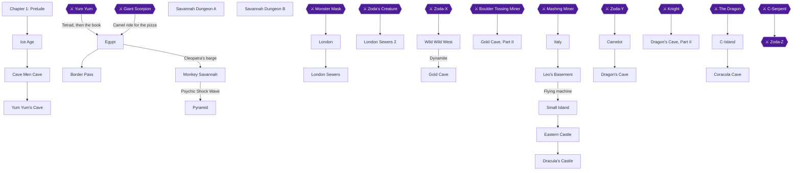

### Achievement Dependencies

```mermaid
flowchart LR
  IceAge["Ice Age"]
  Ach_36882(["🏆 Better Than Nothing"])
  CaveMenCave["Cave Men Cave"]
  Ach_36883(["🏆 A Caveman Weapon"])
  YumYum{{"⚔ Yum Yum"}}
  Ach_36884(["🏆 Your First Tetrad"])
  Egypt["Egypt"]
  Ach_36885(["🏆 Jack of All Trades"])
  Ach_36886(["🏆 Sharp Edge"])
  BorderPass["Border Pass"]
  Ach_36887(["🏆 Thrower"])
  YumYumCave["Yum Yum's Cave"]
  Ach_36888(["🏆 Just Like Link"])
  GiantScorpion{{"⚔ Giant Scorpion"}}
  Ach_36889(["🏆 Slowest Pizza Delivery Ever"])
  SavannahA["Savannah Dungeon A"]
  Ach_36890(["🏆 What Do These Do?"])
  MonkeySavannah["Monkey Savannah"]
  Ach_36891(["🏆 Lost in the Tall Grass"])
  Ach_36892(["🏆 Psychic Power"])
  Pyramid["Pyramid"]
  Ach_36893(["🏆 Snake Charmer"])
  MonsterMask{{"⚔ Monster Mask"}}
  Ach_36894(["🏆 Egyptian Tetris"])
  London["London"]
  Ach_36895(["🏆 Down the Sewers"])
  LondonSewers2["London Sewers 2"]
  Ach_36896(["🏆 That Does NOT Look Like a Ball"])
  ZodaX{{"⚔ Zoda-X"}}
  Ach_36897(["🏆 The Mystery of the Tetrad"])
  WildWest["Wild Wild West"]
  Ach_36898(["🏆 Not Quite a Gold Nugget"])
  Ach_36899(["🏆 Real Gold"])
  Ach_36900(["🏆 Heart of Gold"])
  GoldCave["Gold Cave"]
  Ach_36901(["🏆 Not the Traditional Weapon"])
  GoldCave2["Gold Cave, Part II"]
  Ach_36902(["🏆 Super Psychic Shock Wave"])
  Ach_36903(["🏆 Just Like Mario"])
  MashingMiner{{"⚔ Mashing Miner"}}
  Ach_36904(["🏆 Tetrad in a Western"])
  LeosBasement["Leo's Basement"]
  Ach_36905(["🏆 Now We Got a Sword"])
  SmallIsland["Small Island"]
  Ach_36906(["🏆 Heart on the Lone Island"])
  EasternCastle["Eastern Castle"]
  Ach_36907(["🏆 Watch Out for Pits!"])
  Dracula["Dracula's Castle"]
  Ach_36908(["🏆 Triple the Fun"])
  ZodaY{{"⚔ Zoda-Y"}}
  Ach_36909(["🏆 House of the Undead"])
  DragonsCave["Dragon's Cave"]
  Ach_36910(["🏆 Ultra Psychic Shock Wave"])
  Dragon{{"⚔ The Dragon"}}
  Ach_36911(["🏆 The Middle Ages"])
  ZodaZ{{"⚔ Zoda-Z"}}
  Ach_36912(["🏆 C-Island is Normal Again!"])
  IceAge -->|unlocks| Ach_36882
  CaveMenCave -->|unlocks| Ach_36883
  YumYum -->|unlocks| Ach_36884
  Egypt -->|unlocks| Ach_36885
  Egypt -->|unlocks| Ach_36886
  BorderPass -->|unlocks| Ach_36887
  YumYumCave -->|unlocks| Ach_36888
  GiantScorpion -->|unlocks| Ach_36889
  SavannahA -->|unlocks| Ach_36890
  MonkeySavannah -->|unlocks| Ach_36891
  MonkeySavannah -->|unlocks| Ach_36892
  Pyramid -->|unlocks| Ach_36893
  MonsterMask -->|unlocks| Ach_36894
  London -->|unlocks| Ach_36895
  LondonSewers2 -->|unlocks| Ach_36896
  ZodaX -->|unlocks| Ach_36897
  WildWest -->|unlocks| Ach_36898
  WildWest -->|unlocks| Ach_36899
  WildWest -->|unlocks| Ach_36900
  GoldCave -->|unlocks| Ach_36901
  GoldCave2 -->|unlocks| Ach_36902
  GoldCave2 -->|unlocks| Ach_36903
  MashingMiner -->|unlocks| Ach_36904
  LeosBasement -->|unlocks| Ach_36905
  SmallIsland -->|unlocks| Ach_36906
  EasternCastle -->|unlocks| Ach_36907
  Dracula -->|unlocks| Ach_36908
  ZodaY -->|unlocks| Ach_36909
  DragonsCave -->|unlocks| Ach_36910
  Dragon -->|unlocks| Ach_36911
  ZodaZ -->|unlocks| Ach_36912
```

## Boss Index

Full strategies are in each chapter.

| Boss | Chapter |
|---|---|
| Yum Yum | [Chapter 2: The Ice Age](#chapter-2-the-ice-age) |
| Giant Scorpion | [Chapter 3: Cleopatra's Egypt](#chapter-3-cleopatras-egypt) |
| Monster Mask | [Chapter 3: Cleopatra's Egypt](#chapter-3-cleopatras-egypt) |
| Zoda's Creature | [Chapter 4: Holmes's London](#chapter-4-holmess-london) |
| Zoda-X | [Chapter 4: Holmes's London](#chapter-4-holmess-london) |
| Boulder Tossing Miner | [Chapter 5: The Wild West](#chapter-5-the-wild-west) |
| Mashing Miner | [Chapter 5: The Wild West](#chapter-5-the-wild-west) |
| Zoda-Y | [Chapter 7: Dracula's Transylvania](#chapter-7-draculas-transylvania) |
| Knight | [Chapter 8: King Arthur's Camelot](#chapter-8-king-arthurs-camelot) |
| The Dragon | [Chapter 8: King Arthur's Camelot](#chapter-8-king-arthurs-camelot) |
| C-Serpent | [Chapter 9: Return to C-Island](#chapter-9-return-to-c-island) |
| Zoda-Z | [Chapter 9: Return to C-Island](#chapter-9-return-to-c-island) |

## Walkthrough

## Chapter 1: Prelude

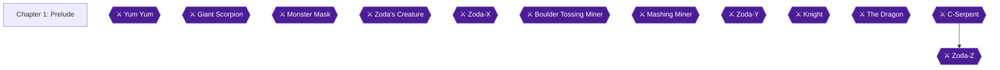

### Area Overview & Preparation

Chapter 1 is a story prologue. Mike Jones is back in Seattle, and the game sets up the quest through a conversation with the player, a telepathic message from Mica, and a visit to Dr. Jones 🟡. This chapter has no achievements, no chests, no items to collect and no combat. The only decisions are two Yes/No prompts 🟡.

> [!TIP]
> **Before you leave:** Nothing in this chapter can be missed. Players can always go back to a previous chapter from the File select screen, so achievements are not missable 🟡. There is nothing to collect here, so simply finish the dialogue and read the magic words.

### Controls Primer (read once)

The game uses two kinds of screen. The travel (overworld) screen has no enemies, and you cannot attack there 🟡.

- **Travel screen:** The D-Pad moves Mike. The A Button starts a conversation or inspects. The B Button cancels a conversation. Select shows what chapter you are in 🟡.
- **Action screen (dungeons):** The action screen starts when you enter a dungeon 🟡. The D-Pad moves Mike, including diagonally. The B Button attacks. The A Button jumps, or uses an item when the game is paused. Select picks the next item in your inventory. Start pauses 🟡.
- Use magic items by pausing, pushing down, and using left and right 🟡.
- It takes Mike about half a second to turn when you push the button 🟡.
- Mike can only jump one space at a time, unless you have the special item that allows two-tile jumps 🟡.
- Save weapons and special items for when you need them, because you do not get unlimited amounts 🟡.

### Prelude

#### Mike's Greeting (Yes/No prompt)

1. The game opens with Mike greeting you and asking how you have been. He then asks whether you remember his uncle, Dr. Jones ("Dr. J"), and gives you a Yes/No choice 🟡.
2. Choose **Yes**. If you choose No, Mike only suggests that you read the manual and explains that his uncle is Dr. Jones 🟡. The guides describe no other effect of this answer, so either choice is fine.
3. Mike explains that Dr. J is now in Seattle, busy decoding the rest of the cipher from the tropics 🟡.

#### Mica's Telepathic Message

1. Mica contacts Mike by telepathy. She tells him that her father Hirocon, leader of the lost planet Argonia, spoke to her in a dream and said: "Was it a cat I saw? Was it a rat I saw?" 🟡
2. She cannot talk any longer that day, and the connection drops 🟡. Mica randomly telepaths with Mike and gives clues throughout the journey 🟡.
3. Unsure what to do next, Mike goes to visit his uncle 🟡.

#### Dr. Jones's Study (the decoding)

1. Dr. J is buried in books and does not notice Mike until Mike shouts to his Uncle Steve. Mike then explains the story so far 🟡.
2. Dr. Jones reverses the wording and works out "?was I tac a ti saw" and "?was I tar a ti saw" 🟡.
3. You are asked whether you understand. Answer **YES**. If you answer NO, Dr. J simply states the obvious, that you reverse the wording 🟡. The game repeats the reversal step by step, and the point is the same either way 🟡.
4. After you say yes, Dr. Jones says Hirocon is telling them to reverse the cipher, and tells Mike to get the Oxford Wonder World book 🟡.

#### Reading the Magic Words

1. Mike fetches the Oxford Wonder World book, and they look at it to read the strange words of the cipher 🟡.
2. Mike reads "Paapaapaaoompapamowmow" aloud before his uncle can tell him to stop. In the dialogue he shouts "Paa Paa Paa Oom Papa Mow Mow" 🟡.
3. The book opens and its pages flip rapidly. A dimensional gate opens and Mike is sucked into it 🟡.
4. The screen shows an open book with the text "You slip to another time and space..." and "Chapter 2". This takes Mike to the Ice Age 🟡.

> [!TIP]
> **Before you leave:** Chapter 2 starts with Mike in the middle of a snowy field. You can only head north at first, and a caveman tells you the ground ahead has holes 🟡.

### Cumulative Items Reference (nothing to collect yet)

These items appear later in the game, listed here only so you recognize them. No item can be collected in this chapter.

- **Big Heart:** increases Mike's number of hearts by one permanently.
- **Tetrad:** found at the end of each chapter, so collect them all 🟡. Tetrad Y is used at the end of the game 🟡.
- **Medicine:** restores five health and can be stored.

> [!IMPORTANT]
> ### Chapter 1 Cumulative 100% Checkpoint
> - **Big Hearts:** 0 / 4
> - **Tetrads:** 0 / 7
> - **RetroAchievements Unlocked:** 0 / 31 (0 / 285 points)

### Chapter Checklist

- [ ] Answered YES to Mike's question about remembering Dr. J
- [ ] Heard Mica's message about the cat and the rat
- [ ] Answered YES when Dr. J asked if you understand
- [ ] Read the magic words from the Oxford Wonder World
- [ ] Arrived in the Ice Age (Chapter 2)

---

## Chapter 2: The Ice Age

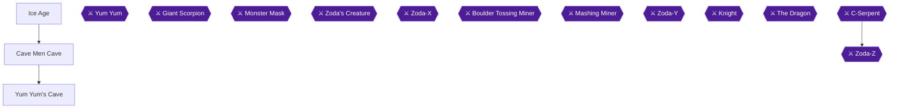

This chapter takes you from the snowfield where Mike lands, through the Cave Men Cave, and into Yum Yum's Cave, the first dungeon. You pick up Rocks, receive the Axe from Tink, grab the Medicine behind a secret passage, defeat Yum Yum, and take the Tetrad block 🟡.

> [!TIP]
> **Achievement route:** Rocks come first (Better Than Nothing), then the Axe from Tink (A Caveman Weapon). The Medicine in Yum Yum's Cave is the "Potion" for Just Like Link. The Tetrad block after Yum Yum completes Your First Tetrad 🟡.

### Ice Age

🗺️ **Map:** [View Chapter 2: Overworld Map by StarFighters76](https://gamefaqs.gamespot.com/nes/587654-zodas-revenge-star-tropics-ii/map/15885-chapter-2-overworld-map)

You can only head North at the start. A cave man warns that the ground ahead has holes you can fall into 🟡. As far as this guide can tell, the holes are random 🟡. Falling into a hole drops you into a mini-dungeon 🟡.

Another guide gives a path across the field that avoids the holes. Stand so the layer of snow is one square in front of you, then walk: 1 square up, 1 right, 1 up, 1 right, 2 up, 1 left, 1 up, 3 left, 1 up, 2 left, 1 down, 3 left, 1 down, 1 left, 1 down, 1 left 🟡.

You need the Rocks for Better Than Nothing. The sources place them in the caves below the holes 🟡. Rocks are weak, have a very limited throwing range, and come in packs of 30 🟡.

> [!WARNING]
> **Achievement Trigger Warning:** Better Than Nothing needs Rocks picked up in Chapter 2 🟡. The Rocks are found only in the caves you fall into from the holes, so the hole-free path skips them 🟡. If you have not picked up Rocks yet, fall into a hole on purpose.

#### Random Dungeon A

1. Room 3: five boars and a salamander. Grab the Rocks and kill what you must 🟡.
 
> [!ACHIEVEMENT]
> **Better Than Nothing (5 Points)**
> 
> *Pick up Rocks in Chapter 2.*

2. Room 4: exit back to the overworld 🟡.

#### Random Dungeon B

1. Room 2: four boars and some Rocks. Grab the Rocks and fight your way to Room 3 🟡.
2. Room 3: exit back to the overworld 🟡.

#### Random Dungeon C

1. Room 2: two boars and some Rocks. Grab the Rocks 🟡.
2. Room 3: no enemies, only hearts to collect. Be careful not to fall in the water 🟡.
3. Room 4: kill the blue bear with your stones and the path to Room 5 opens 🟡.
4. Room 5: exit back to the overworld 🟡.

Another guide describes the first cave type like this: go north from the landing room, grab the Rocks in the top-right corner, and kill the two creatures to open a secret door to the west. Kill the polar bear there to open the secret door to the north, which leads to a staircase back to the surface. If you need hearts, use the room north of the Rocks 🟡.

Once you are across the snow, go up and into the cave 🟡.

> [!TIP]
> Before you leave the snowfield, make sure Better Than Nothing has unlocked, since the Rocks are found in these dungeons 🟡.

### Cave Men Cave

🗺️ **Map:** [View Chapter 2: Level 1 Map by StarFighters76](https://gamefaqs.gamespot.com/nes/587654-zodas-revenge-star-tropics-ii/map/15886-chapter-2-level-1-map)

1. **Tink and the Axe.** When you enter the cave, head left to the big pile of bones where Tink is hacking away, and talk to him. He gives you an Axe 🟡. Another guide places him in the lower left-hand corner 🟡.
 
> [!ACHIEVEMENT]
> **A Caveman Weapon (10 Points)**
> 
> *Obtain the Axe.*

   Tink's Axe moves slower than the Yo-yo of the first game and doesn't grab items 🟡.
2. **Pikazo's drawings.** Head to the most northern part of the cave, where a man has drawn on the wall 🟡. Visit Pikazo and write down the drawings 🟡. The symbols are Circle, Circle, Triangle, Square, Circle, Square, Triangle 🟡. You need them for the maze in Yum Yum's Cave 🟡.
3. **The prophet.** He asks if you are the one. Whatever you answer, he tells you to head to the cave and defeat Yum Yum 🟡. Another guide says the chief is in the northern area and begs you to defeat Yum Yum 🟡.
4. **Exit.** Take the western exit 🟡, then continue North on the overworld until you find another cave entrance 🟡.

> [!TIP]
> Before you leave the cave, confirm you have the Axe and have written down the drawings 🟡.

### Yum Yum's Cave

🗺️ **Map:** [View Chapter 2: Dungeon Map by KirbyPufocia](https://gamefaqs.gamespot.com/nes/587654-zodas-revenge-star-tropics-ii/map/1336-chapter-2-dungeon-map)

Yum Yum's Cave is the first dungeon of the game 🟡. The room numbers below follow one guide's layout.

1. **Room 2.** Defeat the 4 boars. A wall opens to the North, allowing you to reach Room 3.
2. **Room 3.** Go right and kill the salamanders. You will hear a wall open. Walk back left and take the opening to the North to Room 4.
3. **Room 4.** Take the Medicine and go back to Room 3 🟡.
 
> [!ACHIEVEMENT]
> **Just Like Link (5 Points)**
> 
> *Pick up a Potion.*

   This is the secret passage that opens after the second room is cleared 🟡. Another guide calls this same secret-passage item a potion 🟡, so this Medicine is the Potion for Just Like Link.
4. **Room 3 again.** Go back to Room 3 after taking the Medicine 🟡. Another guide adds: go by the salamanders and to the right.
5. **Room 5.** Ignore the two salamanders and continue right to Room 6.
6. **Room 6.** Four boars; ignore them and go north to Room 7.
7. **Room 7.** A blue bear; kill it quickly or ignore it. Jump to the little island, then jump south until you are back in Room 6.
8. **Rooms 6 and 5 (from Room 7).** Move around the corners of these rooms until you reach Room 8.
9. **Room 8.** Four boars; ignore the two on the bottom. Jump across the ledges to the far left, killing two boars on the way. Go left, then north to Room 9.
10. **Room 9.** Defeat the three blue bears to open the door to the North, then go North to Room 11. Another guide says that after the three Grizzly Bears, the next room is the half-way point where you respawn when you die 🟡.
11. **Room 10.** The guide also lists this room: three boars. Kill them if you wish, and in either case proceed North to Room 11.
12. **Room 11.** Walking snow men. Head right; you do not have to defeat them, but it is easier if you do. Eventually you see a way North to Room 12.
13. **Room 12.** A yellow bear; defeat it if you must, then continue North to Room 13.
14. **Room 13.** Defeat the three yellow bears to open the door North to Room 14.
15. **Room 14: the maze.** Follow the exit closest to each symbol in this order: circle, circle, triangle, square, circle, square, triangle 🟡. A wrong choice takes you out of the dungeon 🟡.
16. **Room 15.** Four snow men; skip them if you like and go East to Room 16.
17. **Room 16.** Six boars; kill them or not, then go North to Room 17.
18. **Room 17: Yum Yum.** See the boss section below.
19. **Room 18.** Exit to the North.

#### Boss: Yum Yum

Yum Yum starts out eating a boar. Run up as close as you can to his right side and fire axes immediately; you can beat him before he attacks. Do not attack the boar next to him: he eats it and keeps ignoring you, but killing it makes him engage immediately. Another guide agrees that killing the hog makes him attack faster and harder.

If you do have to battle him, avoid the bubbles he burps and keep throwing axes. He goes down after about 30 axes, and the door East to Room 18 opens. If he is not killed in time, he runs back and forth shooting fire bubbles that spread across the screen, and he moves faster and stronger when about to die 🟡.

Another guide's pattern: he moves along the skull wall right to left, then to the back row and back to the right, firing a tri-spread of bubbles. You cannot hit him in the back row, so stay back and dodge. When he moves to the front, charge forward, jump his bubbles and fire axes at him.

#### After Yum Yum

Head North and then East until you find the Block, passing the missing children, Shorty among them 🟡. Pick up the Block.

> [!ACHIEVEMENT]
> **Your First Tetrad (10 Points)**
> 
> *Complete the first dungeon, and learn about the Tetrads.*

Outside, Mica explains that Hirocon wanted Mike to find the mystic tetrads hidden through time 🟡. Mike realizes the Block is a Tetrad, and your life total rises to seven hearts 🟡.

Mike then uses the Oxford World Wonder and recites PAA PAA PAA OOM PAPA MOW MOW to travel to the next time period 🟡.

> [!TIP]
> Before you leave, confirm that Better Than Nothing, A Caveman Weapon, Just Like Link and Your First Tetrad have all unlocked 🟡.

> [!IMPORTANT]
> ### Chapter 2 Cumulative 100% Checkpoint
> - **Big Hearts:** 0 / 4
> - **Tetrads:** 1 / 7 (the Block after Yum Yum) 🟡
> - **RetroAchievements Unlocked:** 4 / 31 (30 / 285 points)

### Chapter Checklist

- [ ] Rocks picked up (Better Than Nothing)
- [ ] Axe received from Tink (A Caveman Weapon)
- [ ] Pikazo's symbols written down
- [ ] Medicine taken in Room 4 (Just Like Link)
- [ ] Yum Yum defeated
- [ ] Tetrad block taken (Your First Tetrad)

---

## Chapter 3: Cleopatra's Egypt

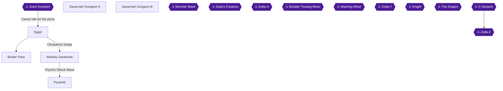

Reciting the magic words in the Oxford World Wonders carries Mike to Chapter 3 🟡. The chapter has nine achievements:

- **Dagger pair:** Jack of All Trades and Sharp Edge 🟡.
- **Slingshot:** Thrower 🟡.
- **Pizza delivery:** Slowest Pizza Delivery Ever.
- **Four stars at once:** What Do These Do? 🟡.
- **Monkey maze Big Heart:** Lost in the Tall Grass.
- **Psychic Shock Wave:** Psychic Power 🟡.
- **Flute:** Snake Charmer 🟡.
- **Pyramid Tetrad:** Egyptian Tetris 🟡.

Your route is Jack of All Trades, the barge, Border Pass, the camel ride, the pizza, the Monkey Savannah, and finally the Pyramid.

> [!WARNING]
> **Missable Achievement Warning:** Jack of All Trades (the dagger from Jack) can be missed. Once you hold a dagger, Jack only offers to trade back for an axe, and Cleopatra only hands over her dagger when you arrive without one 🟡. Answer **Yes** to Jack's trade BEFORE you give Cleopatra her pizza, and never decline it. Two commenters say the achievement unlocked for them even though the dagger came from Cleopatra, but the achievement names Jack as the source, so this is unconfirmed 🟡.

> [!TIP]
> **Open question, What Do These Do?:** No source settles which "stars" the achievement counts. The small stars that enemies drop refill a heart when you collect five 🟡. Another guide says the monkeys in the savannah mini-dungeons give hearts and stars 🟡. Collect small stars there until you hold four, without picking up a fifth. If it has not unlocked by Chapter 5, keep both Invincibility Stars from the second Gold Cave unused in your Magic Items rather than spending them on the boss.

### Egypt

🗺️ **Map:** [View Chapter 3: Overworld Map by StarFighters76](https://gamefaqs.gamespot.com/nes/587654-zodas-revenge-star-tropics-ii/map/15887-chapter-3-overworld-map)

#### Arrival and Jack of All Trades

1. Go north from where you appear. Watch the right side of the screen for two palm trees and walk in between them to find a path 🟡.
2. Talk to Jack of All Trades. He offers a trade: his bronze dagger for the axe you are carrying, the same axe-for-dagger swap Cleopatra makes later. Answer **Yes** and you get a dagger 🟡.


> [!ACHIEVEMENT]
> **Jack of All Trades (10 Points)**
> 
> *Obtain the Dagger from the Jack of All Trades.*


> [!ACHIEVEMENT]
> **Sharp Edge (10 Points)**
> 
> *Obtain the Dagger.*


3. If you talk to him again, he says "Sorry, we're closed" 🟡. If you talk to him while holding the dagger, he only offers to trade for his axe, so do not accept that 🟡.
4. One commenter reports Sharp Edge not unlocking on RANes or RetroArch. This is unconfirmed. If it does not unlock, replay Chapter 3 from the File Select screen 🟡.

#### The barge and Cleopatra

1. Travelling south along the Nile goes on endlessly, so head north 🟡. You reach a small oasis with people and a docked boat. A guard blocks the path further north, so go to the boat.
2. Go north and board the ship, then talk to everyone 🟡. If you try the cabin before talking to everyone outside, the guard will not let you pass. Once you have talked with everyone, he lets you enter.
3. Inside, tell Cleopatra you are searching for the tetrads. She says she can help, but you must first get a pizza for her 🟡.
4. Leave the ship and head north. The person blocking the path now lets you through, saying this is the way to get pizza 🟡.

### Border Pass

🗺️ **Map:** [View Chapter 3: Level 1 Map by StarFighters76](https://gamefaqs.gamespot.com/nes/587654-zodas-revenge-star-tropics-ii/map/2179-chapter-3-level-1-map)

Proceed a little south and you will find the cave 🟡. The main guide numbers this cave's rooms 1 through 13 and calls it Ridge Cave 🟡. The route below follows that numbering, with notes from the other guides.

1. **Room 1:** a usual entrance. Head north to Room 2 🟡.
2. **Room 2:** defeat the three spiders and the east wall opens to Room 3 🟡.
3. **Room 3:** defeat the one cyclops and the east wall opens to Room 4 🟡.
4. **Room 4:** jump on the tile (jump, do not step on it) and a question mark appears. Take it and the chest opens, revealing a slingshot. Another guide says to walk through the question mark orb 🟡. Then jump carefully around the spiders and take the path north 🟡.


> [!ACHIEVEMENT]
> **Thrower (5 Points)**
> 
> *Pick up the Thrower Item in Chapter 3.*


5. **Room 5:** defeat the two porcupines to open the door north to Room 6 🟡. Porcupines turn into a ball and charge. Stand left or right of where they stop at a wall and hit them before they change again 🟡.
6. **Room 6:** defeat the three cyclops to open the door east to Room 7 🟡.
7. **Room 7:** defeat the four scorpions to reveal a door east to Room 8 🟡.
8. **Room 8:** defeat or avoid the four underground enemies and head east to Room 9 🟡.
9. **Room 9:** defeat the four underground enemies and two porcupines to open a door north to Room 10 🟡.
10. **Room 10:** three spiders and two scorpions. You do not have to defeat them, but it is easier if you do. Hop up and around to go north to Room 11 🟡.
11. **Room 11:** two porcupines plus a couple of spiders. Make a couple of jumps to reach the path north to Room 12 🟡.
12. **Room 12 (Giant Scorpion):** see the next section for the fight. Afterwards the door opens west to Room 13 🟡.
13. **Room 13:** an exit. Head north to the overworld 🟡.

Another guide adds that clearing every enemy in each room the first time opens secret rooms, one of which holds medicine that can be collected again if you die. It also mentions almost invisible foes in one room and a tricky diagonal jump. Moving floor tiles must all be killed to unveil the path to the medicine 🟡.

After the cave the game saves your progress 🟡.

### Giant Scorpion

This is the boss of Border Pass Room 12.

- Two holes in the top wall release small scorpions during the fight. Kill them if they get close, but focus on the big scorpion.
- Use the slingshot, which has the longer range. It took about 40 slingshot shots.
- He flashes red and makes noise before firing a spray of shots from his tail. Jump over them or move out of the way.
- Once he is defeated, the door opens west to Room 13 🟡.

### Egypt: camel ride and pizza

1. Outside the cave you are in a large desert. East of the exit is a man with a camel 🟡.
2. Talk to him and answer **Yes** to renting the camel. Saying no is pointless, since walking in any direction fails 🟡.
3. Ride for a very long time until you meet the pizza delivery guy, who gives you the pizza. Agree to give the pizza to Cleopatra directly, and you return to the boat automatically 🟡.
4. Give Cleopatra the pizza. She takes you across the Nile in her boat and tells you to head to the Pyramids to the south.


> [!ACHIEVEMENT]
> **Slowest Pizza Delivery Ever (10 Points)**
> 
> *Clear the first dungeon in Chapter 3 and get the pizza for the Queen.*


5. Cleopatra also trades your axe for a dagger 🟡. She hands over her bronze dagger only if you do not already have one.

### Monkey Savannah

🗺️ **Map:** [View Chapter 3: Monkey Island Maze Map by StarFighters76](https://gamefaqs.gamespot.com/nes/587654-zodas-revenge-star-tropics-ii/map/2178-chapter-3-monkey-island-maze-map)

You are dropped off on the western side of the Nile. Head north until you find a small peninsula with green patches, and do not head west 🟡. The Pyramid cannot be crossed yet, because a man says you need something special to cross its magic field 🟡.

#### Monkey Maze Part 1

You see a small deck. Climb on top of it to see how the tall and low grass forms a natural maze. Circle clockwise in the grass around the deck, starting from the grass below and to the left of the deck and ending on the lower right side. Then move up and down to the right and up the right side 🟡. After just a few steps you fall into a mini-dungeon (Savannah Dungeon A) 🟡.

```
- - - M O N K E Y  M A Z E  P A R T # 1 - - -

         LEGEND FOR MONKEY MAZE PART #1
                   O = Starting Point
                   X = Exit
____________________________________   ______    ____
|                                   | |       X      | |
|                          __       | |              | |
|                    _____|  |__    | |              | |
|                   |           |   | |              | |
|       ________    |_____    __|   | |              | |
|      |        |         |__|      | |              | |
|      |______  |                   | |_______       | |
|             | |                   |  _____  |      | |
|_____        | |_____________      | |     | |      | |
      |       |               |     | |     | |      | |
 __   |       |  ___________  |     |_|     |_|      | |
|  |__|     __| |   _____   | |          _           | |
|          |    |  |__H__|  | |         | |          | |
|          |____|           | |         | |          | |
|                           | |_________| |__________| |
|________________     O     |__________________________|
```

 🟡

Two other guides give a square-by-square route for this stretch. Take the left opening and go 3 left, 7 up, 2 left, 3 up, 6 right, 3 down, 6 right, 5 down, 2 right, 4 up, 2 right, 4 down, 2 right, 11 up, 2 left, and 2 up. You then fall into a mini-dungeon 🟡.

### Savannah Dungeon A

Another guide says the monkeys here give hearts and stars if they drop any. Kill the croc in the next room to open the door, and kill the jellyfish in the third room to leave 🟡. Hold exactly four small stars at once for the achievement below 🟡.

1. **Room 1:** nothing here. Go to Room 2 🟡.
2. **Room 2:** three little frogs. Kill or ignore them and head north to Room 3 🟡.
3. **Room 3:** three swans, a frog and a crocodile. Defeating the crocodile opens the north door to Room 4 🟡.
4. **Room 4:** a swan and two frogs. Two hearts are on the island to your right. Then head west to Room 5 🟡.
5. **Room 5:** defeat the three floating jellyfish to open the north wall to Room 6. The hippopotamus need not be killed 🟡.
6. **Room 6:** exit back to the overworld 🟡.


> [!ACHIEVEMENT]
> **What Do These Do? (10 Points)**
> 
> *Have 4 stars at once.*


If the achievement does not pop once you hold four stars, it is unconfirmed which stars it counts. See the tip above.

#### Monkey Maze Part 2

Back above ground, walk forward until the monkey pokes his head out and disappears. Go to the deck in front of you to see the new view 🟡. Go around and pick up the BIG HEART on the shore to the east.

Square counts for this stretch: through the left opening, go 4 left, 10 up, 7 right, 6 down, 2 right, then down to the Big Heart. One guide says 5 down instead of 6 🟡. Check the screen if the two counts disagree.


> [!ACHIEVEMENT]
> **Lost in the Tall Grass (10 Points)**
> 
> *Find the Heart Container in Chapter 3.*


From the Big Heart, one guide says to go 7 up, 3 left, 6 up, 6 left, 4 up, 1 left, 4 up, 4 left, 4 down, 2 left, 5 up, 5 left, 1 down, and then all the way left into another mini-dungeon 🟡. Another guide ends the same list at "1 down" and says you fall into the battle scene there 🟡.

The main guide's description of the same stretch is to backtrack up to the top east, back down to the left, and then up and around the western part of the map. You come out of the grass clearing and fall into another dungeon 🟡. Its ASCII map:

```
~~~~
          __________________________________          ~    }
         |  _________________  ____________ |~~~     {      }
    _____| |       ________  | |          | |   }~~~{    ____}
    _______|  X   |  ____  | | |          | |          |  _  |
    ______________| |    | | | |          | |_   DE  __| | | |
    ________________|    | | | |_         |_  |__   |   _| | |
               _____     | | |_  |          |____|  |__|   | |
            __|     |    | |   | |                         | |
           |  _____ |____| |   |_ |               ______   | |
           | |     |  _____|    | |              |____  |  | |
           | |     | _|         | |_                  | |  | |
           | |     | |          |_  |   _________     |_|  | |
           | |     | |    ___     | |  |  _____  |         | |
           | |     | |   |_H_|    | |  | | ___ | |         | |
           | |     |_|            | |  | ||_H_|| |         | |
           | |      _            _| |  | |     | |         | |
           | |     | |          |  _|  | |    _| |         | |
          _| |     | |_        _| |    |_|   |_  |         | |
         |  _|     |_  |______|  _|            | |_______  | |
         | |         |__________|              |  _____  | | |
     ____| |                                   | | ___ | | | |
    |  ____|                                   | ||_H_|| | | |
    | |           _________                    |_|     | | | |
    | |          |  _____  |                        _  | | | |
    | |          | | ___ | |                       | | | | | |
    | |          |_||_H_||_|                      _| | |_| |_|
    | |                                          | __|  } { HH}
    | | _____   ____________                     | |     } ~~~
    | ||_   _| |  ________  |       _            | |      }
    | |  | |   | |        | |______| |___________| |__ O __}_
    | |  | |   | |        |_____________________   ___| |___ |
    | |_ |_|  _| |                              | |        | |
    |__ |    | __|
      | |____| |
      |________|
```

 🟡

### Savannah Dungeon B

1. **Room 1:** nothing here. Go to Room 2 🟡.
2. **Room 2:** two crocodiles and two swans. Kill only the crocodiles to open the door north to Room 3 🟡.
3. **Room 3:** a jellyfish, a crocodile and three frogs. Two hearts are on the island to your right. Kill the crocodile to open the door north to Room 4 🟡.
4. **Room 4:** a frog and a jellyfish, and a hippopotamus appears and shoots at you. Kill only the frogs to open the door north to Room 5 🟡.
5. **Room 5:** five floating jellyfish and a lone frog. Kill them or jump around them to reach Room 6 🟡.
6. **Room 6:** two swans, three jellyfish and a hippopotamus. None need to be killed to reach Room 7 to the north 🟡.
7. **Room 7:** exit back to the overworld 🟡.

#### Monkey Maze Part 3 and the Psychic Shock Wave

Back above ground, the monkey pokes his head out again. Use the decks to memorize the paths. Move down and to the left, then up the west side of the map. Then go back east along the northern part to exit on the northern edge 🟡. Its ASCII map:

```
   - - - M O N K E Y  M A Z E  P A R T # 3 - - -


             LEGEND FOR MONKEY MAZE PART #3
                       O = Starting Point
                       X = Exit
                                                         {    }
                                                       ~~      ~
                                                      {         }  
   __________________________________________________{__  X  ___}____ 
  |  ___________                                ____   _|   |______  |
  | |           |  _________________________   |    |_|            | |
  | |           | |                    ___  |  |                   | |
  | |         __| |                   |_H_| |  |     _             | |
  | |        |    |                         |__|    | |            | |
  | |   ___  |____|               _____             | |____________| |
  | |  |   |                     |___  |            |     _____  ____|
  | |  |   |____________________     | |____________|    | ___ | |  _ O
  | |  |_                       |    |  _   ______   ____||_H_||_| | |
  | |    |      ______         _|    |_| | |      | |              | |
  | |    |     | ___  |       |          | |      | |  ___   ___   | |
  | |    |  ___||_H_| |       |__________| |  _   |_| |  _| |_  |  | |
  | |    | |   _______|                    |_| |_     |_|     | |  | |
  | |    |_|  |                           _______|         _  | |  | |
  | |         |                          |         _      |_| | |  | |
  | |         |_______________________   |   _____| |___      | |__| |
  | |                       __________|  |  |    _____  |     |____  |
  | |___________           |__________   |  |   | ___ | |__   ___  | |
  |  ___________|                     |  |  |___||_H_||____| |___| | |
  | |                                 |  |                         | |
  | |         ______________       ___|  |   _     _____         __| |
  | |        |__   _______  |    _|  ____|  | |   |_____|   _   |__  |
  | |           | |   ___ | |___|   |       | |            | |     | |
  | |          _| |_ |_H_||  _____  |       | |            | |     | |
  | |         |_____|     |_|     | |    ___| |____    ____| |__   | |
  | |                             | |   |   _____  |  |         |  | |
  | |_                            |_|   |  | ___ | |  |_________|  | |
  |_  |                                 |__||_H_||_|               | |
    | |                                                            | |
    | |____________________________________________________________| |
    |________________________________________________________________|
```

 🟡

Square counts for this maze from another guide: 2 left (one guide says 4 left), 2 down, left until you hit a wall, 4 down, 3 left, 1 down, 3 left, down until you hit a wall, 1 left, 4 down, 11 left, 3 up, 1 left, 4 up, 5 right, 3 up, 6 left, 8 up, 3 right, 1 down, 5 right, 3 up, right around the bench, 3 right, 3 up, 3 right, then up 🟡.

You reach a small mountain range where the monkey shows you the psychic shock wave, and you are teleported back to the Pyramid and Sphinx 🟡. The monkey says it is the power of the mind and that you can break barriers and strike down enemies 🟡.


> [!ACHIEVEMENT]
> **Psychic Power (10 Points)**
> 
> *Obtain the Psychic Shock Wave.*


### Pyramid

🗺️ **Map:** [View Chapter 3: Level 2 Map by StarFighters76](https://gamefaqs.gamespot.com/nes/587654-zodas-revenge-star-tropics-ii/map/2180-chapter-3-level-2-map)

The route follows the main guide's room numbers, 1 through 26 🟡.

1. **Room 1:** jump on the middle tile in the group of tiles to the left for two hearts if you are low. Head north to Room 2 🟡.
2. **Room 2:** the force field needs the Psychic Shockwave to destroy. Then continue north to Room 3 🟡. Switch to the Psychic weapon to break it 🟡.
3. **Room 3:** three ladybugs. Dispose of them and the door opens west to Room 4 🟡.
4. **Room 4:** two asps. Fight them or take the stairs in the upper left corner to Room 5 🟡.
5. **Room 5:** time the flame plume and walk past it. After the first flame, STOP: going further drops you back to the asps' floor. Jump over that part of the floor instead 🟡. Jump on a tile in the top group to reveal the question mark at the bottom of the room. Grab it to open the east door. Two hearts are on the north side 🟡.
6. **Room 6:** the east door from Room 5 leads here, and Room 6 connects north to Room 7 🟡. The two pyramid guardians are immune to your dagger, so switch to the Psychic Shockwave to dispose of them and open the door north to Room 7 🟡.
7. **Room 7:** defeat the mummy and mini-mummy, then hop on a tile to reveal the question mark. The chest then reveals a medicine container 🟡. Jump to the right side to take the door south to Room 8 🟡.
8. **Room 8:** defeat the one Aman-Ra guardian to open the door east to Room 9 🟡.
9. **Room 9:** fall through the false floors in the middle of the circular tile pattern to reach Room 10 🟡. Hold left or right as you fall 🟡.
10. **Room 10:** press the control pad left as you fall in, otherwise you land on another false floor and plunge to Room 11 🟡. Two hearts are in the bottom left corner 🟡. Head east, avoiding the circling metal ball, to Room 12 🟡.
11. **Room 11:** four skeletons. Stairs in the upper right corner lead back to Room 10 🟡.
12. **Room 12:** defeat the pyramid guardian and the asp on the conveyor to open the east door to Room 13 🟡.
13. **Room 13:** go to the right side, jump up the columns, then jump left to the column with tiles. Hit a tile for the question mark, jump down and grab it to open the east wall to Room 14 🟡.
14. **Room 14:** defeat the nearby mummy, jump the spikes, defeat the ladybugs and the remaining mummy to open the north door to Room 15. A life sign is here if you want to try your luck 🟡.
15. **Room 15:** defeat the two Aman-Ra guardians to open the north door to Room 16 🟡.
16. **Room 16:** ride the middle conveyor around and defeat each spider on the ledges to open the north door to Room 17 🟡.
17. **Room 17:** defeat the three ladybugs to open the door west to Room 18. A middle tile reveals two hearts 🟡.
18. **Room 18:** defeat two mini mummies and two pyramid guardians to open the north door to Room 19 🟡.
19. **Room 19:** jump on the tail tile of the snake-like pattern to reveal the question mark and open the east door to Room 20 🟡.
20. **Room 20:** defeat the two mummies to open the east door to Room 21 🟡.
21. **Room 21:** defeat the Aman-Ra guardian to open the south door to Room 22. Jump on a tile at the top to make a medicine appear 🟡.
22. **Room 22:** activate the tile and grab the question mark to reveal a flute from the chest 🟡. Defeat the four mini mummies to open a west wall back to Room 17 🟡.


> [!ACHIEVEMENT]
> **Snake Charmer (5 Points)**
> 
> *Pick up the flute.*


23. **Room 17, then Room 18:** you have already been to these rooms. From Room 17 go to Room 18 and then Room 19 🟡.
24. **Room 19 (revisited):** use the flute to make three asps appear. Defeat all three and a north wall opens to Room 23 🟡. To use it, pause, press down and select the Flute 🟡.
25. **Room 23:** nothing here. Take the door north to Room 24 🟡.
26. **Room 24:** defeat the mummy and mini mummy, then jump across the tiles to the left. Two hearts and another medicine are in the left corner. Take the path north to Room 25 🟡.
27. **Room 25:** the boss fight, described in the next section. A door opens east to Room 26 🟡.
28. **Room 26:** exit north 🟡.

### Monster Mask

🗺️ **Map:** [View Chapter 3: Level 2 Map by StarFighters76](https://gamefaqs.gamespot.com/nes/587654-zodas-revenge-star-tropics-ii/map/2180-chapter-3-level-2-map)

- The bottom half of the room is covered in conveyors that force you back to the bottom wall. A guard rail divides the room, and the boss floats in the top part 🟡.
- He mostly shoots a spray of 5 bullets. Occasionally he reveals a skeleton face and shoots a more powerful shot, so avoid those. As he is damaged he moves faster and turns red 🟡.
- Use the Shockwave and attack from the edge 🟡. Stay close to the wall, moving against the arrows. Never get in front of his mouth, since the energy blast can kill in one hit.
- Once red, he may launch two spreads at once or open his mouth for a powerful beam, so steer clear 🟡. He may also fire a blue laser beam 🟡.
- Defeating him raises your life meter by 1 🟡.

After the fight, follow the long narrow tunnel north to a room with another Tetrad 🟡.


> [!ACHIEVEMENT]
> **Egyptian Tetris (10 Points)**
> 
> *Complete the second dungeon in Chapter 3 and collect the Tetrad.*


> [!TIP]
> **Before you leave:** Make sure Jack's dagger, the Slingshot, the Big Heart, the Flute and the Shock Wave are all in hand. Going north at the end awards the Tetrad and a life-level increase, and the game saves 🟡. The magic words then take Mike to Chapter 4 🟡.

> [!IMPORTANT]
> ### Chapter 3 Cumulative 100% Checkpoint
> - **Big Hearts:** 1 / 4 (Monkey Maze Part 2)
> - **Tetrads:** 2 / 7 (Pyramid) 🟡
> - **RetroAchievements Unlocked:** 13 / 31 (110 / 285 points)

### Chapter Checklist

- [ ] Dagger obtained from Jack of All Trades (before the pizza)
- [ ] Slingshot from the Border Pass chest
- [ ] Giant Scorpion defeated
- [ ] Pizza delivered to Cleopatra
- [ ] Four stars held at once (unconfirmed which stars count)
- [ ] Big Heart from Monkey Maze Part 2
- [ ] Psychic Shock Wave learned from the monkey
- [ ] Flute from the Pyramid chest
- [ ] Monster Mask defeated and Tetrad collected

---

## Chapter 4: Holmes's London

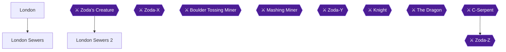

This chapter has three achievements: the Big Heart in the first manhole (Down the Sewers), the Spike Ball from a chest in the second sewer (That Does NOT Look Like a Ball), and the Tetrad at the end of the second dungeon (The Mystery of the Tetrad) 🟡. You meet Sherlock Holmes, get jailed, escape through the east wall, see Zoda-X steal the stone at the museum, then clear two sewer dungeons.

> [!TIP]
> The game saves your progress at the end of each of the two dungeons 🟡.

### Chapter 4 Achievements

- **Down the Sewers:** take the Big Heart from the open manhole to the left 🟡.
- **That Does NOT Look Like a Ball:** open the chest in the room with three Zoda spawns in London Sewers 2 (Room 2) 🟡.
- **The Mystery of the Tetrad:** finish both dungeons and pick up the Tetrad 🟡.

### London

🗺️ **Map:** [View Chapter 4: Overworld Map by StarFighters76](https://gamefaqs.gamespot.com/nes/587654-zodas-revenge-star-tropics-ii/map/15888-chapter-4-overworld-map)

1. You arrive at 221B Baker Street, London 🟡. Walk around and you will eventually bump into Sherlock Holmes. He says Zoda-X will be at the museum tonight and tells you to meet him there at midnight.
2. Continue until you find a police officer and talk to him. He puts you in jail 🟡.
3. In the jail, look along the East wall to find an escape and take it to get back outside 🟡. Another guide says to press against a section of the eastern wall of your cell 🟡. One guide describes this as the right-hand wall 🟡.
4. Outside, head North and then West until you come between two buildings. Pass through, say hello to the sleepwalker, and continue North until you find the museum with Holmes waiting 🟡.
5. At the museum, Holmes shows you the stone. Zoda-X appears, takes the Tetrad and escapes, and Holmes tells you to give chase.

#### The Big Heart manhole


> [!ACHIEVEMENT]
> **Down the Sewers (10 Points)**
> 
> *Obtain the Heart Container in Chapter 4.*


Once you are back on the streets, head left to the open manhole and descend. A Big Heart is below 🟡. Another guide also says to take the manholes to your left first 🟡. Climb back up, then look for the other manhole South of there. Take it down to start the sewer dungeon 🟡.

### London Sewers

🗺️ **Map:** [View Chapter 4: Level 1 Map by StarFighters76](https://gamefaqs.gamespot.com/nes/587654-zodas-revenge-star-tropics-ii/map/2182-chapter-4-level-1-map)

The sewers run Room 1 to Room 13, with the boss in Room 12 and the exit in Room 13 🟡.

1. **Room 1:** a plain entrance. Head North 🟡.
2. **Room 2:** no enemies, only a log raft floating back and forth. Ride it to the tile in the upper right to activate the question mark, grab it, and the door North opens 🟡.
3. **Room 3:** five yellow jellyfish. Hop over the water to the right, then take the North passage to Room 4, or jump back left to take the North passage to Room 5 🟡. You can defeat the jellyfish if you want 🟡.
4. **Room 4:** three rats and three blue blobs. Defeat them all and a room opens West to Room 5 🟡.
5. **Room 5:** four red frogs. You do not have to defeat them, but it helps you reach the tile in the upper left. Activate it, grab the question mark, and the North wall opens to Room 6 🟡.
6. **Room 6:** defeat the two large rats to open the North wall to Room 7 🟡. Giant rats are slow, so hit them a few times, back off, and repeat 🟡.
7. **Room 7:** only a medicine. Grab it, then retrace your steps through Room 6 and Room 5, and go South from Room 5 to Room 3 🟡.
8. **Room 3 (Revisited):** hop on one of the tiles to your right to reveal the question mark. Grab it to open the gate West to Room 8 🟡.
9. **Room 8:** three small rats. You follow a path back and forth between this room and Room 9 until you end up in Room 8 again, at a door going West to Room 10 🟡.
10. **Room 9:** avoid or defeat the rats as you follow that path 🟡.
11. **Room 10:** two jellyfish and two red frogs, plus 4 paths with conveyor tiles that can push you off the path into the water. Defeat all enemies to open the wall North to Room 11 🟡.
12. **Room 11:** three owls. Defeat them and the door North opens 🟡. Owls are hit by jumping or by standing on higher ground 🟡.
13. **Room 12 (Boss: Zoda's Blob, also called Zoda's Creature):** see the next section. Afterwards, jump on one of the tiles it was on to get the question mark that opens the door East 🟡.
14. **Room 13:** exit back to the overworld 🟡.

Another guide notes only one medicine in this first sewer area, which is the Room 7 medicine 🟡.

### Zoda's Creature

- It sits in the middle of the water with four platforms that appear and disappear around it. You do not have to kill it in one go: jump on a platform, hit it a few times, jump to the next platform, and repeat 🟡.
- When you reach the platform below it, jump down to dry ground and repeat 🟡. Dropping to dry land from the bottom platform is the step many players miss 🟡. Do not stay on one platform too long 🟡.
- Another guide's version: go to the top-right platform, jump to the first raft, hop along the rafts that pop up, throw a couple of daggers on each, then return to dry land and the platform and repeat.
- After the fight, you see Zoda slithering away. Follow behind into the next sewer 🟡.

### London Sewers 2

🗺️ **Map:** [View Chapter 4: Level 2 Map by StarFighters76](https://gamefaqs.gamespot.com/nes/587654-zodas-revenge-star-tropics-ii/map/2183-chapter-4-level-2-map)

This dungeon runs Room 1 to Room 22, with Zoda X in Room 21 and the exit in Room 22 🟡. The game saves when you finish the first dungeon 🟡.

1. **Room 1:** two hearts to the left, and two more pairs of two hearts to the right if you jump on the tiles that way. Otherwise head North 🟡.
2. **Room 2:** three Zoda spawns. Defeat them and jump on the tile to open the chest with the spiked frisbees. Then head West to Room 3 🟡.

 
> [!ACHIEVEMENT]
> **That Does NOT Look Like a Ball (5 Points)**
> 
> *Pick up the Spike Ball Item in Chapter 4.*


   One guide calls them spiked frisbees, found in Scotland Yard 🟡. Another guide's name for this item is the Spike Ball, which goes in a straight, short line and damages any enemy in its way 🟡.
3. **Room 3:** two large rats. Defeat them to open the door South 🟡.
4. **Room 4:** two small rats and two owls. Defeating the owls opens the wall South to Room 5, and a tile opens the door West to Room 6 🟡.
5. **Room 5:** jump on the tile on the left side to open the chest with medicine, then head back to Room 4 🟡.
6. **Room 6:** no enemies, but many carefully timed jumps. Keep heading left to the exit South 🟡.
7. **Room 7:** defeat the two caterpillars to open the door South 🟡.
8. **Room 8:** dispose of the four blue blobs and the door East opens 🟡.
9. **Room 9:** three sets of tiles. Activate the mark on the tile in the middle group, grab it, and the wall South opens 🟡.
10. **Room 10:** jump on the left tile to open a chest with medicine, then go back to Room 9 🟡.
11. **Room 9 (Revisited):** fall through the floor in the middle of one of the tiles to drop to Room 11 🟡. Another guide says to fall down the left group first, then the right one, and finally the center 🟡.
12. **Room 11:** three vertical rows, and which row you landed on decides your exits 🟡. To progress, take the middle path South to Room 16 and then East to Room 17 🟡. The right path East to Room 14 and then South to Room 17 also works 🟡. The North exit (Room 12) and the West exit (Room 13) are detours, covered in steps 13 and 14 🟡.
13. **Room 12 (detour):** each path ends in a ladder North that takes you upstairs to Room 15 🟡.
14. **Room 13 (detour):** a dead end whose tile pattern is a skull. Defeat all the Zoda spawns, grab two hearts, and find the mark to open the door East back to Room 11 🟡.
15. **Room 14:** three Zoda spawns and one blue blob on the other side of the water. Defeat the spawns, jump across, defeat the blob, and take the path South to Room 17 🟡.
16. **Room 15 (detour):** four blue blobs. Dispose of them if you wish and look for a tile to open the wall South, which takes you back to Room 9 🟡.
17. **Room 16:** defeat the five small rats to open the wall East to Room 17 🟡.
18. **Room 17:** defeat the two caterpillars to open the door South to Room 18 🟡.
19. **Room 18:** jump from raft to raft. There are two hearts, more spiked frisbees, and a life sign if you feel lucky. The exit is South to Room 19 🟡.
20. **Room 19:** defeat the four Zoda spawns to open the wall East to Room 20. The switch here opens the door West to the boss in Room 21, so do Room 20 first 🟡.
21. **Room 20:** grab the medicine and head back West to Room 19, avoiding or defeating enemies as needed 🟡.
22. **Room 21 (Boss: Zoda X):** see the next section 🟡.
23. **Room 22:** the exit back to the overworld 🟡.

Another guide counts four medicines in this stage, plus throwing stars in two locations 🟡. Another guide says you restart at the halfway point when you die, and that the Try-Your-Luck Sign near it is fairly close to the boss 🟡.

### Zoda-X

- The room is full of conveyor belts in multiple directions, so walking in a straight line is hard 🟡.
- Zoda X appears in random spots and either shoots a spread of shots or makes a ring of fire. Avoid both as best you can and hit him when he becomes visible 🟡.
- Another guide says he fires blue flames from the floor when you are far away, and a short-range spread of five skulls you can jump over. He teleports a few seconds after attacking 🟡.
- Jump constantly, jump near him as soon as he appears, jump over his skeletons, and hit him before he teleports 🟡.

### The Tetrad


> [!ACHIEVEMENT]
> **The Mystery of the Tetrad (10 Points)**
> 
> *Finish both dungeons in Chapter 4 and obtain the Tetrad.*


After Zoda-X falls, take the door North 🟡. Follow the path to pick up the Tetrad, which raises your life level 🟡. Another guide says to head north to exit and then find the dropped Tetrad in the sewers 🟡.

Exit the sewers and go north to talk to Holmes, who deduces there must also be a Zoda-Y and Z 🟡. Then say the magic words into the Oxford World Wonders to travel to the next time period 🟡.

> [!TIP]
> Before you leave, confirm you took the Big Heart from the left manhole and opened the chest in the room with three Zoda spawns in the second sewer 🟡.

> [!IMPORTANT]
> ### Chapter 4 Cumulative 100% Checkpoint
> - **Big Hearts:** 2 / 4 (this chapter's Big Heart is in the left manhole 🟡)
> - **Tetrads:** 3 / 7 (this chapter's Tetrad comes after Zoda-X 🟡)
> - **RetroAchievements Unlocked:** 16 / 31 (135 / 285 points)

### Checklist

- [ ] Escaped the jail through the east wall and reached the museum
- [ ] Big Heart from the left manhole (Down the Sewers)
- [ ] London Sewers cleared; Zoda's Creature defeated
- [ ] Spiked frisbees chest in the room with three Zoda spawns (That Does NOT Look Like a Ball)
- [ ] Zoda-X defeated and Tetrad obtained (The Mystery of the Tetrad)
- [ ] Talked to Holmes before leaving

---

## Chapter 5: The Wild West

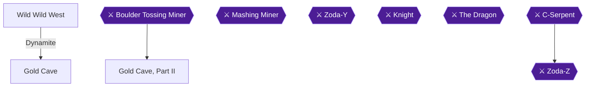

Chapter 5 drops Mike into a rocky desert with a town to the north. You gather dynamite from Bob's store, blast caves on the mountain ridge for nuggets and a Big Heart, then blast open the way into the Gold Cave. Two mining dungeons follow, each with a miner boss. The second ends with a Tetrad.

> [!TIP]
> **Open question (unconfirmed):** No source says which "stars" the *What Do These Do?* achievement (4 stars at once) counts: small stars dropped by enemies, or Invincibility Stars stored as Magic Items. If it has not unlocked by the time you reach this chapter's second Gold Cave, keep both Invincibility Stars unused in your Magic Items instead of spending them on the boss. 🟡

### Chapter Items to Collect (key items)
| Item | Where Found | Action / Requirement | Citation |
|---|---|---|---|
| Dynamite | Bob's store, lower right of town | **TAKE** (free; more on return visits) | |
| Chicken nugget ("gold nugget") | Cave opened along the lighter rock trail | **TAKE** | 🟡 |
| Real gold nugget | Another blasted cave on the ridge | **TAKE** | 🟡 |
| Big Heart | Between the two boulders low on the west wall | **TAKE** | 🟡 |
| Bola | Real chest in the Gold Cave | **TAKE** | 🟡 |
| Super Psychic Shock Wave | Donkey after the Boulder Tossing Miner | **TALK** | 🟡 |
| Invincibility Star | Switch-opened chests in the second cave | **TAKE** | 🟡 |
| Tetrad | North of the Mashing Miner | **TAKE** | 🟡 |

### Wild Wild West

🗺️ **Map:** [View Chapter 5: Overworld Map by StarFighters76](https://gamefaqs.gamespot.com/nes/587654-zodas-revenge-star-tropics-ii/map/15889-chapter-5-overworld-map)

#### The town

1. Go north from where you appear (a desert cliff by two cactuses) until you reach the town. 🟡
2. Talk to everyone outside, then enter the shop in the northern part of town. The shopkeeper gives a clue about where to go next. Leave, go right and around a house, and talk to the hidden man there. 🟡
3. A man in the store house says a Tetrad is in a mine buried by a landslide, and blasting in the right place opens the way. 🟡
4. Enter the saloon and talk to everyone. Talk to the piano player and listen to his tune; it is used later in the chapter. If you answer yes, he describes the "cactus dance". 🟡
5. Go into Bob's store near the entrance for a load of dynamite. 🟡

> [!TIP]
> Going back to Bob's for more dynamite costs nothing, so don't worry about wasting it. Press up against the ridge to set a charge. 🟡

#### The mountain ridge: blast before entering any tunnel

Leave town and head to the mountain ridge. 🟡


> [!ACHIEVEMENT]
> **Not Quite a Gold Nugget (10 Points)**
> 
> *Find the Hidden Nugget in Chapter 5.*

1. Follow the line of lighter-shade rocks to the ridge and lay dynamite where it ends. This opens a cave. One cave holds a "gold nugget" that turns out to be a chicken nugget, which earns this achievement. Other caves also hold only chicken nuggets. 🟡


> [!ACHIEVEMENT]
> **Real Gold (5 Points)**
> 
> *Find the ACTUAL Gold Nugget in Chapter 5.*

2. Find the real gold nugget in another blasted cave: two spaces north of the northern coloured cave, or by bombing the southernmost part of the wall you can. One guide says placing dynamite at the end of the lower light-coloured pathway, before entering any tunnel, gives a gold nugget. A commenter counts four secret passages besides the main entrance. 🟡


> [!ACHIEVEMENT]
> **Heart of Gold (10 Points)**
> 
> *Find the Heart Container in Chapter 5.*

3. Go back to Bob's store for more dynamite. Go all the way west, then down, and place dynamite between the two boulders low on the west wall. Walk in for the Big Heart. 🟡
4. Take any gold nugget back to Bob; he buys it for points. Selling is optional, but unsold gold is lost at the start of the next chapter. 🟡

#### Opening the Gold Cave

1. Go to the west side of the mountain. Place dynamite three spots lower than the southern golden-coloured passageway (one guide: three squares down from the lower lighter pathway). 🟡
2. Walk forward into the Gold Cave. 🟡

### Gold Cave

🗺️ **Map:** [View Chapter 5: Level 1 Map by StarFighters76](https://gamefaqs.gamespot.com/nes/587654-zodas-revenge-star-tropics-ii/map/2184-chapter-5-level-1-map)

The guide's detailed room list below the Mining Cave heading is the route spine. Other guides describe the same cave with different details. 🟡

1. **Room 1:** The entrance. Head North to Room 2. 🟡
2. **Room 2:** Defeat the three blue scorpions, then go North to Room 3 or West to Room 4. 🟡
3. **Room 3:** Defeat two blue asps. The rest of the room is behind a wall you can't reach yet, so go back to Room 2 and then Room 4. 🟡
4. **Room 4:** Defeat the two cactus guys and shoot the crack in the north wall to open Room 5. 🟡
5. **Room 5:** A ladder up to Room 6. 🟡
6. **Room 6:** Three horizontal paths each have a rolling boulder. Jump between paths to avoid them and go East to the door to Room 7. 🟡
7. **Room 7:** Jump to the floating tile among the tiles to fall through the false floor to the other side of Room 3. 🟡
8. **Room 3 (revisited):** Defeat the two cactus guys to open the door South to Room 8. 🟡
9. **Room 8:** Defeat the enemies if you like, then activate the tile at the south end to reveal a question mark. Taking it opens the door South to Room 9. 🟡
10. **Room 9:** Defeat the treasure-chest enemies, which turn into fast coins when hurt, so attack quickly. This opens the wall South to Room 10. 🟡


> [!ACHIEVEMENT]
> **Not the Traditional Weapon (5 Points)**
> 
> *Pick up the Bola Weapon in Chapter 5.*

The real chest holds the Bola. Use the shockwave on the chest monsters. One guide also lists a slingshot in a normal chest here; the guides differ on this chest's contents. 🟡

11. **Room 10:** Defeat three cactus guys to open the wall South to Room 11. There is also a passage West to Room 12, but visit Room 11 first. 🟡
12. **Room 11:** Open the chest for medicine, then go North to Room 10 and West to Room 12. 🟡
13. **Room 12:** Boss, below. Afterwards Room 13 is the exit to the overworld. 🟡

#### Boss: Boulder Tossing Miner

Easy. He takes a boulder from the wall, holds it as a shield, then rolls it at you and inches closer. Touching him is instant death. Throw Bolas fast, jump for half your attacks so you hit him rather than his rock, and jump the rolling boulders. Another guide says to hit normally when he holds the rock up and jump and shoot when it is down.

Afterwards, hop on the platforms and head out. In the cave tunnel, head North to find the donkey.

### Talking Donkey (Super Psychic Shock Wave)

After the fight, walk north: a talking donkey (a wizard in disguise) upgrades your psychic wave. 🟡


> [!ACHIEVEMENT]
> **Super Psychic Shock Wave (10 Points)**
> 
> *Obtain the Super Psychic Shock Wave.*

Talk to the donkey to receive the Super Psychic Shock Wave. It needs 5 hearts to use. 🟡

Head north into the new cave. 🟡

### Gold Cave, Part II

🗺️ **Map:** [View Chapter 5: Level 2 Map by StarFighters76](https://gamefaqs.gamespot.com/nes/587654-zodas-revenge-star-tropics-ii/map/2185-chapter-5-level-2-map)

Route spine: the guide's Mining Cave 2 numbering. 🟡

1. **Room 1:** Step on the tile at the start to reveal two hearts (another guide puts it in the south east or bottom right corner), then go North. 🟡
2. **Room 2:** Jump carefully to the ledge on the north wall and defeat three blue scorpions to open the door North. Keep your distance and use the shockwave while jumping. 🟡
3. **Room 3:** Jump right immediately, defeat one blue scorpion, grab the medicine, go North. 🟡
4. **Room 4:** The conveyor carries you North to Room 5. 🟡
5. **Room 5:** Jump left immediately. Defeat the three blue scorpions and take the left path North to Room 6. 🟡
6. **Room 6:** If you arrived in the middle, walk forward through the false floor to Room 7. Otherwise defeat the cactus guys and take the lower right path South. 🟡
7. **Room 7:** If you fell in, defeat the three asps so floating blocks appear, then hop on them to the ladder back up to Room 6. 🟡
8. **Room 6 (revisited):** Take the lower right path South back to Room 5. 🟡
9. **Room 5 (revisited):** If you killed all the scorpions earlier, a wall opens East to Room 8. Otherwise go South to Room 4. 🟡
10. **Room 8:** Two hearts and a medicine in the chest. Return to Room 5, then South to Room 4. 🟡
11. **Room 4 (revisited):** A short corner East leads to Room 9. Another guide says a narrow path of north-pointing arrows carries you to a sealed room where you walk around and fall to the level below. 🟡
12. **Room 9:** Defeat the four treasure-chest enemies to open the East wall to Room 10. Another guide notes two medicines here. 🟡
13. **Room 10:** Shoot the crack in the north wall for a path to Room 11. 🟡
14. **Room 11:** Take the medicine, then go back South to Room 10. 🟡


> [!ACHIEVEMENT]
> **Just Like Mario (5 Points)**
> 
> *Pick up a Star Magic Item in Chapter 5*

15. **Room 10 (revisited):** Three paths with rolling boulders lead right. Avoid them, step on the tile near the bottom to open the chest for the Star (the Invincibility Star), then head East to Room 12. 🟡
16. **Room 12:** Defeat four cactus guys and go North to Room 13. 🟡
17. **Room 13:** A skeleton in a mining cart shoots and drops small glowing guys. Avoid them to open the North door. A guide suggests saving your star for the boss. 🟡
18. **Room 14:** Defeat three blue scorpions to open the West door. 🟡
19. **Room 15:** Head West until you find a tile that opens the door North. 🟡
20. **Room 16:** Defeat three blue asps to open the East wall. 🟡
21. **Room 17:** Use the tiles to open the chest with a Star, then shoot the crack in the north wall. Another guide says a second star comes from a switch in the bottom right corner of a secret area, reached by killing the cobras and cracking a wall for medicine. 🟡
22. **Room 18:** Take the medicine, then go South to Room 17, West to Room 16, North to Room 19. 🟡
23. **Rooms 19, 20, 21:** Slender rooms heading North. Avoid wall spikes and take the two hearts in each if needed. 🟡
24. **Room 22:** Boss, below. 🟡

### Mashing Miner

When the fight starts he slams his hammer, which freezes Mike, drops boulders from above, and sends boulders from the hammer. Jump the moment it begins, and jump again when he slams. He also jumps around the room. Use both stars (the one you saved and the second), stay a fair distance away and hit him with the shockwave or dagger. Without stars, watch his jumps. The open question above asks you to keep the stars if the four-star achievement hasn't unlocked; that is unconfirmed, so decide before using them.


> [!ACHIEVEMENT]
> **Tetrad in a Western (10 Points)**
> 
> *Finish the second dungeon in Chapter 5 and obtain a Tetrad.*

Defeat him; a door then opens North to Room 23, which is the exit to the overworld. Head North in the cave tunnel to a small circular room where the Tetrad rests in a circle of rocks. Taking it raises your life level. 🟡

Then say "PAA PAA PAA OOM PAPA MOW MOW" to flip the pages and travel to Chapter 6. 🟡

> [!TIP]
> **Before you leave** this chapter, confirm you have the chicken nugget, the real gold nugget, the Big Heart and the Bola, and have spent or kept your stars deliberately. 🟡

> [!IMPORTANT]
> ### Chapter 5 Cumulative 100% Checkpoint
> - **Big Hearts:** 3 / 4 (Heart of Gold, west wall) 🟡
> - **Tetrads:** 4 / 7 (Tetrad in a Western) 🟡
> - **RetroAchievements Unlocked:** 23 / 31 (190 / 285 points)

### Checklist
- [ ] Dynamite from Bob's store; piano tune heard
- [ ] Chicken nugget cave (Not Quite a Gold Nugget)
- [ ] Real gold nugget (Real Gold)
- [ ] Big Heart (Heart of Gold)
- [ ] Bola (Not the Traditional Weapon)
- [ ] Super Psychic Shock Wave
- [ ] Star from a chest (Just Like Mario)
- [ ] Tetrad (Tetrad in a Western)

---

## Chapter 6: Leonardo's Italy

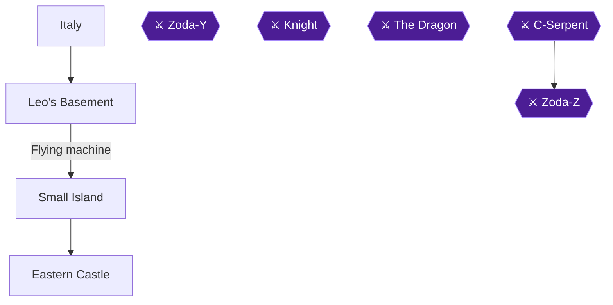

Chapter 6 sends Mike back in time to 15th century Italy. There is no major dungeon or boss here, only a trap-filled basement and a maze-like castle 🟡. The chapter has three achievements: the Katana from Leonardo, the Big Heart on the way to the castle, and the Tetrad at the end of the castle maze 🟡.

> [!TIP]
> **Preparation:** The mini-dungeons you fall into in the castle can hold medicines, and they cannot be saved from place to place, so use them just before you exit each one 🟡. Zoda's tracks at the start show he has been here 🟡.

### Chapter Items to Collect (3 Items Total)
| Item | Where Found | Action / Requirement | Citation |
|---|---|---|---|
| Katana | Leo's Basement, from Leonardo after he is freed | **TAKE** (free him with the hammer and chisel) | 🟡 |
| Big Heart | Small Island, by the mountain wall on the west side | **TAKE** before entering the castle | 🟡 |
| Tetrad | End of the Eastern Castle (Museum) maze | **TAKE** | 🟡 |

### Italy

🗺️ **Map:** [View Chapter 6: Overworld Map by StarFighters76](https://gamefaqs.gamespot.com/nes/587654-zodas-revenge-star-tropics-ii/map/15890-chapter-6-overworld-map)

Walk around the town until you reach a big house 🟡. Locals tell you about an old scientist who may help you. A man selling maps to the artists' homes says he sold his last Leonardo map to a big weird guy, who is probably Zoda 🟡. Another woman will feed you a big plate of pasta 🟡.

Enter the only building you can. Inside you find a man trapped in plaster with Zoda's tracks nearby, and the statue seems to have something moving inside it 🟡. Go down the stairs to Leo's Basement 🟡.

### Leo's Basement

🗺️ **Map:** [View Chapter 6: Level 1 Map by StarFighters76](https://gamefaqs.gamespot.com/nes/587654-zodas-revenge-star-tropics-ii/map/2186-chapter-6-level-1-map)

There are no enemies here, only traps 🟡.

1. Avoid the flying balls that move in circles. Then watch the pattern of the machines that drop balls and wait for the balls to go up before you run underneath 🟡.
2. Cross the section with mid-air spikes by jumping from moving platform to moving platform. Jump straight forward; if you move in mid-air you will hit the spikes and die 🟡. Another guide adds that you should jump forward, not straight up and not to the side 🟡.
3. The next room has more platforms and spikes, plus a medicine you may want to grab 🟡.
4. The last two rooms have balls and holes. A ball travels in the direction you hit it, and you must get all the balls into the holes to finish 🟡. One guide says the first room has three balls and the second has five, and each room has a manhole to knock them into 🟡.

#### Art Studio

When the balls are done, you arrive in an art studio. Take the hammer and chisel lying on the ground in the western part of the room 🟡. You are warped back to the trapped man 🟡. Chipping away at the statue frees Leonardo da Vinci 🟡.

Leonardo thanks you and gives you the Katana, a souvenir of Marco Polo's from the far East 🟡.


> [!ACHIEVEMENT]
> **Now We Got a Sword (10 Points)**
> 
> *Obtain the Katana.*


The Katana is an upgrade to your daggers, with strong attack power and decent range 🟡. He also gives you his flying machine, which takes you to the castle to the east 🟡. During the flight Mica contacts you with a warning: aliens hypnotized Dr. J on C-Island and are after the Tetrads 🟡.

### Small Island

When the flying machine first lands, you are on an island with a Big Heart; walk around the island to find it 🟡. Walk up to the wall of the mountain from the West to get it 🟡. Do this before proceeding to the castle 🟡. A community comment says to walk toward the mountain without entering the city, then go straight until you are inside the mountain 🟡.


> [!ACHIEVEMENT]
> **Heart on the Lone Island (10 Points)**
> 
> *Obtain the Heart Container in Chapter 6.*


Once you have the Big Heart, head back to the flying machine and get on it again 🟡.

### Eastern Castle

🗺️ **Map:** [View Chapter 6: Inside The Castle Maze Map by StarFighters76](https://gamefaqs.gamespot.com/nes/587654-zodas-revenge-star-tropics-ii/map/2187-chapter-6-inside-the-castle-maze-map)

You fly a little further and land on Museum Island, where you enter the Museum 🟡. Other guides call this place the castle. It is an overworld maze with no boss and no single large dungeon 🟡. You will occasionally fall through the floor into short mini-dungeons that exit in the adjacent room; some are larger, but none has a boss 🟡. Some hold medicines 🟡.

The guides describe the maze differently: the first guide uses stairway labels on its two floor maps, while the others use step counts. Both versions are below.

#### Museum Floor 1

O is the entrance, XX marks dead ends, and S1(UP) through S8(UP) are the stairways up 🟡.

```text
                                           ______   
                                          |  XX  |
              _______                     |      |
             |S2(UP) |                    |      |
             |___    |                    |      |
                 |   |                    |      |
                 |   |                    |      |
                 |   |                    |S6(UP)|    ______
                 |   |__________          |______|   |  XX  |
                 |        S1(UP)|                    |S5(UP)|
                 |______     ___|                    |______|
                        |   |      __________________
                        |   |     |                  |
                        |   |     |     ________     |
                        |   |     |    |        |    |____
                        |   |     |    |        |__       |
 __________________     |   |     |    |           |      |___
|  ______________  |    |   |_____|    |_________  |          |
| |              | |    |                        | |____S4(UP)|
| |              | |    |__                      |       |____|
| |S8(UP)  S7(UP)| |       |                     |
| |              | |       |                     |        ______
| |              | |       |                     |       |S3(UP)|
| |______________| |       |                     |_______|  ____|
|______    ________|       |                               |
       |  |____     _______|                      _________|
       |       |   |                             |
       |____   |___|   ____                 _____|
            |         |    |               |
            |_________|    |___       _____|
                               |  O  |
```

#### Museum Floor 2

XX marks dead ends, S1(DN) through S8(DN) are the down stairways, and $$ is the Tetrad 🟡.

```text
                                       _________________
                                      |                 |
                                      |                 |
                ______________________|                 |
          __   |                                        |
         |XX|  |   ___________________             $$   |
         |  |  |  |                   |                 |
         |  |  |  |   __              |                 |
         |  |  |  |  |XX|             |_________________|
         |  |  |  |  |  |
         |  |  |  |  |  |
         |  |__|  |__|  |
         |_____    _____|
               |  |
               |  |
               |  |
   ____________|  |
  |               |
  |   ____________|
  |  |
  |  |
  |  |             ___________
  |  |            |           |
  |  |            |S2(DN)  XX |    ________________
  |  |            |___________|   |                |
  |S8(DN)                         |   __________   |
  |__|       _____________________|  |   __     |  |
            |                        |  |S1(DN) |  |    __________
            |   _____________     ___|  |  |    |  |   |   S5(DN) |
            |  |             |   |      |  |    |  |__ |   _______|
            |  |             |   |      |  |    |     ||  |
            |  |             |   |      |  |_   |__   ||  | 
            |  |        _____|   |      |__  |     |      |__
   _________|  |       |     ____|         | |     |         |__
  |            |       |S6(DN)             | |__   |__   S4(DN) |
  |   _________|       |____|              |__  |     |_________|
  |  |                                        | |__
  |  |                                        |__  |____________
  |  |                                           |              |
  |S7(DN)                                        |       S3(DN) |
  |__|                                           |______________|
```

#### Route by the first guide's stairway labels

1. From the entrance of the museum, head North and take the right path to the North, which curves around to the East and eventually reaches a stairway up, marked S4(up) on the map 🟡.
2. On the second floor, head West instead of North and curve around until you reach a split with one path South and the other West. Continue on the West path to a stairway back down, marked S7(dn) 🟡.
3. You arrive in a room with statues and some stairs leading up a little to the West. Head for those stairs, marked S8(up), but expect to fall a couple of times before reaching them 🟡.
4. Back on the second floor, follow the path until it splits in three and take the middle path 🟡.
5. Close to the Tetrad you will fall twice and face a triceratops at the end of both dungeons 🟡.
6. Take the Tetrad. Zoda then appears and you are whisked off to your next time zone 🟡.

#### Route by step counts (other guides)

1. Walk forward into the thick hallway; you will soon fall into a hole. Kill all the enemies, then leave 🟡.
2. Back in the maze, go down the stairs and head left 🟡. If you fall into the hole with the green guys, the switch is in the second last column 🟡. Ignore any other pathways 🟡.
3. You fall into another hole before the stairs. Do the same as before, then go down the stairs 🟡.
4. After the stairs, go two left, one down, and all the way left until you are under the next stairway, then go up it 🟡.
5. At the fork you fall into another mini-dungeon. Kill the red thing and head up 🟡. Dodge or kill the skulls and go up the stairs 🟡.
6. Stop over the last set of footprints, or you will fall into another dungeon 🟡.
7. From the footprints, go down one, right two, up one, right two, down one, then all the way right to the Tetrad 🟡.

Some foes here are tough: a magician who reappears firing bullets, and a dino creature that fires a huge energy ball if you enter its line of sight 🟡.

You receive the Tetrad and your life meter increases 🟡.


> [!ACHIEVEMENT]
> **Watch Out for Pits! (10 Points)**
> 
> *Obtain the Tetrad in Chapter 6.*


Zoda-Y appears and sends Mike to the land where a count stalks his victims by moonlight, slipping to Chapter 7 🟡.

> [!TIP]
> **Before you leave the castle:** Make sure you picked up the Katana and the Big Heart earlier in the chapter; the Tetrad ends the chapter 🟡.

> [!IMPORTANT]
> ### Chapter 6 Cumulative 100% Checkpoint
> - **Big Hearts:** 4 / 4 🟡
> - **Tetrads:** 5 / 7 🟡
> - **RetroAchievements Unlocked:** 26 / 31 (220 / 285 points)

### Chapter Checklist
- [ ] Freed Leonardo with the hammer and chisel and received the Katana (Now We Got a Sword)
- [ ] Took the Big Heart on Small Island by the mountain wall on the west side (Heart on the Lone Island)
- [ ] Reached the end of the castle maze and took the Tetrad (Watch Out for Pits!)

---

## Chapter 7: Dracula's Transylvania

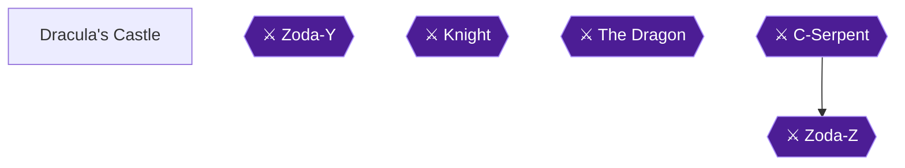

Chapter 7 drops Mike into a dark, gloomy place where a path leads to Dracula's Castle 🟡. Zoda-Y sent Mike here, to "the land where a count stalks his victims by the light of the moon" 🟡. The castle holds two achievements. Take the Spike Balls from the chest in Room 13 before you drop down the hole (Triple the Fun) 🟡. Defeat Zoda-Y and take the Tetrad outside (House of the Undead).

### Preparation

> [!TIP]
> **Before you leave:** Save your medicines for Zoda-Y. One guide says you should have a few saved for the fight. Pick up the medicines on the route, including those in Rooms 3, 10, 26 and 29 🟡.

Weapons you will meet here: Spike Balls fire a spread shot in three directions and are first found in Transylvania 🟡. The Triple Spike Ball shoots three spike balls for more range and different attack directions, and works great against multiple enemies 🟡. The Mace fires a projectile in three directions at a fairly good range and comes in packs of 50 🟡.

Enemies you will meet:
- Blue Bats take two hits 🟡.
- Frankensteins are slow, but after a few hits their torso drops off and they become a much faster pair of legs 🟡.
- Ghosts appear in groups; only the one of a different color can be hit 🟡.
- Tombstone Ghosts can only be hit from behind in their tombstone and occasionally fire a shot 🟡.
- Magicians leave explosives that go off after a few moments 🟡.
- Priests leave bubbles that shoot back at you when hit 🟡.

### Dracula's Castle (Spooky Castle)

🗺️ **Map:** [View Chapter 7: Level 1 Map by StarFighters76](https://gamefaqs.gamespot.com/nes/587654-zodas-revenge-star-tropics-ii/map/2188-chapter-7-level-1-map)

Walk down the path from where you appear to reach the castle 🟡. The guide numbers the rooms 1 to 31: Room 1 is the start, Room 30 is the boss Zoda Y, and Room 31 is the exit 🟡.

#### Room 1
There are two hearts. Head West to Room 2 🟡.

#### Room 2
There are two more hearts. You can go back to Room 1 or take the path North to Room 5 🟡. Another guide adds that you should grab the hearts at the entrance and to the left, then take the far right doorway 🟡.

#### Room 3
If you enter from Room 1 you cannot make the jump, so head back to Room 1. If you enter from Room 4 or Room 5, jump up on the boxes in the middle and grab the medicine 🟡.

#### Room 4
Defeat the three blue bats, then follow the open door West to Room 3 🟡.

#### Room 5
Defeat the three Frankensteins and the door North to Room 6 opens 🟡.

#### Rooms 6 to 9
These four rooms are connected. They look empty at first, but wait a few moments and ghosts appear. Go for the ghost of a different color 🟡. Defeating the ghosts in Room 8 opens the wall North to Room 10. Defeating them in Room 9 opens the wall East to Room 11 🟡.

#### Room 10
Watch out for the flames guarding the medicine. Grab it and return to Room 8 🟡.

#### Room 11
Three pyramid guards: use your psychic blast. When all three are defeated, the door East to Room 12 opens 🟡.

#### Room 12
A Tombstone Ghost can only be hurt from behind. Defeat him and the door East to Room 13 opens 🟡. Another guide says to attack his tombstone 🟡.

#### Room 13

> [!ACHIEVEMENT]
> **Triple the Fun (10 Points)**
> 
> *Pick up the Triple Spike Ball in Chapter 7.*

There is a chest on the East wall. Open it and take the Spike Balls before you go down the hole in the middle of the room to Room 14 🟡. Another guide notes that jumping toward the chest drops you into the hole, so take the Spike Balls first 🟡.

Once you drop into the hole, do not press any direction while you fall through Rooms 14 and 15. Press a direction only as you fall into Room 16, so that you land there 🟡.

Optional side trip: another guide says that after you fall, going diagonally left or right leads to a Try Your Luck sign 🟡. Steering while falling lands you on a tile in Room 15, which has paths West to Room 17 and East to Room 18 🟡. If you do this, you must then fall through Room 15's floor to continue to Room 16 🟡.

> [!WARNING]
> **Falling sequence (Rooms 14 to 16):** Falling from Room 13, you pass through Room 14 and simply fall on to Room 15 🟡. Do not press a direction in Rooms 14 or 15; if you move in any direction as you fall from Room 14, you land on a tile in Room 15 instead, and would then have to fall through its floor to continue to Room 16 🟡. Press a direction only when you fall into Room 16 so you land safely. If you do not move in any direction there, you fall back to Room 13, where the original pitfall is 🟡.

#### Room 14
You cannot land safely here when falling from Room 13; you fall through to Room 15 🟡.

#### Room 15
If you moved in any direction as you fell from Room 14, you land safely on a tile, with open paths West or East to Room 17 and Room 18 respectively. If you did not move, you continue falling to Room 16, which is the room to continue along 🟡.

#### Room 16
If you arrived by falling and move in any direction, you land safely. Defeat the three Frankenstein monsters and the door East to Room 19 opens. If you did not move, you fall back to Room 13 🟡.

#### Room 17
There is an island with a medicine here, but the guide says it could not figure out how to get it 🟡. No collected guide explains how to reach that medicine, so skip it.

#### Room 18
A priest is here. Defeating him gets you some of the hearts; otherwise head back to Room 16 🟡.

#### Room 19
Defeat the two tombstone ghosts to open the door East to Room 20 🟡.

#### Room 20
Avoid the four skeletons and head up the stairs to Room 21 🟡.

#### Room 21
Defeat the magician to open the door East to Room 22 🟡.

#### Room 22
Defeat the five blue bats and head North to Room 23 🟡.

#### Room 23
You do not have to defeat the two Frankensteins; find the tile that opens the door West to Room 24 🟡.

#### Room 24
Defeat the priest to open the door West to Room 25 🟡.

#### Room 25
Defeat the three pyramid guards to open a hidden wall West to Room 26. Activate one of the tiles to open the door North to Room 27 🟡.

#### Room 26
Defeat the two Frankensteins to reveal a floating platform. Use it to reach a medicine and some spike balls across the pit on the Western end. Then return to Room 25 and go North to Room 27 🟡. One update says that in the room with two Frankensteins near the end, you can bust through the north wall for an extra potion 🟡.

#### Room 27
Defeat the two bats (ignore the two skeletons) and the door West to Room 28 opens 🟡.

#### Room 28
Defeat the magician to open the door North to Room 29 🟡.

#### Room 29
Defeat the five bats to open the door North to Room 30. Activating several tiles reveals two hearts and medicine 🟡. Another guide adds that in the bat-shaped tile room you kill the bats to open a doorway, then hit the switches in the top left and bottom right corners 🟡.

### Zoda-Y

#### Room 30 (Boss)
Zoda-Y is in Dracula's Castle 🟡. As soon as you enter, move forward a little bit because spikes come out of the floor right away 🟡.

Form one:
- Zoda Y appears, shoots a spray of shots, and disappears. Shoot him when he first appears, then avoid his shots.
- He shoots out bats. Kill the bats, then hit him a few times before he teleports.
- Use the Mace and the shockwave when you run out 🟡.

Form two:
- He kneels, transforms into a bird creature, and releases two bats at a time. He launches more bats while jumping side to side 🟡.
- He flaps his wings to push Mike into the spikes on the back wall and shoots feathers. Hold up as hard as you can to avoid being pushed back 🟡.
- Hit him with the mace when he is exposed 🟡.
- To dodge feathers, get right up against one side of your platform so they all go that way, then make one clean jump across 🟡.
- Keep hitting until he is defeated, which opens the door East to Room 31.

One guide says the platforms that move you make this fight hard; keep a few medicines and throw a few shooting stars at a time 🟡.

#### Room 31
Head North out of this room to return to the overworld 🟡.

### The Tetrad


> [!ACHIEVEMENT]
> **House of the Undead (10 Points)**
> 
> *Obtain the Tetrad in Chapter 7.*

In the overworld, grab the Tetrad. Your life level increases. Then open the book and read PAA PAA PAA OOM PAPA MOW MOW to flip the pages and move on to the next time period. Next is Chapter 8: Camelot 🟡.

> [!TIP]
> **Before you leave:** Make sure you grabbed the Spike Balls from the Room 13 chest, then collect the Tetrad.

> [!IMPORTANT]
> ### Chapter 7 Cumulative 100% Checkpoint
> - **Big Hearts:** 4 / 4
> - **Tetrads:** 6 / 7
> - **Spike Balls (Triple the Fun):** collected from the Room 13 chest 🟡
> - **RetroAchievements Unlocked:** 28 / 31 (240 / 285 points)

### Chapter Checklist
- [ ] Take the Spike Balls from the Room 13 chest before dropping down (Triple the Fun)
- [ ] Press no direction while falling through Rooms 14 and 15, then press one into Room 16
- [ ] Defeat Zoda-Y in Room 30
- [ ] Take the Tetrad outside the castle (House of the Undead)
- [ ] Read the magic words to move on to Chapter 8

---

## Chapter 8: King Arthur's Camelot

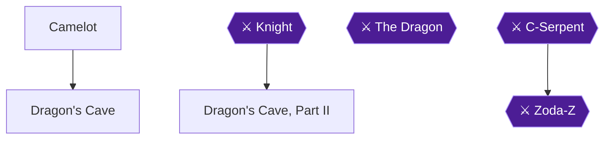

Chapter 8 takes Mike to medieval Camelot. The goal is to accept King Arthur's quest, beat the Knight in the first cave, receive the Ultra Psychic Shock Wave from Merlin, and defeat the Dragon in the second cave for the last Tetrad. Two achievements are available here: Ultra Psychic Shock Wave and The Middle Ages.

> [!WARNING]
> **Achievement Trigger Warning:** When King Arthur asks for your help, do not answer No. The guide warns that saying no seems to stop you from going any farther and you will need to reset 🟡. Answer Yes to be christened Sir Mike, have your life level increased and be named a knight of the round table 🟡.

> [!NOTE]
> The Ultra Psychic Shock Wave needs at least 10 hearts to use 🟡. It is the strongest of the shock waves 🟡.

### Camelot

🗺️ **Map:** [View Chapter 8: Overworld Map by StarFighters76](https://gamefaqs.gamespot.com/nes/587654-zodas-revenge-star-tropics-ii/map/15891-chapter-8-overworld-map)

1. Mike starts in the middle of a forest. Walk around until you see a castle in the distance, and talk to people like Sir Lancelot on the way 🟡. One knight warns that the shadow of a dragon looms over the land and the king seeks a hero 🟡.
2. Enter the castle and talk to King Arthur. He explains that a dragon is attacking Camelot and his knights are out on quests, and he asks for your help 🟡.
3. Answer **Yes**. Arthur christens you Sir Mike, your life level increases and he names you a knight of the round table 🟡.
4. Go back outside the castle. The guard blocking your path now lets you through 🟡. East of the castle the guard says, "You may pass Sir Mike" 🟡.
5. Follow the path north until you reach the cave 🟡.

### Dragon's Cave

🗺️ **Map:** [View Chapter 8: Level 1 Map by StarFighters76](https://gamefaqs.gamespot.com/nes/587654-zodas-revenge-star-tropics-ii/map/2190-chapter-8-level-1-map)

The room numbers below follow one guide. Room 1 is the start, the Knight boss is in Room 17 and the exit is Room 18 🟡.

1. **Room 2.** Three blue blobs are here. Kill the last blob while standing in the middle of the room towards the North wall, so Mike falls onto the ledge in this room rather than below it, then head North to Room 6 🟡. Another guide says to stand near the middle-top of the screen 🟡. You can also activate the tile on the ledge, but you must jump down to get the medicine it reveals and then go around and back down to this room 🟡.
2. **Room 3** (only if you dropped below). There are no enemies, and you cannot reach the tile on the ledge. Head West to Room 4 🟡.
3. **Room 4** (only if you dropped below). Avoid the three skeleton heads and go up the stairs in the Northwest corner to Room 5 🟡.
4. **Room 5** (only if you dropped below). Activate the tile in the middle of the room to open the wall East to Room 2 🟡.
5. **Room 6.** Four robed skeletons and a medicine are here. Take the path North to Room 7 🟡. Another guide says to hit the skeleton piles so they fall down, jump over them and grab the potion 🟡.
6. **Room 7.** Defeat the magician and you fall through the floor to Room 8. Fall in the middle against the North wall. There is also a medicine here if you want to try for it 🟡.
7. **Room 8.** If you landed on the ledge, head North to Room 13. Otherwise go East to Room 10 or West to Room 9 🟡.
8. **Room 9** (only if you missed the ledge). Avoid the blue blobs and take the stairs up to Room 11 🟡. In **Room 11**, activate the tile to open the wall East back to Room 7 🟡.
9. **Room 10** (the alternative). Avoid the blue blobs and take the stairs up to Room 12 🟡. In **Room 12**, activate the tile to open the wall West back to Room 7 🟡. Then defeat the magician again and fall onto the ledge in Room 8 🟡.
10. **Room 13.** Defeat the two knights to open the wall West to Room 14 🟡.
11. **Room 14.** Spikes form on the far West side as soon as you enter, so move quickly. Take the conveyor belt and proceed West to Room 15 🟡.
12. **Room 15.** Take the conveyor belt up on the first loop and down on the second loop to avoid the blades from the ground. If you were fast enough, jump over the spikes, otherwise take the damage and go West to Room 16 🟡. Another guide's conveyor-belt summary is: first room take the shortcut, second room up then down, third room up and down, fourth room down then middle 🟡.
13. **Room 16.** Take the first loop down. On the second loop stay in the middle and keep moving West on the conveyor belt. Jump over the spikes, grab the four hearts, then take the path North to Room 17 🟡.

#### Room 17: Knight

🗺️ **Map:** [View Chapter 8: Level 1 Map by StarFighters76](https://gamefaqs.gamespot.com/nes/587654-zodas-revenge-star-tropics-ii/map/2190-chapter-8-level-1-map)

You ride a conveyor belt in perpetual counter-clockwise motion while the Knight runs back and forth in the middle of the room. Keep throwing shots at him. He occasionally shoots at you, so avoid his shots. He shoots bullets in two directions, so jump over them as they near you and aim the shockwave diagonally at him. Defeating him opens the door East to Room 18.

14. **Room 18.** Take the exit back to the Overworld 🟡.

### Knight

Back in the cave, walk North. An owl reveals itself as the monkey and donkey from earlier, and finally as Merlin of Camelot. He explains Hiricon and how the tetrads were spread through time and must be put together 🟡. Merlin tells you to collect the last Tetrad and then teaches you the Ultra Psychic Shockwave 🟡.


> [!ACHIEVEMENT]
> **Ultra Psychic Shock Wave (10 Points)**
> 
> *Obtain the Ultra Psychic Shock Wave*


After Merlin vanishes, proceed North to the second Dragon Cave 🟡. Remember that you need at least 10 hearts to use this weapon 🟡.

### Dragon's Cave, Part II

🗺️ **Map:** [View Chapter 8: Level 2 Map by StarFighters76](https://gamefaqs.gamespot.com/nes/587654-zodas-revenge-star-tropics-ii/map/2189-chapter-8-level-2-map)

Room 1 is the start, the Dragon is in Room 26 and Room 27 is the exit back to the Overworld 🟡. Room 1 is empty; the guide's map puts Room 2 directly North of it, so head North to Room 2 🟡.

1. **Room 2.** Three purple bats and four hearts are here. Defeating the bats opens the wall West to Room 3, and there is an open path North to Room 4 🟡.
2. **Room 3.** There is a medicine, spike balls and two owls. A tile opens the wall North to Room 5 🟡.
3. **Room 5.** Activate the tile to reveal the medicine. Then go back South and East to Room 2, and North to Room 4 🟡.
4. **Room 4.** Defeat the two rockmen to open the wall North to Room 6 🟡.
5. **Room 6.** Defeat the big green blob to open the door East to Room 7 🟡.
6. **Room 7.** A Red Triceratops is here. Now that you have the Ultra Psychic Shockwave, shoot him from a safe distance. Defeating him opens the door East to Room 8 🟡.
7. **Room 8.** Three knights. Defeat them while taking as little damage as possible to open the door East to Room 9 🟡.
8. **Room 9.** Defeat all the blue blobs to open the wall North to Room 10. A tile here reveals four hearts 🟡.
9. **Room 10.** Defeat the two big green blobs to open the wall West to Room 11. A tile reveals four hearts 🟡.
10. **Room 11.** Three rock guys. Defeating them opens both East and West doors. Continue West to Room 12 🟡.
11. **Room 12.** No enemies. Jump on the floating platform, then the moving platform. Jump over the first spiked wire, then up to the stationary platform above. Jump to the next one with the tile, then jump back the way you came to get the question mark that opens the door. Four hearts are here if needed. Enter the open door North to Room 13 🟡.
12. **Room 13.** A regular knight and an armored knight. Defeat both to open the door North to Room 14 🟡.
13. **Room 14.** Only balls moving back and forth. Shoot them once to stop them and once again to start them. Activate the tile, then grab the question mark to open the door North to Room 15. Two sets of four hearts are here 🟡.
14. **Room 15.** The room is covered in tiles and bombs are continually laid. Find the tile and then the question mark quickly to open the door North to Room 16 🟡.
15. **Room 16.** Two sets of tiles reveal two sets of four hearts. Open doors lead West to Room 17 and East to Room 18 🟡.
16. **Room 17.** Defeat the triceratops to open the East door back to Room 16 🟡. A medicine is in the upper west corner 🟡.
17. **Room 18.** Defeat both triceratops to open the door that leads to Room 20, on the East side of this room. A tile in this room opens the room to the North and Room 19 🟡. The guide's text calls this the door to the West, but its own map draws Room 18 with Room 20 on its East side, and from Room 21 it tells you to head back West to Room 18, which only works if Rooms 20 and 21 are to the East 🟡.
18. **Room 20.** Tiles are in the center, with flames surrounding the medicine and question mark that appear when you jump on the correct tile. The question mark opens the wall to the East and Room 21 🟡.
19. **Room 21.** Six bats and spike balls in the corner. You may defeat the bats, or grab the spike balls and head back West to Room 18 and then North to Room 19 🟡.
20. **Room 19.** Defeat the two skull heads on the raised section to open the door West to Room 22 🟡.
21. **Room 22.** Defeat the two armored knights to open the wall West to Room 23 🟡.
22. **Room 23.** Defeat all four rock guys to open the wall West to Room 24 🟡. Activate one of the tiles for four hearts 🟡.
23. **Room 24.** One armored knight and two regular knights. Defeat all of them to open the wall North to Room 25 🟡.
24. **Room 25.** Defeat the two big green blobs to open the door North to Room 26 🟡. Grab the medicine here 🟡.

#### Room 26: The Dragon

🗺️ **Map:** [View Chapter 8: Level 2 Map by StarFighters76](https://gamefaqs.gamespot.com/nes/587654-zodas-revenge-star-tropics-ii/map/2189-chapter-8-level-2-map)

The key is to hit his head by jumping up and firing in midair. Do not wait for him to breathe fire, because that takes too long while the spikes start to fill up the room 🟡. He slowly moves forward firing in three directions while a field of spikes grows 🟡. When he gets near you he flies around shooting bullets 🟡.

Stay near the bottom right corner and jump while using the Ultra Psychic Shockwave to hit his head. When he starts to fly, walk in a counter-clockwise circle to avoid him and the bullets, and beat him quickly before the spikes consume you. The only way to kill him is by hitting his head 🟡. Defeating him opens the door East to Room 27 🟡.

25. **Room 27.** Take the exit North back to the overworld 🟡.

### Dragon

Back in the cave, a Tetrad lies just North of Mike. Grab it and Mike's health should be full 🟡. Your life level increases 🟡.


> [!ACHIEVEMENT]
> **The Middle Ages (10 Points)**
> 
> *Obtain the Tetrad in Chapter 8.*


Mike tries to put the Tetrads together, but nothing happens 🟡. Exit the cave to the Northeast. Mica tells you to join her at C-Island 🟡. Mike then opens the book and says the magic words, Paa Paa Paa Oom Maw Maw, to travel to Chapter 9 🟡.

> [!TIP]
> **Before you leave Camelot:** Make sure both achievements have unlocked. The Ultra Psychic Shock Wave comes from Merlin after the Knight, and the Tetrad comes after the Dragon 🟡.

> [!IMPORTANT]
> ### Chapter 8 Cumulative 100% Checkpoint
> - **Big Hearts:** 4 / 4
> - **Tetrads:** 7 / 7 (the last Tetrad from the Dragon's Cave 🟡)
> - **Ultra Psychic Shock Wave:** obtained from Merlin 🟡
> - **RetroAchievements Unlocked:** 30 / 31 (260 / 285 points)

### Chapter Checklist

- [ ] Answered Yes to King Arthur and was christened Sir Mike
- [ ] Passed the guard and followed the path north
- [ ] Beat the Knight in Dragon's Cave
- [ ] Received the Ultra Psychic Shock Wave from Merlin
- [ ] Defeated the Dragon in the second cave
- [ ] Picked up the last Tetrad
- [ ] Exited the cave Northeast and travelled to Chapter 9

---

## Chapter 9: Return to C-Island

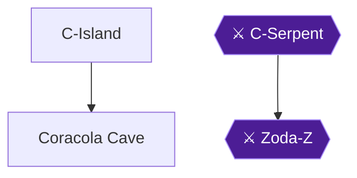

This is the final chapter. Mica asks Mike to come back to C-Island, and Mike travels there with the Oxford World Wonders 🟡. You enter Coracola Cave behind a boy in Coralcola, beat the C-Serpent, take the conveyor belts, refight faster versions of earlier bosses, and finish against Zoda-Z 🟡. Defeating Zoda-Z lets you watch the ending and unlocks the only achievement of the chapter 🟡.

> [!TIP]
> **Before you start:** The conveyor section is where you pick up a bunch of medicines, and the bosses that follow are faster than before 🟡. Take the bottom route there for the most medicines 🟡.

### C-Island

🗺️ **Map:** [View Chapter 9: Overworld Map by StarFighters76](https://gamefaqs.gamespot.com/nes/587654-zodas-revenge-star-tropics-ii/map/15892-chapter-9-overworld-map)

1. You appear on C-Island. Head to the village of Coralcola 🟡. One guide says to follow the path to the town, talk to the man, then enter the original cave 🟡. Another says to talk to the only human and go into the cave 🟡.
2. In Coralcola there are many more boars than before. Find the little kid, who tells you all of the villagers are now boars. A boy also mentions strange sounds coming from the tunnel 🟡.
3. Take the stairs behind the kid to enter Coracola Cave 🟡.

### Coracola Cave

🗺️ **Map:** [View Chapter 9: Level 1 Map by StarFighters76](https://gamefaqs.gamespot.com/nes/587654-zodas-revenge-star-tropics-ii/map/2191-chapter-9-level-1-map)

The guide's layout map shows room connections from ROOM #1 through ROOM #28, with ROOM #11 as the C-Serpent boss. The guide's text continues to ROOM #29 (Zoda-Z) and ROOM #30 (the exit) 🟡.

#### Room 1 to Room 6

1. **ROOM #1:** Take the passage to the North to ROOM #2 🟡.
2. **ROOM #2:** Defeat the three pink blobs to open the passageway North to ROOM #3. There are also two sets of four hearts here 🟡.
3. **ROOM #3:** There are six pink blobs. You only need to defeat a certain random blob to open the door North to ROOM #4 🟡.
4. **ROOM #4:** Several small blue rats are here. Make your way East until you need to hop on tiles back West. Activate the tile to open the door North to ROOM #5 🟡.
5. **ROOM #5:** Defeat the two purple bats and three blue rats to open the door North to ROOM #6 🟡.
6. **ROOM #6:** Spike balls sit in the middle. Activate the tiles to get four hearts and open the door North to ROOM #7 🟡.

#### Room 7 to Room 11

1. **ROOM #7:** Two purple asps and two pink blobs are here, along with two tiles. One tile opens the door North to ROOM #10, and the other opens the wall East to ROOM #8 🟡. The guide's text names ROOM #9 for the North door, but its own map shows ROOM #10 there 🟡. Take the side trip first: go East to ROOM #8, then North to ROOM #9, then come back through ROOM #8 and ROOM #7 and go North to ROOM #10 🟡.
2. **ROOM #8:** There is a medicine here and a tile that opens the wall North to ROOM #9 🟡.
3. **ROOM #9:** An island in the middle holds two hearts, a medicine, and a random life sign 🟡. Then head back to ROOM #8, ROOM #7, and North to ROOM #10 🟡.
4. **ROOM #10:** Defeat the three bats and two asps quickly to open the door North to ROOM #11 🟡.
5. **ROOM #11, boss C-Serpent:** see the boss section below.

#### C-Serpent

C-Serpent is the old boss from the first game, now only bones. Avoid its shots and hit the head when the mouth is open. A platform then appears so you can proceed North to ROOM #12 🟡.

- Stand on the center of three tiles and throw weapons into its open mouth. It shoots fire about 80% of the time, so jump left or right to the side tiles to dodge it, then repeat 🟡.
- Another guide says it moves side to side and breathes fire in three directions like the mace weapon, which you should use. It should go down fairly easily 🟡.

#### Room 12 to Room 20

1. **ROOM #12:** Take the path East to ROOM #13 🟡.
2. **ROOM #13:** Tiles form an arrow leading to one of three conveyor belt paths to ROOM #14 🟡. Take the bottom route, which has the most medicines. The top route has very few 🟡. The first guide says any of the three works 🟡.
3. **ROOM #14 to ROOM #18:** These rooms are connected by the conveyor belt. Collect hearts and medicines, try to avoid hitting spikes, and you are eventually dropped into ROOM #19 🟡.
4. **ROOM #19:** As soon as you enter, you fall through the floor to ROOM #20 🟡.
5. **ROOM #20:** This greyscale room appears to have no way out. Eventually a tile appears in the middle, and then the door North opens to ROOM #21 🟡.

#### Room 21 to Room 28: The Boss Rematches

The earlier bosses return, the same but faster 🟡.

1. **ROOM #21, Yum Yum:** He is not eating a boar this time. Use the same technique as last time to open the door East to ROOM #22 🟡.
2. **ROOM #22, Scorpion:** Avoid the little scorpions to defeat the scorpion boss from Egypt. The door North to ROOM #23 opens 🟡.
3. **ROOM #23, Pharoah:** Defeat the mask while avoiding his blasts. You fall through the floor to ROOM #24 🟡.
4. **ROOM #24, Zoda-X:** Avoid getting hit on the conveyor belt and defeat him to open the door North to ROOM #25 🟡.
5. **ROOM #25, Skeleton Miner:** Beat him the same way as last time to open the door North to ROOM #26 🟡.
6. **ROOM #26, Zoda-Y:** He transforms into a bird halfway through the battle. Defeat him to fall through the floor to ROOM #27 🟡.
7. **ROOM #27, Dragon:** Hit his head by jumping in the air. Another guide adds that you should fire in midair and not wait for him to breathe fire, because spikes fill the room. Defeating him opens the door East to ROOM #28 🟡.
8. **ROOM #28:** Two tiles eventually appear. One makes a pill appear and the other opens the door North to ROOM #29 🟡.

### Zoda-Z

**ROOM #29:** Zoda-Z is here. Defeating both his later forms opens the door West to ROOM #30 🟡.

- **Form 1:** He appears as four little Zoda balls. One is off-color, so shoot it until it is defeated. Avoid the attacks of the matching ones 🟡.
- **Form 2 (normal form):** Attack him over and over with the shockwave weapon and avoid the weak bullets he shoots. His large energy balls do no damage but turn you into a wild boar who cannot attack. If that happens, run around and avoid his attacks until it wears off 🟡.
- **Final form (minotaur/buffalo):** Once you defeat the previous form with the Shockwave, he morphs into a large creature that resembles a buffalo standing on two legs 🟡. He still fires bullets and can change you into a boar. He can also fire walls of fire from the sides of the room, make areas of the room explode with sparks, and spin quickly, which makes him invincible, before charging at you 🟡. Do not touch him while he spins, watch for fire shot from both sides of the wall, and avoid his head-first charge. Attack with the shockwave when you can and be patient 🟡.


> [!ACHIEVEMENT]
> **C-Island is Normal Again! (25 Points)**
> 
> *Defeat Zoda for good, and enjoy the ending!*


Defeating Zoda-Z lets you beat the game and watch the ending 🟡.

### The Ending

1. ROOM #30 is just an exit to the North 🟡. Back inside the cave, head North to find Mica, who says you must first check on the villagers 🟡.
2. Mica confirms the village is back to normal 🟡. Go to the chief's hut, where the Chief puts the Tetrads together. One guide says they resemble a maple leaf, while the script describes a scepter. Either way, Hirocon appears 🟡.
3. Hirocon explains that he had his essence transferred to the Tetrads after sending Mica away in the escape pod 🟡. He bestows "Hero of Aragonia" on Mike, and they fly off the island as balls of light 🟡.
4. The final screen shows an open book with Mike at the cliff and the words "What a wild adventure! If I hadn't lived it, I wouldn't believe it!" 🟡

> [!IMPORTANT]
> ### Chapter 9 Cumulative 100% Checkpoint
> - **Big Hearts:** 4 / 4
> - **Tetrads:** 7 / 7 (assembled by the Chief) 🟡
> - **RetroAchievements Unlocked:** 31 / 31 (285 / 285 points)

### Chapter Checklist

- [ ] Enter Coracola Cave from the stairs behind the boy in Coralcola
- [ ] Defeat the C-Serpent in ROOM #11
- [ ] Take the bottom conveyor route for the most medicines
- [ ] Defeat the rematch bosses in ROOMs #21 to #27
- [ ] Defeat all forms of Zoda-Z in ROOM #29 (C-Island is Normal Again!)
- [ ] Watch the ending

---

## Final Checklist

**Chapter 1: Prelude**

**Chapter 2: The Ice Age**

- [ ] 🏆 Better Than Nothing
- [ ] 🏆 A Caveman Weapon
- [ ] 🏆 Just Like Link
- [ ] 🏆 Your First Tetrad

**Chapter 3: Cleopatra's Egypt**

- [ ] ⚠ Dagger from the Jack of All Trades (before: Before giving Cleopatra her pizza in Chapter 3. Once you hold a dagger, Jack only offers to trade back for an axe, and Cleopatra only hands over her dagger when you arrive without one.)
- [ ] 🏆 Jack of All Trades
- [ ] 🏆 Sharp Edge
- [ ] 🏆 Thrower
- [ ] 🏆 Slowest Pizza Delivery Ever
- [ ] 🏆 What Do These Do?
- [ ] 🏆 Lost in the Tall Grass
- [ ] 🏆 Psychic Power
- [ ] 🏆 Snake Charmer
- [ ] 🏆 Egyptian Tetris

**Chapter 4: Holmes's London**

- [ ] 🏆 Down the Sewers
- [ ] 🏆 That Does NOT Look Like a Ball
- [ ] 🏆 The Mystery of the Tetrad

**Chapter 5: The Wild West**

- [ ] 🏆 Not Quite a Gold Nugget
- [ ] 🏆 Real Gold
- [ ] 🏆 Heart of Gold
- [ ] 🏆 Not the Traditional Weapon
- [ ] 🏆 Super Psychic Shock Wave
- [ ] 🏆 Just Like Mario
- [ ] 🏆 Tetrad in a Western

**Chapter 6: Leonardo's Italy**

- [ ] 🏆 Now We Got a Sword
- [ ] 🏆 Heart on the Lone Island
- [ ] 🏆 Watch Out for Pits!

**Chapter 7: Dracula's Transylvania**

- [ ] 🏆 Triple the Fun
- [ ] 🏆 House of the Undead

**Chapter 8: King Arthur's Camelot**

- [ ] 🏆 Ultra Psychic Shock Wave
- [ ] 🏆 The Middle Ages

**Chapter 9: Return to C-Island**

- [ ] 🏆 C-Island is Normal Again!

## 100% Completion Verification Checklist

All 31 achievements (285 points).

| ✔ | Achievement | Points | Type | Chapter |
|---|---|---|---|---|
| ☐ | **Better Than Nothing** — Pick up Rocks in Chapter 2. | 5 |  | [Chapter 2](#chapter-2-the-ice-age) |
| ☐ | **A Caveman Weapon** — Obtain the Axe. | 10 |  | [Chapter 2](#chapter-2-the-ice-age) |
| ☐ | **Your First Tetrad** — Complete the first dungeon, and learn about the Tetrads. | 10 | progression | [Chapter 2](#chapter-2-the-ice-age) |
| ☐ | **Jack of All Trades** — Obtain the Dagger from the Jack of All Trades. | 10 |  | [Chapter 3](#chapter-3-cleopatras-egypt) |
| ☐ | **Sharp Edge** — Obtain the Dagger. | 10 |  | [Chapter 3](#chapter-3-cleopatras-egypt) |
| ☐ | **Thrower** — Pick up the Thrower Item in Chapter 3. | 5 |  | [Chapter 3](#chapter-3-cleopatras-egypt) |
| ☐ | **Just Like Link** — Pick up a Potion. | 5 |  | [Chapter 2](#chapter-2-the-ice-age) |
| ☐ | **Slowest Pizza Delivery Ever** — Clear the first dungeon in Chapter 3 and get the pizza for the Queen. | 10 | progression | [Chapter 3](#chapter-3-cleopatras-egypt) |
| ☐ | **What Do These Do?** — Have 4 stars at once. | 10 |  | [Chapter 3](#chapter-3-cleopatras-egypt) |
| ☐ | **Lost in the Tall Grass** — Find the Heart Container in Chapter 3. | 10 |  | [Chapter 3](#chapter-3-cleopatras-egypt) |
| ☐ | **Psychic Power** — Obtain the Psychic Shock Wave. | 10 |  | [Chapter 3](#chapter-3-cleopatras-egypt) |
| ☐ | **Snake Charmer** — Pick up the flute. | 5 |  | [Chapter 3](#chapter-3-cleopatras-egypt) |
| ☐ | **Egyptian Tetris** — Complete the second dungeon in Chapter 3 and collect the Tetrad. | 10 | progression | [Chapter 3](#chapter-3-cleopatras-egypt) |
| ☐ | **Down the Sewers** — Obtain the Heart Container in Chapter 4. | 10 |  | [Chapter 4](#chapter-4-holmess-london) |
| ☐ | **That Does NOT Look Like a Ball** — Pick up the Spike Ball Item in Chapter 4. | 5 |  | [Chapter 4](#chapter-4-holmess-london) |
| ☐ | **The Mystery of the Tetrad** — Finish both dungeons in Chapter 4 and obtain the Tetrad. | 10 | progression | [Chapter 4](#chapter-4-holmess-london) |
| ☐ | **Not Quite a Gold Nugget** — Find the Hidden Nugget in Chapter 5. | 10 |  | [Chapter 5](#chapter-5-the-wild-west) |
| ☐ | **Real Gold** — Find the ACTUAL Gold Nugget in Chapter 5. | 5 |  | [Chapter 5](#chapter-5-the-wild-west) |
| ☐ | **Heart of Gold** — Find the Heart Container in Chapter 5. | 10 |  | [Chapter 5](#chapter-5-the-wild-west) |
| ☐ | **Not the Traditional Weapon** — Pick up the Bola Weapon in Chapter 5. | 5 |  | [Chapter 5](#chapter-5-the-wild-west) |
| ☐ | **Super Psychic Shock Wave** — Obtain the Super Psychic Shock Wave. | 10 |  | [Chapter 5](#chapter-5-the-wild-west) |
| ☐ | **Just Like Mario** — Pick up a Star Magic Item in Chapter 5 | 5 |  | [Chapter 5](#chapter-5-the-wild-west) |
| ☐ | **Tetrad in a Western** — Finish the second dungeon in Chapter 5 and obtain a Tetrad. | 10 | progression | [Chapter 5](#chapter-5-the-wild-west) |
| ☐ | **Now We Got a Sword** — Obtain the Katana. | 10 |  | [Chapter 6](#chapter-6-leonardos-italy) |
| ☐ | **Heart on the Lone Island** — Obtain the Heart Container in Chapter 6. | 10 |  | [Chapter 6](#chapter-6-leonardos-italy) |
| ☐ | **Watch Out for Pits!** — Obtain the Tetrad in Chapter 6. | 10 | progression | [Chapter 6](#chapter-6-leonardos-italy) |
| ☐ | **Triple the Fun** — Pick up the Triple Spike Ball in Chapter 7. | 10 |  | [Chapter 7](#chapter-7-draculas-transylvania) |
| ☐ | **House of the Undead** — Obtain the Tetrad in Chapter 7. | 10 | progression | [Chapter 7](#chapter-7-draculas-transylvania) |
| ☐ | **Ultra Psychic Shock Wave** — Obtain the Ultra Psychic Shock Wave | 10 |  | [Chapter 8](#chapter-8-king-arthurs-camelot) |
| ☐ | **The Middle Ages** — Obtain the Tetrad in Chapter 8. | 10 | progression | [Chapter 8](#chapter-8-king-arthurs-camelot) |
| ☐ | **C-Island is Normal Again!** — Defeat Zoda for good, and enjoy the ending! | 25 | win_condition | [Chapter 9](#chapter-9-return-to-c-island) |

## Sources

This guide was built only from these sources:

- **RetroAchievements** — StarTropics II: Zoda's Revenge — RetroAchievements community comments: [link](https://retroachievements.org/game/1984)
- **GameFAQs** — Guide and Walkthrough by vindit: [link](https://gamefaqs.gamespot.com/nes/587654-zodas-revenge-star-tropics-ii/faqs/62277)
- **GameFAQs** — Guide and Walkthrough by PsychoPenguin: [link](https://gamefaqs.gamespot.com/nes/587654-zodas-revenge-star-tropics-ii/faqs/39873)
- **GameFAQs** — Guide and Walkthrough by MacDaddy_Mike: [link](https://gamefaqs.gamespot.com/nes/587654-zodas-revenge-star-tropics-ii/faqs/16494)
- **GameFAQs** — Walkthrough by GPolander: [link](https://gamefaqs.gamespot.com/nes/587654-zodas-revenge-star-tropics-ii/faqs/3095)
- **GameFAQs** — Game Script by KFHEWUI: [link](https://gamefaqs.gamespot.com/nes/587654-zodas-revenge-star-tropics-ii/faqs/49934)
- **GameFAQs** — Chapter 2: Dungeon Map by KirbyPufocia: [link](https://gamefaqs.gamespot.com/nes/587654-zodas-revenge-star-tropics-ii/map/1336-chapter-2-dungeon-map)
- **GameFAQs** — Chapter 2: Level 1 Map by StarFighters76: [link](https://gamefaqs.gamespot.com/nes/587654-zodas-revenge-star-tropics-ii/map/15886-chapter-2-level-1-map)
- **GameFAQs** — Chapter 2: Overworld Map by StarFighters76: [link](https://gamefaqs.gamespot.com/nes/587654-zodas-revenge-star-tropics-ii/map/15885-chapter-2-overworld-map)
- **GameFAQs** — Chapter 3: Level 1 Map by StarFighters76: [link](https://gamefaqs.gamespot.com/nes/587654-zodas-revenge-star-tropics-ii/map/2179-chapter-3-level-1-map)
- **GameFAQs** — Chapter 3: Level 2 Map by StarFighters76: [link](https://gamefaqs.gamespot.com/nes/587654-zodas-revenge-star-tropics-ii/map/2180-chapter-3-level-2-map)
- **GameFAQs** — Chapter 3: Monkey Island Maze Map by StarFighters76: [link](https://gamefaqs.gamespot.com/nes/587654-zodas-revenge-star-tropics-ii/map/2178-chapter-3-monkey-island-maze-map)
- **GameFAQs** — Chapter 3: Overworld Map by StarFighters76: [link](https://gamefaqs.gamespot.com/nes/587654-zodas-revenge-star-tropics-ii/map/15887-chapter-3-overworld-map)
- **GameFAQs** — Chapter 4: Level 1 Map by StarFighters76: [link](https://gamefaqs.gamespot.com/nes/587654-zodas-revenge-star-tropics-ii/map/2182-chapter-4-level-1-map)
- **GameFAQs** — Chapter 4: Level 2 Map by StarFighters76: [link](https://gamefaqs.gamespot.com/nes/587654-zodas-revenge-star-tropics-ii/map/2183-chapter-4-level-2-map)
- **GameFAQs** — Chapter 4: Overworld Map by StarFighters76: [link](https://gamefaqs.gamespot.com/nes/587654-zodas-revenge-star-tropics-ii/map/15888-chapter-4-overworld-map)
- **GameFAQs** — Chapter 5: Level 1 Map by StarFighters76: [link](https://gamefaqs.gamespot.com/nes/587654-zodas-revenge-star-tropics-ii/map/2184-chapter-5-level-1-map)
- **GameFAQs** — Chapter 5: Level 2 Map by StarFighters76: [link](https://gamefaqs.gamespot.com/nes/587654-zodas-revenge-star-tropics-ii/map/2185-chapter-5-level-2-map)
- **GameFAQs** — Chapter 5: Overworld Map by StarFighters76: [link](https://gamefaqs.gamespot.com/nes/587654-zodas-revenge-star-tropics-ii/map/15889-chapter-5-overworld-map)
- **GameFAQs** — Chapter 6: Inside The Castle Maze Map by StarFighters76: [link](https://gamefaqs.gamespot.com/nes/587654-zodas-revenge-star-tropics-ii/map/2187-chapter-6-inside-the-castle-maze-map)
- **GameFAQs** — Chapter 6: Level 1 Map by StarFighters76: [link](https://gamefaqs.gamespot.com/nes/587654-zodas-revenge-star-tropics-ii/map/2186-chapter-6-level-1-map)
- **GameFAQs** — Chapter 6: Overworld Map by StarFighters76: [link](https://gamefaqs.gamespot.com/nes/587654-zodas-revenge-star-tropics-ii/map/15890-chapter-6-overworld-map)
- **GameFAQs** — Chapter 7: Level 1 Map by StarFighters76: [link](https://gamefaqs.gamespot.com/nes/587654-zodas-revenge-star-tropics-ii/map/2188-chapter-7-level-1-map)
- **GameFAQs** — Chapter 8: Level 1 Map by StarFighters76: [link](https://gamefaqs.gamespot.com/nes/587654-zodas-revenge-star-tropics-ii/map/2190-chapter-8-level-1-map)
- **GameFAQs** — Chapter 8: Level 2 Map by StarFighters76: [link](https://gamefaqs.gamespot.com/nes/587654-zodas-revenge-star-tropics-ii/map/2189-chapter-8-level-2-map)
- **GameFAQs** — Chapter 8: Overworld Map by StarFighters76: [link](https://gamefaqs.gamespot.com/nes/587654-zodas-revenge-star-tropics-ii/map/15891-chapter-8-overworld-map)
- **GameFAQs** — Chapter 9: Level 1 Map by StarFighters76: [link](https://gamefaqs.gamespot.com/nes/587654-zodas-revenge-star-tropics-ii/map/2191-chapter-9-level-1-map)
- **GameFAQs** — Chapter 9: Overworld Map by StarFighters76: [link](https://gamefaqs.gamespot.com/nes/587654-zodas-revenge-star-tropics-ii/map/15892-chapter-9-overworld-map)

Verification: 51 verified · 886 single-source · 0 resolved conflicts · 0 rejected facts.
