# Sword Art Online: Infinity Moment — 100% RetroAchievements Walkthrough

## Metadata

- **Platform:** PlayStation Portable
- **Developer:** Aquria
- **Publisher:** Bandai Namco
- **Genre:** Unknown
- **Released:** 2013-03-14
- **Achievements:** 174 (1281 points)

> [!NOTE]
> Every instruction in this guide was extracted from the sources listed at the bottom and checked against them (53 facts confirmed by 2+ sources, 1376 from a single source). Statements marked 🟡 come from only one source. Anything we could not confirm says **"Unable to verify from collected sources."**

## Game Overview

### Game Overview

*Sword Art Online: Infinity Moment* is a PSP action RPG by Aquria, published by Bandai Namco and released on 2013-03-14. Its RetroAchievements set has 174 achievements worth 1281 points. This guide covers one playthrough that climbs Floors 76 to 100 in order, one chapter per floor. The last two chapters cover the endings. The set uses fan-translation names, and this guide gives the Japanese originals where they help.

The story is split into six endings. The game has endings for the five partner heroines and for Yui, but none for Klein 🟡. After four consecutive battles on Floor 100, you get an individual ending with the girl you chose as your partner 🟡. Chapter 24 covers the Asuna ending and Chapter 25 covers the other five.

### How the 100% Plan Works

The plan is one playthrough with a held save. Chapter 24 keeps a save from before Floor 99, and Chapter 25 reloads it for each remaining heroine. Whether a second playthrough is needed for any ending is not settled by the sources.

> [!NOTE]
> **Unconfirmed:** How the Yui ending (Long Time No See, Papa, Mama...) is reached, and whether one pre-Floor-99 save can be reloaded for every ending, are not answered by any collected source. Max Yui's bond before you make that save. If the Yui ending does not come from any partner choice, a further playthrough may be needed.

Hard Mode is added by a patch and is selectable only when starting a new game from the second playthrough onward, with higher enemy levels 🟡. The patch was released on 2013/06/06 🟡. Nothing in this set requires Hard Mode.

### Hardcore Mode Rules

Hardcore Mode turns off the emulator's save states, rewinds and cheats, so you rely entirely on the game's own saves. Do not plan around any emulator save feature.

- Save often. The game makes an auto-save when you change area, and you can quit and reload from it 🟡.
- If you reset before the map-transition auto-save happens, you return slightly earlier. START OF LAYER on the title screen is another way to resume 🟡.
- Keep a separate save from before the Ant Queen fight on Floor 84. One commenter reports that the game freezes after the Floor 84 boss is defeated and blames the translation patch 🟡. If it freezes, continue from that separate save without the patch. Never overwrite your only save before this boss.
- Keep the pre-Floor-99 save described above for the endings.

> [!WARNING]
> **Missable Achievement Warning:** The Strea bond achievement has a point of no return. Finishing Floor 94 closes it, so raise her bond before then 🟡.

> [!CAUTION]
> **Point of No Return:** Entering the Floor 84 labyrinth 2F forces a party with Strea up to the boss room, and you cannot go back 🟡. Finish everything you want on Floor 84 first.

### Basic Controls and Interface

- **Map and menus:** Press L and R together, then Triangle, in a dungeon to show the map. This is faster than opening it from the menu. Circle opens the item menu 🟡.
- **Item sorting:** Triangle auto-sorts the inventory, although no button help appears on screen 🟡.
- **Skill lists:** Sword Skills can be edited with Triangle and rearranged with Square, just like Battle Skills 🟡. To remove one from the list, open the edit screen with Triangle, press Triangle again to set no skill, and confirm 🟡.
- **Cutscenes:** Hold L to fast-forward dialogue. START skips movies, and R hides the text window during event conversations 🟡.
- **Partner growth screen:** On field areas outside town, Triangle opens the partner growth screen 🟡.

### Combat Fundamentals

**Target lock and movement.** Pressing X once releases the target lock. The cursor turns from purple to yellow, and you can move at field speed with your weapon drawn 🟡. Unlocking also lets you dodge enemy skills without step skills. You can then pick another target with D-pad left and right to inflict stun or seal 🟡. Once the cursor is yellow, D-pad left or right selects a target and Circle returns the cursor to purple 🟡. Pressing X twice stops attacking and sheathes your weapon, which lets you escape combat 🟡.

**Early versus late combat.** With few skills, early combat is mostly watching auto-attacks and using a skill now and then. Later it gets busy with giving instructions and chaining skills 🟡.

**Skills in combat.**
- Sword Skills are interrupted when you are attacked during standby or activation. Consecutive hits risk a Risk Break, so reliably kill the easiest enemy first, one at a time 🟡.
- Sword Skills come in diamond and star types. Diamond skills are easily cancelled by normal attacks and waste SP, so prefer star skills 🟡. Secret skills are diamond but can be triggered at any distance 🟡.
- Most buff and debuff skills apply their effect as a percentage of the base value, so they grow stronger in the late game and in long boss fights, where they increase total damage or reduce hits taken 🟡.
- Powerful enemy skills are basically crushed with stun techniques such as Weapon Bash (SP 50, very fast to start) and Exact Onslaught (SP cost 0) 🟡.
- Hyper Armor consumes SP 100 and has a long recast, but it blocks all normal attacks and skills 🟡.
- Robe of Mercy consumes SP 50 and blocks physical attacks three times, but it cannot block breath or consecutive attacks 🟡.
- Using a battle skill with the Bunshin (clone) effect dodges all incoming attacks several times 🟡.

**Level difference.** The game adds positive or negative modifiers to damage, hit rate and evasion based on level difference 🟡.

**Field mid-bosses.** Field mid-bosses and NMs often bring escorts. If you first attack only the escorts with the Triangle knife throw, the boss may not come at you 🟡.

**Gathering and respawns.**
- Gathering points respawn when in-game time passes 0:00. They also respawn if you let the area-change auto-save happen, quit, and reload 🟡.
- Some mid-bosses and named monsters respawn after you return to town, after 10 to 12 hours, or via the quit-and-reload method 🟡.

### Weapons, Skills and Equipment

- Using only one weapon type blocks useful derived battle skills, so use a variety of weapons 🟡. Unlocking battle skills requires raising various weapons. Some enemies have extreme resistances (thrust against skeletons, blunt against slimes), so develop weapons evenly 🟡.
- Weapon skill rises easily up to about 200, slows past 500, and becomes a grind beyond 700 🟡. Learning every sword skill and battle skill needs 1079 spt in total 🟡.
- Each weapon has 9 to 10 sword skills but there are only 8 skill slots, so decide in advance which to drop 🟡.
- Dual Wield is available from the start by equipping two One-Handed Swords 🟡. Its speed and attack both come from adding the two hands together and dividing by two 🟡.
- A katana can be equipped, but its skills do not grow unless Curved Sword skill is raised and the prerequisite skill is learned 🟡. Most katana skills are diamond type 🟡.
- A bow's normal attack is treated as a skill and cannot be shortened, so choose a bow for attack power or for status ailments such as poison 🟡.
- Enhancing a weapon improves its performance only up to +15. You can keep enhancing after that, but nothing changes 🟡.
- Added effects such as STR rise by 2 per enhancement, up to 30 🟡.
- A weapon with two added stats has a lower enhanceable stat relative to its enhancement value, so it keeps working up to +16 🟡.
- HP and SP recovery battle skills often hit the whole party. They matter most if you do not want casualties in floor boss fights 🟡. If SP runs short, SP Charge (Tactics, from Spear) helps 🟡. Lightning Attack (Lightning, from Rapier) helps as well 🟡.
- Hidden passive skills on equipment can be viewed by pressing SELECT on the Active Skill screen. For example, the Rage Ring grants permanent Counter 🟡.
- Weapons in dungeon chests have randomized names, stats, effects and enhancement counts. Some chests give the same weapon type that Kirito or his partner is using 🟡. The name is a random prefix plus suffix 🟡.
- From Floor 81, treasure chests can be mimics. They are annoying but pay a large amount of Col 🟡.

### Partners and Bonds

Partners are fixed per floor from Floor 76 to Floor 80 and become selectable from Floor 81 🟡. Partners other than Asuna join in the late 80s in level and need training to survive 🟡. Weapons can be gifted to partners, and armor can be gifted once friendship passes a threshold 🟡.

**Friendship ranks.** The ranks run RANK5 (0 to 14), RANK4 (15 to 99, Acquaintance), RANK3 (100 to 299, Good Friends), RANK2 (300 to 499, Intimate) and RANK1 (500, Peerless) 🟡. At RANK3 the Talk and Walk the city together options appear. At RANK2 Form party and Gift weapon appear. At friendship 400 or more, Gift armor appears 🟡. Another guide puts equipment gifts at weapons for RANK2 and armor, body and neck items for RANK1 🟡. A partner refuses a gift whose sell price is lower than their current gear 🟡. Partners switch equipment automatically at levels 102, 108 and 114, with Klein's levels differing 🟡.

**Date conversations.** In Arc Sophia, starting a conversation while seated on a bench or fountain with X increases how many times you can talk 🟡.

**Strea.** After the Floor 82 boss is killed, Strea can be talked to at Agil's inn 🟡. Inviting her on a stroll, buying her food and talking to her raise the friendship 🟡. Buying many snacks raises her bond quickly 🟡.

**Partner AI.**
- Praising a partner's action with good in battle grows their AI and changes their tendencies 🟡. Actions fall into 12 items on the diamond graph, and each GOOD! raises the matching one 🟡.
- GOOD! on a specific skill makes the partner use it more 🟡. Raising some categories shrinks growth in others, so not every item can be raised 🟡.
- Praise text is color-coded: red for attack actions, blue for defense, green for buffs and recovery 🟡.
- Partners use skills at 300 SP by default 🟡.
- Instructions given with R, such as "fall back", stay in effect if you leave them alone. Revise them as the situation changes, or the battle can collapse 🟡.
- If cornered, use a switch to swap places with your partner 🟡.
- Partner items are refilled automatically when you return to Arc Sophia 🟡.

**Character-specific notes.**
- Asuna can be grown into using the star-type Delta Attack 🟡.
- Silica gains a passive that regenerates SP at higher levels, and she also gets support from her pet Pina 🟡.
- To use Pina, talk to her, decide a growth policy, and feed her ore. She then supports you in various ways in battle 🟡.
- Lisbeth specializes in blunt damage, which suits bosses weak to it 🟡.
- Lisbeth's Trinity Arts has a very fast attack hitbox 🟡.
- Advancing Lisbeth's character episodes up to the Wayland Hammer raises the weapon enhancement success rate by the maximum +50% 🟡.
- Leafa uses the star-type Vertical Square if you raise Switch and Chain 🟡.
- Sinon starts with a dagger and uses a bow as the story advances 🟡.
- Klein tends to use diamond skills because his katana has only a Lv1 star skill 🟡. If you raise Furinkazan to the top guild, Klein joins boss battles even when not your partner 🟡.

### Floor Bosses and Checks

Each floor has "checks". Clearing them unlocks boss traits and weaknesses in the GUILDS menu, and you cannot challenge the boss until every check on that floor is cleared 🟡. Floors 98, 99 and 100 have no checks and go straight to the bosses 🟡.

- Boss evaluation uses damage dealt, damage taken, action disruption and casualties. Zero casualties is an absolute condition, and clear time does not matter 🟡. Interrupting a boss skill with bash adds points 🟡.
- Floor bosses have parts with their own HP. Reducing a part to 0 destroys it and temporarily disables the matching skill, which recovers over time. Destroying a part also gives experience 🟡.
- Striking the final blow earns a Last Attack bonus, a special equipment piece. It must be Kirito himself. If a partner or assault team takes it, you can basically never get it again 🟡. Secret arts darken the screen so no attacks occur, making the last hit much easier. They need 600 or 800 weapon skill 🟡.
- Assault Team parties gain experience as in-game time passes. Right after a new floor opens their levels are low, so help them for about 2 levels to avoid deaths 🟡.

### Skill Training

The tutorial combat training can be used for idle skill training if you do not switch when told to, up to about 500 skill. The weapon must have no poison or bleed 🟡. Hitting the other 2 bees as well lets all 3 attack you, which trains evasion or shield skill 🟡. Higher-level monsters raise skills more easily, and auto-attacks give more chances than sword skills 🟡.

### Unconfirmed Items to Watch

These points are unconfirmed; the chapters follow the guidance below.

- **Character episode tiers.** Whether tiers ("N層まで攻略") open when Floor N is reached or cleared is unconfirmed. Do each tier's events after defeating Floor N's boss; if one has not triggered, continue and retry after the next boss.
- **Kirito levels 100, 110 and 120.** No source says when they happen in normal play. They unlock automatically and the chapters follow the set order.
- **Three unverified achievements.** No source found for the triggers of "You Should Be Feeling Warmer By Now" (description "Uh..."), "Wow L-Liz!" (description "What are you thinking...") and "... I'm Sorry For Causing You Trouble." (description "Save Shinon"). The chapters list them with their description only, and give no steps. The trigger for "Hehe..." is also unconfirmed; see Chapter 1.
- **Survivor.** The room trap for "Survivor" in Agile Monsters 2 is not named in the sources. Clear every room of Settlement 2 and defeat everything that locks you in.
- **Protect the Farm Crop and The Poisonous Spider.** The guides disagree between 8 and 10 kills. Kill 10 of each target.

### Before You Start Chapter 1

> [!TIP]
> Before you leave Arc Sophia each time, stock up on supplies and check for new character events. Partner items refill automatically when you return to Arc Sophia 🟡. Keep several save slots and never overwrite your only save before the Floor 84 boss 🟡.

## Achievement Roadmap

| Chapter | Achievements | Points |
|---|---|---|
| [1. Floor 76: Cauldron Dungeon](#chapter-1-floor-76-cauldron-dungeon) | This World Is Not The Real World, Lizzard Man's Cave, Treasure Valley, The Gift for the Girl, Poisonous Needles, Protect the Farm Crop, The Poisonous Spider, Black Swordsman, GhastlyGaze, Lonely Fairy, You Should Be Feeling Warmer By Now, Hey! Where Are You Looking!, Hehe... | 56 |
| [2. Floor 77: Treasure Maze](#chapter-2-floor-77-treasure-maze) | The Terrifying Slime, The Gift of the Forest, The Sweetness Challe, Treasaure Labyrinth, Fat Slime, Fat Slime II, The Crystalize Claw | 40 |
| [3. Floor 78: Demons' Cave](#chapter-3-floor-78-demons-cave) | Flare Dragon, The Flying Dragon, Focusing on a Single Blow, The Horn of Madness, Wood Materials, Treasure Cave | 35 |
| [4. Floor 79: Dragon Palace](#chapter-4-floor-79-dragon-palace) | Zain Lizardman, Huge Poison Crab, Unforgivable Song, Arrival of Chef, The Endless Crab Roe, The Tempest of Trihead, Treasure Palace, Wow L-Liz! | 45 |
| [5. Floor 80: Monster Maze](#chapter-5-floor-80-monster-maze) | The Lady's Secret, Bone Collector, Secrets, How Long Do These Corridors Go On?, Darkness, The Guilty Scythe, Papa!, Kirito, Treasure Maze, Treasure Fight | 51 |
| [6. Floor 81: Halls Strong](#chapter-6-floor-81-halls-strong) | The Life Reaping Scythe, Mimicry, Block Puzzle, Evil Trial, The Deadly Desert, The Knight of Darkness, Treasure Strong, Your Armor... Is... Melting! | 39 |
| [7. Floor 82: Solid Grotto](#chapter-7-floor-82-solid-grotto) | Goblin Collector's Cry, Goblin Collector's Cry II, Goblin Collector's Cry III, Greater Bandit, Goblin Collector's Cry IV, The Legendary Gem, The Legacy of Grand, Treasure Grotto | 45 |
| [8. Floor 83: Kingdom Bandits](#chapter-8-floor-83-kingdom-bandits) | The Walking Mushroom, Fear Tree, Survivor, Hurry to Destination!, Return My Memory, The Horn of Furious, Treasure Kingdom, Legendary Black Swordsman | 65 |
| [9. Floor 84: Dwell Devour](#chapter-9-floor-84-dwell-devour) | Ant Extermination, The Ant's Nest, Hot Spring Area, The Queen of Ant, Treasure Devour, ... I'm Sorry For Causing You Trouble., Ohh.......!, Oh... I Really Feel Good..., Unsurper of Nest Mabethck | 50 |
| [10. Floor 85: Stream Grotto](#chapter-10-floor-85-stream-grotto) | General Orc, Oh, It's This!, Difficult Path, Difficult Path II, Difficult Path III, The Bewildering Forest, Insomnia, Drop of Flower, The Maelstrom of Thrihead, Treasure Stream, Onii-Chan...! | 65 |
| [11. Floor 86: Forgotten Tower](#chapter-11-floor-86-forgotten-tower) | The Treasure Blade, The Undead Return, Collect in Field, The King of Skeleton, Treasure Tower, I Won't Look! I Won't Look! At All!, Before the Gods, Whoa! S... Shinon!, Close... Close Your Eyes... | 50 |
| [12. Floor 87: Stronghold](#chapter-12-floor-87-stronghold) | The Monster's Fangs, The Underground Crystal, The Radiance Eater, Treasure Stronghold, Kirito, O Rei Delas! | 30 |
| [13. Floor 88: Tenants' Work](#chapter-13-floor-88-tenants-work) | Necro Dragon, Walking Flower of Pollen Doom, Little Wings, Glowing Eyes in the Darkness, The Rebellious Eyes, Treasure Tenants | 40 |
| [14. Floor 89: Temple Turbid](#chapter-14-floor-89-temple-turbid) | A Fonte Dos Desejos, The Tower of Lizards, Spell of the Tree Man, Treasure Turbid, The Murderer Fang | 30 |
| [15. Floor 90: Tower Monster](#chapter-15-floor-90-tower-monster) | Impregnable, Project Honey, The Love Kitchen, Love and Ingredients, The Ruler of Blade, Treasure Monster | 35 |
| [16. Floor 91: Groto Enlighten](#chapter-16-floor-91-groto-enlighten) | The Fur Collection, The Absolute Gazer, Treasure Enlighten | 20 |
| [17. Floor 92: Guardian Maze](#chapter-17-floor-92-guardian-maze) | Make! Wing of Armour, Blink Like I Blink, Guardian Dragon and the Boy, The Chaos Dragon, Treasure Guardian | 28 |
| [18. Floor 93: Magic Building](#chapter-18-floor-93-magic-building) | Strea, Crystal Repair, The Top Grade Meat, The Lava Creeper, Treasure Magic | 32 |
| [19. Floor 94: Dark Knight](#chapter-19-floor-94-dark-knight) | Inferno Sword, Heavenly Sword, The Ant Army!, Jam SOS, The Knight of Blazing, Perished Lives, Treasure Dark | 85 |
| [20. Floor 95: Beast Master](#chapter-20-floor-95-beast-master) | The Goblin Farm, Horror of the Lizard, The Flower of Life, The Genocide Eyes, Treasure Beast | 30 |
| [21. Floor 96: Hall Paladin](#chapter-21-floor-96-hall-paladin) | Remains of Demon's Dwelling, The Suspicious Client, Thrill of the Giant Spider, The Slaughter Fang, Treasure Paladin | 75 |
| [22. Floor 97: Death King](#chapter-22-floor-97-death-king) | Expert Player, Professional Player, The Target Crystal, Defeat That Knight!, Saw The Dragon's Figure, The Emperor of Death, Treasure King | 125 |
| [23. Floor 98: Trial of Ruby / Ruby Site](#chapter-23-floor-98-trial-of-ruby-ruby-site) | Asuna, Silica, Leafa, Lisbeth, Shinon, Yui, Klein, Hell Walls, Hollow Fragment, The Ruler of Deities, Treasure Red | 130 |
| [24. Floors 99 and 100: The Final Battles and Asuna Ending](#chapter-24-floors-99-and-100-the-final-battles-and-asuna-ending) | Sword Art Online, Happy Ending | 55 |
| [25. The Other Five Endings](#chapter-25-the-other-five-endings) | Onii, What a Happy Sleeping Face..., Phew... It's Really Special, Phew, Finally We Can Take A Break, Long Time No See, Papa, Mama... | 25 |

## Playthrough Planning

**Playthroughs required:** 1

One playthrough. The six endings depend on the partner taken into the Floor 100 battles, so chapter 24 keeps a save from before Floor 99 and chapter 25 reloads it for each remaining heroine. Whether a second playthrough is needed for any ending is not settled by the sources (see open questions).

**Settings:** Hard Mode exists only for a second playthrough after the 2013-06-06 patch; nothing in the set requires it. The RA set uses fan-translation names; this guide uses those names with the Japanese originals where helpful.

 🟡

## True 100% In-Game Completion Criteria

This guide covers complete in-game mastery in addition to all RetroAchievements:

| Category | 100% Requirement | Tracking Scope |
|---|---|---|
| **Floors and labyrinths** | Clear every floor from 76 to 100, including each labyrinth and floor boss. | Per-chapter checkpoint |
| **Floor chest sweeps** | Open every treasure chest on floors 76-98 (one RA achievement per floor). | Per-chapter checkpoint |
| **Quests and named monsters** | Every Arc Sophia quest, the high-difficulty quests, and the named monsters (NMs) the set tracks. | Per-chapter checkpoint |
| **Character episodes, bonds and endings** | All heroine character episodes and hidden events, maximum bond with every heroine, Yui, Strea and Klein, and all six endings. | Per-chapter checkpoint |

## Missables Summary

| ⚠ Missable | Achievement | Chapter | Must be done before |
|---|---|---|---|
| Strea bond 🟡 | Strea | [18](#chapter-18-floor-93-magic-building) | Before finishing Floor 94 |

## Points of No Return

| ⛔ Point of No Return | Chapter | What you lose access to |
|---|---|---|
| Finishing Floor 94 🟡 | [19](#chapter-19-floor-94-dark-knight) | Strea's bond can no longer be raised for her achievement once Floor 94 is finished. |
| Dwell Devour 2F 🟡 | [9](#chapter-9-floor-84-dwell-devour) | On the 84F labyrinth 2F Strea joins the party until the boss room and you cannot go back. |

## Progression Diagrams

### Game Progression

```mermaid
flowchart TD
  Arc_Sophia["Arc Sophia"]
  Floor_76["Floor 76"]
  Floor_77["Floor 77"]
  Floor_78["Floor 78"]
  Floor_79["Floor 79"]
  Floor_80["Floor 80"]
  Floor_81["Floor 81"]
  Floor_82["Floor 82"]
  Floor_83["Floor 83"]
  Floor_84["Floor 84"]
  Floor_85["Floor 85"]
  Floor_86["Floor 86"]
  Floor_87["Floor 87"]
  Floor_88["Floor 88"]
  Floor_89["Floor 89"]
  Floor_90["Floor 90"]
  Floor_91["Floor 91"]
  Floor_92["Floor 92"]
  Floor_93["Floor 93"]
  Floor_94["Floor 94"]
  Floor_95["Floor 95"]
  Floor_96["Floor 96"]
  Floor_97["Floor 97"]
  Floor_98["Floor 98"]
  Floor_99["Floor 99"]
  Floor_100["Floor 100"]
  Boss_76{{"⚔ Ghastly Gaze"}}
  Boss_77{{"⚔ Crystallize Claw"}}
  Boss_78{{"⚔ Madness Horn"}}
  Boss_79{{"⚔ Tri-Tempest"}}
  Boss_80{{"⚔ Guilty Scythe"}}
  Boss_81{{"⚔ The Knight of Darkness"}}
  Boss_82{{"⚔ Grand Legacy"}}
  Lab_82["Solid Grotto"]
  Boss_83{{"⚔ Furious Horn"}}
  Lab_83["Kingdom Bandits"]
  Boss_84{{"⚔ Ant Queen"}}
  Boss_85{{"⚔ Tri-Maelstrom"}}
  Boss_86{{"⚔ Skeleton King"}}
  Lab_86["Forgotten Tower"]
  Boss_87{{"⚔ Radiance Eater"}}
  Lab_87["Stronghold"]
  Boss_88{{"⚔ Rebellious Eyes"}}
  Lab_88["Tenants' Work"]
  Boss_89{{"⚔ Murderer Fang"}}
  Boss_90{{"⚔ Blade Ruler"}}
  Boss_91{{"⚔ Absolute Gazer"}}
  Boss_92{{"⚔ Chaos Dragon"}}
  Lab_92["Guardian Maze"]
  Boss_93{{"⚔ Lava Creeper"}}
  Lab_93["Magic Building"]
  Boss_94{{"⚔ Blazing Knight"}}
  Lab_94["Dark Knight Labyrinth"]
  Boss_95{{"⚔ Genocide Eyes"}}
  Boss_96{{"⚔ Slaughter Fang"}}
  Lab_96["Hall Paladin"]
  Boss_97{{"⚔ Emperor of Death"}}
  Lab_97["Death King Labyrinth"]
  Boss_98{{"⚔ Hollow Avatar"}}
  Lab_98["Trial of Ruby"]
  Boss_99{{"⚔ Floor 99 boss rush (Reverse bosses)"}}
  Boss_100{{"⚔ Floor 100 final battles (Ruby Palace)"}}
  Arc_Sophia -->|"Teleport gate"| Floor_76
  Floor_76 -->|"Boss room"| Boss_76
  Boss_76 -->|"Floor cleared"| Floor_77
  Floor_77 -->|"Boss room"| Boss_77
  Boss_77 -->|"Floor cleared"| Floor_78
  Floor_78 -->|"Boss room"| Boss_78
  Boss_78 -->|"Floor cleared"| Floor_79
  Floor_79 -->|"Boss room"| Boss_79
  Boss_79 -->|"Floor cleared"| Floor_80
  Floor_80 -->|"Boss room"| Boss_80
  Boss_80 -->|"Floor cleared"| Floor_81
  Floor_81 -->|"Boss room"| Boss_81
  Boss_81 -->|"Floor cleared"| Floor_82
  Floor_82 -->|"Labyrinth"| Lab_82
  Lab_82 -->|"Boss room"| Boss_82
  Boss_82 -->|"Floor cleared"| Floor_83
  Floor_83 -->|"Labyrinth"| Lab_83
  Lab_83 -->|"Boss room"| Boss_83
  Boss_83 -->|"Floor cleared"| Floor_84
  Floor_84 -->|"Boss room"| Boss_84
  Boss_84 -->|"Floor cleared"| Floor_85
  Floor_85 -->|"Boss room"| Boss_85
  Boss_85 -->|"Floor cleared"| Floor_86
  Floor_86 -->|"Labyrinth"| Lab_86
  Lab_86 -->|"Boss room"| Boss_86
  Boss_86 -->|"Floor cleared"| Floor_87
  Floor_87 -->|"Labyrinth"| Lab_87
  Lab_87 -->|"Boss room"| Boss_87
  Boss_87 -->|"Floor cleared"| Floor_88
  Floor_88 -->|"Labyrinth"| Lab_88
  Lab_88 -->|"Boss room"| Boss_88
  Boss_88 -->|"Floor cleared"| Floor_89
  Floor_89 -->|"Boss room"| Boss_89
  Boss_89 -->|"Floor cleared"| Floor_90
  Floor_90 -->|"Boss room"| Boss_90
  Boss_90 -->|"Floor cleared"| Floor_91
  Floor_91 -->|"Boss room"| Boss_91
  Boss_91 -->|"Floor cleared"| Floor_92
  Floor_92 -->|"Labyrinth"| Lab_92
  Lab_92 -->|"Boss room"| Boss_92
  Boss_92 -->|"Floor cleared"| Floor_93
  Floor_93 -->|"Labyrinth"| Lab_93
  Lab_93 -->|"Boss room"| Boss_93
  Boss_93 -->|"Floor cleared"| Floor_94
  Floor_94 -->|"Labyrinth"| Lab_94
  Lab_94 -->|"Boss room"| Boss_94
  Boss_94 -->|"Floor cleared"| Floor_95
  Floor_95 -->|"Boss room"| Boss_95
  Boss_95 -->|"Floor cleared"| Floor_96
  Floor_96 -->|"Labyrinth"| Lab_96
  Lab_96 -->|"Boss room"| Boss_96
  Boss_96 -->|"Floor cleared"| Floor_97
  Floor_97 -->|"Labyrinth"| Lab_97
  Lab_97 -->|"Boss room"| Boss_97
  Boss_97 -->|"Floor cleared"| Floor_98
  Floor_98 -->|"Labyrinth"| Lab_98
  Lab_98 -->|"Boss room"| Boss_98
  Boss_98 -->|"Floor cleared"| Floor_99
  Floor_99 -->|"Boss rush"| Boss_99
  Boss_99 --> Floor_100
  Floor_100 -->|"Final battles"| Boss_100
  classDef ponr fill:#7f1d1d,stroke:#f87171,color:#fff;
  classDef boss fill:#4c1d95,stroke:#a78bfa,color:#fff;
  class Boss_76,Boss_77,Boss_78,Boss_79,Boss_80,Boss_81,Boss_82,Boss_83,Boss_84,Boss_85,Boss_86,Boss_87,Boss_88,Boss_89,Boss_90,Boss_91,Boss_92,Boss_93,Boss_94,Boss_95,Boss_96,Boss_97,Boss_98,Boss_99,Boss_100 boss;
```

### Achievement Dependencies

```mermaid
flowchart LR
  Strea_Deadline(["⚠ Strea bond deadline (finishing Floor 94)"])
  Boss_94{{"⚔ Blazing Knight"}}
  Boss_100{{"⚔ Floor 100 final battles (Ruby Palace)"}}
  Ach_370240(["🏆 Onii"])
  Floor_76["Floor 76"]
  Ach_365724(["🏆 This World Is Not The Real World"])
  Ach_365708(["🏆 Lizzard Man's Cave"])
  Ach_365709(["🏆 Treasure Valley"])
  Ach_365710(["🏆 The Gift for the Girl"])
  Ach_365711(["🏆 Poisonous Needles"])
  Ach_365712(["🏆 Protect the Farm Crop"])
  Ach_365713(["🏆 The Poisonous Spider"])
  Ach_365714(["🏆 Black Swordsman"])
  Boss_76{{"⚔ Ghastly Gaze"}}
  Ach_365715(["🏆 GhastlyGaze"])
  Floor_77["Floor 77"]
  Ach_365716(["🏆 The Terrifying Slime"])
  Ach_365717(["🏆 The Gift of the Forest"])
  Ach_365718(["🏆 The Sweetness Challe"])
  Ach_365719(["🏆 Lonely Fairy"])
  Ach_365720(["🏆 Treasaure Labyrinth"])
  Ach_365721(["🏆 Fat Slime"])
  Ach_365722(["🏆 Fat Slime II"])
  Boss_77{{"⚔ Crystallize Claw"}}
  Ach_365723(["🏆 The Crystalize Claw"])
  Floor_78["Floor 78"]
  Ach_365725(["🏆 Flare Dragon"])
  Ach_365726(["🏆 The Flying Dragon"])
  Ach_365727(["🏆 Focusing on a Single Blow"])
  Boss_78{{"⚔ Madness Horn"}}
  Ach_365728(["🏆 The Horn of Madness"])
  Ach_365729(["🏆 Wood Materials"])
  Ach_365730(["🏆 Treasure Cave"])
  Floor_79["Floor 79"]
  Ach_365731(["🏆 Zain Lizardman"])
  Ach_365732(["🏆 Huge Poison Crab"])
  Ach_365733(["🏆 Unforgivable Song"])
  Ach_365734(["🏆 Arrival of Chef"])
  Ach_365735(["🏆 The Endless Crab Roe"])
  Boss_79{{"⚔ Tri-Tempest"}}
  Ach_365736(["🏆 The Tempest of Trihead"])
  Ach_365737(["🏆 Treasure Palace"])
  Floor_80["Floor 80"]
  Ach_365738(["🏆 The Lady's Secret"])
  Ach_365739(["🏆 Bone Collector"])
  Ach_365740(["🏆 Secrets"])
  Ach_365741(["🏆 How Long Do These Corridors Go On?"])
  Ach_365742(["🏆 Darkness"])
  Boss_80{{"⚔ Guilty Scythe"}}
  Ach_365743(["🏆 The Guilty Scythe"])
  Ach_365744(["🏆 Papa!"])
  Floor_98["Floor 98"]
  Ach_365745(["🏆 Asuna"])
  Ach_365746(["🏆 Silica"])
  Ach_365747(["🏆 Leafa"])
  Ach_365748(["🏆 Lisbeth"])
  Ach_365749(["🏆 Shinon"])
  Floor_81["Floor 81"]
  Ach_365750(["🏆 The Life Reaping Scythe"])
  Ach_365751(["🏆 Kirito"])
  Ach_365752(["🏆 Treasure Maze"])
  Ach_365753(["🏆 Mimicry"])
  Ach_365754(["🏆 Block Puzzle"])
  Ach_365755(["🏆 Evil Trial"])
  Ach_365756(["🏆 The Deadly Desert"])
  Boss_81{{"⚔ The Knight of Darkness"}}
  Ach_365757(["🏆 The Knight of Darkness"])
  Floor_82["Floor 82"]
  Ach_365758(["🏆 Goblin Collector's Cry"])
  Ach_365759(["🏆 Goblin Collector's Cry II"])
  Ach_365760(["🏆 Goblin Collector's Cry III"])
  Ach_365761(["🏆 Yui"])
  Floor_93["Floor 93"]
  Ach_365762(["🏆 Strea"])
  Ach_365763(["🏆 Treasure Strong"])
  Ach_365764(["🏆 Greater Bandit"])
  Ach_365765(["🏆 Goblin Collector's Cry IV"])
  Ach_365766(["🏆 The Legendary Gem"])
  Boss_82{{"⚔ Grand Legacy"}}
  Ach_365767(["🏆 The Legacy of Grand"])
  Floor_83["Floor 83"]
  Ach_365768(["🏆 The Walking Mushroom"])
  Ach_365769(["🏆 Treasure Grotto"])
  Ach_365770(["🏆 Fear Tree"])
  Ach_365771(["🏆 Survivor"])
  Ach_365772(["🏆 Hurry to Destination!"])
  Ach_365773(["🏆 Return My Memory"])
  Boss_83{{"⚔ Furious Horn"}}
  Ach_365774(["🏆 The Horn of Furious"])
  Ach_365775(["🏆 Treasure Kingdom"])
  Ach_365776(["🏆 Legendary Black Swordsman"])
  Ach_365777(["🏆 Treasure Fight"])
  Floor_84["Floor 84"]
  Ach_365778(["🏆 Ant Extermination"])
  Ach_365779(["🏆 The Ant's Nest"])
  Ach_365780(["🏆 Hot Spring Area"])
  Boss_84{{"⚔ Ant Queen"}}
  Ach_365781(["🏆 The Queen of Ant"])
  Ach_365782(["🏆 Klein"])
  Ach_365783(["🏆 Treasure Devour"])
  Floor_85["Floor 85"]
  Ach_365784(["🏆 General Orc"])
  Ach_365785(["🏆 Oh, It's This!"])
  Ach_365786(["🏆 Difficult Path"])
  Ach_365787(["🏆 Difficult Path II"])
  Ach_365788(["🏆 Difficult Path III"])
  Ach_365789(["🏆 The Bewildering Forest"])
  Ach_365790(["🏆 Insomnia"])
  Ach_365791(["🏆 Drop of Flower"])
  Boss_85{{"⚔ Tri-Maelstrom"}}
  Ach_365792(["🏆 The Maelstrom of Thrihead"])
  Floor_86["Floor 86"]
  Ach_365793(["🏆 The Treasure Blade"])
  Ach_365794(["🏆 The Undead Return"])
  Ach_365795(["🏆 Treasure Stream"])
  Ach_365796(["🏆 Collect in Field"])
  Boss_86{{"⚔ Skeleton King"}}
  Ach_365797(["🏆 The King of Skeleton"])
  Floor_87["Floor 87"]
  Ach_365798(["🏆 The Monster's Fangs"])
  Ach_365799(["🏆 Treasure Tower"])
  Ach_365800(["🏆 The Underground Crystal"])
  Boss_87{{"⚔ Radiance Eater"}}
  Ach_365801(["🏆 The Radiance Eater"])
  Ach_365802(["🏆 Treasure Stronghold"])
  Floor_97["Floor 97"]
  Ach_365803(["🏆 Expert Player"])
  Floor_88["Floor 88"]
  Ach_365804(["🏆 Necro Dragon"])
  Ach_365805(["🏆 Walking Flower of Pollen Doom"])
  Ach_365806(["🏆 Little Wings"])
  Ach_365807(["🏆 Glowing Eyes in the Darkness"])
  Boss_88{{"⚔ Rebellious Eyes"}}
  Ach_365808(["🏆 The Rebellious Eyes"])
  Floor_89["Floor 89"]
  Ach_365809(["🏆 A Fonte Dos Desejos"])
  Ach_365810(["🏆 Treasure Tenants"])
  Ach_365811(["🏆 The Tower of Lizards"])
  Ach_365812(["🏆 Spell of the Tree Man"])
  Ach_365813(["🏆 Treasure Turbid"])
  Boss_89{{"⚔ Murderer Fang"}}
  Ach_365814(["🏆 The Murderer Fang"])
  Ach_365815(["🏆 Professional Player"])
  Floor_90["Floor 90"]
  Ach_365817(["🏆 Impregnable"])
  Ach_365818(["🏆 Project Honey"])
  Ach_365819(["🏆 The Love Kitchen"])
  Ach_365820(["🏆 Love and Ingredients"])
  Boss_90{{"⚔ Blade Ruler"}}
  Ach_365821(["🏆 The Ruler of Blade"])
  Ach_365822(["🏆 Treasure Monster"])
  Floor_91["Floor 91"]
  Ach_365823(["🏆 The Fur Collection"])
  Boss_91{{"⚔ Absolute Gazer"}}
  Ach_365824(["🏆 The Absolute Gazer"])
  Floor_92["Floor 92"]
  Ach_365825(["🏆 Make! Wing of Armour"])
  Ach_365826(["🏆 Treasure Enlighten"])
  Ach_365827(["🏆 Blink Like I Blink"])
  Ach_365828(["🏆 Guardian Dragon and the Boy"])
  Boss_92{{"⚔ Chaos Dragon"}}
  Ach_365829(["🏆 The Chaos Dragon"])
  Ach_365830(["🏆 Treasure Guardian"])
  Ach_365831(["🏆 Crystal Repair"])
  Ach_365832(["🏆 The Top Grade Meat"])
  Boss_93{{"⚔ Lava Creeper"}}
  Ach_365833(["🏆 The Lava Creeper"])
  Ach_365834(["🏆 Treasure Magic"])
  Floor_94["Floor 94"]
  Ach_365835(["🏆 Inferno Sword"])
  Ach_365836(["🏆 Heavenly Sword"])
  Ach_365837(["🏆 The Ant Army!"])
  Ach_365838(["🏆 Jam SOS"])
  Ach_365839(["🏆 The Knight of Blazing"])
  Ach_365840(["🏆 Perished Lives"])
  Ach_365841(["🏆 Treasure Dark"])
  Floor_95["Floor 95"]
  Ach_365842(["🏆 The Goblin Farm"])
  Ach_365843(["🏆 Horror of the Lizard"])
  Ach_365844(["🏆 The Flower of Life"])
  Boss_95{{"⚔ Genocide Eyes"}}
  Ach_365845(["🏆 The Genocide Eyes"])
  Ach_365846(["🏆 Treasure Beast"])
  Floor_96["Floor 96"]
  Ach_365847(["🏆 Remains of Demon's Dwelling"])
  Ach_365848(["🏆 The Suspicious Client"])
  Ach_365849(["🏆 Thrill of the Giant Spider"])
  Boss_96{{"⚔ Slaughter Fang"}}
  Ach_365850(["🏆 The Slaughter Fang"])
  Ach_365851(["🏆 Treasure Paladin"])
  Ach_365852(["🏆 The Target Crystal"])
  Ach_365853(["🏆 Defeat That Knight!"])
  Ach_365854(["🏆 Saw The Dragon's Figure"])
  Boss_97{{"⚔ Emperor of Death"}}
  Ach_365855(["🏆 The Emperor of Death"])
  Ach_365856(["🏆 Treasure King"])
  Ach_365857(["🏆 Hell Walls"])
  Boss_98{{"⚔ Hollow Avatar"}}
  Ach_365858(["🏆 Hollow Fragment"])
  Ach_365859(["🏆 The Ruler of Deities"])
  Ach_365860(["🏆 Treasure Red"])
  Ach_365861(["🏆 Sword Art Online"])
  Ach_365863(["🏆 Hey! Where Are You Looking!"])
  Ach_365864(["🏆 Hehe..."])
  Ach_365865(["🏆 I Won't Look! I Won't Look! At All!"])
  Ach_365868(["🏆 Ohh.......!"])
  Ach_365869(["🏆 Your Armor... Is... Melting!"])
  Ach_365870(["🏆 Oh... I Really Feel Good..."])
  Ach_365871(["🏆 Unsurper of Nest Mabethck"])
  Ach_365872(["🏆 Onii-Chan...!"])
  Ach_365873(["🏆 Before the Gods"])
  Ach_365874(["🏆 Whoa! S... Shinon!"])
  Ach_365875(["🏆 Close... Close Your Eyes..."])
  Ach_365876(["🏆 Kirito, O Rei Delas!"])
  Ach_365877(["🏆 Happy Ending"])
  Ach_365878(["🏆 What a Happy Sleeping Face..."])
  Ach_365879(["🏆 Phew... It's Really Special"])
  Ach_365880(["🏆 Phew, Finally We Can Take A Break"])
  Ach_365881(["🏆 Long Time No See, Papa, Mama..."])
  Strea_Deadline -.->|missable before| Boss_94
  Boss_100 -->|unlocks| Ach_370240
  Floor_76 -->|unlocks| Ach_365724
  Floor_76 -->|unlocks| Ach_365708
  Floor_76 -->|unlocks| Ach_365709
  Floor_76 -->|unlocks| Ach_365710
  Floor_76 -->|unlocks| Ach_365711
  Floor_76 -->|unlocks| Ach_365712
  Floor_76 -->|unlocks| Ach_365713
  Floor_76 -->|unlocks| Ach_365714
  Boss_76 -->|unlocks| Ach_365715
  Floor_77 -->|unlocks| Ach_365716
  Floor_77 -->|unlocks| Ach_365717
  Floor_77 -->|unlocks| Ach_365718
  Floor_76 -->|unlocks| Ach_365719
  Floor_77 -->|unlocks| Ach_365720
  Floor_77 -->|unlocks| Ach_365721
  Floor_77 -->|unlocks| Ach_365722
  Boss_77 -->|unlocks| Ach_365723
  Floor_78 -->|unlocks| Ach_365725
  Floor_78 -->|unlocks| Ach_365726
  Floor_78 -->|unlocks| Ach_365727
  Boss_78 -->|unlocks| Ach_365728
  Floor_78 -->|unlocks| Ach_365729
  Floor_78 -->|unlocks| Ach_365730
  Floor_79 -->|unlocks| Ach_365731
  Floor_79 -->|unlocks| Ach_365732
  Floor_79 -->|unlocks| Ach_365733
  Floor_79 -->|unlocks| Ach_365734
  Floor_79 -->|unlocks| Ach_365735
  Boss_79 -->|unlocks| Ach_365736
  Floor_79 -->|unlocks| Ach_365737
  Floor_80 -->|unlocks| Ach_365738
  Floor_80 -->|unlocks| Ach_365739
  Floor_80 -->|unlocks| Ach_365740
  Floor_80 -->|unlocks| Ach_365741
  Floor_80 -->|unlocks| Ach_365742
  Boss_80 -->|unlocks| Ach_365743
  Floor_80 -->|unlocks| Ach_365744
  Floor_98 -->|unlocks| Ach_365745
  Floor_98 -->|unlocks| Ach_365746
  Floor_98 -->|unlocks| Ach_365747
  Floor_98 -->|unlocks| Ach_365748
  Floor_98 -->|unlocks| Ach_365749
  Floor_81 -->|unlocks| Ach_365750
  Floor_80 -->|unlocks| Ach_365751
  Floor_80 -->|unlocks| Ach_365752
  Floor_81 -->|unlocks| Ach_365753
  Floor_81 -->|unlocks| Ach_365754
  Floor_81 -->|unlocks| Ach_365755
  Floor_81 -->|unlocks| Ach_365756
  Boss_81 -->|unlocks| Ach_365757
  Floor_82 -->|unlocks| Ach_365758
  Floor_82 -->|unlocks| Ach_365759
  Floor_82 -->|unlocks| Ach_365760
  Floor_98 -->|unlocks| Ach_365761
  Floor_93 -->|unlocks| Ach_365762
  Floor_81 -->|unlocks| Ach_365763
  Floor_82 -->|unlocks| Ach_365764
  Floor_82 -->|unlocks| Ach_365765
  Floor_82 -->|unlocks| Ach_365766
  Boss_82 -->|unlocks| Ach_365767
  Floor_83 -->|unlocks| Ach_365768
  Floor_82 -->|unlocks| Ach_365769
  Floor_83 -->|unlocks| Ach_365770
  Floor_83 -->|unlocks| Ach_365771
  Floor_83 -->|unlocks| Ach_365772
  Floor_83 -->|unlocks| Ach_365773
  Boss_83 -->|unlocks| Ach_365774
  Floor_83 -->|unlocks| Ach_365775
  Floor_83 -->|unlocks| Ach_365776
  Floor_80 -->|unlocks| Ach_365777
  Floor_84 -->|unlocks| Ach_365778
  Floor_84 -->|unlocks| Ach_365779
  Floor_84 -->|unlocks| Ach_365780
  Boss_84 -->|unlocks| Ach_365781
  Floor_98 -->|unlocks| Ach_365782
  Floor_84 -->|unlocks| Ach_365783
  Floor_85 -->|unlocks| Ach_365784
  Floor_85 -->|unlocks| Ach_365785
  Floor_85 -->|unlocks| Ach_365786
  Floor_85 -->|unlocks| Ach_365787
  Floor_85 -->|unlocks| Ach_365788
  Floor_85 -->|unlocks| Ach_365789
  Floor_85 -->|unlocks| Ach_365790
  Floor_85 -->|unlocks| Ach_365791
  Boss_85 -->|unlocks| Ach_365792
  Floor_86 -->|unlocks| Ach_365793
  Floor_86 -->|unlocks| Ach_365794
  Floor_85 -->|unlocks| Ach_365795
  Floor_86 -->|unlocks| Ach_365796
  Boss_86 -->|unlocks| Ach_365797
  Floor_87 -->|unlocks| Ach_365798
  Floor_86 -->|unlocks| Ach_365799
  Floor_87 -->|unlocks| Ach_365800
  Boss_87 -->|unlocks| Ach_365801
  Floor_87 -->|unlocks| Ach_365802
  Floor_97 -->|unlocks| Ach_365803
  Floor_88 -->|unlocks| Ach_365804
  Floor_88 -->|unlocks| Ach_365805
  Floor_88 -->|unlocks| Ach_365806
  Floor_88 -->|unlocks| Ach_365807
  Boss_88 -->|unlocks| Ach_365808
  Floor_89 -->|unlocks| Ach_365809
  Floor_88 -->|unlocks| Ach_365810
  Floor_89 -->|unlocks| Ach_365811
  Floor_89 -->|unlocks| Ach_365812
  Floor_89 -->|unlocks| Ach_365813
  Boss_89 -->|unlocks| Ach_365814
  Floor_97 -->|unlocks| Ach_365815
  Floor_90 -->|unlocks| Ach_365817
  Floor_90 -->|unlocks| Ach_365818
  Floor_90 -->|unlocks| Ach_365819
  Floor_90 -->|unlocks| Ach_365820
  Boss_90 -->|unlocks| Ach_365821
  Floor_90 -->|unlocks| Ach_365822
  Floor_91 -->|unlocks| Ach_365823
  Boss_91 -->|unlocks| Ach_365824
  Floor_92 -->|unlocks| Ach_365825
  Floor_91 -->|unlocks| Ach_365826
  Floor_92 -->|unlocks| Ach_365827
  Floor_92 -->|unlocks| Ach_365828
  Boss_92 -->|unlocks| Ach_365829
  Floor_92 -->|unlocks| Ach_365830
  Floor_93 -->|unlocks| Ach_365831
  Floor_93 -->|unlocks| Ach_365832
  Boss_93 -->|unlocks| Ach_365833
  Floor_93 -->|unlocks| Ach_365834
  Floor_94 -->|unlocks| Ach_365835
  Floor_94 -->|unlocks| Ach_365836
  Floor_94 -->|unlocks| Ach_365837
  Floor_94 -->|unlocks| Ach_365838
  Boss_94 -->|unlocks| Ach_365839
  Floor_94 -->|unlocks| Ach_365840
  Floor_94 -->|unlocks| Ach_365841
  Floor_95 -->|unlocks| Ach_365842
  Floor_95 -->|unlocks| Ach_365843
  Floor_95 -->|unlocks| Ach_365844
  Boss_95 -->|unlocks| Ach_365845
  Floor_95 -->|unlocks| Ach_365846
  Floor_96 -->|unlocks| Ach_365847
  Floor_96 -->|unlocks| Ach_365848
  Floor_96 -->|unlocks| Ach_365849
  Boss_96 -->|unlocks| Ach_365850
  Floor_96 -->|unlocks| Ach_365851
  Floor_97 -->|unlocks| Ach_365852
  Floor_97 -->|unlocks| Ach_365853
  Floor_97 -->|unlocks| Ach_365854
  Boss_97 -->|unlocks| Ach_365855
  Floor_97 -->|unlocks| Ach_365856
  Floor_98 -->|unlocks| Ach_365857
  Boss_98 -->|unlocks| Ach_365858
  Boss_98 -->|unlocks| Ach_365859
  Floor_98 -->|unlocks| Ach_365860
  Boss_100 -->|unlocks| Ach_365861
  Floor_76 -->|unlocks| Ach_365863
  Floor_76 -->|unlocks| Ach_365864
  Floor_86 -->|unlocks| Ach_365865
  Floor_84 -->|unlocks| Ach_365868
  Floor_81 -->|unlocks| Ach_365869
  Floor_84 -->|unlocks| Ach_365870
  Floor_84 -->|unlocks| Ach_365871
  Floor_85 -->|unlocks| Ach_365872
  Floor_86 -->|unlocks| Ach_365873
  Floor_86 -->|unlocks| Ach_365874
  Floor_86 -->|unlocks| Ach_365875
  Floor_87 -->|unlocks| Ach_365876
  Boss_100 -->|unlocks| Ach_365877
  Boss_100 -->|unlocks| Ach_365878
  Boss_100 -->|unlocks| Ach_365879
  Boss_100 -->|unlocks| Ach_365880
  Boss_100 -->|unlocks| Ach_365881
  Strea_Deadline -.->|missable before| Ach_365762
```

## Boss Index

Full strategies are in each chapter.

| Boss | Chapter |
|---|---|
| Ghastly Gaze | [1. Floor 76: Cauldron Dungeon](#chapter-1-floor-76-cauldron-dungeon) |
| Crystallize Claw | [2. Floor 77: Treasure Maze](#chapter-2-floor-77-treasure-maze) |
| Madness Horn | [3. Floor 78: Demons' Cave](#chapter-3-floor-78-demons-cave) |
| Tri-Tempest | [4. Floor 79: Dragon Palace](#chapter-4-floor-79-dragon-palace) |
| Guilty Scythe | [5. Floor 80: Monster Maze](#chapter-5-floor-80-monster-maze) |
| The Knight of Darkness | [6. Floor 81: Halls Strong](#chapter-6-floor-81-halls-strong) |
| Grand Legacy | [7. Floor 82: Solid Grotto](#chapter-7-floor-82-solid-grotto) |
| Furious Horn | [8. Floor 83: Kingdom Bandits](#chapter-8-floor-83-kingdom-bandits) |
| Ant Queen | [9. Floor 84: Dwell Devour](#chapter-9-floor-84-dwell-devour) |
| Tri-Maelstrom | [10. Floor 85: Stream Grotto](#chapter-10-floor-85-stream-grotto) |
| Skeleton King | [11. Floor 86: Forgotten Tower](#chapter-11-floor-86-forgotten-tower) |
| Radiance Eater | [12. Floor 87: Stronghold](#chapter-12-floor-87-stronghold) |
| Rebellious Eyes | [13. Floor 88: Tenants' Work](#chapter-13-floor-88-tenants-work) |
| Murderer Fang | [14. Floor 89: Temple Turbid](#chapter-14-floor-89-temple-turbid) |
| Blade Ruler | [15. Floor 90: Tower Monster](#chapter-15-floor-90-tower-monster) |
| Absolute Gazer | [16. Floor 91: Groto Enlighten](#chapter-16-floor-91-groto-enlighten) |
| Chaos Dragon | [17. Floor 92: Guardian Maze](#chapter-17-floor-92-guardian-maze) |
| Lava Creeper | [18. Floor 93: Magic Building](#chapter-18-floor-93-magic-building) |
| Blazing Knight | [19. Floor 94: Dark Knight](#chapter-19-floor-94-dark-knight) |
| Genocide Eyes | [20. Floor 95: Beast Master](#chapter-20-floor-95-beast-master) |
| Slaughter Fang | [21. Floor 96: Hall Paladin](#chapter-21-floor-96-hall-paladin) |
| Emperor of Death | [22. Floor 97: Death King](#chapter-22-floor-97-death-king) |
| Hollow Avatar | [23. Floor 98: Trial of Ruby / Ruby Site](#chapter-23-floor-98-trial-of-ruby-ruby-site) |
| Floor 99 boss rush (Reverse bosses) | [24. Floors 99 and 100: The Final Battles and Asuna Ending](#chapter-24-floors-99-and-100-the-final-battles-and-asuna-ending) |
| Floor 100 final battles (Ruby Palace) | [24. Floors 99 and 100: The Final Battles and Asuna Ending](#chapter-24-floors-99-and-100-the-final-battles-and-asuna-ending) |

## Walkthrough

## Chapter 1: Floor 76: Cauldron Dungeon

```mermaid
flowchart TD
  Arc_Sophia["Arc Sophia"]
  Floor_76["Floor 76"]
  Boss_76{{"⚔ Ghastly Gaze"}}
  Boss_77{{"⚔ Crystallize Claw"}}
  Boss_78{{"⚔ Madness Horn"}}
  Boss_79{{"⚔ Tri-Tempest"}}
  Boss_80{{"⚔ Guilty Scythe"}}
  Boss_81{{"⚔ The Knight of Darkness"}}
  Boss_82{{"⚔ Grand Legacy"}}
  Boss_83{{"⚔ Furious Horn"}}
  Boss_84{{"⚔ Ant Queen"}}
  Boss_85{{"⚔ Tri-Maelstrom"}}
  Boss_86{{"⚔ Skeleton King"}}
  Boss_87{{"⚔ Radiance Eater"}}
  Boss_88{{"⚔ Rebellious Eyes"}}
  Boss_89{{"⚔ Murderer Fang"}}
  Boss_90{{"⚔ Blade Ruler"}}
  Boss_91{{"⚔ Absolute Gazer"}}
  Boss_92{{"⚔ Chaos Dragon"}}
  Boss_93{{"⚔ Lava Creeper"}}
  Boss_94{{"⚔ Blazing Knight"}}
  Boss_95{{"⚔ Genocide Eyes"}}
  Boss_96{{"⚔ Slaughter Fang"}}
  Boss_97{{"⚔ Emperor of Death"}}
  Boss_98{{"⚔ Hollow Avatar"}}
  Boss_99{{"⚔ Floor 99 boss rush (Reverse bosses)"}}
  Boss_100{{"⚔ Floor 100 final battles (Ruby Palace)"}}
  Arc_Sophia -->|"Teleport gate"| Floor_76
  Floor_76 -->|"Boss room"| Boss_76
  classDef ponr fill:#7f1d1d,stroke:#f87171,color:#fff;
  classDef boss fill:#4c1d95,stroke:#a78bfa,color:#fff;
  class Boss_76,Boss_77,Boss_78,Boss_79,Boss_80,Boss_81,Boss_82,Boss_83,Boss_84,Boss_85,Boss_86,Boss_87,Boss_88,Boss_89,Boss_90,Boss_91,Boss_92,Boss_93,Boss_94,Boss_95,Boss_96,Boss_97,Boss_98,Boss_99,Boss_100 boss;
```

This chapter covers the opening of the game. You fight the tutorial battle against Heathcliff 🟡, accept the four Floor 76 quests in Arc Sophia 🟡, remove the sealed gem in Greed Hole 1 🟡, and work through the Cauldron of Death. You then defeat the floor boss Ghastly Gaze, and finish with the Klein rumour and the Leafa and Sinon events in the Poison Weave Forest 🟡. You also sweep every chest on the floor.

Quests for every floor are accepted from NPCs in Arc Sophia 🟡. The NPC Kirby in front of the Arc Sophia transfer gate gives them out 🟡. Asuna can fight alongside you as a partner from Floor 76 🟡.

> [!TIP]
> **Bond tip:** Start raising every heroine's bond now by talking, walking together, giving gifts and sharing food. The bond achievements are planned for a later chapter, but there is no reason to wait. In Arc Sophia, starting a date conversation while seated (press X on a bench or fountain) increases how many times you can speak 🟡.

### Chapter Items to Collect

Weapon chests hold randomized weapons, so they are labelled A, B, C and so on. Some chests may give the same weapon type that Kirito or his partner currently has equipped 🟡.

| Area | Contents | Citation |
|---|---|---|
| Greed Hole 2 | 180000 Col | 🟡 |
| Greed Hole 2 | Weapon Chest A | 🟡 |
| Greed Hole 1 (after release) | Wind Flower Stone x10 | 🟡 |
| Greed Hole 1 (after release) | Earth Crust Ore x5 | 🟡 |
| Greed Hole 1 (after release) | Ash-White Ore x5 | 🟡 |
| Greed Hole 1 (after release) | Diamond Stone x10 | 🟡 |
| Losers' Canyon | Grand Potion x2 | 🟡 |
| Corridor of Battlefield | Weapon Chests B, C, D, E | 🟡 |
| Corridor of Battlefield | Diamond Crystal x3 | 🟡 |
| Corridor of Battlefield | Healing Crystal x4 | 🟡 |
| Cauldron of Death 1F | Sharp Edge Stone x10 | 🟡 |
| Cauldron of Death 1F | Grand Potion x3 | 🟡 |
| Cauldron of Death 1F | Running Water Stone x4 | 🟡 |
| Cauldron of Death 1F | SP Hi-Potion x4 | 🟡 |
| Cauldron 2F (left route) | Teleport Crystal x3 | 🟡 |
| Cauldron 2F (left route) | Weapon Chest F | 🟡 |
| Cauldron 2F (right route) | Wind Flower Stone x10 | 🟡 |
| Cauldron 2F (right route) | Ash-White Stone x10 | 🟡 |
| Cauldron 3F | HIT Potion x3 | 🟡 |
| Cauldron 3F | Grand Potion x2 | 🟡 |
| Cauldron 3F | Weapon Chest G | 🟡 |
| Cauldron 3F | Crimson Flame Stone x10 | 🟡 |
| Cauldron 3F | Weapon Chest H | 🟡 |
| Poison Weave Forest | Crimson Flame Ore x4 | 🟡 |
| Poison Weave Forest | Weapon Chests I, J and 3 | 🟡 |
| Poison Weave Forest | Sharp Edge Ore x5 | 🟡 |
| Poison Weave Forest | Recovery Crystal x3 | 🟡 |
| Poison Weave Forest | Diamond Ore x5 | 🟡 |
| Poison Weave Forest | Running Water Ore x5 | 🟡 |
| Poison Weave Forest | 150000 Col | 🟡 |

### Arc Sophia

After the opening, a tutorial fight against Heathcliff takes place 🟡.


> [!ACHIEVEMENT]
> **This World Is Not The Real World (1 Points)**
> 
> *Complete the Tutorial*


Finishing that fight completes the Tutorial 🟡.

1. Go to the central plaza and visit Agil's shop, then invite Asuna into your party 🟡.
2. Move to the front of the transfer gate, where the quest NPC Kirby stands, and accept the Floor 76 quests 🟡.

#### Floor 76 quests

| Quest | Task | Reward | Citation |
|---|---|---|---|
| Protect the Farm Crop | Defeat Frenzy Boars in the Cobweb-Drifting Windy Hills | 11,000 Col, 4,700 EXP | 🟡 |
| The Poisonous Spider | Defeat Mad Tarantulas, found in Losers' Canyon and elsewhere | 12,500 Col, 4,950 EXP | 🟡 |
| The Gift for the Girl | Gather 3 Valley Blooming Herbs in Losers' Canyon | 5 Antidote Crystals, 13,750 Col, 2,900 EXP | |
| Poisonous Needles | Collect 12 Bee Poison Needles from Death Hornets outside town | 15 STR Potions, 12,220 Col, 3,700 EXP | 🟡 |

The kill counts are unconfirmed because the sources disagree. One guide says 8 boars 🟡 and another says 10 🟡. One says 10 tarantulas 🟡 and another says 8 🟡. Kill 10 of each target, since extra kills are harmless.

The Poisonous Spider becomes available once Protect the Farm Crop is cleared 🟡. Accept it after that.

> [!WARNING]
> **Achievement Trigger Warning:** The Gift for the Girl must be cleared because it is required for the boss information flag, so do not skip it.

### Floor 76

🗺️ No map was collected for this floor.

Leave through the transfer gate. The route runs from the Windy Highway to the Cobweb-Drifting Windy Hills and then to Greed Hole 🟡. Black spiders are strong. If you are not used to the controls, skip them and head in the direction with no black spider 🟡.

- Frenzy Boars for Protect the Farm Crop are in the Windy Hills 🟡.
- Death Hornets for Poisonous Needles are found outside town 🟡.

#### Greed Hole 1 and 2

1. Enter Greed Hole 1 and ignore the magic circle on the right for now. Go straight on to Greed Hole 2 🟡.
2. Keep heading south in Greed Hole 2. Take the branch heading east. The chest at the end holds **180000 Col** and a weapon (Weapon Chest A) 🟡.
3. The mid-boss is Bishop Lizardman with 2 Paladin Lizardmen and 2 Elder Lizardmen 🟡. Prepare before you go in.
4. Kill the spear lizardmen first, because their area skill cannot be parried 🟡.
5. Winning releases the barrier object in Greed Hole 1 and opens the way to Losers' Canyon 🟡.
6. Return to the earlier area and examine the device next to the magic circle to proceed 🟡.


> [!ACHIEVEMENT]
> **Lizzard Man's Cave (2 Points)**
> 
> *Remove the Sealed Gem in the Greed Hole 1*


The Greed Hole 1 sealed gem achievement comes from releasing that object by beating the Bishop Lizardman 🟡.

Open the Greed Hole 1 chests now that the barrier is down:

- Northwest, just past the barrier: **Wind Flower Stone x10** 🟡.
- West: **Earth Crust Ore x5** and **Ash-White Ore x5** 🟡.
- Southwest: **Diamond Stone** (x10 per the item list) 🟡.

#### Losers' Canyon

1. Enter Losers' Canyon. An event shows the PCs being attacked by spiders led by a Giant Spider 🟡.
2. Open the chest for **Grand Potion x2** 🟡.
3. Gather the Valley Blooming Herbs for The Gift for the Girl. There are 3 spots: near where the Giant Spider was, near the second turn of the cliff climb, and near the rock on the left just before the exit 🟡.
4. A Valley Herb and a Hard Nut can also be picked up here 🟡.
5. Defeat Mad Tarantulas along the way for The Poisonous Spider 🟡.

A spider dojo sits in the lowland just past the cave, with 5 small spiders and 1 medium spider. It is useful for weapon proficiency up to 500, and you can order partners to fall back so they do not kill the spiders too fast 🟡.

#### Predator's Pilgrimage Road

1. Moving here starts an event, then a fight with the large spider Crimson Spinner 🟡.
2. It has 2 HP bars, so expect a long fight 🟡.
3. Defeating it is Check 2 for the boss information 🟡.
4. It drops 150,000 Col, 6,200 EXP and Insect Thread x5 🟡.
5. Changing area without defeating it restores its HP. Warping to the Corridor of Battlefield with Asuna's Teleport Crystal after the kill respawns it immediately 🟡.

#### Corridor of Battlefield

1. Small slimes can be killed in one hit with Step-In alone 🟡.
2. At the first fork, go north to a dead end with chests. The wiki lists a curved sword, a one-handed sword, a spear, a mace, **Diamond Crystal x3** and **Healing Crystal x4** 🟡.
3. The four weapon chests here are B, C, D and E 🟡.
4. The big blue slime Blue Impact traps you in a fight if you approach it. Stay away from it if you plan to turn back 🟡.

#### Cauldron of Death

This is the Floor 76 labyrinth. Only 1F has a branch, and going right to 2F connects to the 3F route 🟡.

##### 1F

Chests here hold **Running Water Stone x4**, **Sharp Edge Stone x10**, **Grand Potion x3** and **SP Hi-Potion x4** 🟡.

##### 2F

- East side: **Wind Flower Stone x10** and **Ash-White Stone x10** 🟡.
- West side: a two-handed axe (Weapon Chest F) and **Teleport Crystal x3** 🟡.

##### 3F

1. An interrupt mission (15:00 limit) tells you to defeat the Lizardman Monarch. You can ignore it and take the south staircase to 4F 🟡.
2. Beating it within the time limit gives **Journey Boots** 🟡.
3. Chests on 3F: **HIT Potion x3**, **Grand Potion x2**, **Crimson Flame Stone x10** and Weapon Chests G and H 🟡.

##### 4F

4F is only the passage to the boss room. At the boss room door an event asks whether to return to town, and you are sent back to prepare 🟡. The wiki places Grand Potion x2, HIT Potion x3, a katana, Crimson Flame Stone x10 and a one-handed sword on this floor 🟡. The item list places the potions and stone on 3F 🟡. Check both floors so none is missed.

After you discover the boss room, Lisbeth at the Lisbeth Weapon Shop in Arc Sophia gives you Crimson Flame Stone x1, Ore x1 and Crystal x1 🟡.

### Ghastly Gaze

> [!TIP]
> **Before you enter:** The boss fight opens only when the guild information in the GUILDS menu is complete 🟡. Check 1 is the Gift for the Girl quest and Check 2 is defeating Crimson Spinner. Unable to verify from collected sources: the exact way to complete Check 3.

1. Back in town, talk to the PC in front of the gate to start the fight against Ghastly Gaze 🟡.
2. The recommended combat power is 745 Pts 🟡.
3. It is weak to thrust attacks.
4. Evil-eye ailments such as stun and paralysis are the main danger. After taking some damage it also uses an all-direction attack 🟡.
5. Its tentacles and eyes can be destroyed, which seals the matching powerful area attacks for a while.
6. Kirito gets the Last Attack Bonus, a **Rage Ring**, by landing the finishing blow 🟡.


> [!ACHIEVEMENT]
> **GhastlyGaze (10 Points)**
> 
> *Complete the Cauldron Dungeon*


Defeating Ghastly Gaze completes the Cauldron Dungeon.

### After the boss

1. Leaving the inn room after the boss triggers the Silica event, per the route plan.
2. At the transfer gate, an event has Klein tell you a rumour about a fairy event in the east forest 🟡.
3. Go from the Cobweb-Drifting Windy Hills into the Poison Weave Forest. Walk straight to the blue "!" to start the Leafa event, which leads directly into the Sinon event 🟡.


> [!ACHIEVEMENT]
> **Lonely Fairy (5 Points)**
> 
> *Find the Lost Fairy*


> [!ACHIEVEMENT]
> **Hey! Where Are You Looking! (5 Points)**
> 
> *Find Shinon after Halls Maze*


These two achievements, Lonely Fairy and Hey! Where Are You Looking!, come from this stretch of the forest 🟡.

> [!WARNING]
> **Danger Warning:** Ragneck, the giant scorpion in this forest, is very strong. Raise levels on upper floors first or your partner will die immediately 🟡. Defeating it within the time limit drops Cross Boots 🟡.

Poison Weave Forest chests: **Crimson Flame Ore x4**, **Sharp Edge Ore x5**, **Recovery Crystal x3**, **Diamond Ore x5**, **Running Water Ore x5**, **150000 Col**, and Weapon Chests I, J and 3 🟡.


> [!ACHIEVEMENT]
> **Treasure Valley (5 Points)**
> 
> *Open every chest in the 76th floor*


Once every chest listed above is open, including the Cauldron of Death, Greed Hole and forest chests, Treasure Valley unlocks 🟡.

### Turning in quests

Unable to verify from collected sources: which NPC receives each completed quest. Kirby, in front of the transfer gate, is the one who hands them out 🟡. Check that each task is finished first.

1. Protect the Farm Crop: Frenzy Boars killed in the Windy Hills 🟡.


> [!ACHIEVEMENT]
> **Protect the Farm Crop (5 Points)**
> 
> *Complete the Protect the Farm Crop quest*


2. The Poisonous Spider: Mad Tarantulas killed in Losers' Canyon and elsewhere 🟡.


> [!ACHIEVEMENT]
> **The Poisonous Spider (5 Points)**
> 
> *Complete the Poisonous Spider quest*


3. The Gift for the Girl: 3 Valley Blooming Herbs gathered in Losers' Canyon.


> [!ACHIEVEMENT]
> **The Gift for the Girl (5 Points)**
> 
> *Complete the gift for the girl quest*


4. Poisonous Needles: 12 Bee Poison Needles dropped by Death Hornets outside town 🟡.


> [!ACHIEVEMENT]
> **Poisonous Needles (5 Points)**
> 
> *Complete the Poisonous Needles quest*


Rewards are 11,000 Col and 4,700 EXP, 12,500 Col and 4,950 EXP, 5 Antidote Crystals with 13,750 Col and 2,900 EXP, and 15 STR Potions with 12,220 Col and 3,700 EXP respectively 🟡.

### Other achievements here

- **Black Swordsman (Kirito level 100):** No source gives its timing, so it unlocks whenever you reach it. Much later, high-difficulty quest NMs can be trapped in terrain for around 46000 to 50000 EXP each until Kirito reaches level 170 🟡.


> [!ACHIEVEMENT]
> **Black Swordsman (5 Points)**
> 
> *Reach level 100 with Kirito*


- **You Should Be Feeling Warmer By Now (unverified):** The achievement description is only "Uh...". No source found: none of the collected guides or RetroAchievements comments say what triggers it. Unable to verify from collected sources.


> [!ACHIEVEMENT]
> **You Should Be Feeling Warmer By Now (2 Points)**
> 
> *Uh...*


- **Hehe...:** The trigger is unconfirmed. One commenter says a story cutscene did not trigger it during their second playthrough 🟡. Do every character episode and hidden event as it unlocks.


> [!ACHIEVEMENT]
> **Hehe... (1 Points)**
> 
> *What are you so shy about?*


- Sachi's message can be used in Kirito's room 🟡. A Recording Crystal used there while alone triggers a Sachi flashback 🟡.

> [!TIP]
> **Before you leave Floor 76:** Confirm that every chest is open, the four quests are done, and the Journey Boots and Cross Boots are collected if you want them 🟡. After clearing Floor 76, Leo appears at Predator's Pilgrimage Road at night 🟡. After clearing Floor 77, Iris and Levin appear in Losers' Canyon during the day 🟡.

> [!IMPORTANT]
> ### Chapter 1 Cumulative 100% Checkpoint
> - **Floor 76 Chests Opened:** all chests in the table above 🟡
> - **Floors cleared:** 1 / 25
> - **Floor chest sweeps:** 1 / 23
> - **RetroAchievements Unlocked:** 13 / 174 (56 / 1281 points)

### Chapter Checklist

- [ ] Tutorial complete
- [ ] Sealed gem removed in Greed Hole 1
- [ ] Every Floor 76 chest opened
- [ ] Four quests completed
- [ ] Ghastly Gaze defeated
- [ ] Silica, Klein, Leafa and Sinon events seen
- [ ] Kirito level 100 reached when possible
- [ ] Bond-raising begun

---

## Chapter 2: Floor 77: Treasure Maze

```mermaid
flowchart TD
  Arc_Sophia["Arc Sophia"]
  Floor_77["Floor 77"]
  Boss_76{{"⚔ Ghastly Gaze"}}
  Boss_77{{"⚔ Crystallize Claw"}}
  Boss_78{{"⚔ Madness Horn"}}
  Boss_79{{"⚔ Tri-Tempest"}}
  Boss_80{{"⚔ Guilty Scythe"}}
  Boss_81{{"⚔ The Knight of Darkness"}}
  Boss_82{{"⚔ Grand Legacy"}}
  Boss_83{{"⚔ Furious Horn"}}
  Boss_84{{"⚔ Ant Queen"}}
  Boss_85{{"⚔ Tri-Maelstrom"}}
  Boss_86{{"⚔ Skeleton King"}}
  Boss_87{{"⚔ Radiance Eater"}}
  Boss_88{{"⚔ Rebellious Eyes"}}
  Boss_89{{"⚔ Murderer Fang"}}
  Boss_90{{"⚔ Blade Ruler"}}
  Boss_91{{"⚔ Absolute Gazer"}}
  Boss_92{{"⚔ Chaos Dragon"}}
  Boss_93{{"⚔ Lava Creeper"}}
  Boss_94{{"⚔ Blazing Knight"}}
  Boss_95{{"⚔ Genocide Eyes"}}
  Boss_96{{"⚔ Slaughter Fang"}}
  Boss_97{{"⚔ Emperor of Death"}}
  Boss_98{{"⚔ Hollow Avatar"}}
  Boss_99{{"⚔ Floor 99 boss rush (Reverse bosses)"}}
  Boss_100{{"⚔ Floor 100 final battles (Ruby Palace)"}}
  Boss_76 -->|"Floor cleared"| Floor_77
  Floor_77 -->|"Boss room"| Boss_77
  classDef ponr fill:#7f1d1d,stroke:#f87171,color:#fff;
  classDef boss fill:#4c1d95,stroke:#a78bfa,color:#fff;
  class Boss_76,Boss_77,Boss_78,Boss_79,Boss_80,Boss_81,Boss_82,Boss_83,Boss_84,Boss_85,Boss_86,Boss_87,Boss_88,Boss_89,Boss_90,Boss_91,Boss_92,Boss_93,Boss_94,Boss_95,Boss_96,Boss_97,Boss_98,Boss_99,Boss_100 boss;
```

Floor 77 is the Treasure Maze. Lisbeth can fight beside you as a partner from this floor on 🟡. This chapter covers the field route, the three Floor 77 quests, the Fat Slime interrupt missions in the labyrinth, every chest on the floor, and the floor boss, Crystallize Claw. The chest sweep is worth five points, each Fat Slime achievement five, and the boss ten 🟡.

> [!TIP]
> **Before you leave:** finish the leftover chests, the quests and the Goblin Leader before you start the boss fight. The boss fight begins when you talk to the PC in front of the transfer gate after reaching Labyrinth 4F 🟡. The Goblin Leader defeat is one of the floor's boss checks 🟡. The Lisbeth episode tier is handled at the end of this chapter.

### Preparation

> [!WARNING]
> **Achievement Trigger Warning:** The quest items are marked as vendor-sale goods. Do not sell them before turning the quests in. Quests are accepted from NPC Kirby in front of the Arc Sophia transfer gate on Floor 76 🟡. Pick up the three Floor 77 quests there before you start: 恐怖の溶解液 (The Terrifying Slime), 森の贈り物 (The Gift of the Forest) and 未知なる甘みへの挑戦 (The Sweetness Challe).

### Arc Sophia

- Quests are accepted from NPC Kirby in front of the transfer gate 🟡.
- The Guardian Ring (VIT +5, defense +40) is sold in the Floor 77 shop 🟡.
- One Floor 77 boss check requires clearing the quest The Sweetness Challe. The other requires defeating NM Goblin Leader in the Sneering Demons Cave 🟡.
- The boss fight is started from the PC in front of the town gate once you have reached Labyrinth 4F 🟡.

### Floor 77

#### Sky-Facing Serpent Tail

1. Move to Sky-Facing Serpent Tail. An event triggers and you fight NM Overlay Slime, so prepare first 🟡.
2. Overlay Slime resists blunt attacks, so fight it with slash attacks. Its Mucus counts as breath, so dodge it or negate it with the Airy Shield battle skill 🟡.
3. Green Slimes here are also the target of the quest The Terrifying Slime: defeat 8 Green Slimes in Sky-Facing Serpent Tail.


> [!ACHIEVEMENT]
> **The Terrifying Slime (5 Points)**
> 
> *Complete the Terrifying Slime quest*


Turn the quest in for 12,000 Col and 7,500 EXP 🟡.

#### Corridor of the Crawling Fool

Teleport here after the Serpent Tail. The device in front of you will not activate yet, so go inward and beat the NM Fat Slimes to activate the switches 🟡.

1. Open the chests here: Diamond Stone x4, Weapon Chest A, Weapon Chest B and Running Water Stone x4 🟡. Another source also lists a Fate Etancel +2 one-handed sword among them 🟡.
2. Defeat three Fat Slimes 🟡.
3. Defeating all 3 activates the central teleporter to Silent Fresh Green Forest Path 🟡.

**Fat Slime strategy:** The small room with 2 Fat Slimes always links them, so the fight is hard. Remove your shield so evasion can occur, and favour evasion gear and battle skills 🟡.

#### Silent Fresh Green Forest Path

Use the central teleporter 🟡.

1. Open the chests: Weapon Chest C, Crimson Flame Stone x4, Weapon Chest D and Weapon Chest E 🟡. Another source lists Insane Volcano +2, Waldstream +2 and Dead Slugger +4 along with the stone 🟡.
2. High-Grade Mushrooms, Deadly Poison Mushrooms and Edible Mushrooms can be picked up at random here 🟡. The quest The Gift of the Forest needs 5 High-Grade Mushrooms.


> [!ACHIEVEMENT]
> **The Gift of the Forest (5 Points)**
> 
> *Complete the Gift of the Forest quest*


Turn in for 15,000 Col and 4,500 EXP 🟡.

3. Wisdom Treants here drop Sweet Sap for The Sweetness Challe: collect 3. Camilla's mail request shares the same target, so 6 in total are needed to clear both 🟡. Camilla's request is a collect-and-hand-in, not a joint fight 🟡. The Sweet Sap comes from Treants, not goblins 🟡. If you collect in the preceding forest first, the request completes immediately when it activates 🟡.


> [!ACHIEVEMENT]
> **The Sweetness Challe (5 Points)**
> 
> *Complete the Sweetness Challe quest*


Turn in for 8 SP High Potions, 13,340 Col and 5,600 EXP.

#### Raging War Demon's Clearing

- After clearing Floor 76, Camilla can be found here at night 🟡.
- On the hill is the Treant Dominator, ringed by Wisdom Treants. It is not required for progress 🟡. It is very dangerous for assault-team members. If you fight it, pull its two adds with throwing knives from the edge of detection range, or defeat the surrounding Wisdom Treants one at a time with Long Cast rather than Step-In 🟡.
- Goblin Dojo: six goblins here allow continuous proficiency training up to 600 🟡.

#### Cave of Sneering Demons

The entrance is at the back-left of the Clearing and is easy to miss 🟡. Follow the left wall from the entrance and drop down into the cave. The NM Goblin Leader is in the deepest part 🟡. Defeating it is required for the boss check 🟡.

1. Chests: Healing Crystal x5, Weapon Chest F, Crimson Flame Ore x4, Teleport Crystal x3, Wind Flower Stone x4 and Weapon Chest G 🟡.
2. Goblin Leader is accompanied by 2 bow goblins; kill them first.
3. The interrupt mission reward for defeating it is Journey Glove 🟡.

#### Labyrinth 1F

- Many high-level Green Slimes here keep 1 HP even under continuous damage 🟡.
- Interrupt mission "Defeat 10 Green Slimes" rewards Leather Belt and may be ignored 🟡.
- Chests: Earth Crust Stone x10, Wind Flower Ore x4, Ash-White Stone x4, Healing Crystal x3 and Sharp Edge Stone x4 🟡.

#### Labyrinth 2F

1. The interrupt mission "Defeat 2 Fat Slimes" starts, and the reward is Scale Cloak 🟡.


> [!ACHIEVEMENT]
> **Fat Slime (5 Points)**
> 
> *Defeat the two Fat Slime in the Treasure Maze - 2*


2. Chests: Ash-White Ore x5, SP Grand Potion x5, Teleport Crystal x3 and Running Water Ore x5 🟡.

#### Labyrinth 3F

1. Another "Defeat 2 Fat Slimes" mission rewards Leaf Pendant, and defeating them opens the closed door 🟡.


> [!ACHIEVEMENT]
> **Fat Slime II (5 Points)**
> 
> *Defeat the two Fat Slime in the Treasure Maze - 3*


2. Chests: Weapon Chest H, Grand Potion x5, Sharp Edge Ore x5 and Weapon Chest I 🟡.

The chests listed above are the floor's full set, so the sweep is complete once all are open 🟡.


> [!ACHIEVEMENT]
> **Treasaure Labyrinth (5 Points)**
> 
> *Open every chest in the 77th floor*


A commenter reported on the Floor 78 sweep that all chests were opened without an unlock 🟡. For Floor 77 no such problem is confirmed. Unable to verify from collected sources.

#### Labyrinth 4F and the Boss Door

After reaching Labyrinth 4F, talk to the PC in front of the transfer gate to start the floor boss battle 🟡.

### Crystallize Claw (Floor 77 Boss)

- Weak to blunt attacks; recommended combat power 760 Pts; Last Attack drop is Duel Glove 🟡.
- It inflicts paralysis and poison, so bring status-cure items or battle skills 🟡.
- An all-party attack halts everyone's movement. Parry to cause a Risk Break, then chain attacks 🟡.
- Deal the finishing blow with Kirito to get the Last Attack Bonus 🟡.


> [!ACHIEVEMENT]
> **The Crystalize Claw (10 Points)**
> 
> *Complete the Treasure Maze*


### After the boss

> [!TIP]
> **Before you leave:** Per the planner's notes, the Lisbeth episode becomes available after clearing Floor 77, with Kirito alone talking to the shop NPC. Whether tiers open on reaching or clearing a floor is unconfirmed; do the events after defeating the boss, and if one has not triggered, continue and retry after the next boss.

- After clearing Floor 77, Masao can be found at the Sky-Facing Serpent Tail at night 🟡.
- Sachi's message can be used in Kirito's room 🟡.
- On a date in Arc Sophia, sit with the partner (X button) before talking to get more conversations 🟡.

> [!IMPORTANT]
> ### Chapter 2 Cumulative 100% Checkpoint
> - **Floor Chests Opened:** Floor 77 sweep complete 🟡
> - **Floors cleared:** 2 / 25
> - **Floor chest sweeps:** 2 / 23
> - **RetroAchievements Unlocked:** 20 / 174 (96 / 1281 points)

### Chapter Checklist

- [ ] The Terrifying Slime quest done
- [ ] The Gift of the Forest quest done
- [ ] The Sweetness Challe quest done
- [ ] Both Fat Slime interrupt missions done (2F and 3F)
- [ ] All Floor 77 chests opened
- [ ] Goblin Leader defeated
- [ ] Crystallize Claw defeated

---

## Chapter 3: Floor 78: Demons' Cave

```mermaid
flowchart TD
  Arc_Sophia["Arc Sophia"]
  Floor_78["Floor 78"]
  Boss_76{{"⚔ Ghastly Gaze"}}
  Boss_77{{"⚔ Crystallize Claw"}}
  Boss_78{{"⚔ Madness Horn"}}
  Boss_79{{"⚔ Tri-Tempest"}}
  Boss_80{{"⚔ Guilty Scythe"}}
  Boss_81{{"⚔ The Knight of Darkness"}}
  Boss_82{{"⚔ Grand Legacy"}}
  Boss_83{{"⚔ Furious Horn"}}
  Boss_84{{"⚔ Ant Queen"}}
  Boss_85{{"⚔ Tri-Maelstrom"}}
  Boss_86{{"⚔ Skeleton King"}}
  Boss_87{{"⚔ Radiance Eater"}}
  Boss_88{{"⚔ Rebellious Eyes"}}
  Boss_89{{"⚔ Murderer Fang"}}
  Boss_90{{"⚔ Blade Ruler"}}
  Boss_91{{"⚔ Absolute Gazer"}}
  Boss_92{{"⚔ Chaos Dragon"}}
  Boss_93{{"⚔ Lava Creeper"}}
  Boss_94{{"⚔ Blazing Knight"}}
  Boss_95{{"⚔ Genocide Eyes"}}
  Boss_96{{"⚔ Slaughter Fang"}}
  Boss_97{{"⚔ Emperor of Death"}}
  Boss_98{{"⚔ Hollow Avatar"}}
  Boss_99{{"⚔ Floor 99 boss rush (Reverse bosses)"}}
  Boss_100{{"⚔ Floor 100 final battles (Ruby Palace)"}}
  Boss_77 -->|"Floor cleared"| Floor_78
  Floor_78 -->|"Boss room"| Boss_78
  classDef ponr fill:#7f1d1d,stroke:#f87171,color:#fff;
  classDef boss fill:#4c1d95,stroke:#a78bfa,color:#fff;
  class Boss_76,Boss_77,Boss_78,Boss_79,Boss_80,Boss_81,Boss_82,Boss_83,Boss_84,Boss_85,Boss_86,Boss_87,Boss_88,Boss_89,Boss_90,Boss_91,Boss_92,Boss_93,Boss_94,Boss_95,Boss_96,Boss_97,Boss_98,Boss_99,Boss_100 boss;
```

Floor 78 gives you five achievements besides the boss: the Flying Dragon quest, the Wood Materials quest, the Focusing on a Single Blow quest, the Flare Dragon fight, and a full chest sweep. Silica can fight alongside you as a partner from this floor on 🟡. Just outside town the road forks. The right branch, Fragrant Leaf Maze Path, is the route to the labyrinth, and the left branch, Cave Harboring Evil, has many weapon chests 🟡. Defeating the Flare Dragon in Forest Inhabited by Dragons is what lets you go on to the Demons' Cave labyrinth 🟡.

> [!NOTE]
> **Open question (unconfirmed):** It is not confirmed whether the character-episode tiers ("cleared up to Floor N") open when Floor N is reached or when it is cleared. Do each tier's events after defeating Floor 78's boss. If one has not triggered yet, continue and retry after the next boss.

### Arc Sophia

Take the quests before you leave town. Quests are accepted from NPC Kirby in front of the Arc Sophia transfer gate 🟡. The Flying Dragon quest is needed for the boss info (Check 1), so accept it at the transfer gate before you leave.

Accept all three Floor 78 quests now:

| Quest | Objective | Reward | Citation |
|---|---|---|---|
| The Flying Dragon | Defeat 8 Wyverns in Pierced Horizon, just outside town | 13,000 Col, 10,250 EXP | |
| Need Wood Materials | Gather 6 Hard Wood Pieces in Fragrant Leaf Maze Path | 16,250 Col, 6,150 EXP | |
| Focusing on a Single Blow | Collect 5 Stone Doll Fragments dropped by Stone Golems in Confusing Rock Cave | 14,450 Col, 7,700 EXP, 10 DEX Potions | 🟡 |

Other things in town:

- After Floor 77 is cleared, Joseph can be found on Floor 78 in the Crag Canopy at night 🟡.
- After Floor 81 is cleared, talking to Silica in Arc Sophia gives information about the Evolution Ore 🟡.
- Lisbeth's second episode is planned for after Floor 78 is cleared, with Kirito alone at her shop. Unable to verify from collected sources: the exact trigger and reward of that event.

### Floor 78

Leave town and you enter Pierced Horizon, where the path forks. The right branch, Fragrant Leaf Maze Path, leads toward the labyrinth. The left branch, Cave Harboring Evil, has many weapon chests 🟡.

#### Pierced Horizon (Wyverns)

Kill 8 Wyverns here, right outside town, for The Flying Dragon. This also satisfies Floor 78 Check 1.


> [!ACHIEVEMENT]
> **The Flying Dragon (5 Points)**
> 
> *Complete the Flying Dragon quest*


Unable to verify from collected sources: where the quest is turned in.

#### Cave Harboring Evil (left branch)

This cave has seven chests, and every chest on the floor must be opened for Treasure Cave 🟡. Open these:

| Chest | Contents | Citation |
|---|---|---|
| 1 | Running Water Stone x10 | 🟡 |
| 2 | Weapon Chest A | 🟡 |
| 3 | Weapon Chest B | 🟡 |
| 4 | Weapon Chest C | 🟡 |
| 5 | Sharp Edge Stone x10 | 🟡 |
| 6 | Weapon Chest D | 🟡 |
| 7 | Weapon Chest E | 🟡 |

The Orc General Interrupt Mission occurs here. It has nothing to do with floor progress and may be ignored. Defeating him within the time limit gives a Shield Ring 🟡. The NM Orc General spawns in this cave 🟡.

Unable to verify from collected sources: the exact positions of the chests inside the cave and the weapon types in the weapon chests.

#### Fragrant Leaf Maze Path (right branch)

This is the forest route toward the labyrinth 🟡. Open these chests:

| Chest | Contents | Citation |
|---|---|---|
| 1 | Sharp Edge Stone x10 | 🟡 |
| 2 | Grand Potion x2 | 🟡 |
| 3 | Crimson Flame Stone x10 | 🟡 |
| 4 | Wind Flower Stone x10 | 🟡 |
| 5 | Running Water Ore x4 | 🟡 |

Hard Wood Pieces and Wet Tree Branches can be randomly picked up here 🟡. Gather 6 Hard Wood Pieces for the Need Wood Materials quest.


> [!ACHIEVEMENT]
> **Wood Materials (5 Points)**
> 
> *Complete the Need Wood Materials quest*


A timed mission also appears here: defeat 6 Poison Mushrooms within the time limit for a Crescent Pendant 🟡.

#### Forest Inhabited by Dragons: first visit

After the forest, go right to meet the NM Flare Dragon, which starts a sub-event about finding a weapon that can defeat it 🟡. You cannot fight it without the Dragon Breaking Sword 🟡. The dragon's spawn area is Abyss Forest Road 🟡.

One chest here holds Weapon Chest G 🟡.

#### Abandoned Wisdom Cave (left branch)

After seeing the dragon, take the left branch to Abandoned Wisdom Cave and speak to the NPC at the back. This opens the way to Confusing Rock Cave 🟡. The NPC is Elliot 🟡. Open these chests:

| Chest | Contents | Citation |
|---|---|---|
| 1 | Diamond Stone x10 | 🟡 |
| 2 | Earth Crust Ore x5 | 🟡 |
| 3 | Crimson Flame Stone x10 | 🟡 |

#### Confusing Rock Cave

Beyond Abandoned Wisdom Cave lies Confusing Rock Cave 🟡. Deep inside, a differently colored Iron Golem (in the northwest) drops the key item Dragon Breaking Stone when defeated 🟡. Open these chests:

| Chest | Contents | Citation |
|---|---|---|
| 1 | Grand Potion x3 | 🟡 |
| 2 | Wind Flower Ore x5 | 🟡 |
| 3 | Earth Crust Stone x10 | 🟡 |
| 4 | Ash-White Stone x10 | 🟡 |
| 5 | Weapon Chest E | 🟡 |
| 6 | Weapon Chest F | 🟡 |
| 7 | Healing Crystal x5 | 🟡 |

Stone Golems in this cave drop Stone Doll Fragments. Collect 5 for Focusing on a Single Blow 🟡.


> [!ACHIEVEMENT]
> **Focusing on a Single Blow (5 Points)**
> 
> *Complete the Focusing on a Single Blow quest*


#### Forging the Dragon Breaking Sword

Return to Abandoned Wisdom Cave and give the Dragon Breaking Stone to Elliot, and he makes the Dragon Breaking Sword 🟡.

#### Flare Dragon (NM) in Abyss Forest Road

Go back to the Forest Inhabited by Dragons and approach the dragon in Abyss Forest Road to start the battle 🟡. Defeating it clears Floor 78 Check 2 and lets you go on to the Demons' Cave labyrinth 🟡. Unable to verify from collected sources: Flare Dragon's HP, weaknesses and attack patterns.


> [!ACHIEVEMENT]
> **Flare Dragon (5 Points)**
> 
> *Defeat the Flare Dragon in the Forest Abyss*


#### Demons' Cave 1F

An Interrupt Mission to defeat 4 Stone Golems appears. It can be ignored, but four kills within the time limit give an Iron Belt 🟡. Open these chests:

| Chest | Contents | Citation |
|---|---|---|
| 1 | 200,000 Col | 🟡 |
| 2 | SP Grand Potion x4 | 🟡 |
| 3 | Teleport Crystal x3 | 🟡 |
| 4 | Grand Potion x5 | 🟡 |

#### Demons' Cave 2F

An Interrupt Mission to defeat 5 Gargoyles appears. It can be ignored, but five kills within the time limit give Thieves' Cloak 🟡. Open these chests:

| Chest | Contents | Citation |
|---|---|---|
| 1 | Weapon Chest H | 🟡 |
| 2 | Weapon Chest I | 🟡 |
| 3 | Weapon Chest J | 🟡 |
| 4 | SP Grand Potion x3 | 🟡 |
| 5 | Diamond Stone x10 | 🟡 |

If Silica is your partner, you can come to this floor to hunt the Evolution Ore for Pina 🟡.

#### Demons' Cave 3F

An Iron Golem Interrupt Mission appears. It can be ignored, but defeating it within the time limit gives Vanguard Arm 🟡. Open these chests:

| Chest | Contents | Citation |
|---|---|---|
| 1 | Running Water Ore x5 | 🟡 |
| 2 | Grand Potion x5 | 🟡 |
| 3 | Weapon Chest K | 🟡 |
| 4 | Weapon Chest L | 🟡 |

Unable to verify from collected sources: the layout of the floor above 3F and the path to the boss room.

#### Treasure Cave

The Treasure Cave achievement asks for every chest on the 78th floor. Count them: 7 in Cave Harboring Evil, 5 in Fragrant Leaf Maze Path, 1 in Forest Inhabited by Dragons, 3 in Abandoned Wisdom Cave, 7 in Confusing Rock Cave, 4 on Demons' Cave 1F, 5 on 2F and 4 on 3F, for 36 in total 🟡.


> [!ACHIEVEMENT]
> **Treasure Cave (5 Points)**
> 
> *Open every chest in the 78th floor*


> [!WARNING]
> **Achievement Trigger Warning:** A commenter opened all chests on this floor without the unlock and could not find the missing one 🟡. If it does not fire, recheck each area against the tables above. Unable to verify from collected sources: which chest was missed.

### Madness Horn (Floor 78 boss, Demons' Cave)

Unable to verify from collected sources: how the boss fight is started on this floor. On Floors 76 and 77, the floor boss fight started when you talked to the PC in front of the town gate 🟡, so try that first. The floor's Check items are the Flying Dragon quest and the Flare Dragon kill, both covered above.

**Boss facts:**

- Madness Horn is weak to slash attacks. Recommended combat power is 775 Pts, and the Last Attack bonus is a Luna Talisman 🟡.
- Its axe skills can be avoided with a parry, and destroying its arm seals the axe skills 🟡.
- It uses buff skills, so use debuff skills to lower its stats 🟡.
- Its strikes have long motions, so parrying and dodge skills work well, and parrying makes it easy to cause Risk Break 🟡.
- The axe hits a wide area, so watch the HP of your other party members as well 🟡.
- Early on it is not troublesome, but when its HP gets low it unleashes a surge of combos, so the late phase decides the fight 🟡.
- Its attack motions are slow, and Parry, Bash and Throat plus healing crystals make the fight easy. The Lumberjack skill has a fairly high chance of instant death from full HP 🟡.
- Kirito gets the Last Attack Bonus by landing the finishing blow 🟡.


> [!ACHIEVEMENT]
> **The Horn of Madness (10 Points)**
> 
> *Complete the Demons' Cave*


After the fight, do the character-episode events (see the open question above). Lisbeth's second episode, with Kirito alone at the shop, is planned for this point. Unable to verify from collected sources: how it is triggered.

> [!TIP]
> **Before you leave Floor 78:** Confirm all three quests are done, all 36 chests are opened, and the Flare Dragon is defeated. After the boss, visit the Lisbeth shop alone as Kirito for her second episode. Unable to verify from collected sources: whether anything on this floor becomes unreachable later.

> [!IMPORTANT]
> ### Chapter 3 Cumulative 100% Checkpoint
> - **Floors Cleared:** 3 / 25
> - **Floor Chest Sweeps:** 3 / 23
> - **Floor 78 Chests Opened:** 36 / 36 🟡
> - **RetroAchievements Unlocked:** 26 / 174 (131 / 1281 points)

### Chapter Checklist

- [ ] Accepted all three Floor 78 quests from Kirby
- [ ] The Flying Dragon: 8 Wyverns defeated (365726)
- [ ] Need Wood Materials: 6 Hard Wood Pieces gathered (365729)
- [ ] Focusing on a Single Blow: 5 Stone Doll Fragments collected (365727)
- [ ] Dragon Breaking Stone obtained and Dragon Breaking Sword made
- [ ] Flare Dragon defeated (365725)
- [ ] Every chest opened on Floor 78 (365730)
- [ ] Madness Horn defeated (365728)
- [ ] Lisbeth episode 2 attempted alone at the shop

---

## Chapter 4: Floor 79: Dragon Palace

```mermaid
flowchart TD
  Arc_Sophia["Arc Sophia"]
  Floor_79["Floor 79"]
  Boss_76{{"⚔ Ghastly Gaze"}}
  Boss_77{{"⚔ Crystallize Claw"}}
  Boss_78{{"⚔ Madness Horn"}}
  Boss_79{{"⚔ Tri-Tempest"}}
  Boss_80{{"⚔ Guilty Scythe"}}
  Boss_81{{"⚔ The Knight of Darkness"}}
  Boss_82{{"⚔ Grand Legacy"}}
  Boss_83{{"⚔ Furious Horn"}}
  Boss_84{{"⚔ Ant Queen"}}
  Boss_85{{"⚔ Tri-Maelstrom"}}
  Boss_86{{"⚔ Skeleton King"}}
  Boss_87{{"⚔ Radiance Eater"}}
  Boss_88{{"⚔ Rebellious Eyes"}}
  Boss_89{{"⚔ Murderer Fang"}}
  Boss_90{{"⚔ Blade Ruler"}}
  Boss_91{{"⚔ Absolute Gazer"}}
  Boss_92{{"⚔ Chaos Dragon"}}
  Boss_93{{"⚔ Lava Creeper"}}
  Boss_94{{"⚔ Blazing Knight"}}
  Boss_95{{"⚔ Genocide Eyes"}}
  Boss_96{{"⚔ Slaughter Fang"}}
  Boss_97{{"⚔ Emperor of Death"}}
  Boss_98{{"⚔ Hollow Avatar"}}
  Boss_99{{"⚔ Floor 99 boss rush (Reverse bosses)"}}
  Boss_100{{"⚔ Floor 100 final battles (Ruby Palace)"}}
  Boss_78 -->|"Floor cleared"| Floor_79
  Floor_79 -->|"Boss room"| Boss_79
  classDef ponr fill:#7f1d1d,stroke:#f87171,color:#fff;
  classDef boss fill:#4c1d95,stroke:#a78bfa,color:#fff;
  class Boss_76,Boss_77,Boss_78,Boss_79,Boss_80,Boss_81,Boss_82,Boss_83,Boss_84,Boss_85,Boss_86,Boss_87,Boss_88,Boss_89,Boss_90,Boss_91,Boss_92,Boss_93,Boss_94,Boss_95,Boss_96,Boss_97,Boss_98,Boss_99,Boss_100 boss;
```

### Overview and Preparation

Floor 79 is a waterway-type labyrinth 🟡. Leafa can fight beside you as a partner from this floor on 🟡.

The route on this floor goes through the Flowing Water Corridor, where activating the device at the far end opens the door beside the entrance and brings out the Huge Poison Crab. Defeating it lets you go on to the Dragon Palace of Rushing Waves labyrinth 🟡. The Waterfall Stream (束ねし瀑布の湖道) holds the NM Zain Lizardman among many lizardmen 🟡.

This chapter has eight achievements: Zain Lizardman, Huge Poison Crab, Unforgivable Song, Arrival of Chef, The Endless Crab Roe, The Tempest of Trihead, Treasure Palace and "Wow L-Liz!". "Wow L-Liz!" has no source for its trigger; it is listed at the end as unverified.

Quests are accepted from the NPC Kirby in front of the Arc Sophia transfer gate on Floor 76 🟡. Pick up the three Floor 79 quests below before heading out.

Two Floor 79 "checks" are listed in the boss-strategy table. Check 1 is completing the quest Unforgivable Song, and check 2 is defeating the NM Zain Lizardman in Waterfall Stream. No collected source describes any other check for this floor. Unable to verify from collected sources.

### Quests to Take from Kirby

| Quest | Requirement | Achievement | Citation |
|---|---|---|---|
| 許されざる歌声 (Unforgivable Song) | Defeat 7 Sirens (セイレーン) on 平伏せし落陽の勾配 (Slope of the Kneeling Sunset) | Unforgivable Song | |
| 来たのはシェフだ (Arrival of Chef) | Collect 5 大カニの歩脚 (Large Crab Legs), dropped by Flesh Crabs or Father Crabs (can drop multiple) | Arrival of Chef | 🟡 |
| 果てしなきカニミソ (The Endless Crab Roe) | Collect 7 カニミソ (Crab Roe), dropped by Flesh Crabs or Father Crabs | The Endless Crab Roe | 🟡 |

> [!TIP]
> Only Sirens on Slope of the Kneeling Sunset, right outside Floor 79, count for Unforgivable Song. Sirens elsewhere do not count.

### Arc Sophia: Before the Floor

Arrive in Arc Sophia after the Floor 78 boss and go to the transfer gate. Take the three quests above from Kirby there 🟡.

Which character episodes open before you start the floor is unconfirmed. They are handled after the boss in this chapter. Unable to verify from collected sources.

### Floor 79

#### Slope of the Kneeling Sunset

Step out of town. This is the first field, and only Sirens here count for the quest. Defeat 7 of them to complete the quest Unforgivable Song. This is also check 1 for the floor.


> [!ACHIEVEMENT]
> **Unforgivable Song (5 Points)**
> 
> *Complete the Unforgivable Song quest*


#### Water Corridor (たゆたう水の回廊)

Move on to the Water Corridor and open its chest for **Weapon Chest A** 🟡.

The Water Corridor is named as a place where Flesh Crabs or Father Crabs drop the Large Crab Legs (大カニの歩脚) for Arrival of Chef 🟡. The same crabs drop the Crab Roe (カニミソ) for The Endless Crab Roe 🟡. Start collecting these drops here.

#### Waterfall Stream (束ねし瀑布の湖道)

Many lizardmen appear here. Among them is the NM Zain Lizardman, listed in the boss-strategy checks 🟡. It is in the immediate vicinity of the Lake Path of Bundled Cascades 🟡. Defeat it for check 2 🟡.


> [!ACHIEVEMENT]
> **Zain Lizardman (5 Points)**
> 
> *Defeat the Zain Lizardman in the Waterfall Stream - 79th Floor*


> [!TIP]
> This is the third area of Floor 79: an open plaza with about 14 lizardmen and 1 NM. Lizard Tongues from them sell for 3000 Col, a good money source 🟡.

#### Flowing Water Corridor (流れる水の回廊)

Chests here:
- **3 Teleport Crystals** 🟡
- **Weapon Chest B** 🟡
- **10 Crimson Flame Stones (紅炎石×10)** 🟡

Activate the device at the far end. The door beside the entrance opens and the Huge Poison Crab appears 🟡. Defeat it to be able to go on to the Dragon Palace of Rushing Waves labyrinth 🟡.


> [!ACHIEVEMENT]
> **Huge Poison Crab (5 Points)**
> 
> *Defeat the Huge Poison Crab and save the girl in the Water Corridor - 79th Floor*


The achievement text mentions saving a girl, but no collected source describes that scene. Unable to verify from collected sources.

#### Shifting Water Corridor (移ろう水の回廊)

Treasure here:
- Defeat the NM Strong Scissors (NMストロングシザーズ) within the time limit for **Yamato Gauntlets** 🟡.
- **Weapon Chest C** 🟡
- **10 Flowing Water Stones (流水石×10)** 🟡
- **10 Diamond Stones (金剛石×10)** 🟡

#### Dragon Palace of Rushing Waves (奔波の竜宮)

High-level Father Crabs keep 1 HP left even after continuous damage, so be careful when finishing them 🟡.

##### 1F
- Defeat 10 Flesh Crabs within the time limit for the **Silver Chain** 🟡.
- Chests: **Weapon Chest D** 🟡, **Weapon Chest E** 🟡, **Weapon Chest F** 🟡.

##### 2F
- Defeat 3 Father Crabs within the time limit for the **Might Ring** 🟡. It gives STR +40 and attack +10 🟡.
- Chests: **4 SP Grand Potions** 🟡, **Weapon Chest G** 🟡, **10 Sharp Blade Stones (鋭刃石×10)** 🟡.

##### 3F
- Defeat Strong Scissors within the time limit for **Yamato Leggings** 🟡.
- Chests: **4 Grand Potions** 🟡, **Weapon Chest H** 🟡, **10 Earth Crust Stones (地殻石×10)** 🟡, **10 Wind Flower Stones (風花石×10)** 🟡.

Keep defeating Flesh Crabs and Father Crabs along the way. Collect 5 Large Crab Legs for Arrival of Chef 🟡 and 7 Crab Roe for The Endless Crab Roe 🟡. Where to hand these quests in is not stated in the collected sources. Unable to verify from collected sources.


> [!ACHIEVEMENT]
> **Arrival of Chef (5 Points)**
> 
> *Complete the Arrival of Chef quest*


> [!ACHIEVEMENT]
> **The Endless Crab Roe (5 Points)**
> 
> *Complete the Endless Crab Roe quest*


Treasure Palace asks you to open every chest on the floor. The 17 chests listed here are the ones in the collected sources 🟡.


> [!ACHIEVEMENT]
> **Treasure Palace (5 Points)**
> 
> *Open every chest in the 79th floor*


### Chapter Chests Checklist (17 chests)

| Location | Contents | Citation |
|---|---|---|
| Water Corridor | Weapon Chest A | 🟡 |
| Flowing Water Corridor | 3 Teleport Crystals | 🟡 |
| Flowing Water Corridor | Weapon Chest B | 🟡 |
| Flowing Water Corridor | 10 Crimson Flame Stones | 🟡 |
| Shifting Water Corridor | Weapon Chest C | 🟡 |
| Shifting Water Corridor | 10 Flowing Water Stones | 🟡 |
| Shifting Water Corridor | 10 Diamond Stones | 🟡 |
| Dragon Palace 1F | Weapon Chest D | 🟡 |
| Dragon Palace 1F | Weapon Chest E | 🟡 |
| Dragon Palace 1F | Weapon Chest F | 🟡 |
| Dragon Palace 2F | 4 SP Grand Potions | 🟡 |
| Dragon Palace 2F | Weapon Chest G | 🟡 |
| Dragon Palace 2F | 10 Sharp Blade Stones | 🟡 |
| Dragon Palace 3F | 4 Grand Potions | 🟡 |
| Dragon Palace 3F | Weapon Chest H | 🟡 |
| Dragon Palace 3F | 10 Earth Crust Stones | 🟡 |
| Dragon Palace 3F | 10 Wind Flower Stones | 🟡 |

### Tri-Tempest (Floor 79 Boss, Dragon Palace)

- **Weakness:** Slash 🟡.
- **Breath:** Block its breath attacks with the battle skill Airy Shield 🟡.
- **Status:** It inflicts paralysis and stun. Destroying its right neck seals its all-target attack 🟡.
- **Low HP:** As its HP drops, it spams a wide-angle, short-range fan attack that carries a paralysis debuff. Flame of Purification and Paralysis Removal Crystals are essential items 🟡.
- **Last Attack:** The finishing blow earns the Duel Vest 🟡.

Defeat Tri-Tempest to clear the Dragon Palace.


> [!ACHIEVEMENT]
> **The Tempest of Trihead (10 Points)**
> 
> *Complete the Dragon Palace*


### After the Boss: Character Episodes

It is unconfirmed whether these tiers open when a floor is reached or when it is cleared. Do each one now after the boss. If one has not triggered, continue and retry after the next boss.

The roadmap lists these episodes for this point: Silica (a growth item for Pina), Lisbeth ("a place with a nice view"), Sinon ("combat training", daytime, alone, in Kirito's room) and Yui ("wants to help", daytime). The collected sources give no further detail on any of them. Unable to verify from collected sources.

If Asuna is your partner, there is a ring event tied to Floor 79:
- Fight the NM Ring Guarder (NMリングガーダー) in Waterfall Stream to find the material for the paired ring. A key-item cup (貴重品杯) also drops 🟡.
- Go back to the Floor 79 church in the daytime to receive the Ritual Ring (colorless) 🟡.

> [!TIP]
> In Arc Sophia date conversations, begin the conversation while seated on a bench or fountain with the X button. This increases how many times you can speak 🟡.

#### "Wow L-Liz!" (365866)


> [!ACHIEVEMENT]
> **Wow L-Liz! (5 Points)**
> 
> *What are you thinking...*


**Unverified.** The achievement description is only "What are you thinking...". No source found: none of the collected guides or RetroAchievements comments say what triggers it. Unable to verify from collected sources.

#### Sachi's flashback (no achievement)

Using a Recording Crystal alone in Kirito's room triggers a flashback scene of Sachi 🟡. Sachi's message can be used in Kirito's room 🟡.

> [!TIP]
> **Before you leave Floor 79:** make sure all 17 chests are open 🟡, Unforgivable Song is done and the crab drops are collected 🟡. Then do the post-boss episodes above.

> [!IMPORTANT]
> ### Chapter 4 Cumulative 100% Checkpoint
> - **Floor Chests Opened (Floor 79):** 17 / 17 🟡
> - **Floors Cleared:** 4 / 25
> - **Floor Chest Sweeps:** 4 / 23
> - **RetroAchievements Unlocked:** 34 / 174 (176 / 1281 points)

### Chapter Checklist

- [ ] 7 Sirens defeated; Unforgivable Song complete
- [ ] NM Zain Lizardman defeated
- [ ] Huge Poison Crab defeated
- [ ] 5 Large Crab Legs and 7 Crab Roe collected; both crab quests complete
- [ ] All 17 chests opened
- [ ] Tri-Tempest defeated
- [ ] Silica, Lisbeth, Sinon and Yui episodes triggered
- [ ] "Wow L-Liz!" (unverified, no source found for its trigger)

---

## Chapter 5: Floor 80: Monster Maze

```mermaid
flowchart TD
  Arc_Sophia["Arc Sophia"]
  Floor_80["Floor 80"]
  Boss_76{{"⚔ Ghastly Gaze"}}
  Boss_77{{"⚔ Crystallize Claw"}}
  Boss_78{{"⚔ Madness Horn"}}
  Boss_79{{"⚔ Tri-Tempest"}}
  Boss_80{{"⚔ Guilty Scythe"}}
  Boss_81{{"⚔ The Knight of Darkness"}}
  Boss_82{{"⚔ Grand Legacy"}}
  Boss_83{{"⚔ Furious Horn"}}
  Boss_84{{"⚔ Ant Queen"}}
  Boss_85{{"⚔ Tri-Maelstrom"}}
  Boss_86{{"⚔ Skeleton King"}}
  Boss_87{{"⚔ Radiance Eater"}}
  Boss_88{{"⚔ Rebellious Eyes"}}
  Boss_89{{"⚔ Murderer Fang"}}
  Boss_90{{"⚔ Blade Ruler"}}
  Boss_91{{"⚔ Absolute Gazer"}}
  Boss_92{{"⚔ Chaos Dragon"}}
  Boss_93{{"⚔ Lava Creeper"}}
  Boss_94{{"⚔ Blazing Knight"}}
  Boss_95{{"⚔ Genocide Eyes"}}
  Boss_96{{"⚔ Slaughter Fang"}}
  Boss_97{{"⚔ Emperor of Death"}}
  Boss_98{{"⚔ Hollow Avatar"}}
  Boss_99{{"⚔ Floor 99 boss rush (Reverse bosses)"}}
  Boss_100{{"⚔ Floor 100 final battles (Ruby Palace)"}}
  Boss_79 -->|"Floor cleared"| Floor_80
  Floor_80 -->|"Boss room"| Boss_80
  classDef ponr fill:#7f1d1d,stroke:#f87171,color:#fff;
  classDef boss fill:#4c1d95,stroke:#a78bfa,color:#fff;
  class Boss_76,Boss_77,Boss_78,Boss_79,Boss_80,Boss_81,Boss_82,Boss_83,Boss_84,Boss_85,Boss_86,Boss_87,Boss_88,Boss_89,Boss_90,Boss_91,Boss_92,Boss_93,Boss_94,Boss_95,Boss_96,Boss_97,Boss_98,Boss_99,Boss_100 boss;
```

Floor 80 is the Monster Maze floor, and Sinon becomes a partner here, initially equipped with only a dagger 🟡. The route runs through the Sacrifice Level prison floors (a key opens the inner door on each), the three Cultist Research Lab floors (a switch opens each door), the Hidden Research Prison, the Road of the Dead, and the Monster Maze labyrinth with its boss, Guilty Scythe 🟡. This chapter covers every chest on the floor, three quests (The Lady's Secret, Bone Collector and Treasure Fight), NM Darkness, Yui's "Papa!" event and the boss.

> [!TIP]
> **Before you leave Floor 80:** This chapter has no point of no return, but Treasure Maze needs every chest on the floor. Sweep every area below before you fight Guilty Scythe so you do not have to backtrack 🟡.

### Arc Sophia

Quests are accepted from NPC Kirby in front of the Arc Sophia transfer gate 🟡. Pick up the three Floor 80 quests there before you head out:

- **The Lady's Secret:** collect 9 Sticky Slime Mucus (ねばねば粘液), dropped by Red, Green and Yellow Slimes in the Cultist Research Lab and similar places 🟡. It is also Floor 80 Check 1, so it must be done before you can fight the boss 🟡.
- **Bone Collector:** collect 9 Sturdy Femurs (丈夫な大腿骨), dropped by Skeleton Knights or Skeleton Pawns in the Sacrifice Level 🟡.
- **Treasure Fight:** pick up 7 Mole Iron (土竜鉄) on the Road of the Dead 🟡.

For the boss, prepare paralysis countermeasures: the Scale Mantle has paralysis resistance, and Flame of Purification is essential 🟡.

Optional town extras, if you are in Arc Sophia anyway:

- In date conversations, start talking while seated on a bench or fountain (press the X button to sit) to get more conversation turns 🟡.
- Sachi's message can be used in Kirito's room 🟡.
- Using a Recording Crystal in Kirito's room while alone triggers a flashback scene of Sachi 🟡.

### Chapter Items to Collect

Keys are placed randomly on each Sacrifice Level floor, so search every chest 🟡.

| Item | Where Found | Action / Requirement | Citation |
|---|---|---|---|
| Detention 1F Key | Sacrifice Level 1F, a middle cell chest (left-center or right-center) | **TAKE**, opens the inner door to 2F | 🟡 |
| Detention 2F Key | Sacrifice Level 2F, cell chest in the upper-right room of the map | **TAKE**, opens the door to Cultist Research Lab 1F | 🟡 |
| Nacht Buckler | Monster Maze 1F | Defeat 3 Mandrakes within the time limit | 🟡 |
| Blood Charm | Monster Maze 2F | Defeat 6 NM Fat Slimes within the time limit | 🟡 |
| Diamond | Monster Maze 2F | Yui event | 🟡 |
| Gale Greaves | Monster Maze 3F | Defeat NM Dragon Zombie within the time limit | 🟡 |
| Hyper Ring | Guilty Scythe | Last Attack bonus | 🟡 |

### Floor 80

#### Sacrifice Level 1F (嘆く犠牲の留置所1階)

Open every chest on this floor. The contents are:

- Weapon Chest A 🟡
- Weapon Chest B 🟡
- 10 Flowing Water Stones (流水石) 🟡
- 10 Earth Crust Stones (地殻石) 🟡
- 10 Crimson Flame Stones (紅炎石) 🟡

The key chest is in the middle cell on the right side 🟡. Another guide says it is the left-center or right-center chest and that it may vary, so check both 🟡. Take the **Detention 1F Key** and use it on the inner door to reach 2F 🟡.


> [!ACHIEVEMENT]
> **Secrets (2 Points)**
> 
> *Find the key and open the main door in the Sacrifice Level 1*


Skeleton Knights and Skeleton Pawns in this prison drop Sturdy Femurs for Bone Collector, so fight them as you go 🟡.

#### Sacrifice Level 2F (嘆く犠牲の留置所2階)

Chests on this floor:

- Weapon Chest C 🟡
- Weapon Chest D 🟡
- 5 SP Grand Potions 🟡
- 10 Diamond Stones (金剛石) 🟡
- 6 Ash-White Ore (灰白鉱) 🟡

The **Detention 2F Key** is in the cell chest of the left-hand cell on the left side, which is the upper-right room on the map 🟡. A second guide agrees it is the upper-right room's chest 🟡. Use the key on the inner door to enter Cultist Research Lab 1F 🟡.


> [!ACHIEVEMENT]
> **How Long Do These Corridors Go On? (2 Points)**
> 
> *Find the key and open the main door in the Sacrifice Level 2*


Once you hold 9 Sturdy Femurs, turn in Bone Collector at Kirby in Arc Sophia 🟡.


> [!ACHIEVEMENT]
> **Bone Collector (5 Points)**
> 
> *Complete the Bone Collector quest*


#### Cultist Research Lab 1F (狂信者達の研究所1階)

The switch at the lower right of the map opens the door onward 🟡. Chests:

- 300000 Col 🟡
- 3 Grand Potions 🟡

Red, Green and Yellow Slimes in the lab drop Sticky Slime Mucus for The Lady's Secret 🟡.

#### Cultist Research Lab 2F (狂信者達の研究所2階)

The switch at the upper left of the map opens the door 🟡. Chests:

- 3 Grand Potions 🟡
- Weapon Chest E 🟡

#### Cultist Research Lab 3F (狂信者達の研究所3階)

The switch at the left of the map opens the door 🟡. Chests:

- Weapon Chest F 🟡
- Weapon Chest G 🟡
- 2 Recovery Crystals 🟡

Beyond the door that was previously closed on the right side of the map, you are locked into a room and fight the Dragon Zombie, the "Decayed Dragon King". Prepare before you go in 🟡.

#### Hidden Research Prison (秘匿された研究牢獄)

Chests:

- 3 Teleport Crystals 🟡
- 4 SP Hi-Potions 🟡
- 2 Recovery Crystals 🟡
- 3 SP Grand Potions 🟡
- 3 Grand Potions 🟡

With Lisbeth as your partner, a character event sends you to this prison for Relation Ore and a fight with NM Darkness Ruler 🟡.

Once you have 9 Sticky Slime Mucus, turn in The Lady's Secret at Kirby 🟡.


> [!ACHIEVEMENT]
> **The Lady's Secret (5 Points)**
> 
> *Complete the Lady's Secret quest*


#### Road of the Dead (亡者が逃げ惑いし道)

Leave the prison for the Road of the Dead. NM Darkness is here, before the labyrinth. Defeat it before entering the Monster Maze 🟡. It is also Floor 80 Check 2 🟡.


> [!ACHIEVEMENT]
> **Darkness (5 Points)**
> 
> *Defeat Darkness in the Road the Dead - 80th Floor*


Gather 7 Mole Iron on this road, then turn Treasure Fight in at Kirby 🟡.


> [!ACHIEVEMENT]
> **Treasure Fight (5 Points)**
> 
> *Complete the Treasure Fight quest*


#### Monster Maze 1F (魂求めし怪物達の迷宮1階)

- Defeat 3 Mandrakes within the time limit for the Nacht Buckler 🟡.
- Chests hold 3 SP Hi-Potions 🟡, 10 Wind Flower Stones (風花石) 🟡 and 10 Sharp Blade Stones (鋭刃石) 🟡.

#### Monster Maze 2F (魂求めし怪物達の迷宮2階)

NM Fat Slimes sit one per room in six rooms. They are tough but weak attackers, which makes them good targets for training partner AI 🟡. Defeating 6 of them within the time limit gives the Blood Charm 🟡.

Chests:

- 4 SP Hi-Potions 🟡
- Weapon Chest H 🟡
- Weapon Chest I 🟡
- Weapon Chest J 🟡
- 6 Earth Crust Ore (地殻鉱) 🟡
- 6 Diamond Stones (金剛石) 🟡

Yui's event triggers on this floor and gives you a Diamond 🟡.


> [!ACHIEVEMENT]
> **Papa! (2 Points)**
> 
> *Find Yui after beaten Monster Maze*


#### Monster Maze 3F (魂求めし怪物達の迷宮3階)

Defeat NM Dragon Zombie within the time limit for the Gale Greaves 🟡. Chests:

- 6 Grand Potions 🟡
- 2 Recovery Crystals 🟡
- Weapon Chest K 🟡

With every listed chest on the floor opened, Treasure Maze unlocks.


> [!ACHIEVEMENT]
> **Treasure Maze (5 Points)**
> 
> *Open every chest in the 80th floor*


Floor 80 Check 3 (fighting alongside another party to raise the clearing group's strength): Unable to verify from collected sources.

#### Kirito level 110

At what point Kirito reaches level 110 is unconfirmed; no source gives timing. It unlocks automatically as you progress. If you have not reached it by chapter 22, finish it with the Inferno Dragon farming method covered there. High-difficulty quest NMs trapped in specific terrain give around 46000 to 50000 EXP until Kirito is around level 170 🟡.


> [!ACHIEVEMENT]
> **Kirito (10 Points)**
> 
> *Reach level 110 with Kirito*


### Guilty Scythe (Floor 80 boss, Monster Maze)

Guilty Scythe awards 2200 EXP and 790000 Col, and its Last Attack bonus is the Hyper Ring 🟡.

- **Weakness:** blunt attacks 🟡.
- **Paralysis:** bring the Scale Mantle and Flame of Purification 🟡.
- **Area attacks:** to avoid them, release your lock-on and dash away. A backstep or shuffle will not get you clear in time 🟡.
- **Last Attack:** the Last Attack bonus is the Hyper Ring 🟡.


> [!ACHIEVEMENT]
> **The Guilty Scythe (10 Points)**
> 
> *Complete the Monster Maze*


### After the boss

Yui's "wants a stone" event and Leafa's "S-class ingredient" event are due after clearing Floor 80, but their steps are not covered by any collected source: Unable to verify from collected sources.

Whether character-episode tiers open when a floor is reached or when it is cleared is unconfirmed. Do each tier's events after defeating the floor's boss, and if one has not triggered, continue and retry after the next boss.

> [!IMPORTANT]
> ### Chapter 5 Cumulative 100% Checkpoint
> - **Floors Cleared:** 5 / 25
> - **Floor Chest Sweeps:** 5 / 23
> - **RetroAchievements Unlocked:** 44 / 174 (227 / 1281 points)

### Chapter Checklist

- [ ] Detention 1F Key and Detention 2F Key found (Secrets, How Long Do These Corridors Go On?)
- [ ] Bone Collector turned in
- [ ] The Lady's Secret turned in
- [ ] NM Darkness defeated
- [ ] Treasure Fight turned in
- [ ] Yui event (Papa!) seen
- [ ] Every chest on Floor 80 opened
- [ ] Guilty Scythe defeated

---

## Chapter 6: Floor 81: Halls Strong

```mermaid
flowchart TD
  Arc_Sophia["Arc Sophia"]
  Floor_81["Floor 81"]
  Boss_76{{"⚔ Ghastly Gaze"}}
  Boss_77{{"⚔ Crystallize Claw"}}
  Boss_78{{"⚔ Madness Horn"}}
  Boss_79{{"⚔ Tri-Tempest"}}
  Boss_80{{"⚔ Guilty Scythe"}}
  Boss_81{{"⚔ The Knight of Darkness"}}
  Boss_82{{"⚔ Grand Legacy"}}
  Boss_83{{"⚔ Furious Horn"}}
  Boss_84{{"⚔ Ant Queen"}}
  Boss_85{{"⚔ Tri-Maelstrom"}}
  Boss_86{{"⚔ Skeleton King"}}
  Boss_87{{"⚔ Radiance Eater"}}
  Boss_88{{"⚔ Rebellious Eyes"}}
  Boss_89{{"⚔ Murderer Fang"}}
  Boss_90{{"⚔ Blade Ruler"}}
  Boss_91{{"⚔ Absolute Gazer"}}
  Boss_92{{"⚔ Chaos Dragon"}}
  Boss_93{{"⚔ Lava Creeper"}}
  Boss_94{{"⚔ Blazing Knight"}}
  Boss_95{{"⚔ Genocide Eyes"}}
  Boss_96{{"⚔ Slaughter Fang"}}
  Boss_97{{"⚔ Emperor of Death"}}
  Boss_98{{"⚔ Hollow Avatar"}}
  Boss_99{{"⚔ Floor 99 boss rush (Reverse bosses)"}}
  Boss_100{{"⚔ Floor 100 final battles (Ruby Palace)"}}
  Boss_80 -->|"Floor cleared"| Floor_81
  Floor_81 -->|"Boss room"| Boss_81
  classDef ponr fill:#7f1d1d,stroke:#f87171,color:#fff;
  classDef boss fill:#4c1d95,stroke:#a78bfa,color:#fff;
  class Boss_76,Boss_77,Boss_78,Boss_79,Boss_80,Boss_81,Boss_82,Boss_83,Boss_84,Boss_85,Boss_86,Boss_87,Boss_88,Boss_89,Boss_90,Boss_91,Boss_92,Boss_93,Boss_94,Boss_95,Boss_96,Boss_97,Boss_98,Boss_99,Boss_100 boss;
```

Floor 81 changes the dungeon format: from here treasure chests can be mimics, and beating a mimic pays out a large amount of Col 🟡. The labyrinth entrance is visible from Sealed Mirage Sands but is blocked until the Shadow Demons in the four ruins are defeated 🟡. This chapter covers the Deadly Desert quest, the Reaping Scythe quest, the four trials (Evil Wipeout, Blocking, Maze, Mimicry), the Halls Strong labyrinth and the boss, The Knight of Darkness.

Quests are accepted from NPC Kirby in front of the Arc Sophia transfer gate on Floor 76 🟡. From Floor 81 the partner is free to choose.

> [!NOTE]
> Whether character-episode events open when a floor is reached or when it is cleared is unconfirmed in the collected sources. Do the post-boss events in the final section after beating the Floor 81 boss. If one has not triggered, continue and retry after the next boss.

### Chapter Achievements at a Glance

| Achievement | Requirement | Citation |
|---|---|---|
| The Deadly Desert (365756) | Kill 10 Scorpions in the desert outside the Floor 81 town | |
| The Life Reaping Scythe (365750) | Collect 9 Death's Scythe drops from Phantoms (Evil Wipeout Trial and elsewhere on Floor 81) | 🟡 |
| Evil Trial (365755) | Defeat NM Blazer Demon in the Evil Wipeout Trial | 🟡 |
| Block Puzzle (365754) | Complete the Blocking Trial | 🟡 |
| Mimicry (365753) | Complete the Mimicry Trial | 🟡 |
| Treasure Strong (365763) | Open every chest on Floor 81 | 🟡 |
| The Knight of Darkness (365757) | Defeat the boss | 🟡 |
| Your Armor... Is... Melting! (365869) | Silica event in Demons' Cave 2F | 🟡 |

### Chapter Items to Collect (chest list)

| Location | Contents | Citation |
|---|---|---|
| Evil Wipeout Trial | Weapon Chest A | 🟡 |
| Evil Wipeout Trial | Weapon Chest B | 🟡 |
| Evil Wipeout Trial | 10 Sharp Blade Stone (鋭刃石) | 🟡 |
| Blocking Trial | 4 SP Grand Potions | 🟡 |
| Blocking Trial | Blocking Trial Key | 🟡 |
| Blocking Trial | 5 Earth Crust Stone (地殻石) | 🟡 |
| Maze Trial | Weapon Chest C | 🟡 |
| Maze Trial | 300000 Col | 🟡 |
| Maze Trial | 3 Teleport Crystals | 🟡 |
| Maze Trial | 10 Wind Flower Stone (風花石) | 🟡 |
| Mimicry Trial | Weapon Chest D | 🟡 |
| Mimicry Trial | Weapon Chest E | 🟡 |
| Mimicry Trial | Weapon Chest F | 🟡 |
| Mimicry Trial | Mimicry Trial Key | 🟡 |
| Halls Strong 1F | Weapon Chest G | 🟡 |
| Halls Strong 1F | Weapon Chest H | 🟡 |
| Halls Strong 1F | 10 Crimson Flame Stone (紅炎石) | 🟡 |
| Halls Strong 2F | 3 Grand Potions | 🟡 |
| Halls Strong 2F | 3 Recovery Crystals | 🟡 |
| Halls Strong 3F | Weapon Chest I | 🟡 |
| Halls Strong 3F | Weapon Chest J | 🟡 |

### Arc Sophia

Before heading out, take care of the quest pickup and the town events listed below.

#### Arc Sophia errands

- Quests (The Deadly Desert, the Reaping Scythe quest) are taken from Kirby at the transfer gate 🟡.
- Date conversations in Arc Sophia allow more lines if you start talking while seated; press the X button to sit on benches, fountains or any seat 🟡.
- Using a Recording Crystal alone in Kirito's room triggers a flashback scene of Sachi 🟡.
- Sachi's message can be used in Kirito's room 🟡.
- Entering Agil's shop with Leafa in the party triggers the "everyone is a little sister" event 🟡.
- The Silica Evolution Ore lead is available after the Floor 81 boss; see the final section 🟡.

### Floor 81

#### Desert of Sun-Drenched Heat Waves (quest: The Deadly Desert)

Accept The Deadly Desert from Kirby, then kill 10 Scorpions in the Desert of Sun-Drenched Heat Waves, the area right outside the Floor 81 entrance. Only Scorpions in that desert count.


> [!ACHIEVEMENT]
> **The Deadly Desert (5 Points)**
> 
> *Complete the Deadly Desert quest*


This quest is also Check 1 for Floor 81.

#### Sealed Mirage Sands

From here you can see the entrance to the Floor 81 labyrinth, but you cannot go in yet. Four ruins branch off in four directions, each with one Shadow Demon 🟡. Defeating the Shadow Demon at the deepest point of each ruin removes the roadblock 🟡.

The four ruins are the Evil Wipeout Trial (邪気漂う殲滅の試練), the Blocking Trial (実直なる封鎖の試練), the Maze Trial (果てある迷路の試練) and the Mimicry Trial (嘲笑せし擬態の試練) 🟡. The Evil Wipeout Trial is in the front-left ruin 🟡, and NM Blazer Demon is in the Evil Wipeout Trial on the west front 🟡. Unable to verify from collected sources: the exact positions of the other three ruins.

Once all four Shadow Demons are defeated, the Halls Strong labyrinth ("至りし強者達の回廊") becomes reachable from Sealed Mirage Sands 🟡.

#### Evil Wipeout Trial

🗺️ No map was collected for this area.

Defeating the Dullahan opens the doors that lead onward 🟡. Deeper inside, defeat NM Blazer Demon 🟡, which is in the front-left ruin 🟡.


> [!ACHIEVEMENT]
> **Evil Trial (3 Points)**
> 
> *Complete the Evil Wipeout Trial*


Defeating Blazer Demon is Check 2 for Floor 81 🟡. Go further in and defeat the Shadow Demon 🟡.

Chests here: Weapon Chest A 🟡, Weapon Chest B 🟡 and 10 Sharp Blade Stone 🟡.

Phantoms in this trial and elsewhere on Floor 81 drop Death's Scythe; hand-in requires collecting 9 of them for the Reaping Scythe quest 🟡.


> [!ACHIEVEMENT]
> **The Life Reaping Scythe (5 Points)**
> 
> *Complete the Reaping Scythe quest*


#### Blocking Trial

Activate the power device to open the door that leads onward 🟡. Defeat the Shadow Demon in the deepest room 🟡.

Chests: 4 SP Grand Potions 🟡, the Blocking Trial Key 🟡 and 5 Earth Crust Stone 🟡.


> [!ACHIEVEMENT]
> **Block Puzzle (3 Points)**
> 
> *Complete the Blocking Trial*


#### Maze Trial

Follow the path to the deepest room and defeat the Shadow Demon there 🟡.

Chests: Weapon Chest C 🟡, 300000 Col 🟡, 3 Teleport Crystals 🟡 and 10 Wind Flower Stone 🟡.

#### Mimicry Trial

Apart from the key chest, the other chests are mimics and weapon chests 🟡. The key is in the middle chest of the small room at the upper right 🟡. Take the Mimicry Trial Key 🟡.

Use the key to open the door of the central room, go through, and defeat the Shadow Demon 🟡.


> [!ACHIEVEMENT]
> **Mimicry (3 Points)**
> 
> *Complete the Mimicry Trial*


Other chests: Weapon Chests D, E and F 🟡. Mimics beaten here pay high Col 🟡.

#### Halls Strong (labyrinth)

Enter after all four Shadow Demons have fallen 🟡.

##### 1F

Chests: Weapon Chest G 🟡, Weapon Chest H 🟡 and 10 Crimson Flame Stone 🟡.

Timed mission: defeat 10 Skeleton Pawns within the time limit to receive the Bone Belt 🟡.

##### 2F

Chests: 3 Grand Potions 🟡 and 3 Recovery Crystals 🟡.

Timed mission: defeat 10 Elder Lizardmen within the time limit to receive the Scale Belt 🟡.

##### 3F

Chests: Weapon Chest I 🟡 and Weapon Chest J 🟡.

> [!TIP]
> **Timed mission (3F):** Defeat 10 Phantoms within the time limit to get the Paralyze Charm (charm slot) 🟡. Do it while you are on 3F. No achievement depends on it.

With all 21 chests on Floor 81 opened, the sweep is complete.


> [!ACHIEVEMENT]
> **Treasure Strong (5 Points)**
> 
> *Open every chest in the 81th floor*


> [!TIP]
> **Before you leave Floor 81:** confirm every trial and labyrinth chest is open, and that the Desert and Scythe quests are complete.

### The Knight of Darkness (Boss)

Floor 81 boss: Dark Knight. It is weak to blunt (strike) attacks 🟡. Recommended combat power is 820 Pts, and the Last Attack bonus is the Blood Necklace 🟡.

Strategy:

- Lightning: if one full set hits a raid member directly, they will almost certainly die. Stop it even after it has been activated 🟡.
- Infinity Guard (used when nearly dead): every attack becomes "miss", so Bash and Onslaught are ineffective 🟡.
- Landing the final blow earns the Blood Necklace 🟡.


> [!ACHIEVEMENT]
> **The Knight of Darkness (10 Points)**
> 
> *Complete the Halls Strong*


### After the Boss: Character Events

Tier timing is unconfirmed; do these after the boss and retry after the next boss if one does not trigger.

- Silica: speak to her in Arc Sophia to get the Evolution Ore information 🟡. With Silica as partner, go to the Floor 78 labyrinth 2F to fetch the Evolution Ore for Pina 🟡.


> [!ACHIEVEMENT]
> **Your Armor... Is... Melting! (5 Points)**
> 
> *Help Silica in Demon's Cave 2 (event)*


- Asuna chain, Lisbeth, Sinon and Yui events: Unable to verify from collected sources.

### Chapter Checklist

- [ ] The Deadly Desert quest complete
- [ ] Reaping Scythe quest complete
- [ ] Evil Wipeout, Blocking, Maze and Mimicry trials cleared
- [ ] All 21 Floor 81 chests opened
- [ ] Dark Knight defeated
- [ ] Silica Evolution Ore event done

> [!IMPORTANT]
> ### Chapter 6 Cumulative 100% Checkpoint
> - **Floor Chest Sweeps:** 6 / 23
> - **Floors Cleared:** 6 / 25
> - **RetroAchievements Unlocked:** 52 / 174 (266 / 1281 points)

---

## Chapter 7: Floor 82: Solid Grotto

```mermaid
flowchart TD
  Arc_Sophia["Arc Sophia"]
  Floor_82["Floor 82"]
  Boss_76{{"⚔ Ghastly Gaze"}}
  Boss_77{{"⚔ Crystallize Claw"}}
  Boss_78{{"⚔ Madness Horn"}}
  Boss_79{{"⚔ Tri-Tempest"}}
  Boss_80{{"⚔ Guilty Scythe"}}
  Boss_81{{"⚔ The Knight of Darkness"}}
  Boss_82{{"⚔ Grand Legacy"}}
  Lab_82["Solid Grotto"]
  Boss_83{{"⚔ Furious Horn"}}
  Boss_84{{"⚔ Ant Queen"}}
  Boss_85{{"⚔ Tri-Maelstrom"}}
  Boss_86{{"⚔ Skeleton King"}}
  Boss_87{{"⚔ Radiance Eater"}}
  Boss_88{{"⚔ Rebellious Eyes"}}
  Boss_89{{"⚔ Murderer Fang"}}
  Boss_90{{"⚔ Blade Ruler"}}
  Boss_91{{"⚔ Absolute Gazer"}}
  Boss_92{{"⚔ Chaos Dragon"}}
  Boss_93{{"⚔ Lava Creeper"}}
  Boss_94{{"⚔ Blazing Knight"}}
  Boss_95{{"⚔ Genocide Eyes"}}
  Boss_96{{"⚔ Slaughter Fang"}}
  Boss_97{{"⚔ Emperor of Death"}}
  Boss_98{{"⚔ Hollow Avatar"}}
  Boss_99{{"⚔ Floor 99 boss rush (Reverse bosses)"}}
  Boss_100{{"⚔ Floor 100 final battles (Ruby Palace)"}}
  Boss_81 -->|"Floor cleared"| Floor_82
  Floor_82 -->|"Labyrinth"| Lab_82
  Lab_82 -->|"Boss room"| Boss_82
  classDef ponr fill:#7f1d1d,stroke:#f87171,color:#fff;
  classDef boss fill:#4c1d95,stroke:#a78bfa,color:#fff;
  class Boss_76,Boss_77,Boss_78,Boss_79,Boss_80,Boss_81,Boss_82,Boss_83,Boss_84,Boss_85,Boss_86,Boss_87,Boss_88,Boss_89,Boss_90,Boss_91,Boss_92,Boss_93,Boss_94,Boss_95,Boss_96,Boss_97,Boss_98,Boss_99,Boss_100 boss;
```

Floor 82 is split into two routes that both lead to the same crystal seat. The upper route starts at Deep Cliff Corridor 1F and the lower route starts at Deep Cliff Corridor 3F. Both routes connect back to a transfer device, and the Solid Grotto labyrinth and the boss Grand Legacy lie beyond 🟡. This chapter also covers the four Goblin Collector's Cry quests, The Legendary Gem, the NM Greater Bandit and a full chest sweep for Treasure Grotto 🟡.

Quests on every floor are accepted from the NPC Kirby in front of the Arc Sophia transfer gate on Floor 76 🟡. Pick up the Floor 82 quests (numbers 19 to 23 in the quest list) before you head into the dungeon 🟡.

### Chapter Items to Collect (Quest Items and Chests)

| Item | Where Found | Action / Requirement | Citation |
|---|---|---|---|
| Rainbow Ultimate Stone x5 | Twin Walls Intersecting Crystals (3 gathering spots) | **PICK UP** five for The Legendary Gem | 🟡 |
| Rusty Straight Sword x4 (さび付いた直剣) | Dropped by Goblin Swordsmen on Floor 82, Deep Cliff Corridor 1F and elsewhere | Collect 4 for Goblin Collector's Cry | 🟡 |
| Holed Quiver x3 (穴の空いた矢筒) | Dropped by Goblin Archers on Floor 82, Deep Cliff Corridor 1F and elsewhere | Collect 3 for Goblin Collector's Cry II | 🟡 |
| Broken Spear x5 (折れた槍) | Dropped by Goblin Shamans on Floor 82, Deep Cliff Corridor 1F and elsewhere | Collect 5 for Goblin Collector's Cry III | 🟡 |
| Junk Crown x1 (ガラクタの王冠) | Dropped by the Goblin King on Floor 82, Deep Cliff Corridor 2F and elsewhere | Collect 1 for Goblin Collector's Cry IV | 🟡 |
| Kite Shield | Solid Grotto 3F | Defeat Orc General within the time limit | 🟡 |

### Arc Sophia

Before leaving town, take care of the following.

1. Talk to Kirby at the Floor 76 transfer gate and accept the Floor 82 quests 🟡.
2. After you beat the Floor 82 boss, return here: Strea becomes available to talk to at Agil's inn 🟡.

> [!TIP]
> Before you leave town, remember that the Floor 82 check list requires the quest The Legendary Gem and the defeat of NM Greater Bandit 🟡. Whether a third check exists or is already done: Unable to verify from collected sources.

### Floor 82

The area outside the town has a fork: the upper path leads to Deep Cliff Corridor 1F and the lower path to Deep Cliff Corridor 3F. Start with the upper path 🟡.

#### Deep Cliff Corridor 1F (upper path)

- In the room at the bottom right, open the chest for **Cliff Corridor Key 1**, then use it to open the central door 🟡.
- Other chests on this floor contain **Ash-White Stone x10** 🟡, **Flowing Water Stone x10** 🟡 and **Diamond x10** 🟡.
- Goblin Swordsmen, Archers and Shamans on this floor and elsewhere on Floor 82 drop the items for the Goblin Collector's Cry quests listed in the table above 🟡. Fight them as you go.


> [!ACHIEVEMENT]
> **Goblin Collector's Cry (5 Points)**
> 
> *Complete the Goblin Collector's Cry quest*

Collect 4 Rusty Straight Swords from Goblin Swordsmen to complete Goblin Collector's Cry 🟡.


> [!ACHIEVEMENT]
> **Goblin Collector's Cry II (5 Points)**
> 
> *Complete the Goblin Collector's Cry II quest*

Collect 3 Holed Quivers from Goblin Archers to complete Goblin Collector's Cry II 🟡.


> [!ACHIEVEMENT]
> **Goblin Collector's Cry III (5 Points)**
> 
> *Complete the Goblin Collector's Cry III quest*

Collect 5 Broken Spears from Goblin Shamans to complete Goblin Collector's Cry III 🟡.

#### Deep Cliff Corridor 2F

- In the third room, defeating the Goblin King opens the door 🟡.
- Press the switch in the depths of Cliff Corridor 2 from above the cliff 🟡.
- Using the power device to open the door leads out to Twin Walls Intersecting Crystals 🟡.
- The transfer device there lets you travel back to the earlier area 🟡.

#### Twin Walls Intersecting Crystals

- Rainbow Ultimate Stone can be gathered at 3 spots here. Collect 5 in total for the quest The Legendary Gem 🟡.


> [!ACHIEVEMENT]
> **The Legendary Gem (5 Points)**
> 
> *Complete the Legendary Gem quest*

Complete The Legendary Gem after collecting the 5 stones. It also satisfies Floor 82 Check 1 🟡.

- NM Greater Bandit is below the cliff of the crystal seat. Defeating it satisfies Floor 82 Check 2 🟡.


> [!ACHIEVEMENT]
> **Greater Bandit (5 Points)**
> 
> *Defeat Greater Bandit in the Intersect Towers - 82th Floor*

Defeat Greater Bandit here 🟡.

> [!TIP]
> Exactly where to descend the cliff to reach the Greater Bandit: Unable to verify from collected sources.

#### Deep Cliff Corridor 3F (lower path)

- Take the lower path; the way onward is reached through it 🟡.
- Defeat the fake door at the far right back. The room it opens holds a chest with **Cliff Corridor Key 2**. Use it to open the central door 🟡.
- Other chests here: **Crimson Flame Ore x6** 🟡, **Earth Crust Stone x6** 🟡 and **Sharp Blade Ore x6** 🟡.

#### Deep Cliff Corridor 4F

- Defeat the NM Fat Slime in the back-right room to open the door leading to the back left 🟡.
- Press the switch in the depths of Cliff Corridor 4 from below the cliff 🟡.
- Chests: **Sharp Blade Stone x10** 🟡 and **Flowing Water Crystal x5** 🟡.
- From the crystal seat, continue to the labyrinth Solid Grotto 🟡.

#### Goblin King farming (Goblin Collector's Cry IV)

The Goblin King drops the Junk Crown needed for the final quest 🟡. One RetroAchievements note says to go to the Floor 82 dungeon arena, climb to the top floor and kill the Goblin King 🟡. Sleep at the inn, then repeat until the item drops 🟡.


> [!ACHIEVEMENT]
> **Goblin Collector's Cry IV (5 Points)**
> 
> *Complete the Goblin Collector's Cry IV quest*

Obtain 1 Junk Crown and complete Goblin Collector's Cry IV 🟡.

### Solid Grotto

The sources give only chest contents and a few floor notes for the labyrinth. Detailed room-by-room routing: Unable to verify from collected sources.

#### 1F

Chests: **Grand Potion x4** 🟡, **Ash-White Crystal x5** 🟡 and **SP Hi-Potion x6** 🟡.

#### 2F

Chests: **Wind Flower Crystal x5** 🟡, **Teleport Crystal x3** 🟡 and **Earth Crust Crystal x5** 🟡.

#### 3F

- Defeat Orc General within the time limit to obtain the **Kite Shield** 🟡.
- Chests: **Diamond Crystal x5** 🟡, **Weapon Chest A** 🟡 and **Weapon Chest B** 🟡.


> [!ACHIEVEMENT]
> **Treasure Grotto (5 Points)**
> 
> *Open every chest in the 82th floor*

Open every chest on Floor 82. That covers the corridor chests, both keys' chests and the Solid Grotto chests 🟡.

### Grand Legacy (Floor 82 boss, Solid Grotto)

- **Weakness:** blunt attacks 🟡.
- **Recommended combat power:** 835 Pts. Last Attack bonus: Virtus 🟡.
- **Threat:** It uses wide-area attacks, and laser attacks once its HP gets low. Avoid having your skill activations cancelled 🟡. Its attacks inflict paralysis, so bring Hemostatic Crystals or battle skills against status ailments 🟡.
- **Breaking the core** seals its invincibility move 🟡.
- **Punch attacks** can be dodged by retreating 🟡.


> [!ACHIEVEMENT]
> **The Legacy of Grand (10 Points)**
> 
> *Complete the Solid Grotto*

Defeat Grand Legacy to complete Solid Grotto 🟡.

### After the boss

> [!TIP]
> Before you leave Floor 82, talk to Strea at Agil's inn. Keep talking to her until she agrees to accompany you, as the bond is slow to raise 🟡.

Character episodes after clearing Floor 82. Whether tiers open on reaching or on clearing a floor is unconfirmed; if one has not triggered, continue and retry after the next boss.

- Asuna as your partner: choose the lake in the Floor 82 town during the day to get the Ritual Ring (light blue) 🟡.
- Silica shopping, Lisbeth's Relation Ore event, Sinon's bow test and the Yui event: Unable to verify from collected sources.

Other notes: the Cross Necklace (SP regeneration) is sold on Floor 82 for 28 million Col 🟡. Sachi's message can be used in Kirito's room 🟡.

> [!IMPORTANT]
> ### Chapter 7 Cumulative 100% Checkpoint
> - **Floor 82 Chests Opened:** 19 / 19 🟡
> - **Floors cleared:** 7 / 25
> - **Floor chest sweeps:** 7 / 23
> - **RetroAchievements Unlocked:** 60 / 174 (311 / 1281 points)

### Chapter Checklist

- [ ] Goblin Collector's Cry I-IV completed
- [ ] The Legendary Gem completed
- [ ] Greater Bandit defeated
- [ ] Every Floor 82 chest opened
- [ ] Grand Legacy defeated
- [ ] Strea bond started at Agil's inn

---

## Chapter 8: Floor 83: Kingdom Bandits

```mermaid
flowchart TD
  Arc_Sophia["Arc Sophia"]
  Floor_83["Floor 83"]
  Boss_76{{"⚔ Ghastly Gaze"}}
  Boss_77{{"⚔ Crystallize Claw"}}
  Boss_78{{"⚔ Madness Horn"}}
  Boss_79{{"⚔ Tri-Tempest"}}
  Boss_80{{"⚔ Guilty Scythe"}}
  Boss_81{{"⚔ The Knight of Darkness"}}
  Boss_82{{"⚔ Grand Legacy"}}
  Boss_83{{"⚔ Furious Horn"}}
  Lab_83["Kingdom Bandits"]
  Boss_84{{"⚔ Ant Queen"}}
  Boss_85{{"⚔ Tri-Maelstrom"}}
  Boss_86{{"⚔ Skeleton King"}}
  Boss_87{{"⚔ Radiance Eater"}}
  Boss_88{{"⚔ Rebellious Eyes"}}
  Boss_89{{"⚔ Murderer Fang"}}
  Boss_90{{"⚔ Blade Ruler"}}
  Boss_91{{"⚔ Absolute Gazer"}}
  Boss_92{{"⚔ Chaos Dragon"}}
  Boss_93{{"⚔ Lava Creeper"}}
  Boss_94{{"⚔ Blazing Knight"}}
  Boss_95{{"⚔ Genocide Eyes"}}
  Boss_96{{"⚔ Slaughter Fang"}}
  Boss_97{{"⚔ Emperor of Death"}}
  Boss_98{{"⚔ Hollow Avatar"}}
  Boss_99{{"⚔ Floor 99 boss rush (Reverse bosses)"}}
  Boss_100{{"⚔ Floor 100 final battles (Ruby Palace)"}}
  Boss_82 -->|"Floor cleared"| Floor_83
  Floor_83 -->|"Labyrinth"| Lab_83
  Lab_83 -->|"Boss room"| Boss_83
  classDef ponr fill:#7f1d1d,stroke:#f87171,color:#fff;
  classDef boss fill:#4c1d95,stroke:#a78bfa,color:#fff;
  class Boss_76,Boss_77,Boss_78,Boss_79,Boss_80,Boss_81,Boss_82,Boss_83,Boss_84,Boss_85,Boss_86,Boss_87,Boss_88,Boss_89,Boss_90,Boss_91,Boss_92,Boss_93,Boss_94,Boss_95,Boss_96,Boss_97,Boss_98,Boss_99,Boss_100 boss;
```

Floor 83 has you clear the Guardian Trees Forest Path (NM Fear Tree), then the two Wise Demon Settlements, and finally the labyrinth "Kingdom of Greedy Thieves" with its boss Furious Horn 🟡. Eight achievements are tied to this floor: two quests, the Fear Tree, the Settlement 2 room trap, the Interrupt Mission, the boss, the chest sweep and the Kirito level 120 goal 🟡.

### Preparation and Warnings

> [!NOTE]
> **Open question (unconfirmed):** The "Survivor" trap in Agile Monsters 2 (Wise Demon Settlement 2) is not described by name in any collected guide. The guides only describe the keys and the Goblin King room, so clear every room of Settlement 2 and defeat everything that locks you in.

> [!NOTE]
> **Open question (unconfirmed):** No source says when Kirito reaches level 100, 110 or 120 in normal play. Unable to verify from collected sources. The level 120 achievement unlocks automatically as you progress; keep following the chapter order.

> [!NOTE]
> **Open question (unconfirmed):** It is not confirmed whether the character-episode tiers ("cleared up to Floor N") open on reaching or on clearing Floor N. Do the events listed at the end of this chapter after defeating Furious Horn; if one has not triggered, continue and retry after the next boss.

> [!TIP]
> **Quest and clear requirements:** Floor 83 has two checks. Check 1 is the quest The Walking Mushroom and Check 2 is defeating NM Fear Tree in Forest-Path Woods 🟡. Quests are accepted from NPC Kirby in front of the Arc Sophia transfer gate on floor 76 🟡.

> [!TIP]
> **Chest weapons:** The lists below call weapon chests Weapon Chest A and so on, as the chest list does 🟡.

### Arc Sophia (before leaving)

The Walking Mushroom quest is completed by collecting 4 Poison Spores, the drop from Poison Mushrooms in the Colored Hyphae Sea on Floor 83 🟡. The Return My Memory quest is completed by finding the Memorial Pendant in the Colored Hyphae Sea forest on Floor 83 🟡. Pick both up from Kirby before you go 🟡. The sources do not name a required partner for Floor 83 itself. Unable to verify from collected sources.

### Floor 83

#### Colored Hyphae Sea

On Floor 83 Kirito pays attention to certain mushrooms, and following them takes the shortest route 🟡.

Chests here (all count toward Treasure Kingdom):
- **400000 Col** 🟡
- **Sharp Blade Stone x5** 🟡
- **Teleport Crystal x4** 🟡
- **Recovery Crystal x5** 🟡
- **Flowing Water Crystal x5** 🟡

The Memorial Pendant lies beside the bottom-right chest 🟡. Picking it up completes the Return My Memory quest 🟡.


> [!ACHIEVEMENT]
> **Return My Memory (5 Points)**
> 
> *Complete the Return My Memory quest*


Kill the Poison Mushrooms here until you hold 4 Poison Spores, the drop that completes The Walking Mushroom 🟡. Completing the quest also clears Check 1 🟡.


> [!ACHIEVEMENT]
> **The Walking Mushroom (5 Points)**
> 
> *Complete the Walking Mushroom quest*


#### Crossroads of Fierce Travelers and Guardian Trees Forest Path

NM Fear Tree is in the Guardian Trees Forest Path, which lies west of the Crossroads of Fierce Travelers 🟡. Fight it there; it is listed in the check list 🟡.


> [!ACHIEVEMENT]
> **Fear Tree (5 Points)**
> 
> *Defeat the Fear Tree in the Forest-Path Woods*


Chests here:
- **Ash-White Crystal x5** 🟡
- **Wind Flower Crystal x5** 🟡
- **Earth Crust Crystal x5** 🟡
- **Teleport Crystal x2** 🟡
- **Weapon Chest A** 🟡

#### Wise Demon Settlement 1

Get the Armory Key and the Commercial District Key from treasure chests 🟡. The key to advance is the Commercial District Key at the far upper right 🟡. The Armory Key opens the door from the central room to the room with many weapon chests 🟡. The Commercial District Key opens the door from the central room into Settlement 2 🟡.

Chest: **450000 Col** 🟡.

#### Wise Demon Settlement 2 (Agile Monsters 2)

Open the chests holding the Hall Key and the Bedroom Key to open the central room's door 🟡. The Hall Key is at the far left and the King's Key at the far upper right 🟡. Go into the room on the right; its chests give the Treasure Vault Key and the King's Key 🟡.

Use the King's Key door and defeat the Goblin Kings beyond to free the captured companions 🟡. The "Survivor" trap itself is unconfirmed; clear the room fully and defeat everything that locks you in 🟡.


> [!ACHIEVEMENT]
> **Survivor (5 Points)**
> 
> *Survive against the Room Trap in the Agile Monsters 2 - 83th Floor*


Chest: **400000 Col** 🟡.

### Kingdom Bandits (Kingdom of Greedy Thieves)

#### 1F

Beat 3 Funny Caps within the time limit to receive the Ignite Boots 🟡.

#### 2F

Reach the exit within the time limit for the Rabbit Cape; this is the Interrupt Mission 🟡.


> [!ACHIEVEMENT]
> **Hurry to Destination! (5 Points)**
> 
> *Beat the Interrupt Mission on Kingdom Bandits 2 - 83th Floor*


Chests:
- **Wind Flower Stone x10** 🟡
- **Recovery Crystal x2** 🟡
- **Crimson Flame Crystal x5** 🟡
- **Diamond Ore x5** 🟡
- **Teleport Crystal x2** 🟡

#### 3F

Beat 2 Orc Generals within the time limit for the Sylvan Greaves 🟡. Chests: **Healing Crystal x3** 🟡 and **Teleport Crystal x2** 🟡.

With the last chest opened, Treasure Kingdom is done 🟡.


> [!ACHIEVEMENT]
> **Treasure Kingdom (5 Points)**
> 
> *Open every chest in the 83th floor*


### Boss: Furious Horn

Furious Horn is weak to Slash attacks 🟡. It uses self-buff skills, so prohibit skill activation with a battle skill such as Phantom Break 🟡. It wields an axe: hits hurt but accuracy is low, so raise party evasion or lower enemy accuracy 🟡.


> [!ACHIEVEMENT]
> **The Horn of Furious (10 Points)**
> 
> *Complete the Kingdom Bandits*


### Kirito Level 120

High-difficulty quest NMs can be trapped in terrain for roughly 46000-50000 EXP until Kirito is around level 170 🟡. No timing for level 120 is sourced. Unable to verify from collected sources. If you are not level 120 by chapter 22, finish it with the Inferno Dragon farming method there 🟡.


> [!ACHIEVEMENT]
> **Legendary Black Swordsman (25 Points)**
> 
> *Reach level 120 with Kirito*


### After Clearing Floor 83: Character Events

> [!TIP]
> Before you leave, do these once Floor 83 is cleared (timing unconfirmed, see the open question above).

- **Asuna:** after clearing up to Floor 84, with Asuna as partner, choose the scenic spot in the Floor 83 town in daytime and take her to the log house to trigger the event 🟡. Asking Agil to build the log house: Unable to verify from collected sources.
- **Silica nap:** Unable to verify from collected sources.
- **Leafa:** Kirito alone entering the central plaza from the shop street triggers the fortune teller event 🟡. With Leafa as partner, go to the Colored Hyphae Sea on Floor 83 and find the Sun Pendant 🟡.
- **Yui iris flower:** Unable to verify from collected sources.
- **Strea:** after the 82nd boss she can be talked to at Agil's inn 🟡. Keep talking to raise the bond until she agrees to accompany you 🟡.

> [!IMPORTANT]
> ### Chapter 8 Cumulative 100% Checkpoint
> - **Floor 83 Chests Opened:** all listed above 🟡
> - **Floors cleared:** 8 / 25
> - **Floor chest sweeps:** 8 / 23
> - **RetroAchievements Unlocked:** 68 / 174 (376 / 1281 points)

### Chapter Checklist

- [ ] The Walking Mushroom quest complete
- [ ] Return My Memory quest complete
- [ ] Fear Tree defeated
- [ ] Settlement 2 cleared including Goblin King room (Survivor)
- [ ] Interrupt Mission: Rabbit Cape
- [ ] All Floor 83 chests opened
- [ ] Furious Horn defeated
- [ ] Kirito level 120 (when reached)
- [ ] Floor 83 character events done

---

## Chapter 9: Floor 84: Dwell Devour

```mermaid
flowchart TD
  Arc_Sophia["Arc Sophia"]
  Floor_84["Floor 84"]
  Boss_76{{"⚔ Ghastly Gaze"}}
  Boss_77{{"⚔ Crystallize Claw"}}
  Boss_78{{"⚔ Madness Horn"}}
  Boss_79{{"⚔ Tri-Tempest"}}
  Boss_80{{"⚔ Guilty Scythe"}}
  Boss_81{{"⚔ The Knight of Darkness"}}
  Boss_82{{"⚔ Grand Legacy"}}
  Boss_83{{"⚔ Furious Horn"}}
  Boss_84{{"⚔ Ant Queen"}}
  Boss_85{{"⚔ Tri-Maelstrom"}}
  Boss_86{{"⚔ Skeleton King"}}
  Boss_87{{"⚔ Radiance Eater"}}
  Boss_88{{"⚔ Rebellious Eyes"}}
  Boss_89{{"⚔ Murderer Fang"}}
  Boss_90{{"⚔ Blade Ruler"}}
  Boss_91{{"⚔ Absolute Gazer"}}
  Boss_92{{"⚔ Chaos Dragon"}}
  Boss_93{{"⚔ Lava Creeper"}}
  Boss_94{{"⚔ Blazing Knight"}}
  Boss_95{{"⚔ Genocide Eyes"}}
  Boss_96{{"⚔ Slaughter Fang"}}
  Boss_97{{"⚔ Emperor of Death"}}
  Boss_98{{"⚔ Hollow Avatar"}}
  Boss_99{{"⚔ Floor 99 boss rush (Reverse bosses)"}}
  Boss_100{{"⚔ Floor 100 final battles (Ruby Palace)"}}
  Boss_83 -->|"Floor cleared"| Floor_84
  Floor_84 -->|"Boss room"| Boss_84
  classDef ponr fill:#7f1d1d,stroke:#f87171,color:#fff;
  classDef boss fill:#4c1d95,stroke:#a78bfa,color:#fff;
  class Boss_76,Boss_77,Boss_78,Boss_79,Boss_80,Boss_81,Boss_82,Boss_83,Boss_84,Boss_85,Boss_86,Boss_87,Boss_88,Boss_89,Boss_90,Boss_91,Boss_92,Boss_93,Boss_94,Boss_95,Boss_96,Boss_97,Boss_98,Boss_99,Boss_100 boss;
```

Floor 84 is the Ant Queen floor. You leave the town and clear the Gouged Cavern 2 area, where defeating the Ant Soldier and Ant Commander opens the Devoured Sandstone Wasteland. You then reach the Road Connecting to the Ruler, defeat NM Ant Princess, and enter the Dwell Devour labyrinth (暴食の寝座) 🟡. On the labyrinth's 2F, Strea joins the party until the boss room, and you cannot go back 🟡. This chapter covers the 84F quests, the 84F chest sweep, the optional NM Mabethck, and the character episodes that follow the floor.

> [!WARNING]
> **Save Warning (unconfirmed report):** One commenter reports that the English/Portuguese translation patch freezes after the Floor 84 boss. This is unconfirmed. Keep a separate save from before the Ant Queen fight. If the game freezes, continue from that save without the patch. Never overwrite your only save before this boss.

### Arc Sophia

Quests are accepted from NPC Kirby in front of the Arc Sophia transfer gate on Floor 76 🟡. The Floor 84 quests in the quest list are "Run Through the Hot Spring Area!" (温泉地帯を突っ走れ！), "Scatter the Ants" (アリを蹴散らせ), and "The Cave Is an Ant's Nest!" (洞窟は蟻の巣だ！) 🟡.

Floor 84 Check 1 is completing the quest "The Ant's Nest" 🟡. Check 2 is defeating NM Ant Princess on the path leading to the ruler 🟡.

Preparation for the Ant Queen: the guide recommends the battle skill "Airy Breath" (エアリーブレス) against breath-attack ailments, and the battle skill "Purifying Flame" (浄化の炎) plus antidote crystals and paralysis-cure crystals against poison and paralysis 🟡.

> [!TIP]
> **Strea bond (separate achievement):** After the Floor 82 boss, Strea can be talked to at Agil's inn, and her bond rises through repeated conversation 🟡. This is tracked by a different achievement from this chapter's.

### Floor 84

#### Army Gathering Dry Valley (outside town)

The Hot Spring Water (温泉水) is picked up in this valley 🟡. It is on a rock beside the water spot right outside town 🟡. The quest "Run Through the Hot Spring Area!" asks for 6 Hot Spring Water from the valley just outside the Floor 84 town 🟡. A **Sulfur Fragment** can also be picked up here 🟡.

Complete the 6-piece collection quest for 
> [!ACHIEVEMENT]
> **Hot Spring Area (5 Points)**
> 
> *Complete the Hot Spring Area quest*
 🟡.

#### Gouged Cavern 1 (optional for progress)

You can skip this cave without affecting dungeon progress 🟡. However, it holds two chests, **Weapon Chest A** and **Weapon Chest B**, which count toward the floor's chest sweep 🟡.

The NM Mabethck at the back of the cave has a high level setting. Avoid challenging it unless you have plenty of spare strength 🟡. If you beat it within the time limit, it drops the **Guardian Greaves** (leg armor) 🟡.

Safe method from a wiki player: when Mabethck targets you, run back to the cave entrance. Also pull an antlion along with you. Mabethck then gets caught on the rocks near the entrance. With a slight distance adjustment, even normal attacks hit it safely, and you can use sword skills freely 🟡.

Kill Mabethck for 
> [!ACHIEVEMENT]
> **Unsurper of Nest Mabethck (5 Points)**
> 
> *Kill the Unsurper of Nest Mabethck in Unearthed Grotto 1 - 84th Floor*
 🟡.

#### Gouged Cavern 2

This cave is reached from the town exit toward the right side 🟡. Defeat the Ant Soldier and Ant Commander here to open the way to the Devoured Sandstone Wasteland 🟡. The chests contain **Ash-White Stone x10** (灰白石), **Diamond Stone x10** (金剛石), and **Teleport Crystal x2** 🟡.

The Holy Flame (聖なる業火) is in the far right of this cave 🟡. See the Lisbeth episode below.

#### Road Connecting to the Ruler

From Gouged Cavern 2, go straight on to the Road Connecting to the Ruler. NM Ant Princess waits at its deepest part 🟡. Defeating it opens the way to the Dwell Devour labyrinth 🟡. The chest here holds **Weapon Chest C** 🟡.

Princess Guards on this road drop the Ant Honey Pot (アリの蜜壺). Collect 3 for the quest "The Cave Is an Ant's Nest!" 🟡.

Complete that quest for 
> [!ACHIEVEMENT]
> **The Ant's Nest (5 Points)**
> 
> *Complete the Ant's Nest quest*
 🟡.

#### Dwell Devour 1F

> [!CAUTION]
> **Point of No Return:** Going up to the 2F forces Strea into your party until the boss room, and you cannot go back 🟡. Finish everything on 1F before climbing.

The Strea event triggers when you approach the north staircase on 1F. Whichever partner you brought is replaced, and you are forced into a party with Strea. A conversation event between your former partner, Kirito and Strea occurs along the way 🟡.

1F chests:
- **Recovery Crystal x3** 🟡
- **Crimson Flame Stone x10** 🟡
- **Weapon Chest D** 🟡
- **Sharp Blade Stone x10** 🟡

Time-limit mission: defeat 9 Honey Mites within the time limit for the **Alliance Arm** (hand armor) 🟡.

Quest "Scatter the Ants": collect 8 Ant Mandibles (アリの大顎), dropped by Ant Commanders in the Dwell Devour and other places 🟡. Finishing it gives 
> [!ACHIEVEMENT]
> **Ant Extermination (5 Points)**
> 
> *Complete the Ant Extermination quest*
 🟡.

#### Dwell Devour 2F

There are no chests on 2F, and you are in a party with Strea 🟡. Mission: defeat 6 Ant Commanders within the time limit for the **Blood Ankh** (charm) 🟡.

#### Dwell Devour 3F

Queen Guards and Ant Commanders are very hard to tell apart on 3F, so be careful 🟡. You are still in a party with Strea here 🟡.

3F chests:
- **Weapon Chest E** 🟡
- **Wind Flower Stone x10** 🟡
- **Weapon Chest F** 🟡
- **Flowing Water Stone x10** 🟡
- **Grand Potion x4** 🟡

Time-limit mission: defeat 4 Queen Guards within the time limit for the **Skill Holder** (back slot) 🟡.

Approaching the south staircase on 3F separates you from Strea, and your original partner returns 🟡. Open the 3F chests before taking that staircase.

Once every chest on the floor is opened, 
> [!ACHIEVEMENT]
> **Treasure Devour (5 Points)**
> 
> *Open every chest in the 84th floor*
 unlocks. The chests are Weapon Chests A and B (Cavern 1), Ash-White Stone, Diamond Stone and Teleport Crystal (Cavern 2), Weapon Chest C (Road), the four 1F chests, and the five 3F chests 🟡.

### Ant Queen (Floor 84 boss, Dwell Devour)

The boss is the Ant Queen (BOSS "The Queen Of Ant"), and its effective attribute is blunt (打) 🟡. Unlike earlier bosses, it is not alone. Queen Guards appear around it 🟡.

- Breath attacks inflict status ailments such as paralysis. The battle skill "Airy Breath" prevents these 🟡.
- At low HP, it uses a powerful all-target attack and a poison attack. Prepare "Purifying Flame", antidote crystals and paralysis-cure crystals 🟡.

Defeat the Ant Queen for 
> [!ACHIEVEMENT]
> **The Queen of Ant (10 Points)**
> 
> *Complete the Dwell Devour*
 🟡.

Back up your save as noted in the warning above before this fight.

### After Clearing Floor 84: Character Episodes

It is unconfirmed whether these tiers open on reaching or on clearing Floor 84. Do them after defeating the boss. If one has not triggered yet, continue and retry after the next boss.

**Asuna - Ohh.......!** With Asuna as your partner, go to the Floor 83 town by day and choose "a place with a nice view". Take her to the log house. This triggers the event and gets the Ritual Ring (green) 🟡.


> [!ACHIEVEMENT]
> **Ohh.......! (5 Points)**
> 
> *Take Asuna back to her house on Floor 83*


**Lisbeth - Oh... I Really Feel Good...** With Lisbeth as your partner, go to Gouged Cavern 2 on Floor 84 to fetch the Holy Flame. Fight NM Fat Slime and then enter the hot spring 🟡. The Holy Flame is in the far right of Gouged Cavern 2 🟡.


> [!ACHIEVEMENT]
> **Oh... I Really Feel Good... (5 Points)**
> 
> *Help Lisbeth in Unearthed Grotto 2 - 84th Floor*


**"... I'm Sorry For Causing You Trouble." (unverified).** The achievement description is only "Save Shinon". No source found: none of the collected guides or RetroAchievements comments say which event or battle triggers it. Unable to verify from collected sources.


> [!ACHIEVEMENT]
> **... I'm Sorry For Causing You Trouble. (5 Points)**
> 
> *Save Shinon*


"You Should Be Feeling Warmer By Now" (Chapter 1) and "Wow L-Liz!" (Chapter 4) also have no source for their trigger.

> [!TIP]
> **Before you leave Floor 84:** Make sure the 15 chests are opened, the three quests are done, and Mabethck is dead 🟡. Keep the pre-boss save.

> [!IMPORTANT]
> ### Chapter 9 Cumulative 100% Checkpoint
> - **Floor 84 chest sweep (Treasure Devour):** 15 / 15 opened
> - **Floors cleared:** 9 / 25
> - **Floor chest sweeps:** 9 / 23
> - **RetroAchievements Unlocked:** 77 / 174 (426 / 1281 points)

### Chapter Checklist

- [ ] Pre-boss backup save made
- [ ] Hot Spring Water x6 collected (Hot Spring Area)
- [ ] Mabethck defeated (Unsurper of Nest Mabethck)
- [ ] Ant Honey Pot x3 collected (The Ant's Nest)
- [ ] Ant Princess defeated
- [ ] 1F done before taking the 2F stairs
- [ ] Ant Mandibles x8 collected (Ant Extermination)
- [ ] All 15 chests opened (Treasure Devour)
- [ ] Ant Queen defeated (The Queen of Ant)
- [ ] Asuna log house event (Ohh.......!)
- [ ] Lisbeth Holy Flame event (Oh... I Really Feel Good...)
- [ ] Silica, Sinon and Yui events attempted
- [ ] "... I'm Sorry For Causing You Trouble." (unverified, no source found for its trigger)

---

## Chapter 10: Floor 85: Stream Grotto

```mermaid
flowchart TD
  Arc_Sophia["Arc Sophia"]
  Floor_85["Floor 85"]
  Boss_76{{"⚔ Ghastly Gaze"}}
  Boss_77{{"⚔ Crystallize Claw"}}
  Boss_78{{"⚔ Madness Horn"}}
  Boss_79{{"⚔ Tri-Tempest"}}
  Boss_80{{"⚔ Guilty Scythe"}}
  Boss_81{{"⚔ The Knight of Darkness"}}
  Boss_82{{"⚔ Grand Legacy"}}
  Boss_83{{"⚔ Furious Horn"}}
  Boss_84{{"⚔ Ant Queen"}}
  Boss_85{{"⚔ Tri-Maelstrom"}}
  Boss_86{{"⚔ Skeleton King"}}
  Boss_87{{"⚔ Radiance Eater"}}
  Boss_88{{"⚔ Rebellious Eyes"}}
  Boss_89{{"⚔ Murderer Fang"}}
  Boss_90{{"⚔ Blade Ruler"}}
  Boss_91{{"⚔ Absolute Gazer"}}
  Boss_92{{"⚔ Chaos Dragon"}}
  Boss_93{{"⚔ Lava Creeper"}}
  Boss_94{{"⚔ Blazing Knight"}}
  Boss_95{{"⚔ Genocide Eyes"}}
  Boss_96{{"⚔ Slaughter Fang"}}
  Boss_97{{"⚔ Emperor of Death"}}
  Boss_98{{"⚔ Hollow Avatar"}}
  Boss_99{{"⚔ Floor 99 boss rush (Reverse bosses)"}}
  Boss_100{{"⚔ Floor 100 final battles (Ruby Palace)"}}
  Boss_84 -->|"Floor cleared"| Floor_85
  Floor_85 -->|"Boss room"| Boss_85
  classDef ponr fill:#7f1d1d,stroke:#f87171,color:#fff;
  classDef boss fill:#4c1d95,stroke:#a78bfa,color:#fff;
  class Boss_76,Boss_77,Boss_78,Boss_79,Boss_80,Boss_81,Boss_82,Boss_83,Boss_84,Boss_85,Boss_86,Boss_87,Boss_88,Boss_89,Boss_90,Boss_91,Boss_92,Boss_93,Boss_94,Boss_95,Boss_96,Boss_97,Boss_98,Boss_99,Boss_100 boss;
```

Floor 85 starts with a forked forest path. The right branch (Woodland Path of Rustling Fertility) must be cleared before the left branch (Bewildering Tree of Wandering) will open, and the labyrinth at the end (Stream Grotto) splits into a "weak path" and a "conqueror path" on each of its first three floors 🟡. This chapter routes every listed chest, three quests, the Emerald Dragon check, three Sylvern achievements and the Tri-Maelstrom boss. Many chest items are listed by area and floor only, so the exact positions are marked as unverified where that applies.

> [!TIP]
> **Before you start:** Quests are accepted from NPC Kirby in front of the Arc Sophia transfer gate on Floor 76 🟡. The Bewildering Forest (No. 29), Insomnia (No. 30) and Drop of Flower (No. 31) are all Floor 85 quests. Accept all three in town before you head out.

### Arc Sophia

Kirby, the quest NPC at the transfer gate, hands out the quests for this floor 🟡. Be aware of the open question below before you plan the character events.

> [!NOTE]
> **Unconfirmed:** It is unknown whether the character-episode tiers ("cleared through Floor N") open when Floor N is reached or when it is cleared. Do each tier's events after defeating Floor 85's boss; they are listed at the end of this chapter. If one has not triggered yet, continue and retry after the next boss.

1. Open the quest list at Kirby by the transfer gate and take the three Floor 85 quests.
2. Quest targets:

| Quest | Requirement | Citation |
|---|---|---|
| The Bewildering Forest (No. 29) | Defeat 9 Orc Warriors in Woodland Path of Rustling Fertility; only enemies in that area count | |
| Insomnia (No. 30) | Collect 4 "Silent Herbs" (静寂の香草) found at Lakeside of Wavering Illusions | 🟡 |
| Drop of Flower (No. 31) | Collect 7 "Walking Flower Drop" items dropped by Mandrakes at Lakeside of Wavering Illusions and similar areas | 🟡 |

3. Buy as many antidote crystals and paralysis-cure crystals as you can for the boss, since it uses poison and paralysis attacks often 🟡.

> [!WARNING]
> **Achievement Trigger Warning:** The Floor 85 boss check list includes completing The Bewildering Forest, so that quest is needed. Do not sell the Silent Herbs before they count toward Insomnia 🟡.

### Floor 85

Floor 85 is made of two forest branches outside town, a lake, a cave west of the lake, a corridor to the labyrinth, and the labyrinth itself 🟡.

#### Forest fork outside town

Right after leaving, the right-hand east forest is Woodland Path of Rustling Fertility and the west forest is Bewildering Tree of Wandering 🟡. The west forest cannot be advanced until the map event in the east forest is cleared, so go east first 🟡.

#### Woodland Path of Rustling Fertility (east forest)

Head to the far right (east) side. A map event starts; defeat the Orc General and the NPC gives you the Map of the Lost Forest 🟡.


> [!ACHIEVEMENT]
> **General Orc (5 Points)**
> 
> *Defeat the General Orc in the Blooming Forest*


This area has three chests, containing Weapon Chest A, Weapon Chest B and Weapon Chest C 🟡. Unable to verify from collected sources: the exact chest positions.

While here, defeat 9 Orc Warriors for The Bewildering Forest; only Orc Warriors in this area count. Then report to Kirby.


> [!ACHIEVEMENT]
> **The Bewildering Forest (5 Points)**
> 
> *Complete the Bewildering Forest quest*


With Leafa as your partner, NM Crescent Wing is fought in this area to find the Moon Pendant; see the episode list at the end of the chapter 🟡.

#### Bewildering Tree of Wandering (west forest)

This area only progresses after the Orc General map event 🟡. It has two chests: 6 Flowing Water Ore (流水鉱) and 6 Crimson Flame Ore (紅炎鉱) 🟡.

#### Lakeside of Wavering Illusions

The cave Dwelling of the Hunted Hermit lies to the west of this lake 🟡. Unable to verify from collected sources: the full lake layout and the exact route to the corridor.

Herb pickups here are random: Silent Herb (静寂の香草) and Old Forest Weed (古森の雑草) 🟡. Collect 4 Silent Herbs for Insomnia and report to Kirby 🟡.


> [!ACHIEVEMENT]
> **Insomnia (5 Points)**
> 
> *Complete the Insomnia quest*


Mandrakes here and in similar areas drop Walking Flower Drop; collect 7 for Drop of Flower 🟡. Silent Herbs also count toward the Drop of Flower pickups list for this lake 🟡.


> [!ACHIEVEMENT]
> **Drop of Flower (5 Points)**
> 
> *Complete the Drop of Flower quest*


#### Dwelling of the Hunted Hermit (cave)

Go to the deepest part of the cave, where NM Emerald Dragon appears; defeating it also fulfils Floor 85 boss check 2 🟡. It drops the Seeker Plate (body armor) 🟡. Chests in the cave: 6 Diamond Ore (金剛鉱), 3 Teleport Crystals, Weapon Chest D and Weapon Chest E 🟡.

For Lisbeth's episode, with her as partner, come back here for the Wayland Hammer and fight NM Great Tusk 🟡.


> [!ACHIEVEMENT]
> **Oh, It's This! (5 Points)**
> 
> *Help Lisbeth to find the hammer in the Hermit Residence - 85th Floor*


#### Corridor of Brimming Waters

Start the power device so the water in the channels drains, and advance; this brings you out at the Floor 85 labyrinth, Stream Grotto 🟡. Two chests: Weapon Chest F and Weapon Chest G 🟡.

### Stream Grotto (labyrinth)

On 1F, 2F and 3F the route divides into a "weak path" and a "conqueror path". The weak path lets you reach the next floor without meeting monsters; the conqueror path forces you to defeat the tough NM Sylvern first. On 3F the conqueror path means four Sylvern at once 🟡. The source recommends the weak path only for players who do not need the chests; since Treasure Stream and the Difficult Path achievements need the chests and the Sylvern, take the conqueror path 🟡.

Unable to verify from collected sources: which branch holds each labyrinth chest, and the exact route on each floor.

#### 1F

Defeat both Sylvern on the conqueror path 🟡. The 1F chest holds 6 Sharp Blade Ore (鋭刃鉱) 🟡.


> [!ACHIEVEMENT]
> **Difficult Path (5 Points)**
> 
> *Defeat both Sylvern in the Stream Grotto 1 - 85th Floor*


#### 2F

Fight the Sylvern pair on the conqueror path again 🟡. The 2F chest holds 2 Full Recovery Crystals 🟡.


> [!ACHIEVEMENT]
> **Difficult Path II (5 Points)**
> 
> *Defeat both Sylvern in the Stream Grotto 2 - 85th Floor*


#### 3F

The conqueror path here means four NM Sylvern, so bring full supplies 🟡. The 3F chest holds Weapon Chest H 🟡.


> [!ACHIEVEMENT]
> **Difficult Path III (10 Points)**
> 
> *Defeat both Sylvern in the Stream Grotto 3 - 85th Floor*


Treasure Stream asks for every chest on the floor. The list is: Weapon Chests A, B, C; 6 Flowing Water Ore; 6 Crimson Flame Ore; 6 Diamond Ore; 3 Teleport Crystals; Weapon Chests D, E; Weapon Chests F, G; 6 Sharp Blade Ore; 2 Full Recovery Crystals; Weapon Chest H 🟡.


> [!ACHIEVEMENT]
> **Treasure Stream (5 Points)**
> 
> *Open every chest in the 85th floor*


> [!TIP]
> **Before you leave Floor 85:** Make sure the three quests are handed in, the Emerald Dragon is dead, and every chest above is open before the boss.

### Tri-Maelstrom (Floor 85 boss, Stream Grotto)

The boss's effective element is slash 🟡.

- **Area attacks:** Its chained area attacks are very strong and can kill party members if you get careless. Use battle skills such as Misdirection to gather hate on Kirito and avoid casualties 🟡.
- **Status effects:** It frequently uses attacks that cause poison and paralysis, so buy as many antidote and paralysis-cure crystals as you can 🟡.

HP and other numbers: Unable to verify from collected sources.


> [!ACHIEVEMENT]
> **The Maelstrom of Thrihead (10 Points)**
> 
> *Complete the Stream Grotto*


### After clearing Floor 85: character episodes

Per the open question, do these after the boss; if one does not trigger, retry after the next boss.

- **Asuna:** with Asuna as partner, talk to Agil during the day to receive the Pair-Look Clothes 🟡.
- **Silica:** Unable to verify from collected sources.
- **Lisbeth:** the hammer fetch is covered under the Hermit cave above 🟡.
- **Leafa:** with Leafa as partner, fight NM Crescent Wing in Woodland Path of Rustling Fertility and find the Moon Pendant 🟡. Unable to verify from collected sources: the Sun Pendant step and the Floor 83 dance event details.


> [!ACHIEVEMENT]
> **Onii-Chan...! (5 Points)**
> 
> *Help Leafa to find the Moon Necklace*


- **Yui:** Unable to verify from collected sources.

> [!IMPORTANT]
> ### Chapter 10 Cumulative 100% Checkpoint
> - **Floor 85 chest sweep (Treasure Stream):** 14 / 14 opened
> - **Floor chest sweeps:** 10 / 23
> - **Floors cleared:** 10 / 25
> - **RetroAchievements Unlocked:** 88 / 174 (491 / 1281 points)

### Chapter Checklist

- [ ] Orc General defeated, Map of the Lost Forest received
- [ ] The Bewildering Forest, Insomnia and Drop of Flower quests completed
- [ ] NM Emerald Dragon defeated (Seeker Plate)
- [ ] Hermit Residence hammer fetched for Lisbeth
- [ ] Sylvern pairs defeated on 1F, 2F, 3F
- [ ] All 14 Floor 85 chests opened
- [ ] Tri-Maelstrom defeated
- [ ] Episode events done (Asuna, Leafa; others unverified)

---

## Chapter 11: Floor 86: Forgotten Tower

```mermaid
flowchart TD
  Arc_Sophia["Arc Sophia"]
  Floor_86["Floor 86"]
  Boss_76{{"⚔ Ghastly Gaze"}}
  Boss_77{{"⚔ Crystallize Claw"}}
  Boss_78{{"⚔ Madness Horn"}}
  Boss_79{{"⚔ Tri-Tempest"}}
  Boss_80{{"⚔ Guilty Scythe"}}
  Boss_81{{"⚔ The Knight of Darkness"}}
  Boss_82{{"⚔ Grand Legacy"}}
  Boss_83{{"⚔ Furious Horn"}}
  Boss_84{{"⚔ Ant Queen"}}
  Boss_85{{"⚔ Tri-Maelstrom"}}
  Boss_86{{"⚔ Skeleton King"}}
  Lab_86["Forgotten Tower"]
  Boss_87{{"⚔ Radiance Eater"}}
  Boss_88{{"⚔ Rebellious Eyes"}}
  Boss_89{{"⚔ Murderer Fang"}}
  Boss_90{{"⚔ Blade Ruler"}}
  Boss_91{{"⚔ Absolute Gazer"}}
  Boss_92{{"⚔ Chaos Dragon"}}
  Boss_93{{"⚔ Lava Creeper"}}
  Boss_94{{"⚔ Blazing Knight"}}
  Boss_95{{"⚔ Genocide Eyes"}}
  Boss_96{{"⚔ Slaughter Fang"}}
  Boss_97{{"⚔ Emperor of Death"}}
  Boss_98{{"⚔ Hollow Avatar"}}
  Boss_99{{"⚔ Floor 99 boss rush (Reverse bosses)"}}
  Boss_100{{"⚔ Floor 100 final battles (Ruby Palace)"}}
  Boss_85 -->|"Floor cleared"| Floor_86
  Floor_86 -->|"Labyrinth"| Lab_86
  Lab_86 -->|"Boss room"| Boss_86
  classDef ponr fill:#7f1d1d,stroke:#f87171,color:#fff;
  classDef boss fill:#4c1d95,stroke:#a78bfa,color:#fff;
  class Boss_76,Boss_77,Boss_78,Boss_79,Boss_80,Boss_81,Boss_82,Boss_83,Boss_84,Boss_85,Boss_86,Boss_87,Boss_88,Boss_89,Boss_90,Boss_91,Boss_92,Boss_93,Boss_94,Boss_95,Boss_96,Boss_97,Boss_98,Boss_99,Boss_100 boss;
```

Floor 86 runs from the Valley Where Soldiers Walked outside town, through the Forward Base of the Living Dead (1F to 3F), the Ancient Battlefield of Bleeding Fierce Combat and the Fortress of the Living Dead, to the labyrinth entrance and the Forgotten Tower. The Skeleton King is the boss at the top 🟡. After the boss, the character events for Asuna, Lisbeth and Sinon open up 🟡.

Whether the character-episode tiers open on reaching a floor or on clearing it is unconfirmed in the collected sources. Do each tier's events after defeating the Floor 86 boss. If one has not triggered yet, continue and retry after the next boss.

> [!TIP]
> **Preparation:** Bring Asuna as your partner if you want the wedding event, because the NM Knight of Oath fight in Forward Base 1 is done with her 🟡. Quests are accepted from NPC Kirby in front of the Arc Sophia transfer gate on Floor 76 🟡. The three Floor 86 quests are quests 32, 33 and 34 on the quest list.

### Arc Sophia

Before you leave town for Floor 86, take the three quests from Kirby at the Arc Sophia transfer gate 🟡.

- **The Undead Return (quest 32):** defeat 13 Lost Soldiers in the Valley Where Soldiers Walked on Floor 86.
- **Collect in Field (quest 33):** collect 5 Red Crystals in the Ancient Battlefield of Bleeding Fierce Combat on Floor 86 🟡.
- **The Treasure Blade (quest 34):** collect 3 Bloodstained Holy Swords, a drop from Rune Knights in the Valley Where Soldiers Walked and similar places on Floor 86 🟡.

> [!WARNING]
> **Achievement Trigger Warning:** For The Undead Return, only the Lost Soldiers in the Valley Where Soldiers Walked, right outside the town, are counted. There are many Lost Soldiers inside the dungeon, but those are not counted. Do not waste time hunting them elsewhere.

### Floor 86

#### Valley Where Soldiers Walked

Leave town and fight the Lost Soldiers here until you have 13 kills. Finishing this quest also satisfies Floor 86 Check 1.


> [!ACHIEVEMENT]
> **The Undead Return (5 Points)**
> 
> *Complete the Undead Return quest*


Rune Knights in this valley drop the Bloodstained Holy Sword for The Treasure Blade 🟡.

#### Forward Base of the Living Dead (1F to 3F)

From the valley, enter the Forward Base 🟡.

> [!WARNING]
> **Chest warning:** On 1F and 2F, Mimics come out of the treasure chests for the first time in a while, so be careful 🟡.

**1F chests (6):**
- Weapon Chest A 🟡
- Sharp Blade Stone x10 🟡
- Grand Potion x3 🟡
- Crimson Flame Crystal x5 🟡
- Recovery Crystal x5 🟡
- Earth Crust Stone x10 🟡

**2F chests (6):**
- Diamond Stone x10 🟡
- Weapon Chest B 🟡
- Wind Flower Stone x10 🟡
- Weapon Chest C 🟡
- Ash-White Stone x10 🟡
- Grand Potion x4 🟡

**3F chests (3):**
- Teleport Crystal x3 🟡
- Weapon Chest D 🟡
- Flowing Water Stone x10 🟡

On 3F, start the power device and open the door to proceed to the Ancient Battlefield of Bleeding Fierce Combat 🟡.

#### Ancient Battlefield of Bleeding Fierce Combat

Red Crystals are picked up at random here. On Floor 86 they can be gathered at 3 or 4 craters in this battlefield. Decorative Stones are also random pickups here 🟡. Gather 5 Red Crystals for Collect in Field 🟡.


> [!ACHIEVEMENT]
> **Collect in Field (5 Points)**
> 
> *Complete the Collect in Field quest*


#### Fortress of the Living Dead

Beyond the battlefield lies the Fortress of the Living Dead. A branch on the right leads to the Treasure Vault of the Living Dead, which holds many chests 🟡. The side of the Fortress marked with the red arrow is a dead end, so it is efficient to go around from that side 🟡.

**Fortress chests (4):**
- Weapon Chest E 🟡
- Crimson Flame Ore x8 🟡
- Crimson Flame Stone x10 🟡
- Sharp Blade Crystal x6 🟡

**Treasure Vault chests (7):**
- Flowing Water Ore x8 🟡
- Sharp Blade Ore x8 🟡
- Grand Potion x3 🟡
- Diamond Ore x6 🟡
- Weapon Chest F 🟡
- Weapon Chest G 🟡
- Full Recovery Crystal x3 🟡

#### NM Necromancer

In the deepest room of the Fortress, beyond the Ancient Battlefield, you fight NM Necromancer 🟡. Defeating it satisfies Floor 86 Check 2 and opens the door to the labyrinth entrance, the Supply Base of Unrewarded Warriors 🟡. Unable to verify from collected sources: Necromancer's HP and attack patterns.

### Forgotten Tower

Go through the door to the Supply Base of Unrewarded Warriors, the entrance of the Floor 86 labyrinth 🟡.

> [!TIP]
> Every room of the Forgotten Tower holds many Lost Soldiers and Cursed Medics, and fighting them one room at a time takes a lot of time. It is best to skip most of them with the Hiding or Invisible battle skills or with a HIDE potion 🟡. The power devices on 1F and 3F open doors, but you can proceed to the next floor without opening them 🟡.

#### 1F

Chests: Weapon Chest H 🟡, Weapon Chest I 🟡 and Earth Crust Ore x6 🟡.

Interrupt mission: defeat 10 Lost Soldiers within the time limit to receive the Physical Charm 🟡.

#### 2F

Chests: Weapon Chest J 🟡, Recovery Crystal x3 🟡, Wind Flower Ore x8 🟡, Weapon Chest K 🟡 and Weapon Chest L 🟡.

Interrupt mission: defeat 5 Cursed Medics within the time limit to receive the Meteor Chain 🟡.

#### 3F

Chests: Grand Potion x6 🟡, Weapon Chest N 🟡, Ash-White Ore x8 🟡, Weapon Chest M 🟡 and Recovery Crystal x3 🟡.

Interrupt mission: defeat 3 Rune Knights within the time limit to receive the Noble Boots 🟡.

With the Forward Base (15), Fortress (4), Treasure Vault (7) and Tower (13) chests all opened, you have opened every chest on the 86th floor, 39 in total 🟡.


> [!ACHIEVEMENT]
> **Treasure Tower (5 Points)**
> 
> *Open every chest in the 86th floor*


#### Treasure Blade

Once you have collected 3 Bloodstained Holy Swords dropped by Rune Knights, the quest The Treasure Blade is complete 🟡.


> [!ACHIEVEMENT]
> **The Treasure Blade (5 Points)**
> 
> *Complete the Treasure Blade quest*


### Skeleton King

The Skeleton King is weak to blunt (strike) damage 🟡. It mainly uses very wide-range attacks on the whole party that add poison, paralysis and darkness 🟡.

- Go on the offensive early and cut its HP quickly 🟡.
- When its HP gets low, its area attacks become stronger. In the late phase, use support skills while looking after the party members' HP 🟡.

Unable to verify from collected sources: the boss's exact HP and which healing items work best.

Beating the Skeleton King completes the Forgotten Tower.


> [!ACHIEVEMENT]
> **The King of Skeleton (10 Points)**
> 
> *Complete the Forgotten Tower*


### After Floor 86: Character Episodes

Do these after the boss, per the open question above. If one does not trigger, continue and retry after the next boss.

> [!WARNING]
> **Achievement Trigger Warning:** The Asuna wedding episode requires Asuna to be with you in Forward Base of the Living Dead 1 🟡.

#### Asuna: Ritual of Blessing

1. After clearing Floor 86, talk to Asuna in Arc Sophia to advance the quest Ritual of Blessing 🟡. Asuna is invited to the party at Agil's shop in the central plaza 🟡.
2. Take Asuna to Forward Base of the Living Dead 1 on Floor 86 and defeat NM Knight of Oath 🟡.
3. At the end of Ritual of Blessing the wedding event occurs and you obtain the Marriage Ring 🟡.


> [!ACHIEVEMENT]
> **Before the Gods (5 Points)**
> 
> *Help Asuna in 86th Floor*


> [!ACHIEVEMENT]
> **I Won't Look! I Won't Look! At All! (5 Points)**
> 
> *Finish the Ring quest with Asuna*


#### Lisbeth: Remains Heart

After clearing Floor 86, talk to the Lisbeth Armory NPC with Kirito alone. An event occurs and you obtain the one-handed sword Remains Heart 🟡.


> [!ACHIEVEMENT]
> **Close... Close Your Eyes... (5 Points)**
> 
> *Find Lisbeth after 86th Floor and ask her to reforge weapon*


#### Sinon

Unable to verify from collected sources: the details of the Klein conversation and the quest in Kirito's room that precede the fight.

After clearing Floor 86, take Sinon to Forward Base of the Living Dead 3F on Floor 86 and fight NM Scarlet Disaster. After the battle, Sinon learns a new sword skill 🟡.


> [!ACHIEVEMENT]
> **Whoa! S... Shinon! (5 Points)**
> 
> *Help Shinon in 86th Floor*


#### Yui

Unable to verify from collected sources: the steps and reward of the Yui console event.

> [!TIP]
> **Before you leave Floor 86:** make sure the three quests are complete, all 39 chests are open 🟡, and the Asuna, Lisbeth and Sinon events are done 🟡.

> [!IMPORTANT]
> ### Chapter 11 Cumulative 100% Checkpoint
> - **Floors cleared:** 11 / 25
> - **Floor chest sweeps (this chapter: Treasure Tower):** 11 / 23 (Floor 86: 39 chests)
> - **RetroAchievements Unlocked:** 97 / 174 (541 / 1281 points)

### Chapter Checklist

- [ ] The Undead Return (13 Lost Soldiers near town)
- [ ] Collect in Field (5 Red Crystals)
- [ ] The Treasure Blade (3 Bloodstained Holy Swords)
- [ ] Treasure Tower (all Floor 86 chests)
- [ ] The King of Skeleton (Skeleton King defeated)
- [ ] Before the Gods and I Won't Look! (Asuna wedding, Marriage Ring)
- [ ] Close... Close Your Eyes... (Remains Heart from Lisbeth)
- [ ] Whoa! S... Shinon! (Scarlet Disaster with Sinon)

---

## Chapter 12: Floor 87: Stronghold

```mermaid
flowchart TD
  Arc_Sophia["Arc Sophia"]
  Floor_87["Floor 87"]
  Boss_76{{"⚔ Ghastly Gaze"}}
  Boss_77{{"⚔ Crystallize Claw"}}
  Boss_78{{"⚔ Madness Horn"}}
  Boss_79{{"⚔ Tri-Tempest"}}
  Boss_80{{"⚔ Guilty Scythe"}}
  Boss_81{{"⚔ The Knight of Darkness"}}
  Boss_82{{"⚔ Grand Legacy"}}
  Boss_83{{"⚔ Furious Horn"}}
  Boss_84{{"⚔ Ant Queen"}}
  Boss_85{{"⚔ Tri-Maelstrom"}}
  Boss_86{{"⚔ Skeleton King"}}
  Boss_87{{"⚔ Radiance Eater"}}
  Lab_87["Stronghold"]
  Boss_88{{"⚔ Rebellious Eyes"}}
  Boss_89{{"⚔ Murderer Fang"}}
  Boss_90{{"⚔ Blade Ruler"}}
  Boss_91{{"⚔ Absolute Gazer"}}
  Boss_92{{"⚔ Chaos Dragon"}}
  Boss_93{{"⚔ Lava Creeper"}}
  Boss_94{{"⚔ Blazing Knight"}}
  Boss_95{{"⚔ Genocide Eyes"}}
  Boss_96{{"⚔ Slaughter Fang"}}
  Boss_97{{"⚔ Emperor of Death"}}
  Boss_98{{"⚔ Hollow Avatar"}}
  Boss_99{{"⚔ Floor 99 boss rush (Reverse bosses)"}}
  Boss_100{{"⚔ Floor 100 final battles (Ruby Palace)"}}
  Boss_86 -->|"Floor cleared"| Floor_87
  Floor_87 -->|"Labyrinth"| Lab_87
  Lab_87 -->|"Boss room"| Boss_87
  classDef ponr fill:#7f1d1d,stroke:#f87171,color:#fff;
  classDef boss fill:#4c1d95,stroke:#a78bfa,color:#fff;
  class Boss_76,Boss_77,Boss_78,Boss_79,Boss_80,Boss_81,Boss_82,Boss_83,Boss_84,Boss_85,Boss_86,Boss_87,Boss_88,Boss_89,Boss_90,Boss_91,Boss_92,Boss_93,Boss_94,Boss_95,Boss_96,Boss_97,Boss_98,Boss_99,Boss_100 boss;
```

Floor 87 is a long chapter on one floor. From the Shattered Cavern Plain the road branches three ways: the right and left branches hold only treasure chests, while the middle branch is the route to the labyrinth 🟡. The main route runs through the three layers of the Chained Stratified Cavern, then the Ancient Underground Fortress, and finally the labyrinth "Devouring Stronghold" and its boss, the Radiance Eater 🟡.

This chapter covers five achievements:
- **The Monster's Fangs** and **The Underground Crystal** (two Floor 87 quests) 🟡.
- **Treasure Stronghold** (every chest on Floor 87) 🟡.
- **The Radiance Eater** (clear the Stronghold) 🟡.
- **Kirito, O Rei Delas!**, which unlocks after the floor is cleared 🟡.

Quests are accepted from the NPC Kirby in front of the transfer gate in Arc Sophia on Floor 76 🟡. Floor 87 has two boss-check conditions. Check 1 is the quest The Monster's Fangs. Check 2 is defeating NM Nightstalker in the Ancient Underground Fortress 🟡. Complete both before you try the boss.

> [!TIP]
> **Before you leave Floor 87:** Open every chest listed in the table below, including the side branches and the wrong holes, and finish both quests 🟡.

### Arc Sophia

Before heading out, go to Kirby at the transfer gate and accept both Floor 87 quests 🟡.

- **The Underground Crystal:** Collect 5 Crystal Pillars from the Chained Stratified Cavern Lower Layer 🟡.
- **The Monster's Fangs:** Collect 2 Orc Fangs, dropped by the Orc Generals in the Devoured Traces Cavern 🟡.

### Chapter Items to Collect (27 Chests + Mission Rewards)

| Item | Where Found | Action / Requirement | Citation |
|---|---|---|---|
| Weapon chest A | Rustling Leaf Forest | **OPEN** chest | 🟡 |
| Weapon chest B | Rustling Leaf Forest | **OPEN** chest | 🟡 |
| Weapon chest C | Rustling Leaf Forest | **OPEN** chest | 🟡 |
| Crimson Flame Ore x8 | Rustling Leaf Forest | **OPEN** chest | 🟡 |
| Mine Cross (body armor) | Rustling Leaf Forest | Mission reward: defeat Black Hornet within the time limit | 🟡 |
| Sharp Blade Ore x8 | Devoured Traces Cavern | **OPEN** chest | 🟡 |
| Ashen White Ore x8 | Devoured Traces Cavern | **OPEN** chest | 🟡 |
| Gran Potion x5 | Devoured Traces Cavern | **OPEN** chest | 🟡 |
| Full Recovery Crystal x3 | Devoured Traces Cavern | **OPEN** chest | 🟡 |
| Weapon chest D | Devoured Traces Cavern | **OPEN** chest | 🟡 |
| Earth Crust Ore x8 | Devoured Traces Cavern | **OPEN** chest | 🟡 |
| Full Recovery Crystal x3 | Cavern Middle Layer (wrong hole from the Upper Layer) | **OPEN** chest | 🟡 |
| Weapon chest E | Cavern Middle Layer (correct-route hole from the Upper Layer) | **OPEN** chest | 🟡 |
| Crystal Pillar | Cavern Lower Layer | **PICK UP** (quest item) | 🟡 |
| Weapon chest F | Cavern Lower Layer (wrong hole from the Middle Layer) | **OPEN** chest | 🟡 |
| Gran Potion x3 | Ancient Underground Fortress | **OPEN** chest | 🟡 |
| Wind Flower Ore x6 | Ancient Underground Fortress | **OPEN** chest | 🟡 |
| Soul Ank (charm) | Stronghold 1F | Mission reward: defeat 10 Ant Workers within the time limit without being found by Ant Lion | 🟡 |
| Flowing Water Ore x8 | Stronghold 1F | **OPEN** chest | 🟡 |
| Secret Art Crystal x4 | Stronghold 1F | **OPEN** chest | 🟡 |
| Teleport Crystal x3 | Stronghold 1F | **OPEN** chest | 🟡 |
| Weapon chest G | Stronghold 1F | **OPEN** chest | 🟡 |
| Regal Gloves (hand armor) | Stronghold 2F | Mission reward: same Ant Worker mission, unseen by Ant Lion | 🟡 |
| Weapon chest H | Stronghold 2F | **OPEN** chest | 🟡 |
| Diamond Ore x8 | Stronghold 2F | **OPEN** chest | 🟡 |
| Weapon chest I | Stronghold 2F | **OPEN** chest | 🟡 |
| Recovery Crystal x3 | Stronghold 2F | **OPEN** chest | 🟡 |
| Regal Boots (foot armor) | Stronghold 3F | Mission reward: Ant Worker mission, unseen by Ant Lion Destroy | 🟡 |
| Recovery Crystal x3 | Stronghold 3F | **OPEN** chest | 🟡 |
| Earth Crust Stone x10 | Stronghold 3F | **OPEN** chest | 🟡 |
| Weapon chest J | Stronghold 3F | **OPEN** chest | 🟡 |
| Wind Flower Stone x10 | Stronghold 3F | **OPEN** chest | 🟡 |

The weapon chests are labeled A to J in the source. Their exact contents are not listed: Unable to verify from collected sources.

### Shattered Cavern Plain branches

🗺️ No map is listed for this area. At the three-way split, the **right** branch leads to Rustling Leaf Forest (chests only), the **left** branch to Devoured Traces Cavern (chests only), and the **middle** branch is the route to the labyrinth 🟡. The exact layout inside each side area is not given: Unable to verify from collected sources. Sweep each one until every chest in the table is open.

#### Right branch: Rustling Leaf Forest

1. Take the right fork. Open the three weapon chests **A**, **B** and **C** 🟡.
2. Open the chest holding **Crimson Flame Ore x8** 🟡.
3. Optional mission: defeating Black Hornet within the time limit gives the body armor **Mine Cross** 🟡.

#### Left branch: Devoured Traces Cavern

1. Take the left fork and open the chests for **Sharp Blade Ore x8**, **Ashen White Ore x8**, **Gran Potion x5**, **Full Recovery Crystal x3**, **Weapon chest D** and **Earth Crust Ore x8** 🟡.
2. Orc Generals are in this cavern. Defeat them until you have 2 Orc Fangs for The Monster's Fangs 🟡.
3. Return to Kirby in Arc Sophia and hand in the quest.


> [!ACHIEVEMENT]
> **The Monster's Fangs (5 Points)**
> 
> *Complete the Monster's Fangs quest*


Finishing this quest also satisfies Check 1 for this floor 🟡.

### Chained Stratified Cavern

The route to this cavern runs through the middle branch of the plain 🟡.

#### Upper Layer

In the deepest room, the hole on the **left** side leads to the correct Middle Layer. The hole on the **right** leads to the wrong Middle Layer 🟡.

#### Middle Layer

- The hole you came down by the Upper Layer's correct route has **Weapon chest E** 🟡.
- The wrong hole from the Upper Layer has a chest with **Full Recovery Crystal x3** 🟡.
- On the map, the **center** hole leads to the correct Lower Layer. The **upper-right** and **lower-right** holes both lead to the same wrong Lower Layer section 🟡.

#### Lower Layer

- Pick up **Crystal Pillars** here for the quest; it needs 5 🟡.
- The area reached through the wrong hole from the Middle Layer has **Weapon chest F** 🟡.
- In the deepest room, defeat Ant Lion Destroy to open the way to the Ancient Underground Fortress 🟡.

Once you have 5 Crystal Pillars, return to Kirby.


> [!ACHIEVEMENT]
> **The Underground Crystal (5 Points)**
> 
> *Complete the Underground Crystal quest*


### Ancient Underground Fortress

Here you fight **NM Nightstalker**, an aura-wrapped scorpion 🟡. It is in the upper-left of the fortress after you exit the Lower Layer 🟡. Defeating it fulfils Check 2 for this floor 🟡.

Open the chests here for **Gran Potion x3** and **Wind Flower Ore x6** 🟡.

Then use the transfer device at the center to go on to the Floor 87 labyrinth, "Devouring Stronghold" 🟡.

### Stronghold (Labyrinth)

On floors other than 1F, crossing in front of the target monster makes a labyrinth mission fail, so the battle skill Invisible makes the missions easier 🟡.

#### 1F

- Open the chests: **Flowing Water Ore x8**, **Secret Art Crystal x4**, **Teleport Crystal x3** and **Weapon chest G** 🟡.
- Mission: defeat 10 Ant Workers within the time limit without being found by Ant Lion to get the charm **Soul Ank** 🟡.

#### 2F

- Open the chests: **Weapon chest H**, **Diamond Ore x8**, **Weapon chest I** and **Recovery Crystal x3** 🟡.
- Mission: defeat 10 Ant Workers within the time limit without being found by Ant Lion for **Regal Gloves** 🟡.

#### 3F

- Open the chests: **Recovery Crystal x3**, **Earth Crust Stone x10**, **Weapon chest J** and **Wind Flower Stone x10** 🟡.
- Mission: defeat 10 Ant Workers within the time limit without being found by Ant Lion Destroy for **Regal Boots** 🟡.

With every chest from the table opened, the floor sweep is done 🟡.


> [!ACHIEVEMENT]
> **Treasure Stronghold (5 Points)**
> 
> *Open every chest in the 87th floor*


### Boss: Radiance Eater

The boss of Floor 87 is the Radiance Eater 🟡. Its effective element is **blunt (打)** 🟡.

- **Wall trick:** if a large group presses it, it backs away. Push it against a wall and have everyone attack; this breaks one of its parts, and it then makes only normal attacks 🟡.
- **Late fight:** when its HP drops, it uses a beam attack with Bleed and Paralysis effects (rather narrow range). It fires the beam repeatedly while you are paralyzed, so use defense-lowering skills and finish it quickly 🟡.

Beating the boss clears the Stronghold.


> [!ACHIEVEMENT]
> **The Radiance Eater (10 Points)**
> 
> *Complete the Stronghold*


### After the boss: Asuna event

After clearing Floor 87, go to Arc Sophia and talk to the depressed Asuna. Then, in the daytime, take Asuna to the Floor 83 town and choose the scenic spot to trigger the honeymoon event 🟡.


> [!ACHIEVEMENT]
> **Kirito, O Rei Delas! (5 Points)**
> 
> *Talk to Asuna on his house after 86th Floor*


Whether the character-episode tiers open when a floor is reached or when it is cleared is unconfirmed in the collected sources. Do each tier's events after defeating Floor 87's boss. If one has not triggered yet, continue and retry after the next boss.

The Lisbeth and Yui final events: Unable to verify from collected sources.

> [!TIP]
> **Before you leave Floor 87:** Check that every chest is open, both quests are handed in, and Asuna's honeymoon event has played 🟡.

> [!IMPORTANT]
> ### Chapter 12 Cumulative 100% Checkpoint
> - **Floor 87 chest sweep (Treasure Stronghold):** 27 / 27 opened
> - **Floors Cleared:** 12 / 25
> - **Floor Chest Sweeps:** 12 / 23
> - **RetroAchievements Unlocked:** 102 / 174 (571 / 1281 points)

### Chapter Checklist

- [ ] Accepted both Floor 87 quests from Kirby
- [ ] Orc Fangs x2 collected; The Monster's Fangs completed
- [ ] Crystal Pillars x5 collected; The Underground Crystal completed
- [ ] All Rustling Leaf Forest chests opened
- [ ] All Devoured Traces Cavern chests opened
- [ ] Chained Stratified Cavern chests opened (Middle and Lower layers, including wrong holes)
- [ ] NM Nightstalker defeated
- [ ] Stronghold 1F, 2F and 3F chests opened
- [ ] Radiance Eater defeated
- [ ] Asuna honeymoon event played

---

## Chapter 13: Floor 88: Tenants' Work

```mermaid
flowchart TD
  Arc_Sophia["Arc Sophia"]
  Floor_88["Floor 88"]
  Boss_76{{"⚔ Ghastly Gaze"}}
  Boss_77{{"⚔ Crystallize Claw"}}
  Boss_78{{"⚔ Madness Horn"}}
  Boss_79{{"⚔ Tri-Tempest"}}
  Boss_80{{"⚔ Guilty Scythe"}}
  Boss_81{{"⚔ The Knight of Darkness"}}
  Boss_82{{"⚔ Grand Legacy"}}
  Boss_83{{"⚔ Furious Horn"}}
  Boss_84{{"⚔ Ant Queen"}}
  Boss_85{{"⚔ Tri-Maelstrom"}}
  Boss_86{{"⚔ Skeleton King"}}
  Boss_87{{"⚔ Radiance Eater"}}
  Boss_88{{"⚔ Rebellious Eyes"}}
  Lab_88["Tenants' Work"]
  Boss_89{{"⚔ Murderer Fang"}}
  Boss_90{{"⚔ Blade Ruler"}}
  Boss_91{{"⚔ Absolute Gazer"}}
  Boss_92{{"⚔ Chaos Dragon"}}
  Boss_93{{"⚔ Lava Creeper"}}
  Boss_94{{"⚔ Blazing Knight"}}
  Boss_95{{"⚔ Genocide Eyes"}}
  Boss_96{{"⚔ Slaughter Fang"}}
  Boss_97{{"⚔ Emperor of Death"}}
  Boss_98{{"⚔ Hollow Avatar"}}
  Boss_99{{"⚔ Floor 99 boss rush (Reverse bosses)"}}
  Boss_100{{"⚔ Floor 100 final battles (Ruby Palace)"}}
  Boss_87 -->|"Floor cleared"| Floor_88
  Floor_88 -->|"Labyrinth"| Lab_88
  Lab_88 -->|"Boss room"| Boss_88
  classDef ponr fill:#7f1d1d,stroke:#f87171,color:#fff;
  classDef boss fill:#4c1d95,stroke:#a78bfa,color:#fff;
  class Boss_76,Boss_77,Boss_78,Boss_79,Boss_80,Boss_81,Boss_82,Boss_83,Boss_84,Boss_85,Boss_86,Boss_87,Boss_88,Boss_89,Boss_90,Boss_91,Boss_92,Boss_93,Boss_94,Boss_95,Boss_96,Boss_97,Boss_98,Boss_99,Boss_100 boss;
```

This chapter covers the Floor 88 quests, the Dragon Seal Ruins, the Necro Dragon fight, the labyrinth Tenants' Work and the boss Rebellious Eyes. The route in the sources runs Paradise of Man-Eating Flowers, Strange Waterlily Lakeside, the Dragon Seal Ruins (Shadow Seal, Sun Seal, Center Room), Cold Shaded Rain Rifts and then the labyrinth 🟡. The Treasure Tenants achievement asks for every chest on Floor 88 🟡.

> [!TIP]
> **Before you leave Floor 88:** the three quests are Walking Flower of Pollen Doom, Little Wings and Glowing Eyes in the Darkness 🟡. Chests sit in Paradise of Man-Eating Flowers, both seals and all three labyrinth floors 🟡. Check the checklist at the end before you enter the boss room.

### Preparation and Arc Sophia

🗺️ No map was collected for this chapter.

#### Arc Sophia

Quests are accepted from the NPC Kirby in front of the Arc Sophia transfer gate on Floor 76 🟡. Accept the three Floor 88 quests there before heading out: Walking Flower of Pollen Doom, Little Wings and Glowing Eyes in the Darkness 🟡.

Optional extras in town:

- Strea can be talked to at Agil's inn once the Floor 82 boss is dead; repeated conversations raise the bond until she agrees to accompany you when asked 🟡.
- Date conversations in Arc Sophia allow more lines if you start the conversation while seated (via the X button) on a bench or fountain 🟡.
- Sachi's message can be used in Kirito's room 🟡. Using a Recording Crystal while alone in Kirito's room triggers a flashback scene of Sachi 🟡.
- At night in your room, an event about a suspected peeping and an odor can occur, and it also occurs when you are not alone 🟡.
- The 88th floor shop sells the Dragon Cloak: STR +6, VIT +12, attack +15, defense +50, poison +5%, paralysis +5%, bleed +5% 🟡.

### Floor 88

#### Dim Plant Marshland

The Walking Flower of Pollen Doom quest is completed by defeating 7 Venom Flowers in the Floor 88 Dim Plant Marshland 🟡.


> [!ACHIEVEMENT]
> **Walking Flower of Pollen Doom (5 Points)**
> 
> *Complete the Walking Flower of Pollen Doom quest*


Kill 7 Venom Flowers here, then report back to Kirby in Arc Sophia 🟡.

#### Paradise of Man-Eating Flowers

The NM Blue Rogue here has abnormally high defense and uses SP-slip attacks. Use a defense-lowering battle skill such as "Defense Nullify", use skill chains, and stock SP-leak-stopping crystals 🟡.

Chests here:

- Water-flow ore x8 🟡
- Crimson Flame Ore x8 🟡
- Weapon chest A 🟡
- Weapon chest B 🟡

Pickups:

- Sky-blue Feathers can be picked up randomly here 🟡. The Little Wings quest is completed by gathering 4 of them in this area 🟡.
- Old Forest Weeds can also be picked up randomly 🟡.
- Defeat 4 Blue Rogue within the time limit for a Strength Charm 🟡.
- The westernmost passage of this area holds four NM Blue Rogue Brothers placed close together 🟡.


> [!ACHIEVEMENT]
> **Little Wings (5 Points)**
> 
> *Complete the Little Wings quest*


After collecting 4 Sky-blue Feathers, turn the quest in. Little Wings is also Floor 88 Check 1 🟡.

#### Strange Waterlily Lakeside

A leaf branch leads to a hilltop with the NM Discard Guardian, which appears only from 19:00 to 05:59; it has nothing to do with dungeon progression 🟡.

The Glowing Eyes in the Darkness quest is completed by collecting 8 Hard Shell drops from Poison Crabs on this part of the floor 🟡.


> [!ACHIEVEMENT]
> **Glowing Eyes in the Darkness (5 Points)**
> 
> *Complete the Glowing Eyes in the Darkness quest*


Collect 8 Hard Shells and hand the quest in 🟡.

#### Dragon Seal Ruins: Shadow Seal, Sun Seal and Center Room

Both seal crystals must be released before the middle door of the Center Room opens 🟡. Both seals follow the same flow: press the switch, defeat the inner NM, open the door and destroy the crystal 🟡.

##### Shadow Seal

Activate the device in the back-right room after entering. This opens the door of the central room; defeat the NM Sealguard Golem inside to open the innermost door and release the seal crystal 🟡.

Chests:

- Teleport Crystal x3 🟡
- Earth Crust Ore x8 🟡
- Sharp Blade Ore x8 🟡
- Grand Potion x5 🟡
- Weapon chest C 🟡

##### Sun Seal

Activate the device in the back-left room after entering, then defeat the NM Sealguard Knight in the central room to open the innermost door and release the crystal 🟡.

Chests:

- Diamond Ore x8 🟡
- Weapon chest D 🟡
- Weapon chest E 🟡
- Gray-white stone x8 🟡
- Wind Flower Ore x8 🟡

##### Center Room: Necro Dragon

After releasing both crystals, go through the middle door of the Center Room and fight the NM Necro Dragon in the back room 🟡. Tip: if it targets you, retreat; it gets stuck, and with slight distance adjustment you can keep landing normal attacks 🟡.


> [!ACHIEVEMENT]
> **Necro Dragon (10 Points)**
> 
> *Defeat the Necro Dragon at Dragon In Center*


Defeating the Necro Dragon lets you proceed to Cold Shaded Rain Rifts 🟡.

#### Cold Shaded Rain Rifts

The NM Gluttony Rafflesia is fought here 🟡. Defeating it is Floor 88 Check 2 🟡.

### Tenants' Work

The labyrinth spans 1F to 3F. Unable to verify from collected sources: room-by-room layouts, which rooms can be skipped, and any means of bypassing enemies.

#### 1F

- Defeat a Tyrant to obtain the Elven Cloth body armor 🟡.
- Chest: Sharp Blade Crystal x6 🟡
- Chest: Weapon chest F 🟡
- Chest: Full-Recovery Crystal x2 🟡

#### 2F

- Defeat 3 Bishop Lizardmen to obtain the Stern Kite shield 🟡.
- Chest: Grand Potion x5 🟡
- Chest: Crimson Flame Crystal x5 🟡
- Chest: Weapon chest G 🟡
- Chest: Weapon chest H 🟡

#### 3F

- Defeat 4 Tyrants within the time limit for a Hemostasis Charm 🟡.
- Chest: Water-flow stone x10 🟡
- Chest: Recovery Crystal x5 🟡
- Chest: Weapon chest I 🟡
- Chest: Weapon chest J 🟡
- Chest: Weapon chest K 🟡
- Chest: Weapon chest L 🟡


> [!ACHIEVEMENT]
> **Treasure Tenants (5 Points)**
> 
> *Open every chest in the 88th floor*


Once every chest listed above is open (Paradise of Man-Eating Flowers, both seals and all three labyrinth floors), Treasure Tenants unlocks 🟡.

### Boss: Rebellious Eyes

Rebellious Eyes is weak to slash attacks 🟡.

- Its stun breath can be avoided with the battle skill Airy Shield 🟡.
- Its sword attacks hit fairly hard, but lowering its accuracy, ideally with two or more skills, makes them almost never land 🟡.

Before the fight, the Floor 88 Checks include Check 1 (Little Wings) and Check 2 (Gluttony Rafflesia) 🟡. Unable to verify from collected sources: the condition of Check 3.


> [!ACHIEVEMENT]
> **The Rebellious Eyes (10 Points)**
> 
> *Complete the Tenants' Work*


Defeating Rebellious Eyes completes the Tenants' Work 🟡.

> [!IMPORTANT]
> ### Chapter 13 Cumulative 100% Checkpoint
> - **Floor 88 chest sweep (Treasure Tenants):** 27 / 27 opened
> - **Floors Cleared:** 13 / 25
> - **Floor Chest Sweeps:** 13 / 23
> - **Quests Completed (this floor):** 3 / 3
> - **RetroAchievements Unlocked:** 108 / 174 (611 / 1281 points)

### Chapter Checklist

- [ ] Walking Flower of Pollen Doom (7 Venom Flowers) done
- [ ] Little Wings (4 Sky-blue Feathers) done
- [ ] Glowing Eyes in the Darkness (8 Hard Shells) done
- [ ] Both seal crystals released and Necro Dragon defeated
- [ ] Gluttony Rafflesia defeated
- [ ] All chests opened in Paradise of Man-Eating Flowers, both Seals and Tenants' Work 1F-3F
- [ ] Rebellious Eyes defeated

---

## Chapter 14: Floor 89: Temple Turbid

```mermaid
flowchart TD
  Arc_Sophia["Arc Sophia"]
  Floor_89["Floor 89"]
  Boss_76{{"⚔ Ghastly Gaze"}}
  Boss_77{{"⚔ Crystallize Claw"}}
  Boss_78{{"⚔ Madness Horn"}}
  Boss_79{{"⚔ Tri-Tempest"}}
  Boss_80{{"⚔ Guilty Scythe"}}
  Boss_81{{"⚔ The Knight of Darkness"}}
  Boss_82{{"⚔ Grand Legacy"}}
  Boss_83{{"⚔ Furious Horn"}}
  Boss_84{{"⚔ Ant Queen"}}
  Boss_85{{"⚔ Tri-Maelstrom"}}
  Boss_86{{"⚔ Skeleton King"}}
  Boss_87{{"⚔ Radiance Eater"}}
  Boss_88{{"⚔ Rebellious Eyes"}}
  Boss_89{{"⚔ Murderer Fang"}}
  Boss_90{{"⚔ Blade Ruler"}}
  Boss_91{{"⚔ Absolute Gazer"}}
  Boss_92{{"⚔ Chaos Dragon"}}
  Boss_93{{"⚔ Lava Creeper"}}
  Boss_94{{"⚔ Blazing Knight"}}
  Boss_95{{"⚔ Genocide Eyes"}}
  Boss_96{{"⚔ Slaughter Fang"}}
  Boss_97{{"⚔ Emperor of Death"}}
  Boss_98{{"⚔ Hollow Avatar"}}
  Boss_99{{"⚔ Floor 99 boss rush (Reverse bosses)"}}
  Boss_100{{"⚔ Floor 100 final battles (Ruby Palace)"}}
  Boss_88 -->|"Floor cleared"| Floor_89
  Floor_89 -->|"Boss room"| Boss_89
  classDef ponr fill:#7f1d1d,stroke:#f87171,color:#fff;
  classDef boss fill:#4c1d95,stroke:#a78bfa,color:#fff;
  class Boss_76,Boss_77,Boss_78,Boss_79,Boss_80,Boss_81,Boss_82,Boss_83,Boss_84,Boss_85,Boss_86,Boss_87,Boss_88,Boss_89,Boss_90,Boss_91,Boss_92,Boss_93,Boss_94,Boss_95,Boss_96,Boss_97,Boss_98,Boss_99,Boss_100 boss;
```

Floor 89 runs from the Spring of Twin Streams to the Floating Cloud Corridor Inviting to the Sky, and from the corridor into the 89th-floor labyrinth Temple Turbid (Mausoleum of Muddy Torrents) 🟡. The floor boss, Murderer Fang, waits at the end of the labyrinth 🟡. This chapter covers the two tower quests, the NM Blaze Armor fight, every chest on the floor and the boss.

Both quests are accepted from NPC Kirby in front of the Arc Sophia transfer gate on floor 76 🟡. Accept them before you start the towers so the kills count as you go.

### Arc Sophia

Before you leave town, handle these things:

- Pick up the two quests from Kirby at the transfer gate: "The Tower of Lizards" (defeat 10 Elder Lizardmen in the Single Tower Controlling Torrents) and "Spell of the Tree Man" (defeat 10 Wisdom Trents in the Single Tower Controlling Rapids).
- Optional: talk to Agil in his shop at night to trigger the shop-keeping event 🟡.
- Optional: Sachi's message can be used in Kirito's room 🟡. Using a Recording Crystal while alone in Kirito's room triggers a flashback scene of Sachi 🟡.
- Optional: in Arc Sophia date conversations, starting the talk while seated increases the number of times you can speak. Press the X button to sit on benches or fountains 🟡.
- Strea: once the 82nd floor boss is dead, she can be talked to at Agil's inn 🟡. Repeated conversations eventually make her agree to accompany you when asked 🟡.

### Floor 89

#### Chapter Items to Collect (19 Items Total)

| Item | Where Found | Action / Requirement | Citation |
|---|---|---|---|
| Wind Flower Ore x10 | Single Tower Controlling Torrents | Open chest | 🟡 |
| Sharp Blade Ore x10 | Single Tower Controlling Torrents | Open chest | 🟡 |
| 500000 Col | Tower chest (tower name truncated in the source) | Open chest | 🟡 |
| Crimson Flame Ore x10 | Tower chest (tower name truncated in the source) | Open chest | 🟡 |
| Earth Crust Ore x10 | Floating Cloud Corridor | Open chest | 🟡 |
| Weapon Chest A | Floating Cloud Corridor | Open chest | 🟡 |
| Grand Potion x6 | Floating Cloud Corridor | Open chest | 🟡 |
| Tower Shield | Temple Turbid 1F | Defeat 2 Green Slimes within the time limit | 🟡 |
| Weapon Chest B | Temple Turbid 1F | Open chest | 🟡 |
| Ash-White Ore x10 | Temple Turbid 1F | Open chest | 🟡 |
| Teleport Crystal x3 | Temple Turbid 1F | Open chest | 🟡 |
| Heart Clover | Temple Turbid 2F | Defeat 2 Deep Crimson within the time limit | 🟡 |
| Diamond Ore x10 | Temple Turbid 2F | Open chest | 🟡 |
| Grand Potion x5 | Temple Turbid 2F | Open chest | 🟡 |
| Weapon Chest C | Temple Turbid 2F | Open chest | 🟡 |
| Weapon Chest D | Temple Turbid 2F | Open chest | 🟡 |
| Mirage Belt | Temple Turbid 3F | Defeat 2 Fat Slimes within the time limit | 🟡 |
| Weapon Chest E | Temple Turbid 3F | Open chest | 🟡 |
| Weapon Chest F | Temple Turbid 3F | Open chest | 🟡 |

The source labels the weapon chests only A to F. What each one contains: Unable to verify from collected sources.

> [!TIP]
> The chest achievement asks you to open every chest on the 89th floor. The source lists the three timed-kill rewards (Tower Shield, Heart Clover, Mirage Belt) in the same table as the chests, so clear those fights too 🟡.

#### Spring of Twin Streams and the two towers

The route leads from the Spring of Twin Streams to the Floating Cloud Corridor 🟡. Two towers sit on the way: the Single Tower Controlling Torrents and the Single Tower Controlling Rapids. Each has a waterway power device that is started by defeating specific enemies 🟡. The corridor is reached after clearing the twin towers 🟡.

**Tower Controlling Torrents:** On the map, go to the lower-left room and defeat the Lizardmen there to start the waterway power device 🟡. Kill Elder Lizardmen here for the quest. Only Elder Lizardmen in this tower count toward it. Open its chests for Wind Flower Ore x10 and Sharp Blade Ore x10 🟡. The 500000 Col and Crimson Flame Ore x10 chests are listed under a truncated tower name, so they most likely belong to the towers too 🟡.

Once 10 Elder Lizardmen are down, the quest is complete. It is also Floor 89 Check 1.


> [!ACHIEVEMENT]
> **The Tower of Lizards (5 Points)**
> 
> *Complete the Tower of Lizards quest*


**Tower Controlling Rapids:** On the map, defeat the Treefolk in the central (deepest) room to start its power device 🟡. Defeat 10 Wisdom Trents in this tower for the quest 🟡.


> [!ACHIEVEMENT]
> **Spell of the Tree Man (5 Points)**
> 
> *Complete the Spell of the Tree Man quest*


Which chests are in the Rapids tower specifically: Unable to verify from collected sources.

#### Floating Cloud Corridor

After the twin towers, the route continues to the Floating Cloud Corridor Inviting to the Sky 🟡. Arriving here earns the "Reach on Cloud Corridor" achievement.


> [!ACHIEVEMENT]
> **A Fonte Dos Desejos (5 Points)**
> 
> *Reach on Cloud Corridor*


NM Blaze Armor is in the deepest part of the corridor, and you fight it there 🟡. Defeating it is Floor 89 Check 2 🟡. Open the corridor's chests for Earth Crust Ore x10, Weapon Chest A and Grand Potion x6 🟡. From the corridor the route continues to the Floor 89 labyrinth, Temple Turbid 🟡.

#### Temple Turbid (Mausoleum of Muddy Torrents)

**1F:** Defeat 2 Green Slimes within the time limit to receive the Tower Shield 🟡. The chests hold Weapon Chest B, Ash-White Ore x10 and Teleport Crystal x3 🟡.

**2F:** Defeat 2 Deep Crimson within the time limit to receive the Heart Clover 🟡. The chests hold Diamond Ore x10, Grand Potion x5, Weapon Chest C and Weapon Chest D 🟡.

**3F:** Defeat 2 Fat Slimes within the time limit to receive the Mirage Belt 🟡. The chests hold Weapon Chest E and Weapon Chest F 🟡.

The exact room position of each chest and the time limits: Unable to verify from collected sources.

When the last chest on the floor is open, the sweep is complete.


> [!ACHIEVEMENT]
> **Treasure Turbid (5 Points)**
> 
> *Open every chest in the 89th floor*


> [!TIP]
> **Before you leave:** make sure both quests are turned in, NM Blaze Armor is dead, and all 19 listed rewards on this floor are collected before taking on the boss.

### Boss: Murderer Fang

Weakness: blunt (strike) attribute 🟡.

- Its wide-range paralysis breath should be answered with the Battle Skill Airy Shield, activated at the right moment 🟡.
- Use the Battle Skill Exact Onslaught while it is preparing a skill. This stops the skill fairly easily 🟡.

Boss HP and recommended level: Unable to verify from collected sources.

Defeat it to complete the Temple Turbid.


> [!ACHIEVEMENT]
> **The Murderer Fang (10 Points)**
> 
> *Complete the Temple Turbid*


> [!IMPORTANT]
> ### Chapter 14 Cumulative 100% Checkpoint
> - **Floors cleared:** 14 / 25
> - **Floor chest sweeps:** 14 / 23
> - **Floor 89 chest sweep (Treasure Turbid):** 19 / 19 opened
> - **Quests:** The Tower of Lizards, Spell of the Tree Man
> - **RetroAchievements Unlocked:** 113 / 174 (641 / 1281 points)

### Chapter Checklist

- [ ] Quests accepted from Kirby
- [ ] Torrents tower cleared, 10 Elder Lizardmen killed, Tower of Lizards done
- [ ] Rapids tower cleared, 10 Wisdom Trents killed, Spell of the Tree Man done
- [ ] Floating Cloud Corridor reached and NM Blaze Armor defeated
- [ ] All chests on Floor 89 opened
- [ ] Murderer Fang defeated

---

## Chapter 15: Floor 90: Tower Monster

```mermaid
flowchart TD
  Arc_Sophia["Arc Sophia"]
  Floor_90["Floor 90"]
  Boss_76{{"⚔ Ghastly Gaze"}}
  Boss_77{{"⚔ Crystallize Claw"}}
  Boss_78{{"⚔ Madness Horn"}}
  Boss_79{{"⚔ Tri-Tempest"}}
  Boss_80{{"⚔ Guilty Scythe"}}
  Boss_81{{"⚔ The Knight of Darkness"}}
  Boss_82{{"⚔ Grand Legacy"}}
  Boss_83{{"⚔ Furious Horn"}}
  Boss_84{{"⚔ Ant Queen"}}
  Boss_85{{"⚔ Tri-Maelstrom"}}
  Boss_86{{"⚔ Skeleton King"}}
  Boss_87{{"⚔ Radiance Eater"}}
  Boss_88{{"⚔ Rebellious Eyes"}}
  Boss_89{{"⚔ Murderer Fang"}}
  Boss_90{{"⚔ Blade Ruler"}}
  Boss_91{{"⚔ Absolute Gazer"}}
  Boss_92{{"⚔ Chaos Dragon"}}
  Boss_93{{"⚔ Lava Creeper"}}
  Boss_94{{"⚔ Blazing Knight"}}
  Boss_95{{"⚔ Genocide Eyes"}}
  Boss_96{{"⚔ Slaughter Fang"}}
  Boss_97{{"⚔ Emperor of Death"}}
  Boss_98{{"⚔ Hollow Avatar"}}
  Boss_99{{"⚔ Floor 99 boss rush (Reverse bosses)"}}
  Boss_100{{"⚔ Floor 100 final battles (Ruby Palace)"}}
  Boss_89 -->|"Floor cleared"| Floor_90
  Floor_90 -->|"Boss room"| Boss_90
  classDef ponr fill:#7f1d1d,stroke:#f87171,color:#fff;
  classDef boss fill:#4c1d95,stroke:#a78bfa,color:#fff;
  class Boss_76,Boss_77,Boss_78,Boss_79,Boss_80,Boss_81,Boss_82,Boss_83,Boss_84,Boss_85,Boss_86,Boss_87,Boss_88,Boss_89,Boss_90,Boss_91,Boss_92,Boss_93,Boss_94,Boss_95,Boss_96,Boss_97,Boss_98,Boss_99,Boss_100 boss;
```

Floor 90 covers three quests, one named monster (NM) fight against Impregnable, a chest sweep of the Sealed Tower of the Dim Avenger, and the floor boss, Blade Ruler. Honey is gathered on the Hill of Sky-Facing Vegetation. The quest items are the Harpy Eggs from Floating Continent 1 and the Siren Wings from Floating Continent 2 🟡. NM Impregnable waits at the transfer destination of Floating Continent 3 🟡. Blade Ruler's effective attribute is blunt (打) 🟡.

Quests are accepted from the NPC Kirby in front of the Arc Sophia transfer gate on floor 76 🟡. Pick up all three Floor 90 quests there before you head out:

- **Project Honey** (#42): gather 5 Honey on the Hill of Sky-Facing Vegetation on Floor 90 🟡.
- **The Love Kitchen** (#43): collect 6 Harpy Eggs, dropped by the Harpies in Floating Continent 1 (after the transfer) 🟡.
- **Love and Ingredients** (#44): collect 4 Siren Wings, dropped by the Sirens in Floating Continent 2 (after the transfer) 🟡.

Where each finished quest is handed in: Unable to verify from collected sources.

### Chapter Items to Collect (22 Chests Plus Honey)

The guide's Floor 90 list has 23 entries: the Honey pickup and 22 chests. The Treasure Monster achievement covers the chests of the 90th floor, so open every one.

| Item | Where Found | Action / Requirement | Citation |
|---|---|---|---|
| Honey | Hill of Sky-Facing Vegetation | **PICK UP** (5 needed for Project Honey) | |
| Wind Flower Ore x10 | Sealed Tower 1F | **OPEN CHEST** | 🟡 |
| Grand Potion x5 | Sealed Tower 1F | **OPEN CHEST** | 🟡 |
| Earth Crust Ore x10 | Sealed Tower 1F | **OPEN CHEST** | 🟡 |
| Weapon Chest A | Sealed Tower 1F | **OPEN CHEST** | 🟡 |
| Grand Potion x6 | Sealed Tower 1F | **OPEN CHEST** | 🟡 |
| Weapon Chest B | Sealed Tower 1F | **OPEN CHEST** | 🟡 |
| Sealed Tower Key | Floating Continent 1 | **OPEN CHEST** | 🟡 |
| Weapon Chest C | Sealed Tower 2F | **OPEN CHEST** | 🟡 |
| Diamond Ore x10 | Sealed Tower 2F | **OPEN CHEST** | 🟡 |
| Ash-White Ore x10 | Sealed Tower 2F | **OPEN CHEST** | 🟡 |
| Weapon Chest D | Sealed Tower 2F | **OPEN CHEST** | 🟡 |
| Crimson Flame Ore x10 | Sealed Tower 2F | **OPEN CHEST** | 🟡 |
| Grand Potion x6 | Sealed Tower 2F | **OPEN CHEST** | 🟡 |
| Grand Potion x5 | Sealed Tower 3F | **OPEN CHEST** | 🟡 |
| Weapon Chest E | Sealed Tower 3F | **OPEN CHEST** | 🟡 |
| Sharp Blade Ore x10 | Sealed Tower 3F | **OPEN CHEST** | 🟡 |
| Recovery Crystal x3 | Sealed Tower 3F | **OPEN CHEST** | 🟡 |
| Weapon Chest F | Sealed Tower 3F | **OPEN CHEST** | 🟡 |
| Teleport Crystal x3 | Sealed Tower 3F | **OPEN CHEST** | 🟡 |
| Weapon Chest G | Sealed Tower 3F | **OPEN CHEST** | 🟡 |
| Weapon Chest H | Sealed Tower 3F | **OPEN CHEST** | 🟡 |
| Flowing Water Ore x10 | Sealed Tower 3F | **OPEN CHEST** | 🟡 |

What a Weapon Chest contains: Unable to verify from collected sources.

### Arc Sophia

🗺️ No map links were collected for this chapter.

Go to the Arc Sophia transfer gate and take the three quests from Kirby 🟡. The Floor 90 town is Koyorunosu, and the Hill of Sky-Facing Vegetation lies beyond it.

The following optional room events are listed for Floor 90:

- At night in your own room, the event where everyone sleeps side by side (kawa no ji) occurs. It is not in Kirito's memo, and it occurs whether you are alone or with someone 🟡.
- Going to your room in the daytime with Lisbeth triggers "Item Storage Organizing" 🟡.
- Coming to your room at night with Silica triggers "Kirito-san, hide!" 🟡.
- Going to your room at night with Sinon triggers "Aromatherapy". It does not occur in the daytime 🟡.
- Coming to your room at night with Leafa triggers "A pervert in Suguha's room!?" 🟡.
- Taking Strea to your room at night triggers "Underwear Fashion Show" 🟡.
- After the boss room has been discovered, return to town and head to your room at night for "Blackout and Equipment Display Glitch". It works alone or with someone 🟡.
- If Kirito is alone on Floor 90 and enters the shopping street, the "Black Swordsman, party of one, welcome to the garden of women" event occurs 🟡.

Sachi's message can be used in Kirito's room 🟡. Using a Recording Crystal while alone in Kirito's room triggers a flashback scene of Sachi 🟡. In Arc Sophia date conversations, starting the talk while seated with your partner increases how many times you can speak. Press the X button to sit on benches, fountains and similar places 🟡.

> [!TIP]
> Strea's bond achievement is not part of this chapter. A community comment says she can be talked to at Agil's inn after the Floor 82 boss, and that she agrees to accompany you once you have talked to her again and again 🟡.

### Floor 90

🗺️ No map links were collected for this floor.

#### Hill of Sky-Facing Vegetation (Honey)

Leave Koyorunosu for the hill. Honey can be picked up on the hill, near the tree. Project Honey needs 5 of them 🟡.

If you cannot gather 5 in a single day, go back, rest at the inn to pass the day, and gather again 🟡.

Completing Project Honey is also Floor 90 Check 1 🟡.


> [!ACHIEVEMENT]
> **Project Honey (5 Points)**
> 
> *Complete the Project Honey quest*


#### Sealed Tower 1F

The first-floor chests of the Sealed Tower of the Dim Avenger hold six items 🟡:

- **Wind Flower Ore x10** 🟡
- **Grand Potion x5** 🟡
- **Earth Crust Ore x10** 🟡
- **Weapon Chest A** 🟡
- **Grand Potion x6** 🟡
- **Weapon Chest B** 🟡

Exact positions of each chest within the floor: Unable to verify from collected sources.

#### Floating Continent 1

A chest in Floating Continent 1 holds the **Sealed Tower Key** 🟡. Harpies in Floating Continent 1, after the transfer, drop Harpy Eggs, and The Love Kitchen needs 6 of them 🟡. Keep fighting Harpies while you cross.

How the key is used and how to move between tower floors: Unable to verify from collected sources.


> [!ACHIEVEMENT]
> **The Love Kitchen (5 Points)**
> 
> *Complete the Love Kitchen quest*


#### Sealed Tower 2F

The second-floor chests hold six items 🟡:

- **Weapon Chest C** 🟡
- **Diamond Ore x10** 🟡
- **Ash-White Ore x10** 🟡
- **Weapon Chest D** 🟡
- **Crimson Flame Ore x10** 🟡
- **Grand Potion x6** 🟡

#### Floating Continent 2

Sirens in Floating Continent 2, after the transfer, drop Siren Wings, and Love and Ingredients needs 4 of them 🟡.


> [!ACHIEVEMENT]
> **Love and Ingredients (5 Points)**
> 
> *Complete the Love and Ingredients quest*


#### Sealed Tower 3F

The third floor has nine chests 🟡:

- **Grand Potion x5** 🟡
- **Weapon Chest E** 🟡
- **Sharp Blade Ore x10** 🟡
- **Recovery Crystal x3** 🟡
- **Weapon Chest F** 🟡
- **Teleport Crystal x3** 🟡
- **Weapon Chest G** 🟡
- **Weapon Chest H** 🟡
- **Flowing Water Ore x10** 🟡

#### Floating Continent 3: NM Impregnable

At the transfer destination of Floating Continent 3 you fight NM Impregnable 🟡. Defeating it is Floor 90 Check 2 🟡. Its stats and tactics: Unable to verify from collected sources.


> [!ACHIEVEMENT]
> **Impregnable (5 Points)**
> 
> *Defeat the Impregnable at Plants Land 3*


#### Chest sweep

Treasure Monster asks you to open every chest on the 90th floor. The guide lists 22 chests across Sealed Tower 1F, Floating Continent 1, Sealed Tower 2F and Sealed Tower 3F 🟡. Once all of them are open, the achievement unlocks.


> [!ACHIEVEMENT]
> **Treasure Monster (5 Points)**
> 
> *Open every chest in the 90th floor*


> [!TIP]
> Before you leave for the boss, confirm that Honey, the three quests and every chest are done. The floor's two checks are Project Honey and NM Impregnable 🟡.

### Blade Ruler (Floor 90 Boss, Tower Monster)

Blade Ruler's effective attribute is blunt (打), so bring blunt weapons 🟡. HP, attack patterns and other tactics: Unable to verify from collected sources.


> [!ACHIEVEMENT]
> **The Ruler of Blade (10 Points)**
> 
> *Complete the Tower Monster*


> [!IMPORTANT]
> ### Chapter 15 Cumulative 100% Checkpoint
> - **Floor 90 chest sweep (Treasure Monster):** 22 / 22 opened
> - **Floors Cleared:** 15 / 25
> - **Floor Chest Sweeps:** 15 / 23
> - **RetroAchievements Unlocked:** 119 / 174 (676 / 1281 points)

### Chapter Checklist

- [ ] Take quests 42, 43 and 44 from Kirby
- [ ] Pick up 5 Honey on the hill and finish Project Honey
- [ ] Open all chests on Sealed Tower 1F (6), 2F (6) and 3F (9)
- [ ] Open the chest in Floating Continent 1 for the Sealed Tower Key
- [ ] Collect 6 Harpy Eggs and 4 Siren Wings and finish both quests
- [ ] Defeat NM Impregnable in Floating Continent 3
- [ ] Defeat Blade Ruler
- [ ] Achievements 365817 to 365822 unlocked

---

## Chapter 16: Floor 91: Groto Enlighten

```mermaid
flowchart TD
  Arc_Sophia["Arc Sophia"]
  Floor_91["Floor 91"]
  Boss_76{{"⚔ Ghastly Gaze"}}
  Boss_77{{"⚔ Crystallize Claw"}}
  Boss_78{{"⚔ Madness Horn"}}
  Boss_79{{"⚔ Tri-Tempest"}}
  Boss_80{{"⚔ Guilty Scythe"}}
  Boss_81{{"⚔ The Knight of Darkness"}}
  Boss_82{{"⚔ Grand Legacy"}}
  Boss_83{{"⚔ Furious Horn"}}
  Boss_84{{"⚔ Ant Queen"}}
  Boss_85{{"⚔ Tri-Maelstrom"}}
  Boss_86{{"⚔ Skeleton King"}}
  Boss_87{{"⚔ Radiance Eater"}}
  Boss_88{{"⚔ Rebellious Eyes"}}
  Boss_89{{"⚔ Murderer Fang"}}
  Boss_90{{"⚔ Blade Ruler"}}
  Boss_91{{"⚔ Absolute Gazer"}}
  Boss_92{{"⚔ Chaos Dragon"}}
  Boss_93{{"⚔ Lava Creeper"}}
  Boss_94{{"⚔ Blazing Knight"}}
  Boss_95{{"⚔ Genocide Eyes"}}
  Boss_96{{"⚔ Slaughter Fang"}}
  Boss_97{{"⚔ Emperor of Death"}}
  Boss_98{{"⚔ Hollow Avatar"}}
  Boss_99{{"⚔ Floor 99 boss rush (Reverse bosses)"}}
  Boss_100{{"⚔ Floor 100 final battles (Ruby Palace)"}}
  Boss_90 -->|"Floor cleared"| Floor_91
  Floor_91 -->|"Boss room"| Boss_91
  classDef ponr fill:#7f1d1d,stroke:#f87171,color:#fff;
  classDef boss fill:#4c1d95,stroke:#a78bfa,color:#fff;
  class Boss_76,Boss_77,Boss_78,Boss_79,Boss_80,Boss_81,Boss_82,Boss_83,Boss_84,Boss_85,Boss_86,Boss_87,Boss_88,Boss_89,Boss_90,Boss_91,Boss_92,Boss_93,Boss_94,Boss_95,Boss_96,Boss_97,Boss_98,Boss_99,Boss_100 boss;
```

Floor 91 is the "Groto Enlighten" floor. Its route runs through a warp-teleporter labyrinth, then a wind corridor where stones are set, and finally the floor's dungeon, where the boss waits 🟡. The chapter has three achievements: the Fur Collection quest, the boss, and the floor's chest sweep 🟡.

Quests are accepted from the NPC Kirby in front of the Arc Sophia transfer gate on floor 76 🟡.

> [!TIP]
> Unable to verify from collected sources: which other quests must be accepted before leaving town on this floor. Only the Fur Collection is required for this chapter's achievements.

### Arc Sophia

Prepare in town before you head out.

1. Accept the quest **The Fur Collection** from Kirby in front of the transfer gate 🟡. It asks you to collect 4 "Beast Pelt" (獣の毛皮) drops from the Griffons in the Floor 91 dungeon, Comet-Eye Strange Cavern 🟡.
2. The Floor 91 boss check list includes this quest as "Check 1" 🟡.
3. Stock up on purification items. The boss inflicts stun, paralysis, bleeding and SP slip, so bring the battle skill "Light of Purification" or Purification Crystals 🟡.
4. Optional town extras:
   - Strea can be talked to at Agil's inn after the Floor 82 boss. Repeated conversations raise the bond until she agrees to join you 🟡.
   - To invite Asuna into the party, go to Agil's shop in the central plaza 🟡.
   - In Arc Sophia date conversations, starting the talk while seated on a bench or fountain with the X button increases how many times you can speak 🟡.
   - Sachi's message can be used in Kirito's room 🟡. Using a Recording Crystal alone in Kirito's room triggers a Sachi flashback 🟡.

### Floor 91

#### Bubble Void Labyrinth (泡沫たる空虚の迷道)

This area is a warp-route maze. The directions below are given "as you face" the teleporters: front, right and left 🟡.

- **Correct route:** front → right → left → left → right 🟡.
- The wiki describes the way forward as a left, right, left, right choice: left at the entrance, right at the second, left at the third and right at the fourth 🟡. Its table also marks several other choices as leading back to the entrance, some with 4 enemies 🟡.
- **Chest room 1:** front → front. It holds a chest with **Gray-White Ore ×10** 🟡.
- **Chest room 2:** front → right → left → front. It holds a weapon chest and a mimic. Open the chest for **Weapon Chest A** 🟡.
- The second guide lists the same routes in left-based terms: Left→Left gives Gray-White Ore ×10, and Left→Right→Left→Right gives a weapon and the mimic. Left→Right→Left→Left→Right meets the woman who gives you the stone to insert into the next area 🟡.
- **Check 2:** the floor's second check requires defeating NM Anemoi Queen in this labyrinth 🟡.

#### Wind Corridor of Gathering Magic Seals (魔印の集積する風廊)

Follow the path onward to this corridor and insert the stones as you go 🟡. Chests here:

- **Weapon Chest B** 🟡
- **Flowing Water Ore ×10** 🟡

Unable to verify from collected sources: how you travel from the corridor to Comet-Eye Strange Cavern.

#### Comet-Eye Strange Cavern (彗眼の奇窟)

##### 1F

- Chest: **800,000 Col** 🟡.
- Chest: **Teleport Crystal ×3** 🟡.
- Timed challenge: defeat 5 Black Knights within the time limit to receive the back item **Avenger's Cloak** (復讐者のマント) 🟡.

##### 2F

- Chest: **Crimson Flame Ore ×10** 🟡.
- Timed challenge: defeat the Black Paladin within the time limit to receive the shield **Finster Glanz** 🟡.

##### 3F

- Chest: **Grand Potion ×6** 🟡.
- Chest: **Full Recovery Crystal ×4** 🟡.
- Timed challenge: defeat 5 Griffons within the time limit to receive the leg armor **Purple Gold Greaves** (紫金具足) 🟡.
- The Fur Collection quest is completed by collecting 4 Beast Pelts, the drop item of the Griffons in Comet-Eye Strange Cavern 🟡.


> [!ACHIEVEMENT]
> **Treasure Enlighten (5 Points)**
> 
> *Open every chest in the 91th floor*


Treasure Enlighten asks for every chest on the floor. The sources list these chests: 2 in the labyrinth, 2 in the wind corridor, 2 on 1F, 1 on 2F and 2 on 3F 🟡. The mimic room in the labyrinth is reached by the second chest-room route 🟡.

> [!WARNING]
> **Achievement Trigger Warning:** Do not mix up the chest-room routes with the main route. Chest room 1 is front→front, chest room 2 is front→right→left→front, and the main route is front→right→left→left→right 🟡.

#### Table of chests

| Location | Contents | Citation |
|---|---|---|
| Bubble Void Labyrinth | Gray-White Ore ×10 | 🟡 |
| Bubble Void Labyrinth | Weapon Chest A | 🟡 |
| Wind Corridor | Weapon Chest B | 🟡 |
| Wind Corridor | Flowing Water Ore ×10 | 🟡 |
| Cavern 1F | 800,000 Col | 🟡 |
| Cavern 1F | Teleport Crystal ×3 | 🟡 |
| Cavern 2F | Crimson Flame Ore ×10 | 🟡 |
| Cavern 3F | Grand Potion ×6 | 🟡 |
| Cavern 3F | Full Recovery Crystal ×4 | 🟡 |

#### Fur Collection

Once you have collected 4 Beast Pelts from the Griffons, the quest is complete 🟡. Unable to verify from collected sources: where and how the quest is handed in.


> [!ACHIEVEMENT]
> **The Fur Collection (5 Points)**
> 
> *Complete the Fur Collection quest*


### Boss: Absolute Gazer (Floor 91, Groto Enlighten)

The boss's effective attribute is thrust 🟡. The floor's checks are the Fur Collection (Check 1) and the Anemoi Queen (Check 2) 🟡. Unable to verify from collected sources: the boss's HP and a recommended level.

- Its status attacks include stun, paralysis, bleeding and SP slip, so bring Light of Purification or Purification Crystals 🟡.
- Landing the killing blow with Kirito gives the Last Attack bonus, **Lambent Light** 🟡.


> [!ACHIEVEMENT]
> **The Absolute Gazer (10 Points)**
> 
> *Complete the Groto Enlighten*


> [!TIP]
> Before you leave Floor 91, check that all 9 chests and the Fur Collection are done, and that you took the Last Attack with Kirito 🟡.

> [!IMPORTANT]
> ### Chapter 16 Cumulative 100% Checkpoint
> - **Floor 91 Chests Opened:** 9 / 9 🟡
> - **Floors cleared:** 16 / 25
> - **Floor chest sweeps:** 16 / 23
> - **RetroAchievements Unlocked:** 122 / 174 (696 / 1281 points)

### Checklist

- [ ] Accepted and finished The Fur Collection (4 Beast Pelts)
- [ ] Cleared the Anemoi Queen check
- [ ] Opened all 9 chests on Floor 91
- [ ] Defeated Absolute Gazer
- [ ] Unlocked 365823, 365824 and 365826

---

## Chapter 17: Floor 92: Guardian Maze

```mermaid
flowchart TD
  Arc_Sophia["Arc Sophia"]
  Floor_92["Floor 92"]
  Boss_76{{"⚔ Ghastly Gaze"}}
  Boss_77{{"⚔ Crystallize Claw"}}
  Boss_78{{"⚔ Madness Horn"}}
  Boss_79{{"⚔ Tri-Tempest"}}
  Boss_80{{"⚔ Guilty Scythe"}}
  Boss_81{{"⚔ The Knight of Darkness"}}
  Boss_82{{"⚔ Grand Legacy"}}
  Boss_83{{"⚔ Furious Horn"}}
  Boss_84{{"⚔ Ant Queen"}}
  Boss_85{{"⚔ Tri-Maelstrom"}}
  Boss_86{{"⚔ Skeleton King"}}
  Boss_87{{"⚔ Radiance Eater"}}
  Boss_88{{"⚔ Rebellious Eyes"}}
  Boss_89{{"⚔ Murderer Fang"}}
  Boss_90{{"⚔ Blade Ruler"}}
  Boss_91{{"⚔ Absolute Gazer"}}
  Boss_92{{"⚔ Chaos Dragon"}}
  Lab_92["Guardian Maze"]
  Boss_93{{"⚔ Lava Creeper"}}
  Boss_94{{"⚔ Blazing Knight"}}
  Boss_95{{"⚔ Genocide Eyes"}}
  Boss_96{{"⚔ Slaughter Fang"}}
  Boss_97{{"⚔ Emperor of Death"}}
  Boss_98{{"⚔ Hollow Avatar"}}
  Boss_99{{"⚔ Floor 99 boss rush (Reverse bosses)"}}
  Boss_100{{"⚔ Floor 100 final battles (Ruby Palace)"}}
  Boss_91 -->|"Floor cleared"| Floor_92
  Floor_92 -->|"Labyrinth"| Lab_92
  Lab_92 -->|"Boss room"| Boss_92
  classDef ponr fill:#7f1d1d,stroke:#f87171,color:#fff;
  classDef boss fill:#4c1d95,stroke:#a78bfa,color:#fff;
  class Boss_76,Boss_77,Boss_78,Boss_79,Boss_80,Boss_81,Boss_82,Boss_83,Boss_84,Boss_85,Boss_86,Boss_87,Boss_88,Boss_89,Boss_90,Boss_91,Boss_92,Boss_93,Boss_94,Boss_95,Boss_96,Boss_97,Boss_98,Boss_99,Boss_100 boss;
```

Floor 92 is a field route followed by a dungeon. You leave Arc Sophia and cross the Spiral Path to the Abyss Green and the Agile Wyvern Nest (Middle, Upper and Lower layers). You defeat a Red Blast in the Upper Layer, which opens the way to the Windless Abyss Green. A second Red Blast there opens the Floor 92 labyrinth, the Guardian Maze, where Chaos Dragon waits 🟡. Two quests, Make! Wing of Armour and Guardian Dragon and the Boy, are also completed on this floor 🟡. Treasure Guardian asks you to open every chest on the floor 🟡.

> [!TIP]
> This chapter has no point of no return. Work through the chest table below as you route, then finish the quests before you move on.

### Chapter Items to Collect (25 Chests Total)

The collected sources list the following chests for Floor 92. Weapon chests are lettered A to L in the sources.

| Item | Where Found | Action / Requirement | Citation |
|---|---|---|---|
| Earth Crust Ore x10 (地殻鉱) | Agile Wyvern Nest, Middle | **OPEN** chest | 🟡 |
| Weapon Chest A | Agile Wyvern Nest, Middle | **OPEN** chest | 🟡 |
| Wind Flower Ore x6 (風花鉱) | Agile Wyvern Nest, Middle | **OPEN** chest | 🟡 |
| Flowing Water Crystal x2 (流水晶) | Agile Wyvern Nest, Middle | **OPEN** chest | 🟡 |
| Weapon Chest B | Agile Wyvern Nest, Middle | **OPEN** chest | 🟡 |
| Diamond Ore x10 (金剛鉱) | Agile Wyvern Nest, Middle | **OPEN** chest | 🟡 |
| Weapon Chest C | Agile Wyvern Nest, Middle | **OPEN** chest | 🟡 |
| Weapon Chest D | Agile Wyvern Nest, Upper | **OPEN** chest | 🟡 |
| Grand Potion x4 | Agile Wyvern Nest, Upper | **OPEN** chest | 🟡 |
| Sharp Blade Ore x10 (鋭刃鉱) | Agile Wyvern Nest, Upper | **OPEN** chest | 🟡 |
| Weapon Chest E | Agile Wyvern Nest, Upper | **OPEN** chest | 🟡 |
| Weapon Chest F | Agile Wyvern Nest, Lower | **OPEN** chest | 🟡 |
| Recovery Crystal x3 (回復結晶) | Agile Wyvern Nest, Lower | **OPEN** chest | 🟡 |
| Crimson Flame Ore x4 (紅炎鉱) | Agile Wyvern Nest, Lower | **OPEN** chest | 🟡 |
| Weapon Chest G | Agile Wyvern Nest, Lower | **OPEN** chest | 🟡 |
| Weapon Chest H | Agile Wyvern Nest, Lower | **OPEN** chest | 🟡 |
| Teleport Crystal x3 (転移結晶) | Agile Wyvern Nest, Lower | **OPEN** chest | 🟡 |
| Weapon Chest I | Guardian Maze 1F | **OPEN** chest | 🟡 |
| Flowing Water Stone x10 (流水石) | Guardian Maze 1F | **OPEN** chest | 🟡 |
| Ash-White Crystal x4 (灰白晶) | Guardian Maze 1F | **OPEN** chest | 🟡 |
| Weapon Chest J | Guardian Maze 2F | **OPEN** chest | 🟡 |
| Grand Potion x3 | Guardian Maze 2F | **OPEN** chest | 🟡 |
| Teleport Crystal x3 | Guardian Maze 2F | **OPEN** chest | 🟡 |
| Weapon Chest K | Guardian Maze 2F | **OPEN** chest | 🟡 |
| Weapon Chest L | Guardian Maze 2F | **OPEN** chest | 🟡 |

### Arc Sophia

Quests are accepted from the NPC Kirby in front of the transfer gate on Floor 76 🟡. The two quests for this floor are collection quests, and both feed achievements:

- **Make! Wing of Armour:** Collect 6 Wyvern Great Wings (飛竜の大翼). Wyverns on the Spiral Path to the Abyss Green and similar places on Floor 92 drop them 🟡.
- **Guardian Dragon and the Boy:** Collect 3 Dragon Scales (竜鱗). Dragons in the Guardian Maze and similar places on Floor 92 drop them 🟡.

Kill wyverns and dragons as they appear along your route.

> [!TIP]
> Guardian Dragon and the Boy is listed as Floor 92 Check 1 🟡.

#### Town events on Floor 92

These optional scenes are available in town this floor:

- Talk to Agil in his shop to trigger the "Let's have fun together again" event 🟡.
- Try to leave town, including through the transfer gate, to trigger an event. After an earthquake, talk to Agil again for another event 🟡.
- Visit the shopping district alone during the day for the "Shopping together" event 🟡.
- Sachi's message can be used in Kirito's room 🟡. Using a Recording Crystal alone in Kirito's room triggers a flashback scene of Sachi 🟡.

#### Strea

After the Floor 82 boss is killed, Strea can be talked to at Agil's inn 🟡. Talk to her repeatedly until she agrees to accompany you when asked 🟡. In date conversations in Arc Sophia, starting the conversation while seated (X button on benches or fountains) increases the number of times you can speak 🟡.

#### Shopping

The Duel series armor is sold on Floor 92. It has high parameter corrections and defense approaching heavy armor. Pieces other than the feet can be obtained earlier through last-attack drops 🟡.

### Floor 92

#### Spiral Path to the Abyss Green

Leave town and cross the Spiral Path to the Abyss Green, then continue into the Agile Wyvern Nest 🟡. Wyverns here drop Wyvern Great Wings for the armour quest 🟡. You will come back to this path later, because the Windless Abyss Green is reached from it 🟡.

#### Agile Wyvern Nest, Middle Layer

The Upper Layer lies down-left from the Middle Layer 🟡. Open the seven Middle Layer chests:

1. Earth Crust Ore x10 🟡
2. Weapon Chest A 🟡
3. Wind Flower Ore x6 🟡
4. Flowing Water Crystal x2 🟡
5. Weapon Chest B 🟡
6. Diamond Ore x10 🟡
7. Weapon Chest C 🟡

Unable to verify from collected sources: the exact positions of these chests inside the Middle Layer.

#### Agile Wyvern Nest, Lower Layer

Unable to verify from collected sources: the direction of the entrance to the Lower Layer. Open its six chests:

1. Weapon Chest F 🟡
2. Recovery Crystal x3 🟡
3. Crimson Flame Ore x4 🟡
4. Weapon Chest G 🟡
5. Weapon Chest H 🟡
6. Teleport Crystal x3 🟡

#### Agile Wyvern Nest, Upper Layer

Go down-left from the Middle Layer into the Upper Layer 🟡. Open its four chests:

1. Weapon Chest D 🟡
2. Grand Potion x4 🟡
3. Sharp Blade Ore x10 🟡
4. Weapon Chest E 🟡

The NM Lord of Wind is in this layer 🟡. Defeating it is Floor 92 Check 2 🟡. Then go to the bottom-most room of the map and defeat the Red Blast there. This opens the way from the Spiral Path to the Abyss Green into the Windless Abyss Green 🟡.

#### Windless Abyss Green

Return to the first Spiral Path to the Abyss Green and take the area on the right, the Windless Abyss Green 🟡.


> [!ACHIEVEMENT]
> **Blink Like I Blink (3 Points)**
> 
> *Reach on Windless Green for the first time*


Reaching this area for the first time unlocks Blink Like I Blink 🟡. A Red Blast fights you again here. Defeat it to gain access to the labyrinth 🟡.

### Guardian Maze

The Floor 92 labyrinth is the Guardian Maze (剛健なる守護者の迷宮) 🟡.

#### 1F

- Defeating a Volcano Dragon within the time limit gives the Ex Charm 🟡.
- Open three chests: Weapon Chest I 🟡, Flowing Water Stone x10 🟡 and Ash-White Crystal x4 🟡.

#### 2F

- Defeating 3 dragons within the time limit gives the Protection Ankh 🟡. Dragons here can drop the Dragon Scales for Guardian Dragon and the Boy 🟡.
- Open five chests: Weapon Chest J 🟡, Grand Potion x3 🟡, Teleport Crystal x3 🟡, Weapon Chest K 🟡 and Weapon Chest L 🟡.
- An SNM Overeat appears among the normal dragons here. Its strength is about that of a floor boss, so it is fine if you understand the battle system 🟡.

#### 3F

- Defeating a Tri-Head Dragon within the time limit gives the Chain Arm 🟡.

### Chaos Dragon (Floor 92 Boss)

- **Effective element:** slash 🟡.
- **Low HP:** it uses Dragon Flare Breath, which causes bleed-stop, VIT down and paralysis. Block it with the battle skill Airy Shield, or bring Purifying Light or a Purifying Crystal to recover. Taking consecutive normal attacks in this state drains HP quickly 🟡.
- **Last attack:** the Sacred Cross (D1250, interval 180) is the Floor 92 last-attack item 🟡.

Defeating the boss completes the Guardian Maze 🟡.


> [!ACHIEVEMENT]
> **The Chaos Dragon (10 Points)**
> 
> *Complete the Guardian Maze*


### Quest turn-ins

Turn in the two quests once you have the items.


> [!ACHIEVEMENT]
> **Make! Wing of Armour (5 Points)**
> 
> *Complete the Make! Wing of Armour quest*


Make! Wing of Armour is completed by collecting 6 Wyvern Great Wings 🟡.


> [!ACHIEVEMENT]
> **Guardian Dragon and the Boy (5 Points)**
> 
> *Complete the Guardian Dragon and the Boy quest*


Guardian Dragon and the Boy is completed by collecting 3 Dragon Scales 🟡.

### Treasure Guardian

Open all 25 chests in the table above: 7 in the Middle Layer, 4 in the Upper Layer, 6 in the Lower Layer, 3 in Guardian Maze 1F and 5 in Guardian Maze 2F 🟡.


> [!ACHIEVEMENT]
> **Treasure Guardian (5 Points)**
> 
> *Open every chest in the 92th floor*


> [!TIP]
> **Before you leave Floor 92:** check that both quests are done and that the chest table is complete. Floor 93's quest, The Top Grade Meat, asks for 3 Fine Boar Meat dropped by Rage Boars or Master Boars 🟡.

> [!IMPORTANT]
> ### Chapter 17 Cumulative 100% Checkpoint
> - **Floors Cleared:** 17 / 25
> - **Floor Chest Sweeps:** 17 / 23
> - **Floor 92 chest sweep (Treasure Guardian):** 25 / 25 opened
> - **RetroAchievements Unlocked:** 127 / 174 (724 / 1281 points)

### Chapter Checklist

- [ ] Collect 6 Wyvern Great Wings and complete Make! Wing of Armour
- [ ] Collect 3 Dragon Scales and complete Guardian Dragon and the Boy
- [ ] Open all chests in the Agile Wyvern Nest (Middle, Upper, Lower)
- [ ] Defeat the NM Lord of Wind and the Red Blast in the Upper Layer's bottom room
- [ ] Reach the Windless Abyss Green and defeat the Red Blast there
- [ ] Open all chests in Guardian Maze 1F and 2F
- [ ] Defeat Chaos Dragon
- [ ] Confirm achievements 365825, 365827, 365828, 365829 and 365830

---

## Chapter 18: Floor 93: Magic Building

```mermaid
flowchart TD
  Arc_Sophia["Arc Sophia"]
  Floor_93["Floor 93"]
  Boss_76{{"⚔ Ghastly Gaze"}}
  Boss_77{{"⚔ Crystallize Claw"}}
  Boss_78{{"⚔ Madness Horn"}}
  Boss_79{{"⚔ Tri-Tempest"}}
  Boss_80{{"⚔ Guilty Scythe"}}
  Boss_81{{"⚔ The Knight of Darkness"}}
  Boss_82{{"⚔ Grand Legacy"}}
  Boss_83{{"⚔ Furious Horn"}}
  Boss_84{{"⚔ Ant Queen"}}
  Boss_85{{"⚔ Tri-Maelstrom"}}
  Boss_86{{"⚔ Skeleton King"}}
  Boss_87{{"⚔ Radiance Eater"}}
  Boss_88{{"⚔ Rebellious Eyes"}}
  Boss_89{{"⚔ Murderer Fang"}}
  Boss_90{{"⚔ Blade Ruler"}}
  Boss_91{{"⚔ Absolute Gazer"}}
  Boss_92{{"⚔ Chaos Dragon"}}
  Boss_93{{"⚔ Lava Creeper"}}
  Lab_93["Magic Building"]
  Boss_94{{"⚔ Blazing Knight"}}
  Boss_95{{"⚔ Genocide Eyes"}}
  Boss_96{{"⚔ Slaughter Fang"}}
  Boss_97{{"⚔ Emperor of Death"}}
  Boss_98{{"⚔ Hollow Avatar"}}
  Boss_99{{"⚔ Floor 99 boss rush (Reverse bosses)"}}
  Boss_100{{"⚔ Floor 100 final battles (Ruby Palace)"}}
  Boss_92 -->|"Floor cleared"| Floor_93
  Floor_93 -->|"Labyrinth"| Lab_93
  Lab_93 -->|"Boss room"| Boss_93
  classDef ponr fill:#7f1d1d,stroke:#f87171,color:#fff;
  classDef boss fill:#4c1d95,stroke:#a78bfa,color:#fff;
  class Boss_76,Boss_77,Boss_78,Boss_79,Boss_80,Boss_81,Boss_82,Boss_83,Boss_84,Boss_85,Boss_86,Boss_87,Boss_88,Boss_89,Boss_90,Boss_91,Boss_92,Boss_93,Boss_94,Boss_95,Boss_96,Boss_97,Boss_98,Boss_99,Boss_100 boss;
```

Floor 93 is a short floor. Clear the Top Grade Meat quest and the NM Scarlet Beak check, solve the Magic Building's broken-teleport puzzle, open all 9 chests in the Magic Building (鋼弦の魔楼) 1F–3F, and defeat Lava Creeper 🟡. This chapter also carries a deadline: the Strea bond achievement must be done before Floor 94 is finished 🟡.

### Area Overview & Preparation

> [!WARNING]
> **Missable Achievement Warning:** The **Strea** achievement is missable. Finishing Floor 94 is the cutoff, so max her bond before you clear it. Do it in this chapter at the latest 🟡.

Objectives on this floor:

- Max the Strea bond in town 🟡.
- Complete the quest The Top Grade Meat (上質肉入手作戦), which is Floor 93's Check 1 🟡.
- Defeat NM Scarlet Beak in the Pierced Cleaved Wilderness (穿たれた裂断の原野), which is Check 2 🟡.
- Fix the broken teleport stone on Magic Building 1F, open every chest, and beat Lava Creeper 🟡.

### Chapter Items to Collect (13 Items Total)

| Item | Where Found | Action / Requirement | Citation |
|---|---|---|---|
| Earth Crust Stone x10 (地殻石) | Magic Building 1F, chest | **OPEN** chest | 🟡 |
| Wind Flower Stone x10 (風花石) | Magic Building 1F, chest | **OPEN** chest | 🟡 |
| Mysterious Teleport Stone (謎の転移石) | Magic Building 1F, key item | **TAKE** (pick up) | 🟡 |
| Twilight Arm (トワイライトアーム) | Magic Building 2F, hand armor | Defeat 5 Scarlet Widows (スカーレットウィドウ) within the time limit | 🟡 |
| Crimson Flame Crystal x5 (紅炎晶) | Magic Building 2F, chest | **OPEN** chest | 🟡 |
| Ash-White Crystal x6 (灰白晶) | Magic Building 2F, chest | **OPEN** chest | 🟡 |
| Diamond Crystal x5 (金剛晶) | Magic Building 2F, chest | **OPEN** chest | 🟡 |
| Physical Ankh (フィジカルアンク) | Magic Building 3F, charm | Defeat Neo Scorpion (ネオスコーピオン) within the time limit | 🟡 |
| Grand Potion x4 (グランポーション) | Magic Building 3F, chest | **OPEN** chest | 🟡 |
| Weapon Chest A (武器宝箱A) | Magic Building 3F, chest | **OPEN** chest | 🟡 |
| Weapon Chest B (武器宝箱B) | Magic Building 3F, chest | **OPEN** chest | 🟡 |
| Full Recovery Crystal x4 (全快結晶) | Magic Building 3F, chest | **OPEN** chest | 🟡 |
| Top Grade Boar Meat x3 (上質なボア肉) | Floor 93 meadow, drops from Rage Boar or Master Boar | Collect 3 for the quest | 🟡 |

The English names are translations of the Japanese names in the source.

### Arc Sophia

Do your town business first. The Strea bond is raised here, and it has to be done before Floor 94 is finished 🟡.

#### Strea bond (Achievement 365762)

After you kill the Floor 82 boss, Strea can be talked to in the city at Agil's inn 🟡.

1. Go to Agil's inn and talk to Strea. Raising the bond is tiresome at first. The best method found was to talk to her again and again 🟡.
2. Keep going until she agrees to accompany you when asked 🟡.
3. Then invite her to take a stroll, buy her food and talk to her to raise the friendship 🟡.
4. For fast gains, buy a large number of snacks, as with the other characters 🟡.

Bond ranks run on a friendship value. RANK5 is 0–14, RANK4 is 15–99 (Acquaintance), RANK3 is 100–299 (Good Friends), RANK2 is 300–499 (Intimate) and RANK1 is 500 (Peerless) 🟡. At RANK 3 the "Talk" and "Walk the city together" options are added. At RANK 2 "Form party" and "Gift weapon" are added. At friendship 400 or more, "Gift armor" is added 🟡. The achievement asks for the max level, which is RANK1 at 500 🟡.

Strea is a guest character with no signature equipment, and she handles a two-handed sword with one hand 🟡.

In Arc Sophia date conversations, start the conversation while seated (press the X button at a bench, a fountain or any seat). This increases the number of times you can speak 🟡.


> [!ACHIEVEMENT]
> **Strea (10 Points)**
> 
> *Raise your bond with Strea to the max level*


#### Quests

Quests are accepted from the NPC Kirby in front of the Arc Sophia transfer gate on Floor 76 🟡. The Top Grade Meat is quest number 48 in the quest list 🟡.

> [!TIP]
> Before you leave Arc Sophia, make sure the Strea bond is maxed and the Top Grade Meat quest is accepted 🟡.

### Floor 93

#### Meadow Linked to the Frayed Edge (綻びに連なる草原): The Top Grade Meat

The quest is completed by collecting 3 Top Grade Boar Meat (上質なボア肉), a drop from the Rage Boar or Master Boar in this meadow 🟡. Completing it satisfies Floor 93's Check 1 🟡.

1. Fight the Rage Boars and Master Boars in the meadow until you have 3 Top Grade Boar Meat 🟡.
2. Quest 48 is complete once you hold all three 🟡. Unable to verify from collected sources: where or how the quest is turned in.


> [!ACHIEVEMENT]
> **The Top Grade Meat (5 Points)**
> 
> *Complete the Top Grade Meat quest*


#### Pierced Cleaved Wilderness (穿たれた裂断の原野): NM Scarlet Beak

In the wilderness you get into a fight with NM Scarlet Beak 🟡. Defeating it completes Floor 93's Check 2 🟡. After this, continue on to the Magic Building labyrinth 🟡.

### Magic Building (鋼弦の魔楼)

#### 1F: the broken teleport stone

Defeat NM Earth Disaster and move on past it. The Mysterious Teleport Stone (謎の転移石) lies on the ground beyond 🟡. Another guide says the normal teleport stone is at the right end of the 1F map 🟡.

1. Pick up the **Mysterious Teleport Stone**, a key item 🟡.
2. Carry it to the broken teleport stone at the left end of the floor 🟡.
3. Exchange it there to teleport to 2F 🟡.


> [!ACHIEVEMENT]
> **Crystal Repair (2 Points)**
> 
> *Find a way to fix the broken teleport in the Magic Building 1*


Chests on 1F:

- **Earth Crust Stone x10 (地殻石)** 🟡
- **Wind Flower Stone x10 (風花石)** 🟡

Unable to verify from collected sources: the exact positions of these two chests.

#### 2F

Chests on 2F:

- **Crimson Flame Crystal x5 (紅炎晶)** 🟡
- **Ash-White Crystal x6 (灰白晶)** 🟡
- **Diamond Crystal x5 (金剛晶)** 🟡

Unable to verify from collected sources: the exact positions of these chests and the route from 2F to 3F.

Interrupt mission: defeat 5 Scarlet Widows within the time limit to earn the **Twilight Arm** (hand armor) 🟡.

#### 3F

Defeat the Neo Scorpion in the back room to advance to 4F 🟡. Defeating the Neo Scorpion within the time limit also earns the **Physical Ankh** charm 🟡.

Chests on 3F:

- **Grand Potion x4 (グランポーション)** 🟡
- **Weapon Chest A (武器宝箱A)** 🟡
- **Weapon Chest B (武器宝箱B)** 🟡
- **Full Recovery Crystal x4 (全快結晶)** 🟡

Unable to verify from collected sources: the exact positions of these chests.

With 2 chests on 1F, 3 on 2F and 4 on 3F, all 9 chests are open 🟡.


> [!ACHIEVEMENT]
> **Treasure Magic (5 Points)**
> 
> *Open every chest in the 93th floor*


> [!TIP]
> Before you leave 3F, check that all 9 Magic Building chests are opened: 1F (Earth Crust Stone, Wind Flower Stone), 2F (Crimson Flame Crystal, Ash-White Crystal, Diamond Crystal) and 3F (Grand Potion, Weapon Chest A, Weapon Chest B, Full Recovery Crystal) 🟡.

### Lava Creeper (Floor 93 Boss)

Weak element: blunt (打) 🟡. Unable to verify from collected sources: Lava Creeper's HP and the recommended level.

Strategy:

- Poison Dance (ポイズンダンス) is a very wide-range poison attack with a short skill activation time. Cancel it with the battle skill Exact Onslaught (エグザクトオンスロート) 🟡.
- If the whole party is poisoned, HP drops quickly. Use Purifying Light (浄化の光) repeatedly to cure the poison 🟡.


> [!ACHIEVEMENT]
> **The Lava Creeper (10 Points)**
> 
> *Complete the Magic Building*


> [!TIP]
> Before you leave, make sure the Strea bond is at max. Finishing Floor 94 locks it out 🟡.

> [!IMPORTANT]
> ### Chapter 18 Cumulative 100% Checkpoint
> - **Floor 93 chest sweep (Treasure Magic):** 9 / 9 opened
> - **Floors Cleared:** 18 / 25
> - **Floor Chest Sweeps:** 18 / 23
> - **RetroAchievements Unlocked:** 132 / 174 (756 / 1281 points)

### Chapter Checklist

- [ ] Strea bond at max (365762) before finishing Floor 94
- [ ] The Top Grade Meat quest complete (365832)
- [ ] NM Scarlet Beak defeated
- [ ] Mysterious Teleport Stone carried to the broken teleport stone (365831)
- [ ] All 9 chests opened on 1F–3F (365834)
- [ ] Twilight Arm and Physical Ankh time-limit missions attempted
- [ ] Lava Creeper defeated (365833)

---

## Chapter 19: Floor 94: Dark Knight

```mermaid
flowchart TD
  Arc_Sophia["Arc Sophia"]
  Floor_94["Floor 94"]
  Boss_76{{"⚔ Ghastly Gaze"}}
  Boss_77{{"⚔ Crystallize Claw"}}
  Boss_78{{"⚔ Madness Horn"}}
  Boss_79{{"⚔ Tri-Tempest"}}
  Boss_80{{"⚔ Guilty Scythe"}}
  Boss_81{{"⚔ The Knight of Darkness"}}
  Boss_82{{"⚔ Grand Legacy"}}
  Boss_83{{"⚔ Furious Horn"}}
  Boss_84{{"⚔ Ant Queen"}}
  Boss_85{{"⚔ Tri-Maelstrom"}}
  Boss_86{{"⚔ Skeleton King"}}
  Boss_87{{"⚔ Radiance Eater"}}
  Boss_88{{"⚔ Rebellious Eyes"}}
  Boss_89{{"⚔ Murderer Fang"}}
  Boss_90{{"⚔ Blade Ruler"}}
  Boss_91{{"⚔ Absolute Gazer"}}
  Boss_92{{"⚔ Chaos Dragon"}}
  Boss_93{{"⚔ Lava Creeper"}}
  Boss_94{{"⚔ Blazing Knight"}}
  Lab_94["Dark Knight Labyrinth"]
  Boss_95{{"⚔ Genocide Eyes"}}
  Boss_96{{"⚔ Slaughter Fang"}}
  Boss_97{{"⚔ Emperor of Death"}}
  Boss_98{{"⚔ Hollow Avatar"}}
  Boss_99{{"⚔ Floor 99 boss rush (Reverse bosses)"}}
  Boss_100{{"⚔ Floor 100 final battles (Ruby Palace)"}}
  Boss_93 -->|"Floor cleared"| Floor_94
  Floor_94 -->|"Labyrinth"| Lab_94
  Lab_94 -->|"Boss room"| Boss_94
  classDef ponr fill:#7f1d1d,stroke:#f87171,color:#fff;
  classDef boss fill:#4c1d95,stroke:#a78bfa,color:#fff;
  class Boss_76,Boss_77,Boss_78,Boss_79,Boss_80,Boss_81,Boss_82,Boss_83,Boss_84,Boss_85,Boss_86,Boss_87,Boss_88,Boss_89,Boss_90,Boss_91,Boss_92,Boss_93,Boss_94,Boss_95,Boss_96,Boss_97,Boss_98,Boss_99,Boss_100 boss;
```

Floor 94 has an east and a west treasure vault. Each vault hides a named monster at its deepest point, and defeating one releases one object of the labyrinth "Dark Knight's Bedchamber" 🟡. The labyrinth's first floor also has a power device at the back that releases all objects when started, and the boss Blazing Knight waits at the end 🟡. This chapter covers the three quests available on this floor (The Ant Army!, Jam SOS and the high-difficulty Perished Lives), the Strea bond deadline, and every chest on the floor for Treasure Dark 🟡.

### Preparation and Warnings

> [!CAUTION]
> **Point of No Return:** Finishing Floor 94 is the point of no return for the Strea bond achievement, so the bond must be raised beforehand 🟡. Do not defeat the Floor 94 boss until Strea's bond is at maximum.

Strea can be talked to at Agil's inn in the city once the Floor 82 boss has been killed 🟡. Raising the bond is tedious at first. The best method reported is to talk to her again and again until she agrees to accompany you when asked 🟡. The sources do not say how many bond points the maximum needs. Unable to verify from collected sources.

Quests are accepted from the NPC Kirby in front of the Arc Sophia transfer gate on Floor 76 🟡. Accept all three Floor 94 quests before heading out: The Ant Army!, Jam SOS and Perished Lives 🟡.

### Arc Sophia

Before you go, in town:

- The Ant Army! requires defeating 8 Murder Ant Lions found in the Majestic Waterfall Valley on Floor 94 and similar places 🟡.
- Jam SOS requires collecting 7 Rich Fruit from Ant Executioners' Forest East and West 🟡.
- Perished Lives is a high-difficulty quest: you defeat the Cellurion in the Majestic Waterfall Valley on Floor 94, and it appears only after you accept the quest 🟡.
- Optional town activity: Sachi's message can be used in Kirito's room 🟡. Using a Recording Crystal alone in Kirito's room triggers a flashback scene of Sachi 🟡.
- Date conversations in Arc Sophia allow more lines if you begin talking while seated, using the X button on benches or fountains 🟡.

### Floor 94

The Floor 94 areas named in the sources are Ant Executioners' Forest East and West, the Hidden Ancient Treasure Vaults East and West, the Majestic Waterfall Valley and the labyrinth Dark Knight's Bedchamber 🟡. The exact branching of the paths between them is not described. Unable to verify from collected sources.

The sources do not give a map of the floor. Unable to verify from collected sources.

> [!TIP]
> Teleport Crystals cannot be used inside the treasure vaults, so plan your healing before entering 🟡.

#### The Ant Army! (Quest)

Defeat 8 Murder Ant Lions in the Majestic Waterfall Valley and similar areas 🟡. Clearing the ants with Dual Blades is reported as straightforward 🟡. Where exactly to report the quest after finishing is not stated beyond Kirby being the quest giver 🟡.


> [!ACHIEVEMENT]
> **The Ant Army! (5 Points)**
> 
> *Complete the Ant Army! quest*


#### Ant Executioners' Forest East

The chests in this forest hold:

- Weapon Chest A 🟡
- Weapon Chest B 🟡
- Diamond Stone x10 🟡
- Sharp Blade Stone x10 🟡

Rich Fruit and Rotten Fruit can also be picked up here at random 🟡. Pick up every Rich Fruit you see: you need 7 across the east and west forests for Jam SOS 🟡.

The Hidden Ancient Treasure Vault East lies beyond; how you reach it is not described in detail. Unable to verify from collected sources.

#### Hidden Ancient Treasure Vault East

Chests here contain:

- Teleport Crystal x3 🟡
- Recovery Crystal x4 🟡
- Grand Potion x5 🟡
- Full Recovery Crystal x3 🟡
- Weapon Chest C 🟡
- Weapon Chest D 🟡
- Weapon Chest E 🟡
- Ashen Stone x10 🟡

At the deepest point, defeat NM Heavenly Sword. This releases one of the labyrinth's objects 🟡. It is also Floor 94 Check 1 🟡.


> [!ACHIEVEMENT]
> **Heavenly Sword (5 Points)**
> 
> *Defeat the Heavenly Sword at Aged Treasure-East*


#### Ant Executioners' Forest West

Chests here hold:

- Weapon Chest F 🟡
- Teleport Crystal x4 🟡
- Weapon Chest G 🟡
- Wind Flower Stone x10 🟡
- Crimson Flame Stone x10 🟡

Rich Fruit and Rotten Fruit are again random pickups here 🟡. Jam SOS asks for 7 Rich Fruit collected across the east and west forests, so keep gathering until you reach 7 🟡.


> [!ACHIEVEMENT]
> **Jam SOS (5 Points)**
> 
> *Complete the Jam SOS quest*


#### Hidden Ancient Treasure Vault West

Chests here contain:

- Weapon Chest H 🟡
- Full Recovery Crystal x3 🟡
- Weapon Chest I 🟡
- Grand Potion x4 🟡
- Weapon Chest J 🟡
- Crimson Flame Ore x10 🟡
- Ashen Ore x10 🟡
- Sharp Blade Ore x10 🟡

At the deepest point, defeat NM Inferno Sword. This also releases one labyrinth object 🟡. It is Floor 94 Check 2 🟡.


> [!ACHIEVEMENT]
> **Inferno Sword (5 Points)**
> 
> *Defeat the Inferno Sword at Aged Treasure-West*


> [!TIP]
> Before moving on, make sure you have collected 7 Rich Fruit and killed 8 Murder Ant Lions 🟡. Perished Lives is best left for last, because it is the hard one 🟡.

### Perished Lives (Quest)

Accept the quest, then defeat the Cellurion that appears in the Majestic Waterfall Valley 🟡. This is a high-difficulty fight, so prepare first.

Community advice for the fight:

- If it goes for the poison area skill, unlock your target and go around it so it cannot hit you 🟡.
- When it does the big circle skill, keep a little distance. You can cast your biggest damaging skill during that animation 🟡.
- If you cannot get away in time, use the battle skill "Exact Onslaught" to interrupt its skills 🟡.
- Otherwise block its normal attack and rely on luck 🟡.

Other reported methods:

- Defeat the Hellion in front of the bridge first, then pull the Cellurion to the bridge. Push it back periodically with Exact Onslaught from near its jaw 🟡.
- Pulling it to the bridge to the labyrinth lets you trap it on the narrow path and kill it without damage 🟡.
- Dual Blades "The Eclipse": use it, run away, and hit again, repeatedly 🟡.
- During a straight-line attack, slide, shift a little further, stick to its side and use a sword skill 🟡.
- During an all-direction attack, run to the edge of the range, then use a sword skill 🟡.
- Block the destruction beam with Exact Guard 🟡.
- If possible, parry normal attacks to raise the risk 🟡.

The last several notes come from a comment about this floor's strong boss-type enemies, and whether each applies to this exact Cellurion is unconfirmed 🟡.


> [!ACHIEVEMENT]
> **Perished Lives (50 Points)**
> 
> *Complete the Perished Lives quest*


### Dark Knight Labyrinth

On the first floor, start the power device at the back to release all objects 🟡. The labyrinth's own entrance route is not described in the sources. Unable to verify from collected sources.

#### 1F

- Chests contain Flowing Water Stone x10 🟡 and Earth Crust Stone x10 🟡.
- Timed mission: defeat 15 Servant Knights within the time limit to obtain Shade Gloves 🟡.
- Start the power device at the back 🟡.

#### 2F

- Weapon Chest K 🟡
- Grand Potion x4 🟡
- Timed mission: defeat Knight of Knights within the time limit to obtain Black Leather 🟡.

#### 3F

- Recovery Crystal x6 🟡
- Weapon Chest L 🟡
- Weapon Chest M 🟡
- Earth Crust Ore x10 🟡
- Timed mission: defeat 9 Knight of Night within the time limit to obtain Shade Boots 🟡.

With every chest on the floor opened (east forest, east vault, west forest, west vault and all three labyrinth floors), Treasure Dark unlocks 🟡.


> [!ACHIEVEMENT]
> **Treasure Dark (5 Points)**
> 
> *Open every chest in the 94th floor*


> [!WARNING]
> **Last chance for the Strea bond:** Before you defeat the boss, raise Strea's bond to maximum (achievement 365762, Chapter 18). Finishing Floor 94 closes this off 🟡.

### Blazing Knight (Boss)

Its effective attribute is blunt (strike) 🟡.

- When its HP drops it powers itself up, raising attack power and shortening its attack interval. Prevent this with "Phantom Break" or "Skill Ban" 🟡.
- Other details of its attacks are not given in the sources. Unable to verify from collected sources.


> [!ACHIEVEMENT]
> **The Knight of Blazing (10 Points)**
> 
> *Complete the Dark Knight*


> [!TIP]
> Before you leave, confirm all chests are opened, all three quests are done, and Strea's bond is at maximum 🟡.

> [!IMPORTANT]
> ### Chapter 19 Cumulative 100% Checkpoint
> - **Floors cleared:** 19 / 25
> - **Floor chest sweeps:** 19 / 23
> - **Floor 94 chests opened:** all (Treasure Dark) 🟡
> - **Quests completed this chapter:** 3 / 3 🟡
> - **RetroAchievements Unlocked:** 139 / 174 (841 / 1281 points)

### Chapter Checklist

- [ ] Strea bond at maximum before the boss
- [ ] The Ant Army! quest complete
- [ ] Jam SOS quest complete
- [ ] Heavenly Sword defeated (East vault)
- [ ] Inferno Sword defeated (West vault)
- [ ] Perished Lives quest complete
- [ ] All chests on Floor 94 opened
- [ ] Blazing Knight defeated

---

## Chapter 20: Floor 95: Beast Master

```mermaid
flowchart TD
  Arc_Sophia["Arc Sophia"]
  Floor_95["Floor 95"]
  Boss_76{{"⚔ Ghastly Gaze"}}
  Boss_77{{"⚔ Crystallize Claw"}}
  Boss_78{{"⚔ Madness Horn"}}
  Boss_79{{"⚔ Tri-Tempest"}}
  Boss_80{{"⚔ Guilty Scythe"}}
  Boss_81{{"⚔ The Knight of Darkness"}}
  Boss_82{{"⚔ Grand Legacy"}}
  Boss_83{{"⚔ Furious Horn"}}
  Boss_84{{"⚔ Ant Queen"}}
  Boss_85{{"⚔ Tri-Maelstrom"}}
  Boss_86{{"⚔ Skeleton King"}}
  Boss_87{{"⚔ Radiance Eater"}}
  Boss_88{{"⚔ Rebellious Eyes"}}
  Boss_89{{"⚔ Murderer Fang"}}
  Boss_90{{"⚔ Blade Ruler"}}
  Boss_91{{"⚔ Absolute Gazer"}}
  Boss_92{{"⚔ Chaos Dragon"}}
  Boss_93{{"⚔ Lava Creeper"}}
  Boss_94{{"⚔ Blazing Knight"}}
  Boss_95{{"⚔ Genocide Eyes"}}
  Boss_96{{"⚔ Slaughter Fang"}}
  Boss_97{{"⚔ Emperor of Death"}}
  Boss_98{{"⚔ Hollow Avatar"}}
  Boss_99{{"⚔ Floor 99 boss rush (Reverse bosses)"}}
  Boss_100{{"⚔ Floor 100 final battles (Ruby Palace)"}}
  Boss_94 -->|"Floor cleared"| Floor_95
  Floor_95 -->|"Boss room"| Boss_95
  classDef ponr fill:#7f1d1d,stroke:#f87171,color:#fff;
  classDef boss fill:#4c1d95,stroke:#a78bfa,color:#fff;
  class Boss_76,Boss_77,Boss_78,Boss_79,Boss_80,Boss_81,Boss_82,Boss_83,Boss_84,Boss_85,Boss_86,Boss_87,Boss_88,Boss_89,Boss_90,Boss_91,Boss_92,Boss_93,Boss_94,Boss_95,Boss_96,Boss_97,Boss_98,Boss_99,Boss_100 boss;
```

This chapter covers the town of Arc Sophia, the Floor 95 fields, the twin lair dungeons, the Beast King's Throne labyrinth and the boss Genocide Eyes. It awards three quest achievements, the Floor 95 chest sweep and the boss achievement. Entering the Beast King's Throne requires both the Lizard Key and the Goblin Key, which come from the left and right dungeons 🟡.

> [!TIP]
> **Before you leave Arc Sophia:** Quests are accepted from the NPC Kirby in front of the Arc Sophia transfer gate on Floor 76 🟡. Pick up the three Floor 95 quests (Goblin Farm, Horror of the Lizard, The Flower of Life) before heading out.

### Arc Sophia

The wiki tells you to take the quest "The Flower of Life" from the quest board. When you enter Floor 95, an event involving Alberich plays 🟡.

If you still need Strea's bond-related achievement, she can be talked to at Agil's inn once the Floor 82 boss is dead. Raising her bond takes repeated conversations until she agrees to accompany you 🟡. This is not part of this chapter's achievements.

Optional town extras:
- Sachi's message can be used in Kirito's room 🟡.
- Using a Recording Crystal while alone in Kirito's room triggers a flashback of Sachi 🟡.
- In Arc Sophia date conversations, starting the conversation while seated (X button on benches or fountains) increases the number of times you can talk 🟡.

#### Quests to accept

| Quest | Goal | Reward | Citation |
|---|---|---|---|
| Goblin Farm | Defeat 10 Goblin Archers in the Battlefield of Twin Walls on Floor 95 | Unable to verify from collected sources. | 🟡 |
| Horror of the Lizard | Defeat 10 Paladin Lizardmen in the Battlefield of Twin Walls on Floor 95 | Unable to verify from collected sources. | 🟡 |
| The Flower of Life | Gather 4 Flowers of Life in the Battlefield of Twin Walls | 37,500 Col and 67,000 EXP | |

### Floor 95

#### Wasteland Ravine Away from War

Goblin Swordsmen and Elder Lizardmen roam here, so avoid them as you go 🟡. Keep going straight to reach the next field 🟡.

#### Rock Cave Lined with Battlefields

The monsters here are Goblin Shamans, Goblin Swordsmen, Sackmites and Elder Lizardmen 🟡. A chest here holds Weapon Chest A, which the wiki lists as the rapier Justice Lake +5 🟡. This is chest 1 of the sweep.

#### Forest Filled with Deep Sleep

The only main monsters are Orc Warriors and NM Gaia Breaker. NM Gaia Breaker is fought in the central section of the forest 🟡. Defeating it satisfies Floor 95 Check 2 🟡. It drops Beastman Fang, SP Hi-Potion, Diamond Stone and Orc Fang.

Two chests are here:
- **Teleport Crystal x3** (chest 2)
- **Wind Flower Ore x10** (chest 3)

After the fight, return to the cave and head to the upper right to reach the Battlefield of Intersecting Twin Walls.

#### Battlefield of Intersecting Twin Walls

All three quests are completed here. The Flower of Life can be picked up from glowing points near the entrance and near the road leading to the Lizardman-side door.


> [!ACHIEVEMENT]
> **The Flower of Life (5 Points)**
> 
> *Complete the Flower of Life quest*

Gather 4 Flowers of Life to complete "The Flower of Life". This quest is also Floor 95 Check 1.


> [!ACHIEVEMENT]
> **The Goblin Farm (5 Points)**
> 
> *Complete the Goblin Farm quest*

Defeat 10 Goblin Archers in this field to complete "Goblin Farm" 🟡.


> [!ACHIEVEMENT]
> **Horror of the Lizard (5 Points)**
> 
> *Complete the Horror of the Lizard quest*

Defeat 10 Paladin Lizardmen in this field to complete "Horror of the Lizard" 🟡.

#### Dragon God's Lair (left)

Three chests are here: Weapon Chest B, Weapon Chest C and Weapon Chest D 🟡. The wiki lists the contents as the katana Danzai-to Ruten +9, the rapier Kaiser Recht +8 and the two-handed sword Kaiser Dios +9 🟡.

In the deepest central room, the Lizardman Monarch always traps you in. Defeat it to obtain the **Lizard Key** 🟡. It drops Beastman Tail, SP Hi-Potion, Diamond Stone and Lizard Tongue 🟡.

#### Wise Goblins' Lair (right)

Five chests are here 🟡:
- **Crimson Flame Ore x10** 🟡
- **Weapon Chest E** 🟡
- **Flowing Water Ore x10** 🟡
- **Weapon Chest F** 🟡
- **Weapon Chest G** 🟡

The wiki lists the weapons as the spear Waldgear +10, the scimitar Kaiser Tarantula +9 and the dagger Venom Intercept +6 🟡.

In the deepest central room, defeat the Goblin King to obtain the **Goblin Key** 🟡. It drops Junk Crown, SP Hi-Potion and Diamond Stone 🟡.

### Beast King's Throne (labyrinth)

With both keys in hand you can enter the labyrinth 🟡.

#### 1F

On the right route of 1F, the interrupt mission "Defeat 5 Paladin Lizardmen" starts (10-minute limit). The reward is **Heal Boots** 🟡. Activate the power devices in the left and right rooms to open the two center doors and advance to 2F 🟡.

#### 2F

An interrupt mission to defeat 3 Goblin Gladiators (10-minute limit) appears here. The reward is **Heal Gloves** 🟡. One chest holds **Weapon Chest H** 🟡.

#### 3F

Here the interrupt mission is to defeat the Lizardman Lord and Goblin Garland within the time limit. The reward is **Heal Cloth** 🟡.

Two chests are here:
- **Weapon Chest I** 🟡
- **Full Recovery Crystal x3**. After opening it, go to another floor and come back and the contents return, so Full Recovery Crystals can be farmed 🟡. The wiki also lists the two-handed axe Insane Interact +9 among the floor's chests 🟡.


> [!ACHIEVEMENT]
> **Treasure Beast (5 Points)**
> 
> *Open every chest in the 95th floor*

Treasure Beast requires every chest on the floor: 1 in the Rock Cave, 2 in the Forest, 3 in the Dragon God's Lair, 5 in the Wise Goblins' Lair, 1 on Throne 2F and 2 on Throne 3F, 14 in all.

#### Upper floors and the boss room

Routing for the floors above 3F and the boss room: Unable to verify from collected sources. After you clear the dungeon, the portal points let you warp to the Wasteland Ravine Away from War and to Throne 1F 🟡.

> [!TIP]
> **Before you leave the labyrinth:** make sure the three quests are done and every chest above is open. For the boss, equip a Light Crystal and a Paralysis Cure Crystal 🟡.

### Boss: Genocide Eyes

Genocide Eyes is weak to slash 🟡.

- **Sword attacks:** It uses the same sword skills as a two-handed sword. They hit hard but have a long wind-up, so Parrying makes a Risk Break easy to aim for 🟡.
- **Status attacks:** They inflict Blind, Paralysis and Stun, so equip a Light Crystal or Paralysis Cure Crystal 🟡.
- **Low HP:** When its HP drops it uses a powerful party-wide attack. Use skills that raise defense and healing and lower the enemy's attack to reduce casualties 🟡.

HP, recommended level and the Last Attack Bonus: Unable to verify from collected sources.


> [!ACHIEVEMENT]
> **The Genocide Eyes (10 Points)**
> 
> *Complete the Beast Master*

Defeat Genocide Eyes to complete the Beast Master 🟡.

> [!IMPORTANT]
> ### Chapter 20 Cumulative 100% Checkpoint
> - **Floor 95 Chests Opened:** 14 / 14
> - **Floors cleared:** 20 / 25
> - **Floor chest sweeps:** 20 / 23
> - **Sidequests Completed:** Goblin Farm, Horror of the Lizard, The Flower of Life
> - **RetroAchievements Unlocked:** 144 / 174 (871 / 1281 points)

### Chapter Checklist

- [ ] Accepted the three Floor 95 quests
- [ ] NM Gaia Breaker defeated (Check 2)
- [ ] 4 Flowers of Life gathered (Check 1)
- [ ] 10 Goblin Archers defeated (Goblin Farm)
- [ ] 10 Paladin Lizardmen defeated (Horror of the Lizard)
- [ ] Lizard Key and Goblin Key obtained
- [ ] All 14 chests on Floor 95 opened
- [ ] Genocide Eyes defeated

---

## Chapter 21: Floor 96: Hall Paladin

```mermaid
flowchart TD
  Arc_Sophia["Arc Sophia"]
  Floor_96["Floor 96"]
  Boss_76{{"⚔ Ghastly Gaze"}}
  Boss_77{{"⚔ Crystallize Claw"}}
  Boss_78{{"⚔ Madness Horn"}}
  Boss_79{{"⚔ Tri-Tempest"}}
  Boss_80{{"⚔ Guilty Scythe"}}
  Boss_81{{"⚔ The Knight of Darkness"}}
  Boss_82{{"⚔ Grand Legacy"}}
  Boss_83{{"⚔ Furious Horn"}}
  Boss_84{{"⚔ Ant Queen"}}
  Boss_85{{"⚔ Tri-Maelstrom"}}
  Boss_86{{"⚔ Skeleton King"}}
  Boss_87{{"⚔ Radiance Eater"}}
  Boss_88{{"⚔ Rebellious Eyes"}}
  Boss_89{{"⚔ Murderer Fang"}}
  Boss_90{{"⚔ Blade Ruler"}}
  Boss_91{{"⚔ Absolute Gazer"}}
  Boss_92{{"⚔ Chaos Dragon"}}
  Boss_93{{"⚔ Lava Creeper"}}
  Boss_94{{"⚔ Blazing Knight"}}
  Boss_95{{"⚔ Genocide Eyes"}}
  Boss_96{{"⚔ Slaughter Fang"}}
  Lab_96["Hall Paladin"]
  Boss_97{{"⚔ Emperor of Death"}}
  Boss_98{{"⚔ Hollow Avatar"}}
  Boss_99{{"⚔ Floor 99 boss rush (Reverse bosses)"}}
  Boss_100{{"⚔ Floor 100 final battles (Ruby Palace)"}}
  Boss_95 -->|"Floor cleared"| Floor_96
  Floor_96 -->|"Labyrinth"| Lab_96
  Lab_96 -->|"Boss room"| Boss_96
  classDef ponr fill:#7f1d1d,stroke:#f87171,color:#fff;
  classDef boss fill:#4c1d95,stroke:#a78bfa,color:#fff;
  class Boss_76,Boss_77,Boss_78,Boss_79,Boss_80,Boss_81,Boss_82,Boss_83,Boss_84,Boss_85,Boss_86,Boss_87,Boss_88,Boss_89,Boss_90,Boss_91,Boss_92,Boss_93,Boss_94,Boss_95,Boss_96,Boss_97,Boss_98,Boss_99,Boss_100 boss;
```

Floor 96 is the Hall Paladin floor. You leave Arc Sophia, fight the Named Monster (NM) Bloody Wasp (NMブラッディワプス) outside town, work through a chain of trap-filled corridors including a teleport-stone puzzle, climb the three-floor labyrinth (聖騎兵の剣堂), and finish with Slaughter Fang (スローターファング). The chapter has five achievements: three quests (Remains of Demon's Dwelling, The Suspicious Client, Thrill of the Giant Spider), the boss (The Slaughter Fang), and the floor chest sweep (Treasure Paladin) 🟡.

> [!TIP]
> **Before you leave Arc Sophia:** Quests are accepted from NPC Kirby in front of the Arc Sophia transfer gate on floor 76 🟡. Take all three Floor 96 quests before heading out: 悪魔の住む遺跡, 怪しい依頼人 and 巨大グモの戦慄 🟡.

### Arc Sophia

Floor 96 quests are accepted from Kirby at the Arc Sophia transfer gate 🟡.

| Quest | What to do | Citation |
|---|---|---|
| Remains of Demon's Dwelling (悪魔の住む遺跡) | Defeat 8 Arch Demons (アークデーモン) in the Corridor of Sturdy Lock or the Corridor of the Multitude | 🟡 |
| The Suspicious Client (怪しい依頼人) | Collect 4 of the drop item Cloak of Darkness (闇の衣) from Phantoms (ファントム) in the Corridor of the Multitude and similar places | 🟡 |
| Thrill of the Giant Spider (巨大グモの戦慄, high difficulty) | Defeat the Crimson Spinner (クリムゾンスピナー) on the Road of Wisdom; it appears after you accept the quest | 🟡 |

Take The Suspicious Client early: Floor 96 Check 1 is completing that quest 🟡.

> [!WARNING]
> **Achievement Trigger Warning:** Thrill of the Giant Spider is a high-difficulty quest. If you want to fight the Crimson Spinner repeatedly, go to NPC Kirby and cancel the quest after the kill, then accept it again; this can be repeated any number of times 🟡. The planner's note says to cancel at Kirby before turning the quest in 🟡.

Optional date tip: starting a date conversation while seated (X button on a bench or fountain) increases how many times you can speak 🟡. Using a Recording Crystal alone in Kirito's room triggers a Sachi flashback 🟡. Sachi's message can also be used in Kirito's room 🟡.

When you enter the floor, Asuna tells you a rumor about people vanishing 🟡.

### Floor 96

#### Road of Wisdom (叡地に連なる街道)

Immediately outside town you are forced into a fight with NM Bloody Wasp 🟡. Defeating it satisfies Floor 96 Check 2 🟡.

The Crimson Spinner is on this same road once you have accepted the quest 🟡.

**Crimson Spinner strategy.** Two methods are documented:

- **Pillar trap.** Hook it between the large and small pillars near the entrance of the Corridor of Sturdy Lock 🟡. Lure it between the pillars while you cannot see behind you, and if it fires Destiny Net (ディスティニーネット), crush it with Exact Onslaught (エグザクトオンスロート) 🟡. Then chain your secret skills; one report at Lv129 was 32000 EXP for fights 1-2 and 38400 EXP for fights 3-4 🟡.
- **Open fight (player report).** When it uses either of its two skills, unlock your aim and move out of the skill range 🟡. Stand just outside the big area skill's range and use your best skill while it is still performing it 🟡. For its other skill, keep unlocking aim until it fires, then use your best skill 🟡. Use your AI partner as a shield so you can keep spamming your best skill 🟡.


> [!ACHIEVEMENT]
> **Thrill of the Giant Spider (50 Points)**
> 
> *Complete the Thrill of the Giant Spider quest*


Defeat the Crimson Spinner after accepting the quest to complete Thrill of the Giant Spider 🟡.

#### Corridor of Sturdy Lock (堅剛なる錠の回廊)

1. Enter and turn right immediately. The chest there holds the **[Key of the Sturdy Corridor]** (堅剛なる回廊の鍵) 🟡. This chest counts toward Treasure Paladin 🟡.
2. Use the key to open the left door. The power device (動力装置) is beyond it; activating it opens the central door 🟡.
3. Just past the central door, a room on the right holds another power device. Activate it to open the second central door 🟡.
4. Defeat NM Shadow Fang (NMシャドウファング) at the far end to open the door 🟡. It has high attack power and uses paralysis and bleed attacks 🟡.
5. Take the transfer device in the room beyond the opened door to the Corridor of the Multitude 🟡.
6. Open the chest in this corridor for **700000 Col** 🟡.

Arch Demons for Remains of Demon's Dwelling can be hunted in this corridor or in the next one 🟡.

#### Corridor of the Multitude (多勢なる戦の回廊)

This corridor has many trap rooms that you cannot leave until the enemies are defeated 🟡. Phantoms in the Corridor of the Multitude and similar areas drop the Cloak of Darkness for The Suspicious Client, and the Arch Demons count for Remains of Demon's Dwelling 🟡.

Chests in this corridor:

- **Weapon Chest A** 🟡
- **Weapon Chest B** 🟡
- **Wind Flower Stone x10** (風花石) 🟡
- **Earth Crust Stone x10** (地殻石) 🟡

Defeat NM Shadow Fang at the far end. This opens the central door to the Floor 96 labyrinth, Hall Paladin 1F 🟡.

Eight Arch Demons defeated in either corridor complete the first quest 🟡.


> [!ACHIEVEMENT]
> **Remains of Demon's Dwelling (5 Points)**
> 
> *Complete the Remains of Demon's Dwelling quest*


Four Cloaks of Darkness collected from Phantoms complete the second quest 🟡.


> [!ACHIEVEMENT]
> **The Suspicious Client (5 Points)**
> 
> *Complete the Suspicious Client quest*


Unable to verify from collected sources how many Arch Demons or Phantoms each trap room holds.

#### Corridor of the Cunning Bell (狡猾なる鐘の回廊)

Trap magic circles lock you in a room until the enemies are dead, so expect trap rooms here 🟡. Defeat NM Shadow Fang at the far end and open the door; the transfer device in the central room leads to 策謀なる転の回廊 🟡. Unable to verify from collected sources how you first enter this corridor.

Chests:

- **Grand Potion x4** 🟡
- **Weapon Chest C** 🟡
- **Crimson Flame Stone x10** (紅炎石) 🟡

#### Corridor of Scheming Turns (策謀なる転の回廊)

This is a teleport-stone puzzle. Several rooms contain multiple teleport stones (転移石). The right stone advances you; a wrong stone breaks and returns you to the entrance of that route 🟡.

**Solution (first source):** 1st from the left, then 3rd from the left, then 6th from the left, then 10th from the left, which leads to the labyrinth's 1F (Hall Paladin 1F) 🟡.

**Solution (second source):** from the start, left 1, left 3, right 4, right 4, which leads into the labyrinth 🟡.

The two sources are worded differently, so Unable to verify from collected sources whether they describe the same stones. Try the first and use the second if a stone breaks.

Chests:

- **Weapon Chest D** 🟡
- **Weapon Chest E** 🟡
- **Full Recovery Crystal x3** (全快結晶) 🟡

### Hall Paladin (聖騎兵の剣堂)

#### 1F

Activate the power device in the central room to open the door; this lets you travel back and forth to the Corridor of the Multitude 🟡.

Chests:

- **Grand Potion x5** 🟡
- **Weapon Chest F** 🟡
- **Weapon Chest G** 🟡
- **Diamond Stone x10** (金剛石) 🟡

#### 2F

> [!WARNING]
> **Achievement Trigger Warning:** On 2F, touching a red-black sphere (赤黒い球体) sends you back to the dungeon entrance 🟡. Avoid them.

Chests and rewards:

- **Teleport Crystal x3** (転移結晶) 🟡
- **Weapon Chest H** 🟡
- **Flowing Water Stone x10** (流水石) 🟡
- Optional: defeat 3 Dullahans (デュラハン) within the time limit for the **[Combat Abnormality Charm]** (戦闘異常のお守り) 🟡.

#### 3F

Chests and rewards:

- **Weapon Chest I** 🟡
- **Recovery Crystal x5** (回復結晶) 🟡
- **Weapon Chest J** 🟡
- **Sharp Blade Stone x10** (鋭刃石) 🟡
- Optional: defeat the Executioner (エグゼキューショナー) within the time limit on 3F for the body armor **Coat of Midnight** (コートオブミッドナイト) 🟡.

The 96th floor's chests are listed in the manifest below; open them all for Treasure Paladin 🟡.


> [!ACHIEVEMENT]
> **Treasure Paladin (5 Points)**
> 
> *Open every chest in the 96th floor*


### Chapter Chest Manifest (Treasure Paladin)

| Location | Contents | Citation |
|---|---|---|
| Sturdy Lock | Key of the Sturdy Corridor | 🟡 |
| Sturdy Lock | 700000 Col | 🟡 |
| Multitude | Weapon Chest A | 🟡 |
| Multitude | Weapon Chest B | 🟡 |
| Multitude | Wind Flower Stone x10 | 🟡 |
| Multitude | Earth Crust Stone x10 | 🟡 |
| Cunning Bell | Grand Potion x4 | 🟡 |
| Cunning Bell | Weapon Chest C | 🟡 |
| Cunning Bell | Crimson Flame Stone x10 | 🟡 |
| Scheming Turns | Weapon Chest D | 🟡 |
| Scheming Turns | Weapon Chest E | 🟡 |
| Scheming Turns | Full Recovery Crystal x3 | 🟡 |
| Hall Paladin 1F | Grand Potion x5 | 🟡 |
| Hall Paladin 1F | Weapon Chest F | 🟡 |
| Hall Paladin 1F | Weapon Chest G | 🟡 |
| Hall Paladin 1F | Diamond Stone x10 | 🟡 |
| Hall Paladin 2F | Teleport Crystal x3 | 🟡 |
| Hall Paladin 2F | Weapon Chest H | 🟡 |
| Hall Paladin 2F | Flowing Water Stone x10 | 🟡 |
| Hall Paladin 3F | Weapon Chest I | 🟡 |
| Hall Paladin 3F | Recovery Crystal x5 | 🟡 |
| Hall Paladin 3F | Weapon Chest J | 🟡 |
| Hall Paladin 3F | Sharp Blade Stone x10 | 🟡 |

Unable to verify from collected sources the exact weapon in each weapon chest.

### Slaughter Fang (Floor 96 boss, Hall Paladin)

Floor 96 Check 1 is completing The Suspicious Client, and Check 2 is defeating NM Bloody Wasp 🟡. Unable to verify from collected sources what Check 3 requires on Floor 96.

**Boss facts:**

- **Weakness:** blunt (打) 🟡.
- **Breath attack:** causes paralysis. Equip the battle skill "Airy Shield" (エアリーシールド) or a paralysis-cure crystal (消痺結晶) 🟡.
- **Charge attack:** inflicts bleed, SP slip and stun, so watch for it 🟡.
- **Low HP:** it becomes faster and uses a strong area attack with paralysis and bleed 🟡.
- The Floor 96 Last Attack item is Northern Licht (ノーザンリヒト), D1280, interval 220 🟡.

**Strategy:** Equip Airy Shield or a paralysis-cure crystal, favor blunt damage, and watch for the charge and the stronger area attack once its HP drops 🟡.


> [!ACHIEVEMENT]
> **The Slaughter Fang (10 Points)**
> 
> *Complete the Hall Paladin*


> [!TIP]
> **Before you leave Floor 96:** Make sure every chest in the manifest is opened 🟡, and that the three quests are finished 🟡. If you want them, also collect the Combat Abnormality Charm 🟡 and the Coat of Midnight 🟡.

> [!IMPORTANT]
> ### Chapter 21 Cumulative 100% Checkpoint
> - **Floors cleared:** 21 / 25
> - **Floor chest sweeps:** 21 / 23 (Floor 96 chests per the manifest above 🟡)
> - **RetroAchievements Unlocked:** 149 / 174 (946 / 1281 points)

### Chapter Checklist

- [ ] Accepted all three Floor 96 quests from Kirby
- [ ] Defeated NM Bloody Wasp outside town
- [ ] Opened every chest in the corridors and in Hall Paladin 1F-3F
- [ ] Completed Remains of Demon's Dwelling
- [ ] Completed The Suspicious Client
- [ ] Completed Thrill of the Giant Spider
- [ ] Defeated Slaughter Fang
- [ ] Treasure Paladin unlocked

---

## Chapter 22: Floor 97: Death King

```mermaid
flowchart TD
  Arc_Sophia["Arc Sophia"]
  Floor_97["Floor 97"]
  Boss_76{{"⚔ Ghastly Gaze"}}
  Boss_77{{"⚔ Crystallize Claw"}}
  Boss_78{{"⚔ Madness Horn"}}
  Boss_79{{"⚔ Tri-Tempest"}}
  Boss_80{{"⚔ Guilty Scythe"}}
  Boss_81{{"⚔ The Knight of Darkness"}}
  Boss_82{{"⚔ Grand Legacy"}}
  Boss_83{{"⚔ Furious Horn"}}
  Boss_84{{"⚔ Ant Queen"}}
  Boss_85{{"⚔ Tri-Maelstrom"}}
  Boss_86{{"⚔ Skeleton King"}}
  Boss_87{{"⚔ Radiance Eater"}}
  Boss_88{{"⚔ Rebellious Eyes"}}
  Boss_89{{"⚔ Murderer Fang"}}
  Boss_90{{"⚔ Blade Ruler"}}
  Boss_91{{"⚔ Absolute Gazer"}}
  Boss_92{{"⚔ Chaos Dragon"}}
  Boss_93{{"⚔ Lava Creeper"}}
  Boss_94{{"⚔ Blazing Knight"}}
  Boss_95{{"⚔ Genocide Eyes"}}
  Boss_96{{"⚔ Slaughter Fang"}}
  Boss_97{{"⚔ Emperor of Death"}}
  Lab_97["Death King Labyrinth"]
  Boss_98{{"⚔ Hollow Avatar"}}
  Boss_99{{"⚔ Floor 99 boss rush (Reverse bosses)"}}
  Boss_100{{"⚔ Floor 100 final battles (Ruby Palace)"}}
  Boss_96 -->|"Floor cleared"| Floor_97
  Floor_97 -->|"Labyrinth"| Lab_97
  Lab_97 -->|"Boss room"| Boss_97
  classDef ponr fill:#7f1d1d,stroke:#f87171,color:#fff;
  classDef boss fill:#4c1d95,stroke:#a78bfa,color:#fff;
  class Boss_76,Boss_77,Boss_78,Boss_79,Boss_80,Boss_81,Boss_82,Boss_83,Boss_84,Boss_85,Boss_86,Boss_87,Boss_88,Boss_89,Boss_90,Boss_91,Boss_92,Boss_93,Boss_94,Boss_95,Boss_96,Boss_97,Boss_98,Boss_99,Boss_100 boss;
```

Floor 97 is a hub chapter. You arrive from the Floor 96 boss, clear the quests that unlock the floor's checks, sweep the chests in the Death King labyrinth, and fight the Emperor of Death. The chapter also carries the level 130 and level 140 Kirito achievements, which the Inferno Dragon quest farm handles 🟡. All three Floor 97 quests are accepted from NPC Kirby in front of the Arc Sophia transfer gate 🟡.

> [!NOTE]
> **Unconfirmed:** No source says when Kirito reaches levels 100, 110 and 120 in normal play. They unlock automatically and the chapters follow the set order. If you have not reached them by this chapter, finish them with the Inferno Dragon farming method described below.

### Preparation: Quests, Checks and Levels

Quests of every floor are accepted from NPC Kirby at the Arc Sophia transfer gate on Floor 76 🟡. Floor 97 has three quests on the list:

| Quest | Requirement | Citation |
|---|---|---|
| Defeat That Knight! | Defeat 5 Rune Knights on the Path of Labyrinth Eaters | 🟡 |
| The Target Crystal | Collect 6 Demon Crystals dropped by demons from Death King 1F onward | 🟡 |
| Saw The Dragon's Figure (high difficulty) | Defeat the Inferno Dragon in Death King 1F, which appears after you accept the quest | 🟡 |

Floor 97's Check 1 is completing Defeat That Knight!, and Check 2 is defeating NM Apollyon Knight in the Upper Corridor of Coffins and Lamentation 🟡.

> [!TIP]
> Weapons sold in the 97th floor shop have an upgrade limit of 30 but can only be upgraded to +15. Their stat bonuses cannot be expected and forging them takes a lot of effort 🟡.

### Arc Sophia

Go to the transfer gate and speak to NPC Kirby 🟡. Accept Defeat That Knight!, The Target Crystal and Saw The Dragon's Figure. The dragon quest is the one that makes the Inferno Dragon appear 🟡.

Optional extras in town:
- Sachi's message can be used in Kirito's room 🟡.
- Using a Recording Crystal while alone in Kirito's room triggers a flashback scene of Sachi 🟡.
- Date conversations in Arc Sophia allow more conversation turns if you begin them seated on a bench or fountain with the X button 🟡.
- Go to Agil's shop in the central plaza to invite Asuna to the party 🟡. Strea can be talked to at Agil's inn after the Floor 82 boss 🟡. Repeated conversations raise her bond until she agrees to accompany you 🟡.

### Floor 97

On entering the map, a sub-event battle with Lv200 Alberich starts on the Path of Labyrinth Eaters, just outside the town 🟡. Use debuff-type battle skills such as Defense Nullify to chip away his HP efficiently 🟡. After he is driven off, an event plays and you return to the Path of Labyrinth Eaters 🟡.

#### Path of Labyrinth Eaters: Defeat That Knight!

Rune Knights spawn only one at a time here, so after defeating one, wait for the next to respawn 🟡. Defeat 5 of them to complete the quest 🟡. Turn it in at Kirby.


> [!ACHIEVEMENT]
> **Defeat That Knight! (5 Points)**
> 
> *Complete the Defeat That Knight! quest*


Completing it also clears Check 1 for the floor 🟡.

### Death King Labyrinth

From the Path of Labyrinth Eaters, use the transfer device to reach Death King 1F 🟡. Each time you go up a floor of the labyrinth you must pass through the Corridor of Coffins and Lamentation, and all progress uses transfer devices 🟡. The order is:

1. Death King 1F, then the Lower Corridor of Coffins and Lamentation
2. Death King 2F, then the Middle Corridor
3. Death King 3F, then the Upper Corridor
4. Death King 4F 🟡

Weapon chests hold weapons whose names, stats and upgrade counts are randomly determined, and some may match the weapon type Kirito or his partner has equipped 🟡. Exact room positions for the chests are not given in the collected sources. Unable to verify from collected sources. Sweep every room of each floor.

#### Death King 1F

- Defeat a Shadow Lord within the timed mission's limit to receive the body armor **Paladin Blazer** 🟡.
- A chest holds **Diamond Ore x10** 🟡.
- A chest holds **Crimson Flame Crystal x6** 🟡.
- Three weapon chests (A, B, C) are also listed for this floor, with contents determined randomly 🟡.

**Inferno Dragon (Saw The Dragon's Figure):** With the quest accepted, the Inferno Dragon appears on this floor 🟡. Many active enemies are nearby, so Sneaking and Invisible are essential to avoid pulling extras when you drag the dragon into the passage 🟡. Lure it into the passage with Kirito against the passage wall, then fire your arts from out of its reach 🟡. Other enemies touching the dragon will sometimes warp Kirito, so stay alert 🟡.

Other tips for this fight:
- When the dragon starts a skill, unlock the camera, move to a spot it cannot hit, and cast your strongest skill without locking on 🟡.
- Unlocking and targeting your partner buys time to cast your strongest skill on the dragon 🟡.
- If you attack the dragon and then leave its room, it gets stuck because it is too big for the exit. You can then keep spamming attacks while it barely reacts 🟡.

#### Lower Corridor of Coffins and Lamentation

One weapon chest (D) is listed here, with random contents 🟡.

#### Death King 2F

- Defeat 3 Greater Demons within the timed mission's limit to receive the hand armor **White Steel Gauntlets** 🟡.
- A chest holds **1,200,000 Col** 🟡.
- A chest holds **Grand Potion x4** 🟡.
- A chest holds **Earth Crust Crystal x6** 🟡.

#### Middle Corridor of Coffins and Lamentation

One weapon chest (E) is listed here, with random contents 🟡.

#### Death King 3F

- Defeat 3 Shadow Lords within the timed mission's limit to receive the foot armor **White Steel Greaves** 🟡.
- A chest holds **Sharp Blade Crystal x6** 🟡.
- A chest holds **Flowing Water Crystal x6** 🟡.
- A chest holds **Teleport Crystal x3** 🟡.

#### Upper Corridor of Coffins and Lamentation

- NM Apollyon Knight fights you here 🟡. Defeating it completes Check 2 🟡.
- A chest holds **Teleport Crystal x3** 🟡.

Open every chest on the floor, including those listed above, for Treasure King 🟡.


> [!ACHIEVEMENT]
> **Treasure King (5 Points)**
> 
> *Open every chest in the 97th floor*


#### The Target Crystal

Collect 6 Demon Crystals dropped by demons from Death King 1F onward, then turn them in at Kirby 🟡.


> [!ACHIEVEMENT]
> **The Target Crystal (5 Points)**
> 
> *Complete the Target Crystal quest*


### Kirito Levels 130 and 140: Inferno Dragon Farming

> [!WARNING]
> **Achievement Trigger Warning:** Do not turn in Saw The Dragon's Figure until Kirito is past level 140. Use cancel and re-accept at Kirby to repeat the fight meanwhile 🟡.

High-difficulty quest NMs can be trapped in specific terrain, granting around 46,000 to 50,000 EXP until Kirito reaches about level 170 🟡. For the Inferno Dragon, around level 130 the fight gave 38,400 EXP almost every time 🟡. To repeat:

1. Accept Saw The Dragon's Figure from Kirby and trap the Inferno Dragon in Death King 1F as described above 🟡.
2. Kill it with your strongest arts 🟡.
3. Go to NPC Kirby and cancel the quest, then accept it again to fight it repeatedly 🟡.

A similar procedure works with the Floor 96 Crimson Spinner, where cancelling Thrill of the Giant Spider at Kirby allows repeats 🟡. Keep farming until the level goals are reached.


> [!ACHIEVEMENT]
> **Expert Player (25 Points)**
> 
> *Reach level 130 with Kirito*


> [!ACHIEVEMENT]
> **Professional Player (25 Points)**
> 
> *Reach level 140 with Kirito*


### Saw The Dragon's Figure: Turn-in

Only after Kirito has passed level 140 do you finish the quest. The steps are:

1. Make sure the quest is currently accepted at Kirby, since the Inferno Dragon appears only after acceptance 🟡.
2. Go to Death King 1F and bring the dragon into the passage with Sneaking and Invisible active, as in the farm 🟡.
3. Use your strongest arts from out of its reach, using the camera-unlock and partner-target tips if needed 🟡.
4. Defeat the Inferno Dragon, then return to NPC Kirby and report the quest without cancelling it 🟡.


> [!ACHIEVEMENT]
> **Saw The Dragon's Figure (50 Points)**
> 
> *Complete the Saw The Dragon's Figure quest*


### Emperor of Death (Floor 97 Boss, Death King)

The floor's checks must be done before the boss fight: Defeat That Knight! and NM Apollyon Knight 🟡.

**Boss strategy:**
- Weakness: the effective attribute is blunt (打) 🟡.
- Its attack power is far higher than that of lower-floor bosses, and it uses high-damage wide-area attacks from the start. Right after the battle begins, use a skill such as Misdirection to draw hate onto Kirito, then use support skills 🟡.
- It always keeps two Lost Soldiers with it; leave them to your party members 🟡.
- Its attacks have long wind-ups, so Parrying makes it easy to cause a Risk Break 🟡.
- As its HP drops it frequently uses party-wide attacks that inflict poison, blindness and paralysis 🟡.
- Landing the finishing blow with Kirito grants the Last Attack Bonus 🟡.


> [!ACHIEVEMENT]
> **The Emperor of Death (10 Points)**
> 
> *Complete the Death King*


> [!TIP]
> **Before you leave Floor 97:** Check that every chest is open 🟡, that the three quests are turned in with the dragon quest done only after level 140 🟡, and that the boss is down 🟡. Then move on to Floor 98.

> [!IMPORTANT]
> ### Chapter 22 Cumulative 100% Checkpoint
> - **Floors cleared:** 22 / 25
> - **Floor chest sweeps (this chapter: Treasure King):** 22 / 23
> - **Floor 97 quests completed:** 3 / 3
> - **RetroAchievements Unlocked:** 156 / 174 (1071 / 1281 points)

### Chapter Checklist

- [ ] Accepted all three Floor 97 quests from Kirby
- [ ] Defeat That Knight! done (5 Rune Knights)
- [ ] 6 Demon Crystals collected and The Target Crystal turned in
- [ ] NM Apollyon Knight defeated
- [ ] Every chest in Death King 1F–3F and the Upper Corridor opened (Treasure King)
- [ ] Kirito at level 130 (Expert Player)
- [ ] Kirito at level 140 (Professional Player)
- [ ] Saw The Dragon's Figure turned in after level 140
- [ ] Emperor of Death defeated

---

## Chapter 23: Floor 98: Trial of Ruby / Ruby Site

```mermaid
flowchart TD
  Arc_Sophia["Arc Sophia"]
  Floor_98["Floor 98"]
  Boss_76{{"⚔ Ghastly Gaze"}}
  Boss_77{{"⚔ Crystallize Claw"}}
  Boss_78{{"⚔ Madness Horn"}}
  Boss_79{{"⚔ Tri-Tempest"}}
  Boss_80{{"⚔ Guilty Scythe"}}
  Boss_81{{"⚔ The Knight of Darkness"}}
  Boss_82{{"⚔ Grand Legacy"}}
  Boss_83{{"⚔ Furious Horn"}}
  Boss_84{{"⚔ Ant Queen"}}
  Boss_85{{"⚔ Tri-Maelstrom"}}
  Boss_86{{"⚔ Skeleton King"}}
  Boss_87{{"⚔ Radiance Eater"}}
  Boss_88{{"⚔ Rebellious Eyes"}}
  Boss_89{{"⚔ Murderer Fang"}}
  Boss_90{{"⚔ Blade Ruler"}}
  Boss_91{{"⚔ Absolute Gazer"}}
  Boss_92{{"⚔ Chaos Dragon"}}
  Boss_93{{"⚔ Lava Creeper"}}
  Boss_94{{"⚔ Blazing Knight"}}
  Boss_95{{"⚔ Genocide Eyes"}}
  Boss_96{{"⚔ Slaughter Fang"}}
  Boss_97{{"⚔ Emperor of Death"}}
  Boss_98{{"⚔ Hollow Avatar"}}
  Lab_98["Trial of Ruby"]
  Boss_99{{"⚔ Floor 99 boss rush (Reverse bosses)"}}
  Boss_100{{"⚔ Floor 100 final battles (Ruby Palace)"}}
  Boss_97 -->|"Floor cleared"| Floor_98
  Floor_98 -->|"Labyrinth"| Lab_98
  Lab_98 -->|"Boss room"| Boss_98
  classDef ponr fill:#7f1d1d,stroke:#f87171,color:#fff;
  classDef boss fill:#4c1d95,stroke:#a78bfa,color:#fff;
  class Boss_76,Boss_77,Boss_78,Boss_79,Boss_80,Boss_81,Boss_82,Boss_83,Boss_84,Boss_85,Boss_86,Boss_87,Boss_88,Boss_89,Boss_90,Boss_91,Boss_92,Boss_93,Boss_94,Boss_95,Boss_96,Boss_97,Boss_98,Boss_99,Boss_100 boss;
```

Floor 98 is the last stretch before the boss rush. It has two side towers, the labyrinth "Trial of Ruby" and the Floor 98 boss. The floor carries the achievements for the Hell Walls, the Trial of Ruby, the Ruby Site and every chest on the floor 🟡. This is also the last chance to finish every partner bond and the Klein rank before Floors 99 and 100. Floors 98, 99 and 100 have no "check" requirements, so you can go straight to the boss fights 🟡.

> [!TIP]
> **Before you leave Floor 98:** Open all 17 chests listed below and make sure every bond and Klein rank is maxed. Floor 99 has no dungeon and is a five-fight boss gauntlet, so nothing on Floor 99 gives you a chance to catch up 🟡.

### Arc Sophia (bond cleanup)

Use the town to finish every bond achievement before the boss rush.

The Yui ending is unconfirmed. No collected source says how it is reached, or whether one save from before Floor 99 can be reloaded for every ending. Max Yui's bond before you leave Floor 98. If the Yui ending does not come from any partner choice, a further playthrough may be needed.

#### How bonds work

Friendship has five ranks 🟡:

| Rank | Friendship | Title | Citation |
|---|---|---|---|
| RANK5 | 0-14 | (none) | 🟡 |
| RANK4 | 15-99 | Acquaintance | 🟡 |
| RANK3 | 100-299 | Good Friends | 🟡 |
| RANK2 | 300-499 | Intimate | 🟡 |
| RANK1 | 500 | Peerless | 🟡 |

The top rank is RANK1 at 500 friendship, and that is what each bond achievement asks for 🟡. Menu options unlock with rank 🟡:
- RANK3 adds "Talk" and "Walk the city together".
- RANK2 adds "Form party" and "Gift weapon".
- Friendship of 400 or more adds "Gift armor".

**How to raise friendship.** In Arc Sophia, talk to the character, invite them to walk the city with you, and buy them food; each of these raises friendship 🟡. Buying a large number of snacks is the fastest way, as one RetroAchievements commenter reports for Strea 🟡. "Form party" and "Gift weapon" appear at RANK2, and "Gift armor" at 400 friendship 🟡. Repeat until the rank reads RANK1 (500) 🟡.

In Arc Sophia date conversations, starting the conversation while seated with your partner increases the number of times you can speak. Press the X button to sit on benches, fountains or any seat 🟡.

#### Asuna

Go to Agil's shop in the central plaza of Arc Sophia and invite Asuna to the party 🟡. Keep raising her bond to RANK1 🟡. Training her also makes her use the star-attribute sword skill Delta Attack 🟡.


> [!ACHIEVEMENT]
> **Asuna (10 Points)**
> 
> *Raise your bond with Asuna to the max level*


#### Silica

Silica's default armor is Silver Thread Armor 🟡. Once she levels up she gets a passive that regenerates SP constantly while equipped, and her pet Pina also supports her 🟡. Raise her bond to RANK1 🟡.


> [!ACHIEVEMENT]
> **Silica (10 Points)**
> 
> *Raise your bond with Silica to the max level*


#### Leafa

If you raise Switch and Chain, Leafa uses Vertical Square, a star-attribute skill that costs 100 🟡. Her initial equipment and the automatic upgrade at Lv.114 (Euryale's Treasure Sword Omega) are exclusive to her. Raise her bond to RANK1 🟡.


> [!ACHIEVEMENT]
> **Leafa (10 Points)**
> 
> *Raise your bond with Leafa to the max level*


#### Lisbeth

Lisbeth is a blunt-weapon specialist, so she works best against bosses weak to blunt damage 🟡. The attack hitbox of her Trinity Arts comes out very fast, at least for a mace skill 🟡. Raise her bond to RANK1 🟡.


> [!ACHIEVEMENT]
> **Lisbeth (10 Points)**
> 
> *Raise your bond with Lisbeth to the max level*


#### Sinon

Sinon's default armor is Scout Breast. Her ATK armor is Minerva Suit, her DEF armor is Hunter Suit and her BUF armor is Bloom Dress 🟡. She fights in a long-range sniping mode and a close-combat mode, and she switches from a dagger to a bow as the story advances 🟡. Once her friendship has risen, give her the Cross Necklace to ease her SP problems 🟡. Raise her bond to RANK1 🟡.


> [!ACHIEVEMENT]
> **Shinon (10 Points)**
> 
> *Raise your bond with Sinon to the max level*


#### Yui

Unable to verify from collected sources: any Yui-specific steps beyond the general friendship ranks. Use the rank rules above 🟡.


> [!ACHIEVEMENT]
> **Yui (10 Points)**
> 
> *Raise your bond with Yui to the max level*


#### Klein rank

Klein's katana skills have a star attribute only at Lv1, so he tends to use diamond-attribute sword skills 🟡. After the game is cleared, he joins the last battle in a slot separate from your partner under certain conditions 🟡. His achievement asks for the maximum Klein Rank, which uses the same rank scale 🟡.


> [!ACHIEVEMENT]
> **Klein (10 Points)**
> 
> *Raise Klein Rank to the max level*


#### Extras in town

- Sachi's message can be used in Kirito's room 🟡. Using a Recording Crystal while alone in Kirito's room triggers a flashback of Sachi 🟡.
- The Dragon Scale Belt (STR +10, VIT +20, attack +10, defense +40) is sold in the Floor 98 shop 🟡.

### Floor 98

Some chests hold weapons of the same type that Kirito or his partner has equipped when you open them 🟡. The floor has a Shield Tower and a Sword Tower, each with three floors, then the labyrinth "Trial of Ruby" 🟡.

#### Shield Tower 1F

After you start the generator, go to the central room. NM Chaos Lord appears and traps you inside 🟡. Open the chests on this floor:
- **Weapon Chest A** 🟡
- **Grayish-White Stone x10** 🟡

#### Shield Tower 2F

The bottom-left room on the left side of the map has an obviously suspicious large chest. Opening it spawns NM Surpriser, a giant Mimic, so be ready to fight 🟡. Chests on this floor:
- **Weapon Chest B** 🟡
- **Crimson Flame Stone x10** 🟡
- **Weapon Chest C** 🟡

#### Shield Tower 3F

The room right inside the entrance is a repeating trap. Beating one group of monsters brings out the next. NM Grim Reaper appears on the third wave, and defeating it reveals a huge generator at the back 🟡.

#### Sword Tower 1F

Start both generators, then go to the central room. NM Blade of Nemesis appears 🟡. Chests on this floor:
- **Earth Crust Stone x10** 🟡
- **Diamond x10** 🟡

#### Sword Tower 2F (Hell Walls)

Several rooms are closed, and you open them by starting generators in this order 🟡:
1. Start the generator in the second room from the top on the right side of the map. This opens the top room on the right 🟡.
2. Start the generator in the top room on the right. This opens the second room from the top on the left 🟡.
3. Start the generator in the second room from the top on the left. This opens the third room from the top on the left and the room at the back center 🟡.

Another source gives the same order as the switches right-middle, then upper-right, then left-middle 🟡.

The back-center room holds NM Hell Walls, a giant version of the fake door. The guide says it is extremely strong, so stay back and kill it with a Mystic Art 🟡. One player's approach was to stay far away with aim lock, spam the best skill available and hope Asuna survives tanking it 🟡.


> [!ACHIEVEMENT]
> **Hell Walls (5 Points)**
> 
> *Defeat the Hell Walls in the Tower of Swords 2*


Chests on this floor:
- **Weapon Chest C** 🟡
- **Weapon Chest D** 🟡
- **Teleport Crystal x3** 🟡

#### Sword Tower 3F

This floor has another repeating trap in the first room. NM Demonic Eye appears on the third wave. Defeat it to reach the huge generator at the back 🟡.

### Trial of Ruby (Labyrinth)

#### Trial of Ruby 1F

You fight NM Ancient Relic in the first room you enter 🟡. Chests on this floor:
- **Wind Flower Stone x10** 🟡
- **Weapon Chest E** 🟡
- **Weapon Chest F** 🟡

#### Trial of Ruby 2F

Start the generator in the bottom-center room. This opens the center door and starts the fight with NM Scorbius. Scorbius has two kinds of poison attack, and catching both poisons drains your HP very quickly 🟡. Chests on this floor:
- **Weapon Chest G** 🟡
- **Weapon Chest H** 🟡
- **Weapon Chest I** 🟡

#### Trial of Ruby 3F

Start the generator in the center room. The door to Trial of Ruby 4F opens and you fight NM Trinity Ferlin 🟡. The chest on this floor:
- **Weapon Chest J** 🟡

Clearing the Trial of Ruby floors completes the Trial of Ruby.


> [!ACHIEVEMENT]
> **Hollow Fragment (25 Points)**
> 
> *Complete the Trial of Ruby*


That makes 17 chests across the towers and the labyrinth: 2 in Shield Tower 1F, 3 in Shield Tower 2F, 2 in Sword Tower 1F, 3 in Sword Tower 2F, 3 in Trial of Ruby 1F, 3 in Trial of Ruby 2F and 1 in Trial of Ruby 3F 🟡. Once all of them are open, the achievement unlocks.


> [!ACHIEVEMENT]
> **Treasure Red (5 Points)**
> 
> *Open every chest in the 98th floor*


### Boss: Hollow Avatar (Floor 98)

The boss strategy source describes a Kaiser Dragon fight on Floor 98, and also names Hollow Avatar as the Floor 98 boss. How the two relate is unconfirmed 🟡.

**Kaiser Dragon.**
- It has two breath attacks, Dragon Flare and Crimson Flare. Their status effects include bleed, paralysis, VIT down and stun, and they can knock you back 🟡.
- Bleed is applied in stacks, so equip a hemostatic crystal 🟡.
- It breathes at very short intervals. Quick Skill into Airy Breath is effective 🟡.
- Its "Bite" attack causes limb loss 🟡.

**Hollow Avatar.** Defeating it gives the one-handed sword **Elucidator** 🟡. Elucidator is the Last Attack reward for the Floor 98 boss 🟡. Unable to verify from collected sources: Hollow Avatar's weakness and attack patterns.


> [!ACHIEVEMENT]
> **The Ruler of Deities (25 Points)**
> 
> *Complete the Ruby Site*


> [!TIP]
> **Before you leave Floor 98:** Confirm that every bond and Klein achievement has unlocked and that all 17 chests are open. The next chapter is the five-fight boss gauntlet with no dungeon 🟡.

> [!IMPORTANT]
> ### Chapter 23 Cumulative 100% Checkpoint
> - **Floor 98 Chests Opened (Treasure Red):** 17 / 17
> - **Floors cleared:** 23 / 25
> - **Floor chest sweeps:** 23 / 23
> - **Bond achievements (Asuna, Silica, Leafa, Lisbeth, Sinon, Yui, Klein rank):** 7 / 7
> - **RetroAchievements Unlocked:** 167 / 174 (1201 / 1281 points)

### Chapter Checklist

- [ ] Asuna bond maxed (365745)
- [ ] Silica bond maxed (365746)
- [ ] Leafa bond maxed (365747)
- [ ] Lisbeth bond maxed (365748)
- [ ] Sinon bond maxed (365749)
- [ ] Yui bond maxed (365761)
- [ ] Klein rank maxed (365782)
- [ ] Hell Walls defeated (365857)
- [ ] Trial of Ruby completed (365858)
- [ ] Ruby Site completed (365859)
- [ ] All 17 chests on Floor 98 opened (365860)
- [ ] Elucidator obtained

---

## Chapter 24: Floors 99 and 100: The Final Battles and Asuna Ending

```mermaid
flowchart TD
  Arc_Sophia["Arc Sophia"]
  Floor_99["Floor 99"]
  Floor_100["Floor 100"]
  Boss_76{{"⚔ Ghastly Gaze"}}
  Boss_77{{"⚔ Crystallize Claw"}}
  Boss_78{{"⚔ Madness Horn"}}
  Boss_79{{"⚔ Tri-Tempest"}}
  Boss_80{{"⚔ Guilty Scythe"}}
  Boss_81{{"⚔ The Knight of Darkness"}}
  Boss_82{{"⚔ Grand Legacy"}}
  Boss_83{{"⚔ Furious Horn"}}
  Boss_84{{"⚔ Ant Queen"}}
  Boss_85{{"⚔ Tri-Maelstrom"}}
  Boss_86{{"⚔ Skeleton King"}}
  Boss_87{{"⚔ Radiance Eater"}}
  Boss_88{{"⚔ Rebellious Eyes"}}
  Boss_89{{"⚔ Murderer Fang"}}
  Boss_90{{"⚔ Blade Ruler"}}
  Boss_91{{"⚔ Absolute Gazer"}}
  Boss_92{{"⚔ Chaos Dragon"}}
  Boss_93{{"⚔ Lava Creeper"}}
  Boss_94{{"⚔ Blazing Knight"}}
  Boss_95{{"⚔ Genocide Eyes"}}
  Boss_96{{"⚔ Slaughter Fang"}}
  Boss_97{{"⚔ Emperor of Death"}}
  Boss_98{{"⚔ Hollow Avatar"}}
  Boss_99{{"⚔ Floor 99 boss rush (Reverse bosses)"}}
  Boss_100{{"⚔ Floor 100 final battles (Ruby Palace)"}}
  Boss_98 -->|"Floor cleared"| Floor_99
  Floor_99 -->|"Boss rush"| Boss_99
  Boss_99 --> Floor_100
  Floor_100 -->|"Final battles"| Boss_100
  classDef ponr fill:#7f1d1d,stroke:#f87171,color:#fff;
  classDef boss fill:#4c1d95,stroke:#a78bfa,color:#fff;
  class Boss_76,Boss_77,Boss_78,Boss_79,Boss_80,Boss_81,Boss_82,Boss_83,Boss_84,Boss_85,Boss_86,Boss_87,Boss_88,Boss_89,Boss_90,Boss_91,Boss_92,Boss_93,Boss_94,Boss_95,Boss_96,Boss_97,Boss_98,Boss_99,Boss_100 boss;
```

This chapter covers the last two floors. Floor 99 has no dungeon. You win a run of five consecutive boss fights to reach Floor 100 🟡. Floor 100 also has no dungeon, and it ends with four consecutive battles. After them you receive an individual ending with the girl you chose as your partner 🟡. Take Asuna as your partner here to earn the Asuna ending.

### Preparation

> [!WARNING]
> **Save Warning:** Before you start Floor 99, make a save and keep it. Chapter 25 reloads it. That save must already hold every non-ending achievement: all bonds, all chest sweeps, all quests and Kirito at Lv.140. Do not overwrite it.

- The game has multiple endings: one for each of the 5 partner heroines, plus Yui. There is no ending for Klein 🟡.
- **Open question:** How the Yui ending is reached, and whether one pre-Floor-99 save can be reloaded for every ending, is unconfirmed in the collected sources. Max Yui's bond before you make the save. If the Yui ending does not come from any partner choice, a further playthrough may be needed.
- Weapons sold in the Floor 99 shop are already enhanced up to +15 with bonus effects, so they leave no room for further upgrades 🟡.
- The last Floor 100 fight is against Heathcliff, and only Kirito and his chosen partner fight it 🟡.
- The third Floor 100 battle is the hardest. Equip every party-targeted recovery and clone skill you can before it 🟡.
- A comment on the wiki's boss page says that if Klein dies in the third battle, the result is an immediate Game Over 🟡.

### Arc Sophia

Arc Sophia is the town where you do your last shopping and bond-building before the boss rush.

- To recruit Asuna, go to Agil's shop on the central plaza and invite her to your party 🟡.
- In Arc Sophia date conversations, start talking while seated with your partner to get more conversation turns. Press the X button to sit on a bench, a fountain, or any spot you can sit 🟡.
- Use Sachi's message in Kirito's room 🟡. Use a Recording Crystal while alone in Kirito's room to trigger the Sachi flashback scene 🟡.
- Quests are accepted from the NPC Kirby in front of the Arc Sophia transfer gate 🟡.

> [!TIP]
> **Before you leave Arc Sophia:** Make sure your kept save, with all non-ending achievements, exists. Floor 99 has no dungeon, and the five boss fights begin right away 🟡.

### Floor 99

Floor 99 has no dungeon 🟡. The Floor 99 boss rush (Reverse bosses) is five bosses in a row, and winning takes you to Floor 100 🟡.

The Last Attack Bonus occurs only on the fifth boss, Deity Ruler 🟡.

#### Battle 1: Radiance Reverse

- Its effective attribute is blunt (strike) 🟡.
- Acid Squall is a status attack that causes VIT down and SP slip 🟡.
- Sandstorm is a party-wide area attack with a blindness effect 🟡.
- When its HP drops, it fires Bugs Impact, which causes bleeding and paralysis 🟡.

#### Battle 2: Blazing Reverse

- Its effective attribute is blunt (strike) 🟡.
- It uses two-handed sword skills, so many of its attacks are high-power area moves 🟡.
- When its HP drops, it activates a self-buff skill 🟡.

#### Battle 3: Death Reverse

- Its effective attribute is blunt (strike) 🟡.
- It uses the two-handed sword skill Fight Blade, a self-buff that raises its attack according to its SP amount. Be careful when it is active 🟡.
- When its HP drops, it frequently uses Poison Cloud, a party-wide area attack that causes poison, blindness and paralysis 🟡.

#### Battle 4: Chaos Reverse

- Its effective attribute is slash 🟡.
- Its Gnaw (bite) attack causes missing-limb and bleeding effects 🟡.
- Heavy Eater causes stun and increased Risk 🟡.
- When its HP drops, it uses the Dragon Flare breath, which causes VIT down, bleeding and paralysis 🟡.

#### Battle 5: Deity Ruler

- Its effective attribute: Unable to verify from collected sources.
- Supernova is a party-wide area attack with blindness and paralysis effects 🟡.
- Sword Impact causes bleeding 🟡.
- When its HP drops, it uses Dancing Burst, which causes paralysis, stun and increased Risk 🟡.
- This is the only one of the five bosses that gives the Last Attack Bonus 🟡.

When the fifth fight ends, you advance to Floor 100 🟡.

### Floor 100

Floor 100, the Ruby Palace, has no dungeon, just like Floor 99. Moving from the Ruby Palace to the Corridor to the Throne puts you straight into the passage in front of the boss room 🟡.

### Floor 100 Final Battles (Ruby Palace)

There are no fields on this floor. Four consecutive battles follow. After them, you receive an individual ending with the girl you chose as your partner 🟡. Choose Asuna for the Asuna ending.

#### Battle 1: Hollow Avatar

- This is the hollow GM avatar that Kayaba used in the death game announcement 🟡.
- Its attacks are Death Baptism (bleeding), Release of Despair (a very wide area attack with stun) and, when its HP drops, End of Light (blindness, paralysis and stun) 🟡.
- Landing the final blow gives the Last Attack Bonus Dark Repulser 🟡. Unlike on Floor 98, this drops the genuine Dark Repulser 🟡.
- A hidden Last Attack on this fight also yields Boots of Midnight 🟡. How to trigger the hidden Last Attack: Unable to verify from collected sources.

#### Battle 2: MHCP Prototype Units

- Seven units attack at once and use rapier sword skills 🟡.
- Their attack power is not very high, but they take time to kill. Take them down one at a time 🟡. If you have room, use area sword skills of a two-handed sword or spear to kill them all at once 🟡.
- They equip daggers or one-handed swords, and units 8 and 9 use stronger skills than the others 🟡.
- Because there are seven, an ally targeted by several of them is slowly worn down 🟡.
- The third battle is the biggest hurdle, especially if you are aiming for zero deaths or Klein is taking part. Equip every party-targeted recovery and clone skill you can 🟡.

#### Battle 3: Hollow Strea

- Hollow Strea is fixed to the wall and fights only with powerful area attacks. Even her normal attacks are area attacks, and her biggest threat is that she cannot be moved away from the wall 🟡.
- Cancel her skill activations with Exact Onslaught or Weapon Bash 🟡. Cancel her normal attacks with Parrying 🟡.
- Some attacks, such as Dominion Hollow, can be nullified with Protection Seal 🟡.
- Another commenter says to interrupt her party-wide attacks with Throat and similar skills, and to parry her hand attacks the moment she raises her hand. Klein dying here is a Game Over 🟡.
- In the second half she chains wide-area attacks. Once her HP is red, fire your secret skills, take the cursor off her, dash away, and repeat 🟡.
- She sometimes uses small area attacks that reach even the corner of the room in front of the door, so heal in advance 🟡.
- A costly alternative is to gift Blood Necklaces to every raid member and fire secret skills from far away. This stabilizes the fight because the healing happens during the cutscene 🟡.

#### Battle 4: Heathcliff

This is the final fight, and only Kirito and your chosen partner take part 🟡. Take Asuna here.

- He is Lv.140 with very high defense 🟡.
- He is the only enemy that actually uses shield defense, which often halves your damage. Choose skills with many hits rather than high single-hit power 🟡.
- Parrying is especially useful for causing Risk Break. His frequent Unicorn Charge is easy to time: parry after his backstep 🟡.
- Divine Cross is used from the start, a downward slash into a horizontal slash with a very short startup 🟡.
- At about half HP he begins using Gospel Square, a four-hit vertical diamond slash, and Perfection Style. Kirito builds focused on evasion need to be wary of Perfection Style 🟡.
- When he uses Parrying, you can avoid his counterattack by using any skill right after 🟡.
- At very low HP (around 20% or less) he uses the ultimate skill Akashic Armageddon. It cannot be parried and is very powerful, so interrupt it with Throat or Bash 🟡.
- Defense Call and Danger Avoidance orders raise your defense, because their effects do not expire during the time limit whatever you do 🟡.
- One player reports beating him easily by staying outside his effective range and spamming The Eclipse 🟡.

When he falls, the ending for your chosen partner plays 🟡.


> [!ACHIEVEMENT]
> **Sword Art Online (50 Points)**
> 
> *Complete the 100th Floor*


Winning the whole sequence completes the 100th Floor.

### Asuna Ending

With Asuna as your partner, the Floor 100 battles end in her individual ending 🟡.


> [!ACHIEVEMENT]
> **Happy Ending (5 Points)**
> 
> *Get Asuna Ending*


> [!TIP]
> **Before you leave Floor 100:** Keep the pre-Floor-99 save untouched. Chapter 25 reloads it for the other endings.

> [!IMPORTANT]
> ### Chapter 24 Cumulative 100% Checkpoint
> - **Floors cleared:** 25 / 25
> - **Floor chest sweeps:** 23 / 23
> - **Endings:** Asuna ending reached; the other endings (5 heroines plus Yui) are still to come 🟡
> - **RetroAchievements Unlocked:** 169 / 174 (1256 / 1281 points)

### Chapter Checklist

- [ ] Pre-Floor-99 save made and kept
- [ ] Floor 99 five-boss rush cleared (Last Attack Bonus only on Deity Ruler)
- [ ] Floor 100 four battles cleared with Asuna as partner
- [ ] Sword Art Online unlocked
- [ ] Happy Ending unlocked

---

## Chapter 25: The Other Five Endings

```mermaid
flowchart TD
  Arc_Sophia["Arc Sophia"]
  Floor_100["Floor 100"]
  Boss_76{{"⚔ Ghastly Gaze"}}
  Boss_77{{"⚔ Crystallize Claw"}}
  Boss_78{{"⚔ Madness Horn"}}
  Boss_79{{"⚔ Tri-Tempest"}}
  Boss_80{{"⚔ Guilty Scythe"}}
  Boss_81{{"⚔ The Knight of Darkness"}}
  Boss_82{{"⚔ Grand Legacy"}}
  Boss_83{{"⚔ Furious Horn"}}
  Boss_84{{"⚔ Ant Queen"}}
  Boss_85{{"⚔ Tri-Maelstrom"}}
  Boss_86{{"⚔ Skeleton King"}}
  Boss_87{{"⚔ Radiance Eater"}}
  Boss_88{{"⚔ Rebellious Eyes"}}
  Boss_89{{"⚔ Murderer Fang"}}
  Boss_90{{"⚔ Blade Ruler"}}
  Boss_91{{"⚔ Absolute Gazer"}}
  Boss_92{{"⚔ Chaos Dragon"}}
  Boss_93{{"⚔ Lava Creeper"}}
  Boss_94{{"⚔ Blazing Knight"}}
  Boss_95{{"⚔ Genocide Eyes"}}
  Boss_96{{"⚔ Slaughter Fang"}}
  Boss_97{{"⚔ Emperor of Death"}}
  Boss_98{{"⚔ Hollow Avatar"}}
  Boss_99{{"⚔ Floor 99 boss rush (Reverse bosses)"}}
  Boss_100{{"⚔ Floor 100 final battles (Ruby Palace)"}}
  Boss_99 --> Floor_100
  Floor_100 -->|"Final battles"| Boss_100
  classDef ponr fill:#7f1d1d,stroke:#f87171,color:#fff;
  classDef boss fill:#4c1d95,stroke:#a78bfa,color:#fff;
  class Boss_76,Boss_77,Boss_78,Boss_79,Boss_80,Boss_81,Boss_82,Boss_83,Boss_84,Boss_85,Boss_86,Boss_87,Boss_88,Boss_89,Boss_90,Boss_91,Boss_92,Boss_93,Boss_94,Boss_95,Boss_96,Boss_97,Boss_98,Boss_99,Boss_100 boss;
```

### Overview and Preparation

This chapter covers the remaining endings. The game has multiple endings for the five partner heroines and Yui, and none for Klein 🟡. The Asuna ending is handled in the previous chapter, so what remains is the Silica, Lisbeth, Leafa, Sinon and Yui endings. Floor 100 has no field. It is four consecutive battles, and after them you receive an individual ending with the girl you chose as your partner 🟡.

The route is to keep a save from before Floor 99 and repeat the Floor 99-100 battles once per remaining heroine, choosing a different heroine as your partner each time 🟡.

> [!WARNING]
> **Unconfirmed (Yui ending):** No collected source says how the Yui ending (Long Time No See, Papa, Mama...) is reached, or whether one pre-Floor-99 save can be reloaded for every ending. The Yui ending is not confirmed to come from any partner choice. Max Yui's bond before you make the save. If no partner choice gives the Yui ending, a further playthrough may be needed. This is unconfirmed.

Every run ends with the same four-battle sequence, so the strategy is written once below, and each ending achievement is placed at the end of the run it belongs to 🟡.

### Arc Sophia

Arc Sophia is the town on floor 76 where you accept quests and meet your partners. Quests are accepted from the NPC Kirby in front of the transfer gate 🟡. The Egil shop in the central plaza is where Asuna is invited to the party 🟡.

> [!NOTE]
> Unable to verify from collected sources: the exact steps for selecting each heroine as your partner before Floor 99.

Useful notes for preparing in town:

- Your partner's bond rises through talking and dates. Starting a date conversation while seated (X button on a bench or fountain) lets you speak more times 🟡.
- Strea becomes available to talk to at Agil's inn after the Floor 82 boss. Raising her bond takes repeated conversations until she agrees to join you 🟡.
- Sachi's message can be used in Kirito's room 🟡. With nobody else present, using a Recording Crystal in the room triggers a flashback scene of Sachi 🟡.

> [!TIP]
> **Before you leave Arc Sophia:** Confirm that you keep a save from before Floor 99 and that your chosen partner's bond is as high as you can make it. The game has endings for five heroines and Yui 🟡. The Yui requirement is unconfirmed, so max Yui's bond first.

### Floor 100

The Floor 100 Ruby Palace has no dungeon. Going from the Ruby Palace to the corridor to the throne drops you straight into the corridor before the boss room 🟡. The last stretch has no field, just four consecutive battles 🟡.

### Floor 100 Final Battles (Ruby Palace)

The sequence is four battles 🟡. In the preceding Floor 99 boss rush, the known weaknesses are: Radiance Reverse, Blazing Reverse and Death Reverse are weak to blunt (打) attacks 🟡, and Chaos Reverse is weak to slashing (斬) attacks 🟡.

#### Battle 1: Hollow Avatar

Hollow Avatar uses Baptism of Death (bleed), Release of Despair (very wide, stun) and, at low HP, End of Light (blind, paralysis, stun) 🟡. The Last Attack drops the genuine Dark Repulser, unlike the Floor 98 fight 🟡. A hidden Last Attack also gives Boots of Midnight 🟡. The genuine Dark Repulser is obtained only as the Last Attack reward from this Floor 100 boss, so deliver the final blow yourself 🟡.

#### Battle 2: MHCP units

Seven MHCP units attack at once, using rapier sword skills. Kill them one at a time, or use two-handed sword or spear area skills to take several at once 🟡. The units wield daggers or one-handed swords, and units 8 and 9 use stronger skills. The danger is the number: allies targeted by several units lose HP steadily 🟡.

> [!TIP]
> **Prepare for Battle 3 here:** Equip every party-wide heal and clone skill you can. Klein's death is an immediate Game Over 🟡.

#### Battle 3: Hollow Strea

Hollow Strea is fixed to the wall and uses powerful area attacks, one after another 🟡.

- Her skill activations can be cancelled with Exact Onslaught or Weapon Bash, and her normal attacks with Parrying 🟡.
- Interrupt party-wide Hollow attacks with Throat, and parry hand attacks the moment the hand is raised 🟡.
- Protection Seal can nullify some attacks such as Dominion Hollow 🟡.
- Once her HP turns red, fire off your secret skill, then move the cursor off her and dash away. Heal in advance because small area attacks reach even the room corners in front of the door 🟡.
- Alternatively, give Blood Necklaces to every raid member and spam secret skills from afar 🟡.

#### Battle 4: Heathcliff

Only Kirito and the chosen partner fight 🟡. Heathcliff is level 140 with high defense 🟡.

- He is the only enemy that uses shield defense, which often halves damage, so use skills with many hits rather than one big hit 🟡.
- Parrying works well for inflicting Risk Break, especially against Unicorn Charge after his backstep 🟡.
- Divine Cross is used from the start and its first hit comes very fast 🟡. Gospel Square is a four-hit diamond slash used after half HP 🟡.
- When he uses Parrying, executing any skill right after avoids his counter 🟡.
- At half HP he uses Perfection Style, a warning for evasion-focused builds 🟡.
- At about 20% HP or less he uses the ultimate Akashic Armageddon, which cannot be parried. Interrupt it with Throat or Bash 🟡.
- Defense Call and Danger Avoidance orders boost defense because their effects do not expire during the time limit 🟡.
- One player won easily by staying outside his effective range and spamming The Eclipse 🟡.

### The Endings

After the four battles you receive an individual ending with the girl chosen as your partner 🟡. Reload the pre-Floor-99 save for each run.

**Silica run:** Choose Silica as partner and win all four battles 🟡.


> [!ACHIEVEMENT]
> **What a Happy Sleeping Face... (5 Points)**
> 
> *Get Silica Ending*


**Lisbeth run:** Reload and choose Lisbeth 🟡.


> [!ACHIEVEMENT]
> **Phew... It's Really Special (5 Points)**
> 
> *Get Lisbeth Ending*


**Sinon run:** Reload and choose Sinon 🟡.


> [!ACHIEVEMENT]
> **Phew, Finally We Can Take A Break (5 Points)**
> 
> *Get Shinon Ending*


**Leafa run:** Reload and choose Leafa 🟡.


> [!ACHIEVEMENT]
> **Onii (5 Points)**
> 
> *Get Leafa Ending*


**Yui ending:** The game has an ending for Yui 🟡, but how to reach it is unconfirmed in the collected sources. Do not assume a partner choice produces it.


> [!ACHIEVEMENT]
> **Long Time No See, Papa, Mama... (5 Points)**
> 
> *Get Yui Ending*


> [!TIP]
> **Before you leave:** Confirm that the Silica, Lisbeth, Sinon and Leafa endings have each unlocked. If Yui's ending did not appear with any of them, it remains unconfirmed how to obtain it.

> [!IMPORTANT]
> ### Chapter 25 Cumulative 100% Checkpoint
> - **Floors cleared:** 25 / 25
> - **Floor chest sweeps:** 23 / 23
> - **Endings from this chapter:** Silica, Lisbeth, Sinon, Leafa, Yui (Yui method unconfirmed) 🟡
> - **RetroAchievements Unlocked:** 174 / 174 (1281 / 1281 points)

### Chapter Checklist

- [ ] Pre-Floor-99 save kept and reloaded for each run
- [ ] Silica ending (365878)
- [ ] Lisbeth ending (365879)
- [ ] Sinon ending (365880)
- [ ] Leafa ending (370240)
- [ ] Yui ending (365881), method unconfirmed

---

## Final Checklist

**1. Floor 76: Cauldron Dungeon**

- [ ] 🏆 This World Is Not The Real World
- [ ] 🏆 Lizzard Man's Cave
- [ ] 🏆 Treasure Valley
- [ ] 🏆 The Gift for the Girl
- [ ] 🏆 Poisonous Needles
- [ ] 🏆 Protect the Farm Crop
- [ ] 🏆 The Poisonous Spider
- [ ] 🏆 Black Swordsman
- [ ] 🏆 GhastlyGaze
- [ ] 🏆 Lonely Fairy
- [ ] 🏆 You Should Be Feeling Warmer By Now
- [ ] 🏆 Hey! Where Are You Looking!
- [ ] 🏆 Hehe...

**2. Floor 77: Treasure Maze**

- [ ] 🏆 The Terrifying Slime
- [ ] 🏆 The Gift of the Forest
- [ ] 🏆 The Sweetness Challe
- [ ] 🏆 Treasaure Labyrinth
- [ ] 🏆 Fat Slime
- [ ] 🏆 Fat Slime II
- [ ] 🏆 The Crystalize Claw

**3. Floor 78: Demons' Cave**

- [ ] 🏆 Flare Dragon
- [ ] 🏆 The Flying Dragon
- [ ] 🏆 Focusing on a Single Blow
- [ ] 🏆 The Horn of Madness
- [ ] 🏆 Wood Materials
- [ ] 🏆 Treasure Cave

**4. Floor 79: Dragon Palace**

- [ ] 🏆 Zain Lizardman
- [ ] 🏆 Huge Poison Crab
- [ ] 🏆 Unforgivable Song
- [ ] 🏆 Arrival of Chef
- [ ] 🏆 The Endless Crab Roe
- [ ] 🏆 The Tempest of Trihead
- [ ] 🏆 Treasure Palace
- [ ] 🏆 Wow L-Liz!

**5. Floor 80: Monster Maze**

- [ ] 🏆 The Lady's Secret
- [ ] 🏆 Bone Collector
- [ ] 🏆 Secrets
- [ ] 🏆 How Long Do These Corridors Go On?
- [ ] 🏆 Darkness
- [ ] 🏆 The Guilty Scythe
- [ ] 🏆 Papa!
- [ ] 🏆 Kirito
- [ ] 🏆 Treasure Maze
- [ ] 🏆 Treasure Fight

**6. Floor 81: Halls Strong**

- [ ] 🏆 The Life Reaping Scythe
- [ ] 🏆 Mimicry
- [ ] 🏆 Block Puzzle
- [ ] 🏆 Evil Trial
- [ ] 🏆 The Deadly Desert
- [ ] 🏆 The Knight of Darkness
- [ ] 🏆 Treasure Strong
- [ ] 🏆 Your Armor... Is... Melting!

**7. Floor 82: Solid Grotto**

- [ ] 🏆 Goblin Collector's Cry
- [ ] 🏆 Goblin Collector's Cry II
- [ ] 🏆 Goblin Collector's Cry III
- [ ] 🏆 Greater Bandit
- [ ] 🏆 Goblin Collector's Cry IV
- [ ] 🏆 The Legendary Gem
- [ ] 🏆 The Legacy of Grand
- [ ] 🏆 Treasure Grotto

**8. Floor 83: Kingdom Bandits**

- [ ] 🏆 The Walking Mushroom
- [ ] 🏆 Fear Tree
- [ ] 🏆 Survivor
- [ ] 🏆 Hurry to Destination!
- [ ] 🏆 Return My Memory
- [ ] 🏆 The Horn of Furious
- [ ] 🏆 Treasure Kingdom
- [ ] 🏆 Legendary Black Swordsman

**9. Floor 84: Dwell Devour**

- [ ] 🏆 Ant Extermination
- [ ] 🏆 The Ant's Nest
- [ ] 🏆 Hot Spring Area
- [ ] 🏆 The Queen of Ant
- [ ] 🏆 Treasure Devour
- [ ] 🏆 ... I'm Sorry For Causing You Trouble.
- [ ] 🏆 Ohh.......!
- [ ] 🏆 Oh... I Really Feel Good...
- [ ] 🏆 Unsurper of Nest Mabethck
- [ ] ⛔ Everything above is done before: Dwell Devour 2F

**10. Floor 85: Stream Grotto**

- [ ] 🏆 General Orc
- [ ] 🏆 Oh, It's This!
- [ ] 🏆 Difficult Path
- [ ] 🏆 Difficult Path II
- [ ] 🏆 Difficult Path III
- [ ] 🏆 The Bewildering Forest
- [ ] 🏆 Insomnia
- [ ] 🏆 Drop of Flower
- [ ] 🏆 The Maelstrom of Thrihead
- [ ] 🏆 Treasure Stream
- [ ] 🏆 Onii-Chan...!

**11. Floor 86: Forgotten Tower**

- [ ] 🏆 The Treasure Blade
- [ ] 🏆 The Undead Return
- [ ] 🏆 Collect in Field
- [ ] 🏆 The King of Skeleton
- [ ] 🏆 Treasure Tower
- [ ] 🏆 I Won't Look! I Won't Look! At All!
- [ ] 🏆 Before the Gods
- [ ] 🏆 Whoa! S... Shinon!
- [ ] 🏆 Close... Close Your Eyes...

**12. Floor 87: Stronghold**

- [ ] 🏆 The Monster's Fangs
- [ ] 🏆 The Underground Crystal
- [ ] 🏆 The Radiance Eater
- [ ] 🏆 Treasure Stronghold
- [ ] 🏆 Kirito, O Rei Delas!

**13. Floor 88: Tenants' Work**

- [ ] 🏆 Necro Dragon
- [ ] 🏆 Walking Flower of Pollen Doom
- [ ] 🏆 Little Wings
- [ ] 🏆 Glowing Eyes in the Darkness
- [ ] 🏆 The Rebellious Eyes
- [ ] 🏆 Treasure Tenants

**14. Floor 89: Temple Turbid**

- [ ] 🏆 A Fonte Dos Desejos
- [ ] 🏆 The Tower of Lizards
- [ ] 🏆 Spell of the Tree Man
- [ ] 🏆 Treasure Turbid
- [ ] 🏆 The Murderer Fang

**15. Floor 90: Tower Monster**

- [ ] 🏆 Impregnable
- [ ] 🏆 Project Honey
- [ ] 🏆 The Love Kitchen
- [ ] 🏆 Love and Ingredients
- [ ] 🏆 The Ruler of Blade
- [ ] 🏆 Treasure Monster

**16. Floor 91: Groto Enlighten**

- [ ] 🏆 The Fur Collection
- [ ] 🏆 The Absolute Gazer
- [ ] 🏆 Treasure Enlighten

**17. Floor 92: Guardian Maze**

- [ ] 🏆 Make! Wing of Armour
- [ ] 🏆 Blink Like I Blink
- [ ] 🏆 Guardian Dragon and the Boy
- [ ] 🏆 The Chaos Dragon
- [ ] 🏆 Treasure Guardian

**18. Floor 93: Magic Building**

- [ ] ⚠ Strea bond (before: Before finishing Floor 94)
- [ ] 🏆 Strea
- [ ] 🏆 Crystal Repair
- [ ] 🏆 The Top Grade Meat
- [ ] 🏆 The Lava Creeper
- [ ] 🏆 Treasure Magic

**19. Floor 94: Dark Knight**

- [ ] 🏆 Inferno Sword
- [ ] 🏆 Heavenly Sword
- [ ] 🏆 The Ant Army!
- [ ] 🏆 Jam SOS
- [ ] 🏆 The Knight of Blazing
- [ ] 🏆 Perished Lives
- [ ] 🏆 Treasure Dark
- [ ] ⛔ Everything above is done before: Finishing Floor 94

**20. Floor 95: Beast Master**

- [ ] 🏆 The Goblin Farm
- [ ] 🏆 Horror of the Lizard
- [ ] 🏆 The Flower of Life
- [ ] 🏆 The Genocide Eyes
- [ ] 🏆 Treasure Beast

**21. Floor 96: Hall Paladin**

- [ ] 🏆 Remains of Demon's Dwelling
- [ ] 🏆 The Suspicious Client
- [ ] 🏆 Thrill of the Giant Spider
- [ ] 🏆 The Slaughter Fang
- [ ] 🏆 Treasure Paladin

**22. Floor 97: Death King**

- [ ] 🏆 Expert Player
- [ ] 🏆 Professional Player
- [ ] 🏆 The Target Crystal
- [ ] 🏆 Defeat That Knight!
- [ ] 🏆 Saw The Dragon's Figure
- [ ] 🏆 The Emperor of Death
- [ ] 🏆 Treasure King

**23. Floor 98: Trial of Ruby / Ruby Site**

- [ ] 🏆 Asuna
- [ ] 🏆 Silica
- [ ] 🏆 Leafa
- [ ] 🏆 Lisbeth
- [ ] 🏆 Shinon
- [ ] 🏆 Yui
- [ ] 🏆 Klein
- [ ] 🏆 Hell Walls
- [ ] 🏆 Hollow Fragment
- [ ] 🏆 The Ruler of Deities
- [ ] 🏆 Treasure Red

**24. Floors 99 and 100: The Final Battles and Asuna Ending**

- [ ] 🏆 Sword Art Online
- [ ] 🏆 Happy Ending

**25. The Other Five Endings**

- [ ] 🏆 Onii
- [ ] 🏆 What a Happy Sleeping Face...
- [ ] 🏆 Phew... It's Really Special
- [ ] 🏆 Phew, Finally We Can Take A Break
- [ ] 🏆 Long Time No See, Papa, Mama...

## 100% Completion Verification Checklist

All 174 achievements (1281 points).

| ✔ | Achievement | Points | Type | Chapter |
|---|---|---|---|---|
| ☐ | **Onii** — Get Leafa Ending | 5 |  | [25](#chapter-25-the-other-five-endings) |
| ☐ | **This World Is Not The Real World** — Complete the Tutorial | 1 |  | [1](#chapter-1-floor-76-cauldron-dungeon) |
| ☐ | **Lizzard Man's Cave** — Remove the Sealed Gem in the Greed Hole 1 | 2 |  | [1](#chapter-1-floor-76-cauldron-dungeon) |
| ☐ | **Treasure Valley** — Open every chest in the 76th floor | 5 |  | [1](#chapter-1-floor-76-cauldron-dungeon) |
| ☐ | **The Gift for the Girl** — Complete the gift for the girl quest | 5 |  | [1](#chapter-1-floor-76-cauldron-dungeon) |
| ☐ | **Poisonous Needles** — Complete the Poisonous Needles quest | 5 |  | [1](#chapter-1-floor-76-cauldron-dungeon) |
| ☐ | **Protect the Farm Crop** — Complete the Protect the Farm Crop quest | 5 |  | [1](#chapter-1-floor-76-cauldron-dungeon) |
| ☐ | **The Poisonous Spider** — Complete the Poisonous Spider quest | 5 |  | [1](#chapter-1-floor-76-cauldron-dungeon) |
| ☐ | **Black Swordsman** — Reach level 100 with Kirito | 5 |  | [1](#chapter-1-floor-76-cauldron-dungeon) |
| ☐ | **GhastlyGaze** — Complete the Cauldron Dungeon | 10 |  | [1](#chapter-1-floor-76-cauldron-dungeon) |
| ☐ | **The Terrifying Slime** — Complete the Terrifying Slime quest | 5 |  | [2](#chapter-2-floor-77-treasure-maze) |
| ☐ | **The Gift of the Forest** — Complete the Gift of the Forest quest | 5 |  | [2](#chapter-2-floor-77-treasure-maze) |
| ☐ | **The Sweetness Challe** — Complete the Sweetness Challe quest | 5 |  | [2](#chapter-2-floor-77-treasure-maze) |
| ☐ | **Lonely Fairy** — Find the Lost Fairy | 5 |  | [1](#chapter-1-floor-76-cauldron-dungeon) |
| ☐ | **Treasaure Labyrinth** — Open every chest in the 77th floor | 5 |  | [2](#chapter-2-floor-77-treasure-maze) |
| ☐ | **Fat Slime** — Defeat the two Fat Slime in the Treasure Maze - 2 | 5 |  | [2](#chapter-2-floor-77-treasure-maze) |
| ☐ | **Fat Slime II** — Defeat the two Fat Slime in the Treasure Maze - 3 | 5 |  | [2](#chapter-2-floor-77-treasure-maze) |
| ☐ | **The Crystalize Claw** — Complete the Treasure Maze | 10 |  | [2](#chapter-2-floor-77-treasure-maze) |
| ☐ | **Flare Dragon** — Defeat the Flare Dragon in the Forest Abyss | 5 |  | [3](#chapter-3-floor-78-demons-cave) |
| ☐ | **The Flying Dragon** — Complete the Flying Dragon quest | 5 |  | [3](#chapter-3-floor-78-demons-cave) |
| ☐ | **Focusing on a Single Blow** — Complete the Focusing on a Single Blow quest | 5 |  | [3](#chapter-3-floor-78-demons-cave) |
| ☐ | **The Horn of Madness** — Complete the Demons' Cave | 10 |  | [3](#chapter-3-floor-78-demons-cave) |
| ☐ | **Wood Materials** — Complete the Need Wood Materials quest | 5 |  | [3](#chapter-3-floor-78-demons-cave) |
| ☐ | **Treasure Cave** — Open every chest in the 78th floor | 5 |  | [3](#chapter-3-floor-78-demons-cave) |
| ☐ | **Zain Lizardman** — Defeat the Zain Lizardman in the Waterfall Stream - 79th Floor | 5 |  | [4](#chapter-4-floor-79-dragon-palace) |
| ☐ | **Huge Poison Crab** — Defeat the Huge Poison Crab and save the girl in the Water Corridor - 79th Floor | 5 |  | [4](#chapter-4-floor-79-dragon-palace) |
| ☐ | **Unforgivable Song** — Complete the Unforgivable Song quest | 5 |  | [4](#chapter-4-floor-79-dragon-palace) |
| ☐ | **Arrival of Chef** — Complete the Arrival of Chef quest | 5 |  | [4](#chapter-4-floor-79-dragon-palace) |
| ☐ | **The Endless Crab Roe** — Complete the Endless Crab Roe quest | 5 |  | [4](#chapter-4-floor-79-dragon-palace) |
| ☐ | **The Tempest of Trihead** — Complete the Dragon Palace | 10 |  | [4](#chapter-4-floor-79-dragon-palace) |
| ☐ | **Treasure Palace** — Open every chest in the 79th floor | 5 |  | [4](#chapter-4-floor-79-dragon-palace) |
| ☐ | **The Lady's Secret** — Complete the Lady's Secret quest | 5 |  | [5](#chapter-5-floor-80-monster-maze) |
| ☐ | **Bone Collector** — Complete the Bone Collector quest | 5 |  | [5](#chapter-5-floor-80-monster-maze) |
| ☐ | **Secrets** — Find the key and open the main door in the Sacrifice Level 1 | 2 |  | [5](#chapter-5-floor-80-monster-maze) |
| ☐ | **How Long Do These Corridors Go On?** — Find the key and open the main door in the Sacrifice Level 2 | 2 |  | [5](#chapter-5-floor-80-monster-maze) |
| ☐ | **Darkness** — Defeat Darkness in the Road the Dead - 80th Floor | 5 |  | [5](#chapter-5-floor-80-monster-maze) |
| ☐ | **The Guilty Scythe** — Complete the Monster Maze | 10 |  | [5](#chapter-5-floor-80-monster-maze) |
| ☐ | **Papa!** — Find Yui after beaten Monster Maze | 2 |  | [5](#chapter-5-floor-80-monster-maze) |
| ☐ | **Asuna** — Raise your bond with Asuna to the max level | 10 |  | [23](#chapter-23-floor-98-trial-of-ruby-ruby-site) |
| ☐ | **Silica** — Raise your bond with Silica to the max level | 10 |  | [23](#chapter-23-floor-98-trial-of-ruby-ruby-site) |
| ☐ | **Leafa** — Raise your bond with Leafa to the max level | 10 |  | [23](#chapter-23-floor-98-trial-of-ruby-ruby-site) |
| ☐ | **Lisbeth** — Raise your bond with Lisbeth to the max level | 10 |  | [23](#chapter-23-floor-98-trial-of-ruby-ruby-site) |
| ☐ | **Shinon** — Raise your bond with Sinon to the max level | 10 |  | [23](#chapter-23-floor-98-trial-of-ruby-ruby-site) |
| ☐ | **The Life Reaping Scythe** — Complete the Reaping Scythe quest | 5 |  | [6](#chapter-6-floor-81-halls-strong) |
| ☐ | **Kirito** — Reach level 110 with Kirito | 10 |  | [5](#chapter-5-floor-80-monster-maze) |
| ☐ | **Treasure Maze** — Open every chest in the 80th floor | 5 |  | [5](#chapter-5-floor-80-monster-maze) |
| ☐ | **Mimicry** — Complete the Mimicry Trial | 3 |  | [6](#chapter-6-floor-81-halls-strong) |
| ☐ | **Block Puzzle** — Complete the Blocking Trial | 3 |  | [6](#chapter-6-floor-81-halls-strong) |
| ☐ | **Evil Trial** — Complete the Evil Wipeout Trial | 3 |  | [6](#chapter-6-floor-81-halls-strong) |
| ☐ | **The Deadly Desert** — Complete the Deadly Desert quest | 5 |  | [6](#chapter-6-floor-81-halls-strong) |
| ☐ | **The Knight of Darkness** — Complete the Halls Strong | 10 |  | [6](#chapter-6-floor-81-halls-strong) |
| ☐ | **Goblin Collector's Cry** — Complete the Goblin Collector's Cry quest | 5 |  | [7](#chapter-7-floor-82-solid-grotto) |
| ☐ | **Goblin Collector's Cry II** — Complete the Goblin Collector's Cry II quest | 5 |  | [7](#chapter-7-floor-82-solid-grotto) |
| ☐ | **Goblin Collector's Cry III** — Complete the Goblin Collector's Cry III quest | 5 |  | [7](#chapter-7-floor-82-solid-grotto) |
| ☐ | **Yui** — Raise your bond with Yui to the max level | 10 |  | [23](#chapter-23-floor-98-trial-of-ruby-ruby-site) |
| ☐ | **Strea** — Raise your bond with Strea to the max level | 10 |  | [18](#chapter-18-floor-93-magic-building) |
| ☐ | **Treasure Strong** — Open every chest in the 81th floor | 5 |  | [6](#chapter-6-floor-81-halls-strong) |
| ☐ | **Greater Bandit** — Defeat Greater Bandit in the Intersect Towers - 82th Floor | 5 |  | [7](#chapter-7-floor-82-solid-grotto) |
| ☐ | **Goblin Collector's Cry IV** — Complete the Goblin Collector's Cry IV quest | 5 |  | [7](#chapter-7-floor-82-solid-grotto) |
| ☐ | **The Legendary Gem** — Complete the Legendary Gem quest | 5 |  | [7](#chapter-7-floor-82-solid-grotto) |
| ☐ | **The Legacy of Grand** — Complete the Solid Grotto | 10 |  | [7](#chapter-7-floor-82-solid-grotto) |
| ☐ | **The Walking Mushroom** — Complete the Walking Mushroom quest | 5 |  | [8](#chapter-8-floor-83-kingdom-bandits) |
| ☐ | **Treasure Grotto** — Open every chest in the 82th floor | 5 |  | [7](#chapter-7-floor-82-solid-grotto) |
| ☐ | **Fear Tree** — Defeat the Fear Tree in the Forest-Path Woods | 5 |  | [8](#chapter-8-floor-83-kingdom-bandits) |
| ☐ | **Survivor** — Survive against the Room Trap in the Agile Monsters 2 - 83th Floor | 5 |  | [8](#chapter-8-floor-83-kingdom-bandits) |
| ☐ | **Hurry to Destination!** — Beat the Interrupt Mission on Kingdom Bandits 2 - 83th Floor | 5 |  | [8](#chapter-8-floor-83-kingdom-bandits) |
| ☐ | **Return My Memory** — Complete the Return My Memory quest | 5 |  | [8](#chapter-8-floor-83-kingdom-bandits) |
| ☐ | **The Horn of Furious** — Complete the Kingdom Bandits | 10 |  | [8](#chapter-8-floor-83-kingdom-bandits) |
| ☐ | **Treasure Kingdom** — Open every chest in the 83th floor | 5 |  | [8](#chapter-8-floor-83-kingdom-bandits) |
| ☐ | **Legendary Black Swordsman** — Reach level 120 with Kirito | 25 |  | [8](#chapter-8-floor-83-kingdom-bandits) |
| ☐ | **Treasure Fight** — Complete the Treasure Fight quest | 5 |  | [5](#chapter-5-floor-80-monster-maze) |
| ☐ | **Ant Extermination** — Complete the Ant Extermination quest | 5 |  | [9](#chapter-9-floor-84-dwell-devour) |
| ☐ | **The Ant's Nest** — Complete the Ant's Nest quest | 5 |  | [9](#chapter-9-floor-84-dwell-devour) |
| ☐ | **Hot Spring Area** — Complete the Hot Spring Area quest | 5 |  | [9](#chapter-9-floor-84-dwell-devour) |
| ☐ | **The Queen of Ant** — Complete the Dwell Devour | 10 |  | [9](#chapter-9-floor-84-dwell-devour) |
| ☐ | **Klein** — Raise Klein Rank to the max level | 10 |  | [23](#chapter-23-floor-98-trial-of-ruby-ruby-site) |
| ☐ | **Treasure Devour** — Open every chest in the 84th floor | 5 |  | [9](#chapter-9-floor-84-dwell-devour) |
| ☐ | **General Orc** — Defeat the General Orc in the Blooming Forest | 5 |  | [10](#chapter-10-floor-85-stream-grotto) |
| ☐ | **Oh, It's This!** — Help Lisbeth to find the hammer in the Hermit Residence - 85th Floor | 5 |  | [10](#chapter-10-floor-85-stream-grotto) |
| ☐ | **Difficult Path** — Defeat both Sylvern in the Stream Grotto 1 - 85th Floor | 5 |  | [10](#chapter-10-floor-85-stream-grotto) |
| ☐ | **Difficult Path II** — Defeat both Sylvern in the Stream Grotto 2 - 85th Floor | 5 |  | [10](#chapter-10-floor-85-stream-grotto) |
| ☐ | **Difficult Path III** — Defeat both Sylvern in the Stream Grotto 3 - 85th Floor | 10 |  | [10](#chapter-10-floor-85-stream-grotto) |
| ☐ | **The Bewildering Forest** — Complete the Bewildering Forest quest | 5 |  | [10](#chapter-10-floor-85-stream-grotto) |
| ☐ | **Insomnia** — Complete the Insomnia quest | 5 |  | [10](#chapter-10-floor-85-stream-grotto) |
| ☐ | **Drop of Flower** — Complete the Drop of Flower quest | 5 |  | [10](#chapter-10-floor-85-stream-grotto) |
| ☐ | **The Maelstrom of Thrihead** — Complete the Stream Grotto | 10 |  | [10](#chapter-10-floor-85-stream-grotto) |
| ☐ | **The Treasure Blade** — Complete the Treasure Blade quest | 5 |  | [11](#chapter-11-floor-86-forgotten-tower) |
| ☐ | **The Undead Return** — Complete the Undead Return quest | 5 |  | [11](#chapter-11-floor-86-forgotten-tower) |
| ☐ | **Treasure Stream** — Open every chest in the 85th floor | 5 |  | [10](#chapter-10-floor-85-stream-grotto) |
| ☐ | **Collect in Field** — Complete the Collect in Field quest | 5 |  | [11](#chapter-11-floor-86-forgotten-tower) |
| ☐ | **The King of Skeleton** — Complete the Forgotten Tower | 10 |  | [11](#chapter-11-floor-86-forgotten-tower) |
| ☐ | **The Monster's Fangs** — Complete the Monster's Fangs quest | 5 |  | [12](#chapter-12-floor-87-stronghold) |
| ☐ | **Treasure Tower** — Open every chest in the 86th floor | 5 |  | [11](#chapter-11-floor-86-forgotten-tower) |
| ☐ | **The Underground Crystal** — Complete the Underground Crystal quest | 5 |  | [12](#chapter-12-floor-87-stronghold) |
| ☐ | **The Radiance Eater** — Complete the Stronghold | 10 |  | [12](#chapter-12-floor-87-stronghold) |
| ☐ | **Treasure Stronghold** — Open every chest in the 87th floor | 5 |  | [12](#chapter-12-floor-87-stronghold) |
| ☐ | **Expert Player** — Reach level 130 with Kirito | 25 |  | [22](#chapter-22-floor-97-death-king) |
| ☐ | **Necro Dragon** — Defeat the Necro Dragon at Dragon In Center | 10 |  | [13](#chapter-13-floor-88-tenants-work) |
| ☐ | **Walking Flower of Pollen Doom** — Complete the Walking Flower of Pollen Doom quest | 5 |  | [13](#chapter-13-floor-88-tenants-work) |
| ☐ | **Little Wings** — Complete the Little Wings quest | 5 |  | [13](#chapter-13-floor-88-tenants-work) |
| ☐ | **Glowing Eyes in the Darkness** — Complete the Glowing Eyes in the Darkness quest | 5 |  | [13](#chapter-13-floor-88-tenants-work) |
| ☐ | **The Rebellious Eyes** — Complete the Tenants' Work | 10 |  | [13](#chapter-13-floor-88-tenants-work) |
| ☐ | **A Fonte Dos Desejos** — Reach on Cloud Corridor | 5 |  | [14](#chapter-14-floor-89-temple-turbid) |
| ☐ | **Treasure Tenants** — Open every chest in the 88th floor | 5 |  | [13](#chapter-13-floor-88-tenants-work) |
| ☐ | **The Tower of Lizards** — Complete the Tower of Lizards quest | 5 |  | [14](#chapter-14-floor-89-temple-turbid) |
| ☐ | **Spell of the Tree Man** — Complete the Spell of the Tree Man quest | 5 |  | [14](#chapter-14-floor-89-temple-turbid) |
| ☐ | **Treasure Turbid** — Open every chest in the 89th floor | 5 |  | [14](#chapter-14-floor-89-temple-turbid) |
| ☐ | **The Murderer Fang** — Complete the Temple Turbid | 10 |  | [14](#chapter-14-floor-89-temple-turbid) |
| ☐ | **Professional Player** — Reach level 140 with Kirito | 25 |  | [22](#chapter-22-floor-97-death-king) |
| ☐ | **Impregnable** — Defeat the Impregnable at Plants Land 3 | 5 |  | [15](#chapter-15-floor-90-tower-monster) |
| ☐ | **Project Honey** — Complete the Project Honey quest | 5 |  | [15](#chapter-15-floor-90-tower-monster) |
| ☐ | **The Love Kitchen** — Complete the Love Kitchen quest | 5 |  | [15](#chapter-15-floor-90-tower-monster) |
| ☐ | **Love and Ingredients** — Complete the Love and Ingredients quest | 5 |  | [15](#chapter-15-floor-90-tower-monster) |
| ☐ | **The Ruler of Blade** — Complete the Tower Monster | 10 |  | [15](#chapter-15-floor-90-tower-monster) |
| ☐ | **Treasure Monster** — Open every chest in the 90th floor | 5 |  | [15](#chapter-15-floor-90-tower-monster) |
| ☐ | **The Fur Collection** — Complete the Fur Collection quest | 5 |  | [16](#chapter-16-floor-91-groto-enlighten) |
| ☐ | **The Absolute Gazer** — Complete the Groto Enlighten | 10 |  | [16](#chapter-16-floor-91-groto-enlighten) |
| ☐ | **Make! Wing of Armour** — Complete the Make! Wing of Armour quest | 5 |  | [17](#chapter-17-floor-92-guardian-maze) |
| ☐ | **Treasure Enlighten** — Open every chest in the 91th floor | 5 |  | [16](#chapter-16-floor-91-groto-enlighten) |
| ☐ | **Blink Like I Blink** — Reach on Windless Green for the first time | 3 |  | [17](#chapter-17-floor-92-guardian-maze) |
| ☐ | **Guardian Dragon and the Boy** — Complete the Guardian Dragon and the Boy quest | 5 |  | [17](#chapter-17-floor-92-guardian-maze) |
| ☐ | **The Chaos Dragon** — Complete the Guardian Maze | 10 |  | [17](#chapter-17-floor-92-guardian-maze) |
| ☐ | **Treasure Guardian** — Open every chest in the 92th floor | 5 |  | [17](#chapter-17-floor-92-guardian-maze) |
| ☐ | **Crystal Repair** — Find a way to fix the broken teleport in the Magic Building 1 | 2 |  | [18](#chapter-18-floor-93-magic-building) |
| ☐ | **The Top Grade Meat** — Complete the Top Grade Meat quest | 5 |  | [18](#chapter-18-floor-93-magic-building) |
| ☐ | **The Lava Creeper** — Complete the Magic Building | 10 |  | [18](#chapter-18-floor-93-magic-building) |
| ☐ | **Treasure Magic** — Open every chest in the 93th floor | 5 |  | [18](#chapter-18-floor-93-magic-building) |
| ☐ | **Inferno Sword** — Defeat the Inferno Sword at Aged Treasure-West | 5 |  | [19](#chapter-19-floor-94-dark-knight) |
| ☐ | **Heavenly Sword** — Defeat the Heavenly Sword at Aged Treasure-East | 5 |  | [19](#chapter-19-floor-94-dark-knight) |
| ☐ | **The Ant Army!** — Complete the Ant Army! quest | 5 |  | [19](#chapter-19-floor-94-dark-knight) |
| ☐ | **Jam SOS** — Complete the Jam SOS quest | 5 |  | [19](#chapter-19-floor-94-dark-knight) |
| ☐ | **The Knight of Blazing** — Complete the Dark Knight | 10 |  | [19](#chapter-19-floor-94-dark-knight) |
| ☐ | **Perished Lives** — Complete the Perished Lives quest | 50 |  | [19](#chapter-19-floor-94-dark-knight) |
| ☐ | **Treasure Dark** — Open every chest in the 94th floor | 5 |  | [19](#chapter-19-floor-94-dark-knight) |
| ☐ | **The Goblin Farm** — Complete the Goblin Farm quest | 5 |  | [20](#chapter-20-floor-95-beast-master) |
| ☐ | **Horror of the Lizard** — Complete the Horror of the Lizard quest | 5 |  | [20](#chapter-20-floor-95-beast-master) |
| ☐ | **The Flower of Life** — Complete the Flower of Life quest | 5 |  | [20](#chapter-20-floor-95-beast-master) |
| ☐ | **The Genocide Eyes** — Complete the Beast Master | 10 |  | [20](#chapter-20-floor-95-beast-master) |
| ☐ | **Treasure Beast** — Open every chest in the 95th floor | 5 |  | [20](#chapter-20-floor-95-beast-master) |
| ☐ | **Remains of Demon's Dwelling** — Complete the Remains of Demon's Dwelling quest | 5 |  | [21](#chapter-21-floor-96-hall-paladin) |
| ☐ | **The Suspicious Client** — Complete the Suspicious Client quest | 5 |  | [21](#chapter-21-floor-96-hall-paladin) |
| ☐ | **Thrill of the Giant Spider** — Complete the Thrill of the Giant Spider quest | 50 |  | [21](#chapter-21-floor-96-hall-paladin) |
| ☐ | **The Slaughter Fang** — Complete the Hall Paladin | 10 |  | [21](#chapter-21-floor-96-hall-paladin) |
| ☐ | **Treasure Paladin** — Open every chest in the 96th floor | 5 |  | [21](#chapter-21-floor-96-hall-paladin) |
| ☐ | **The Target Crystal** — Complete the Target Crystal quest | 5 |  | [22](#chapter-22-floor-97-death-king) |
| ☐ | **Defeat That Knight!** — Complete the Defeat That Knight! quest | 5 |  | [22](#chapter-22-floor-97-death-king) |
| ☐ | **Saw The Dragon's Figure** — Complete the Saw The Dragon's Figure quest | 50 |  | [22](#chapter-22-floor-97-death-king) |
| ☐ | **The Emperor of Death** — Complete the Death King | 10 |  | [22](#chapter-22-floor-97-death-king) |
| ☐ | **Treasure King** — Open every chest in the 97th floor | 5 |  | [22](#chapter-22-floor-97-death-king) |
| ☐ | **Hell Walls** — Defeat the Hell Walls in the Tower of Swords 2 | 5 |  | [23](#chapter-23-floor-98-trial-of-ruby-ruby-site) |
| ☐ | **Hollow Fragment** — Complete the Trial of Ruby | 25 |  | [23](#chapter-23-floor-98-trial-of-ruby-ruby-site) |
| ☐ | **The Ruler of Deities** — Complete the Ruby Site | 25 |  | [23](#chapter-23-floor-98-trial-of-ruby-ruby-site) |
| ☐ | **Treasure Red** — Open every chest in the 98th floor | 5 |  | [23](#chapter-23-floor-98-trial-of-ruby-ruby-site) |
| ☐ | **Sword Art Online** — Complete the 100th Floor | 50 | win_condition | [24](#chapter-24-floors-99-and-100-the-final-battles-and-asuna-ending) |
| ☐ | **You Should Be Feeling Warmer By Now** — Uh... | 2 |  | [1](#chapter-1-floor-76-cauldron-dungeon) |
| ☐ | **Hey! Where Are You Looking!** — Find Shinon after Halls Maze | 5 |  | [1](#chapter-1-floor-76-cauldron-dungeon) |
| ☐ | **Hehe...** — What are you so shy about? | 1 |  | [1](#chapter-1-floor-76-cauldron-dungeon) |
| ☐ | **I Won't Look! I Won't Look! At All!** — Finish the Ring quest with Asuna | 5 |  | [11](#chapter-11-floor-86-forgotten-tower) |
| ☐ | **Wow L-Liz!** — What are you thinking... | 5 |  | [4](#chapter-4-floor-79-dragon-palace) |
| ☐ | **... I'm Sorry For Causing You Trouble.** — Save Shinon | 5 |  | [9](#chapter-9-floor-84-dwell-devour) |
| ☐ | **Ohh.......!** — Take Asuna back to her house on Floor 83 | 5 |  | [9](#chapter-9-floor-84-dwell-devour) |
| ☐ | **Your Armor... Is... Melting!** — Help Silica in Demon's Cave 2 (event) | 5 |  | [6](#chapter-6-floor-81-halls-strong) |
| ☐ | **Oh... I Really Feel Good...** — Help Lisbeth in Unearthed Grotto 2 - 84th Floor | 5 |  | [9](#chapter-9-floor-84-dwell-devour) |
| ☐ | **Unsurper of Nest Mabethck** — Kill the Unsurper of Nest Mabethck in Unearthed Grotto 1 - 84th Floor | 5 |  | [9](#chapter-9-floor-84-dwell-devour) |
| ☐ | **Onii-Chan...!** — Help Leafa to find the Moon Necklace | 5 |  | [10](#chapter-10-floor-85-stream-grotto) |
| ☐ | **Before the Gods** — Help Asuna in 86th Floor | 5 |  | [11](#chapter-11-floor-86-forgotten-tower) |
| ☐ | **Whoa! S... Shinon!** — Help Shinon in 86th Floor | 5 |  | [11](#chapter-11-floor-86-forgotten-tower) |
| ☐ | **Close... Close Your Eyes...** — Find Lisbeth after 86th Floor and ask her to reforge weapon | 5 |  | [11](#chapter-11-floor-86-forgotten-tower) |
| ☐ | **Kirito, O Rei Delas!** — Talk to Asuna on his house after 86th Floor | 5 |  | [12](#chapter-12-floor-87-stronghold) |
| ☐ | **Happy Ending** — Get Asuna Ending | 5 |  | [24](#chapter-24-floors-99-and-100-the-final-battles-and-asuna-ending) |
| ☐ | **What a Happy Sleeping Face...** — Get Silica Ending | 5 |  | [25](#chapter-25-the-other-five-endings) |
| ☐ | **Phew... It's Really Special** — Get Lisbeth Ending | 5 |  | [25](#chapter-25-the-other-five-endings) |
| ☐ | **Phew, Finally We Can Take A Break** — Get Shinon Ending | 5 |  | [25](#chapter-25-the-other-five-endings) |
| ☐ | **Long Time No See, Papa, Mama...** — Get Yui Ending | 5 |  | [25](#chapter-25-the-other-five-endings) |

## Sources

This guide was built only from these sources:

- **RetroAchievements** — Sword Art Online: Infinity Moment — RetroAchievements community comments: [link](https://retroachievements.org/game/22488)
- **atwiki SAO IM Wiki** — ストーリー攻略 (Story Walkthrough): [link](https://w.atwiki.jp/sao-im/pages/22.html)
- **XNEO** — ソードアート・オンライン インフィニティ・モーメント完全攻略: [link](https://xneo.jp/swordart-online-im/)
- **saokouryaku.com** — SAO IM 攻略サイト floors 76-100: [link](https://saokouryaku.com/kouryaku/76sou.html), [link](https://saokouryaku.com/kouryaku/77sou.html), [link](https://saokouryaku.com/kouryaku/78sou.html), [link](https://saokouryaku.com/kouryaku/79sou.html), [link](https://saokouryaku.com/kouryaku/80sou.html), [link](https://saokouryaku.com/kouryaku/81sou.html), [link](https://saokouryaku.com/kouryaku/82sou.html), [link](https://saokouryaku.com/kouryaku/83sou.html), [link](https://saokouryaku.com/kouryaku/84sou.html), [link](https://saokouryaku.com/kouryaku/85sou.html), [link](https://saokouryaku.com/kouryaku/86sou.html), [link](https://saokouryaku.com/kouryaku/87sou.html), [link](https://saokouryaku.com/kouryaku/88sou.html), [link](https://saokouryaku.com/kouryaku/89sou.html), [link](https://saokouryaku.com/kouryaku/90sou.html), [link](https://saokouryaku.com/kouryaku/91sou.html), [link](https://saokouryaku.com/kouryaku/92sou.html), [link](https://saokouryaku.com/kouryaku/93sou.html), [link](https://saokouryaku.com/kouryaku/94sou.html), [link](https://saokouryaku.com/kouryaku/95sou.html), [link](https://saokouryaku.com/kouryaku/96sou.html), [link](https://saokouryaku.com/kouryaku/97sou.html), [link](https://saokouryaku.com/kouryaku/98sou.html), [link](https://saokouryaku.com/kouryaku/99sou.html), [link](https://saokouryaku.com/kouryaku/100sou.html), [link](https://saokouryaku.com/kouryaku/charaepisode.html), [link](https://saokouryaku.com/kouryaku/quest.html), [link](https://saokouryaku.com/kouryaku/partner.html), [link](https://saokouryaku.com/kouryaku/check.html)
- **atwiki SAO IM Wiki** — クエスト (Quests): [link](https://w.atwiki.jp/sao-im/pages/23.html)
- **atwiki SAO IM Wiki** — 隠しイベント一覧 (Hidden Events): [link](https://w.atwiki.jp/sao-im/pages/86.html)
- **atwiki SAO IM Wiki** — ボス攻略 (Bosses): [link](https://w.atwiki.jp/sao-im/pages/32.html)
- **atwiki SAO IM Wiki** — パートナー (Partners): [link](https://w.atwiki.jp/sao-im/pages/58.html)
- **atwiki SAO IM Wiki** — 武器 (Weapons): [link](https://w.atwiki.jp/sao-im/pages/24.html)
- **atwiki SAO IM Wiki** — 小ネタ (Tips): [link](https://w.atwiki.jp/sao-im/pages/35.html)
- **atwiki SAO IM Wiki** — よくある質問 (FAQ): [link](https://w.atwiki.jp/sao-im/pages/19.html)
- **atwiki SAO IM Wiki** — パッチ・DLC: [link](https://w.atwiki.jp/sao-im/pages/79.html)
- **atwiki SAO IM Wiki** — フレンド (Friends): [link](https://w.atwiki.jp/sao-im/pages/41.html)
- **atwiki SAO IM Wiki** — フレンドリスト: [link](https://w.atwiki.jp/sao-im/pages/60.html)

Verification: 53 verified · 1376 single-source · 0 resolved conflicts · 0 rejected facts.
